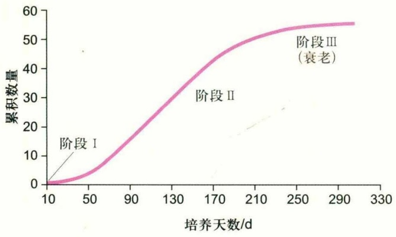
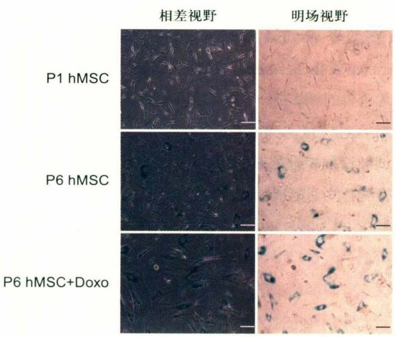
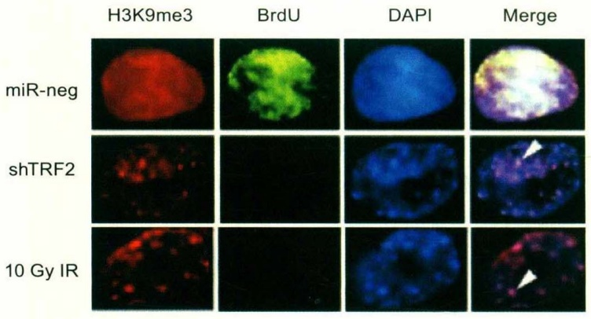
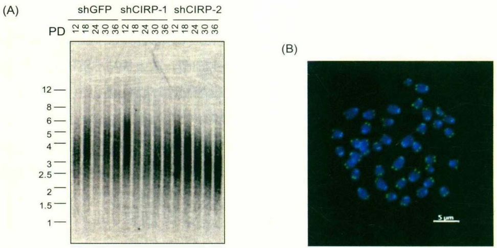
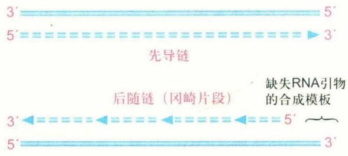
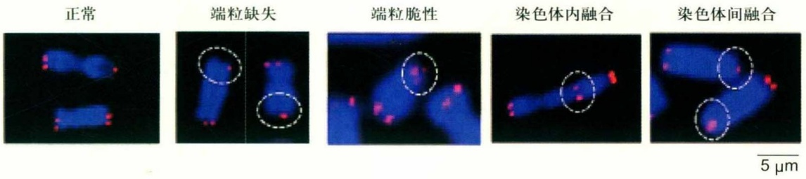
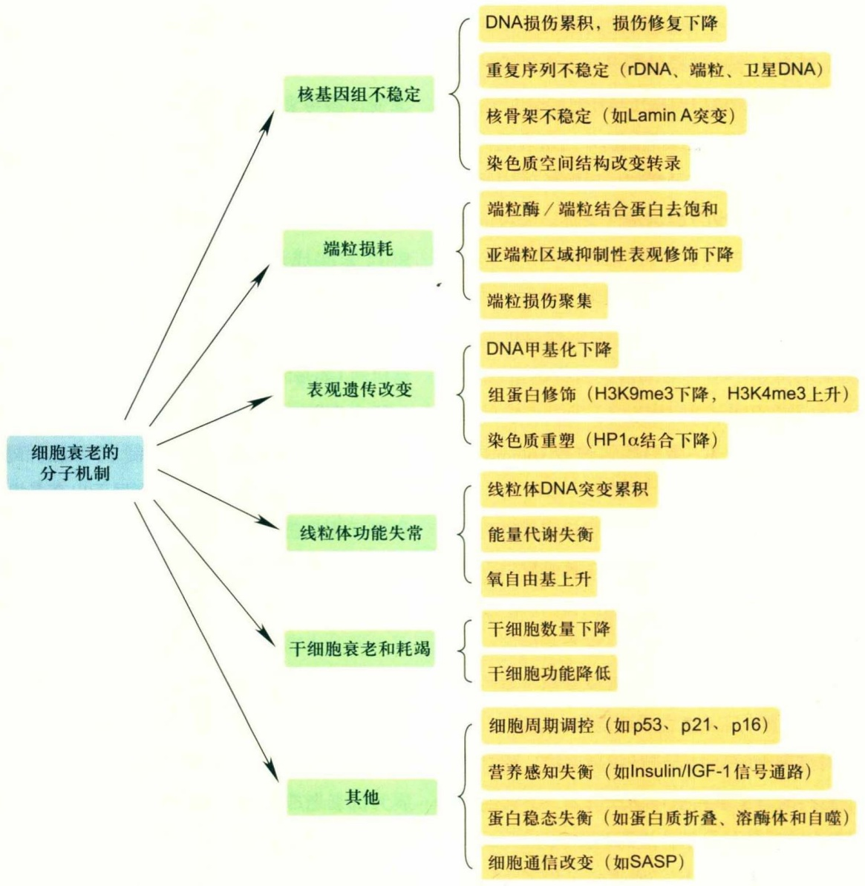
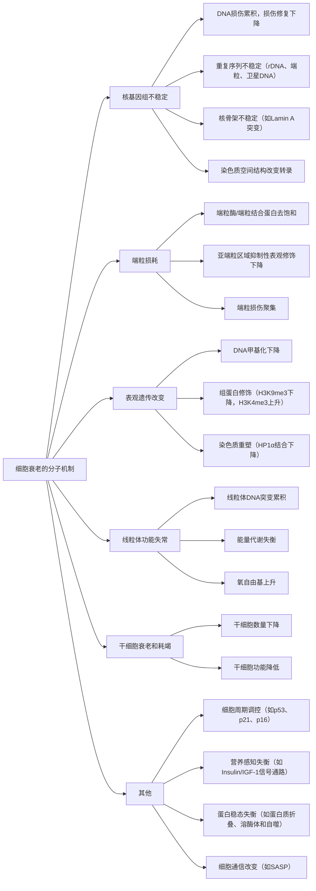

natural_image

Fluorescent microscopy image showing cellular structures with purple nuclei and green cytoplasmic markers (no text or symbols)

从生物学上讲，衰老是随着时间推移，自发的必然过程，它是结构和机能衰退、适应和抵抗力衰减的综合表现。经过多年研究，人们对于衰老已有一定的认识和理解。细胞作为生命活动的基本单位，其衰老是机体衰老的基础。对细胞衰老机制的详尽研究将为机体衰老的干预和抗衰老的策略提供坚实的理论基础。细胞衰老是极其复杂的生物学变化，目前尚有很多衰老相关科学问题亟待解决。本章着重总结和归纳了细胞衰老的研究进展，阐述了细胞衰老的概念、特征、分子机制以及抗衰老的最新研究进展。

## 24.1 细胞衰老概述

## 24.1.1 细胞衰老的概念

细胞衰老（senescence）的名称来自拉丁文senex，表示年老、衰败。细胞衰老是指原本增殖旺盛的细胞发生不可逆的生长阻滞和某些特定功能的改变。在体外培养时，成纤维细胞最多可分裂50次左右，进而停止分裂，这种现象被称为复制性衰老（replicative senescence），也就是海弗利克极限（Hayflick limit）。端粒缩短会造成复制性衰老，另一方面，活性氧（ROS）引发的DNA损伤、原癌基因的激活等也会引起应激诱导的细胞衰老，这种衰老方式与端粒长度无关。因此，细胞衰老代表了细胞状态的变化。在正常机体的衰老过程中，衰老细胞的数量大幅增加。因此研究细胞衰老能为机体衰老提供分子机制。

细胞衰老与细胞的静息状态不同。在生物体内，有些细胞暂时退出细胞周期，丧失了DNA合成能力，处于静息状态（quiescence， $G_{0}$ ），这个过程是可逆的，在一定条件下这些细胞会重新回到细胞周期。如正常成年人的肝细胞通常处于静息的 $G_{0}$ 态，在切除部分肝后，肝细胞由 $G_{0}$ 态重新进入细胞周期并进行分裂增殖。与静息状态不同，细胞衰老的状态和功能是不可逆的。在细胞衰老发生后，即使外界环境提供充足的生长信号也无法启动细胞的再次分裂。与处于静息状态的细胞相比，衰老细胞的生长停滞是永久性的。目前还未发现任何生理条件下的刺激能够使衰老细胞重新进入增殖周期（人为处理除外）。

## 24.1.2 细胞衰老的分类

按衰老的情况分类，细胞衰老分为生理性细胞衰老和病理性细胞衰老。前者指机体正常老化伴随的细胞衰老，是在生理条件下自然发生的；后者指病理疾病造成的细胞衰老，包括一些衰老相关疾病如先天性早衰、退行性疾病等。对先天性早衰疾病的研究发现，早衰疾病的一些分子机制在生理性衰老的细胞中也能检测到。因此，对早衰疾病的研究可以帮助我们认识生理性细胞衰老的分子机制。按衰老的时间分类，细胞衰老分为急性、慢性和胚胎期细胞衰老。例如，细胞基质蛋白CRY61在伤口愈合过程中诱导成纤维细胞衰老及抑制疤痕组织的形成，原癌基因在导致机体癌变同时诱导体细胞衰老，都属于急性细胞衰老。Munoz-Espin等对早期小鼠胚胎的研究发现中肾和内耳内淋巴囊发生不依赖于DNA损伤的衰老，促进组织重塑。Storer等则发现小鼠胚胎发育过程中顶端外胚层嵴细胞衰老，随后这些细胞发生凋亡，继而被免疫系统清除，这属于胚胎期细胞衰老。因此，细胞衰老并不总是对机体有害。急性和胚胎期细胞衰老被认为对机体有益，而慢性细胞衰老一般被认为有害。除非特别注明，以下所讨论的主要是生理性细胞衰老和慢性细胞衰老。

## 24.1.3 细胞衰老的发现

20世纪上半叶，基于1912年诺贝尔生理学或医学奖的获奖者Alexis Carrel及其同事的研究工作，人们认为细胞是永生的，衰老发生在细胞之间。Carrel将鸡心组织放在鸡血浆和液态鸡胚组织形成的混合物上体外培养鸡心脏细胞，几天后细胞生长缓慢并逐渐停止分裂时再将一部分细胞移到新的培养皿，并更换新的血浆和液态鸡胚组织。这项研究持续了长达34年，直到1946年Carrel去世，他们培养的鸡心脏细胞都没有衰老的迹象。从那以后几十年，人们对这一结果都确信不疑，认为细胞是永生的。直到很久以后，科学家们意识到Carrel实验存在严重缺陷。他们在培养过程中添加的液态鸡胚组织里并没有去除活细胞，也就是说，细胞并不是永生的，而是在每次更换培养基的时候混入了新鲜的细胞。

1961年，美国解剖学家Leonard Hayflick体外培养人胎儿成纤维细胞，试图重复Carrel的实验。为了精确地进行实验，Hayflick没有像Carrel那样将细胞培养在切碎的组织上，而是利用胰蛋白酶将细胞从胚胎分离和传代。几个月后，Hayflick和同事无法培养出永生化的细胞系，细胞分裂50多次就进入衰老期，此发现挑战了诺贝尔奖得主Carrel宣称的“体外培养的细胞具有永生性”的观点。在实验中，Hayflick发现细胞经历了3个时期:第一个时期为原始培养期，细胞刚从供体中移取出来接种到培养基中，扩增相对缓慢，是对新的体外环境的适应过程；第二个时期为10个月左右的旺盛扩增期，细胞进入稳定而持续的增殖阶段；第三个时期细胞逐渐停止分裂。随后细胞进入一种不可逆的生长阻滞状态，处于该状态的细胞能够继续存活相当长的时间，且细胞发生特征性的改变，Hayflick将这种状态定义为细胞的复制性衰老（图24-1）。为了消除科学界对他们实验的质疑，Hayflick设计了两种性别来源的细胞实验:将第10代（年轻的）女性细胞和第40代（年老的）男性细胞等比例混合，同时培养没有混合的细胞（第10代女性细胞纯培养组和第40代男性细胞纯培养组）作为对照。在经过30次传代培养后，混合组只有女性细胞存活，男性细胞几周前已全部死亡；女性年轻细胞纯培养组的细胞仍然保持分裂；男性年老细胞纯培养组几周前已全部死亡。至此，Hayflick推翻了Carrel的细胞永生理论，体外培养的细胞的有限传代理论被人们所接受。

line

| 培养天数/d | 累积数量 |
| --- | --- |
| 10 | 0 |
| 50 | ~5 |
| 90 | ~18 |
| 130 | ~32 |
| 170 | ~44 |
| 210 | ~50 |
| 250 | ~54 |
| 290 | ~56 |

由于Hayflick的重要发现，人们可以快速地利用体外复制性衰老细胞为模型来研究衰老的分子机制。为了纪念他，人们把体外培养细胞的有限寿命称为海弗利克极限。人们逐渐又把对衰老研究的注意力从人类转向了其他生物体。从最简单的单细胞酵母到最复杂的人类，所有的真核生物在衰老过程中都有某些共同点。在各种模式生物中进行的衰老研究可以为人类衰老的研究提供线索。以果蝇、线虫、小鼠、大鼠以及非人灵长类动物为研究对象来研究细胞衰老和机体衰老日渐热门。新的学科“细胞老年学”（cyto-gerontology）开始兴起。

## 24.2 细胞衰老的特征

细胞衰老是相对机体衰老而言的，因此衰老是相对的，是随着细胞分裂次数的增多逐渐出现的。增殖和衰老的细胞差异是渐进式的，目前尚未发现完全特异性的单一标志物。通常采用以下多种方法相结合综合判断细胞衰老的程度。

## 图 24-1 原代细胞生长的倍增曲线

体外细胞生长的3个阶段:阶段I，原代培养阶段，细胞数量增长相对较慢；阶段II，增殖阶段，细胞稳定而持续的增殖，这过程中细胞可能会因环境的改变而发生突变，有些细胞因为突变而拥有无限增殖能力；阶段III，衰老阶段，细胞增殖速率变慢并逐渐丧失分裂能力。

## 24.2.1 细胞形态的变化

体外培养的细胞发生衰老时，表现为形态扁平、伸展增大、细胞核凹陷、核膜崩解，伴有多核(multinucleated)现象和煎蛋样外观(fried egg appearance)。衰老细胞的细胞质基质增多，可见较多的颗粒或空泡，核仁增大，溶酶体、线粒体数量或体积增加。细胞骨架组分改变，细胞外基质分解。

## 24.2.2 $\beta$-半乳糖苷酶

衰老相关的β-半乳糖苷酶（senescence-associated beta-galactosidase，SA-β-Gal）只在衰老细胞中表达，而不在衰老前或静息期的成纤维细胞中表达，也不在终末分化的角质形成细胞中表达，是目前公认的一种衰老细胞的生物标志物，可以在pH 6.0时用组织化学方法检测，应用广泛。目前研究表明，β-半乳糖苷酶位于溶酶体，虽然其活性对细胞衰老并不是必需的，但不论是对体外培养的衰老细胞，还是动物体内衰老细胞的检测，均表现出与传代次数或年龄增长积累的衰老表型一致（图24-2）。另外，体外培养时一些外界压力如长时间的汇合生长也会引起β-半乳糖苷酶活性增高。由于检测方法简便、成本低、所需细胞少，β-半乳糖苷酶活性染色用于检测细胞衰老情况在衰老研究中应用普遍。

## 24.2.3 细胞周期的阻滞

衰老细胞最明显的特征是增殖缓慢，细胞周期延长。

text_image

P1 hMSC
P6 hMSC
P6 hMSC+Doxo
相差视野
明场视野

衰老细胞的复制阻滞主要是 $G_{1}$ 到S期分子刹车的激活。基于这个特点，可以做流式细胞分析，用胸腺嘧啶类似物溴化去氧尿苷（5-Bromo-2'-Deoxyuridine，BrdU）或 $^{3}H$ 标记的胸腺嘧啶脱氧核苷（ $^{3}H$ -thymidine）做掺入实验和染色。若细胞发生衰老，则BrdU等信号减弱（图24-3）。也可以对DNA复制标志蛋白如增殖细胞核抗原PCNA和Ki-67做免疫染色。当然，静息期和终末分化的细胞也表现出同样的特征，所以必须结合其他特征综合鉴别衰老细胞。

## 24.2.4 端粒缩短与细胞衰老

在正常情况下，体细胞的端粒酶活性受到抑制，使端粒长度随着细胞分裂次数的增加而逐渐缩短。检测端粒长度的方法有经典Southern印记法如限制性内切酶酶切产生的末端限制性片段长度（terminal restriction fragment, TRF）、定量荧光原位杂交（quantitative fluorescent in-situ hybridization, Q-FISH）、流式细胞术-荧光原位杂交（flow-FISH）。其中最精准能够测定端粒绝对长度的方法是末端限制性片段长度TRF（图24-4A），而原位杂交方法能够直观观察到染色体的形态（图24-4B）。但检测端粒长度也有局限性，有些应激引起的细胞衰老独立于端粒缩短途径，所以端粒缩短并不是一个完美的细胞衰老标志。

## 24.2.5 细胞功能改变

细胞发生衰老时，蛋白合成效率整体下降，DNA复制相关蛋白减少，RNA合成相关蛋白减少，细胞的各种功能也相应改变，表现为细胞内垃圾增多、无功能的蛋白质残留增多及细胞整体代谢功能下降。研究发现，衰老细胞的炎症因子分泌增多，促进自身衰老及改变其周围环境，甚至可以促进细胞发生癌变，这种现象称为衰老相关的分泌表型(senescence-associated secretion phenotype, SASP)。

图24-2 人脐带间充质干细胞(human mesenchymal stem cell, hMSC)的β-半乳糖苷酶活性检测(图片由黄燕博士提供)

上:第一代hMSC；中:第六代hMSC；下:0.1  $\mu$ mol/L多柔比星(doxorubicin, Doxo)处理后的第六代hMSC。标尺100  $\mu$ m。

text_image

H3K9me3	BrdU	DAPI	Merge
miR-neg
shTRF2
10 Gy IR

图24-3 衰老细胞的免疫阻荧光染色（图片由罗镇华博士提供）

BrdU掺入显示细胞周期阻滞，H3K9me3与DAPI的共定位显示SAHF信号。上:阴性对照，细胞能增殖不发生衰老；中/下:敲减端粒结合蛋白TRF2或辐射诱导使细胞周期阻滞，衰老相关异染色质灶SAHF出现。

图24-4 衰老细胞的端粒检测（图片由颜思宇博士提供）

(A) 人细胞末端限制性片段长度TRF测量(图片由张友韦博士提供); (B) 小鼠骨髓细胞荧光原位杂交, 绿色端粒探针标记端粒DNA, 蓝色DAPI标记总DNA, 标尺5μm。

## 24.2.6 细胞衰老的其他标志

细胞衰老会引起细胞DNA损伤，如DNA片段缺失、DNA链断裂、染色体移位等，产生衰老相关异染色质灶（senescence-associated heterochromatic foci, SAHF）表型。SAHF是由Narita等发现的衰老细胞内含有的特殊DNA染色位点，目前认为是细胞衰老的重要诱因。SAHF内不含有转录激活结构域，并且破坏SAHF的形成会促进细胞癌变，提示SAHF具有抑癌作用。检测SAHF可以利用免疫荧光监测组蛋白变体macroH2A、HMGA蛋白、组蛋白修饰H3K9me2/3或HP1蛋白在核内的定位，辅助与DAPI的共定位观察（图24-3）。

SAHF常与端粒功能失调诱导病灶(telomere dysfunction-induced foci, TIF)同时出现。TIF也是细胞衰老重要的标志之一，可以在衰老细胞中利用γH2AX或p53结合蛋白(p53-binding protein 1, 53BP1)免疫染色，与端粒核酸探针的原位杂交或端粒结合蛋白的免疫共染色检测DNA损伤位点与端粒的共定位。

## 24.3 细胞衰老的分子机制

## 24.3.1 基因组不稳定

真核基因组DNA以染色质的形式存在，染色质是细胞内遗传物质的载体，染色质结构控制基因组稳定和基因表达。细胞衰老的重要分子机制之一是基因组不稳定。目前基因组不稳定主要涉及核基因组、线粒体基因组、核骨架和端粒功能失调。

## (1) 核基因组不稳定与细胞衰老

染色质结构稳定性主要涉及染色质保护蛋白的结合和表现遗传修饰的维持。核基因组不稳定与衰老的关系最早在低等真核细胞酵母中被发现。衰老的酵母细胞中会聚集很多核糖体DNA（rDNA）环，rDNA由高度重复序列组成，转录成核糖体RNA，是蛋白质合成所必需的。rDNA环的形成是基因组中异染色质结构改变引起的。由于衰老的酵母中去乙酰化酶Sir2蛋白水平降低，导致染色质乙酰化水平增高，异染色质活跃带来核基因组不稳定。在高等真核生物中，重复序列在基因组中占50%～60%，如rDNA、卫星DNA、逆转录病毒和端粒等。重复序列由于缺乏染色质保护蛋白或抑制性的表观遗传修饰的维持，引起基因组复制产生错误，或发生重组或产生DNA损伤聚集。

近些年人们越来越认识到细胞衰老是基因组损伤累积和缺乏有效的DNA修复导致的。基因组损伤涉及内在损伤和外在损伤，内在损伤主要包括活性氧（ROS）和DNA复制时产生的错误，外在损伤来自化学因素或紫外线（UV）/辐射（IR）。细胞内应对DNA损伤产生DNA修复途径，包括错配修复(mismatch repair, MMR)、碱基切除修复(base excision repair, BER)、核苷酸切除修复(nucleotide excision repair, NER)、同源重组修复(homologous recombination, HR)、非同源末端连接修复(non-homologous end joining, NHEJ)、双链DNA修复(double-strand break repair, DSBR)等。DNA损伤累积，和缺乏有效的DNA修复会促使细胞衰老的发生。例如基因组范围内的双链DNA损伤会促进ATM和ATR磷酸化H2AX，H2AX磷酸化会促进DNA损伤修复蛋白结合到特定损伤区域进行修复，同时也会激活下游的检查点激酶如Chk1/Chk2，最终引起DNA损伤效应分子p53的激活。

某些早衰疾病，如Werner综合征和Bloom综合征是由于DNA解旋酶RecQ家族成员WRN和BLM的基因突变，使得DNA复制和修复容易出错。WRN突变的细胞非同源末端连接修复途径失调。BLM突变的细胞容易发生同源染色体间过度交叉，姐妹染色单体交换（sister chromatid exchange，SCE）增多，核基因组不稳定。

## (2) 线粒体基因组不稳定与细胞衰老

伴随人年龄增长，各种组织的线粒体功能降低。线粒体是细胞呼吸和物质氧化的中心。1980年Miquel等提出衰老的线粒体假说，认为线粒体的损伤是细胞衰老和死亡的分子基础。线粒体DNA与核基因相比，是裸露的DNA分子，不仅缺少组蛋白包裹和保护，也缺乏有效的DNA损伤修复因子参与修复。衰老的线粒体DNA积累很多DNA突变和缺失，其突变大多是由于DNA复制产生错误的累积，而不是氧化损伤。线粒体DNA突变使线粒体呼吸链及氧化磷酸化功能受损，导致ATP产生水平下降，受损的电子传递链导致线粒体ROS的产生增多，ROS积累后破坏生物大分子，从而逐渐导致基因组不稳定和细胞及器官功能的下降。细胞衰老后，线粒体功能下降和突变积累还会进一步促进肿瘤发生。

## (3) 核骨架与细胞衰老

核骨架是由纤维蛋白构成的网架结构，是基因转录加工的场所。核骨架高度动态，30 nm染色质纤维结合在核骨架上，形成放射环状结构。核骨架改变直接影响基因组稳定性和转录水平。中国科学院生物物理所刘光慧课题组的研究显示，LMNA基因突变导致核纤层蛋白Lamin A功能缺失、核骨架破坏和基因组不稳定，是早衰综合征（Hutchinson-Gilford progeria syndrome, HGPS）发生的主要病因。

高等真核基因组比低等真核基因组更加复杂，主要表现在高等真核基因组会形成染色质与染色质间的相互作用而产生一定的空间结构，影响基因表达。根据距离的长短划分为远距离的染色质相互作用和近距离的染色质相互作用。介导染色质与染色质间远距离相互作用的效应蛋白是绝缘子蛋白CTCF。CTCF通过远距离的染色质相互作用影响衰老标志物p16的基因表达。在正常细胞中，CTCF介导p16附近的染色质的远距离相互作用，形成DNA环状区域，PRC1和PRC2复合体介导该区域内H3K27me3水平上升，p16基因沉默；而在衰老细胞中，CTCF不介导p16附近的远距离相互作用，p16基因激活。通过高通量全基因组构象捕获技术（Hi-C）证实在癌基因诱导的细胞老化模型中，短距离的染色质间相互作用（0.2～5 Mb）减少，在一些抑制性区域长距离染色质间相互作用增加。而在复制性细胞老化模型中，全基因组范围内短距离的染色质间相互作用增加。

## 24.3.2 端粒损耗

端粒功能失调属于基因组不稳定的一种。与基因组其他位置相比，染色体末端的端粒对衰老伴随的DNA损伤积累高度敏感。因此，端粒的稳定性与细胞衰老关系密切。

## (1) 端粒的发现

在Hayflick提出体外培养细胞具有有限分裂次数之后，人们就一直想寻找是什么控制着细胞的有限分裂。1972年，James Watson提出双螺旋模型，同时提出了DNA复制过程中的“末端隐缩问题”。1973年，苏联理论生物学家Alexey Olovnikov观察了火车和轨道的接近-分离后提出，在DNA复制过程中，每条DNA链末端的短小片段在每次DNA复制完成后，即无法复制而丢失，DNA复制过程的末段丢失问题就是Hayflick极限的机制。Olovnikov猜想一定存在一种能够补偿染色体末端隐缩问题的片段，提出了端粒假说(图24-5)。

接着科学家们开始对端粒假说进行实验验证，这里我们不得不提到四膜虫这种特殊的模式生物，它的小染色体数量众多，也就意味着染色体的末端即端粒可能非常丰富，这为端粒研究提供了得天独厚的材料。1975年，Woodring Wright在Hayflick实验室攻读博士期间发现这种能够决定细胞寿命的端粒存在于细胞核内。1978年，Elizabeth Blackburn等利用四膜虫纯化了rDNA，以rDNA为模板通过体外合成掺入dNTP的实验，推断四膜虫的端粒由许多重复的5'-CCCCAA-3'碱基序列组成，揭开了染色体末端的帽子谜团——端粒是特殊的重复序列，在各种生物体中广泛存在（图24-4B）。

text_image

3' 5'
5' 3'
先导链
后随链（冈崎片段）
缺失RNA引物的合成模板
3' 5'
5' 3'

随后Blackburn在1982年会议上介绍了她的发现，引起了Jack Szostak的注意。他那时候试图在酿酒酵母中构建人工线性染色体，发现当每次环状质粒线性化转入酵母细胞后，就很快被降解掉。它的降解是否由于其末端没有端粒保护呢？端粒序列的发现让Szostak尝试把线性质粒末端连接上四膜虫的端粒DNA再导入酵母细胞。发现线性质粒不再降解，可以在细胞内复制，人工染色体的想法得以实现。人工染色体的实现使DNA的大片段克隆成为可能，为后来的人类基因组测序工作奠定了重要基础。在1984年和Szostak合作发表的文章中，Blackburn实验室注意到:带着四膜虫端粒DNA的人工染色体导入到酵母后，被继续加上了酵母的端粒而不是四膜虫的端粒序列。由于端粒是由重复序列组成，当时人们普遍猜想同源重组是延伸端粒、补偿染色体末端隐缩问题的机制。但是同源重组只能复制出更多本身的序列，为什么在四膜虫端粒上加的是酵母的端粒序列而不是四膜虫本身的端粒序列呢？对于这个现象同源重组无力解释。可能酵母中存在专门的“酶”来复制端粒DNA？

1984年，Blackburn指导自己的学生Carol Greider用四膜虫的核抽提液与体外合成的高浓度端粒DNA进行温育。经过多次实验优化，终于用同位素曝光清楚地看到了信号，端粒底物明显被重新加上了DNA碱基，而且每

## 图24-5 DNA复制过程后随链的末段丢失问题

由于DNA聚合酶只能从 $5'\rightarrow3'$ 的方向进行合成，DNA复制分为先导链(leading strand)和后随链(lagging strand)合成。先导链以 $5'\rightarrow3'$ 的方向一直合成到端粒的末端，而后随链则以冈崎片段的方式一段一段地合成，然后通过连接酶形成完整的DNA链。由于冈崎片段合成需要短的RNA作为引物，RNA引物结合的位置决定了冈崎片段起始的位置。对于端粒DNA复制来说，最后一个冈崎片段的RNA引物不可能总是落到端粒DNA最末端，所以会有一段DNA不能被复制，产生了 $3'$ 的富含G的尾(G-overhang)，这就是线性DNA的末端复制问题。

6个碱基形成一条很深的带，与四膜虫端粒重复基本单位为6个碱基正好吻合。这种酶活性不依赖于DNA模板，只对端粒DNA进行延伸，而对随机序列的DNA底物不延伸，且该活性不依赖于DNA聚合酶。由于同源重组对序列没有特异性的要求并且依赖于DNA聚合酶的活性，至此，Blackburn和Greider澄清了端粒复制的同源重组假说，证明了有一种“酶”来延伸端粒DNA，后来被命名为“端粒酶”(telomerase)。

20世纪90年代，端粒酶的RNA亚基和蛋白催化亚基被逐渐发现。利用体外转录和翻译系统体外重建端粒酶活性，证明这两个核心亚基的存在是端粒酶活性的必需且完备条件。实际上，经过亿万年的进化，端粒酶机制只是其中一种最为普遍的解决染色体末端隐缩问题的方式。回到最初的猜想，当时人们猜测同源重组延伸端粒的假说也并没有错，细胞实际上也可以通过同源重组的方式延伸端粒。裂殖酵母可以通过染色体头尾相连、环化的方式来避开染色体末端隐缩的问题，在缺乏端粒酶和端粒的情况下生存传代，果蝇能通过转座子的不断复制延伸端粒。而10%～15%的肿瘤细胞通过端粒延长替代(alternative lengthening of telomere, ALT)机制来延伸端粒。ALT机制指在端粒酶失活或不足的情况下，存在的一种或多种维持和增加端粒长度的机制，其特点是具有不均一的端粒长度、存在与ALT相关的PML小体（APB）以及同源重组增加。ALT机制还在研究中，ALT细胞内存在的ALT相关蛋白及异常活跃的同源重组为ALT机制的激活和维持提供了可能。

## (2) 端粒稳定性与细胞衰老

在正常人体中，只有成体干细胞、生殖细胞、祖细胞和少数体细胞具有端粒酶活性，绝大部分体细胞没有端粒酶活性或极低，这也是人随着年龄增长端粒逐渐缩短导致衰老的重要原因之一。2009年诺贝尔生理学或医学奖授予美国科学家Elizabeth Blackburn、Carol Greider和Jack Szostak以表彰他们“发现端粒和端粒酶是如何保护染色体的”，这也充分说明了端粒生物学功能研究的重要性。

端粒的结构和长度帮助细胞维持基因组稳定性，与细胞衰老密切相关。端粒区域主要依赖于端粒结合蛋白的保护，而亚端粒区域是含有组蛋白包裹的异染色质结构，富含染色质相关蛋白因子HP1、组蛋白H3K9me3、H4K20me3甲基化修饰和DNA高度甲基化修饰。已有证据表明端粒损伤是不可逆的。破坏亚端粒异染色质结构或端粒区域DNA缺乏端粒结合蛋白的保护均会导致端粒DNA损伤加剧，最终导致细胞衰老。体细胞多次复制积累的DNA损伤会使端粒功能发生紊乱。如端粒缺失、端粒脆性、端粒融合（包括染色体内融合、染色体间融合）（图24-6），积累到一定程度，会诱发端粒缩短或端粒的帽子结构被解开，细胞周期检控点将异常的端粒识别为链断裂并发送DNA损伤信号。进而通过激活p53-p21和p16等信号通路使细胞周期阻滞在 $G_{1}$ 期，诱发细胞衰老，最终永久进入 $G_{0}$ 期，细胞不再分裂。

在细胞中，端粒并不是裸露存在于DNA末端，而是被由6个蛋白TRF1、TRF2、TPP1、POT1、TIN2和RAP1组成的端粒体复合物（Shelterin）结合。该复合体参与调控端粒长度和端粒表观遗传修饰，阻止染色体末端被识别为双链DNA损伤，并抑制DNA损伤修复应答通路的激活。端粒体蛋白表达量与细胞衰老密切相关。端粒体蛋白如TRF2、POT1随着细胞衰老逐渐下调。研究表明，过表达TRF2能延缓复制性衰老的发生，而TRF2水平的降低会诱发p53的上调和衰老的发生，有趣的是p53能够通过诱导E3连接酶Siah1进一步下调TRF2的表达，达到正反馈效果。松阳洲课题组通过筛选发现miR-23a能够特异性靶向TRF2，使其水平下调，通过ATM-p53信号通路诱发原代细胞衰老。端粒单链结合蛋白POT1也能保护端粒，POT1下调会激活ATR信号通路，诱发细胞衰老。

text_image

正常
端粒缺失
端粒脆性
染色体内融合
染色体间融合
5 µm

图24-6 端粒紊乱的类型（图片由李锋博士提供）

人宫颈癌细胞荧光原位杂交端粒探针，显示正常、端粒缺失、端粒脆性、端粒染色体内融合、端粒染色体间融合各种类型，图中标尺5μm。

除了端粒体蛋白复合物，细胞内还存在其他特异的端粒结合蛋白。端粒锌指相关蛋白（telomeric zinc finger-associated protein, TZAP）优先与拥有低浓度的Shelterin复合物的长端粒结合，与端粒重复序列结合因子TRF1和TRF2竞争。当位于端粒时，TZAP作为端粒长度的负调控因子，导致端粒重复序列的快速删除。端粒结构的变化也与衰老相关。周金秋课题组发现酵母的端粒酶组分Est1p在体外可将富含G的端粒单链折叠成G四链体，Est1p突变体的细胞则表现出端粒缩短和细胞衰老现象，表明G四链体在维持酵母端粒长度和细胞衰老中具有重要的调节作用，随后课题组又深入探讨了Est1p在促进端粒酶通路和抑制端粒重组通路中扮演关键的调控作用，最近课题组还合作完成了世界首例人造染色体酵母的构建。

氧化应激和慢性炎症均可导致端粒长度缩短。大量的研究证实端粒长度随着人体衰老而逐渐缩短，端粒长度与个体年龄成反比，即个体越年轻，端粒长度越长，端粒长度与细胞老化关系密切。端粒紊乱与很多病理性衰老疾病相关。端粒酶TERT或TERC核心组分、参与端粒酶组装招募因子以及端粒体复合物基因的突变和肺纤维化(pulmonary fibrosis)、先天性角化不良(dyskeratosis congenita)、再生障碍性贫血(aplastic anemia)等有关。端粒酶的失调或端粒结构和长度的紊乱会造成干细胞耗竭，机体在受损后无法补充新的细胞。松阳洲课题组发现了端粒体蛋白TIN2、TPP1对于端粒酶招募的重要作用，鉴定出新的端粒酶调控因子CIRP、TOE1等，发现了端粒相关蛋白DAXX在端粒酶招募中起作用，DAXX的肿瘤突变体通过影响端粒酶的招募进而影响端粒调控。此外，通过基因编辑敲除技术揭示了SMC家族的非经典成员SMCHD1在DNA损伤修复中的作用机制，即通过促进非同源末端连接和抑制同源重组来介导DNA损伤修复。另外课题组以早期胚胎和干细胞为模型，发现在基因组低甲基化的细胞中，DAXX/ATRX蛋白复合体转移到重复性序列上并招募组蛋白甲基化酶SUV39H，介导组蛋白H3K9的三甲基化从而确保基因组特异地沉默重复序列，防止转座因子随机插入而诱导基因突变，保证了基因组的稳定性。

端粒调控不仅影响体细胞端粒长度和结构，也影响线粒体代谢。端粒酶TERT能定位到线粒体，行使非端粒依赖的功能，包括改善线粒体功能、减少细胞氧化应激。松阳洲课题组发现端粒体蛋白TIN2能够定位到线粒体，调控糖酵解，随后又用双引导RNA-CRISPR/Cas9介导的大片段基因编辑敲除方法构建了端粒体6个蛋白对应的基因诱导型敲除的细胞系并做了代谢组分析，系统分析了端粒体蛋白在人和小鼠中的差异，其中TIN2的缺失显著提高了三羧酸循环和糖酵解途径的利用，为端粒和代谢的联系提供了新的分子机制。

## 24.3.3 表观遗传改变

表观遗传是指在基因的DNA序列没有发生改变的情况下，基因功能发生可遗传的变化，并最终导致表型的变化。与DNA改变所不同的是，许多表观遗传的改变是可逆的，表观遗传信息的建立、维持和擦除需要相关表观遗传酶来实现。表观遗传信息动态变化影响许多生物学过程。表观遗传时钟运转的速度同样与寿命有关。寿命较短的哺乳动物（如小鼠）的细胞表观遗传标记变化的速度比寿命较长的哺乳动物（如人类）细胞的变化速度快。细胞衰老相关表观遗传标志物的改变主要涉及DNA甲基化、组蛋白修饰和染色质重塑。

DNA甲基化主要参与基因沉默，甲基化为共抑制因子结合提供位点。在脊椎动物中，CpG二核苷酸是DNA发生甲基化的主要位点。DNA甲基化可逆，它的建立和去除需要DNA甲基化酶和去甲基化酶来完成。衰老过程中DNA甲基化水平变化很复杂，由于低等模式生物染色质包装不如高等生物复杂，所以目前研究DNA甲基化在衰老中的变化主要利用小鼠和人类细胞模型。人类细胞老化会使整体的DNA甲基化水平降低，具体涉及某些基因启动子区域高甲基化，某些基因启动子区域低甲基化。组成型染色质（如中心粒）高度高甲基化，随着细胞老化，DNA甲基化水平降低，沉默状态的重复序列失去抑制而进行转录，导致染色质结构不稳定。

组蛋白甲基化和乙酰化在衰老研究中被阐述的比较详尽。各个位点的组蛋白甲基化和乙酰化在染色质的分布方式不同，某些主要富集在常染色质中，某些在异染色质中。如H3K9me3、H3K20me3主要在异染色质区域富集，H3K27me3、H3K36me3、H3K4me3和乙酰化修饰主要在常染色质区域富集。这些组蛋白修饰调控基因转录的方式也是多样的，H3K4me3主要分布在基因启动子区域，H3K36me3主要分布在基因转录区域。衰老的细胞中，组蛋白H3K16Ac、H3K20me3和H3K4me3增加，组蛋白H3K9me3和H3K27me3降低。

乙酰化修饰在细胞衰老和长寿中的作用被最早阐明，染色质中组蛋白乙酰化水平高是染色质结构疏松和基因转录活跃的标志。在酵母中敲除Sir2基因，酵母寿命缩短；增加Sir2基因拷贝，酵母寿命延长。Sir2具有去乙酰化酶活性，降低蛋白乙酰化水平，辅酶I（nicotinamide adenine dinucleotide，NAD $^{+}$ ）是Sir2的辅酶。Sir2的还具有ADP核糖基转移酶活性，催化NAD $^{+}$ 生成尼克酰胺。酵母中的Sir2与哺乳动物中SIRT1同源，属于Sirtuin蛋白家族。SIRT1参与多种通路，SIRT1作为组蛋白去乙酰化酶使染色质结构紧密，稳定染色质结构和基因组；再者SIRT1酶活性与NAD $^{+}$ 和乙酰辅酶A相关，所以SIRT1与代谢调控相关。

上述的衰老相关表观遗传修饰的改变依赖于染色质修饰酶（如组蛋白甲基化酶、组蛋白去甲基化酶、DNA甲基化酶、DNA去甲基化酶）与染色质的结合发生改变，以及染色质结合蛋白如HP1α和NuRD复合体与染色质的结合发生改变，进而引起染色质重排，最终导致转录的改变。有些研究已经证实了过表达HP1蛋白会增加基因组稳定性，减缓衰老。

## 24.3.4 线粒体功能失常

细胞衰老导致呼吸链功能减弱，电子泄露增加和ATP生成减少。细胞内的“能量发动机”线粒体功能失常会产生较多的氧自由基，自由基不仅攻击线粒体，还会攻击蛋白质、脂肪和DNA，引起细胞和器官的损伤，其中攻击DNA就会引起基因突变，加速衰老和癌变。过去一直认为线粒体产生的氧自由基直接引起细胞衰老，经过试验证实，在小鼠模型中增加线粒体氧自由基和氧化损伤并不能加速机体衰老；增加抗氧化剂使用也不能增加小鼠寿命。目前可以明确，通过基因操作损伤线粒体功能，能加速衰老。

线粒体功能失常往往涉及多个机制。线粒体不稳定是加速衰老的原因。如之前提到的线粒体DNA是裸露的环状DNA，无组蛋白和缺乏有效的损伤修复机制，所以线粒体DNA会积累很多基因突变和基因缺失。目前已经证实了线粒体基因突变会引起人类衰老相关的多系统紊乱疾病。另有证据表明，小鼠体内线粒体DNA聚合酶γ突变会引起线粒体DNA积累多种突变，导致早衰和寿命缩短。DNA聚合酶γ突变的小鼠发生线粒体功能障碍，氧自由基并没有增加。另一方面，线粒体功能失常会引起代谢障碍。肌肉细胞是线粒体含量最丰富的一种细胞，缺乏NAD $^{+}$ 引起的线粒体功能障碍与肌纤维衰老紧密相关。线粒体有其内在的修复机制，受损伤或不需要的线粒体会被机体及时清除，即发生线粒体自噬；伴随着衰老线粒体的自噬功能减弱，受损的线粒体逐渐堆积。促进线粒体自噬的发生会抑制衰老的进程。综上所述，线粒体活性的维持和修复能延缓衰老和增加寿命。

1996年英国胚胎学家Wilmut成功获得体细胞克隆动物，多利羊的诞生开创了体细胞克隆的时代。几年后多利因肺病死亡，人们推测它的死因。一部分人认为线粒体缺陷导致了多利的衰老。线粒体影响机体能量代谢和基因组稳定，从而引起机体系统性紊乱。目前认为多能干细胞活性维持也与线粒体活性直接相关。

## 24.3.5 干细胞耗竭

干细胞是具有高度自我更新和多向分化潜能的细胞群。根据分化能力的不同，分为胚胎干细胞和成体干细胞。早期的精子和卵子形成合子，发育成囊胚，囊胚内少量的内细胞团就是具有多能性的胚胎干细胞。随着发育的进行，胚胎干细胞分化为三胚层乃至整个个体。而成体干细胞是存在于分化组织中的未分化细胞，能够自我更新并分化成组织细胞的一类干细胞，如造血干细胞、肝脏干细胞、皮肤干细胞、神经干细胞和间充质干细胞等。因此，成体干细胞在组织更新和再生中具有非常重要的作用。衰老细胞典型的特征包括端粒损耗、DNA损伤累积、线粒体功能失常和表观遗传改变。研究证实成体干细胞也同样会衰老，与体细胞衰老的机制相似。

成体干细胞只有大约5%处于活跃状态，约95%都处于休眠或静息状态，成体干细胞稳态平衡涉及成体干细胞的静息和扩增之间的平衡。现在普遍认为机体衰老是由于成体干细胞耗竭而导致的。成体干细胞耗竭是指成体干细胞稳态改变，干细胞数量减少或功能下降。成体干细胞静息状态缺失和过度增殖会导致成体干细胞成熟前耗竭，最终加速衰老。人类从出生到衰老的过程中，人体组织内间充质干细胞（MSC）数量急剧下降。MSC最早发现于骨髓中，存在于多种组织，具有自我更新和多向分化潜能，能分化成骨骼肌、软骨组织、骨髓和脂肪。新生儿时期间充质干细胞比例最高，每1万个组织细胞有1个间充质干细胞；到青年时期，每10万个组织细胞有1个间充质干细胞；到80岁时，每200万个组织细胞才有1个间充质干细胞。

体细胞重编程是指在特定条件下将已经分化的成熟细胞由分化状态逆转成具有多能性的未分化状态的过程。2006年，Yamanaka研究小组首次通过外源性表达4个细胞多能性相关转录因子Oct4、Sox2、Klf4、cMyc诱导小鼠胚胎成纤维细胞(mouse embryonic fibroblast, MEF)，使其转变成多能干细胞，并将其命名为诱导多能干细胞(induced pluripotent stem cell, iPSC)。体细胞重编程是由多因子参与、非常复杂而精密的表观遗传调控过程。体细胞重编程中细胞命运的转变涉及转录因子结合模式的改变、转录调控模式的改变、染色质结构的改变、干性维持基因的激活等方面。年轻或衰老的终末分化细胞能分别被逆转为多能干细胞，研究发现衰老的细胞重编程效率很低，证明了衰老细胞的特征并不能被全部逆转。也有研究者发现衰老细胞经体外重编程后的诱导多能干细胞分化能力是受限的，表明衰老相关的表观遗传改变在诱导重编程过程中仍带有衰老的表观遗传记忆。为了深入研究干细胞衰老机制，目前很多研究小组利用衰老疾病来源的细胞建立iPS细胞模型研究衰老疾病和细胞衰老的分子机制，以及开展结合干细胞和基因编辑技术进行个体化治疗的研究。

干细胞衰老和耗竭的机制也涉及表观遗传改变和代谢改变。干细胞衰老的表观遗传标志物包括H3K9me3修饰水平整体的下降、中心粒异染色质去浓缩、端粒损耗和核仁组织区改变。中国科学院生物物理所刘光慧课题组利用早衰综合征HGPS和Werner综合征患者的成纤维细胞诱导成iPS细胞，进一步分化成间充质干细胞，揭示了干细胞衰老的表观遗传机制。随着衰老，造血干细胞扩增能力下降，DNA损伤增加，DNA修复能力下降，造血干细胞自我更新相关基因的H3K4me3修饰水平下降，造血干细胞分化相关基因的DNA甲基化水平增加。以DNA解旋酶WRN蛋白功能缺失导致的Werner综合症为例，从患者提取间充质干细胞（WS MSC），发现该细胞体外扩增代数减少，细胞染色质结合蛋白HP1和H3K9me3水平明显降低。干细胞衰老不仅受细胞内部因素影响，还受到外部代谢环境影响。抗氧化剂如 $V_{C}$ 的加入会延缓间充质干细胞耗竭， $V_{C}$ 在人体中不能合成，需要从食物中摄取，目前在抗衰老和表观遗传调控中具有重要作用。 $V_{C}$ 能有效地降低早衰患者WS MSC中的氧自由基，能促进WS MSC扩增。另外，相关研究显示， $V_{C}$ 协同DNA去甲基化酶（Tet1）提高诱导多能干细胞（iPS）效率。因此，抗氧化剂 $V_{C}$ 对于干细胞的衰老影响极大。另外，越来越多研究表明，代谢环境和营养代谢通路，如胰岛素(insulin)和胰岛素样生长因子1(insulin-like growth factor 1, IGF-1)信号通路、Notch信号通路、AMPK信号通路等也影响干细胞衰老。

## 24.3.6 其他分子机制

细胞衰老涉及的其他机制还有细胞周期信号通路调控、蛋白质稳态失衡、营养感知失衡及细胞间通信改变等。

## (1) 细胞周期信号通路调控

真核生物细胞周期的两个重要调控点是 $G_{1}-S$ 和 $G_{2}-M$，对于细胞衰老而言前者的调控更为重要。当发生DNA损伤时，细胞周期启动基因下调，细胞周期抑制基因上调，通过不同的信号通路诱导细胞在 $G_{1}$ 期发生阻滞，引发细胞衰老，从而为DNA损伤修复提供足够时间。细胞衰老的两个最重要的信号通路是p16/Rb(retinoblastoma protein)途径和p19Arf/p53/p21 Cip1途径。

其中，p53信号通路在 $G_{1}$ 到S期过渡时阻止DNA复制。当DNA由于各种破坏发生损伤时，DNA损伤修复系统会在检测到损伤后对该区域进行修复，激活磷酸化核蛋白p53的蛋白激酶。激活后的p53会引起其结合下游基因p21的启动子区域。p21（p21 Cip1）又称作细胞周期依赖性蛋白激酶抑制因子1A（cyclin-dependent kinase inhibitor 1A，CDKN1A），能够抑制细胞周期蛋白-CDK复合物的活性进而暂停细胞周期。当修复完成后，p21解除对细胞周期蛋白-CDK复合物的抑制，细胞周期得以继续向 $S_{1}$ 期进行。因此，激活的p53蛋白和p21基因的上调，可以作为细胞衰老的标志。另外一个重要的细胞衰老标志基因是p16（p16 Ink4a），又称作细胞周期依赖性蛋白激酶抑制因子2A（CDKN2A）。CDK4/CDK6结合cyclin D对Rb进行磷酸化，一旦发生磷酸化，Rb与转录因子E2F1解离，使E2F1能够入核，启动 $G_{1}-S$ 期必需基因的转录。在细胞受到ROS激活、DNA损伤或其他信号作用下，p16表达上调，与CDK4/CDK6结合，抑制后者与cyclin D的互作，最终造成E2F1的转录活性下调和细胞周期阻滞。衰老会增加转录的噪音，产生异常的转录物和不成熟的mRNA。童坦君院士早年已经证实了p16和p21是衰老相关标记分子，在衰老细胞中过量表达；再如逆转录病毒随衰老激活，转录增加，导致整体的基因组不稳定。转录改变同样也会影响慢性炎症、线粒体和溶酶体降解等通路。

## (2) 蛋白质稳态与细胞衰老

蛋白质稳态的维持需要蛋白质正确折叠以维持稳定，同时细胞及时降解不需要的或错误折叠的蛋白质。细胞内未折叠的蛋白质会在热休克Hsp蛋白家族的帮助下重新折叠，或通过泛素-蛋白酶体途径（ubiquitin-proteasome system，UPS）或溶酶体途径（即自噬）降解。其中UPS途径通过对蛋白质进行泛素化而发生酶促级联反应，使泛素化蛋白质被蛋白酶体降解或发生不可逆的功能改变，能降解细胞内70%\~90%的蛋白质。2004年诺贝尔化学奖授予UPS途径发现者。研究表明，包括UPS在内的蛋白质降解途径的失调会造成错误折叠的蛋白质积累在细胞中，影响正常蛋白质的功能，促进衰老。USP系统能够对细胞内的蛋白质进行质量监控。随着衰老的发生，细胞内的有害蛋白质增多。例如，泛素连接酶CHIP介导胰岛素受体的降解，进而调控胰岛素IGF-1信号通路，延缓衰老。研究表明，增强分子伴侣介导的自噬可以有效地延缓肝的衰老，促进肝的功能。

## (3) 营养感知与细胞衰老

营养感知的失衡也会导致细胞衰老的发生。最经典的例子是糖尿病会加速机体的衰老过程，包括生长激素、胰岛素受体信号通路、AKT信号通路，mTOR信号通路、FOXO信号通路、SIRT信号通路等途径都对能量代谢很重要。总体而言，能量合成增加促进细胞衰老，而能量信号通路下调延缓细胞衰老。细胞内mTOR通路主要负责感知高浓度氨基酸；AMPK通过检测AMP水平负责感知低能量状态；SIRT通过检测NAD $^{+}$ 水平感知低能量状态。一旦这些营养感知的信号通路失调，机体对能量利用失去控制，引发衰老。

## (4) 细胞通信改变与细胞衰老

HayFlick 观察到的体外细胞只能分裂 50 次左右，但在体内人的细胞可以分裂 500 次以上。提示细胞衰老不仅仅是细胞本身的问题，也取决于细胞微环境。细胞作为机体的最小单位并不是独立存在的，而是通过细胞-细胞外基质、内分泌、旁分泌等途径发生联系。研究表明，激素、葡萄糖、炎症因子等均会导致细胞通信改变，参与衰老调控。NF-$\kappa$ B在炎症反应中起重要作用。mRNA降解因子AUF1对于降解炎症相关细胞因子的mRNA十分重要。敲除AUF1会加速细胞衰老，同时，AUF1也可以激活端粒酶TERT亚基的表达。另外，SIRT家族成员SIRT1、SIRT2和SIRT6也能下调炎症反应。

综上所述，衰老的分子机制十分复杂，其中包括驱动机制（如基因组不稳定、端粒损耗、表观遗传改变和蛋白稳态失衡）、拮抗机制（如营养感知失衡、线粒体不稳定、细胞周期失调）和整合机制（干细胞耗竭和细胞通信改变）等（图24-7）。这些因素显示出衰老机制的多样性和交互性。它们如何交互影响细胞衰老是领域内的研究热点。

## 24.4 抗衰老的研究进展

近年来，生命科学和现代分子细胞生物学技术的发展为抗衰老产品的研究提供了有力支持。随着衰老机制的逐步阐明，越来越多抗衰老的方法开始被人们所知。策略主要有:针对衰老的分子机制设计药物延缓衰老、靶向清除衰老细胞等。

## 24.4.1 抗氧化剂

抗氧化剂应用于抗衰老历史悠久。目前认为抗氧化的作用机制主要是清除或抑制自由基生成，抑制脂质过氧化、调节抗氧化相关酶活性等。经典的抗氧化剂有维生素类如 $V_{A}/V_{C}/V_{E}$ 、 $\beta$ -胡萝卜素，微量元素类如Se、Zn，酶类抗氧化剂如辅酶Q、超氧化物歧化酶（SOD），多酚类如白藜芦醇和激素如褪黑素等。

很多抗氧化剂具有多重功效。白藜芦醇通过激活Sir2去乙酰化，下调p53活性从而延长酵母菌的寿命，随后的研究采用线虫、果蝇及小鼠也得到类似结果。在人的细胞中，白藜芦醇能激活AMPK和SIRT1的活性，活化自噬。二甲双胍能够激活AMPK，活化自噬。研究发现，为健康小鼠补充NMN（烟酰胺单核苷酸）可减少典型的衰老症状如体重增加、胰岛素敏感性降低等。NMN在西兰花、卷心菜等多样食物中都天然存在。NMN在人体内转化为烟酰胺，烟酰胺是辅酶I（NAD $^{+}$ ）和辅酶Ⅱ（NADP）的组成部分，参与体内脂质代谢。NAD $^{+}$ 在衰老过程中扮演着重要角色，在小鼠和线虫中增加NAD $^{+}$ 可延缓衰老。此外，研究人员在小鼠饮食中摄入烟酰胺核糖NR（NAD $^{+}$ 的前体），6周后检测到这些小鼠肌肉干细胞的NAD $^{+}$ 水平确实得到了提高。更重要的是，无论是幼龄小鼠还是老龄小鼠，体内的肌肉干细胞数量都显著增加，老龄小鼠的运动时长、距离以及四肢力量都显著上升。

flowchart

图24-7 细胞衰老的分子机制总结

关于抗氧化剂延缓衰老的证据多存在于模式生物中。目前长期服用抗氧化剂对人的功效尚没有明确的研究证据，抗氧化剂是否能延缓人类的衰老尚有争议。

## 24.4.2 端粒酶激活

体细胞衰老的重要原因是端粒缩短，而多能干细胞具有端粒酶活性可以延长端粒防止衰老。因此，可以针对端粒酶开发抗衰老药物。为了解端粒酶本身是否能作为药物逆转细胞衰老，研究者们尝试分别用蛋白质或mRNA导入细胞以及以脂质体或病毒为载体导入细胞，取得了一定进展。人们发现在先天性早衰患者的成纤维细胞内导入端粒酶基因能够逆转细胞的衰老。研究者们构建了4-羟基他莫昔芬（4-hydroxytamoxifen，4-OHT）诱导的内源端粒酶——雌激素受体（estrogen receptor，ER）融合工具小鼠。在没有4-OHT的情况下，TERT-ER小鼠由于TERT蛋白被ER融合失活，与端粒酶Tert或Terc缺失的小鼠类似，表现出早衰的表型，并随着代数衰老程度加剧。当给年老的小鼠注射4-OHT，Tert的重新激活能够延长端粒，减缓了DNA损伤信号通路的激活，延缓了各个器官的衰老症状。

杰龙生物医药公司在2001年开发出端粒酶激活剂，随后授权给TA科学公司。其中TA65是首个在美国市场销售的以端粒酶为靶标的抗衰老片剂，随后又应用在化妆品领域。TA65是黄芪提取物，研究人员对服用TA65的人群进行长期跟踪研究，发现大多数患者的端粒长度缩短减缓，平均免疫功能年轻了10岁左右。血压、胆固醇、低密度脂蛋白、血糖水平、胰岛素水平、骨密度等一系列反映衰老程度的检测指标都有改善。目前实验结果表明TA65是较弱的端粒酶激活剂。而TA科学公司是以营养补充剂或“保健品”形式而非作为药物来销售这些药品，也就并没有经过美国FDA的评估，因此还缺乏临床实验证据表明端粒酶激活剂能逆转个体的衰老。此外，服用端粒酶激活剂的成本较高，约每月几百美元。有报道消费者在服用TA65后罹患癌症，引起了一系列诉讼和争议。尽管目前尚没有证据表明TA65有致癌风险，但细胞衰老和癌症双刃剑的关系一直是领域内公认的，端粒酶的激活也确实是肿瘤细胞需要的。针对恶性肿瘤的端粒酶抑制剂也在开发和测试中。因此，开发和应用端粒酶激活剂作为抗衰老产品，需要更大规模的临床证据和风险评估。

另一方面，人们发现天然化合物如性激素能与端粒酶逆录酶基因启动子区结合，在转录水平上调节端粒酶活性。临床上，一部分的再生障碍性贫血患者因端粒酶基因突变致使酶活性下降，端粒长度缩短加速，造成造血干细胞增殖能力下降。对于这类患者，临床上联合雄激素治疗，使患者得到部分缓解。对于女性更年期的雌激素低下，适当的雌激素补充有延缓衰老的迹象，但雌激素类药物的使用又可能增加患心脏病和肿瘤的风险。

## 24.4.3 年轻血液抗衰老

换血抗衰老这一想法的最早实施可追溯到20世纪50年代，科研人员将一只老龄小鼠和幼龄小鼠的循环系统缝合在一起，称为“异种共生”，初步发现老龄小鼠的软骨比预期更快地出现了年轻化。此后2005年斯坦福大学研究人员发现，来自幼龄小鼠的血液让老龄小鼠的肝和骨骼肌干细胞恢复到了更年轻的状态。2014年，斯坦福大学继续报道发现反复输入年轻血浆能够使老龄小鼠的大脑变年轻，这一研究在当时引起广泛关注。然而，2016年用一种简化的仅在小鼠之间交换血液而不共享器官的输血系统进行换血的研究表明，年轻血液可以增强受损老化肌肉的修复，而老化血液会抑制幼龄小鼠体内新的脑细胞的形成和肝细胞再生。整体而言，老化血液的抑制作用比年轻血液的有益作用更明显。最新研究发现人脐带血中的TIMP2蛋白可以改善老龄小鼠的大脑功能，这一发现可能是衰老相关疾病包括阿尔茨海默病的一种潜在治疗方法。为此，针对18个阿尔茨海默病患者进行了I期临床实验。I期临床试验的主要目的是观察治疗方式有没有严重的副作用，同时观察初步疗效。结果表明，对老年患者定期注射18～25岁年轻人的血浆并没有显著改善他们的认知，但受试者的自理、步行等日常行为有所改善。总的来说，年轻血液的抗衰老作用尚有争议，需要更大规模的临床试验结果才能证明。

## 24.4.4 热量限制

自古以来，就有道门中人以服食辟谷术延年益寿，服食侧重于对食物的合理选择，辟谷则强调了节食对于长寿的意义。中医养生也讲究“饮食有节”。大量研究表明，热量限制（DR）是目前为止最为有效的衰老干预策略。热量限制是指提供生物体充足的营养成分如必需氨基酸、维生素等，在保证生物体不发生营养不良的情况下，限制每日摄取的总热量。1935年，科学家利用大鼠做实验，自断奶开始就限制饮食，与对照组比较它们的生理情况和寿命。结果表明，热量限制的大鼠寿命提高了50%～80%。此后的几十年中，类似的现象在各种模式生物如酵母、线虫、果蝇中被证实。热量限制会激活SIRT1活性和AMPK通路，抑制mTOR和IGF-1通路。热量限制能减少线粒体内ATP合成，导致AMP/ATP比值升高，由此激活AMP依赖性激酶，使线粒体产生大量活性氧，继而诱导抗氧化酶表达，最终清除活性氧，避免炎性衰老和DNA损伤。此外热量限制还能减缓衰老引起的表观遗传改变，调控线粒体功能。对灵长类恒河猴的研究报告表明热量限制使恒河猴的癌症、心血管疾病和胰岛素抵抗等风险降低，生存率提高。此外，热量限制抗衰老的机制之一在于能够减缓衰老引起的表观遗传漂变。热量限制还使NAD $^{+}$ 提高，提升了组蛋白去乙酰化酶HDAC如SIRT1（酵母中Sir2）的活力，同时也是一种在生理条件下激活自噬最有效的手段。

胰岛素受体信号转导(insulin receptor signaling)途径是从低等到高等生物中保守的衰老相关信号通路。1993年，Kenyon等人的研究表明daf-2基因的突变能够使线虫的寿命延长2倍以上。随后她又发现另一种名为daf-16的基因，如果同时也让它活跃起来，线虫对疾病会产生超强的抵抗力，而生命能延长到144天。daf-2和daf-16分别对应人的胰岛素样生长因子IGF-1和转录因子FOXO。令人兴奋的是，改变人的这两种基因的活性并不需要通过化学物质，只要节制饮食，特别是减少碳水化合物如糖类的摄取就可以达到目的。Kenyon教授本人也彻底戒掉了甜食，饮食上则增加了大量的蔬菜水果。

二甲双胍（metformin）是一种双胍类降糖药，是目前治疗Ⅱ型糖尿病（非胰岛素依赖型糖尿病）的一线药物。二甲双胍可以抑制肠壁细胞摄取葡萄糖，影响人体对热量的摄取，使食物中大部分葡萄糖不被人体吸收，同时抑制肝糖原合成，增加周围组织对葡萄糖的利用、氧化和转运。近年来对二甲双胍的使用发现该药在降血糖的同时还降低体重。线虫等动物实验证明二甲双胍具有延长寿命的作用，已被FDA批准进行抗衰老临床试验。二甲双胍可能是通过热量限制类似的分子机制发挥作用，但在人体中该药物是否有抗衰老功能还有待大规模临床试验证明。

## 24.4.5 自噬的调控

蛋白质内稳态的失调是衰老的重要机制。细胞自噬是将胞质内含物（包括蛋白质和细胞器等）进行隔离和运输，然后通过溶酶体进行水解酶消化降解的过程。研究表明，增强自噬会延长动物的寿命。携带TOR信号通路的点突变rsks-1的线虫的寿命延长30%。daf-2与rsks-1两者协同突变可以使线虫寿命延长5倍。雷帕霉素靶蛋白（mammalian target of rapamycin，mTOR）是衰老和衰老相关疾病的一个关键调节因子，抑制mTOR通路可诱导和促进细胞自噬的发生。雷帕霉素是一种临床使用的免疫抑制剂，通过抑制mTOR信号通路而调节细胞的存活、增殖以及迁移等。雷帕霉素已被证明能够显著延长小鼠、果蝇、线虫等多种模式生物的寿命。美国杰克逊实验室的David E. Harrison研究小组首次发现，从小鼠存活600天后开始喂食雷帕霉素能够延长雄性（9%）和雌性小鼠（14%）的寿命。随后的研究发现，该药物对中年小鼠有同样功效。随着剂量增加，雷帕霉素可使小鼠寿命延长高达30%。此外，雷帕霉素似乎还能够减缓小鼠年龄相关疾病的发生，如癌症、阿尔茨海默病。另外一项研究发现，给小鼠喂食亚精胺（spermidine）可延长小鼠寿命，而且心血管也更健康。亚精胺可以体内合成，随着细胞衰老的发生逐渐降低。在动物水平给予亚精胺处理，细胞的氧化压力减少，通过调控HDAC酶活引发组蛋白H3去乙酰化，细胞坏死减少，自噬增多。预计随着自噬和衰老关系的机制逐渐被阐明，未来将有更多药物靶点用于抗衰老研究。

## 24.4.6 靶向清除衰老细胞

随着年龄增加，机体衰老的细胞逐渐积累，这些细胞可以存活很久而不死亡。因此抗衰老的一个策略就是清除衰老细胞。一方面，研究人员寻找衰老细胞特异表达的基因为靶点。研究表明，衰老细胞表达促凋亡基因。2011年，科研人员设计了一种特殊的基因工程小鼠，特异性诱导Ink4a/Arf阳性细胞发生凋亡，从而特异清除这些细胞，结果这些小鼠可以年轻6个月，相当于人类年轻数十年。这些动物肾功能增强，心脏更耐受应激，活力更强，患癌时间更晚，在生理、心理和衰老疾病等方面都表现出理想的抗衰老效果。2017年，Nature Medicine发表了一个新的候选药物UBX010，能够从关节中选择性地清除衰老细胞，降低创伤后骨关节炎的发生，并允许新的软骨生长和关节修复。另一个来自荷兰的科学家小组设计了一种能够破坏FOXO4-p53互作的肽段，定期注射这种肽段能够特异地找到并摧毁衰老细胞，在基因工程改造的快速衰老小鼠和自然衰老的小鼠中应用此分子都能显著逆转衰老表型。

Senolytic 是能选择性诱导衰老细胞死亡的药物。目前已发现两种 Senolytic 化合物:达沙替尼（dasatinib）和槲皮素（quercetin）。这两种化合物各有优点。达沙替尼可消除衰老的人脂肪祖细胞，而槲皮素则能更有效地对抗衰老的人内皮细胞和小鼠骨髓干细胞。喂食了 Senolytic 化合物的正常小鼠的心脏和血管功能有显著提升。另一方面，研究人员利用免疫系统清除衰老细胞，如开发逆转免疫衰老的药物或开发针对 NK 细胞、T 细胞的免疫疗法，抗体介导的免疫疗法等，目的是特异性杀死衰老的免疫细胞。

## 24.4.7 诱导细胞重编程

2006年，日本学者Yamanaka发明了重编程技术，其在2012年与体细胞核移植的奠基人Gurdon教授共同获得诺贝尔生理学或医学奖。2016年，研究者利用可诱导表达Yamanaka四因子同时带有早衰疾病基因LMNA突变的小鼠，在个体水平进行重编程，发现小鼠的各项衰老指标得到了逆转。研究表明，很多小分子药物能促进重编程效率，如雷帕霉素或另一种mTOR信号通路的抑制剂pp242，insulin/IGF-1信号通路的抑制剂PQ401也同时具有提高细胞重编程效率和延长果蝇寿命的作用。再者，包括SIRT1蛋白的激活剂白藜芦醇以及自噬的激活剂亚精胺在内的多种抗衰老药物都可以有效地提高细胞重编程的效率。这些研究结果表明:细胞重编程的调节和生物体寿命的调控之间共享一些信号通路，从而提供了一种从细胞重编程的角度研究生物体寿命调节的新方法。

## 24.4.8 其他

目前抗衰老的应用还在研究中，尚有争议，但合理的生活方式，包括合理作息和运动目前是公认的保持健康状态和延缓衰老的方式。

合理的膳食结构能防止机体衰老得太快。总体来说，随着年龄增大，细胞代谢减缓，需要消耗的能量更少。比如，摄入过多的糖分会使人睡眠质量差。合理作息对于机体的正常运作十分重要。睡眠和生物钟的平衡有关联，而生物钟能够影响人的衰老进程。睡眠不足或睡眠质量差又引起新陈代谢失调，长期晚睡对人的影响更加严重，不仅免疫力大幅度降低，每天衰老进程加速4～5倍，同时会导致神经系统衰弱、个体认知功能下降等症状。扰乱生物钟，会使热量限制带来的有利影响消失。

无数研究表明，定期运动可以延缓衰老。运动，特别是有氧运动中的高强度间歇训练（HIIT），如骑自行车和间隔快慢跑，能够促进细胞为线粒体和核糖体生产更多有用的蛋白质，从而有效地在细胞水平延缓衰老。

## □ 小结

细胞衰老是细胞发生不可逆的生长停滞和功能改变，可以用一些分子和细胞生物学手段去检测。细胞衰老的分子机制主要有基因组不稳定、端粒损耗、表观遗传改变、干细胞耗竭、线粒体功能失调、蛋白稳态失衡、营养感知失衡、细胞周期信号通路失调和细胞通信改变等。针对这些分子机制，可研究抗衰老的策略，包括小分子药物的设计、端粒酶激活、热量限制、自噬调控、靶向清除衰老细胞和重编程研究等。在未来的技术进步下人类的寿命将会进一步增加，抗衰老研究的应用会使老年人健康生活的质量进一步增加。

## □ 思考题

1. 细胞衰老对机体是有利的还是不利的，为什么？
2. 如何理解细胞衰老和肿瘤发生的关系?
3. 什么是末端复制问题, 端粒如何解决该问题?
4. 对于人类寿命,遗传因素和环境因素的影响哪个更显著?
5. 你认为衰老可以成功得到干预吗？为什么？

(松阳洲 黄燕 时光 中山大学生命科学学院)