1 Chen D, Li W L, Goldstein B A, et al. Germline signaling mediates the synergistically prolonged longevity produced by double mutations in daf-2 and rkss-1 in C. elegans. Cell Rep, 2013, (6):1600–1610.
2 Chen L Y, Zhang Y, Zhang Q, et al. Mitochondrial localization of telomeric protein TIN2 links telomere regulation to metabolic control. Mol Cell, 2012, 47(6):839–850.
3 Chen T, Shen L, Yu J, et al. Rapamycin and other longevity-promoting compounds enhance the generation of mouse induced pluripotent stem cells. Aging Cell, 2011, 10(5):908–911.
4 Childs B G, Durik M, Baker D J, et al. Cellular senescence in aging and age-related disease: from mechanisms to therapy. Nat Med, 2015, 21(12):1424-1435.
5 Criscione S W, Teo Y V, Neretti N. The chromatin landscape of cellular senescence. Trends Genet, 2016,32(11):751-761.
6 Dhomen N, Reis-Filho J S, Dias S R, et al. Oncogenic Braf induces melanocyte senescence and melanoma in mice. Cancer Cell, 2009, 15(4):294-303.
7 Dimri G P, Lee X, Basile G, et al. A biomarker that identifies senescent human cells in culture and in aging skin in vivo. Proc Natl Acad Sci U S A, 1995, 92(20):9363–9367.
8 Eisenberg T, Knauer H, Schauer A, et al. Induction of autophagy by spermidine promotes longevity. Nat Cell Biol, 2009, 11(11):1305–1314.
9 Fang E F, Kassahun H, Croteau D L, et al. NAD $^{+}$ Replenishment improves lifespan and healthspan in ataxia telangiectasia models via mitophagy and DNA repair. Cell Metab, 2016, 24(4):566–581.
10 Fujita K, Horikawa I, Mondal A M, et al. Positive feedback between p53 and TRF2 during telomere-damage signalling and cellular senescence. Nat Cell Biol, 2010, 12(12):1205-U196.
11 Harrison D E, Strong R, Sharp Z D, et al. Rapamycin fed late in life extends lifespan in genetically heterogeneous mice. Nature, 2009, 460(7253): 392–395.
12 Hayflick L, Moorhead P S. The serial cultivation of human diploid cell strains. Exp Cell Res, 1961,25:585–621.
13 Hayflick L. The limited in vitro lifetime of human diploid cell strains. Exp Cell Res, 1965, 37:614–636.
14 Howitz K T, Bitterman K J, Cohen H Y,
et al. Small molecule activators of sirtuins extend Saccharomyces cerevisiae lifespan. Nature, 2003, 425(6954):191–196.
15 Jaskelioff M, Muller F L, Paik J H, et al. Telomerase reactivation reverses tissue degeneration in aged telomerase-deficient mice. Nature, 2011, 469(7328):102-106.
16 Jun J I, Lau L F. The matricellular protein CCN1 induces fibroblast senescence and restricts fibrosis in cutaneous wound healing. Nat Cell Biol, 2010,12(7):676–685.
17 Kim H, Li F, He Q, et al. Systematic analysis of human telomeric dysfunction using inducible telosome/shelterin CRISPR/Cas9 knockout cells. Cell Discovery, 2017, 3: 17034.
18 Lee B Y, Han J A, Im J S, et al. Senescence-associated  $\beta$ -galactosidase is lysosomal  $\beta$ -galactosidase. Aging Cell, 2006, 5(2):187–195.
19 Lopez-Otin C, Blasco M A, Partridge L, et al. The hallmarks of aging. Cell, 2013, 153(6):1194-1217.
20 Luo Z, Feng X, Wang H, et al. Mir-23a induces telomere dysfunction and cellular senescence by inhibiting TRF2 expression. Aging Cell, 2015,14(3):391-399.
21 Maegawa S, Lu Y, Tahara T, et al. Caloric restriction delays age-related methylation drift. Nat Commun, 2017, 8(1):539.
22 Mills K F, Yoshida S, Stein L, et al. Long-term administration of nicotinamide mononucleotide mitigates age-associated physiological decline in mice. Cell Metab, 2016,24(6):795-806.
23 Munoz-Espin D, Cañamero M, Maraver A, et al. Programmed cell senescence during mammalian embryonic development. Cell, 2013, 155(5):1104-118.
24 Nishio K, Inoue A. Senescence-associated alterations of cytoskeleton: extraordinary production of vimentin that anchors cytoplasmic p53 in senescent human fibroblasts. Histochem Cell Biol, 2005,123(3):263–273.
25 Oberdoerffer P, Sinclair D A. The role of nuclear architecture in genomic instability and ageing. Nat Rev Mol Cell Biol, 2007, 8(9):692–702.
26 Ocampo A, Reddy P, Martinez-Redondo P, et al. In vivo amelioration of age-associated hallmarks by partial reprogramming. Cell, 2016, 167(7):1719-1733 e12.
27 Ou H L, Schumacher B. DNA damage responses and p53 in the aging process.
Blood, 2018, 131(5): 488.
28 Pollina E A, Brunet A. Epigenetic regulation of aging stem cells. Oncogene, 2011, 30(28):3105–3126.
29 Rebo J, Mehdipour M, Gathwala R, et al. A single heterochronic blood exchange reveals rapid inhibition of multiple tissues by old blood. Nat Commun, 2016, 7:13363.
30 Ren R, Ocampo A, Liu G H, et al. Regulation of stem cell aging by metabolism and epigenetics. Cell Metab, 2017, 26(3):460–474.
31 Rohani L, Johnson A A, Arnold A, et al. The aging signature: a hallmark of induced pluripotent stem cells?. Aging Cell, 2014,13(1):2–7.
32 Shay J W, Wright W E. Hayflick, his limit, and cellular ageing. Nat Rev Mol Cell Biol, 2000,1(1):72–76.
33 Storer M, Mas A, Robert-Moreno A, et al. Senescence is a developmental mechanism that contributes to embryonic growth and patterning. Cell, 2013,155(5):1119-1130.
34 Tawo R, Pokrzywa W, Kevei A, et al. The Ubiquitin ligase CHIP integrates proteostasis and aging by regulation of insulin receptor turnover. Cell, 2017, 169(3):470–482 e13.
35 Tong X J, Li Q J, Duan Y M, et al. Est1 protects telomeres and inhibits subtelomeric Y' -element recombination. Molecular and Cellular Biology, 2011,31(6):1263-1274.
36 Wright W, Hayflick L. Nuclear control of cellular aging demonstrated by hybridization of anucleate and whole cultured normal human fibroblasts. Exp Cell Res, 1975, 96(1):113–121.
37 Yang Q, Zhang R, Horikawa I, et al. Functional diversity of human protection of telomeres 1 isoforms in telomere protection and cellular senescence. Cancer Res, 2007,67(24):11677–11686.
38 Zhang C, Cuervo A M. Restoration of chaperone-mediated autophagy in aging liver improves cellular maintenance and hepatic function. Nat Med, 2008,14(9):959–965.
39 Zhang H B, Ryu D, Wu Y, et al. NAD $^{+}$ repletion improves mitochondrial and stem cell function and enhances life span in mice. Science, 2016, 352(6292):1436–1443.
40 Zhang Y W, Wu Y, Mao P, et al. Cold-inducible RNA-binding protein CIRP/hnRNP A18 regulates telomerase activity in a temperature-dependent manner. Nucleic Acids Res, 2016, 44(2):761-775.

## 细胞凋亡的分子调控

## 25

“生老病死”是宇宙万物的普遍规律。正常人体每天有数以亿计的细胞诞生，同时又有数以亿计的细胞程序性死亡，两者保持动态平衡。细胞程序性死亡是机体在生长、发育和受到外来刺激时，清除多余、衰老和受损伤的细胞，以保持机体内环境平衡和维持正常生理活动过程的一种自我调节机制。细胞程序性死亡与其他众多的细胞代谢过程一样，普遍存在于生物机体发生和发育的多个过程中，例如叶落归根、蝌蚪发育成为青蛙、人类胚胎期间手指与脚趾的形成等，都需要细胞程序性死亡的参与。细胞分裂与细胞死亡之间的平衡一旦失去，就可能导致各种疾病的发生。如果正常细胞凋亡程序受阻，会导致某些细胞（如基因发生突变的细胞）无限增殖，最终导致癌症及其他疾病。反之，过量的细胞凋亡也会导致机体失衡，使正常生命活动受到破坏，如在艾滋病毒的攻击下，T淋巴细胞如CD4+细胞大量死亡，使人的免疫力下降，最终引起艾滋病的发生。另外，老年性痴呆与神经细胞大量死亡也密切相关。

细胞死亡的早期研究主要依赖于形态的描述。早在1842年，有人就观察到正常动物发育过程中的细胞死亡现象。后来，人们又用细胞致密化（kynosis）、染色质着边（chromatin margination）等术语来描述细胞死亡过程中的形态变化。直到1972年，Kerr和Wyllie正式提出了细胞凋亡（apoptosis）的概念，用来描述以细胞皱缩（shrinkage）、核固缩（nuclear condensation）、细胞膜发泡（cell membrane blebbing）等为特征的细胞死亡。这些发现揭开了现代细胞凋亡研究的新篇章。20世纪80年代后期，随着现代分子生物学技术的广泛应用，细胞凋亡领域取得了诸多重大成果，克隆了一系列凋亡相关基因。20世纪90年代以来，细胞凋亡的研究更被推到了生命科学的最前沿，形成了一个几乎涉及生物医学所有领域的前沿学科。20多年来，细胞凋亡的研究在阐明细胞形态变化、结构与功能的关系、信号转导机制以及在发现与凋亡相关基因的工作中积累了大量资料，有助于更深入地了解凋亡与疾病的关系，并且更新了人们对疾病发生的一些传统观念。事实上，细胞死亡的研究已深入到现代生物学的各个角落，成为肿瘤生物学、发育生物学、神经生物学、免疫生物学和其他学科的重要组成部分，是当今生命科学研究中最引人注目的研究领域之一。由于细胞凋亡在生命活动中所具有的特殊重要性，2002年的诺贝尔生理学或医学奖被授予在细胞凋亡研究中做出创造性贡献的3位科学家，他们分别是英国科学家悉尼·布雷内（Sydney Brenner）、约翰·苏尔斯顿（John E. Sulston）和美国科学家罗伯特·霍维茨（H. Robert Horvitz）。

## 25.1 不同的细胞死亡方式

最新的观点认为，细胞死亡的方式可分为两大类型:偶发性死亡(accidental cell death, ACD)和受调控的细胞死亡(regulated cell death, RCD)。ACD指细胞受到极端条件如高温、高压、剧烈挤压、化学去垢剂处理等导致的不受调控的细胞死亡形式，如生物体内在烧伤等情况下的细胞死亡。RCD指受到基因调控的细胞死亡形式。根据细胞死亡的起始(initiation)和执行(execution)方式的不同，RCD主要分为细胞凋亡、细胞程序性坏死(programmed necrosis或necroptosis)。最近还发现不同细胞存在不同的死亡方式，如细胞焦亡(pyroptosis)、自噬性细胞死亡(autophagic cell death)和铁相关的细胞死亡(ferroptosis)等(表25-1)。其中细胞凋亡是研究最为广泛和深入的细胞死亡方式。

细胞凋亡源自希腊文，本义是“花瓣从花朵或叶子从树枝落下”，即生命凋零的意思。细胞凋亡是一种由基因控制的、主动的“自觉行动”，而非被动的病理性死亡。具体地讲，细胞凋亡是细胞程序性死亡的一种，是指细胞在凋亡因子刺激下发生的、受基因调控的、多数情况下依赖于细胞内胱天蛋白酶（caspase）的细胞自杀性死亡。形态上主要表现在细胞体积减少，染色质固缩（chromatincon densation）和细胞核片段化（nuclear fragmentation)。生化过程则主要表现为线粒体外膜通透性改变和caspase活性增加。一般认为，凋亡的细胞并不引起体内的免疫反应。

自噬性细胞死亡是目前很有争论的课题。细胞在营养缺乏而处于一种应激状态时会激活其自噬活性。自噬（autophagy）来自希腊语phagy（eat）auto（oneself），即自己吞噬自己。自噬是细胞的一种保护性反应，即细胞吞噬自身的非必需的（non-essential）组分包括不需要的细胞器后将其变成维持其生存所需的营养。在果蝇和线虫的发育中观察到自噬依赖，caspase非依赖的细胞死亡。如果在果蝇的中肠（mid-gut）发育过程中出现大量自噬膜泡，这种细胞死亡依赖于自噬相关的ATG基因过表达ATG1足以驱动caspase非依赖的细胞凋亡。在线虫和哺乳动物细胞中也观察到ATG基因依赖的细胞死亡。在细胞应激的早期发生的细胞自噬很可能对细胞凋亡是一个保护反应，但自噬的过度会导致细胞内未消化物质的大量积累和细胞内关键成分的破坏，引发细胞死亡。陈佺课题组等实验室观察到Beclin 1等细胞自噬关键蛋白受caspase切割，从而抑制细胞自噬过程，并由此促进细胞凋亡。

细胞坏死早先被认为是一种被动的细胞死亡形式，指细胞体积胀大，细胞膜失去完整性。最新的研究表明，细胞坏死也是一个受调控的过程（见第26章）。

表 25-1 细胞凋亡、细胞坏死和细胞焦亡的特征比较

| 特征 | 细胞凋亡 | 细胞坏死 | 细胞焦亡 |
| --- | --- | --- | --- |
| 形态特征 | 染色质固缩;DNA片段化;细胞体积变小,质膜起泡;线粒体外膜通透性改变,细胞色素c等释放;凋亡小体产生 | 无染色质固缩;一般无DNA片段化;细胞质膜完整性丧失,细胞器肿胀,膜内容物漏出;线粒体能量代谢障碍,ATP水平降低 | 细胞质膜起泡;细胞质外漏;有焦亡小体产生 |
| 生化特征 | caspase激活;凋亡蛋白复合体(apoptosome)形成;caspase抑制剂能有效抑制 | caspase非依赖;RIPK1、RIPK13和MLKL依赖;可被RIPK1抑制剂necrostatin抑制,caspase抑制剂促进 | caspase-1和caspase-11依赖,产生活化的免疫细胞因子IL-1和IL-18;gasdermin切割和向细胞膜转位 |
| 免疫特征 | 一般无免疫反应 | 激活免疫反应 | 免疫依赖 |

## 25.2 细胞凋亡的关键蛋白

## 25.2.1 胱天蛋白酶家族

利用哺乳动物细胞研究凋亡时，发现了一组ICE (interleukin-1 β converting enzyme, 即caspase-1) 蛋白，它们是一类能够特异性地识别天冬氨酸切割位点的胱天蛋白酶 (caspase)。目前已鉴定出人的细胞中有11种caspase（图25-1）。鼠源caspase-11和caspase-12很可能是人caspase-4、caspase-5的类似物，而caspase-13可能是牛源caspase-4。哺乳动物细胞的caspase与秀丽隐杆线虫(C. elegans) CED-3具有同源序列，属同一蛋白家族。该家族蛋白广泛存在于其他生物种类，从线虫到果蝇都有所报道。caspase在细胞凋亡过程中起关键作用。研究证实，在细胞凋亡的启动和执行过程中，都需要caspase的参与。此外，caspase还参与调控细胞分化、细胞增殖和细胞迁移。

细胞内caspase主要以酶原形式存在。caspase酶原(procaspase) 包括3部分:原结构域(pro-domain)、大亚基（p20）和小亚基（p10）。酶原本身的活性很低，但可以通过被其他酶（包括自身）切割所激活（图25-2）。一旦原结构域以及大、小亚基之间的联结被自主切割（autocleavage），大、小亚基就会相互作用形成一个异源二聚体，两个异源二聚体再寡聚化形成一个α2β2的异源四聚体，这一四聚体就是caspase的活性形式。活化的caspase通过特异性的识别位点切割底物，从而发挥其执行细胞凋亡的功能。最新的研究发现，成熟的caspase-1除了是$(\mathrm{p}20:\mathrm{p}10)_2$ 的四聚体形式，也可以是$(\mathrm{p}33:\mathrm{p}10)_2$的形式存在。caspase家族具有一些共同的特点，可归纳如下:

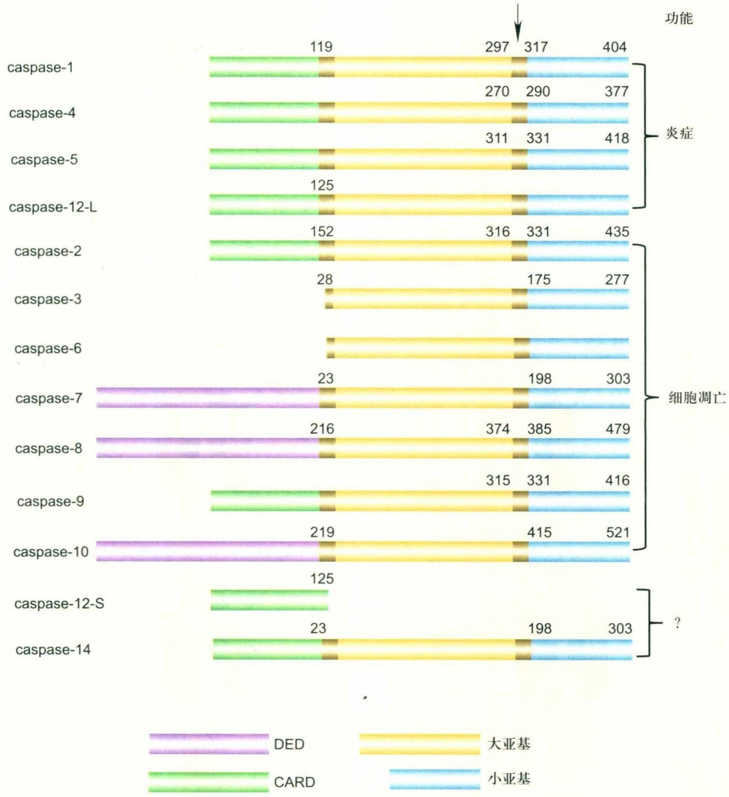

bar_stacked

| Caspase | DED | CARD | DAA | Small ABA |
| :--- | :--- | :--- | :--- | :--- |
| caspase-1 | — | 119 | 297 | 317 |
| caspase-4 | — | 270 | 290 | 377 |
| caspase-5 | — | 311 | 331 | 418 |
| caspase-12-L | — | 125 | — | — |
| caspase-2 | — | 152 | 316 | 331 |
| caspase-3 | — | 28 | 175 | 277 |
| caspase-6 | — | — | — | — |
| caspase-7 | 23 | — | 198 | 303 |
| caspase-8 | 216 | — | 374 | 385 |
| caspase-9 | — | 315 | 331 | 416 |
| caspase-10 | 219 | — | 415 | 521 |
| caspase-12-S | — | 125 | — | — |
| caspase-14 | — | 23 | 198 | 303 |

图 25-1 哺乳动物 caspase 示意图

箭头指在大亚基和小亚基之间的caspase主要激活切割位点。

① 均属于胱天蛋白酶。

② 其蛋白序列中有高度保守的QACXG（X为R、Q或G）五肽序列。

③ 被翻译合成后，绝大多数以无活性的酶原形式存在于细胞质基质中；酶原分子的N端均含有原结构域，它能保持caspase的无活性状态。

④ caspase被激活后可表现出独特的催化活性，可将蛋白底物在天冬氨酸位点切断。例如，活化的caspase-8可将其底物Bid（Bcl-2家族成员）在第59位天冬氨酸上切割形成tBid（truncated Bid）以进一步传递凋亡信号。

同时通过这种切割方式也能自我活化，如caspase-9在凋亡信号刺激下就可被自行剪切成大小为p35的片段。

⑤ 对底物上一些切割序列具有专一的识别作用，因而酶促反应具有高度特异性，此类切割序列被称为识别序列，如caspase-3可特异性识别底物上的DEVD序列，caspase-8可识别IETD，并在天冬氨酸位置切割底物。

⑥ 在细胞中过表达caspase，均可诱导细胞凋亡。caspase按功能可以分为两类:第一类是起始酶(initiator caspase)，主要包括caspase-2、caspase-8、caspase-9和caspase-10；第二类是执行酶(executioner caspase)，主要包括caspase-3、caspase-6和caspase-7。起始酶（位于细胞凋亡途径的上游）可以被自激活(auto-activation)，一般含有一个较长的原结构域。凋亡开始时，起始酶在接收细胞死亡信号（如TNF-α、Fas、TRAIL、RIP等）后能够自激活，而执行酶（位于细胞凋亡途径的下游）一般含有较短的原结构域，它们的激活需要起始酶的加工。例如，procaspase-3或procaspase-7需要被已激活的起始酶caspase-8或caspase-9在其特定的天冬氨酸位点上进行剪切，使其分离成大、小两个亚基，大、小亚基聚集成α2β2异源四聚体，从而形成具有活性的酶，被激

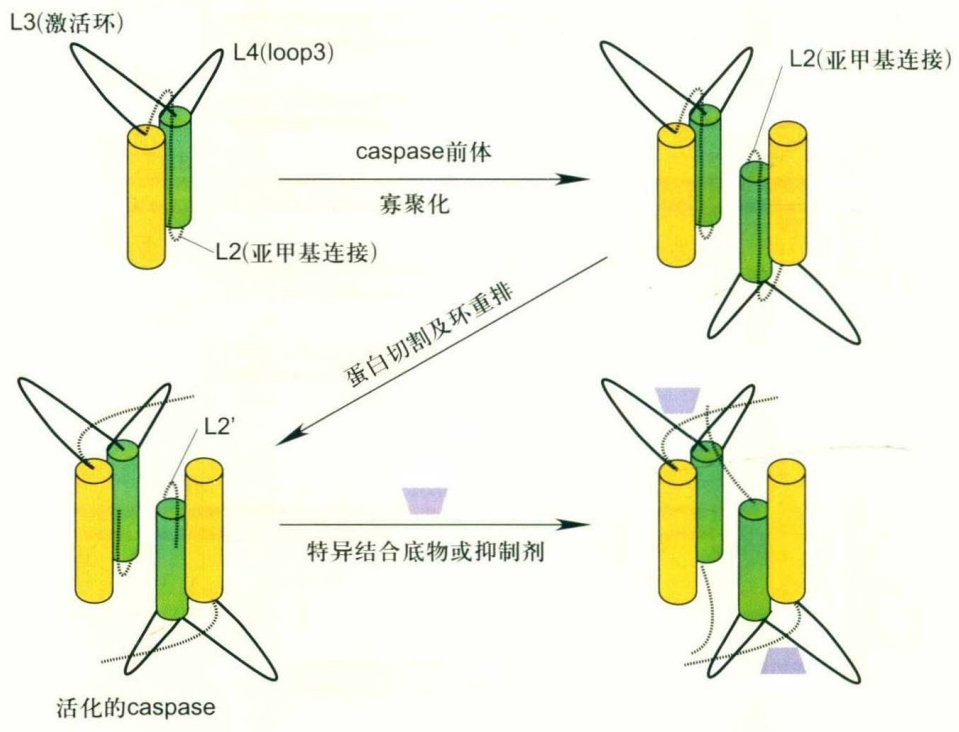

flowchart

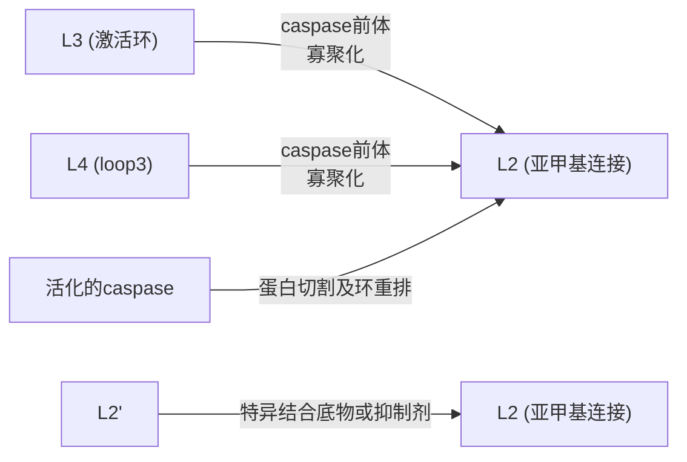

图25-2 caspase-7活化结构示意图

图示 caspase-7 酶原被激活后的构象变化。单体酶原分子聚合形成二聚体，从而发生分子间切割、蛋白构象变化和活性位点的暴露。切割的 caspase 能很好地与其底物或抑制剂结合。

活的执行酶进一步剪切其下游底物，形成级联放大反应(cascade)，最终导致细胞凋亡。

caspase家族以酶原的形式广泛存在于各种类型的细胞中，各成员的分布和表达呈现一定的组织特异性。例如，在子宫和胎盘中，caspase-4有较高水平表达而caspase-1几乎没有表达；而在脑部，除caspase有较高表达和caspase-7有少量表达外，其他caspase成员基本都不表达。此外，caspase家族各成员常共同存在于同一细胞中，如人的Jurkat T细胞中含有该家族所有的已知成员。多数caspase存在于细胞质中，但也有例外，如caspase-12存在于内质网中，而caspase-2主要存在于细胞核中。对caspase诱导凋亡机制的认识很大程度上取决于对其作用底物的研究。根据蛋白酶对其底物切割后产生后果的不同，可将caspase的底物分为4大类:第一类底物是经酶切后被活化，如caspase本身以及PKC-δ和凝脂酶A2等；第二类为酶切后底物失活，如DNA催化亚单位、成视网膜细胞瘤蛋白等；第三类为酶切后底物结构被改变，如细胞核Lamin及Gas2等；第四类为酶切后凋亡作用尚不清楚的底物，如PARP、DNA-PAKs等。

caspase酶活性的抑制物亦可分为3大类，即天然抑制剂、人工合成抑制剂和拮抗caspase作用的抑制剂。天然抑制剂主要见于一些病毒产生的蛋白，如CrmA (cytokine response modifier A)、baculovirusp 35等。人工合成抑制剂主要指与caspase识别区域同源的小肽段，如Ac-DEVD-CHD（caspase-3特异性抑制剂）和ZVAD-fmk（泛caspases抑制剂）等，这些caspase特异性的抑制剂已广泛应用于科研工作中。

通过研究caspase家族被活化的方式以及对下游底物的作用，不仅提供了新的凋亡研究方法和途径，而且也为有目的地调控细胞凋亡，提出新的药物控制环节，从而发现凋亡介导的新的治疗方法提供了理论基础。作为凋亡机制中重要的效应分子，caspase家族成员参与多种凋亡相关的生理和生化过程，如在生长因子撤除、热休克、细胞因子诱导和DNA损伤剂等的刺激下，细胞内众多的凋亡信号转导途径被活化，最终汇聚在caspase家族这一共同的遗传保守机制中。在免疫应答方面，caspase的作用更为突出，不但参与T细胞介导的细胞毒作用和下调免疫反应，而且参与自体免疫性胸腺细胞、T细胞和B细胞的阴性选择，促使其成熟。caspase在神经元细胞凋亡中也起着关键作用，它参与一些神经性疾病的发生。现代医学观点认为，肿瘤的发生、发展不仅是细胞增殖异常的结果，更可能与细胞凋亡异常有关，所以对caspase家族的深入研究将会对阐明某些肿瘤的发病机制以及推测预后效果具有重要意义。

## 25.2.2 Bcl-2蛋白家族

Bcl-2蛋白家族是细胞中一组至关重要的凋亡蛋白。此家族中，首先被发现的是Bcl-2蛋白（B cell lymphoma/Leukemia 2），它是Tsujimoto等在1984年从滤泡性淋巴细胞瘤染色体易位t（14,18）的断裂点处所克隆到的一种原癌基因。Bcl-2是一个分子量为 $2.6\times10^{4}$ 的胞内膜蛋白，主要定位于线粒体膜、光面内质网及核膜上。Bcl-2的C端为疏水性，含有一个由19个氨基酸伸展成的跨膜结构。Bcl-2功能的发挥很大程度上依赖于其在亚细胞膜上的定位，Bcl-2的C端作为信号锚序列插入线粒体外膜，而其N端的大部分暴露于胞内，借此可与胞内各种蛋白或其他邻近的蛋白相互作用。过表达Bcl-2不能促进细胞增殖，主要表现为能够强烈地抑制由γ辐射、热休克和多种化疗药物等诱导的细胞凋亡。基因敲除实验表明，Bcl-2在保持细胞动态平衡中起着至关重要的作用。Bcl-2基因的缺失导致小鼠淋巴细胞大量凋亡，肾细胞死亡以及黑色素细胞缺失。

迄今为止在哺乳类、线虫和病毒中已经发现并确定了近30个Bcl-2蛋白家族成员(图25-3)，按功能可将其划分为两大类。一类是具有抗凋亡(anti-apoptosis)功能，主要成员有Bcl-2、Bcl-xL、Bcl-w、Mcl-1、A1/Bfl-1及Boo等。绝大多数抗凋亡成员含有4个BH结构域(Bcl-2 homology domain, BH1～BH4)。另一类是具有促凋亡(pro-apoptosis)功能，可分成两个亚类:其中类Bax促凋亡成员含3个结构域(除Bcl-XS外)，大都缺乏BH4结构域；Bad、Bid、Bik/Nbk、BNIP3、Hrk/DP95、Puma、Noxa、Bim和Blk等促凋亡成员仅含有一个BH3结构域，故又被称为“BH3-only”成员。BH3-only成员一般都具有促细胞凋亡的功能。

## 25.2.3 IAP蛋白家族

Crook等首先从杆状病毒CpGV(cydia pomonella granulovirus)和OPMNPV(orygia pseudotsugata multicapsid polyhedrosis virus)中发现了凋亡抑制蛋白(inhibitor of apoptosis protein, IAP)。IAP是一类新的独立于Bcl-2的凋亡抑制因子，目前已发现了至少8种人源的IAP，包括cIAP1（HIAP1）、cIAP2（HIAP2）、NIAP、XIAP、ILP2、Survivin、Bruce及新成员Livin（又称ML-IAP和KIAP）。IAP家族蛋白在病毒、果蝇和其他哺乳动物等物种中广泛存在，IAP是细胞内源性凋亡途径（intrinsic pathway）重要的调控因子。IAP家族蛋白是一类既抑制起始caspase（如caspase-9）又抑制执行caspase（如caspase-3）活性的内源性蛋白。而CrmA和p35作为凋亡抑制因子仅能抑制起始 caspase，不能抑制执行 caspase 活性。

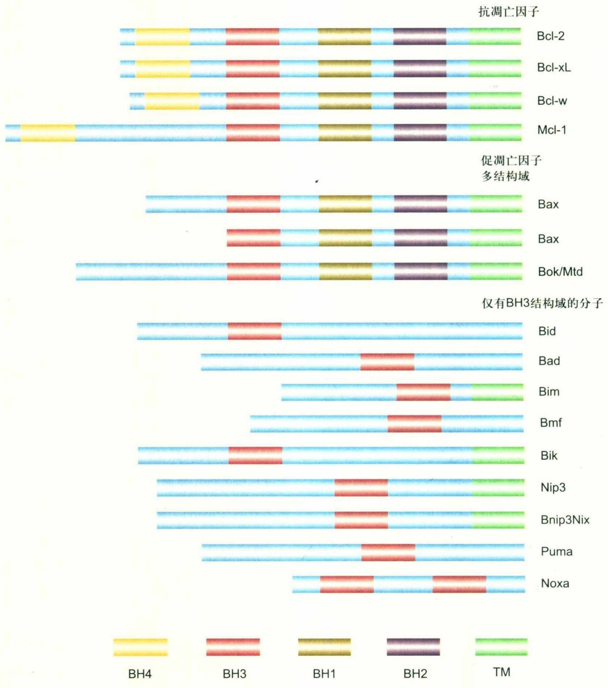

bar_stacked

| Protein | BH4 | BH3 | BH1 | BH2 | TM |
| --- | --- | --- | --- | --- | --- |
| Bcl-2 | Yellow | Red | Gold | Purple | Green |
| Bcl-xL | Yellow | Red | Gold | Purple | Green |
| Bcl-w | Yellow | Red | Gold | Purple | Green |
| Mcl-1 | Yellow | Red | Gold | Purple | Green |
| Bax | Blue | Red | Gold | Purple | Green |
| Bax | Blue | Red | Gold | Purple | Green |
| Bok/Mtd | Blue | Red | Gold | Purple | Green |
| Bid | Blue | Red | — | — | — |
| Bad | Blue | — | — | — | — |
| Bim | Blue | — | — | — | Green |
| Bmf | Blue | — | — | — | — |
| Bik | Blue | Red | — | — | Green |
| Nip3 | Blue | Red | — | — | Green |
| Bnip3Nix | Blue | Red | — | — | Green |
| Puma | Blue | Red | — | — | — |
| Noxa | Blue | Red | — | — | — |

图25-3 Bcl-2家族蛋白成员示意图

TM: C端疏水跨膜片段；BH: Bcl-2同源区域。Bcl-2家族包括抗凋亡因子（Bcl-2、Bcl-xL和Mcl-1等）和促凋亡因子。促凋亡因子包括类Bax分子（如Bax、Bak等）和仅有BH3结构域的分子（如Bid、Bim等）。

IAP家族成员都具有70～80个氨基酸组成的特征性BIR结构域，为杆状病毒IAP重复序列(baculoviral IAP repeat)，它是IAP家族成员共同的分子特征。BIR结构域位于IAP的N端，含有2～3个半胱氨酸/组氨酸(Cys/His)的重复序列，其核心含有大量疏水结构，具有高度保守性，序列一般为C(X)2C(X)6W(X)3D(X)5H(X)6C，其中X为任意氨基酸。大量研究证实，IAP蛋白BIR结构域的功能主要是参与同其他蛋白的结合。例如，XIAP的BIR2结构域可与caspase-3直接相互作用；cIAP1和cIAP2与TRAFs（TNF受体相关因子）之间的结合，以及XIAP与TAB1蛋白的直接结合，都是通过IAP的BIR结构域来完成。一般而言，含有3个BIR结构域的IAP蛋白，第三个BIR结构域抑制caspase-9活性，而第二个BIR结构域抑制caspase-3和caspase-7的功能；对于只含单个BIR结构域的IAP，情况较为复杂，Ts-IAP（ILP-2）的BIR结构域只抑制caspase-9活性，而Livin却可以抑制caspase-3、caspase-7和caspase-9的活性，Survivin可以抑制caspase-3和caspase-7的活性。实验表明，Survivin的抗凋亡功能可能是通过直接结合促凋亡分子Smac/DIABLO而间接完成的。虽然有的BIR结构域是与caspase的结合区域，而且是IAP抑制凋亡所必需的，但不同BIR结构域作用不同，XIAP的BIR2区域在抑制caspase-3和caspase-7中发挥重要作用，BIR2区域缺失导致XIAP丧失抑制凋亡的作用，而单一的BIR1、BIR3以及它们的任意组合（BIR1-BIR3或BIR3-BIR1）均不具有抗凋亡作用。表25-2详细地列出了不同IAPs所含有的BIR结构域数量及其caspase特异性。另外，有最新报道指出，XIAP蛋白中BIR2和BIR3之间的连接区域(linker region）在体外可直接抑制caspase-3和caspase-7的活性，因此，关于IAP蛋白BIR结构域抑制caspase活性的机制还有待更深入的研究。BIR结构域的另一个重要作用是与细胞内一些内源性促凋亡分子如Smac/DIABLO、Omi/HtrA2、ARTS、XAF1等相互结合，间接调控细胞凋亡的进程。

近年来，在一些哺乳动物、果蝇和病毒的IAPs中发现了一个位于IAPC端的环状锌指样结构区域（ring zinc finger domain），一般认为RING结构与IAP分子抑制凋亡功能的调控相关。RING是由7个Cys和1个His结合2个 $Zn^{2+}$ 所形成的特定结构。含RING结构的蛋白通常可以作为E3泛素连接酶。E3泛素连接酶通过调控调节蛋白质的泛素化过程参与细胞内的多种生理活动。蛋白质的泛素化修饰涉及E1泛素活化酶、E2泛素结合酶和E3泛素连接酶的一系列生化反应。所有的E3都具有连接靶蛋白和特定E2的能力，进而可以与26S蛋白酶体和泛素等蛋白结合从而介导靶蛋白降解。靶蛋白的多聚泛素化修饰可以被26S蛋白酶体识别而降解，因此此途径被称为泛素蛋白酶体途径，简称泛素化途径。

IAP蛋白如XIAP和cIAP的RING结构在细胞受到凋亡诱导刺激（如TRAIL、紫杉醇等）时，表现出泛素降解功能。已知XIAP、cIAP1和cIAP2可降解其蛋白本身，同时也可特异性降解一些胱天蛋白酶，如caspase-3和caspase-7。另外，最近研究发现这些含RING结构的IAPs还可导致一些促细胞凋亡因子如Smac/DIABLO和ARTS等的泛素化，并将其降解。Livin也含有一个RING结构，但关于它的E3泛素连接酶活性至今尚未见有报道。

表 25-2 哺乳动物IAP家族成员及其特征

<table><tr><td>凋亡抑制蛋白</td><td>别名</td><td>结构域</td><td>caspase特异性</td><td>已知的结合蛋白</td></tr><tr><td>NAIP</td><td>BIRC1</td><td>BIR(3)NODLRR</td><td>caspase-3caspase-7</td><td>Hippocalcin</td></tr><tr><td rowspan="4">XIAP</td><td>BIRC4</td><td></td><td></td><td></td></tr><tr><td>API3</td><td>BIR(3)</td><td>caspase-3</td><td>Smac/DIABLO</td></tr><tr><td>MIHA</td><td>RING</td><td>caspase-7</td><td>Omi/HtrA2XAF1</td></tr><tr><td>ICP-1</td><td></td><td>caspase-9</td><td>TAB1NRAGE</td></tr><tr><td rowspan="4">c-IAP1</td><td>BIRC2</td><td></td><td></td><td></td></tr><tr><td>API1</td><td>BIR(3)</td><td>caspase-3</td><td>Smac/DIABLO</td></tr><tr><td>MIHB</td><td>CARD</td><td>caspase-7</td><td>Omi/HtrA2TRAF1TRAF2</td></tr><tr><td>HIAP2</td><td>RING</td><td>caspase-9</td><td></td></tr><tr><td rowspan="4">c-IAP2</td><td>BIRC3</td><td></td><td></td><td></td></tr><tr><td>API2</td><td>BIR(3)</td><td>caspase-3</td><td>Smac/DIABLO</td></tr><tr><td>MIHC</td><td>CARD</td><td>caspase-7</td><td>Omi/HtrA2TRAF1TRAF2</td></tr><tr><td>HIAP2</td><td>RING</td><td>caspase-9</td><td>Bcl 10</td></tr><tr><td rowspan="3">Survivin</td><td>BIRC5</td><td></td><td></td><td></td></tr><tr><td>API4</td><td>BIR</td><td>caspase-3</td><td>β-微管蛋白</td></tr><tr><td>TIAP (鼠源)</td><td>coiled-coil</td><td>caspase-7</td><td>Smac</td></tr><tr><td rowspan="4">Livin</td><td>BIRC7</td><td></td><td></td><td></td></tr><tr><td>KIAP</td><td>BIR</td><td>caspase-3</td><td></td></tr><tr><td>ML-IAP</td><td>RING</td><td>caspase-7</td><td>Smac</td></tr><tr><td></td><td></td><td>caspase-9</td><td></td></tr><tr><td rowspan="2">Ts-IAP</td><td>BIRC8</td><td></td><td></td><td></td></tr><tr><td>ILP-2</td><td>BIR</td><td>caspase-9</td><td></td></tr></table>

另外发现，有一些IAP家族蛋白结构中还存在CARD结构域（caspase recruitment domain），它是位于IAP分子BIR结构域与锌指（RING）结构域间的一段序列，由6个α螺旋构成，由于仅有少数物种的IAP包含CARD结构，如人源的c-AP1、c-IAP2，因此CARD结构是否普遍地具有抑制凋亡功能还没有得到完全证实。Roy等的研究认为，删除CARD结构并不影响cIAP1、cIAP2抑制凋亡的功能。此外，IAP还存在NOD结构域（nucleotide binding oligomerization domain），但关于此结构域在IAP中的具体作用目前尚不清楚。最近研究表明IAP不仅可以通过泛素化降解来调节其自身的水平，也可以通过降解其他底物（如caspase）来抑制细胞凋亡。体外的泛素化实验表明，cIAP2可作为E3泛素连接酶参与对caspase-3和caspase-7的泛素化降解。另外，XIAP也是caspase-3的泛素连接酶，并促进caspase-3的泛素化降解，其中XIAP的RING结构域及XIAP与caspase-3的结合域均是泛素化降解caspase所必需的。最新的实验指出，XIAP充当E3泛素连接酶泛素化降解caspase-3，进而抑制由Fas/CD95诱导或由过表达活性caspase所诱导的细胞凋亡。同样，最新的报道也证明了Apollon（Bruce或Bruce6）可以泛素化降解Smac/DIABLO和caspase-9，从而起到保护细胞的作用。

## 25.3 细胞凋亡的信号调控

细胞凋亡的信号转导途径主要包括受体介导的细胞凋亡途径（外源途径）和非受体（主要由线粒体）介导的细胞凋亡途径（内源途径）（图25-4），受体介导的细胞凋亡途径还依赖线粒体途径完成细胞不可逆死亡。

## 25.3.1 受体介导的细胞凋亡

细胞通过细胞膜表面的受体接收周围环境传递的生长信号维持正常的生长和分裂，一旦细胞失去来自环境的支持生长的信号，将自发启动细胞内的凋亡程序，使细胞进入凋亡过程。哺乳动物细胞发展了更为直接的凋亡启动途径，即死亡受体介导的细胞凋亡（图25-5）。死亡受体（death receptor，DR）属TNF受体超家族成员，包括TNF、Fas和TRAIL（TNF related apoptosis inducing ligand）受体，它们都含有与TNF受体同源的富含半胱氨酸的胞外区，其胞质部分还含有一个与细胞凋亡直接相关的结构域，称为死亡结构域（death domain，DD）。TNF、FasL/TRAIL等配体与在细胞质膜表面的死亡受体结合后，促使受体聚集而形成三聚体。

Fas配体等与其受体结合后能直接激活细胞内caspase-8，直接激活凋亡信号通路；也能通过切割包括Bid在内的分子，激活线粒体凋亡信号通路。非受体介导的凋亡信号通路主要通过激活Bcl-2家族促凋亡因子转移至线粒体，诱导细胞色素c释放。从线粒体释放的细胞色素c能与细胞质基质中的Apaf1和caspase-9结合，促使其形成凋亡小体（apoptotic body），caspase-9在凋亡小体中被富聚并被激活，从而激活细胞凋亡通路。多种抑制凋亡因子能抑制凋亡信号通路，从而抑制细胞凋亡（图25-4）。

受体聚合后通过C端的死亡结构域募集连接蛋白FADD，随后通过FADD的死亡效应功能域（death effective domain，DED）富集procaspase-8或procaspase-10，在细胞质膜内侧形成受体/凋亡调节分子复合体，从而引起procaspase-8的活化，活化的caspase-8又引发下游分子caspase-3或caspase-7的切割及活化。在某些情况下，死亡受体也能募集TRADD（TNF associated death domain），参与DISC复合物的形成。如果细胞内有足够的caspase-8被激活，将直接导致细胞凋亡的快速发生。在多数情况下，死亡受体介导的caspase-8活化需借助线粒体凋亡通路来放大。死亡受体激活的caspase-8能切割细胞质中的Bid（BH3 interacting domain death agonist），切割的Bid（tBid，truncated Bid）向线粒体转移，从而诱导细胞色素c释放和细胞凋亡。tBid转移至线粒体，能与抑制凋亡的Bcl-2家族蛋白如Bcl-xL、Mcl-1等相互作用，释放出与抑凋亡分子相互作用的分子如Bak等，从而促进细胞色素c释放和细胞凋亡。

值得注意的是，死亡配体与其受体在细胞质膜上的结合，不仅能直接激活caspase-8，同时也能引起NF-κB和c-Jun氨基末端激酶（JNK）的活化。这些信号分子很可能是凋亡抑制信号。也就是说，凋亡因子同时激活与细胞凋亡和细胞生存相关的信号，这两种信号的平衡决定了细胞的命运。

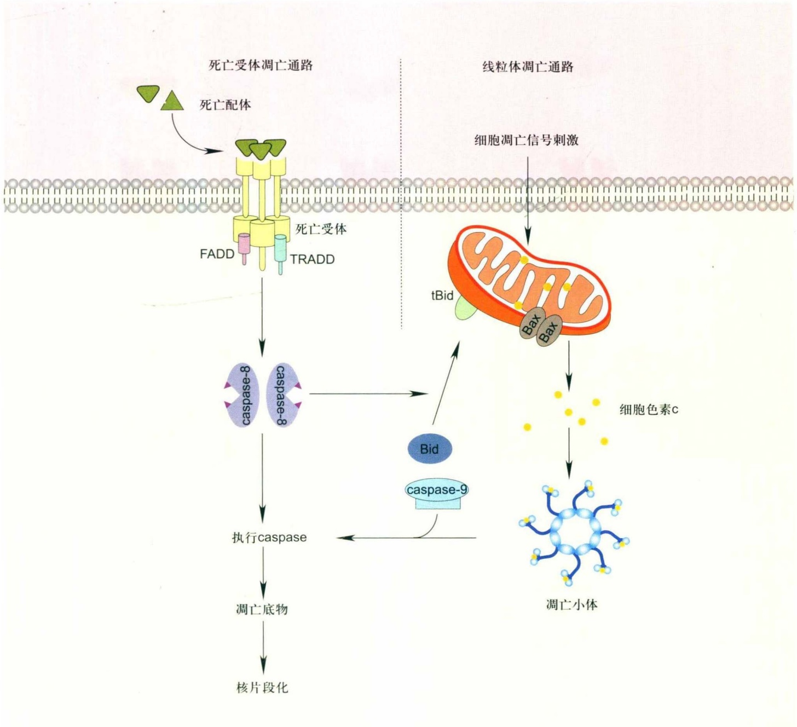

flowchart

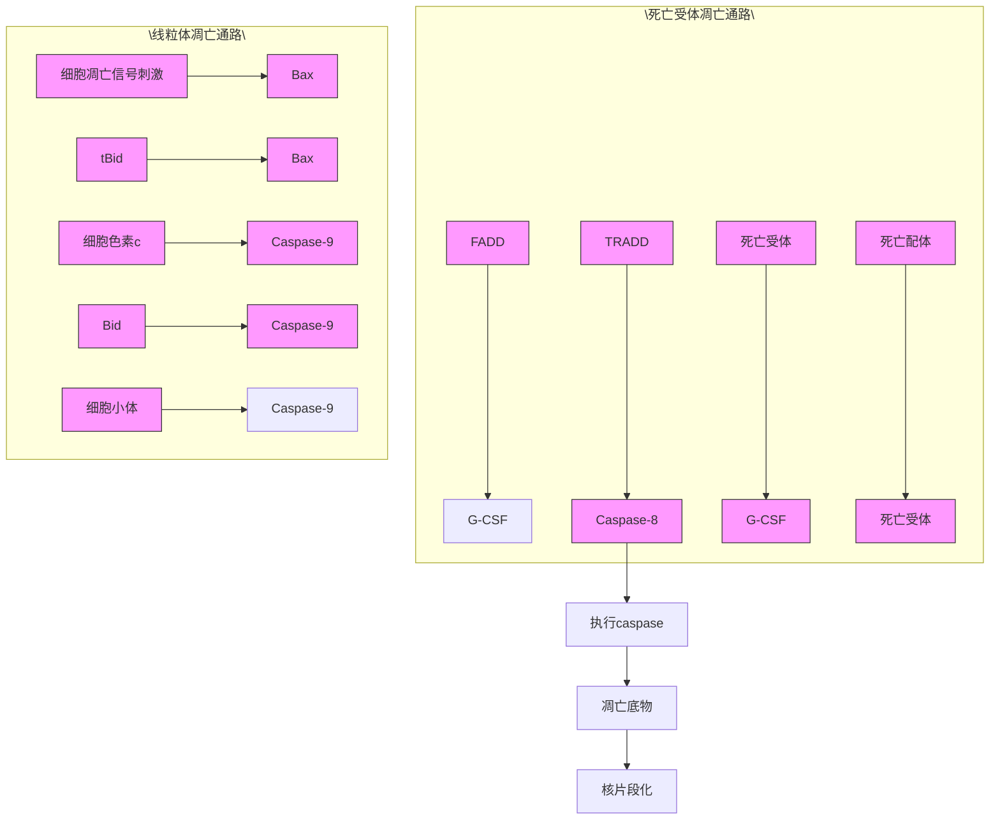

图 25-4 细胞凋亡的受体信号和非受体信号调控

## 25.3.2 非受体介导的细胞凋亡

细胞凋亡近期研究的主要进展之一是确定了线粒体在细胞凋亡中的中心地位。线粒体通常通过释放其内膜的一些促凋亡因子如cytochrome c、Smac/DIABLO和Omi/Htra2来调控细胞凋亡，这些因子释放后可诱导或增强caspase的活性；而另外一些被释放的蛋白，如AIF和内切核酸酶 G，则可诱导 caspase 非依赖的细胞凋亡。

线粒体可被形象地比喻为细胞凋亡信号的“中继站”(图25-6)。在细胞受到凋亡刺激后，线粒体接收到凋亡信号，并加以整合，凋亡信号被激活后作用于线粒体，诱发线粒体释放细胞凋亡因子如细胞色素c、Smac、AIF等，这些分子可激活caspase依赖或caspase非依赖的细胞凋亡机制，引起细胞凋亡。线粒体本身不仅能整合凋亡信号，还可作为细胞凋亡信号的放大器，在凋亡过程中释放大量自由基、核酸酶（内切核酸酶G等）和蛋白酶（丝氨酸蛋白酶），由此作为细胞凋亡的直接执行者。很显然，细胞凋亡信号的整合和放大必须受到严密调控。正常细胞存在所有的凋亡信号分子和相关信号通路，但处于一种未被激活状态，如caspase处于非活化的酶原状态，凋亡小体的不同元件则处于细胞内不同部分，所以细胞不能启动凋亡程序。以正常细胞为例，细胞色素c位于线粒体中，Apaf1则位于细胞质中，因而不能活化下游的caspase，而Bcl-2家族蛋白的重要功能之一是保证不同凋亡分子在正常情况下不发生相互作用，细胞凋亡事件不被启动。即使在有些情况下，正常细胞有少量不正常caspase被激活，胞质中还存在特异的caspase抑制剂如XIAP等能直接抑制其活性，以保证细胞在非必要时不发生凋亡。细胞在长期的进化过程中发展出了一套较为完善的被称为“双保险”的机制来保证细胞的安全，因此线粒体细胞色素c的释放也受到严密的调控。

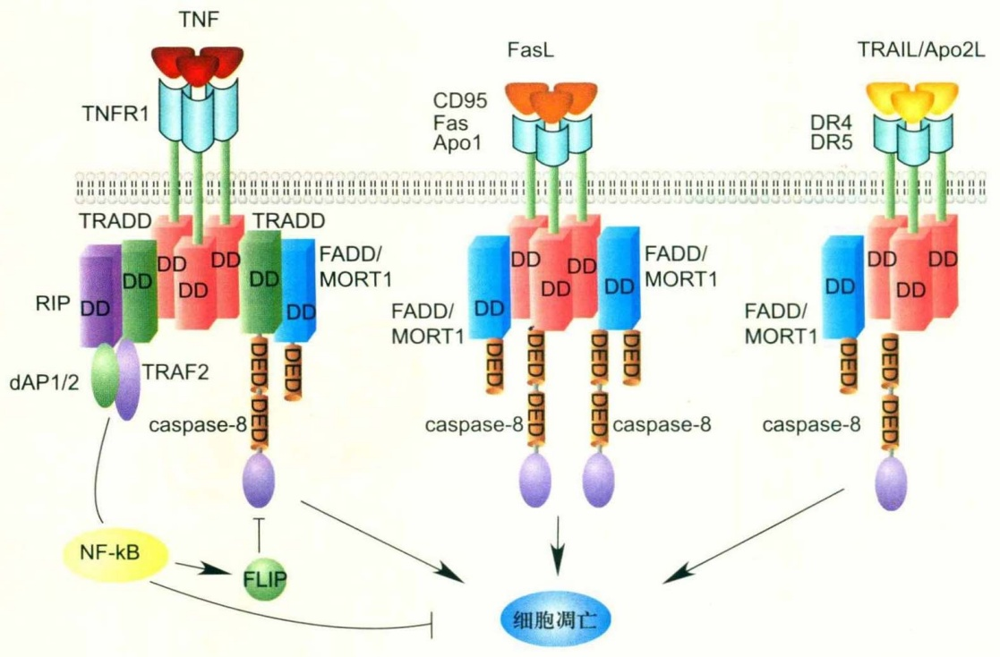

flowchart

This diagram illustrates the molecular mechanism of NF-kB signaling in T cells, showing interactions between TNF, FasL, and TRAIL/Apo2L receptors with associated proteins like RIP, TRADD, FADD/MORT1, and caspase-8.

图25-5 死亡受体介导的细胞凋亡

## 25.3.3 Bcl-2家族蛋白与细胞色素c释放的调控

线粒体是一个非常特殊的细胞器，有外膜、内膜、膜间隙和基质4个功能区隔。线粒体呼吸链的所有组分都位于线粒体内膜，线粒体内膜一般形成嵴以增加了电子传递链的表面积。在细胞凋亡过程中，线粒体膜电位降低，外膜的完整性受到破坏，释放凋亡因子如细胞色素c、AIF、Smac/DIABLO和caspase-2、caspase-3、caspase-8和caspase-9的前体等至细胞质基质，最终引起凋亡。

Bcl-2家族蛋白能调控线粒体膜通透性改变，从而调控细胞凋亡蛋白的释放，其分子机制有待深入研究。在凋亡过程中，含BH3的促凋亡因子被激活，进一步与Bcl-2家族的其他分子相互作用，进而通过调节线粒体外膜的通透性来介导细胞色素c释放和细胞凋亡过程。BH3-only的促凋亡因子在感知凋亡信号中起非常重要的作用，可以通过以下方式被激活。各个分子的特异性调控方式和分子间的协同性构成了细胞凋亡调控的复杂性与精确性。

## (1) 转录水平的调节

在转录水平上调控Bcl-2家族蛋白的表达是细胞凋亡的重要调控方式。在细胞死亡的过程中，p53能转录上调Bax、Noxa、Puma等，也能转录下调Bcl-2的表达，两者均促进细胞凋亡。Bcl-2蛋白在大多数癌症细胞中有较高表达，而在炎症反应条件下其表达水平降低。Bcl-2表达水平的降低可能是由于转录水平抑制所导致的。Bim转录水平的调控主要有Foxo3A、JNK和CHOP等转录因子的参与。早在2000年，Paul J. Coffer等就发现Foxo3可以作为Bim的转录因子调控细胞因子白介素-3（IL-3）缺乏引起的细胞凋亡。在Bim的启动子上，含有一个Fork head box区域TAAACAC，能与活化的Foxo3结合而被转录调控。在神经细胞中，神经生长因子的缺失使得c-Jun蛋白表达量升高且其N端磷酸化增加，c-Jun因此被激活，导致其靶基因Bim表达量升高。

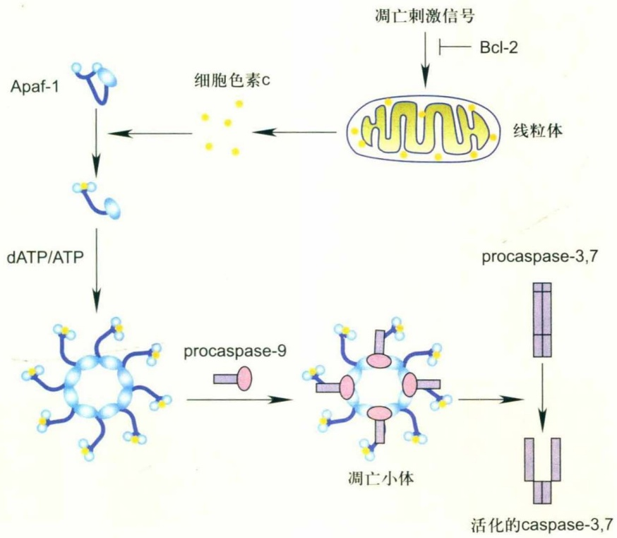

flowchart

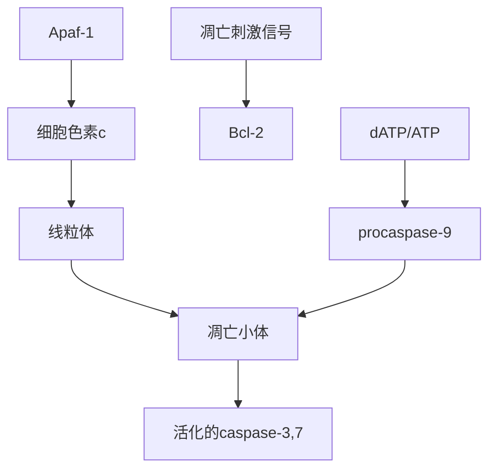

图25-6 细胞凋亡内源途径的生化过程

线粒体通过Bcl-2分子感受到凋亡信号，从而释放出细胞色素c等凋亡因子。释放的细胞色素c能与细胞质基质中的受体Apaf-1结合，形成多分子的蛋白复合体凋亡小体。caspase-9能被吸附到凋亡小体上，并被自身激活。

## (2) 磷酸化的调节

Bad通过其自身快速的磷酸化来调节蛋白相互作用和定位。正常情况下，Bad有2个位点发生磷酸化(Ser112和Ser136)，磷酸化的Bad存在于细胞质基质中，不行使其促凋亡功能；而当细胞受到死亡信号刺激后，Bad发生去磷酸化并转移到线粒体外膜与Bcl-xL发生相互作用。Bad只有去磷酸化后才能将其BH3区域暴露并与Bcl-xL发生相互作用。Bcl-2也存在磷酸化和去磷酸化两种形式，这种磷酸化的改变可能诱导其构象的变化。例如，有人发现，在人脐带小静脉内皮细胞中TNF-$\alpha$ 诱导Bcl-2的去磷酸化和泛素化降解Bcl-2，由此引起细胞凋亡。Bcl-2蛋白含有数个蛋白激酶结合位点，正常情况下Bcl-2处于磷酸化的状态，比较稳定，在受到特殊的刺激后，MAP激酶的结合位点(Ser87)发生去磷酸化，为Bcl-2的泛素化提供了信号，这表明在内皮细胞和其他细胞中Bcl-2是细胞受到凋亡刺激后发生翻译后修饰。

## (3) 蛋白切割的调节

Bid是Bcl-2家族中仅含有BH3区域的一个蛋白，正常情况下存在于细胞质基质中。当细胞受到死亡信号刺激，启动受体介导的信号通路后，caspase-8激活并切割Bid。在细胞内源性死亡途径中，Bid蛋白也能被caspase-3切割或被颗粒酶切割，切割发生在N端，产生分子量为$1.5\times 10^{4}$ 的切割片段，切割片段转位于线粒体，进而诱导细胞凋亡。即使在抗凋亡蛋白Bcl-2和Bcl-xL存在的条件下，Bid也可以被切割并转移到线粒体，在此条件下可能检测不到细胞色素c的释放，但细胞死亡依然进行，说明细胞色素c的释放并不是细胞凋亡的必要条件，细胞凋亡也可以由别的事件通过诱导线粒体功能的失衡所导致。另外，Bid的BH3区域也可以与Bax结合，引起后者发生构象变化并定位于线粒体，从而导致细胞凋亡。除Bid以外，Bcl-xL和Bcl-2的N端也可以被切割并暴露其BH3区域，导致其功能从抗凋亡活性到促凋亡活性的转变。

## (4) 细胞内的转移定位、构象变化和寡聚化的调节

促凋亡蛋白Bax被活化后，转移到线粒体形成寡聚体。在正常细胞内，Bax以单体的形式存在于细胞质中，而当细胞受到凋亡刺激后，Bax发生构象变化并通过寡聚化在线粒体外膜发挥功能。最近研究发现Bcl-2蛋白也可以通过构质变化来调节其功能。

研究表明，Bcl-xL的BH1、BH2和BH3区域可形成一个疏水间隙，细胞受到凋亡刺激后，Bak等促凋亡蛋白发生构象变化暴露BH3区域，并与Bcl-xL的疏水间隙结合从而抑制其功能。Bcl-2家族的另外一个成员Bim也可以在细胞受到死亡刺激后从细胞质基质转移到线粒体，正常细胞内Bim通过与LC8动力蛋白轻链结合而存在于微管相关的动力蛋白复合物中，Bim的促凋亡作用被抑制。细胞接收死亡信号后，LC8和Bim从动力蛋白复合物分离，后者转移到线粒体与Bcl-2发生相互作用，从而拮抗其抗凋亡功能。

## (5) Bcl-2 家族蛋白分子的泛素化降解

最近的研究表明，泛素介导的蛋白酶体系直接参与对Bcl-2家族蛋白的降解，从而调控细胞内促凋亡和抑凋亡蛋白水平的平衡。在TNF- $\alpha$ 诱导的凋亡过程中，抗凋亡因子Bcl-2的降解是关键。实验已证明，若过量表达不能被降解的Bcl-2突变体，则TNF- $\alpha$ 无法诱导细胞凋亡。同样，如果增加促凋亡因子的泛素化降解，则会使细胞免于死亡。据报道，Bak、Bax可通过泛素化被降解，在Bcl-2高表达的细胞中，Bax的泛素化程度增加；在前列腺癌细胞中，Bax泛素化降解大量增加，并且增加程度与肿瘤恶变程度呈正相关。

蛋白酶体也可以通过影响Bid和Bik的降解来调控凋亡。在白血病细胞中，Bik过表达可以诱发细胞凋亡。同样，tBid的降解在Bid介导的凋亡通路中起着非常重要的作用，通过抑制蛋白酶体的活性或将tBid中用于连接泛素的赖氨酸残基进行突变，都可以稳定tBid，从而增强细胞色素c的释放及诱导HeLa细胞凋亡。另外，Bax和Bak也受蛋白酶体调控。虽然角蛋白上皮细胞中高表达Bak，但HPVE6还是能抑制这类细胞的凋亡，原因是E6-AP（E6 associated protein）具有E3泛素连接酶活性，它能与Bak结合，使Bak在体内被降解。

此外，很多参与凋亡调控的转录因子（如p53）在细胞中的数量被泛素化降解所调控。Mdm2作为E3泛素连接酶对p53进行泛素化降解，但当Mdm2与p19ARF结合后，Mdm2对p53的降解减少，p53在细胞中的数量增高。

总之，在细胞受到死亡刺激前后，Bcl-2家族蛋白尤其是促凋亡蛋白在细胞内的定位改变，也可以进行翻译前后的修饰。这些变化是调节细胞凋亡的重要方式。

(6) Bax 或 Bak 寡聚化形成的通道能引起细胞色素 c 释放

有关Bcl-2家族分子如何相互作用来介导细胞色素c的释放还有很多争论，目前主要有2种模型，即直接作用模型和替换模型相应的途径分别为直接途径和间接途径(图25-7)。在直接作用模型(direct binding model)中，BH3-only亚家族蛋白（如Bad）替换出与Bcl-2结合的Bim，后者直接结合Bax/Bak，使其寡聚化进而促成Bax/Bak的活化。在替换模型中，Bcl-2等抑凋亡分子与Bax和Bak等相互作用，使细胞在未受到凋亡刺激时，不发挥促凋亡作用。当细胞受到凋亡刺激，Bim和tBid与Bcl-2结合，Bax/Bak被Bim替换并释放出来，执行促凋亡的功能。有证据表明，tBid不仅能诱导Bax和Bak发生构象变化，还能直接诱导Bcl-2分子产生构象变化。构象变化的Bcl-2能在线粒体外形成直径很小的膜孔，但不足以介导细胞色素c的释放。陈佺课题组最新用化学生物学的分析研究表明，Bcl-2与BimS直接相互作用后会发生构象变化，这种构象变化的Bcl-2与Bax一样，能形成多聚体和直径较大的膜孔，并介导细胞色素c的释放。

细胞受到凋亡刺激后，Bcl-2家族蛋白的促凋亡蛋白可以发生构象变化，转移到线粒体并与VDAC结合形成大通道，导致线粒体膜通透性改变并引起细胞色素c的释放，该结果是由Shimizu等提出的，他们应用电生理的方法检测到了这样一个大通道的存在。另外，Bax等蛋白也可以与脂类物质作用使得细胞色素c释放。

另外，Bcl-2家族蛋白能够影响内质网 $Ca^{2+}$ 释放水平，改变线粒体外膜的渗透压，最终诱导细胞凋亡。因此，Bcl-2蛋白质家族是在线粒体水平上控制凋亡因子释放的最主要的调节因子。

## (7) 线粒体 PTP 开放诱导的细胞色素 c 释放

PTP（permeability transition pore）是一个由多个蛋白质构成的复合体，位于线粒体内外膜之间的接触点上，这是一个介于线粒体基质、线粒体膜间隙和细胞质之间的位置。与这样的一个重要位置相适应，PTP应该被认为是一个重要的细胞凋亡调节通路，它能敏感地接收各种凋亡信号，并决定细胞是否凋亡。虽然到目前为止PTP复合体的确切组分仍不十分清楚，但已有的证据表明此复合体横跨线粒体内外膜，包括线粒体外膜蛋白VDAC、内膜蛋白ANT、己糖激酶HK和cyclophilin D等。

PTP调控凋亡的一个重要现象是PTP的开放会引发线粒体释放膜间隙的促凋亡物质，如细胞色素c、AIF、Smac/DIABLO和procaspase等。那么PTP开放的分子机制是什么呢？目前，有2个模型对这个问题进行了解释（图25-8）。一是外膜破裂模型，该模型认为，凋亡信号会使线粒体的膜间隙与线粒体基质中的离子重新分配，使跨内膜的 $H^{+}$ 浓度消失，并导致线粒体内膜呼吸链解偶联。由于线粒体基质是高渗的，PTP的开放使线粒体肿胀。由于线粒体内膜折叠形成许多嵴，因此与外膜相比，内膜具有更大的表面积，所以，随着基质容积的逐渐增大，最终导致外膜破裂，使内、外膜间的促凋亡蛋白质由破裂的外膜释放到细胞质中并激活下游的凋亡反应。二是外膜通道模型，该模型认为，PTP在线粒体外膜可以形成足够大的通道，使细胞色素c等促凋亡物质通过此大通道从外膜释放。这些物质再激活下游的caspase和内切核酸酶，水解细胞中有重要功能的蛋白质，引发典型的细胞凋亡。由于细胞凋亡是细胞程序性死亡，是一个主动的需能过程，需要有ATP的供应，因此保持线粒体膜相对完整的孔道模型更为合理，且与线粒体在细胞凋亡前期是保持相对完整的这一事实更相吻合。

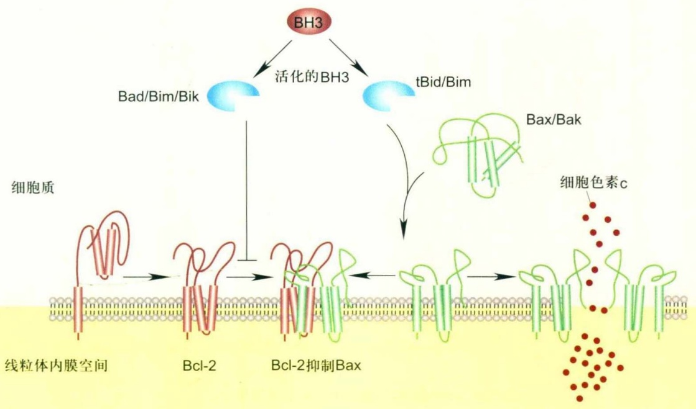

flowchart

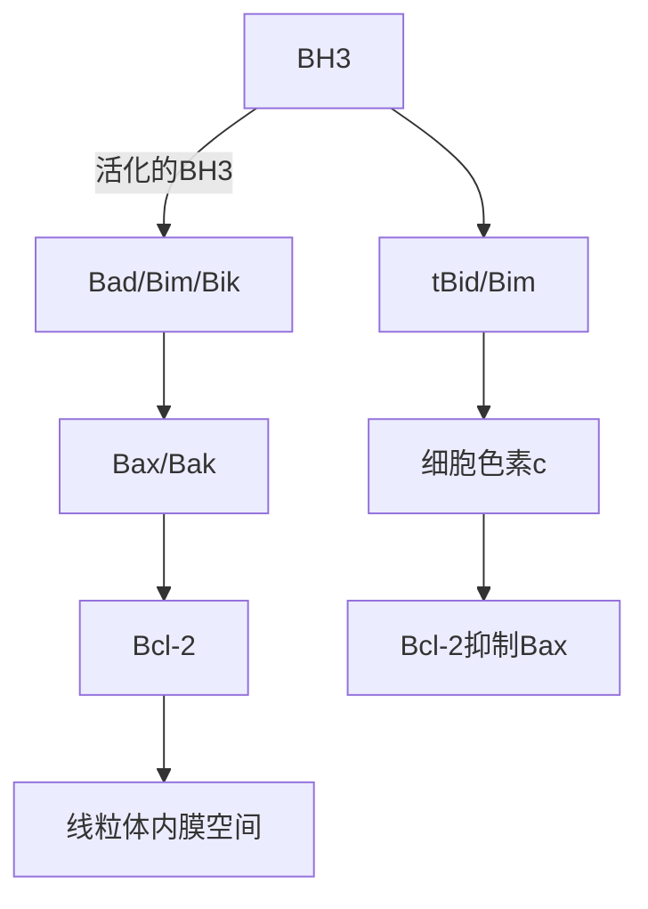

图25-7 促凋亡因子 Bax/Bak 被激活的可能途径

间接途径:BH3 only 分子如 Bim 可能通过与 Bcl-2 分子相互作用，解除 Bcl-2 对 Bax 分子的抑制作用，从而激活 Bax 分子；直接途径:Bim 可能直接与 Bax 分子相互作用从而促使 Bax 分子激活。

## 25.3.4 p53直接参与线粒体介导的细胞凋亡

p53是细胞中最为著名的肿瘤抑制因子，它的缺失或突变可以解释人类近 $60\%$ 的肿瘤发生。p53作为重要的转录因子，它的主要功能是参与细胞周期调控、DNA修复及细胞凋亡。近年来，它与细胞代谢的关系也在被逐渐认识。前面已经讲到，Bcl-2家族中的抗凋亡蛋白（如Bcl-2、Bcl-xL和Mcl-1）可以拮抗同一个家族中的促凋亡蛋白（如Bax和Bak）的寡聚化，从而抑制线粒体外膜通透性（mitochondrial outer membrane permeabilization，MOMP）的改变。在细胞不受刺激的情况下，大部分p53存在于细胞核中；在凋亡信号刺激下，部分p53能够迅速从核内转移到线粒体。最新的研究表明，p53通过与Bcl-2家族蛋白相互作用触发MOMP，诱导凋亡(图25-9)。由于p53与Bcl-xL的结合力是Bcl-xL与Bax结合力的50倍，所以p53能够从Bcl-xL/Bax复合物中置换出Bax，从而引起MOMP。另外，细胞核中的p53在凋亡信号刺激下，转录上调促凋亡因子Puma，后者与Bcl-xL有极强的亲和力，能从Bcl-xL/p53及Bcl-xL/Bax复合物中置换出p53或Bax，被置换出的p53和Bax能进一步促进MOMP诱导释放促凋亡因子（如Smac、Omi及Cytc等），导致细胞凋亡。

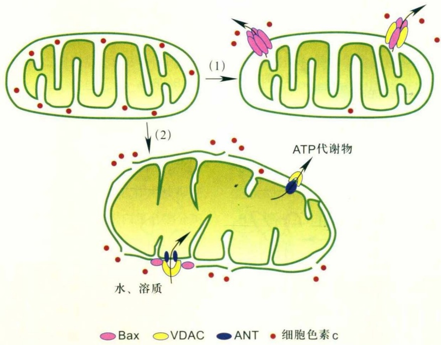

flowchart

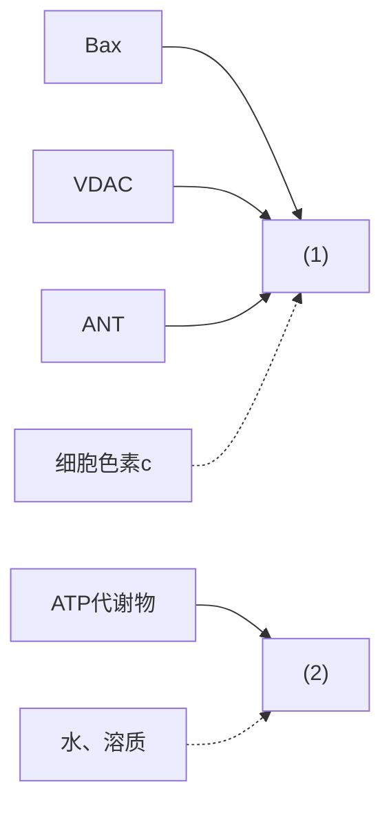

图 25-8 细胞色素 c 释放的不同模型

(1) 线粒体通道介导细胞色素c释放；Bax等促凋亡蛋白可自身形成多聚体或与VDAC等分子相互作用形成大的通道来介导细胞色素c释放，此时线粒体并不发生肿胀；(2) 线粒体PTP孔介导的线粒体细胞色素c释放。

## 25.3.5 其他细胞器在细胞死亡调控中的作用

内质网在细胞凋亡信号的接收和放大中有重要作用。内质网参与细胞凋亡的途径主要包括:① 内质网蛋白质成熟和折叠的异常会引起所谓UPR (unfolded protein response)，从而导致内质网损伤，引发细胞凋亡；② 内质网凋亡蛋白酶caspase-12的激活；③ 内质网 $\mathrm{Ca}^{2+}$ 信号的异常。此外，内质网膜上也存在Bak等凋亡蛋白，在凋亡因子的刺激下，Bax在内质网上富聚，Bax和Bak发生多聚化及caspase-12的激活。内质网是细胞内蛋白质合成和成熟的主要场所，若用Tunicamycin抑制蛋白质糖基化或改变内质网内氧化还原状态，会直接影响蛋白质糖基化和蛋白质二硫键的正常形成，使得未折叠好或错误折叠的蛋白在内质网内积累。未折叠的蛋白质与内质网内伴侣蛋白BiP/Grp78结合，干扰了BiP/Grp78与Ire1-α的结合，从而导致Ire1-α与TRAF-2的结合。TRAF-2能吸附并激活内质网特异的蛋白酶caspase-12，从而激活细胞凋亡过程。caspase-12也能被细胞内 $\mathrm{Ca}^{2+}$ 激活的m-calpain所切割并激活，然后直接激活caspase-9，从而诱发不依赖于线粒体的细胞凋亡过程。caspase-12基因缺失的小鼠神经细胞和多种细胞对内质网损伤诱导的凋亡变得不敏感，这进一步说明内质网损伤能直接导致细胞内 caspase 激活。

内质网是细胞内钙库， $Ca^{2+}$  在内质网内可以游离状态存在，也可同内质网内部的Calreticulin和Calnexin等蛋白结合。内质网 $Ca^{2+}$  的吸收主要依赖于内质网的 $Ca^{2+}$ -ATP酶，其 $Ca^{2+}$  释放主要依赖于InsP3受体或Ryanodine受体。抑制 $Ca^{2+}$  吸收或释放可直接导致细胞凋亡。Thapsigargin抑制内质网的 $Ca^{2+}$ -ATP酶，是常用的凋亡诱导剂。InsP3受体或Ryanodine受体表达水平的降低使细胞对凋亡变得不敏感。Calreticulin能调节钙库吸收和释放的平衡，其表达异常也影响细胞对凋亡诱导剂的敏感性。

内质网应激一方面通过直接激活caspase 12来参与细胞凋亡；另一方面，内质网 $Ca^{2+}$ 的释放可直接诱导线粒体的膜孔开放，从而导致线粒体凋亡物质的释放。在细胞内，线粒体钙吸收的位点和内质网钙释放存在近距离相互作用，即InsP3受体释放的钙能直接被线粒体膜上钙吸收蛋白在纳米范围内吸收。有意义的是，最新的研究表明，线粒体释放的细胞色素c能直接与InsP3受体结合，并激活其钙释放活性，由此诱导的钙大量释放再作用于线粒体，使线粒体释放凋亡物质。由此看来，内质网和线粒体在凋亡调控中存在直接的相互对话和相互作用。

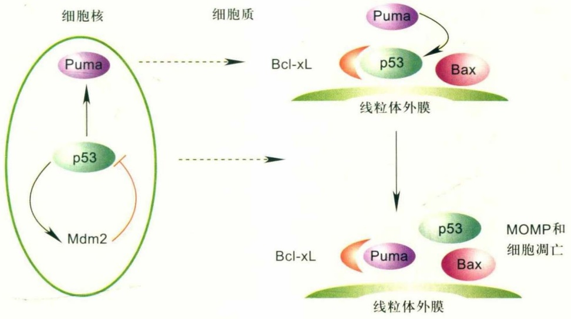

flowchart

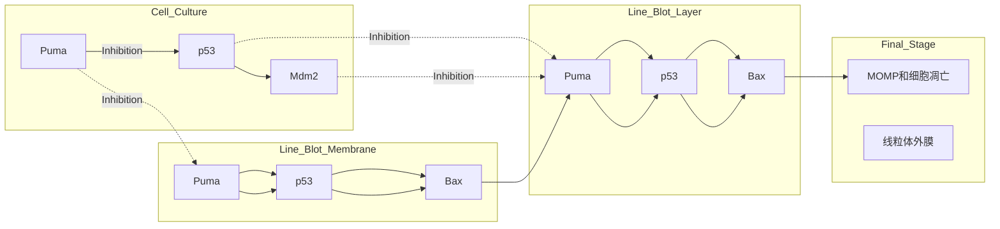

图25-9 细胞核内p53与细胞质中p53协同诱导细胞凋亡(仿自Green和Kroemer, 2009)

内质网通过其钙库在凋亡信号接收和放大中起关键作用，而线粒体在接收凋亡信号后，通过释放大量的凋亡物质来启动和实施细胞凋亡。

最近，Yuan等人发现Bcl-2蛋白家族的一些促凋亡或抗凋亡蛋白也参与内质网诱导的细胞凋亡。实验证明，Bcl-2、Bax以及Bak都可定位于内质网，Bcl-2的高表达或Bax、Bak的丧失都可以有效阻止 $Ca^{2+}$ 从内质网中的释放，减少 $Ca^{2+}$ 对线粒体膜的破坏，从而抑制细胞凋亡；另外，胞内 $Ca^{2+}$ 可以作为促凋亡的第二信使参与启动凋亡。大量试验表明，许多细胞在凋亡早期细胞质内 $Ca^{2+}$ 浓度迅速持续升高，这种浓度升高来源于细胞外 $Ca^{2+}$ 的内流及胞内钙库（如内质网）中 $Ca^{2+}$ 的释放，相对高浓度的 $Ca^{2+}$ 则可以激活细胞质中的 $Ca^{2+}$ 依赖性蛋白酶，这些蛋白酶又可以作用于线粒体，改变其通透性和膜电位，从而促进细胞凋亡。另外，Yuan等人采用免疫荧光染色方法证明了caspase-12存在于内质网中，其主要功能是使因内质网张力引起的细胞凋亡更容易进行，当内质网 $Ca^{2+}$ 动态平衡破坏时，caspase-12在内质网中被激活，活化的caspase-12在胞质中可进一步切割caspase-3，从而诱导由内质网途径介导的细胞凋亡。在线粒体信号途径和死亡受体途径中还未发现有caspase-12的参与。这一事实清楚地表明，内质网信号转导途径在凋亡中所具有的独特作用。

溶酶体在细胞死亡调节中的研究越来越受到重视。溶酶体内包含了多种蛋白水解酶，在细胞自杀和细胞内物质清除中起关键作用。溶酶体中的一类蛋白酶 cathepsins在细胞凋亡调控中发挥重要作用。在氧化应激中，溶酶体cathepsin D的释放先于线粒体细胞色素c释放。这类蛋白酶可能不直接激活caspase，但能切割Bid。被切割的Bid转移至线粒体，促使细胞色素c释放。溶酶体内还存在鞘磷脂酶，鞘磷脂酶的激活直接导致ceramide大量累积，引起线粒体细胞色素c释放。溶酶体内还可能存在其他蛋白酶参与细胞凋亡，有关溶酶体凋亡信号的激活和参与凋亡的具体途径的研究有待进一步深入。

## 25.3.6 MiRNA与细胞程序性死亡

MiRNA是一组长20～23 nt的高度保守的非编码RNA，它通过与靶基因的mRNA3'非翻译区(3'UTR)互补配对，抑制mRNA翻译或降解相应的mRNA，以沉默靶基因的表达。据估计，miRNA可调控哺乳动物中约60%的基因，从而在生物发育、细胞增殖以及细胞死亡等过程中起重要作用。

目前，miRNA在细胞凋亡信号通路中作用的研究还远未完善，但已有的研究表明，miRNA与细胞凋亡紧密联系。许多miRNA直接参与调控受体介导的凋亡途径。以TRAIL诱导的细胞凋亡途径为例:miR-221、miR-222可通过下调其靶基因PTEN及TIMP3，降低细胞caspase-3及caspase-8的活性，增加细胞对TRAIL诱导的细胞凋亡的抗性。miR-221、miR-222对蛋白p27kip1的抑制增加了乳腺癌细胞对化疗药物tamoxifen的抗性。miR-29通过抑制抗凋亡蛋白Mcl-1的表达，干扰其与凋