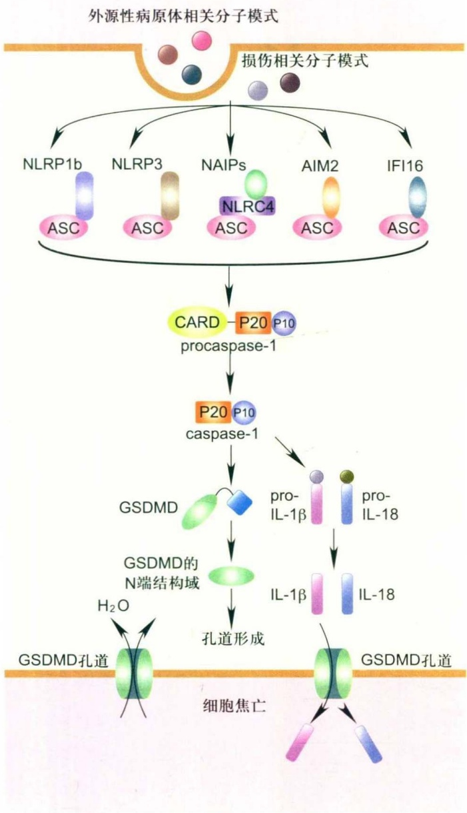
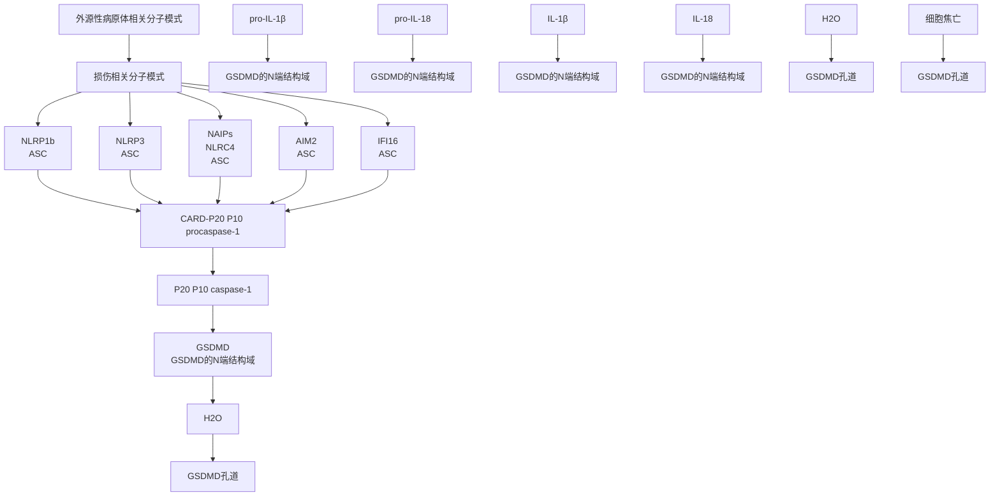
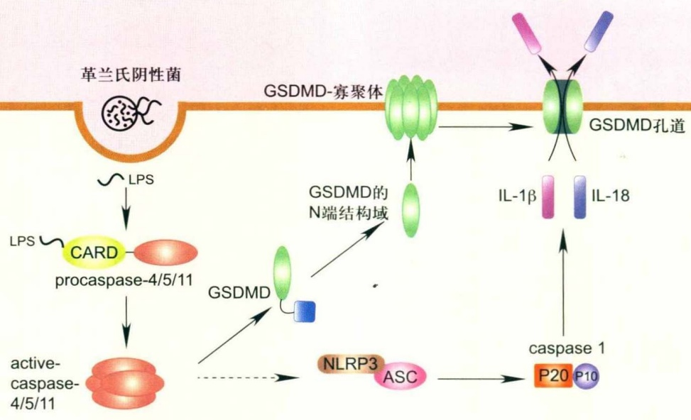
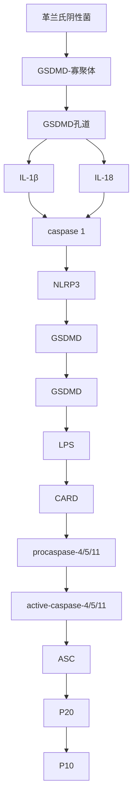
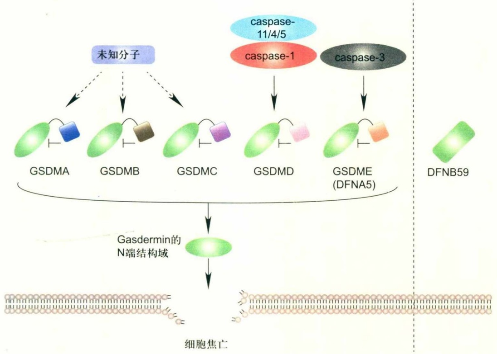
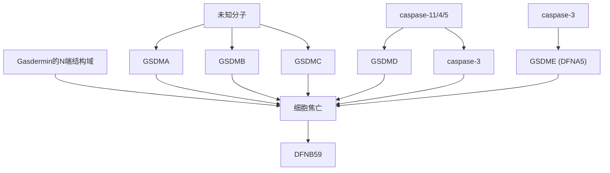

胞的程序性坏死，从而促进肿瘤细胞的外渗和转移。用necrostatin-1治疗小鼠或在内皮细胞中特异性敲除RIP3或MLKL都能够抑制内皮细胞坏死、肿瘤细胞的外渗以及转移。因此，阻止内皮细胞程序性坏死可作为抗肿瘤转移的新疗法。此外，RIP1和RIP3在胰腺导管腺癌组织中高表达，RIP1-RIP3介导的程序性坏死能通过激活巨噬细胞诱导的对T细胞抗肿瘤免疫的抑制作用，从而促进胰腺导管腺癌的进展。

综上所述，细胞程序性坏死在肿瘤的发生发展过程中扮演着多重角色。一方面，肿瘤细胞通过下调RIP3和MLKL的表达，逃脱程序性坏死应答；其次，肿瘤细胞通过引发血管内皮细胞的程序性坏死，促进肿瘤细胞的转移；程序性坏死还能够通过释放DAMPs促进炎症反应，加速肿瘤生长和转移。另一方面，程序性坏死途径参与一些肿瘤细胞的坏死（如急性髓细胞白血病祖细胞的坏死），抑制肿瘤生长；程序性坏死还能促进杀伤性T细胞的激活，增强抗肿瘤反应。因此，程序性坏死在肿瘤中的调控非常复杂，未来需要在更多类型的肿瘤中深入揭示细胞程序性坏死对肿瘤发生发展的作用，以便更精准的通过干预细胞程序性坏死来促进肿瘤疗法的进步。

## 26.2 细胞焦亡

## 26.2.1 细胞焦亡的发现

细胞焦亡是一种受到基因调控的炎性细胞坏死，最早是在细菌感染的巨噬细胞中被发现，当细菌如炭疽致死毒素（anthrax lethal toxin，LT）或志贺氏菌（Shigella）感染巨噬细胞后，诱导细胞发生裂解，并释放促炎症因子。1998年，志贺氏菌诱导的巨噬细胞死亡被证实依赖于胱天蛋白酶-1（caspase-1），但不依赖于调控凋亡的caspase-3，而当时此细胞死亡方式被认为是细胞凋亡。caspase-1最初被称为白介素1β转换酶（interleukin-1β-converting enzyme，ICE），能切割白介素1β前体（pro-interleukin-1β，pro-IL-1β）产生成熟的白介素1β（interleukin-1β，IL-1β），其也是caspase家族第一个被鉴定的成员。随后，沙门氏菌（Salmonella）感染的巨噬细胞也被证实发生caspase-1依赖性的细胞死亡。随着研究的深入，志贺氏菌以及沙门氏菌等病原体诱导的巨噬细胞死亡被认为不同于细胞凋亡，主要差异如下:① 细胞焦亡的形态学特征与坏死相似，不同于凋亡；② 细胞焦亡会导致促炎症因子的释放并诱发炎症反应，而凋亡属于非炎性的细胞死亡方式；③ 细胞焦亡依赖于caspase-1，但不依赖于参与凋亡的caspase。2001年，Cookson等提出用“pyroptosis”描述这种促炎症的程序性细胞死亡方式，“pyro”为古希腊文词根，意为火或发热。因此，细胞焦亡在传统上被认为是一种依赖于caspase-1的程序性细胞坏死方式，伴有促炎症因子白介素IL-1β和IL-18（interleukin-18）的释放，导致强烈的炎症反应。除了caspase-1，caspase-4/5（小鼠同源蛋白caspase-11）已被证实能够识别胞内脂多糖LPS而被激活，活化的caspase-4/5/11也诱导细胞焦亡的发生。在细胞焦亡中起调控作用的caspase-1、caspase-4/5和小鼠caspase-11被称为炎性caspase。2015年，gasdermin家族成员GSDMD（gasdermin D）蛋白被发现为caspase-1和caspase-4/5/11的共同底物蛋白，执行细胞焦亡。

## 26.2.2 细胞焦亡的信号转导及调控机制

细胞焦亡主要通过caspase-1或caspase-4/5/11活化GSDMD而发生。近期有研究表明，细胞焦亡也能被GSDMD以外的gasdermin家族成员介导发生。

## (1) 炎症小体活化 caspase-1 介导的细胞焦亡途径

模式识别受体是一类主要表达于免疫细胞的蛋白，能够感知外源性病原体相关分子模式或内源性危险信号即损伤相关分子模式，在机体免疫应答中发挥重要功能。2002年，瑞士Jürg Tschopp课题组提出一些模式识别受体在识别PAMPs或DAMPs后会组装炎症小体(inflammasome)，招募并激活caspase-1。目前已确定多种由不同模式识别受体组成的炎症小体能够活化caspase-1，这些模式识别受体主要来自NOD样受体（the NOD-like receptor, NLR）家族（如NLPR1、NLPR3和NAI）和PYHIN（pyrinandHIN domain containing protein）或称为AIM2类似受体（AIM2-like receptor, ALR）蛋白家族（如AIM2和IFI16）。每种炎症小体识别相应的外源性病原体或内源性危险信号，例如，NLRP1炎症小体可以识别检测炭疽致死毒素活性等；NLRP3炎症小体能识别包括细胞外ATP和胞内ROS等在内的多种病原体或危险信号；NAIP/NLRC4炎症小体主要识别细菌鞭毛蛋白及三型分泌系统组分；AIM2炎症小体主要识别细胞质内的双链DNA；IFI16炎症小体主要识别细胞核内的病毒DNA。炎症小体是多蛋白复合体，一般含有模式识别受体、凋亡相关微粒蛋白（apoptosis-associated speck-like protein containing CARD, ASC）以及caspase-1。ASC是多种炎症小体的共同接头蛋白，含有PYRIN和CARD结构域，并通过PYRIN和CARD结构域分别与模式识别受体和caspase-1前体（procaspase-1）结合。炎症小体促使procaspase-1水解产生P20大亚基和P10小亚基，并形成P20/P10异二聚体，进而形成四聚体，成为有活性的caspase-1。活化的caspase-1分别切割白介素 $1\beta$ 前体蛋白和白介素18前体蛋白产生具有活性的IL- $1\beta$ 和IL-18。而且，炎症小体活化的caspase-1通过切割效应蛋白GSDMD介导细胞焦亡的发生。GSDMD含有N端和C端结构域，C端结构域对N端结构域存在自抑制作用。

flowchart

图26-7 caspase-1介导的细胞焦亡途径模式识别受体包括NOD样受体和PYHIN蛋白家族能够识别外源性病原体相关分子模式以及损伤相关分子模式，并募集凋亡相关微粒蛋白ASC以及pro-caspase-1组成炎症小体。Pro-caspase-1水解产生P20大亚基和P10小亚基，寡聚成为有活性的caspase-1。活化的caspase-1分别切割GSDMD、pro-IL-1β和pro-IL-18，成为具有活性的GSDMD的N端结构域以及成熟的IL-1β和IL-18。GSDMD的N端结构域直接与细胞膜结合，在细胞膜上形成孔道，导致细胞膜破裂，成熟的IL-1β和IL-18因此释放到细胞外激发炎症。

活化的caspase-1或caspase-4/5切割GSDMD产生N端结构域。当解除了C端结构域的抑制作用，GSDMD的N端结构域发挥活性，直接与真核细胞膜上的磷酸化磷脂酰肌醇和原核细胞膜上的心磷脂（cardiolipin）结合，在细胞膜上形成孔道结构，导致细胞膜破裂，成熟的IL-1β和IL-18也因此释放到细胞外，诱导炎症反应（图26-7）。

## (2) LPS 活化 caspase-4/5/11 介导的细胞焦亡途径

LPS是革兰氏阴性菌细菌壁的主要成分，它与细胞膜上的Toll样受体TLR4结合，从而激活TLR4信号通路。在小鼠中注射高剂量LPS会引发内毒素休克，导致小鼠死亡。caspase-11缺陷小鼠表现出对高剂量LPS的抗性，而且LPS会诱导caspase-11的表达。2011年，caspase-11依赖的细胞焦亡被证实存在于多种革兰氏阴性菌感染的小鼠巨噬细胞中，而caspase-11的活化并不依赖于炎症小体。因此，caspase-11的活化被认为是通过非经典炎症小体通路介导的。2014年，caspase-11被发现为LPS的胞内受体，caspase-11能够识别细胞质内的LPS，并与LPS上的脂质A结合，进而发生寡聚化而被激活。人caspase-4和caspase-5是鼠caspase-11的同源蛋白。同样地，caspase-4和caspase-5也能直接识别胞内LPS，与之结合并被激活。活化的caspase-4/5/11与活化的capase-1相似，能够切割GSDMD产生N端结构域，通过活化的GSDMD介导细胞焦亡的发生。capase-1和caspase-4/5/11分别在经典炎症小体和非经典炎症小体信号通路介导的细胞焦亡中起关键作用。凋亡相关的caspase不能切割GSDMD，因此GSDMD是炎性caspase-1/4/5/11的特异性底物蛋白。然而与caspase-1不同的是，活化的caspase-4/5/11不能切割IL-1β和IL-18前体蛋白。在一些细胞中，活化的

flowchart

图26-8 caspase-4/5/11介导的细胞焦亡途径

人源caspase-4/caspase-5或鼠源caspase-11的CARD结构域与胞内LPS结合，caspase-4/5/11发生寡聚化并被激活。活化的caspase-4/5/11能够切割GSDMD产生N端结构域，GSDMD的N端结构域进而在细胞膜上形成孔道，导致细胞膜破坏。在一些细胞中，活化的caspase-4/5/11通过激活NLRP3/ASC炎症小体途径而活化caspase-1，进而促进IL-1β和IL-18的成熟。

caspase-4/5/11能通过激活NLRP3/ASC炎症小体途径活化caspase-1，进而促进IL-1β和IL-18的成熟(图26-8)。

(3) GSDMD以外的Gasdermin家族成员介导的细胞焦亡途径

GSDMD属于Gasdermin家族，该家族还包括GSDMA、GSDMB、GSDMC、DFNA5/GSDME和DFNB59。除了DFNB59，其他成员都含有N端和C端结构域。与GSDMD的N端结构域相似，GSDMA、GSDMB、GSDMC和DFNA5/GSDME的N端结构域都具有诱导细胞焦亡的功能。但GSDMD是唯一能被炎性caspase-1/4/5/11切割的Gasdermin家族成员。GSDME的N端和C端结构域之间存在caspase-3切割位点。在凋亡诱导剂的刺激下，活化的caspase-3能够切割GSDME，细胞会发生焦亡。与GSDMD相似，caspase-3切割产生的GSDME的N端结构域能够结合细胞膜上的磷脂，并在膜上形成孔道结构，导致细胞焦亡的发生(图26-9)。因此，细胞焦亡不仅能被炎性caspase活化的GSDMD所介导，还能通过GSDMD以外的Gasdermin家族成员诱导发生。

GSDME在正常组织中广泛表达，但大部分癌细胞不表达GSDME，因为癌细胞中GSDME的启动子发生甲基化导致沉默。在表达GSDME的细胞中，引发DNA损伤的化疗药物能够激活caspase-3，诱导细胞发生焦亡。而在不表达GSDME的细胞中，同样的化疗药物激活caspase-3后诱导细胞发生凋亡。长期以来，caspase-3的活化是细胞凋亡的一个重要标志，而在表达GSDME的细胞中，活化的caspase-3可以通过激活GSDME诱导细胞发生焦亡。因此，细胞中GSDME的表达量是决定caspase-3活化的细胞发生凋亡还是焦亡的关键因素。比起癌细胞，化疗药物更容易诱导正常组织中的细胞发生细胞焦亡，因而GSDME介导的细胞焦亡被认为是化疗药物产生毒副作用的重要原因之一。

值得一提的是，中国科学家邵峰课题组在细胞焦亡领域做出了一系列重要工作，包括发现caspase-4/5/11作为LPS的胞内受体以及GSDMD和GSDME等在细胞焦亡中的调控作用。

## 26.2.3 细胞焦亡与疾病

细胞焦亡与人类疾病的关系已经成为近年来细胞死亡领域的研究热点之一。研究表明细胞焦亡广泛参与感染性疾病、癌症、代谢疾病、心血管疾病和神经退行性疾病等疾病的发生、发展。

## 26.2.3.1 细胞焦亡与感染相关疾病

(1) 细胞焦亡与抗病原体感染

炎症小体能够广泛地识别各种病原体相关分子模式，参与针对病毒、细菌和真菌等多种病原体的宿主防御反应。而且，caspase-4/5/11是革兰氏阴性细胞壁脂多糖LPS的胞内受体，能够直接结合LPS并诱发焦亡，在宿主对革兰氏阴性菌的应答中发挥作用。

flowchart

图 26-9 Gasdermin 家族蛋白介导的细胞焦亡途径

Gasdermin 家族蛋白GSDMA、GSDMB、GSDMC、GSDMD 和 DFNA5/GSDME 具有相似的 N 端结构域，可以在膜上形成孔道结构，导致细胞发生焦亡。它们的 C 端结构域对 N 端结构域具有自抑制作用，而 DFNB59 没有类似的 C 端结构域。GSDMD 存在 caspase-1/4/5/11 切割位点，GSDME 存在 caspase-3 切割位点。

① 抗细菌感染 炎症小体介导的caspase-1活化导致细胞焦亡，并且分泌IL-1β和IL-18因子，帮助宿主抵御各种细菌病原体的入侵。NLRC4炎症小体能被沙门氏菌直接激活，导致炎性caspase-1活化和IL-1β分泌，并招募中性粒细胞迁移至感染位点吞噬细菌，从而有效地控制沙门氏菌感染。caspase-1敲除的小鼠体内的沙门氏菌明显增加，导致小鼠更易发生死亡。在缺乏IL-1β和IL-18的情况下，细胞焦亡也可以清除细菌感染。巨噬细胞发生细胞焦亡后将胞内的细菌如伤寒沙门氏菌释放出来，随后中性粒细胞吞噬并杀死入侵的细菌，此过程不依赖于IL-1β和IL-18。有研究指出，活细菌会“陷入”巨噬细胞焦亡产生的碎片之中，随后被中性粒细胞吞噬并清除。除了天然免疫细胞，炎症小体在小肠上皮细胞中也发挥重要功能。小肠上皮细胞在组织稳态调节、宿主防御、肠道免疫以及再生过程具有重要作用，是防御肠内病原菌的第一道防线。沙门氏菌主要通过激活小肠上皮细胞中的 caspase-4 蛋白导致小肠上皮细胞焦亡，死亡的细胞被清除，从而维持上皮层屏障的完整性。此外，gasdermin 家族蛋白的 N 端结构域能结合细菌膜上的磷脂，在细菌膜上直接打孔并破坏膜结构，从而杀死细菌。

② 抗病毒与真菌感染 NLRP3炎症小体可以由多种病毒包括甲型流感病毒、西尼罗病毒和丙型肝炎病毒等所激活，在机体防御病毒感染中发挥重要功能。甲流病毒感染能够引起caspase-1的活化以及IL-1β的释放。与野生型小鼠相比，caspase-1敲除和NLRP3敲除小鼠更易感染甲型流感病毒，且在肺组织中IL-1β和IL-18分泌减少，肺功能减弱，病毒量增加。西尼罗河病毒是一种嗜神经病毒，是引发病毒性脑炎的重要病原体之一。NLRP3炎症小体成员(NLRP3、ASC或caspase-1)缺陷小鼠以及IL-1β信号通路缺陷小鼠都比野生型小鼠更易感染西尼罗河病毒，生存率降低。丙型肝炎病毒感染是导致肝病的主要病因之一，丙型肝炎病毒感染除了诱导caspase-3依赖的细胞凋亡，还激活NLRP3炎症小体和caspase-1介导的细胞焦亡。而且，慢性丙型肝炎患者的血清IL-1β水平高于正常人群。当HCV感染的肝细胞发生细胞焦亡时，非感染的健康细胞也会发生依赖caspase-1的细胞焦亡。此外，AIM2炎症小体能被小鼠巨细胞病毒和牛痘病毒等DNA病毒激活。在巨细胞病毒感染的模型中，AIM2炎症小体缺陷导致病毒量升高，而且IL-18因子能够抑制病毒复制。因此，细胞焦亡及释放的促炎症因子也在抗病毒感染中起重要作用。

caspase-1 和 caspase-11 也可在宿主防御真菌病原体感染中发挥作用。烟曲霉菌会激活人单核细胞中的 NLRP3 炎症小体、小鼠骨髓来源的树突细胞以及肺组织中的 AIM2 和 NLRP3 炎症小体，通过 caspase-1 产生保护性细胞因子 IL-1β 和 IL-18。caspase-1 和 caspase-11 双敲除小鼠更易被白色念珠菌和巴西副球孢子菌感染。然而，细胞焦亡在真菌感染中的确切生理和病理功能有待进一步研究。

## (2) 细胞焦亡与败血症

上述证据表明细胞焦亡和炎性因子的释放是重要的天然免疫反应，可以保护机体免受外界细菌等病原体的感染。但是，过度的细胞焦亡及其产生的免疫反应对机体有害，会诱发包括败血症在内的多种炎症反应和自身免疫性疾病。败血症是因致病细菌侵入血液循环系统所引发的急性全身性感染疾病，严重时可能导致感染性休克，甚至死亡。细菌侵入激活炎性caspase-1或caspase-11，并释放出GSDMD的N端活性片段。GSDMD的N端结构域具有双重作用，既能在感染宿主细胞的细菌膜上打孔进而杀死这些细菌，又能在宿主细胞膜上打孔诱发细胞焦亡。死亡的宿主细胞释放出细菌和炎症信号，激发机体的免疫应答。当机体的免疫应答过于强大时会造成机体损伤，体内产生大量的炎性细胞因子，如TNF-$\alpha$ 、IL-6和IL-1等，引起全身系统性炎症反应综合征，导致致命性的血管和器官损伤。在细菌内毒素LPS诱导的小鼠败血症模型中，敲除caspase-11或GSDMD能够缓解LPS导致的休克致死效应。抗菌肽LL-37可抑制LPS引起的巨噬细胞焦亡，还可以在小鼠盲肠结扎穿刺引发的败血症模型中阻止caspase-1活化和巨噬细胞焦亡，从而延长小鼠的存活时间。因此，细胞焦亡在革兰氏阴性菌诱导的败血症中起重要作用，阻断细胞焦亡有望为败血症的治疗提供新思路。

## (3) 细胞焦亡与HIV感染

艾滋病又称获得性免疫缺陷综合征 (acquired immune deficiency syndrome, AIDS)，是由人类免疫缺陷病毒感染所造成的免疫系统缺陷疾病。HIV病毒感染破坏患者体内的CD4 $^{+}$ T免疫细胞，导致其数量显著减少，并诱发各种感染及系统并发症。研究表明，HIV有效感染血液中的 $CD4^{+}$ T细胞后，可使初始 $CD4^{+}$ T细胞转变为活化的 $CD4^{+}$ T细胞，完成病毒RNA的反转录、整合及复制，促进宿主细胞死亡，释放新的病毒，此过程与细胞凋亡密切相关。但是艾滋病发展过程中 $CD4^{+}$ T细胞减少的数量远远超过HIV有效感染的细胞数。近期的研究发现，淋巴组织中由HIV-1感染而导致的 $CD4^{+}$ T细胞减少，主要是因细胞焦亡引发的损伤。在淋巴结中存在大量未有效感染HIV的静止 $CD4^{+}$ T细胞，病毒能够穿透这些细胞但不能完成全部的逆转录过程，而是形成部分HIV-dsDNA链。IFN诱导蛋白-16（interferon-inducible protein 16，IFI-16）或AIM2作为胞质内的DNA感受器识别外源dsDNA，随后激活下游的caspase-1蛋白，引起细胞焦亡。静止 $CD4^{+}$ T细胞通过“自杀”的方式对HIV病毒做出反应，抑制病毒在细胞内增殖。但另一方面， $CD4^{+}$ T细胞焦亡后，炎症内容物的释放使大量健康的 $CD4^{+}$ T细胞趋化至感染区域，导致更多的细胞被感染和死亡，造成 $CD4^{+}$ T细胞数量骤降，形成恶性循环。因此，抑制细胞焦亡可避免大量未被感染的 $CD4^{+}$ T细胞发生炎症和死亡，细胞焦亡抑制剂联合鸡尾酒疗法可能为AIDS临床治疗提供新的方向。

## 26.2.3.2 细胞焦亡与肿瘤

## (1) 结直肠癌

在探索细胞焦亡与肿瘤的关系中，对NLRP3炎症小体在结直肠癌中的作用及调控机制的研究最为深入。研究证据表明，NLRP3、caspase-1及IL-18在肠炎及肠癌发生发展中发挥保护作用。在葡聚糖硫酸钠（dextran sulfate，DSS）诱导急性肠炎的模型中，NLRP3敲除小鼠和caspase-1敲除小鼠比野生型小鼠表现出更严重的病理特征，小鼠生存率降低，而且更易受细菌入侵，表明NLRP3和caspase-1参与了肠组织损伤后上皮层修复的过程。肠上皮细胞中NLRP3介导的IL-18分泌是肠上皮细胞增殖和组织再生所必需的，IL-18生成的减少可能损害了黏膜屏障，引起肠黏膜固有层免疫细胞的激活、炎性细胞因子的过度生成以及随后的组织损伤，增加了肠道炎症性疾病的易感性。此外，在肠炎逐步发展为结直肠癌的病理过程中，NLRP3对于抑制结肠炎相关癌变至关重要。相比于野生型小鼠，NLRP3敲除、caspase-1敲除或ASC敲除小鼠对结肠炎引发的癌变更易感，其机制与炎症小体调控的IL-1β/IL-18的分泌密切相关。然而，在不同于上述的肠癌模型中，NLRP3炎症小体被发现可能会促进结直肠癌的发生发展。在氧化偶氮甲烷（azoxymethane，AOM）/高胆固醇诱导小鼠结直肠癌的过程中，NLRP3敲除小鼠与野生型小鼠相比，其肠道肿瘤减少，生存率增加。这种相反的效果可能与NLRP3炎症小体激活不同的下游信号通路有关。在AOM/高胆固醇模型中，巨噬细胞中的胆固醇通过抑制AMPKα活性从而促进线粒体ROS产生，进而激活NLRP3炎症小体和IL-1β分泌，促进炎症和肿瘤发展。综上所述，炎症小体调控的IL-1β分泌，在不同结直肠癌的疾病模型中扮演着“抑癌”或“促癌”的角色。这可能与IL-1β分子本身的“双面性”有关:一方面诱发炎症反应，促进肿瘤的发生发展；另一方面又能激活机体的免疫效应机制从而抑制肿瘤的生长。此外，肠道上皮细胞中NLRP1炎症小体被发现在肠道肿瘤形成过程中发挥重要的抑制作用。

随着NLRP3炎症小体在结直肠癌发生发展中的深入研究，以NLRP3炎症小体作为靶点的药物研发也成为热点，为结直肠癌的治疗带来新的机遇。肝X受体（liver X receptor, LXR）属于核受体超家族，是一种配体激活的转录因子，参与调节脂代谢、糖代谢以及免疫与炎症反应。最近研究发现，LXR及其激动剂介导的信号通路能够降低肿瘤细胞增殖、侵袭能力，从而抑制黑色素瘤和前列腺癌等多种恶性肿瘤的发生发展，可作为肿瘤治疗的新型潜在靶点。LXR激动剂T0901317能够诱导结肠癌细胞发生NLRP3-caspase-1依赖的细胞焦亡。LXR激动剂促进ATP释放，胞外的ATP与离子型通道受体P2X7R结合。作为NLPR3的激活剂，P2X7R促使NLRP3炎症小体组装及下游caspase-1活化，最终导致结肠癌细胞死亡。体内研究证实，LXR激动剂能通过激活NLRP3/caspase-1通路从而明显抑制肠道肿瘤生长。

## (2) 皮肤癌和黑色素瘤

皮肤是抵御外来微生物和非微生物（化学、机械）侵害的重要屏障之一。紫外线B（UVB）照射是皮肤物理损伤的主要因素之一，皮肤反复地、长时间暴露于UVB会引发皮肤炎症反应和损伤，甚至发展成皮肤癌。UVB照射引起的炎症反应会导致caspase-1、IL-1β和IL-18蛋白的表达水平明显升高。UVB照射能够诱导皮肤角质形成细胞中NLRP1和NLRP3炎症小体的活化，以及IL-1β和IL-18的分泌。在长期暴露于两种强致癌物砷和UVB后，皮肤会出现严重的表皮增生和DNA损伤，最终导致皮肤癌，此过程伴随着炎症小体的活化和IL-1β的增多。IL-1β抑制剂可以减少上述致癌物引起的炎症、DNA损伤和皮肤癌变的发生。与NLRP3敲除小鼠和caspase-1敲除小鼠的表型相似，ASC敲除小鼠表现出对皮肤癌发生、发展的保护作用。

炎症与黑色素瘤之间存在着密切关系，炎症小体被发现在其中发挥重要作用。ATP依赖性离子通道P2X7和PANX1参与了黑色素生成和肿瘤发展。P2X7和PANX1离子通道的开放激活了NLRP3炎症小体，导致炎症因子IL-1β的释放。IL-1β的水平与黑色素瘤的转移潜能相关。绿茶中提取的表没食子儿茶素-3-没食子酸酯能够抑制炎症小体和IL-1β分泌，进而抑制黑色素瘤的生长。因此，炎症小体-caspase-1-IL-1β通路促进了黑色素瘤的发生和发展。

## (3) 其他肿瘤

全世界大约12%的人类癌症可能是由病毒导致的。EB病毒（Epstein-Barr virus，EBV）与多种人类恶性肿瘤相关。在EBV相关肿瘤组织中（如霍奇金淋巴瘤和鼻咽癌），NLRP3、AIM2和RIG-I炎症小体的表达上调。EBV病毒基因组DNA能够激活AIM2和RIG-I并诱导IL-1β的分泌。EBV还能降解NLRP3炎症小体，抑制IL-1β的产生，逃逸免疫监视。人乳头瘤病毒（human papilloma virus，HPV）是导致宫颈癌的主要病毒。HPV感染能够激活AIM2炎症小体以及IL-1β的分泌。HPV16病毒蛋白E6被发现可通过降解IL-1β而逃逸免疫应答。

## 26.2.3.3 细胞焦亡与代谢综合征

近几十年来，世界范围内肥胖症的发病率明显上升，肥胖及其相关的多器官（胰腺、脂肪、肝、心脏和肌肉组织）慢性代谢和炎症改变一起被称为“代谢综合征”。研究证据表明，炎症小体、IL-1β和IL-18分子与这些疾病相关。

## (1) 炎症小体与糖尿病

糖尿病是常见的以高血糖为主要特征的代谢性疾病。高脂肪饲料喂养的小鼠会发生肥胖、炎性反应，并产生胰岛素抵抗，而且NLRP3、caspase-1和IL-1β的表达水平均明显升高。炎症小体能够感受代谢应激信号的刺激而被活化，其介导的炎症反应在糖尿病的发生发展过程中发挥关键作用。

炎症小体活化能增强糖尿病患者的胰岛素抵抗，使患者血糖和胰岛素水平均明显升高，引起高血糖症及高胰岛素血症。在肥胖小鼠和人类的脂肪组织及肝中，NLRP3炎症小体和caspase-1活性明显升高；在肥胖症患者中，这些蛋白的表达水平与Ⅱ型糖尿病的严重程度呈正相关。脂肪组织中的棕榈酸酯与神经酰胺信号触发巨噬细胞中NLRP3炎症小体的激活。在肥胖小鼠的脂肪组织巨噬细胞中，NLRP3介导的caspase-1通路活化和IL-1β分泌会导致有害后果。IL-1β信号能促进胰岛素受体底物-1（IRS-1）的Ser位点磷酸化，从而抑制胰岛素信号转导。而且，IL-1β能够诱导脂肪组织炎症。与野生型小鼠相比，NLRP3敲除、ASC敲除和caspase-1敲除小鼠呈现体重和脂肪量的下降以及胰岛素抵抗的减少。此外，炎症小体在脂肪细胞中也发挥功能。caspase-1在脂肪细胞分化过程中上调，并通过自分泌IL-1β促进胰岛素抵抗。

胰岛素抵抗和胰岛β细胞数量减少是Ⅱ型糖尿病的两个重要发病机制。当外周胰岛素抵抗引起的慢性高血糖症发生时，胰岛β细胞可以通过增加分泌胰岛素进行弥补。但随着时间的推移，局部炎症和高血糖将导致大量β细胞数量下降。研究表明，胰腺浸润巨噬细胞以及β细胞中分泌的IL-1β是导致长期暴露于高浓度葡萄糖环境下的β细胞死亡的关键诱因。临床试验证明IL-1β受体拮抗剂可明显改善β细胞功能，并提升对血糖浓度的控制。在Ⅱ型糖尿病发病过程中，NLRP3炎症小体可通过以下方式被激活:首先，高血糖通过增加β细胞中电子传递链活性而触发线粒体产生ROS，导致NLRP3活化；其次，Ⅱ型糖尿病的胰岛组织中沉积大量淀粉样多肽，其与糖尿病的严重程度密切相关。在胰腺巨噬细胞中，淀粉样多肽可特异性激活NLRP3炎症小体。总而言之，NLRP3介导的IL-1β分泌能诱导β细胞功能紊乱和死亡，促进趋化因子的表达，进而加重免疫细胞浸润。

## (2) 炎症小体与动脉粥样硬化

动脉粥样硬化是一种慢性、无菌炎症性疾病。炎症小体的活化并诱导细胞分泌的IL-1β在动脉粥样硬化中发挥重要作用。低密度脂蛋白的主要功能是把胆固醇运输到全身各处，通过细胞表面的低密度脂蛋白受体介导的内吞途径进入细胞，参与代谢。在一些因素（如吸烟、高血压）诱发下，低密度脂蛋白被氧化修饰成氧化型低密度脂蛋白，然后被巨噬细胞膜上的清道夫受体识别和吞噬，造成大量吞噬脂质的巨噬细胞（即泡沫细胞）和胆固醇结晶堆积在动脉粥样硬化斑块中。研究发现胆固醇结晶可以激活巨噬细胞中的NLRP3炎症小体，促进IL-1β等炎症因子释放，加重炎症反应。NLRP3、ASC或IL-1β敲除可以明显减少泡沫细胞数量，缓解小鼠动脉粥样硬化。

## 26.2.3.4 细胞焦亡与神经系统疾病

细胞焦亡与神经系统疾病密切相关，它参与神经系统中的急性和慢性无菌性炎症，在病毒性脑炎、中风、多发性硬化症和阿尔茨海默病等疾病中发挥重要作用。细胞焦亡及其相关分子可能参与感染性脑膜炎的发生发展。在肺炎链球菌脑膜炎中，NLRP3炎症小体活化后释放IL-1β和IL-18，加剧炎症反应和神经系统损伤。在急性无菌性神经系统损害（如中风和创伤性脑损伤）中，局部自身免疫激活会造成神经损伤。caspase-1敲除或IL-1α/IL-1β双敲除小鼠对中风具有一定的保护作用。外伤性脑损伤后，脑脊液中NLRP1、ASC和caspase-1水平显著升高，而且这些蛋白表达较高的患者预后较差。多发性硬化症属于一种慢性、无菌炎症性神经系统疾病。抑制NLRP3表达和IL-1β和IL-18的分泌可以控制T细胞活化及其向中枢神经系统迁移，缓解多发性硬化症。β-淀粉样蛋白是大脑皮质老年斑的主要成分，是导致阿尔茨海默病的元凶。巨噬细胞中的NLRP3炎症小体能被纤维状β-淀粉样蛋白所激活，促使IL-1β的释放，形成炎性环境，促进阿尔茨海默病的病情发展。阻断炎症小体活性可能成为治疗这些神经系统疾病的一个重要策略。

细胞焦亡作为一种新的受基因调控的细胞死亡方式正逐步被人们认识，但其分子机制以及在各种疾病发生发展过程中的作用仍有待进一步探索。对细胞焦亡在疾病中作用的深入研究将有助于揭示相关疾病的发生机制，为疾病的防治提供新的科学依据。

## □ 小结

细胞死亡在多细胞生物的机体发育和维持内环境稳定中发挥至关重要的作用。与细胞凋亡不同，细胞坏死的形态学特征表现为细胞及细胞器溶胀和细胞膜破裂。长期以来，细胞凋亡被认为是唯一的程序性细胞死亡方式，而细胞坏死被认为是不受信号调控的被动细胞死亡方式。在过去的十几年，细胞死亡领域取得的研究进展已经改变人们对细胞坏死的传统认识。细胞程序性坏死和细胞焦亡都属于新型的程序性细胞死亡方式，是最近几年细胞死亡领域的研究热点。细胞凋亡是机体发育过程中最主要的程序性细胞死亡方式，而细胞坏死主要发生于病理过程中，而非发育过程中。为了区别发育过程和病理过程中的受到调控的细胞死亡方式，近期科学家们提出将细胞程序性坏死和细胞焦亡等受信号调控的细胞坏死类型统称为受调控的细胞坏死。

细胞程序性坏死是一种不依赖于caspase的细胞坏死方式，易发生于caspase活性缺陷或受抑制的细胞中。程序性坏死可以由死亡受体、Toll样受体、干扰素受体信号通路的活化以及病原体感染而诱导发生。细胞程序性坏死主要受到蛋白激酶RIP1、RIP3和MLKL的严格调控。在Toll样受体、干扰素受体以及病毒感染介导的坏死中，RIP3可以在RIP1缺陷的细胞中被活化进而诱导细胞坏死的发生。因此，RIP3被认为是细胞程序性坏死的核心调控蛋白，它通过与含有RHIM的蛋白如RIP1、TRIF和DAI结合被激活，接收来自不同途径的坏死信号。活化的RIP3通过磷酸化下游效应蛋白MLKL将信号传递给MLKL。MLKL发生寡聚化并转运到细胞膜上介导细胞坏死的发生。目前有研究表明MLKL可以通过影响离子通道导致细胞坏死，也有数据支持MLKL直接与细胞膜上的脂质结合，可能形成孔道结构导致细胞膜破裂。因此，MLKL在细胞膜上如何导致膜裂解有待进一步阐明。

细胞程序性坏死已被认为是凋亡以外另一种重要的细胞死亡方式，尤其是在凋亡缺陷或受抑制的情况下作为最主要的细胞死亡方式发生。研究已经证实细胞程序性坏死在抗病毒感染中发挥重要的生物学功能，包括抵抗小鼠巨细胞病毒、人单纯疱疹病毒和流感病毒A等。细胞程序性坏死会导致细胞内容物的释放，引发周围组织的炎症反应，过度的细胞坏死已被发现参与许多重要疾病的病理过程，与疾病的发生发展密切相关。研究人员通过利用RIP1特异性抑制剂necrostain-1、RIP3缺陷型小鼠和MLKL缺陷型小鼠等已经证实了细胞程序性坏死在炎症疾病包括结肠炎和胰腺炎等、缺血性心脑血管疾病、神经退行性疾病包括肌萎缩侧索硬化和多发性硬化等、肝损伤性疾病、肾损伤性疾病和肿瘤等疾病中的作用。目前靶向RIP1的抑制剂已用于临床试验治疗结肠炎等疾病。

细胞焦亡是一种主要依赖于炎性caspase的细胞坏死方式，因而在早期曾被误认为是细胞凋亡。细胞焦亡不仅可以通过炎症小体感知病原体感染和内源性危险信号进而活化caspase-1诱导发生，也可以由细菌脂多糖LPS直接激活caspase-4/5/11介导。活化的caspase-1或caspase-4/5/11切割底物GSDMD，产生GSDMD的N端结构域，其能够直接在细胞膜上打孔，导致细胞焦亡。GSDMD属于Gasdermin家族成员，虽然这些成员中只有GSDMD能被炎性caspase切割，但几乎所有其他成员的N端结构域都具有诱导细胞焦亡的功能。GSDME能被参与凋亡的caspase-3切割活化，进而启动细胞焦亡。因此，目前细胞焦亡被认为是一种由Gasdermin家族蛋白介导的细胞坏死。然而，其他Gasdermin家族蛋白调控细胞焦亡的机制有待揭示。

细胞焦亡是天然免疫应答的重要组成部分，在机体防御病原体感染和抵抗内源性危险信号中发挥重要作用。caspase-1的活化不仅能够激活GSDMD介导的细胞焦亡，而且能够促进IL-1β与IL-18的成熟和释放，进一步激发炎症反应，促进机体的免疫应答。GSDMD的N端结构域不仅能在宿主细胞膜上打孔触发焦亡，也能在感染宿主的病原体如细菌膜上打孔，杀死细菌。caspase-4/5/11不能切割IL-1β前体与IL-18前体，但可以通过NALR3炎症小体激活caspase-1进而促进IL-1β与IL-18的成熟。由于NLRP3炎症小体主要表达于巨噬细胞、单核细胞和中性粒细胞等免疫细胞，因而细胞焦亡引起的促炎因子IL-1β与IL-18的释放主要在免疫细胞中发挥功能。虽然细胞焦亡及其释放的促炎症因子具有重要的抗感染功能，但过度的感染和免疫应答又会使机体受到损伤，引发炎症性疾病和自身免疫性疾病。LPS-caspase-11-GSDMD介导的细胞焦亡参与革兰氏阴性菌诱导的败血症。而且，炎症小体-caspase-1介导的细胞焦亡与HIV感染引发的CD4 $^{+}$ T淋巴细胞死亡密切相关。因此，靶向细胞焦亡可为败血症和艾滋病的治疗提供新思路。此外，越来越多的证据表明细胞焦亡参与癌症、代谢疾病、心血管疾病和神经退行性疾病等的病理过程，在疾病的发生发展中发挥重要作用。

细胞程序性坏死和细胞焦亡是目前研究最多的细胞坏死方式，虽然两者的发生机制不同，但都参与炎症、感染性疾病、心血管疾病、神经退行性疾病和癌症等疾病的病理过程。深入研究它们的分子机制以及在不同疾病中所起的调控作用，将有助于更好地理解这些疾病的发生机制。在此基础上，开发精确的体内检测手段和特异性抑制剂，用于精准检测和干预细胞程序性坏死和细胞焦亡，有望为相关疾病的治疗提供新策略。

此外，受调控的坏死还包括:铁死亡，主要由铁依赖性脂质过氧化损伤引起；parthanatos，主要指PARP-1[poly（ADP-ribose）（PAR）polymerase 1]激活介导的途径；NETosis，主要指由烟酰胺腺嘌呤二核苷酸磷酸（NADPH）氧化酶介导的途径；亲环素D-介导的坏死途径等。然而，目前对这些受调控的细胞坏死的分子机制和生物学功能还了解甚少。因此，对更多受调控的细胞坏死的深入研究将会帮助人们全面认识细胞坏死的重要功能，为相关疾病的诊断和治疗提供新的方向和有效靶点。

## □ 思考题

1. “细胞死亡有多少种形式”是 Science 公布的 125 个科学前沿问题之一，为什么细胞需要多种死亡方式？
2. 如何区分细胞程序性坏死与细胞焦亡?
3. 细胞坏死与哪些疾病密切相关？例如神经退行性疾病中出现神经细胞坏死，为了有利于疾病的治疗，该对细胞坏死途径采取怎样的干预措施？
4. 越来越多的受调控的细胞坏死形式被发现，这些细胞坏死对机体有何积极意义？
5. 细胞坏死领域的研究还有哪些亟待解决的重要科学问题？

(何苏丹 苏州系统医学研究所)

1 Chan K M, Shisler J, Bixby J G, et al. A role for tumor necrosis factor receptor-2 and receptor-interacting protein in programmed necrosis and antiviral responses. J Biol Chem, 2003, 278: 51613–51621.
2 Chen I Y, Ichinohe T. Response of host inflammasomes to viral infection. Trends Microbiol, 2015, 23: 55–63.
3 Cho Y, Challa S, Moquin D, et al. Phosphorylation-driven assembly of the RIP1-RIP3 complex regulates programmed necrosis and virus-induced inflammation. Cell, 2009, 137: 1112-1123.
4 Cookson B T, Brennan M A. Pro-inflammatory programmed cell death. Trends Microbiol, 2001, 9:113–114.
5 Degterev A, Hitomi J, Germscheid M, et al. Identification of RIP1 kinase as a specific cellular target of necrostatins. Nat Chem Biol, 2008, 4:313–321.
6 Degterev A, Huang Z H, Boyce M, et al. Chemical inhibitor of nonapoptotic cell death with therapeutic potential for ischemic brain injury. Nat Chem Biol, 2005, 1: 112–119.
7 Dillon C P, Weinlich R, Rodriguez D A, et al. RIPK1 blocks early postnatal lethality mediated by caspase-8 and RIPK3. Cell, 2014, 157: 1189–1202.
8 Ding J, Wang K, Liu W, et al. Pore-forming activity and structural autoinhibition of the gasdermin family. Nature, 2016, 535: 111–116.
9 Doitsh G, Galloway N L, Geng X, et al. Cell death by pyroptosis drives CD4 T $^{-}$ cell depletion in HIV-1 infection. Nature, 2014, 505: 509–514.
10 Dondelinger Y, Declercq W, Montessuit S, et al. MLKL compromises plasma membrane integrity by binding to phosphatidylinositol phosphates. Cell Rep, 2014, 7: 971–981.
11 Duewell P, Kono H, Rayner KJ, et al. NLRP3 inflammasomes are required for atherogenesis and activated by cholesterol crystals. Nature, 2010, 464: 1357–1361.
12 Galluzzi L, Kepp O, Chan F K, et al. Necroptosis: mechanisms and relevance to disease. Annu Rev Pathol, 2017, 12: 103–130.
13 He S D, Liang Y Q, Shao F, et al. Toll-like receptors activate programmed necrosis in macrophages through a receptor-interacting kinase-3-mediated pathway. Proc Natl Acad Sci U S A, 2011, 108: 20054–20059.
14 He S D, Wang L, Miao L, et al. Receptor interacting protein kinase-3 determines cellular necrotic response to TNF-$\alpha$. Cell, 2009, 137: 1100–1111.
15 He W T, Wan H, Hu L, et al. Gasdermin D is an executor of pyroptosis and required for interleukin-1β secretion. Cell Res, 2015, 25:1285–1298.
16 Hilbi H, Moss J E, Hersh, D, et al. Shigella-induced apoptosis is dependent on caspase-1 which binds to IpaB. J Biol
Chem, 1998, 273: 32895–32900.
17 Hockendorf U, Yabal M, Herold T, et al. RIPK3 restricts myeloid leukemogenesis by promoting cell death and differentiation of leukemia initiating cells. Cancer Cell, 2016, 30: 75–91.
18 Holler N, Zaru R, Micheau O, et al. Fas triggers an alternative, caspase-8-independent cell death pathway using the kinase RIP as effector molecule. Nat Immunol, 2000, 1: 489–495.
19 Huang Z, Wu S Q, Liang Y J, et al. RIP1/RIP3 binding to HSV-1 ICP6 initiates necroptosis to restrict virus propagation in mice. Cell Host Microbe, 2015, 17: 229–242.
20 Ito Y, Ofengeim D, Najafov A, et al. RIPK1 mediates axonal degeneration by promoting inflammation and necroptosis in ALS. Science, 2016, 353: 603–608.
21 Kaiser W J, Sridharan H, Huang C Z, et al. Toll-like receptor 3-mediated necrosis via TRIF, RIP3, and MLKL. J Biol Chem, 2013, 288: 31268–31279.
22 Kayagaki N, Stowe I B, Lee B L, et al. Caspase-11 cleaves gasdermin D for non-canonical inflammasome signalling. Nature, 2015, 526: 666–671.
23 Kayagaki N, Warming S, Lamkanfi M, et al. Non-canonical inflammasome activation targets caspase-11. Nature, 2011, 479:117-U146.
24 Kerr J F R, Wyllie A H, Currie A R. Apoptosis – basic biological phenomenon with wide-ranging implications in tissue kinetics. Br J Cancer, 1972, 26: 239–257.
25 Kerr J F R. Shrinkage necrosis-distinct mode of cellular death. J Patho, 1971, l105: 13–20.
26 Kgatle M M, Spearman C W, Kalla A A, et al. DNA oncogenic virus-induced oxidative stress, genomic damage, and aberrant epigenetic alterations. Oxid Med Cell Longev, 2017: 3179421.
27 Laster S M, Wood J G, Gooding L R. Tumor necrosis factor can induce both apoptic and necrotic forms of cell-lysis. J Immunol, 1988, 141: 2629–2634.
28 Lin C, Zhang J. Inflammasomes in inflammation-induced cancer. Front Immunol, 2017, 8: 271.
29 Liu X, Zhang Z, Ruan J, et al. Inflammasome-activated gasdermin D causes pyroptosis by forming membrane pores. Nature, 2016, 535: 153–158.
30 Mamik M K, Power C. Inflammasomes in neurological diseases: emerging pathogenic and therapeutic concepts. Brain, 2017, 140: 2273–2285.
31 Man S M, Karki R; Kanneganti T D. Molecular mechanisms and functions of pyroptosis, inflammatory caspases and inflammasomes in infectious diseases. Immunol Rev, 2017, 277: 61–75.
32 Masters S L, Dunne A, Subramanian S L, et al. Activation of the NLRP3 inflammasome by islet amyloid polypeptide provides a mechanism for enhanced IL-1β in type 2 diabetes. Nat
Immuno, 2010, l11: 897–904.
33 Mulay S R, Linkermann A, Anders H J. Necroinflammation in kidney disease. Journal of the American Society of Nephrology, 2016, 27: 27–39.
34 Najafov A, Chen H, Yuan J. Necroptosis and cancer. Trends Cancer, 2017, 3: 294–301.
35 Ofengeim D, Ito Y, Najafov A, et al. Activation of necroptosis in multiple sclerosis. Cell Rep, 2015, 10: 1836–1849.
36 Shi J, Zhao Y, Wang K, et al. Cleavage of GSDMD by inflammatory caspases determines pyroptotic cell death. Nature, 2015, 526: 660–665.
37 Shi J, Zhao Y, Wang Y, et al. Inflammatory caspases are innate immune receptors for intracellular LPS. Nature, 2014, 514:187–192.
38 Strilic B, Yang L, Albarran-Juarez J, et al. Tumour-cell-induced endothelial cell necroptosis via death receptor 6 promotes metastasis. Nature, 2016, 536: 215-218.
39 Sun L M, Wang H Y, Wang Z G, et al. Mixed lineage kinase domain-like protein mediates necrosis signaling downstream of RIP3 kinase. Cell, 2012, 148: 213–227.
40 Thapa R J, Nogusa S, Chen P R, et al. Interferon-induced RIP1/RIP3-mediated necrosis requires PKR and is licensed by FADD and caspases. Proc Natl Acad Sci U S A, 2013, 110: e3109-e3118.
41 Vandanmagsar B, Youm Y H, Ravussin A, et al. The NLRP3 inflammasome instigates obesity-induced inflammation and insulin resistance. Nat Med, 2011, 17: 179–188.
42 Vanden Berghe T, Linkermann A, Jouan-Lanhouet S, et al. Regulated necrosis: the expanding network of non-apoptotic cell death pathways. Nat Rev Mol Cell Bio, 2014, 15: 134–146
43 Wang H Y, Sun L M, Su L J, et al. Mixed lineage kinase domain-like protein MLKL causes necrotic membrane disruption upon phosphorylation by RIP3. Mol Cell, 2014, 54: 133–146.
44 Wang X, Li Y, Liu S, et al. Direct activation of RIP3/MLKL-dependent necrosis by herpes simplex virus 1 (HSV-1) protein ICP6 triggers host antiviral defense. Proc Natl Acad Sci U S A, 2014, 111:15438-15443.
45 Wang Y, Gao W, Shi X, et al. Chemotherapy drugs induce pyroptosis through caspase-3 cleavage of a Gasdermin. Nature, 2017, 547(7661):99.
46 Weinlich R, Oberst A, Beere H M, et al. Necroptosis in development, inflammation and disease. Nat Rev Mol Cell Biol, 2017, 18:127–136.
47 Zhang D, Shao J, Lin J, et al. RIP3, an energy metabolism regulator that switches TNF-induced cell death from apoptosis to necrosis. Science, 2009, 325: 332–336.
48 Zhang T, Zhang Y, Cui M, et al. CaMK II is a RIP3 substrate mediating ischemia- and oxidative stress-induced

myocardial necroptosis. Nat Med, 2016, 22: 175–182.

49 Zhao J, Jitkaew S, Cai Z Y, et al. Mixed lineage kinase domain-like is a key

receptor interacting protein 3 downstream component of TNF-induced necrosis. Proc Natl Acad Sci U S A, 2012, 109: 5322–5327.

50 Zhou W, Yuan J. Necroptosis in health and diseases. Semi Cell Dev Biol, 2014, 35:14–23.

## □ 索引

2A型腓骨肌萎缩症 164

10-11 异位蛋白 6

A 激酶锚定蛋白 217

A型胰岛素抗拒综合征 144

B淋巴细胞 469

Bloom综合征 90

c-Jun 氨基末端激酶 195

$Ca^{2+}$  依赖的 C 型外源凝集素结构域 175

cAMP 反应元件结合蛋白 16

CAP-Gly蛋白 152

CH结构域 286

crRNA 前体 64

DNA-蛋白间的交联 82

DNA复制的起始调控 337

DNA 复制检控点 330, 337,
347

DNA 甲基化 6

DNA 甲基转移酶 6

DNA结合域 271

DNA链断裂 82

DNA 双链断裂修复 83

DNMT1结合蛋白1 32

G蛋白偶联的雌激素受体 224

G蛋白偶联受体 195

G蛋白偶联受体激酶 216

G蛋白信号调控蛋白 201

$G_{1}/S$ 检控点 328

GTP酶激活蛋白 103,188

HS1相关蛋白X-1 185

JNK相互作用蛋白 208

Lamin B 受体 132

LINC复合体 134,140

LMNA基因 144

MAPK 磷酸酶 205

MCP-1 264

miRNA 前体 24

N-连接寡糖 105

N-乙酰葡糖胺 107

N端含有细胞核定位信号 340

N 端结构域 271

Nemo样激酶 205

p38促分裂原活化的蛋白激酶 195

p53结合蛋白 488

protospacer 相邻位点 71

Rab蛋白 104

Ran-GTP酶 138

Ras 激酶抑制因子 207

RIP 活化病毒抑制剂 528

RNA 编辑 20

RNA变位剪接 19

RNA干扰 23

RNA识别基序 20

RNA 诱导的基因沉默复合物 24

Rothmund-Thomson 综合征 90

S-腺苷甲硫氨酸 6

S期内检控点 328

SH2结构域 271

SH3结构域 271

Smad结合结构域 259

Smad结合元件 255

Src 同源结构域 2 198

SUMO化 9

T淋巴细胞 469

T细胞自身抗原受体 471

T7 内切核酸酶 I 法 66

TALE核酸酶 61

TATA 框结合蛋白 15

TBP协同因子 15

Toll样受体 526

UDP-葡萄糖-糖蛋白糖基转移酶 105

Werner综合征 90

$\alpha$ -辅肌动蛋白 186

α-平滑肌肌动蛋白 264

α-微管蛋白 148,353

β-微管蛋白 148,353

β-血影蛋白 259

β肾上腺素受体亚型 224

γ-微管蛋白 148,353

γ-微管蛋白环状复合体 148

## A

阿尔茨海默病 243,530

奥卡替尼 294

## B

白介素 446

白介素-6 456

白介素2受体 $\beta$ 链 115

白色脂肪组织 443,444

白细胞 175

白细胞黏附缺陷症 181

白血病起始细胞 281

斑联蛋白 187

斑马鱼 270

半胱天冬蛋白酶-8 434

半乳糖 107

伴刀豆球蛋白A 531

包被蛋白 100

包被蛋白 I 100

包被蛋白Ⅱ 100

包被囊泡 100

胞间连接 175

胞膜窖 114

胞膜窖介导的胞吞作用 112

胞噬作用 110

胞吐作用 99

胞吞作用 99,114

胞外信号调节激酶 195

胞外域 479

胞饮作用 110

胞质动力蛋白 190

胞质分裂期 321

胞质环 133

闭合式有丝分裂 132

扁囊 106

扁囊成熟模型 107

变性高效液相色谱法 66

表观遗传 24

表观遗传调控 29

表皮生长因子 112,452

波形蛋白 133,266

玻连蛋白 180

补骨脂素 82

补体受体 111

不成熟囊泡 108

不对称分裂 358

不依赖网格蛋白的胞吞作用 111

布鲁氏杆菌 129

## C

层粘连蛋白 180,181

产单核细胞李斯特杆菌 129

长链非编码 RNA 25,402

长期造血干细胞 467

常规剪接 19

常染色质 5

超分子复合物 187

超级增强子 377

巢细胞 240

车轮状结构 165

沉默子 14

成单核细胞 425

成对gRNA 73

成骨不全症 438

成骨细胞 422

成骨细胞瘤 438

成核 148

成肌纤维细胞 264

成视网膜细胞瘤蛋白 204,
261

成纤维细胞生长因子 200

成血(管)前体细胞 466

尺蠖模型 154

持续型分泌途径 107

重复可变双残基 61

初级纤毛 168

初级造血 466

雌激素 435

雌激素受体 496

次级造血 466

促分裂原活化的蛋白激酶 195,214

促红细胞生成素 200

促酰化蛋白 225

脆骨症 438

错配修复 35,84,489

## D

大型胞饮作用 112,185

大促分裂原活化的蛋白

激酶 204

代谢综合征 460

袋蛋白 405

单ADP核糖基转移酶 10

单纯疱疹病毒 528

单泛素化 301

单核细胞 111,176,421,469

单链构象多态性法 66

单链抗体可变区段 479

单顺反子 4

单元组装法 62

胆固醇 114,444

蛋白二硫异构酶 105

蛋白激酶A 214

蛋白激酶C 21,215

蛋白酪氨酸激酶 215

蛋白磷酸酶1 259

蛋白磷酸酶2A 206

蛋白酶体 105

蛋白质酪氨酸磷酸酶 205,
218

蛋白质丝氨酸/

苏氨酸磷酸酶 206

低等真核生物 518

低密度脂蛋白 109

抵抗素 446

颠换 70,80

点突变 80

凋亡小体 508,525

凋亡信号调节激酶 202

顶膜域 109

动力蛋白 153,353

动粒 352

动粒结合蛋白 354

动脉腹侧壁 466

动态不稳定性 147

动纤毛 168

端粒 93

端粒酶 491,522

端粒锌指相关蛋白 492

短期造血干细胞 469

对称分裂 358

多ADP核糖基转移酶 10

多发性骨髓瘤 204

多发性硬化症 530

多核巨细胞 424

多囊肾病 164

多能干细胞 369

多泡体 115

多潜能前体细胞 469

多梳家族 9

多细胞生物体 518

多纤维肉瘤 438

## E

恶性纤维组织细胞瘤 438

## F

翻译后修饰 148

反面扁囊 106

反面高尔基网 99

反式激活 crRNA 64

反式作用因子 12

泛素 301

泛素-蛋白酶体途径 495

泛素化 258,298

泛素活化酶 301

泛素结合酶 301

泛素连接酶 301

泛素特异性蛋白酶8 10

芳烃受体 480

纺锤体基质 359

纺锤体组装因子 361

放射状胶质细胞 190

放线酮 202

非编码RNA 24

非活性染色质 5

非跨膜型蛋白质酪氨酸

激酶 270

非神经元细胞谱系 47

非同源末端连接 57,85

非同源末端连接修复 489

非网格蛋白/非胞膜窖依赖的胞吞作用 112

肺纤维化 492

分节缺陷 230

分离膜 121

分选内吞体 115

分子伴侣 103

分子伴侣介导的自噬 120

分子马达 153

佛波酯 205

辅蛋白 103

辅调节因子 17

辅激活因子 17

辅酶 I 493

辅抑制因子 17

辅因子 83

辅助T细胞 471

辅助性T细胞 203

复制错误 81

复制起点 337

复制性衰老 485

## G

钙调蛋白 220

钙激活中性蛋白酶 262

钙连蛋白 105

钙黏着蛋白 175

钙网蛋白 105

干扰素 269

干扰素γ 265

干扰素受体 526

甘露糖 105

甘油二酯 444

甘油三酯 443,444

高尔基体 99

高尔基体堆 99

高分辨率熔解法 66

高钙血症 438

格尔德霉素 120

共激活因子 260

共同淋系前体细胞 469

共同Smad 310

共同髓系前体细胞 469

共抑制因子 260

骨 419

骨保护素 425

骨被覆细胞 419,424

骨钙蛋白 420

骨粘连蛋白 420

骨肉瘤 438

骨软骨瘤 438

骨石化症 438

骨髓 467

骨髓间充质干细胞 449

骨髓增生异常综合征 477

骨唾液蛋白 424

骨细胞 424

骨形态形成蛋白 249

骨样骨瘤 438

骨硬化 438

骨原细胞 423

寡聚文库构建 60

寡糖基转移酶 105

冠状动脉粥样硬化性

心脏病 456

光裂合酶 83

归巢内切核酸酶 58

鬼笔环肽 187

果蝇 270

## H

河豚 270

核不均一核糖核蛋白 20

核蛋白丝 85

核定位信号 61,286,516

核苷酸切除修复 83,489

核骨架理论 143

核固缩 501

核孔 132

核孔蛋白 134

核孔复合体 132

核膜 132

核输出信号 516,340,254

核糖核蛋白 23

核纤层 132

核纤层病 144

核纤层蛋白 133

核小体 5

核小体缺乏区 6

核小体重塑去乙酰基酶 10

核心启动子元件 13

核心增强子 395

核衣壳蛋白 256

核质环 133

核周隙 132

核转录因子 16

黑皮质素受体 223

亨廷顿病 243

红系-髓系祖细胞 466

红细胞 469

后部血岛 466

后缘 185

踝蛋白 182,187

环腺苷酸 214

环状片层 142

混合系激酶 196

活化STAT蛋白抑制因子 272

活化素 249

活化子募集的辅因子 18

活性染色质 5

活性氧物质 80

获得性免疫缺陷综合征 536

## J

肌动蛋白 111

肌动蛋白结合蛋白 207

肌动蛋白丝 147

肌球蛋白 153

肌球蛋白轻链激酶 186

肌球蛋白轻链磷酸酯酶 186,
190

肌萎缩侧索硬化 164,530

肌细胞增强因子2 395

基本转录因子 14

基底膜 264

基底膜域 109

基因表达 3

基因表达调控 3

基因毒性刺激 429

基因敲除 73

基因突变 80

基因组 3

基因组编辑 56

基质金属蛋白酶 262

基质细胞 421

激活结构域 61

激活器蛋白1 204

激活转录因子1 218

急性淋巴细胞白血病 479

急性髓细胞白血病 477

脊索瘤 438

集钙蛋白 220

记忆T细胞 471

加帽蛋白 186

甲基化 298

甲基化CpG结合蛋白 7

甲胎蛋白 4

甲状旁腺激素释放肽 266

甲状旁腺素 423

间充质干细胞 240,449

间期 319

剪接 4

剪接因子2 20

碱基切除修复 35,83,489

碱基缺失 81

碱基修饰 81

碱性亮氨酸拉链 16

碱性磷酸酶 373

降钙素 439

降血钙素 417

降脂素 446

交感神经系统 459

交换因子 198

交配信息素 206

角蛋白 133,266

角膜结膜炎 528

胶原蛋白 180,181,262

胶质瘤前体细胞 426

胶质细胞源纤维酸性

蛋白 133

窖蛋白 114

接头蛋白 101

结肠直肠癌 242

结蛋白 133

结缔组织生长因子 265

结核分枝杆菌 129

姐妹染色单体交换 489

解偶联蛋白 445

金黄色葡萄球菌 129

金属离子结合位 182

茎环结合蛋白 23

巨核细胞 469

巨核细胞/红细胞的前体

细胞 469

巨噬细胞 111,469

巨细胞瘤 438

巨自噬 120

绝缘子 14

## K

开放式有丝分裂 132

抗原呈递细胞 263,478

抗原识别区域 479

可调节基因表达 3

可诱导基因 4

可阻遏基因 4

龈口炎 528

空间特异性 4

孔膜区 132

口蹄疫病毒 374

佝偻病 438

跨膜区 479

跨膜区域 425

快速冷冻-深度蚀刻 153

## L

赖氨酸2-羟基异丁酰化 11

赖氨酸丙酰化 11

赖氨酸丁烯酰化 11

赖氨酸丁酰化 11

赖氨酸特异性去甲基化酶1 10

赖氨酸戊二酰化修饰 11

雷帕霉素 127

类转录激活因子效应物 61

类转录激活因子效应物

核酸酶 56

粒细胞 469

粒细胞 / 巨噬细胞前体

细胞 469

连接黏附分子 181

链间交联 82

淋巴细胞 176

淋系多潜能前体细胞 469

磷酸二酯酶 217

磷酸化 298

磷酸化酪氨酸结合域 184

磷脂 444

磷脂酶C 215

磷脂酰肌醇 101

磷脂酰肌醇3-激酶 215

磷脂酰肌醇3-激酶途径 258

磷脂酰丝氨酸受体 111

流感病毒 A 528

硫化 298

硫氧还蛋白 203

鲁索利替尼 294

卵黄囊 466

螺旋-环-螺旋 16

螺旋-转角-螺旋 16

螺旋结构域 271

## M

马达蛋白 147

慢病毒 373,374

慢性阻塞性肺疾病 244

帽子结合蛋白 22

帽子结合因子 21

免疫球蛋白超家族 175

模块组装 60

末端结合蛋白 152

膜分裂 103

膜激活GTP酶 103

膜内成骨 425

母中心粒 165

## N

囊泡小管簇 100

囊泡转运 99

囊泡转运模型 107

脑炎 528

酿酒酵母 206

内核膜 132

内含子 4

内含子界定 19

内皮-造血转换过程 467

内皮细胞 175

内腔 104

内生软骨瘤 438

内吞膜转运途径 115

内吞囊泡 114

内吞体 99

内细胞团 370

内源性大麻素 223

内质网 99

内质网-高尔基体中间

腔室 100

内质网出口点 105

内质网回收信号 106

拟胚体 370

逆转录病毒 374

黏蛋白样家族 175

黏附复合体 185

黏菌 270

黏膜地址素细胞黏附

分子 181

黏着斑 184,186

黏着斑蛋白 266

黏着斑激酶 187

黏着位点 186

鸟苷二磷酸 214

鸟苷三磷酸 214

鸟苷酸解离抑制因子 188

鸟嘌呤核苷酸交换因子 103,
188, 198

尿嘧啶N-糖基化酶 83

尿嘧啶糖苷酶抑制蛋白 69

凝集素样结构域 175

凝血酶 176

凝血栓蛋白 264

凝血栓蛋白-1 250

凝血障碍疾病 180

纽蛋白 187

疟蚊 270

## O

偶发性死亡 502

## P

帕金森病 243

胚胎干细胞 57,240,370,479

胚胎致死 182

配体 175

片层 187

片状伪足 186

破骨细胞 424

葡糖鞘脂类 114

葡萄糖转运载体-4 460

## Q

启动子 522

羟化 298

前部血岛 466

前复制复合体的组装 337

前列腺素 453

前列腺素E2 446

前肽 399

前纤维蛋白 186

前缘 185

前脂肪细胞因子-1 451

前轴旁中胚层 390

嵌合抗原受体 T 细胞免疫
疗法 478

腔壁卵黄囊 475

腔内囊泡 115

腔内血细胞簇 467

敲减 73

鞘脂 417

切口酶 68

轻中间链 161

球状肌动蛋白 185

驱动蛋白 153,353

去甲肾上腺素 446

## R

染色体畸变 80

染色体易位 86

染色质 5

染色质调节域 8

染色质着边 501

染色质重塑 7

染色质组装因子1 88

热稳定抗原 178

热休克蛋白70 120

热休克蛋白90 198

人工内切核酸酶 56

人类免疫缺陷病毒 530

人脐带间充质干细胞 487

人乳头瘤病毒 537

溶酶体 99

溶胶蛋白 186

溶血二磷脂酰酸 115

溶血磷脂酸 199

融合 99

乳腺因子 279

软骨 420

软骨膜 420

软骨内成骨 425

软骨黏液样纤维瘤 438

软骨肉瘤 438

软骨细胞 420

软件分解分析法 67

## S

沙门氏杆菌 129

上皮细胞-间充质细胞

转换 243,262,390

上下文依赖组装 60

上游可读框架 21

上游启动子元件 13

神经生长因子 200

神经肽Y 446

神经丝 133

神经元基因 47

肾髓 467

生长分化因子 249

生长因子受体结合蛋白10 207

生骨节 390

生肌调节因子 390

生肌节 390

生肌识别基序 393

生皮肌节 390

生血内皮 466

生殖系传递 370

时间特异性 4

时间序列显微术 185

嗜碱性粒细胞 471

嗜酸性粒细胞 471

受调控的细胞坏死 525

受调控的细胞死亡 502

受体 175

受体调控的Smad 253,310

受体酪氨酸激酶 205

受体相互作用蛋白激酶1 525

瘦素 223,433,446

衰老相关的分泌表型 487

衰老相关异染色质灶 488

双链断裂 56

双链RNA 24

双亮氨酸 113

双疏水基团信号 109

水疱皮肤病 184

顺面扁囊 106

顺面高尔基网 100

顺式作用元件 12

丝切蛋白 186

丝束蛋白 186

丝状伪足 186

死亡受体 508

死亡受体6 531

三磷酸肌醇 215

四膜虫 170

髓系分化潜能的前体

细胞 469

羧基末端结构域 15

羧肽酶Y 124

## T

胎肝 466

胎盘 467

弹性软骨 421

糖苷酶 83

糖基化 99,298

糖基磷脂酰肌醇 114,178

糖基磷脂酰肌醇锚蛋白 115

特发性肺纤维化 244

提前终止密码子 73

体细胞核移植 372

体重指数 456

调节T细胞 471

调节型分泌途径 107

铁离子调节因子 23

铁离子应答元件 23

铁离子应答元件结合蛋白 23

通用 Smad 253

同型融合 108

同源重组 91

同源重组修复 85,489

透明软骨 420

突触囊泡 110

突触融合蛋白3 110

突触融合蛋白4 110

吞噬细胞 110

托法替尼 294

脱靶效应 59

脱包被 100

脱帽反应 23

脱帽酶 22

脱铁转铁蛋白 115

唾液酸 107

## W

蛙 270

外核膜 132

外泌体 185

外切核酸酶 22

外显子剪接沉默子 20

外显子剪接增强子 20

外显子界定 19

外显子跳读 19

外向转运蛋白 122

晚期复制起始点 321

晚期内吞体 115,185

网格蛋白 100

网格蛋白包被小窝 112

网格蛋白介导的胞吞作

用 111

网织红细胞 470

微管 105,147

微管动力蛋白激酶1 208

微管结合蛋白 147,151

微管结合结构域 151

微管相关蛋白质 353

微管正端示踪蛋白 152

微管组织中心 188

微结构域 112

微丝 185

微小RNA 24

微自噬 120

围产期致死 182

伪激酶结构域 274

伪足 111,185

尾部造血组织 467

位置花斑效应 89

无翅基因 230

无活性肽 250

无嘌呤或无嘧啶位点 81

## X

细胞程序性坏死 502,525

细胞程序性死亡 525

细胞凋亡 262,501,525

细胞核 99

细胞坏死 525

细胞间黏附分子 181

细胞焦亡 502,525

细胞膜发泡 501

细胞膜皱褶 114

细胞黏附 175

细胞黏附分子 175

细胞迁移 175

细胞特异性 4

细胞外蛋白激酶分析 300

细胞质羧肽酶 150

细胞周期蛋白 260,322

细胞周期依赖性蛋白激酶抑制

因子1A 494

细菌脂多糖 176

细丝蛋白 185,207

纤连蛋白 262

纤毛 109

纤维蛋白原 179,181

纤维化 250

纤维连接蛋白 180,181

纤维酶酶原激活物抑制

因子 262

纤维软骨 420

纤维状肌动蛋白 185

酰基化刺激蛋白 456

显性抑制 257

线虫 270

线粒体融合素蛋白1 517

线粒体网络 517

限制性酶切-连接法 62

限制性内切核酸酶 66

腺苷酸环化酶 214

小干扰RNA 24

小核核糖核蛋白 19

小鼠巨细胞病毒 528

小鼠胚胎成纤维细胞 494

效应记忆 T 细胞 471

血岛 466

血窦 469

血管紧张素受体 207

血管紧张素原 456

血管内皮细胞生长因子 200

血管生成 264

血管细胞黏附分子 181

血清素 431

血纤维蛋白溶酶 262

血纤维蛋白溶酶原 250,262

血小板 175,469

血小板反应素 181

血小板激活因子 201

血小板生成素 476

血小板衍生生长因子 114,264

血影重复蛋白 134

辛德毕斯病毒 129

锌指 16

锌指蛋白 59

锌指核酸酶 56

锌指基序 59

锌指激活因子 60

信号识别颗粒 104

信号识别颗粒受体 104

信号肽 479

信号序列 104

信号转导及转录激活

因子 270

形成素 186

胸腺 467

选凝素 175

选择相模型 139

选择性自噬 120

循环内吞体 102

## Y

牙龈卟啉单胞菌 129

亚远端附属结构 165

延伸 149

延伸因子 19

严重急性呼吸系统

综合征 256

岩藻糖 107

炎症小体 532

氧化刺激 428

液相有序微结构域 114

胰岛素 282,494

胰岛素抵抗 448

胰岛素受体信号转导 498

胰岛素样生长因子 398

胰岛素样生长因子I 446,494

移码突变 73,522

遗传不稳定性 80

遗传性非息肉结肠癌 265

遗传性痉挛性截瘫 164

遗传性毛细管扩张出血 264

乙酰辅酶A 298,301

乙酰肝素硫酸酯酶 417

乙酰化 298

异染色质 5

异染色质蛋白1 12,379

抑制素 249

抑制型Smad 253,310

隐藏的胶原位点 181

荧光漂白恢复实验 114

荧光原位杂交 76

应激激活的MAP激酶 195

应力纤维 186

硬骨素 233,243

游离脂肪酸 223,457

有丝分裂期 319

诱导多能干细胞 372,478,494

原肠胚 466

原红细胞 470

原肌球蛋白 259

原丝 148

远端附属结构 165

## Z

再生障碍性贫血 492

脏壁卵黄囊 475

早期复制起始点 321

早期内吞体 102,185

造血干/祖细胞 472

造血干细胞移植 477

造血干细胞 241,386,466

增强子 13

增殖细胞核抗原 31

兆核酸酶 58

真核翻译起始因子2A 21

整合素 175

整合素胞内结构域相关

蛋白 185

整联蛋白 250

支架蛋白 112

脂蛋白酯酶 451

脂筏 114

脂肪来源激素 446

脂肪素 456

脂肪酸 444

脂肪细胞 443

脂肪细胞因子 446

脂联素 446

质核比率理论 143

质谱 300

植物同源结构域 8

指导RNA 20

志贺氏菌 129

致密核心囊泡 108

中间扁囊 106

中间丝 147

中间细胞团 466

中间纤维 133

中胚层 391,466

中心记忆T细胞 471

中心粒 165,353

中心粒周物质 353

中心体 147

中性粒细胞 111,176,471

中央栓 133

肿瘤干细胞 242

肿瘤坏死因子 207,525

肿瘤坏死因子- $\alpha$  176,265,

446

肿瘤坏死因子受体超家族 525

重度联合免疫缺陷病 293

周期蛋白依赖性激酶 260,322

周期蛋白依赖性激酶8 18

周细胞 264,469

轴旁中胚层 390

皱缩型坏死 525

皱褶缘 424

主要编码区决定簇 23

主要组织相容性复合体 471

专职吞噬细胞 111

转化生长因子- $\beta$  249,310,446

转换 80

转录后基因沉默 24

转录激活结构域 271

转录偶联修复 84

转录衰减 19

转录因子IID 9

转铁蛋白 23,115

转位子 104

转移起始序列 105

转移终止序列 105

转运信号 61

转座子封闭 24

桩蛋白 187

着丝粒蛋白A 7

子中心粒 165

自磷酸化活性 251

自然杀伤细胞 263,469

自噬 119,502

自噬溶酶体 121

自噬体 119

自噬性细胞死亡 502

棕榈酰化 114

棕色脂肪组织 444

组成性基因表达 3

组蛋白 5

组蛋白伴侣 9

组蛋白变体 7

组蛋白去乙酰化酶 7,301,377

组蛋白去乙酰化酶2 32

组蛋白乙酰化酶 37

组织特异性 4

组织驻留巨噬细胞 466