# 第二章 分析数据处理

原始 PDF 第 55–93 页。

## 第二章

# 分析数据处理

## 真值(true value)

真值是指某一物理量本身具有的客观存在的真实数值。由于分析误差不可避免，因此真值是不可测得的。实际工作中往往将理论真值、计量学约定真值或相对真值等作为真值来检验分析结果的准确度。

理论真值是指由公认理论推导或证明的某物理量的数值,如  $1 \, mol \, H_{2}O$  含  $2 \, mol \, H$  和  $1 \, mol \, O$ , 水的组成常数即为理论真值。

计量学约定真值是指计量组织、学会等规定的公认计量单位的数值，如国际计量大会定义的光在真空中传播(1/299792458) s 所经过的路径长度为 1 m。

相对真值是指由公认的权威机构严格按照标准方法进行多次平行测定后，用数理统计方法得到相对准确的测定值。例如，国际相对原子质量和相对分子质量、基准试剂标签所给保证值等都是相对真值。

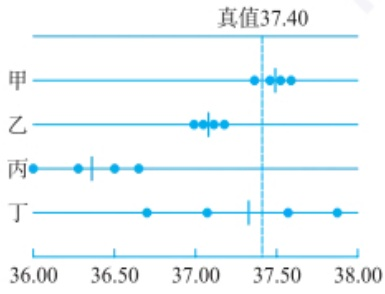

<details>
<summary>error_bar</summary>

| Category | Q1 | Q2 (Median) | Q3 |
| --- | --- | --- | --- |
| 甲 | ~37.35 | ~37.55 | ~37.60 |
| 乙 | ~36.95 | ~37.05 | ~37.15 |
| 丙 | ~36.25 | ~36.40 | ~36.65 |
| 丁 | ~36.65 | ~37.05 | ~37.85 |
</details>

图 2.1.1 同一样品的四种测定结果

定量分析的主要目的是获得样品中待测组分的含量信息。然而，由于受到分析方法、分析仪器和试剂等条件限制、测试条件的波动及人为因素的影响，分析结果不会和样品的真实含量完全一致。因此，必须对分析结果的可靠性和准确度做出合理的判断，进行正确的表达。本章主要介绍分析测量误差(measurement error)的产生原因、规律和减免措施，常用分析数据统计处理的方法原理和应用，以及定量校正模型和方法，以充分挖掘测量数据中的信息。

## 2.1 分析测量误差

## 2.1.1 误差的表征

## 1. 准确度

样品中待测组分的测定值与其真实值接近的程度即为分析结果的准确度（accuracy）。真实值也称为真值，是指某一物理量本身具有的客观存在的真实数值，用 $x_{T}$ 表示。测定值与真值越接近，分析结果的准确度越高；反之，分析结果的准确度越低。

## 2. 精密度

精密度(precision)是指一组平行测定结果相互接近的程度。如果平行测定的结果相互之间越接近,则分析结果的精密度越高。

## 3. 准确度与精密度的关系

图2.1.1直观地反映了准确度和精密度的关系。同一样品的四种测定结果中，甲的平均值与真值接近，且实验值彼此都很接近，因此准确度和精密度均好；乙的精密度好，但准确度稍差；丙的准确度和精密度都很差；丁的精密度很差，虽然平均值接近于真值，但这是由大的正负误差抵消导致，如果减少一次测定，平均值就会有很大变化，因此其准确度好是偶然的。可见，精密度是保证准确度的先决条件，但高的精密度不一定能保证有高的准确度。

## 2.1.2 误差的表示

## 1. 误差

准确度的高低用误差(error)来衡量。误差是测定值(通常以平均值 $\bar{x}$ 表示测定结果)和真值 $x_{T}$ 之间的差异。误差的大小可用绝对误差E和相对误差 $E_{r}$ 表示。

$$
E = \overline {{x}} - x _ {\mathrm{T}} \tag {2-1-1}
$$

---

2.1 分析测量误差

35

$$
E_{\mathrm{r}} = \frac{\overline{x} - x_{\mathrm{T}}}{x_{\mathrm{T}}} \times 100\% \tag{2 - 1 - 2}
$$

绝对误差和相对误差都有正值和负值。误差为正值时称为分析结果偏高，误差为负值时称为分析结果偏低。

»例 2.1.1 在分析天平的使用过程中,需要定期用标准砝码对天平进行校正,标准砝码的标示质量为相对真值。若用某分析天平称得标示为 1.0000 g 的标准砝码的质量为 0.9998 g,标示为 2.0000 g 的标准砝码的质量为 1.9998 g,则两者称量的绝对误差和相对误差分别是多少?该结果说明什么问题?

» 解: 绝对误差  $E_{1}=x_{1}-x_{T_{1}}=0.9998\ g-1.0000\ g=-0.0002\ g$

$$
E _ {2} = x _ {2} - x _ {\mathrm{T} _ {2}} = 1. 9 9 9 8 \mathrm{g} - 2. 0 0 0 0 \mathrm{g} = - 0. 0 0 0 2 \mathrm{g}
$$

相对误差

$$
E_{\mathrm{r}_1} = \frac{E_1}{x_{\mathrm{T}_1}} = \frac{-0.0002}{1.0000}\times 100\% = -0.02\%
$$

$$
E_{\mathrm{r}_{2}} = \frac{E_{2}}{x_{\mathrm{T}_{2}}} = \frac{-0.0002}{2.0000}\times 100\% = -0.01\%
$$

计算结果说明,绝对误差相等,相对误差不一定相同。同样的绝对误差,当被测定的量较大时,相对误差就比较小,测量的准确度也就比较高。相对误差可用于不同情况下测定结果准确度的比较,因此更具实用性。

## 2. 偏差

分析结果的精密度的高低常用与平均值相关的各种偏差(deviation)来表示。

（1）极差 最简单的一种表示精密度的方式是极差。极差又称全距 (range)，以 R 表示，它是一组测定数据中最大值  $x_{max}$  与最小值  $x_{min}$  之差。极差可以用来反映一组数据的离散程度，其不足之处是不能充分利用数据。
（2）绝对偏差和相对偏差 绝对偏差  $d_{i}$  和相对偏差  $d_{r}$  用于衡量单次测定值  $x_{i}$  与一组测定值(平行测定次数为 n) 的平均值  $\bar{x}$  的偏离程度。

$$
d _ {i} = x _ {i} - \overline {{x}} \tag {2-1-3}
$$

$$
d_{\mathrm{r}} = \frac{x_{i} - \overline{x}}{\overline{x}}\times 100\% \tag{2 - 1 - 4}
$$

绝对偏差和相对偏差有正有负,单次测定偏差的代数和必为0,因此不能用它来表示一组测定值的精密度。

（3）平均偏差和相对平均偏差 平均偏差  $\bar{d}$  和相对平均偏差  $\bar{d}_{e}$  是每次测定偏差的绝对值的平均值和相对平均值，取绝对值后，避免了正负偏差相互抵消，它们表示一组测定值的精密度。

$$
\bar {d} = \frac {\left| d _ {1} \right| + \left| d _ {2} \right| + \cdots + \left| d _ {n} \right|}{n} = \frac {1}{n} \sum_ {i = 1} ^ {n} \left| d _ {i} \right| = \frac {1}{n} \sum_ {i = 1} ^ {n} \left| x _ {i} - \bar {x} \right| \tag {2-1-5}
$$

$$
\bar {d} _ {\mathrm{r}} = \frac {\bar {d}}{\bar {x}} \times 100\% \tag {2-1-6}
$$

（4）标准偏差和相对标准偏差 标准偏差(standard deviation)又称均方根偏差,当测定次数趋于无限多时,称为总体标准偏差,是单个测定结果与总体平均值 $\mu$ 的差方和均根,用 $\sigma$ 表示。

## 总体（population）与样本（sample）

研究对象的整体称为统计总体，简称总体。从总体中随机抽取的一部分个体称为随机样本，简称为样本。例如，某化工厂生产的所有硫酸铵为总体，从中抽取部分硫酸铵用于检测，抽取的硫酸铵即为样本。通过对有限个样本的测量，推断总体的统计特性是统计检验的中心任务。

---

36

第二章 分析数据处理

## 自由度

## (degrees of freedom)

能够独立取值的偏差数被称为自由度，用 $f$ 表示。自由度的概念可以这样理解:设有6个测定值，前5个的绝对偏差分别是0.6,1.2,-1.4,1.3和-0.5，由于 $\sum_{i=1}^{6}(x_i - \overline{x}) = 0$ ，第6个测定值的绝对偏差只能为-1.2，没有选择的自由，因此能够独立取值的偏差数为5个，也就是 $n - 1$ 。

$$
\sigma = \sqrt {\frac {\sum_ {i = 1} ^ {n} (x _ {i} - \mu) ^ {2}}{n}} \tag {2-1-7}
$$

在一般的分析工作中,平行测定的次数是有限的,此时标准偏差为单个测定结果与平均值的差方和均根,亦称为样本标准偏差,用 s 或 SD 表示。

$$
s = \sqrt {\frac {\sum_ {i = 1} ^ {n} \left(x _ {i} - \overline {{x}}\right) ^ {2}}{n - 1}} \tag {2-1-8}
$$

式中， $n - 1$ 称为自由度，用 $f$ 表示，表示能够独立取值的偏差数，用以校正经 $\overline{x}$ 代替$\mu$ 所引起的误差。

标准偏差与平均值之比称为相对标准偏差(relative standard deviation, RSD)或变异系数(coefficient of variation, CV)。

$$
\mathrm{RSD} = \frac{s}{\overline{x}}\times 100\% \tag{2 - 1 - 9}
$$

## »例 2.1.2 有两组测定值如下:

甲组 2.9 2.9 3.0 3.1 3.1

乙组 2.8 3.0 3.0 3.0 3.2

试分别采用平均偏差和标准偏差判断两组测定值精密度的差异。

## 》解:

|  | 平均值$\overline{x}$ | 平均偏差$\overline{d}$ | 标准偏差$s$ |
| --- | --- | --- | --- |
| 甲组 | 3.0 | 0.08 | 0.10 |
| 乙组 | 3.0 | 0.08 | 0.14 |

由题中数据可知，乙组测定值比甲组更为分散，但两组的平均偏差却相同。标准偏差计算结果显示，乙组的s比甲组大，即精密度差些。标准偏差通过平方突出了较大偏差的影响，能更好地反映测定值的分散程度，因此最为常用。在一般情况下，对测定结果应标示出标准偏差（或相对标准偏差）。

（5）平均值的标准偏差 平均值的标准偏差  $s_{\overline{x}}$  是指一系列平行测定结果的平均值  $\overline{x}_{1}, \overline{x}_{2}, \cdots, \overline{x}_{n}$  的标准偏差，它反映了平均值的精密度。可以证明（参考例2.1.3）， $s_{\overline{x}}$  与其中一组测定值的标准偏差及测定次数 n 之间存在以下关系:

$$
s _ {\bar {x}} = \frac {s}{\sqrt {n}} \tag {2-1-10}
$$

平均值的标准偏差与测定次数的平方根成反比，显然，平均值的精密度比单次测定的精密度更好，且增加测定次数可以提高测定结果的精密度。 $s_{\overline{x}} / s$ 值与 $n$ 的关系如图2.1.2所示，当 $n$ 足够大时，再增加测定次数，精密度的提高并不明显。因此在实际工作中，平行测定次数不必太多，一般为3\~5次，再多则得不偿失。

## 2.1.3 误差的分类

图 2.1.2 平均值的标准偏差与测定次数的关系

根据误差产生的原因及其性质的不同可分为系统误差(systematic error)和随机误差(random error)。

---

2.1 分析测量误差

37

## 1. 系统误差

系统误差是由确定原因引起的误差，它决定测定结果的准确度。系统误差具有单向性、恒定性、可测性、可校正性。单向性是指在同一原因的影响下，测定结果总是偏高或总是偏低。恒定性是指在一定条件下，误差大小基本不变。可测性是指误差的大小可以测定，因此可对结果进行校正，也可以设法减免。

产生系统误差的原因主要有以下几种:

（1）方法误差 由于分析方法本身所产生的误差。例如，在滴定分析中指示剂选择不当，使终点与化学计量点不一致；又如在重量分析时，由于沉淀中包藏有其他杂质，使分析结果偏高，或沉淀不完全，使分析结果偏低。
（2）试剂误差 所用的试剂或溶剂中含有干扰测定的组分，导致测定产生误差，这对痕量组分分析造成的影响更为严重。若基准物质的纯度达不到要求，也会造成系统误差。
（3）仪器误差 测量仪器本身都存在一定误差。如滴定管、容量瓶等容量器皿刻度不准确；电位差计测量的精度不够等。
（4）操作误差 由分析操作者的主观判断引起的误差。例如，不同人员观察颜色的能力不同，对颜色不敏感的人辨别滴定终点颜色偏深；对分度估读习惯不同，读数偏高或偏低等。

## 2. 随机误差

随机误差是由一些难以避免、无法控制的不确定因素引起的误差，如环境温度、湿度、电压、污染情况等的变化引起样品质量、组成、仪器性能等的微小变化；滴定管读数的不确定性等。它决定测量结果的精密度。随机误差时大时小，可正可负，难以找到具体原因，更无法测量它的值，因此这种误差是不可避免的，只能采取一定措施减小，如取多次测量的平均值（参见本章2.2节）。

## 2.1.4 提高分析结果准确度的方法

## 1. 选择合适的分析方法

在选择分析方法时,应考虑样品的性质、所需的准确度和精密度、分析成本等因素。例如,当样品含量很低时,需要使用高灵敏度的分析方法。如果样品很复杂,则需要使用具有高分离能力或高选择性的分析方法等。

## 2. 减少测量误差

测量时不可避免地会有误差存在,但是如果对测量对象的量进行合理地选取,则会减少测量误差,提高分析结果的准确度。

## 3. 消除系统误差

系统误差具有可测性和可校正性。可先通过对照试验、回收率试验结合显著性检验(参见本章2.2节)确定有无系统误差存在,再设法找出产生系统误差的原因并针对性地进行消除。

选择组成与样品组成相近的标准样品进行对照试验,将测定结果与标准值进行比较;或者采用标准方法与所选方法同时测定某一样品,将两种方法的测定结果进行比较。如果上述两种方法都不适用,则可以通过回收率试验或加标回收率试验确定有无系统误差存在。

根据产生系统误差的原因采用以下方法加以消除。

做空白试验用于扣除由试剂(包括蒸馏水)和器皿带进杂质所造成的系统误差。在不加样品的情况下,按照与样品分析相同的操作程序和条件进行测定,所

## 分析中的“过失”是否属于误差？

除系统误差和随机误差外，分析过程中往往存在由于分析人员的疏忽或失误造成的“过失”，其本质上讲是一种错误，不能称为误差。例如，容器不洁净、加错试剂、试液损失、记录和计算错误等。要避免过失，分析人员须不断提高理论水平和操作水平，严格遵守操作规程，养成良好的实验习惯。分析过程中一旦出现过失，应立即停止实验，及时纠正错误并重新进行分析；确知由操作失误得到的数据必须主动舍弃；未被察觉的由过失操作得到的数据常表现为离群数据，可以用数理统计检验法将其剔除（参见本章2.2节）。

## 对照试验（control test）

对照试验是检查某测定方法是否存在系统误差的方法之一。一般分为两种，一种是采用该方法对标准样品进行测定，然后将测定值与标准值相对照。如果二者有显著差异，则说明该分析方法本身存在系统误差；另一种是用国家规定的标准方法或公认可靠的“经典”分析方法分析同一样品，将分析结果同该测定方法所得到的结果进行对照，如果二者无显著差异，则说明新方法可靠。

---

38

第二章 分析数据处理

## 回收率试验（recovery test）

回收率试验可用来评价分析方法的准确度，并判断有无系统误差存在。一般选用组成与样品接近的标准样品进行测定，将测定值 $x_{1}$ 与标准值 $x_{2}$ 进行对照比较，按下式计算分析方法的回收率:

$$
R = \frac{x_1}{x_2} \times 100\%
$$

如果对样品的组成不完全清楚，难以获得组成与样品接近的标准试样时，可以采用加入法进行加标回收率试验。取等量平行样品两份，在其中一份样品中加入已知量 $x_{2}$ 的待测组分并混合均匀，对两份样品进行平行测定。若测得样品中待测组分的量为 $x_{1}$，加标后的样品中待测组分的量为 $x_{3}$，则加样回收率为

$$
R = \frac{x_3 - x_1}{x_2} \times 100\%
$$

R 值越接近 100%, 表明分析方法的准确度越高, 系统误差越小; 反之, 则系统误差越大。

得结果称为空白值。然后从样品分析结果中扣除空白值。

校准仪器以消除仪器不准确所引起的系统误差。例如，分析天平可通过使用标准砝码进行外部校准，或利用内置自动校准装置（即内校）进行自校准。容量仪器可以通过绝对校正法或相对校正法获得校正值并加以扣除。

采用其他分析方法进行校正。例如，用  $Fe^{2+}$  标准溶液滴定钢铁中的铬时，钒和铈一起被滴定，产生正误差。此时，可选择其他合适的方法测定钒和铈的含量，并按计量关系从滴定结果中扣除钒和铈消耗的  $Fe^{2+}$  标准溶液的量，从而提高测定结果的准确度。

## 4. 减少随机误差

在消除系统误差的前提下,增加平行测定次数可以减少随机误差,减小分析结果的标准偏差,提高测量的准确度。

## 5. 其他辅助方法

定期维护仪器,使用计算机辅助分析,建立质量管理体系实现样品管理、实验室环境管理、仪器管理、记录管理等,规范操作步骤,都有利于提高测定结果的准确度。

## 2.1.5 误差的传递

分析结果一般是根据各测定值和一定的公式运算得到,各测定值的误差会传递到分析结果中去,这就是误差传递(propagation of error)。

假设  $A, B, \cdots$  是测定值, R 是计算得到的分析结果:

$$
R = f (A, B, \dots) \tag {2-1-11}
$$

误差传递研究的实质就是要计算 A, B 等数值的微小变化将导致分析结果 R 发生多大的变化。这是一个全微分问题，即

$$
\mathrm{d} R = \frac {\partial f}{\partial A} \mathrm{d} A + \frac {\partial f}{\partial B} \mathrm{d} B + \dots \tag {2-1-12}
$$

式中，dA、dB 可视为 A、B 测定值的误差，dR 可视为分析结果 R 的误差。

## 1. 系统误差的传递

根据式(2-1-12)推导出系统误差的传递公式如下:

$$
\Delta_ {R} = \frac {\partial f}{\partial A} \Delta_ {A} + \frac {\partial f}{\partial B} \Delta_ {B} + \dots \tag {2-1-13}
$$

式中， $\Delta$  表示测定值或者计算值与真值之差。

假设分析结果 R 的计算式为  $R=\alpha A+\beta B-\gamma C$ ，其中 A、B 和 C 分别表示直接测定值， $\alpha$ 、 $\beta$  和  $\gamma$  是系数。根据式(2-1-13)可得

$$
\Delta_ {R} = \frac {\partial R}{\partial A} \Delta_ {A} + \frac {\partial R}{\partial B} \Delta_ {B} + \frac {\partial R}{\partial C} \Delta_ {C} = \alpha \Delta_ {A} + \beta \Delta_ {B} - \gamma \Delta_ {C} \tag {2-1-14}
$$

若分析结果的计算式为  $R=\frac{A^{\alpha}B^{\beta}}{C^{\gamma}}$ ，根据式(2-1-13)可得

$$
\frac {\Delta_ {R}}{R} = \alpha \frac {\Delta_ {A}}{A} + \beta \frac {\Delta_ {B}}{B} - \gamma \frac {\Delta_ {C}}{C} \tag {2-1-15}
$$

## 2. 随机误差的传递

根据式(2-1-12)推导出随机误差的传递如下:

$$
s _ {R} ^ {2} = \left(\frac {\partial f}{\partial A}\right) ^ {2} s _ {A} ^ {2} + \left(\frac {\partial f}{\partial B}\right) ^ {2} s _ {B} ^ {2} + \dots \tag {2-1-16}
$$

---

2.1 分析测量误差

39

式中，s 为标准偏差，表示分析结果 R、直接测定值 A 和 B 的随机误差。

»例 2.1.3 在相同条件下对某随机噪声信号进行 n 次测定, 取平均值后, 计算平均值的标准偏差。

》解:以  $x_{i}$  表示第 i 次测定值,  $s_{i}$  表示标准偏差  $(i=1,2,\cdots,n)$ ,  $\bar{x}$  表示平均值:

$$
\bar {x} = \frac {1}{n} (  x _ {1} + x _ {2} + \dots + x _ {n}  )
$$

根据随机误差传递原理,得

$$
s _ {x} ^ {2} = \left(\frac {\partial \overline {{x}}}{\partial x _ {1}}\right) ^ {2} s _ {1} ^ {2} + \left(\frac {\partial \overline {{x}}}{\partial x _ {2}}\right) ^ {2} s _ {2} ^ {2} + \dots + \left(\frac {\partial \overline {{x}}}{\partial x _ {n}}\right) ^ {2} s _ {n} ^ {2} = \frac {s _ {1} ^ {2} + s _ {2} ^ {2} + \cdots + s _ {n} ^ {2}}{n ^ {2}}
$$

式中， $s_{\bar{x}}$  表示平均值的标准偏差。由于测定条件相同，所以  $s_{1}=s_{2}=\cdots=s_{n}=s_{单}$ ， $s_{单}$  表示单次测定的标准偏差。上式变为

$$
s _ {\bar {x}} = \frac {1}{\sqrt {n}} s _ {\text {单}}
$$

随机噪声的强度度量是标准偏差。上述结果表明，将相同条件下的多个测定值进行平均是一种有效的噪声抑制方法。它具有显著的降噪效果，而又不影响非噪声信号，优于普通(电子或数字)滤噪方法。傅里叶变换红外光谱和傅里叶变换核磁共振波谱都是利用这一原理进行噪声抑制，以测量微弱的非噪声信号。但是，这种方法要求非噪声信号在多次测定中保持不变。

## 2.1.6 有效数字及其运算规则

## 1. 有效数字的定义

有效数字是在测定中能得到的有实际意义的数字，即所有准确数字加一位估计值。例如，滴定管的读数为 $25.04\mathrm{mL}$，共有4位有效数字，其中前三位是准确值，最后一位数字“4”是估读的，可能是3，也可能是5，存在不确定性。一般有效数字的最后一位数字有 $\pm 1$ 个单位的误差，它反映了测定值的准确程度。因此在进行实验记录和数据处理时，数据的位数不能随意增减。要改换数据单位时，也应注意不能改变有效数字的位数。例如，当需要在数的末尾加“0”作定位用时，可采用指数形式表示数据。

“0”是不是有效数字，应根据其在数据中的作用来确定。如果只是起定位作用，就不是有效数字；若作为普通数字用则为有效数字。例如，用精度为 $0.0001\mathrm{g}$ 的分析天平称得某物质的质量为 $0.0518\mathrm{g},5$ 前面的两个“0”只起定位作用，因此0.0518有三位有效数字；用精度为 $0.00001\mathrm{g}$ 的分析天平称得质量为 $0.05180\mathrm{g},8$ 后面的“0”是称量数据，因此0.05180有四位有效数字。该例也说明有效数字的位数与测量仪器的精度有关。

对数的有效数字位数取决于小数部分(尾数)数字的位数,因其整数部分(首数)只代表了该数的方次。例如,pH=11.02为两位有效数字,如将其换算成氢离子的浓度,应为 $\left[H^{+}\right]=9.5\times10^{-12}\ mol\cdot L^{-1}$ 。

## 2. 有效数字的修约

在数据处理过程中及最终结果表达时,应根据对有效数字的需要去掉多余的数字,即修约。修约的目的是删除计算过程中产生的多余数字,因为这些数字是

---

40

第二章 分析数据处理

纯数学结果,不反映分析结果的准确度。修约方法可归纳为“四舍六入五留双”,即当多余尾数 $\leqslant4$ 时舍去尾数, $\geqslant6$ 时进位。尾数正好是5时分两种情况:若5后数字不为0,一律进位;5后无数或为0,采用5前是奇数则将5进位,5前是偶数则把5舍弃,简称“奇进偶舍”。修约时,如果舍去的数字不止一位,则应一次修约到位,不能连续多次修约。

## 3. 有效数字的运算规则

（1）加减法 对于加减法，有效数字的保留应以小数点后位数最少的数据为准。其依据是小数点后位数最少的那个数的绝对误差最大。

例如,求数据 13.72 和 0.3674 的和,结果应保留两位小数。

$$
\begin{array}{c} 1 3. 7 2 \\ +) \quad 0. 3 6 7 4 \\ \hline 1 4. 0 9 \end{array}
$$

（2）乘除法 对于乘除法，有效数字的位数应以几个数中有效数字最少的那个数据为准。其依据是有效数字位数最少的那个数的相对误差最大。例如:

$$
\frac {0 . 0 3 2 5 \times 5 . 1 0 3 \times 6 0 . 0 6 4}{1 3 9 . 8 2}
$$

式中,0.0325 的相对误差最大,为  $\frac{\pm0.0001}{0.0325} \approx 0.3\%$ , 因此分析结果只能保留三位有效数字, 为 0.0712。

在有效数字的运算过程中还要注意以下规则:

① 分析结果的计算会遇到一些非测定值,如测定次数、倍数、系数、分数、常数(如  $\pi$ )等,其有效数字位数可看作无限多位,在运算过程中无需考虑它们的有效数字。
② 在乘除法运算中,首位数为 “9” 的数字,在运算过程中其有效数字位数可多计一位。
③ 如果算式比较复杂, 可先完成计算, 不修约中间结果。最后再对算式进行分析以确定最终结果的有效数字位数, 然后进行修约。
④ 分步计算时,每一步计算结果可多保留一位数字,在获得最终结果时再进行修约,以减小分步计算中截断误差的累积。

在实际测定中,对组分含量 $\geqslant10\%$ 的分析结果,一般用四位有效数字表示;含量为 $1\%\sim10\%$ 时,用三位有效数字;对于含量 $<1\%$ 的微量组分,一般只要求有两位有效数字。

## 习题

## - 章节练习题 -

1. 分别以邻苯二甲酸氢钾和二水合草酸作为基准物质对浓度为 $0.1 \mathrm{~mol} \cdot \mathrm{L}^{-1}$ 的 $\mathrm{NaOH}$ 溶液进行标定时，若滴定管可估读到 $\pm 0.01 \mathrm{~mL}$，所消耗 $\mathrm{NaOH}$ 溶液的体积至少应为多少毫升才能满足滴定分析准确度的要求？此时，两种基准物质需分别称取多少克？计算结果说明什么问题？
2. 测定某合金样品铝的含量,五次平行测定的结果分别为 56.80%、56.85%、56.76%、56.86%、56.90%,计算(1)平均值;极差;平均偏差;相对平均偏差;标准

---

2.1 分析测量误差

41

偏差；相对标准偏差；平均值的标准偏差。（2）若该样品中铝的含量的真值是$56.70\%$ ，计算测定结果的绝对误差和相对误差。

3. 以下数值有几位有效数字？

$$
\pi ; 1. 2 5 0 \mathrm{g}; 0. 0 2 5 \mathrm{mL}; \mathrm{pH} = 1 1. 2 0; \mathrm{pK} _ {\mathrm{a}} = 2. 1 0 0; [ \mathrm{H} ^ {+} ] = 1. 0 \times 1 0 ^ {- 1 0} \mathrm{mol} \cdot \mathrm{L} ^ {- 1}
$$

4. 按有效数字运算规则, 计算下列各式:

(1)  $2.187 \times 0.954 + 9.6 \times 10^{-5} - 0.0326 \times 0.00814;$
(2) $\frac{0.1065 \times (20.05 - 13.67) \times 136.6}{1.502}$

5. 下列情况分别引起什么误差？如果是系统误差，应如何消除？

(1) 称量时, 分析天平未处于水平状态;
(2) 在用减量法进行样品称量时, 直接用手取称量瓶;
(3) 以含量为 98% 的锌粒作基准物质标定 EDTA 溶液的浓度;
(4) 容量瓶和移液管不配套；
(5) 试剂中含有微量的待测组分；
(6) 滴定时,滴定管尖嘴处产生气泡;
(7) 读取滴定体积时, 最后一位数字未进行估读;
(8) 重量分析中杂质被共沉淀；
(9) 天平称量时最后一位读数估计不准。

6. 在用光度法分析药物含量时,称取该药物样品 0.0401 g,计算得该药物的含量为 95.12%。请问该结果是否合理,为什么?

7. 两个学生同时测定某样品中硫的质量分数,称取样品均为 4.5 g,分别报告结果如下:甲为 0.045% 和 0.044%;乙为 0.04502% 和 0.04395%。哪份报告是合理的?为什么?

## - 挑战性问题 -

8. 以实验课中酸碱滴定分析得到的三个平行数据进行相对偏差、相对平均偏差、相对标准偏差的计算，并讨论用三种偏差进行精密度估计的优缺点。
9. 吸收光谱分析中，波长为  $\lambda$  、强度为  $I_{0}$  的单色光透过厚度为 b 的溶液时，被浓度为 c 的组分吸收了部分，透射光强度为 I 。经推导， $\lg(I_{0}/I)=\varepsilon bc$ ，其中  $\varepsilon$  是该组分吸光系数（常数）。若定义透射比（透光率） $T=\frac{I}{I_{0}}$ ，吸光度 A=- $\lg T$ ，那么定量关系变为  $A=\varepsilon bc$ 。试从系统误差传递的角度分析光强测量误差  $\Delta_{I}$  对组分浓度相对误差的影响。
10. 以实验课中的酸碱滴定分析过程为例, 讨论其测量误差的来源, 以及提高分析结果准确度的方法。

## -专题或报告-

11. 查找几篇与定量分析相关的英文文献,并指出其测定结果的有效数字是否合理?如果不合理,请提出修改意见并写成调研报告。
12. 不确定度(uncertainty)一词起源于德国物理学家 Heisenberg 在量子力学中提出的不确定度关系,又称为测不准原理。1962 年,美国国家标准局的 Youden 首先提出在计量校准系统中定量表示不确定度的建议。不确定度是指测量结果的可信程度,是经典误差理论发展的产物,目的是澄清一些模糊的概念,便于其实际使用。现在,测量不确定度的评定已广泛应用于生产过程中的质量控制和质量保证,法律和法规的符合性判断(基于风险水平考虑),测量标准和仪器的校准等

---

42

第二章 分析数据处理

## 对统计学的理解

人类很早就知道随机现象，但是直到近代才发展出概率论，缺乏的不是数学工具，而是哲学层面的动力。统计学可以说是人类对随机性无力完全掌控下的一种努力，统计规律是人类在这种局限性约束下认识自然的一种结果。

## 数理统计的特点

（1）相对简单的数学知识和抽象难懂的概念；
(2) 计算容易完成,但结果阐释较难,而后者是重点。

为提高计算效率,本节涉及一些Matlab程序和Excel软件,用以取代传统的统计数值表,因此分析化学师生可将注意力集中在更为重要的结果阐释上。

多个领域。请查阅相关文献，了解测量不确定度的基本概念、传递、评定方法和应用，并与同学分享你的学习结果。

## 2.2 分析数据的统计处理

分析化学是一门测量科学,为了挖掘测量数据中的信息、减小甚至消除测量误差,需要应用数理统计方法。本节主要介绍分析化学数据处理所需的常用数理统计知识和典型应用。

分析数据的统计处理(statistical treatment of analytical data)主要依靠统计规律处理随机因素。统计规律就是随机变量的分布,相当于无数实例表现出的规律性。随机变量及分布是数理统计方法的基础,也是本节重点。

## 2.2.1 随机变量及分布

由于不确定性,随机因素对单次测量结果的影响无法预知,因此无从研究。然而在相同条件下进行多次测量,大量数据能够显示出较为清晰的统计规律性。之所以强调相同条件下的测量,是为了固定各种确定性因素,消除其对随机因素的影响。

上述随机因素和随机因素的统计规律性是数理统计中两个基本概念——随机变量和随机变量的分布(distribution)。随机变量可以视为取值随机而在确定范围内取值具有确定概率的变量,大量取值呈现出的统计规律性是随机变量的分布。

## 2.2.1.1 频数分布

下面通过实例解释随机变量及其分布。对真实长度为 $1\mathrm{cm}$ 的物体进行200次长度测量，并且假设不存在任何系统误差（尺子进行了校正，测量者能够客观读取数据等）。通过测量值的分布图像[图2.2.1(a)]，可以看出测量值相当接近，只在数值1附近波动，说明随机因素的影响程度不大。由频数分布图[图2.2.1(b)]可见，极端值只是少数，而且数值越极端，数量越少。

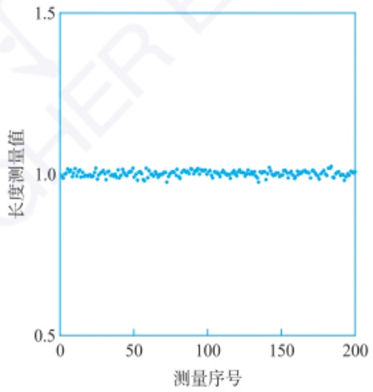

<details>
<summary>scatter</summary>

| 测量序号 | 长度测量值 |
| --- | --- |
| 0~200 | ~1.0 |
</details>

(a)

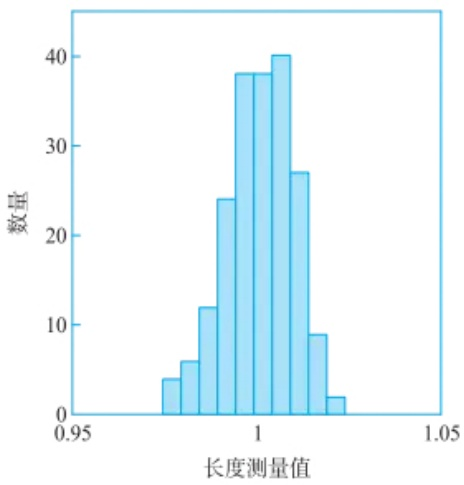

<details>
<summary>histogram</summary>

| 长度测量值 (Bin) | 数量 |
| --- | --- |
| ~0.975 ~0.98 | ~4 |
| ~0.98 ~0.985 | ~6 |
| ~0.985 ~0.99 | ~12 |
| ~0.99 ~0.995 | ~24 |
| ~0.995 ~1.0 | ~38 |
| ~1.0~1.005 | ~38 |
| ~1.005 ~1.01 | 40 |
| ~1.01 ~1.015 | ~27 |
| ~1.015 ~1.02 | ~9 |
| ~1.02 ~1.025 | ~2 |
</details>

(b)

图 2.2.1 200 个长度测量值及其频数分布

当测量值无限多、频数分布的分组组距无限短时，频数分布变成连续形式，这就是概率密度曲线（probability density curve）。

---

2.2 分析数据的统计处理

43

## 2.2.1.2 随机变量的概率密度和累积概率

概率密度曲线是概率密度(以 p 表示)与随机变量取值(以 x 表示)的关系曲线。概率密度有些抽象,其积分却是学习者熟悉的概率。概率密度在某区间上的积分,即曲线在此区间上围成的面积,就是随机变量取值落入此区间的概率。在图 2.2.2(a) 的示例中,三个不同区域的面积分别为 A、B 和 C,含义是随机变量取值落入区间  $(-∞,-1]$ 、 $[-1,1]$  和  $[1,∞)$  的概率;落入区间  $[-1,1]$  之外的概率等于  $A+C$ 。显然,概率密度曲线在实数域上围成的面积为 1。

概率密度曲线代表的函数称为概率密度函数（probability density function, PDF）。如果图2.2.2(a)中的PDF表示为 $p(x)$，那么可以得到上述结论的数学等价:

$$
A = P \{X <   - 1 \} = \int_ {- \infty} ^ {- 1} p (x) \mathrm{d} x
$$

$$
B = P \{- 1 <   X <   1 \} = \int_ {- 1} ^ {1} p (x) \mathrm{d} x
$$

$$
C = P \{X > 1 \} = \int_ {1} ^ {\infty} p (x) \mathrm{d} x
$$

$$
A + C = 1 - \int_ {- 1} ^ {1} p (x) \mathrm{d} x
$$

$$
\int_ {- \infty} ^ {\infty} p (x) \mathrm{d} x = 1
$$

与概率密度相关的一个概念是累积分布(cumulative distribution)。累积分布是概率密度在区间 $(-∞, x]$ 上的积分(对于只取正值的随机变量,此区间为 $(0, x]$ ),以P表示。累积分布函数(cumulative distribution function, CDF) $P(x)$ 与概率密度函数 $p(x)$ 的关系如下:

$$
P (x) = P \{X <   x \} = \int_ {- \infty} ^ {x} p (t) \mathrm{d} t \tag {2-2-1}
$$

借助 CDF, 可以计算出随机变量取值落入任何区间的概率: 以图 2.2.2(a) 为例,  $A = \mathrm{CDF}(-1)$ ,  $B = \mathrm{CDF}(1) - \mathrm{CDF}(-1)$ ,  $C = 1 - \mathrm{CDF}(1)$ 。CDF 曲线的示例见图 2.2.2(b)。

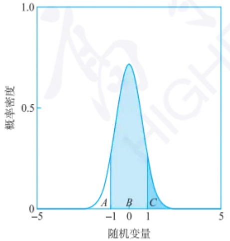

<details>
<summary>violin</summary>

| 随机变量 | 概率密度 |
| --- | --- |
| -1 | ~0.25 |
| 0 | ~0.75 |
| 1 | ~0.25 |
</details>

(a)

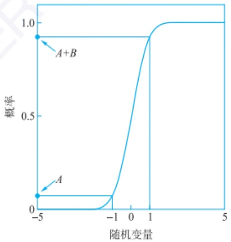

<details>
<summary>line</summary>

| 随机变量 | 概率 |
| --- | --- |
| -5 | 0.1 |
| -1 | 0.1 |
| 1 | 0.9 |
| 5 | 1.0 |
</details>

(b)

图 2.2.2 概率密度曲线(a)及相应累积分布曲线(b)的示意图

(a) A、B 和 C 分别表示曲线在区域  $(-∞, -1]$ 、 $[-1, 1]$  和  $[1, +∞)$  上围成的面积；
(b) 标识了累积分布函数分别在 -1 和 1 处的值

注释: 连续型随机变量取某一确定值的概率是零。因此, 谈及连续型随机变量的取值区间时, 是否包括端点无关紧要。


数理统计中的符号表示

---

44

第二章 分析数据处理


正态分布  $N(\mu, \sigma^{2})$  的 PDF、CDF 和 ICDF 及相关计算方式

CDF 计算随机变量取值落入区间  $(-∞, x]$  的概率。反之，如果这一概率已知，求区间端点 x 时，可以使用逆累积分布函数（inverse cumulative distribution function, ICDF）。

## 2.2.1.3 随机变量的正态分布

正态分布 (normal distribution) 是最常见的一种分布, 表示为  $N(\mu, \sigma^{2})$  。 $\mu$  和  $\sigma^{2}$  是正态分布的两个参数, 含义是 (服从正态分布的) 随机变量所有取值的平均和方差, 故称总体均值和总体方差。可扫描副栏二维码了解正态分布的 PDF、CDF 和 ICDF 及相关计算方式。

图 2.2.3 是参数不同的两个正态分布  $N(0,0.25)$  和  $N(0,1)$  的概率密度曲线和累积分布曲线。从图中可以看出，正态分布是关于  $x=\mu$  对称的峰形曲线；峰位置由  $\mu$  控制，峰宽由  $\sigma$  控制， $\sigma\approx\frac{1}{2}W_{0.6}(W_{0.6}$  表示 60% 峰高处的峰宽）；曲线在  $x=\mu\pm\sigma$  处有两个拐点（二阶导数为零）。

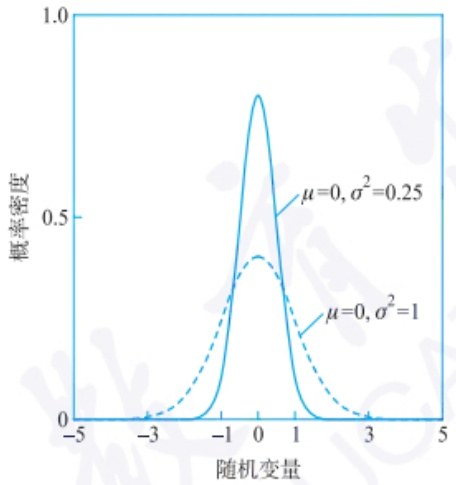

<details>
<summary>violin</summary>

| 随机变量 | \(\mu=0, \sigma^{2}=0.25\) (概率密度) | \(\mu=0, \sigma^{2}=1 (\)概率密度) |
| --- | --- | --- |
| -3 | 0 | ~0.05 |
| -1 | ~0.1 | ~0.3 |
| 0 | ~0.8 | ~0.4 |
| 1 | ~0.1 | ~0.3 |
| 3 | 0 | ~0.05 |
</details>

(a)

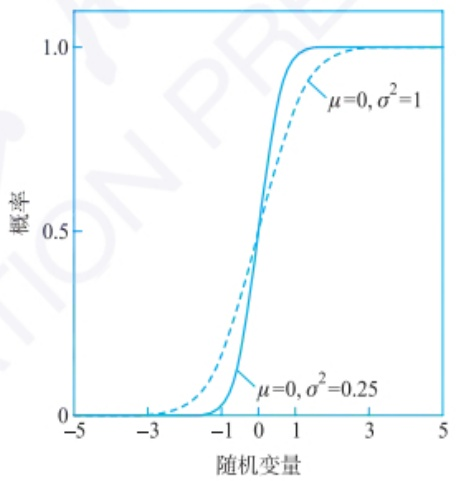

<details>
<summary>line</summary>

| 随机变量 | 概率 \((\mu=0\), \(\sigma^{2}=1)\) | 概率 \((\mu=0\), \(\sigma^{2}=0.25)\) |
| --- | --- | --- |
| -5 | 0 | 0 |
| -3 | ~0.01 | 0 |
| -1 | ~0.15 | ~0.05 |
| 0 | ~0.55 | ~0.45 |
| 1 | ~0.95 | ~0.85 |
| 3 | 1.0 | 1.0 |
| 5 | 1.0 | 1.0 |
</details>

(b)

图 2.2.3 参数不同的两个正态分布的概率密度曲线(a)和累积分布曲线(b)

均值为0、方差为1的正态分布称为标准正态分布 $N(0,1)$ 。通过简单数学变换，标准正态分布可以与任意参数的正态分布相互转换，这一性质使得相关计算更加便捷，下面进行说明。

以  $p(u)$  和  $p(x)$  分别表示  $N(0,1)$  和  $N(\mu,\sigma^{2})$  的 PDF, 那么两个函数的自变量和因变量存在如下关系:

$$
u = \frac {x - \mu}{\sigma}, \quad p (u) = \sigma p (x) \tag {2-2-2}
$$

如果 $N(0,1)$ 的概率密度已知，那么通过上述简单变换即可得到 $N(\mu, \sigma^2)$ 的概率密度，不必费力计算PDF。例如，Matlab中的randn命令，该命令生成服从标准正态分布的随机数，那么通过算式 $\sigma * \mathrm{randn} + \mu$ 即可得到服从 $N(\mu, \sigma^2)$ 分布的随机数。

以  $P(u)$  和  $P(x)$  分别表示  $N(0,1)$  和  $N(\mu,\sigma^{2})$  的 CDF, 那么两个函数的自变量和因变量存在如下关系:

$$
u = \frac {x - \mu}{\sigma}, \quad P (u) = P (x) \tag {2-2-3}
$$

如果  $N(0,1)$  的累积概率已知,那么通过上述简单变换即可得到  $N(\mu,\sigma^{2})$  的

---

2.2 分析数据的统计处理

45

累积概率,不必费力计算 CDF。在计算工具欠发达的年代,计算 CDF 颇为困难,于是人们制作了  $N(0,1)$  的累积概率数值表,列出不同 u 值与其对应的  $P(u)$ 。通过数值表和  $u=\frac{x-\mu}{\sigma}$  这一简单算式,无须计算 CDF 即可得到任意参数正态分布  $N(\mu,\sigma^{2})$  的累积概率。

## 2.2.1.4 抽样分布

多数情况下正态分布可以较好地描述测量值,而当需要研究测量值的平均值、方差等参数时,则需要使用抽样分布(sampling distribution)。

数理统计中,研究对象的所有可能取值构成一个集合,称为总体(population),这些取值称为个体(individual)。总体包含大量甚至无限多个体。通过简单抽样,从总体抽取有限个体构成的集合称为样本(sample),其中个体的数量称为样本容量。

为了反映样本特征,需要从样本信息构造一些变量,如样本均值、样本方差等。这种完全由样本信息确定的量称为样本统计量(statistic)。样本统计量的概率分布就是抽样分布。如果抽样分布能够从总体的分布得出,那么称为精确抽样分布。

精确抽样分布大多从正态总体得到,这就是统计中著名的三大抽样分布—— $\chi^{2}$ 分布、t分布和F分布。精确抽样分布适用于样本容量较小的数理统计问题,因而成为处理少量测量数据的重要工具。

## 2.2.1.5 抽样分布之样本均值的分布

设  $x_{1}, x_{2}, \cdots, x_{n}$  是来自正态总体  $N(\mu, \sigma^{2})$  的随机样本，以  $\bar{x}$  表示样本均值，那么  $\bar{x}$  服从正态分布  $N\left(\mu, \frac{\sigma^{2}}{n}\right)$ 。如果定义随机变量 U:

$$
U = \frac {\bar {x} - \mu}{\sigma} \sqrt {n} \tag {2-2-4}
$$

那么 U 服从标准正态分布。

对于均值 $\mu$ 、方差 $\sigma^2$ 的任何总体，样本均值 $\tilde{x}$ 近似服从正态分布 $N\left(\mu, \frac{\sigma^2}{n}\right)$；样本容量越大，近似程度越好，这就是中心极限定理（central limit theorem）。因此，即使总体的分布未知，也可以使用正态分布研究其样本均值。

## 2.2.1.6 抽样分布之 $\chi^{2}$ 分布

设  $x_{1}, x_{2}, \cdots, x_{n}$  是来自正态总体  $N(\mu, \sigma^{2})$  的随机样本，那么以下形式的随机变量  $\chi^{2}$  服从自由度 (degrees of freedom, df) 为  $f(f = n - 1)$  的  $\chi^{2}$  分布 (Chi-squared distribution)，记作  $\chi^{2} \sim \chi^{2}(f)$ 。

$$
\chi^ {2} = \frac {(n - 1) s ^ {2}}{\sigma^ {2}} \tag {2-2-5}
$$

式中， $s^{2}$  表示样本方差。

扫描副栏二维码了解 $\chi^{2}$ 分布的 PDF、CDF 和 ICDF 及相关计算方式。

图 2.2.4 是自由度分别为 1、5 和 20 三种  $\chi^{2}$  分布的概率密度曲线和累积分布曲线。从图中可以看出，概率密度曲线不对称，f 越大，曲线越趋于对称。当  $f \to \infty$  时， $\chi^{2}(f)$  趋向正态分布  $N(f, 2f)$ 。

## 2.2.1.7 抽样分布之 $t$ 分布

设 $x_{1}, x_{2}, \cdots, x_{n}$ 是来自正态总体 $N(\mu, \sigma^{2})$ 的随机样本，那么以下形式的随机

理解抽样分布: 分析化学中的测量值司空见惯, 如测定矿石含铁量: 对同一样品平行测定 5 次, 得到 5 个测量值。从数理统计角度, 可以这样理解: 考虑所有的测量情形, 理论上可以得到无数个含铁量的测量值, 从中抽取 5 个就得到了这 5 个测量值。

简单抽样:是指抽样随机(所有个体被抽中的概率相同)和抽样独立(抽样结果互不影响)。


$\chi^{2}$  分布的 PDF、CDF 和 ICDF 及相关计算方式

t 分布: 由英国统计学家 W. S. Gosset 在 1908 年创立, 发表论文的署名是 A. Student, 得名 t 分布, 也称 Student 分布。

---

46

第二章 分析数据处理

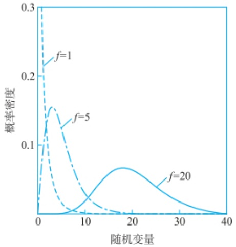

<details>
<summary>line</summary>

| 随机变量 | f=1 (概率密度) | f=5 (概率密度) | f=20 (概率密度) |
| --- | --- | --- | --- |
| 0 | ~0.3 | ~0.02 | ~0.01 |
| 5 | ~0.05 | ~0.15 | ~0.01 |
| 10 | ~0.01 | ~0.05 | ~0.03 |
| 15 | ~0.005 | ~0.01 | ~0.07 |
| 20 | ~0.002 | ~0.005 | ~0.06 |
| 25 | ~0.001 | ~0.002 | ~0.04 |
| 30 | ~0.001 | ~0.001 | ~0.02 |
| 35 | ~0.001 | ~0.001 | ~0.01 |
| 40 | ~0.001 | ~0.001 | ~0.01 |
</details>

(a)

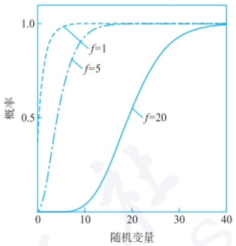

<details>
<summary>line</summary>

| 随机变量 | f=1 (概率) | f=5 (概率) | f=20 (概率) |
| --- | --- | --- | --- |
| 0 | 0 | 0 | 0 |
| 10 | ~0.95 | ~0.85 | ~0.05 |
| 20 | 1.0 | 1.0 | ~0.6 |
| 30 | 1.0 | 1.0 | ~0.9 |
| 40 | 1.0 | 1.0 | 1.0 |
</details>

(b)

图 2.2.4 自由度不同的三种  $\chi^{2}$  分布的概率密度曲线 (a) 和相应累积分布曲线 (b)

变量 T 服从自由度为  $f(f=n-1)$  的 t 分布，记作  $T \sim t(f)$ 。

$$
T = \frac {\bar {x} - \mu}{s} \sqrt {n} \tag {2-2-6}
$$

式中， $\bar{x}$  表示样本均值；s 表示样本标准偏差。

扫描副栏二维码了解 t 分布的 PDF、CDF 和 ICDF 及相关计算方式。

图 2.2.5 给出了自由度分别为 1 和 20 两种 t 分布的概率密度曲线和累积分布曲线。从图中可以看出，概率密度曲线是关于 x=0 对称的峰形曲线，峰形随自由度不同而改变。当  $f \to \infty$  时， $t(f)$  趋向标准正态分布  $N(0,1)$ 。


t 分布的 PDF、CDF 和 ICDF 及相关计算方式

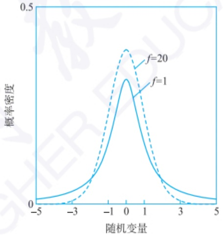

<details>
<summary>violin</summary>

| 随机变量 | 概率密度 (f=1) | 概率密度 (f=20) |
| --- | --- | --- |
| -5 | ~0.02 | 0 |
| -3 | ~0.08 | ~0.02 |
| -1 | ~0.25 | ~0.35 |
| 0 | ~0.45 | ~0.55 |
| 1 | ~0.25 | ~0.35 |
| 3 | ~0.08 | ~0.02 |
| 5 | ~0.02 | 0 |
</details>

(a)

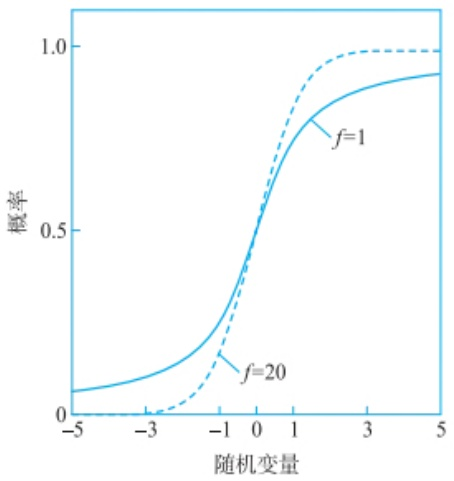

<details>
<summary>line</summary>

| 随机变量 | 概率 (f=1) | 概率 (f=20) |
| --- | --- | --- |
| -5 | ~0.08 | 0 |
| -3 | ~0.15 | ~0.02 |
| -1 | ~0.35 | ~0.25 |
| 0 | ~0.55 | ~0.55 |
| 1 | ~0.75 | ~0.85 |
| 3 | ~0.90 | ~0.98 |
| 5 | ~0.95 | ~1.0 |
</details>

(b)

图 2.2.5 自由度不同的两种 t 分布的概率密度曲线(a)和相应累积分布曲线(b)

F 分布: 此命名用以纪念统计学家 R. A. Fisher 爵士。

## 2.2.1.8 抽样分布之 F 分布

设  $x_{1}, x_{2}, \cdots, x_{m}$  为来自正态总体  $N(\mu_{x}, \sigma^{2})$  的随机样本， $y_{1}, y_{2}, \cdots, y_{n}$  是来自正态总体  $N(\mu_{y}, \sigma^{2})$  的随机样本，那么以下形式的随机变量 F 服从自由度分别为  $f_{1}(f_{1}=m-1)$  和  $f_{2}(f_{2}=n-1)$  的 F 分布，记作  $F \sim F(f_{1}, f_{2})$ 。其中， $f_{1}$  和  $f_{2}$  分别称为分子自由度和分母自由度（也称第一自由度和第二自由度）。

$$
F = \frac {s _ {1} ^ {2}}{s _ {2} ^ {2}} \tag {2-2-7}
$$

---

2.2 分析数据的统计处理

47

式中， $s_{1}^{2}$  和  $s_{2}^{2}$  分别表示两个样本的样本方差。

扫描副栏二维码了解 F 分布的 PDF、CDF 和 ICDF 及相关计算方式。

图2.2.6给出了自由度不同的三种 $F$ 分布的概率密度曲线和累积分布曲线。从图中可以看出，$F(f_{1},f_{2})$ 不同于 $F(f_{2},f_{1})$ 。

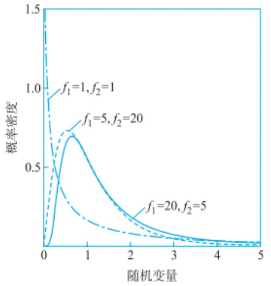

<details>
<summary>line</summary>

| 随机变量 | f1=1, f2=1 (概率密度) | f1=5, f2=20 (概率密度) | f1=20, f2=5 (概率密度) |
| --- | --- | --- | --- |
| 0 | ~1.4 | 0 | 0 |
| 0.5 | ~0.6 | ~0.7 | ~0.3 |
| 1 | ~0.3 | ~0.5 | ~0.6 |
| 2 | ~0.1 | ~0.2 | ~0.2 |
| 3 | ~0.05 | ~0.1 | ~0.1 |
| 4 | ~0.02 | ~0.05 | ~0.05 |
| 5 | ~0.01 | ~0.02 | ~0.02 |
</details>

(a)

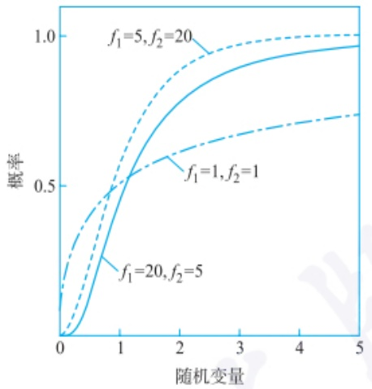

<details>
<summary>line</summary>

| 随机变量 | 概率 (f1=5, f2=20) | 概率 (f1=1, f2=1) | 概率 (f1=20, f2=5) |
| --- | --- | --- | --- |
| 0 | 0 | 0 | 0 |
| 1 | ~0.65 | ~0.55 | ~0.45 |
| 2 | ~0.95 | ~0.75 | ~0.85 |
| 3 | ~0.98 | ~0.85 | ~0.92 |
| 4 | ~1.0 | ~0.92 | ~0.96 |
| 5 | ~1.0 | ~0.96 | ~0.98 |
</details>

(b)

图 2.2.6 自由度不同的三种 F 分布的概率密度曲线(a)和相应累积分布曲线(b)

值得指出的是,如果随机变量  $F \sim F(f_{1}, f_{2})$ , 那么随机变量  $\frac{1}{F} \sim F(f_{2}, f_{1})$ 。

三大抽样分布的随机变量有些抽象,但是具有明确的应用特征。例如,使用 $\chi^{2}$ 分布研究样本方差中的随机因素;使用t分布研究样本均值与总体均值差异中的随机因素;使用F分布研究两个样本方差中的随机因素。由于这种应用特征,三大抽样分布成为显著性检验的基础。

## 2.2.2 显著性检验

科学技术研究中,经常需要判断事件源自确定性因素还是随机因素,以便采取针对性措施。这种判断通过显著性检验(test of statistical significance)来完成。检验结论有两种,分别是“统计显著”(statistically significant)和“统计不显著”(statistically insignificant);前者表明事件源自确定性因素,后者表明事件源自随机因素。给出上述两个结论,显著性检验依据的就是随机变量的分布。

显著性检验容易实施，在计算机硬件普及、软件丰富的当前尤其如此；生成式AI出现后，显著性检验变成无须用脑的人问机答。然而，更重要、也更有价值的是检验方法的正确应用和检验结果的合理阐释，这需要深入理解显著性检验的原理。

## 2.2.2.1 基本原理

扫描副栏二维码了解显著性检验的底层逻辑。被检验问题通过一个随机变量来描述，称为检验统计量（test statistic）。检验统计量的分布就是如图2.2.7所示的PDF曲线；使用该曲线的前提是“事件源自随机因素”这样一个假设，称为原假设(null hypothesis)。图2.2.7中浅色区域面积较大，表示检验统计量在区间$[a,x]$内取值的概率很大，这个概率称为置信度(confidence)；深色区域面积较小，表示检验统计量在区间$[x,b]$内取值的概率很小，这个概率称为显著性水平（significance level），以 $\alpha$ 表示。如果检验统计量取值落入区间$[x,b]$，属于（不该发生


F 分布的 PDF、CDF 和 ICDF 及相关计算方式


显著性检验的底层逻辑

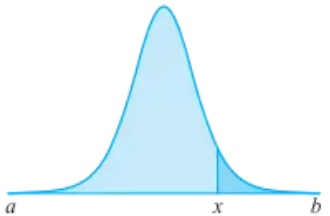

<details>
<summary>area</summary>

| X | Y |
| --- | --- |
| a | ~0 |
| x | ~0.25 |
| b | ~0 |
</details>

图 2.2.7 显著性检验中的概率密度函数示意图

$[a,b]$ 为检验统计量的取值范围； $[a,x]$ 为接受域，区域内浅色部分的面积为置信度； $[x,b]$ 为拒绝域，区域内深色部分的面积为显著性水平；x为临界值。

---

48

第二章 分析数据处理


显著性检验的两类错误

的)小概率事件,为了解决矛盾就拒绝原假设。如果检验统计量取值落入区间 $[a,x]$ ,属于(应该发生的)大概率事件,就接受原假设。区间 $[a,x]$ 被称为接受域(acceptance region),区间 $[x,b]$ 被称为拒绝域(rejection region)。x是接受域和拒绝域的分界,称为临界值(critical value)。

显著性检验合乎情理,却经不起细究,因为既不承认小概率事件可能发生,也不承认大概率事件可能不发生。所以,无论拒绝原假设,还是接受原假设,结论都不是百分之百正确,这就是显著性检验的两类错误。扫描副栏二维码了解相关讨论。

## 2.2.2.2 检验类型

显著性检验分为三种类型，分别是左侧检验（left-sided/left-tailed test）、右侧检验（right-sided/right-tailed test）和双侧检验（two-sided/two-tailed test），前二者统称为单侧检验（one-sided/one-tailed test）。这些类型的名称来自拒绝域和接受域的位置关系，如图2.2.8所示。

图 2.2.8 中深色部分所在区域为拒绝域，面积为显著性水平；浅色部分所在区域为接受域，面积为置信度；圆点表示临界值。注意双侧检验有两个拒绝域和两个临界值，每块深色区域的面积为显著性水平的一半。

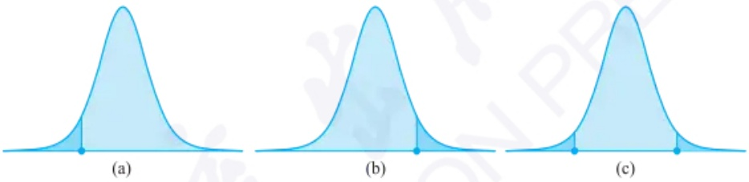

图 2.2.8 （a）左侧单侧检验、（b）右侧单侧检验和（c）双侧检验中的概率密度函数、拒绝域和接受域示意图

以上三种检验类型中,如果检验统计量取值落入拒绝域,那么结论分别是:该值在统计意义上“显著地小”(左侧)、“显著地大”(右侧)和“显著地与众不同”(双侧);表明该值大概率源自确定性因素。如果检验统计量取值落入接受域,那么结论分别是:不能认为该值在统计意义上“显著地小”(左侧)、“显著地大”(右侧)或“显著地与众不同”(双侧);表明该值大概率源自随机因素。

这三种类型都具有明确的应用场景。以分析化学中的实验数据处理为例，如果判断“平均值是否显著小于参考值”，那么属于左侧检验；如果判断“平均值是否显著大于参考值”，那么属于右侧检验；如果判断“平均值是否显著异于真值”，那么属于双侧检验。


显著性检验的 $P$ 值

## 2.2.2.3 显著性检验的 $P$ 值

显然，只要获得拒绝域，显著性检验便可顺利完成。另一种有效的完成手段是使用 $P$ 值（$P$ value）:无论是单侧检验还是双侧检验，如果 $P$ 值小于显著性水平 $\alpha$ ，那么统计显著；如果 $P$ 值 $>\alpha$ ，那么统计不显著。关于 $P$ 值的定义和计算，扫描副栏二维码详细了解。

专业的统计软件通常会计算 P 值,人们只需判断其与  $\alpha$  的大小便可得出结论。这种便捷性使得 P 值成为完成显著性检验的首选手段,拒绝域/接受域在实际中很少使用。

## 2.2.2.4 显著性检验的实施

下面是显著性检验的一般步骤,实线流程表示通过拒绝域/接受域判断,虚线流程表示通过 P 值判断。

实线所示的流程中,关键在于拒绝域的获得,也就是需要计算出临界值。临

---

2.2 分析数据的统计处理

49

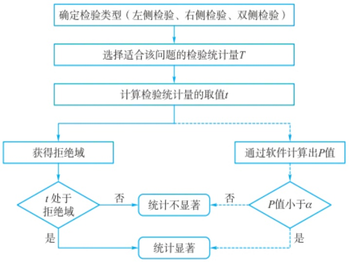

<details>
<summary>flowchart</summary>

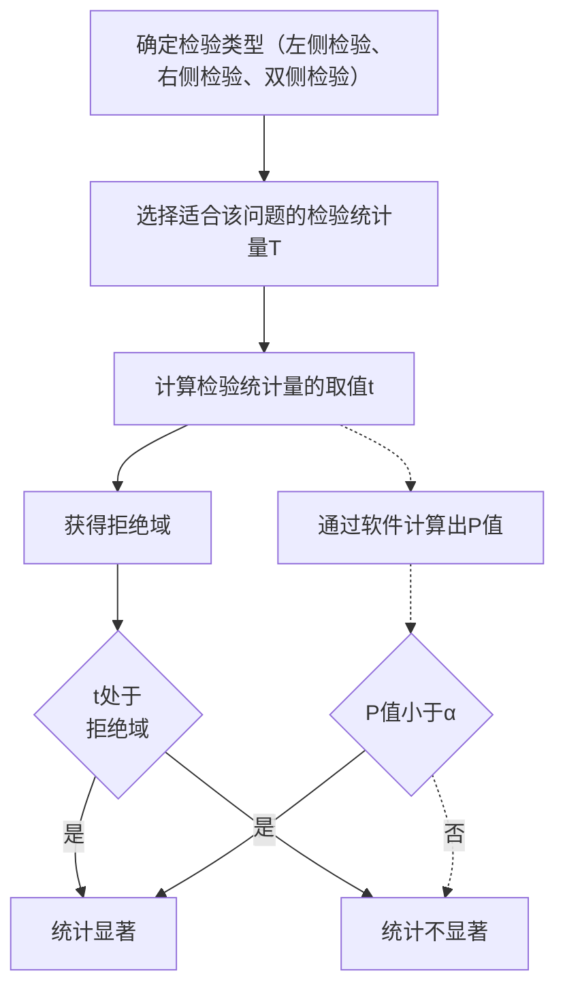
</details>

界值是根据预先设定的显著性水平,通过逆累积分布函数 ICDF 计算得到。然而,ICDF 对于简单计算器而言过于复杂,所以在计算工具欠发达的年代,人们只能使用由专业人员计算好的统计数值表。分析化学传统教材中,统计数值表是附录的必要部分。

统计数值表曾经必不可少,但是也存在明显不足。限于篇幅,普通统计数值表只列出常用数值(注释1);存在多种数值表,不易区分,所以表头通常给出明确的图示和相应公式,避免误用。

当前计算机硬件普及、软件丰富，常见分布的ICDF计算不再困难。所以，本书不提供统计数值表，显著性检验所需的临界值或者 $P$ 值均通过stac软件得到，该软件还能够计算正态分布、$t$ 分布、$\chi^2$ 分布和 $F$ 分布的CDF和ICDF。扫描二维码观看软件演示视频。软件有Matlab和Android两个版本，分别运行于计算机（注释2）和智能手机。

## 2.2.2.5 分析化学中常见的显著性检验

分析化学中常见的显著性检验包括 u 检验、 $\chi^{2}$  检验、t 检验和 F 检验，相关信息列于表 2.2.1。

表 2.2.1 u 检验、 $\chi^{2}$  检验、t 检验和 F 检验的 PDF 曲线、拒绝域及临界值的表示和计算

(圆点表示临界值; $\alpha$ 表示显著性水平,对应图中阴影面积,阴影所在区域为拒绝域;

ICDF 表示逆累积分布函数; f 表示自由度)

| 检验统计量及其分布 | 左侧检验 | 右侧检验 | 双侧检验 |
| --- | --- | --- | --- |
| 服从N(0,1)分布的随机变量 | $-u_{\alpha} = \text{ICDF}(\alpha)$ | $u_{\alpha} = \text{ICDF}(1-\alpha)$ | $-u_{\frac{\alpha}{2}} = \text{ICDF}\left(\frac{\alpha}{2}\right)$$u_{\frac{\alpha}{2}} = \text{ICDF}\left(1-\frac{\alpha}{2}\right)$ |

注释1:更加全面、详尽的数值只能求诸专业书,如国家标准局批准(GB 4086.1\~4086.6-83)、中国标准出版社1984年出版的《统计分布数值表》。

注释 2: 需要在计算机上安装 Matlab 以运行 stac, 安装 Matlab 基本组件即可, 不需要任何工具箱。Matlab 有 Windows 和 Mac 版本。


stac 软件演示

---

50

第二章 分析数据处理

续表

<table><tr><td>检验统计量及其分布</td><td>左侧检验</td><td>右侧检验</td><td>双侧检验</td></tr><tr><td rowspan="2"> $\frac{(n-1)s^2}{\sigma^2}$ 服从 $\chi^2$ 分布</td><td>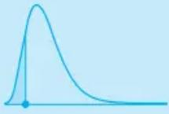</td><td>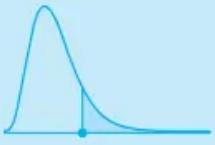</td><td>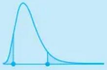</td></tr><tr><td> $\chi^{2}_{1-\alpha,f} = \text{ICDF}(\alpha, f)$ </td><td> $\chi^{2}_{\alpha,f} = \text{ICDF}(1 - \alpha, f)$ </td><td> $\chi^{2}_{1-\frac{\alpha}{2},f} = \text{ICDF}\left(\frac{\alpha}{2}, f\right)$  $\chi^{2}_{\frac{\alpha}{2},f} = \text{ICDF}\left(1 - \frac{\alpha}{2}, f\right)$ </td></tr><tr><td colspan="2">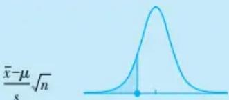</td><td>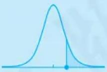</td><td>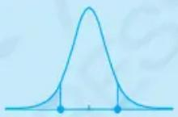</td></tr><tr><td>服从 $t$ 分布</td><td> $-t_{\alpha,f} = \text{ICDF}(\alpha, f)$ </td><td> $t_{\alpha,f} = \text{ICDF}(1 - \alpha, f)$ </td><td> $-t_{\frac{\alpha}{2},f} = \text{ICDF}\left(\frac{\alpha}{2}, f\right)$  $t_{\frac{\alpha}{2},f} = \text{ICDF}\left(1 - \frac{\alpha}{2}, f\right)$ </td></tr><tr><td colspan="2">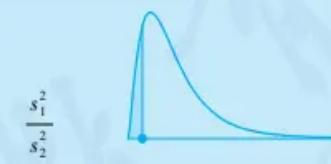</td><td>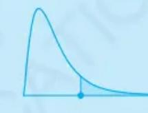</td><td>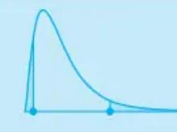</td></tr><tr><td>服从 $F$ 分布</td><td colspan="2"> $F_{1-\alpha,f,f_2} = \text{ICDF}(\alpha, f_1, f_2)$   $F_{\alpha,f,f_2} = \text{ICDF}(1 - \alpha, f_1, f_2)$ </td><td> $F_{1-\frac{\alpha}{2},f_1, f_2} = \text{ICDF}\left(\frac{\alpha}{2}, f_1, f_2\right)$  $F_{\frac{\alpha}{2},f_1, f_2} = \text{ICDF}\left(1 - \frac{\alpha}{2}, f_1, f_2\right)$ </td></tr></table>

这些检验能够满足特定的数据分析需求。例如，欲判断确定性因素还是随机因素导致了测量数据的波动，那么使用 $\chi^{2}$ 检验，因为检验统计量包含描述数据波动的样本方差 $s^{2}$ 。再如，欲判断确定性因素还是随机因素导致了测量数据平均值异于真值，那么使用t检验，因为检验统计量包含样本均值 $\bar{x}$ 和真值 $\mu$ 。通过后面的例题加深理解。

## 2.2.3 数理统计的应用方法

这一部分针对分析化学中不同的数据处理情形,介绍数理统计的具体应用。数理统计应用的重点和难点是概念理解、方法选择和结果阐释,其中涉及的数值计算相对简单得多。

$\chi^2$ 分布、$t$ 分布和 $F$ 分布是来自正态总体的精确抽样分布，所以适用于数据量小、测量值服从正态分布的数据。人们在实际应用中经常忽略后一条件，所得结论就失之偏颇甚至错误（幸运的是，很多情况下测量值服从或者近似服从正态分布）。数理统计方法的应用固然重要，然而更重要的是避免误用和滥用。

---

2.2 分析数据的统计处理

51

## 2.2.3.1 检出限和定量限

由于随机因素的影响,即使被测物质不存在,测量值(即空白测量值)也不一定为零,而是零值附近很小的随机波动。如果被测物质存在,但是非常少,以至于相应测量值与这些随机波动在统计意义上没有区别,那么不能认为该测量值来自被测物质。从另一个角度看,任何分析方法的检测能力都存在下限,这个下限称为检出限(limit of detection, LOD)。

检出限是分析方法的最小可靠测量值对应的被测物质的量(注释1)。可靠测量值是指该测量值属于随机波动的可能性极小。所以，确定检出限的关键在于判断测量值是否显著大于随机波动，这可以通过数理统计方法来实现。

一般认为，空白测量值是服从正态分布 $N(0,\sigma^2)$ 的随机变量。容易计算出，该随机变量的取值大于 $3\sigma$ 的概率仅为 $0.13\%$ （注释2）。所以，大于 $3\sigma$ 的测量值源自随机因素的可能性极小，反而极有可能是对少量被测物质的真实响应。

综上所述,分析方法的最小可靠测量值是其空白测量值标准偏差的3倍,对应的被测物质的量就是检出限(注释3)。这就是所谓的“ $3\sigma$ 规则”。检出限的单位可以是浓度、质量或者物质的量。检出限是分析方法性能的重要指标之一。

检出限属于定性分析范畴。对于定量分析,存在类似概念,称为定量限(limit of quantification,LOQ)。定量限一般为空白测量值标准偏差10倍所对应的被测物质的量。

分析化学中还有一个相关概念称为灵敏度(sensitivity)，是指被测物质量的改变引起的测量值的变化，定义式如下:

$$
\mathrm{Sen} = \frac {\Delta y}{\Delta c} \tag {2-2-8}
$$

式中，Sen 表示灵敏度； $\Delta c$  表示被测物质含量的改变； $\Delta y$  表示相应测量信号值的变化。Sen 与检出限 LOD 的关系为  $LOD = \frac{3\sigma}{Sen}$ 。灵敏度在一定范围内为定值，这个范围是分析方法的线性范围。

## 2.2.3.2 离群值的判定

相同条件下的一组测量值不完全相等,根据经验研究者觉得这可能很正常;同样根据经验,研究者会注意到有时某个值明显偏大或者偏小,显得不太“合群”。对于这个值,无论是探究其产生原因(很正确),还是删除了事(不太正确),都需要事先解决一个问题:有没有比依靠个人经验更为客观的判定方式?答案是有,这就是离群值(outlier)的统计学判定,下面介绍两种常见方法。

以 $x_{e}$ 表示待判定的值，$\bar{x}$ 和 $\bar{d}$ 分别表示移除 $x_{e}$ 后的样本均值和平均偏差；如果 $|x_{e} - \bar{x}| > 4\bar{d}$，那么判定 $x_{e}$ 离群。这就是所谓的“$4\bar{d}$ 法”。$4\bar{d}$ 法虽然简单，其统计学原理是明确的（注释4）。

“4d法”比较简便，但功效逊于Grubbs法。Grubbs法计算检验统计量 $G = \frac{|x_{\mathrm{e}} - \bar{x}|}{s}$，其中 $\bar{x}$ 和 $s$ 分别表示样本均值和样本标准偏差。 $G$ 大于临界值时，判定 $x_{\mathrm{e}}$ 离群。

Grubbs法所需的临界值通过相应的概率密度函数计算得到，但是计算非常复杂。为了方便使用，将常见临界值列表，如表2.2.2所示，更全面的临界值可以查阅中华人民共和国国家标准GB/T4883—2008《数据的统计处理和解释——正态样本离群值的判断和处理》（注释5）。

注释 1: IUPAC 对检出限的定义如下: The limit of detection, expressed as the concentration,  $c_{L}$ , or the quantity,  $q_{L}$ , is derived from the smallest measure,  $x_{L}$ , that can be detected with reasonable certainty for a given analytical procedure. The value of  $x_{L}$  is given by the equation  $x_{L} = \bar{x}_{bi} + k s_{bi}$ , where  $\bar{x}_{bi}$  is the mean of the blank measures,  $s_{bi}$  is the standard deviation of the blank measures, and k is a numerical factor chosen according to the confidence level desired.

注释 2:你能通过 stac 或者 Excel 软件计算出这个数值吗?

注释3:有时空白测量值非常稳定,标准偏差为零。这种情况下,可向试剂空白加入极少量被测物质,使分析方法产生响应。加入的被测物质应该尽量少,否则标准偏差可能被人为降低,导致错误的检出限。

注释4:如果  $x_{e} \sim N(\mu, \sigma^{2})$ ，那么  $\frac{x_{e} - \mu}{\sigma} \sim N(0, 1)$ 。根据正态分布， $\left|\frac{x_{e} - \mu}{\sigma}\right| > 3$  的概率仅为 0.27%；如果实际情况确实如此，那么认为  $x_{e}$  显著偏离总体均值  $\mu$ ，属于离群值。 $\bar{x} \approx \mu$ 、 $\sigma \approx \sqrt{\frac{\pi}{2}} \bar{d}$ ，那么  $\left|\frac{x_{e} - \mu}{\sigma}\right| > 3$  可近似为  $|x_{e} - \bar{x}| > 4 \bar{d}$ 。

注释 5: 可在“国家标准全文公开系统”中查阅此国家标准全文。

---

52

第二章 分析数据处理

表 2.2.2 Grubbs 检验在不同显著性水平 $\alpha$ 下的临界值

<table><tr><td rowspan="2">测量值数量</td><td colspan="5">显著性水平α</td></tr><tr><td>0.10</td><td>0.05</td><td>0.025</td><td>0.01</td><td>0.005</td></tr><tr><td>3</td><td>1.148</td><td>1.153</td><td>1.155</td><td>1.155</td><td>1.155</td></tr><tr><td>4</td><td>1.425</td><td>1.463</td><td>1.481</td><td>1.492</td><td>1.496</td></tr><tr><td>5</td><td>1.602</td><td>1.672</td><td>1.715</td><td>1.749</td><td>1.764</td></tr><tr><td>6</td><td>1.729</td><td>1.822</td><td>1.887</td><td>1.944</td><td>1.973</td></tr><tr><td>7</td><td>1.828</td><td>1.938</td><td>2.020</td><td>2.097</td><td>2.139</td></tr><tr><td>8</td><td>1.909</td><td>2.032</td><td>2.126</td><td>2.221</td><td>2.274</td></tr><tr><td>9</td><td>1.977</td><td>2.110</td><td>2.215</td><td>2.323</td><td>2.387</td></tr><tr><td>10</td><td>2.036</td><td>2.176</td><td>2.290</td><td>2.410</td><td>2.482</td></tr><tr><td>11</td><td>2.088</td><td>2.234</td><td>2.355</td><td>2.485</td><td>2.564</td></tr><tr><td>12</td><td>2.134</td><td>2.285</td><td>2.412</td><td>2.550</td><td>2.636</td></tr><tr><td>13</td><td>2.175</td><td>2.331</td><td>2.462</td><td>2.607</td><td>2.699</td></tr><tr><td>14</td><td>2.213</td><td>2.371</td><td>2.507</td><td>2.659</td><td>2.755</td></tr><tr><td>15</td><td>2.247</td><td>2.409</td><td>2.549</td><td>2.705</td><td>2.806</td></tr></table>

表中数据摘自国家标准 GB/T 4883—2008。

Q 检验法是 W. J. Dixon 在 1951 年提出的离群值判定方法。在测量值数量较少时，Q 检验法与 Grubbs 法相差甚微，而后者的功效最优（GB/T 4883—2008）。

离群值的统计学判定结果只是表明离群源自确定性因素。在探明确定性因素的情况下（如测量条件改变或者操作失误），应该尝试修正离群值；如果无法修正，那么删除之，避免其“污染”最终结果。如果离群原因未明，则不应该轻易删除；此时如果担心离群值影响平均值，可以将测量数据的中位数作为最终结果。

统计学方法为判定离群值提供一个比经验更为客观的方式，而不是为删除“异常值”提供一个心安理得的理由。正如国家标准 GB/T 4883—2008 所称“对检出的离群值，应尽可能寻找其技术上和物理上的原因，作为处理离群值的依据。”

离群值的处理通常是数据处理的第一步,舍弃实验过失导致的错误数据,然后才可以进行其他处理,如显著性检验等。

## 2.2.3.3 分析结果精密度的检验

例行分析中,需要定期检查分析系统的稳定性。在相同条件下对同一样品进行多次分析,然后检验由样本推测出的总体方差与参考值(方差参考值通过长期分析实践或者经验得到)是否显著不同。如果存在显著性差异,说明数据波动源自确定性因素,那么应该检查试剂、设备、分析人员等。

解决上述问题的数理统计方法是 $\chi^{2}$ 检验,具体步骤如下。

»例 2.2.1 在药品生产线上实时监测药品活性成分含量。根据经验, 活性成分含量服从正态分布 N(4.55,0.01)。某天随机读取 25 个样品的活性成分含量, 样本方差为 0.009。在 0.05 显著性水平下, 判断当天产品的活性成分含量是否出现异常波动。

---

2.2 分析数据的统计处理

53

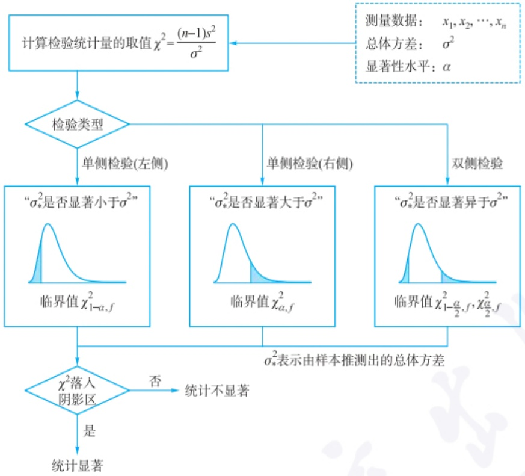

<details>
<summary>flowchart</summary>

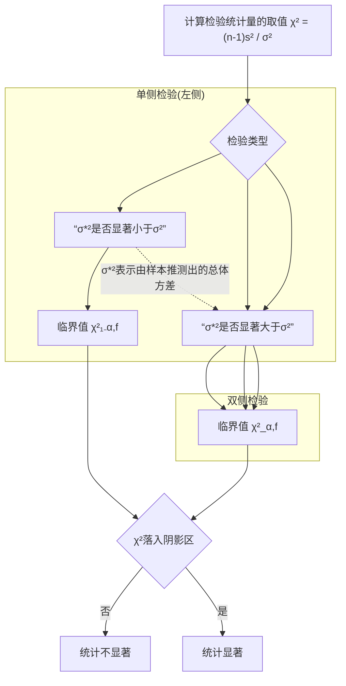
</details>

》解:这是一个双侧检验问题。样本方差太大当然属于异常,说明某(些)确定性因素致使生产条件不稳定;样本方差太小也是“异于寻常”,尽管这是好事,说明某(些)确定性因素提高了稳定性。

根据题意,使用 $\chi^{2}$ 检验,检验统计量的取值为

$$
\chi^ {2} = \frac {2 4 s ^ {2}}{\sigma^ {2}} = 2 1. 6
$$

通过stac或者Excel软件，得到两个临界值 $\chi_{0.975,24}^2 = 12.40$ 、 $\chi_{0.025,24}^2 = 39.36$ ，所以该问题的接受域为[12.40,39.36]。检验统计量的取值落入接受域，说明统计不显著，即不能认为当天产品的活性成分含量出现异常波动。

## 2.2.3.4 两组数据精密度的比较

分析化学中常有比较两组实验数据的情形。例如，两名分析人员使用同一方法分析同一样品、一名分析人员使用两种方法分析同一样品、一名分析人员使用同一方法分析两种样品等。比较两组实验数据之前，必须检验二者的精密度是否存在显著性差异，因为精密度是准确度的必要条件。此外，精密度的比较也可以判断一组数据的分析条件是否比另一组更加稳定。

解决上述问题的数理统计方法是 F 检验, 具体步骤如下。

»例 2.2.2 某分析化学家合成了一种新型酸碱指示剂,变色敏锐,终点更易于判断。使用该指示剂进行8次滴定,滴定体积的标准偏差为0.02。作为对比,使用变色点相同的传统指示剂进行8次滴定,滴定体积的标准偏差为0.04。在0.05显著性水平下,能否认为新型指示剂的效果优于传统指示剂?

》解:本题判断使用新指示剂的滴定体积的方差是否显著小于使用传统指示剂的情形,所以这是一个左侧单侧检验问题。根据题意,使用F检验,检验统计量

---

54

第二章 分析数据处理

一些传统教材规定 F 检验的检验统计量为“大方差除以小方差”。F 检验的原理并没有这个要求（扫描下方二维码了解详情），然而得益于这种规定，一个显著性水平为  $\alpha$  的统计数值表就能完成显著性水平为  $\alpha$  的单侧检验和显著性水平为  $2\alpha$  的双侧检验。

这种检验方式可以简化步骤、节约篇幅，但是有损检验的直观性，而且也无法进行其他显著性水平下的检验（除非提供相应的统计数值表）。统计软件则可以避免这些问题，使用时也不必刻意“大方差除以小方差”，按照框图中的步骤，或许更容易理解。


$F$ 检验的检验统计量

## 讨论:

结论可靠性提高到 $99\%$ 是否更好？

注释1:一个常见的错误表述是“真值落入置信区间的概率是……”;随机性只出现在测量值(平均值)中,真值已经确定,不存在随机性。

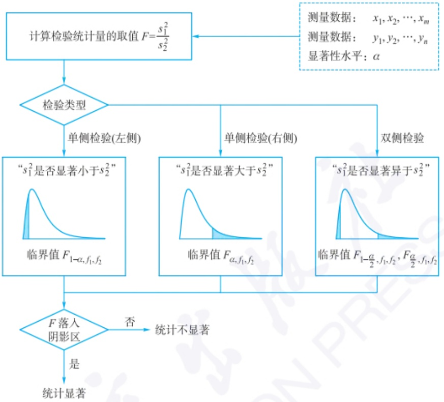

<details>
<summary>flowchart</summary>

```mermaid
graph TD
  Start["计算检验统计量的取值 F = (s1^2 / s2^2)"] --> Decision{"检验类型"}
  Decision -->|单侧检验左侧| LeftGroup["“s1^2 是否显著小于s2^2”"]
  Decision -->|单侧检验右侧| RightGroup["“s1^2 是否显著大于s2^2”"]
  Decision -->|双侧检验| RightGroup
  
  subgraph LeftGroup
  LeftGroup --> LeftResult["临界值 F_{1-α,f1,f2}"]
  end
  
  subgraph RightGroup
  RightGroup --> RightResult["临界值 F_{α,f1,f2}"]
  end
  
  LeftResult --> FinalDecision{"F 落入阴影区"}
  RightResult --> FinalDecision
  
  FinalDecision -->|否| EndFail["统计不显著"]
  FinalDecision -->|是| EndSuccess["统计显著"]
```
</details>

的取值为

$$
F = \frac {s _ {\text {新型}} ^ {2}}{s _ {\text {传统}} ^ {2}} = 0. 2 5
$$

通过stac或者Excel软件，得到临界值 $F_{0.95,7,7} = 0.26$ ，所以该问题的拒绝域为[0,0.26]。检验统计量的取值落入拒绝域，说明统计显著，即使用新型指示剂的滴定体积的精密度显著优于使用传统指示剂的情形。这一结论的可靠性为 $95\%$ 。

## 2.2.3.5 置信区间

很多情况下,真值无法得知,而是根据实际分析结果进行区间估计。该区间称为置信区间(confidence interval, CI),以分析结果的平均值为中心。CI包含真值(注释1)的概率是一个较大的预设值,称为置信度;CI不包含真值的概率等于显著性水平 $\alpha$ 。

在2.2.1.5介绍的样本均值分布中，随机变量 $U = \frac{\bar{x} - \mu}{\sigma}\sqrt{n}$ 服从标准正态分布 $N(0,1)$ 。 $U$ 取极端值的概率很小，如果将此概率设为显著性水平 $\alpha$，那么可以确定一个非极端值的取值区间， $U$ 取值落入该区间是一个大概率事件（概率等于 $1 - \alpha$）。以 $\pm u_{\alpha /2}$ 表示该区间的端点，得到:

$$
P \{- u _ {\alpha / 2} \leqslant U \leqslant u _ {\alpha / 2} \} = 1 - \alpha \tag {2-2-9}
$$

将 $U = \frac{\bar{x} - \mu}{\sigma}\sqrt{n}$ 代入上式，整理后得到:

$$
P \left\{\bar {x} - \frac {\sigma u _ {\alpha / 2}}{\sqrt {n}} \leqslant \mu \leqslant \bar {x} + \frac {\sigma u _ {\alpha / 2}}{\sqrt {n}} \right\} = 1 - \alpha
$$

---

2.2 分析数据的统计处理

55

$\left[\bar{x}-\frac{\sigma u_{\alpha/2}}{\sqrt{n}},\bar{x}+\frac{\sigma u_{\alpha/2}}{\sqrt{n}}\right]\text{就是置信区间，包含真值的概率等于}1-\alpha.$

如果总体方差  $\sigma^{2}$  未知,那么以随机变量  $T=\frac{\bar{x}-\mu}{s}\sqrt{n}$  代替  $U=\frac{\bar{x}-\mu}{\sigma}\sqrt{n}$ 。 $T\sim t(n-1)$ ，通过 t 分布得到置信区间  $\left[\bar{x}-\frac{st_{\alpha/2,f}}{\sqrt{n}},\bar{x}+\frac{st_{\alpha/2,f}}{\sqrt{n}}\right]$ 。

置信区间端点的计算式中， $u_{\alpha/2}$  和  $t_{\alpha/2,f}$  分别是标准正态分布和 t 分布的临界值，参考 2.2.2.5 表 2.2.1 中双侧检验的图示。

置信度和置信区间长度是相互制约的两个量。较小的 $u_{\alpha/2}$ 或者 $t_{\alpha/2,f}$ 可以缩短置信区间，但是置信度随之降低；高置信度下， $u_{\alpha/2}$ 或者 $t_{\alpha/2,f}$ 变大，置信区间变宽，实用价值降低。缩短置信区间而又不降低置信度的实用方式是增加测量次数。

## 2.2.3.6 平均值与参考值的比较

分析化学中,测量值与参考值之间有时存在差异。数理统计方法可以帮助探究差异背后可能的确定性因素。

从 2.2.1 介绍的抽样分布可知, 包含平均值与参考值之差的随机变量有  $U = \frac{\bar{x} - \mu}{\sigma} \sqrt{n}$  和  $T = \frac{\bar{x} - \mu}{s} \sqrt{n}$ ,  $U \sim N(0, 1)$ ,  $T \sim t(n-1)$ 。以 U 或者 T 作为检验统计量的方法称为 u 检验或者 t 检验, 分别适用于总体方差已知或者未知的情形。

t 检验的具体步骤如下。u 检验的步骤完全相同，只需要将检验统计量改为  $U=\frac{\bar{x}-\mu}{\sigma}\sqrt{n}$  、临界值改为  $u_{\alpha}$ （单侧检验）或者  $u_{\alpha/2}$ （双侧检验）。

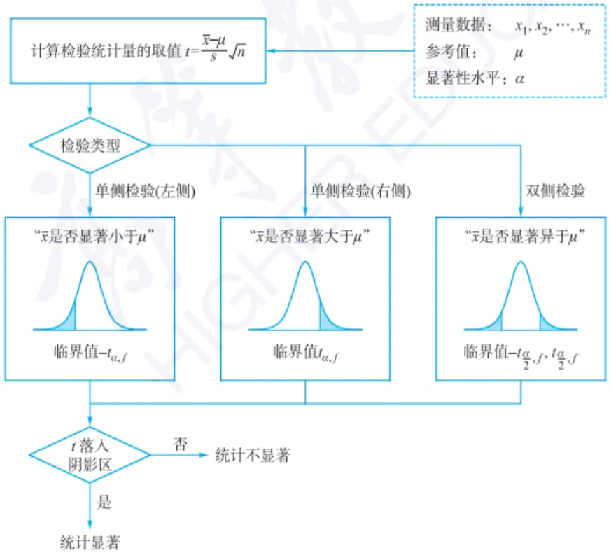

<details>
<summary>flowchart</summary>

```mermaid
graph TD
  Start["计算检验统计量的取值 t = (x̄ - μ/s)√n"] --> Decision{"检验类型"}
  Decision -->|单侧检验左侧| LeftTest["&quot;x̄是否显著小于μ&quot;"]
  Decision -->|单侧检验右侧| RightTest["&quot;x̄是否显著大于μ&quot;"]
  Decision -->|双侧检验| RightTest["&quot;x̄是否显著异于μ&quot;"]
  
  subgraph MeasurementData["测量数据: x₁, x₂, ..., xₙ\n参考值: μ\n显著性水平: α"]
  Start --> Decision
  LeftTest --> Decision
  RightTest --> Decision
  RightTest --> Decision
  
  Decision --> Result{"t 落入阴影区"}
  Result -->|否| EndFail["统计不显著"]
  Result -->|是| EndSuccess["统计显著"]
```
</details>

---

56

第二章 分析数据处理

## 讨论:

使用更低显著性水平以减小临界值是否合适？

»例 2.2.3 某制药厂生产复合维生素制剂,称 50 g 产品的含铁量不低于 2.000 mg。对某批次产品进行 10 次抽查,测得含铁量(mg)如下:

$$
2. 0 0 0 \quad 1. 9 9 7 \quad 1. 9 8 3 \quad 1. 9 9 7 \quad 1. 9 9 2 \quad 1. 9 9 0 \quad 1. 9 8 8 \quad 1. 9 9 5 \quad 1. 9 8 0 \quad 2. 0 1 0
$$

在 0.05 显著性水平下, 判断该批次产品的含铁量是否显著低于规定标准。

》解:抽查结果的平均值为1.993 mg,虽然低于参考值,但原因可能是测量过程中的随机因素。只有通过显著性检验排除这种情况,才可以认为结果偏低源自确定性因素——该批次产品不合格。

本题是一个左侧单侧检验。总体方差未知，所以使用 t 检验，检验统计量的取值为

$$
t = \frac {(\bar {x} - 2 . 0 0 0) \sqrt {1 0}}{s} = - 2. 4 8
$$

通过stac或者Excel软件，得到临界值 $-t_{0.05,9} = -1.83$ ，所以该问题的拒绝域为$(-\infty , - 1.83]$ 。检验统计量的取值落入拒绝域，说明统计显著，即该批次产品的含铁量显著低于规定标准。这一结论的可靠性为 $95\%$

## 2.2.3.7 两个平均值的比较

当两组数据的精密度没有显著性差异时,有时会进一步比较两个平均值,判断二者的差异源自随机因素还是确定性因素。

解决上述问题的数理统计方法是 t 检验, 步骤见 2.2.3.6, 不同的只是自由度和检验统计量。以 m 和 n 分别表示两组数据的数据量, 那么该检验的自由度  $f = m + n - 2$ , 检验统计量为

$$
T = \frac {\overline {{x}} _ {1} - \overline {{x}} _ {2}}{\overline {{s}}} \sqrt {\frac {m n}{m + n}} \tag {2-2-10}
$$

式中  $\bar{s}$  是合并标准偏差 (pooled standard deviation)，计算公式如下:

$$
\overline {{s}} = \sqrt {\frac {(m - 1) s _ {1} ^ {2} + (n - 1) s _ {2} ^ {2}}{m + n - 2}} \tag {2-2-11}
$$

只有当 $s_{1}^{2}$ 和 $s_{2}^{2}$ 无显著性差异时，才可以计算 $\overline{s}$，这也是首先进行F检验的原因。

»例 2.2.4 某河流污染严重。取 12 个水样测定化学需氧量 $\left(\mathrm{mg}\cdot\mathrm{L}^{-1}\right)$ ，均值 70.1，标准偏差 2.1。后来关闭了污染源，欲利用水体的自洁功能降低污染。一段时间后又取 12 个水样测定化学需氧量，均值 68.5，标准偏差 3.6。在 0.05 显著性水平下，判断化学需氧量是否有了显著降低。

》解:首先通过 F 检验判断两个方差是否有显著性差异。这是一个双侧检验问题,检验统计量的取值为

$$
F = \frac {s _ {1} ^ {2}}{s _ {2} ^ {2}} = 0. 3 4
$$

通过stac或者Excel软件，得到两个临界值 $F_{0.975,11,11} = 0.29, F_{0.025,11,11} = 3.47$ ，所以该问题的接受域为[0.29,3.47]。检验统计量的取值落入接受域，所以方差没有显著性差异。

然后进行 $t$ 检验，判断68.5是否显著小于70.1。这是一个左侧单侧检验问题，检验统计量的取值为

$$
t = \frac {6 8 . 5 - 7 0 . 1}{\overline {{s}}} \sqrt {6} = - 1. 3 3
$$

---

2.2 分析数据的统计处理

57

通过stac或者Excel软件，得到临界值 $-t_{0.05,22} = -1.72$ ，所以该问题的接受域为$[-1.72,\infty)$ 。检验统计量的取值落入接受域，说明统计不显著，即不能认为这段时间内化学需氧量有了显著降低，68.5小于70.1的原因是测量过程中的随机因素。

## 2.2.3.8 配对数据的比较

分析化学中存在这样的情形:有多个样品,每个样品通过两种方法分析,或者由两名分析人员使用同一方法在相同条件下分析。分析完成后,每个样品都有两个结果,这就是所谓的配对数据(paired data):

|  | 样品1 | 样品2 | $\cdots$ | 样品n |
| --- | --- | --- | --- | --- |
| 分析一 | $a_{1}$ | $a_{2}$ | $\cdots$ | $a_{n}$ |
| 分析二 | $b_{1}$ | $b_{2}$ | $\cdots$ | $b_{n}$ |

配对数据的检验,不属于上面介绍的“两个平均值的比较”,因为 $a_{i}$ (或者 $b_{i}$ )不是同一对象的测量值,计算其平均值 $\bar{a}$ (或者 $\bar{b}$ )没有意义。正确的做法是计算配对数据的差值 $d_{i}=a_{i}-b_{i}$ ,然后检验平均值 $\bar{d}$ 与参考值是否存在显著性差异。“参考值”是指仅在随机因素的影响下差值的期望值,这个期望值一般是零,当然也有例外。

配对数据的检验过程:首先计算出配对数据的差值,然后根据具体问题确定这些差值的期望值,最后使用2.2.3.6介绍的t检验。

》例 2.2.5 分析一批采集自不同区域的铁矿石。对每一样品分别采用光度法和滴定法进行分析,测得如下结果:

| 光度法 | 6.33 | 9.05 | 14.35 | 17.32 | 20.47 | 24.88 | 27.88 | 32.56 | 35.73 | 39.72 |
| --- | --- | --- | --- | --- | --- | --- | --- | --- | --- | --- |
| 滴定法 | 6.53 | 9.52 | 14.68 | 17.74 | 20.78 | 24.67 | 27.73 | 32.23 | 35.40 | 39.21 |

在 0.05 显著性水平下, 检验两种分析方法的结果是否一致。

》解:该问题属于配对数据检验,先计算配对数据的差值d:

$$
- 0. 2 0 \quad - 0. 4 7 \quad - 0. 3 3 \quad - 0. 4 2 \quad - 0. 3 1 \quad 0. 2 1 \quad 0. 1 5 \quad 0. 3 3 \quad 0. 3 3 \quad 0. 5 1
$$

这是一个双侧检验问题,检验统计量的取值为

$$
t = \frac {(\bar {d} - d _ {\mathrm{R}}) \sqrt {1 0}}{s _ {d}} = - 0. 1 7
$$

式中， $d_{R}$  表示差值的参考值，在本题中等于零。通过stac或者Excel软件，得到两个临界值 $-t_{0.025,9}=-2.26,t_{0.025,9}=2.26$ ，所以该问题的接受域为 $[-2.26,2.26]$ 。检验统计量的取值落入接受域，说明统计不显著，即差值不为0的原因是随机因素，所以两种分析方法的结果一致。

## 讨论:

如果选择一个大于-1.33的临界值会如何？

## 习题

## - 章节练习题 -

1. 根据长期分析经验, 某合金标样的 Zn 含量服从正态分布  $N(1.35,0.01^{2})$ , 那么测量值处于 [1.35,1.37] 的概率是多少?
2. 对标样进行9次分析, 标准偏差0.07。规定标样分析结果的标准偏差不得超过0.05。在0.05显著性水平下, 能否认为该实验室结果的标准偏差显著偏大?

---

58

第二章 分析数据处理

## 化学计量学 (chemometrics)

化学计量学是一门化学与数学、统计学、计算机科学交叉而产生的化学学科分支，它选择最优试验设计和测量方法，通过处理、解析测量数据，最大限度地获取有关物质系统的成分、结构和其他相关信息。

化学计量学的研究内容主要包括:采样理论和方法、化学实验设计与优化方法、分析检测理论与信号处理方法、多元校正与分辨、化学模式识别、计算机数字模拟、人工智能与化学专家系统等。其中本章节涉及的多元校正模型和方法是化学计量学的研究重点和热点之一。

3. 相同条件下对同一样品进行两次分析, 结果如下:

第一次 9.56 9.56 9.60 9.57 9.58 9.62

第二次 9.33 9.51 9.49 9.51 9.49 9.34

在 95% 置信度下,第一次数据的精密度是否显著优于第二次数据的精密度?

4. 通过一种新方法测定锌含量为 $34.33\%$ 的标准合金样品，5次测定结果为 $34.38\%$ 、 $34.26\%$ 、 $34.29\%$ 、 $34.38\%$ 和 $34.37\%$ 。在 $95\%$ 置信度下判断新方法是否有系统误差。
5. 通过两种方法测定标准矿样中的铁含量。方法一测定7次，均值2.08，标准偏差0.10；方法二测定9次，均值2.19，标准偏差0.12。在0.10显著性水平下检验精密度是否存在显著性差异，两个平均值是否存在显著性差异。两个结论的可靠性是多少？
6. 一名学生从称量瓶转移固体样品到已恒重的坩埚中, 然后比较称量瓶的减重和坩埚的增重。操作6次的结果如下:

称量瓶减重 0.2125 0.3026 0.1426 0.1573 0.1443 0.1561

坩埚增重 0.2124 0.3025 0.1423 0.1568 0.1443 0.1566

在 0.05 显著性水平下,该学生的称量是否合格?

## - 挑战性问题 -

7. 某 F 分布的统计数值表标明“单侧, 显著性水平 0.05”。将表中数据用于双侧检验时, 显著性水平是多少? 如果标明的是“双侧, 显著性水平 0.05”, 那么将表中数据用于单侧检验时, 置信度是多少?
8. 已知正态总体  $N(36,10^{2})$ ，为了使样本均值  $\bar{x}$  取值大于 32 的概率高于 95%，样本容量 n 应该超过多少？
9. 对矿样的含铜量进行测定, 13 次分析的平均值为 1.21%, 标准偏差为 0.04%。计算 95% 置信度下含铜量平均值的单侧置信下限。

## - 专题或报告 -

10. 查阅应用显著性检验的文献,领域不限。这些文献中,“统计显著”和“统计不显著”的结论各自有多少;讨论结论可靠性的文献又有多少;是否有“不能认为存在统计显著性”的结论?根据这些资料,对显著性检验的优点和局限性进行总结。
11. 查阅应用显著性检验的文献, 领域不限, 使用 P 值的有多少? 查阅包含显著性检验的教材, 使用 P 值的有多少? 从中可以得出什么结论?
12. 查阅应用显著性检验的文献, 总结显著性水平有哪些。为什么不使用更大或者更小的显著性水平?

## 2.3 定量校正模型和方法

现代分析仪器(如荧光光谱仪、紫外-可见光谱仪、拉曼光谱仪、近红外光谱仪、色谱-质谱联用仪等)的检测速度快,适用于大量样本的快速分析,在食品、化工、化学和生物制药、环境监测、临床检验等领域获得广泛的应用。在使用各类仪器分析方法对待测样品中目标物质进行定量分析时,首先需要利用标准样品(样品中目标物质的浓度已知或已测定)构建目标物质浓度(y)与分析仪器信号响应(x)之间的校正模型 $y=f(x)$ ,然后才能对待测样品中的目标物质进行定量分析。本章以吸光光度法为例介绍单变量校正模型和方法,以及多元(或多变量)校正模型和方法,这些方法也适用于其他类型分析仪器的校正。

---

2.3 定量校正模型和方法

59

## 2.3.1 单变量校正模型和方法

现假定采用吸光光度法测得某目标物质的稀溶液样本在波长 $\lambda$ 处的吸光度值为 $x\left(x = \lg \frac{I_0}{I_1}\right)$，按照朗伯-比尔(Lambert-Beer)定律则有:待测溶液样本的吸光度 $x$ 与目标物质的物质的量浓度 $(c)$ 和液层厚度 $(l)$ 成正比[图2.3.1、式(2-3-1)]。

$$
x = \lg \frac {I _ {0}}{I _ {1}} = c l \varepsilon \tag {2-3-1}
$$

式中，$\varepsilon$ 代表目标物质在波长 $\lambda$ 处的摩尔吸光系数。液层厚度 $l$ 实际上是入射光在溶液中传播的路程，简称“光程”。对于均匀的非散射样本（如均相溶液样本）来说，$l$ 和 $\varepsilon$ 均为常数。若用 $y$ 代替 $c$ 表示待测溶液样本中目标物质的物质的量浓度，并且将实验误差 $(e)$ 考虑进来，则式(2-3-1)可简写如下:

$$
y = b x + e \tag {2-3-2}
$$

式中， $b=\frac{1}{l\varepsilon}$ 。考虑到可能存在溶剂的吸收和光谱仪器的基线漂移现象，通常会在式(2-3-2)中添加一项常数项，得到如下常用的单变量校正模型:

$$
y = b _ {0} + b _ {1} x + e \tag {2-3-3}
$$

为了获取式(2-3-3)中的模型参数 $b_{0}$ 和 $b_{1}$，需要用光谱仪器测定一组已知浓度的标准样本（亦称校正样）的吸光度值。然后利用所测得的数据估计出模型参数 $b_{0}$ 和 $b_{1}$ 。设现有m个待测组分浓度为 $y_{i}(i=1,2,\cdots,m)$ 的标准样本，测得其相应的吸光度值为 $x_{i}(i=1,2,\cdots,m)$，则有以下关系式成立。

$$
\begin{array}{r l} & y _ {1} = b _ {0} + b _ {1} x _ {1} + e _ {1} \\ & y _ {2} = b _ {0} + b _ {1} x _ {2} + e _ {2} \\ & \vdots \\ & y _ {m} = b _ {0} + b _ {1} x _ {m} + e _ {m} \end{array} \Rightarrow \left[ \begin{array}{c} y _ {1} \\ y _ {2} \\ \vdots \\ y _ {m} \end{array} \right] = \left[ \begin{array}{c c} 1 & x _ {1} \\ 1 & x _ {2} \\ \vdots & \vdots \\ 1 & x _ {m} \end{array} \right] \left[ \begin{array}{c} b _ {0} \\ b _ {1} \end{array} \right] + \left[ \begin{array}{c} e _ {1} \\ e _ {2} \\ \vdots \\ e _ {m} \end{array} \right] \Rightarrow \mathbf {y} = \mathbf {X b} + \mathbf {e} \tag {2-3-4}
$$

式中， $y=\begin{bmatrix}y_{1}\\ \vdots\\ y_{m}\end{bmatrix},X=\begin{bmatrix}1&x_{1}\\ \vdots&\vdots\\ 1&x_{m}\end{bmatrix},b=\begin{bmatrix}b_{0}\\ b_{1}\end{bmatrix},e=\begin{bmatrix}e_{1}\\ \vdots\\ e_{m}\end{bmatrix}$ 。要使以上模型能够充分代表所测得的 m 个数据点  $(x_{i},y_{i})$ ，则模型参数向量 b 的取值应使  $E=\sum_{i=1}^{m}e_{i}^{2}=e^{\prime}e=(y-Xb)^{\prime}(y-Xb)$  达到最小值，其中上标“'”表示矩阵转置。使 E 最小的 b 通常用如下最小二乘法获得:

$$
\frac {\partial E}{\partial \mathbf {b}} = - 2 \mathbf {X} ^ {\prime} \mathbf {y} + 2 \mathbf {X} ^ {\prime} \mathbf {X} \mathbf {b} = 0 \tag {2-3-5}
$$

整理上式,得到

$$
\mathbf {b} = \mathbf {X} ^ {+} \mathbf {y} \tag {2-3-6}
$$

式中，符号“+”用于表示矩阵的 Moore-Penrose 广义逆，等于  $(\mathbf{X}^{\prime}\mathbf{X})^{-1}\mathbf{X}^{\prime}$ 。获得待测样本的吸光度  $x_{test}$  后，其中目标物质的浓度  $y_{test}$  可按下式估算出来。

$$
y _ {\mathrm{test}} = [ 1, x _ {\mathrm{test}} ] \mathbf {b} \tag {2-3-7}
$$

如果待测样本的吸光度值与其浓度之间的关系并不严格遵循朗伯-比尔定律所描述的简单线性模型,则可在式(2-3-3)的基础上添加非线性项(如 $x^{2}$ ),从而得到

$$
y = b _ {0} + b _ {1} x + b _ {2} x ^ {2} + e \tag {2-3-8}
$$

同样地,若已测得 m 个标准样本的数据点 $(x_{i},y_{i})$ ,则下式成立。

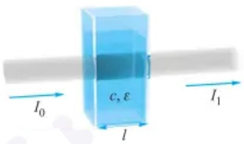

<details>
<summary>text_image</summary>

I₀
c, ε
l
I₁
</details>

图 2.3.1 待测溶液样本的吸光度检测示意图( $I_{0}$  为入射光强度, $I_{1}$  为透射光强度)

---

60

第二章 分析数据处理

$$
\begin{array}{r} y _ {1} = b _ {0} + b _ {1} x _ {1} + b _ {2} x _ {1} ^ {2} + e _ {1} \\ y _ {2} = b _ {0} + b _ {1} x _ {2} + b _ {2} x _ {2} ^ {2} + e _ {2} \\ \vdots \\ y _ {m} = b _ {0} + b _ {1} x _ {m} + b _ {2} x _ {m} ^ {2} + e _ {m} \end{array} \Rightarrow \left[ \begin{array}{c} y _ {1} \\ y _ {2} \\ \vdots \\ y _ {m} \end{array} \right] = \left[ \begin{array}{c c c} 1 & x _ {1} & x _ {1} ^ {2} \\ 1 & x _ {2} & x _ {2} ^ {2} \\ \vdots & \vdots & \vdots \\ 1 & x _ {m} & x _ {m} ^ {2} \end{array} \right] \left[ \begin{array}{c} b _ {0} \\ b _ {1} \\ b _ {2} \end{array} \right] + \left[ \begin{array}{c} e _ {1} \\ e _ {2} \\ \vdots \\ e _ {m} \end{array} \right] \Rightarrow \mathbf {y} = \mathbf {X b} + \mathbf {e} \tag {2-3-9}
$$

式中， $y=\begin{bmatrix}y_{1}\\ \vdots\\ y_{m}\end{bmatrix},X=\begin{bmatrix}1&x_{1}&x_{1}^{2}\\ \vdots&\vdots&\vdots\\ 1&x_{m}&x_{m}^{2}\end{bmatrix},b=\begin{bmatrix}b_{0}\\ b_{1}\\ b_{2}\end{bmatrix},e=\begin{bmatrix}e_{1}\\ \vdots\\ e_{m}\end{bmatrix}$ 。式(2-3-9)中的模型参数

向量 b 的最小二乘解为:  $b = X^{+}y$ 。显然, 该解在形式上与式(2-3-6)完全一致, 但 X 和 b 所代表的具体内容有所不同。

在实际工作中,当两个变量 x 和 y 之间并不存在严格的线性关系时,虽然也可以按照上述步骤求得线性校正模型,但此线性校正模型不一定有意义。所得线性校正模型是否有意义可用相关系数(correlation coefficient, r)进行检验。

$$
r = \frac {\sum_ {i = 1} ^ {m} (x _ {i} - \bar {x}) (y _ {i} - \bar {y})}{\sqrt {\sum_ {i = 1} ^ {m} (x _ {i} - \bar {x}) ^ {2} \sum_ {i = 1} ^ {m} (y _ {i} - \bar {y}) ^ {2}}} \tag {2-3-10}
$$

式中， $\bar{x}$  和  $\bar{y}$  分别为  $x_{i}$  和  $y_{i}(i=1,2,\cdots,m)$  的平均值。当两个变量 x 和 y 之间存在完全线性关系时， $|r|=1$ ；当两个变量之间不存在线性关系时， $|r|=0$ ；当  $0<|r|<1$  时，两变量之间存在线性关系， $|r|$  越接近 1，两变量之间的线性关系越强。当用相关系数来判断两变量之间线性关系的强弱时，还应考虑测量次数和置信度。表 2.3.1 列出了不同置信度及自由度时的相关系数绝对值的临界值。若计算出的相关系数的绝对值大于表中相应的数值，则表示两变量显著相关，所求得的线性校正模型有意义；反之，则无意义。

表 2.3.1 检验相关系数绝对值的临界值表

<table><tr><td rowspan="2">f=m-2</td><td colspan="4">置信度</td></tr><tr><td>90%</td><td>95%</td><td>99%</td><td>99.9%</td></tr><tr><td>1</td><td>0.988</td><td>0.997</td><td>0.9998</td><td>0.999999</td></tr><tr><td>2</td><td>0.900</td><td>0.950</td><td>0.990</td><td>0.999</td></tr><tr><td>3</td><td>0.805</td><td>0.878</td><td>0.959</td><td>0.991</td></tr><tr><td>4</td><td>0.729</td><td>0.811</td><td>0.917</td><td>0.974</td></tr><tr><td>5</td><td>0.669</td><td>0.755</td><td>0.875</td><td>0.951</td></tr><tr><td>6</td><td>0.622</td><td>0.707</td><td>0.834</td><td>0.925</td></tr><tr><td>7</td><td>0.582</td><td>0.666</td><td>0.798</td><td>0.898</td></tr><tr><td>8</td><td>0.549</td><td>0.632</td><td>0.765</td><td>0.872</td></tr><tr><td>9</td><td>0.521</td><td>0.602</td><td>0.735</td><td>0.847</td></tr><tr><td>10</td><td>0.497</td><td>0.576</td><td>0.708</td><td>0.823</td></tr></table>

»例 2.3.1 用分光光度法测得6个酚标准溶液的数据如下:

| 样本标号 | 1 | 2 | 3 | 4 | 5 | 6 |
| --- | --- | --- | --- | --- | --- | --- |
| 酚含量$y_i$ | 0.005 | 0.010 | 0.020 | 0.030 | 0.040 | 0.050 |
| 吸光度$x_i$ | 0.020 | 0.040 | 0.100 | 0.120 | 0.140 | 0.180 |

---

2.3 定量校正模型和方法

61

请根据表中的数据构建酚的含量与其吸光度之间的单变量校正模型，并检查校正模型在 $95\%$ 的置信度下是否有意义。

》解:

$$
\mathbf {y} = \left[ \begin{array}{l} 0. 0 0 5 \\ 0. 0 1 0 \\ 0. 0 2 0 \\ 0. 0 3 0 \\ 0. 0 4 0 \\ 0. 0 5 0 \end{array} \right], \quad \mathbf {X} = \left[ \begin{array}{l l} 1 & 0. 0 2 0 \\ 1 & 0. 0 4 0 \\ 1 & 0. 1 0 0 \\ 1 & 0. 1 2 0 \\ 1 & 0. 1 4 0 \\ 1 & 0. 1 8 0 \end{array} \right], \quad \mathbf {b} = \mathbf {X} ^ {*} \mathbf {y} = \left[ \begin{array}{l} - 0. 0 0 2 4 \\ 0. 2 8 2 6 1 \end{array} \right]
$$

校正模型:  $y = -0.0024 + 0.28261x$

按式(2-3-10)计算相关系数:

$$
r = \frac {\sum_ {i = 1} ^ {6} (x _ {i} - \bar {x}) (y _ {i} - \bar {y})}{\sqrt {\sum_ {i = 1} ^ {6} (x _ {i} - \bar {x}) ^ {2} \sum_ {i = 1} ^ {6} (y _ {i} - \bar {y}) ^ {2}}} = 0. 9 8 3
$$

查表 2.3.1, $r_{95\%,6-2}=0.811$ , $r>r_{95\%,6-2}$ ，故所得校正模型有意义。测得样品的吸光度 x，即可由该校正模型求得样品中酚的含量 y。

## 2.3.2 多元线性校正模型和方法

以上单变量校正模型仅适用于只含有一个具有光谱活性溶质组分(即能产生光谱信号的化学组分)样本的定量分析。当样本中含有多个具有光谱活性的化学组分时,其光谱定量分析就需要用到多元(或称多变量)线性校正模型了。

假定采用吸收光谱仪器测得某 K 个组分混合溶液样本在波长范围  $\lambda_{1} \sim \lambda_{n}$  内的吸光度向量  $\mathbf{x}(\mathbf{x} = [x_{1}, x_{2}, \cdots, x_{n}], x_{j}$  为在波长  $\lambda_{j}$  处的吸光度值）。根据朗伯-比尔定律则有:混合物溶液样本的光谱响应 (x) 可表达为 K 个组分光谱响应贡献的线性加和。

$$
\mathbf {x} = c _ {1} \mathbf {s} _ {1} + c _ {2} \mathbf {s} _ {2} + \dots + c _ {K} \mathbf {s} _ {K} + \mathbf {e} = \sum_ {k = 1} ^ {K} (c _ {k} \mathbf {s} _ {k}) + \mathbf {e} \tag {2-3-11}
$$

式中，标量 $c_{k}$ 代表混合物溶液样本中第 $k$ 个组分的物质的量浓度；行向量 $\mathbf{s}_k$ 代表第 $k$ 个组分的单位物质的量浓度的光谱响应（即纯光谱）；e为实验误差。为表达方便，式(2-3-11)可改写成矩阵形式（即经典多元线性校正模型）。

$$
\mathbf {c} = [ c _ {1}, \dots , c _ {K} ], \quad \mathbf {S} = [ \mathbf {s} _ {1}; \dots ; \mathbf {s} _ {K} ] = \left[ \begin{array}{c} \mathbf {s} _ {1} \\ \vdots \\ \mathbf {s} _ {K} \end{array} \right], \quad \mathbf {x} = \mathbf {c S} + \mathbf {e} \tag {2-3-12}
$$

若混合物溶液样本中所有具有光谱活性组分的纯光谱 $(\mathbf{s}_{k}, k=1,2,\cdots,K)$ 均为已知，则混合物溶液样本中所有组分的浓度(c)可以按下式直接从其光谱响应向量x中估算出来。

$$
\mathbf {c} = \mathbf {x} \mathbf {S} ^ {+} \tag {2-3-13}
$$

式(2-3-13)表明利用多变量的思想可以实现混合物中多组分的直接同时定量分析。

## 2.3.2.1 多重线性回归(multiple linear regression, MLR)

利用基于经典多元线性校正模型的式(2-3-13)实现混合物中多组分的同时

多重线性回归参考文献:

Nature Methods, 2015, 12 (12):

1103-1104.

---

62

第二章 分析数据处理

定量分析的前提是:混合物溶液样本中所有具有光谱活性组分的纯光谱 $(\mathbf{s}_{k},k=1,2,\cdots,K)$ 均为已知。若现需对一K个组分混合物溶液样本中的所有K个组分进行定量分析,但该K个组分的纯光谱 $(\mathbf{s}_{k},k=1,2,\cdots,K)$ 未知。则可先配制m个标准混合物样本,测得这些标准样本的光谱 $(\mathbf{x}_{i},i=1,2,\cdots,m)$ 。

$$
\left. \begin{array}{c} \mathbf {x} _ {1} = c _ {1, 1} \mathbf {s} _ {1} + \dots + c _ {1, K} \mathbf {s} _ {K} + \mathbf {e} _ {1} \\ \mathbf {x} _ {2} = c _ {2, 1} \mathbf {s} _ {1} + \dots + c _ {2, K} \mathbf {s} _ {K} + \mathbf {e} _ {2} \\ \vdots \\ \mathbf {x} _ {m} = c _ {m, 1} \mathbf {s} _ {1} + \dots + c _ {m, K} \mathbf {s} _ {K} + \mathbf {e} _ {m} \end{array} \right] \Rightarrow \mathbf {X} = \mathbf {C S} + \mathbf {E} \tag {2-3-14}
$$

式中， $X=[x_{1};\cdots;x_{m}]=\begin{bmatrix}x_{1}\\ \vdots\\ x_{m}\end{bmatrix},E=\begin{bmatrix}e_{1}\\ \vdots\\ e_{m}\end{bmatrix},S=\begin{bmatrix}s_{1}\\ \vdots\\ s_{K}\end{bmatrix},C=\begin{bmatrix}c_{1,1}&\cdots&c_{1,K}\\ c_{2,1}&\cdots&c_{2,K}\\ \vdots&\vdots&\vdots\\ c_{m,1}&\cdots&c_{m,K}\end{bmatrix}(c_{i,k}$ 代表第

i 个标准样本中第 k 个组分的物质的量浓度)。由于 X 和 C 为已知, 则可按式 (2-3-15) 计算出由混合物中各组分纯光谱组成的纯光谱矩阵 S。

$$
\mathbf {S} = \mathbf {C} ^ {+} \mathbf {X} \tag {2-3-15}
$$

获得待测样本的光谱  $x_{test}$  后, 其中所有组分的浓度向量 ( $c_{test}$ ) 可按下式估算出来:

$$
\mathbf {c} _ {\mathrm{test}} = \mathbf {x} _ {\mathrm{test}} \mathbf {S} ^ {+} \tag {2-3-16}
$$

以上所述的多重线性回归能够实现混合物中多组分的同时定量分析。使用多重线性回归方法的前提条件是:需要知道待测样本中所有主要组分,并能够获得这些组分的纯试剂,用于配制标准混合物样本。在实际工作中,分析工作者常常只需对待测复杂样本中的某一个(或几个)目标组分进行定量分析,而不需要对所有组分进行同时定量分析,此时多重线性回归就满足不了需求了。

## 2.3.2.2 多元逆校正模型(inverse multivariate calibration model)

基于朗伯-比尔定律推导出的式(2-3-12)和式(2-3-14)将样本的光谱数据与样本中所有组分的浓度和纯光谱联系在一起。因此当使用基于式(2-3-12)或式(2-3-14)的校正方法进行定量分析时，即使只需要对样本中某一个目标组分进行定量分析，也必须获取样本中所有组分的纯光谱或者测定标准样本中所有组分的浓度。为此需要推导出将样本中目标物质浓度直接与样本的光谱联系在一起的多元逆校正模型。

由朗伯-比尔定律可知:m 个 K 组分混合物标准样本的光谱数据阵 X 与样本中所有组分的浓度矩阵 C 和纯光谱阵 S 服从公式  $X = CS + E$ 。任意假定样本中的第一个组分为待测的目标组分，则根据矩阵的分块理论可将浓度矩阵 C 和纯光谱阵 S 进行如下分块:

$$
\mathbf {X} = \mathbf {C S} + \mathbf {E} = [ \mathbf {c} _ {1}, \mathbf {C} _ {\mathrm{rest}} ] \left[ \begin{array}{l} \mathbf {s} _ {1} \\ \mathbf {S} _ {\mathrm{rest}} \end{array} \right] + \mathbf {E} = \mathbf {c} _ {1} \mathbf {s} _ {1} + \mathbf {C} _ {\mathrm{rest}} \mathbf {S} _ {\mathrm{rest}} + \mathbf {E} \tag {2-3-17}
$$

式中， $c_{1}$  为一列向量，其元素为第一个组分（即目标物质）在各标准样本中的浓度； $s_{1}$ （行向量）为第一个组分的纯光谱。在式(2-3-17)的等号两边同时乘以矩阵 $\left(\mathbf{I}-\mathbf{S}_{\mathrm{rest}}^{+}\mathbf{S}_{\mathrm{rest}}\right)$  并展开后可得到下式（注:利用 Moore-Penrose 广义逆的性质  $S_{rest}S_{rest}^{+}S_{rest}=S_{rest}$ ）。

$$
(\mathbf {X} - \mathbf {E}) (\mathbf {I} - \mathbf {S} _ {\mathrm{rest}} ^ {+} \mathbf {S} _ {\mathrm{rest}}) = \mathbf {c} _ {1} \mathbf {s} _ {1} (\mathbf {I} - \mathbf {S} _ {\mathrm{rest}} ^ {+} \mathbf {S} _ {\mathrm{rest}}) \tag {2-3-18}
$$

设  $\mathbf{p}=\mathbf{s}_{1}(\mathbf{I}-\mathbf{S}_{\mathrm{rest}}^{+}\mathbf{S}_{\mathrm{rest}})$ ，则 p 为一行向量。在式(2-3-18)的等号两边同时乘以

多元逆校正模型参考文献:Massart D L, Vandeginste B G M, Buydens L M C, et al. Handbook of chemometrics and qualimetrics. Amsterdam: Elsevier, 1997.

---

2.3 定量校正模型和方法

63

$\mathbf{p}^{\prime}/(\mathbf{pp}^{\prime})$ , 可得式(2-3-19)。

$$
(\mathbf {X} - \mathbf {E}) (\mathbf {I} - \mathbf {S} _ {\mathrm{rest}} ^ {+} \mathbf {S} _ {\mathrm{rest}}) \mathbf {p} ^ {\prime} / (\mathbf {p p} ^ {\prime}) = \mathbf {c} _ {1} \tag {2-3-19}
$$

设  $\mathbf{b}=(\mathbf{I}-\mathbf{S}_{\mathrm{rest}}^{+}\mathbf{S}_{\mathrm{rest}})\mathbf{p}^{\prime}/(\mathbf{pp}^{\prime})$ ，则 b 为一列向量。另外可设  $y=c_{1}$ ，以及 e=-Eb，则式(2-3-19)可简写如下:

$$
\mathbf {y} = \mathbf {X b} + \mathbf {e} \tag {2-3-20}
$$

式(2-3-20)即为将样本中目标物质浓度直接与样本的光谱联系在一起的多元逆校正模型。多元逆校正模型中的模型参数 b 可用最小二乘法估算出来。

$$
\mathbf {b} = \mathbf {X} ^ {+} \mathbf {y} \tag {2-3-21}
$$

获得待测样本的光谱  $x_{test}$  后, 待测样本中目标物质的浓度  $y_{test}$  可按下式估算出来:

$$
y _ {\mathrm{test}} = \mathbf {x} _ {\mathrm{test}} \mathbf {b} \tag {2-3-22}
$$

与经典的多元线性校正模型相比,多元逆校正模型的优点在于:待测物质的浓度与样本的光谱信号数据直接相关;在估计模型参数 b 时,无须知道共存组分的浓度或事先获取它们的纯光谱。但是基于最小二乘法计算出来的模型参数 b 易受实验噪声的影响,相应校正模型预测结果的准确度较差。如图 2.3.2 所示,

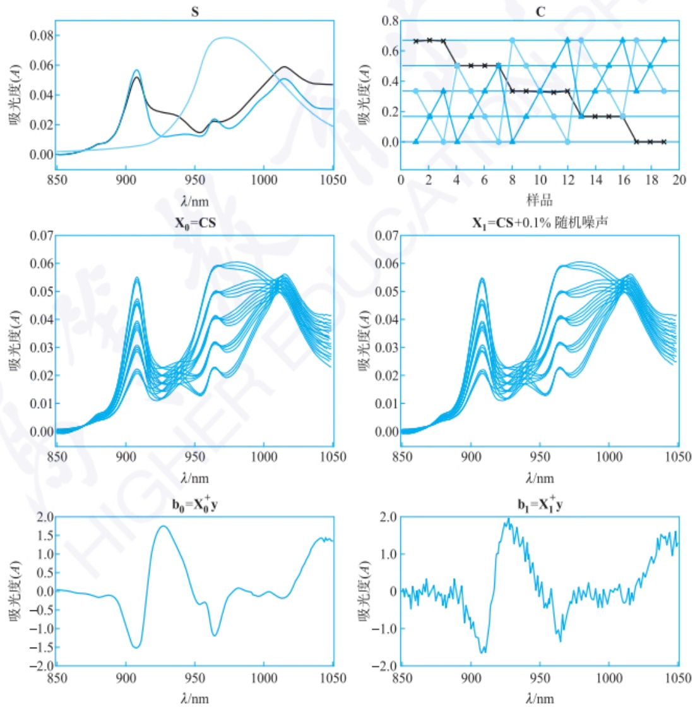

图2.3.2 三组分混合物体系的纯光谱矩阵(S)、浓度矩阵(C)、不含随机噪声的模拟光谱数据矩阵$(\mathbf{X}_0)$ 、含随机噪声的模拟光谱数据矩阵 $(\mathbf{X}_1)$，以及利用最小二乘法分别从 $\mathbf{X}_0$ 和 $\mathbf{X}_1$ 中估算出来的目标组分校正模型参数 $\mathbf{b}_0$ 和 $\mathbf{b}_1$

---

64

第二章 分析数据处理

$X_{0}$  为 19 个三组分混合样本的无噪声模拟光谱， $X_{1}$  则为添加了一定随机噪声的相应模拟光谱（随机噪声的幅度为最大吸收值的 0.1%）。微小随机噪声的存在却使得通过最小二乘法估计出来的目标组分（黑色纯光谱组分）校正模型参数  $b_{1}$  显著偏离其真值  $b_{0}$ 。

由于利用最小二乘法从 $\mathbf{X}_0$ 和 $\mathbf{X}_1$ 中估算模型参数 $\mathbf{b}_0$ 和 $\mathbf{b}_1$ 涉及 $\mathbf{X}_0^+$ 和 $\mathbf{X}_1^+$ 的计算。通过对矩阵 $\mathbf{X}$ 进行奇异值分解获得 $\mathbf{U},\Sigma$ 和 $\mathbf{V}(\mathbf{X} = \mathbf{U}\Sigma \mathbf{V}')$ ，可以方便地求出 $\mathbf{X}$ 的Moore-Penrose广义逆 $(\mathbf{X}^{+} = \mathbf{V}\Sigma^{+}\mathbf{U}^{\prime})$ 。因此为了弄清楚为什么模型参数 $\mathbf{b}$ 会易受实验噪声的影响，需要首先对 $\mathbf{X}_0$ 和 $\mathbf{X}_1$ 进行奇异值分解。如图2.3.3所示，$\mathbf{X}_0$ 只有3个大于零的奇异值，正好代表3个化学成分的光谱信息，剩余的奇异值均等于零；由于受随机噪声的影响，$\mathbf{X}_1$ 除了3个显著较大的奇异值外，剩余的奇异值虽然很小，但均不等于零。在求算 $\mathbf{X}_0^+$ 和 $\mathbf{X}_1^+$ 时分别涉及计算对角矩阵 $\Sigma_0$ 和 $\Sigma_1$ 的Moore-Penrose广义逆 $\Sigma_0^+$ 和 $\Sigma_1^+$ 。计算 $\Sigma_0^+$ 时，只需对 $\Sigma_0$ 的前3个大于零的奇异值求倒数即可；然而计算 $\Sigma_1^+$ 时，由于 $\Sigma_1$ 除了3个显著较大的奇异值外，还有很多由随机噪声带来的非常小的奇异值，对这些小的奇异值的求倒数会显著放大随机噪声的影响，因而使得由此估算出来的模型参数会显著偏离其真值。

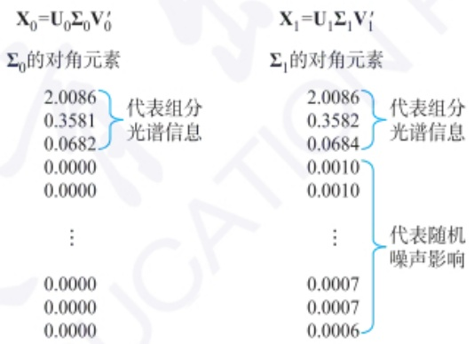

<details>
<summary>text_image</summary>

X₀=U₀Σ₀V'₀
Σ₀的对角元素
2.0086
0.3581
0.0682
0.0000
0.0000
⋮
0.0000
0.0000
0.0000
X₁=U₁Σ₁V'₁
Σ₁的对角元素
2.0086
0.3582
0.0684
0.0010
0.0010
⋮
代表组分
光谱信息
代表组分
光谱信息
代表随机
噪声影响
</details>

图 2.3.3 三组分混合物体系的不含随机噪声的模拟光谱数据矩阵 $\left(\mathbf{X}_{0}\right)$ 和含随机噪声的模拟光谱数据矩阵 $\left(\mathbf{X}_{1}\right)$ 的奇异值分解结果

## 主成分回归参考文献:

[1] British Journal of Statistical Psychology, 1957, 10(2):69-79.
[2] Biometrics, 1976, 32: 1-49.

## 2.3.2.3 主成分回归(principal component regression, PCR)

基于最小二乘法计算出来的多元逆校正模型的模型参数 b 易受随机噪声影响的根本原因在于光谱数据阵 X 中包含代表随机噪声的奇异值所对应的次要成分的贡献。因此为了获得比较稳健的模型参数 b，最为直观的做法就是将 X 的奇异值分解所获得的对角矩阵  $\Sigma$  中代表随机噪声的奇异值均置为零（或者将其代表的次要成分的贡献从 X 中删除）。PCR 正是通过删去代表随机噪声的奇异值所对应的次要成分的贡献来消除实验噪声对校正模型参数的影响，仅保留代表化学组分光谱信息的主要成分的贡献，从而提高预测结果的准确度。PCR 的具体建模和预测过程如下:

（1）对标准样本的光谱数据矩阵 X 进行奇异值分解:

$$
\mathbf {X} = \mathbf {U} \boldsymbol {\Sigma} \mathbf {V} ^ {\prime} = \lambda_ {1} \mathbf {u} _ {1} \mathbf {v} _ {1} ^ {\prime} + \lambda_ {2} \mathbf {u} _ {2} \mathbf {v} _ {2} ^ {\prime} + \dots + \lambda_ {p} \mathbf {u} _ {p} \mathbf {v} _ {p} ^ {\prime} \tag {2-3-23}
$$

（2）设标准样本中含有 r 个具有光谱活性的独立组分，则前面 r 个较大的奇异值代表 r 个独立组分的光谱信息，其余 p-r 个较小的奇异值代表随机噪声的影响，可将其贡献从 X 中删除:

$$
\mathbf {X} \approx \lambda_ {1} \mathbf {u} _ {1} \mathbf {v} _ {1} ^ {\prime} + \lambda_ {2} \mathbf {u} _ {2} \mathbf {v} _ {2} ^ {\prime} + \dots + \lambda_ {r} \mathbf {u} _ {r} \mathbf {v} _ {r} ^ {\prime} = \mathbf {T} _ {r} \mathbf {P} _ {r} ^ {\prime} \tag {2-3-24}
$$

---

2.3 定量校正模型和方法

65

式中， $T_{r}=\left[\lambda_{1}u_{1},\lambda_{2}u_{2},\cdots,\lambda_{r}u_{r}\right],P_{r}=\left[v_{1},v_{2},\cdots,v_{r}\right]$ 。

(3) 若标准样本中待测物质的浓度矢量 y 已知, 则有

$$
\mathbf {y} = \mathbf {X} \mathbf {b} \approx \mathbf {T} _ {r} \mathbf {P} _ {r} ^ {\prime} \mathbf {b} \tag {2-3-25}
$$

$$
\mathbf {b} = \mathbf {P} _ {r} \mathbf {T} _ {r} ^ {+} \mathbf {y} \tag {2-3-26}
$$

（4）测得待测样本的光谱  $x_{test}$  后，待测样本中待测物质的浓度  $y_{test}$  可按下式估算出来:

$$
y _ {\mathrm{test}} = \mathbf {x} _ {\mathrm{test}} \mathbf {P} _ {r} \mathbf {P} _ {r} ^ {\prime} \mathbf {b} \tag {2-3-27}
$$

用 PCR 从图 2.3.2 所示含随机噪声的模拟光谱数据矩阵  $X_{1}$  中求解目标组分（黑色纯光谱组分）的校正模型参数  $b_{2}$  与利用最小二乘法从不含随机噪声的模拟光谱数据矩阵  $X_{0}$  中估算出来的校正模型参数  $b_{0}$  高度一致（图 2.3.4），证明了:从光谱矩阵中删去代表随机噪声的奇异值所对应的次要成分的贡献确实能够消除随机噪声对校正模型参数的影响。

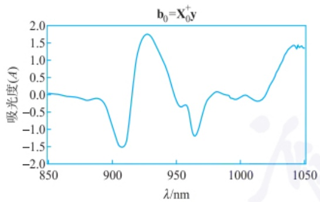

<details>
<summary>line</summary>

| \(\lambda/\)nm | Absorbance (A) |
| --- | --- |
| 850 | ~0.0 |
| 900 | ~-0.2 |
| 910 | ~-1.5 |
| 930 | ~1.7 |
| 960 | ~-1.2 |
| 980 | ~0.1 |
| 1000 | ~-0.1 |
| 1040 | ~1.4 |
</details>

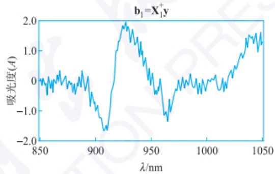

<details>
<summary>line</summary>

| \(\lambda/\)nm | Absorbance (A) |
| --- | --- |
| 850 | ~0.0 |
| 900 | ~-0.5 |
| 925 | ~1.9 |
| 950 | ~0.2 |
| 975 | ~-1.3 |
| 1000 | ~-0.2 |
| 1025 | ~0.8 |
| 1050 | ~1.3 |
</details>

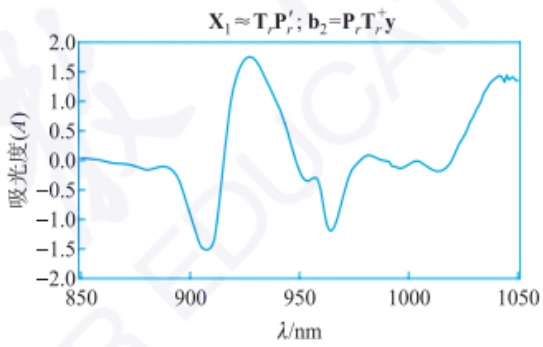

<details>
<summary>line</summary>

| \(\lambda/\)nm | Absorbance (A) |
| --- | --- |
| 850 | ~0.0 |
| 900 | ~-0.2 |
| 910 | ~-1.5 |
| 925 | ~1.7 |
| 950 | ~-0.3 |
| 965 | ~-1.2 |
| 980 | ~0.1 |
| 1000 | ~-0.1 |
| 1025 | ~0.5 |
| 1045 | ~1.4 |
</details>

图 2.3.4 利用最小二乘法分别从  $X_{0}$  和  $X_{1}$  中估算出来的目标组分校正模型参数  $b_{0}, b_{1}$ ，以及用 PCR 从  $X_{1}$  中求解出来的模型参数  $b_{2}$

上述 PCR 建模过程也可以从“潜变量”的角度进行理解。如图 2.3.5 所示，PCR 首先寻找一组由原始变量的线性组合所构成的潜变量  $\mathbf{t}_{j}(\mathbf{t}_{j}=\mathbf{X}\mathbf{w}_{j},\mathbf{w}_{j}^{\prime}\mathbf{w}_{j}=1, j=1,2,\cdots,r)$ ，使其能充分代表 X 所携带的信息（假定 X 已列中心化，即  $t_{j}$  解释的方差越大，其代表 X 所携带的信息就越多），然后将目标组分的浓度向量 y 对原始变量 X 的回归分析变换成 y 对潜变量  $\mathbf{T}_{r}(\mathbf{T}_{r}=[\mathbf{t}_{1},\mathbf{t}_{2},\cdots,\mathbf{t}_{r}]$  的回归分析（图 2.3.6）。

在使用 PCR 估算校正模型参数 b 时, 首先需要确定使用多少个潜变量。理论上, PCR 中所用的潜变量数应该等于待测混合物体系中具有光谱活性的独立化学组分数。在实际应用中, 由于难以准确获知未知待测混合物体系中具有光谱活性的独立化学组分数目, PCR 中所用最佳潜变量数通常采用如下两种方法来确定。

---

66

第二章 分析数据处理

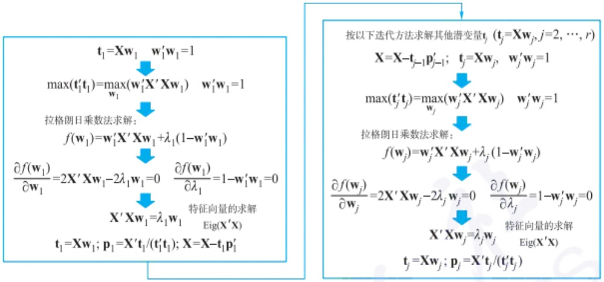

<details>
<summary>flowchart</summary>

```mermaid
graph TD
  subgraph Method_1
  A["t₁ = Xw₁, w'₁w₁ = 1"] --> B["max(t'₁t₁) = max(w'₁X'Xw₁), w'₁w₁ = 1"]
  B --> C["拉格朗日乘数法求解: f(w₁) = w'₁X'Xw₁ + λ₁(1-w'₁w₁)"]
  C --> D["∂f(w₁)/∂w₁ = 2X'Xw₁ - 2λ₁w₁ = 0\n∂f(w₁)/∂λ₁ = 1-w'₁w₁ = 0\nX'Xw₁ = λ₁w₁\nEig(X'X)\nt₁ = Xw₁; p₁ = X't₁/(t'₁t₁); X = X-t₁p'₁"]
  end

  subgraph Method_2
    E["&quot;tⱼ = Xwⱼ, j = 2, ..., r"] (top row)"]
    F["X = X-tⱼ₋₁pⱼ₋₁&quot;; tⱼ = Xwⱼ, w'ⱼwⱼ = 1"]
    G["max(t'ⱼtⱼ) = max(w'ⱼX'Xwⱼ), w'ⱼwⱼ = 1"]
    H["拉格朗日乘数法求解: f(wⱼ) = w'ⱼX'Xwⱼ + λⱼ(1-w'ⱼwⱼ)"]
    I["∂f(wⱼ)/∂wⱼ = 2X'Xwⱼ - 2λⱼwⱼ = 0\n∂f(wⱼ)/∂λⱼ = 1-w'ⱼwⱼ = 0\nX'Xwⱼ = λⱼwⱼ\nEig(X'X)\ntⱼ = Xwⱼ; pⱼ = X'tⱼ/(t'ₜtⱼ)"]
  end

  subgraph Method_3
    J["按以下迭代方法求解其他潜变量tⱼ (tⱼ = Xwⱼ, j = 2, ..., r)"]
    K["X = X-tⱼ₋₁pⱼ₋₁&quot;; tⱼ = Xwⱼ, w'ⱼwⱼ = 1"]
    L["max(t'ⱼtⱼ) = max(w'ⱼX'Xwⱼ), w'ⱼwⱼ = 1"]
    M["拉格朗日乘数法求解: f(wⱼ) = w'ⱼX'Xwⱼ + λⱼ(1-w'ⱼwⱼ)"]
    N["∂f(wj)/∂wj = 2X'Xwj - 2λjwj = 0\n∂f(wj)/∂λj = 1-w'jwj = 0\nX'Xwj = λjwj\nEig(X'X)\ntⱼ = Xwj; pj = X'tj/(t'j'tj)"]
  end
```
</details>

图 2.3.5 PCR 寻找由原始变量的线性组合所构成的潜变量  $\mathbf{t}_{j}(j=1,2,\cdots,r)$  的具体过程

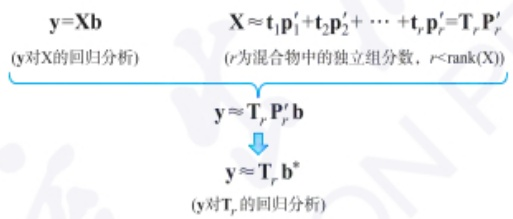

<details>
<summary>flowchart</summary>

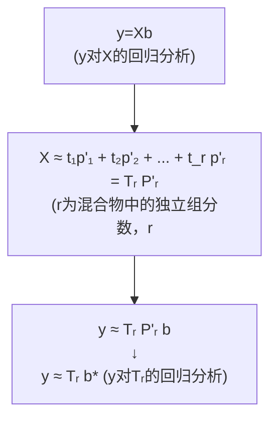
</details>

图 2.3.6 PCR 把 y 对原始变量 X 的回归分析变换成 y 对潜变量  $T_{r}$  的回归分析

（1）若标准样本数目足够多，则可将标准样本划分为校正样本集（calibration set）和验证样本集（validation set），通过考察用不同潜变量数构建的PCR校正模型对验证样本集预测结果的均方根误差（root mean square error，$\mathrm{RMSE} = \sqrt{\sum_{i=1}^{n_{\mathrm{val}}} (\hat{y}_{\mathrm{val},i} - y_{\mathrm{val},i})^2 / n_{\mathrm{val}}}$；其中，$y_{\mathrm{val},i}$ 和 $\hat{y}_{\mathrm{val},i}$ 分别为第 $i$ 个验证样本中目标物质的实际浓度和预测浓度，$n_{\mathrm{val}}$ 为验证样本数目）来确定最优潜变量数（图2.3.7）。一般来说，若RMSE在潜变量数取某数值时达到最小，则该数值即为最佳潜变量数。若随着潜变量数的增加，RMSE一直下降，并未出现最小值，此时可以将RMSE值与实验误差相当时所对应的潜变量数视为最佳潜变量数。

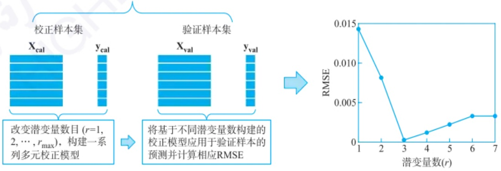

<details>
<summary>flowchart</summary>

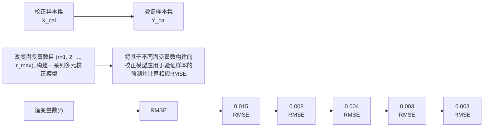
</details>

图 2.3.7 基于验证样本预测均方根误差的多元校正模型最优潜变量数确定策略示意图

（2）若标准样本数目较少，则可采用交叉验证法(cross-validation, CV)确定在 PCR 校正模型中所用的最优潜变量数。交叉验证法的具体步骤如下:① 在选

---

2.3 定量校正模型和方法

67

定的潜变量数(r)下,从给定的标准样本中拿出大部分标准样本用于构建校正模型,用所建立的校正模型对剩余的标准样本进行预测;②上述过程一直进行,直到所有的标准样本都被预测了一次而且仅被预测一次,然后计算在选定的潜变量数(r)下校正模型对所有标准样本预测结果的均方根误差(通常记作 $RMSE_{cv}$ );③将 $RMSE_{cv}$ 对潜变量数(r)作图,RMSE值达到最小或者与实验误差相当时所对应的潜变量数视为最佳潜变量数。根据从标准样本中抽取用于验证校正模型预测性能的样本数目不同,交叉验证法可分为“K折交叉验证法”(K-fold cross-validation)和“留一交叉验证法”(leave-one-out cross-validation,LOOCV)。“K折交叉验证”将N个标准样本大致平均分割成K个样本子集,保留一个单独的样本子集用于验证校正模型的预测性能,其他K-1个样本子集则用于构建校正模型。交叉验证重复K次,每个样本子集验证一次。10折交叉验证最为常用。“留一交叉验证”则只将原标准样本中的一个样本用作验证样本,而剩余的其他样本则用于构建校正模型。这个步骤一直持续到每个标准样本都被用作一次验证样本。

利用 PCR 构建校正模型只需确定最优主成分数目即最佳潜变量数即可，而且其预测结果不易受实验噪声的影响。但是由于 PCR 采用了近似公式（即  $y \approx T_{r}P_{r}'b$ ）来估算校正模型参数 b，由 PCR 估算出的校正模型参数 b 是有偏的（即其期望值不等于其真值）。另外，用于 PCR 建模的“潜变量”仅仅是根据光谱数据矩阵 X 的信息计算出来的。若光谱数据矩阵 X 除受化学组分浓度变化的影响外，还受到其他因素的影响，那么按上述方法计算出来的“潜变量”可能与待测物质的浓度之间的相关性较低，导致所建立的校正模型的预测结果不准确。

## 2.3.2.4 偏最小二乘回归 (partial least squares regression, PLSR)

PLSR 最早由 H. Wold 等人在 1975 年提出。相比于 PCR 所寻找的潜变量只充分代表光谱数据矩阵 X 所携带的信息，PLSR 寻找的潜变量  $\mathbf{z}_{j}(\mathbf{z}_{j}=\mathbf{X}\mathbf{w}_{j}, j=1,2,\cdots,r)$  既要能充分代表原始变量 X 所携带的信息，又要能有效地用于目标组分浓度向量 y 的预测（图 2.3.8）。换而言之，PLSR 的潜变量  $\mathbf{z}_{j}(j=1,2,\cdots,r)$  不但能解释较大的方差，而且应该与目标组分的浓度向量 y 具有最大的相关性。

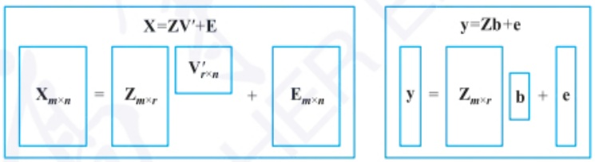

图 2.3.8 PLSR 建模策略示意图

假定 X 和 y 均已列中心化, 则 PLSR 寻找到的潜变量  $\mathbf{z}_{j}(\mathbf{z}_{j}=\mathbf{X}\mathbf{w}_{j}, j=1,2,\cdots,r)$  的具体计算过程如图 2.3.9 所示(在此计算过程中, 相应的 V 和 b 也同时被计算出来了)。

根据上述潜变量  $\mathbf{z}_{j}(\mathbf{z}_{j}=\mathbf{X}\mathbf{w}_{j}, j=1,2,\cdots,r)$  的计算过程可以推导出如图 2.3.10 所示一系列关系。

定义  $\mathbf{W}^{*}=\left[\mathbf{w}_{1},\left(\mathbf{I}-\mathbf{w}_{1}\mathbf{v}_{1}^{\prime}\right)\mathbf{w}_{2},\cdots,\left(\prod_{j=1}^{r-1}\left(\mathbf{I}-\mathbf{w}_{j}\mathbf{v}_{j}^{\prime}\right)\right)\mathbf{w}_{r}\right]$ ，则有

$$
\mathbf {Z} = [ \mathbf {z} _ {1}, \mathbf {z} _ {2}, \dots , \mathbf {z} _ {r} ] = \mathbf {X W} ^ {*} \tag {2-3-28}
$$

$\hat{y}=Zb=XW^{*}b=Xb^{*}$  （注:在求解潜变量 $z_{j}$ 时已将b求出）

$$
(2 - 3 - 2 9)
$$

偏最小二乘回归参考文献:

[1] Journal of Applied Probability, 1975, 12(S1):117-142.
[2] Analytical Chemistry, 1998, 60:1193-1202.

---

68

第二章 分析数据处理

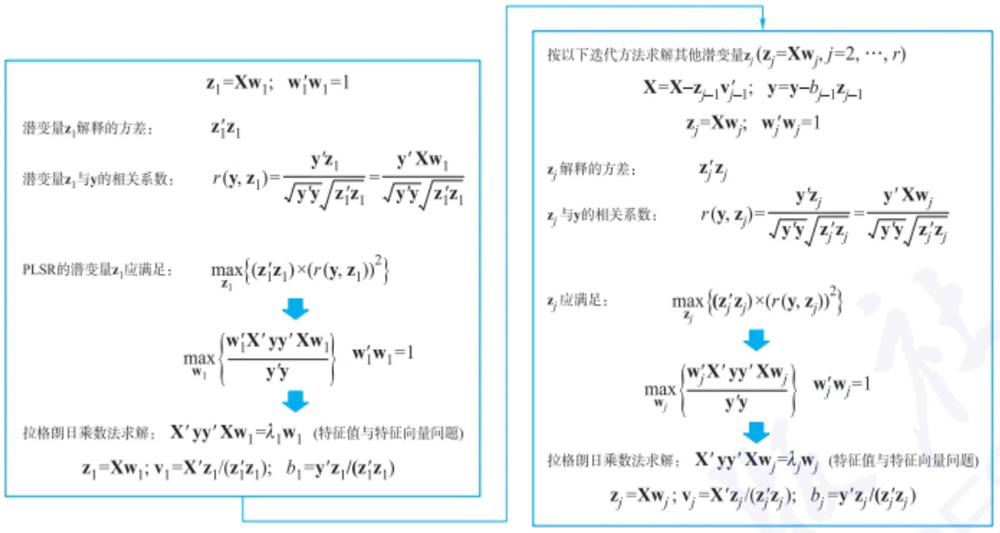

图 2.3.9 PLSR 寻找由原始变量的线性组合所构成的潜变量  $\mathbf{z}_{j}(j=1,2,\cdots,r)$  的具体过程

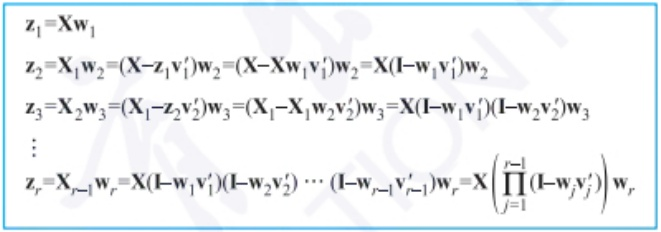

<details>
<summary>text_image</summary>

z₁=Xw₁
z₂=X₁w₂=(X-z₁v₁')w₂=(X-Xw₁v₁')w₂=X(I-w₁v₁')w₂
z₃=X₂w₃=(X₁-z₂v₂')w₃=(X₁-X₁w₂v₂')w₃=X(I-w₁v₁')(I-w₂v₂')w₃
⋮
zᵣ=Xᵣ₋₁wᵣ=X(I-w₁v₁')(I-w₂v₂')⋯(I-wᵣ₋₁vᵣ₋₁)wᵣ=X\left(\prod_{j=1}^{r-1}(I-wⱼvⱼ')\right)wᵣ
</details>

图 2.3.10 潜变量  $\mathbf{z}_{j}(j=1,2,\cdots,r)$  满足的一系列关系

$$
\hat {y} _ {i} = b _ {1} ^ {*} x _ {i, 1} + \dots + b _ {n} ^ {*} x _ {i, n} \tag {2-3-30}
$$

式(2-3-30)表明: $b_{j}^{*}$  的绝对值反映了第 j 个原始变量  $(x_{i,j})$  对预测  $y_{i}$  的重要性。若  $b_{j}^{*}$  为负值，则其影响为负影响；若  $b_{j}^{*}$  为正值，则其影响为正影响。测得待测样本的光谱  $x_{test}$  后，待测样本中待测物质的浓度  $y_{test}$  可按下式估算出来。

$$
y _ {\mathrm{test}} = \mathbf {x} _ {\mathrm{test}} \mathbf {b} ^ {*} \tag {2-3-31}
$$

与 PCR 一样, 在使用 PLSR 估算校正模型参数 b 时, 也需要确定使用多少个潜变量。理论上, PLSR 中所用潜变量数应该等于待测混合物体系中具有光谱活性的独立化学组分数目。但是, 在实际应用中, 人们往往难以准确知道体系中所有具有响应的化学组分的数目。此外, 测得的光谱数据中还存在噪声、基线漂移等干扰因素。因此 PLSR 中所用潜变量数通常也是根据验证样本的均方根误差或交叉验证的均方根误差来确定。

## 2.3.2.5 人工智能方法与多元校正

人工智能(artificial intelligence)简称AI，是研究、开发用于模拟、延伸和扩展人的智能的理论、方法、技术及应用系统的一门新的技术科学。它是计算机科学的一个分支，试图了解智能的实质，并生产出一种新的能以人类智能相似的方式作出反应的智能机器，该领域的研究非常广泛，包括机器人、语言识别、图像识别、自然语言处理和专家系统等，相关方法在化学领域已得到相当广泛的应用。人工智能方法，如反向传播人工神经网络(back propagation artificial neural network, BP-ANN)、卷积神经网络(convolutional neural network, CNN)等，能够用于解决复杂体系的非线性多元校正问题。图2.3.11展示的是利用BP-ANN建立的非线性多元

人工智能方法和深度学习文献:

李明禄. 英汉云计算·物联网·大数据辞典. 上海: 上海交通大学出版社, 2018.

Nature, 2015, 521 (7553): 436 - 444.

---

2.3 定量校正模型和方法

69

校正模型。一个基本的人工神经网络通常由多个层组成，包括输入层、隐藏层和输出层，每层包含多个神经元（或称节点）。每个神经元接收来自前一层神经元的输入，经过加权求和和激活函数处理后，产生输出传递给下一层神经元。具体对于单个神经元而言，其输出 $y$ 通常由以下两个步骤计算得出:

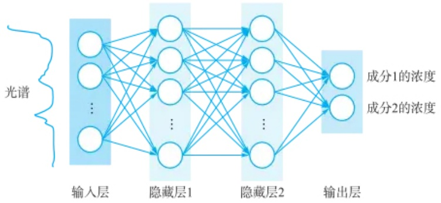

<details>
<summary>flowchart</summary>

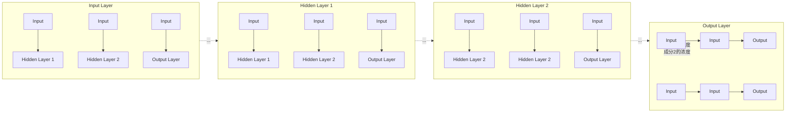
</details>

图2.3.11 基于BP-ANN建立的非线性多元校正模型示意图

（1）加权求和(线性组合) 假设当前神经元接收来自前一层 n 个神经元的输入, 这些输入分别记作  $x_{1}, x_{2}, \cdots, x_{n}$  (还包括一个偏置项 b, 其权重可以视为 1), 则加权求和的公式为

$$
z = \sum_ {i = 1} ^ {n} w _ {i} x _ {i} + b = w _ {1} x _ {1} + w _ {2} x _ {2} + \dots + w _ {n} x _ {n} + b \tag {2-3-32}
$$

式中，z 是加权求和的结果，也称为神经元的净输入。

（2）激活函数 将加权求和的结果 z 通过一个激活函数 f，得到神经元的输出 y。激活函数的选择取决于具体的问题和所需的网络特性。激活函数的加入带给模型处理非线性数据的能力，模型能对更高级特征进行归纳，目前使用最多的默认激活函数为 ReLU 函数，其形式为

$$
f (z) = \max (0, z) \tag {2-3-33}
$$

可见 ReLU 函数的简单形式使其在梯度计算(即损失函数对参数求偏导数)过程中消耗的内存较少,并且使一部分神经元的输出变成了 0,网络也变得稀疏,因此一定程度上缓解了过拟合问题。

综上,该神经元的输出公式为

$$
y = \max \left(0, \sum_ {i = 1} ^ {n} w _ {i} x _ {i} + b\right) \tag {2-3-34}
$$

BP-ANN 模型的训练主要采用梯度下降法,通过误差反向传播来不断调整各神经元的权重和偏置,使得该人工神经网络的预测值和真值之间的误差平方和达到最小。BP-ANN 模型的训练完成后,固定各神经元的权重和偏置,即可通过待测样本的光谱数据预测出其中目标组分的含量。人工神经网络具有很强的非线性映射能力,能够拟合复杂体系中目标物质浓度与仪器响应信号强度之间的各种非线性关系。一般而言,人工神经网络在解决非线性问题、处理大数据等方面更有优势。

近年来，以CNN为代表的深度学习方法在图像处理等领域取得了巨大的进展，并已逐渐应用于非线性多元校正领域。CNN模仿了人脑对视觉信息的处理过程，通过逐层卷积和池化操作，能够自动提取图像中的多尺度局部空间特征，并通过深层网络进一步将其组合为具有较强表示能力的特征，之后可完成分类或回归任务。由于常见光谱数据为矢量数据，因此可采用一维卷积神经网络（one-

## 人工智能深度学习领域“三巨头”

2018年，深度学习界的三位顶尖学者Geoffrey Hinton、Yoshua Bengio、Yann LeCun因其在深度神经网络领域的重大突破而共同荣获图灵奖，被广泛誉为深度学习领域“三巨头”。他们不仅在理论上做出了开创性贡献，更是将深度神经网络的概念和应用推向了实际工程的前沿，极大地推动了人工智能技术的发展与革新。

## 2024年诺贝尔奖与人工智能

2024 年诺贝尔物理学奖颁给 John Hopfield 和 Geoffrey Hinton, 以表彰他们“基于人工神经网络实现机器学习的基础性发现和发明”。

2024 年诺贝尔化学奖的一半授予 David Baker, 以表彰他在“计算蛋白质设计”方面的贡献, 另一半授予 Demis Hassabis 和 John Jumper, 以表彰他们在“蛋白质结构预测”方面的贡献。

这些奖项的内容均与人工智能和神经网络紧密相关,表明人工智能技术已成为推动科学发现和技术创新的核心力量。

---

70

第二章 分析数据处理

dimensional convolutional neural network, 1D-CNN) 处理这类数据的非线性多元校正问题。图 2.3.12 展示了 1D-CNN 的一般网络结构，其隐藏层通常由交替的卷积层、激活函数、池化层和全连接层构成。

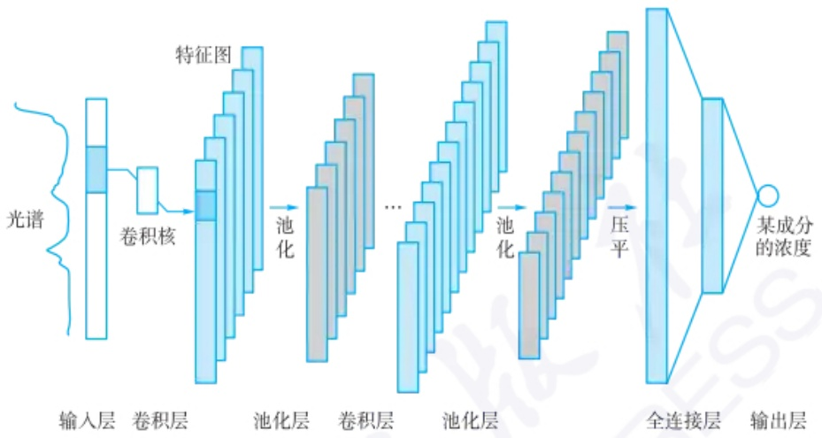

<details>
<summary>flowchart</summary>


</details>

图 2.3.12 基于 1D-CNN 建立的非线性多元校正模型示意图

卷积层是CNN的核心算法模块，可以逐层提取输入信息中的多种局部特征，同时对局部特征的平移、旋转和尺度变化具有一定的鲁棒性。网络前向传播的过程中，每个卷积核都会沿着设定顺序滑动，并对相应的区域执行卷积运算。局部连接和权值共享是CNN最重要的两个特征，通过卷积操作可实现局部连接，再通过权值共享缩减了实际参数的数量，避免了全连接中参数过多难以计算的问题，为实现多层网络提供可能。图2.3.13展示一维光谱数据卷积计算的过程。

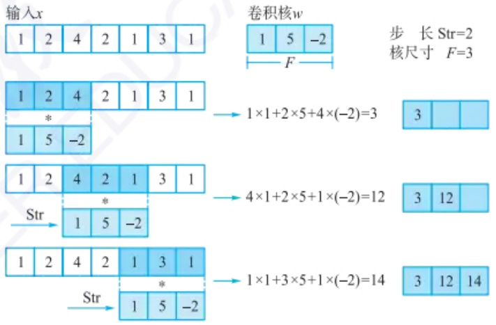

<details>
<summary>text_image</summary>

输入x
卷积核w
步长 Str=2
核尺寸 F=3
1 2 4 2 1 3 1
F
1 2 4 2 1 3 1
* 
1 5 -2
→ 1×1+2×5+4×(-2)=3
3
Str
* 
1 5 -2
→ 4×1+2×5+1×(-2)=12
3 12
Str
* 
1 2 4 2 1 3 1
Str
* 
1 5 -2
→ 1×1+3×5+1×(-2)=14
3 12 14
</details>

图 2.3.13 一维光谱数据卷积计算过程

对于输入的一维光谱向量 x 和卷积核 w, 一维卷积操作可以表示为

$$
y _ {i} = \sum_ {j = 0} ^ {F - 1} (x _ {(i \times \mathrm{Str} + j)} \times w _ {j}) + b \tag {2-3-35}
$$

其中卷积核(filter)的长度为 $F$ ，步长(stride)为 $\mathrm{Str},y_{i}$ 是输出序列的第 $i$ 个元素；$x_{(i\times \mathrm{Str} + j)}$ 是输入光谱的第 $(i\times \mathrm{Str} + j)$ 个元素；$w_{j}$ 是卷积核的第 $j$ 个权重；$b$ 是偏置项。注意这些索引均从0开始，这符合许多编程语言的习惯，包括Python等。

池化层将相邻的多个特征点合并，精简了数据，同时提高了计算效率和模型鲁棒性。通常使用得最多的是最大池化（max pooling）和平均池化（average pooling）。最大池化输出特征图的第 $i$ 个元素计算公式为

---

2.3 定量校正模型和方法

71

$$
y _ {i} = \max (x _ {(i x S t r)}, x _ {(i x S t r + 1)}, \dots , x _ {(i x S t r + P L - 1)}) \tag {2-3-36}
$$

平均池化输出特征图的第 $i$ 个元素计算公式为

$$
y _ {i} = \frac {1}{\mathrm{PL}} \sum_ {j = 0} ^ {\mathrm{PL-1}} x _ {(i \times \mathrm{Str} + j)} \tag {2-3-37}
$$

式中，PL 是池化窗口的大小，Str 为池化的步长。

一般在 CNN 的最后, 使用压平层 (flatten 层) 把不同卷积核提取的特征整合在一起, 再用全连接层进行特征归纳, 实现最后的非线性多元校正或分类任务。

现今人工智能系统的成功可归功于大数据、强算力、强算法。从数据量上看，我国实验分析仪器在2019年产量已达278万余台，这些仪器每天将产生海量的分析数据；从数据的大小上看，全二维液相色谱（LC×LC）一个数据的峰容量大约为 $10^{3}$ ，而傅里叶变换离子回旋共振质谱（FTICR-MS）数据的峰容量甚至可达到 $10^{6}$ 左右；从数据产生的效率看，一台飞行时间质谱（TOF-MS）每秒可以获得 $10^{8}$ 个峰数据。这些信号表明，我们已经真正步入大数据时代，“数据海啸”带给分析化学家的既是机遇也是挑战。

表 2.3.2 领先的超级计算机 Summit、2019 年的典型个人计算机和人类大脑的粗略对比

<table><tr><td></td><td>超级计算机</td><td>个人计算机</td><td>人类大脑</td></tr><tr><td rowspan="2">计算单元数</td><td> $10^{6}$ 个GPU+CPU</td><td>8个CPU内核</td><td> $10^{6}$ 列</td></tr><tr><td> $10^{15}$ 个晶体管</td><td> $10^{10}$ 个晶体管</td><td> $10^{11}$ 个神经元</td></tr><tr><td rowspan="2">存储单元数</td><td> $10^{16}$ 字节(10PB)RAM</td><td> $10^{10}$ 字节(10GB)RAM</td><td> $10^{11}$ 个神经元</td></tr><tr><td> $10^{17}$ 字节(100PB)硬盘</td><td> $10^{12}$ 字节(1TB)硬盘</td><td> $10^{14}$ 个突触</td></tr><tr><td>周期时间</td><td> $10^{-9}$ s</td><td> $10^{-9}$ s</td><td> $10^{-3}$ s</td></tr><tr><td>运算/秒</td><td> $10^{18}$ </td><td> $10^{10}$ </td><td> $10^{17}$ </td></tr></table>

表2.3.2中粗略对比了超级计算机、个人计算机和人类大脑的计算能力。数千年来，人类大脑的能力并没有太多变化，而超级计算机的计算能力已经从20世纪60年代的百万次浮点运算每秒(MFLOP)提高到了现如今的百亿亿次浮点运算每秒(exaFLOP)。此外，随着近年来的深度学习算法如卷积神经网络(CNN)、循环神经网络(RNN)、Transformer等的提出，使得人工智能概念深入人心，它们也正在不同领域中发挥重要作用。可以看出，人类的科学研究已经开始步入第四范式——以大数据知识发现为特征的数据密集型科学，可以期待人工智能方法在分析化学领域得到更多的应用和突破。

大数据与人工智能参考文献:

[1] Angewandte Chemie International Edition, 2022, 134 (44): e201801134.
[2] Russell S, Norvig P. Artificial Intelligence: a modern approach, 4th US ed. University of California, Berkeley, 2021.

卷积神经网络(CNN)在光谱多元校正中的应用文献:

[1] Chemometrics and Intelligent Laboratory Systems, 2018, 182: 9–20.
[2] Advanced Science, 2025: e12750.

## 习题

## - 章节练习题 -

1. 与经典的多元线性校正模型相比, 多元逆校正模型有什么特点?
2. 主成分回归(PCR)建模过程中如何确定所需的主成分数?
3. 试说明主成分回归(PCR)与偏最小二乘回归(PLSR)的异同。
4. 为什么说主成分回归(PCR)和偏最小二乘回归(PLSR)的性能相对于多重线性回归(MLR)有显著性的改善?

---

72

第二章 分析数据处理

## - 挑战性问题 -

5. 尝试使用 Matlab、Python 或其他计算机语言编写出主成分回归(PCR)和偏最小二乘回归(PLSR)的程序。

## - 专题或报告 -

6. 通过查阅文献了解最新的多元校正方法及其应用情况，并将查阅结果写成报告。
