# 第三章 化学平衡与滴定分析

原始 PDF 第 94–189 页。

第三章

化学平衡与滴定分析

滴定分析方法是基于化学反应建立的，并要求反应达到化学平衡状态。化学分析的目标是在允许误差范围内确定物质的浓度或量。因此，在某些条件（如温度、压力、其他干扰物质等）下反应建立平衡时，目标物质的浓度或量应该是明确和恒定的。反应达到平衡状态时，正向和逆向反应仍继续发生，但正、逆反应的速率相等，使得处于平衡状态的系统在宏观层面上看起来是静态的。理解化学反应平衡，对发展分析方法至关重要。化学平衡不仅为滴定分析提供了基础，还为生物化学、药学、地质学及海洋学等其他学科提供了基础。特别是，$\mathrm{pH}$ 计算和酸碱缓冲溶液在许多学科领域都非常重要。本章从分析化学学科角度出发介绍化学平衡及其影响因素，介绍处理溶液平衡的一般方法，详细讨论与滴定分析相关的酸碱平衡、络合平衡、氧化还原平衡，以及沉淀平衡。在此基础上，介绍基于上述溶液平衡发展的滴定分析法。

除了经典的滴定分析方法,作为非平衡态体系的分析方法,动力学分析法基于化学反应速率获得分析物的浓度,有些化学反应速率慢,不适合使用滴定分析,可使用动力学方法进行分析;同时,动力学方法非常适于酶、底物及酶催化特性的定量分析。因此,本章第三部分内容是简介动力学分析方法的原理与应用,主要是化学动力学分析法。

## 3.1 化学平衡

化学平衡(chemical equilibrium)是分析化学中最重要的部分之一,是滴定分析法和其他分析方法的基础。基于化学平衡的处理,可以预测反应完成的方向,计算溶液中不同物质的浓度并解释不同副反应对平衡的影响,构筑滴定曲线并理解滴定分析方法,计算滴定误差,以及设计新反应并发展新的分析方法。本节将简介化学平衡及影响因素,基于平衡体系中的定量关系式和平衡表达式介绍处理化学平衡的通用方法,引入副反应系数、条件稳定常数定量描述副反应对滴定主反应的影响及反应实际进行的程度,从而为滴定分析方法的讨论奠定定量描述的基础。

## 3.1.1 化学平衡简介

## 3.1.1.1 平衡常数与 Gibbs 自由能变

在给定温度下,当下述可逆反应达到平衡时,

$$
a \mathrm{A} + b \mathrm{B} \rightleftharpoons c \mathrm{C} + d \mathrm{D}
$$

其平衡常数为

---

74

第三章 化学平衡与滴定分析

$$
K _ {\mathrm{c}} = \frac {\left[ \mathrm{C} \right] ^ {c} \left[ \mathrm{D} \right] ^ {d}}{\left[ \mathrm{A} \right] ^ {a} \left[ \mathrm{B} \right] ^ {b}} \tag {3-1-1}
$$

式中，[ ]表示溶质的物质的量浓度； $K_{c}$ 是用平衡浓度表示的平衡常数，为简化起见，后续统一用K表示。K适用于稀溶液中的反应。对于非理想溶液中的反应，应以活度平衡常数 $K^{\ominus}$ 表示。

化学反应的自发性取决于焓变( $\Delta H$ )和熵变( $\Delta S$ )。Gibbs自由能(G)将焓和熵统一起来,定义为

$$
G = H - T S
$$

式中，T 为热力学温度(Kelvin, K); G 是体系能量的量度。

等温变化过程的 Gibbs 自由能变为

$$
\Delta G = \Delta H - T \Delta S \tag {3-1-2}
$$

对于自发过程, $\Delta H<T\Delta S$ ,即 $\Delta G<0$ 。由此可判断反应进行的方向。即 $\Delta G<0$ ,反应正向进行; $\Delta G=0$ ,反应处于平衡状态; $\Delta G>0$ ,反应逆向进行。

在标准态与温度 T 条件下, 由稳定单质生成 1 mol 化合物的 Gibbs 自由能变, 称为标准 Gibbs 生成自由能, 以  $\Delta_{\mathrm{f}} G_{\mathrm{m}}^{\ominus}(T)$  表示, 简写为  $\Delta G_{\mathrm{f}}^{\ominus}(T)$ , 单位为  $kJ \cdot mol^{-1}$ 。

对于任意反应,当反应达到平衡时,有

$$
\Delta G _ {\mathrm{f}} ^ {\ominus} = - R T \ln K = - 2. 3 0 3 R T \lg K \tag {3-1-3}
$$

式中，R 为摩尔气体常数 $(8.314\ J \cdot K^{-1} \cdot mol^{-1})$ 。

## 3.1.1.2 分析化学中常见的平衡种类与平衡常数

分析化学中涉及的化学平衡主要包括酸碱平衡、络合平衡、氧化还原平衡及沉淀溶解平衡，各类反应的平衡常数表达式如表3.1.1所示。

表 3.1.1 分析化学中涉及的重要平衡及平衡常数

| 平衡类型 | 平衡常数及符号 | 实例 | 平衡常数表达式 |
| --- | --- | --- | --- |
| 水的解离 | 离子积,$K_{w}$ | $2H_{2}O \rightleftharpoons H_{3}O^{+} + OH^{-}$ | $K_{w} = [H_{3}O^{+}] [OH^{-}]$ |
| 弱酸(碱)的解离 | 解离常数,$K_{a}$或$K_{b}$ | $HAc + H_{2}O \rightleftharpoons H_{3}O^{+} + Ac^{-}$$Ac^{-} + H_{2}O \rightleftharpoons HAc + OH^{-}$ | $K_{a} = \frac{[H_{3}O^{+}] [Ac^{-}]}{[HAc]}$$K_{b} = \frac{[HAc] [OH^{-}]}{[Ac^{-}]}$ |
| 沉淀溶解平衡 | 溶度积,$K_{sp}$ | $BaSO_{4} \rightleftharpoons Ba^{2+} + SO_{4}^{2-}$ | $K_{sp} = [Ba^{2+}] [SO_{4}^{2-}]$ |
| 络合物形成 | 累积稳定常数,$\beta_{a}$ | $Cu^{2+} + 4NH_{3} \rightleftharpoons Cu(NH_{3})_{4}^{2+}$ | $\beta_{4} = \frac{[Cu(NH_{3})_{4}^{2+}]}{[Cu^{2+}] [NH_{3}]^{4}}$ |
| 氧化还原平衡 | $K_{redox}$ | $H_{3}AsO_{4} + 3I^{-} + 2H^{+} \rightleftharpoons HAsO_{2} + I_{3}^{-} + 2H_{2}O$ | $K_{redox} = \frac{[HAsO_{2}] [I_{3}^{-}]}{[H_{3}AsO_{4}] [I^{-}]^{3} [H^{+}]^{2}}$ |

## 3.1.1.3 影响化学平衡的因素

由 Le Châtelier 原理可知, 当平衡体系的条件(如温度、压强及反应物或生成物的浓度)发生变化时, 平衡将向着削弱这种改变的方向移动。该平衡移动原理可以指示化学平衡的移动方向及定性预测化学平衡点。

## 1. 离子强度

电解质对平衡的影响与溶液离子强度(ionic strength)有关。离子强度 $I$ 可根据溶液中各种离子的浓度和电荷进行计算，

---

3.1 化学平衡

75

$$
I = \frac {1}{2} \sum_ {i = 1} ^ {n} c _ {i} z _ {i} ^ {2} \tag {3-1-4}
$$

式中， $c_{i}$  和  $z_{i}$  分别为 i 离子的浓度和所带电荷数。

在电解质溶液中,由于对理想溶液的偏离,离子在化学反应中表现出来的浓度不同于其真实浓度,以活度 a 表示。

对于溶液中的组分 X, 其活度与平衡浓度的关系为

$$
a = \gamma [ \mathrm{X} ] \tag {3-1-5}
$$

式中，$\gamma$ 为活度系数(activity coefficient)，用于定量计算实际溶液对理想溶液的偏离程度，也是衡量该组分在所参与的平衡中影响平衡效果的指标。

活度系数是离子强度的函数。当离子强度小于 $0.1\mathrm{mol}\cdot \mathrm{L}^{-1}$ 时，活度系数可由Debye-Hückel公式计算:

$$
- \lg \gamma_ {i} = 0. 5 1 2 z _ {i} ^ {2} \left(\frac {\sqrt {I}}{1 + B \dot {a} \sqrt {I}}\right) \tag {3-1-6}
$$

式中，B 是常数，25 ℃时为 3.28； $\dot{a}$  为离子体积参数，约等于其水合离子的直径，单位为 nm。

根据式(3-1-6)，带有不同电荷数离子的活度系数随 $\sqrt{I}$ 变化的情况如图3.1.1所示。可以看到:

(i) 对理想溶液而言, $\gamma=1$ 。对于中性分子,一般认为 $\gamma=1$ 。极稀电解质溶液可视为理想溶液,处理其平衡问题时一般不考虑浓度与活度的差别。
（ii）在不太浓的溶液中，特定组分的活度系数与电解质的性质无关，只与离子强度有关。相同电荷的离子的活度系数大致相等，其微小差异可能与水合离子的有效直径相关联。
（iii）在特定离子强度下，离子活度系数的下降程度随着物种电荷的增加而更加显著。

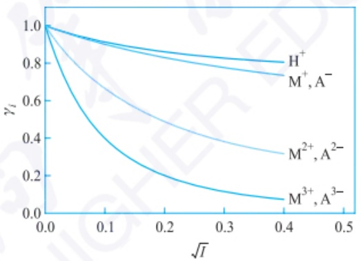

line

| \(\sqrt{I}\) | H+ | M+, A- | M2+, A2- | M3+, A3- |
| --- | --- | --- | --- | --- |
| 0.0 | 1.0 | 1.0 | 1.0 | 1.0 |
| 0.4 | ~0.8 | ~0.75 | ~0.32 | ~0.08 |

图 3.1.1 离子强度对活度系数的影响

## 2. 其他影响因素

温度、压强和反应物浓度的变化及干扰物质的存在，都会导致化学平衡的移动。当温度增加时，平衡向吸热方向移动。当压强增大时，平衡向气体分子数减少的方向移动。当反应物浓度增大时，平衡向消耗反应物的方向移动。而干扰物质的引入，会增大平衡溶液对理想溶液的偏离程度，当其与反应物或生成物反应时（如发生络合、氧化还原、沉淀等反应），平衡会向增加反应物或生成物的方向移动。

## 3.1.1.4 活度常数、浓度常数和混合常数

以弱酸 HA 的解离反应为例:

---

76

第三章 化学平衡与滴定分析

$$
\mathrm{HA} + \mathrm{H} _ {2} \mathrm{O} \rightleftharpoons \mathrm{H} _ {3} \mathrm{O} ^ {+} + \mathrm{A} ^ {-}
$$

a. 活度常数 $K_{\mathrm{a}}^{\ominus}$

$$
K _ {\mathrm{a}} ^ {\ominus} = \frac {a _ {\mathrm{H} _ {3} \mathrm{O} ^ {+}} a _ {\mathrm{A} ^ {-}}}{a _ {\mathrm{HA}}}
$$

$K_{a}^{\ominus}$ 是热力学常数,仅与温度有关。

b. 浓度常数 $K_{\mathrm{a}}^{\mathrm{c}}$

$$
K _ {\mathrm{a}} ^ {\mathrm{c}} = \frac {\left[ \mathrm{H} _ {3} \mathrm{O} ^ {+} \right] \left[ \mathrm{A} ^ {-} \right]}{\left[ \mathrm{HA} \right]} = \frac {K _ {\mathrm{a}} ^ {\ominus}}{\gamma_ {\mathrm{H} _ {3} \mathrm{O} ^ {+}} \gamma_ {\mathrm{A} ^ {-}}}
$$

$K_{a}^{c}$  不仅与温度有关,还与溶液的离子强度有关。

c. 混合常数 $K_{\mathrm{a}}^{\mathrm{M}}$

若  $H_{3}O^{+}$  用活度表示, 其他组分用浓度表示, 就得到混合常数  $K_{a}^{M}$ 。

$$
K _ {\mathrm{a}} ^ {\mathrm{M}} = \frac {a _ {\mathrm{H} _ {3} \mathrm{O} ^ {-}} \left[ \mathrm{A} ^ {-} \right]}{\left[ \mathrm{HA} \right]} = \frac {K _ {\mathrm{a}} ^ {\ominus}}{\gamma_ {\mathrm{A} ^ {-}}}
$$

$K_{a}^{M}$  与温度和溶液的离子强度有关。

在实际工作中, $H_{3}O^{+}$ 或 $OH^{-}$ 的活度能够通过pH计测得,处理平衡问题时,采用混合常数比较方便。

如果只涉及分析测定中酸碱平衡的处理,通常溶液浓度不太大,若计算 pH 要求的准确度不太高时,可忽略离子强度的影响,用活度常数代替浓度常数作近似计算。在酸碱平衡与酸碱滴定中,一般都采用活度常数进行计算,仅当准确度要求较高时,才考虑离子强度的影响(如标准缓冲溶液 pH 的计算中,需进行活度校正)。若溶液离子强度较高,最好采用浓度常数或混合常数计算。

## 3.1.2 酸碱平衡

酸碱平衡(acid-base equilibrium)是四大化学平衡的基础,几乎任何水溶液中的反应都需要考虑酸碱作用。本节介绍酸度对弱酸碱形态分布的影响;通过酸碱溶液pH计算的讨论,介绍处理化学平衡的统一方法与思路;介绍酸碱缓冲溶液。

## 3.1.2.1 酸碱反应及其平衡常数

## 1. 酸碱反应

根据 Brønsted-Lowry 酸碱质子理论,能给出质子的物质称为酸,能接受质子的物质称为碱。酸(HA)给出质子后变成其共轭碱( $A^{-}$ ),碱(B)接受质子后变成其共轭酸( $BH^{+}$ )。HA- $A^{-}$ 、B- $BH^{+}$ 相互依存,构成共轭酸碱对。

表 3.1.2 是一些典型的共轭酸碱对。

表 3.1.2 一些典型的共轭酸碱对

| 酸 |  | 质子+共轭碱 |
| --- | --- | --- |
| $H_3O^+$ | $\rightleftharpoons$ | $H^+ + H_2O$ |
| $H_2O$ | $\rightleftharpoons$ | $H^+ + OH^-$ |
| HCl | $\longrightarrow$ | $H^+ + Cl^-$ |
| $H_2PO_4^-$ | $\rightleftharpoons$ | $H^+ + HPO_4^{2-}$ |
| $HPO_4^{2-}$ | $\rightleftharpoons$ | $H^+ + PO_4^{3-}$ |
| $NH_4^+$ | $\rightleftharpoons$ | $H^+ + NH_3$ |
| $[Fe(H_2O)_6]^{3+}$ | $\rightleftharpoons$ | $H^+ + [Fe(H_2O)_5(OH)]^{2+}$ |

---

3.1 化学平衡

77

可见:共轭酸碱对之间只相差一个质子;酸或碱可以是中性分子,也可以是阳离子或阴离子;质子理论中的酸碱概念是相对的,同一个物质(如 $HPO_{4}^{2-}$ )在一个酸碱对中是酸,在另一个酸碱对中可以作为碱。

酸给出质子的反应、碱接受质子的反应都称为酸碱半反应。半反应不能单独发生，酸给出质子时，必须有另一种能够接受质子的碱存在。酸碱反应由两个共轭酸碱对共同作用才能完成，其实质是质子的转移。

例如,对于一元弱酸 HA 的解离,有

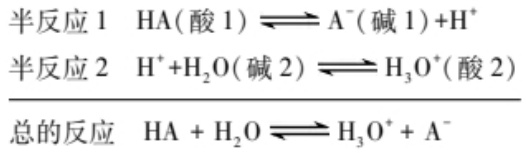

flowchart

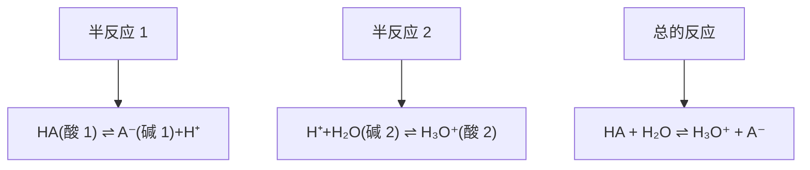

酸 1 碱 2 酸 2 碱 1

其结果是质子从 HA 转移到  $H_{2}O$ ，溶剂  $H_{2}O$  在此处起碱的作用，使 HA 的解离得以实现。

平衡常数为

$$
K _ {\mathrm{a}} = \frac {[ \mathrm{H} _ {3} \mathrm{O} ^ {+} ] [ \mathrm{A} ^ {-} ]}{[ \mathrm{HA} ]} \tag {3-1-7}
$$

$K_{a}$  称为一元弱酸 HA 的解离常数。 $K_{a}$  越大，HA 给出质子的能力越强，其共轭碱 ( $A^{-}$ ) 接受质子的能力越弱。在稀溶液中， $H_{2}O$  大量存在，其浓度近似为常数 (55.6 mol· $L^{-1}$ )，不包括在此式中。

为书写方便,通常将  $H_{3}O^{+}$  简写成  $H^{+}$ , 则 HA 的解离反应简写为  $HA \rightleftharpoons H^{+} + A^{-}$ 。

对于一元弱碱 B, 有

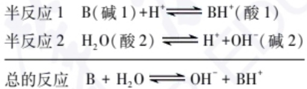

flowchart

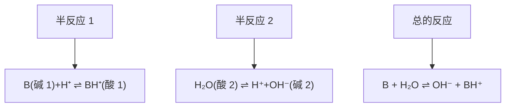

碱 1 酸 2 碱 2 酸 1

平衡常数为

$$
K _ {\mathrm{b}} = \frac {[ \mathrm{BH} ^ {+} ] [ \mathrm{OH} ^ {-} ]}{[ \mathrm{B} ]} \tag {3-1-8}
$$

$K_{b}$  称为一元弱碱 B 的解离常数。 $K_{b}$  越大，B 接受质子的能力越强，对应的共轭酸  $(\mathrm{BH}^{+})$  给出质子的能力越弱。

## 2. 质子自递反应

在酸碱反应中,水既能作为酸给出质子,又能作为碱得到质子,质子也可以在水分子之间转移,这种反应称为水的质子自递(autoprotolysis)反应。

$$
\mathrm{H} _ {2} \mathrm{O} (\text {酸} 1) + \mathrm{H} _ {2} \mathrm{O} (\text {碱} 2) \rightleftharpoons \mathrm{OH} ^ {-} (\text {碱} 1) + \mathrm{H} _ {3} \mathrm{O} ^ {*} (\text {酸} 2)
$$

$$
K _ {\mathrm{w}} = \left[ \mathrm{H} _ {3} \mathrm{O} ^ {+} \right] \left[ \mathrm{OH} ^ {-} \right] = 1. 0 \times 1 0 ^ {- 1 4} (2 5 ℃)
$$

$K_{w}$ 称为水的质子自递常数,也称为离子积。

其他溶剂，如  $C_{2}H_{5}OH$ 、 $NH_{3}$ 、HAc 等，也存在类似的质子自递反应。

---

78

第三章 化学平衡与滴定分析

多元酸碱逐级解离常数及对应共轭酸碱对

## 3. 共轭酸碱对的 $K_{\mathrm{a}}$ 和 $K_{\mathrm{b}}$ 的关系

对于共轭酸碱对 HA-A $^{-}$ ，若 HA 的酸性强，其共轭碱 A $^{-}$  的碱性必弱。共轭酸碱对的  $K_{a}$  与  $K_{b}$  间的关系式可由式(3-1-7)和式(3-1-8)导出:

$$
K _ {\mathrm{a}} \cdot K _ {\mathrm{b}} = \frac {[ \mathrm{H} ^ {+} ] [ \mathrm{A} ^ {-} ]}{[ \mathrm{HA} ]} \cdot \frac {[ \mathrm{HA} ] [ \mathrm{OH} ^ {-} ]}{[ \mathrm{A} ^ {-} ]} = [ \mathrm{H} ^ {+} ] \cdot [ \mathrm{OH} ^ {-} ] = K _ {\mathrm{w}}
$$

$$
\mathrm{p} K _ {\mathrm{a}} + \mathrm{p} K _ {\mathrm{b}} = \mathrm{p} K _ {\mathrm{w}} = 1 4. 0 0 (2 5 ℃)
$$

因此，由酸的解离常数  $K_{a}$ ，可求出其共轭碱的  $K_{b}$ ，反之亦然。

»例 3.1.1 已知一氯乙酸  $CH_{2}ClCOOH$  的  $K_{a}=1.36\times10^{-3}$ ，求  $CH_{2}ClCOO^{-}$  的  $pK_{b}$  值。

》解:一氯乙酸  $CH_{2}ClCOOH$  在水溶液中的解离反应为

$$
\mathrm{CH} _ {2} \mathrm{ClCOOH} + \mathrm{H} _ {2} \mathrm{O} \rightleftharpoons \mathrm{H} _ {3} \mathrm{O} ^ {+} + \mathrm{CH} _ {2} \mathrm{ClCOO} ^ {-} \quad \mathrm{pK} _ {\mathrm{a}} = 2. 8 7
$$

根据共轭酸碱对  $K_{a}$  与  $K_{b}$  间的关系式可得， $pK_{b}=14.00-2.87=11.13$ 。

多元酸(碱)在水溶液中发生逐级解离,存在多个共轭酸碱对,每一个共轭酸碱对的 $K_{a}$ 和 $K_{b}$ 也存在上述确定关系,详见二维码。

》例 3.1.2 已知磷酸  $H_{3}PO_{4}$  的  $K_{a_{1}} \sim K_{a_{3}}$  分别为  $7.11 \times 10^{-3}$ 、 $6.34 \times 10^{-8}$ 、 $4.22 \times 10^{-13}$ ，求磷酸根  $PO_{4}^{3-}$  的  $pK_{b_{1}} \sim pK_{b_{3}}$  值。

» 解: 磷酸  $H_{3}PO_{4}$  在水溶液中的逐级解离反应为

$$
\mathrm{H} _ {3} \mathrm{PO} _ {4} \rightleftharpoons \mathrm{H} ^ {+} + \mathrm{H} _ {2} \mathrm{PO} _ {4} ^ {-} \quad \mathrm{pK} _ {\mathrm{a} _ {1}} = 2. 1 4 8
$$

$$
\mathrm{H} _ {2} \mathrm{PO} _ {4} ^ {-} \rightleftharpoons \mathrm{H} ^ {+} + \mathrm{HPO} _ {4} ^ {2 -} \quad \mathrm{pK} _ {\mathrm{a} _ {2}} = 7. 1 9 8
$$

$$
\mathrm{HPO} _ {4} ^ {2 -} \rightleftharpoons \mathrm{H} ^ {+} + \mathrm{PO} _ {4} ^ {3 -} \quad \mathrm{pK} _ {\mathrm{a} _ {3}} = 1 2. 3 7 7
$$

由此可得，磷酸根  $PO_{4}^{3-}$  的  $pK_{b_{1}} = pK_{w} - pK_{a_{3}} = 1.623, pK_{b_{2}} = pK_{w} - pK_{a_{2}} = 6.802, pK_{b_{3}} = pK_{w} - pK_{a_{1}} = 11.852$ 。

## 4. 中和反应

中和反应(neutralization reaction)是一类重要的酸碱反应,是解离反应的逆反应,是酸碱滴定法的基础,其平衡常数用 $K_{t}$ 表示,也称为酸碱滴定常数。

强酸与强碱的中和反应,是反应完全程度最高的一类中和反应。

$$
\mathrm{H} ^ {+} + \mathrm{OH} ^ {-} \rightleftharpoons \mathrm{H} _ {2} \mathrm{O}
$$

$$
K _ {\mathrm{t}} = \frac {1}{\left[ \mathrm{H} ^ {+} \right] \left[ \mathrm{OH} ^ {-} \right]} = \frac {1}{K _ {\mathrm{w}}} = 1. 0 \times 1 0 ^ {1 4} (2 5 ℃)
$$

强碱与弱酸的中和反应:

$$
\mathrm{HA} + \mathrm{OH} ^ {-} \rightleftharpoons \mathrm{H} _ {2} \mathrm{O} + \mathrm{A} ^ {-}
$$

$$
K _ {\mathrm{t}} = \frac {[ \mathrm{A} ^ {-} ]}{[ \mathrm{HA} ] [ \mathrm{OH} ^ {-} ]} = \frac {K _ {\mathrm{a}}}{K _ {\mathrm{w}}}
$$

强酸与弱碱的中和反应:

$$
\mathrm{H} ^ {+} + \mathrm{B} \rightleftharpoons \mathrm{BH} ^ {+}
$$

$$
K _ {\mathrm{t}} = \frac {[ \mathrm{BH} ^ {+} ]}{[ \mathrm{H} ^ {+} ] [ \mathrm{B} ]} = \frac {K _ {\mathrm{b}}}{K _ {\mathrm{w}}}
$$

后两类中和反应,其平衡常数小于强酸与强碱的中和反应;弱酸或弱碱的解

---

3.1 化学平衡

79

离常数越大,反应完全程度越高。

## 3.1.2.2 酸度对弱酸(碱)形态分布的影响

## 1. 分布分数

在平衡溶液中,由于酸度、络合或氧化还原作用的影响,一个物种往往存在多种形态。其中某一形态的平衡浓度占其总浓度(即分析浓度)的分数,称为分布分数(distribution fraction),用 $\delta$ 表示。

（1）一元弱酸(碱)溶液 以分析浓度为 c 的 HA 为例, 在水溶液中存在两种形态(HA 和 A $^{-}$ ),

$$
c = \left[ \mathrm{HA} \right] + \left[ \mathrm{A} ^ {-} \right]
$$

代入解离常数表达式,得

$$
c = \left[ \mathrm{HA} \right] + \frac {\left[ \mathrm{HA} \right]}{\left[ \mathrm{H} ^ {+} \right]} K _ {\mathrm{a}} = \left[ \mathrm{HA} \right] \left(1 + \frac {K _ {\mathrm{a}}}{\left[ \mathrm{H} ^ {+} \right]}\right)
$$

分别用  $\delta_{1}$  和  $\delta_{0}$  表示 HA 和 A⁻ 的分布分数, 则

$$
\delta_ {1} = \delta_ {\mathrm{HA}} = \frac {[ \mathrm{HA} ]}{c} = \frac {[ \mathrm{HA} ]}{[ \mathrm{HA} ] \left(1 + \frac {K _ {\mathrm{a}}}{[ \mathrm{H} ^ {+} ]}\right)} = \frac {[ \mathrm{H} ^ {+} ]}{[ \mathrm{H} ^ {+} ] + K _ {\mathrm{a}}} \tag {3-1-9}
$$

$$
\delta_ {0} = \delta_ {\mathrm{A} ^ {-}} = \frac {[ \mathrm{A} ^ {-} ]}{c} = \frac {\frac {[ \mathrm{HA} ]}{[ \mathrm{H} ^ {+} ]} K _ {\mathrm{a}}}{[ \mathrm{HA} ] \left(1 + \frac {K _ {\mathrm{a}}}{[ \mathrm{H} ^ {+} ]}\right)} = \frac {K _ {\mathrm{a}}}{[ \mathrm{H} ^ {+} ] + K _ {\mathrm{a}}} \tag {3-1-10}
$$

且有

$$
\delta_ {1} + \delta_ {0} = 1
$$

可见,一元弱酸溶液中两种形态的分布分数与其共轭酸碱对的总浓度 c 无关,对指定酸碱而言,分布分数仅是溶液  $\left[H^{+}\right]$  的函数。

HAc 溶液 $\left(\mathrm{p}K_{\mathrm{a}}=4.756\right)$ 的酸碱形态分布图如图 3.1.2(a) 所示。

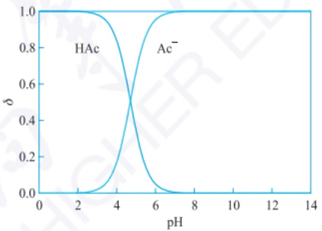

line

| pH | HAc \((\delta)\) | Ac- \((\delta)\) |
| --- | --- | --- |
| 0 | 1.0 | 0.0 |
| 2 | 1.0 | ~0.05 |
| 4 | ~0.6 | ~0.35 |
| 5 | ~0.35 | 0.5 |
| 6 | ~0.1 | ~0.75 |
| 8 | 0.0 | 1.0 |
| 10 | 0.0 | 1.0 |
| 12 | 0.0 | 1.0 |
| 14 | 0.0 | 1.0 |

(a)

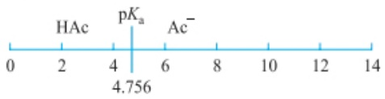

text_image

HAc
pKa
4.756
Ac⁻

(b)

图 3.1.2 HAc 的 (a) δ-pH 图及 (b) 优势区域图

由图3.1.2(a)可知，随着溶液 $\mathrm{pH}$ 升高，$\delta_{1}$ 逐渐减小，而 $\delta_0$ 逐渐增大。当 $\mathrm{pH} = \mathrm{pK_a}$ 时，$\delta_{1} = \delta_{0} = 0.50$ ，HAc和 $\mathrm{Ac^{-}}$ 各占一半；当 $\mathrm{pH} < \mathrm{pK_a}$ 时，HAc是主要存在形态；

---

80

第三章 化学平衡与滴定分析

一元弱酸分布分数拓展

当  $pH > pK_{a}$  时， $Ac^{-}$ 是主要存在形态。更多拓展内容，详见二维码。

优势区域图[图3.1.2(b)]是形态分布图的俯视图，可更直观地表示一元弱酸(碱)溶液中两种形态随溶液 $\mathrm{pH}$ 的分布。

以上结论可以推广至任何一元弱酸(碱)。一元弱酸(碱)的形态分布图形状都相同,只是图中曲线的交点随其 $pK_{a}$ 值大小不同而左右移动。

(2) 多元酸(碱)溶液 以分析浓度为 c 的二元弱酸  $H_{2}A$  为例, 在水溶液中存在三种形态 ( $H_{2}A, HA^{-}$  和  $A^{2-}$ ),

$$
c = \left[ \mathrm{H} _ {2} \mathrm{A} \right] + \left[ \mathrm{HA} ^ {-} \right] + \left[ \mathrm{A} ^ {2 -} \right]
$$

代入解离平衡表达式,得

$$
c = \left[ \mathrm{H} _ {2} \mathrm{A} \right] + \frac {\left[ \mathrm{H} _ {2} \mathrm{A} \right]}{\left[ \mathrm{H} ^ {+} \right]} K _ {a _ {1}} + \frac {\left[ \mathrm{H} _ {2} \mathrm{A} \right]}{\left[ \mathrm{H} ^ {+} \right] ^ {2}} K _ {a _ {1}} K _ {a _ {2}}
$$

则  $H_{2}A$ 、 $HA^{-}$ 和  $A^{2-}$  的分布分数  $\delta_{2}$ 、 $\delta_{1}$  和  $\delta_{0}$  分别为

$$
\delta_ {2} = \frac {\left[ \mathrm{H} _ {2} \mathrm{A} \right]}{c} = \frac {\left[ \mathrm{H} _ {2} \mathrm{A} \right]}{\left[ \mathrm{H} _ {2} \mathrm{A} \right] + \frac {\left[ \mathrm{H} _ {2} \mathrm{A} \right]}{\left[ \mathrm{H} ^ {+} \right]} K _ {\mathrm{a} _ {1}} + \frac {\left[ \mathrm{H} _ {2} \mathrm{A} \right]}{\left[ \mathrm{H} ^ {+} \right] ^ {2}} K _ {\mathrm{a} _ {1}} K _ {\mathrm{a} _ {2}}} = \frac {\left[ \mathrm{H} ^ {+} \right] ^ {2}}{\left[ \mathrm{H} ^ {+} \right] ^ {2} + K _ {\mathrm{a} _ {1}} \left[ \mathrm{H} ^ {+} \right] + K _ {\mathrm{a} _ {1}} K _ {\mathrm{a} _ {2}}} \tag {3-1-11}
$$

$$
\delta_ {1} = \frac {\left[ \mathrm{HA} ^ {-} \right]}{c} = \frac {K _ {\mathrm{a} _ {1}} \left[ \mathrm{H} ^ {+} \right]}{\left[ \mathrm{H} ^ {+} \right] ^ {2} + K _ {\mathrm{a} _ {1}} \left[ \mathrm{H} ^ {+} \right] + K _ {\mathrm{a} _ {1}} K _ {\mathrm{a} _ {2}}} \tag {3-1-12}
$$

$$
\delta_ {0} = \frac {\left[ \mathrm{A} ^ {2 -} \right]}{c} = \frac {K _ {\mathrm{a} _ {1}} K _ {\mathrm{a} _ {2}}}{\left[ \mathrm{H} ^ {+} \right] ^ {2} + K _ {\mathrm{a} _ {1}} \left[ \mathrm{H} ^ {+} \right] + K _ {\mathrm{a} _ {1}} K _ {\mathrm{a} _ {2}}} \tag {3-1-13}
$$

且有

$$
\delta_ {2} + \delta_ {1} + \delta_ {0} = 1
$$

根据如上推导,计算得到的碳酸和酒石酸的  $\delta-pH$  曲线如图 3.1.3 所示。请思考并回答如下问题: i. 碳酸和酒石酸的  $\delta-pH$  曲线存在明显不同,导致两者差异的主要原因是什么? ii. 要形成碳酸盐或酒石酸盐沉淀,应如何选择合适的酸度? iii. 碳酸和酒石酸,哪个满足分步滴定? iv. 碳酸氢根和酒石酸氢根溶液,哪个具有酸碱缓冲作用? v. 在什么条件下, $HA^{-}$ 的分布分数达到最大值? 部分相关讨论详见二维码。

碳酸和酒石酸  $\delta$ -pH 曲线相关讨论

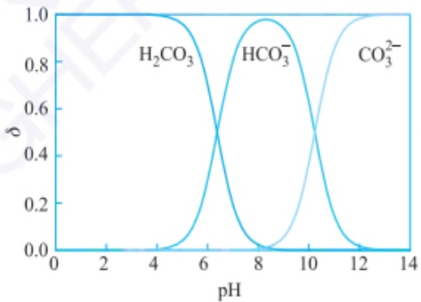

line

| pH | H2CO3 | HCO3- | CO32- |
| --- | --- | --- | --- |
| 0 | 1.0 | 0.0 | 0.0 |
| 2 | 1.0 | 0.0 | 0.0 |
| 4 | ~0.95 | ~0.05 | 0.0 |
| 6 | ~0.5 | ~0.5 | 0.0 |
| 8 | ~0.05 | ~0.95 | ~0.05 |
| 10 | 0.0 | ~0.5 | ~0.5 |
| 12 | 0.0 | 0.0 | ~0.95 |
| 14 | 0.0 | 0.0 | 1.0 |

(a)

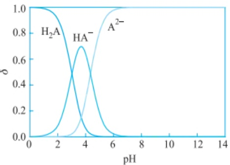

line

| pH | H2A | HA- | A2- |
| --- | --- | --- | --- |
| 0 | 1.0 | 0.0 | 0.0 |
| 2 | ~0.85 | ~0.15 | 0.0 |
| 4 | ~0.15 | ~0.7 | ~0.35 |
| 6 | 0.0 | ~0.15 | ~0.9 |
| 8 | 0.0 | 0.0 | 1.0 |
| 10 | 0.0 | 0.0 | 1.0 |
| 12 | 0.0 | 0.0 | 1.0 |
| 14 | 0.0 | 0.0 | 1.0 |

(b)

图 3.1.3 (a) 碳酸  $\left(\mathrm{p}K_{\mathrm{a}_{1}}=6.351,\mathrm{p}K_{\mathrm{a}_{2}}=10.329\right)$  和 (b) 酒石酸  $\left(\mathrm{p}K_{\mathrm{a}_{1}}=3.036,\mathrm{p}K_{\mathrm{a}_{2}}=4.366\right)$  的  $\delta-pH$  曲线

对于三元酸  $H_{3}A$ ，在水溶液中存在  $H_{3}A$ 、 $H_{2}A^{-}$ 、 $HA^{2-}$ 、 $A^{3-}$  共 4 种形态，

$$
c = \left[ \mathrm{H} _ {3} \mathrm{A} \right] + \left[ \mathrm{H} _ {2} \mathrm{A} ^ {-} \right] + \left[ \mathrm{HA} ^ {2 -} \right] + \left[ \mathrm{A} ^ {3 -} \right]
$$

可以推导得到计算各形态分布分数的公式:

---

3.1 化学平衡

81

$$
\delta_ {3} = \delta_ {\mathrm{H} _ {3} \mathrm{A}} = \frac {[ \mathrm{H} _ {3} \mathrm{A} ]}{c} = \frac {[ \mathrm{H} ^ {+} ] ^ {3}}{[ \mathrm{H} ^ {+} ] ^ {3} + K _ {\mathrm{a} _ {1}} [ \mathrm{H} ^ {+} ] ^ {2} + K _ {\mathrm{a} _ {1}} K _ {\mathrm{a} _ {2}} [ \mathrm{H} ^ {+} ] + K _ {\mathrm{a} _ {1}} K _ {\mathrm{a} _ {2}} K _ {\mathrm{a} _ {3}}}
$$

$$
\delta_ {2} = \delta_ {\mathrm{H} _ {2} \mathrm{A} ^ {-}} = \frac {\left[ \mathrm{H} _ {2} \mathrm{A} ^ {-} \right]}{c} = \frac {K _ {\mathrm{a} _ {1}} \left[ \mathrm{H} ^ {+} \right] ^ {2}}{\left[ \mathrm{H} ^ {+} \right] ^ {3} + K _ {\mathrm{a} _ {1}} \left[ \mathrm{H} ^ {+} \right] ^ {2} + K _ {\mathrm{a} _ {1}} K _ {\mathrm{a} _ {2}} \left[ \mathrm{H} ^ {+} \right] + K _ {\mathrm{a} _ {1}} K _ {\mathrm{a} _ {2}} K _ {\mathrm{a} _ {3}}}
$$

$$
\delta_ {1} = \delta_ {\mathrm{HA} ^ {2 -}} = \frac {\left[ \mathrm{HA} ^ {2 -} \right]}{c} = \frac {K _ {\mathrm{a} _ {1}} K _ {\mathrm{a} _ {2}} \left[ \mathrm{H} ^ {+} \right]}{\left[ \mathrm{H} ^ {+} \right] ^ {3} + K _ {\mathrm{a} _ {1}} \left[ \mathrm{H} ^ {+} \right] ^ {2} + K _ {\mathrm{a} _ {1}} K _ {\mathrm{a} _ {2}} \left[ \mathrm{H} ^ {+} \right] + K _ {\mathrm{a} _ {1}} K _ {\mathrm{a} _ {2}} K _ {\mathrm{a} _ {3}}}
$$

$$
\delta_ {0} = \delta_ {\mathrm{A} ^ {3 -}} = \frac {\left[ \mathrm{A} ^ {3 -} \right]}{c} = \frac {K _ {\mathrm{a} _ {1}} K _ {\mathrm{a} _ {2}} K _ {\mathrm{a} _ {3}}}{\left[ \mathrm{H} ^ {+} \right] ^ {3} + K _ {\mathrm{a} _ {1}} \left[ \mathrm{H} ^ {+} \right] ^ {2} + K _ {\mathrm{a} _ {1}} K _ {\mathrm{a} _ {2}} \left[ \mathrm{H} ^ {+} \right] + K _ {\mathrm{a} _ {1}} K _ {\mathrm{a} _ {2}} K _ {\mathrm{a} _ {3}}}
$$

$$
\delta_ {3} + \delta_ {2} + \delta_ {1} + \delta_ {0} = 1
$$

图 3.1.4 给出了磷酸 $\left(\mathrm{H}_{3}\mathrm{PO}_{4}\right)$ 各形态的 $\delta-\mathrm{pH}$ 曲线，以其 3 个 $pK_{a}$ 为界分为 4 个区域，请观察曲线并指出:i. 各形态作为主要存在形态的 pH 范围；ii. 相邻 2 个形态的分布分数相等时对应的 pH；iii. $H_{2}PO_{4}^{-}$ 和 $HPO_{4}^{2-}$ 的分布分数达最大值时对应的 pH；iv. 由此可获得的更多信息。相关讨论详见副栏中二维码。

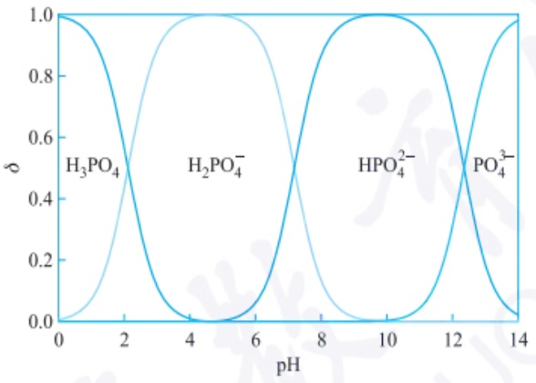

line

| pH | H3PO4 | H2PO4- | HPO4^2- | PO4^3- |
| --- | --- | --- | --- | --- |
| 0 | 1.0 | 0.0 | 0.0 | 0.0 |
| 2 | ~0.5 | ~0.5 | 0.0 | 0.0 |
| 4 | 0.0 | 1.0 | 0.0 | 0.0 |
| 6 | 0.0 | ~0.5 | ~0.5 | 0.0 |
| 8 | 0.0 | 0.0 | 1.0 | 0.0 |
| 10 | 0.0 | 0.0 | ~0.5 | ~0.5 |
| 12 | 0.0 | 0.0 | 0.0 | ~0.5 |
| 14 | 0.0 | 0.0 | 0.0 | 1.0 |

图 3.1.4  $H_{3}PO_{4}$  的  $\delta-pH$  曲线

磷酸  $\delta$ -pH 曲线相关讨论

## 思考:

对于多元弱酸  $H_{n}A$ ，请给出其各形态分布分数的计算公式并总结规律。相关讨论详见二维码。

多元酸  $H_{n}A$  各形态分布分数

## 2. 浓度对数图

浓度对数图(concentration logarithmic diagram)表示在分析浓度和离子强度不变的条件下,各形态平衡浓度的对数值随pH的变化情况。酸碱平衡中的浓度对数图绘制过程见二维码,借助计算机软件如Excel、Origin等,可以更方便地绘制。通过浓度对数图,在确定溶液pH的情况下,可以直观地判断溶液中的主要存在形态,也可以反映各形态的浓度水平;在确定溶液浓度(如化学计量点时)的情况下,可以方便地计算pH;还能用于计算终点误差。

## 3.1.2.3 水溶液平衡处理基本方法与酸碱溶液 $H^{+}$ 计算

## 1. 基本平衡式

（1）物料平衡 在一个化学平衡体系中，某一组分的总量等于该组分各种存在形态的量之和，在同一溶液中可以用浓度表示，即该组分的总浓度（即分析浓度 $c$ )等于其各种存在形态的平衡浓度之和，该数学表达式为物料平衡式（mass balance equation,MBE）。

对于强电解质,在水溶液中完全解离,其总浓度由解离出来的各离子的浓度求得。如  $0.1 \, mol \cdot L^{-1} \, HCl$  溶液中  $Cl^{-}$ 的 MBE 为

$$
[ \mathrm{Cl} ^ {-} ] = 0. 1 \mathrm{mol} \cdot \mathrm{L} ^ {- 1}
$$

浓度对数图

---

82

第三章 化学平衡与滴定分析

对于弱电解质,在水溶液中解离不完全,其总浓度由各种存在形态的平衡浓度之和求得。如  $0.1 \, mol \cdot L^{-1} \, Na_{3}PO_{4}$  溶液中相关的 MBE 为

$$
[ \mathrm{Na} ^ {+} ] = 0. 3 \mathrm{mol} \cdot \mathrm{L} ^ {- 1}
$$

$$
\left[ \mathrm{H} _ {3} \mathrm{PO} _ {4} \right] + \left[ \mathrm{H} _ {2} \mathrm{PO} _ {4} ^ {-} \right] + \left[ \mathrm{HPO} _ {4} ^ {2 -} \right] + \left[ \mathrm{PO} _ {4} ^ {3 -} \right] = 0. 1 \mathrm{mol} \cdot \mathrm{L} ^ {- 1}
$$

»例 3.1.3 写出 ${0.01}\mathrm{\;{mol}} \cdot  {\mathrm{L}}^{-1}{\mathrm{{CuCl}}}_{2}$ 和 ${0.1}\mathrm{\;{mol}} \cdot  {\mathrm{L}}^{-1}{\mathrm{{NH}}}_{3}$ 混合溶液的 MBE。

》解:根据酸碱平衡和络合平衡,有

$$
[ \mathrm{Cl} ^ {-} ] = 2 \times 0. 0 1 \mathrm{mol} \cdot \mathrm{L} ^ {- 1} = 0. 0 2 \mathrm{mol} \cdot \mathrm{L} ^ {- 1}
$$

$$
\begin{array}{l} \left[ \mathrm{Cu} ^ {2 +} \right] + \left[ \mathrm{Cu} \left(\mathrm{NH} _ {3}\right) ^ {2 +} \right] + \left[ \mathrm{Cu} \left(\mathrm{NH} _ {3}\right) _ {2} ^ {2 +} \right] + \left[ \mathrm{Cu} \left(\mathrm{NH} _ {3}\right) _ {3} ^ {2 +} \right] + \left[ \mathrm{Cu} \left(\mathrm{NH} _ {3}\right) _ {4} ^ {2 +} \right] = 0. 0 1 \mathrm{mol} \cdot \mathrm{L} ^ {- 1} \\ \begin{array}{l} \left[ \mathrm{NH} _ {3} \right] + \left[ \mathrm{NH} _ {4} ^ {+} \right] + \left[ \mathrm{Cu} \left(\mathrm{NH} _ {3}\right) ^ {2 +} \right] + 2 \left[ \mathrm{Cu} \left(\mathrm{NH} _ {3}\right) _ {2} ^ {2 +} \right] + 3 \left[ \mathrm{Cu} \left(\mathrm{NH} _ {3}\right) _ {3} ^ {2 +} \right] + 4 \left[ \mathrm{Cu} \left(\mathrm{NH} _ {3}\right) _ {4} ^ {2 +} \right] = \\ 0. 1 \mathrm{mol} \cdot \mathrm{L} ^ {- 1} \end{array} \\ \end{array}
$$

（2）电荷平衡 当反应处于平衡状态时，依据电中性原则，溶液中正电荷数量的总和必须等于负电荷数量的总和，在同一溶液中可用浓度表示，其数学表达式为电荷平衡式(charge balance equation, CBE)。

对于  $0.1 \, mol \cdot L^{-1} \, NaOH$  溶液, CBE 为

$$
[ \mathrm{Na} ^ {+} ] + [ \mathrm{H} ^ {+} ] = [ \mathrm{OH} ^ {-} ]
$$

对于  $0.1 \, mol \cdot L^{-1} \, Na_{3}PO_{4}$  溶液, CBE 为

$$
\left[ \mathrm{Na} ^ {+} \right] + \left[ \mathrm{H} ^ {+} \right] = \left[ \mathrm{OH} ^ {-} \right] + \left[ \mathrm{H} _ {2} \mathrm{PO} _ {4} ^ {-} \right] + 2 \left[ \mathrm{HPO} _ {4} ^ {2 -} \right] + 3 \left[ \mathrm{PO} _ {4} ^ {3 -} \right]
$$

书写 CBE 时应注意: (i) 中性分子不能出现在 CBE 中; (ii)  $H^{+}$  和  $OH^{-}$  必然出现在 CBE 中; (iii) 多价离子的平衡浓度前应乘以相应的电荷数。

（3）质子条件(或质子平衡)式 酸碱反应的实质是质子的转移。酸碱反应达到平衡时，酸失去质子的数量等于碱得到质子的数量。根据质子得失数和相关组分的浓度列出的表达式为质子条件式(proton condition equation, PCE)或质子平衡式(proton balance equation, PBE)。

得出质子条件式的具体步骤如下:

(i) 选择质子参考水准(reference level),也称为零水准(zero level)。质子参考水准是溶液中参与质子转移的物质,以其为参考,用来衡量溶液中哪些物质是得质子产物,哪些物质是失质子产物。
（ii）由质子参考水准确定得失质子的产物。得质子产物列于等式左侧，失质子产物列于等式右侧，平衡浓度之前应乘以相应的质子转移数。
（iii）根据得失质子数和相关组分的浓度列出 PCE。

需注意,质子参考水准不会出现在 PCE 中。

质子条件式也可以由物料平衡式和电荷平衡式联立导出。此略。

»例 3.1.4 写出  $0.1 \, mol \cdot L^{-1} \, Na_{3}PO_{4}$  溶液的 PCE。

》解:质子参考水准为  $H_{2}O$ 、 $PO_{4}^{3-}$ ，则

$H_{2}O$  得质子产物为  $H^{+}$ 、失质子产物为  $OH^{-}$ ;  $PO_{4}^{3-}$  得质子产物为  $HPO_{4}^{2-}$ 、 $H_{2}PO_{4}^{-}$  和  $H_{3}PO_{4}$ 。

$$
\mathrm{PCE} \text {为} \quad [ \mathrm{H} ^ {+} ] + [ \mathrm{HPO} _ {4} ^ {2 -} ] + 2 [ \mathrm{H} _ {2} \mathrm{PO} _ {4} ^ {-} ] + 3 [ \mathrm{H} _ {3} \mathrm{PO} _ {4} ] = [ \mathrm{OH} ^ {-} ]
$$

---

3.1 化学平衡

83

»例 3.1.5 写出含有浓度为  $c_{\mathrm{a}}(\mathrm{mol}\cdot\mathrm{L}^{-1})$  的 HA 和浓度为  $c_{\mathrm{b}}(\mathrm{mol}\cdot\mathrm{L}^{-1})$  的 NaA 混合溶液的质子条件式。

》解:选择  $H_{2}O$  、浓度为  $c_{\mathrm{a}}(\mathrm{mol}\cdot\mathrm{L}^{-1})$  的 HA 和浓度为  $c_{\mathrm{b}}(\mathrm{mol}\cdot\mathrm{L}^{-1})$  的  $A^{-}$  为质子参考水准,体系的 PCE 为

$$
\left[ \mathrm{HA} \right] _ {2} + \left[ \mathrm{H} ^ {+} \right] = \left[ \mathrm{A} ^ {-} \right] _ {1} + \left[ \mathrm{OH} ^ {-} \right]
$$

式中下标1和2用于标识失质子产物和得质子产物分别来自浓度为 $c_{\mathrm{a}}(\mathrm{mol}\cdot \mathrm{L}^{-1})$ 的HA和浓度为 $c_{\mathrm{b}}(\mathrm{mol}\cdot \mathrm{L}^{-1})$ 的 $\mathrm{NaA}$ 。两侧同加 $[\mathrm{HA}]_1$ ，则

$$
\left[ \mathrm{HA} \right] _ {1} + \left[ \mathrm{HA} \right] _ {2} + \left[ \mathrm{H} ^ {+} \right] = \left[ \mathrm{HA} \right] _ {1} + \left[ \mathrm{A} ^ {-} \right] _ {1} + \left[ \mathrm{OH} ^ {-} \right]
$$

溶液中 $\left[\mathrm{HA}\right] = \left[\mathrm{HA}\right]_{1} + \left[\mathrm{HA}\right]_{2},\quad c_{\mathrm{a}} = \left[\mathrm{HA}\right]_{1} + \left[\mathrm{A}^{-}\right]_{1}$

故，PCE 为

$$
\left[ \mathrm{HA} \right] + \left[ \mathrm{H} ^ {+} \right] = c _ {\mathrm{a}} + \left[ \mathrm{OH} ^ {-} \right]
$$

亦可两侧同加 $\left[\mathrm{A}^{-}\right]_{2}$ ，则

$$
\left[ \mathrm{A} ^ {-} \right] _ {2} + \left[ \mathrm{HA} \right] _ {2} + \left[ \mathrm{H} ^ {+} \right] = \left[ \mathrm{A} ^ {-} \right] _ {2} + \left[ \mathrm{A} ^ {-} \right] _ {1} + \left[ \mathrm{OH} ^ {-} \right]
$$

溶液中 $\left[\mathrm{A}^{-}\right] = \left[\mathrm{A}^{-}\right]_{2} + \left[\mathrm{A}^{-}\right]_{1},\quad c_{\mathrm{b}} = \left[\mathrm{A}^{-}\right]_{2} + \left[\mathrm{HA}\right]_{2}$

故,PCE 为

$$
c _ {\mathrm{b}} + \left[ \mathrm{H} ^ {+} \right] = \left[ \mathrm{A} ^ {-} \right] + \left[ \mathrm{OH} ^ {-} \right]
$$

尽管上述2个PCE看起来不同，但结合物料平衡式 $\left[\mathrm{HA}\right] + \left[\mathrm{A}^{-}\right] = c_{\mathrm{a}} + c_{\mathrm{b}}$ 可知，它们在本质上是相同的，只是同一个PCE的不同表达形式。

## 2. 水溶液平衡处理通用方法

水溶液中,通常多个化学平衡同时存在。可应用平衡常数表达式、物料平衡式和电荷平衡式(酸碱溶液还可以采用质子平衡式),采用通用的思路与方法解决复杂体系中的平衡问题。酸碱平衡处理的具体操作如下:

第一步,明确体系中所有酸碱组分。

第二步,列出 CBE。在酸碱体系中,也可以方便列出 PCE。平衡常数表达式和 MBE 将在下面的分布分数中得到体现,一般不必单独列出。

第三步,将上述等式中酸碱组分的平衡浓度以其分布分数与分析浓度的乘积代入 CBE,获得关于 $\left[H^{*}\right]$ 的方程。

有两种求解 $\left[\mathrm{H}^{+}\right]$ 方程的方法:使用数值方法，借助计算机求解；采用简化方法。实际上，在分析化学中，一般并不要求计算结果十分精确。可以根据溶液的具体条件，分清主次，合理取舍，简化精确计算式。本节中主要介绍简化方法。简化的基本原则就是有两项之间加减时，如果一项的值远小于另一项时，次要项可以被忽略。一般认为实验获得的解离常数大都有百分之几（如 $5\%$ ）的误差。因此，在以下的计算中，当一项小于另一项的 $5\%$ 时，前者可以被忽略。

## 3. 酸碱溶液 $[\mathbf{H}^{+}]$ 计算实例

(1) 强酸(碱)溶液 强酸在水溶液中全部解离, 其质子条件式是(以 HCl 为例)

$$
\left[ \mathrm{H} ^ {+} \right] = \left[ \mathrm{OH} ^ {-} \right] + c _ {\mathrm{HCl}}
$$

当盐酸浓度不太低 $(c\geqslant10^{-6}\ \mathrm{mol}\cdot\mathrm{L}^{-1})$ 时,可忽略水的解离,

$$
\left[ \mathrm{H} ^ {+} \right] = c \tag {3-1-14}
$$

同理,对于强碱溶液,当  $c \geqslant 10^{-6} \, mol \cdot L^{-1}$  时,可忽略水的解离,

---

84

第三章 化学平衡与滴定分析

$$
\left[ \mathrm{OH} ^ {-} \right] = c \tag {3-1-15}
$$

(2) 一元弱酸(碱)溶液 对于浓度为  $c(\mathrm{mol} \cdot \mathrm{L}^{-1})$  的一元弱酸 HA 溶液, 质子条件式为

$$
\left[ \mathrm{H} ^ {+} \right] = \left[ \mathrm{A} ^ {-} \right] + \left[ \mathrm{OH} ^ {-} \right]
$$

利用平衡关系式将上式中各项变成 $\left[H^{+}\right]$ 的函数,即

$$
\left[ \mathrm{H} ^ {+} \right] = \frac {K _ {\mathrm{a}} \left[ \mathrm{HA} \right]}{\left[ \mathrm{H} ^ {+} \right]} + \frac {K _ {\mathrm{w}}}{\left[ \mathrm{H} ^ {+} \right]}
$$

则

$$
\left[ \mathrm{H} ^ {+} \right] = \sqrt {K _ {\mathrm{a}} \left[ \mathrm{HA} \right] + K _ {\mathrm{w}}} \tag {3-1-16}
$$

将 $\left[HA\right]=c\delta_{HA}=c\frac{\left[H^{+}\right]}{\left[H^{+}\right]+K_{a}}$ 代入上式，得到精确式，为一元三次方程，即

$$
\left[ \mathrm{H} ^ {+} \right] ^ {3} + K _ {\mathrm{a}} \left[ \mathrm{H} ^ {+} \right] ^ {2} - (K _ {\mathrm{a}} c + K _ {\mathrm{w}}) \left[ \mathrm{H} ^ {+} \right] - K _ {\mathrm{a}} K _ {\mathrm{w}} = 0
$$

对于极弱或极稀酸,水的解离不可忽略。而当  $K_{a}c>20K_{w}$  时,可忽略水的解离,即略去  $K_{w}$  项,则

$$
\left[ \mathrm{H} ^ {+} \right] = \sqrt {K _ {\mathrm{a}} \left[ \mathrm{HA} \right]}
$$

代入 $[HA]=c\delta_{HA}$ ，整理得到一元二次方程:

$$
\left[ \mathrm{H} ^ {+} \right] ^ {2} + K _ {\mathrm{a}} \left[ \mathrm{H} ^ {+} \right] - c K _ {\mathrm{a}} = 0 \tag {3-1-17}
$$

解此方程,即得 $\left[H^{+}\right]$ 。

或者,对于一元弱酸,忽略水的解离时, $\left[OH^{-}\right]$ 与 $\left[H^{+}\right]$ 相比可忽略,有

$$
[ \mathrm{HA} ] = c - [ \mathrm{A} ^ {-} ] = c - ([ \mathrm{H} ^ {+} ] - [ \mathrm{OH} ^ {-} ]) \approx c - [ \mathrm{H} ^ {+} ]
$$

则

$$
\left[ \mathrm{H} ^ {+} \right] = \sqrt {K _ {\mathrm{a}} (c - \left[ \mathrm{H} ^ {+} \right])}
$$

同样得到

$$
\left[ \mathrm{H} ^ {+} \right] ^ {2} + K _ {\mathrm{a}} \left[ \mathrm{H} ^ {+} \right] - c K _ {\mathrm{a}} = 0
$$

解得 $\left[H^{+}\right]$ 。

进一步地,当酸的解离度小于5%,即 $\frac{K_{a}}{c}<2.5\times10^{-3}$ 或 $\frac{c}{K_{a}}>400$ 时(见二维码)

$$
[ \mathrm{HA} ] = c - [ \mathrm{A} ^ {-} ] \approx c
$$

则得到最简式

$$
\left[ \mathrm{H} ^ {+} \right] = \sqrt {K _ {\mathrm{a}} c} \tag {3-1-18}
$$

当 $K_{\mathrm{a}}c < 20K_{\mathrm{w}}$ ，但 $\frac{K_{\mathrm{a}}}{c} < 2.5\times 10^{-3}$ 时，式(3-1-16)变为

$$
\left[ \mathrm{H} ^ {+} \right] = \sqrt {K _ {\mathrm{a}} c + K _ {\mathrm{w}}} \tag {3-1-19}
$$

»例 3.1.6 计算  $0.10 \, mol \cdot L^{-1}$  一氯乙酸 ( $CH_{2}ClCOOH, K_{a} = 1.36 \times 10^{-3}$ ) 溶液的 pH。

» 解: $K_{\mathrm{a}}c \gg 20K_{\mathrm{w}}$，忽略水的解离；但 $\frac{K_{\mathrm{a}}}{c} = 1.4 \times 10^{-2} > 2.5 \times 10^{-3}$，[HA] $\neq c$。

故采用近似式(3-1-17)计算,代入数据:

$$
\left[ \mathrm{H} ^ {+} \right] ^ {2} + 1. 3 6 \times 1 0 ^ {- 3} \left[ \mathrm{H} ^ {+} \right] - 0. 1 0 \times 1. 3 6 \times 1 0 ^ {- 3} = 0
$$

解之,得

忽略弱酸解离条件推导

---

3.1 化学平衡

85

$$
[ \mathrm{H} ^ {+} ] = 1. 1 \times 1 0 ^ {- 2} \mathrm{mol} \cdot \mathrm{L} ^ {- 1}
$$

$$
\mathrm{pH} = 1. 9 6
$$

»例 3.1.7 计算  $0.10 \, mol \cdot L^{-1}$  和  $1.0 \times 10^{-4} \, mol \cdot L^{-1}$  HCN ( $K_{a} = 6.2 \times 10^{-10}$ ) 溶液的 pH。

» 解: 当  $c=0.10\ mol\cdot L^{-1}$  时,  $K_{a}c=6.2\times10^{-11}>20K_{w}$ , 且  $\frac{K_{a}}{c}=6.2\times10^{-9}\ll2.5\times10^{-3}$ , 故采用最简式(3-1-18)计算:

$$
\left[ \mathrm{H} ^ {+} \right] = \sqrt {K _ {\mathrm{a}} c} = \sqrt {0 . 1 \times 6 . 2 \times 1 0 ^ {- 1 0}} = 7. 9 \times 1 0 ^ {- 6} (\mathrm{mol} \cdot \mathrm{L} ^ {- 1})
$$

$$
\mathrm{pH} = 5. 10
$$

当  $c=1.0\times10^{-4}\ mol\cdot L^{-1}$  时， $K_{a}c=6.2\times10^{-14}<20K_{w}$ ，而  $\frac{K_{a}}{c}=6.2\times10^{-6}\ll2.5\times10^{-3}$ ，故采用近似式(3-1-19)计算:

$$
\left[ \mathrm{H} ^ {+} \right] = \sqrt {K _ {\mathrm{a}} c + K _ {\mathrm{w}}} = \sqrt {7 . 2 \times 1 0 ^ {- 1 4}} = 2. 7 \times 1 0 ^ {- 7} (\mathrm{mol} \cdot \mathrm{L} ^ {- 1})
$$

$$
\mathrm{pH} = 6. 5 7
$$

同理，对于一元弱碱溶液，有 $\left[\mathrm{OH}^{-}\right] = \sqrt{K_{\mathrm{b}}\left[\mathrm{A}^{-}\right] + K_{\mathrm{w}}}$

当 $\frac{K_{b}}{c}<2.5\times10^{-3},K_{b}c>20K_{w}$ 时，用最简式 $\left[OH^{-}\right]=\sqrt{K_{b}c}$ ;

当 $\frac{K_{\mathrm{b}}}{c} < 2.5\times 10^{-3},K_{\mathrm{b}}c <   20K_{\mathrm{w}}$ 时，仅 $[\mathrm{A}^{-}] = c - [\mathrm{HA}]\approx c;$

当 $\frac{K_{b}}{c}>2.5\times10^{-3},K_{b}c>20K_{w}$ 时，仅水的解离可以忽略。

>>例 3.1.8 计算  $0.050 \, mol \cdot L^{-1} \, NaAc$  溶液的 pH。

» 解: 已知 HAc 的  $K_{a}=1.75\times10^{-5}$ ，则  $Ac^{-}$  的

$$
K _ {\mathrm{b}} = \frac {K _ {\mathrm{w}}}{K _ {\mathrm{a}}} = \frac {1 . 0 \times 1 0 ^ {- 1 4}}{1 . 7 5 \times 1 0 ^ {- 5}} = 5. 7 1 \times 1 0 ^ {- 1 0}
$$

此时， $K_{b}c=2.9\times10^{-11}>20K_{w}$ ，且 $\frac{K_{b}}{c}\ll2.5\times10^{-3}$ ，故采用最简式计算:

$$
\left[ \mathrm{OH} ^ {-} \right] = \sqrt {K _ {\mathrm{b}} c} = \sqrt {0 . 0 5 0 \times 5 . 7 1 \times 1 0 ^ {- 1 0}} = 5. 3 \times 1 0 ^ {- 6} (\mathrm{mol} \cdot \mathrm{L} ^ {- 1})
$$

$$
\mathrm{pH} = 14.00 - \mathrm{pOH} = 14.00 - 5.28 = 8.72
$$

## (3) 多元酸(碱)溶液

以二元酸  $H_{2}A$  为例, 其质子条件式是

$$
\left[ \mathrm{H} ^ {+} \right] = \left[ \mathrm{HA} ^ {-} \right] + 2 \left[ \mathrm{A} ^ {2 -} \right] + \left[ \mathrm{OH} ^ {-} \right]
$$

溶液为酸性， $[\mathrm{OH}^{-}]$ 可略去，结合有关平衡关系式，得

$$
\left[ \mathrm{H} ^ {+} \right] = \frac {K _ {\mathrm{a} _ {1}} \left[ \mathrm{H} _ {2} \mathrm{A} \right]}{\left[ \mathrm{H} ^ {+} \right]} + 2 \frac {K _ {\mathrm{a} _ {1}} K _ {\mathrm{a} _ {2}} \left[ \mathrm{H} _ {2} \mathrm{A} \right]}{\left[ \mathrm{H} ^ {+} \right] ^ {2}} = \frac {K _ {\mathrm{a} _ {1}} \left[ \mathrm{H} _ {2} \mathrm{A} \right]}{\left[ \mathrm{H} ^ {+} \right]} \Bigg (1 + \frac {2 K _ {\mathrm{a} _ {2}}}{\left[ \mathrm{H} ^ {+} \right]} \Bigg)
$$

即

---

86

第三章 化学平衡与滴定分析

$$
\left[ \mathrm{H} ^ {+} \right] = \sqrt {K _ {\mathrm{a} _ {1}} \left[ \mathrm{H} _ {2} \mathrm{A} \right] \left(1 + \frac {2 K _ {\mathrm{a} _ {2}}}{\left[ \mathrm{H} ^ {+} \right]}\right)}
$$

若 $\frac{2K_{\mathrm{a_2}}}{[\mathrm{H}^+]} << 1\left(\text{如}\frac{2K_{\mathrm{a_2}}}{[\mathrm{H}^+]} < 0.05\right)$，可将其略去，即忽略 $\mathrm{H}_2\mathrm{A}$ 的第二步解离，得 $[\mathrm{H}^{+}] = \sqrt{K_{\mathrm{a_1}}[\mathrm{H}_2\mathrm{A}]}$，多元酸便简化为一元酸，以后的处理就与一元弱酸的计算完全相同。一般地，先按一元弱酸进行计算，计算完毕，须检验简化条件是否成立，若不成立，则不可按照一元弱酸处理。

对于多元酸,可类推。

对于二元碱，当 $\frac{2K_{b_{2}}}{[OH^{-}]} \ll 1$ 时，二元碱可按照一元碱处理。对于多元碱，可类推。

»例 3.1.9 计算  $0.040 \, mol \cdot L^{-1} \, H_{2}CO_{3}(CO_{2} 饱和溶液)$  的 pH。已知  $K_{a_{1}} = 4.46 \times 10^{-7}, K_{a_{2}} = 4.69 \times 10^{-11}$ 。

》解: 先按照一元酸计算

$$
K _ {\mathrm{a} _ {1}} c = 1. 8 \times 1 0 ^ {- 8} \gg 2 0 K _ {\mathrm{w}}, \quad \frac {K _ {\mathrm{a} _ {1}}}{c} = \frac {4 . 4 6 \times 1 0 ^ {- 7}}{0 . 0 4 0} \ll 2. 5 \times 1 0 ^ {- 3}
$$

采用最简式计算,即

$$
\left[ \mathrm{H} ^ {+} \right] = \sqrt {K _ {\mathrm{a} _ {1}} c} = \sqrt {0 . 0 4 0 \times 4 . 4 6 \times 1 0 ^ {- 7}} = 1. 3 \times 1 0 ^ {- 4} (\mathrm{mol} \cdot \mathrm{L} ^ {- 1})
$$

检验计算结果合理性，

$$
\frac {2 K _ {\mathrm{a} _ {2}}}{[ \mathrm{H} ^ {+} ]} = \frac {2 \times 4 . 6 9 \times 1 0 ^ {- 1 1}}{1 . 3 \times 1 0 ^ {- 4}} \ll 0. 0 5
$$

故上述计算是合理的。

$$
\mathrm{pH} = 3. 8 9
$$

迭代法计算酒石酸溶液 pH

对于某些二元酸(碱),如酒石酸,两级解离常数非常接近,当浓度较小时,第二级解离无法忽略,可采用迭代法或借助计算机定量计算该类溶液的 pH(见二维码)。

## (4) 两性物质溶液

两性物质是指在溶液中既能给出质子又能接受质子的物质，包括多元酸的酸式盐（如  $NaHCO_{3}$ 、 $NaH_{2}PO_{4}$ ）、弱酸弱碱盐（如  $NH_{4}Ac$ ）等。对生命体极其重要的氨基酸和蛋白质也属于两性物质。

以二元弱酸的 NaHA 为例, 其浓度为 c, 质子条件式为

$$
\left[ \mathrm{H} ^ {+} \right] + \left[ \mathrm{H} _ {2} \mathrm{A} \right] = \left[ \mathrm{A} ^ {2 -} \right] + \left[ \mathrm{OH} ^ {-} \right]
$$

代入平衡关系式:

$$
\left[ \mathrm{H} ^ {+} \right] + \frac {\left[ \mathrm{H} ^ {+} \right] \left[ \mathrm{HA} ^ {-} \right]}{K _ {\mathrm{a} _ {1}}} = \frac {K _ {\mathrm{a} _ {2}} \left[ \mathrm{HA} ^ {-} \right]}{\left[ \mathrm{H} ^ {+} \right]} + \frac {K _ {\mathrm{w}}}{\left[ \mathrm{H} ^ {+} \right]}
$$

得到 $\left[H^{+}\right]$ 精确计算式为

$$
\mathrm {[ H^+] = \sqrt {\frac {K_{a_2} [HA^-] + K_w}{1+ \frac {[HA^-]}{K_{a_1}}}}} \tag {3-1-20}
$$

该式中 $\left[HA^{-}\right]$ 未知,可以使用数值方法求解。

两性物质 HA⁻ 解离可忽略条件推导

---

3.1 化学平衡

87

当 $K_{\mathrm{a_1}}$ 与 $K_{\mathrm{a_2}}$ 相差较大 $(\Delta \mathrm{p}K_{\mathrm{a}} > 3.2)$ 时， $\delta_{\mathrm{HA^{-}}} > 0.95$ （见二维码），则 $[\mathrm{HA^{-}}] \approx c$

当 $K_{\mathrm{a_2}}c > 20K_{\mathrm{w}}$ 时，可略去 $K_{\mathrm{w}}$ 项，有

$$
\left[ \mathrm{H} ^ {+} \right] = \sqrt {\frac {K _ {\mathrm{a} _ {2}} c}{1 + \frac {c}{K _ {\mathrm{a} _ {1}}}}} \tag {3-1-21}
$$

当 $\frac{c}{K_{\mathrm{a_1}}} > 20$ 时，有

$$
\left[ \mathrm{H} ^ {+} \right] = \sqrt {\frac {K _ {\mathrm{a} _ {2}} c + K _ {\mathrm{w}}}{\frac {c}{K _ {\mathrm{a} _ {1}}}}} \tag {3-1-22}
$$

当同时满足 $K_{\mathrm{a_2}}c > 20K_{\mathrm{w}}$ 及 $\frac{c}{K_{\mathrm{a_1}}} > 20$ 时，有

$$
\left[ \mathrm{H} ^ {+} \right] = \sqrt {K _ {\mathrm{a} _ {1}} K _ {\mathrm{a} _ {2}}} \tag {3-1-23}
$$

其他多元酸的酸式盐，可按同样的方法处理。弱酸(HA)与弱碱( $B^{-}$ )的混合体系(需满足 $K_{a_{HA}}<K_{a_{HR}}$ 的条件)，如计算 $H_{3}BO_{3}$ 和NaAc混合溶液的pH，可按照类似的方法处理。

»例 3.1.10 分别计算  $0.050 \, mol \cdot L^{-1} \, NaH_{2}PO_{4}$  和  $0.033 \, mol \cdot L^{-1} \, Na_{2}HPO_{4}$  溶液的 pH。已知  $K_{a_{1}} = 7.11 \times 10^{-3}, K_{a_{2}} = 6.34 \times 10^{-8}, K_{a_{3}} = 4.22 \times 10^{-13}$ 。

» 解: 对于  $0.050 \, mol \cdot L^{-1} \, NaH_{2}PO_{4}$ ,  $\Delta pK_{a} = pK_{a_{2}} - pK_{a_{1}} = 5.1 > 3.2$ ,  $[H_{2}PO_{4}^{-}] \approx c$ , 则

$$
K _ {\mathrm{a} _ {2}} c \gg 2 0 K _ {\mathrm{w}}, \quad \frac {c}{K _ {\mathrm{a} _ {1}}} = \frac {0 . 0 5 0}{7 . 1 1 \times 1 0 ^ {- 3}} = 7. 0 <   2 0
$$

采用近似式(3-1-21)计算

$$
\left[ \mathrm{H} ^ {+} \right] = \sqrt {\frac {K _ {\mathrm{a} _ {2}} c}{1 + \frac {c}{K _ {\mathrm{a} _ {1}}}}} = \sqrt {\frac {0 . 0 5 0 \times 6 . 3 \times 1 0 ^ {- 8}}{1 + \frac {0 . 0 5 0}{7 . 1 1 \times 1 0 ^ {- 3}}}} = 2. 0 \times 1 0 ^ {- 5} (\mathrm{mol} \cdot \mathrm{L} ^ {- 1})
$$

$$
\mathrm{pH} = 4. 70
$$

对于  $0.033 \, mol \cdot L^{-1} \, Na_{2}HPO_{4}, \Delta pK_{a} = pK_{a_{3}} - pK_{a_{2}} = 5.2 > 3.2, [HPO_{4}^{2-}] \approx c$ ，则

$$
K _ {\mathrm{a} _ {3}} c = 0. 0 3 3 \times 4. 2 2 \times 1 0 ^ {- 1 3} = 1. 4 \times 1 0 ^ {- 1 4} <   2 0 K _ {\mathrm{w}}, \quad \frac {c}{K _ {\mathrm{a} _ {2}}} = \frac {0 . 0 3 3}{6 . 3 4 \times 1 0 ^ {- 8}} > > 2 0
$$

故采用近似式(3-1-22)计算,有

$$
\mathrm {[ H^+] = \sqrt {\frac {K_{a_3} c+ K_w}{\frac {c}{K_{a_2}}}}} = \sqrt {\frac {0.033\times 4.22\times 10^{-13} + 1.0\times 10^{-14}}{\frac {0.033}{6.34\times 10^{-8}}}} = 2.1\times 10^{-10} (\mathrm{mol} \cdot \mathrm{L}^{-1})
$$

$$
\mathrm{pH} = 9.68
$$

氨基酸在水溶液中以双极离子形式存在，是一类典型的两性物质。溶液中，氨基酸所有形态电荷之和为零时的 $\mathrm{pH}$ 称为氨基酸的等电点（$\mathrm{pI}$）。例如，氨基乙酸（即甘氨酸，$\mathrm{NH_2CH_2COOH}$）在水溶液中的解离平衡为

$$
^ {*} \mathrm{NH} _ {3} \mathrm{CH} _ {2} \mathrm{COOH} \xrightarrow [ K _ {\mathrm{b} _ {2}} ]{- \mathrm{H} ^ {+} , K _ {\mathrm{a} _ {1}}} ^ {*} \mathrm{NH} _ {3} \mathrm{CH} _ {2} \mathrm{COO} ^ {-} \xrightarrow [ K _ {\mathrm{b} _ {1}} ]{- \mathrm{H} ^ {+} , K _ {\mathrm{a} _ {2}}} \mathrm{NH} _ {2} \mathrm{CH} _ {2} \mathrm{COO} ^ {-}
$$

氨基乙酸阳离子

氨基乙酸双极离子

氨基乙酸阴离子

---

88

第三章 化学平衡与滴定分析

当 $\left[\mathrm{^{+}NH_{3}CH_{2}COOH}\right] = \left[\mathrm{NH_{2}CH_{2}COO^{-}}\right]$ 时的 $\mathrm{pH}$ 为氨基乙酸的等电点。

»例 3.1.11 计算  $0.010 \, mol \cdot L^{-1}$  氨基乙酸溶液的 pH。已知， $K_{a_{1}} = 4.47 \times 10^{-3}, K_{a_{2}} = 1.67 \times 10^{-10}$ 。

$\gg$ 解: $K_{\mathrm{a_2}}c = 1.67\times 10^{-12} > 20K_\mathrm{w}$ ， $\frac{c}{K_{\mathrm{a_1}}} = \frac{0.010}{4.47\times 10^{-3}} = 2.2 <   20$

采用近似式(3-1-21)计算:

$$
\left[ \mathrm{H} ^ {+} \right] = \sqrt {\frac {K _ {\mathrm{a} _ {2}} c}{1 + c / K _ {\mathrm{a} _ {1}}}} = \sqrt {\frac {1 . 6 7 \times 1 0 ^ {- 1 0} \times 0 . 0 1 0}{1 + \frac {0 . 0 1 0}{4 . 4 7 \times 1 0 ^ {- 3}}}} = 7. 2 \times 1 0 ^ {- 7} (\mathrm{mol} \cdot \mathrm{L} ^ {- 1})
$$

$$
\mathrm{pH} = 6. 1 4
$$

如果是求算氨基乙酸的等电点，则 $\left[\mathrm{^{+}NH_{3}CH_{2}COOH}\right] = \left[\mathrm{NH_{2}CH_{2}COO^{-}}\right]$，故

$$
\left[ \mathrm{H} ^ {+} \right] = \sqrt {K _ {\mathrm{a} _ {1}} K _ {\mathrm{a} _ {2}}} = \sqrt {4 . 4 7 \times 1 0 ^ {- 3} \times 1 . 6 7 \times 1 0 ^ {- 1 0}} = 8. 6 \times 1 0 ^ {- 7} (\mathrm{mol} \cdot \mathrm{L} ^ {- 1})
$$

$$
\mathrm{pH} = 6. 0 6
$$

可见氨基乙酸溶液 pH 与其等电点是不同的, 因为其作为酸给出质子的能力和作为碱得到质子的能力不同, 前者大于后者, 为了达到其等电点, 需向氨基乙酸溶液中加入酸。

对于一些更加复杂的弱酸弱碱盐，如 $\left(\mathrm{NH}_{4}\right)_{2}\mathrm{CO}_{3}$ 、 $\left(\mathrm{NH}_{4}\right)_{2}\mathrm{S}$ 、 $NH_{4}H_{2}PO_{4}$ 、 $\left(\mathrm{NH}_{4}\right)_{2}\mathrm{HPO}_{4}$ 、 $\left(\mathrm{NH}_{4}\right)_{3}\mathrm{PO}_{4}$ 等，原则上仍可采用上述方法处理，但计算过程较复杂，通常应结合具体情况适当进行近似处理。

## (5) 混合酸碱溶液

## - 强酸(碱)和弱酸(碱)混合溶液

以强碱 NaOH 和弱碱 A⁻ 混合溶液为例, 其浓度分别为  $c_{NaOH}$  和  $c_{b}$ , 溶液质子条件式为

$$
\left[ \mathrm{H} ^ {+} \right] + \left[ \mathrm{HA} \right] + c _ {\mathrm{NaOH}} = \left[ \mathrm{OH} ^ {-} \right]
$$

因为是碱性溶液,可略去 $\left[H^{+}\right]$ ,并引入

$$
\left[ \mathrm{HA} \right] = \frac {K _ {\mathrm{b}} c _ {\mathrm{b}}}{K _ {\mathrm{b}} + \left[ \mathrm{OH} ^ {-} \right]}
$$

得到近似式

$$
\mathrm {[ OH^ {-} ] = c_{NaOH} + \frac {K_ {\mathrm{b}} c_ {\mathrm{b}}}{K_ {\mathrm{b}} + [ OH^ {-} ]}} \tag {3-1-24}
$$

若 $c_{\mathrm{NaOH}} > 20[\mathrm{HA}]$，得最简式

$$
\mathrm {[ OH^ {-} ] = c_{NaOH}} \tag {3-1-25}
$$

实际计算时可先按最简式计算, 即根据 NaOH 浓度计算  $\left[OH^{-}\right]$ , 然后检验  $c_{NaOH}>20\left[HA\right]$  是否成立。

对于强酸与弱酸混合溶液,如 HCl 与 HA 混合溶液,可作类似处理。

»例 3.1.12 向 20.00 mL 0.1000 mol·L $^{-1}$ HAc ( $K_{a}=10^{-4.756}$ ) 溶液中加入 20.02 mL 0.1000 mol·L $^{-1}$ NaOH 溶液（即滴定至化学计量点后 0.1%），计算混合后的溶液 pH。

》解: 混合后, NaOH 和  $Ac^{-}$ 的浓度分别为

---

3.1 化学平衡

89

$$
c _ {\mathrm{NaOH}} = \frac {0 . 1 0 0 0 \times 2 0 . 0 2 - 0 . 1 0 0 0 \times 2 0 . 0 0}{2 0 . 0 2 + 2 0 . 0 0} = 5. 0 \times 1 0 ^ {- 5} (\mathrm{mol} \cdot \mathrm{L} ^ {- 1})
$$

$$
c _ {A c ^ {-}} = \frac {0 . 1 0 0 0 \times 2 0 . 0 0}{2 0 . 0 2 + 2 0 . 0 0} = 5. 0 \times 1 0 ^ {- 2} (\mathrm{mol} \cdot \mathrm{L} ^ {- 1})
$$

先按最简式计算, 得  $\left[OH^{-}\right]=5.0\times10^{-5}\ mol\cdot L^{-1}$ 。

再由 $\left[OH^{-}\right]$ 计算 $HAc$ ，即

$$
\left[ \mathrm{HAc} \right] = \frac {c _ {\mathrm{Ac}} - K _ {\mathrm{b}}}{K _ {\mathrm{b}} + \left[ \mathrm{OH} ^ {-} \right]} = \frac {5 . 0 \times 1 0 ^ {- 2} \times 1 0 ^ {- 9 . 2 4 4}}{1 0 ^ {- 9 . 2 4 4} + 5 . 0 \times 1 0 ^ {- 5}} = 5. 7 \times 1 0 ^ {- 7} (\mathrm{mol} \cdot \mathrm{L} ^ {- 1})
$$

显然， $c_{NaOH}>20[HAc]$ ，近似合理，故

$$
\mathrm{pH} = 9.70
$$

## - 弱酸(碱)混合溶液

以一元弱酸 HA 和 HB 的混合溶液为例, 其浓度分别为  $c_{HA}$  和  $c_{HB}$ , 解离常数分别为  $K_{a,HA}$  和  $K_{a,HB}$ , 其质子条件式为

$$
\left[ \mathrm{H} ^ {+} \right] = \left[ \mathrm{A} ^ {-} \right] + \left[ \mathrm{B} ^ {-} \right] + \left[ \mathrm{OH} ^ {-} \right]
$$

因为是酸性溶液,忽略水的解离,则

$$
\left[ \mathrm{H} ^ {+} \right] = \sqrt {K _ {\mathrm{a,HA}} \left[ \mathrm{HA} \right] + K _ {\mathrm{a,HB}} \left[ \mathrm{HB} \right]}
$$

若两酸均较弱，即 $\frac{K_{a}}{c}<2.5\times10^{-3}$ ，忽略其解离，则 $[HA]\approx c_{HA}$ 、 $[HB]\approx c_{HB}$ ，有

$$
\left[ \mathrm{H} ^ {+} \right] = \sqrt {K _ {\mathrm{a,HA}} c _ {\mathrm{HA}} + K _ {\mathrm{a,HB}} c _ {\mathrm{HB}}} \tag {3-1-26}
$$

若  $K_{a,HA}c_{HA} \gg K_{a,HB}c_{HB}$ ，如  $K_{a,HA}c_{HA} > 20K_{a,HB}c_{HB}$ ，则溶液 pH 由 HA 决定，则

$$
[ \mathrm{H} ^ {+} ] = \sqrt {K _ {\mathrm{a,HA}} c _ {\mathrm{HA}}} \tag {3-1-27}
$$

»例 3.1.13 将 20 mL 0.10 mol·L $^{-1}$ NH $_{3}$ ( $K_{b}=10^{-4.75}$ ) 溶液与 30 mL 0.10 mol·L $^{-1}$ HAc( $K_{a}=10^{-4.756}$ ) 溶液混合，计算混合后的溶液 pH。

》解: 混合后, HAc 和  $NH_{4}^{+}$  的浓度分别为

$$
c _ {\mathrm{HAc}} = \frac {0 . 1 0 \times 3 0 - 0 . 1 0 \times 2 0}{2 0 + 3 0} = 0. 0 2 0 (\mathrm{mol} \cdot \mathrm{L} ^ {- 1})
$$

$$
c _ {\mathrm{NH} _ {4} ^ {+}} = \frac {0 . 1 0 \times 2 0}{2 0 + 3 0} = 0. 0 4 0 (\mathrm{mol} \cdot \mathrm{L} ^ {- 1})
$$

此时， $\frac{K_{a,HAc}}{c_{HAc}}=\frac{10^{-4.756}}{0.020}=8.8\times10^{-4},\frac{K_{a,NH_{4}^{+}}}{c_{NH_{4}^{+}}}=\frac{10^{-9.25}}{0.040}\approx1.4\times10^{-8}$ ，且 $K_{a,HAc}c_{HAc}\gg K_{a,NH_{4}^{+}}c_{NH_{4}^{+}}$ ，按最简式(3-1-27)计算，得

$$
\left[ \mathrm{H} ^ {+} \right] = \sqrt {K _ {\mathrm{a,HAc}} c _ {\mathrm{HAc}}} = \sqrt {0 . 0 2 0 \times 1 0 ^ {- 4 . 7 5 6}} = 5. 9 \times 1 0 ^ {- 4} (\mathrm{mol} \cdot \mathrm{L} ^ {- 1})
$$

$$
\mathrm{pH} = 3.23
$$

对于弱碱混合溶液,其 $\left[OH^{-}\right]$ 的计算方法与此类似。

## - 弱酸及其共轭碱混合溶液

以一元弱酸 HA 及其共轭碱 NaA 为例, 其分析浓度分别为  $c_{a}$  和  $c_{b}$ , 分别以  $c_{a}$  和  $c_{b}$  表示的质子条件式(详见例 3.1.5)为

$$
\left[ \mathrm{H} ^ {+} \right] = \left[ \mathrm{OH} ^ {-} \right] + \left[ \mathrm{A} ^ {-} \right] - c _ {\mathrm{b}}
$$

---

90

第三章 化学平衡与滴定分析

$$
\left[ \mathrm{H} ^ {+} \right] + \left[ \mathrm{HA} \right] - c _ {\mathrm{a}} = \left[ \mathrm{OH} ^ {-} \right]
$$

代入解离常数式,得计算 $\left[H^{+}\right]$ 的精确式:

$$
\left[ \mathrm{H} ^ {+} \right] = K _ {\mathrm{a}} \frac {[ \mathrm{HA} ]}{[ \mathrm{A} ^ {-} ]} = K _ {\mathrm{a}} \frac {c _ {\mathrm{a}} - [ \mathrm{H} ^ {+} ] + [ \mathrm{OH} ^ {-} ]}{c _ {\mathrm{b}} + [ \mathrm{H} ^ {+} ] - [ \mathrm{OH} ^ {-} ]} \tag {3-1-28}
$$

实际上,用精确式计算 $\left[H^{+}\right]$ 的情况是极少的。

当溶液为酸性时,略去 $\left[OH^{-}\right]$ 项得

$$
\left[ \mathrm{H} ^ {+} \right] = \frac {c _ {\mathrm{a}} - \left[ \mathrm{H} ^ {+} \right]}{c _ {\mathrm{b}} + \left[ \mathrm{H} ^ {+} \right]} K _ {\mathrm{a}} \tag {3-1-29}
$$

当溶液为碱性时,略去 $\left[H^{+}\right]$ 项得

$$
\mathrm {[ H^+] = \frac {c_a + [OH^-]}{c_b - [OH^-]} K_a} \tag {3-1-30}
$$

式(3-1-29)和式(3-1-30)展开后是一元二次方程,解此方程可得 $\left[H^{+}\right]$ 。

若  $pK_{a}$  不是太小或太大, 或者弱酸及其共轭碱的分析浓度较大, 即同时满足  $c_{a} \gg [\mathrm{OH}^{-}] - [\mathrm{H}^{+}]$  和  $c_{b} \gg [\mathrm{H}^{+}] - [\mathrm{OH}^{-}]$ , 则得到常用的最简式:

$$
\left[ \mathrm{H} ^ {+} \right] = \frac {c _ {\mathrm{a}}}{c _ {\mathrm{b}}} K _ {\mathrm{a}}
$$

或

$$
\mathrm{pH} = \mathrm{p} K _ {\mathrm{a}} + \lg \frac {c _ {\mathrm{b}}}{c _ {\mathrm{a}}}
$$

弱酸与其共轭碱体系是常用的 pH 缓冲体系， $c_{a}$  和  $c_{b}$  一般较大且差别不大，如果  $pK_{a}$  在 3\~11 范围，可直接用最简式计算。

对于这类混合溶液,一般先用最简式计算 pH,再将  $c_{a}$  或  $c_{b}$  与  $[H^{+}]$  或  $[OH^{-}]$  进行比较,检查忽略是否合理。如不合理,再用近似式计算。

»例 3.1.14 一溶液由  $0.10 \, mol \cdot L^{-1}$  HCOOH 溶液和  $0.010 \, mol \cdot L^{-1}$  HCOONa 溶液组成，计算该溶液的 pH（已知 HCOOH 的  $pK_{a} = 3.744$ ）。

》解: 先用最简式计算溶液 pH, 有

$$
\mathrm{pH} = \mathrm{p} K _ {\mathrm{a}} + \lg \frac {c _ {\mathrm{HCOO} ^ {-}}}{c _ {\mathrm{HCOOH}}} = 3. 7 4 4 + \lg \frac {0 . 0 1 0}{0 . 1 0} = 2. 7 4
$$

此时， $c_{HCOOH}>20[H^{+}]$ ，但 $c_{HCOO^{-}}<20[H^{+}]$ ，忽略不合理，用近似式(3-1-29)计算，

$$
\left[ \mathrm{H} ^ {+} \right] = K _ {\mathrm{a}} \frac {c _ {\mathrm{HCOOH}}}{c _ {\mathrm{HCOO} ^ {-}} + \left[ \mathrm{H} ^ {+} \right]} = 1 0 ^ {- 3. 7 4 4} \times \frac {0 . 1 0}{0 . 0 1 0 + \left[ \mathrm{H} ^ {+} \right]}
$$

解此一元二次方程,得

$$
[ \mathrm{H} ^ {+} ] = 1. 6 \times 1 0 ^ {- 3} \mathrm{mol} \cdot \mathrm{L} ^ {- 1}
$$

$$
\mathrm{pH} = 2. 8 0
$$

»例 3.1.15 将  $100 \, mL \, 0.20 \, mol \cdot L^{-1} \, HAc$  溶液、 $40 \, mL \, 0.20 \, mol \cdot L^{-1} \, NaOH$  溶液和  $10 \, mL \, 1.5 \times 10^{-4} \, mol \cdot L^{-1} \, Na_{2}S$  溶液相混合，计算此混合溶液中的  $[S^{2-}]$ 。

》解: 混合后, HAc、Ac $^{-}$ 及 S $^{2-}$ 的浓度分别为

$$
c _ {\mathrm{HAc}} = \frac {0 . 2 0 \times 1 0 0 - 0 . 2 0 \times 4 0}{1 0 0 + 4 0 + 1 0} = 0. 0 8 (\mathrm{mol} \cdot \mathrm{L} ^ {- 1})
$$

$$
c _ {A c ^ {-}} = \frac {0 . 2 0 \times 4 0}{1 0 0 + 4 0 + 1 0} = 0. 0 5 3 (\mathrm{mol} \cdot \mathrm{L} ^ {- 1})
$$

---

3.1 化学平衡

91

$$
c _ {\mathrm{S} ^ {2 -}} = \frac {1 0 \times 1 . 5 \times 1 0 ^ {- 4}}{1 0 0 + 4 0 + 1 0} = 1. 0 \times 1 0 ^ {- 5} (\mathrm{mol} \cdot \mathrm{L} ^ {- 1})
$$

要计算此混合溶液中的 $\left[S^{2-}\right]$ ，需首先计算pH。

由于  $Na_{2}S$  浓度太小, 溶液的 pH 由 HAc-Ac $^{-}$ 体系决定。

对于 HAc 与 Ac $^{-}$ 混合溶液, 先用最简式计算溶液 pH, 有

$$
\mathrm{pH} = \mathrm{p} K _ {\mathrm{a}} + \lg \frac {c _ {\mathrm{Ac} ^ {-}}}{c _ {\mathrm{HAe}}} = 4. 7 5 6 + \lg \frac {0 . 0 5 3}{0 . 0 8} = 4. 5 8
$$

经检验， $c_{\mathrm{HAc}} \gg [\mathrm{H}^{+}], c_{\mathrm{Ac^{-}}} \gg [\mathrm{H}^{+}]$，因此，近似合理。

代入 $\left[S^{2-}\right]=c_{S^{2-}}\delta_{S^{2-}}$ ，求得 $\left[S^{2-}\right]$ :

$$
\begin{array}{l} \left[ \mathrm{S} ^ {2 -} \right] = c _ {\mathrm{S} ^ {2 -}} \frac {K _ {\mathrm{a} _ {1}} K _ {\mathrm{a} _ {2}}}{\left[ \mathrm{H} ^ {+} \right] ^ {2} + K _ {\mathrm{a} _ {1}} \left[ \mathrm{H} ^ {+} \right] + K _ {\mathrm{a} _ {1}} K _ {\mathrm{a} _ {2}}} \\ = 1. 0 \times 1 0 ^ {- 5} \times \frac {1 0 ^ {- 7 . 0 2} \times 1 0 ^ {- 1 4 . 0}}{\left(1 0 ^ {- 4 . 5 8}\right) ^ {2} + 1 0 ^ {- 4 . 5 8} \times 1 0 ^ {- 7 . 0 2} + 1 0 ^ {- 7 . 0 2} \times 1 0 ^ {- 1 4 . 0}} \\ = 1. 4 \times 1 0 ^ {- 1 7} (\mathrm{mol} \cdot \mathrm{L} ^ {- 1}) \\ \end{array}
$$

## 3.1.2.4 酸碱缓冲溶液

## 1. 酸碱缓冲溶液的定义

缓冲溶液是一类对溶液的酸度有稳定作用的溶液。在缓冲溶液中加入少量的酸或碱，或将溶液稍加稀释，溶液的 pH 不会发生显著的变化。

常用的缓冲溶液包括弱酸及其共轭碱（如 $\mathrm{HAc - Ac^{-}}$ ）或弱碱及其共轭酸（如$\mathrm{NH_3 - NH_4^+}$ ）、高浓度的强酸（如HCl)或强碱(如NaOH)等溶液。高浓度强酸、强碱溶液中 $\mathrm{H^{+}}$ 或 $\mathrm{OH^{-}}$ 的浓度较大，增加少量的酸或碱不会对溶液的 $\mathrm{pH}$ 产生大的影响，所以可以作缓冲溶液。

## 2. 缓冲容量与缓冲范围

缓冲溶液的缓冲能力用缓冲容量来定量衡量。缓冲容量的定义为:使1 L缓冲溶液的pH增加dpH单位所需强碱的量 $\mathrm{db}(\mathrm{mol})$ ，或者使1 L缓冲溶液的pH降低dpH单位所需强酸的量 $\mathrm{da}(\mathrm{mol})$ ，其数学表达式为

$$
\beta = \frac {\mathrm{d} b}{\mathrm{dpH}} \quad \text {或} \quad \beta = - \frac {\mathrm{d} a}{\mathrm{dpH}}
$$

对于总浓度为 c 的 HA-NaA 缓冲溶液, 计算其缓冲容量的精确式为(推导过程详见二维码)

$$
\beta = 2. 3 [ \mathrm{H} ^ {+} ] + 2. 3 [ \mathrm{OH} ^ {-} ] + \frac {2 . 3 c K _ {\mathrm{a}} [ \mathrm{H} ^ {+} ]}{([ \mathrm{H} ^ {+} ] + K _ {\mathrm{a}}) ^ {2}} \tag {3-1-31}
$$

当弱酸 HA 不太强也不太弱时, 可以忽略式(3-1-31)中的  $\left[H^{+}\right]$  和  $\left[OH^{-}\right]$ , 得到近似式:

$$
\beta = 2. 3 \frac {c K _ {\mathrm{a}} [ \mathrm{H} ^ {+} ]}{([ \mathrm{H} ^ {+} ] + K _ {\mathrm{a}}) ^ {2}} = 2. 3 c \delta_ {\mathrm{HA}} \delta_ {\mathrm{A} ^ {-}} \tag {3-1-32}
$$

对于强酸溶液, $\beta=2.3\left[H^{+}\right]$ ;对于强碱溶液, $\beta=2.3\left[OH^{-}\right]$ 。

请自行绘制  $0.1 \, mol \cdot L^{-1} \, HAc-NaAc$  溶液的  $\beta-pH$  曲线，结合其分布分数曲线，思考如下问题:(i) 影响缓冲容量的因素有哪些？(ii) 对于共轭酸碱对 HA-A 缓冲溶液，什么时候缓冲容量最大？缓冲容量极大值是多少？有效缓冲 pH 范围是多少？(iii) 在实际工作中，如何选择合适的缓冲溶液？相关讨论，详见二维码。

缓冲容量推导

缓冲溶液选择原则

---

92

第三章 化学平衡与滴定分析

图 3.1.5 中, 实线表示  $0.1 \, mol \cdot L^{-1} \, HAc-NaAc$  溶液的  $\beta-pH$  曲线, 虚线表示强酸和强碱的  $\beta-pH$  曲线。由图可知, 不同缓冲体系适用的 pH 范围不同, 对于强酸溶液, pH<2; 对于强碱溶液, pH>12; 对于共轭酸碱对缓冲体系, 主要适用于 pH 3\~11 的溶液, 且其有效缓冲范围为  $pH=pK_{a}\pm1$ 。

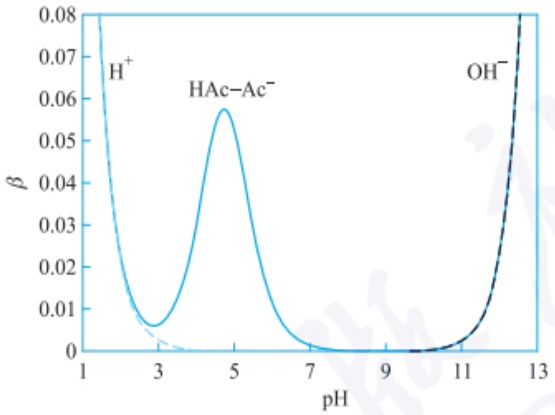

line

| pH | \(\beta\) |
| --- | --- |
| 1 | ~0.08 |
| 3 | ~0.006 |
| 4.5 | ~0.058 |
| 7 | ~0.002 |
| 9 | ~0.001 |
| 11 | ~0.005 |
| 12 | ~0.04 |
| 13 | ~0.08 |

图 3.1.5 0.1 mol·L $^{-1}$ HAc-NaAc 溶液的 $\beta$-pH 曲线

》例 3.1.16 欲配制 200 mL pH=9.35 的  $NH_{3}-NH_{4}Cl$  缓冲溶液，且使该溶液在加入 1.0 mmol HCl 或 NaOH 时，pH 的改变不大于 0.12 单位，需用多少克  $NH_{4}Cl$  和多少毫升 1.0 mol·L $^{-1}$  氨水？

》解:根据缓冲容量定义有

$$
\beta = \frac {\mathrm{d} b}{\mathrm{dpH}} \approx \frac {1 . 0 \times 1 0 ^ {- 3} \times \frac {1 0 0 0}{2 0 0}}{0 . 1 2} = 4. 2 \times 1 0 ^ {- 2} (\mathrm{mol} \cdot \mathrm{L} ^ {- 1})
$$

又

$$
\beta = 2. 3 \frac {c K _ {\mathrm{a}} [ \mathrm{H} ^ {+} ]}{([ \mathrm{H} ^ {+} ] + K _ {\mathrm{a}}) ^ {2}}
$$

将 $K_{\mathrm{a}} = 10^{-9.25}$ 和 $[\mathrm{H}^{+}] = 10^{-9.35}$ 代入，解得

$$
c = \frac {4 . 2 \times 1 0 ^ {- 2} \times (1 0 ^ {- 9 . 2 5} + 1 0 ^ {- 9 . 3 5}) ^ {2}}{2 . 3 \times 1 0 ^ {- 9 . 2 5} \times 1 0 ^ {- 9 . 3 5}} = 0. 0 7 4 (\mathrm{mol} \cdot \mathrm{L} ^ {- 1})
$$

$$
\begin{array}{l} m _ {\mathrm{NH} _ {4} \mathrm{Cl}} = c \delta_ {\mathrm{NH} _ {4} ^ {+}} V M _ {\mathrm{NH} _ {4} \mathrm{Cl}} \\ = 0. 0 7 4 \times \frac {1 0 ^ {- 9 . 3 5}}{1 0 ^ {- 9 . 2 5} + 1 0 ^ {- 9 . 3 5}} \times \frac {2 0 0}{1 0 0 0} \times 5 3. 4 9 = 0. 3 5 (\mathrm{g}) \\ \end{array}
$$

$$
\begin{array}{l} V _ {\mathrm {NH_ {3} \cdot H_ {2} O}} = \frac {c \delta_ {\mathrm {NH_ {3}}} V}{c _ {\mathrm {NH_ {3} \cdot H_ {2} O}}} \\ = 0. 0 7 4 \times \frac {1 0 ^ {- 9 . 2 5}}{1 0 ^ {- 9 . 2 5} + 1 0 ^ {- 9 . 3 5}} \times 2 0 0 \div 1. 0 = 8. 2 (\mathrm{mL}) \\ \end{array}
$$

## 3. 缓冲溶液的选择

作为缓冲溶液，首先应具备较大的缓冲容量和足够的缓冲能力。选择缓冲溶液时，浓度应适当大一些（一般为 $0.01\sim 1\mathrm{mol}\cdot \mathrm{L}^{-1}$），所需控制的 $\mathrm{pH}$ 应在缓冲溶液的有效缓冲范围之内，且溶液的 $\mathrm{pH}$ 与弱酸的 $\mathrm{pK_a}$ 应尽量接近。除此之外，缓冲

---

3.1 化学平衡

93

溶液的组成应不干扰目标分析物的测定，如在络合滴定中，缓冲溶液最好不与待测离子发生副反应；在光度分析中，缓冲溶液最好不产生背景吸收。表3.1.3列出了一些常用的缓冲溶液。

表 3.1.3 常用的缓冲溶液

| 缓冲溶液的组成 | 酸的存在形态 | 碱的存在形态 | $\mathrm{pK_a(I=0.1)}$ |
| --- | --- | --- | --- |
| 氨基乙酸-HCl | $^*NH_3CH_2COOH$ | $^*NH_3CH_2COO^-$ | 2.5($pK_{a_1}$) |
| 一氯乙酸-NaOH | $CH_2ClCOOH$ | $CH_2ClCOO^-$ | 2.7 |
| 甲酸-NaOH | HCOOH | $HCOO^-$ | 3.65 |
| HAc-NaAc | HAc | $Ac^-$ | 4.65 |
| 六亚甲基四胺-HCl | $(CH_2)_6N_4H^+$ | $(CH_2)_6N_4$ | 5.26 |
| $NaH_2PO_4-Na_2HPO_4$ | $H_2PO_4^-$ | $HPO_4^{2-}$ | 6.9($pK_{a_2}$) |
| 三乙醇胺-HCl | $^*HN(CH_2CH_2OH)_3$ | $N(CH_2CH_2OH)_3$ | 6.1 |
| Tris-HCl | $^*NH_3C(CH_2OH)_3$ | $NH_2C(CH_2OH)_3$ | 8.08* |
| $Na_2B_4O_7$ | $H_3BO_3$ | $B(OH)_4^-$ | 9.24* |
| $NH_3-NH_4Cl$ | $NH_4^+$ | $NH_3$ | 9.37 |
| 氨基乙酸-NaOH | $^*NH_3CH_2COO^-$ | $NH_2CH_2COO^-$ | 9.7($pK_{a_2}$) |
| $NaHCO_3-Na_2CO_3$ | $HCO_3^-$ | $CO_3^{2-}$ | 10.1($pK_{a_2}$) |
| $Na_2HPO_4-NaOH$ | $HPO_4^{2-}$ | $PO_4^{3-}$ | 11.7($pK_{a_3}$) |

\* 为 $I=0$ 的 $\mathrm{p}K_{\mathrm{a}}$。Tris: 三(羟甲基)氨基甲烷。

在实际工作中,经常需要缓冲溶液在很宽的 pH 范围内都起作用,这种性质的缓冲溶液称为全域缓冲溶液。可通过向几种  $pK_{a}$  不同的弱酸混合液中加入强碱、强酸制备全域缓冲溶液。图 3.1.6 给出的全域缓冲溶液(实线部分)就是将  $pK_{a}$  分别为 3、5、7、9、11 的五种弱酸混合后加入不同量的强酸、强碱制备而成的。

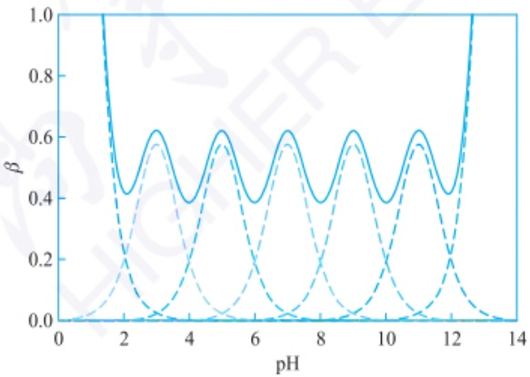

line

| pH | \(\beta (\)Curve 1) | \(\beta (\)Curve 2) | \(\beta (\)Curve 3) | \(\beta (\)Curve 4) |
| --- | --- | --- | --- | --- |
| 0 | — | — | — | — |
| 2 | ~0.42 | ~0.18 | ~0.05 | ~0.01 |
| 4 | ~0.40 | ~0.18 | ~0.05 | ~0.01 |
| 6 | ~0.40 | ~0.18 | ~0.05 | ~0.01 |
| 8 | ~0.40 | ~0.18 | ~0.05 | ~0.01 |
| 10 | ~0.40 | ~0.18 | ~0.05 | ~0.01 |
| 12 | ~0.42 | ~0.18 | ~0.05 | ~0.01 |
| 14 | — | — | — | — |

图 3.1.6 全域缓冲溶液(0.1 mol·L $^{-1}$ )的β-pH曲线

## 4. 标准缓冲溶液

标准缓冲溶液的 pH 是在一定温度下经实验准确测得的, 用于 pH 计的校准。

这类溶液又分为3种:

(i) 由逐级解离常数相差较小的两性物质组成。以酒石酸氢钾（简写作KHA）为例，其 $\mathrm{pK}_{\mathrm{a}_1}(3.036)$ 与 $\mathrm{pK}_{\mathrm{a}_2}(4.366)$ 相近，$\mathrm{HA}^-$ 的酸式、碱式解离程度均较

---

94

第三章 化学平衡与滴定分析

大。由图3.1.3可见，酒石酸氢钾溶液中 $\mathrm{HA^{-}}$ 仅占 $70\%$ ， $\mathrm{H}_2\mathrm{A}$ 与 $\mathrm{A}^{2-}$ 各占 $15\%$ ，这就相当于两个缓冲体系: $\mathrm{H}_2\mathrm{A}-\mathrm{HA}^-$ 和 $\mathrm{HA}^- -\mathrm{A}^{2-}$ ，比值分别为 $1:5$ 和 $5:1$ ，也具有一定的维持 $\mathrm{pH}$ 恒定的能力。

(ii) 由直接配制的共轭酸碱对所组成, 如  $H_{2}PO_{4}^{-}-HPO_{4}^{2-}$  、硼砂等。
(iii) 强碱, 如  $\mathrm{Ca(OH)}_{2}$ 。

常用的标准缓冲溶液及其 pH 列于表 3.1.4 中。

表 3.1.4 常用的标准缓冲溶液及其 pH

| 标准缓冲溶液 | pH(25°C) |
| --- | --- |
| 饱和酒石酸氢钾($0.034 \text{ mol} \cdot \text{L}^{-1}$) | 3.557 |
| $0.050 \text{ mol} \cdot \text{L}^{-1}$邻苯二甲酸氢钾 | 4.005 |
| $0.025 \text{ mol} \cdot \text{L}^{-1} \text{ KH}_2\text{PO}_4 - 0.025 \text{ mol} \cdot \text{L}^{-1} \text{ Na}_2\text{HPO}_4$ | 6.865 |
| $0.010 \text{ mol} \cdot \text{L}^{-1}$硼砂 | 9.180 |
| 饱和氢氧化钙 | 12.454 |

校准 pH 计时, 为保证测量准确度, 所选标准缓冲溶液的 pH 应当与待测 pH 范围相近。同时, 还要注意温度对缓冲溶液 pH 的影响。标准溶液的 pH 是由实验测定的, 计算此类溶液的 pH 时, 必须进行活度校正。

»例 3.1.17 计算  $0.025 \, mol \cdot L^{-1} \, KH_{2}PO_{4} - 0.025 \, mol \cdot L^{-1} \, Na_{2}HPO_{4}$  标准缓冲溶液的 pH。

》解:溶液的离子强度为

$$
\begin{array}{l} I = \frac {1}{2} \sum c _ {i} z _ {i} ^ {2} \\ = \frac {1}{2} \times (0. 0 2 5 \times 1 ^ {2} + 2 \times 0. 0 2 5 \times 1 ^ {2} + 0. 0 2 5 \times 1 ^ {2} + 0. 0 2 5 \times 2 ^ {2}) \\ = 0. 1 0 (\mathrm{mol} \cdot \mathrm{L} ^ {- 1}) \\ \end{array}
$$

查附录表 C.1 得  $\gamma_{H_{2}PO_{4}^{-}}=0.770,\gamma_{HPO_{4}^{2-}}=0.351$ 。

对于  $H_{2}PO_{4}^{-}-HPO_{4}^{2-}$  体系, 首先采用最简式进行计算:

$$
\begin{array}{l} p H = p \mathrm{K} _ {a _ {2}} + l g \frac {\alpha_ {H P O _ {4} ^ {2 -}}}{\alpha_ {H _ {2} P O _ {4} ^ {-}}} = p \mathrm{K} _ {a _ {2}} + l g \frac {\mathrm{c} _ {H P O _ {4} ^ {2 -}} \gamma_ {H P O _ {4} ^ {2 -}}}{\mathrm{c} _ {H _ {2} P O _ {4} ^ {-}} \gamma_ {H _ {2} P O _ {4} ^ {-}}} \\ = 7. 1 9 8 + l g \frac {0 . 0 2 5 \times 0 . 3 5 1}{0 . 0 2 5 \times 0 . 7 7 0} = 6. 8 6 \\ \end{array}
$$

经检验,近似合理,与实验值6.865一致。

如果未进行活度校正，则

$$
p H = p \mathrm{K} _ {a _ {2}} + l g \frac {\mathrm{c} _ {H P O _ {4} ^ {2 -}}}{\mathrm{c} _ {H _ {2} P O _ {4} ^ {-}}} = 7. 1 9 8 + l g \frac {0 . 0 2 5}{0 . 0 2 5} = 7. 2 0
$$

与实验值相差较大。

---

3.1 化学平衡

95

## 3.1.3 络合平衡

络合物又称配合物，络合平衡又称配位平衡。与酸碱平衡相比，络合平衡（complexation equilibrium）所涉及的平衡关系较复杂，本节引入副反应系数和条件常数，以定量描述副反应对络合滴定主反应的影响及反应实际进行的程度。这种处理思路与方法也适用于氧化还原平衡和沉淀溶解平衡。

## 3.1.3.1 络合反应与EDTA

络合反应是指在化学反应中，一个或多个配体与中心金属离子或原子形成配位键的过程。无机配体分子中仅含1个可键合原子，与金属离子反应逐级形成$\mathrm{ML}_{\mathrm{n}}$型络合物。这类络合物的逐级稳定常数比较接近，络合物多数不够稳定，不适合滴定分析，但是常用作掩蔽剂、辅助络合剂和显色剂等。

有机络合剂分子一般含有两个以上可键合原子，可与金属离子络合形成低络合比的具有环状结构的螯合物。螯合物比同种配位原子所形成的简单配位的络合物稳定性显著增加，例如，$\mathrm{Cu}^{2+}$ 与氨、乙二胺和三亚乙基四胺所形成的络合物（表3.1.5）清楚地表明了这一点。螯合环数目增加，络合物稳定性增加，分级络合现象减少甚至消失，使这类络合反应有可能用于滴定分析。

表 3.1.5  $Cu^{2+}$  的几种络合物稳定性对比

<table><tr><td>络合物</td><td>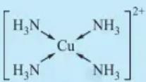</td><td>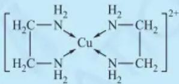</td><td>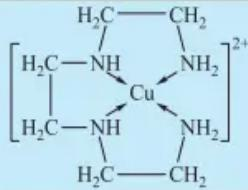</td></tr><tr><td>逐级形成常数</td><td> $\lg K_1 = 4.1$  $\lg K_2 = 3.5$  $\lg K_3 = 2.9$  $\lg K_4 = 2.1$  $\lg \beta_4 = 12.6$ </td><td> $\lg K_1 = 10.6$  $\lg K_2 = 9.0$  $\lg \beta_2 = 19.6$ </td><td> $\lg K = 20.6$ </td></tr><tr><td>螯环数</td><td>0</td><td>2</td><td>3</td></tr></table>

含有—N(CH₂COOH)₂基团的氨羧络合剂被广泛用作络合滴定剂。其分子中含有氨氮和羧氧配位原子，前者易与Co、Ni、Cu、Zn、Hg等金属离子络合，后者则几乎能与所有高价金属离子络合。因此，氨羧络合剂几乎可与所有金属离子络合。在研究过的几十种氨羧络合剂中，乙二胺四乙酸(ethylenediaminetetraacetic acid, EDTA)是络合滴定中最为常用的滴定剂。

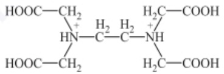

chemical

Chemical structure of a dipeptide with carboxylic acid and amino groups

| ${\mathrm{{pK}}}_{\mathrm{a}} = {0.9}\left( \mathrm{{COOH}}\right)$ | ${\mathrm{{pK}}}_{\mathrm{a}} = {2.75}\left( \mathrm{{COOH}}\right)$ |
| --- | --- |
| ${\mathrm{{pK}}}_{\mathrm{a}} = {1.6}\left( \mathrm{{COOH}}\right)$ | ${\mathrm{{pK}}}_{\mathrm{a}} = {6.24}{\left( {\mathrm{{NH}}}^{ + }\right) }^{ - }$ |
| ${\mathrm{{pK}}}_{\mathrm{a}} = {2.07}\left( \mathrm{{COOH}}\right)$ | ${\mathrm{{pK}}}_{\mathrm{a}} = {10.34}{\left( {\mathrm{{NH}}}^{ + }\right) }^{ - }$ |

\*20°C, 0.1 mol·L $^{-1}$ KCl溶液

图 3.1.7 EDTA( $H_{6}Y^{2+}$ ) 的结构式及逐级解离常数

---

96

第三章 化学平衡与滴定分析

EDTA 结构式及逐级解离常数如图 3.1.7 所示。中性分子的 EDTA 常用  $H_{4}Y$  表示，在水溶液中，分子中两个羧酸上的质子转移到氮原子上形成双偶极离子，在水中的溶解度很小。加入 NaOH 反应生成  $Na_{2}H_{2}Y$ ，可以显著提高溶解性，也简称 EDTA。

$H_{4}Y$  的两个羧酸根可以再接受质子，形成六元酸  $H_{6}Y^{2+}$ ，在 pH 2.75\~6.24 时，EDTA 主要以  $H_{2}Y^{2-}$  形态存在。分布分数图如图 3.1.8 所示。

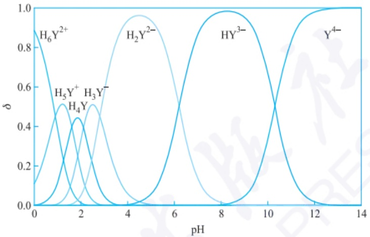

line

| pH | H6Y2+ | H5Y+ | H4Y | H3Y- | H2Y2- | HY3- | Y4- |
| --- | --- | --- | --- | --- | --- | --- | --- |
| 0 | ~0.88 | 0 | 0 | 0 | 0 | 0 | 0 |
| 1 | ~0.45 | ~0.52 | ~0.15 | ~0.05 | 0 | 0 | 0 |
| 2 | ~0.15 | ~0.15 | ~0.45 | ~0.52 | ~0.15 | 0 | 0 |
| 3 | ~0.05 | ~0.05 | ~0.15 | ~0.15 | ~0.95 | 0 | 0 |
| 4 | 0 | 0 | ~0.05 | ~0.05 | ~0.75 | ~0.15 | 0 |
| 6 | 0 | 0 | 0 | 0 | ~0.15 | ~0.95 | ~0.15 |
| 8 | 0 | 0 | 0 | 0 | 0 | ~0.75 | ~0.95 |
| 10 | 0 | 0 | 0 | 0 | 0 | ~0.15 | ~0.75 |
| 12 | 0 | 0 | 0 | 0 | 0 | 0 | ~0.95 |
| 14 | 0 | 0 | 0 | 0 | 0 | 0 | ~1.0 |

图 3.1.8 EDTA 的  $\delta$ -pH 曲线

EDTA 络合物具有如下特点:

(i) EDTA 几乎能与所有金属离子(除了一价金属离子如  $Li^{+}, Na^{+}, K^{+}$ ) 形成稳定络合物, 表 3.1.6 列出了一些金属-EDTA 络合物的稳定常数。绝大多数 EDTA 络合物相当稳定, 为络合滴定的广泛应用提供了可能, 但同时导致实际测定中组分之间互相干扰, 因此在络合滴定中, 一个需要解决的重要问题就是提高测定选择性。

表 3.1.6 一些金属-EDTA 络合物的 lgK

| 离子 | lgK | 离子 | lgK | 离子 | lgK |
| --- | --- | --- | --- | --- | --- |
| $Na^{+}$ | 1.7 | $Zn^{2+}$ | 16.5 | $Hg^{2+}$ | 21.8 |
| $Mg^{2+}$ | 8.7 | $Cd^{2+}$ | 16.5 | $Th^{4+}$ | 23.2 |
| $Ca^{2+}$ | 10.7 | $Pb^{2+}$ | 18.0 | $Fe^{3+}$ | 25.1 |
| $La^{3+}$ | 15.4 | $Ni^{2+}$ | 18.6 | $Bi^{3+}$ | 27.9 |
| $Al^{3+}$ | 16.1 | $Cu^{2+}$ | 18.8 | $ZrO^{2+}$ | 29.9 |

（ii）EDTA 分子中有 6 个可配位原子，与金属离子络合时可形成具有多个五元环的螯合物，不仅稳定性高，而且计量比简单，EDTA 与大多数金属离子形成 1:1 络合物。例如:

$$
\mathrm{Zn} ^ {2 +} + \mathrm{H} _ {2} \mathrm{Y} ^ {2 -} = \mathrm{ZnY} ^ {2 -} + 2 \mathrm{H} ^ {+}
$$

EDTA 络合物大多带电荷,水溶性好,反应速率较快,适合用络合滴定法进行测定。

（iii）EDTA本身是无色的，与大多数金属离子形成的螯合物也通常是无色的，有利于用指示剂确定终点。有色金属离子，如 $\mathrm{Cu^{2+}}$ 和 $\mathrm{Ni^{2+}}$ ，形成的EDTA螯合物的颜色更深，为保证准确指示滴定终点，在滴定这些离子时，要控制其浓度勿过大。

---

3.1 化学平衡

97

## 3.1.3.2 络合平衡

## 1. 络合物的稳定常数及各级络合物的分布

金属离子与 EDTA 大多形成 1:1 络合物(以下均略去电荷):

$$
\mathrm{M+Y} \rightleftharpoons \mathrm{MY} \tag {3-1-33}
$$

其平衡常数表达式为

$$
K _ {\mathrm{MY}} = \frac {[ \mathrm{MY} ]}{[ \mathrm{M} ] [ \mathrm{Y} ]} \tag {3-1-34}
$$

平衡常数 $K_{\mathrm{MY}}$ 称为稳定常数，或形成常数。 $K_{\mathrm{MY}}$ 越大，络合物越稳定，其倒数即为络合物的不稳定常数（或称解离常数）。

金属离子还可以与体系中存在的其他络合剂 L 通过逐级络合形成  $ML_{n}$  型络合物, 其逐级形成反应与相应的逐级稳定常数如下:

$\mathrm{M + L}\rightleftharpoons \mathrm{ML}$ 第一级稳定常数 $K_{1} = \frac{[\mathrm{ML}]}{[\mathrm{M}][\mathrm{L} ]}$

$\mathrm{ML + L}\rightleftharpoons \mathrm{ML}_2$ 第二级稳定常数 $K_{2} = \frac{[\mathrm{ML}_{2}]}{[\mathrm{ML}][\mathrm{L} ]}$ :

$\mathrm{ML}_{n - 1} + \mathrm{L}\rightleftharpoons \mathrm{ML}_n$ 第 $n$ 级稳定常数 $K_{n} = \frac{[\mathrm{ML}_{n}]}{[\mathrm{ML}_{n - 1}][\mathrm{L} ]}$ (3-1-35)

逐级稳定常数  $K_{i}$  将络合剂 L 的平衡浓度 [L] 与相邻两级络合物的平衡浓度比值关联起来, 当 [L] 的负对数 pL 与  $\lg K_{i}$  相等时, 相邻两级络合物的平衡浓度相等, 即

$$
\mathrm{pL} = \lg K _ {1} \text {时}, \quad [ \mathrm{ML} ] = [ \mathrm{M} ]
$$

$$
\mathrm{pL} = \lg K _ {2} \text {时}, \quad [ \mathrm{ML} _ {2} ] = [ \mathrm{ML} ]
$$

$$
\mathrm{pL} = \lg K _ {i} \text {时，} \quad [ \mathrm{ML} _ {i} ] = [ \mathrm{ML} _ {i - 1} ]
$$

$ML_{n}$  的逐级解离与相应的不稳定常数如下:

$\mathrm{ML}_{n}\rightleftharpoons \mathrm{ML}_{n - 1} + \mathrm{L}$ 第一级不稳定常数 $(K_{\text{不稳}})_1 = \frac{[\mathrm{ML}_{n - 1}][\mathrm{L}]}{[\mathrm{ML}_n]}$

$ML_{n-1} \rightleftharpoons ML_{n-2} + L$  第二级不稳定常数 $(K_{\text{不稳}})_2 = \frac{[\mathrm{ML}_{n-2}][\mathrm{L}]}{[\mathrm{ML}_{n-1}]}$

:

ML  $\Longleftrightarrow$  M+L 第 n 级不稳定常数( $K_{不稳}$ ) $_{n}=\frac{[M][L]}{[ML]}$

逐级稳定常数与不稳定常数的关系则是

$$
K _ {1} = \frac {1}{\left(K _ {\text {不稳}}\right) _ {n}}, \quad K _ {2} = \frac {1}{\left(K _ {\text {不稳}}\right) _ {n - 1}}, \quad \dots , \quad K _ {n} = \frac {1}{\left(K _ {\text {不稳}}\right) _ {1}}
$$

各级累积稳定常数 $(\beta_{i})$ 等于逐级稳定常数渐次相乘:

$$
\begin{array}{l} \mathrm{M+L} \rightleftharpoons \mathrm{ML} \quad \beta_ {1} = K _ {1} = \frac {[ \mathrm{ML} ]}{[ \mathrm{M} ] [ \mathrm{L} ]} \\ \mathrm{M} + 2 \mathrm{L} \rightleftharpoons \mathrm{ML} _ {2} \quad \beta_ {2} = K _ {1} K _ {2} = \frac {\left[ \mathrm{ML} _ {2} \right]}{\left[ \mathrm{M} \right]\left[ \mathrm{L} \right] ^ {2}} \\ \mathrm{M} + n \mathrm{L} \rightleftharpoons \mathrm{ML} _ {n} \quad \beta_ {n} = K _ {1} K _ {2} \dots K _ {n} = \frac {[ \mathrm{ML} _ {n} ]}{[ \mathrm{M} ] [ \mathrm{L} ] ^ {n}} \tag {3-1-36} \\ \end{array}
$$

: :

---

98

第三章 化学平衡与滴定分析

各级累积稳定常数 $\beta_{i}$ 将各级络合物的浓度直接与游离金属离子、游离配体的浓度关联，络合平衡处理中，可以根据络合物的 $\beta_{i}$ ，求算各级络合物的浓度，即

$$
[ \mathrm{ML} ] = \beta_ {1} [ \mathrm{M} ] [ \mathrm{L} ]
$$

$$
[ \mathrm{ML} _ {2} ] = \beta_ {2} [ \mathrm{M} ] [ \mathrm{L} ] ^ {2}
$$

: : :

$$
\left[ \mathrm{ML} _ {n} \right] = \beta_ {n} \left[ \mathrm{M} \right] \left[ \mathrm{L} \right] ^ {n} \tag {3-1-37}
$$

## 2. 各级络合物的分布分数

溶液中各级络合物所占的分数用分布分数  $\delta$  表示。若金属离子的分析浓度为  $c_{M}$ ，则金属离子的物料平衡式为

$$
c _ {\mathrm{M}} = [ \mathrm{M} ] + [ \mathrm{ML} ] + [ \mathrm{ML} _ {2} ] + \dots + [ \mathrm{ML} _ {n} ]
$$

各级络合物的浓度由式(3-1-37)表示,则其分布分数分别为

$$
\begin{array}{l} \delta_ {0} = \frac {\left[ \mathrm{M} \right]}{c _ {\mathrm{M}}} = \frac {\left[ \mathrm{M} \right]}{\left[ \mathrm{M} \right] + \left[ \mathrm{ML} \right] + \left[ \mathrm{ML} _ {2} \right] + \cdots + \left[ \mathrm{ML} _ {n} \right]} \\ = \frac {\left[ \mathrm{M} \right]}{\left[ \mathrm{M} \right] + \beta_ {1} \left[ \mathrm{M} \right] \left[ \mathrm{L} \right] + \beta_ {2} \left[ \mathrm{M} \right] \left[ \mathrm{L} \right] ^ {2} + \cdots + \beta_ {n} \left[ \mathrm{M} \right] \left[ \mathrm{L} \right] ^ {n}} \\ = \frac {1}{1 + \beta_ {1} [ \mathrm{L} ] + \beta_ {2} [ \mathrm{L} ] ^ {2} + \cdots + \beta_ {n} [ \mathrm{L} ] ^ {n}} \\ \end{array}
$$

$$
\delta_ {1} = \frac {\left[ \mathrm{ML} \right]}{c _ {\mathrm{M}}} = \frac {\beta_ {1} \left[ \mathrm{L} \right]}{1 + \beta_ {1} \left[ \mathrm{L} \right] + \beta_ {2} \left[ \mathrm{L} \right] ^ {2} + \cdots + \beta_ {n} \left[ \mathrm{L} \right] ^ {n}}
$$

: :

$$
\delta_ {n} = \frac {\left[ \mathrm{ML} _ {n} \right]}{c _ {\mathrm{M}}} = \frac {\beta_ {n} \left[ \mathrm{L} \right] ^ {n}}{1 + \beta_ {1} \left[ \mathrm{L} \right] + \beta_ {2} \left[ \mathrm{L} \right] ^ {2} + \cdots + \beta_ {n} \left[ \mathrm{L} \right] ^ {n}} \tag {3-1-38}
$$

由式(3-1-38)知,各级络合物的分布分数 $\delta_{i}$ 仅是游离配体浓度[L]的函数。各级络合物的浓度可由分布分数求得

$$
[ \mathrm{ML} _ {i} ] = c _ {\mathrm{M}} \delta_ {i}
$$

实际知道的是络合剂的总浓度  $c_{L}$ ，若  $c_{L} \gg c_{M}$ ，则可忽略与金属离子络合所消耗的络合剂，使计算简化。

以铜氨络合物为例,其逐级稳定常数为  $10^{4.1}$ 、 $10^{3.5}$ 、 $10^{2.9}$  和  $10^{2.1}$ ，各级累积稳定常数对数值分别为 4.1、7.6、10.5 和 12.6。若  $pNH_{3}$  为 1\~6，根据式(3-1-38)计算并绘制铜氨络合物的形态分布如图 3.1.9(上)所示，优势区域图如图 3.1.9(下)所示。

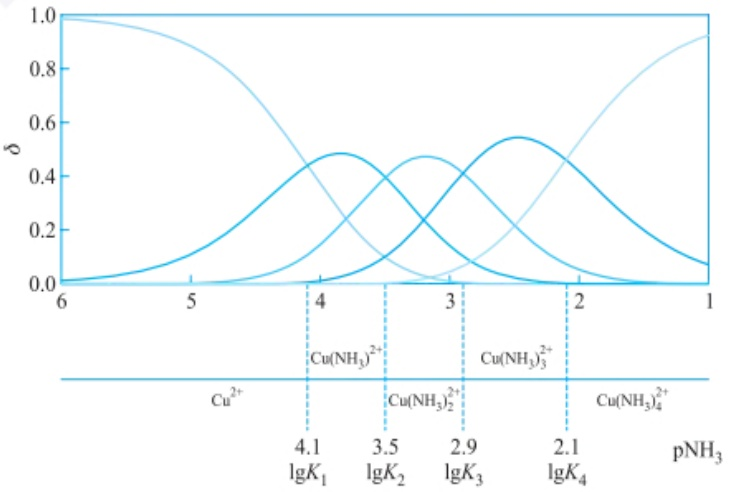

line

| pH | \(Cu^{2+}\) | \(Cu(NH_{3})^{2+}\) | \(Cu(NH_{3})_{2}^{2+}\) | \(Cu(NH_{3})_{3}^{2+}\) | \(Cu(NH_{3})_{4}^{2+}\) |
| --- | --- | --- | --- | --- | --- |
| 6 | ~0.02 | ~0.01 | ~0.00 | ~0.00 | ~0.98 |
| 5 | ~0.15 | ~0.15 | ~0.01 | ~0.00 | ~0.85 |
| 4 | ~0.45 | ~0.45 | ~0.15 | ~0.01 | ~0.65 |
| 3.5 | ~0.48 | ~0.48 | ~0.45 | ~0.15 | ~0.45 |
| 3 | ~0.35 | ~0.35 | ~0.48 | ~0.45 | ~0.25 |
| 2.9 | ~0.25 | ~0.25 | ~0.35 | ~0.55 | ~0.15 |
| 2.1 | ~0.15 | ~0.15 | ~0.15 | ~0.45 | ~0.45 |
| 1 | ~0.08 | ~0.08 | ~0.01 | ~0.15 | ~0.92 |

图 3.1.9 铜氨络合物各种形态的分布图(上)及优势区域图(下)

---

3.1 化学平衡

99

当 $\mathrm{pNH_3 < 2.1(lgK_4)}$ 时，$\mathrm{Cu(NH_3)_4^{2+}}$ 为主要形态；当 $\mathrm{pNH_3 > 4.1(lgK_1)}$ 时，游离$\mathrm{Cu^{2+}}$ 为主要形态。由于铜氨络合物的逐级稳定常数接近，在相当大的 $[\mathrm{NH}_3]$ 范围内，如 $2.1 <   \mathrm{pNH}_3 <   4.1$ ，多种络合物形态同时存在。因此不能以 $\mathrm{NH}_3$ 为滴定剂滴定铜离子。无机络合物大多如此。多元酸的优势区域图也可以用逐级形成常数代替逐级解离常数（见二维码），将 $\mathrm{ML}_n$ 型络合物与多元酸 $\mathrm{H}_{n}\mathrm{A}$ 的分布统一起来。

## 3.1.3.3 络合反应的副反应系数与条件稳定常数

在络合滴定体系中,除了待测金属离子 M 与滴定剂 Y 之间的主反应,还存在若干副反应,其平衡关系示意如下。

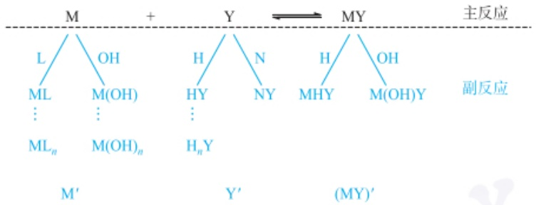

chemical

Chemical reaction diagram showing the formation of MY from M and Y, with secondary reactants and their interactions labeled in Chinese.

这些副反应的发生都将会影响主反应进行的程度。反应物 M 和 Y 发生副反应不利于主反应的进行，而反应产物 MY 发生副反应则有利于主反应的进行。由于发生副反应， $K_{MY}$  不能反映主反应进行的程度，因为此时未参与主反应的金属离子不仅有 M，还有 ML，ML $_{2}$ ，…，以及 M(OH)，M(OH) $_{2}$ ，…，应当用这些形态的浓度总和 [M'] 表示未参与主反应的金属离子浓度；同样，未参与主反应的滴定剂也应当用 [Y'] 表示，包括各种质子化形态的 Y，以及与其他金属离子（以 N 表示）络合的产物 NY；所形成的络合物应当用总浓度 [(MY)'] 表示。

因此，应当用

$$
K _ {\mathrm{MY}} ^ {\prime} = \frac {[ (\mathrm{MY}) ^ {\prime} ]}{[ \mathrm{M} ^ {\prime} ] [ \mathrm{Y} ^ {\prime} ]} \tag {3-1-39}
$$

表示有副反应发生时主反应进行的程度。

引入副反应系数  $\alpha$  来定量地表示副反应进行的程度。下面将分别讨论 M、Y 和 MY 的副反应系数。

## 1. 滴定剂的副反应系数  $\alpha_{Y}$

滴定剂的副反应系数  $\alpha_{Y}$  计算式如下:

$$
\alpha_ {\mathrm{Y}} = \frac {[ \mathrm{Y} ^ {\prime} ]}{[ \mathrm{Y} ]} = \frac {[ \mathrm{Y} ] + [ \mathrm{HY} ] + [ \mathrm{H} _ {2} \mathrm{Y} ] + \cdots + [ \mathrm{H} _ {6} \mathrm{Y} ] + [ \mathrm{NY} ]}{[ \mathrm{Y} ]} \tag {3-1-40}
$$

$\alpha_{Y}$  表示未与 M 络合的 Y 的各种形态的总浓度 ( $[Y^{\prime}]$ ) 与游离滴定剂浓度 ([Y]) 之比。 $\alpha_{Y}$  越大，表明滴定剂发生的副反应越严重。 $\alpha_{Y}=1$  时， $[Y^{\prime}]=[Y]$ ，滴定剂未发生副反应。滴定剂 Y 与  $H^{+}$ 和溶液中其他金属离子 N 发生副反应的副反应系数分别用  $\alpha_{\mathrm{Y(H)}}$  和  $\alpha_{\mathrm{Y(N)}}$  表示。

$\alpha_{Y(H)}$  的计算式如下:

$$
\alpha_ {\mathrm{Y(H)}} = \frac {[ \mathrm{Y} ^ {\prime} ]}{[ \mathrm{Y} ]} = \frac {[ \mathrm{Y} ] + [ \mathrm{HY} ] + [ \mathrm{H} _ {2} \mathrm{Y} ] + \cdots + [ \mathrm{H} _ {6} \mathrm{Y} ]}{[ \mathrm{Y} ]} \tag {3-1-41}
$$

它表示溶液中游离的Y和各级质子化形态总浓度( $[Y^{\prime}]$ )与游离Y浓度( $[Y]$ )之比。当不存在Y与N的副反应时， $\alpha_{\mathrm{Y(H)}}$ 是游离部分多元酸 $H_{6}Y$ 中的Y的分布分数 $\delta_{0}$ 的倒数。

磷酸的逐级解离,以及磷酸根与 $H^{+}$ 的逐级形成常数

---

100

第三章 化学平衡与滴定分析

$$
\alpha_ {\mathrm{Y(H)}} = \frac {1}{\delta_ {0}} = \frac {\left[ \mathrm{H} ^ {+} \right] ^ {6} + \left[ \mathrm{H} ^ {+} \right] ^ {5} K _ {\mathrm{a} _ {1}} + \left[ \mathrm{H} ^ {+} \right] ^ {4} K _ {\mathrm{a} _ {1}} K _ {\mathrm{a} _ {2}} + \cdots + K _ {\mathrm{a} _ {1}} K _ {\mathrm{a} _ {2}} \cdots K _ {\mathrm{a} _ {6}}}{K _ {\mathrm{a} _ {1}} K _ {\mathrm{a} _ {2}} \cdots K _ {\mathrm{a} _ {6}}}
$$

该定义式反映了 EDTA 与 M 的配位能力受到  $H^{+}$  影响的大小。 $\alpha_{\mathrm{Y(H)}}$  越大，表示酸效应越严重。

将 EDTA 的质子解离常数和各形态分布分数代入式(3-1-41)，可以得到

$$
\begin{array}{l} \alpha_ {\mathrm{Y(H)}} = \frac {[ \mathrm{Y} ^ {\prime} ]}{[ \mathrm{Y} ]} = \frac {[ \mathrm{Y} ] + [ \mathrm{HY} ] + [ \mathrm{H} _ {2} \mathrm{Y} ] + \cdots + [ \mathrm{H} _ {6} \mathrm{Y} ]}{[ \mathrm{Y} ]} \\ = 1 + \frac {\left[ \mathrm{H} ^ {+} \right]}{K _ {\mathrm{a} _ {6}}} + \frac {\left[ \mathrm{H} ^ {+} \right] ^ {2}}{K _ {\mathrm{a} _ {6}} K _ {\mathrm{a} _ {5}}} + \dots + \frac {\left[ \mathrm{H} ^ {+} \right] ^ {6}}{K _ {\mathrm{a} _ {6}} K _ {\mathrm{a} _ {5}} \cdots K _ {\mathrm{a} _ {1}}} \tag {3-1-42} \\ \end{array}
$$

若将 EDTA 的各形态看作 Y 与  $H^{+}$  逐级形成的络合物, 则各步反应及相应的常数为

$$
\mathrm{Y+H} \rightleftharpoons \mathrm{HY}, \quad K _ {1} ^ {\mathrm{H}} = \frac {[ \mathrm{HY} ]}{[ \mathrm{H} ] [ \mathrm{Y} ]} = \frac {1}{K _ {a _ {6}}}, \quad \beta_ {1} ^ {\mathrm{H}} = K _ {1} ^ {\mathrm{H}} = \frac {[ \mathrm{HY} ]}{[ \mathrm{H} ] [ \mathrm{Y} ]}
$$

$$
\begin{array}{c c}\mathrm{HY+H} \rightleftharpoons \mathrm {H_ {2} Y},&K _ {2} ^ {\mathrm{H}} = \frac {[ \mathrm {H_ {2} Y} ]}{[ \mathrm{H} ] [ \mathrm{HY} ]} = \frac {1}{K _ {\mathrm{a} _ {5}}},\\&\vdots\end{array}, \quad \beta_ {2} ^ {\mathrm{H}} = K _ {1} ^ {\mathrm{H}} K _ {2} ^ {\mathrm{H}} = \frac {[ \mathrm {H_ {2} Y} ]}{[ \mathrm{H} ] ^ {2} [ \mathrm{Y} ]}
$$

$$
\mathrm{H} _ {5} \mathrm{Y} + \mathrm{H} \rightleftharpoons \mathrm{H} _ {6} \mathrm{Y}, \quad K _ {6} ^ {\mathrm{H}} = \frac {[ \mathrm{H} _ {6} \mathrm{Y} ]}{[ \mathrm{H} ] [ \mathrm{H} _ {5} \mathrm{Y} ]} = \frac {1}{K _ {\mathrm{a} _ {1}}}, \quad \beta_ {6} ^ {\mathrm{H}} = K _ {1} ^ {\mathrm{H}} K _ {2} ^ {\mathrm{H}} \dots K _ {6} ^ {\mathrm{H}} = \frac {[ \mathrm{H} _ {6} \mathrm{Y} ]}{[ \mathrm{H} ] ^ {6} [ \mathrm{Y} ]}
$$

由此， $\alpha_{Y(H)}$  的算式可写为

$$
\begin{array}{l} \alpha_ {\mathrm{Y(H)}} = \frac {[ \mathrm{Y} ] + [ \mathrm{HY} ] + [ \mathrm{H} _ {2} \mathrm{Y} ] + \cdots + [ \mathrm{H} _ {6} \mathrm{Y} ]}{[ \mathrm{Y} ]} \\ = \frac {\left[ \mathrm{Y} \right] + \left[ \mathrm{H} \right] \left[ \mathrm{Y} \right] \beta_ {1} ^ {\mathrm{H}} + \left[ \mathrm{H} \right] ^ {2} \left[ \mathrm{Y} \right] \beta_ {2} ^ {\mathrm{H}} + \cdots + \left[ \mathrm{H} \right] ^ {6} \left[ \mathrm{Y} \right] \beta_ {6} ^ {\mathrm{H}}}{\left[ \mathrm{Y} \right]} \\ = 1 + [ \mathrm{H} ] \beta_ {1} ^ {\mathrm{H}} + [ \mathrm{H} ] ^ {2} \beta_ {2} ^ {\mathrm{H}} + \dots + [ \mathrm{H} ] ^ {6} \beta_ {6} ^ {\mathrm{H}} \\ \end{array}
$$

式中，各项分别与 Y, HY,  $H_{2}Y, \cdots, H_{6}Y$  相对应，由各项数值大小可知哪几种形态为主，由此可以略去其他项，简化计算。 $\alpha_{\mathrm{Y(H)}}$  仅是  $[H^{+}]$  的函数。酸度越高， $\alpha_{\mathrm{Y(H)}}$  越大。

## »例 3.1.18 计算 pH=5.50 时 EDTA 的酸效应系数  $\alpha_{Y(H)}$

» 解: 查得 EDTA 的各级酸的解离常数  $K_{a_{1}} \sim K_{a_{6}}$  分别是  $10^{-0.9}, 10^{-1.6}, 10^{-2.07}, 10^{-2.75}, 10^{-6.24}, 10^{-10.34}$ 。则酸的各级稳定常数  $K_{1}^{H} \sim K_{6}^{H}$  分别是  $10^{10.34}, 10^{6.24}, 10^{2.75}, 10^{2.07}, 10^{1.6}, 10^{0.9}$ 。故各级累积稳定常数  $\beta_{1}^{H} \sim \beta_{6}^{H}$  分别是  $10^{10.34}, 10^{16.58}, 10^{19.33}, 10^{21.40}, 10^{23.00}, 10^{23.90}$ 。

$$
\begin{array}{l} \alpha_ {\mathrm{Y(H)}} = 1 + [ \mathrm{H} ] \beta_ {1} ^ {\mathrm{H}} + [ \mathrm{H} ] ^ {2} \beta_ {2} ^ {\mathrm{H}} + \dots + [ \mathrm{H} ] ^ {6} \beta_ {6} ^ {\mathrm{H}} \\ = 1 + 1 0 ^ {- 5. 5 0 + 1 0. 3 4} + 1 0 ^ {- 1 1. 0 0 + 1 6. 5 8} + 1 0 ^ {- 1 6. 5 0 + 1 9. 3 3} + 1 0 ^ {- 2 2. 0 0 + 2 1. 4 0} + 1 0 ^ {- 2 7. 5 0 + 2 3. 0 0} + 1 0 ^ {- 3 3. 0 0 + 2 3. 9 0} \\ = 1 + 1 0 ^ {4. 8 4} + 1 0 ^ {5. 5 8} + 1 0 ^ {2. 8 3} + 1 0 ^ {- 0. 6} + 1 0 ^ {- 4. 5} + 1 0 ^ {- 9. 1 0} \\ = 1 0 ^ {5. 6 5} \\ \end{array}
$$

EDTA 的  $\lg\alpha_{Y(H)}-pH$  曲线如图 3.1.10 所示。

Y 与溶液中存在的其他金属离子 N 的副反应系数将在 3.2.3.5 节混合离子的选择性滴定中讨论。

---

3.1 化学平衡

101

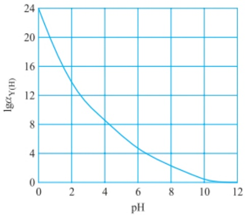

line

| pH | \(lg\alpha Y(H)\) |
| --- | --- |
| 0 | 24 |
| 2 | ~13.5 |
| 4 | ~8.5 |
| 6 | ~4.5 |
| 8 | ~2.0 |
| 10 | ~0.5 |
| 12 | 0 |

图3.1.10 EDTA的 $\lg \alpha_{\mathrm{Y(H)}} - \mathrm{pH}$ 曲线

## 2. 金属离子的副反应系数  $\alpha_{M}$

当金属离子 M 与其他络合剂 L 发生副反应时, 副反应系数  $\alpha_{\mathrm{M(L)}}$  为

$$
\begin{array}{l} \alpha_ {\mathrm{M(L)}} = \frac {[ \mathrm{M} ^ {\prime} ]}{[ \mathrm{M} ]} = \frac {[ \mathrm{M} ] + [ \mathrm{ML} ] + [ \mathrm{ML} _ {2} ] + \cdots + [ \mathrm{ML} _ {n} ]}{[ \mathrm{M} ]} \\ = 1 + [ \mathrm{L} ] \beta_ {1} + [ \mathrm{L} ] ^ {2} \beta_ {2} + \dots + [ \mathrm{L} ] ^ {n} \beta_ {n} \tag {3-1-43} \\ \end{array}
$$

$\alpha_{\mathrm{M(L)}}$  仅是[L]的函数。L 可以是滴定所需缓冲剂，或为防止金属离子水解所加的辅助络合剂，也可能是为消除干扰而加的掩蔽剂。在高 pH 下，M 会与  $OH^{-}$ 形成金属羟基络合物，L 就代表  $OH^{-}$ 。

实际上,在络合滴定体系中,金属离子往往发生多种副反应。若有 p 个配体与金属离子发生副反应,则

$$
\alpha_ {\mathrm{M}} = \alpha_ {\mathrm{M(L_1)}} + \alpha_ {\mathrm{M(L_2)}} + \dots + (1 - p)
$$

$\alpha_{M}$  表示未与滴定剂 Y 络合的金属离子的各种形态总浓度  $[M^{\prime}]$  与游离金属离子浓度 [M] 之比，其值可以由副反应系数  $\alpha_{\mathrm{M(L_{1})}}$ 、 $\alpha_{\mathrm{M(L_{2})}}$  等求得。

»例 3.1.19 在氨性缓冲溶液(pH 11.0)中以 EDTA 滴定  $Zn^{2+}$  至非常接近化学计量点时, 若  $c_{NH_{3}} = 0.10 \, mol \cdot L^{-1}$ , 请求算  $\lg \alpha_{Zn}$ 。[已知:  $NH_{3}$  的  $K_{a} = 10^{-9.37} (I = 0.1)$ ;  $\mathrm{Zn(NH_{3})_{4}^{2+}}$  的  $\lg \beta_{1} \sim \lg \beta_{4}$  分别为 2.27, 4.61, 7.01, 9.06]

解: $\left[\mathrm{NH}_3\right] = c_{\mathrm{NH_3}}\delta_0 = 0.10\times \frac{10^{-9.37}}{10^{-9.37} + 10^{-11.0}}\approx 0.10\mathrm{mol}\cdot \mathrm{L}^{-1}$

$$
\begin{array}{l} \alpha_ {\mathrm{Zn(NH)} _ {3}} = 1 + \left[ \mathrm{NH} _ {3} \right] \beta_ {1} + \left[ \mathrm{NH} _ {3} \right] ^ {2} \beta_ {2} + \left[ \mathrm{NH} _ {3} \right] ^ {3} \beta_ {3} + \left[ \mathrm{NH} _ {3} \right] ^ {4} \beta_ {4} \\ = 1 + 1 0 ^ {- 1. 0 0 + 2. 2 7} + 1 0 ^ {- 2. 0 0 + 4. 6 1} + 1 0 ^ {- 3. 0 0 + 7. 0 1} + 1 0 ^ {- 4. 0 0 + 9. 0 6} = 1 0 ^ {5. 1 0} \\ \end{array}
$$

查附录, 得 pH=11.0,  $\lg\alpha_{\mathrm{Zn(OH)}}=5.4$ , 故

$$
\begin{array}{l} \alpha_ {\mathrm{Zn}} = \alpha_ {\mathrm {Zn(NH_3)}} + \alpha_ {\mathrm{Zn(OH)}} - 1 = 1 0 ^ {5. 1 0} + 1 0 ^ {5. 4} - 1 = 1 0 ^ {5. 6} \\ \lg \alpha_ {\mathrm{Zn}} = 5. 6 \\ \end{array}
$$

必须指出，式(3-1-43)中[L]指络合剂L的平衡浓度，即游离的L的浓度。络合剂L大多是碱，易与 $H^{+}$ 结合，[L]将随pH而变。若将L与 $H^{+}$ 的反应看作副反应，则

$$
\alpha_ {\mathrm{L(H)}} = \frac {[ \mathrm{L} ^ {\prime} ]}{[ \mathrm{L} ]} = \frac {[ \mathrm{L} ] + [ \mathrm{HL} ] + \cdots + [ \mathrm{H} _ {n} \mathrm{L} ]}{[ \mathrm{L} ]} = 1 + [ \mathrm{H} ] \beta_ {1} ^ {\mathrm{H}} + \dots + [ \mathrm{H} ] ^ {n} \beta_ {n} ^ {\mathrm{H}}
$$

在滴定条件下,主反应进行较完全,未与 Y 络合的金属离子 M 很少,M 消耗

---

102

第三章 化学平衡与滴定分析

的 L 可忽略, $[L']$  即为 L 的总浓度  $c_{L}$ , 基于式(3-1-41)可求出 [L], 即

$$
[ \mathrm{L} ] = \frac {c _ {\mathrm{L}}}{\alpha_ {\mathrm{L(H)}}}
$$

》例 3.1.20 上例中, 若在 pH 10.0 下滴定至接近化学计量点, 且  $c_{\mathrm{NH_{3}}} = 0.10 \, \mathrm{mol} \cdot \mathrm{L}^{-1}$ , 请求算  $\lg \alpha_{\mathrm{Zn(NH_{3})}}$ 。

》解:

$$
\alpha_ {\mathrm {NH_ {3} (H)}} = \frac {c _ {\mathrm {NH_ {3}}}}{\left[ \mathrm{NH} _ {3} \right]} = 1 + \left[ \mathrm{H} ^ {+} \right] K _ {\mathrm {NH_ {4} ^ {*}}} ^ {\mathrm{H}} = 1 + 1 0 ^ {- 1 0. 0 + 9. 3 7} = 1 0 ^ {0. 0 9}
$$

$$
\left[ \mathrm{NH} _ {3} \right] = \frac {c _ {\mathrm{NH} _ {3}}}{\alpha_ {\mathrm{NH} _ {3} (\mathrm{H})}} = \frac {1 0 ^ {- 1 . 0}}{1 0 ^ {0 . 0 9}} = 1 0 ^ {- 1. 1} = 0. 0 8 (\mathrm{mol} \cdot \mathrm{L} ^ {- 1})
$$

或者

$$
\left[ \mathrm{NH} _ {3} \right] = \delta_ {0} c _ {\mathrm{NH} _ {3}} = \frac {1 0 ^ {- 9 . 3 7} \times 0 . 1 0}{1 0 ^ {- 1 0 . 0} + 1 0 ^ {- 9 . 3 7}} = 0. 0 8 (\mathrm{mol} \cdot \mathrm{L} ^ {- 1})
$$

则

$$
\begin{array}{l} \alpha_ {\mathrm{Zn(NH)} _ {3}} = 1 + \left[ \mathrm{NH} _ {3} \right] \beta_ {1} + \left[ \mathrm{NH} _ {3} \right] ^ {2} \beta_ {2} + \left[ \mathrm{NH} _ {3} \right] ^ {3} \beta_ {3} + \left[ \mathrm{NH} _ {3} \right] ^ {4} \beta_ {4} \\ = 1 + 1 0 ^ {- 1. 1 + 2. 2 7} + 1 0 ^ {- 1. 1 \times 2 + 4. 6 1} + 1 0 ^ {- 1. 1 \times 3 + 7. 0 1} + 1 0 ^ {- 1. 1 \times 4 + 9. 0 6} = 1 0 ^ {4. 7} \\ \end{array}
$$

故

$$
\lg \alpha_ {\mathrm{Zn(NH_3)}} = 4.7
$$

## 3. 络合物的副反应系数  $\alpha_{MY}$

在较高或较低酸度条件下,MY 会与  $H^{+}$ 或  $OH^{-}$ 发生副反应,形成酸式络合物 MHY 或碱式络合物 M(OH)Y。

对于生成酸式络合物的副反应:

$$
\mathrm{MY+H} \rightleftharpoons \mathrm{MHY} \quad K _ {\mathrm{MHY}} ^ {\mathrm{H}} = \frac {[ \mathrm{MHY} ]}{[ \mathrm{MY} ] [ \mathrm{H} ]}
$$

$$
\alpha_ {\mathrm{MY(H)}} = \frac {[ \mathrm{MY} ^ {\prime} ]}{[ \mathrm{MY} ]} = \frac {[ \mathrm{MY} ] + [ \mathrm{MHY} ]}{[ \mathrm{MY} ]} = 1 + [ \mathrm{H} ] K _ {\mathrm{MHY}} ^ {\mathrm{H}}
$$

$K_{MHY}^{H}$  表示 MY 与  $H^{+}$ 反应形成 MHY 络合物的稳定常数。

对于生成碱式络合物的副反应:

$$
\alpha_ {\mathrm{MY(OH)}} = \frac {[ \mathrm{MY} ^ {\prime} ]}{[ \mathrm{MY} ]} = 1 + [ \mathrm{OH} ] K _ {\mathrm{M(OH)Y}} ^ {\mathrm{OH}}
$$

酸式、碱式络合物一般不太稳定，计算中可忽略不计。

## 4. 络合物的条件稳定常数

根据副反应系数定义有

$$
\left[ \mathrm{M} ^ {\prime} \right] = \alpha_ {\mathrm{M}} \left[ \mathrm{M} \right], \quad \left[ \mathrm{Y} ^ {\prime} \right] = \alpha_ {\mathrm{Y}} \left[ \mathrm{Y} \right], \quad \left[ (\mathrm{MY}) ^ {\prime} \right] = \alpha_ {\mathrm{MY}} \left[ \mathrm{MY} \right]
$$

代入式(3-1-39)得

$$
K _ {\mathrm{MY}} ^ {\prime} = \frac {\alpha_ {\mathrm{MY}} [ \mathrm{MY} ]}{\alpha_ {\mathrm{M}} [ \mathrm{M} ] \alpha_ {\mathrm{Y}} [ \mathrm{Y} ]} = \frac {\alpha_ {\mathrm{MY}}}{\alpha_ {\mathrm{M}} \alpha_ {\mathrm{Y}}} K _ {\mathrm{MY}} \tag {3-1-44}
$$

当实验条件确定时（如溶液 $\mathrm{pH}$ 和试剂浓度一定时），$\alpha_{\mathrm{M}}, \alpha_{\mathrm{Y}}$ 和 $\alpha_{\mathrm{MY}}$ 均为定值，因此 $K_{\mathrm{MY}}'$ 在一定条件下是个常数。为强调其随实验条件而变，人们称之为条件稳定常数（简称条件常数）。

---

3.1 化学平衡

103

条件常数 $K_{\mathrm{MY}}^{\prime}$ 是用副反应系数校正后的实际稳定常数。例如，由于金属离子发生了副反应，未参与主反应的金属离子的总浓度 $[\mathrm{M}^{\prime}]$ 为游离金属离子浓度 $[\mathrm{M}]$ 的 $\alpha_{\mathrm{M}}$ 倍，即相当于主反应常数 $K_{\mathrm{MY}}$ 减小为原来的 $1 / \alpha_{\mathrm{M}}$ 。同理，滴定剂发生副反应使 $K_{\mathrm{MY}}$ 减少为原来的 $1 / \alpha_{\mathrm{Y}}$ ，而络合物发生副反应则使 $K_{\mathrm{MY}}$ 增加为原来的 $\alpha_{\mathrm{MY}}$ 倍。只有当反应物和生成物均不发生副反应时，$K_{\mathrm{MY}}$ 才反映M与Y反应的实际情况。

将式(3-1-44)用对数形式表示,则是

$$
\lg K _ {\mathrm{MY}} ^ {\prime} = \lg K _ {\mathrm{MY}} - \lg \alpha_ {\mathrm{M}} - \lg \alpha_ {\mathrm{Y}} + \lg \alpha_ {\mathrm{MY}} \tag {3-1-45}
$$

## 3.1.4 氧化还原平衡

相比于溶液平衡中的其他反应类型,氧化还原平衡(redox equilibrium)所涉及的反应相对较复杂。除了平衡常数外,氧化还原反应一般借助有关电对的电极电位来判断反应进行的方向和完全程度,这是氧化还原平衡研究的特点。

## 3.1.4.1 电极电位

物质的氧化还原能力的强弱可以用有关电对的电极电位来表示。电对的电位越高，其氧化态的氧化能力越强；反之，电对的电位越低，其还原态的还原能力越强。理论上，高电位物质的氧化态可以自发地氧化低电位物质的还原态，生成新的还原态和氧化态。因此，根据有关电对的电位高低，可以判断氧化还原反应进行的方向。

可逆氧化还原电对的电极电位, 可用 Nernst 方程表示。若用 Ox 代表氧化态, Red 代表还原态, 则可逆电对 Ox-Red 的半反应为

$$
\mathrm{Ox} + n \mathrm{e} ^ {-} \rightleftharpoons \text {Red}
$$

电对的电极电位 $\varphi$ 为

$$
\varphi = \varphi^ {\ominus} + \frac {R T}{n F} \ln \frac {a _ {\mathrm{Ox}}}{a _ {\mathrm{Red}}} \tag {3-1-46}
$$

式中， $\varphi^{\ominus}$  为电对的标准电极电位（standard electrode potential），即在标准状态下，某电极相对于标准氢电极的电位值；R 为摩尔气体常数， $8.314\ J\cdot K^{-1}\cdot mol^{-1}$ ; T 为热力学温度(K); n 为半反应的电子转移数；F 为法拉第常数， $96487\ C\cdot mol^{-1}$ ;  $a_{0x}$  和  $a_{Red}$  分别为氧化态和还原态的活度。

25 ℃时,有

$$
\varphi = \varphi^ {\ominus} + \frac {0 . 0 5 9 2 \mathrm{V}}{n} \lg \frac {a _ {\mathrm{Ox}}}{a _ {\mathrm{Red}}} \tag {3-1-47}
$$

## 3.1.4.2 条件电位

实际工作中,通常知道的是氧化剂和还原剂的分析浓度(c)。当溶液离子强度较大时,需要考虑离子强度的影响。此外,副反应的存在也会使电位发生较大变化。

用浓度代替活度进行计算时，需引入相应的活度系数 $\gamma_{\mathrm{Ox}}$ 、 $\gamma_{\mathrm{Red}}$ ，考虑到副反应的发生，还须引入相应的副反应系数 $\alpha_{\mathrm{Ox}}$ 、 $\alpha_{\mathrm{Red}}$ ，此时

$$
a _ {0 x} = \gamma_ {0 x} [ 0 x ] = c _ {0 x} \gamma_ {0 x} / \alpha_ {0 x}
$$

$$
a _ {\mathrm{Red}} = \gamma_ {\mathrm{Red}} [ \mathrm{Red} ] = c _ {\mathrm{Red}} \gamma_ {\mathrm{Red}} / \alpha_ {\mathrm{Red}}
$$

代入上述 Nernst 方程得

$$
\varphi = \varphi^ {\ominus} + \frac {0 . 0 5 9 2 \mathrm{V}}{n} \lg \frac {\gamma_ {\mathrm{Ox}} \alpha_ {\mathrm{Red}}}{\gamma_ {\mathrm{Red}} \alpha_ {\mathrm{Ox}}} + \frac {0 . 0 5 9 2 \mathrm{V}}{n} \lg \frac {c _ {\mathrm{Ox}}}{c _ {\mathrm{Red}}}
$$

---

104

第三章 化学平衡与滴定分析

当  $c_{0x} = c_{Red} = 1 \, mol \cdot L^{-1}$  时，定义

$$
\varphi^ {\ominus \prime} = \varphi^ {\ominus} + \frac {0 . 0 5 9 2 \mathrm{V}}{n} \lg \frac {\gamma_ {\mathrm{Ox}} \alpha_ {\mathrm{Red}}}{\gamma_ {\mathrm{Red}} \alpha_ {\mathrm{Ox}}} \tag {3-1-48}
$$

$\varphi^{\ominus'}$ 称为条件电位(formal potential)，表示在一定介质条件下，氧化态和还原态的分析浓度都为 $1\ mol\cdot L^{-1}$ 时，氧化还原电对的实际电位，介质条件一定时为常数。 $\varphi^{\ominus'}$ 和 $\varphi^{\ominus}$ 的关系与条件(稳定)常数和活度(稳定)常数的关系相似。

条件电位反映了离子强度及各种共存平衡体系的影响,用它来处理问题,较用标准电极电位更加符合实际。当缺乏相同条件时,可采用实验条件接近的条件电位值。

引入条件电位后,Nernst 方程即可表示为

$$
\varphi = \varphi^ {\ominus^ {\prime}} + \frac {0 . 0 5 9 2 \mathrm{V}}{n} \lg \frac {c _ {\mathrm{Ox}}}{c _ {\mathrm{Red}}} \tag {3-1-49}
$$

## 3.1.4.3 影响条件电位的因素

## 1. 盐效应

氧化还原反应中,溶液中的离子强度一般较大,氧化态、还原态的价态也常常较高,电对氧化态和还原态的活度系数远小于1,条件电位与标准电极电位差别较大。

例如，半反应  $\mathrm{Fe(CN)}_{6}^{3-} + \mathrm{e}^{-} \rightleftharpoons \mathrm{Fe(CN)}_{6}^{4-} (\varphi^{\ominus} = 0.355 \, \mathrm{V})$ ，其在不同离子强度下的条件电位如表 3.1.7 所示。

表 3.1.7 在不同离子强度条件下  $\varphi_{\mathrm{Fe(CN)}_{6}^{3-}/\mathrm{Fe(CN)}_{6}^{+}}^{\ominus'}$  值

| $I/(mol \cdot L^{-1})$ | 0.00064 | 0.00128 | 0.112 | 1.6 |
| --- | --- | --- | --- | --- |
| $\varphi^{\ominus'}/V$ | 0.3619 | 0.3814 | 0.4094 | 0.4584 |

可见，只有极稀溶液中，才有  $\varphi^{\ominus\prime}\approx\varphi^{\ominus}$  。离子强度较大时， $\varphi^{\ominus\prime}$  与  $\varphi^{\ominus}$  差别较大。但由于各种副反应对电位的影响远大于离子强度，而且离子强度的影响又难以估算，活度系数不易求得，因此在解决实际问题时，一般忽略离子强度的影响。

## 2. 酸效应

许多氧化还原反应涉及  $H^{+}$  或  $OH^{-}$  的参与, 这些反应对应的 Nernst 方程会包含  $[H^{+}]$  或  $[OH^{-}]$  项。因此, 当溶液的酸度发生变化时, 电极电位也会随之发生改变。此外, 某些电对的氧化态或还原态是弱酸或弱碱, 溶液酸度的变化会对其存在形态的分布产生影响, 进而对电极电位产生影响。

例如, 半反应  $ClO_{4}^{-} + 2H^{+} + 2e^{-} \rightleftharpoons ClO_{3}^{-} + H_{2}O (\varphi^{\ominus} = 1.19\ V)$ , 其 Nernst 方程为

$$
\varphi = \varphi^ {\ominus} + \frac {0 . 0 5 9 2 \mathrm{V}}{2} \lg \frac {[ \mathrm{ClO} _ {4} ^ {-} ] [ \mathrm{H} ^ {+} ] ^ {2}}{[ \mathrm{ClO} _ {3} ^ {-} ]}
$$

可以进一步简化为

$$
\varphi = \varphi^ {\ominus} + (0. 0 5 9 2 \mathrm{V}) \lg [ \mathrm{H} ^ {+} ] + \frac {0 . 0 5 9 2 \mathrm{V}}{2} \lg \frac {[ \mathrm{ClO} _ {4} ^ {-} ]}{[ \mathrm{ClO} _ {3} ^ {-} ]}
$$

可以看到,电位受溶液 pH 的影响。这也是在一些涉及氧化还原反应和电化学的分析方法中,往往需要在待测溶液中加入缓冲溶液以控制 pH 的原因。

若 $\mathrm{pH}$ 一定，则 $\varphi^{\ominus '} = \varphi^{\ominus} + (0.0592\mathrm{V})\lg [\mathrm{H}^{+}]$。

## 3. 沉淀生成效应

当体系中发生与电对的氧化态或还原态形成微溶化合物的反应时,电对的电

---

3.1 化学平衡

105

极电位会受到一定影响。一般的，如果氧化态生成沉淀，则电对的电位会降低；如果还原态形成沉淀，则电对的电位会上升。

»例 3.1.21 计算  $25^{\circ}C$ , KI 浓度为  $1\ mol\cdot L^{-1}$  时,  $Cu^{2+}/Cu^{+}$  电对的条件电极电位(忽略离子强度的影响)。已知  $\varphi_{Cu^{2+}/Cu^{+}}^{\ominus}=0.17\ V$ ,  $K_{sp(CuI)}=2\times10^{-12}$ 。

$$
\begin{array}{l} = \varphi_ {\mathrm{Cu} ^ {2 +} / \mathrm{Cu} ^ {+}} ^ {\ominus} + (0. 0 5 9 2 \mathrm{V}) \lg \frac {[ \mathrm{Cu} ^ {2 +} ]}{K _ {\mathrm{sp}} / [ \mathrm{I} ^ {-} ]} \\ = \varphi_ {\mathrm{Cu} ^ {2 +} / \mathrm{Cu} ^ {+}} ^ {\ominus} + (0. 0 5 9 2 \mathrm{V}) \lg \frac {[ \mathrm{I} ^ {-} ]}{K _ {\mathrm{sp}}} + (0. 0 5 9 2 \mathrm{V}) \lg [ \mathrm{Cu} ^ {2 +} ] \\ \end{array}
$$

» 解: $\varphi\approx\varphi_{Cu^{2+}/Cu^{+}}^{\ominus}+(0.0592\ V)\lg\frac{[Cu^{2+}]}{[Cu^{+}]}$

若  $Cu^{2+}$  未发生副反应，则  $\left[Cu^{2+}\right]=c_{Cu^{2+}}$ ，故  $Cu^{2+}/Cu^{+}$  的条件电极电位为

$$
\begin{array}{l} \varphi_ {\mathrm{Cu} ^ {2 +} / \mathrm{Cu} ^ {+}} ^ {\ominus \prime} = \varphi_ {\mathrm{Cu} ^ {2 +} / \mathrm{Cu} ^ {+}} ^ {\ominus} + (0. 0 5 9 2 \mathrm{V}) \lg \frac {[ \mathrm{I} ^ {-} ]}{K _ {\mathrm{sp}}} \\ = 0. 1 7 \mathrm{V} + (0. 0 5 9 2 \mathrm{V}) \lg \frac {1}{2 \times 1 0 ^ {- 1 2}} = 0. 8 6 \mathrm{V} \\ \end{array}
$$

## 4. 络合效应

如果电对的氧化态或还原态参与了络合反应,那么该电对的电位将会有所改变。如果氧化态形成的络合物比还原态形成的络合物更加稳定,则该电对的条件电位将会降低;如果还原态络合物的稳定性更高,则该电对的条件电位会升高。

例如，电极反应  $\mathrm{Fe}^{3+} + \mathrm{e}^{-} \rightleftharpoons \mathrm{Fe}^{2+} (\varphi^{\ominus} = 0.771 \, \mathrm{V})$ ，在不同的介质中，由于  $Fe^{3+}$  和  $Fe^{2+}$  与各阴离子络合能力不同，条件电位不同，如表 3.1.8 所示。

表 3.1.8 在不同络合条件下  $\varphi_{Fe^{3+}/Fe^{2+}}^{\ominus}$  值

| $1\ \text{mol} \cdot \text{L}^{-1}$的酸介质 | $\text{HClO}_4$ | HCl | $\text{H}_2\text{SO}_4$ | $\text{H}_3\text{PO}_4$ | HF |
| --- | --- | --- | --- | --- | --- |
| $\varphi^{\ominus'} / \text{V}$ | 0.75 | 0.79 | 0.68 | 0.44 | 0.32 |

»例 3.1.22 已知  $\varphi_{Fe^{3+}/Fe^{2+}}^{\ominus}=0.771\ V$ ，求 pH=3.0，溶液中游离氟离子的总浓度为  $0.1\ mol\cdot L^{-1}$  时， $Fe^{3+}/Fe^{2+}$  的条件电极电位。[已知 Fe(Ⅲ)-F 络合物的  $\lg\beta_{1}\sim\lg\beta_{3}$  分别是 5.2,9.2 和 11.9;  $\lg K_{HF}^{HI}=3.1$ ]

» 解: pH=3.0 时,  $\left[F^{-}\right]=\frac{\left[F^{\prime}\right]}{\alpha_{F(H)}}=\frac{\left[F^{\prime}\right]}{1+\left[H^{+}\right]K_{HF}^{H}}=\frac{0.1}{1+10^{-3.0}\times10^{3.1}}=0.044=10^{-1.4}$

$$
\begin{array}{l} \alpha_ {\mathrm{Fe} ^ {3 +} (\mathrm{F} ^ {-})} = 1 + \left[ \mathrm{F} ^ {-} \right] \beta_ {1} + \left[ \mathrm{F} ^ {-} \right] ^ {2} \beta_ {2} + \left[ \mathrm{F} ^ {-} \right] ^ {3} \beta_ {3} \\ = 1 + 1 0 ^ {- 1. 4} \times 1 0 ^ {5. 2} + 1 0 ^ {- 1. 4 \times 2} \times 1 0 ^ {9. 2} + 1 0 ^ {- 1. 4 \times 3} \times 1 0 ^ {1 1. 9} = 1 0 ^ {7. 7} \\ \alpha_ {\mathrm{Fe} ^ {2 +} (\mathrm{F} ^ {-})} = 1 \\ \varphi = \varphi_ {\mathrm{Fe} ^ {3 +} / \mathrm{Fe} ^ {2 +}} ^ {\ominus} + (0. 0 5 9 2 \mathrm{V}) \lg \frac {[ \mathrm{Fe} ^ {3 +} ]}{[ \mathrm{Fe} ^ {2 +} ]} \\ = 0. 7 7 1 \mathrm{V} + (0. 0 5 9 2 \mathrm{V}) \lg \frac {c _ {\mathrm{Fe} ^ {3 +}} \alpha_ {\mathrm{Fe} ^ {2 +} (\mathrm{F} ^ {-})}}{c _ {\mathrm{Fe} ^ {2 +}} \alpha_ {\mathrm{Fe} ^ {3 +} (\mathrm{F} ^ {-})}} \\ = 0. 7 7 1 \mathrm{V} + (0. 0 5 9 2 \mathrm{V}) \lg \frac {\alpha_ {\mathrm{Fe} ^ {2 +} (\mathrm{F} ^ {-})}}{\alpha_ {\mathrm{Fe} ^ {3 +} (\mathrm{F} ^ {-})}} + (0. 0 5 9 2 \mathrm{V}) \lg \frac {c _ {\mathrm{Fe} ^ {3 +}}}{c _ {\mathrm{Fe} ^ {2 +}}} \\ \end{array}
$$

---

106

第三章 化学平衡与滴定分析

故

$$
\varphi^ {\ominus \prime} = 0. 7 7 1 \mathrm{V} + (0. 0 5 9 2 \mathrm{V}) \lg \frac {\alpha_ {\mathrm{Fe} ^ {2 +} (\mathrm{F} ^ {-})}}{\alpha_ {\mathrm{Fe} ^ {3 +} (\mathrm{F} ^ {-})}} = 0. 7 7 1 \mathrm{V} + (0. 0 5 9 2 \mathrm{V}) \lg \frac {1}{1 0 ^ {7 . 7}} = 0. 3 2 \mathrm{V}
$$

需要注意的一点是，在实际操作过程中，计算得出的条件电位 $\varphi^{\ominus}$ 并不能完全准确地体现实际情况，仅具一定的参考价值。

## 3.1.4.4 氧化还原反应进行的程度

与其他平衡体系类似,氧化还原反应进行的程度可以用反应的平衡常数来衡量。

$$
p _ {2} \mathrm{Ox} _ {1} + p _ {1} \mathrm{Red} _ {2} \rightleftharpoons p _ {2} \mathrm{Red} _ {1} + p _ {1} \mathrm{Ox} _ {2}
$$

其条件平衡常数:

$$
K ^ {\prime} = \frac {(c _ {\mathrm{Ox} _ {2}}) ^ {p _ {1}} (c _ {\mathrm{Red} _ {1}}) ^ {p _ {2}}}{(c _ {\mathrm{Ox} _ {1}}) ^ {p _ {2}} (c _ {\mathrm{Red} _ {2}}) ^ {p _ {1}}} \tag {3-1-50}
$$

$25^{\circ}\mathrm{C}$ 时，两电对的半反应及其相应的电位为

$$
\mathrm{Ox} _ {1} + n _ {1} \mathrm{e} ^ {-} \rightleftharpoons \mathrm{Red} _ {1} \quad \varphi_ {1} = \varphi_ {1} ^ {\ominus^ {\prime}} + \frac {0 . 0 5 9 2 \mathrm{V}}{n _ {1}} \lg \frac {c _ {\mathrm{Ox} _ {1}}}{c _ {\mathrm{Red} _ {1}}}
$$

$$
\mathrm{Ox} _ {2} + n _ {2} \mathrm{e} ^ {-} \rightleftharpoons \mathrm{Red} _ {2} \quad \varphi_ {2} = \varphi_ {2} ^ {\ominus^ {\prime}} + \frac {0 . 0 5 9 2 \mathrm{V}}{n _ {2}} \lg \frac {c _ {\mathrm{Ox} _ {2}}}{c _ {\mathrm{Red} _ {2}}}
$$

达到氧化还原平衡时, $\varphi_{1}=\varphi_{2}$ ,则有

$$
\varphi_ {1} ^ {\ominus \prime} + \frac {0 . 0 5 9 2 \mathrm{V}}{n _ {1}} \lg \frac {c _ {\mathrm{Ox} _ {1}}}{c _ {\mathrm{Red} _ {1}}} = \varphi_ {2} ^ {\ominus \prime} + \frac {0 . 0 5 9 2 \mathrm{V}}{n _ {2}} \lg \frac {c _ {\mathrm{Ox} _ {2}}}{c _ {\mathrm{Red} _ {2}}}
$$

整理后得

$$
\lg \frac {\left(c _ {\mathrm{Ox} _ {2}}\right) ^ {p _ {1}} \left(c _ {\mathrm{Red} _ {1}}\right) ^ {p _ {2}}}{\left(c _ {\mathrm{Ox} _ {3}}\right) ^ {p _ {2}} \left(c _ {\mathrm{Red} _ {2}}\right) ^ {p _ {1}}} = \lg K ^ {\prime} = \frac {p \left(\varphi_ {1} ^ {\ominus^ {\prime}} - \varphi_ {2} ^ {\ominus^ {\prime}}\right)}{0 . 0 5 9 2 \mathrm{V}} \tag {3-1-51}
$$

式中，$p$ 为 $n_1$ 和 $n_2$ 的最小公倍数，$p = n_2p_1 = n_1p_2$。

上式表明，氧化还原反应的条件平衡常数与两个半反应条件电位差及电子转移数有关。两电对的条件电位相差越大，氧化还原反应的条件平衡常数越大，即反应进行得越完全。若用标准电极电位  $\varphi^{\ominus}$  代替条件电位  $\varphi^{\ominus'}$ ，平衡常数 K 代替  $K'$ ，则上述关系同样成立。

»例 3.1.23 计算下列反应的平衡常数: $2\mathrm{Fe}^{3+} + 3\mathrm{I}^{-} \rightleftharpoons 2\mathrm{Fe}^{2+} + \mathrm{I}_{3}^{-}$, 已知 $\varphi_{\mathrm{Fe}^{3+}/\mathrm{Fe}^{2+}}^{\ominus}=0.771\;\mathrm{V}, \varphi_{\mathrm{I}_{7}/\mathrm{I}^{-}}^{\ominus}=0.54\;\mathrm{V}$。

» 解: 反应由电对  $Fe^{3+}/Fe^{2+}$  和  $I_{2}/I^{-}$  组成, 对于电极反应:

$$
\mathrm{Fe} ^ {3 +} + \mathrm{e} ^ {-} \rightleftharpoons \mathrm{Fe} ^ {2 +}
$$

电对电位为 $\varphi_{1} = \varphi_{\mathrm{Fe^{3 + } / Fe^{2 + }}}^{\ominus} + (0.0592\mathrm{V})\lg \frac{[\mathrm{Fe}^{3 + }]}{[\mathrm{Fe}^{2 + }]}$

对于电极反应 $\mathrm{I}_3^- + 2\mathrm{e}^- \rightleftharpoons 3\mathrm{I}^-$

电对电位为 $\varphi_{2} = \varphi_{\mathrm{I}_{3}^{-}/\mathrm{I}^{-}}^{\ominus} + \frac{0.0592\mathrm{V}}{2}\mathrm{lg}\frac{[\mathrm{I}_{3}^{-}]}{[\mathrm{I}^{-}]^{3}}$

反应达到平衡时，$\varphi_{1} = \varphi_{2}$

故 $\varphi_{\mathrm{Fe}^{3+}/\mathrm{Fe}^{2+}}^{\ominus}-\varphi_{\mathrm{I}_{3}^{-}/\mathrm{I}^{-}}^{\ominus}=\frac{0.0592\mathrm{~V}}{2}\mathrm{lg}\frac{[\mathrm{I}_{3}^{-}][\mathrm{Fe}^{2+}]^{2}}{[\mathrm{I}^{-}]^{3}[\mathrm{Fe}^{3+}]^{2}}=\frac{0.0592\mathrm{~V}}{2}\mathrm{lg}K$

---

3.1 化学平衡

107

$$
K = 6. 4 \times 1 0 ^ {7}
$$

对于滴定反应,要求反应的完全程度在99.9%以上。当 $n_{1}=n_{2}=1$ ，要使反应程度达99.9%以上，即在化学计量点时， $\frac{c_{Red_{1}}}{c_{Ox_{1}}}\geqslant10^{3},\frac{c_{Ox_{2}}}{c_{Red_{2}}}\geqslant10^{3}$ ，则

$$
K ^ {\prime} = \frac {c _ {\mathrm{Ox} _ {2}} c _ {\mathrm{Red} _ {1}}}{c _ {\mathrm{Ox} _ {1}} c _ {\mathrm{Red} _ {2}}} \geqslant 1 0 ^ {6}
$$

即

$$
\Delta \varphi^ {\ominus \prime} = \varphi_ {1} ^ {\ominus \prime} - \varphi_ {2} ^ {\ominus \prime} \geqslant 0. 3 5 \mathrm{V}
$$

因此，一般认为条件电位差  $\Delta\varphi^{\ominus'} \geqslant 0.4 \, V$ ，氧化还原反应可以完全。同样的，若  $n_{1} = n_{2} = 2$ ，则  $\Delta\varphi^{\ominus'} = \varphi_{1}^{\ominus'} - \varphi_{2}^{\ominus'} \geqslant 0.18 \, V$ 。

## 3.1.4.5 氧化还原反应速率

足够的条件电位差只能说明一个氧化还原反应进行的程度是否完全。一个氧化还原反应是否能够在实际分析中得到应用，还取决于这个反应的反应速率。氧化还原反应的速率与反应物的浓度、温度等条件密切相关。一般的，反应物浓度越高，反应速率越快；溶液温度升高，反应速率加快。

在反应体系中加入合适的催化剂,通过改变反应历程,降低反应的活化能,也可以提高反应速率。例如,反应  $2MnO_{4}^{-} + 5C_{2}O_{4}^{2-} + 16H^{+} = 2Mn^{2+} + 10CO_{2} + 8H_{2}O$ , 刚开始时,反应很慢,但随着  $Mn^{2+}$  的生成,反应越来越快,是一个典型的自催化反应,即由生成物本身引起催化作用的反应。

另外，在一些特殊情况下，体系中存在的另一个反应的发生可以加快反应速率慢或不易发生的氧化还原反应的进行，称为诱导作用(induction effect)。例如:

$$
2 \mathrm{MnO} _ {4} ^ {-} + 1 0 \mathrm{Cl} ^ {-} + 1 6 \mathrm{H} ^ {+} = 2 \mathrm{Mn} ^ {2 +} + 5 \mathrm{Cl} _ {2} + 8 \mathrm{H} _ {2} \mathrm{O} \quad (\mathrm{a}) \quad \text {慢反应}
$$

$$
\mathrm{MnO} _ {4} ^ {-} + 5 \mathrm{Fe} ^ {2 +} + 8 \mathrm{H} ^ {+} = \mathrm{Mn} ^ {2 +} + 5 \mathrm{Fe} ^ {3 +} + 4 \mathrm{H} _ {2} \mathrm{O} \quad (\mathrm{b}) \quad \text {快反应}
$$

反应(b)的存在能加速反应(a)的进行。在这里，反应(a)称为受诱反应(induced reaction)，反应(b)称为诱导反应(induced reaction)；其中，$\mathrm{Fe}^{2+}$ 为诱导体；$\mathrm{MnO}_4^-$ 为作用体；$\mathrm{Cl^-}$ 为受诱体。

## 3.1.5 沉淀平衡

沉淀溶解平衡(precipitation equilibrium)是沉淀滴定法、重量滴定法、重量分析法等方法的基础,沉淀的溶解平衡及其控制将直接影响这些分析方法的准确度。

## 3.1.5.1 溶解度和溶度积

在一定温度下,达到溶解平衡(沉淀和溶解速率相等)时一定量的溶剂中含有溶质的量称为溶解度,用符号 s 表示,一般以  $g \cdot L^{-1}$  或  $mol \cdot L^{-1}$  为单位。

在纯水中,根据物质的溶解度,可对其分为易溶、可溶、微溶、难溶物质,如表3.1.9所示。

表 3.1.9 纯水中物质溶解度与分类

| 溶解度/$[g \cdot (100\ g\ H_{2}O)^{-1}]$ | 物质类型 | 溶解度/$[g \cdot (100\ g\ H_{2}O)^{-1}]$ | 物质类型 |
| --- | --- | --- | --- |
| >10 | 易溶 | 0.01~1 | 微溶 |
| 1~10 | 可溶 | &lt;0.01 | 难溶 |

---

108

第三章 化学平衡与滴定分析

以难溶化合物 MA 为例, 其在水溶液中达成如下平衡:

$$
\mathrm{MA(固)} \rightleftharpoons \mathrm{MA(水)} \rightleftharpoons \mathrm{M} ^ {+} + \mathrm{A} ^ {-}
$$

其中，MA(水)可以是分子态 MA 或离子对  $M^{+}A^{-}$ 。MA(水)的浓度在一定温度下是常数，称为固有溶解度或分子溶解度，以  $s^{0}$  表示。若溶液中没有影响沉淀溶解平衡的其他反应存在，则难溶化合物 MA 的溶解度 s 为固有溶解度和离子  $M^{+}$ （或  $A^{-}$ ）浓度之和，即

$$
s = s ^ {0} + \left[ \mathrm{M} ^ {+} \right] = s ^ {0} + \left[ \mathrm{A} ^ {-} \right]
$$

对于大多数难溶化合物, $s^{0}$ 都比较小(一般为 $10^{-9}\sim10^{-6}\ mol\cdot L^{-1}$ ),而且大多数都未被测定,所以在计算时一般忽略 $s^{0}$ 项。但有的化合物固有溶解度相当大,如 $HgCl_{2}$ ,根据其溶度积计算,溶解度为 $1.7\times10^{-5}\ mol\cdot L^{-1}$ ,而实际测量的溶解度约为 $0.25\ mol\cdot L^{-1}$ ,表明溶液中有大量 $HgCl_{2}$ 分子存在, $s^{0}$ 是溶解度的主要贡献项,不可忽略。

饱和溶液中,难溶化合物 MA 的离子活度积(thermodynamic solubility product)为

$$
K _ {\mathrm{sp}} ^ {\ominus} = a _ {\mathrm{M} ^ {+}} a _ {\mathrm{A} ^ {-}}
$$

$K_{sp}^{\ominus}$  仅随温度变化。温度一定时， $K_{sp}^{\ominus}$  是常数。

引入活度系数  $\gamma$ ，得到以浓度表示的溶度积常数:

$$
K _ {\mathrm{sp}} = [ \mathrm{M} ^ {+} ] [ \mathrm{A} ^ {-} ] = \frac {K _ {\mathrm{sp}} ^ {\ominus}}{\gamma_ {\mathrm{M} ^ {+}} \gamma_ {\mathrm{A} ^ {-}}} \tag {3-1-52}
$$

溶度积常数 $K_{sp}$ 与溶液离子强度有关。在离子强度较大时，采用溶度积计算才符合实际情况。仅在计算纯水中的溶解度时，才采用活度积。

推广至一般难溶化合物  $M_{m}A_{n}$ ，其溶度积常数为

$$
K _ {\mathrm{sp}} = \left[ \mathrm{M} ^ {n +} \right] ^ {m} \left[ \mathrm{A} ^ {m -} \right] ^ {n} \tag {3-1-53}
$$

实际上,除了上面所示的 MA 沉淀-溶解反应外,溶液中还可能存在多种平衡,如酸碱平衡、络合平衡等,此时组成沉淀的构晶离子在溶液中会以多种形体存在。若各种形体的总浓度分别为  $[M^{\prime}]$  和  $[A^{\prime}]$  (为简化书写,略去离子的电荷),溶液中金属离子总浓度为

$$
\left[ \mathrm{M} ^ {\prime} \right] = \left[ \mathrm{M} \right] + \left[ \mathrm{ML} \right] + \left[ \mathrm{ML} _ {2} \right] + \dots + \left[ \mathrm{M(OH)} \right] + \left[ \mathrm{M(OH)} _ {2} \right] + \dots = \left[ \mathrm{M} \right] \alpha_ {\mathrm{M}}
$$

沉淀剂总浓度为

$$
[ \mathrm{A} ^ {\prime} ] = [ \mathrm{A} ] + [ \mathrm{HA} ] + [ \mathrm{H} _ {2} \mathrm{A} ] + \dots = [ \mathrm{A} ] \alpha_ {\mathrm{A}}
$$

则条件溶度积(conditional solubility product) $K_{sp}^{\prime}$ 为

$$
K _ {\mathrm{sp}} ^ {\prime} = \left[ \mathrm{M} ^ {\prime} \right] \left[ \mathrm{A} ^ {\prime} \right] = \left[ \mathrm{M} \right] \alpha_ {\mathrm{M}} \left[ \mathrm{A} \right] \alpha_ {\mathrm{A}} = K _ {\mathrm{sp}} \alpha_ {\mathrm{M}} \alpha_ {\mathrm{A}}
$$

亦可引入相应的分布分数  $\delta_{M}$ 、 $\delta_{A}$ :

$$
K _ {\mathrm{sp}} = [ \mathrm{M} ] [ \mathrm{A} ] = \delta_ {\mathrm{M}} [ \mathrm{M} ^ {\prime} ] \delta_ {\mathrm{A}} [ \mathrm{A} ^ {\prime} ]
$$

即

$$
K _ {\mathrm{sp}} ^ {\prime} = \left[ \mathrm{M} ^ {\prime} \right] \left[ \mathrm{A} ^ {\prime} \right] = \frac {K _ {\mathrm{sp}}}{\delta_ {\mathrm{M}} \delta_ {\mathrm{A}}}
$$

由于共存平衡体系, $K_{sp}^{\prime}>K_{sp}$ ,溶解度增大。此时沉淀溶解度s为

$$
s = \left[ \mathrm{M} ^ {\prime} \right] = \left[ \mathrm{A} ^ {\prime} \right] = \sqrt {K _ {\mathrm{sp}} ^ {\prime}}
$$

## 3.1.5.2 影响沉淀溶解度的因素

影响沉淀溶解度的因素有盐效应、同离子效应、酸效应、络合效应等。

## 1. 盐效应

沉淀溶解度随电解质浓度增加而增大的现象,称之为盐效应(salt effect)。这

---

3.1 化学平衡

109

一效应的出现归因于溶液离子强度 I 的增大导致离子的活度系数  $\gamma$  降低, 溶解度 s 增加。

»例 3.1.24 考虑盐效应, 计算  $BaSO_{4}$  在  $0.05\ mol\cdot L^{-1}\ KNO_{3}$  溶液中的溶解度 s, 已知  $K_{sp}^{\ominus}=1.07\times10^{-10}$ 。

» 解:  $BaSO_{4}$  的溶解平衡为

$$
\mathrm{BaSO} _ {4} \rightleftharpoons \mathrm{Ba} ^ {2 +} + \mathrm{SO} _ {4} ^ {2 -}
$$

活度积为

$$
K _ {\mathrm{sp}} ^ {\ominus} = a _ {\mathrm{Ba} ^ {2 +}} a _ {\mathrm{SO} _ {4} ^ {2 -}}
$$

其中 $a_{\mathrm{Ba^{2 + }}} = \gamma_{\mathrm{Ba^{2 + }}}[\mathrm{Ba^{2 + }}],\quad a_{\mathrm{SO_4^{2 - }}} = \gamma_{\mathrm{SO_4^{2 - }}}[\mathrm{SO_4^{2 - }}]$

查活度系数表可知,在  $I=0.05\ mol\cdot L^{-1}$  时,  $\gamma_{Ba^{2+}}=0.465,\gamma_{SO_{4}^{2-}}=0.445$ , 代入活度积表达式有

$$
K _ {\mathrm{sp}} ^ {\ominus} = a _ {\mathrm{Ba} ^ {2 +}} a _ {\mathrm{SO} _ {4} ^ {2 -}} = \gamma_ {\mathrm{Ba} ^ {2 +}} \gamma_ {\mathrm{SO} _ {4} ^ {2 -}} s ^ {2}
$$

故

$$
s = \sqrt {\frac {K _ {\mathrm{sp}} ^ {\ominus}}{\gamma_ {\mathrm{Ba} ^ {2 +}} \gamma_ {\mathrm{SO} _ {4} ^ {2 -}}}} = 2. 3 \times 1 0 ^ {- 5} (\mathrm{mol} \cdot \mathrm{L} ^ {- 1})
$$

可见，比在纯水中  $BaSO_{4}$  的溶解度  $1.0 \times 10^{-5} \, mol \cdot L^{-1}$  大 130%。

不过，同其他因素（同离子效应、酸效应、络合效应等）相比，盐效应对沉淀溶解度的影响一般较小，常常可以忽略。

## 2. 同离子效应

当溶液中存在难溶化合物的其中一种构晶离子时,其溶解度会下降,称为同离子效应(common ion effect)。

»例 3.1.25 沉淀重量法中以  $SO_{4}^{2-}$  为沉淀剂分析  $Ba^{2+}$ 。在 250 mL 溶液中，若保持  $[SO_{4}^{2-}]$  为  $0.1\ mol\cdot L^{-1}$ ，由于沉淀溶解所引起的沉淀损失是多少？已知  $BaSO_{4}$  的  $K_{sp}=1.1\times10^{-10}(I=0.1)$ 。

» 解: 根据  $K_{sp} = \left[ Ba^{2+} \right] \left[ SO_{4}^{2-} \right]$  可得,  $\left[ SO_{4}^{2-} \right] = 0.1 \, mol \cdot L^{-1}$  时,

$$
\left[ \mathrm{Ba} ^ {2 +} \right] = \frac {K _ {\mathrm{sp}}}{\left[ \mathrm{SO} _ {4} ^ {2 -} \right]} = \frac {1 . 1 \times 1 0 ^ {- 1 0}}{0 . 1} = 1. 1 \times 1 0 ^ {- 9} (\mathrm{mol} \cdot \mathrm{L} ^ {- 1})
$$

该溶解度值远远小于纯水中的溶解度  $1.0 \times 10^{-5} \, mol \cdot L^{-1}$ 。

沉淀损失  $m=\left[\mathrm{Ba}^{2+}\right]\cdot V\cdot M_{\mathrm{BaSO}_{4}}=1.1\times10^{-9}\times0.25\times233.4\times10^{3}=3.5\times10^{-4}$  (mg)

在纯水中,同样条件下,由于溶解引起的沉淀损失为  $1.0 \times 10^{-5} \times 0.25 \times 233.4 \times 10^{3} = 0.58 \, (\text{mg})$ 。

因此，在沉淀重量法中，常加入过量沉淀剂，利用同离子效应来降低沉淀溶解度，减少沉淀损失。但是，沉淀剂也要适量，过多的话会引起盐效应，或受酸效应及络合效应的影响，反而使沉淀溶解度增大。表3.1.10给出 $PbSO_{4}$ 在不同浓度 $Na_{2}SO_{4}$ 溶液中的溶解度变化情况。

表 3.1.10 PbSO$_{4}$ 在不同浓度 Na$_{2}$SO$_{4}$ 溶液中的溶解度

| ${c}_{{\mathrm{{Na}}}_{2}{\mathrm{{SO}}}_{4}}/\left( {\mathrm{{mol}} \cdot {\mathrm{L}}^{-1}}\right)$ | 0 | 0.001 | 0.01 | 0.02 | 0.04 | 0.100 | 0.200 |
| --- | --- | --- | --- | --- | --- | --- | --- |
| ${s}_{{\mathrm{{PLSO}}}_{4}}/\left( {{10}^{-3}\mathrm{\;{mol}} \cdot {\mathrm{L}}^{-1}}\right)$ | 0.15 | 0.024 | 0.016 | 0.014 | 0.013 | 0.016 | 0.019 |

---

110

第三章 化学平衡与滴定分析

## 3. 酸效应

溶液的酸度对沉淀平衡会产生一定的影响,即酸效应。很多常用的沉淀反应,生成弱酸强碱盐,当溶液酸度较高时,将使平衡向生成弱酸的方向移动,溶解度增大。

»例 3.1.26 计算  $CaC_{2}O_{4}$  在下列情况下的溶解度:(1) 在纯水中；(2) 在 pH=4.0 的溶液中（假定 I=0）。已知  $CaC_{2}O_{4}$  的  $K_{sp}^{\ominus}=2.3\times10^{-9}$ ;  $H_{2}C_{2}O_{4}$  的  $K_{a_{1}}=5.62\times10^{-2}, K_{a_{2}}=5.42\times10^{-5}$ 。

» 解:  $CaC_{2}O_{4}$  的溶解平衡为

$$
\mathrm{CaC} _ {2} \mathrm{O} _ {4} \rightleftharpoons \mathrm{Ca} ^ {2 +} + \mathrm{C} _ {2} \mathrm{O} _ {4} ^ {2 -}
$$

(1) 在纯水中, 直接用活度积进行计算

$$
s = \left[ \mathrm{Ca} ^ {2 +} \right] = \left[ \mathrm{C} _ {2} \mathrm{O} _ {4} ^ {2 -} \right] = \sqrt {K _ {\mathrm{sp}} ^ {\ominus}} = \sqrt {2 . 3 \times 1 0 ^ {- 9}} = 4. 8 \times 1 0 ^ {- 5} (\mathrm{mol} \cdot \mathrm{L} ^ {- 1})
$$

(2) 在 pH=4.0 的溶液中， $\left[H^{+}\right]=1.0\times10^{-4}\ mol\cdot L^{-1}$

此时,除了沉淀平衡外,溶液中存在的平衡体系有(酸性条件下忽略  $Ca^{2+}$  的水解)

$$
\mathrm{C} _ {2} \mathrm{O} _ {4} ^ {2 -} + \mathrm{H} ^ {+} \rightleftharpoons \mathrm{HC} _ {2} \mathrm{O} _ {4} ^ {-} \quad \text {和} \quad \mathrm{HC} _ {2} \mathrm{O} _ {4} ^ {-} + \mathrm{H} ^ {+} \rightleftharpoons \mathrm{H} _ {2} \mathrm{C} _ {2} \mathrm{O} _ {4}
$$

物料平衡

$$
\left[ \mathrm{C} _ {2} \mathrm{O} _ {4} ^ {2 -} \right] ^ {\prime} = \left[ \mathrm{C} _ {2} \mathrm{O} _ {4} ^ {2 -} \right] + \left[ \mathrm{HC} _ {2} \mathrm{O} _ {4} ^ {-} \right] + \left[ \mathrm{H} _ {2} \mathrm{C} _ {2} \mathrm{O} _ {4} \right]
$$

故

$$
\left[ \mathrm{C} _ {2} \mathrm{O} _ {4} ^ {2 -} \right] = \left[ \mathrm{C} _ {2} \mathrm{O} _ {4} ^ {2 -} \right] ^ {\prime} \delta_ {0}
$$

其中

$$
\begin{array}{l} \delta_ {0} = \frac {K _ {a _ {1}} K _ {a _ {2}}}{\left[ \mathrm{H} ^ {+} \right] ^ {2} + \left[ \mathrm{H} ^ {+} \right] K _ {a _ {1}} + K _ {a _ {1}} K _ {a _ {2}}} \\ = \frac {5 . 6 2 \times 1 0 ^ {- 2} \times 5 . 4 2 \times 1 0 ^ {- 5}}{1 0 ^ {- 4 . 0 \times 2} + 1 0 ^ {- 4 . 0} \times 5 . 6 2 \times 1 0 ^ {- 2} + 5 . 6 2 \times 1 0 ^ {- 2} \times 5 . 4 2 \times 1 0 ^ {- 5}} = 0. 3 5 \\ \end{array}
$$

又, $CaC_{2}O_{4}$ 的溶解度为

$$
s = \left[ \mathrm{Ca} ^ {2 +} \right] = \left[ \mathrm{C} _ {2} \mathrm{O} _ {4} ^ {2 -} \right] ^ {\prime}
$$

代入活度积表达式

$$
K _ {\mathrm{sp}} ^ {\ominus} = \left[ \mathrm{Ca} ^ {2 +} \right] \left[ \mathrm{C} _ {2} \mathrm{O} _ {4} ^ {2 -} \right] ^ {\prime} \delta_ {0} = s ^ {2} \delta_ {0}
$$

故溶解度

$$
s = \sqrt {\frac {K _ {\mathrm{sp}} ^ {\ominus}}{\delta_ {0}}} = \sqrt {\frac {2 . 3 \times 1 0 ^ {- 9}}{0 . 3 5}} = 8. 1 \times 1 0 ^ {- 5} (\mathrm{mol} \cdot \mathrm{L} ^ {- 1})
$$

亦可

$$
K _ {\mathrm{sp}} ^ {\prime} = K _ {\mathrm{sp}} ^ {\ominus} \alpha_ {\mathrm {C_ {2} O_ {4} ^ {2 - } (H)}} = \left[ \mathrm{Ca} ^ {2 +} \right] \left[ \mathrm {C_ {2} O_ {4} ^ {2 - }} \right] ^ {\prime} = s ^ {2}
$$

其中

$$
\begin{array}{l} \alpha_ {\mathrm{C} _ {2} \mathrm{O} _ {4} ^ {2 -} (\mathrm{H})} = 1 + \left[ \mathrm{H} ^ {+} \right] K _ {1} ^ {\mathrm{H}} + \left[ \mathrm{H} ^ {+} \right] ^ {2} K _ {1} ^ {\mathrm{H}} K _ {2} ^ {\mathrm{H}} \\ = 1 + \frac {1 0 ^ {- 4 . 0}}{5 . 4 2 \times 1 0 ^ {- 5}} + \frac {1 0 ^ {- 4 . 0 \times 2}}{5 . 4 2 \times 1 0 ^ {- 5} \times 5 . 6 2 \times 1 0 ^ {- 2}} = 2. 8 5 \\ \end{array}
$$

故

$$
s = \sqrt {K _ {\mathrm{sp}} ^ {\ominus} \alpha_ {\mathrm{C} _ {2} \mathrm{O} _ {4} ^ {2 -} (\mathrm{H})}} = \sqrt {2 . 3 \times 1 0 ^ {- 9} \times 2 . 8 5} = 8. 1 \times 1 0 ^ {- 5} (\mathrm{mol} \cdot \mathrm{L} ^ {- 1})
$$

---

3.1 化学平衡

111

## 4. 络合效应

因溶液中存在可以和难溶物解离离子生成可溶性络合物的配体，而使沉淀溶解度增大甚至完全溶解的现象，称为络合效应。例如，$\mathrm{Al(OH)}_3 \rightleftharpoons \mathrm{Al}^{3+} + 3\mathrm{OH}^-$，$K_{\mathrm{sp}}^{\ominus} = 4.6 \times 10^{-33}$，溶解度非常小。若在溶液中加入 $\mathrm{F}^-$，由于 $\mathrm{Al}^{3+} + 6\mathrm{F}^- \rightleftharpoons \mathrm{AlF}_6^{3-}$，$\lg \beta_6 = 19.7$，将显著增加 $\mathrm{Al(OH)}_3$ 的溶解度。

有些沉淀剂本身就是配体，在沉淀剂过量时，既有同离子效应，又有络合效应。例如，$\mathrm{Ag^{+}}$ 常用过量的KCl溶液作为沉淀剂进行定量分析，但过量的 $\mathrm{Cl^-}$ 会与$\mathrm{Ag^{+}}$ 发生一系列络合反应:

$$
\mathrm{Ag} ^ {+} (\text {液}) + \mathrm{Cl} ^ {-} (\text {液}) \rightleftharpoons \mathrm{AgCl} (\text {固}), \quad K _ {\mathrm{sp}} = [ \mathrm{Ag} ^ {+} ] [ \mathrm{Cl} ^ {-} ] (\text {沉淀反应})
$$

$$
\mathrm{Ag} ^ {+} (\text {液}) + \mathrm{Cl} ^ {-} (\text {液}) \rightleftharpoons \mathrm{AgCl} (\text {液}), \quad \lg \beta_ {1} = 3. 0 4
$$

$$
\mathrm{Ag} ^ {+} (\text {液}) + 2 \mathrm{Cl} ^ {-} (\text {液}) \rightleftharpoons \mathrm{AgCl} _ {2} ^ {-} (\text {液}), \quad \lg \beta_ {2} = 5. 0 4
$$

$$
\mathrm{Ag} ^ {+} (\text {液}) + 3 \mathrm{Cl} ^ {-} (\text {液}) \rightleftharpoons \mathrm{AgCl} _ {3} ^ {2 -} (\text {液}), \quad \lg \beta_ {3} = 5. 0 4
$$

$$
\mathrm{Ag} ^ {+} (\text {液}) + 4 \mathrm{Cl} ^ {-} (\text {液}) \rightleftharpoons \mathrm{AgCl} _ {4} ^ {3 -} (\text {液}), \quad \lg \beta_ {4} = 5. 3 0
$$

$$
\text {总溶解度} s _ {\mathrm{AgCl}} = \left[ \mathrm{Ag} ^ {+} \right] + \left[ \mathrm{AgCl} (\text {液}) \right] + \left[ \mathrm{AgCl} _ {2} ^ {-} \right] + \left[ \mathrm{AgCl} _ {3} ^ {2 -} \right] + \left[ \mathrm{AgCl} _ {4} ^ {3 -} \right]
$$

$$
= \frac {K _ {\mathrm{sp}}}{\left[ \mathrm{Cl} ^ {-} \right]} + \beta_ {1} K _ {\mathrm{sp}} + \beta_ {2} K _ {\mathrm{sp}} \left[ \mathrm{Cl} ^ {-} \right] + \beta_ {3} K _ {\mathrm{sp}} \left[ \mathrm{Cl} ^ {-} \right] ^ {2} + \beta_ {4} K _ {\mathrm{sp}} \left[ \mathrm{Cl} ^ {-} \right] ^ {3}
$$

AgCl 溶解度先降低后增加,取决于溶液中  $Cl^{-}$ 的含量,如图 3.1.11 所示。

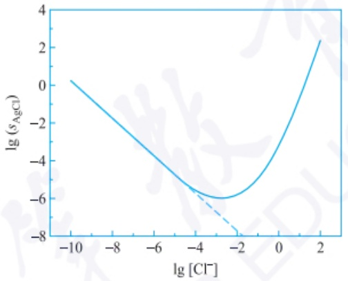

line

| \(lg[Cl^{-}]\) | lg(sAgCl) |
| --- | --- |
| -10 | ~0.3 |
| -8 | ~-1.5 |
| -6 | ~-3.2 |
| -4 | ~-5.5 |
| -2 | ~-6.0 |
| 0 | ~-3.5 |
| 2 | ~2.4 |

图 3.1.11 溶液中 Cl⁻ 浓度对 AgCl 溶解度的影响(虚线表示只考虑沉淀反应时对  $s_{AgCl}$  的预测)

## 5. 其他因素

温度: 大多数沉淀反应是吸热反应, 温度升高, 溶解度增加。室温过滤可以减少损失。

溶剂: 相似者相溶, 水溶液沉淀反应可以加入有机试剂减小溶解度。

颗粒大小: 小颗粒表面积大, 溶解度高, 大颗粒易沉降, 溶解度较低。

析出形态:亚稳态溶解度大,稳定态溶解度小。

习题

## - 章节练习题 -

1. 计算下列各溶液的 pH:

---

112

第三章 化学平衡与滴定分析

a.  $0.010 \, mol \cdot L^{-1} \, H_{2}SO_{4}$  溶液；

b.  $0.10 \, mol \cdot L^{-1}$  六亚甲基四胺 $(\mathrm{CH}_{2})_{6}\mathrm{N}_{4}$  溶液；

c.  $0.10 \, mol \cdot L^{-1} \, Na_{2}S$  溶液；

d. $50~\mathrm{mL}~0.10~\mathrm{mol}\cdot \mathrm{L}^{-1}\mathrm{H}_{3}\mathrm{PO}_{4}$ 溶液 $+25~\mathrm{mL}~0.10~\mathrm{mol}\cdot \mathrm{L}^{-1}\mathrm{NaOH}$ 溶液；

e. 50 mL 0.10 mol·L $^{-1}$ H $_{3}$ PO $_{4}$ 溶液+50 mL 0.10 mol·L $^{-1}$ NaOH溶液。

2. 计算 $0.050 \mathrm{~mol} \cdot \mathrm{L}^{-1} \mathrm{NH}_2\mathrm{OH}$ 溶液 $(\mathrm{pK_b} = 8.04)$ 和 $0.050 \mathrm{~mol} \cdot \mathrm{L}^{-1} \mathrm{NH}_4\mathrm{Cl}$ 溶液 $(\mathrm{pK_a} = 9.25)$ 等体积混合溶液的 $\mathrm{pH}$。

3. 25.00 mL 0.30 mol·L $^{-1}$ H $_{3}$ PO $_{4}$ 溶液与 30.00 mL 0.40 mol·L $^{-1}$ Na $_{3}$ PO $_{4}$ 溶液混合，然后稀释至 100.0 mL。

a. 计算此混合溶液的 pH 和缓冲容量  $\beta$ 。

b. 取上述混合溶液 25.00 mL, 需加入多少毫升  $1.00 \, mol \cdot L^{-1}$  HCl 溶液后, 才能使混合溶液的 pH 为 7.40?

4. 某滴定反应过程中会产生 $1.0 \mathrm{mmol} \mathrm{H}^{+}$, 现加入 $5.0 \mathrm{~mL} \mathrm{pH}$ 为 5.00 的 $\mathrm{HAc}-\mathrm{Ac}^{-}$缓冲溶液控制溶液酸度。如欲使反应体系的 $\mathrm{pH}$ 下降不到 0.30 单位, 则该缓冲溶液中的 $\mathrm{HAc}$ 和 $\mathrm{Ac}^{-}$浓度各为多少? 若配制 $1 \mathrm{~L}$ 此溶液, 则应加多少克 $\mathrm{NaAc} \cdot 3 \mathrm{H}_{2} \mathrm{O}$ 和多少毫升冰醋酸 $(17 \mathrm{~mol} \cdot \mathrm{L}^{-1})$?

5. 移取 25.00 mL 含有  $Bi^{3+}$  和  $Pb^{2+}$  的混合试液 (pH=1.00)，用 0.010 mol·L $^{-1}$  EDTA 溶液滴定  $Bi^{3+}$  至终点时耗去 21.50 mL，欲在此溶液中继续滴定  $Pb^{2+}$ ，需加入多少克六亚甲基四胺才能将溶液调至 pH=5.00？（六亚甲基四胺相对分子质量:140.2）

6. 请推导  $0.10 \, mol \cdot L^{-1} \, (\mathrm{NH}_{4})_{2}\mathrm{CO}_{3}$  溶液的  $[H^{+}]$  计算公式并计算溶液 pH。

7. 计算下列标准缓冲溶液的 pH(考虑离子强度的影响), 并与标准值比较:

a.  $0.010 \, mol \cdot L^{-1}$ 硼砂溶液；

b. 饱和酒石酸氢钾溶液(0.034 mol·L $^{-1}$ )。

8. 计算下面两种情况下的  $\lg\alpha_{\mathrm{Cd(NH_{4})}}$ 、 $\lg\alpha_{\mathrm{Cd(OH)}}$  和  $\lg\alpha_{\mathrm{Cd}}(\mathrm{Cd}^{2+}-\mathrm{OH}^{-}$  络合物的  $\lg\beta_{1}\sim\lg\beta_{4}$  分别为 4.3, 7.7, 10.3, 12.0）。

a. 含  $Cd^{2+}$  溶液中  $\left[NH_{3}\right]=\left[NH_{4}^{+}\right]=0.1\ mol\cdot L^{-1}$ ;

b. 加入少量 NaOH 于(a)液中至 pH 为 10.0。

9. 计算下面两种情况下的  $\lg K_{ZnY}^{\prime}$ :

a. pH=9.0,  $c_{NH_{3}}=0.2\ mol\cdot L^{-1}$ ;

b. $\mathrm{pH} = 9.0, c_{\mathrm{NH_3}} = 0.2 \mathrm{~mol} \cdot \mathrm{L}^{-1}, [\mathrm{CN}^-] = 0.01 \mathrm{~mol} \cdot \mathrm{L}^{-1}$。

10. 将  $15 \, mL \, 0.020 \, mol \cdot L^{-1}$  EDTA 溶液与  $10 \, mL \, 0.020 \, mol \cdot L^{-1} \, Pb^{2+}$  溶液混合，若 pH 为 4.0，计算  $[Pb^{2+}]$ ；若欲控制  $[Pb^{2+}]$  为  $10^{-7.0} \, mol \cdot L^{-1}$ ，则溶液 pH 应控制在多大？

11. 将  $10 \, mL \, 1.0 \times 10^{-3} \, mol \cdot L^{-1} \, Fe^{3+}$  溶液与  $30 \, mL \, 2.0 \times 10^{-3} \, mol \cdot L^{-1} \, \mathrm{Fe(NH_{4})_{2}(SO_{4})_{2}}$  溶液混合，试计算体系的电位。 $(\varphi_{\mathrm{Fe^{3+}/Fe^{2+}}}^{\ominus}=0.771 \, V)$

12. 计算 pH=8.0 时, As(V)/As(Ⅲ)电对的条件电位(忽略离子强度的影响), 并从计算结果判断以下反应的方向:

$$
\mathrm{H} _ {3} \mathrm{AsO} _ {4} + 2 \mathrm{H} ^ {+} + 3 \mathrm{I} ^ {-} \rightleftharpoons \mathrm{HAsO} _ {2} + \mathrm{I} _ {3} ^ {-} + 2 \mathrm{H} _ {2} \mathrm{O}
$$

已知: $\varphi_{H_{3}AsO_{4}/HAsO_{2}}^{\ominus}=0.56\ V;\varphi_{I_{3}/I^{-}}^{\ominus}=0.54\ V;H_{3}AsO_{4}:K_{a_{1}}=10^{-2.24},K_{a_{2}}=10^{-6.96},K_{a_{3}}=10^{-11.50};HAsO_{2}:K_{a}=10^{-9.29}$ 。

13. 计算铜电极在下列溶液中的电位:

---

3.2 滴定分析法

113

a. $25\mathrm{mL}0.05\mathrm{mol}\cdot \mathrm{L}^{-1}\mathrm{CuSO}_4$ 溶液中加入 $50~\mathrm{mL}0.5\mathrm{mol}\cdot \mathrm{L}^{-1}\mathrm{NH}_3$ 溶液；
b. $50~\mathrm{mL}~0.05~\mathrm{mol}\cdot \mathrm{L}^{-1}\mathrm{CuSO}_4$ 溶液中加入 $20~\mathrm{mL}~0.1~\mathrm{mol}\cdot \mathrm{L}^{-1}\mathrm{NH}_3$ 溶液。

$$
\left[ \varphi_ {\mathrm{Cu} ^ {2 +} / \mathrm{Cu}} ^ {\ominus} = 0. 3 3 7 \mathrm{V}, \mathrm{Cu(NH} _ {3}) _ {4} ^ {2 +}: \lg \beta_ {1} = 4. 1, \lg \beta_ {2} = 7. 6, \lg \beta_ {3} = 1 0. 5, \lg \beta_ {4} = 1 2. 6 \right]
$$

14. $\mathrm{K_3Fe(CN)_6}$ 在强酸溶液中能定量地氧化 $\Gamma^{-}$为 $\mathrm{I}_2$ ，因此可用它为基准物质标定 $\mathrm{Na_2S_2O_3}$ 溶液。试计算 $2\mathrm{mol}\cdot \mathrm{L}^{-1}$ HCl溶液中 $\mathrm{Fe(CN)}_{6}^{3 - } / \mathrm{Fe(CN)}_{6}^{4 - }$ 电对的条件电极电位。（已知 $\varphi_{\mathrm{Fe(CN)}_6^{3 - } / \mathrm{Fe(CN)}_6^{4 - }}^{\ominus} = 0.355\mathrm{V};\mathrm{H}_{3}\mathrm{Fe(CN)}_{6}$ 是强酸； $\mathrm{H_4Fe(CN)_6}$ 的 $K_{a_2} = 10^{-2.2},K_{a_1} = 10^{-4.2}$ ；计算中忽略离子强度影响）
15. 计算  $CaC_{2}O_{4}$  在 pH 为 5.00 的  $0.050\ mol\cdot L^{-1}(NH_{4})_{2}C_{2}O_{4}$  溶液中的溶解度。

$$
\mathrm {[CaC_ {2} O_ {4} \text {的} K_ {sp} = 2.3\times 10^{-9} , H_ {2} C_ {2} O_ {4} \text {的} K_ {a_ {1}} = 5.62\times 10^{-2} , K_ {a_ {2}} = 5.42\times 10^{-5} ]}
$$

16. 计算下列微溶化合物在给定介质中的溶解度。(除 a 题外, 均采用 I=0.1 时的常数)

a. ZnS 在纯水中；
b.  $CaF_{2}$  在  $0.01\ mol\cdot L^{-1}\ HCl$  溶液中（忽略沉淀溶解所消耗的酸）；
c. AgBr 在  $0.01 \, mol \cdot L^{-1} \, NH_{3} \cdot H_{2}O$  溶液中；
d.  $BaSO_{4}$  在 0.01 mol·L $^{-1}$ EDTA 溶液 (pH=7.0) 中。

## 3.2 滴定分析法

滴定分析法(titrimetry或titration analysis)用于测量待测组分的浓度,是将一种已知准确浓度的试剂溶液(即标准溶液)逐渐加到待测组分的溶液中,直到化学反应完成为止(反应终点)。容量分析法(volumetric titration)中,依据试剂与待测组分间的化学计量关系,通过滴定过程中消耗的标准溶液的体积,求得待测组分的含量。在库仑滴定(Coulometric titration)中,不必使用标准溶液,上述确定浓度的试剂则是确定的恒定电流,通过滴定过程中消耗的测量电荷量求得待测组分的含量。滴定分析法可以基于使用指示剂在终点前后颜色变化确定滴定终点,也可以使用仪器进行终点确定,如电化学、热分析、光学方法等。本节介绍以指示剂确定终点的容量分析法,包括酸碱滴定、络合滴定、氧化还原滴定和沉淀滴定。

## 3.2.1 滴定分析简介

## 3.2.1.1 滴定分析基础概念

（1）化学计量点 化学计量点(stoichiometric point, sp)是指加入的滴定剂与分析物恰好完全反应，其物质的量之比符合滴定反应方程式中的计量关系。
（2）滴定终点 实际滴定中，常在待测液中加入指示剂(indicator)，其在滴定反应结束时呈现颜色变化，帮助确定终止滴定的点，这一指示剂变色点(transition point)即为滴定终点(end point)。一般地，滴定终点靠近化学计量点。

指示剂应该满足以下条件:颜色变化敏锐、便于观察,相关化学反应迅速、可逆。

滴定分析中,还可以通过仪器方法测量平衡体系的物理信号变化,确定滴定终点。很多仪器方法可确定滴定终点,如测量电位的电位滴定和测量吸光度的光度滴定。

(3) 滴定曲线 滴定过程中, 平衡体系的某种性质, 如酸碱滴定中的 pH 或者

---

114

第三章 化学平衡与滴定分析

氧化还原滴定中的电位，随着滴定剂的加入而连续变化。这一变化遵循确定的函数关系，其图像就是滴定曲线(titration curve)。滴定曲线的横坐标为滴定剂加入体积 $V$ ，纵坐标即如上所说的平衡体系的性质。滴定曲线横坐标也可以用滴定百分数 $(T / \%)$ 表示，即滴定剂的量占达到化学计量点时的滴定剂的量之百分比。图3.2.1为酸碱滴定曲线示意图。

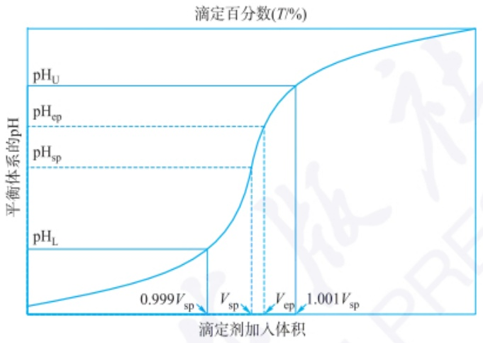

line

| 滴定百分数 (T/%) | 平衡体系的pH |
| --- | --- |
| 0.999Vsp | pHL |
| Vsp | pHsp |
| Vcp | pHcp |
| 1.001Vsp | pHU |

图 3.2.1 酸碱滴定曲线示意图

$\mathrm{pH}_{\mathrm{sp}}$ 和 $\mathrm{pH}_{\mathrm{ep}}$ 分别表示化学计量点和滴定终点时平衡体系的 $\mathrm{pH}, V_{\mathrm{sp}}$ 和 $V_{\mathrm{ep}}$ 表示对应的滴定剂加入体积； $\mathrm{pH}_{\mathrm{L}}$ 和 $\mathrm{pH}_{\mathrm{U}}$ 分别表示滴定突跃下端点和上端点

滴定曲线突跃解释

滴定曲线有一个重要的区域，就是在化学计量点sp附近，对应于 $0.999V_{\mathrm{sp}} \sim 1.001V_{\mathrm{sp}}$ 范围或滴定百分数为 $99.9\% \sim 100.1\%$ 范围，平衡体系的某种性质发生急剧变化，是一种突跃（jump），其变化范围称为滴定突跃范围。对于酸碱滴定，$0.999V_{\mathrm{sp}}$ 对应的 $\mathrm{pH}$ 为滴定突跃的下端点 $(\mathrm{pH}_{\mathrm{L}})$，$1.001V_{\mathrm{sp}}$ 对应的 $\mathrm{pH}$ 为滴定突跃的上端点 $(\mathrm{pH}_{\mathrm{U}})$ 。为什么在 $0.999V_{\mathrm{sp}} \sim 1.001V_{\mathrm{sp}}$ 范围平衡体系的性质发生突跃，详见拓展内容（二维码）。

滴定突跃的一个重要作用是选择指示剂。如果选择能够在滴定突跃范围内变色的指示剂，那么滴定剂的实际加入体积介于 $0.999V_{\mathrm{sp}}$ 和 $1.001V_{\mathrm{sp}}$ 之间，从而使（指示剂导致的）终点误差在允许范围 $\pm 0.1\%$ 之内。滴定突跃的另一个重要作用是判别滴定能否准确进行。例如，酸碱滴定中，滴定突跃须大于 $0.6\mathrm{pH}$ 单位，以包含目测指示剂变色不确定性所导致的 $\pm 0.3\mathrm{pH}$ 单位偏移，使终点误差在 $\pm 0.1\%$ 允许范围内。

（4）终点误差 绝大多数情况下，滴定终点和化学计量点并不一致，由此导致的误差称为终点误差(end point error)，以 $E_{\mathrm{t}}$ 表示。

从实验的角度,若以终点时和化学计量点时加入滴定剂的体积( $V_{ep}$  和  $V_{sp}$ )计算终点误差,则

$$
E_{\mathrm{t}} = \frac{V_{\mathrm{ep}} - V_{\mathrm{sp}}}{V_{\mathrm{sp}}}\times 100\%
$$

即

$$
E_{\mathrm{t}} = \left(\frac{V_{\mathrm{ep}}}{V_{\mathrm{sp}}} -1\right)\times 100\% \tag{3 - 2 - 1}
$$

---

3.2 滴定分析法

115

根据误差定义:

$$
E_{\mathrm{t}} = \frac{n(\text{过量或不足滴定剂})}{n(\text{化学计量点时应当加入的滴定剂})}\times 100\% \tag{3 - 2 - 2}
$$

设分析物 A 和滴定剂 T 的化学反应计量关系为  $aA \sim bT$ ，若 A 的初始体积为  $V_{0}$ ，终点时加入滴定剂的体积为  $V_{ep}$ ，则

$$
E_{\mathrm{t}} = \frac{ac_{\mathrm{T}}V_{\mathrm{ep}} - bc_{\mathrm{A}}V_{0}}{bc_{\mathrm{A}}V_{0}}\times 100\% = \left(\frac{ac_{\mathrm{T}}}{bc_{\mathrm{A}}}\times \frac{V_{\mathrm{ep}}}{V_{0}} -1\right)\times 100\%
$$

若 $a = b, c_{\mathrm{T}} = c_{\mathrm{A}}$ ，则 $V_{0} = V_{\mathrm{sp}}$ ，上式简化为

$$
E_{\mathrm{t}} = \left(\frac{V_{\mathrm{ep}}}{V_{\mathrm{sp}}} -1\right)\times 100\%
$$

该式与式 $(3-2-1)$ 以体积计算误差的式子相同。

又根据式(3-2-2)，有

$$
E_{\mathrm{t}} = \frac{an_{\mathrm{T,ep}} - bn_{\mathrm{A,sp}}}{bn_{\mathrm{A,sp}}} \times 100\% \tag{3 - 2 - 3}
$$

其中， $n_{T,ep}$  表示终点时加入滴定剂 T 的量； $n_{A,sp}$  表示分析物 A 在化学计量点时的量。

若  $n_{A,ep}$  表示分析物 A 在终点时的量, 因  $n_{A,ep}=n_{A,sp}$ , 则式(3-2-3) 变为

$$
E_{\mathrm{t}} = \frac{an_{\mathrm{T,ep}} - bn_{\mathrm{A,ep}}}{bn_{\mathrm{A,ep}}} \times 100\% \tag{3 - 2 - 4}
$$

若以  $V_{ep}^{T}$  表示终点时溶液的总体积，则  $n_{T,ep}=c_{T,ep}V_{ep}^{T}, n_{A,ep}=c_{A,ep}V_{ep}^{T}$ ，其中  $c_{T,ep}$  和  $c_{A,ep}$  分别表示终点时滴定剂和分析物的分析浓度。将之代入式(3-2-4)，得

$$
E_{\mathrm{t}} = \frac{ac_{\mathrm{T,ep}} - bc_{\mathrm{A,ep}}}{bc_{\mathrm{A,ep}}} \times 100\% \tag{3 - 2 - 5}
$$

以  $V_{sp}^{T}$  表示化学计量点时溶液的总体积, 若终点与化学计量点接近, 有  $V_{ep}^{T} \approx V_{sp}^{T}$ , 式(3-2-3)变为

$$
E_{\mathrm{t}} = \frac{ac_{\mathrm{T,ep}} - bc_{\mathrm{A,ep}}}{bc_{\mathrm{A,sp}}} \times 100\% \tag{3 - 2 - 6}
$$

以上所有误差表达方式都是基于误差定义,是等价的。

## 3.2.1.2 滴定分析法对化学反应的要求

滴定分析法是基于分析物(待滴定物)与滴定剂之间的化学反应进行的测量。滴定分析涉及的反应须满足以下要求:

- 滴定剂必须与分析物具有明确的化学计量关系；
- 滴定剂应与分析物快速反应；
- 反应的完全度必须大于 $99.9\%$ ，以确保合理的滴定突跃，从而在该突跃内可以使用颜色指示剂来定位终点。

## 3.2.1.3 滴定仪器

化学分析仪器主要包括玻璃器皿和分析天平,部分仪器的示意图见图3.2.2。

称量分析样品通常是定量分析的第一步。通常，分析天平的最大量程为160\~200 g，标准偏差为±0.1 mg。半微量分析天平的最大量程为10\~30 g，标准偏差为±0.01 mg。微量分析天平的最大量程为1\~3 g，精度为±0.001 mg。根据样品的大小和分析所需的准确度，需要选择合适的分析天平进行质量测量。

精确的体积测量和精确的质量测量同样重要。对于滴定管、移液管和容量瓶等精度较高的容量器皿，使用时应该注意环境温度，以保证量取溶液体积的准确度。必要时，应该对容量器皿进行校正。

---

116

第三章 化学平衡与滴定分析

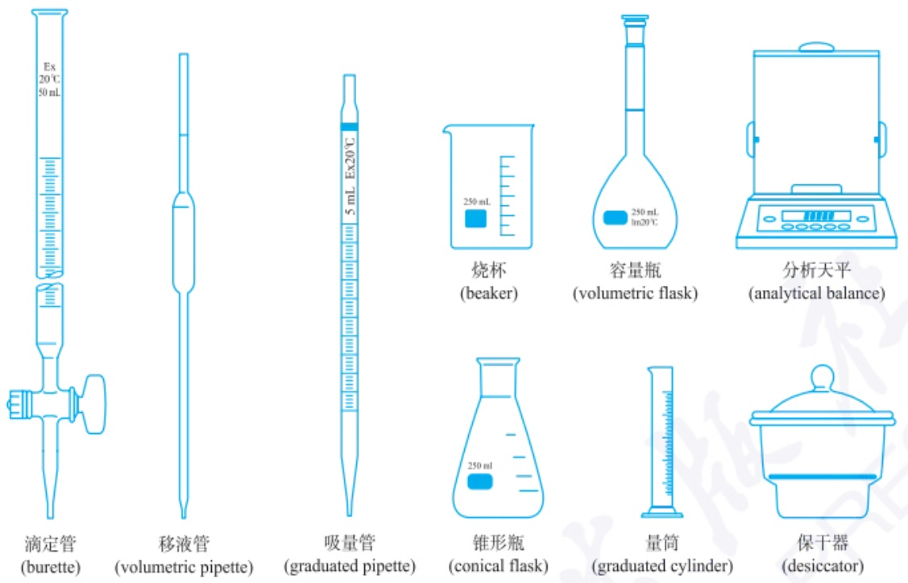

text_image

Ex
20°C
50 mL
滴定管
(burette)
移液管
(volumetric pipette)
吸量管
(graduated pipette)
5 mL Ex20°C
烧杯
(beaker)
容量瓶
(volumetric flask)
分析天平
(analytical balance)
锥形瓶
(conical flask)
量筒
(graduated cylinder)
保干器
(desiccator)

图 3.2.2 容量分析中的常用仪器

## 3.2.1.4 滴定方式

多数情况下,可以将滴定剂直接滴加于分析物溶液进行分析,称为直接滴定法(direct titration)。

有些物质无法通过直接滴定测定,可以通过间接方式进行测定。下面以实例说明。

当① 分析物为固体形式；② 分析物与标准溶液的反应速率较慢；③ 标准溶液的稳定性不足以完成滴定；以及④ 没有适用于直接滴定的指示剂时，则进行返滴定（back titration）。络合滴定法测铝是返滴定法的一个典型实例。 $Al^{3+}$  与 EDTA 生成非常稳定的络合物 ( $K_{稳}=1.3\times10^{16}$ )，但这只是能够进行滴定分析的一个必要条件。 $Al^{3+}$  在常温条件下与 EDTA 反应较慢，pH 较高时易生成多核羟基络合物；另外， $Al^{3+}$  对指示剂二甲酚橙有封闭作用。这些原因致使直接滴定法无法应用于  $Al^{3+}$  的测定，可以采用返滴定法:加入一定量过量的 EDTA 标准溶液，在加热情况下促使反应完全；溶液冷却后，以  $Zn^{2+}$  标准溶液滴定过剩的 EDTA。需要注意的是，返滴定不能应用于反应完全度低于 99.9% 的情况，因为返滴定是从相反方向接近终点，并不改变反应的完全性。

分析物所参加的滴定反应如不按一定的反应式进行，或者没有确定的计量关系，则不能用直接滴定法测定。 $Na_{2}S_{2}O_{3}$  作为滴定剂的氧化还原滴定法就是置换滴定法(replacement titration)的一个典型实例。 $K_{2}Cr_{2}O_{7}$  的氧化性太强，可以将  $Na_{2}S_{2}O_{3}$  氧化为  $Na_{2}S_{4}O_{6}$  和  $Na_{2}SO_{4}$ 。由于化学计量关系不确定，该反应不能用于滴定分析。可以在酸性  $K_{2}Cr_{2}O_{7}$  溶液中加入过量 KI，使  $K_{2}Cr_{2}O_{7}$  被定量置换成  $I_{2}$，再用  $Na_{2}S_{2}O_{3}$  滴定反应产生的  $I_{2}$ 。 $I_{2}$  是一种中等强度氧化剂，与  $Na_{2}S_{2}O_{3}$  的反应能够快速、定量完成，符合滴定要求。

## 3.2.1.5 标准溶液与基准物质

## 1. 标准溶液

标准溶液(standard solution)是已知准确浓度的、常规条件下稳定的溶液,滴

---

3.2 滴定分析法

117

定分析的已知信息。标准溶液可以直接配制，如  $K_{2}Cr_{2}O_{7}$  溶液；也可以先粗略配制，然后通过标定获得其准确浓度，如低浓度 NaOH 溶液。

## 2. 基准物质

基准物质(primary standard)是用以直接配制标准溶液或标定其他溶液的物质，如酸碱滴定中的邻苯二甲酸氢钾、氧化还原滴定中的 $K_{2}Cr_{2}O_{7}$ 。基准物质应满足:组成与其化学式一致；纯度高(>99.9%)；常规条件下稳定；滴定分析时没有副反应。

## 3.2.2 酸碱滴定法

酸碱滴定(acid-base titration)法是基于酸碱反应,通过滴定方式进行的一种经典定量分析方法,又称中和滴定法。酸碱滴定法中要着重讨论的问题是:哪些物质能用酸碱滴定法测定?如何正确选择指示剂?准确滴定的条件是什么?终点与化学计量点不一致会导致多大误差?

## 3.2.2.1 酸碱指示剂

酸碱指示剂(acid-base indicator)通常为有机弱酸或有机弱碱,其酸式形态(HIn)与碱式形态( $In^{-}$ )由于结构相异而呈现不同颜色。指示剂在溶液中的平衡关系为

$$
\mathrm{HIn} \rightleftharpoons \mathrm{H} ^ {+} + \mathrm{In} ^ {-} \quad K _ {\mathrm{a}} ^ {\mathrm{HIn}} = \frac {[ \mathrm{H} ^ {+} ] [ \mathrm{In} ^ {-} ]}{[ \mathrm{HIn} ]}
$$

可见酸式形态与碱式形态的相对含量受 $\mathrm{pH}$ 影响，所以显示出与 $\mathrm{pH}$ 相关的颜色。一般认为:当 $\frac{[\mathrm{HIn}]}{[\mathrm{In}^{-}]} > 10$ ，即 $\mathrm{pH} < \mathrm{pK}_{\mathrm{a}}^{\mathrm{HIn}} - 1$ ，溶液呈酸式形态的颜色；当 $\frac{[\mathrm{HIn}]}{[\mathrm{In}^{-}]} < 0.1$ ，即 $\mathrm{pH} > \mathrm{pK}_{\mathrm{a}}^{\mathrm{HIn}} + 1$ ，溶液呈碱式形态的颜色；当 $0.1 < \frac{[\mathrm{HIn}]}{[\mathrm{In}^{-}]} < 10$ ，即 $\mathrm{pK}_{\mathrm{a}}^{\mathrm{HIn}} - 1 < \mathrm{pH} < \mathrm{pK}_{\mathrm{a}}^{\mathrm{HIn}} + 1$ 。 $\mathrm{pK}_{\mathrm{a}}^{\mathrm{HIn}} \pm 1$ 称为指示剂的理论变色范围。

指示剂的实际变色范围受到人眼生物特性的影响。以甲基橙为例，$\mathrm{pK}_{\mathrm{a}}^{\mathrm{HIn}} = 3.4$，其酸式形态和碱式形态分别为红色和黄色，理论变色范围为 $\mathrm{pH}2.4\sim 4.4$，但是人眼对红色比对黄色更加敏感，使得甲基红的实际变色范围是 $3.1\sim 4.4$。因此指示剂的变色范围，通常根据经验确定。在实际滴定过程中，并不需要指示剂完全显示酸形态色或碱形态色，只要看到明显的色变即可。在指示剂的变色间隔内通常有一点颜色变化特别明显，例如，当 $\mathrm{pH} = 4.0$ 时，甲基橙呈现显著的橙色，因此以HCl滴定NaOH时，溶液颜色由黄色转为橙色时，这一点即为实际的滴定终点；对于甲基红，这一点为 $\mathrm{pH} = 5.0$。当人眼对指示剂的酸形态和碱形态颜色同样敏感时，指示剂理论上的颜色转变点为 $\mathrm{pH} = \mathrm{pK}_{\mathrm{a}}^{\mathrm{HIn}}$。此外，指示剂的实际变色范围因人而异。

最常用的酸碱指示剂见表3.2.1。关于指示剂的结构性质等，详见二维码。

表 3.2.1 最常用的酸碱指示剂

<table><tr><td rowspan="2">指示剂</td><td colspan="3">颜色</td><td rowspan="2">pKa</td><td rowspan="2">变色pH范围</td></tr><tr><td>酸形态色</td><td>过渡色</td><td>碱形态色</td></tr><tr><td>甲基橙</td><td>红</td><td>橙</td><td>黄</td><td>3.4</td><td>3.1~4.4</td></tr><tr><td>甲基红</td><td>红</td><td>橙</td><td>黄</td><td>5.0</td><td>4.4~6.2</td></tr><tr><td>酚酞</td><td>无色</td><td>粉红</td><td>红</td><td>9.1</td><td>8.0~9.8</td></tr><tr><td>百里酚酞</td><td>无色</td><td>淡蓝</td><td>蓝</td><td>10.0</td><td>9.4~10.6</td></tr></table>

常用酸碱指示剂简介

---

118

第三章 化学平衡与滴定分析

指示剂的酸式形态与碱式形态需要能够迅速达到平衡，以即时反映滴定中pH的改变。指示剂用量要适中，颜色过浅或者太深都不利于终点判断；过多的指示剂还要显著消耗滴定剂，增大分析误差。酸碱指示剂的变色范围还受温度、溶剂和离子强度的影响，原因是这些因素会影响指示剂的解离平衡常数。

酸碱指示剂的实际变色范围一般都较宽,有些过渡色难以准确辨识。为了获得较窄的变色范围,提高变色的敏锐程度,可采用混合指示剂。

混合指示剂是利用颜色互补原理使终点观测明显,分为两类:

（i）由两种解离常数较接近的指示剂混合而成，这类混合指示剂酸式形态的混合色与碱式形态的混合色互补，呈现灰色，变色敏锐。例如，0.1%溴甲酚绿 $\left(\mathrm{p}K_{\mathrm{a}}^{\mathrm{HIn}}=4.9\right)$ 与0.2%甲基红按照体积比3:1制成混合指示剂。二者酸式形态的混合色为酒红色（黄色 $_{溴甲酚绿}+$ 红色 $_{甲基红}$ ），碱式形态的混合色为绿色（蓝色 $_{溴甲酚绿}+$ 黄色 $_{甲基红}$ ）。在pH=5.1，酒红色与绿色互补，呈现灰色。
（ii）由一种酸碱指示剂与酸碱惰性染料混合而成，也是利用颜色互补原理，使颜色突变呈现灰色。例如，0.1 g甲基橙与0.25 g靛蓝二磺酸钠（酸碱惰性）溶解于100 mL水中制成混合指示剂。酸式色为由红色（甲基橙）和蓝色（靛蓝二磺酸钠）混合的紫色，碱式色为黄色（甲基橙）和蓝色（靛蓝二磺酸钠）混合的绿色。在pH=4.1，紫色与绿色互补，呈现浅灰色。

## 3.2.2.2 酸碱滴定曲线

本节重点讨论强酸碱和一元弱酸碱的滴定,根据滴定过程中溶液的组成,将滴定曲线分四个阶段进行计算与讨论。

## 1. 强酸(碱)、一元弱酸(碱)的滴定曲线

## (1) 滴定曲线的绘制

\- 强酸: 以 $0.10 \mathrm{~mol} \cdot \mathrm{L}^{-1}(c) \mathrm{NaOH}$ 溶液滴定 $20.00 \mathrm{~mL}(V_0)$ 同浓度 HCl 溶液为例。为简化, 在滴定曲线的讨论中, 初始浓度均取两位有效数字。

滴定前,体系为  $0.10 \, mol \cdot L^{-1}$  的 HCl 溶液。

$$
\left[ \mathrm{H} ^ {+} \right] = c _ {\mathrm{HCl}} = 0. 1 0 \mathrm{mol} \cdot \mathrm{L} ^ {- 1}, \quad \mathrm{pH} = - \lg \left[ \mathrm{H} ^ {+} \right] = 1. 0 0
$$

滴定开始至化学计量点之前,溶液的 pH 取决于剩余 HCl 的浓度。例如,当体系中加入 19.98 mL NaOH 溶液时,未中和的 HCl 溶液为 0.02 mL,此时溶液中

$$
[ \mathrm{H} ^ {+} ] = 0. 1 0 \times \frac {0 . 0 2}{2 0 . 0 0 + 1 9 . 9 8} \mathrm{mol} \cdot \mathrm{L} ^ {- 1} = 5. 0 \times 1 0 ^ {- 5} \mathrm{mol} \cdot \mathrm{L} ^ {- 1}, \quad \mathrm{pH} = 4. 3 0
$$

化学计量点时,加入的 20.00 mL NaOH 溶液恰好全部被 HCl 溶液中和,溶液组成为 NaCl 水溶液, $\left[H^{+}\right]$ 由水的解离决定。

$$
\left[ \mathrm{H} ^ {+} \right] = \left[ \mathrm{OH} ^ {-} \right] = \sqrt {K _ {\mathrm{w}}} = 1 0 ^ {- 7. 0 0} (\mathrm{mol} \cdot \mathrm{L} ^ {- 1}), \quad \mathrm{pH} = 7. 0 0
$$

化学计量点后,溶液的 $\left[H^{+}\right]$ 取决于过量NaOH的浓度。例如,向体系中加入20.02 mL NaOH溶液时,NaOH过量0.02 mL,此时溶液中

$$
[ \mathrm{OH} ^ {-} ] = 0. 1 0 \times \frac {0 . 0 2}{2 0 . 0 0 + 2 0 . 0 2} \mathrm{mol} \cdot \mathrm{L} ^ {- 1} = 5. 0 \times 1 0 ^ {- 5} \mathrm{mol} \cdot \mathrm{L} ^ {- 1}
$$

$$
[ \mathrm{H} ^ {+} ] = 2. 0 \times 1 0 ^ {- 1 0} \mathrm{mol} \cdot \mathrm{L} ^ {- 1}, \quad \mathrm{pH} = 9. 7 0
$$

\- 一元弱酸: 以 $0.10 \mathrm{~mol} \cdot \mathrm{L}^{-1}(c) \mathrm{NaOH}$ 溶液滴定 $20.00 \mathrm{~mL}(V_0)$ 同浓度 HAc 溶液为例。

滴定前,体系为  $0.10 \, mol \cdot L^{-1}$  的 HAc 溶液。

$$
\left[ \mathrm{H} ^ {+} \right] \approx \sqrt {K _ {\mathrm{a}} c} = \sqrt {1 0 ^ {- 4 . 7 5 6 - 1 . 0 0}} = 1 0 ^ {- 2. 8 8} (\mathrm{mol} \cdot \mathrm{L} ^ {- 1}), \quad \mathrm{pH} = 2. 8 8
$$

---

3.2 滴定分析法

119

滴定开始至化学计量点前，滴加的 NaOH 与 HAc 作用生成 NaAc，同时溶液还有剩余的 HAc，此时滴定体系是 HAc 与 NaAc 的混合物。当加入 19.98 mL NaOH 溶液时，未中和的 HAc 为 0.02 mL，则

$$
c _ {\mathrm{HAe}} = \frac {0 . 0 2 \times 0 . 1 0}{2 0 . 0 0 + 1 9 . 9 8} \mathrm{mol} \cdot \mathrm{L} ^ {- 1} = 5. 0 \times 1 0 ^ {- 5} \mathrm{mol} \cdot \mathrm{L} ^ {- 1} = 1 0 ^ {- 4. 3 0} \mathrm{mol} \cdot \mathrm{L} ^ {- 1}
$$

$$
c _ {A c ^ {-}} = \frac {1 9 . 9 8 \times 0 . 1 0}{2 0 . 0 0 + 1 9 . 9 8} \mathrm{mol} \cdot \mathrm{L} ^ {- 1} = 5. 0 \times 1 0 ^ {- 2} \mathrm{mol} \cdot \mathrm{L} ^ {- 1} = 1 0 ^ {- 1. 3 0} \mathrm{mol} \cdot \mathrm{L} ^ {- 1}
$$

滴定曲线突跃范围需要超过一定 pH 跨度,以方便选择指示剂,进行准确滴定,因此,在不讨论准确滴定判别的情况下,此时 pH 可按最简式计算:

$$
\left[ \mathrm{H} ^ {+} \right] = \frac {c _ {\mathrm{HAc}}}{c _ {\mathrm{Ac} ^ {-}}} K _ {\mathrm{a}} = \frac {1 0 ^ {- 4 . 3 0}}{1 0 ^ {- 1 . 3 0}} \times 1 0 ^ {- 4. 7 5 6} = 1 0 ^ {- 7. 7 6} (\mathrm{mol} \cdot \mathrm{L} ^ {- 1})
$$

即 $\mathrm{pH} = 7.76$。

化学计量点时,加入的 20.00 mL NaOH 溶液恰好全部被 HAc 中和,溶液为 NaAc 水溶液,按最简式计算:

$$
\left[ \mathrm{OH} ^ {-} \right] = \sqrt {K _ {\mathrm{b}} c} = \sqrt {\frac {1 0 ^ {- 1 4 . 0 0}}{1 0 ^ {- 4 . 7 5 6}} \times 1 0 ^ {- 1 . 3 0}} = 1 0 ^ {- 5. 2 7} (\mathrm{mol} \cdot \mathrm{L} ^ {- 1}), \quad \mathrm{pH} = 8. 7 3
$$

化学计量点后,溶液的组成是 NaOH 和 NaAc。Ac $^{-}$ 的碱性较弱,溶液的 [OH $^{-}$ ] 取决于过量 NaOH 的浓度。如加入 20.02 mL NaOH 溶液时,NaOH 过量 0.02 mL,此时溶液中:

$$
[ \mathrm{OH} ^ {-} ] = 0. 1 0 \times \frac {0 . 0 2}{2 0 . 0 0 + 2 0 . 0 2} \mathrm{mol} \cdot \mathrm{L} ^ {- 1} = 5. 0 \times 1 0 ^ {- 5} \mathrm{mol} \cdot \mathrm{L} ^ {- 1}
$$

$$
\mathrm{pOH} = 4. 3 0, \quad \mathrm{pH} = 1 4. 0 0 - 4. 3 0 = 9. 7 0
$$

基于上述分段讨论，以 $0.10\mathrm{mol}\cdot \mathrm{L}^{-1}\mathrm{NaOH}$ 溶液滴定 $20.00~\mathrm{mL}$ 同浓度的HCl、HAc或HA（$K_{\mathrm{a}} = 10^{-7.00}$）溶液时，滴定剂加入体积及其对应的 $\mathrm{pH}$ 列于表3.2.2。强碱分别滴定强酸和一元弱酸的滴定曲线如图3.2.3和图3.2.4所示。

表 3.2.2 以  $0.10 \, mol \cdot L^{-1} \, NaOH$  溶液滴定  $20.00 \, mL$  同浓度的 HCl、HAc 或 HA ( $K_{a} = 10^{-7.00}$ ) 溶液时，滴定剂加入体积及其对应的 pH

<table><tr><td>V(加入 NaOH)</td><td>滴定百分数</td><td colspan="3">pH</td></tr><tr><td>mL</td><td>%</td><td>HCl</td><td>HAc</td><td> $HA^a(K_a=10^{-7.00})$ </td></tr><tr><td>0</td><td>0</td><td>1.00</td><td>2.88</td><td>4.00</td></tr><tr><td>10.00</td><td>50.0</td><td>1.48</td><td>4.76</td><td>7.00</td></tr><tr><td>18.00</td><td>90.0</td><td>2.28</td><td>5.71</td><td>7.95</td></tr><tr><td>19.80</td><td>99.0</td><td>3.30</td><td>6.76</td><td>9.00</td></tr><tr><td>19.96</td><td>99.8</td><td>4.00</td><td>7.46</td><td>9.56</td></tr><tr><td>19.98</td><td>99.9</td><td>4.30</td><td>7.76</td><td>9.70</td></tr><tr><td>20.00</td><td>100.0</td><td>7.00</td><td>8.73</td><td>9.85</td></tr><tr><td>20.02</td><td>100.1</td><td>9.70</td><td>9.70</td><td>10.00</td></tr><tr><td>20.04</td><td>100.2</td><td>10.00</td><td>10.00</td><td>10.14</td></tr><tr><td>20.20</td><td>101.0</td><td>10.70</td><td>10.70</td><td>10.70</td></tr><tr><td>22.00</td><td>110.0</td><td>11.72</td><td>11.70</td><td>11.70</td></tr></table>

a: 化学计量点附近采用近似式计算。

---

120

第三章 化学平衡与滴定分析

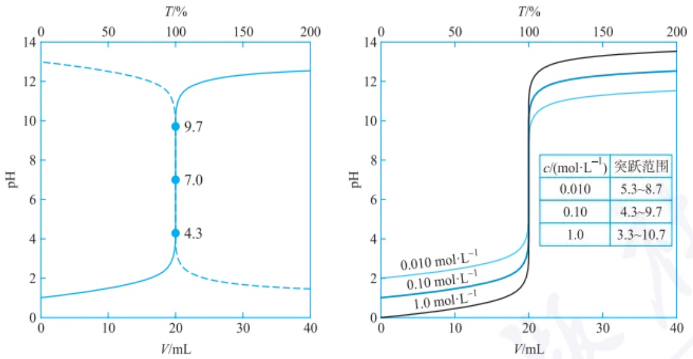

图3.2.3 以 $0.10\mathrm{mol}\cdot \mathrm{L}^{-1}\mathrm{NaOH}$ 溶液滴定 $20.00~\mathrm{mL}~0.10\mathrm{mol}\cdot \mathrm{L}^{-1}\mathrm{HCl}$ 溶液的滴定曲线（虚线表示HCl溶液滴定 $\mathrm{NaOH}$ 溶液的情况）（左）；不同浓度 $(\mathrm{mol}\cdot \mathrm{L}^{-1})$ 的强碱滴定强酸的滴定曲线（右）

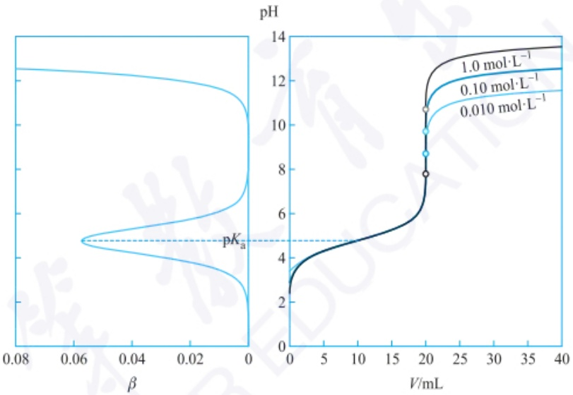

line

| V/mL | pH (1.0 \(mol \cdot L^{-1})\) | pH (0.10 \(mol \cdot L^{-1})\) | pH (0.010 \(mol \cdot L^{-1})\) |
| --- | --- | --- | --- |
| 0 | ~2.5 | ~2.5 | ~2.5 |
| 5 | ~4.5 | ~4.5 | ~4.5 |
| 10 | ~5.5 | ~5.5 | ~5.5 |
| 15 | ~6.5 | ~6.5 | ~6.5 |
| 20 | ~8.0 | ~9.8 | ~11.5 |
| 25 | ~13.0 | ~12.0 | ~11.5 |
| 30 | ~13.5 | ~12.5 | ~11.5 |
| 35 | ~13.5 | ~12.5 | ~11.5 |
| 40 | ~13.5 | ~12.5 | ~11.5 |

图3.2.4 $0.10\mathrm{mol}\cdot \mathrm{L}^{-1}$ HCl溶液、NaOH溶液及 $\mathrm{HAc - Ac^-}$ 溶液的缓冲容量随 $\mathrm{pH}$ 变化(左)；以 $0.10\mathrm{mol}\cdot$ $\mathrm{L}^{-1}$ NaOH溶液滴定 $20.00~\mathrm{mL}$ 不同浓度HAc溶液的滴定曲线(右)

## (2) 滴定曲线的形状、滴定突跃与指示剂选择

强碱分别滴定强酸和弱酸的滴定曲线之总的趋势是，在滴定开始时曲线较为平坦，随着滴定的进行，曲线逐渐上升，在化学计量点附近突然跃升，之后曲线又趋于平坦。滴定开始前弱酸溶液的 pH 大于强酸溶液。

\- 滴定开始的较平坦区域:对于强酸的滴定，溶液中酸量大，为强酸有效缓冲范围。当 $90\%$ 的HCl被中和，即加入 $18.00~\mathrm{mLNaOH}$ 溶液， $\mathrm{pH}$ 才从开始的1.0升至2.3，改变1.3个单位；继续加入NaOH溶液，溶液中酸量减少，缓冲容量下降，加入相同量碱所引起的 $\mathrm{pH}$ 变化增大，曲线逐渐向上倾斜。对于一元弱酸HAc的滴定，开始时，虽然反应产生 $\mathrm{Ac}^{-}$，形成 $\mathrm{HAc - Ac^{-}}$ 共轭酸碱对，但是其缓冲容量较低，随着NaOH的加入， $\mathrm{pH}$ 较快增加；随着滴定的进行，HAc浓度逐渐降低，NaAc浓度不断增大，溶液的缓冲容量增大， $\mathrm{pH}$ 变化缓慢，滴定百分数为 $50\%$ 时， $c_{\mathrm{HAc}} / c_{\mathrm{Ac}^{-}} = 1$ ，此时体系缓冲容量最大，曲线最平坦。

---

3.2 滴定分析法

121

- 突跃范围区域:对于强酸的滴定，当滴定到溶液中只剩下 $0.1\%$ （$0.02 \mathrm{~mL}$）HCl时，溶液 $\mathrm{pH}$ 为4.30，此时再加1滴（约 $0.04 \mathrm{~mL}$），则不仅将剩下的半滴HCl中和，而且 $\mathrm{NaOH}$ 还过量了半滴。1滴之差使溶液由酸性变为碱性，$\mathrm{pH}$ 由4.30急剧增加到9.70，突跃范围为5.4个 $\mathrm{pH}$ 单位。对于一元弱酸 $\mathrm{HAc}$，接近化学计量点时，$\mathrm{HAc}$ 浓度已很低，溶液的缓冲作用显著减弱，若继续加入 $\mathrm{NaOH}$，溶液的 $\mathrm{pH}$ 则较快地增大，由于滴定产物 $\mathrm{Ac}^{-}$是弱碱，化学计量点时溶液不是中性而是弱碱性，化学计量点后，体系为 $\mathrm{NaAc-NaOH}$ 混合溶液，溶液 $\mathrm{pH}$ 由 $\mathrm{NaOH}$ 决定，滴定突跃范围上端点与强酸的滴定一致，滴定突跃范围为7.76\~9.70。
- 突跃范围之后的平坦区域: 对于强酸的滴定, 突跃范围之后, 若继续加入 NaOH 溶液, 体系则进入强碱的缓冲区, 曲线变得平坦。对于一元弱酸 HAc 的滴定, 化学计量点后为 NaAc-NaOH 混合溶液, 曲线与 NaOH 滴定 HCl 的曲线基本重合。

滴定突跃范围为指示剂的选择提供了依据，只要变色点的 $\mathrm{pH}$ 处于滴定突跃范围内的指示剂均可选用。在强碱滴定强酸的滴定中，酚酞、甲基红、甲基橙的颜色转变点分别为 $\mathrm{pH}9.0,6.2$ 和4.4，均在滴定突跃范围内，故在此均适用。如果用$0.10\mathrm{mol}\cdot \mathrm{L}^{-1}\mathrm{HCl}$ 溶液滴定同浓度NaOH溶液则情况相似但 $\mathrm{pH}$ 变化方向相反，突跃范围为 $9.7\sim 4.3$ ，如图3.2.3中虚线所示，此时酚酞、甲基红和甲基橙的变色点分别为 $\mathrm{pH}8.0,5.0$ 和4.0，其中甲基橙变色点在滴定突跃范围之外，误差大于$0.1\%$ 。强碱滴定弱酸HAc的突跃范围在弱碱性区域，且比滴定同样浓度的强酸的突跃小很多，因此在酸性范围内变色的指示剂（如甲基橙、甲基红等）均不适用，只能选择在碱性范围内变色的指示剂，酚酞的变色点在滴定突跃范围内，可以用作指示剂。

滴定突跃范围的大小还与溶液浓度有关。对于强酸的滴定，酸碱浓度增大为10倍滴定突跃范围则增加2个pH单位。用 $1.0\ mol\cdot L^{-1}\ HCl$ 溶液滴定同浓度NaOH溶液的滴定突跃范围为10.7\~3.3。此时，即使选甲基橙作指示剂，滴定终点的pH(4.0)仍处于突跃范围之内，滴定误差小于0.1%。反之，若浓度降低为1/10，滴定突跃范围也相应地减少2个pH单位。如用 $0.010\ mol\cdot L^{-1}\ NaOH$ 溶液滴定同浓度HCl时滴定突跃范围为5.3\~8.7。要使误差小于0.1%，甲基红最适宜。对于弱酸的滴定，在化学计量点前，滴定体系组成为 $HA-A^{-}$ 缓冲体系， $[H^{+}]$ 取决于[HA]与[A]之比，与其总浓度无关。一般地，在化学计量点前0.1%，溶液pH均为 $pK_{a}+3.0$ 。在化学计量点之后，与强酸的滴定相似。当被滴定酸的浓度增大为10倍，滴定突跃上端点pH增加1个单位，因此，弱酸滴定中其浓度对滴定突跃范围的影响比强酸的小。

酸的强弱是影响滴定突跃范围的重要因素。酸越弱（即 $K_{\mathrm{a}}$ 越小），滴定反应常数 $K_{\mathrm{t}} = K_{\mathrm{a}} / K_{\mathrm{w}}$ 越小，突跃范围也就越小。由表3.2.2可见，滴定 $0.10\mathrm{mol}\cdot \mathrm{L}^{-1}$ 的弱酸 $\mathrm{HA}(K_{\mathrm{a}} = 10^{-7.00})$ ，化学计量点前后 $0.1\%$ 时 $\mathrm{pH}$ 变化是 $9.70\sim 10.00$ ，仅有0.3$\mathrm{pH}$ 单位。假设能选到指示剂，其颜色转变点恰好与化学计量点的 $\mathrm{pH}$ 一致，为9.85，由于人眼观察终点有 $\pm 0.3~\mathrm{pH}$ 单位的不确定性，终点的变动范围则是 $9.56\sim$ 10.14，对应的滴定准确度是 $\pm 0.2\%$ 。若酸更弱，则准确度还要低。

强酸滴定弱碱的情况与强碱滴定弱酸类似。以 $0.10\mathrm{mol}\cdot \mathrm{L}^{-1}(c)\mathrm{HCl}$ 溶液滴定 $20.00\mathrm{mL}(V_0)$ 同浓度 $\mathrm{NH_3\cdot H_2O}$ 溶液为例，此滴定反应及其 $K_{\mathrm{t}}$ 为

$$
\mathrm{NH} _ {3} + \mathrm{H} ^ {+} \rightleftharpoons \mathrm{NH} _ {4} ^ {+}
$$

---

122

第三章 化学平衡与滴定分析

$$
K _ {\mathrm{t}} = \frac {[ \mathrm{NH} _ {4} ^ {+} ]}{[ \mathrm{NH} _ {3} ] [ \mathrm{H} ^ {+} ]} = \frac {K _ {\mathrm{b}}}{K _ {\mathrm{w}}} = 1 0 ^ {9. 2 5}
$$

可见,滴定反应可进行较完全。

各滴定阶段 $\mathrm{pH}$ 的计算方法与强碱滴定弱酸类似，如表3.2.3所示，滴定曲线如图3.2.5所示。可以看出，强酸滴定弱碱，在化学计量点时溶液呈弱酸性，滴定突跃发生在酸性范围。对于 $0.10\mathrm{mol}\cdot \mathrm{L}^{-1}\mathrm{NH}_3\cdot \mathrm{H}_2\mathrm{O}$ 溶液，突跃范围为 $6.25\sim$ 4.30。因此必须选在酸性范围内变色的指示剂，甲基红是合适的指示剂，若用甲基橙作指示剂，滴定终点 $\mathrm{pH}$ （为4.0）在突跃范围之外，误差有 $+0.2\%$ 。

表 3.2.3 以  $0.10 \, mol \cdot L^{-1} \, HCl$  溶液滴定  $20.00 \, mL$  同浓度  $NH_{3} \cdot H_{2}O$  溶液时的 pH 变化

<table><tr><td> $V(\text{HCl})/\text{mL}$ </td><td>T/%</td><td>算式</td><td>pH</td></tr><tr><td>0</td><td>0</td><td> $[\text{OH}^-] = \sqrt{K_b c}$ </td><td>11.12</td></tr><tr><td>10.00</td><td>50.0</td><td rowspan="4"> $\left.\begin{array}{l}\left[\text{OH}^- \right] = K_b \frac{c_{\text{NH}_3}}{c_{\text{NH}_4^+}}\end{array}\right.$ </td><td>9.25</td></tr><tr><td>18.00</td><td>90.0</td><td>8.30</td></tr><tr><td>19.80</td><td>99.0</td><td>7.25</td></tr><tr><td>19.98</td><td>99.9</td><td>6.25</td></tr><tr><td>20.00</td><td>100.0</td><td> $[\text{H}^+] = \sqrt{K_a c}$ </td><td>5.28</td></tr><tr><td>20.02</td><td>100.1</td><td rowspan="3"> $\left.\begin{array}{l}\left[\text{H}^+ \right] = c_{\text{HCl}}\end{array}\right.$ </td><td>4.30</td></tr><tr><td>20.20</td><td>101.0</td><td>3.30</td></tr><tr><td>22.00</td><td>110.0</td><td>2.32</td></tr></table>

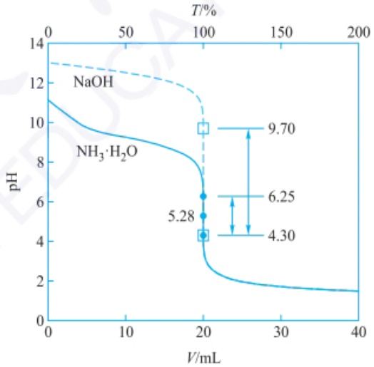

line

| Substance | V/mL | pH |
| --- | --- | --- |
| NaOH | 20 | 9.70 |
| \(NH3 \cdot H2O\) | 20 | 5.28 |
| NaOH | 20 | 4.30 |
| NH3 \(\cdot\) H2O | 20 | 6.25 |

图3.2.5 以 $0.10\mathrm{mol}\cdot \mathrm{L}^{-1}$ HCl溶液滴定 $20.00~\mathrm{mL}$ 同浓度的 $\mathrm{NH_3}\cdot \mathrm{H_2O}$ 溶液的滴定曲线

与弱酸的滴定一样,弱碱的强度 $(K_{\mathrm{b}})$ 和浓度(c)都会影响反应的完全度和滴定突跃范围。在浓度不太小的情况下, $K_{b}c\geqslant10^{-8}$ 时方能准确滴定。

## 2. 多元弱酸(碱)滴定

多元酸在水溶液中分步解离，绘制滴定曲线的计算较复杂。以下就二元弱酸$\mathrm{H}_2\mathrm{A}$ 、三元酸(磷酸)和二元弱碱(碳酸钠)能否分步滴定，以及如何选择指示剂进行简介。

## (1) 二元弱酸  $H_{2}A$

若用 NaOH 滴定二元酸  $H_{2}A$ ，首先生成  $HA^{-}$ 。从多元酸的  $\delta-pH$  曲线（图 3.1.3 和图 3.1.4）可清楚地看出分步滴定的可能性与  $K_{a_{1}}/K_{a_{2}}$  的关系。

---

3.2 滴定分析法

123

- 若 $K_{\mathrm{a_1}}$ 与 $K_{\mathrm{a_2}}$ 相差不大，则 $\mathrm{H}_2\mathrm{A}$ 尚未定量变成 $\mathrm{HA}^{-}$，就有相当部分的 $\mathrm{HA}^{-}$被进一步滴定生成 $\mathrm{A}^{2-}$ 了。结果是，在第一化学计量点附近没有明显的突跃，无法确定终点，也就不能准确滴定到 $\mathrm{HA}^{-}$。
- 若 $K_{\mathrm{a_1}}$ 与 $K_{\mathrm{a_2}}$ 相差足够大，则可以定量滴定至 $\mathrm{HA}^{-}$ 。此时，尚未滴定的 $\mathrm{H}_2\mathrm{A}$ 和进一步滴定生成的 $\mathrm{A}^{2-}$ 均较少，可以忽略；若 $K_{\mathrm{a_2}}c > 10^{-8}$，可进一步滴定至 $\mathrm{A}^{2-}$，实际上，大多数的二元弱酸都无法分步滴定至 $\mathrm{A}^{2-}$，因为若 $K_{\mathrm{a_1}}$ 与 $K_{\mathrm{a_2}}$ 相差足够大，$K_{\mathrm{a_2}}$ 必然小。

多数多元酸，各级相邻解离常数之比太小，无法分步滴定，但是其最后一级解离常数都大于 $10^{-7}$，都能用 $\mathrm{NaOH}$ 一步滴定全部质子。例如，草酸常作为标定$\mathrm{NaOH}$ 的基准物质，一步滴定至 $\mathrm{C_2O_4^{2-}}$ 。

## (2) 三元弱酸  $H_{3}A$  (磷酸  $H_{3}PO_{4}$ )

$\mathrm{H}_3\mathrm{PO}_4$ 是三元弱酸 $(\mathrm{p}K_{\mathrm{a}_1} = 2.148,\mathrm{p}K_{\mathrm{a}_2} = 7.198,\mathrm{p}K_{\mathrm{a}_3} = 12.38)$ ，各相邻常数比值都接近 $10^{5}$ ，可以在一定误差允许范围内分别分步滴定至 $\mathrm{H}_2\mathrm{PO}_4^-$ 和 $\mathrm{HPO_4^{2 - }}$ ，其滴定曲线如图3.2.6所示。

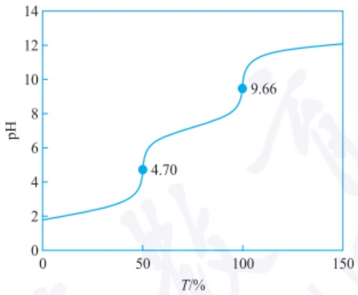

line

| T/% | pH |
| --- | --- |
| 4.70 | 4.70 |
| 9.66 | 9.66 |

图 3.2.6 用  $0.10 \, mol \cdot L^{-1} \, NaOH$  标准溶液滴定  $20.00 \, mL$  同浓度  $H_{3}PO_{4}$  溶液的滴定曲线

\- 第一化学计量点: 用 NaOH 滴定  $H_{3}PO_{4}$  至第一化学计量点的产物为  $NaH_{2}PO_{4}$ ，此时

$$
\left[ \mathrm{H} ^ {+} \right] = \sqrt {\frac {K _ {\mathrm{a} _ {2}} c}{1 + c / K _ {\mathrm{a} _ {1}}}} = \sqrt {\frac {1 0 ^ {- 7 . 1 9 8 - 1 . 3 0}}{1 + \frac {1 0 ^ {- 1 . 3 0}}{1 0 ^ {- 2 . 1 4 8}}}} = 1 0 ^ {- 4. 7 0} (\mathrm{mol} \cdot \mathrm{L} ^ {- 1})
$$

第一化学计量点的 pH 为 4.70, 指示剂较难选择, 但是可以选用甲基橙为指示剂, 采用同浓度的  $NaH_{2}PO_{4}$  溶液为参比, 误差不大于 0.5%。

\- 第二化学计量点:滴定产物为  $HPO_{4}^{2-}$ ,此时

$$
\left[ \mathrm{H} ^ {+} \right] = \sqrt {\frac {K _ {\mathrm{a} _ {3}} c + K _ {\mathrm{w}}}{c / K _ {\mathrm{a} _ {2}}}} = \sqrt {\frac {1 0 ^ {- 1 2 . 3 8 - 1 . 4 8} + 1 0 ^ {- 1 4 . 0 0}}{\frac {1 0 ^ {- 1 . 4 8}}{1 0 ^ {- 7 . 1 9 8}}}} = 1 0 ^ {- 9. 6 6} (\mathrm{mol} \cdot \mathrm{L} ^ {- 1})
$$

第二化学计量点的 pH 为 9.66，与酚酞的变色点 (pH=9.0) 相比，百里酚酞的变色点 (pH≈10) 更接近化学计量点，终点误差为 +0.5%。

\- 第三化学计量点: $\mathrm{p}K_{\mathrm{a}_3} = 12.38$, 无法用 NaOH 继续准确滴定 $\mathrm{HPO}_4^{2-}$。若向溶液中加入 $\mathrm{CaCl}_2$, 则发生如下反应:

---

124

第三章 化学平衡与滴定分析

$$
2 \mathrm{HPO} _ {4} ^ {2 -} + 3 \mathrm{Ca} ^ {2 +} = \mathrm{Ca} _ {3} (\mathrm{PO} _ {4}) _ {2} \downarrow + 2 \mathrm{H} ^ {+}
$$

$\mathrm{PO_4^{3 - }}$ 生成 $\mathrm{Ca_3(PO_4)_2}$ 沉淀与溶液分离，定量释放质子，此时弱酸变成了强酸，就可以用NaOH滴定第三个 $\mathrm{H^{+}}$ 。为保持 $\mathrm{Ca_3(PO_4)_2}$ 沉淀完全，应选酚酞作指示剂。

(3) 碳酸钠  $Na_{2}CO_{3}$  (二元弱碱  $A^{2-}$ )

$\mathrm{Na_2CO_3(pK_{a_1} = 6.351,pK_{a_2} = 10.329)}$ 常用作标定HCl的基准物质，工业碱纯度的测定也是基于其与HCl的反应。以HCl滴定 $\mathrm{Na_2CO_3}$ 的反应分两步进行:

$$
\mathrm{CO} _ {3} ^ {2 -} + \mathrm{H} ^ {+} \rightleftharpoons \mathrm{HCO} _ {3} ^ {-}
$$

$$
\mathrm{HCO} _ {3} ^ {-} + \mathrm{H} ^ {+} \rightleftharpoons \mathrm{H} _ {2} \mathrm{CO} _ {3}
$$

$$
\mathrm{L} \rightarrow \mathrm{CO} _ {2} + \mathrm{H} _ {2} \mathrm{O}
$$

- 第一步反应生成 $\mathrm{HCO}_3^-$，化学计量点 $\mathrm{pH}$ 为8.34。由于 $K_{\mathrm{b_1}} / K_{\mathrm{b_2}} = 10^{3.98} < 10^5$，滴定准确度不高。若以甲酚红和百里酚蓝混合指示剂指示终点，并用相同浓度的 $\mathrm{NaHCO}_3$ 作参比，结果误差约为 $0.5\%$。
- 第二步反应的产物是 $\mathrm{H}_2\mathrm{CO}_3(\mathrm{CO}_2 + \mathrm{H}_2\mathrm{O})$ ，其饱和溶液约为 $0.04\mathrm{mol}\cdot \mathrm{L}^{-1}$ 溶液中 $[\mathrm{H}^{+}] = \sqrt{K_{\mathrm{a}_{1}}c} = \sqrt{10^{-6.351}\times 0.04} = 1.3\times 10^{-4}(\mathrm{mol}\cdot \mathrm{L}^{-1}),\mathrm{pH} = 3.9$ 。

第二步滴定终点的确定可采取以下方法:

(i) 用甲基橙或甲基橙-靛蓝磺酸钠混合指示剂确定终点。由于在室温下滴定，终点变化不敏锐，最好采用为  $CO_{2}$  所饱和并含有相同浓度 NaCl 和指示剂的溶液作参比。
（ii）用甲基红-溴甲酚绿混合指示剂确定终点。当滴定至溶液变红，此时需暂时中断滴定，加热除去  $CO_{2}$  。除去  $CO_{2}$  后，体系颜色又回到绿色，冷却，继续滴定至红色。溶液的 pH 变化如图 3.2.7 虚线所示。重复此操作，直至加热后颜色不变为止，一般需要加热 2\~3 次。此滴定终点敏锐，准确度高。
（iii）Kolthoff等推荐用双指示剂法。在溶液中先后加入酚酞和溴甲酚绿。先由酚酞变色估计滴定剂大致用量；近终点时加热除去 $CO_{2}$ ，冷却，继续滴定至溶液由紫色变为绿色。此法终点敏锐，准确度也高。

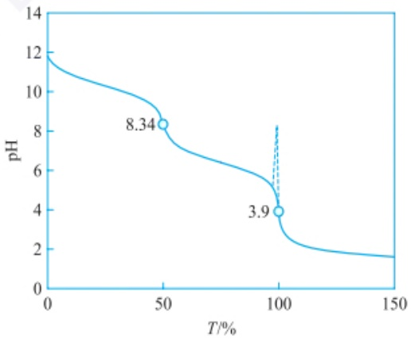

line

| T/% | pH |
| --- | --- |
| 50 | 8.34 |
| 100 | 3.9 |

图 3.2.7 用  $0.10 \, mol \cdot L^{-1} HCl$  溶液滴定  $0.050 \, mol \cdot L^{-1} Na_{2}CO_{3}$  溶液的滴定曲线

## 3.2.2.3 基于滴定曲线反函数( $V-[\mathrm{H}^{+}]$ 函数)绘制滴定曲线

以上详细讨论了强酸(碱)和一元弱酸(碱)的滴定曲线,对于多元酸碱的滴定曲线,由于计算较复杂,难以获得滴定曲线函数 $\left[H^{*}\right]=f(V)$ ,故只简单讨论了化学计量点。实际上,基于基本定量关系式,如电荷平衡式和物料平衡式,即可容

---

3.2 滴定分析法

125

易推导出滴定曲线反函数  $V=g([H^{+}])$ ，方便获得大量  $(V, pH)$  数据点，从而准确绘制滴定曲线，获得滴定突跃范围信息。

以下介绍从 CBE 出发, 利用反函数  $V = g([H^{+}])$  绘制酸碱滴定曲线。

## 1. 强酸滴定曲线

以 NaOH 溶液滴定同浓度的体积  $V_{0}$  (mL) HCl 溶液（浓度为 c），加入体积 V (mL) NaOH 溶液时，平衡体系中相关物质的分析浓度分别为  $c_{HCl} = \frac{cV_{0}}{V + V_{0}}$  和  $c_{NaOH} = \frac{cV}{V + V_{0}}$ 。

滴定体系的 CBE 为

$$
\left[ \mathrm{H} ^ {+} \right] + \left[ \mathrm{Na} ^ {+} \right] = \left[ \mathrm{Cl} ^ {-} \right] + \left[ \mathrm{OH} ^ {-} \right]
$$

代入分析浓度:

$$
\left[ \mathrm{H} ^ {+} \right] + \frac {c V}{V + V _ {0}} = \frac {c V _ {0}}{V + V _ {0}} + \left[ \mathrm{OH} ^ {-} \right]
$$

令  $m=\left[H^{+}\right]-\left[OH^{-}\right]$ ，整理成关于 V 的代数式:

$$
V = \frac {c - m}{c + m} V _ {0} \tag {3-2-7}
$$

式(3-2-7)中，m 为与 $\left[H^{+}\right]$ 相关的项，给定 $\left[H^{+}\right]$ ，可获得相应的滴定剂加入的体积。据此，可以获得一系列 $(V,\mathrm{pH})$ 数据点，从而绘制滴定曲线。

根据式(3-2-7)绘制的不同浓度的强酸滴定曲线与分段式讨论获得的图3.2.3相同。由于反应计量比为 $1:1, V_{\mathrm{sp}} = V_0$ 。化学计量点前 $0.1\%$ ，$V = 0.999V_{\mathrm{sp}}$ ，代入式(3-2-7)，经近似简化，得到对应的 $\mathrm{pH}$ 为滴定突跃的下端点，$\mathrm{pH}_{\mathrm{L}} = 3.0 + \mathrm{pc}_{\mathrm{sp}}$；化学计量点后 $0.1\%$ ，$V = 1.001V_{\mathrm{sp}}$，得到滴定突跃上端点，$\mathrm{pH}_{\mathrm{U}} = \lg K_{\mathrm{t}} - 3.0 - \mathrm{pc}_{\mathrm{sp}}$，其中，$K_{\mathrm{t}} = 1 / K_{\mathrm{w}}$；化学计量点时，$V = V_{\mathrm{sp}}$，代入式(3-2-7)，此时，$m = 0, [\mathrm{H}^{+}] = [\mathrm{OH}^{-}]$，$\mathrm{pH}_{\mathrm{sp}} = \frac{1}{2}\mathrm{p}K_{\mathrm{w}} = 7.0$。滴定曲线上下端点均与浓度相关，浓度增大为10倍，上下端点各拓宽一个 $\mathrm{pH}$ 单位。

## 2. 一元弱酸滴定曲线

对于 NaOH 溶液滴定体积  $V_{0}$ (mL) 同浓度一元弱酸 HA 溶液(浓度为 c)，加入体积  $V$ (mL) NaOH 溶液时，平衡体系中相关物质的分析浓度分别为  $c_{HA} = \frac{cV_{0}}{V + V_{0}}$  和  $c_{NaOH} = \frac{cV}{V + V_{0}}$ 。

滴定体系的 CBE 为

$$
\left[ \mathrm{H} ^ {+} \right] + \left[ \mathrm{Na} ^ {+} \right] = \left[ \mathrm{A} ^ {-} \right] + \left[ \mathrm{OH} ^ {-} \right]
$$

将 $\left[A^{-}\right]$ 以其分析浓度和分布分数 $\left(\delta_{0}\right)$ 表示,得

$$
\left[ \mathrm{H} ^ {+} \right] + \frac {c V}{V + V _ {0}} = \frac {c V _ {0}}{V + V _ {0}} \delta_ {0} + \left[ \mathrm{OH} ^ {-} \right]
$$

令  $m=\left[H^{+}\right]-\left[OH^{-}\right]$ ，整理成关于 V 的代数式:

$$
V = \frac {c \delta_ {0} - m}{c + m} V _ {0} \tag {3-2-8}
$$

与式(3-2-7)对比,式(3-2-8)的分子部分,c多了一个系数 $f,f=\delta_{0}$ 。由此获得的HAc滴定曲线与分段式讨论获得的滴定曲线(图3.2.4)相同。根据反函数

---

126

第三章 化学平衡与滴定分析

反函数法绘制酸碱滴定曲线与计算终点误差

法所获得的不同强度的一元弱酸滴定曲线 $(c=0.10\ mol\cdot L^{-1})$ 等信息详见二维码。

对于 $\mathrm{pK_a < 7.0}$ 的一元弱酸，同理，经过简化近似得到滴定曲线的下端点为$\mathrm{pH_L = pK_a + 3.0}$，上端点为 $\mathrm{pH_U = lgK_t - 3.0 - pc_{sp}}$ ，化学计量点 $\mathrm{pH_{sp}} = \frac{1}{2} (\mathrm{pK_a + pK_w - }$ $\mathrm{pc_{sp}})$ 。对于 $\mathrm{pK_a = 7.0}$ 的一元弱酸，与 $0.999V_{\mathrm{sp}}\sim 1.001V_{\mathrm{sp}}$ 对应的 $\mathrm{pH}$ 范围为 $9.7\sim$ 10.0，小于 $0.6~\mathrm{pH}$ 单位，滴定误差大于 $\pm 0.1\%$ 。当 $\mathrm{pH}$ 范围为 $9.56\sim 10.14$ ，基本满足 $0.6~\mathrm{pH}$ 单位，对应滴定误差为 $\pm 0.2\%$ 误差。滴定突跃 $\mathrm{pH_L}$ 与浓度近似无关，$\mathrm{pH_U}$ 与浓度相关，浓度增大为10倍， $\mathrm{pH_U}$ 增加一个 $\mathrm{pH}$ 单位。

## 3. 强酸与一元弱酸混合体系滴定曲线

对于体积  $V_{0}$ (mL) 的强酸与一元弱酸的混合酸体系 (HCl + HA) 的滴定, 通过前述方法可得

$$
V = \frac {c (1 + \delta_ {0}) - m}{c + m} V _ {0} \tag {3-2-9}
$$

式(3-2-9)的分子部分，c的系数是式(3-2-7)和式(3-2-8)分子部分中c的系数加和 $f=1+\delta_{0}$ 。

基于式(3-2-9)绘制的 HCl 与不同  $pK_{a}$  的弱酸混合体系的滴定曲线及相关讨论详见本页二维码。

## 4. 二元弱酸滴定曲线

对于二元弱酸  $H_{2}A$  的滴定,通过前述方法可得

$$
V = \frac {c (\delta_ {1} + 2 \delta_ {0}) - m}{c + m} V _ {0} \tag {3-2-10}
$$

式(3-2-10)的分子部分，c的系数 $f=\delta_{1}+2\delta_{0}$ ，与一元弱酸的式(3-2-8)相比，多了 $A^{2-}$ 分布系数的贡献。

基于式(3-2-10)绘制的二元弱酸的滴定曲线及相关讨论详见本页副栏二维码。

从上述推导可以看出， $\left[H^{+}\right]$  和  $\left[OH^{-}\right]$  分别位于 CBE 等式两侧，来自氢氧化钠的  $\left[Na^{+}\right]$  与  $\left[H^{+}\right]$  位于同侧，而来自被滴定的酸的滴定产物的带电荷形态平衡浓度与  $\left[OH^{-}\right]$  同侧，且影响滴定曲线的形状和滴定突跃。

以强碱滴定酸,滴定曲线的反函数可以总结为

$$
V = \frac {c f - m}{c + m} V _ {0} \tag {3-2-11}
$$

其中，f因子反映了带电荷的滴定产物的电荷对CBE的贡献。各种滴定体系的曲线反函数详见表3.2.4。

## 5. 弱酸盐滴定曲线

如果分析物是弱酸的盐，如  $\mathrm{NaH_{2}PO_{4}}$ （以下简化为  $NaH_{2}A$ ），CBE 方程中，来自该盐的  $\left[Na^{+}\right]_{NaH_{2}A}$  也与  $\left[H^{+}\right]$  同侧，且  $\left[Na^{+}\right]_{NaH_{2}A}=c_{NaH_{2}A}$ ，但未参与滴定反应。

CBE为

$$
\left[ \mathrm{H} ^ {+} \right] + \left[ \mathrm{Na} ^ {+} \right] _ {\mathrm{NaOH}} + \left[ \mathrm{Na} ^ {+} \right] _ {\mathrm{NaH} _ {2} \mathrm{A}} = \left[ \mathrm{H} _ {2} \mathrm{A} ^ {-} \right] + 2 \left[ \mathrm{HA} ^ {2 -} \right] + 3 \left[ \mathrm{A} ^ {3 -} \right] + \left[ \mathrm{OH} ^ {-} \right]
$$

与物料平衡式结合,得

$$
\left[ \mathrm{H} ^ {+} \right] + \frac {c V}{V + V _ {0}} + \frac {c V _ {0}}{V + V _ {0}} = \frac {c V _ {0}}{V + V _ {0}} (\delta_ {2} + 2 \delta_ {1} + 3 \delta_ {0}) + \left[ \mathrm{OH} ^ {-} \right]
$$

---

3.2 滴定分析法

127

表 3.2.4 以 NaOH 溶液滴定同浓度的酸的滴定曲线反函数

| 酸 | CBE | 反函数($m = [H^{+}] - [OH^{-}]$) |
| --- | --- | --- |
| HCl | $[H^{+}] + \frac{cV}{V + V_{0}} = \frac{cV_{0}}{V + V_{0}} + [OH^{-}]$ | $V = \frac{c-m}{c+m} V_{0}$ |
| HA | $[H^{+}] + \frac{cV}{V + V_{0}} = \frac{cV_{0}}{V + V_{0}} \delta_{0} + [OH^{-}]$ | $V = \frac{c\delta_{0}-m}{c+m} V_{0}$ |
| $H_{2}A$ | $[H^{+}] + \frac{cV}{V + V_{0}} = \frac{cV_{0}}{V + V_{0}} (\delta_{1} + 2\delta_{0}) + [OH^{-}]$ | $V = \frac{c(\delta_{1} + 2\delta_{0})-m}{c+m} V_{0}$ |
| HA+HB | $[H^{+}] + \frac{cV}{V + V_{0}} = \frac{cV_{0}}{V + V_{0}} (\delta_{0}^{HA} + \delta_{0}^{HB}) + [OH^{-}]$ | $V = \frac{c(\delta_{0}^{HA} + \delta_{0}^{HB})-m}{c+m} V_{0}$ |
| HCl+HA | $[H^{+}] + \frac{cV}{V + V_{0}} = \frac{cV_{0}}{V + V_{0}} + \frac{cV_{0}}{V + V_{0}} \delta_{0} + [OH^{-}]$ | $V = \frac{c(1+\delta_{0})-m}{c+m} V_{0}$ |

整理得

$$
V = \frac {c (\delta_ {1} + 2 \delta_ {0} - \delta_ {3}) - m}{c + m} V _ {0} \tag {3-2-12}
$$

由于分析物的阴离子  $H_{2}A^{-}$  被 NaOH 滴定，且其水解产物  $H_{3}A$  为非滴定产物，故 f 因子中  $H_{3}A$  的分布分数为扣除项。

## 3.2.2.4 终点误差的计算

确定滴定曲线后,便可知滴定突跃,从而可根据使用的指示剂的变色点 pH 判断是否误差在要求范围内。如有需要,亦可通过计算获得具体的终点误差值。

## 1. 基于反函数计算终点误差

根据式(3-2-1)，有

$$
E_{\mathrm{t}} = \frac{V_{\mathrm{ep}} - V_{\mathrm{sp}}}{V_{\mathrm{sp}}}\times 100\% = \left(\frac{V_{\mathrm{ep}}}{V_{\mathrm{sp}}} -1\right)\times 100\%
$$

式中， $V_{ep}$  和  $V_{sp}$  分别表示终点和化学计量点时加入滴定剂溶液的体积。

计算终点误差  $E_{t}$  时，关键在于求得  $V_{ep}$ ，即指示剂变色点  $\left[H^{+}\right]_{ep}$  加入滴定剂溶液的体积；根据上述对滴定曲线的讨论，可以基于反函数计算给定 pH 条件下的滴定体积。而在特定指示剂变色点的滴定终点  $pH_{ep}$  是已知的，可以通过上述推导的反函数计算  $V_{ep}$ 。

以 NaOH 溶液滴定 HCl 溶液, $V_{sp}=V_{0}$ , 根据式(3-2-7), 得到

$$
V _ {\mathrm{ep}} = \frac {c - m}{c + m} V _ {\mathrm{sp}}
$$

故

$$
E_{\mathrm{t}} = \left(\frac{c - m}{c + m} -1\right)\times 100\% \tag{3 - 2 - 13}
$$

»例 3.2.1 计算  $0.10 \, mol \cdot L^{-1}$  NaOH 溶液滴定  $0.10 \, mol \cdot L^{-1}$  HCl 溶液至甲基橙变黄 (pH 4.4) 和酚酞变红 (pH 9.0) 的终点误差。

» 解: pH=4.4 时,  $m \approx [H^{+}] = 10^{-4.4}$ , 根据式(3-2-13), 有

$$
E_{\mathrm{t}} = \left(\frac{0.10 - 10^{-4.4}}{0.10 + 10^{-4.4}} -1\right)\times 100\% = -0.08\%
$$

$\mathrm{pH} = 9.0$ 时， $m\approx -[\mathrm{OH}^{-}] = -10^{-5.0}$

---

128

第三章 化学平衡与滴定分析

$$
E_{\mathrm{t}} = \left(\frac{0.10 + 10^{-5.0}}{0.10 - 10^{-5.0}} -1\right)\times 100\% = 0.02\%
$$

以甲基橙为指示剂，终点在化学计量点(pH 7.0)之前，因此终点误差为负值；以酚酞为指示剂，终点在化学计量点之后，因此终点误差为正值。此外，以酚酞为指示剂，终点pH比甲基橙为指示剂更接近化学计量点，因此绝对误差更小。

以 NaOH 溶液滴定一元弱酸 HA 溶液, 根据式(3-2-8), 得到

$$
V _ {\mathrm{ep}} = \frac {c \delta_ {0} - m}{c + m} V _ {\mathrm{sp}}
$$

故

$$
E_{\mathrm{t}} = \left(\frac{c\delta_{0} - m}{c + m} -1\right)\times 100\% \tag{3 - 2 - 14}
$$

»例 3.2.2 计算  $0.10 \, mol \cdot L^{-1} \, NaOH$  溶液滴定同浓度 HAc 溶液至 pH 9.0 和 7.0 的终点误差。

» 解: pH = 9.0 时,  $\delta_{0} = \frac{10^{-4.756}}{10^{-9.0} + 10^{-4.756}} \approx 1.0$ ,  $m \approx -\left[OH^{-}\right] = -10^{-5.0}$ , 根据式 (3-2-14), 有

$$
E_{\mathrm{t}} = \left(\frac{0.10\times 1.0 + 10^{-5.0}}{0.10 - 10^{-5.0}} -1\right)\times 100\% = 0.01\%
$$

$\mathrm{pH} = 7.0$ 时， $m = 0,\delta_0 = \frac{10^{-4.756}}{10^{-7.0} + 10^{-4.756}}\approx 0.994$ ，则

$$
E_{\mathrm{t}} = \left(\frac{0.10\times 0.994}{0.10} -1\right)\times 100\% = -0.6\%
$$

如前述滴定曲线的讨论,滴定终点为 pH 7.0 时,未到化学计量点,且在滴定突跃之外,故误差为负值,且绝对值大于 0.1%。

同理可得二元弱酸  $H_{2}A$  的终点误差。若滴定至  $HA^{-}, V_{sp} = V_{0}$ ，则终点误差:

$$
E_{\mathrm{t}} = \left(\frac{c(\delta_{1} + 2\delta_{0}) - m}{c + m} -1\right)\times 100\% \tag{3 - 2 - 15}
$$

若滴定至 $\mathrm{A}^{2-}, V_{\mathrm{sp}} = 2V_0$ ，则终点误差:

$$
E_{\mathrm{t}} = \left(\frac{1}{2}\times \frac{c(\delta_{1} + 2\delta_{0}) - m}{c + m} -1\right)\times 100\% \tag{3 - 2 - 16}
$$

»例3.2.3 计算 $0.10\mathrm{mol}\cdot \mathrm{L}^{-1}\mathrm{NaOH}$ 溶液滴定 $0.050\mathrm{mol}\cdot \mathrm{L}^{-1}\mathrm{H}_2\mathrm{C}_2\mathrm{O}_4$ 溶液至酚酞变色(pH9.0)的终点误差。（ $\mathrm{H}_2\mathrm{C}_2\mathrm{O}_4$ 的 $\mathrm{pK_{a_1}} = 1.250,\mathrm{pK_{a_2}} = 4.266$ ）

» 解: 由于  $K_{a_{2}}c_{sp}>10^{-8}, H_{2}C_{2}O_{4}$  与 NaOH 反应的物质的量之比为 1:2, 根据式 (3-2-16) 计算终点误差。

$\mathrm{pH} = 9.0$ 时， $\delta_0 = \frac{10^{-1.250 - 4.266}}{10^{-9.0\times 2} + 10^{-9.0 - 1.250} + 10^{-1.250 - 4.266}}\approx 1.0,\delta_1 = \frac{10^{-9.0 - 1.250}}{10^{-9.0\times 2} + 10^{-9.0 - 1.250} + 10^{-1.250 - 4.266}}\approx$ $10^{-4.71},m\approx -[\mathrm{OH}^{-}] = -10^{-5.0}$ ，则

---

3.2 滴定分析法

129

$$
E_{\mathrm{t}} = \left(\frac{1}{2}\times \frac{0.10\times(10^{-4.71} + 2) + 10^{-5.0}}{0.10 - 10^{-5.0}} -1\right)\times 100\% = 0.02\%
$$

基于滴定曲线反函数获得的各滴定体系的终点误差公式详见二维码。基于滴定曲线反函数进行终点误差计算，直接从体积定义式，即从式(3-2-1)出发，不必先进行各种近似，思路明确，简单方便。

对于常用的指示剂，与分析物的浓度相比，误差公式分母中的 $m$ 可忽略，简化计算。先忽略分母中的 $m$ 项后计算与先计算最后忽略分母中的 $m$ 项均可。通过近似获得的基于浓度计算的（即代数法）误差公式与基于反函数获得的误差公式的近似式之比较详见二维码。除了多元弱酸、混合弱酸的总量滴定，两种思路获得的近似式相同。对于各体系总酸量滴定，使用常用指示剂如酚酞，$\mathrm{pH}_{\mathrm{ep}} = 9.0$。无论先忽略还是后忽略分母中的 $m$ 项，与传统代数法的近似式相比，两种方法的误差近似式相差 $\left|\frac{m}{4c_{\mathrm{sp}}}\right|$，为 $\left|\frac{10^{-9} - 10^{-5}}{4 \times 0.05}\right| = 5 \times 10^{-5}$，误差的差值为 $0.005\%$，可忽略。可以说两种方法的最后结果都是合理的，几乎相同。

## 2. 基于林邦误差公式计算一元弱酸(碱)误差

基于林邦误差公式也可以计算终点误差(推导从略)。对于不同的滴定体系,林邦误差公式不同。

以一元弱酸的滴定为例,林邦误差公式为

$$
E_{\mathrm{t}} = \frac{10^{\Delta\mathrm{pH}} - 10^{-\Delta\mathrm{pH}}}{(c_{\mathrm{sp}}K_{\mathrm{t}})^{1 / 2}}\times 100\% \tag{3 - 2 - 17}
$$

其中，$\Delta \mathrm{pH} = \mathrm{pH}_{\mathrm{ep}} - \mathrm{pH}_{\mathrm{sp}}, K_{\mathrm{t}} = K_{\mathrm{a}} / K_{\mathrm{w}}$。$c_{\mathrm{sp}}$ 表示弱酸在化学计量点的分析浓度。

基于林邦误差公式可以方便地讨论如下问题: 计算终点误差; 令  $E_{t} = \pm 0.1\%$ , 可以获得滴定突跃  $\Delta pH$ ; 根据目测指示剂不确定性  $\Delta pH = \pm 0.3$ , 以及  $E_{t} = \pm 0.1\%$ , 对能否进行准确滴定进行判断。

## 3.2.2.5 准确滴定判别

目测颜色变化存在不确定性,酸碱滴定中,有 $\pm0.3\ pH$ 单位不确定性。因此,即使使用在化学计量点变色的理想指示剂,滴定终点也可能偏离化学计量点,因此要求最小滴定突跃范围为0.6 pH单位,而突跃范围受浓度和弱酸的强弱影响。

对于 $0.1\mathrm{mol}\cdot \mathrm{L}^{-1},K_{\mathrm{a}} = 10^{-7}$ 的一元弱酸，当滴定突跃为 $0.6~\mathrm{pH}$ 单位， $\mathrm{pH}_{\mathrm{ep}} =$ $\mathrm{pH}_{\mathrm{sp}}\pm 0.3$ 对应的终点误差在 $\pm 0.2\%$ ；对于更弱的酸，则无法在此浓度水平下准确滴定；因此对于一元弱酸， $K_{\mathrm{a}}c\geqslant 10^{-8}$ （对应于 $K_{\mathrm{t}}c\geqslant 10^{6}$ )，可以准确滴定。对于多元弱酸，若 $\frac{K_{\mathrm{a_1}}}{K_{\mathrm{a_2}}}\geqslant 10^6$ 且 $K_{\mathrm{a_1}}c\geqslant 10^{-8}$ ，可以准确滴定第一级解离 $\mathrm{H^{+}}$ ，第二级解离 $\mathrm{H^{+}}$ 不干扰测定；一般情况下，多元弱酸的相邻两级解离常数最多相差5个数量级，若 $\frac{K_{\mathrm{a_1}}}{K_{\mathrm{a_2}}}\geqslant$ $10^{5}$ 且 $K_{\mathrm{a_1}}c\geqslant 10^{-8}$ ，可以滴定第一级解离 $\mathrm{H^{+}}$ ，第二级解离 $\mathrm{H^{+}}$ 不干扰测定，滴定误差为$0.5\%$ 。对于浓度均为 $0.1\mathrm{mol}\cdot \mathrm{L}^{-1}$ 的强酸与弱酸混合体系（如HCl+HA），若 $K_{\mathrm{a}}c>$ $10^{-8}$ ，则可滴定酸的总量；若 $K_{\mathrm{a}}c = 10^{-8}$ ，则可分别滴定HCl和HA；若 $K_{\mathrm{a}}c <   10^{-8}$ ，则只能准确滴定HCl。

基于反函数获得酸碱滴定终点误差公式

代数法与反函数法终点误差公式比较

---

130

第三章 化学平衡与滴定分析

## 3.2.2.6 酸碱滴定法的应用

## 1. 酸碱标准溶液的配制与标定

酸碱滴定法中最常用的标准溶液是 HCl 与 NaOH 溶液，有时也用  $H_{2}SO_{4}$  和  $HNO_{3}$  溶液。溶液浓度常配制成  $0.10\ mol\cdot L^{-1}$ 。

（1）酸标准溶液 HCl 标准溶液一般先粗略配制成大致所需浓度，然后以基准物质或标准溶液标定，最常用于标定 HCl 的基准物质是无水碳酸钠和硼砂。

无水碳酸钠和 HCl 的反应计量比为 1:2, 标定时可选择甲基橙或甲基红为指示剂。

硼砂 $\left(\mathrm{Na}_{2}\mathrm{B}_{4}\mathrm{O}_{7}\cdot10\mathrm{H}_{2}\mathrm{O}\right)$ 的水溶液相当于是同浓度的 $H_{3}BO_{3}$ 和 $\mathrm{B(OH)}_{4}^{-}$ 的混合液，它与HCl反应的物质的量之比亦为1:2，由于其摩尔质量 $(381.4\ g\cdot mol^{-1})$ 较大，在直接称取单份基准物质作标定时，称量误差小。用 $0.050\ mol\cdot L^{-1}$ 硼砂溶液标定 $0.10\ mol\cdot L^{-1}$ HCl溶液的化学计量点相当于 $0.10\ mol\cdot L^{-1}\ H_{3}BO_{3}$ 溶液，此时pH为5.12，选甲基红为指示剂。

（2）碱标准溶液 NaOH 具有很强的吸湿性，也易吸收空气中的  $CO_{2}$ ，因此不能用直接法配制标准溶液，而是先配成大致浓度的溶液，然后进行标定。常用来标定 NaOH 溶液的基准物质有邻苯二甲酸氢钾、草酸等。

邻苯二甲酸氢钾 $\left(\mathrm{KHC}_{8}\mathrm{H}_{4}\mathrm{O}_{4}\right)$ 。邻苯二甲酸氢钾是两性物质（其 $pK_{a_{2}}$ 为5.4），与NaOH定量反应:

$$
\text {C}_6\text{H}_5\text{COOH} + \text {OH}^- = \text {C}_6\text{H}_5\text{COO}^- + \text {H}_2\text{O}
$$

滴定时选酚酞为指示剂。

邻苯二甲酸氢钾容易制得很纯；在空气中不吸水，容易保存；与 NaOH 的反应计量比为 1:1；摩尔质量  $(204.2 \, \text{g} \cdot \text{mol}^{-1})$  大，可以直接称取单份作标定。

草酸 $\left(\mathrm{H}_{2}\mathrm{C}_{2}\mathrm{O}_{4}\right)$ 。草酸是二元弱酸 $\left(\mathrm{p}K_{\mathrm{a}_{1}}=1.25,\mathrm{p}K_{\mathrm{a}_{2}}=4.27\right)$ ，由于其 $K_{a_{1}}/K_{a_{2}}<10^{5}$ ，只能作为二元酸一次滴定到 $C_{2}O_{4}^{2-}$ ，选酚酞为指示剂。草酸稳定性好。其与NaOH按1:2计量比反应，摩尔质量 $(126.07\mathrm{~g}\cdot\mathrm{mol}^{-1})$ 又不太大。因此，若NaOH溶液浓度不大，为减小称量误差，应当多称草酸配在容量瓶中，然后移取部分溶液作标定（即称大样）。

## 2. 酸碱滴定中  $CO_{2}$  的影响

$CO_{2}$ 是酸碱滴定误差的重要来源。

NaOH试剂常会吸收 $\mathrm{CO}_{2}$，一分子 $\mathrm{CO}_{2}$ 与两分子NaOH反应生成 $\mathrm{Na}_{2} \mathrm{CO}_{3}$。在标定NaOH时，一般以有机弱酸为基准物质，选用酚酞为指示剂，此时 $\mathrm{CO}_{2}$ 被中和为 $\mathrm{HCO}_{3}^{-}$，一个 $\mathrm{Na}_{2} \mathrm{CO}_{3}$ 分子只相当于一个NaOH分子。以此NaOH溶液作滴定剂时，若滴定突跃处于酸性范围，则应当选甲基橙（或甲基红）为指示剂。此时 $\mathrm{CO}_{2}$ 被中和为 $\mathrm{H}_{2} \mathrm{CO}_{3}$，与标定时不同，此时一个 $\mathrm{Na}_{2} \mathrm{CO}_{3}$ 分子相当于两个NaOH分子，导致误差。因此，配制NaOH溶液时，须除去 $\mathrm{CO}_{2}$。

已标定好浓度的 NaOH 溶液，在保存不当时从空气中吸收  $CO_{2}$  。以此 NaOH 溶液作滴定剂时，若需采用酚酞为指示剂，则所吸收的  $CO_{2}$  最终以  $HCO_{3}^{-}$ 形态存在，与  $CO_{2}$  反应的两分子 NaOH 中只有一分子参与滴定，导致误差；而若采用甲基橙为指示剂，则所吸收的  $CO_{2}$  最终又以  $CO_{2}$  形态放出，不影响测定结果。

此外,去离子水中也含有少量  $CO_{2}$ , 其在溶液中有如下平衡:

---

3.2 滴定分析法

131

$$
\mathrm{CO} _ {2} + \mathrm{H} _ {2} \mathrm{O} \rightleftharpoons \mathrm{H} _ {2} \mathrm{CO} _ {3}
$$

$$
K = \frac {\left[ \mathrm{H} _ {2} \mathrm{CO} _ {3} \right]}{\left[ \mathrm{CO} _ {2} \right]} = 2. 1 6 \times 1 0 ^ {- 3}
$$

碱反应的形态是  $H_{2}CO_{3}$ ，而非  $CO_{2}$ ，同时它与碱的反应速率不太快。因此，当滴定至粉红色时，稍放置， $CO_{2}$  又转变为  $H_{2}CO_{3}$ ，致使粉红色褪去。在溶液中的  $CO_{2}$  转化完毕之前，得不到稳定的终点。因此，以酚酞为指示剂时，所用去离子水必须煮沸除去  $CO_{2}$ 。

## 3. 酸碱滴定分析的典型应用示例

（1）烧碱中 NaOH 和  $Na_{2}CO_{3}$  的测定（混合碱的分析） 烧碱主要成分是 NaOH，容易吸收空气中的  $CO_{2}$ ，部分生成  $Na_{2}CO_{3}$ 。可以通过酸碱滴定法测定其中碱性成分的含量，有两种具体测定方法，分别是氯化钡法和双指示剂法。

氯化钡法分别测定总碱量和 NaOH。以甲基橙为指示剂，用酸标准溶液滴定至黄色变为橙色（其中  $Na_{2}CO_{3}$  被滴定到  $H_{2}CO_{3}$ ），由此测得样品中 NaOH 和  $Na_{2}CO_{3}$  总量。向另一份试液加入过量  $BaCl_{2}$  以沉淀  $Na_{2}CO_{3}$ ，然后以酚酞为指示剂（在酚酞变色点， $BaCO_{3}$  不影响滴定），通过酸标准溶液滴定，直至红色变为无色，由此测得样品中 NaOH 含量。

双指示剂法分别测定总碱量和  $Na_{2}CO_{3}$ 。首先以酚酞为指示剂，通过酸标准溶液滴定，直至红色变为近无色（其中  $Na_{2}CO_{3}$  被滴定到  $NaHCO_{3}$ ），由此测得样品中 NaOH 和  $Na_{2}CO_{3}$  总量。然后加入甲基橙，继续滴定，直至黄色变为橙色 ( $NaHCO_{3}$  被滴定到  $H_{2}CO_{3}$ )，由此测得样品中  $Na_{2}CO_{3}$  含量。

双指示剂法操作简单,然而不如氯化钡法准确,原因是酚酞由红色变为近无色的目测判断(滴定到第一化学计量点)较为困难,导致误差增大(约1%)。

（2）纯碱中  $Na_{2}CO_{3}$  和  $NaHCO_{3}$  的测定（混合碱的分析） 纯碱主要成分是  $Na_{2}CO_{3}$ ，含有少量  $NaHCO_{3}$ 。碱性成分的测定也可以使用氯化钡法和双指示剂法。

氯化钡法测定总碱量比较简单。以甲基橙为指示剂，通过酸标准溶液滴定，直至黄色变为橙色 $\left(\mathrm{Na}_{2}\mathrm{CO}_{3}\right.$  和  $NaHCO_{3}$  均被滴定到  $H_{2}CO_{3}$ ），由此测得样品中  $Na_{2}CO_{3}$  和  $NaHCO_{3}$  总量。

氯化钡法测定  $NaHCO_{3}$  稍微复杂。首先向试液中加入一定量过量的 NaOH 标准溶液，将  $NaHCO_{3}$  全部转化为  $Na_{2}CO_{3}$ 。然后，加入过量  $BaCl_{2}$  以沉淀  $Na_{2}CO_{3}$ 。最后，以酚酞为指示剂（在酚酞变色点， $BaCO_{3}$  不影响滴定），通过酸标准溶液滴定，直至红色变为无色。由此测得剩余 NaOH，进而得知与  $NaHCO_{3}$  反应的 NaOH 的量，该量即等于样品中  $NaHCO_{3}$  的量。

双指示剂法分别测定  $Na_{2}CO_{3}$  和总碱量。首先以酚酞为指示剂，通过酸标准溶液滴定，直至红色变为无色 ( $Na_{2}CO_{3}$  被滴定到  $NaHCO_{3}$ )，由此测得样品中  $Na_{2}CO_{3}$  的含量。然后加入甲基橙，继续滴定，直至黄色变为橙色 ( $NaHCO_{3}$  被滴定到  $H_{2}CO_{3}$ )，由此测得样品中  $Na_{2}CO_{3}$  和  $NaHCO_{3}$  总量。

溶液中  $NaHCO_{3}$  会缓慢分解，释放出  $CO_{2}$ ，生成碱性更强的  $Na_{2}CO_{3}$ 。因此，对于使用酚酞指示剂的纯碱滴定分析，终点后的溶液如果久置，将从无色变为红色。

(3) 硅的测定 硅酸盐中的  $SiO_{2}$ ，可以通过硅氟酸钾滴定法测定其含量。

使用 KOH 熔融, 样品中  $SiO_{2}$  转化为可溶性硅酸盐  $K_{2}SiO_{3}$ 。 $K_{2}SiO_{3}$  在强酸性介质中与 KF 生成硅氟酸钾沉淀:

---

132

第三章 化学平衡与滴定分析

$$
\mathrm{K} _ {2} \mathrm{SiO} _ {3} + 6 \mathrm{HF} = \mathrm{K} _ {2} \mathrm{SiF} _ {6} \downarrow + 3 \mathrm{H} _ {2} \mathrm{O}
$$

加入 KCl 使沉淀更完全。沉淀经过滤和氯化钾-乙醇溶液洗涤后，转入氯化钾-乙醇溶液。以酚酞为指示剂，用 NaOH 中和被沉淀吸附的游离酸，直至无色变为红色。然后，向溶液中加入沸水，使  $K_{2}SiF_{6}$  水解:

$$
\mathrm{K} _ {2} \mathrm{SiF} _ {6} + 3 \mathrm{H} _ {2} \mathrm{O} = \mathrm{H} _ {2} \mathrm{SiO} _ {3} + 2 \mathrm{KF} + 4 \mathrm{HF}
$$

通过碱标准溶液滴定 HF, 直至无色变为红色, 由此测得样品中  $SiO_{2}$  含量。此处, 1 mol  $SiO_{2}$  消耗 4 mol NaOH。

HF 对玻璃有腐蚀作用,测定中应该使用塑料器皿。

（4）磷的测定 酸碱滴定法可以测定钢铁或矿石等样品中的磷。经过样品溶解，其中的磷转化为  $H_{3}PO_{4}$ ，然后在硝酸介质中加入钼酸铵，生成黄色的磷钼酸铵沉淀:

$$
\mathrm{PO} _ {4} ^ {3 -} + 1 2 \mathrm{MoO} _ {4} ^ {2 -} + 2 \mathrm{NH} _ {4} ^ {+} + 2 5 \mathrm{H} ^ {+} = (\mathrm{NH} _ {4}) _ {2} \mathrm{H} [ \mathrm{PMo} _ {1 2} \mathrm{O} _ {4 0} ] \cdot \mathrm{H} _ {2} \mathrm{O} \downarrow + 1 1 \mathrm{H} _ {2} \mathrm{O}
$$

沉淀经过滤和蒸馏水洗涤(不可使用盐溶液,沉淀组成会发生变化)后,将其溶于一定量过量的 NaOH 标准溶液,发生如下反应:

$$
(\mathrm{NH} _ {4}) _ {2} \mathrm{H} [ \mathrm{PMo} _ {1 2} \mathrm{O} _ {4 0} ] \cdot \mathrm{H} _ {2} \mathrm{O} + 2 7 \mathrm{OH} ^ {-} = \mathrm{PO} _ {4} ^ {3 -} + 1 2 \mathrm{MoO} _ {4} ^ {2 -} + 2 \mathrm{NH} _ {3} + 1 6 \mathrm{H} _ {2} \mathrm{O}
$$

以酚酞为指示剂,通过  $HNO_{3}$  标准溶液滴定上述溶液,直至红色变为无色,滴定产物是  $HPO_{4}^{2-}$ 、 $NH_{4}^{+}$ 和  $H_{2}O$ (来自剩余的 NaOH)。

以  $n_{p}$  表示样品中磷的物质的量, 以  $n_{NaOH}$  表示加入 NaOH 的总量, 以  $n_{HNO_{3}}$  表示滴定加入  $HNO_{3}$  的量, 那么  $n_{p}=\frac{n_{NaOH}-n_{HNO_{3}}}{24}$ 。

（5）铵盐中氮的测定 酸碱滴定法可以测定铵盐，有两种具体测定方法，分别是蒸馏法和甲醛法。

蒸馏法向样品溶液加入浓 NaOH 溶液, 然后加热蒸馏出  $NH_{3}$  并用过量  $H_{3}BO_{3}$  吸收:

$$
\mathrm{NH} _ {3} + \mathrm{H} _ {3} \mathrm{BO} _ {3} + \mathrm{H} _ {2} \mathrm{O} = \mathrm{NH} _ {4} \mathrm{B(OH)} _ {4}
$$

使用甲基红和溴甲酚绿混合指示剂，通过  $H_{2}SO_{4}$  标准溶液滴定，直至绿色变为灰色。溶液中多余的  $H_{3}BO_{3}$  不干扰滴定。也可以用一定量 HCl 或者  $H_{2}SO_{4}$  标准溶液吸收  $NH_{3}$ ，过量的酸通过 NaOH 标准溶液滴定。

甲醛法向溶液加入甲醛, 将  $NH_{4}^{+}$  转化为酸性更强的  $(\mathrm{CH}_{2})_{6}\mathrm{N}_{4}\mathrm{H}^{+}$ :

$$
4 \mathrm{NH} _ {4} \mathrm{Cl} + 6 \mathrm{HCHO} = (\mathrm{CH} _ {2}) _ {6} \mathrm{N} _ {4} \mathrm{HCl} + 3 \mathrm{HCl} + 6 \mathrm{H} _ {2} \mathrm{O}
$$

以酚酞为指示剂，通过 NaOH 标准溶液滴定。1 mol  $NH_{4}^{+}$  与 1 mol NaOH 相当。

凯氏定氮法(Kjeldahl nitrogen analysis)是测定含氮量最准确的方法之一,广泛应用于蛋白质、牛奶、面粉等样品含氮量的测定。在长颈凯氏烧瓶中通过硫酸和硫酸钾消化样品,样品中的有机氮转化为 $NH_{4}^{+}$ ,铜离子对消化有催化作用。消化完成后,加入浓NaOH溶液,用蒸汽蒸馏出 $NH_{3}$ 并通入一定量HCl标准溶液中,未反应的HCl通过NaOH标准溶液滴定。

## 3.2.3 络合滴定法

络合滴定法(complexometric titration)，又称配位滴定法，是以络合反应为基础的滴定分析法，乙二胺四乙酸(EDTA)是应用最为广泛的络合剂。与酸碱滴定反应相比，络合滴定反应的稳定常数较大，可以在更低浓度水平下进行滴定；由于不同金属离子与EDTA的络合物稳定常数有较大差别，可以直接通过控制溶液pH进行选择性滴定(分步滴定)；结合掩蔽等手段，可以实现稳定常数几乎相同的金

---

3.2 滴定分析法

133

属离子的选择性滴定。

## 3.2.3.1 金属指示剂

金属指示剂(metallochromic indicator)本身是一种弱的络合剂,通常是有机显色剂。以 In 表示金属指示剂,In 与被滴定金属离子反应,生成一种与指示剂本身颜色不同的络合物(MIn)。

金属指示剂与金属离子的作用为

$$
\mathrm{M+In} \rightleftharpoons \mathrm{MIn}
$$

其平衡常数为

$$
K _ {\mathrm{MIn}} = \frac {[ \mathrm{MIn} ]}{[ \mathrm{M} ] [ \mathrm{In} ]}
$$

对数形式为

$$
\mathrm{pM} + \lg \frac {[ \mathrm{MIn} ]}{[ \mathrm{In} ]} = \lg K _ {\mathrm{MIn}}
$$

$\left[\mathrm{MIn}\right] = \left[\mathrm{In}\right]$ 时， $\mathrm{pM} = \lg K_{\mathrm{MIn}}$ ，此为指示剂的理论变色点的 $\mathrm{pM}$ ，以 $\mathrm{pM}_t$ 表示。

指示剂一般是弱酸,若指示剂存在副反应,则

$$
K _ {\mathrm{MIn}} ^ {\prime} = \frac {[ \mathrm{MIn} ]}{[ \mathrm{M} ] [ \mathrm{In} ^ {\prime} ]}
$$

变色点为

$$
\mathrm{pM} _ {\mathrm{t}} = \lg K _ {\mathrm{MIn}} ^ {\prime} = \lg K _ {\mathrm{MIn}} - \lg \alpha_ {\mathrm{In(H)}} \tag {3-2-18}
$$

变色点的  $pM_{t}$  即为滴定终点的  $pM_{ep}$ 。

若 M 发生副反应, 则

$$
\mathrm{pM} _ {\mathrm{t}} = \mathrm{pM} _ {\mathrm{ep}} = \mathrm{pM} _ {\mathrm{ep}} ^ {\prime} + \lg \alpha_ {\mathrm{M}} \tag {3-2-19}
$$

络合滴定中常用的金属离子指示剂列于表3.2.5。关于常用指示剂的结构及其相关性质，详见二维码。

表 3.2.5 络合滴定中常用的金属指示剂及其性质

| 名称 | pH范围 | In颜色 | MIn颜色 | 适用离子 |
| --- | --- | --- | --- | --- |
| 铬黑T(EBT) | 8~10 | 蓝 | 红 | $Mg^{2+}$、$Pb^{2+}$、$Zn^{2+}$ |
| 二甲酚橙(XO) | &lt;6 | 黄 | 红 | $Bi^{3+}$、$Pb^{2+}$、$Th^{4+}$、$Zn^{2+}$ |
| 酸性铬蓝K | 8~13 | 蓝 | 红 | $Ca^{2+}$、$Mg^{2+}$、$Mn^{2+}$、$Zn^{2+}$ |
| 磺基水杨酸(SSA) | 1.5~2.5 | 无 | 紫红 | $Fe^{3+}$ |
| 钙指示剂 | 12~13 | 蓝 | 红 | $Ca^{2+}$ |
| 1-(2-吡啶偶氮)-2-萘酚(PAN) | 2~12 | 黄 | 红 | $Cu^{2+}$、$Co^{2+}$、$Ni^{2+}$ |

选择指示剂时,要注意:指示剂络合物 MIn 的稳定性不能高于螯合物 MY, 否则化学计量点后滴加的少量 EDTA, 不能夺取 MIn 中的金属离子, In 不能被释放出来, 无法产生颜色变化; MIn 的溶解度不能太小, 使得 EDTA 与 MIn 的反应缓慢, 终点拖长。

## 3.2.3.2 滴定曲线

在络合滴定中,随着滴定剂的加入,金属离子的浓度逐渐降低,在化学计量点附近可能出现数量级变化,在滴定曲线上表现为纵坐标 pM 或 pM' 的突跃。

## 1. 分段式讨论

若待测金属离子 M 的初始浓度为 c，体积为  $V_{0}$ ，EDTA 的标准溶液与待测金属

常用络合滴定指示剂结构与性质

---

134

第三章 化学平衡与滴定分析

离子的浓度相同,在滴定过程中加入 Y 的体积为 V。

滴定百分数  $T(\%)=\frac{cV}{cV_{0}}\times100\%= \frac{V}{V_{0}}\times100\%$ 。

\- 化学计量点之前,因 MY 稳定,可认为加入的 Y 全部生成 MY,则

$$
\left[ \mathrm{M} ^ {\prime} \right] \approx \frac {c V _ {0} - c V}{V _ {0} + V} \tag {3-2-20}
$$

\- 化学计量点，根据物料平衡知 $\left[\mathrm{M}^{\prime}\right]_{\mathrm{sp}} = \left[\mathrm{Y}^{\prime}\right]_{\mathrm{sp}}$；又络合物较稳定，与 $c_{\mathrm{sp}}$ 相比，忽略 $\left[\mathrm{M}^{\prime}\right]_{\mathrm{sp}}$，故 $[\mathrm{MY}] \approx c_{\mathrm{sp}}$。

代入条件常数式,整理得

$$
\left[ \mathrm{M} ^ {\prime} \right] _ {\mathrm{sp}} = \sqrt {\frac {c _ {\mathrm{sp}}}{K _ {\mathrm{MY}} ^ {\prime}}}
$$

其对数式为

$$
\mathrm{pM} _ {\mathrm{sp}} ^ {\prime} = \frac {1}{2} (\lg K _ {\mathrm{MY}} ^ {\prime} + \mathrm{pc} _ {\mathrm{sp}}) \tag {3-2-21}
$$

\- 在化学计量点后，

$$
\left[ \mathrm{M} ^ {\prime} \right] = \frac {\left[ \mathrm{MY} \right]}{\left[ \mathrm{Y} ^ {\prime} \right] \times K _ {\mathrm{MY}} ^ {\prime}} \tag {3-2-22}
$$

从获得滴定曲线的计算过程可以看到，金属离子的初始浓度 $c$ 与 $K_{\mathrm{MY}}^{\prime}$ 在滴定不同阶段，分别影响滴定突跃（图3.2.8和图3.2.9）。化学计量点之前，$[\mathbf{M}^{\prime}]$ 只与金属离子的初始浓度 $c$ 有关，与 $K_{\mathrm{MY}}^{\prime}$ 无关；化学计量点之后，$[\mathbf{M}^{\prime}]$ 与金属离子的初始浓度 $c$ 无关，与 $K_{\mathrm{MY}}^{\prime}$ 有关。当 $K_{\mathrm{MY}}^{\prime}$ 一定时，金属离子初始浓度增大为10倍，突跃增加1个 $\mathrm{pM}^{\prime}$ 单位，表现为突跃下限降低，而化学计量点后，不同滴定曲线合而为一，这部分的滴定曲线与金属离子的初始浓度无关；在金属离子的初始浓度一定的条件下，$K_{\mathrm{MY}}^{\prime}$ 增大为10倍，突跃增加1个 $\mathrm{pM}^{\prime}$ 单位，表现为突跃上限增加。

滴定曲线纵坐标使用 pM 或 pM' 均可, 二者的突跃范围跨度相同。

## 2. 滴定曲线反函数

也可以根据滴定体系中 M 和 Y 的物料平衡及条件稳定常数, 通过反函数方法求得一系列  $(V, \mathrm{pM}')$  数据点, 绘制滴定曲线。

与上面的分段式讨论初始条件相同，以EDTA(Y)溶液滴定同浓度 $c$ 的体积$V_{0}(\mathrm{mL})$ 金属离子(M)溶液，加入体积 $V(\mathrm{mL})\mathrm{Y}$ 时，平衡体系中相关物质的分析浓度分别为 $c_{\mathrm{M}} = \frac{cV_0}{V + V_0}$ 和 $c_{\mathrm{Y}} = \frac{cV}{V + V_0}$

体系的物料平衡为 $c_{\mathrm{M}} = [\mathrm{M}^{\prime}] + [\mathrm{MY}]$ 和 $c_{\mathrm{Y}} = [\mathrm{Y}^{\prime}] + [\mathrm{MY}]$ 由两式得 $c_{\mathrm{M}} - [\mathrm{M}^{\prime}] = c_{\mathrm{Y}} - [\mathrm{Y}^{\prime}]$

令  $m=\left[M'\right]-\left[Y'\right]$ ，将浓度关系式代入上式得

$$
V = \frac {c - m}{c + m} V _ {0} \tag {3-2-23}
$$

其中， $m=\left[\mathrm{M}^{\prime}\right]-\left[\mathrm{Y}^{\prime}\right]=\left[\mathrm{M}^{\prime}\right]-\frac{\left[\mathrm{MY}\right]}{K_{\mathrm{MY}}^{\prime}\left[\mathrm{M}^{\prime}\right]}=\left[\mathrm{M}^{\prime}\right]-\frac{c_{\mathrm{M}}-\left[\mathrm{M}^{\prime}\right]}{K_{\mathrm{MY}}^{\prime}\left[\mathrm{M}^{\prime}\right]}$

可通过以上反函数产生一系列 $(V,\mathrm{pM}^{\prime})$ 数据点，具体步骤是“指定 $pM^{\prime}\rightarrow$ 计算 $[M^{\prime}]\rightarrow$ 代入反函数计算 $V^{\prime\prime}$ ”；连接这些数据点，得到滴定曲线。

---

3.2 滴定分析法

135

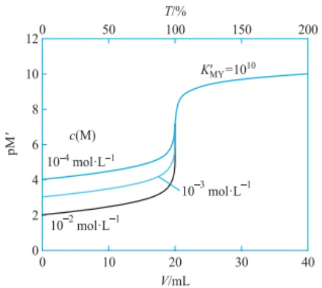

line

| V/mL | \(c(M) (10^{-4}\) mol·L⁻¹) | \(c(M) (10^{-3}\) mol·L⁻¹) | \(c(M) (10^{-2}\) mol·L⁻¹) |
| --- | --- | --- | --- |
| 0 | ~4.1 | ~3.1 | ~2.1 |
| 20 | ~6.5 | ~5.5 | ~3.8 |
| 40 | ~10.0 | — | — |

图 3.2.8 不同浓度溶液的滴定曲线

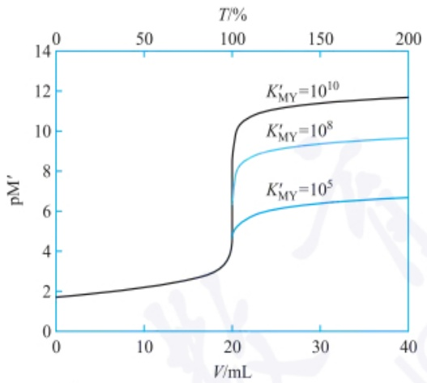

line

| V/mL | K'MY=10^10 (pM') | K'MY=10^8 (pM') | K'MY=10^5 (pM') |
| --- | --- | --- | --- |
| 0 | ~1.8 | ~1.8 | ~1.8 |
| 10 | ~2.3 | ~2.3 | ~2.3 |
| 20 | ~4.5 | ~4.5 | ~4.5 |
| 30 | ~11.5 | ~9.2 | ~6.5 |
| 40 | ~11.8 | ~9.6 | ~6.7 |

图 3.2.9 不同条件常数的滴定曲线

》例 3.2.4 以 $2 \times 10^{-2} \mathrm{~mol} \cdot \mathrm{L}^{-1}$ EDTA 溶液滴定同浓度的 $\mathrm{pH} = 10.0$ 的 $\mathrm{Zn}^{2+}$ 溶液。若体系中 $c_{\mathrm{NH_3}} = 0.2 \mathrm{~mol} \cdot \mathrm{L}^{-1}$, 计算化学计量点的 $\mathrm{pZn'}$、$\mathrm{pZn}$、$\mathrm{pY'}$、$\mathrm{pY}$, 以及化学计量点前后 $0.1\%$ 时的 $\mathrm{pZn'}$ 和 $\mathrm{pY'}$。[已知: $\mathrm{NH_3}$ 的 $K_{\mathrm{a}} = 10^{-9.4} (I = 0.1)$; $K_{\mathrm{ZnY}} = 10^{16.5}$; $\lg \alpha_{\mathrm{Y(H)}} = 0.5$]

》解:化学计量点时, $c_{NH_{3}}=\frac{0.2}{2}\ mol\cdot L^{-1}=0.1\ mol\cdot L^{-1}$ 。

参照例 3.1.19 可算得  $\left[NH_{3}\right]=0.081\ mol\cdot L^{-1}$ ，进而  $\lg\alpha_{\mathrm{Zn(NH_{3})}}=4.7$

$$
\mathrm{lg} \alpha_ {\mathrm{Zn}} = \mathrm{lg} \alpha_ {\mathrm {Zn(NH_3)}} = 4. 7
$$

故， $\lg \alpha_{\mathrm{Y(H)}} = 0.5,\lg K_{\mathrm{ZnY}}^{\prime} = \lg K_{\mathrm{ZnY}} - \lg \alpha_{\mathrm{Zn}} - \lg \alpha_{\mathrm{Y(H)}} = 16.5 - 4.7 - 0.5 = 11.3$

又 $c_{\mathrm{Zn,sp}} = 10^{-2}\mathrm{mol}\cdot \mathrm{L}^{-1}$

则

$$
\mathrm{pZn} _ {\mathrm{sp}} ^ {\prime} = \frac {1}{2} (\lg K _ {\mathrm{ZnY}} ^ {\prime} + \mathrm{pc} _ {\mathrm{Zn,sp}}) = \frac {1}{2} \times (1 1. 3 + 2. 0) = 6. 6
$$

因 $\left[Zn\right]=\frac{\left[Zn^{\prime}\right]}{\alpha_{Zn}}$ ，故

$$
\mathrm{pZn} = \mathrm{pZn} ^ {\prime} + \lg \alpha_ {\mathrm{Zn}} = 6. 6 + 4. 7 = 1 1. 3
$$

---

136

第三章 化学平衡与滴定分析

又

$$
\mathrm{pY} _ {\mathrm{sp}} ^ {\prime} = \mathrm{pZn} _ {\mathrm{sp}} ^ {\prime} = 6. 6
$$

故

$$
\mathrm{pY} _ {\mathrm{sp}} = \mathrm{pY} _ {\mathrm{sp}} ^ {\prime} + \lg \alpha_ {\mathrm{Y(H)}} = 6. 6 + 0. 5 = 7. 1
$$

化学计量点前0.1%时,有

$$
[ \mathrm{Zn} ^ {\prime} ] = \frac {2 \times 10 ^ {- 2}}{2} \times 0. 1 \% \mathrm{mol} \cdot \mathrm{L} ^ {- 1} = 1 \times 1 0 ^ {- 5} \mathrm{mol} \cdot \mathrm{L} ^ {- 1}
$$

故

$$
\mathrm{pZn} ^ {\prime} = 5. 0
$$

由条件稳定常数表达式,得

$$
\left[ \mathrm{Y} ^ {\prime} \right] = \frac {\left[ \mathrm{ZnY} \right]}{\left[ \mathrm{Zn} ^ {\prime} \right] K _ {\mathrm{ZnY}} ^ {\prime}} = \frac {1 \times 1 0 ^ {- 2}}{1 \times 1 0 ^ {- 5} \times 1 0 ^ {1 1 . 3}} \mathrm{mol} \cdot \mathrm{L} ^ {- 1} = 1 0 ^ {- 8. 3} \mathrm{mol} \cdot \mathrm{L} ^ {- 1}
$$

$$
\mathrm{pY} ^ {\prime} = 8. 3
$$

化学计量点后0.1%时,有

$$
\left[ \mathrm{Y} ^ {\prime} \right] = \frac {2 \times 10 ^ {- 2}}{2} \times 0.1 \% \mathrm{mol} \cdot \mathrm{L} ^ {- 1} = 1 \times 10 ^ {- 5} \mathrm{mol} \cdot \mathrm{L} ^ {- 1}
$$

故

$$
\mathrm{pY} ^ {\prime} = 5. 0
$$

由条件稳定常数表达式,得

$$
\left[ \mathrm{Zn} ^ {\prime} \right] = \frac {\left[ \mathrm{ZnY} \right]}{\left[ \mathrm{Y} ^ {\prime} \right] K _ {\mathrm{ZnY}} ^ {\prime}} = \frac {1 \times 1 0 ^ {- 2}}{1 \times 1 0 ^ {- 5} \times 1 0 ^ {1 1 . 3}} \mathrm{mol} \cdot \mathrm{L} ^ {- 1} = 1 0 ^ {- 8. 3} \mathrm{mol} \cdot \mathrm{L} ^ {- 1}
$$

$$
\mathrm{pZn} ^ {\prime} = 8. 3
$$

注:化学计量点附近滴定体系的体积变化很小， $K_{ZnY}^{\prime}$  可以认为不变。此外，化学计量点时，未与 EDTA 络合的 Zn 的总浓度（即  $[Zn^{\prime}]$ ）仅  $10^{-6.6} \, mol \cdot L^{-1}$ ，故与 Zn 络合所消耗的氨可忽略。一般地，若能准确滴定，则这种忽略是合理的。

## 3.2.3.3 滴定误差与准确滴定判别

## 1. 终点误差公式

络合滴定误差可方便使用林邦误差公式计算(推导从略)。

$$
E _ {\mathrm{t}} = \frac {1 0 ^ {\Delta \mathrm{pM} ^ {\prime}} - 1 0 ^ {- \Delta \mathrm{pM} ^ {\prime}}}{\left(K _ {\mathrm{MY}} ^ {\prime} c _ {\mathrm{M,sp}}\right) ^ {1 / 2}} \times 1 0 0 \% \tag {3-2-24}
$$

其中， $\Delta pM' = pM_{ep}' - pM_{sp}'$ ， $\Delta pM = pM_{ep} - pM_{sp}$ ；可以证明， $\Delta pM = \Delta pM'$ 。

此即络合滴定终点误差公式,其形式与强碱滴定弱酸终点误差公式相似。

用络合滴定法测定时所需的条件，也取决于允许的误差和检测终点的准确度。若络合滴定的目视观测终点的不确定度为 $\pm 0.2\mathrm{pM}$ 、允许误差为 $\pm 0.1\%$ ，则$K_{\mathrm{MY}}^{\prime}c_{\mathrm{M,sp}}\geqslant 10^{6}$ 。这一判别条件与酸碱滴定是一致的。

》例 3.2.5 在 pH 5.5 的六亚甲基四胺缓冲溶液中以  $2 \times 10^{-2} \, mol \cdot L^{-1}$  EDTA 溶液滴定同浓度的  $Zn^{2+}$  溶液。计算滴定突跃，并选择合适的指示剂；在选择的指示剂条件下，滴定误差是多少？

解:六亚甲基四胺不与  $Zn^{2+}$  络合, pH=5.5 时,  $\lg\alpha_{\mathrm{Zn(OH)}}=0,\lg\alpha_{\mathrm{Y(H)}}=5.5$ , 则

$$
\lg K _ {\mathrm{ZnY}} ^ {\prime} = 1 6. 5 - 5. 5 = 1 1. 0
$$

$$
\lg (c K _ {\mathrm{ZnY}} ^ {\prime}) = 1 1. 0 - 2. 0 = 9. 0
$$

---

3.2 滴定分析法

137

若 $E_{\mathrm{t}} = \pm 0.1\%$ ，则由终点误差公式得， $\Delta \mathrm{pM} = \pm 1.5$ ，有

$$
\mathrm{pZn} _ {\mathrm{sp}} = \frac {1}{2} (\lg K _ {\mathrm{ZnY}} ^ {\prime} + \mathrm{pc} _ {\mathrm{Zn,sp}}) = \frac {1}{2} \times (1 1. 0 + 2. 0) = 6. 5
$$

故滴定突跃是 $\mathrm{pZn}6.5\pm 1.5$ ，即 $\mathrm{pZn}5.0\sim 8.0$ 。

或者,直接由化学计量点前0.1%得

$$
[ \mathrm{Zn} ] = \frac {2 \times 10^{-2}}{2} \times 0.1\% \mathrm{mol} \cdot \mathrm{L}^{-1} = 1\times 10^{-5}\mathrm{mol} \cdot \mathrm{L}^{-1}
$$

化学计量点后0.1%，有

$$
[\mathrm{Y}^{\prime}] = \frac{2\times 10^{-2}}{2}\times 0.1\% \mathrm{mol}\cdot \mathrm{L}^{-1} = 1\times 10^{-5}\mathrm{mol}\cdot \mathrm{L}^{-1}
$$

根据条件稳定常数表达式,有

$$
\mathrm{[Zn]} = \frac {\mathrm{[ZnY]}}{\mathrm{[Y^{\prime}]} K _ {\mathrm{ZnY}} ^ {\prime}} = \frac {1 \times 10 ^ {- 2}}{1 \times 10 ^ {- 5} \times 1 0 ^ {1 1 . 0}} \mathrm{mol} \cdot \mathrm{L} ^ {- 1} = 1 0 ^ {- 8. 0} \mathrm{mol} \cdot \mathrm{L} ^ {- 1}
$$

故滴定突跃为 pZn 5.0\~8.0。

查附录得,二甲酚橙在 pH 5.5 时的  $pZn_{t}=5.7$ , 处于突跃范围内, 是合适的指示剂。

以二甲酚橙为指示剂, $\Delta pM=5.7-6.5=-0.8$ ,根据误差公式,

$$
E_{\mathrm{t}} = \frac{10^{-0.8} - 10^{0.8}}{\left[10^{11.0}\times 10^{-2.0}\right]^{1 / 2}}\times 100\% = -0.02\%
$$

## 2. 通过体积误差公式计算

与酸碱滴定相同,也可根据滴定曲线反函数求算滴定终点时加入的滴定剂体积  $V_{ep}$ ,通过式(3-2-1)所示的体积定义式计算络合滴定终点误差。

例 3.2.5 中的滴定误差计算, $pZn_{t}=5.7$ , $V_{sp}=V_{0}$ ,终点时

$$
m = [ \mathrm{M} ^ {\prime} ] - \frac {c _ {\mathrm{sp}} - [ \mathrm{M} ^ {\prime} ]}{K _ {\mathrm{MY}} ^ {\prime} [ \mathrm{M} ^ {\prime} ]} = 1 0 ^ {- 5. 7} \mathrm{mol} \cdot \mathrm{L} ^ {- 1} - \frac {0 . 0 1 - 1 0 ^ {- 5 . 7}}{1 0 ^ {1 1 . 0} \times 1 0 ^ {- 5 . 7}} \mathrm{mol} \cdot \mathrm{L} ^ {- 1} \approx 1 0 ^ {- 5. 7} \mathrm{mol} \cdot \mathrm{L} ^ {- 1}
$$

根据滴定曲线反函数,在滴定终点有

$$
V _ {\mathrm{ep}} = \frac {c - m}{c + m} V _ {0} = \frac {c - m}{c + m} V _ {\mathrm{sp}}
$$

根据式(3-2-1)，有

$$
E _ {\mathrm{t}} = \left(\frac {V _ {\mathrm{ep}}}{V _ {\mathrm{sp}}} - 1\right) \times 100 \% = \left(\frac {c - m}{c + m} - 1\right) \times 100 \% = \frac {- 2 m}{c + m} \times 100 \%
$$

故

$$
E_{\mathrm{t}} = \frac{-2\times 10^{-5.7}}{0.02 + 10^{-5.7}}\times 100\% = -0.02\%
$$

## 3.2.3.4 络合滴定中酸度的控制

对单一金属离子的滴定，假设络合反应中除EDTA的酸效应外没有其他副反应， $K_{\mathrm{MY}}^{\prime}$ 仅取决于 $\alpha_{\mathrm{Y(H)}}$ ，即仅由酸度决定。根据单一离子的准确滴定判别， $\Delta \mathrm{pM} = \pm 0.2, E_{\mathrm{t}} = \pm 0.1\% , c_{\mathrm{sp}} = 1\times 10^{-2}\mathrm{mol}\cdot \mathrm{L}^{-1}$ ，由林邦公式可知 $\lg K_{\mathrm{MY}}^{\prime} = \lg K_{\mathrm{MY}} - \lg \alpha_{\mathrm{Y(H)}}\geqslant 8$ 。$\lg \alpha_{\mathrm{Y(H)}}$ 随溶液酸度的增加而增加，因此，酸度应有一个最高限度，超过该酸度就会使 $\lg K_{\mathrm{MY}}^{\prime} < 8$ ，从而不能准确滴定，这一最高允许酸度称为“最高酸度”。因此，可基于 $\lg K_{\mathrm{MY}}^{\prime} = 8.0$ 求得 $\lg \alpha_{\mathrm{Y(H)}}$ 。通过 $\lg \alpha_{\mathrm{Y(H)}} - \mathrm{pH}$ 曲线（见图3.1.10）查得此时 $\mathrm{pH}$ ，即最低 $\mathrm{pH}$ 。

---

138

第三章 化学平衡与滴定分析

常见金属-EDTA络合物的 $\lg K_{\mathrm{MY}}$ 对应的最低 $\mathrm{pH}$ 如图3.2.10所示。酸效应曲线表明了 $\mathrm{pH}$ 对络合物形成的影响。不同金属-EDTA络合物的 $\lg K_{\mathrm{MY}}$ 不同，为使$\lg K_{\mathrm{MY}}^{\prime}$ 达到8.0的最低 $\mathrm{pH}$ 也不同。对很稳定的络合物BiY（ $\lg K = 27.9$ )，可以在高酸度下测定；而对于不稳定的络合物 $\mathrm{MgY}(\lg K = 8.7)$ ，则必须在弱碱性（ $\mathrm{pH}\approx 10$ )溶液中滴定。

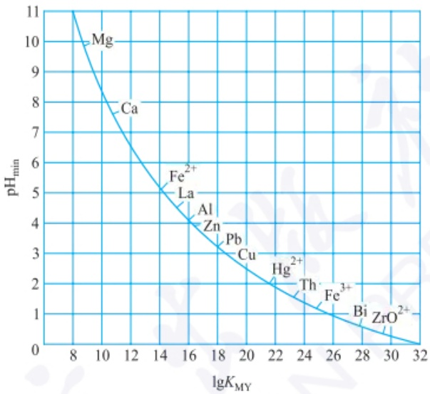

line

| Element | lgKMY | pHmin |
| --- | --- | --- |
| Mg | ~8.5 | 10 |
| Ca | ~10.5 | ~7.5 |
| Fe2+ | ~14.5 | ~5.2 |
| La | ~15.5 | ~4.5 |
| Al | ~16.5 | ~4.1 |
| Zn | ~17.5 | ~3.8 |
| Pb | ~18.5 | ~3.3 |
| Cu | ~20.5 | ~2.8 |
| Hg2+ | ~22.0 | ~2.2 |
| Th | ~24.0 | ~1.8 |
| Fe3+ | ~26.0 | ~1.4 |
| Bi | ~28.0 | ~1.0 |
| ZrO2+ | ~30.0 | ~0.6 |

图 3.2.10 滴定金属离子的最低 pH(pH $_{min}$ ) 与 lgK $_{MY}$  的关系

络合滴定的“最低酸度”，是指低于该酸度时，金属离子水解形成羟基络合物甚至析出沉淀  $\mathrm{M(OH)}_{n}$ ，不仅影响络合反应的速率使终点难以确定，而且影响络合反应的计量关系。此“最低酸度”可由  $\mathrm{M(OH)}_{n}$  的溶度积求得。如果  $\mathrm{M(OH)}_{n}$  的溶度积为  $K_{sp}$ ，为了防止滴定时形成  $\mathrm{M(OH)}_{n}$  沉淀，必须使  $\left[OH^{-}\right] \leqslant \sqrt[n]{K_{sp}/c_{M}}$ ，据此可求得最低酸度。例如，滴定  $2 \times 10^{-2} mol \cdot L^{-1} Zn^{2+}$  时，为防止滴定开始时形成  $\mathrm{M(OH)}_{n}$  沉淀，必须使

$$
\mathrm {[ OH^ {-} ]\leqslant \sqrt {\frac {10^{-15.3}}{2\times 10^{-2}}} mol\cdot L^ {-1} = 10^{-6.8} mol\cdot L^ {-1}}
$$

即最高 pH 为 7.2, 故络合滴定  $Zn^{2+}$  的 pH 范围为 pH 4.0\~7.2。

若加入适当的辅助络合剂(如酒石酸或氨水)防止金属离子水解沉淀,则可以在更低的酸度下滴定。但辅助络合剂与金属离子的副反应也将导致 $K_{MY}^{\prime}$ 降低,为实现准确滴定,必须控制其用量。

上述酸度范围是从滴定反应的角度考虑的，即为达到准确滴定的 $K_{\mathrm{MY}}^{\prime}$ 而又不致生成沉淀所需。如前所述，误差不仅取决于 $\lg (cK')$ ，还与 $\Delta \mathrm{pM}$ 有关。酸度会影响滴定剂的 $\mathrm{pM}_{\mathrm{t}}$ ，从而影响 $\Delta \mathrm{pM}$ 。因此，为了提高滴定准确度，在上述的酸度范围内应选择合适的 $\mathrm{pH}$ 使 $\mathrm{pM}_{\mathrm{t}}$ 与 $\mathrm{pM}_{\mathrm{sp}}$ 尽可能一致。

以 EDTA 滴定  $Zn^{2+}$  为例, 若选二甲酚橙为指示剂, 应该选择的酸度是多少?

由图3.2.11可见，$\lg K_{\mathrm{ZnY}}'$ 和 $\mathrm{pM}_{\mathrm{sp}}$ 随 $\mathrm{pH}$ 增大而增大，表明酸度降低，络合反应越趋完全；$\mathrm{pM}_{\mathrm{t}}$ 随 $\mathrm{pH}$ 增大而增大，表明酸度越低，指示剂的灵敏度越高。在 $\mathrm{pH} = 6.5$ 时，$\mathrm{pM}_{\mathrm{sp}} = \mathrm{pM}_{\mathrm{t}}$；$\mathrm{pH} < 6.5$ 时，$\mathrm{pM}_{\mathrm{sp}} > \mathrm{pM}_{\mathrm{t}}$，终点误差为负值；$\mathrm{pH} > 6.5$ 时，$\mathrm{pM}_{\mathrm{sp}} < \mathrm{pM}_{\mathrm{t}}$，终点误差为正值。

从理论上考虑，$\mathrm{pH}6.5$ 为最佳 $\mathrm{pH}$ 。实际上，二甲酚橙指示剂在 $\mathrm{pH} < 6$ 时使用，因为其在 $\mathrm{pH} > 6$ 时呈紫红色，与锌-二甲酚橙络合物的颜色相近。由 $E_{\mathrm{t}} - \mathrm{pH}$

---

3.2 滴定分析法

139

曲线可见，为使终点误差<0.1%，pH 应当大于 5.1。因此以二甲酚橙为指示剂滴定 Zn 的酸度范围是 pH 5.1\~6.0，实际滴定应避免在边界 pH 操作，而多在 pH 5.5\~5.8 进行，以免 pH 变动引起条件稳定常数发生变化。若选择 pH=4.0 滴定，尽管  $\lg K_{ZnY}^{\prime}$  达到 8，但此酸度下二甲酚橙指示剂对锌很不灵敏， $\Delta pM$  太大，终点误差高达 5%。因此，用指示剂确定终点时，pH 的选择不仅要考虑  $K_{MY}^{\prime}$ ，还要考虑指示剂的变色点与适用 pH 范围。

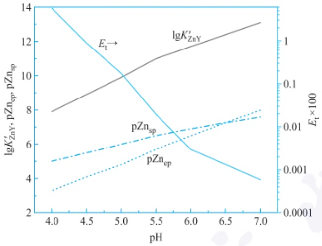

line

| pH | lgK'ZnY | pZnsp | pZnep | Et |
| --- | --- | --- | --- | --- |
| 4.0 | ~8.0 | ~5.0 | ~3.3 | ~1.5 |
| 5.0 | ~10.0 | ~6.0 | ~4.8 | ~0.2 |
| 5.5 | ~11.0 | ~6.5 | ~5.8 | ~0.05 |
| 6.0 | ~11.8 | ~6.8 | ~6.8 | ~0.01 |
| 7.0 | ~13.0 | ~7.5 | ~8.0 | ~0.001 |

图 3.2.11 pH 对  $E_{t}$  等的影响

## 3.2.3.5 混合离子的选择性滴定

## (1) 控制酸度进行选择性滴定

如果溶液中存在 M 和 N 两种金属离子, 均能与 EDTA 形成络合物, 且  $K_{MY} > K_{NY}$ , 则用 EDTA 滴定时, M 首先被滴定。若  $K_{MY}$  与  $K_{NY}$  相差足够大, 则 M 首先被定量滴定, 也就是说在 N 存在时可以选择性滴定 M。至于 N 能否继续被滴定, 则成为单一离子滴定的问题, 前面已经讨论过。那么, 究竟  $K_{MY}$  与  $K_{NY}$  相差多大才能选择性滴定 M? 应当在什么酸度下滴定?

由于要讨论的是选择性滴定 M, 可将 N 与 Y 的反应看作 Y 的副反应, 因此, 除了与  $H^{+}$  的副反应, Y 还存在与 N 的副反应。

根据副反应系数定义:

$$
\alpha_ {\mathrm{Y(N)}} = \frac {[ \mathrm{Y} ] + [ \mathrm{NY} ]}{[ \mathrm{Y} ]} = 1 + [ \mathrm{N} ] K _ {\mathrm{NY}}
$$

为了能准确地滴定 M, 化学计量点时 [NY] 应当很小。若无其他络合剂与 N 反应, 则

$$
[ \mathrm{N} ] = c _ {\mathrm{N}} - [ \mathrm{NY} ] \approx c _ {\mathrm{N}}
$$

因此

$$
\alpha_ {\mathrm{Y(N)}} \approx 1 + c _ {\mathrm{N}} K _ {\mathrm{NY}} \approx c _ {\mathrm{N}} K _ {\mathrm{NY}} \tag {3-2-25}
$$

可见, 只要酸度不太低, N 不水解,  $\alpha_{\mathrm{Y(N)}}$  仅取决于  $c_{N}$  和  $K_{NY}$ , 不随 pH 变化, 为定值。

Y 的总副反应系数为

$$
\alpha_ {\mathrm{Y}} = \alpha_ {\mathrm{Y(H)}} + \alpha_ {\mathrm{Y(N)}} - 1
$$

若在较高酸度下滴定，则  $\alpha_{\mathrm{Y(H)}} > \alpha_{\mathrm{Y(N)}}$ ，此时  $\alpha_{Y} \approx \alpha_{Y(H)}$ ，N 对滴定的影响可忽略。

---

140

第三章 化学平衡与滴定分析

若在较低酸度下滴定，则  $\alpha_{\mathrm{Y(H)}} < \alpha_{\mathrm{Y(N)}}$ ，此时  $\alpha_{Y} \approx \alpha_{\mathrm{Y(N)}}$ ，有

$$
K _ {\mathrm{MY}} ^ {\prime} = \frac {K _ {\mathrm{MY}}}{c _ {\mathrm{N}} K _ {\mathrm{NY}}}
$$

两边同乘以 $c_{\mathrm{M}}$ ，并取对数，得

$$
\lg (c _ {\mathrm{M}} K _ {\mathrm{MY}} ^ {\prime}) = \lg K _ {\mathrm{MY}} - \lg K _ {\mathrm{NY}} + \lg \left(\frac {c _ {\mathrm{M}}}{c _ {\mathrm{N}}}\right) = \Delta \lg K + \lg \left(\frac {c _ {\mathrm{M}}}{c _ {\mathrm{N}}}\right) \tag {3-2-26}
$$

可见,两种金属络合物的稳定常数相差越大(即  $\Delta\lg K$  越大),被测金属离子浓度  $c_{M}$  越大,共存金属离子浓度  $c_{N}$  越小,则  $\lg(c_{\mathrm{M}}K_{\mathrm{MY}}^{\prime})$  越大。

若设  $\Delta pM=\pm0.2,\left|E_{t}\right|\leqslant0.1\%$ , 由林邦误差公式可得  $\lg(c_{\mathrm{sp}}K_{\mathrm{MY}}^{\prime})\geqslant6$ 。若满足此条件, 则 N 离子不干扰 M 离子的滴定。

若  $c_{M}=c_{N}$ ，此时则要求:

$$
\Delta \lg K = \lg (c _ {\mathrm{M}} K _ {\mathrm{MY}} ^ {\prime}) - \lg \left(\frac {c _ {\mathrm{M}}}{c _ {\mathrm{N}}}\right) \geqslant 6
$$

与多元酸分步滴定的判据相同。

如图3.2.12所示，随着酸度降低，$\alpha_{\mathrm{Y(H)}}$ 减小，$\alpha_{\mathrm{Y}}$ 减小，$K_{\mathrm{MY}}'$ 增大；当 $\mathrm{pH}$ 增大至 $\alpha_{\mathrm{Y(N)}}$ 起主要作用时，$\alpha_{\mathrm{Y}} \approx \alpha_{\mathrm{Y(N)}}$ ，此时 $K_{\mathrm{MY}}'$ 达最大值。显然，在 $K_{\mathrm{MY}}'$ 达到最大的区域进行滴定是有利的，实验中溶液 $\mathrm{pH}$ 变动引起的影响可以忽略。因此滴定允许的最高酸度可认为是 $\lg \alpha_{\mathrm{Y(H)}} = \lg \alpha_{\mathrm{Y(N)}}$ 时的 $\mathrm{pH}$ 。而最低酸度与单独滴定M离子时相同，即防止生成氢氧化物沉淀时的 $\mathrm{pH}$ 。

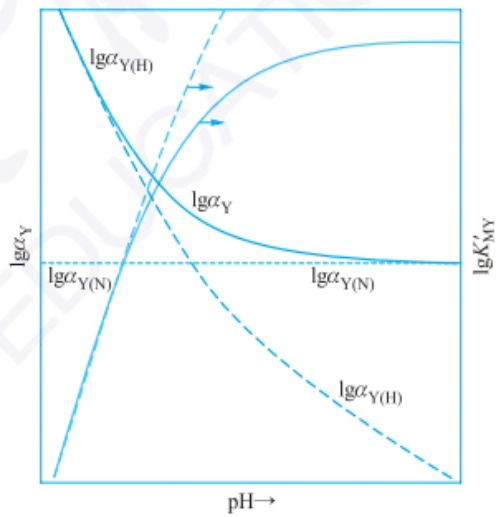

line

| Parameter | Trend Description |
| --- | --- |
| \(lg\alpha Y(H)\) | Decreasing trend with increasing pH |
| \(lg\alpha Y\) | Increasing trend with decreasing pH |
| \(lg\alpha Y(N)\) | Increasing trend with increasing pH |
| \(lg\alpha Y(N)\) | Constant value across the range of pH |
| \(lg\alpha Y(H)\) | Decreasing trend with increasing pH |

图 3.2.12 N 共存滴定 M 时, 酸度对条件稳定常数的影响  
(虚线: 只有 M; 实线: M 与 N 共存)

»例 3.2.6 某溶液含有  $Pb^{2+}$  和  $Ca^{2+}$ ，浓度均为  $2 \times 10^{-2} \, mol \cdot L^{-1}$ ，欲以同浓度的 EDTA 溶液选择滴定  $Pb^{2+}$ ，问:

(1) 有无可能选择滴定  $Pb^{2+}$ ?
(2) 求滴定的酸度范围。
（3）求二甲酚橙为指示剂的最佳 pH。若在此 pH 滴定，由于滴定终点与化学计量点之间有  $\pm0.2$  单位的出入，所造成的终点误差是多少？

» 解: (1)  $\Delta\lg K = 18.0 - 10.7 = 7.3 > 6.0$ , 有可能在  $Ca^{2+}$  存在下选择性滴定  $Pb^{2+}$ 。

(2) 可能滴定的酸度范围

$\mathrm{pH}$ 低限 $\alpha_{\mathrm{Y(H)}} = \alpha_{\mathrm{Y(Ca)}}\approx c_{\mathrm{Ca}}K_{\mathrm{CaY}} = 10^{-2.0 + 10.7} = 10^{8.7}$

---

3.2 滴定分析法

141

查  $\lg\alpha_{Y(H)}-pH$  曲线得,  $\lg\alpha_{Y(H)}=8.7$  时所相应的 pH 为 4.0, 此即 pH 低限。

pH 高限

$$
\mathrm {[ OH^ {-} ] = \sqrt {\frac {K _ {\mathrm{sp}}}{[Pb^ {2 +} ]}}} = \frac {1 0 ^ {- 1 6 . 7}}{2 \times 1 0 ^ {- 2}} = 1 0 ^ {- 7. 0} (\mathrm{mol} \cdot \mathrm{L} ^ {- 1})
$$

即 $\mathrm{pH} = 7.0$

故可能的 $\mathrm{pH}$ 范围是 $4.0\sim 7.0$ 。在此酸度范围内， $\lg K_{\mathrm{PhY}}^{\prime}$ 、 $\mathrm{pZn}_{\mathrm{sp}}$ 大约为定值。

$$
\mathrm{lg} K _ {\mathrm{PbY}} ^ {\prime} = \mathrm{lg} K _ {\mathrm{PbY}} - \mathrm{lg} \alpha_ {\mathrm{Y(Ca)}} = 1 8. 0 - 8. 7 = 9. 3
$$

$$
\mathrm{pPb} _ {\mathrm{sp}} = \frac {1}{2} (\lg K _ {\mathrm{PbY}} ^ {\prime} + \mathrm{pc} _ {\mathrm{Pb,sp}}) = \frac {1}{2} \times (9. 3 + 2. 0) = 5. 7
$$

（3）采用二甲酚橙为指示剂的最佳 $\mathrm{pH}$ 应当在 $\mathrm{pPb_{ep}} = \mathrm{pPb_{sp}}$ 处。查二甲酚橙的 $\mathrm{pPb_t - pH}$ 曲线图可知，当 $\mathrm{pPb_t} = 5.7$ 时，$\mathrm{pH} = 4.3$。

在 pH 4.3 滴定， $\lg(c_{\mathrm{M}}K_{\mathrm{MY}}^{\prime})=7.3$ ，虽然此时 $pPb_{ep}=pPb_{sp}$ ，但是人眼判断终点颜色变化仍有 0.2 单位不确定性，即  $\Delta pM=0.2$ ，根据误差公式计算，得  $E_{t}=\pm0.02\%$ 。

## (2) 使用掩蔽剂进行选择性滴定

如果被测离子 M 的  $K_{MY}$  与干扰离子 N 的  $K_{NY}$  相差不大，则无法用控制酸度的方法实现选择性滴定 M 离子。若加入掩蔽剂与干扰离子 N 反应，可消除 N 对 M 测定的干扰。掩蔽方法有络合掩蔽法、沉淀掩蔽法和氧化还原掩蔽法等，其中以络合掩蔽法用得最多，以下以络合掩蔽法为例讨论掩蔽效果，即选择性滴定 M 的准确度。

使用络合掩蔽剂(A)时溶液中的平衡关系如下:

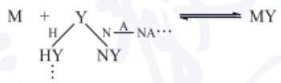

A 与 N 的反应实际上是 N 与 Y 反应的副反应。

若掩蔽效果很好，[N]已经降得很低，以致 $\alpha_{\mathrm{Y(N)}}\ll \alpha_{\mathrm{Y(H)}}$ ，故 $\alpha_{\mathrm{Y}}\approx \alpha_{\mathrm{Y(H)}}$ ，则有

$$
\lg K _ {\mathrm{MY}} ^ {\prime} = \lg K _ {\mathrm{MY}} - \lg \alpha_ {\mathrm{Y(H)}}
$$

此时 N 已不构成干扰,  $\lg K_{MY}^{\prime}$  仅与酸度有关, 与仅有 M 离子存在的滴定情况相同。若加入掩蔽剂后,  $\alpha_{Y(N)} > \alpha_{Y(H)}$ , 则  $\alpha_{Y} \approx \alpha_{Y(N)}$ , 而

$$
\alpha_ {\mathrm{Y(N)}} = 1 + [ \mathrm{N} ] \cdot K _ {\mathrm{NY}} \approx \frac {c _ {\mathrm{N}}}{\alpha_ {\mathrm{N(A)}}} K _ {\mathrm{NY}}
$$

其中， $[N]+[NA]+[NA_{2}]+\cdots=c_{N}-[NY]\approx c_{N}$ （与 $c_{N},\Sigma[NA]$ 相比，仍可忽略[NY]）。

故

$$
\mathrm{lg} K _ {\mathrm{MY}} ^ {\prime} = \mathrm{lg} K _ {\mathrm{MY}} - \mathrm{lg} \alpha_ {\mathrm{Y(N)}} = \Delta \mathrm{lg} K + \mathrm{pc} _ {\mathrm{N}} + \mathrm{lg} \alpha_ {\mathrm{N(A)}} \tag {3-2-27}
$$

将此式与式(3-2-26)比较可见，当 $\alpha_{\mathrm{Y(N)}} > \alpha_{\mathrm{Y(H)}}$ 时，掩蔽剂的作用是使得$\lg K_{\mathrm{MY}}^{\prime}$ 增大了 $\lg \alpha_{\mathrm{N(A)}}$ 单位。 $\lg \alpha_{\mathrm{N(A)}}$ 越大，掩蔽效果越好。

»例 3.2.7 欲在 pH=5.5 采用二甲酚橙为指示剂，以  $2 \times 10^{-2} \, mol \cdot L^{-1}$  EDTA 溶液滴定同浓度的  $Zn^{2+}$ 、 $Al^{3+}$  混合液中的  $Zn^{2+}$ ，若以 KF 掩蔽  $Al^{3+}$ ，终点时未与  $Al^{3+}$  络合的 F 总浓度  $c_{F}$  为  $1 \times 10^{-2} \, mol \cdot L^{-1}$ ，计算终点误差。（已知: $AlF_{6}^{3-}$  的  $\lg \beta_{1} \sim \lg \beta_{6}$  分别是 6.1, 11.15, 15.0, 17.7, 19.4 和 19.7；HF 的  $pK_{a}=3.1; pH=5.5$  时， $\alpha_{Y(H)}=$

---

142

第三章 化学平衡与滴定分析

$$
1 0 ^ {5. 7}; \lg K _ {\mathrm{ZnY}} = 1 6. 5, \lg K _ {\mathrm{AlY}} = 1 6. 1)
$$

» 解: pH=5.5 时,  $\left[F^{-}\right]=c_{F}\delta_{0}=1\times10^{-2}\times\frac{10^{-3.1}}{10^{-3.1}+10^{-5.5}}=1\times10^{-2}\left(\mathrm{mol}\cdot\mathrm{L}^{-1}\right)$

$$
\begin{array}{l} \alpha_ {\mathrm{Al(F)}} = 1 + [ \mathrm{F} ] \beta_ {1} + [ \mathrm{F} ] ^ {2} \beta_ {2} + [ \mathrm{F} ] ^ {3} \beta_ {3} + [ \mathrm{F} ] ^ {4} \beta_ {4} + [ \mathrm{F} ] ^ {5} \beta_ {5} + [ \mathrm{F} ] ^ {6} \beta_ {6} \\ = 1 + 1 0 ^ {- 2. 0 + 6. 1} + 1 0 ^ {- 4. 0 + 1 1. 1 5} + 1 0 ^ {- 6. 0 + 1 5. 0} + 1 0 ^ {- 8. 0 + 1 7. 7} + 1 0 ^ {- 1 0. 0 + 1 9. 4} + 1 0 ^ {- 1 2. 0 + 1 9. 7} \approx 1 0 ^ {1 0. 0} \\ \end{array}
$$

$$
\mathrm{[Al]} = \frac {\mathrm {[Al^ {\prime} ]}}{\alpha_ {\mathrm{Al(F)}}} \approx \frac {c _ {\mathrm{Al}}}{\alpha_ {\mathrm{Al(F)}}} = \frac {1 0 ^ {- 2 . 0}}{1 0 ^ {1 0 . 0}} \mathrm{mol} \cdot \mathrm{L} ^ {- 1} = 1 0 ^ {- 1 2. 0} \mathrm{mol} \cdot \mathrm{L} ^ {- 1}
$$

$$
\alpha_ {\mathrm{Y(Al)}} = 1 + [ \mathrm{Al} ] K _ {\mathrm{AIY}} = 1 + 1 0 ^ {- 1 2. 0 + 1 6. 1} = 1 0 ^ {4. 1}
$$

$\mathrm{pH} = 5.5$ 时， $\alpha_{\mathrm{Y(H)}} = 10^{5.7}$ ，此时 $\alpha_{\mathrm{Y}}\approx \alpha_{\mathrm{Y(H)}}$ ，则

$$
\mathrm{lg} K _ {\mathrm{ZnY}} ^ {\prime} = \mathrm{lg} K _ {\mathrm{ZnY}} - \mathrm{lg} \alpha_ {\mathrm{Y(H)}} = 1 6. 5 - 5. 7 = 1 0. 8
$$

$$
\mathrm{pZn} _ {\mathrm{sp}} = \frac {1}{2} (\lg K _ {\mathrm{ZnY}} ^ {\prime} + \mathrm{pc} _ {\mathrm{sp}}) = \frac {1}{2} \times (1 0. 8 + 2. 0) = 6. 4
$$

查附录得, pH=5.5 时,  $pZn_{ep}=5.7$  (二甲酚橙), 故  $\Delta pM=5.7-6.4=-0.7$

$$
E_{\mathrm{t}} = \frac{10^{\Delta_{\mathrm{pM}}} - 10^{-\Delta_{\mathrm{pM}}}}{\sqrt{c_{\mathrm{sp}}K'_{\mathrm{ZnY}}}}\times 100\% = \frac{10^{-0.7} - 10^{0.7}}{\sqrt{0.01\times 10^{10.8}}}\times 100\% = -0.02\%
$$

此例可见， $F^{-}$ 对  $Al^{3+}$  的掩蔽效果很好，终点误差只有 -0.02%。

»例 3.2.8 某溶液含有  $Zn^{2+}$ 、 $Cd^{2+}$ ，浓度均为  $2 \times 10^{-2} \, mol \cdot L^{-1}$ 。今在 pH = 5.5，采用二甲酚橙为指示剂，以 KI 掩蔽  $Cd^{2+}$ ，终点时  $[I^{-}] = 0.5 \, mol \cdot L^{-1}$ 。请问:（1）若以同浓度的 EDTA 滴定  $Zn^{2+}$ ，终点误差是多少？（2）若换用同浓度的 HEDTA(X) 为滴定剂，情况又如何？（已知:pH = 5.5 时， $\alpha_{X(H)} = 10^{4.6}$ ;  $Cd^{2+}-I^{-}$ 络合物的  $\lg \beta_{1} \sim \lg \beta_{4}$  分别是:2.4, 3.4, 5.0, 6.15;  $\lg K_{ZnY} = \lg K_{CdY} = 16.5$ ;  $\lg K_{ZnX} = 14.5$ ,  $\lg K_{CdX} = 13.0$ ）

» 解:  $\left[I^{-}\right]=0.5\ mol\cdot L^{-1}=10^{-0.3}\ mol\cdot L^{-1}$

$$
\begin{array}{l} \alpha_ {\mathrm{Cd(I)}} = 1 + [ \mathrm{I} ] \beta_ {1} + [ \mathrm{I} ] ^ {2} \beta_ {2} + [ \mathrm{I} ] ^ {3} \beta_ {3} + [ \mathrm{I} ] ^ {4} \beta_ {4} \\ = 1 + 1 0 ^ {- 0. 3 + 2. 4} + 1 0 ^ {- 0. 6 + 3. 4} + 1 0 ^ {- 0. 9 + 5. 0} + 1 0 ^ {- 1. 2 + 6. 1 5} \approx 1 0 ^ {5. 1} \\ \end{array}
$$

$$
\left[ \mathrm{Cd} \right] = \frac {\left[ \mathrm{Cd} ^ {\prime} \right]}{\alpha_ {\mathrm{Cd(1)}}} \approx \frac {c _ {\mathrm{Cd}}}{\alpha_ {\mathrm{Cd(1)}}} = \frac {1 0 ^ {- 2 . 0}}{1 0 ^ {5 . 1}} \mathrm{mol} \cdot \mathrm{L} ^ {- 1} = 1 0 ^ {- 7. 1} \mathrm{mol} \cdot \mathrm{L} ^ {- 1}
$$

(1) 用 EDTA 为滴定剂,  $\lg K_{ZnY} = \lg K_{CdY} = 16.5$ ,

$$
\alpha_ {\mathrm{Y(Cd)}} = 1 + [ \mathrm{Cd} ] K _ {\mathrm{CdY}} = 1 + 1 0 ^ {- 7. 1 + 1 6. 5} = 1 0 ^ {9. 4} \gg \alpha_ {\mathrm{Y(H)}}
$$

$$
\mathrm{lg} K _ {\mathrm{ZnY}} ^ {\prime} = \mathrm{lg} K _ {\mathrm{ZnY}} - \mathrm{lg} \alpha_ {\mathrm{Y(Cd)}} = 1 6. 5 - 9. 4 = 7. 1
$$

$$
\mathrm{pZn} _ {\mathrm{sp}} = \frac {1}{2} (\lg K _ {\mathrm{ZnY}} ^ {\prime} + \mathrm{pc} _ {\mathrm{sp}}) = \frac {1}{2} \times (7. 1 + 2. 0) = 4. 5 5
$$

$\mathrm{pH} = 5.5$ 时， $\mathrm{pZn_{ep}} = 5.7$ ，故 $\Delta \mathrm{pM} = 5.7 - 4.55 = 1.15$ ，则

$$
E _ {\mathrm{t}} = \frac {1 0 ^ {\Delta_ {\mathrm{pM}}} - 1 0 ^ {- \Delta_ {\mathrm{pM}}}}{\sqrt {c _ {\mathrm{sp}} K _ {\mathrm{ZnY}} ^ {\prime}}} \times 1 0 0 \% = \frac {1 0 ^ {1 . 1 5} - 1 0 ^ {- 1 . 1 5}}{\sqrt {0 . 0 1 \times 1 0 ^ {7 . 1}}} \times 1 0 0 \% = 4
$$

由滴定误差可知， $I^{-}$ 对  $Cd^{2+}$  的掩蔽效果不好。

(2) 若在  $I^{-}$ 掩蔽下, 换用 HEDTA(X) 滴定剂, 则

$$
\alpha_ {\mathrm{X(Cd)}} = 1 + \left[ \mathrm{Cd} \right] K _ {\mathrm{Cdx}} \approx 1 + 1 0 ^ {- 7. 1 + 1 3. 0} = 1 0 ^ {5. 9}
$$

$$
\mathrm{lg} K _ {\mathrm{ZnX}} ^ {\prime} = \mathrm{lg} K _ {\mathrm{ZnX}} - \mathrm{lg} \alpha_ {\mathrm{X(Cd)}} = 1 4. 5 - 5. 9 = 8. 6
$$

$$
\mathrm{pZn} _ {\mathrm{sp}} = \frac {1}{2} (\lg K _ {\mathrm{ZnX}} ^ {\prime} + \mathrm{pc} _ {\mathrm{sp}}) = \frac {1}{2} \times (8. 6 + 2. 0) = 5. 3
$$

---

3.2 滴定分析法

143

则

$$
\Delta \mathrm{pM} = 5. 7 - 5. 3 = 0. 4
$$

虽然掩蔽后仍然  $\alpha_{\mathrm{X(Cd)}} \gg \alpha_{\mathrm{X(H)}}$ ，但是  $\lg K_{ZnX}^{\prime} > 8.0$ ，则

$$
E _ {\mathrm{t}} = \frac {1 0 ^ {\Delta_ {\mathrm{pM}}} - 1 0 ^ {- \Delta_ {\mathrm{pM}}}}{\sqrt {c _ {\mathrm{sp}} K _ {\mathrm{ZnX}} ^ {\prime}}} \times 1 0 0 \% = \frac {1 0 ^ {0 . 4} - 1 0 ^ {- 0 . 4}}{\sqrt {0 . 0 1 \times 1 0 ^ {8 . 6}}} \times 1 0 0 \% = 0. 1 \%
$$

由此可见，用 HEDTA 结合掩蔽，可以在  $Cd^{2+}$  共存时实现 Zn 的选择性滴定。

如果在滴定M后还需继续测定被掩蔽的N，可加入解蔽剂破坏NA，释放出游离的N离子。例如，欲测定溶液中 $\mathrm{Pb}^{2+}$ 、$\mathrm{Zn}^{2+}$ 含量，由于这两种金属离子的EDTA络合物的稳定常数相近，无法通过控制酸度分别滴定，可在氨性酒石酸溶液中用KCN掩蔽 $\mathrm{Zn}^{2+}$，以铬黑T为指示剂，用EDTA滴定 $\mathrm{Pb}^{2+}$，然后加入甲醛破坏$\mathrm{Zn(CN)}_4^{2-}$，释放 $\mathrm{Zn}^{2+}$，继续用EDTA滴定 $\mathrm{Zn}^{2+}$ 。甲醛与 $\mathrm{Zn(CN)}_4^{2-}$ 发生如下反应:

$$
4 \mathrm{HCHO} + \mathrm{Zn(CN)} _ {4} ^ {2 -} + 4 \mathrm{H} _ {2} \mathrm{O} = \mathrm{Zn} ^ {2 +} + 4 \mathrm{H} _ {2} \mathrm{C} \underset {\text {(乙醇腈)}} {\overset {\mathrm{CN}} {\mathrm{OH}}} + 4 \mathrm{OH} ^ {-}
$$

沉淀掩蔽法是加入选择性沉淀剂作掩蔽剂，使干扰离子形成沉淀以降低其浓度，在不分离沉淀的情况下滴定。加入的掩蔽剂与干扰离子形成的沉淀溶解度必须要小，反应完全。

氧化还原掩蔽法则是利用氧化还原反应改变干扰离子的价态,使其与 EDTA 的稳定常数减小,以消除其干扰。例如, $Fe^{3+}$  与 EDTA 形成络合物的稳定性大于 $Fe^{2+}$  与 EDTA 形成络合物的稳定性,所以可将 $Fe^{3+}$  还原为 $Fe^{2+}$  以消除 $Fe^{3+}$  的干扰。

## 3.2.3.6 络合滴定的方式和应用

常用EDTA标准溶液浓度是 $0.01\sim 0.05\mathrm{mol}\cdot \mathrm{L}^{-1}$ 。一般采用EDTA二钠盐$\mathrm{(Na_2H_2Y\cdot 2H_2O)}$ 先粗略配制，然后通过金属离子标准溶液标定。标定EDTA溶液的基准物质很多，常用的金属离子标准溶液有 $\mathrm{Ca^{2 + }}$ 、 $\mathrm{Pb^{2 + }}$ 和 $\mathrm{Zn^{2 + }}$ 溶液，可以通过基准物质 $\mathrm{CaCO_3}$ 、 $\mathrm{Pb(NO_3)_2}$ 和 $\mathrm{ZnO}$ 配制。为使测定的准确度高，标定的条件与测定条件尽可能接近。

## 1. 多数金属离子的直接测定

多数金属离子与 EDTA 生成稳定的螯合物，反应能够迅速完成。所以，络合滴定法可以直接测定这些金属离子。例如，pH=1 时测定  $Bi^{3+}$ ; pH=1.5\~2.5 时测定  $Fe^{3+}$ ; pH=2.5\~3.5 时测定  $Th^{4+}$ ; pH=5.0\~6.0 时测定  $Zn^{2+}$ 、 $Pb^{2+}$ 、 $Cd^{2+}$  和稀土离子；pH=9.0\~10.0 时测定  $Zn^{2+}$ 、 $Mn^{2+}$ 、 $Cd^{2+}$  和稀土离子；pH=10.0 时测定  $Mg^{2+}$ ; pH=12.0\~13.0 时测定  $Ca^{2+}$ 。

有些金属离子-EDTA螯合物的稳定常数相差较大，利用这种差异可以通过控制酸度选择性滴定混合离子。如 $\mathrm{Bi}^{3+}$ 和 $\mathrm{Pb}^{2+}$ 溶液，二甲酚橙作为指示剂，在$\mathrm{pH} = 1$ 时滴定 $\mathrm{Bi}^{3+},\mathrm{Pb}^{2+}$ 不干扰，且不与二甲酚橙显色。 $\mathrm{Bi}^{3+}$ 滴定结束后，通过六亚甲基四胺调整 $\mathrm{pH}$ 为 $5\sim 6$ ，继续滴定 $\mathrm{Pb}^{2+}$ 。

测定自来水中的  $Ca^{2+}$  和  $Mg^{2+}$  是络合滴定的典型应用。取一份试液调节 pH=10.0，以铬黑 T 为指示剂，以 EDTA 标准溶液滴定，测得  $Ca^{2+}$  和  $Mg^{2+}$  总量。另取一份试液，调节 pH=12.0，将  $Mg^{2+}$  沉淀为  $\mathrm{Mg(OH)}_{2}$ ，使用钙指示剂，以 EDTA 标准溶液滴定，测得  $Ca^{2+}$  含量。如果溶液中存在  $Fe^{3+}$  或者  $Al^{3+}$ ，可以通过三乙醇胺掩蔽；

---

144

第三章 化学平衡与滴定分析

如果存在  $Cu^{2+}$ 、 $Zn^{2+}$ 、 $Pb^{2+}$ ，可以通过  $Na_{2}S$  或者 KCN 掩蔽。

## 2. 返滴定法测铝

$\mathrm{Al}^{3+}$ 与EDTA生成稳定的螯合物， $\lg K_{\mathrm{AIY}} = 16.1$ 。但是不能用EDTA直接滴定$\mathrm{Al}^{3+}$ ，原因有:络合反应缓慢； $\mathrm{Al}^{3+}$ 对指示剂二甲酚橙有封闭作用；酸度不高时 $\mathrm{Al}^{3+}$ 发生较严重的副反应（生成一系列多核羟基配合物）。所以，通常采用返滴定法测铝。

向酸性样品溶液加入一定量过量 EDTA 标准溶液，调溶液 pH 约为 3.5。将溶液加热至沸，并保持一段时间使  $Al^{3+}$  与 EDTA 反应完全。由于酸度较高，EDTA 过量， $Al^{3+}$  不会形成多核羟基络合物。溶液冷却后，调节 pH 至 5\~6，通过  $Zn^{2+}$  或者  $Pb^{2+}$  标准溶液滴定剩余 EDTA，最终测得  $Al^{3+}$  含量。

## 3. 置换滴定法测银

$Ag^{+}$ 与 EDTA 生成的螯合物不够稳定, $lgK_{AgY}=7.3$ ,因此不能直接滴定 $Ag^{+}$ ,可采用置换法。

向  $Ag^{+}$ 试液加入过量  $\mathrm{Ni(CN)}_{4}^{2-},\mathrm{Ag}^{+}$  定量置换出  $Ni^{2+}$ :

$$
2 \mathrm{Ag} ^ {+} + \mathrm{Ni(CN)} _ {4} ^ {2 -} = 2 \mathrm{Ag(CN)} _ {2} ^ {-} + \mathrm{Ni} ^ {2 +}
$$

然后,调节 pH=10,以紫脲酸铵为指示剂,以 EDTA 标准溶液滴定,由此测得被置换出的  $Ni^{2+}$  的量,进而求得  $Ag^{+}$ 量。

## 3.2.4 氧化还原滴定法

氧化还原滴定法(redox titration)是基于氧化还原反应的滴定方法,其应用非常广泛,能直接或间接测定很多无机物和有机物。氧化还原反应比较复杂,有的反应的完全度高但反应速率慢,有的反应在一些条件下会发生副反应,使反应物之间没有确定的计量关系,甚至有的副反应可以改变主反应的方向。因此,控制反应的条件显得尤为重要。氧化还原滴定反应一般完全度较高,滴定突跃范围较大,本节不再讨论终点误差计算。此外,在氧化还原滴定中有多种氧化(还原)滴定剂,据此分为多种滴定法,各种方法都有其特点和应用范围。

## 3.2.4.1 指示剂

氧化还原滴定的终点可通过指示剂法和电位法确定。氧化还原滴定指示剂按作用原理的不同，可分为自身指示剂、特殊指示剂及氧化还原指示剂三类。

## 1. 自身指示剂

有的氧化还原滴定剂或被滴定物质自身有颜色，而滴定产物无色或颜色很浅，滴定时无须另加指示剂，通过溶液自身的颜色变化即可指示终点。例如，$\mathrm{MnO_4^-}$ 显紫红色，在酸性条件下被还原为无色的 $\mathrm{Mn}^{2+}$，用 $\mathrm{KMnO_4}$ 滴定无色或浅色的还原剂时，化学计量点后稍过量的 $\mathrm{MnO_4^-}$ 即可使溶液呈现粉红色。实验表明，$\mathrm{KMnO_4}$ 浓度为 $2 \times 10^{-6} \mathrm{~mol} \cdot \mathrm{L}^{-1}$ 时，就能观察到粉红色。

## 2. 特殊指示剂

有的物质自身并没有氧化还原性，但可与滴定剂或分析物作用产生颜色，即可指示终点。例如，碘量法中，淀粉指示剂可以与 $\mathrm{I}_3^-$ 溶液（$\mathrm{I}_2$ 与 $\mathrm{I}^-$ 的络合物）作用生成深蓝色的复合物。蓝色的出现和消失可指示终点。需要注意的是，酸度过高时淀粉会发生水解，遇 $\mathrm{I}_3^-$ 显红色，与 $\mathrm{S}_2\mathrm{O}_3^{2-}$ 作用不易褪色。直接碘量法常在较高酸度下进行，应在临近终点时加入淀粉溶液。又如KSCN与 $\mathrm{Fe}^{3+}$ 络合呈红色。当用 $\mathrm{Fe}^{3+}$ 滴定 $\mathrm{Sn}^{2+}$ 时，溶液中出现红色时即为滴定终点。

---

3.2 滴定分析法

145

## 3. 氧化还原指示剂

这类指示剂本身就是弱的氧化剂或还原剂,其氧化态和还原态的颜色不同,滴定过程中因被氧化或还原而发生颜色变化,从而指示终点。若以 In(Ox) 和 In(Red) 表示指示剂的氧化态和还原态,则其氧化还原半反应及相应 Nernst 方程式为

$$
\mathrm{In} (\mathrm{Ox}) + n \mathrm{e} ^ {-} \rightleftharpoons \mathrm{In} (\mathrm{Red})
$$

$$
\varphi = \varphi_ {\mathrm{In}} ^ {\ominus \prime} + \frac {0 . 0 5 9 2 \mathrm{V}}{n} \mathrm{lg} \frac {c _ {\mathrm{In(0x)}}}{c _ {\mathrm{In(Red)}}} (2 5 ℃)
$$

式中，$\varphi_{\mathrm{In}}^{\ominus \prime}$ 为指示剂的条件电位。随着滴定体系电位的改变，指示剂的 $c_{\mathrm{In(Ox)}} / c_{\mathrm{In(Red)}}$ 也在变化，因此溶液颜色也在变化。当 $c_{\mathrm{In(Ox)}} / c_{\mathrm{In(Red)}}$ 从10/1变到1/10时，指示剂从氧化态颜色变为还原态颜色。相应指示剂变色的电位范围（V）为 $\varphi_{\mathrm{In}}^{\ominus \prime} \pm \frac{0.0592\mathrm{V}}{n}$。

例如,二苯胺磺酸钠是一种常见的氧化还原指示剂,通常以无色的还原态存在,与氧化剂作用时,首先不可逆地被氧化为无色的二苯联苯胺磺酸盐,再进一步被可逆地氧化为紫色的二苯联苯胺磺酸紫,其反应过程如下:

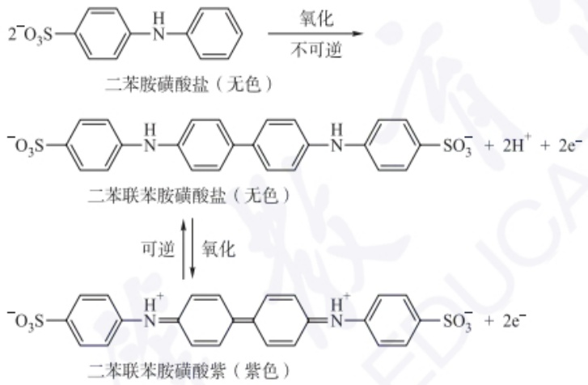

以  $K_{2}Cr_{2}O_{7}$  滴定  $Fe^{2+}$  时，常用二苯胺磺酸钠作指示剂。滴定过程中指示剂会消耗少量的滴定剂，因此对溶液浓度较低、准确度要求较高的测定，必须做指示剂校正。可采用含量与分析样品相近的标准样品或标准溶液在同样条件下标定  $K_{2}Cr_{2}O_{7}$ ，以消除指示剂空白值的影响；或者将其与电位滴定相比较，测得指示剂消耗的量后再予以扣除。另一种简便易行的办法是:先取一定体积的  $Fe^{2+}$  溶液，按测定样品的相同条件（pH、指示剂加入量等）进行滴定至溶液呈稳定的紫红色，再立即迅速加入相同体积的该  $Fe^{2+}$  溶液，此时溶液又变为无色，然后继续用  $K_{2}Cr_{2}O_{7}$  滴定至紫红色。两次滴定消耗的  $K_{2}Cr_{2}O_{7}$  量之差即为指示剂空白值。

## 3.2.4.2 滴定曲线

在氧化还原滴定中,随着滴定剂的加入,被滴定物质的氧化态和还原态浓度逐渐改变,电对的电位也相应在不断变化,这种变化可用滴定曲线描述。若滴定反应中两电对都是可逆进行的,就可以根据 Nernst 方程,由两电对的条件电位计算,构筑滴定曲线。

对于对称电对的氧化还原反应:

$$
p _ {2} \mathrm{Ox} _ {1} + p _ {1} \mathrm{Red} _ {2} \rightleftharpoons p _ {2} \mathrm{Red} _ {1} + p _ {1} \mathrm{Ox} _ {2}
$$

---

146

第三章 化学平衡与滴定分析

对应的两个半反应及其条件电极电位分别是

$$
\mathrm{Ox} _ {1} + n _ {1} \mathrm{e} ^ {-} \rightleftharpoons \mathrm{Red} _ {1} \quad \varphi_ {1} ^ {\ominus^ {\prime}}
$$

$$
\mathrm{Ox} _ {2} + n _ {2} \mathrm{e} ^ {-} \rightleftharpoons \mathrm{Red} _ {2} \quad \varphi_ {2} ^ {\ominus^ {\prime}}
$$

以  $Ox_{1}$  滴定  $Red_{2}$ ，体系中同时存在  $Ox_{1}/Red_{1}$  和  $Ox_{2}/Red_{2}$  两个电对，在滴定过程中的任一点，达到平衡时两电对的电位相等，因此可用两电对之任意一个电对表示滴定体系的电位。

滴定开始至化学计量点之前,滴加的氧化剂几乎全部反应, $Ox_{1}$ 的浓度很小,难以直接求算,以 $Ox_{2}/Red_{2}$ 电对的电位表示滴定体系的电位:

$$
\varphi = \varphi_ {2} = \varphi_ {2} ^ {\ominus \prime} + \frac {0 . 0 5 9 2 \mathrm{V}}{n _ {2}} \lg \frac {c _ {\mathrm{Ox} _ {2}}}{c _ {\mathrm{Red} _ {2}}}
$$

化学计量点之后,还原剂全部被氧化, $Red_{2}$ 的浓度很小,难以直接求算,以 $Ox_{1}/Red_{1}$ 电对的电位表示滴定体系的电位:

$$
\varphi = \varphi_ {1} ^ {\ominus^ {\prime}} + \frac {0 . 0 5 9 2 \mathrm{V}}{n _ {1}} \lg \frac {c _ {\mathrm{Ox} _ {1}}}{c _ {\mathrm{Red} _ {1}}}
$$

滴定达到化学计量点时,滴定体系的电位可用氧化剂或还原剂电对的电位表示:

$$
\varphi_ {\mathrm{sp}} = \varphi_ {1} ^ {\ominus^ {\prime}} + \frac {0 . 0 5 9 2 \mathrm{V}}{n _ {1}} \lg \frac {c _ {\mathrm{Ox} _ {1}}}{c _ {\mathrm{Red} _ {1}}}
$$

$$
\varphi_ {\mathrm{sp}} = \varphi_ {2} ^ {\ominus^ {\prime}} + \frac {0 . 0 5 9 2 \mathrm{V}}{n _ {2}} \lg \frac {c _ {\mathrm{Ox} _ {2}}}{c _ {\mathrm{Red} _ {2}}}
$$

两式相加,整理成

$$
(n _ {1} + n _ {2}) \varphi_ {\mathrm{sp}} = n _ {1} \varphi_ {1} ^ {\ominus^ {\prime}} + n _ {2} \varphi_ {2} ^ {\ominus^ {\prime}} + (0. 0 5 9 2 \mathrm{V}) \lg \left[ \frac {c _ {\mathrm{Ox} _ {1}}}{c _ {\mathrm{Red} _ {1}}} \times \frac {c _ {\mathrm{Ox} _ {2}}}{c _ {\mathrm{Red} _ {2}}} \right]
$$

化学计量点时

$$
\frac {c _ {\mathrm{Ox} _ {1}}}{c _ {\mathrm{Red} _ {2}}} = \frac {c _ {\mathrm{Red} _ {1}}}{c _ {\mathrm{Ox} _ {2}}} = \frac {p _ {2}}{p _ {1}}
$$

故

$$
\lg \left(\frac {c _ {\mathrm{Ox} _ {1}}}{c _ {\mathrm{Red} _ {1}}} \times \frac {c _ {\mathrm{Ox} _ {2}}}{c _ {\mathrm{Red} _ {2}}}\right) = 0
$$

因此化学计量点电位( $\varphi_{sp}$ )的计算通式为

$$
\varphi_ {\mathrm{sp}} = \frac {n _ {1} \varphi_ {1} ^ {\ominus^ {\prime}} + n _ {2} \varphi_ {2} ^ {\ominus^ {\prime}}}{n _ {1} + n _ {2}} \tag {3-2-28}
$$

滴定突跃范围为

$$
\left(\varphi_ {2} ^ {\ominus^ {\prime}} + \frac {3 \times 0 . 0 5 9 2 \mathrm{V}}{n _ {2}}, \quad \varphi_ {1} ^ {\ominus^ {\prime}} - \frac {3 \times 0 . 0 5 9 2 \mathrm{V}}{n _ {1}}\right)
$$

可以看出，滴定突跃范围与浓度无关。若 $n_1 = n_2$ ，则滴定曲线在化学计量点前后是对称的；若 $n_1 \neq n_2$ ，则滴定曲线在化学计量点前后是不对称的，化学计量点电位不在滴定突跃中点，而是偏向电子得失数较多的电对一方。

## (1) $n_{1}=n_{2}$ 的对称电对滴定体系

以  $25^{\circ}C$  下，在  $1\ mol\cdot L^{-1}\ H_{2}SO_{4}$  介质中，用  $0.10\ mol\cdot L^{-1}\ Ce(SO_{4})_{2}$  溶液滴定  $0.10\ mol\cdot L^{-1}\ FeSO_{4}$  溶液为例。

滴定反应为

---

3.2 滴定分析法

147

$$
\mathrm{Ce} ^ {4 +} + \mathrm{Fe} ^ {2 +} \rightleftharpoons \mathrm{Ce} ^ {3 +} + \mathrm{Fe} ^ {3 +}
$$

其中， $\varphi_{Ce^{4+}/Ce^{3+}}^{\ominus\prime}=1.44\ V,\varphi_{Fe^{3+}/Fe^{2+}}^{\ominus\prime}=0.68\ V$ 。

化学计量点前,体系的电位采用  $Fe^{3+}/Fe^{2+}$  电对计算:

$$
\varphi = \varphi_ {\mathrm{Fe} ^ {3 +} / \mathrm{Fe} ^ {2 +}} ^ {\ominus \prime} + (0. 0 5 9 2 \mathrm{V}) \lg c _ {\mathrm{Fe} ^ {3 +}} / c _ {\mathrm{Fe} ^ {2 +}}
$$

化学计量点时,有

$$
\varphi_ {\mathrm{sp}} = \frac {\varphi_ {\mathrm{Fe} ^ {3 +} / \mathrm{Fe} ^ {2 +}} ^ {\ominus \prime} + \varphi_ {\mathrm{Ce} ^ {4 +} / \mathrm{Ce} ^ {3 +}} ^ {\ominus \prime}}{2}
$$

化学计量点后,采用  $Ce^{4+}/Ce^{3+}$  电对计算滴定体系电位:

$$
\varphi = \varphi_ {\mathrm{Ce} ^ {4 +} / \mathrm{Ce} ^ {3 +}} ^ {\ominus , \prime} + (0. 0 5 9 2 \mathrm{V}) \lg c _ {\mathrm{Ce} ^ {4 +}} / c _ {\mathrm{Ce} ^ {3 +}}
$$

不同滴定剂加入体积所计算的体系电位如表 3.2.6 所示, 据此绘制的滴定曲线如图 3.2.13 所示。

表 3.2.6 0.10 mol·L $^{-1}$ Ce (SO $_{4}$ ) $_{2}$ 溶液滴定 20 mL 同浓度的 FeSO $_{4}$ 溶液 (1 mol·L $^{-1}$ H $_{2}$ SO $_{4}$ 介质)

| T/% | V/mL | $c_{Fe^{3+}}/c_{Fe^{2+}}$ | $\varphi/V$ |
| --- | --- | --- | --- |
| 9 | 1.8 | $10^{-1}$ | 0.62 |
| 50 | 10 | $10^0$ | 0.68 |
| 91 | 18.2 | $10^1$ | 0.74 |
| 99 | 19.8 | $10^2$ | 0.80 |
| 99.9 | 19.98 | $10^3$ | 0.86 |
| 100 | 20 |  | 1.06 |
| T/% | V/mL | $c_{Ce^{4+}}/c_{Ce^{3+}}$ | $\varphi/V$ |
| 100.1 | 20.02 | $10^{-3}$ | 1.26 |
| 101 | 20.2 | $10^{-2}$ | 1.32 |
| 110 | 22 | $10^{-1}$ | 1.38 |
| 200 | 40 | $10^0$ | 1.44 |

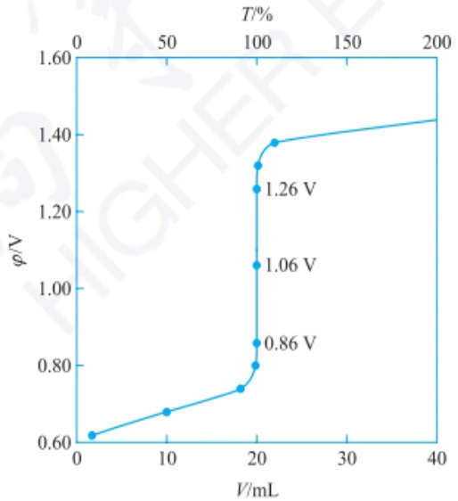

line

| \(\phi/V\) | V/mL | T/% |
| --- | --- | --- |
| 0.62 | ~1 | — |
| 0.74 | ~18 | — |
| 0.80 | ~19 | — |
| 0.86 | ~19 | — |
| 1.06 | ~19 | — |
| 1.26 | ~19 | — |
| 1.32 | ~19 | — |
| 1.38 | ~21 | — |

图 3.2.13 0.10 mol·L $^{-1}$ Ce $^{4+}$ 溶液滴定 20.00 mL 同浓度 Fe $^{2+}$ 溶液的滴定曲线及滴定突跃

从表 3.2.6 和图 3.2.13 可以获得如下信息:  $Ce^{4+}$  滴定  $Fe^{2+}$  的反应中, 滴定百分数为 50% 处的电位等于还原剂电对  $Fe^{3+}/Fe^{2+}$  的条件电极电位, 滴定百分数为

---

148

第三章 化学平衡与滴定分析

200%处的电位等于氧化剂 $Ce^{4+}/Ce^{3+}$ 电对的条件电极电位；滴定突跃与两电对的条件电极电位有关，两个条件电极电位值相差越大，滴定的突跃范围越大；两电对的电子转移数都是1，化学计量点电位(1.06 V)正好处于滴定突跃(0.86\~1.26 V)的中点，化学计量点前后的曲线基本对称；滴定突跃与浓度无关。

## (2) $n_{1}\neq n_{2}$ 的对称电对滴定体系

以  $25^{\circ}C$  下, 在  $1\ mol\cdot L^{-1}\ HCl$  介质中, 用  $0.10\ mol\cdot L^{-1}\ Fe^{3+}$  溶液滴定  $0.10\ mol\cdot L^{-1}\ Sn^{2+}$  溶液为例。

滴定反应与电极电位信息如下:

$$
2 \mathrm{Fe} ^ {3 +} + \mathrm{Sn} ^ {2 +} \rightleftharpoons 2 \mathrm{Fe} ^ {2 +} + \mathrm{Sn} ^ {4 +}
$$

$$
\varphi_ {\mathrm{Fe} ^ {3 +} / \mathrm{Fe} ^ {2 +}} ^ {\ominus \prime} = 0. 7 0 \mathrm{V}, \quad \varphi_ {\mathrm{Sn} ^ {4 +} / \mathrm{Sn} ^ {2 +}} ^ {\ominus \prime} = 0. 1 4 \mathrm{V}
$$

滴定突跃下端电位:

$$
\varphi = \varphi_ {\mathrm{Sn} ^ {4 +} / \mathrm{Sn} ^ {2 +}} ^ {\ominus \prime} + \frac {3 \times 0 . 0 5 9 2 \mathrm{V}}{2} = (0. 1 4 + 0. 0 9) \mathrm{V} = 0. 2 3 \mathrm{V}
$$

滴定突跃上端电位:

$$
\varphi = \varphi_ {\mathrm{Fe} ^ {3 +} / \mathrm{Fe} ^ {2 +}} ^ {\ominus \prime} - 3 \times 0. 0 5 9 2 \mathrm{V} = (0. 7 0 - 0. 1 8) \mathrm{V} = 0. 5 2 \mathrm{V}
$$

滴定突跃为 0.23\~0.52 V。

化学计量点的电位:

$$
\varphi_ {\mathrm{sp}} = \frac {(1 \times 0 . 7 0 + 2 \times 0 . 1 4) \mathrm{V}}{1 + 2} = 0. 3 3 \mathrm{V}
$$

由上述讨论计算获得的滴定曲线如图3.2.14所示。由于 $\mathrm{Sn}^{4+}/\mathrm{Sn}^{2+}$ 的电子转移数大，化学计量点的电位更靠近 $\varphi_{\mathrm{Sn}^{4+}/\mathrm{Sn}^{2+}}^{\ominus t}$ 。

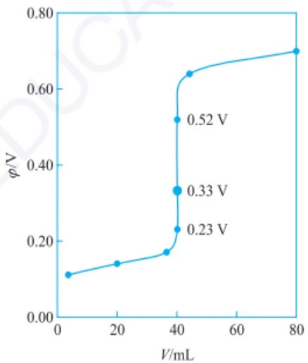

line

| V/mL | \(\phi/V\) |
| --- | --- |
| ~3 | ~0.11 |
| ~20 | ~0.14 |
| ~36 | ~0.17 |
| ~38 | ~0.23 |
| ~39 | ~0.33 |
| ~39 | ~0.52 |
| ~43 | ~0.64 |
| ~80 | ~0.70 |

图3.2.14 以 $0.10\mathrm{mol}\cdot \mathrm{L}^{-1}\mathrm{Fe}^{3+}$ 溶液滴定 $20.00~\mathrm{mL}$ 同浓度的 $\mathrm{Sn}^{2+}$ 的滴定曲线

与可逆电对相比，不可逆电对 $(\mathrm{MnO}_4^- / \mathrm{Mn}^{2+}, \mathrm{Cr}_2\mathrm{O}_7^{2-} / \mathrm{Cr}^{3+}, \mathrm{S}_4\mathrm{O}_6^{2-} / \mathrm{S}_2\mathrm{O}_3^{2-}$ 等）电位与浓度的关系明显偏离Nernst方程，因此计算的滴定曲线与实际滴定曲线有较大差异。尽管如此，理论分析仍有参考价值。

## 3.2.4.3 反函数法绘制滴定曲线

滴定曲线也可以通过反函数方式绘制。下面举例讨论。

仍以  $0.10 \, mol \cdot L^{-1} \, \mathrm{Ce(SO_{4})_{2}}$  溶液滴定体积  $V_{0}(\mathrm{mL})$  同浓度的  $FeSO_{4}$  溶液为例。

滴定过程中任意点有

---

3.2 滴定分析法

149

$$
c _ {\mathrm{Fe}} = \frac {c V _ {0}}{V + V _ {0}}, \quad c _ {\mathrm{Ce}} = \frac {c V}{V + V _ {0}}
$$

根据物料平衡,有

$$
c _ {\mathrm{Fe}} = \left[ \mathrm{Fe} ^ {2 +} \right] + \left[ \mathrm{Fe} ^ {3 +} \right], \quad c _ {\mathrm{Ce}} = \left[ \mathrm{Ce} ^ {4 +} \right] + \left[ \mathrm{Ce} ^ {3 +} \right]
$$

滴定过程中,生成的  $Fe^{3+}$  和  $Ce^{3+}$  的量相等,即

$$
[ \mathrm{Fe} ^ {3 +} ] = [ \mathrm{Ce} ^ {3 +} ]
$$

故

$$
c _ {\mathrm{Fe}} - [ \mathrm{Fe} ^ {2 +} ] = c _ {\mathrm{Ce}} - [ \mathrm{Ce} ^ {4 +} ]
$$

令  $m=\left[Fe^{2+}\right]-\left[Ce^{4+}\right]$ ，代入浓度关系式得

$$
V = \frac {c - m}{c + m} V _ {0}
$$

该反函数与强酸碱滴定、络合滴定具有相同形式。其他氧化还原滴定曲线的反函数推导详见二维码。

## 3.2.4.4 氧化还原滴定前的样品预处理

## 1. 样品预处理必要性

氧化还原滴定中，为了对待测组分进行定量测定，须使其处于统一的价态，因此需进行预氧化或预还原处理。例如，测定样品中的  $Mn^{2+}$ 、 $Cr^{3+}$  含量。由于  $\varphi_{\mathrm{MnO}_{4}^{-}/\mathrm{Mn}^{2+}}^{\ominus}(1.51\;\mathrm{V})$  和  $\varphi_{\mathrm{Cr}_{2}\mathrm{O}_{7}^{2-}/\mathrm{Cr}^{3+}}^{\ominus}(1.33\;\mathrm{V})$  都很高，因此直接滴定  $Mn^{2+}$  和  $Cr^{3+}$  需要寻找电极电位比它们更高的强氧化剂 [如  $(\mathrm{NH}_{4})_{2}\mathrm{S}_{2}\mathrm{O}_{8}$ ] 才行。但  $(\mathrm{NH}_{4})_{2}\mathrm{S}_{2}\mathrm{O}_{8}$  稳定性差，反应速率慢，不能用作滴定剂，但它可作为预氧化剂将  $Mn^{2+}$  和  $Cr^{3+}$  分别氧化到其最高价态  $MnO_{4}^{-}$  和  $Cr_{2}O_{7}^{2-}$ ，这样就可以用还原剂标准溶液（如  $Fe^{2+}$ ）对其进行滴定。

## 2. 预氧化剂或预还原剂的选择原则

选择预氧化剂或预还原剂时须满足以下条件: 必须能将待测组分定量地氧化或还原、反应速率快、预氧化或预还原反应应该有一定的选择性。如测定钛铁矿中的铁时, 如果选用金属锌作为预还原剂, 则  $Fe^{3+}$  和  $Ti^{4+}$  都会被还原, 这样用  $K_{2}Cr_{2}O_{7}$  滴定得到的就是两者的总量。而如果选  $SnCl_{2}$  作预还原剂, 则仅还原  $Fe^{3+}$ , 从而提高了滴定的选择性。过量的预氧化剂或预还原剂须易于除去, 以免对滴定产生干扰。除去的方法一般有: 加热分解、过滤或者通过化学反应形成稳定性高不易被氧化(还原)的化合物。

## 3.2.4.5 常用的氧化还原滴定法

氧化还原滴定中，氧化剂滴定剂远比还原剂滴定剂的应用更广泛，氧化还原滴定法也是用不同氧化剂名称来命名的，如高锰酸钾法、重铬酸钾法、碘量法、溴酸钾法、硫酸铈法等。每种方法都有其特点和适用范围，应根据实际情况选用。此处仅作简介。

## 1. 高锰酸钾法

高锰酸钾 $\left(\mathrm{KMnO}_{4}\right)$ 是一种强氧化剂,可直接、间接地测定多种无机物和有机物,但其氧化能力和还原产物与溶液酸度有很大关系。

在强酸性溶液(如  $H_{2}SO_{4}$ ) 中,  $MnO_{4}^{-}$  被还原成  $Mn^{2+}$ :

$$
\mathrm{MnO} _ {4} ^ {-} + 8 \mathrm{H} ^ {+} + 5 \mathrm{e} ^ {-} \rightleftharpoons \mathrm{Mn} ^ {2 +} + 4 \mathrm{H} _ {2} \mathrm{O} \quad \varphi^ {\ominus} = 1. 5 1 \mathrm{V}
$$

$MnO_{4}^{-}$ 与多数还原剂反应较快,氧化能力强,这是高锰酸钾法中应用最广的一类反应。在强酸性溶液中能用 $KMnO_{4}$ 直接滴定As(Ⅲ)、Sb(Ⅲ)、 $Fe^{2+}$ 、 $H_{2}O_{2}$ 、

氧化还原滴定体系反函数推导

---

150

第三章 化学平衡与滴定分析

$\mathrm{NO}_2^-$ 、 $\mathrm{C_2O_4^{2 - }}$ 等。从平衡角度考虑， $\mathrm{MnO_4^-}$ 与 $\mathrm{Mn}^{2 + }$ 在溶液中不能共存。但是 $\mathrm{KMnO_4}$ 用作滴定剂时，酸性溶液中二者反应速率较慢，再者终点前 $\mathrm{MnO_4^-}$ 浓度极低，因此该滴定得以定量进行。反之，若是以还原剂（如 $\mathrm{Fe}^{2 + }$ )滴定 $\mathrm{MnO_4^-}$，滴定一旦开始，$\mathrm{MnO_4^-}$ （剩余）与 $\mathrm{Mn}^{2 + }$ （产物）都是大量的，它们会反应生成 $\mathrm{MnO_2}$ 。而 $\mathrm{MnO_2}$ 沉淀与还原剂反应慢，且终点不易观察，因此不能用还原剂滴定 $\mathrm{MnO_4^-}$ 。实际测定 $\mathrm{MnO_4^-}$ 时是采用返滴定法，即先加一定量过量还原剂，将 $\mathrm{MnO_4^-}$ 还原成 $\mathrm{Mn}^{2 + }$，再以 $\mathrm{KMnO_4}$ 标准溶液滴定过量的还原剂。

在焦磷酸盐溶液中，控制 pH 为 4\~7，可用  $KMnO_{4}$  滴定  $Mn^{2+}$ ，以测定钢中的锰。由于  $\mathrm{Mn}\left(\mathrm{H}_{2}\mathrm{P}_{2}\mathrm{O}_{7}\right)_{3}^{2-}$  有色，必须用电位法测定终点。

在中性或弱碱性溶液中， $MnO_{4}^{-}$ 被还原成 $MnO_{2}$ :

$$
\mathrm{MnO} _ {4} ^ {-} + 2 \mathrm{H} _ {2} \mathrm{O} + 3 \mathrm{e} ^ {-} \rightleftharpoons \mathrm{MnO} _ {2} + 4 \mathrm{OH} ^ {-} \quad \varphi^ {\ominus} = 0. 5 8 8 \mathrm{V}
$$

利用此反应可测定  $S^{2-}$ 、 $SO_{3}^{2-}$ 、 $S_{2}O_{3}^{2-}$  等，也可测定甲醇、甲酸、甲醛、苯酚等有机物。采用此反应直接滴定的缺点是棕色絮状  $MnO_{2}$  沉淀的生成妨碍终点的观察。

在强碱性溶液中(pH>14):

$$
\mathrm{MnO} _ {4} ^ {-} + \mathrm{e} ^ {-} \rightleftharpoons \mathrm{MnO} _ {4} ^ {2 -} \quad \varphi^ {\ominus} = 0. 5 7 \mathrm{V}
$$

碱性减弱时， $MnO_{4}^{2-}$  易歧化成  $MnO_{4}^{-}$  和  $MnO_{2}$ 。若有  $Ba^{2+}$  存在，由于生成  $BaMnO_{4}$  沉淀，因此可稳定在 Mn(VI)。

市售  $KMnO_{4}$  试剂纯度一般为 99%\~99.5%，其中常含有少量的  $MnO_{2}$  和其他杂质，同时去离子水中也会含有微量的还原性物质（如一些有机物）， $KMnO_{4}$  会与还原性物质缓慢反应产生  $\mathrm{MnO(OH)}_{2}$  沉淀，这些生成物，以及热、光、酸、碱等外部条件都会促进  $KMnO_{4}$  的进一步分解。因此  $KMnO_{4}$  标准溶液不能直接配制。浓度较稀的  $KMnO_{4}$  溶液通常用去离子水临时稀释配制，并立即标定使用，不宜长期贮存。标定好的  $KMnO_{4}$  溶液在放置一段时间后如果发现有  $\mathrm{MnO(OH)}_{2}$  沉淀析出，应过滤后重新标定。

可标定  $KMnO_{4}$  溶液的基准物质很多，如  $H_{2}C_{2}O_{4} \cdot 2H_{2}O$ 、 $Na_{2}C_{2}O_{4}$ 、 $(\mathrm{NH}_{4})_{2}\mathrm{Fe}(\mathrm{SO}_{4})_{2} \cdot 6\mathrm{H}_{2}\mathrm{O}$ 、 $As_{2}O_{3}$  及纯铁丝等。其中最常用的是  $Na_{2}C_{2}O_{4}$ ，因为它容易提纯，性质稳定，且不含结晶水，在 105～110 ℃ 下烘干 2 h 即可使用。在  $H_{2}SO_{4}$  溶液中  $MnO_{4}^{-}$ 与  $C_{2}O_{4}^{2-}$ 的反应如下:

$$
2 \mathrm{MnO} _ {4} ^ {-} + 5 \mathrm{C} _ {2} \mathrm{O} _ {4} ^ {2 -} + 1 6 \mathrm{H} ^ {+} = 2 \mathrm{Mn} ^ {2 +} + 1 0 \mathrm{CO} _ {2} + 8 \mathrm{H} _ {2} \mathrm{O}
$$

根据分析物性质的不同,高锰酸钾法可采用不同的滴定方式。

（i）直接滴定法。As(Ⅲ)、Sb(Ⅲ)、 $Fe^{2+}$ 、 $H_{2}O_{2}$ 、 $C_{2}O_{4}^{2-}$ 等还原性物质均可用 $KMnO_{4}$ 标准溶液在酸性条件下直接滴定。
（ii）间接滴定法。一些物质不具有氧化还原特性，但可与一些有氧化还原性的物质定量反应，因而可通过间接滴定法进行测定。 $Ca^{2+}$ 、 $Ba^{2+}$ 、 $Mg^{2+}$ 、 $Zn^{2+}$ 、 $Pb^{2+}$ 等可以用间接高锰酸钾法测定，因为这些离子均可与草酸根定量反应生成沉淀。例如，测定 $Ca^{2+}$ 时，先用 $C_{2}O_{4}^{2-}$ 将其定量沉淀为 $CaC_{2}O_{4}$，再用稀 $H_{2}SO_{4}$ 溶解，然后用 $KMnO_{4}$ 滴定释放的 $C_{2}O_{4}^{2-}$，根据消耗的 $KMnO_{4}$ 量间接求得 $Ca^{2+}$ 含量。
（iii）返滴定法。有些物质，如  $MnO_{2}$ 、 $PbO_{2}$  及一些有机物，不能用  $KMnO_{4}$  直接滴定，但可用返滴定法。例如，测定软锰矿中的  $MnO_{2}$  含量时，可加入一定量过量的  $Na_{2}C_{2}O_{4}$  标准溶液于磨细的矿样中，加入  $H_{2}SO_{4}$  溶液并加热，当溶液中无棕黑色颗粒存在时，表示样品分解完全，再用  $KMnO_{4}$  趁热返滴定剩余的  $C_{2}O_{4}^{2-}$ 。由

---

3.2 滴定分析法

151

$Na_{2}C_{2}O_{4}$  加入量和  $KMnO_{4}$  溶液消耗量之差, 求出  $MnO_{2}$  的含量。

## 2. 重铬酸钾法

重铬酸钾 $\left(\mathrm{K}_{2}\mathrm{Cr}_{2}\mathrm{O}_{7}\right)$ 是常用的氧化剂之一，在酸性溶液中被还原为 $Cr^{3+}$ 。电极反应及标准电极电位为

$$
\mathrm{Cr} _ {2} \mathrm{O} _ {7} ^ {2 -} + 1 4 \mathrm{H} ^ {+} + 6 \mathrm{e} ^ {-} \rightleftharpoons 2 \mathrm{Cr} ^ {3 +} + 7 \mathrm{H} _ {2} \mathrm{O} \quad \varphi^ {\ominus} = 1. 3 3 \mathrm{V}
$$

实际上，在酸性溶液中  $Cr_{2}O_{7}^{2-}/Cr^{3+}$  电对的条件电位较标准电极电位小得多。例如，在  $1\ mol\cdot L^{-1}\ HClO_{4}$  溶液中， $\varphi^{\ominus'}=1.03\ V$ ; 在  $0.5\ mol\cdot L^{-1}\ H_{2}SO_{4}$  溶液中， $\varphi^{\ominus'}=1.08\ V$ ; 在  $1\ mol\cdot L^{-1}\ HCl$  溶液中， $\varphi^{\ominus'}=1.00\ V$ 。

重铬酸钾法具有以下一些优点:$\mathrm{K_2Cr_2O_7}$ 是基准物质，可以制得很纯，在 $150\sim 180^{\circ}C$ 下干燥 $2\mathrm{h}$ 就可以直接配制标准溶液，无须标定；$\mathrm{K_2Cr_2O_7}$ 标准溶液非常稳定，可以长期保存；$\mathrm{K_2Cr_2O_7}$ 氧化性较 $\mathrm{KMnO_4}$ 弱，选择性较高。在HCl浓度小于$3\mathrm{mol}\cdot \mathrm{L}^{-1}$ 时 $\mathrm{Cr_2O_7^{2 - }}$ 不氧化 $\mathrm{Cl^-}$，因此用 $\mathrm{K_2Cr_2O_7}$ 测定 $\mathrm{Fe^{2 + }}$ 时可以在HCl介质中进行。

$Cr_{2}O_{7}^{2-}$  的还原产物  $Cr^{3+}$  呈绿色, 滴定中需要用指示剂指示终点, 常用指示剂是二苯胺磺酸钠。

重铬酸钾法可应用于诸多场景,如铁矿石中全铁量的测定。

重铬酸钾法是测定铁矿石中全铁量的标准方法。其方法是:样品先用热的浓HCl溶解，再加 $SnCl_{2}$ 趁热将 $Fe^{3+}$ 还原为 $Fe^{2+}$ 。冷却后，过量的 $SnCl_{2}$ 用 $HgCl_{2}$ 氧化，此时会产生丝状 $Hg_{2}Cl_{2}$ 白色沉淀。样品用水稀释后加入 $1\sim2\ mol\cdot L^{-1}$   $H_{2}SO_{4}-H_{3}PO_{4}$ 混合酸，并加入二苯胺磺酸钠指示剂，立即用 $K_{2}Cr_{2}O_{7}$ 标准溶液滴定至溶液由无色到浅绿最终为紫红色。

## 3. 碘量法

碘量法是利用  $I_{2}$  氧化性和  $I^{-}$ 还原性的一种滴定方法。固体  $I_{2}$  易于挥发且在水中溶解度很小，通常将  $I_{2}$  溶解于 KI 溶液中形成  $I_{3}^{-}$ 络离子，其半反应和标准电极电位如下:

$$
\mathrm{I} _ {3} ^ {-} + 2 \mathrm{e} ^ {-} \rightleftharpoons 3 \mathrm{I} ^ {-} \quad \varphi^ {\ominus} = 0. 5 4 \mathrm{V}
$$

为简化并强调化学计量关系，一般 $\mathrm{I}_3^-$ 仍简写为 $\mathrm{I}_2$ 。 $\mathrm{I}_2$ 是较弱的氧化剂，能与较强的还原剂作用；而 $\mathrm{I}^-$ 是中等强度还原剂，能与很多氧化剂反应。能用 $\mathrm{I}_2$ 直接滴定的强还原剂有 $\mathrm{S}_2\mathrm{O}_3^{2-}$ 、As(Ⅲ)、$\mathrm{SO}_3^{2-}$ 、Sn(Ⅱ)、维生素C等，这称为直接碘量法（或碘滴定法）。利用 $\mathrm{I}^-$ 的还原作用，可与许多氧化性物质（如 $\mathrm{MnO}_4^-$ 、$\mathrm{Cr}_2\mathrm{O}_7^{2-}$ 、$\mathrm{H}_2\mathrm{O}_2$ 、$\mathrm{Cu}^{2+}$ 、$\mathrm{Fe}^{3+}$ 等）反应，定量析出 $\mathrm{I}_2$ ，然后用 $\mathrm{Na}_2\mathrm{S}_2\mathrm{O}_3$ 标准溶液滴定 $\mathrm{I}_2$ ，从而间接测定氧化性物质，这称为间接碘量法（或滴定碘法），间接碘量法应用最广。

$I_{3}^{-}/I^{-}$ 电对可逆性好,其电位在很大的pH范围内(pH<9)不受酸度和其他络合剂影响,所以在选择测定条件时,只需考虑分析物的性质。

$\mathrm{I}_2$ 与 $\mathrm{S}_2\mathrm{O}_3^{2-}$ 的反应是 $\mathrm{I}_2 + 2\mathrm{S}_2\mathrm{O}_3^{2-} = 2\mathrm{I}^- +\mathrm{S}_4\mathrm{O}_6^{2-}$，这是碘量法中最重要的反应，$\mathrm{I}_2$ 与 $\mathrm{S}_2\mathrm{O}_3^{2-}$ 反应的计量比是 $1:2$。酸度控制不当会影响其计量关系。

碘量法中常用的标准溶液是  $Na_{2}S_{2}O_{3}$  和  $I_{2}$  溶液。 $Na_{2}S_{2}O_{3}$  不是基准物质，不能直接配制标准溶液。因此， $Na_{2}S_{2}O_{3}$  溶液需采用间接法配制，即先配制近似浓度并用  $K_{2}Cr_{2}O_{7}$  或  $KIO_{3}$  等基准物质标定。

以  $K_{2}Cr_{2}O_{7}$  为例, 其在酸性溶液中与 KI 作用, 反应如下:

$$
\mathrm{Cr} _ {2} \mathrm{O} _ {7} ^ {2 -} + 6 \mathrm{I} ^ {-} + 1 4 \mathrm{H} ^ {+} = 2 \mathrm{Cr} ^ {3 +} + 3 \mathrm{I} _ {2} + 7 \mathrm{H} _ {2} \mathrm{O}
$$

以淀粉为指示剂，以  $Na_{2}S_{2}O_{3}$  滴定析出的  $I_{2}$ 。

$Na_{2}S_{2}O_{3}$  溶液不稳定,容易分解,因此  $Na_{2}S_{2}O_{3}$  溶液放置一段时间后应重新标

---

152

第三章 化学平衡与滴定分析

定，如果溶液变混浊，表明有硫析出，应弃去重配。

$\mathrm{I}_2$ 的挥发性强，准确称量较困难，一般是先将一定量的 $\mathrm{I}_2$ 溶于KI的浓溶液中，然后稀释至一定体积，配制成大致浓度的溶液再标定。常用 $\mathrm{As_2O_3}$ 标定 $\mathrm{I}_2$ 溶液，也可用标定好的 $\mathrm{Na_2S_2O_3}$ 溶液标定。由于 $\mathrm{As_2O_3}$ 难溶于水，可用NaOH溶解。在 $\mathrm{pH}8\sim 9,\mathrm{I}_2$ 氧化 $\mathrm{HAsO_2}$ 的反应为

$$
\mathrm{HAsO} _ {2} + \mathrm{I} _ {2} + 2 \mathrm{H} _ {2} \mathrm{O} = \mathrm{HAsO} _ {4} ^ {2 -} + 2 \mathrm{I} ^ {-} + 4 \mathrm{H} ^ {+}
$$

标定时,先酸化溶液,再加入  $NaHCO_{3}$  溶液调节 pH≈8。

碘量法具有广泛的应用,在此举例如下:

（i）钢铁中硫的测定。钢样和助熔剂(金属锡)置于瓷舟中，放入1300℃的管式炉中并通空气，硫会被氧化为 $SO_{2}$ ，用水吸收，以淀粉作指示剂，用稀碘标准溶液滴定，属于直接碘量法。硫在1300℃的氧化、水吸收及与 $I_{2}$ 的反应如下:

$$
\mathrm{S} + \mathrm{O} _ {2} = \mathrm{SO} _ {2}
$$

$$
\mathrm{SO} _ {2} + \mathrm{H} _ {2} \mathrm{O} = \mathrm{H} _ {2} \mathrm{SO} _ {3}
$$

$$
\mathrm{H} _ {2} \mathrm{SO} _ {3} + \mathrm{I} _ {2} + \mathrm{H} _ {2} \mathrm{O} = \mathrm{SO} _ {4} ^ {2 -} + 2 \mathrm{I} ^ {-} + 4 \mathrm{H} ^ {+}
$$

（ii）铜的测定。碘量法测定铜是基于  $Cu^{2+}$  与过量 KI 反应定量析出  $I_{2}$ ，再用  $Na_{2}S_{2}O_{3}$  标准溶液滴定，属于间接碘量法。如果测定铜矿中的铜含量，样品经  $HNO_{3}$  消解后，其中所含的一些杂质元素铁、砷、锑等以高价态进入溶液，Fe（Ⅲ）、As（V）、Sb（V）及过量的  $HNO_{3}$  或消解过程产生的氮氧化物均能氧化  $\Gamma^{-}$ ，从而干扰  $Cu^{2+}$  测定。因此，铜矿样品消解后须做以下处理:加入浓  $H_{2}SO_{4}$  并加热至冒白烟，驱尽  $HNO_{3}$  和氮氧化物，中和过量  $H_{2}SO_{4}$  后，加入  $NH_{4}HF_{2}$  缓冲溶液控制 pH 在 3\~4，使  $Fe^{3+}$  被络合，同时在该 pH 下 As（V）和 Sb（V）不再氧化  $\Gamma^{-}$ ，从而消除了干扰。当 pH<4 时， $Cu^{2+}$  不会发生水解，此时滴定反应可定量进行。

（iii）Karl-Fischer 法测定水。该方法的基本原理是  $I_{2}$  氧化  $SO_{2}$  时需要定量的  $H_{2}O$ ，反应如下:

$$
\mathrm{I} _ {2} + \mathrm{SO} _ {2} + 2 \mathrm{H} _ {2} \mathrm{O} = \mathrm{H} _ {2} \mathrm{SO} _ {4} + 2 \mathrm{HI}
$$

在有吡啶 $\left(\mathrm{C}_{5}\mathrm{H}_{5}\mathrm{N}\right)$ 存在时,它与反应生成的酸结合,以上反应才能定量地进行,总反应如下:

$$
\mathrm{C} _ {5} \mathrm{H} _ {5} \mathrm{N} \cdot \mathrm{I} _ {2} + \mathrm{C} _ {5} \mathrm{H} _ {5} \mathrm{N} \cdot \mathrm{SO} _ {2} + \mathrm{C} _ {5} \mathrm{H} _ {5} \mathrm{N} + \mathrm{H} _ {2} \mathrm{O} \longrightarrow 2 \mathrm{C} _ {5} \mathrm{H} _ {5} \mathrm{N} \cdot \mathrm{HI} + \mathrm{C} _ {5} \mathrm{H} _ {5} \mathrm{N} \cdot \mathrm{SO} _ {3}
$$

但  $C_{5}H_{5}N \cdot SO_{3}$  也能与水反应,为此加入甲醇,以防止副反应的发生:

$$
\mathrm{C} _ {5} \mathrm{H} _ {5} \mathrm{N} \cdot \mathrm{SO} _ {3} + \mathrm{CH} _ {3} \mathrm{OH} \longrightarrow \mathrm{C} _ {5} \mathrm{H} _ {5} \mathrm{NHOSO} _ {2} \mathrm{OCH} _ {3}
$$

实际应用中，Karl-Fischer法测定水的标准溶液是 $\mathrm{I}_2$ 、 $\mathrm{SO}_2$ 、 $\mathrm{C}_5\mathrm{H}_5\mathrm{N}$ 和 $\mathrm{CH}_3\mathrm{OH}$ 的混合溶液，称为Fischer试剂。由于 $\mathrm{I}_2$ 的存在，Fischer试剂呈红棕色，与水反应后成浅黄色，溶液由浅黄色变红棕色滴定即达终点。由于是测定样品中的水，测定中所用器皿均须干燥。试剂的标定可用水-甲醇标准溶液或者稳定的结晶水合物基准物质。

## 4. 溴酸钾法

溴酸钾 $\left(\mathrm{KBrO}_{3}\right)$ 是强氧化剂 $\left[\varphi^{\ominus}\left(\mathrm{BrO}_{3}^{-}/\mathrm{Br}_{2}\right)=1.44\mathrm{V}\right]$ ，容易制纯，在180℃烘干后可直接称量配制标准溶液。在酸性溶液中可直接滴定一些还原性物质，如As(Ⅲ)、Sb(Ⅲ)、Sn(Ⅱ)等。

$\mathrm{KBrO}_3$ 主要用于测定有机物。在配制 $\mathrm{KBrO}_3$ 标准溶液时，一般加入过量KBr于其中。测定时，将该标准溶液加入酸性试液中，此时 $\mathrm{KBrO}_3$ 与KBr反应生成$\mathrm{Br}_2$ ，因此实际上相当于溴标准溶液 $[\varphi^{\ominus}(\mathrm{Br}_{2} / \mathrm{Br}^{-}) = 1.08\mathrm{V}]$ 。溴水不稳定，不适合

---

3.2 滴定分析法

153

配制标准溶液用于滴定，而  $KBrO_{3}-KBr$  标准溶液很稳定，只有在酸化时才会生成  $Br_{2}$ ，如同即时配制溴标准溶液。通过溴的取代作用可以测定酚类及芳香胺有机化合物；通过溴的加成反应可以测定有机物不饱和度。溴与有机物反应的速率较慢，需要采用返滴定法，加入过量试剂，反应完成后过量的  $Br_{2}$  用碘量法测定。因此溴酸钾法一般与碘量法联合使用， $I_{2}$  与  $Br_{2}$  的反应如下:

$$
\mathrm{Br} _ {2} (\text {过量}) + 2 \mathrm{I} ^ {-} = 2 \mathrm{Br} ^ {-} + \mathrm{I} _ {2}
$$

$$
\mathrm{I} _ {2} + 2 \mathrm{S} _ {2} \mathrm{O} _ {3} ^ {2 -} = 2 \mathrm{I} ^ {-} + \mathrm{S} _ {4} \mathrm{O} _ {6} ^ {2 -}
$$

## 5. 铈量法

$\mathrm{Ce}^{4+}$ [一般指酸性 $\mathrm{Ce(SO_4)_2}$ 溶液]是强氧化剂（$1\mathrm{mol}\cdot \mathrm{L}^{-1}\mathrm{H}_2\mathrm{SO}_4$ 溶液中的$\varphi^{\ominus \prime} = 1.44\mathrm{V})$ ，其氧化性与 $\mathrm{KMnO_4}$ 相当，凡是 $\mathrm{KMnO_4}$ 能测定的物质，几乎都可以用铈量法测定。 $\mathrm{Ce}^{4 + }$ 标准溶液比 $\mathrm{KMnO_4}$ 稳定，又能在较酸的HCl中滴定，且副反应少。但由于铈盐价格高而应用不多。此外， $\mathrm{Ce}^{4 + }$ 与一些还原剂反应速率较慢，如与草酸反应需要加热，与As(Ⅲ)反应需加催化剂。

铈标准溶液可以用硫酸铈铵 $\left[\mathrm{Ce}\left(\mathrm{SO}_{4}\right)_{2}\cdot\left(\mathrm{NH}_{4}\right)_{2}\mathrm{SO}_{4}\cdot2\mathrm{H}_{2}\mathrm{O}\right]$ 基准物质直接称量配制，也可以用纯度较差的铈（IV）盐配成大致浓度然后用 $As_{2}O_{3}$ 或 $Na_{2}C_{2}O_{4}$ 溶液标定。 $Ce^{4+}$ 易水解生成碱式盐沉淀，配制 $Ce^{4+}$ 标准溶液必须加酸，滴定须在强酸溶液中进行，一般采用1,10-邻二氮菲-亚铁作指示剂。

## 3.2.5 沉淀滴定法

沉淀滴定法(precipitation titration)是基于金属离子与沉淀剂之间的沉淀反应的滴定分析方法。沉淀滴定法涉及沉淀的溶解度，以及沉淀条件的控制。沉淀反应数量众多，但是很多反应不够完全，或不够快，或沉淀没有固定组成，所以满足滴定分析要求的沉淀反应非常少。沉淀的吸附作用使终点颜色变化缓慢，难以判断终点，此外悬浊液对颜色判断也有干扰。因此，具有实用价值的沉淀滴定分析法只有银量法(argentometric titration)，是基于 $\mathrm{Ag^{+}}$ 与卤离子或者类卤离子之间的沉淀反应。

$$
\mathrm{Ag} ^ {+} + \mathrm{X} ^ {-} \rightleftharpoons \mathrm{AgX} \downarrow
$$

本节仅对滴定曲线和基于不同指示剂的方法进行简介。

## 3.2.5.1 沉淀滴定曲线

沉淀滴定曲线是以滴定过程中平衡体系的  $\mathrm{pX}(\mathrm{pX}=-\lg[\mathrm{X}],\mathrm{X}$  表示被滴定的银离子或者卤素离子)为纵坐标,加入的滴定剂体积 V 或者滴定百分数  $T(\%)$  为横坐标绘制的曲线。

以  $0.10 \, mol \cdot L^{-1}(c) \, AgNO_{3}$  溶液滴定  $20.00 \, \text{mL}(V_{0})$  同浓度 NaCl 溶液为例。

化学计量点之前,设加入体积  $V(\mathrm{mL})$  滴定剂,溶液中剩余的  $[Cl^{-}]$  由下式计算:

$$
\mathrm {[Cl^ {-} ] = \frac {c V_ {0} - c V}{V+ V_ {0}} = \frac {0.10\times20.00- 0.10V}{20.00 + V}}
$$

化学计量点时,有

$$
\left[ \mathrm{Cl} ^ {-} \right] = \left[ \mathrm{Ag} ^ {+} \right] = \sqrt {K _ {\mathrm{sp}}}
$$

化学计量点后,溶液中过量的 $\left[Ag^{+}\right]$ 由下式计算:

$$
\left[ \mathrm{Ag} ^ {+} \right] = \frac {c V - c V _ {0}}{V + V _ {0}} = \frac {0 . 1 0 V - 0 . 1 0 \times 2 0 . 0 0}{2 0 . 0 0 + V}
$$

---

154

第三章 化学平衡与滴定分析

故

$$
\left[ \mathrm{Cl} ^ {-} \right] = \frac {K _ {\mathrm{sp}}}{\left[ \mathrm{Ag} ^ {-} \right]}
$$

表 3.2.7 列出不同滴定体积或滴定百分数的 pCl 和 pAg，其滴定曲线如图 3.2.15 所示。图中亦同时绘制以  $0.10 \, mol \cdot L^{-1} \, AgNO_{3}$  溶液分别滴定 20.00 mL 同浓度 NaBr、NaI 的滴定曲线。

表 3.2.7 0.10 mol·L $^{-1}$ AgNO $_{3}$ 滴定 20.00 mL 同浓度 NaCl 的 pCl 与 pAg 变化

| V/mL | T/% | pCl | pAg |
| --- | --- | --- | --- |
| 0.00 | 0 | 1.0 |  |
| 18.00 | 90 | 2.3 | 7.2 |
| 19.80 | 99 | 3.3 | 6.2 |
| 19.98 | 99.9 | 4.3 | 5.2 |
| 20.00 | 100.0 | 4.7(5) | 4.7(5) |
| 20.02 | 100.1 | 5.2 | 4.3 |
| 20.20 | 101 | 6.2 | 3.3 |
| 22.00 | 110 | 7.2 | 2.3 |
| 40.00 | 200 | 8.0 | 1.5 |

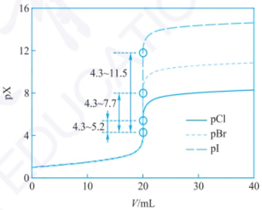

line

| V/mL | pCl (pX) | pBr (pX) | pI (pX) |
| --- | --- | --- | --- |
| 20 | ~4.3~5.2 | ~8.0~11.5 | ~12.0 |

图 3.2.15 0.10 mol·L $^{-1}$ AgNO $_{3}$ 溶液分别滴定 20.00 mL 同浓度 NaCl、NaBr 和 NaI 溶液的滴定曲线 (AgCl、AgBr 和 AgI 的 pK $_{sp}$ 分别为 9.5、12.06 和 15.83)

图 3.2.15 显示了滴定曲线的典型特征:  $\mathrm{pX}\left(\mathrm{X}=\mathrm{Cl}^{-},\mathrm{Br}^{-},\mathrm{I}^{-}\right)$  在滴定初期缓慢变化, 接近化学计量点时发生突跃, 化学计量点之后的变化又趋于平缓。从图中还可以看出, 不同卤素离子的滴定曲线具有相似外形; 不同滴定体系, 化学计量点前的曲线重合; 滴定突跃关于化学计量点对称。对于给定滴定体系, 化学计量点不随滴定体系的浓度变化, 滴定突跃随浓度变化而变化, 浓度增加为 10 倍, 滴定突跃的上下两端点均向外拓宽一个 pX 单位。

也可以通过反函数绘制 V-pX 曲线。

设 NaCl 体积为  $V_{0}(\mathrm{mL})$ ,  $AgNO_{3}$  和 NaCl 的浓度均为  $c(\mathrm{mol}\cdot\mathrm{L}^{-1})$ 。加入体积  $V(\mathrm{mL})\mathrm{AgNO}_{3}$  时，滴定过程中的浓度变化为

$$
c _ {\mathrm{NaCl}} = \frac {c V _ {0}}{V + V _ {0}}, \quad c _ {\mathrm {AgNO_ {3}}} = \frac {c V}{V + V _ {0}}
$$

物质的量则可表示为

---

3.2 滴定分析法

155

$$
n _ {\mathrm{NaCl}} = c V _ {0}, \quad n _ {\mathrm {AgNO_ {3}}} = c V
$$

根据物料平衡,有

$$
n _ {\mathrm{Ag}} ^ {\mathrm{T}} = n _ {\mathrm {Ag^ {+}}} + n _ {\mathrm{AgCl}} \quad \text {和} \quad n _ {\mathrm{Cl}} ^ {\mathrm{T}} = n _ {\mathrm {Cl^ {-}}} + n _ {\mathrm{AgCl}}
$$

则

$$
n _ {\mathrm{Ag}} ^ {\mathrm{T}} - n _ {\mathrm{Ag} ^ {+}} = n _ {\mathrm{Cl}} ^ {\mathrm{T}} - n _ {\mathrm{Cl} ^ {-}}
$$

代入物质的量计算式:

$$
c V - \left[ \mathrm{Ag} ^ {+} \right] (V + V _ {0}) = c V _ {0} - \left[ \mathrm{Cl} ^ {-} \right] (V + V _ {0})
$$

令 $m = [\mathrm{Cl}^{-}] - [\mathrm{Ag}^{+}]$ ，其中， $[\mathrm{Cl}^{-}] = \frac{K_{\mathrm{sp}}}{[\mathrm{Ag}^{+}]}$ ，则

$$
V = \frac {c - m}{c + m} V _ {0}
$$

该公式的形式与强酸碱滴定、络合滴定、氧化还原滴定一样，其中，m 表示滴定过程中分析物与滴定剂之间的浓度差。

## 3.2.5.2 沉淀滴定分析的典型应用实例

沉淀滴定过程中,尤其是临近终点时,应当充分振荡,以降低沉淀对构晶离子的吸附,减小分析误差。

沉淀滴定分析以银量法为主,根据所用指示剂的不同,以创立者的名字命名,以下进行简介。

## 1. 莫尔法

莫尔法由德国化学家 Karl Friedrich Mohr 创立。以  $K_{2}CrO_{4}$  为指示剂，在中性或弱碱性介质中，以  $Ag^{+}$ 标准溶液滴定  $Cl^{-}$ 或者  $Br^{-}$ 溶液。滴定初期  $Ag^{+}$ 首先与  $Cl^{-}$ 生成 AgCl 沉淀（AgCl 的溶解度小于  $Ag_{2}CrO_{4}$ ），滴定反应完成后，继续加入的  $Ag^{+}$ 与  $CrO_{4}^{2-}$ 生成红色  $Ag_{2}CrO_{4}$  沉淀，指示终点。

莫尔法可以以返滴定方式测定  $Ag^{+}$ 。但是，莫尔法不能测  $I^{-}$ 或者  $SCN^{-}$ ，原因是 AgI 对  $I^{-}$ 的吸附、AgSCN 对  $SCN^{-}$ 的吸附过于强烈，即使充分振荡也无法有效降低吸附，致使终点变化不明显。

莫尔法的适宜 pH 范围是 6.5\~10.5, 酸度过高或者过低都会导致副反应:

$$
\mathrm{Ag} _ {2} \mathrm{CrO} _ {4} + \mathrm{H} ^ {+} \rightleftharpoons 2 \mathrm{Ag} ^ {+} + \mathrm{HCrO} _ {4} ^ {-}
$$

$$
2 \mathrm{Ag} ^ {+} + 2 \mathrm{OH} ^ {-} \rightleftharpoons \mathrm{Ag} _ {2} \mathrm{O} + \mathrm{H} _ {2} \mathrm{O}
$$

$AsO_{4}^{3-}$ 、 $CO_{3}^{2-}$ 、 $C_{2}O_{4}^{2-}$ 、 $PO_{4}^{3-}$ 、 $S^{2-}$ 、 $SO_{4}^{2-}$ 等和 $Ag^{+}$ 生成沉淀， $Ba^{2+}$ 、 $Pb^{2+}$ 和 $CrO_{4}^{2-}$ 生成沉淀，所以滴定时需要除去这些干扰离子。

## 2. 福尔哈德法

福尔哈德法由德国化学家 Jacob Volhard 创立。福尔哈德法以铁铵矾  $\mathrm{NH_{4}Fe(SO_{4})_{2}}$  为指示剂，以  $SCN^{-}$ 滴定  $Ag^{+}$ ，滴定反应完成后，继续加入的  $SCN^{-}$ 与  $Fe^{3+}$ 生成红色  $FeSCN^{2+}$  络离子，指示终点。根据实际分析经验，当  $Fe^{3+}$ 浓度为  $0.015\ mol\cdot L^{-1}$ ，终点变色明显而且终点误差较小。

福尔哈德法可以以返滴定方式测定卤素离子或者 $\mathrm{SCN}^{-}$ 。返滴定测定 $\mathrm{SCN}^{-}$ 时，向分析物溶液加入一定量过量的 $\mathrm{Ag^{+}}$ 标准溶液，被测 $\mathrm{SCN}^{-}$ 与 $\mathrm{Ag^{+}}$ 反应完全后，用 $\mathrm{SCN}^{-}$ 标准溶液滴定剩余 $\mathrm{Ag^{+}}$ ，最终测得含量。

返滴定法测定  $Cl^{-}$  时，加入过量的  $Ag^{+}$  标准溶液后，需要处理已经生成的 AgCl 沉淀，否则返滴定时加入的  $SCN^{-}$  与 AgCl 反应，生成溶解度更小的 AgSCN。可以滤去 AgCl 沉淀再进行返滴定，或者加入硝基苯、1,2-二氯乙烷等有机溶剂，附着

---

156

第三章 化学平衡与滴定分析

在 AgCl 表面,避免其与 SCN $^{-}$ 接触。

返滴定法测定  $Br^{-}$  和  $I^{-}$  时不存在上述问题, 因为 AgBr 和 AgI 的溶解度均小于 AgSCN 的溶解度。返滴定法测定  $I^{-}$  时, 指示剂应该在 AgI 生成后加入, 以避免  $Fe^{3+}$  对  $I^{-}$  的氧化。

福尔哈德法的适宜 pH 范围是 0\~1，在此强酸性溶液中， $AsO_{4}^{3-}$ 、 $CO_{3}^{2-}$ 、 $C_{2}O_{4}^{2-}$ 、 $PO_{4}^{3-}$ 、 $SO_{4}^{2-}$ 等酸根不再与  $Ag^{+}$ 生成沉淀，因此不会干扰滴定分析。

## 3. 法扬斯法

法扬斯法是波兰物理化学家 Kasimir Fajans 创立的方法,既可以测定  $Ag^{+}$ ,也可以测定卤素离子。法扬斯法借助卤化银沉淀的吸附性,通过吸附指示剂(adsorption indicator)确定滴定终点。

滴定过程中,生成的卤化银沉淀优先吸附构晶离子,致使其表面带有电荷。如果沉淀表面电荷与指示剂离子的电荷相反,那么指示剂离子被吸附到沉淀表面。由于这种吸附,指示剂分子构型发生改变,导致颜色变化,从而指示终点。

例如，$\mathrm{Ag^{+}}$滴定 $\mathrm{Cl^-}$，荧光黄阴离子作为指示剂。终点前 $\mathrm{Cl^-}$过量，$\mathrm{AgCl}$ 沉淀因优先吸附 $\mathrm{Cl^-}$而使表面带有负电荷；荧光黄阴离子不被吸附，呈现本来的黄绿色。终点后 $\mathrm{Ag^{+}}$过量，$\mathrm{AgCl}$ 沉淀因吸附 $\mathrm{Ag^{+}}$而使其表面带有正电荷，荧光黄阴离子被吸附在沉淀表面，呈现粉红色，指示终点。

吸附指示剂的颜色变化发生在卤化银沉淀表面,所以沉淀的表面积越大,终点变色越敏锐。为此,滴定时常加入糊精,以防止卤化银沉淀聚集,导致表面积减小。

卤化银容易感光变为灰黑色,影响终点观察,因此法扬斯法应避免在强光下进行。

指示剂应该主要以离子形态存在，才能够被沉淀吸附。所以需要调节酸度，使溶液中有足够的指示剂离子。例如，荧光黄是有机弱酸， $K_{a}\approx1\times10^{-7}$ ，为了有足够的荧光黄阴离子指示终点，调节溶液pH为7\~10。

指示剂的吸附性应该适当,吸附和脱附能够迅速完成,否则无法正确指示终点。例如,曙红不适合作为  $Ag^{+}$ 滴定  $Cl^{-}$ 的指示剂,因为其吸附性大于  $Cl^{-}$ ,化学计量点之前就会被吸附到 AgCl 沉淀表面发生颜色变化,无法正确指示终点。

## 3.2.6 滴定分析理论的总结

## 3.2.6.1 滴定曲线反函数的通式

滴定曲线是滴定体系的纵坐标随滴定体积 V（或滴定百分数）变化的函数，对于酸碱滴定、络合滴定、氧化还原滴定及沉淀滴定，纵坐标分别为 pH、pM'（或 pM）、 $\varphi$ 、pX（此处 X 为  $Ag^{+}$ 或卤素离子）。本节到此，已经对滴定曲线进行了较详细讨论。

在滴定曲线的讨论中，不仅学习了传统的分段式滴定曲线的绘制与讨论方法，还领略了基于基本定量关系式，如电荷平衡式和物料平衡式，推导出滴定曲线反函数 $V = g([H^{+}]$，绘制滴定曲线，获得滴定突跃范围信息，以及基于体积计算误差的便捷性。此外，也可以看到滴定过程中，分析物与滴定剂浓度、滴定反应常数、参与反应的质子转移或电子转移的量与滴定体积的关系，也即化学反应的热力学常数、物料平衡、质子转移守恒或电子转移守恒这些底层逻辑关系对滴定曲线的影响。

若滴定剂和分析物分别表示为 T 和 A, 其浓度相同, 均为  $c \left( \mathrm{mol} \cdot \mathrm{L}^{-1} \right)$ , A 的

---

3.2 滴定分析法

157

起始体积为 $V_{0}(\mathrm{mL})$ ，如果滴定反应计量关系为 $n_1\mathrm{T} - n_2\mathrm{A}$ ，那么滴定曲线的反函数通式可以总结为:

$$
V = \frac {n _ {1} c f - m}{n _ {2} c + m} V _ {0} \tag {3-2-29}
$$

其中， $m=n_{1}[A]-n_{2}[T]$ ; f 为分析物存在解离时的因子。

该通式将基于四大化学平衡的四种滴定分析方法之滴定曲线统一起来,说明了四大滴定分析法之底层逻辑的一致性。

\- 关于 $f$

对于强酸的滴定、络合滴定、氧化还原滴定和沉淀滴定，f=1；对于弱酸体系和含有弱酸的混合酸体系的滴定，f为弱酸滴定产物所有带电荷形态的电荷相关的分布分数的加和，对应于分析物的解离产生的相应的质子的分布分数加和。

\- 关于 $m$

## (i) 化学计量比为 1:1 的滴定体系

对于酸碱滴定， $m=\left[H^{+}\right]-\left[OH^{-}\right]$ ；对于EDTA滴定金属离子的络合滴定， $m=\left[M\right]-\left[Y\right]$ ；对于单电子转移的氧化还原滴定，如 $Ce^{4+}$ 滴定 $Fe^{2+}$ ， $m=\left[Fe^{2+}\right]-\left[Ce^{4+}\right]$ ；对于以 $Ag^{+}$ 滴定卤离子的沉淀滴定， $m=\left[X\right]-\left[Ag\right]$ 。可以看出，m在这几种滴定中，表示在滴定剂T加入体积V时，未反应的分析物A的浓度与滴定剂T的浓度之差。

## (ii) 化学计量比不为 1:1 的滴定体系

这种情况主要与氧化还原滴定体系有关，例如  $Fe^{3+}$  滴定  $Sn^{2+}$ ，以及  $Cr_{2}O_{7}^{2-}$  滴定  $Fe^{2+}$  体系。对于计量关系为  $n_{1}T-n_{2}A$  的氧化还原滴定， $n_{1}$  和  $n_{2}$  分别为分析物和滴定剂电对的电子转移数， $m=n_{1}[A]-n_{2}[T]$ ，表示在滴定剂 T 加入体积 V 时，未反应的分析物 A 的电子转移数相关的浓度与滴定剂 T 的电子转移数相关的浓度之差，本质上反映了电子转移作为反应定量的基本单元。

\- 关于初始浓度 $c$ 的系数

对于化学计量比为1:1的滴定体系,初始浓度的系数为1。

化学计量比不为 1:1 的情况主要与氧化还原滴定体系有关。分子中，分析物相关的初始浓度项 c 前面多了一个因子  $n_{1}$ ，对应于分析物的电子转移数；分母中，滴定剂相关的初始浓度项 c 前面多了一个因子  $n_{2}$ ，对应于滴定剂的电子转移数。

## 3.2.6.2 滴定曲线

为便于理解,以下仅对化学计量比为1:1的滴定体系的滴定曲线进行讨论。

对于化学计量比为 1:1 的强碱滴定强酸(弱酸的滴定详见 126 页二维码)、络合滴定、氧化还原滴定和沉淀滴定,滴定曲线反函数简化为

$$
V = \frac {c - m}{c + m} V _ {0}
$$

从该滴定曲线反函数可以获得化学计量点及滴定突跃信息:

- 化学计量点时，$V = V_0$，则 $(c - m) / (c + m) = 1$，由此推知 $m = 0$，故 $[\mathrm{A}]_{\mathrm{sp}} = [\mathrm{T}]_{\mathrm{sp}}$。
- 化学计量点之前，$V < V_0$，则 $(c - m) / (c + m) < 1$，由此推知 $m > 0$，故 $[\mathrm{A}]_{\mathrm{pre}} > [\mathrm{T}]_{\mathrm{pre}}$，滴定剂T的量不足且反应殆尽，故 $[\mathrm{A}]_{\mathrm{pre}} >> [\mathrm{T}]_{\mathrm{pre}}$，那么 $m = [\mathrm{A}] - [\mathrm{T}] \approx [\mathrm{A}]$。

在化学计量点前 $0.1\%$ ， $V = 0.999V_{0}$ ，则 $(c - m) / (c + m) = 0.999$ ，故

---

158

第三章 化学平衡与滴定分析

$$
m \approx 0. 0 0 1 c _ {\mathrm{sp}}
$$

\- 化学计量点之后，$V > V_0$，则 $(c - m) / (c + m) > 1$，由此推知 $m < 0$，故 $[\mathrm{A}]_{\mathrm{post}} < [\mathrm{T}]_{\mathrm{post}}$，滴定剂过量。此时待滴定的 A 反应殆尽，因此 $[\mathrm{A}]_{\mathrm{post}} << [\mathrm{T}]_{\mathrm{post}}$，那么 $m = [\mathrm{A}] - [\mathrm{T}] \approx -[\mathrm{T}]$。

在化学计量点后 $0.1\%$ ， $V = 1.001V_{0}$ ，则 $(c - m) / (c + m) = 1.001$ ，故

$$
m \approx - 0. 0 0 1 c _ {\mathrm{sp}}
$$

根据不同的滴定体系,可进一步通过平衡关系式获得滴定曲线的纵坐标。对于上述氧化还原体系,可根据氧化剂电对的 Nernst 方程计算此时体系的电位。

表 3.2.8 为基于上述滴定曲线反函数讨论获得的滴定突跃与计量点信息（为便于比较，将弱酸的滴定也列于其中），其中滴定突跃通过近似简化获得。可以看到:

- 化学计量点:滴定曲线纵坐标与滴定反应常数有关。
- 滴定突跃: 对于氧化还原滴定, 滴定突跃上下限均与浓度无关; 对于强酸碱滴定和沉淀滴定, 滴定突跃上下限均与浓度有关; 对于络合滴定, 滴定突跃下端点只与浓度相关, 上端点只与滴定反应常数有关; 对于一元弱碱滴定, 滴定突跃下端点只与滴定反应常数和水的质子自递常数有关, 滴定突跃上端点与强酸的滴定类似, 只与浓度有关。

表 3.2.8 对于化学计量比 1:1 的滴定反应, 基于滴定曲线反函数获得的滴定突跃与计量点信息

| 滴定体系 | 化学计量点$[A] = [T]$ | 滴定突跃下限$[A] = 0.001c_{sp}$ | 滴定突跃上限$[T] = 0.001c_{sp}$ |
| --- | --- | --- | --- |
| NaOH $\longrightarrow$ HCl | $\text{pH} = \frac{1}{2}\text{p}K_{\text{w}} = \frac{1}{2}\text{lg}K_{\text{t}}$ | $3 + pc_{sp}$ | $\text{lg}K_{\text{t}} - 3 - pc_{sp}$ |
| NaOH $\longrightarrow$ HA | $\text{pH} = \frac{1}{2}(\text{p}K_{\text{u}} + \text{p}K_{\text{a}} - pc_{sp})$$= \text{p}K_{\text{u}} - \frac{1}{2}(\text{lg}K_{\text{t}} - pc_{sp})$ | $3 + pK_{\text{a}}$ | $\text{lg}K_{\text{t}} - 3 - pc_{sp}$ |
| Y $\longrightarrow$ M | $\text{pM}' = \frac{1}{2}(\text{lg}K' + pc_{sp})$$= \frac{1}{2}(\text{lg}K_{\text{t}} + pc_{sp})$ | $3 + pc_{sp}$ | $\text{lg}K_{\text{t}} - 3$ |
| $AgNO_3 \longrightarrow NaCl$ | $\text{pCl} = \frac{1}{2}\text{p}K_{sp} = \frac{1}{2}\text{lg}K_{\text{t}}$ | $3 + pc_{sp}$ | $\text{lg}K_{\text{t}} - 3 - pc_{sp}$ |
| $Ce^{4+} \longrightarrow Fe^{2+}$ | $\varphi = \frac{1}{2}(\varphi^{\ominus}_{\text{Fe}^{3+}/\text{Fe}^{2+}} + \varphi^{\ominus}_{\text{Ce}^{4+}/\text{Ce}^{3+}})$ | $\varphi^{\ominus}_{\text{Fe}^{3+}/\text{Fe}^{2+}} + 3 \times 0.0592 \text{V}$ | $\varphi^{\ominus}_{\text{Ce}^{4+}/\text{Ce}^{3+}} - 3 \times 0.0592 \text{V}$ |

\- 滴定反应常数与初始浓度的影响:滴定反应常数增加,滴定突跃范围增加;与浓度有关的滴定反应,初始浓度增加,滴定突跃范围增加。因此,滴定反应常数大的体系,则允许在较低的浓度水平进行滴定,也就是方法的灵敏度高。

## 3.2.6.3 基于滴定曲线反函数的滴定误差计算

根据式(3-2-1)基于滴定终点体积和化学计量点体积进行误差计算是较容易理解的,也容易实现。

$$
E_{\mathrm{t}} = \left(\frac{V_{\mathrm{ep}}}{V_{\mathrm{sp}}} -1\right)\times 100\% \tag{3 - 2 - 1}
$$

---

3.2 滴定分析法

159

滴定曲线反函数为滴定终点体积的计算提供了一个捷径。根据滴定曲线通式，只要得知滴定终点的纵坐标值，$\mathrm{pH}_{\mathrm{ep}}$、$\mathrm{pM}_{\mathrm{sp}}^{\prime}$、$\varphi$ 和 $\mathrm{pX}$，便可通过平衡关系获得 $m$，进而可通过反函数获得 $V_{\mathrm{ep}}$。从而通过式(3-2-1)计算终点误差。

## 习题

## - 章节练习题 -

1. 以浓度为  $c(\mathrm{mol} \cdot \mathrm{L}^{-1})$  的 HCl 溶液滴定同浓度 NaOH 溶液, 若滴定突跃范围为 5.40 pH 单位, 计算  $c_{0}$ 。
2. 现有  $H_{2}SO_{4}$  和  $H_{3}PO_{4}$  混合溶液 20.00 mL，其分析浓度均为  $0.10 \, mol \cdot L^{-1}$ ，今以同浓度 NaOH 溶液滴定该混合溶液，试绘制滴定曲线并求滴定突跃范围。
3. 以 $0.10\mathrm{mol}\cdot \mathrm{L}^{-1}\mathrm{HCl}$ 溶液滴定同浓度 $\mathrm{Na_2CO_3}$ 溶液，若以甲基橙作指示剂，$\mathrm{pH}_{\mathrm{ep}} = 4.00$ ，计算终点误差。
4. 以 $0.10 \mathrm{~mol} \cdot \mathrm{L}^{-1} \mathrm{NaOH}$ 溶液滴定同浓度 HAc 溶液，若滴定至 $\mathrm{pH}_{\mathrm{ep}} = 7.00$ ，计算终点误差。欲将终点误差控制在 $\pm 0.1\%$ 内，$\mathrm{pH}_{\mathrm{ep}}$ 应该在什么范围？
5. HCl 和  $H_{3}BO_{3}$  混合溶液, 分析浓度均为  $0.10\ mol\cdot L^{-1}$  。以同浓度 NaOH 溶液滴定其中的 HCl,  $pH_{ep}=5.20$ , 计算终点误差。当  $H_{3}BO_{3}$  的分析浓度超过多少时, 终点误差会超出 0.1%?
6. 以 $0.020 \mathrm{~mol} \cdot \mathrm{L}^{-1}$ EDTA 溶液滴定同浓度 $\mathrm{Zn}^{2+}$ 溶液, 控制 $\mathrm{pH} = 5.50$ 。计算 $[\mathrm{Y}]_{\mathrm{sp}}$ 。
7.  $Cd^{2+}$  与二甲酚橙（XO）生成有色配合物。现有 pH = 5.00 25.00 mL 0.020 mol·L $^{-1}$   $Cd^{2+}$  溶液，控制  $[I^{-}]$  多大时， $Cd^{2+}$  恰好不与 XO 显色？（提示: $Cd^{2+}$  恰好不与 XO 显色可以理解为  $Cd^{2+}$  与 XO 刚开始显色。）
8. 以  $0.020 \, mol \cdot L^{-1}$  EDTA 溶液滴定同浓度  $Fe^{3+}$  溶液, 计算该滴定体系的最低允许 pH。
9. 以  $0.020 \, mol \cdot L^{-1}$  EDTA 溶液滴定同浓度  $Mg^{2+}$  溶液，EBT 为指示剂，控制 pH=10.00，计算终点误差。
10. 以 $0.010 \mathrm{~mol} \cdot \mathrm{L}^{-1}$ EDTA 溶液滴定同浓度 M 离子溶液（化学反应计量关系为 $1:1$）。滴定剂加入体积为 $0.999 V_{\mathrm{sp}} \sim 1.001 V_{\mathrm{sp}}$ 时，$\mathrm{pM}'$ 改变了 1 个单位，计算 $K_{\mathrm{MY}}'$。
11.  $Zn^{2+}$  和  $Cd^{2+}$  混合溶液，二者的分析浓度均为  $0.020\ mol\cdot L^{-1}$ 。以同浓度 EDTA 溶液在 pH=5.00 滴定其中的  $Zn^{2+}$ ，二甲酚橙为指示剂，以 KI 掩蔽  $Cd^{2+}$ ， $\left[I^{-}\right]_{ep}=1.0\ mol\cdot L^{-1}$ 。忽略  $Zn^{2+}-OH^{-}$  络合物，计算终点误差。
12. 以 $0.020 \mathrm{~mol} \cdot \mathrm{L}^{-1} \mathrm{K}_{2} \mathrm{Cr}_{2} \mathrm{O}_{7}$ 溶液滴定 $0.12 \mathrm{~mol} \cdot \mathrm{L}^{-1} \mathrm{Fe}^{2+}$ 溶液，计算滴定突跃的上端点，并说明其影响因素。电对 $\mathrm{Cr}_{2} \mathrm{O}_{7}^{2-}/\mathrm{Cr}^{3+}$ 和 $\mathrm{Fe}^{3+}/\mathrm{Fe}^{2+}$ 的条件电位 $\varphi_{1}^{\ominus'}$ 和 $\varphi_{2}^{\ominus'}$ 分别为 $1.00 \mathrm{~V}$ 和 $0.68 \mathrm{~V}$。
13. 碱性条件下以 8-羟基喹啉将 50.00 mL 试液中的  $Al^{3+}$  定量沉淀为  $\mathrm{Al}(\mathrm{OC}_{9}\mathrm{H}_{6}\mathrm{N})_{3}$ 。沉淀经过滤、洗涤后以 HCl 溶解，再加入 50.00 mL  $KBrO_{3}(0.04285\ mol\cdot L^{-1})-KBr(1\ mol\cdot L^{-1})$  溶液，生成的  $Br_{2}$  与 8-羟基喹啉发生二取代反应，剩余  $Br_{2}$  通过间接碘量法测定，为 0.5113 mmol。计算试液中  $Al^{3+}$  的浓度。
14. 称取  $0.7378 \, g \, K_{2}Cr_{2}O_{7}$  基准物质，溶解后转入  $250.00 \, mL$  容量瓶中定容。

---

160

第三章 化学平衡与滴定分析

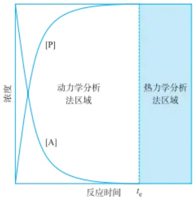

area

| 反应时间 | [A] (动力学分析法区域) | [P] (热力学分析法区域) |
| --- | --- | --- |
| 初始 | 0 | 0 |
| 中间 | ~中等值 | ~高值 |
| \(t_e\) | ~低值 | ~高值 |

化学反应进程示意图。纵坐标为浓度，横坐标为反应时间， $t_{e}$ 标识了反应终点。其中虚线左边为动力学分析法的应用范围（达到化学平衡之前），虚线右边为热力学分析法的应用范围（达到化学平衡之后）。动力学方法在反应速率较慢的体系的测量中具有优势。

温室效应的发现和影响

移取 25.00 mL 该溶液, 加入 5 mL 盐酸和 1 g KI, 暗处反应 5 min 后用 22.17 mL  $Na_{2}S_{2}O_{3}$  标准溶液滴定至终点。称取 0.1272 g 铜合金, 溶解样品并进行预处理, 然后加入 1 g KI, 立即以上述  $Na_{2}S_{2}O_{3}$  标准溶液滴定至终点, 消耗 19.25 mL。计算  $Na_{2}S_{2}O_{3}$  浓度及铜合金中铜的质量分数。

15. 用福尔哈德法测定 NaCl 含量。将 0.2255 g 样品制成溶液，加入 50.00 mL 0.1033 mol·L $^{-1}$ AgNO $_{3}$ 标准溶液，反应完成后加入硝基苯保护 AgCl 沉淀。以 23.16 mL 0.1159 mol·L $^{-1}$ NH $_{4}$ SCN 滴定剩余 Ag $^{+}$ 。计算该 NaCl 样品的纯度。

## 3.3 动力学分析法

前述测量理论均基于化学热力学理论,讨论体系达到平衡态的性质,并进行测量。实际上,动力学方法在反应速率较慢的体系的测量中则有优势。

本节将简单介绍化学动力学基本原理和酶催化动力学原理,阐述动力学分析中的直接计算法和曲线拟合法,讨论动力学分析法的应用和特点。

## 3.3.1 化学动力学理论

## 3.3.1.1 反应速率

反应速率(reaction rate)描述化学反应进行的快慢,一般表述为单位时间内反应物浓度的减少值或产物浓度的增加值,对以下反应:

$$
\mathrm{R} \longrightarrow \mathrm{P}
$$

反应速率 v 的表达式为

$$
v = - \frac {\mathrm{d} [ \mathrm{R} ]}{\mathrm{dt}} = \frac {\mathrm{d} [ \mathrm{P} ]}{\mathrm{dt}} \tag {3-3-1}
$$

其中 R 为反应物 (reactant), P 为产物 (product), [R] 和 [P] 分别为反应物和产物的物质的量浓度, 反应速率的单位一般为  $mol \cdot L^{-1} \cdot s^{-1}$  。除了反应物本身的性质之外, 浓度、温度、压强、光照、催化剂、反应物接触面积等因素都可以影响反应速率。因为反应速率与反应物浓度、催化剂浓度等密切相关, 所以可以通过测量反应速率和反应过程中的浓度变化等动力学相关数据来计算分析物的浓度。这种方法被称为动力学分析法。

## 3.3.1.2 速率方程和反应级数

速率方程(rate equation)描述了反应物的浓度如何影响反应速率。对如下化学反应:

$$
m \mathrm{A} + n \mathrm{R} \longrightarrow \mathrm{P}
$$

反应速率方程的一般形式为

$$
v = - \frac {1}{m} \frac {\mathrm{d} [ \mathrm{A} ]}{\mathrm{d} t} = k [ \mathrm{A} ] ^ {x} [ \mathrm{B} ] ^ {y} \tag {3-3-2}
$$

其中，k 是这一反应的速率常数（rate constant），与温度、压强、光照、催化剂、反应物接触面积、反应活化能等因素有关，通常可通过阿伦尼乌斯公式（Arrhenius equation）计算获得，也可以通过实验测定。x、y 为反应级数（reaction order），由反应机理决定。在基元反应中，反应级数等于化学计量数。

如果反应对于分析物 A(analyte) 是一级反应, 假设 A 的化学计量数为 1, 那么速率方程的微分表达式为

---

3.3 动力学分析法

161

$$
v = - \frac {\mathrm{d} [ \mathrm{A} ]}{\mathrm{d} t} = k [ \mathrm{A} ] \tag {3-3-3}
$$

如果将上式积分,将获得速率方程的积分表达式:

$$
\ln [ \mathrm{A} ] _ {t} = \ln [ \mathrm{A} ] _ {0} - k t \tag {3-3-4}
$$

或

$$
\left[ \mathrm{A} \right] _ {t} = \left[ \mathrm{A} \right] _ {0} \mathrm{e} ^ {- k t} \tag {3-3-5}
$$

其中， $[A]_{0}$ 是分析物的起始浓度， $[A]_{t}$ 是分析物在时间 t 的浓度。

在实际应用中,反应速率的表达式一般更加复杂。比如在一个实际反应中,分析物 A 和反应物 R 发生反应,生成产物 P,反应方程式如下:

$$
\mathrm{A+R} \rightleftharpoons \mathrm{P}
$$

反应对 A 为一级反应, 对 R 为一级反应。因此反应速率的微分表达式为

$$
v = - \frac {\mathrm{d} [ \mathrm{A} ]}{\mathrm{d} t} = k _ {\mathrm{f}} [ \mathrm{A} ] [ \mathrm{R} ] - k _ {\mathrm{r}} [ \mathrm{P} ] \tag {3-3-6}
$$

其中， $k_{f}$  为正反应(forward reaction)速率常数， $k_{r}$  为逆反应(reverse reaction)速率常数。式(3-3-6)的积分形式过于复杂，因此很难被直接应用于动力学分析法。为了进行简化，一般会选择在反应起始阶段进行测量，此时产物的浓度可以忽略不计，式(3-3-6)可以写为

$$
v = - \frac {\mathrm{d} [ \mathrm{A} ]}{\mathrm{d} t} = k _ {\mathrm{f}} [ \mathrm{A} ] [ \mathrm{R} ] \tag {3-3-7}
$$

为了进一步进行简化,一般会选择使用较高浓度的反应物 R,因此在测量的过程中该浓度的变化可以忽略不计,式(3-3-7)可以简化为

$$
v = - \frac {\mathrm{d} [ \mathrm{A} ]}{\mathrm{d} t} = k _ {\mathrm{f}} [ \mathrm{A} ] [ \mathrm{R} ] _ {0} = k ^ {\prime} [ \mathrm{A} ] \tag {3-3-8}
$$

其中  $k' = k_{f} [R]_{0}$  。此时，速率方程的表达形式与一级反应相同，因此反应被称为准一级反应（pseudo-first-order reaction）。式(3-3-8)的积分形式为

$$
\ln [ \mathrm{A} ] _ {t} = \ln [ \mathrm{A} ] _ {0} - k ^ {\prime} t \tag {3-3-9}
$$

或

$$
\left[ \mathrm{A} \right] _ {t} = \left[ \mathrm{A} \right] _ {0} \mathrm{e} ^ {- k ^ {\prime} t} \tag {3-3-10}
$$

如果测量过程的时间很短,分析物 A 的浓度变化可以忽略不计,则认为该反应是准零级反应(pseudo-zero-order reaction),相应的速率方程存在更为简单的微分形式和积分形式:

$$
v = - \frac {\mathrm{d} [ \mathrm{A} ]}{\mathrm{d} t} = k _ {\mathrm{f}} [ \mathrm{A} ] _ {0} [ \mathrm{R} ] _ {0} = k ^ {\prime \prime} \tag {3-3-11}
$$

$$
\left[ \mathrm{A} \right] _ {t} = \left[ \mathrm{A} \right] _ {0} - k ^ {\prime \prime} t \tag {3-3-12}
$$

其中 $k'' = k_{\mathrm{f}}[\mathrm{A}]_{0}[\mathrm{R}]_{0}$

## 3.3.1.3 催化反应和酶催化反应

催化剂(catalyst)可以加速一些化学反应的反应速率。如果一个催化反应的反应速率正比于催化剂的浓度，则可以进行动力学分析。在诸多催化剂中，酶(enzyme)是一类天然的催化剂。酶参与了生物体内大量的生物化学进程，极为高效地催化了一系列底物(substrate)的反应。酶催化动力学(enzyme kinetics)描述了酶催化的化学反应速率，可以用于定量分析反应底物。对如下的酶催化反应(enzyme catalysis):

$$
\mathrm{E+S} \underset {k _ {2}} {\overset {k _ {1}} {\rightleftharpoons}} \mathrm{E} \cdot \mathrm{S} \overset {k _ {3}} {\longrightarrow} \mathrm{E+P}
$$

半衰期(half-life)是一个重要的动力学参数,是指某种特定物质的浓度经过某种反应降低到初始时一半所消耗的时间,对于一级反应(如放射性核素的衰变),半衰期是恒定数值。

---

162

第三章 化学平衡与滴定分析

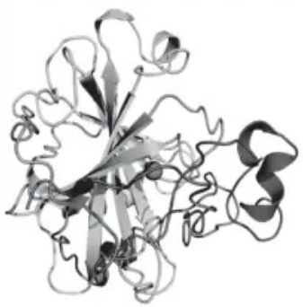

natural_image

3D ribbon diagram of a protein structure, showing alpha helices and beta sheets (no labels or text)

碳酸酐酶（carbonic anhydrase），是一类催化二氧化碳/水与碳酸间转换的酶，可维系血液中的酸碱平衡与二氧化碳的运输。其中 $\alpha$ 型碳酸酐酶的活性位点由三个组氨酸（histidine, His）螯合一个锌离子，催化机理为

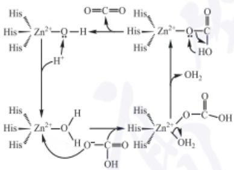

chemical

Chemical reaction mechanism showing zinc ion exchange and hydrolysis steps with labeled intermediates and products

## 思考:

碳酸酐酶如何维持血液的 pH? (提示: 使用缓冲溶液的相关原理进行分析)

米氏方程由德国生物化学家、化学家、物理学家 Leonor Michaelis（1875—1949）和加拿大化学家、物理学家 Maud Menten（1879—1960）共同发现。

其中 E 为催化反应的酶，S 为反应底物，E·S 为反应中间体，P 为反应产物。假设此反应不可逆，反应产物不与酶结合， $k_{3}<k_{2}$ ，则该反应速率可以表达为

$$
v = \frac {\mathrm{d} [ \mathrm{P} ]}{\mathrm{d} t} = k _ {3} [ \mathrm{E} \cdot \mathrm{S} ] \tag {3-3-13}
$$

根据稳态近似理论(steady state approximation)，在整个反应过程中，反应中间体的浓度变化近似为零。因此，有如下关系:

$$
\frac {\mathrm{d} [ \mathrm{E} \cdot \mathrm{S} ]}{\mathrm{d} t} = k _ {1} ([ \mathrm{E} ] _ {0} - [ \mathrm{E} \cdot \mathrm{S} ]) [ \mathrm{S} ] \tag {3-3-14}
$$

$$
- k _ {2} [ \mathrm{E} \cdot \mathrm{S} ] - k _ {3} [ \mathrm{E} \cdot \mathrm{S} ] = 0
$$

式(3-3-14)可简化为

$$
k _ {1} [ \mathrm{E} ] _ {0} [ \mathrm{S} ] = [ \mathrm{E} \cdot \mathrm{S} ] (k _ {1} [ \mathrm{S} ] + k _ {2} + k _ {3}) \tag {3-3-15}
$$

可以获得中间体  $E \cdot S$  的浓度表达式:

$$
\left[ \mathrm{E} \cdot \mathrm{S} \right] = \frac {k _ {1} \left[ \mathrm{E} \right] _ {0} \left[ \mathrm{S} \right]}{k _ {1} \left[ \mathrm{S} \right] + k _ {2} + k _ {3}} \tag {3-3-16}
$$

代入式(3-3-13)，可获得米氏方程(Michaelis-Menten equation):

$$
v = \frac {\mathrm{d} [ \mathrm{P} ]}{\mathrm{dt}} = \frac {k _ {1} k _ {3} [ \mathrm{E} ] _ {0} [ \mathrm{S} ]}{k _ {1} [ \mathrm{S} ] + k _ {2} + k _ {3}} = \frac {k _ {3} [ \mathrm{E} ] _ {0} [ \mathrm{S} ]}{[ \mathrm{S} ] + K _ {\mathrm{M}}} \tag {3-3-17}
$$

其中

$$
K _ {\mathrm{M}} = \frac {k _ {2} + k _ {3}}{k _ {1}}
$$

$K_{\mathrm{M}}$ 为米氏常数(Michaelis constant)，是酶的特征性常数。式(3-3-17)可以进一步简化为

$$
v = \frac {\mathrm{d} [ \mathrm{P} ]}{\mathrm{d} t} = v _ {\max} \frac {[ \mathrm{S} ]}{[ \mathrm{S} ] + K _ {\mathrm{M}}} \tag {3-3-18}
$$

$v_{max}$ 为酶催化反应在给定的酶的浓度下的最大反应速率。当底物浓度远大于米氏常数时，即 $[S]\gg K_{M}$ ，该反应为零级反应，其速率常数表达式为

$$
v = \frac {\mathrm{d} [ \mathrm{P} ]}{\mathrm{d} t} = v _ {\max} \tag {3-3-19}
$$

当底物浓度远小于米氏常数时, 即  $[S] \ll K_{M}$ , 该反应为一级反应, 其速率常数表达式为

$$
v = \frac {\mathrm{d} [ \mathrm{P} ]}{\mathrm{dt}} = \frac {v _ {\max}}{K _ {\mathrm{M}}} [ \mathrm{S} ] \tag {3-3-20}
$$

## 3.3.2 化学动力学分析方法

化学动力学分析方法可以分为两类:直接计算法和曲线拟合法。在直接计算法中，基于适当的速率方程，分析物的初始浓度可以被直接计算获得。比如，对于一级反应，可以选取式(3-3-4)通过测定 $k, t$ 和 $[\mathrm{A}]_t$ 计算出 $[\mathrm{A}]_0$ 。曲线拟合法则是通过对数据进行回归分析找出最佳的拟合结果。比如，对于一级反应，选取式(3-3-4)，使 $[\mathrm{A}]_t$ 成为时间 $t$ 的函数，选取 $k$ 和 $[\mathrm{A}]_0$ 作为可变参数进行拟合，最终获得分析物的浓度。

## 3.3.2.1 基于浓度测量的直接计算法(时间点法)

通过在反应时间点 t 测量分析物浓度  $[A]_{t}$ ，就可以使用速率方程的积分形式直接计算分析物的初始浓度  $[A]_{0}$ 。其中，反应的速率常数 k 可以通过使用分析物

---

3.3 动力学分析法

163

的标准溶液和速率方程测定,分析物在时间 t 的浓度可以通过光谱法或电化学分析法测定。

如果反应产物的浓度 $[P]$ 更容易被测定,依然可以使用直接计算法。比如,对于反应:

$$
\mathrm{A} + \mathrm{R} \rightleftharpoons \mathrm{P}
$$

在时间 t 的分析物浓度的表达式为

$$
\left[ \mathrm{A} \right] _ {t} = \left[ \mathrm{A} \right] _ {0} - \left[ \mathrm{P} \right] _ {t} \tag {3-3-21}
$$

已知分析物和产物的化学计量数相等,且反应对于 A 为准一级反应,代入式(3-3-21),则速率方程的积分形式可以写作

$$
\ln ([ \mathrm{A} ] _ {0} - [ \mathrm{P} ] _ {t}) = \ln [ \mathrm{A} ] _ {0} - k ^ {\prime} t \tag {3-3-22}
$$

对式(3-3-22)进行转化,可以得到分析物初始浓度 $[A]_{0}$ 的表达式:

$$
\left[ \mathrm{A} \right] _ {0} = \frac {\left[ \mathrm{P} \right] _ {t}}{1 - \mathrm{e} ^ {- k ^ {\prime} t}} \tag {3-3-23}
$$

因此,通过测量产物的浓度,也可以使用直接计算法获得分析物的浓度。

## 3.3.2.2 基于浓度测量的直接计算法(时间段法)

在该方法中,使用某反应发生特定变化所需要的反应时间段  $\Delta t$  来进行相关计算。该方法一个重要的应用是对催化剂的定量分析。当催化剂的浓度提高时,特定反应的时间段  $\Delta t$  将会变小。对很多催化反应,催化剂浓度和反应时间段遵循以下关系:

$$
\frac {1}{\Delta t} = F _ {\mathrm{cat}} [ \mathrm{C} ] _ {0} + F _ {\mathrm{uncat}} \tag {3-3-24}
$$

其中 $[C]_{0}$ 是催化剂的起始浓度， $F_{cat}$ 和 $F_{uncat}$ 分别为有催化剂和无催化剂时的反应速率相关常数。使用式(3-3-24)，可以通过测量催化剂标准溶液的反应时间段 $\Delta t$ 数据获得标准曲线，再测量待测样品反应的时间段来计算获得催化剂浓度。

## 3.3.2.3 基于反应速率的直接计算法

在该方法中,使用速率方程的微分形式,如式(3-3-3),来计算分析物的浓度。当使用反应物浓度为纵坐标,反应时间为横坐标作图时,曲线上任意一点的斜率的绝对值即为此时间的反应速率。对于一级反应,在时间t的反应速率表达式为

$$
v _ {t} = k [ \mathrm{A} ] _ {t} \tag {3-3-25}
$$

将式 $(3-3-5)$ 代入可得

$$
v _ {t} = k [ \mathrm{A} ] _ {0} \mathrm{e} ^ {- k t} \tag {3-3-26}
$$

在固定时间点测量同一反应的反应速率,速率常数 k 和  $e^{-kt}$  均为常数。因此可以获得反应速率对分析物浓度的标准曲线,用于计算分析物的浓度。该方法一般测量反应的起始速率  $(t=0)$ 。由于反应速率会随时间衰减,测量起始速率会具有最大的灵敏度;此外在反应起点附近,分析物浓度变化较小,具有准零级反应的特点,分析物浓度对时间的曲线为线性,使得斜率的计算较为简单。

## 3.3.2.4 曲线拟合法

在直接计算法中，由于分析物的初始浓度 $[\mathrm{A}]_0$ 和实际测量的变量（如在时间 $t$ 的分析物浓度 $[\mathrm{A}]_t$ 或产物浓度 $[\mathrm{P}]_t$）的关系与速率常数相关。只需要先通过标准溶液进行测量获得 $k$，即可完成分析物初始浓度的直接计算。

曲线拟合法会不断测量反应物或产物随时间变化的结果,使用回归法将此数据用相应的微分速率方程或积分速率方程进行拟合。比如,对一个准一级反应,

通过实时测定反应产物浓度变化来计算反应物浓度方法的一个典型案例是硫氰酸根离子的检测。硫氰酸根离子与铁离子反应生成血红色配合物  $\mathrm{Fe(SCN)^{2+}}$ ，可通过测定该配合物的浓度随时间变化来计算硫氰酸根浓度。此原理也被应用于沉淀滴定的福尔哈德法中。

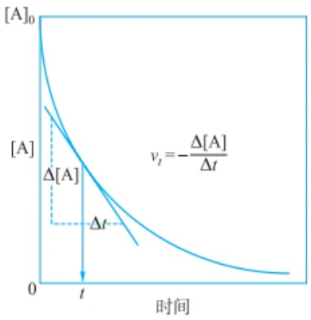

line

| Time | Current [A] |
| --- | --- |
| 0 | \([A]_{0}\) |
| t | \(\Delta[A]\) |
| t | \(\Delta t\) |

反应物浓度随时间变化的曲线，任一点的斜率绝对值为此时间的反应速率。

关于基于反应速率的直接计算法,请检索并阅读文献 Talanta 2009,78(4-5),1383-1388,学习其中的关于抗菌药诺氟沙星的动力学定量方法。

---

164

第三章 化学平衡与滴定分析

除 Lineweaver-Burk 作图法外，Eadie-Hofstee 作图法和 Hanes-Woolf 作图关系法也被用于米氏方程的线性回归分析。Eadie-Hofstee 的线性关系如下:

$$
v = v _ {\mathrm{max}} - K _ {\mathrm{M}} \cdot \frac {v}{[ \mathrm{S} ]}
$$

其中，反应速率与反应速率和底物浓度的比值呈线性关系，曲线斜率为 $-K_{M}$ ，截距为 $v_{max}$ 。

Hanes-Woolf 的线性关系如下:

$$
\frac {[ \mathrm{S} ]}{v} = \frac {1}{v _ {\max}} \cdot [ \mathrm{S} ] + \frac {K _ {\mathrm{M}}}{v _ {\max}} K
$$

底物浓度和反应速率的比值与底物浓度呈线性关系, 曲线斜率为  $\frac{1}{v_{max}}$ , 截距为  $\frac{K_{M}}{v_{max}}$ 。

基于以上关系,可以使用曲线拟合法进行相关动力学参数及底物浓度的分析。

动力学分析法的另一个应用是通过测定表面等离激元共振(surface plasmon resonance, SPR)来定量分析蛋白与配体的亲和作用、纳米材料表面吸附情况等。请查阅文献了解其原理。

可以使用以下方程[由式(3-3-23)转化得来]:

$$
\left[ \mathrm{P} \right] _ {t} = \left[ \mathrm{A} \right] _ {0} (1 - \mathrm{e} ^ {- k ^ {\prime} t}) \tag {3-3-27}
$$

使用 $[A]_{0}$ 和k作为可调整的变量,使用反应产物的浓度进行拟合。在曲线拟合法中,多个不同时间点的测量数据可被使用,所以该方法的结果更加准确。

## 3.3.2.5 酶催化动力学分析

米氏方程[式(3-3-17)]是酶催化反应的动力学分析的基础。根据米氏方程作图，横坐标为底物浓度，纵坐标为反应速率，将得到如图3.3.1所示曲线。

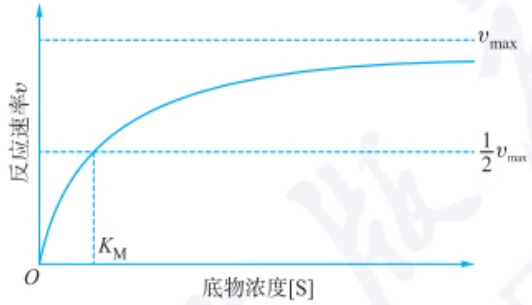

line

| 底物浓度 [S] | 反应速度 v |
| --- | --- |
| K_M | 1/2v_max |

图 3.3.1 酶催化反应的反应速率与底物浓度关系图

酶催化反应速率随底物浓度增加而增大。在底物浓度较低时，反应为一级反应。底物浓度与米氏常数 $K_{M}$ 相等时，反应速率达到最大反应速率 $v_{max}$ 的一半。随着底物浓度的提高，反应逐渐转变为准零级反应。

基于米氏方程,可以使用直接计算法进行动力学分析。当底物浓度远小于米氏常数时,反应为一级反应,将式(3-3-5)与式(3-3-20)结合,可获得该反应在任意时间点的底物浓度表达式:

$$
\left[ \mathrm{S} \right] _ {t} = \left[ \mathrm{S} \right] _ {0} \mathrm{e} ^ {- \frac {v _ {\mathrm{max}}}{K _ {\mathrm{M}}} t} \tag {3-3-28}
$$

使用此公式,即可通过测定 $\frac{v_{\max}}{K_{M}},t$ 和 $[S]_{t}$ 计算出 $[S]_{0}$ 。

米氏方程只在底物浓度较低时呈线性关系, 拟合较为复杂, 难以精准计算  $v_{max}$  和  $K_{M}$  。为了进行更简单的线性拟合, 可以由米氏方程推导以得到线性关系式。如 Lineweaver-Burk 作图法, 又称为双倒数作图法。将米氏方程取倒数可获得以下关系:

$$
\frac {1}{v} = \frac {K _ {\mathrm{M}}}{v _ {\mathrm{max}}} \cdot \frac {1}{[ \mathrm{S} ]} + \frac {1}{v _ {\mathrm{max}}} \tag {3-3-29}
$$

根据该公式,反应速率的倒数与底物浓度的倒数呈线性关系,曲线斜率为 $\frac{K_{M}}{v_{max}}$ ,截距为 $\frac{1}{v_{max}}$ 。可通过简单的线性回归来确定酶催化动力学中的参数。

## 3.3.3 化学动力学分析法的应用和特点

## 3.3.3.1 动力学分析法的应用

## 1. 催化法

催化法是以催化反应为基础进行定量测量的方法。使用基于浓度测量的直接计算法(时间段法)，可以直接对痕量的催化剂浓度进行测量。此外，在酶参与的催化反应中，基于米氏方程，在一定条件下反应对底物为一级反应，因此可以使用基于浓度测量的直接计算法(时间点法)对底物浓度进行分析，也可以使用米

---

3.3 动力学分析法

165

氏方程或由其推导出的线性关系，使用曲线拟合法进行分析。酶动力学也被用于酶抑制剂(inhibitor)或活化剂(activator)的分析中。

## 2. 非催化法

非催化法是测量非催化反应的速率进而测定某种反应物的浓度的方法。由于反应速率普遍较低，灵敏度和准确度都不如催化法。在无机化学中的应用一般仅为配位反应的速率测定，在有机化学中应用较广，可通过比较相似组分与同一试剂的反应速率差异来进行同时测定。

## 3. 停流分析法

停流分析法是一种用于快反应动力学分析的自动检测法。分析物和反应物放置于不同的注射器内，并按照精确的比例同时注射入混合器，启动快速反应。该混合溶液将通过检测室，其某一特性如吸光度随时间的变化将被测量来监测反应进程。停止注射器有“停流”功能，限制注射的体积。随着反应溶液填充入停止注射器中，柱塞击中停止堵块，便瞬时停流。停流分析法可以在 $1\mathrm{ms}$ 内完成分析物和反应物的混合并记录起始的动力学信息。配合自动进样器，停流分析法可以在 $1\mathrm{h}$ 内完成千次以上的测量。

## 3.3.3.2 动力学分析法的特点

## 1. 动力学分析法和基于化学平衡的分析法的区别

基于化学平衡和化学计量学的分析法(如滴定法)在反应体系达到化学平衡后进行测量,根据化学计量关系计算出分析物浓度;动力学分析法在反应达到平衡之前进行测量,根据速率方程等动力学公式计算出分析物浓度。

## 2. 准确度和精密度

由于影响反应速率的因素非常多,比如温度和 pH,并且很难控制,所以动力学分析法的准确度一般比基于化学平衡的分析方法要低。其中,曲线拟合法由于使用了更多的数据,一般会比直接计算法获得的结果的准确度高。动力学分析法的精密度一般由仪器的测量精密度决定。

## 3. 灵敏度

动力学分析法可以进行微量和痕量分析。检测限常由反应速率决定。反应速率越快，检测限越低。因此催化法一般会获得较低的检测限。而非催化法中的有机物分析由于速率较慢，对分析物的浓度要求较高。动力学分析法的灵敏度可以通过方法的优化而提高，比如选择测量反应物浓度时，应尽量在接近反应起点的时间进行测量；选择测量产物浓度时，应尽量等待较长时间再进行读数。此外，基于速率测量的方法应尽量测量初始速率。

## 4. 选择性

在分析物和干扰物同时存在时,如果可以通过调整反应条件使二者的反应速率差距较大,则有可能在其一完全反应后,另一物质仍在反应。这样就可以直接进行动力学分析,而不必进行预处理(如掩蔽或分离干扰物)。

习题

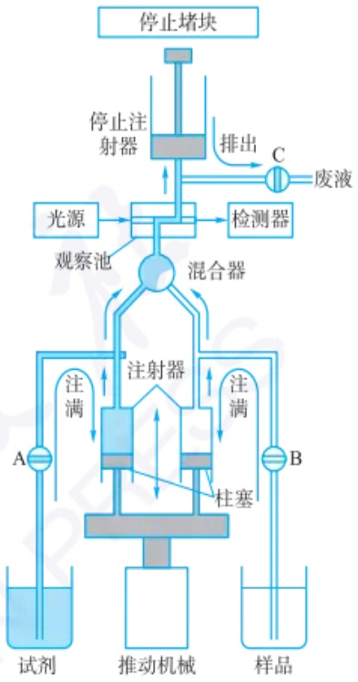

flowchart

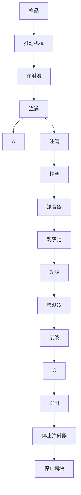

停流分析仪示意图

## - 章节练习题 -

1. 对一个一级反应, 反应时间为 25.0 s 时, 转化率为 30%。计算反应的半衰期。

---

166

第三章 化学平衡与滴定分析

2. 以下数据来自一个准零级反应, 计算分析物的起始浓度和反应的速率常数。

| 反应时间s | 分析物浓度$mmol \cdot L^{-1}$ | 反应时间s | 分析物浓度$mmol \cdot L^{-1}$ |
| --- | --- | --- | --- |
| 3 | 0.0731 | 8 | 0.0448 |
| 4 | 0.0728 | 9 | 0.0404 |
| 5 | 0.0681 | 10 | 0.0339 |
| 6 | 0.0582 | 11 | 0.0217 |
| 7 | 0.0511 | 12 | 0.0143 |

3. 脲酶(urease)可以催化尿素水解成氨和二氧化碳, 常被用于检测血液中的尿素。已知室温下脲酶的米氏常数为  $2.0 \, mmol \cdot L^{-1}$ , pH=7.5 时  $k_{2}=2.5 \times 10^{4} \, s^{-1}$ 。计算当脲酶的浓度为  $0.050 \, mmol \cdot L^{-1}$  时的反应起始速率, 并计算  $v_{max}$ 。
4. 以下数据来自硝基甲烷的分解反应,该反应在碱过量的情况下对硝基甲烷是准一级反应。计算该体系硝基甲烷的起始浓度和准一级反应的速率常数。

| 时间/s | [硝基甲烷] | ln[硝基甲烷] |
| --- | --- | --- |
| 0.25 | $3.86 \times 10^{-3}$ | -5.557 |
| 0.50 | $2.59 \times 10^{-3}$ | -5.956 |
| 0.75 | $1.84 \times 10^{-3}$ | -6.298 |
| 1.00 | $1.21 \times 10^{-3}$ | -6.717 |
| 1.25 | $0.742 \times 10^{-3}$ | -7.206 |

## - 挑战性问题 -

尿液中肌酐的动力学分析

背景介绍

肌酸(creatine)是一种存在于脊椎动物肌肉组织的有机酸,可以通过与ATP反应生成贮存高能磷酸碱的磷酸肌酸(phosphocreatine)。它可以促进ATP的循环利用,快速提供肌肉所需要的能量。

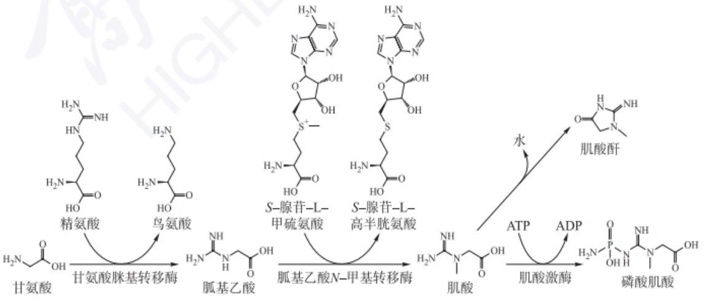

flowchart

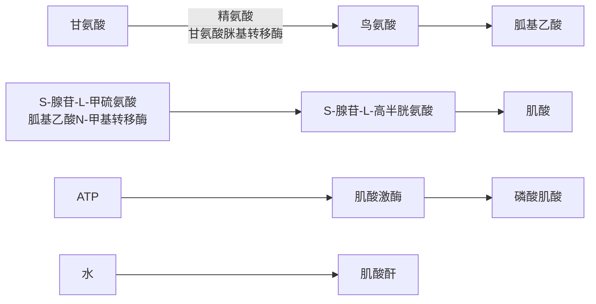

肌酸和磷酸肌酸的生物合成途径

---

3.3 动力学分析法

167

肌酸和磷酸肌酸的一种代谢物是肌酐(creatinine)，主要由肌肉中磷酸肌酸的非酶促反应生成，并通过肾小球滤过排出体外。因此，血液中的肌酐浓度可作为检测肾小球滤过功能的指标之一。

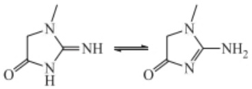

chemical

Chemical equilibrium reaction showing amide bond rearrangement between two pyrimidine rings

肌酐的互变异构体结构

通过测定肌酐与苦味酸(三硝基苯酚, picric acid)在碱性溶液中反应的速率，可以计算尿液中肌酐的浓度(该反应由德国化学家 Max Jaffe 在 1886 年发现, 因此得名 Jaffe 反应)。

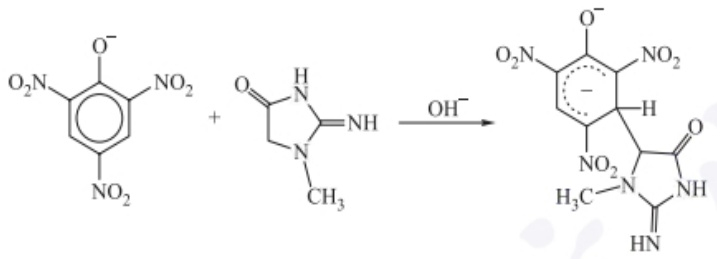

chemical

Chemical reaction equation showing the formation of a heterocyclic compound from aniline and nitrobenzene under basic conditions

Jaffe 反应

在给定的实验条件下,该反应对苦味酸根(picrate)、肌酐和氢氧根均为一级反应,其速率方程为

$$
v = k [ \text {苦味酸根} ] [ \text {肌酐} ] [ \mathrm{OH} ^ {-} ]
$$

使用苦味酸根离子的选择性电极来监控反应。

## 分析过程:

使用质量浓度为 $10.00\mathrm{g}\cdot \mathrm{L}^{-1}$ 的肌酐标准溶液（含有 $5\mathrm{mmol}\cdot \mathrm{L}^{-1}\mathrm{H}_2\mathrm{SO}_4$），配制一系列含有 $0.5\sim 3.0\mathrm{g}\cdot \mathrm{L}^{-1}$ 肌酐的标准溶液。配制 $1.00\times 10^{-2}\mathrm{mol}\cdot \mathrm{L}^{-1}$ 的苦味酸钠溶液。取 $25.00~\mathrm{mL}$ 浓度为 $0.20\mathrm{mol}\cdot \mathrm{L}^{-1}$ 的NaOH溶液（使用 $\mathrm{Na_2SO_4}$ 将离子强度调节至 $1.00\mathrm{mol}\cdot \mathrm{L}^{-1}$），加入一个恒温反应池中，温度设为 $25^{\circ}\mathrm{C}$ 。之后向反应池中加入 $0.500~\mathrm{mL}$ 、浓度为 $1.00\times 10^{-2}\mathrm{mol}\cdot \mathrm{L}^{-1}$ 的苦味酸钠溶液。将苦味酸根离子选择性电极悬置在溶液中，监测电位直到电位稳定。当电位稳定后，加入$2.00~\mathrm{mL}$ 的肌酐标准溶液，并记录电位随时间的变化。使用其余的标准溶液重复该过程。构建 $\Delta \varphi /\Delta t$ 与初始肌酐浓度的校准曲线。使用相同的程序分析样品，使用 $2.00~\mathrm{mL}$ 尿液代替标准溶液。利用校准曲线确定样品中肌酐的浓度（参考文献:J.Chem.Educ.,1983,60(1):74.)。

## 问题:

（1）在配制 NaOH 溶液时，为什么要调节其离子强度至  $1.00 \, mol \cdot L^{-1}$ ?
(2) 在实际检测条件下, 反应对苦味酸根为准一级反应。试证明在此条件下, 电极电位随时间的变化是线性的。
(3) 在该条件下, 反应对肌酐和氢氧根离子为准零级反应。基于以上信息, 分析该动力学分析法检测肌酐浓度的原理。[提示: 分析问题(2)中线性关系的

---

168

第三章 化学平衡与滴定分析

挑战性问题参考答案

斜率与肌酐浓度的关系]

（4）肌酐检测的历史发展，经历了由基于Jaffe反应的动力学检测法到酶催化检测法。请查阅肌酐检测的酶催化方法的文献，并简单描述酶催化检测法的原理和流程。
