# 第五章 原子光谱法

原始 PDF 第 268–302 页。

第五章

原子光谱法

本章主要从原子光谱的角度阐述原子发射光谱法、原子吸收与原子荧光光谱法、X射线荧光光谱法的基本原理、仪器构造、光谱特点、定量分析及发展前沿。

## 5.1 原子发射光谱法

原子发射光谱法(atomic emission spectrometry, AES)，是根据处于激发态的待测元素原子回到基态时发射的特征谱线，对元素进行定性与定量分析的方法，是光谱学各个分支中最为古老的一种。

1826年W.H.Talbot提出不同波长的光线是表征某些元素的特征。1860年德国学者G.R.Kirchhoff和R.W.Bunsen利用分光光度法研究盐和盐溶液在火焰中加热时所产生的特征光谱，发现了铷 和铯两种元素，并最早研究了太阳大气的光谱。从此以后，原子发射光谱受到了人们广泛关注。原子发射光谱的测量主要包括三个核心步骤:首先，利用高能光源提供能量蒸发样品，转化为气态原子，并进一步使气态原子激发；随后，将气态原子由激发态跃迁回基态发出的复合光通过单色器分解，形成按波长顺序排列的特征线状光谱；最后，利用检测器测量各谱线的波长和强度。

## 5.1.1 基本原理

## 5.1.1.1 原子发射光谱的产生

原子核外能量最低的电子(称为基态)在激发能量(热、电、光)作用下,由基态跃迁到不同的高能级(称为激发态)。原子(或离子)的外层电子处于激发态时是不稳定的(激发态寿命约 $10^{-8}$ s),当它跃迁回到基态或较低的激发态时,就要释放出能量,若此能量以光的形式出现,即得到原子发射光谱。原子光谱涉及的相关基本概念包括:

（1）激发能/激发电位 将原子中某一外层价电子从基态激发到高能态所需的能量。
(2) 一级电离能/电离电位 原子失去一个外层电子变成离子所需要的能量。
(3) 共振线 在基态和激发态之间跃迁所产生的谱线。
（4）第一共振线 在基态与第一激发态之间跃迁所产生的谱线；其具有最小的激发能，最易产生跃迁，通常是元素最强的谱线。
（5）原子线 原子的外层电子受到激发所产生的谱线，对应于特定元素的电子从激发态跃迁回基态时释放的能量，用“I”表示。

## AES 的主要优点与不足

优点:(1) 多元素同时检出能力强,样品一经激发,样品中各元素都各自发射出其特征谱线。(2) 分析速度快,多数固体和液体样品不需经过化学处理就可直接分析,在几分钟内同时定量测定几十种元素。(3) 选择性好,光谱特征性强,能区分化学性质极相似的元素。例如,可分析铌和钽、锆和铪,以及十几种稀土元素。(4) 检出限低,一般可达 $\mu g^{-1}$ 级。如用电感耦合等离子体(ICP)作为光源,检出限可低至 $10^{-3}\sim10^{-4}\mu g^{-1}$ 量级。(5) 用ICP光源时,准确度高,标准曲线的线性范围宽,可达4\~6个数量级。(6) 样品消耗少,适于整批样品的多组分测定。

不足:(1) 影响谱线强度的因素较多,尤其是样品组分的影响较大,对标准参比的组分要求较高。(2) 当样品浓度较大时,分析准确度较差。(3) 不能进行结构和元素形态的测定。(4) 大多数非金属元素难以得到灵敏的光谱线。

---

248

第五章 原子光谱法

## 跃迁“选择定则”

(1) 主量子数 n: 在跃迁时不受限制;
(2) 总角量子数  $L: \Delta L = 1, S, P, D, F, \cdots$  相邻；
(3) 内量子数 J:  $\Delta J = 0$  或 1, 但当 J = 0 时,  $\Delta J = 0$  的跃迁是禁阻的;
（4）总自旋量子数  $S: \Delta S = 0$ ，即不同多重性状态之间的跃迁是禁阻的。

（6）离子线 离子的外层电子受到激发所产生的谱线，对应于特定离子的电子从激发态跃迁回基态时释放的能量，用“Ⅱ”表示。

## 5.1.1.2 原子能级与光谱项

原子发射光谱是原子外层价电子从高能级回到低能级而发出的特征辐射。原子由原子核和核外电子构成，每一个电子在核外的任意运动状态可以用主量子数 $n$ 、角量子数 $l$ 、磁量子数 $m$ 和自旋量子数 $m_{s}$ 这4个量子数来描述。主量子数 $n$ 用来描述核外电子离核的远近，决定电子层数和电子的能量高低，$n$ 越大，能量越高（针对形状相同的原子轨道或电子云电子）；角量子数 $l$ 表示原子轨道和电子云的形状，同一主层中不同的分层；磁量子数 $m$ 代表原子轨道和电子云在空间的伸展方向；$m$ 的取值:$0, \pm 1, \pm 2, \dots, \pm l (2l + 1$ 个取值）；自旋量子数 $m_{s}$ 代表电子的自旋方向。原子光谱是由原子外层的价电子在不同能级间跃迁而产生的，整个原子的运动状态用量子数来描述，即光谱项[式(5-1-1)]。原子的能级通常用光谱项符号表示。

$$
^ {2 S + 1} L _ {J} \tag {5-1-1}
$$

## 5.1.1.3 原子能级图

原子的能量状态可以通过光谱项来描述，而将原子中可能的能量水平及它们之间可能发生的跃迁以图形方式展示，就可以得到能级图。这种图形通常包括一系列的水平线，代表不同的能级，以及连接这些线的箭头，表示电子在能级间的跃迁。通常纵坐标表示能量 $E$ ，基态原子的能量 $E = 0$ ，横坐标表示实际存在的光谱项。图5.1.1为钠原子的能级示意图，图中的水平线表示原子实际存在的能级，其间隔表示原子的外层电子在两个能级之间跃迁所发射或吸收的能量。能级图中的纵坐标表示能量标度，线上的数字表示能级间的能量差，用波长表示$(\times 100\mathrm{nm})$ ，代表跃迁时以电磁辐射形式释放的能量大小。不同的原子处于不同

funnel

| Energy Level | Transition State |
| --- | --- |
| 3s | 2.853,0 |
| 5.896 | 2.852,8 |
| 5.890 | 2.853,0 |
| 11.383 | 4s |
| 11.404 | 3p |
| 6.154 | 6p |
| 6.160 | 6p |
| 3.303 | 5p |
| 3.302 | 5p |
| 8.183 | 4p |
| 5.682 | 4p |
| 5.688 | 4p |
| 8.195 | 3d |

图 5.1.1 钠原子的能级示意图

---

5.1 原子发射光谱法

249

的激发态,因此发射出不同的谱线。原子从第一激发态跃迁到基态产生的谱线称为第一共振线,强度最大。

值得注意的是，并不是原子内所有能级之间的跃迁都是可以发生的，实际发生的跃迁是有限制的。根据量子力学的原理，电子的跃迁不能在任意两个能级之间进行，而必须遵循一定的“选择定则”（见副栏）。由于不同元素的原子具有独特的能级结构，它们在电子跃迁时产生的谱线波长特征也各不相同，这些独特的谱线特征可以用于定性分析元素。

## 5.1.1.4 谱线强度

原子发射谱线强度的公式来源于量子力学和统计物理学的原理。当原子从激发态向较低能级跃迁时，会发射出特定频率的光子，其能量等于两能级间的能量差。谱线强度与激发态原子的数量成正比，也与跃迁概率、能级统计权重、激发能及温度等因素有关。在外界能量作用下，原子的外层电子在 $i$ 和 $j$ 两能级之间跃迁产生的原子发射谱线强度可表示为

$$
I _ {i j} = N _ {i} A _ {i j} h \nu_ {i j} \tag {5-1-2}
$$

式中， $N_{i}$  为单位体积内处于高能级 i 的原子数， $A_{ij}$  为 i, j 两能级间的跃迁概率，h 为普朗克常量， $\nu_{ij}$  为发射谱线的频率。

当体系处于热力学平衡状态,分配在各激发态和基态的原子数目  $N_{i}, N_{0}$ , 应遵循统计热力学中 Maxwell-Boltzmann 分布定律, 结合相关定律可推导为

$$
I _ {i j} = \frac {g _ {i}}{g _ {0}} A _ {i j} h \nu_ {i j} N _ {0} \mathrm{e} ^ {- \frac {E _ {i}}{k _ {\mathrm{B}} T}} \tag {5-1-3}
$$

式中， $N_{0}$ 为单位体积内处于基态的原子数， $g_{i}$ 和 $g_{0}$ 为激发态和基态的统计权重，$E_{i}$ 为激发能， $k_{\mathrm{B}}$ 为Boltzmann常数， $T$ 为激发温度。因此，从原子发射谱线强度的推导公式可以看出，在一定条件下，谱线强度与基态原子数成正比，基态原子数与样品中待测元素浓度成正比，则谱线强度与待测元素浓度成正比，因此谱线强度是原子发射光谱定量分析的依据。

## 5.1.1.5 谱线的自吸与自蚀

光源内的物质在获得足够的能量后蒸发为气体，气体分子之间的相互碰撞产生大量的分子、原子、离子、电子等粒子，这种电离的气体宏观上呈中性，称为等离子体。光源中产生的等离子体弧焰中心部分温度高，激发态原子多，发射某一波长的特征辐射，必然要穿过等离子体的边缘部分再进入检测器。弧焰边缘部分温度低，原子蒸气大多处于基态，这些基态的同类原子能够吸收中心部分产生的特征辐射，从而使得检测器接收的辐射强度减弱，这种现象称为自吸。原子浓度较高时，自吸现象明显，当自吸现象非常严重时，谱线中心的辐射全部被吸收，仅呈现边缘的两条谱线，这种现象称为自蚀(图5.1.2)。

## 5.1.2 原子发射光谱仪结构与类型

原子发射光谱仪是根据样品中待测元素的原子或离子在光源中被激发而产生特征辐射，并通过测量这种特征辐射波长及其强度，以此对各元素进行定性分析和定量分析的仪器。原子发射光谱仪器主要由以下几部分组成:激发光源、进样系统、分光系统和检测系统。

## 5.1.2.1 激发光源

激发光源的主要作用是提供足够的能量,使样品蒸发、解离、原子化和激发跃迁产生辐射。激发光源应具有足够的稳定性,原子发射光谱仪的光源主要包括传

## 传统光源简介

（1）直流电弧:是两个电极在外加电压下产生持续的弧光放电。电弧点燃后，热电子流高速冲击阳极，产生高热（阳极斑），样品蒸发并原子化，电子与原子碰撞电离出正离子冲向阴极。电子、原子、离子间的相互碰撞，使原子跃迁到激发态，返回基态时发射出该原子的光谱。电极材料采用光谱纯的碳或石墨，特殊情况采用铜电极。直流电弧的特点是电极头温度高，样品易蒸发，适用于难挥发样品分析，但电极温度高样品损耗多；弧层较厚，易自吸，不适于高含量分析；弧焰温度较低，激发能力差，不利于激发电离电位高的元素；放电稳定性差，重现性差。适用于矿物和纯物质中痕量杂质等的定性、定量分析。
（2）交流电弧:采用高频高压引火装置产生的高频高压电流，不断地“击穿”电极间的气体，造成电离，维持导电。在这种情况下，低频低压交流电就能不断地流过，维持电弧的燃烧。采用高频引燃装置点燃电弧，在每一交流半周时引燃一次，保持电弧不灭。交流电弧的电极头温度比直流电弧低，不利于难挥发元素的蒸发；弧焰温度6000\~8000 K，比直流电弧高，有利于元素的激发；电弧放电温度稳定，分析结果再现性好；弧层稍厚，也易产生自吸现象。交流电弧适用于金属、合金低含量元素定性、定量分析。
（3）电火花:高压电火花使用10\~25 kV高压交流电，间歇放电，产生电火花。它的特点是弧焰瞬间温度很高，可达10000 K以上，利于激发；放电间隔长，电极头温度低（约1500 K），不利于蒸发；稳定性好，再现性好；弧层较薄，弧焰半径也较小，自吸不严重，适用于高含量元素的分析。此外，还适用于低熔点金属合金的分析，以及难激发元素的分析。

---

250

第五章 原子光谱法

line

| Category | Intensity (Relative) |
| --- | --- |
| 1—无自吸 | High peak |
| 2—自吸 | Medium peak |
| 3—自蚀 | Low peak |

图 5.1.2 谱线的自吸现象

text_image

尾焰区
发射观测区
磁场
感应线圈
外管
中管
内管
氩气切线引入
氩辅助气
氩气载带样品

图5.1.3 ICP光源剖面示意图

统的直流电弧、交流电弧、电火花(详见副栏)，以及最常用的等离子体光源。此外，随着实时、在线等分析仪器的需求上涨，可用于研制便携式光谱仪的微等离子体光源也逐渐受到关注。

## 1. 等离子体光源

等离子体是一种电离度大于 $0.1\%$ 的电离气体，由电子、离子、原子和分子所组成，其中电子数目和离子数目基本相等，整体呈现中性。常用的等离子体光源有直流等离子体、微波等离子体、电感耦合等离子体（inductively coupled plasma, ICP)等。ICP外观类似火焰，是高频电能通过感应线圈耦合到等离子体形成的气体放电光源。ICP是20世纪60年代以后发展起来的性能优良的新型光源，是目前应用最广泛、最有竞争力的光源之一，常用于痕量元素分析。ICP光源由高频发生器、进样系统(包括供气系统)和等离子炬管三部分组成(图5.1.3)。

（1）ICP 组成 高频发生器和感应线圈:高频发生器的作用是产生高频磁场以供给等离子体能量。应用最广泛的是利用石英晶体压电效应产生高频振荡的发生器，其频率和功率输出稳定性高。频率多为 27\~50 MHz，最大输出功率通常是 2\~4 kW。感应线圈一般以圆铜管或方铜管绕成的 2\~5 匝水冷线圈。

炬管和供气系统:等离子炬管由三层同心石英管组成。外管通冷却气氩气（Ar），其目的是使等离子体离开外层石英管内壁，以避免它烧毁石英管。采用切向进气，其目的是利用离心作用在炬管中心产生低气压通道，以利于进样。中层石英管出口做成喇叭形，通入氩气维持等离子体。内层石英管内径为1\~2 mm，载气载带样品气溶胶由内管注入等离子体内。氩为单原子惰性气体，它不会与样品中的组分形成难以分解的稳定化合物，同时由于其分子结构简单，不会因为解离而损失能量，其自身的光谱也相对简单。

（2）ICP 工作原理 当有高频电流通过线圈时，产生轴向磁场，这时若用高频点火装置产生火花，形成的载流子（离子与电子）在电磁场作用下，与原子碰撞并使之电离，形成更多的载流子，当载流子多到足以使气体有足够的电导率时，在垂直于磁场方向的截面上就会感生出流经闭合圆形路径的涡流，强大的电流产生高热又将气体加热，瞬间使气体形成最高温度可达 10000 K 的稳定的等离子炬。感应线圈将能量耦合给等离子体，并维持等离子炬。当样品气溶胶通过等离子体时，被加热至 6000\~7000 K，并被原子化和激发产生发射光谱。
（3）ICP 焰炬分区 焰心区:白色不透明的焰心，高频电流形成的涡流区，温度最高达 10000 K，电子密度高。它发射很强的连续光谱，光谱分析应避开这个区域。样品气溶胶在此区域被预热、蒸发，又叫预热区。

内焰区: 在感应圈上 10\~20 mm 处, 淡蓝色半透明的炬焰, 温度为 6000\~8000 K。样品在此原子化、激发, 然后发射很强的原子线和离子线。这是光谱分析所利用的区域, 称为测光区。测光时在感应线圈上的高度称为观测高度。

尾焰区:内焰区上方,无色透明,温度小于6000 K,只能发射激发电位较低的谱线。

（4）ICP 的特点 ICP 焰炬外型像火焰，但不是化学燃烧火焰，是气体放电；温度高，惰性气氛，原子化条件好，有利于难熔化合物的分解和元素激发，有很高的灵敏度和稳定性；“趋肤效应”，涡电流在外表面处密度大，使表面温度高，轴心温度低，中心通道进样对等离子的稳定性影响小，有效消除自吸现象，线性范围宽，4\~6 数量级，可测高、中、低不同含量样品；ICP 中电子密度大，碱金属电离造成的影响小；Ar 气体产生的背景干扰小；无电极放电，无电极污染；但对非金属测

---

5.1 原子发射光谱法

251

定的灵敏度低，仪器昂贵，操作费用高。

## 2. 微等离子体光源

微等离子体(microplasma, MP)是指尺寸范围被限制在有限空间范围内(几个微米到几个毫米)的非热平衡低温等离子体。由于MP尺寸小巧、能耗低、结构简单及能在大气压条件下运行，其在原子光谱小型化应用方面具有得天独厚的优势。目前，应用于原子发射光谱中的微等离子体主要包括大气压辉光放电微等离子体(atmospheric pressure glow discharge, APGD)、介质阻挡放电微等离子体(dielectric barrier discharge, DBD)、电容耦合微等离子体(capacitively coupled microplasma, mCCP)、电晕放电微等离子体(corona discharge, CD)和尖端放电微等离子体(point discharge, PD)等。APGD是指在大气压条件下，当施加电压达到某个阈值时产生均匀稳定、显示辉光的放电现象。DBD是将绝缘介质插入放电空间形成的一种非平衡态气体放电现象，最早由Simens于1857年报道。DBD装置有平板式和同轴式两种结构，典型结构示意图见图5.1.4。由于DBD微等离子体具有体积小、结构简单、放电温度低、解离能力强和成本低等优点，研究者们将其引入原子光谱领域。mCCP可以非常有效地利用从射频电源传输到微等离子体的能量，使放电能在较宽功率范围或载气流速下维持。Blades和Liang等人最早提出大气压下小型化平行板电容耦合微等离子体(parallel-plate capacitively coupled plasma, PP-CCP)，并将其用于原子光谱分析领域。CD是指在曲率半径很小的尖端电极附近，由于局部场强超过气体电离场强，使气体发生电离，形成CD微等离子体，属于气体介质在不均匀电场中局部自持放电。典型CD微等离子体示意图见图5.1.5，通常由两个不对称电极组成，其中一个电极曲率半径较大，另一个电极多为平板结构。目前，CD被用于生物医学、材料表面改性及被广泛用作原子发射光谱激发源。

图 5.1.4 典型的介质阻挡放电微等离子体结构图

PD是指在两个尖端电极之间施加高电压，由于尖端处曲率大，电荷密集，随即形成稳定放电现象，属于电晕放电。根据施加电压大小差异，尖端放电微等离子体放电形式也会有所不同。形成电晕放电情况是:导体电荷量较小且电极尖端较尖，只在电极尖端局部区域附近进行放电；而当导体电荷量较大时，两个尖端电极之间会形成放电通道，表现为火花放电。PD装置一般用钨棒作为放电电极，其示意图如图5.1.6所示。相较于其他的微等离子体，PD微等离子体激发能力更强且能量集中，同时，装置更加简单小巧，更有利于实现装置小型化。

text_image

电晕放电
放电区域
平板电极
V

图 5.1.5 典型的电晕放电微等离子体结构图

---

252

第五章 原子光谱法

## 其他进样方式简介

（1）超声雾化法是通过超声波震动把溶液雾化成高密度的气溶胶，比气动雾化器产生的雾滴更细、更均匀，提高了雾化效率。超声雾化产生的气溶胶颗粒平均大小与超声频率相关，增大频率可以产生较细的雾滴进而提高进样效率；同时，产生气溶胶的速度不完全依赖于载气流量。但是该类装置结构较为复杂，存在较大的基体效应和记忆效应。
（2）电热蒸发法是将微量样品或者固体沉积于石墨或者金属材料表面，经过一定的加热程序使其转化为干燥气溶胶的进样方法。该进样方式样品用量少，适用于微量样品分析；可通过控制加热装置的温度使得样品的蒸发和激发过程分步进行，可有效分离基体，消除或降低基体干扰；且进样效率高，显著提高灵敏度；可用于高盐、复杂基质的样品分析，简化了样品前处理，避免处理样品时待测物潜在的污染与损失。但该方法分析速度较慢，分析元素有限。

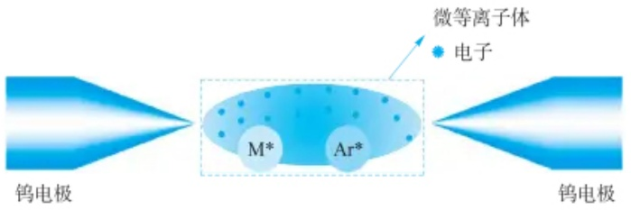

text_image

微等离子体
电子
M*
Ar*
钨电极
钨电极

图 5.1.6 典型的尖端放电微等离子体结构图

## 5.1.2.2 进样系统

样品引入激发光源的方式对方法的分析性能影响极大。一般来说，样品引入系统应将具有代表性的样品重现、高效地转入激发光源中。是否可以达到这一目的或达到这一目的程度如何，依样品的性质而定。以下针对液体样品、气体样品和固体样品介绍几种应用较多的进样方式，其他进样方法见副栏。

## 1. 溶液进样(气动雾化法)

将液体样品雾化成气溶胶导入原子化器，装置通常由雾化器和雾化室组成。分析溶液通过进样装置产生的负压吸入雾化器，在雾化器毛细中心管出口处，载气流速很快，而试液流速较慢，两者之间产生摩擦力，液流被拉细并被气流冲击破碎形成雾滴，从而实现雾化进样。样品在前进过程中，受到气流径向和切向压力的作用进一步细化，其中较细的气溶胶被载入等离子体，未细化的凝结后作为废液排出。目前采用的雾化器结构主要包括同心雾化器及交叉雾化器（图5.1.7）。气动雾化器的缺点是雾化效率低，仅有大约 $5\%$ 的样品进入原子化器，样品进样不仅受到载气流速的影响，同时还受到溶液本身黏度、表面张力等诸多因素影响，进而限制了检测灵敏度。毛细管容易被溶液堵塞，特别是高盐分和浑浊的液体；此外，毛细管还存在较强的记忆效应。但就实际应用方面，气动雾化器装置简单、操作方便，仍然是现在市面上光谱仪器的主流进样方式。

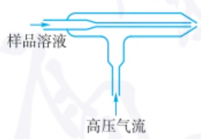

text_image

样品溶液
高压气流

(a) 同心雾化器

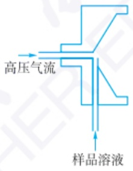

flowchart

(b) 交叉雾化器

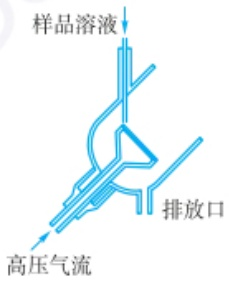

text_image

样品溶液
高压气流
排放口

(c) 烧结玻璃雾化器

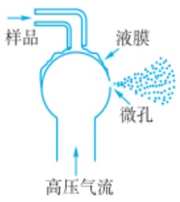

flowchart

(d) Babington雾化器

图 5.1.7 几种典型的雾化器

## 2. 气体进样

气体样品可直接引入激发光源进行分析。有些元素可以转变成其相应的挥发性化合物而采用气体发生进样（又称“化学蒸气发生法”）。化学蒸气发生能将目标分析物由溶液离子状态转化为挥发性的气态化合物，其作为原子光谱分析中的样品引入技术具有以下优势:（i）进样效率远高于雾化进样方式，能有效改善分析灵敏度；（ii）目标分析物与基体能在短时间内高效分离。下面主要介绍其在原子光谱领域应用较为普遍的几种化学蒸气发生法，包括冷蒸气发生法（cold vapor generation, CVG）、氢化物发生法（hydride generation, HG）和光化学蒸气发生

---

5.1 原子发射光谱法

253

法(photochemical vapor generation, PVG)。

（1）冷蒸气发生法 冷蒸气发生最典型的元素是汞，主要原因是它能在室温下以原子状态存在。含汞的化合物很容易被还原剂（硼氢化物或者氯化亚锡体系）还原为汞原子，并以气态的形式挥发出来被检测。也有报道指出镉化学蒸气发生与汞相似，可以被硼氢化物还原后生成  $Cd^{0}$ 。
（2）氢化物发生法 氢化物发生法是指利用某些还原剂或者化学反应，将样品溶液中的分析元素还原为挥发性共价氢化物，然后借助气流将其导入分析系统进行测量的进样方式。1836年，Mash创立砷镜反应，利用锌和盐酸体系还原生成砷化氢来检测元素砷，称为马氏试砷法。1969年，澳大利亚Holak借助砷镜反应产生砷化氢 $\left(\mathrm{AsH}_{3}\right)$ 与原子吸收光谱联用，开创了氢化物发生-原子光谱分析技术。1972年，Braman等首次采用硼氢化钠 $\left(\mathrm{NaBH}_{4}\right)$ 代替锌作为还原剂产生 $AsH_{3}$ 、 $SbH_{3}$ ，进而利用直流辉光光谱分析法测量。目前可以实现氢化物发生的元素主要包括As、Cd、Zn、Se、Sb、Bi、Ge、Sn、Te、Pb。氢化物发生法主要发展有三类还原方法，包括金属-酸体系、硼氢化物-酸体系和电化学氢化物发生体系（详见副栏）。总的来说，氢化物发生法普遍具有高的传输效率，大幅度提升了分析方法的灵敏度。近年来，氢化物发生法的可测元素范围得到不断拓展，实现了如Ag、Au、Rh、Tl及其他贵金属和过渡金属等挥发性物质的产生。
（3）光化学蒸气发生法 利用小分子的有机酸（如甲酸、乙酸与丙酸等）在紫外光作用下产生自由基，这些自由基再与相应元素反应生成挥发性物质。光化学蒸气发生法不使用传统的还原剂，仅需少量的有机酸，降低了成本，减少了污染；具有对过渡金属抗干扰能力强等优点。该方法可检测的元素范围包括传统的冷蒸气元素（Hg）、氢化物发生元素（As、Sb、Sn、Bi、Se、Te和Pb），过渡金属元素（Cd、Fe、Co、Ni和Os）及非金属元素（Cl、Br和I）。

紫外光波段范围为 100\~400 nm，可分为 UV-A(315\~400 nm)、UV-B(280\~315 nm) 和 UV-C(100\~280 nm) 三段区域。由于 UV-C 波段具有足够高的能量，能够均裂碳-碳键及其他具有相似键能的分子键，生成氧化型自由基·OH 和还原型的·H、·R、水合电子 $\left(\mathrm{e}_{\mathrm{(aq)}}^{-}\right)$ 、CO 等。氧化型自由基将有机物氧化、分解生成二氧化碳、水等小分子。而还原型的自由基提供溶液中的高还原环境，将金属还原为挥发性的产物。过程中发生的反应如下:

$$
\begin{array}{l} \mathrm{R} - \mathrm{COOH} \xrightarrow {h \nu} \mathrm{R} \cdot + \cdot \mathrm{COOH} \longrightarrow \mathrm{RH} + \mathrm{CO} _ {2} \\ \mathrm{R-COOH} \xrightarrow {h \nu} \mathrm{RCO} \cdot + \cdot \mathrm{OH} \longrightarrow \mathrm{ROH+CO} \\ \mathrm{R} = \mathrm{C} _ {n} \mathrm{H} _ {2 n + 1}, n = 0, 1, 2 \\ \end{array}
$$

在紫外光照的作用下,各种元素发生的反应多样,生成不同种类的挥发性物质。在甲酸中,氢化物发生元素一般生成对应的氢化物,如  $\mathrm{Se(IV)}$  对应生成  $SeH_{2}$ 。在乙酸或者丙酸中, $\mathrm{Se(IV)}$  主要生成甲基硒及二甲基硒等产物。而 Ni 和 Fe 则易与甲酸分解的 CO 生成  $\mathrm{Ni(CO)_{4}}$  和  $\mathrm{Fe(CO)_{5}}$ 。

## 3. 固体进样

将固体以粉末、金属或微粒形式直接引入等离子体和火焰原子化器中测定的分析方法，具有不需加入化学试剂，省去样品溶解、分离或富集等化学处理，减少污染的来源和样品的损失，以及测定灵敏度高等特点。但固体进样技术存在取样的均匀性，基体效应严重，以及较难配制均匀、可靠的固体标样等问题，严重地影响了测定的准确度和精密度。因此，它是一种既有应用前景但目前又存在较多问

## 氢化物发生还原方法简介

（1）金属-酸体系:在强还原剂作用下使待测分析物形成共价氢化物，最常见的为 $\mathrm{Zn - HCl}$ 体系。其余使用的还原物质还包括 $\mathrm{Al / H^{+}}$ ， $\mathrm{Mg / }$ $\mathrm{Ti}^{3 + } / \mathrm{H}^{+}$ 。该反应体系的局限性在于，只有少数元素能够形成可以参与此类反应的氢化物；反应速率较慢，测量耗时较长，难以实现自动化检测；干扰也较为严重。
（2）硼氢化物-酸体系:此类反应中氢化物形成取决于两个因素，一是被测元素与氢结合的速率，另一个是硼氢化物在酸性溶液中的分解速率。该体系较第一类方法在还原能力、反应速率、自动化操作、抗干扰能力及使用范围方面均有较大的提升，但该体系仍然存在着一些局限:如硼氢化物不稳定，需要现配现用；且易受过渡金属离子如 Cu、Fe、Co、Ni 等干扰；还有一些元素，如 Pb、Sn 等反应酸度条件苛刻；价态歧视严重。
（3）电化学氢化物发生体系:氢化物由水解过程中生成的H·与电解液中的待测离子结合形成。电解池中的电解过程是由外电路中的电子迁移到阴极表面，水分子被还原产生H·，电解质中的离子通过歧化反应被还原为氢化物，电解质溶液起到迁移电荷和传输物质离子的双重作用。此类方法中，阴极的还原反应受到电极表面的电荷迁移速率和物质传输速率的制约，电解池的设计、阴极材料、电流和电解液的类型及浓度对氢化物发生起到至关重要的作用。该法对于部分元素的测定具有如下优点:试剂用量少，避免使用硼氢化物；污染小；不易受到过渡金属离子的干扰；不受分析物氧化态的影响。但由于可利用电化学氢化物法的元素比较少，使得该方法进一步的推广应用受到了限制。

---

254

第五章 原子光谱法

## 其他检测系统简介

（1）目视法:适用于可见光波段，是用眼睛来观测谱线的强度。使用的仪器是看谱镜，主要应用于钢铁和有色金属的半定量分析。
(2) 摄谱法: 记录谱线使用的是感光板。感光板是原子发射光谱分析最早使用的检测系统, 由主要成分为卤化银的感光乳剂均匀地涂在玻璃板上制成。将感光板置于摄谱仪焦面上, 感光乳剂受到样品光谱的照射而发生分解, 经过显影、定影等处理过程后形成黑色的谱线。再用映谱仪放大后观察谱线的位置进行定性分析, 根据谱线的大致强度进行半定量分析, 用测微光度计测量谱线的黑度进行定量分析。

题的进样技术。固体进样方式主要有直接进样、电弧和火花熔融进样、电热蒸发进样、激光熔融进样等。

## 5.1.2.3 分光系统

分光系统的作用是将待测样品激发后发射的复合光分解成按照波长顺序排列的单色光，主要由入射狭缝、准直镜、色散元件、出射狭缝等组成。其中色散元件主要有棱镜和光栅两种，光栅相比棱镜色散与分辨能力更强，适用于更宽的波长范围。分光系统的详细内容请参照光分析总论部分。

## 5.1.2.4 检测系统

原子发射光谱中,样品激发后产生待测元素的特征辐射,对其波长或强度的检测方法有目视法、摄谱法(见副栏)和光电法。

光电法:利用光电效应将辐射能转换为电信号,产生的信号正比于入射光强度。检测器主要包括光电倍增管、光二极管阵列或电荷耦合阵列(具体原理及器件详见光分析总论部分)。例如,采用电荷耦合器件设计的全谱直读等离子体发射光谱仪可在1 min内完成样品中多达70种元素的测定;此外,它的动态响应范围和灵敏度均有可能达到甚至超过光电倍增管,加之其比光电倍增管更结实耐用,因此在发射光谱中有广泛的应用前景。

## 5.1.2.5 光谱仪类型

光谱仪的作用是将光源发射的电磁辐射经色散后,得到按波长顺序排列的光谱,并对不同波长的辐射进行检测与记录。原子发射光谱仪目前可分为摄谱仪和光电直读光谱仪,后者又分为单道扫描光谱仪、多道直读光谱仪和全谱直读光谱仪等。

## 1. 摄谱仪

摄谱仪是用光栅或棱镜作为色散元件,用感光板记录光谱的原子发射光谱仪器。图 5.1.8 是平面光栅摄谱仪光路示意图。光栅摄谱仪价格较便宜,测试费用也较低,并且感光板可以永久记录和长期保存光谱。

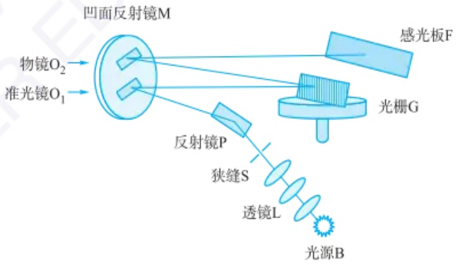

flowchart

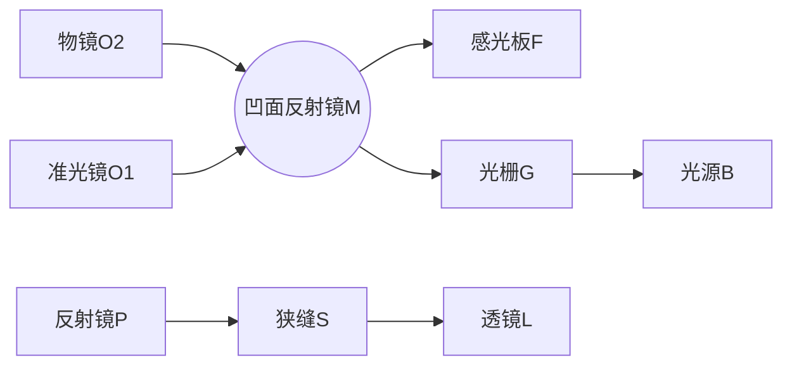

图 5.1.8 光栅摄谱仪光路示意图

## 2. 光电直读光谱仪

光电直读光谱仪是利用光电转换元件接收光辐射，将其转换为电信号，直接测量谱线的强度。光电直读光谱仪分为多道直读光谱仪（图5.1.9）、单道扫描光谱仪（图5.1.10）和全谱直读光谱仪。前两种仪器采用光电倍增管作为检测器，后一种采用CCD检测器。

---

5.1 原子发射光谱法

255

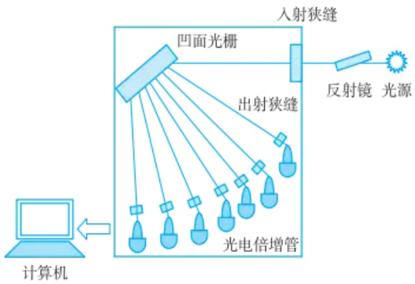

flowchart

图 5.1.9 多道直读光谱仪示意图

## 5.1.2.6 干扰及消除方法

原子发射光谱中干扰类型分为光谱干扰和非光谱干扰。

## 1. 光谱干扰

在发射光谱中最主要的光谱干扰是背景干扰，包括带状光谱（分子辐射）、连续光谱（连续辐射）及光学系统的杂散光等，光源温度越低，未解离的分子就越多，背景就越强。可通过背景校准消除干扰。校准背景的基本原则是:谱线的表观强度 $I_{1+b}$ 减去背景强度 $I_{b}$ 。常用的校准背景的方法有校准法和等效浓度法。

## 2. 非光谱干扰

非光谱干扰主要来源于样品组成对谱线强度的影响,这种影响与样品在光源中的蒸发和激发过程有关,亦被称为基体效应。激发温度受样品基体组成的影响,进而影响谱线的强度。由于标准样品与样品的基体组成差别较大。在实际工作中,常常向样品和标准样品中加入一些添加剂以减小基体效应,提高分析的准确度,这种添加剂有时也被用来提高分析的灵敏度。添加剂主要有光谱缓冲剂和光谱载体。

## 5.1.3 光谱分析方法

## 5.1.3.1 定性分析

由于各种元素的原子结构不同,在光源的激发作用下,样品中每种元素都发射自己的特征光谱。因此,光谱定性分析一般多采用摄谱法,它是进行元素定性分析的最好方法之一。

## 1. 元素的分析线、最后线和灵敏线的基本概念

分析线:复杂元素的谱线可能多至数千条,只选择其中几条特征谱线检验,称其为分析线;最后线:浓度逐渐减小,谱线强度减小,最后消失的谱线;灵敏线:最易激发的能级所产生的谱线,每种元素都有一条或几条灵敏线。最后线也是最灵敏线。例如,汞的原子发射线主要有184.95 nm、253.65 nm等。其中253.65 nm是最常用的分析线,具有较高的灵敏度和稳定性。

## 2. 元素的定性分析方法

铁光谱比较法:采用铁的光谱作为波长的标尺,来判断其他元素的谱线。该方法的特点是谱线多,在210\~660 nm范围有几千条谱线;谱线间距离都很近,在上述波长范围内谱线均匀分布,且对每一条谱线波长已精确测量。标准样品光谱

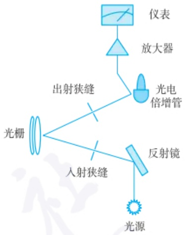

flowchart

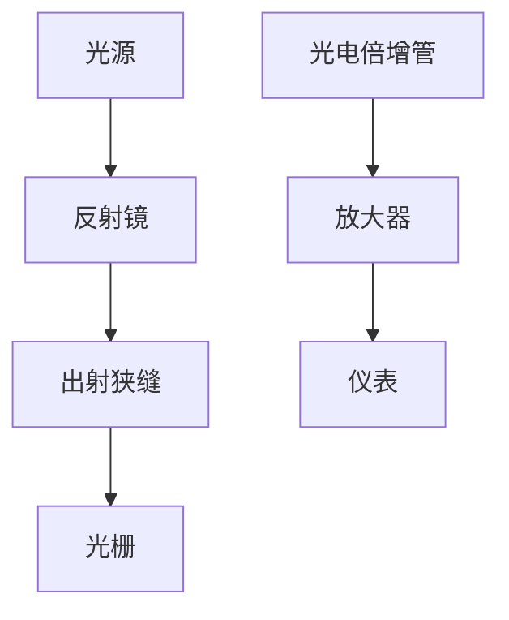

图 5.1.10 单道扫描光谱仪示意图

---

256

第五章 原子光谱法

比较法:用标准样品与样品在相同的条件下摄谱,比较标准样品与样品所出现的特征谱线。若样品光谱中出现标准样品所含元素的2\~3条特征谱线,就可以证实样品中含有该元素,否则不含有该元素。

## 5.1.3.2 定量分析

## 1. 光谱定量分析基本关系式

从推导公式[式(5-1-3)]可以得出,当温度一定时,谱线强度I与被测元素的浓度c呈正比,即

$$
I = a c \tag {5-1-4}
$$

当考虑到谱线自吸时,有如下关系式,称赛伯(Schiebe G)和罗马金(Lomakin)经验公式:

$$
I = a c ^ {b} \tag {5-1-5}
$$

$$
\lg I = b \lg c + \lg a \tag {5-1-6}
$$

在一定的实验条件下，a 为常数；c 为被测元素的含量；b 为自吸系数，b=1，无自吸；b<1，有自吸；b 越小，自吸越大。此外，a 值受样品组成、形态及放电条件等的影响，在实验中很难保持为常数，故通常不采用谱线的绝对强度来进行光谱定量分析，而是采用“内标法”。

## 2. 内标法

在分析元素的谱线中选一条谱线，称为分析线；再在基体元素（或加入定量的其他元素）的谱线中选一条谱线，作为内标线。这两条线组成分析线对。然后根据分析线对的相对强度与被分析元素含量的关系式进行定量分析。设被测元素和内标元素含量分别为 $c$ 和 $c_{0}$，分析线和内标线强度分别为 $I$ 和 $I_{0}, b$ 和 $b_{0}$ 分别为分析线和内标线的自吸收系数，根据塞伯-罗马金公式，对分析线和内标线分别有

$$
I = a c ^ {b} \tag {5-1-7}
$$

$$
I _ {0} = a _ {0} c _ {0} ^ {b _ {0}} \tag {5-1-8}
$$

## 内标元素与内标线选择原则

(1) 内标元素含量必须适量和固定。
(2) 内标元素与被测元素化合物在光源作用下应具有相似的蒸发性质。
(3) 分析线与内标线没有自吸或自吸很小, 且不受其他谱线的干扰。
（4）用原子线组成分析线对时，要求两线的激发电位相近；若选用离子线组成分析线对，则不仅要求两线的激发电位相近，还要求内标元素与分析元素的电离电位也相近。用一条原子线与一条离子线组成分析线对是不合适的。
（5）若用照相法测量谱线强度，要求组成分析线对的两条谱线的波长尽量靠近。

分析线与内标线强度之比 R 称为相对强度:

$$
R = \frac {I}{I _ {0}} = a c ^ {b} / a _ {0} e _ {0} ^ {b _ {0}} \tag {5-1-9}
$$

式中，内标元素 $c_{0}$ 为常数，实验条件一定时，$A = a / a_0c_0^{b_0}$ 为常数，则

$$
R = \frac {I}{I _ {0}} = A c ^ {b} \tag {5-1-10}
$$

取对数得

$$
\lg R = b \lg c + \lg A \tag {5-1-11}
$$

此式为内标法光谱定量分析的基本关系式。内标法主要作用是抵消光源不稳定性的影响，内标元素与内标线的选择遵循一定的原则。

## 3. 定量分析方法

（1）校准曲线法 在确定的分析条件下，用三个或三个以上含有不同浓度被测元素的标准样品与样品在相同的条件下激发光谱，以分析线强度 I 或内标分析线对强度比 R 或  $\lg R$  对浓度 c 或  $\lg c$  作校准曲线。再由校准曲线求得样品被测元素含量。
（2）标准加入法 被测元素含量为 $C_{\mathrm{x}}$ ，几份样品中分别加入不同浓度的被测元素；在同一实验条件下，测量样品与不同加入量样品分析线对的强度比 $R$ 。在被测元素浓度低时，自吸系数 $b = 1$ ，分析线对强度 $R - c$ 图为一直线，将直线外推，

---

5.1 原子发射光谱法

257

与横坐标相交截距的绝对值即为样品中待测元素含量  $C_{x}$ 。

## 5.1.3.3 原子发射光谱的分析应用领域

原子发射光谱法的应用领域非常广泛，例如，金属材料分析:可以用于检测合金中的各种元素含量，包括铁、铜、铝、锌、镍等。环境监测:检测土壤、水体、大气中的重金属等污染物，评估环境质量和污染程度。食品安全:检测食品中的微量元素，如铅、汞、镉等，以及其他有害物质的残留。药品分析:包括药物中的元素含量分析及对药品中可能存在的有害元素进行检测。地质勘探:提供快速、准确的元素含量信息，用于矿物探测和资源评估。生物医学:分析体液、组织和药物中元素含量，研究疾病发生机制和药物代谢过程。工业质量控制:检测合金中的元素含量，保证产品性能和品质。

## 5.1.4 原子发射光谱法的前沿探索

近年来，人们对现场、实时、在线等分析仪器的需求大幅上涨。可用于现场快速检测的小型化仪器，具有体积小、功耗低、便携、可野外分析等优点，是节约/环保型社会的必然需求。因此，仪器小型化是原子发射光谱发展方向之一。为实现原子发射光谱的小型化，主要可从激发光源、进样系统和检测系统等方面进行探索。

## 5.1.4.1 光谱仪改进——进样系统新策略

在原子光谱分析研究中，样品的引入技术一直都是研究的重点与难点，因为进样效率的高低会直接影响方法的灵敏度、检出限等重要指标，尤其是对于微量元素的分析检测方面影响更加显著。一种理想的样品引入技术应该能够通过高效经济的方法将分析物引入原子化激发电离系统中，同时也能够防止或最小化样品基质中其他组分可能带来的干扰。由于雾化进样技术效率低，大多数分析物进入废液流中而未被检测。随着激光技术的发展，新的进样技术也逐渐发展起来，如电热蒸发、激光烧蚀等，但由于这些技术是对固体、悬浆、液体进行分析，因此存在着比较严重的基质干扰及记忆效应等问题。科学家认为对于电感耦合等离子体来说，最理想的进样形式应为气态。因此，蒸气发生进样可以增强原子化效率，从而进一步提高分析方法的灵敏度和检测能力，其与原子光谱和质谱相结合已在痕量或超痕量水平上提高了许多元素的分析性能。在分析化学领域中，蒸气发生技术通常将待分析物转化为非极性或低极性的挥发性物种。

## 5.1.4.2 光谱仪改进——集成创新

微等离子体中含有大量的高能电子，能够与周围粒子发生碰撞产生分子的裂解、激发和电离等过程，产生目标分析物信号。并且由于微等离子体消耗低、成本低、结构小巧便携，无论其作为样品引入方式或者激发源，在原子光谱小型化方面获得了广泛关注。为了解决传统原子光谱装置“从实验室走向现场，从技术限制走向开放共享”存在的问题，构建灵敏可靠、集成紧凑的便携现场分析检测器，实现对目标物的准确检测是原子发射光谱的必然发展方向。

3D打印技术具有快速简便、经济高效、一步成型等优势，能够实现装置的个性化设计和标准化制造。使用3D打印构建便携式微等离子体原子发射光谱仪可解决目前小型化仪器制造方面存在的问题。将分离富集技术和蒸气发生进样方式引入3D打印微等离子体原子发射光谱仪，提高方法分析性能，应用于复杂环境、食品等样品中目标物检测。近年来，经过科学家不断地迭代优化，3D打印的原子光谱仪器装置已经成功实现从单元素分析到多元素分析，进一

3D 打印技术以计算机辅助设计数字模型为基础，对模型扫描分层切片，再以不同的沉积或固化方式逐层叠加制造零件或实体，过程中无须模具制造或机械加工。自 1986 年 Charles Hull 推出首台立体光刻 3D 打印机以来，3D 打印技术在现代化学实验室中应用越来越普遍，为不同专业方向的科研工作者提供了设计制造多功能集成设备和实验室常用零件教具的技术支持。在分析化学方面，主要研究方向包括微流控器件、电化学传感器和生物传感器、分离科学、样品预处理、传感器和小型化检测仪器等。

---

258

第五章 原子光谱法

参考资料

步用于多元素的形态分析。与此同时，也有科学家结合蒸气发生新方法、移动电池及3D打印新技术构建更稳定的小型化甚至芯片式蒸气发生-微等离子体原子光谱分析方法和装置，将其集成的仪器装置搭载在无人机、无人船上，用于元素的原位分析，这些研究的成功将为环境污染物的现场检测提供新策略、注入新动力。

## 5.1.4.3 学科交叉——引入机器学习实现智能分析

机器学习(machine learning)，就是让机器(计算机)也能像人类一样，通过观察大量的数据和训练，发现事物规律，获得某种分析问题、解决问题的能力。在数据急速增长的今天，人们对于数据的挖掘和运用，为发现新价值带来了新的机遇和挑战。与人工智能类似，人们在数据获取、挖掘和分析等方面又面临着更高的挑战。如何从大量数据中挖掘出隐藏的有用信息吸引了研究者的极大兴趣。现代分析化学作为一门实验科学，特别是仪器分析，其最重要的特征是以空前的速度产生出大量、类型繁多、实时性高的数据。实际上，许多化学过程中产生的数据因为被认为“无用”而并未被记录。但是，被忽略的数据通过数据挖掘技术常常能够提供额外的信息。因此，从一个已知的分析体系提取出多维度的信息能够实现快速、灵敏和高通量的分析。

发射光谱通过发射特征谱线可用于元素/分子的定性、定量分析，具有全谱直读、快速分析和多元素同时测定等优点。将机器学习运用到原子光谱数据分析中，可以很好地实现高选择性、高灵敏度的分析，通过增加分析测量的维度来增加分析能力，广泛用于环境监测、生物系统传感和食品质量分析等领域。例如，将催化裂解-尖端放电微等离子体发射光谱和机器学习相结合，可建立用于塑料升级回收催化剂快速筛选的新方法。

## 习题

## - 章节练习题 -

1. 阐述 ICP 光源的形成原理及其特点。
2. 阐述各种激发光源的优缺点。
3. 何谓元素的共振线、灵敏线、最后线、分析线？它们之间有何联系？
4. 何谓自吸收？它对光谱分析有什么影响？
5. 简述三种用于 ICP 炬的样品引入方式。
6. 光谱定性分析的基本原理是什么？进行光谱定性分析时可以有哪几种方法？说明各种方法的基本原理及适用场合。
7. 光谱定量分析的依据是什么？为什么采用内标法？简述内标法的原理。内标元素和分析线对应具备哪些条件？为什么？

8. 简述背景产生的原因及消除方法。

9. 用内标法测定试液中镁的含量。用蒸馏水溶解 $\mathrm{MgCl}_2$ 以配制标准镁溶液系列。在每一标准溶液和待测溶液中均含有 $25.0\mathrm{ng}\cdot \mathrm{mL}^{-1}$ 的钼。钼溶液用溶解钼酸铵而得。测定时吸取 $50~\mu \mathrm{L}$ 的溶液于铜电极上，溶液蒸发至干后摄谱，测量$279.8\mathrm{nm}$ 处的镁谱线强度和 $281.6\mathrm{nm}$ 处的钼谱线强度，得下列数据。试据此确定试液中镁的质量浓度。

---

5.2 原子吸收与原子荧光光谱法

259

<table><tr><td rowspan="2"> $\rho (Mg) / (ng \cdot mL^{-1})$ </td><td colspan="2">相对强度</td></tr><tr><td>279.8 nm</td><td>281.6 nm</td></tr><tr><td>1.05</td><td>0.67</td><td>1.8</td></tr><tr><td>10.5</td><td>3.4</td><td>1.6</td></tr><tr><td>100.5</td><td>18</td><td>1.5</td></tr><tr><td>1050</td><td>115</td><td>1.7</td></tr><tr><td>10500</td><td>739</td><td>1.9</td></tr><tr><td>分析样品</td><td>2.5</td><td>1.8</td></tr></table>

## - 挑战性问题 -

10. 微等离子体的电子温度和电子密度相较于 ICP 如何？前者的元素激发能和稳定性是否强于 ICP？

## - 专题和报告 -

11. 查找一篇与便携式原子发射光谱仪相关的英文文献，并指出该仪器在科学研究中所发挥的作用以及其分析性能，并阐述该策略是否有需要补充或改进的地方。

## 5.2 原子吸收与原子荧光光谱法

## 5.2.1 原子吸收光谱法

原子吸收光谱法(atomic absorption spectrometry)是基于气相中被测元素的基态原子对其共振辐射的吸收强度来测定样品中该待测元素含量的一种分析方法，可以测定70余种元素。该方法具有灵敏度高、选择性好、准确度高、分析速度快、仪器相对简单、操作方便等优势。

## 5.2.1.1 原子吸收光谱法基本原理

## 1. 原子吸收光谱的产生

通常情况下原子处于基态，当外界提供的辐射能量恰好等于原子核外层电子基态与某一激发态之间的能量差时，原子吸收特征能量的光辐射（共振辐射），核外电子由基态跃迁到相应的激发态，产生原子吸收光谱。使电子从基态跃迁至第一激发态所产生的吸收线称为第一共振吸收线，也是灵敏线。由于原子结构和外层电子排布不同，共振线各有特征，是元素的特征谱线，也是元素定性的依据。吸收程度与基态原子数成正比，是元素定量的依据。

## 2. 原子吸收光谱的轮廓及变宽因素

（1）谱线轮廓 从能级跃迁的理论上讲，原子核外价电子从基态跃迁到某一激发态，应获得单一波长(或频率)的吸收线，但实际上原子吸收线并非严格意义上的几何线，而是呈现出一定的谱线宽度。以不同频率 $\nu$ 下测得的吸收系数 $K_{\nu}$ 为纵坐标，$\nu$ 为横坐标，绘制 $K_{\nu} - \nu$ 曲线，将谱线的强度按频率分布的形状称为谱线轮廓(图5.2.1)。

曲线中  $K_{\nu}$  的极大值处称为极大吸收系数  $(K_{0})$ ，极大吸收系数一半处谱线轮廓上两点之间的频率差为半宽度  $(\Delta\nu)$ ， $K_{0}$  所对应的频率为中心频率  $(\nu_{0})$ ，其数值取决于跃迁能级的能量差。原子吸收光谱的轮廓用中心频率和半宽度来描述。

## 原子吸收光谱法发展历史

17 世纪 60 年代中期, 英国科学家 I. Newton 让太阳光通过小孔, 用三棱镜发现太阳光是由不同颜色的单色光组合而成的。

1802 年英国化学家 W. H. Wollaston 用质量更好的三棱镜，并用狭缝代替小孔，观察太阳光谱，发现几条暗线。

1814 年 J. Fraunhofer 发明光谱仪, 发现太阳光谱中的几百条暗线, 但仍无法解释暗线存在的原因, 这些暗线被称作 Fraunhofer 线。

1859 年德国物理学家 G. Kirchhoff 和化学家 R. W. Bunsen 证明太阳光谱中暗线是钠原子吸收的结果。

1955 年由澳大利亚物理学家 A. Walsh 提出原子吸收光谱法。

20世纪50年代末60年代初，Varian Techtron和Perkin-Elmer公司推出仪器。

1961年L'vov提出电热原子化法。

1965年J.B.Willis将氧化亚氮-乙炔高温火焰用于原子吸收中。

2004 年德国耶拿 (Jena) 分析仪器股份公司推出连续光源原子吸收仪。

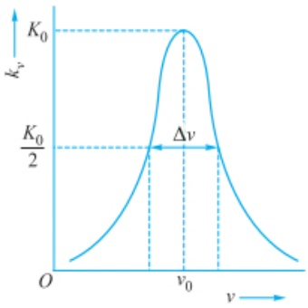

contour

| Variable | Value |
| --- | --- |
| Peak Velocity (kv) | Kv |
| Half-maximum Rate Constant (kv/2) | Kv/2 |
| Velocity at Peak (v0) | v0 |

图 5.2.1 原子吸收光谱谱线轮廓示意图

---

260

第五章 原子光谱法

（2）变宽因素 原子吸收谱线的宽度一方面由原子的性质决定，另一方面也受外界因素影响。

① 自然宽度。在无外界因素影响时，谱线具有的宽度称为自然宽度 $\left(\Delta\nu_{\mathrm{N}}\right)$ 。谱线的自然宽度源于海森堡不确定性原理(Heisenberg uncertainty)，根据不确定性原理，在电子跃迁时，能量和激发态寿命不能同时被精确测定，如式(5-2-1)所示。

$$
\Delta E \Delta t \geqslant h / 4 \pi \tag {5-2-1}
$$

$\Delta E$  为能量, $\Delta t$  为电子跃迁的寿命。

$$
E = h \nu , \quad \text {则} \quad \Delta \nu \Delta t \geqslant 1 / 4 \pi \tag {5-2-2}
$$

因此,谱线的自然宽度与激发态原子的平均寿命成反比。一般来说,谱线的自然宽度约为  $10^{-5}$  nm 数量级。

② 多普勒变宽。多普勒变宽(Doppler broadening)是由原子的无序热运动产生的，也称热变宽。由物理学的多普勒效应可知，无序热运动的发光原子在空间运动时，若朝向检测器，检测器接收的光频率相对于静止的原子要大，若背离检测器，接收的光频率相对于静止的原子要小。对检测器而言，接收到的是各种频率略有不同的光，表现出吸收线的变宽。多普勒变宽可由式(5-2-3)表示。

$$
\Delta \nu_ {\mathrm{D}} = 7. 1 6 \times 1 0 ^ {- 7} \nu_ {0} \sqrt {\frac {T}{A}} \tag {5-2-3}
$$

由式中可见,多普勒变宽与温度 T 和被测元素的相对原子质量 A 有关,温度升高,相对原子质量减小,都会使多普勒变宽增大。多普勒变宽一般在  $10^{-3}$  nm 数量级。

③ 压力变宽。压力变宽是由于吸光原子与周边的粒子发生碰撞而引起能量的微小变化，从而导致谱线变宽，也称碰撞变宽。主要包括洛伦兹变宽（Lorentz broadening）和赫尔兹马克变宽（Holtsmark broadening）。

洛伦兹变宽是吸光原子与其他原子、离子、分子等碰撞产生的，与外部的压力有关。洛伦兹变宽与多普勒变宽具有相同的数量级，其宽度  $\Delta\nu_{L}$  可由式(5-2-4)描述。

$$
\Delta \nu_ {\mathrm{L}} = 2 N _ {\mathrm{A}} \sigma_ {\mathrm{L}} ^ {2} p \sqrt {\frac {2}{\pi R T} \left(\frac {1}{A} + \frac {1}{M}\right)} \tag {5-2-4}
$$

其中， $N_{A}$  为阿伏伽德罗常数； $\sigma_{L}$  为碰撞有效截面积；p 为外部压力；A 为待测元素的相对原子质量；M 为外界其他原子的相对原子质量或分子的相对分子质量；R 为摩尔气体常数；T 为热力学温度。

赫尔兹马克变宽是吸光原子与同种原子之间的碰撞产生的,也称共振变宽。当待测元素的浓度较高时,共振变宽才会显现,一般可以忽略。

④ 场致变宽。在外界电场或磁场的作用下，引起核外电子能级发生分裂而使谱线变宽的现象称为场致变宽。包括由电场引起的斯塔克变宽（Stark broadening）和在磁场的作用下引起的塞曼变宽（Zeeman broadening）。原子化器中由于运动着的少量离子和电子产生的电场和磁场很微弱，因此场致变宽可以忽略。

在通常的原子吸收条件下，多普勒变宽和洛伦兹变宽是影响谱线宽度的主要因素，使原子吸收线宽度达到 $10^{-3} \sim 10^{-2} \mathrm{~nm}$ （图5.2.2）。

## 3. 原子吸收值与原子浓度之间的关系

(1) 朗伯-比尔定律 原子吸收服从朗伯-比尔定律, 即

---

5.2 原子吸收与原子荧光光谱法

261

$$
I _ {\nu} = I _ {0 \nu} \mathrm{e} ^ {- K _ {\nu} L} \tag {5-2-5}
$$

式中  $I_{0\nu}$  为光源发射谱线的强度， $I_{\nu}$  为透过光强度， $K_{\nu}$  为吸收系数，L 为光程长。 $\nu$  为某一频率。

当频率为  $\nu$  的单色光通过原子蒸气时, 原子对该频率的辐射的吸收程度用吸光度表示。

$$
A = \lg \frac {I _ {0 v}}{I _ {v}} = 0. 4 3 4 3 K _ {v} L \tag {5-2-6}
$$

由式(5-2-6)可见,在光程长一定的情况下,吸光度与吸收系数成正比。

（2）积分吸收 原子吸收线是具有一定宽度的，如果采用在紫外-可见分光光度计中常用的连续光源（氘灯或钨灯），则需要测定原子吸收的总吸收值，即吸收线的轮廓内吸收系数的积分面积，称为积分吸收（见副栏）。

$$
\int K _ {\nu} \mathrm{d} \nu = \frac {\pi e ^ {2}}{m c} f N _ {0} = k N _ {0} \tag {5-2-7}
$$

式中， $K_{v}$  为吸收系数，e 为电子电荷，m 为电子质量，c 为光速，f 为振子强度， $N_{0}$  为单位体积原子蒸气中基态原子数。

在热平衡状态下,基态原子数和激发态原子数符合玻耳兹曼分配定律,即

$$
\frac {N _ {i}}{N _ {0}} = \frac {g _ {i}}{g _ {0}} \exp \left[ - E _ {i} / (k _ {\mathrm{B}} T) \right] \tag {5-2-8}
$$

式中， $N_{i}$  为激发态原子数， $N_{0}$  为基态原子数， $g_{i}, g_{0}$  分别为激发态和基态的统计权重， $E_{i}$  为激发能，T 为热力学温度。

在原子吸收光谱的一般分析条件下,处于激发态的原子数很少,基态原子数可近似地认为等同于吸收原子数。即理论上积分吸收与吸收光辐射的基态原子数成正比。

但是要测量半宽度约为  $10^{-3}$  nm 的吸收谱线的积分吸收值, 要求单色器的分辨率达五十万(见副栏), 技术上难以实现。

（3）峰值吸收 A.Walsh 提出峰值吸收测量法，即用锐线光源代替连续光源来测定谱线的峰值吸收(图 5.2.3)。所谓锐线光源(narrow-line source)，是指其能够发射出半宽度很窄的发射线，其半宽度小于原子吸收线的半宽度，且发射线与吸收线的中心频率完全一致。在温度不太高的稳定火焰条件下，峰值吸收系数(即吸收线中心波长处的  $K_{0}$ )与火焰中待测元素的原子浓度也存在线性关系。

峰值吸收是积分吸收和吸收线半宽度的函数。

$$
\frac {K _ {0}}{2} = \frac {b}{\Delta \nu} \int K _ {\nu} \mathrm{d} \nu \tag {5-2-9}
$$

式中， $K_{0}$  为峰值吸收系数，b 为常数，与谱线变宽有关。

当只考虑多普勒变宽时，则

$$
b = \sqrt {\frac {\ln 2}{\pi}} \tag {5-2-10}
$$

将式（5-2-7）和式（5-2-10）带入式（5-2-9），则

$$
K _ {0} = \frac {2}{\Delta \nu} \sqrt {\frac {\ln 2}{\pi}} \frac {\pi e ^ {2}}{m c} f N _ {0} \tag {5-2-11}
$$

对于中心吸收,根据式(5-2-6)可得

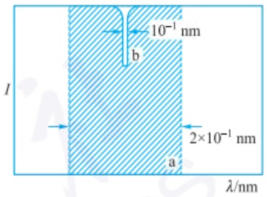

text_image

10⁻¹ nm
b
2×10⁻¹ nm
a
λ/nm

图 5.2.2 连续光源(a)光谱通带宽度与原子吸收线(b)的宽度示意图

如图 5.2.2 所示, 当将常用的原子吸收分光光度计的狭缝设为最小值 0.1 mm 时, 光谱通带约为 0.2 nm。而原子吸收线的半宽度仅为  $10^{-1}$  nm, 若使用连续光源, 则在光谱通带内原子吸收值仅相当于入射光强的很少一部分。这一方面要求需要测定积分吸收, 另一方面由于吸收值仅占很少一部分, 使得测定灵敏度很低。

以 Na 589.0 nm 这条谱线为例，设谱线宽度为  $10^{-3}$  nm，单色器的分辨率需达到以下值:

$$
R = \frac {\lambda}{\mathrm{d} \lambda} = \frac {5 8 9 . 0 \mathrm{nm}}{1 0 ^ {- 3} \mathrm{nm}} = 5 8 9 0 0 0
$$

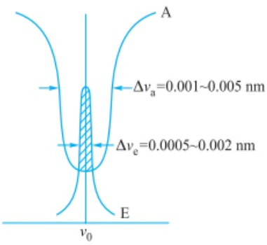

text_image

A
Δνₐ=0.001~0.005 nm
Δνₑ=0.0005~0.002 nm
E
v₀

E: 发射线; A: 吸收线

图 5.2.3 峰值吸收测定示意图

阴影部分为被吸收的部分发射线

---

262

第五章 原子光谱法

$$
A = \lg \frac {I _ {0}}{I} = 0. 4 3 4 3 K _ {0} L \tag {5-2-12}
$$

将式(5-2-11)代入式(5-2-12)，得

$$
A = 0. 4 3 4 3 \frac {2}{\Delta v} \sqrt {\frac {\ln 2}{\pi}} \frac {\pi e ^ {2}}{m c} f L N _ {0} \tag {5-2-13}
$$

在实验条件一定时,式中的相关参数为常数,且样品中待测元素的浓度 c 与基态原子数  $N_{0}$  成正比,因此可得

$$
A = k c \tag {5-2-14}
$$

k 为常数。

式(5-2-14)为原子吸收光谱法定量的基本依据。

## 5.2.1.2 原子吸收光谱仪

原子吸收分光光度计基本上由光源、原子化器、分光系统及检测系统4个主要部分组成，如图5.2.4所示。下面分别对上述4个主要部分进行详细介绍。

图 5.2.4 原子吸收分光光度计基本结构示意图

## 1. 锐线光源

光源的作用是发射被测元素的特征共振辐射。对锐线光源的最基本要求是发射的共振辐射的半宽度要明显小于吸收线的半宽度。此外，还要求光源辐射强度大、稳定性好、背景低、噪声小、使用寿命长。常用的光源有空心阴极灯和无极放电灯，这里主要介绍最常用的空心阴极灯。

空心阴极灯(hollow cathode lamp)又称元素灯,由被测元素材料制成空心阴极,由钛、锆、钽或其他材料做成阳极,阴极和阳极封闭在带有光学窗口的硬质玻璃管内。管内充有几百帕低压的惰性气体氖或氩。其构造如图5.2.5所示。

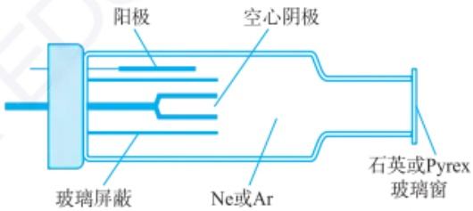

text_image

阳极
空心阴极
玻璃屏蔽
Ne或Ar
石英或Pyrex
玻璃窗

图 5.2.5 空心阴极灯结构示意图

空心阴极灯放电是一种特殊形式的低压辉光放电。在两极施加几百伏电压，在高压电场下，阴极电子向阳极高速飞溅放电，并与载气原子碰撞，使之电离放出二次电子，而使场内正离子和电子增加以维持电流。载气阳离子在电场中大大加速，轰击阴极表面时可将被测元素的原子从晶格中轰击出来，即溅射。溅射出的原子大量聚集在空心阴极内，经与其他粒子碰撞而被激发，发射出相应元素的特征谱线。

一般空心阴极灯为单元素灯，其阴极由含单一金属的材料制成，因此，测不同元素时需要换不同的元素灯。为了免去换灯的麻烦，减少预热时间，降低成本，可在阴极材料中掺入几种元素，制成多元素灯。现已应用的多元素灯最多可测6\~7种元素。需要注意的是，多元素灯易产生干扰，在使用时应确定在检测波长附近是否有单色器无法分开的非待测元素的谱线。

---

5.2 原子吸收与原子荧光光谱法

263

空心阴极灯的辐射强度与工作电流有关，增大工作电流，可提高谱线强度。但是灯电流过大，则会导致溅射作用增强，原子密度增大，易产生自吸，使发射线展宽，降低灵敏度，且使灯寿命缩短。如果电流过小，则光强度减弱，且放电不稳定。因此，在实际工作中应选择合适的工作电流。

## 2. 原子化器

原子化器的作用是使各种形式的样品解离出基态原子，并使其进入光源的辐射光程。样品原子化是原子吸收光谱分析的关键过程，会影响测定的灵敏度和准确性。常用的原子化器有火焰原子化器和无火焰原子化器。

（1）火焰原子化器 火焰原子化器通常由雾化器、预混合室和燃烧器组成。其结构示意图见图5.2.6。

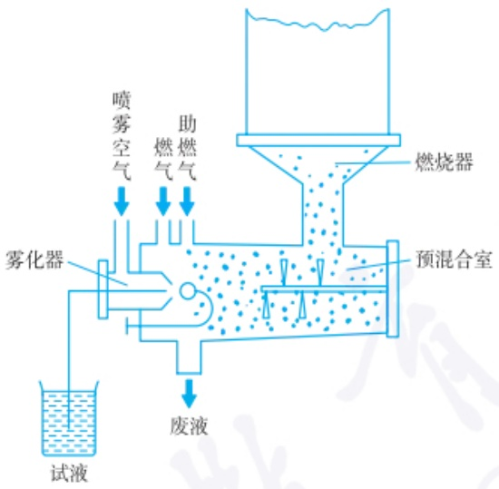

flowchart

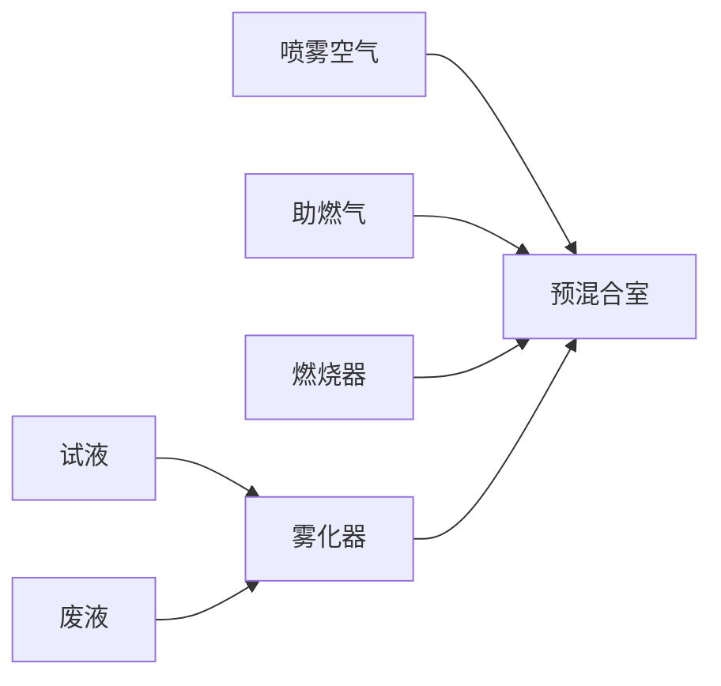

图 5.2.6 预混合型火焰原子化器

① 雾化器。雾化器的作用是使样品吸喷雾化。在高压助燃气(一般为空气或氧化亚氮)高速通过进样毛细管外壁与喷口形成的间隙时,造成负压区,将样品吸入并分散成雾滴。雾化的过程与溶液的物理性质(如表面张力和黏度等)有关,也与助燃气的压力和雾化器结构有关。要求雾化器的雾化效率高、雾滴细、喷雾稳定,以保证分析的精密度和灵敏度。
② 预混合室。雾化的样品进入预混合室，与撞击球碰撞，进一步分散成细小的雾滴。同时燃气（一般为乙炔）与助燃气在预混合室中充分混合。大的雾滴作为废液由废液管排出，小的雾滴则随着燃气和助燃气进入燃烧器。
③ 燃烧器。燃烧器为单缝喷灯，缝宽一般为 0.5 mm，长度有 50 mm（氧化亚氮-乙炔火焰用）和 100 mm 两种（图 5.2.7）。燃气和助燃气在燃烧器缝口被点燃形成火焰，使待测物质脱溶剂、熔融、蒸发、解离为基态原子，有少量原子化的基态原子也可能在火焰中被激发、电离或化合。

预混合型燃烧器的火焰分为干燥区（也称预热区）、蒸发区（也称第一反应区）、原子化区（中间薄层区）和电离化合区（第二反应区）（图5.2.8）。各区域的反应温度和还原性气氛不同，原子浓度和干扰成分的浓度也不同。一般来说，实验中选取中间薄层区进行测定。

常用的火焰包括空气-丙烷火焰、空气-乙炔火焰、氧化亚氮-乙炔火焰、空气-氢火焰。其中目前广泛应用的是空气-乙炔火焰(表5.2.1)，适于30多种元素

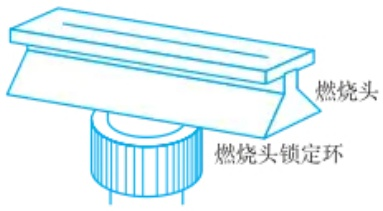

text_image

燃烧头
燃烧头锁定环

图 5.2.7 燃烧头

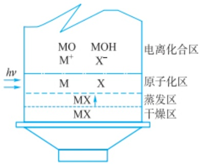

text_image

MO
M⁺
MOH
X⁻
电离化合区
原子化区
蒸发区
干燥区
hv
M
X
MX
MX

图 5.2.8 预混合型燃烧器的火焰区域示意图

---

264

第五章 原子光谱法

## 化学原子化法

化学原子化法是指利用化学反应使待测元素转化为气态原子或化合物，在较低温度下进行原子化的方法，又称低温原子化法。常用的主要有冷原子吸收法和氢化物发生法。

冷原子吸收法主要用于汞的测定，也称汞低温原子化法。在常温下，将样品中汞离子用  $SnCl_{2}$  或盐酸羟胺还原为金属汞，汞具有很高的蒸气压，因此在常温下会形成汞蒸气，用载气将汞蒸气带入吸收池进行测定。该方法具有较高的灵敏度和准确度。目前一些商品化的冷原子吸收测汞仪在痕量汞的测定中发挥了很大作用。

氢化物发生法适用于 As、Sb、Bi、Ge、Sn、Pb、Se、Te 等元素的测定。在酸性条件下，用强还原剂  $NaBH_{4}$  或  $KBH_{4}$  将这些元素还原，生成气态氢化物，如  $AsH_{3}$ 、 $SnH_{4}$  等，用载气带入石英管中，用火焰加热或电热法在 700\~900 ℃ 下即可使氢化物原子化。该方法还原效率高，因此测定灵敏度高，基体影响小。

的测定。氧化亚氮-乙炔火焰温度高，可测定70多种元素。

表 5.2.1 常用的乙炔火焰温度及燃烧速率

| 燃气 | 助燃气 | 温度/°C | 燃烧速率/(cm·s-1) |
| --- | --- | --- | --- |
| 乙炔 | 空气 | 2100~2400 | 158~266 |
| 乙炔 | 氧气 | 3050~3150 | 1100~2480 |
| 乙炔 | 氧化亚氮 | 2600~2800 | 285 |

火焰的性质与燃气和助燃气的种类有关,也与燃气和助燃气的比例有关。

中性火焰: 燃气与助燃气的比例与它们之间化学反应的计量关系接近  $(1:4)$ 。这种火焰温度高、稳定、噪声小、背景发射低，适用于多种元素的测定。

贫燃火焰:燃气与助燃气的比例小于化学计量比,燃烧充分,火焰温度相对较低,氧化性强,适于分析易电离的碱金属和碱土金属。

富燃火焰:燃气与助燃气的比例大于化学计量比,火焰燃烧不完全,具有强还原性,火焰温度高于贫燃火焰,但仍低于中性火焰,适于测定较易形成难熔氧化物的元素。

火焰原子化器结构简单、重现性好，干扰少，灵敏度高。不足之处是消耗样品体积大（毫升级），原子化效率低，吸入的样品仅有5%\~15%能到达火焰，还伴随着复杂的火焰反应。此外，气体的流速大，对样品有稀释作用，并使原子在原子吸收区停留时间短，从而限制了火焰原子吸收法的灵敏度。

（2）无火焰原子化器 无火焰原子化器最常用的是石墨炉原子化器，也称电热原子化器，是通过低压大电流(10\~25 V,250\~500 A)加热高阻值的石墨管，产生高达3000 ℃的温度，使位于其中的待测样品原子化。其结构由石墨炉电源、石墨炉体(包括电极、石英窗、保护气和水冷却系统)和石墨管组成(图5.2.9)。恒温冷却水保证原子化器在高温下不被损坏，惰性气体可以防止石墨管的氧化。

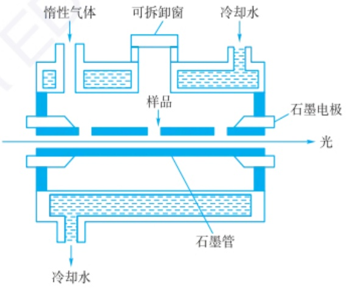

text_image

惰性气体
可拆卸窗
冷却水
样品
石墨电极
光
石墨管
冷却水

图 5.2.9 石墨炉原子化器结构示意图

石墨炉原子化采用直接进样和程序升温方式,液体或者固体样品进样后,升温程序设为干燥-灰化-原子化-净化四个阶段。

① 干燥阶段。温度一般高于溶剂的沸点，以除去样品中的溶剂，以免由于溶剂的存在而导致在后续灰化和原子化的过程中产生溅射。
② 灰化阶段。灰化的温度大致在  $100 \sim 1800 \, ^{\circ}C$ ，主要是除去有机物和易挥发

---

5.2 原子吸收与原子荧光光谱法

265

基体。

③ 原子化阶段。在 1800\~3000 ℃ 使待测元素原子化。
④ 净化阶段。在一个样品测定结束后，用高于原子化的温度加热石墨管，除去残留物，消除记忆效应。

石墨炉原子化法的优点是原子化效率高，原子蒸气在光程中的滞留时间长，绝对灵敏度高，进样量少，固体、液体样品均可直接进样，可分析元素范围宽。缺点是存在记忆效应，分析物在灰化过程中有可能丢失，由于杂散光引起的背景干扰较严重，重现性比火焰原子化法差。

## 3. 分光系统

由入射狭缝、出射狭缝、反射镜和色散元件组成，其作用是将待测元素的吸收线与其他谱线分开。目前商品化的原子吸收分光光度计普遍采用光栅作为色散元件。

## 4. 检测系统

检测系统由检测器、放大器和显示装置等组成。检测器一般采用光电倍增管将光信号转换为电信号。放大器将电信号放大，再通过对数变换器，用表头或数字显示等方式进行显示，也可以通过计算机采集和处理数据，显示结果。

对于多元素同时测定的仪器,通常使用电荷耦合检测器(CCD)和电荷注入检测器(CID)。

## 5. 原子吸收分光光度计的类型

原子吸收分光光度计可分为单光束型和双光束型两类,其结构如图 5.2.10 所示。

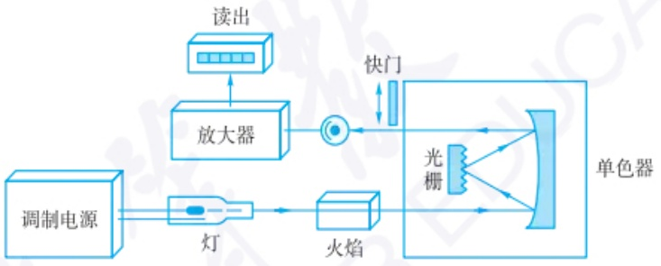

flowchart

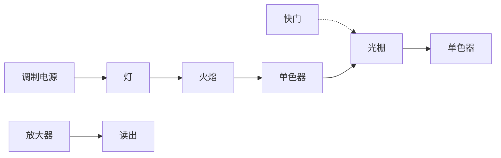

(a) 单光束原子吸收光谱仪

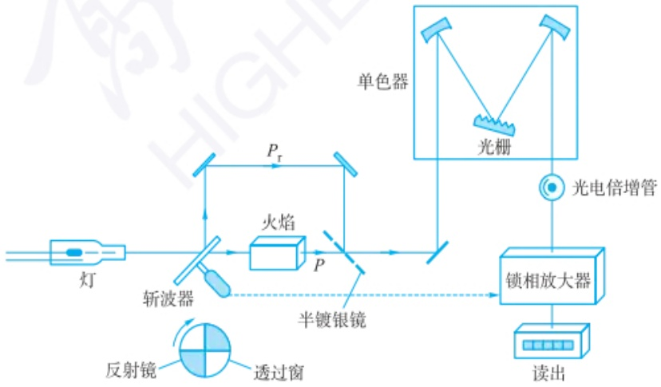

flowchart

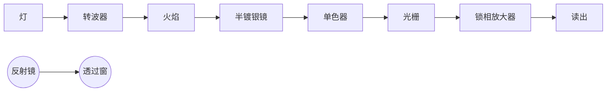

(b) 双光束原子吸收光谱仪

图 5.2.10 原子吸收光谱仪结构示意图

---

266

第五章 原子光谱法

单光束原子吸收分光光度计结构简单,操作方便,价格低廉。但由于光源不稳定,会导致基线漂移。为尽量减少基线漂移,空心阴极灯需要预热一段时间才能用于分析测定。

双光束分光光度计中光源发出的光经调制后被切光器分成强度相等的两束光，其中一束样品光束通过原子化器，另一束参比光束不经过原子化器，两束光交替到达检测器，检测器读出两束光的信号比。由于两束光来自同一光源，检测器的信号是对两束光进行比较的结果，可以消除光源不稳定而带来的影响。但是参比光束不经过原子化器，无法消除火焰扰动、背景吸收等带来的影响。双光束光学系统复杂，切光器将光源的辐射分为两束，使能量减半，这也是一个缺点。

## 5.2.1.3 原子吸收光谱法的干扰

原子吸收光谱法相对来说干扰比较少,但是仍然存在不可忽视的干扰问题。主要分为物理干扰、化学干扰、电离干扰和光谱干扰。

## 1. 物理干扰

物理干扰是指样品在转移、蒸发和原子化过程中，由于样品任何物理性质（如黏度和表面张力等）的变化而引起的原子吸收强度下降的效应。在火焰原子化方法中，当试液的黏度发生变化时，样品的喷吸速率会受到影响，进而影响喷雾量和雾化效率。表面张力和黏度的变化又会影响脱溶剂效率和蒸发效率，进而影响原子化效率。样品中存在的大量基体元素在蒸发解离的过程中会消耗热量，使待测元素的蒸发和原子化受到影响。此外，样品含盐量高时，也会影响喷雾效率和雾化效率。物理干扰是非选择性干扰。

消除物理干扰的常用方法是配制与测试样具有相似组成的标准样品。在不知道样品组成或无法匹配样品时，可采用标准加入法来减少或消除物理干扰。当待测原子的浓度较高时，也可以采用稀释法来降低或消除物理干扰。

## 2. 化学干扰

化学干扰是由于待测元素的原子与共存组分之间的化学作用而产生的干扰。待测元素与干扰物质发生化学反应生成热力学更稳定的化合物，从而影响待测元素化合物的解离及原子化。化学干扰是一种选择性干扰，对各种待测元素的影响各不相同，并随着火焰类型、火焰状态及部位的不同而变化，是原子吸收光谱法的主要干扰来源。

化学干扰较为复杂,需要根据样品基质、待测元素及实验条件进行具体分析。消除化学干扰的方法主要包括以下几种。

（1）提高原子化温度 原子化温度直接影响样品的熔融、蒸发和解离过程，一些在低温火焰中存在的干扰，在高温火焰中可以得到消除。例如，在利用空气-乙炔火焰测定钙时，若有磷酸根存在，则磷酸根会与钙形成稳定的化合物，使钙的基态原子数减少。若采用氧化亚氮-乙炔高温火焰，或选择石墨炉原子化法，则可以使难解离的化合物分解，消除干扰。
（2）加入释放剂 待测元素与干扰组分形成稳定化合物，加入可以与干扰组分形成更稳定化合物的物质，将待测元素从干扰组分的化合物中释放出来，加入的物质称为释放剂。例如，磷酸根干扰钙的测定，加入氯化镧，形成比磷酸钙更稳定的化合物，将钙释放出来，则可以消除磷酸根对钙测定的干扰。
（3）加入保护剂 保护剂与待测元素形成稳定且易挥发的络合物，阻止干扰物质与待测元素形成难解离的化合物。保护剂多为有机配位剂，如 EDTA、8-羟基喹啉等。例如，磷酸根干扰钙的测定，加入 EDTA，形成稳定不易分解的 Ca-

---

5.2 原子吸收与原子荧光光谱法

267

EDTA 络合物, 消除了磷酸根的干扰。

（4）加入缓冲剂 在样品和标准溶液中均加入过量的干扰元素(缓冲剂)，使其干扰达到饱和并趋于稳定，可以抵消干扰的影响。例如，氧化亚氮-乙炔火焰原子化法测定钛时，铝会产生干扰，在样品和标准溶液中加入过量的铝，可消除铝对钛测定的影响。

在石墨炉原子吸收分析中，除了共存元素之外，高温石墨炉中的碳、气氛和基体成分与待测元素形成难解离的碳化物、氮化物、氧化物和易挥发的氯化物，从而产生干扰。可以加入基体改进剂 $\mathrm{Ni(NO_3)_2}$ 、$\mathrm{Mg(NO_3)_2}$ 、$\mathrm{PdCl_2}$ 、$\mathrm{NH_4H_2PO_4}$ 等，使其在干燥或灰化阶段与样品发生化学变化，可增加基体的挥发性或改变待测元素的挥发性，以消除干扰。也可以采用平台原子化、涂层石墨管等技术。

除了上述方法之外,也可以采用标准加入法来控制化学干扰。如果这些方法都不能有效控制化学干扰,则可以采用分离方法(如沉淀、溶剂萃取、离子交换等),将干扰组分与待测组分分离。

## 3. 电离干扰

在高温下原子电离而使基态原子数减少,引起原子吸收信号降低,这种干扰为电离干扰。电离干扰与待测元素的电离电位和原子化温度有关。

消除电离干扰最有效的方法是在试液中加入过量消电离剂，即比待测元素电离电位低的其他元素，如碱金属和碱土金属。相同条件下，消电离剂首先电离，产生大量的电子，抑制待测元素的电离。通常使用的消电离剂有CsCl、NaCl和KCl等。有时加入的消电离剂的电离电位比待测元素的电离电位高，但是由于加入的浓度大，因此仍可以抑制电离干扰。

## 4. 光谱干扰

光谱干扰包括谱线干扰和背景干扰，与光源、原子化器及共存元素有关。

## (1) 谱线干扰

① 吸收线重叠。光源在光谱通带内存在吸收线重叠而产生的影响有两种情况，一是光源发射的待测元素的吸收线与共存元素的吸收线波长十分接近，由于共存元素的吸收导致测定结果偏高。在这种情况下，可以选择待测元素的其他吸收线，或预先分离干扰元素。例如，铝的吸收线为308.215 nm，钒的吸收线为308.211 nm，在测定铝时，若选择308.215 nm谱线进行测定，样品中存在的钒会产生干扰，此时可考虑选用铝的309.27 nm谱线来测定，以避免钒的干扰。

另一种吸收线重叠而带来干扰的情况是在光谱通带内光源发射的待测元素吸收线不止一条，待测元素对这几条发射线都有吸收，由于待测元素对每条吸收线的吸收系数不同，导致工作曲线为非线性的，而且其他线的吸收系数要小于主吸收线的吸收系数，因而使测定的灵敏度降低。一般这种多重谱线的干扰在过渡金属元素的测定中较易发生，尤其是铁、钴、镍等多谱线元素。例如，锰的最灵敏吸收线279.48 nm附近还有279.83 nm和280.22 nm次灵敏线，当光谱通带为0.7 nm时，这两条线都进入光谱通带，将干扰最灵敏线吸收的测定。可以采用减小狭缝宽度来消除这种干扰。但是当波长相差很小时，通过减小狭缝宽度仍然难以消除，需要更换其他吸收线。

② 光谱通带内存在光源发射的非吸收线。空心阴极灯除了发射待测元素的共振谱线之外，也会发射待测元素的其他非共振线。另外，光源阴极材料中所含杂质或光源内充的惰性气体也有可能产生发射线。这些非吸收线会引起工作曲线弯曲，测定灵敏度下降。可以采用减小狭缝宽度、降低灯电流，或另选分析线的

---

268

第五章 原子光谱法

## 恒定磁场调制方式

在原子化器上施加一个垂直于光束的恒定磁场，在磁场作用下，原子吸收线被裂分为一条中心的 $\pi$ 组分及两个等间距的 $\sigma^{\pm}$ 组分。 $\pi$ 组分平行于磁场方向，波长不变； $\sigma^{\pm}$ 组分垂直于磁场方向，波长分别向长波与短波方向移动。位于原始波长处的中心 $\pi$ 组分其吸光度是每个 $\sigma$ 组分吸光度的两倍。背景吸收线不被磁场裂分。

由空心阴极灯发射的谱线经过置于光源与原子化器之间的旋转偏振器，被分解为平行于磁场方向的偏振光 $P_{1}$ 和垂直于磁场方向的偏振光 $P_{\perp}$ 。偏振器的旋转使 $P_{1}$ 和 $P_{\perp}$ 交替通过原子化器。 $P_{1}$ 通过原子化器时，平行于磁场方向的 $\pi$ 组分产生吸收，引起背景吸收的分子也会产生吸收，测得的是原子吸收和背景吸收的总吸光度。当 $P_{\perp}$ 通过原子化器时，平行于磁场方向的 $\pi$ 组分不产生吸收， $\sigma^{2}$ 组分尽管与偏振光方向一致，但波长偏离中心位置约0.01 nm，基态原子只吸收波长差在0.01 nm以下的共振线，因此不会产生原子吸收。而背景吸收对偏振光方向无选择性，且波长范围较宽，此时测得的是背景吸收。两次测量结果为扣除了背景吸收后的净原子吸收值。

方法消除光谱通带内存在的非吸收线产生的干扰。

(2) 背景干扰 背景干扰形成的主要因素为分子吸收和光散射。

① 分子吸收。指在原子化器中生成的分子对辐射的吸收，是一种宽频吸收。包括火焰成分（如 OH、CH、NH、CO 等分子或基团）的吸收、低温火焰中碱金属和碱土金属的卤化物的吸收，高温火焰中碱土金属的氧化物或氢氧化物的吸收等。

石墨炉原子化器中自由原子浓度大、基体成分浓度也大，且停留时间长，因此背景吸收较火焰原子化器高。

② 光散射。指原子化过程中产生的固体微粒对光发生散射，使被散射的光偏离光路而不为检测器所检测，产生假吸收，使测定结果偏高。

因分子吸收和光散射造成的背景吸收可以采用以下方法进行校正。

① 连续光源校正背景。原子吸收分光光度计中配有连续光源自动扣除背景的装置，利用氘灯作为连续光源，因此也称为氘灯背景校正法。利用切光器使锐线光源与氘灯连续光源交替进入原子化器，当锐线光源通过时，检测器检测到的是待测元素对共振辐射产生的吸收与背景吸收之和。当氘灯光源通过时，在同一波长下进行测定，待测元素的共振线吸收相对于背景吸收来说可以忽略，测得的是背景吸收，计算两次测定结果之差，即可扣除背景吸收。

氘灯校正背景装置简单,操作方便,但是氘灯光源的工作波段在190\~360 nm,导致氘灯背景校正具有波长局限性。另外,氘灯为连续光源,测得的背景吸收为光谱通带内的平均背景吸收,并不能代表待测元素测定波长下的实际背景吸收,因此有时会出现过度或校正不足的情况。

② 塞曼效应校正背景。塞曼效应(Zeeman effect)是指谱线在外磁场中发生裂分的现象。在强磁场中，原子的电子能级会发生裂分，引起谱线裂分。

塞曼效应校正背景法分为光源调制法和吸收线调制法。光源调制法是将磁场加在光源上，吸收线调制法是将磁场加在原子化器上，其中后者应用较多。

吸收线调制法可采用恒定磁场调制方式和可变磁场调制方式(见副栏)。

塞曼效应校正背景的原理如图 5.2.11 所示(以吸收线调制法中的恒定磁场调制方式为例)。

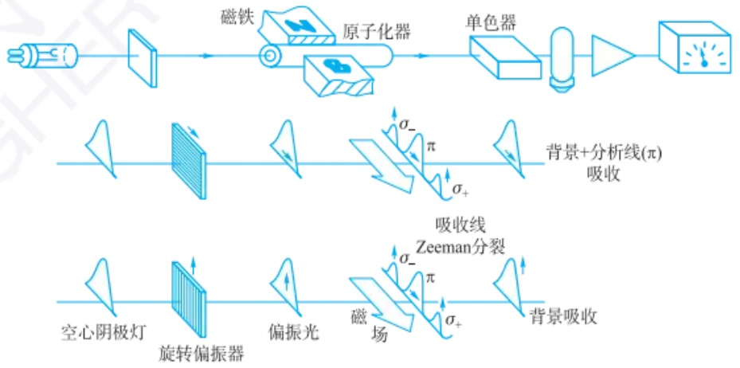

flowchart

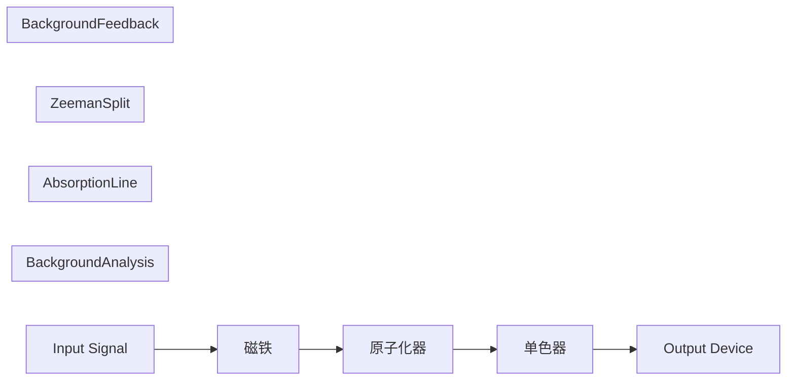

图 5.2.11 塞曼效应校正背景的原理示意图

塞曼效应校正背景可在 190\~900 nm 波长范围进行背景校正, 可校正吸光度高达 1.5\~2.0 的背景, 背景校正准确度高。但是由于谱线裂分, 使灵敏度降低, 即使是可变磁场调节方式, 灵敏度仍有所下降。不同元素的塞曼效应表现不同, 对某些元

---

5.2 原子吸收与原子荧光光谱法

269

素可能无法获得理想的校正结果。此外，仪器装置相对复杂，部件要求高，光路调整难。相对于火焰原子化法，塞曼效应在石墨炉原子化法中的应用效果更好。

③ 用邻近非共振线校正背景。用分析线测定待测元素的吸收及背景吸收，在分析线附近选择一条非吸收线测定背景吸收（待测元素对非吸收线没有吸收），二者之差即为扣除背景吸收后的待测元素对共振线吸收的结果。由于背景吸收随波长的变化而变化，利用非共振线的吸收扣除背景的准确度较差，仅适合分析线附近背景比较均匀的情况。

## 5.2.1.4 原子吸收光谱法的定量方法

## 1. 测量条件的选择

（1）分析线的选择 一般选用待测元素的最灵敏线(第一共振线)作为分析线,若存在其他元素干扰时,可以选用其他共振线。例如,Pb 217.0 nm 线与Sb 217.6 nm线可能重合,分析 Pb 时,一般不用 Pb 217.0 nm 线。在分析待测元素浓度较高的样品时,也可以选用次灵敏线,以避免不必要的稀释操作。
（2）空心阴极灯工作电流的选择 在商品化空心阴极灯的标签上，会标出额定灯电流，通常在保证足够强度和稳定光谱输出的情况下，尽量选用较小的灯电流，一般为额定电流的40%\~50%。若工作电流过大，灯丝发热量大，热变宽和压力变宽增加，自吸增加，辐射强度降低，导致灵敏度下降，且灯寿命会缩短。若灯电流过小，空心阴极灯放电不稳定，分析的灵敏度和精密度降低。
（3）光谱通带宽度的选择 光谱通带宽度与仪器的倒线色散率和狭缝宽度有关。

$$
\Delta \lambda = D S \tag {5-2-15}
$$

式中， $\Delta\lambda$  为光谱通带宽度，nm；D 为分光器的倒线色散率， $nm\cdot mm^{-1}$ ；S 为狭缝宽度，mm。

对于确定的仪器,其倒线色散率是确定的,因此光谱通带宽度只与狭缝宽度有关,光谱通带的调节实际上是通过改变狭缝宽度来实现的。光谱通带宽度影响进入检测器的辐射能量和波长纯度,进而影响灵敏度和工作曲线的线性范围。一般可选用0.4\~0.7 nm的光谱通带,对于谱线复杂的元素可选用0.2 nm的光谱通带。

（4）原子化条件的选择 火焰原子化法包括火焰的选择、燃烧器高度的选择、燃烧器角度的选择。

① 火焰的选择。火焰是保证原子化效率的关键因素，需要根据元素的性质选择火焰种类，容易生成难解离氧化物的元素可选择乙炔-氧化亚氮高温火焰。火焰种类确定之后，要通过实验确定选用贫燃、富燃或者中性火焰。
② 燃烧器高度的选择。火焰不同区域具有不同的温度及氧化还原性质，待测原子浓度和干扰成分浓度也会不同，可以通过实验来确定燃烧器高度，以达到最高灵敏度。
③ 燃烧器角度的选择。燃烧器角度影响光程长，通常情况燃烧器缝口与光轴方向一致，光程长最大，吸光度最大。对于高含量组分的测定，可以调整燃烧器缝口与光轴方向成一定的角度，缩小光程长，减小吸光度。

石墨炉原子化法包括原子化器位置的调节、载气种类及流量选择、冷却水系统设置、加热程序的选择及测量之后石墨管的清洗温度及时间参数设定。

原子化器位置以光经过石墨管后光强损失最小为原则。载气可使用氩气或氮气，通常使用氩气。内载气流速与待测元素有关。冷却水的水温一般控制在 $20^{\circ}C$ ，流量为 $1\sim2L\cdot min^{-1}$ 。加热程序也需要通过实验来确定。实验结束后为消

## 可变磁场调制方式

在原子化器上加一个交变磁场，置于光路中的偏振器是固定的，只允许垂直于磁场的偏振光通过。零磁场时，吸收线不发生裂分，测得的是原子吸收和背景吸收的总吸光度。有磁场时， $\pi$ 组分不吸收垂直于磁场的偏振光，测得的仅是背景吸收值。二者之差为原子吸收的净吸光度，消除了背景吸收的干扰。

---

270

第五章 原子光谱法

## 原子吸收光谱法的特点

优点:（1）检出限低，灵敏度高。火焰原子吸收法的检出限可达到$\mathrm{ng}\cdot \mathrm{mL}^{-1}$级，石墨炉原子吸收法的检出限可达到$10^{-14}\sim 10^{-10}\mathrm{g}$。（2）精度高。火焰原子吸收法的相对误差可小于 $1\%$ ，石墨炉原子吸收法一般为 $3\% \sim 5\%$ 。（3）选择性好。由于原子结构不同，每种元素具有特征光谱，可在多种元素共存的情况下，准确地测定特定元素。（4）分析速度快。（5）应用范围广。可以测定70多种元素，除金属元素外，可以采用间接法测定非金属元素和有机化合物。（6）仪器相对简单，操作方便。

不足:(1)难以进行多元素同时测定。采用空心阴极灯光源,测定每种元素都要更换相应的元素灯,分析效率低。(2)对固体样品测定不便。固体样品需要转化为液体样品进样分析,增加了样品前处理的步骤。(3)对共振线位于真空紫外区的元素测定有困难,对某些高温元素的测定灵敏度较低。

## 参考文献

[1] 郑经国. 分析化学手册: 原子光谱分析. 3 版. 北京: 化学工业出版社, 2016.
[2] 孙汉文. 原子光谱分析. 北京: 高等教育出版社, 2002.
[3] 张新祥, 李美仙, 李娜, 等. 仪器分析教程. 3 版. 北京: 北京大学出版社, 2022.

除记忆效应,应在高于原子化温度下用  $3 \sim 5$  s 的时间除去残留的基态和待测元素。

## 2. 定量分析方法

在原子吸收光谱法中,吸光度与待测元素浓度之间的关系符合朗伯-比尔定律,即待测物质浓度与吸光度值成正比。定量分析方法主要包括标准曲线法和标准加入法。

标准曲线法是常用的定量方法,适用于大批量样品分析,仅适用于基体组成简单的样品。

标准加入法适用于样品基体复杂或待测元素含量低的样品。采用标准加入法可以消除基体干扰,但是不能消除背景吸收的干扰。

内标法亦可用于原子吸收法的定量,但仅适用于双道及多道仪器。

## 3. 分析方法评价

灵敏度和检出限是评价分析方法和仪器的两个重要指标。

(1) 灵敏度 灵敏度 S 是校正曲线的斜率。S 大, 则灵敏度高。

$$
S = \frac {\mathrm{d} A}{\mathrm{d} c} \tag {5-2-16}
$$

在原子吸收分光光度法中,灵敏度用特征浓度(characteristic concentration)来表示,即能够产生1%吸收(吸光度值为0.0044)时所对应的待测元素的浓度,也称1%吸收灵敏度或特征灵敏度。特征浓度越小,灵敏度越高。

在火焰原子化法中,特征浓度  $C_{e}$  为

$$
C _ {\mathrm{c}} = \frac {c \times 0 . 0 0 4 4}{A} \tag {5-2-17}
$$

式中， $C_{c}$  为特征浓度， $\mu g \cdot mL^{-1}$ ; c 为待测元素浓度， $\mu g \cdot mL^{-1}$ ; A 为吸光度值。

石墨炉原子化法中,特征浓度用质量表示。

$$
m _ {\mathrm{c}} = \frac {c V \times 0 . 0 0 4 4}{A} \tag {5-2-18}
$$

式中， $m_{c}$  为特征质量， $\mu g; c$  为待测元素浓度， $\mu g \cdot mL^{-1}; V$  为试液的体积，mL；A 为吸光度值。

（2）检出限 检出限是指以特定的分析方法在适当的置信水平被检出的最低浓度或最小量。在大于等于检出限时，才能准确地将待测信号与噪声信号区分开来。

待测元素的吸收信号等于噪声信号的标准偏差3倍( $3\sigma$ , 99.7%置信度)时所对应的待测元素浓度为该元素的检出限。

$$
D = \frac {c \times 3 \sigma}{A} \tag {5-2-19}
$$

式中， $D$ 为检出限， $\mu \mathrm{g}\cdot \mathrm{mL}^{-1};c$ 为待测元素浓度， $\mu \mathrm{g}\cdot \mathrm{mL}^{-1};A$ 为测定的平均吸光度； $\sigma$ 为空白溶液的测量标准偏差，是对空白溶液进行10次以上连续测定，计算标准偏差而得。

## 5.2.1.5 原子吸收光谱法的应用及发展

原子吸收光谱法已广泛应用于地质、冶金、机械、石油化工、农业、食品、轻工、生物、医药、环境保护和材料科学等诸多领域。直接原子吸收法可测定70多种元素，间接原子吸收法可用来测定阴离子和有机化合物。

随着科学技术的发展,原子吸收技术也在不断进步。传统的空心阴极灯在不

---

5.2 原子吸收与原子荧光光谱法

271

断改进，发光强度和稳定性得到提高。采用高强度的稳定连续光源、高分辨率的中阶梯光栅双单色器及高性能CCD检测器的连续光源原子吸收光谱仪可以实现多元素同时测定。气相色谱-原子吸收光谱联用（GC-AAS）和液相色谱-原子吸收光谱联用（LC-AAS），可以实现对复杂样品中元素的形态分析。流动注射技术与原子吸收光谱法相结合，实现了样品的自动化进样和快速分析，提高了分析效率和准确性，减少了人为误差。微型化、便携式原子吸收光谱仪的研发，为现场快速检测提供了可能。原子吸收光谱法的应用也不断拓展，例如，在生物医学领域，原子吸收光谱法可用于测定蛋白质、核酸等生物大分子中的金属离子含量和结合位点，为生物分子的结构和功能研究提供重要信息。随着纳米技术的发展，原子吸收光谱法可用于纳米材料的元素组成、粒径分布和表面性质等方面的分析，为纳米材料的制备和应用提供重要的检测手段。在太阳能电池、锂离子电池等新能源材料的研究中，原子吸收光谱法可用于测定材料中的杂质元素和掺杂元素含量，优化材料的性能和提高电池的效率。

## 5.2.2 原子荧光光谱法

原子荧光光谱法(atomic fluorescence spectrometry, AFS)是利用原子荧光谱线的波长和强度进行物质的定性及定量分析的方法。AFS 是一种痕量组分分析技术，在光谱学研究和应用领域占有重要地位。AFS 是介于原子吸收光谱法和原子发射光谱法之间的原子光谱分析技术，具有谱线简单、干扰少、灵敏度高等优点，因而特别适用于痕量元素（锌、镉、锰等）分析及多元素的同时测定。AFS 近年来得到了快速发展，并且已有多种类型的商品原子荧光光谱仪问世，与原子吸收光谱仪、原子发射光谱仪等形成互补，在冶金、地质、环境监测、生物医学和材料科学等领域应用广泛。

## 5.2.2.1 原子荧光光谱法的基本原理

## 1. 原子荧光的类型

原子荧光是一种光致发光现象,是待测元素的原子蒸气吸收特定频率电磁辐射后由基态跃迁至激发态,然后回到较低能态或基态时发射出的一定波长的辐射。根据产生机理,原子荧光可以分为共振荧光、非共振荧光和敏化荧光三种类型,其中共振荧光的应用最多。

（1）共振荧光 基态原子核外层电子吸收共振频率的光辐射后被激发，再发射出与共振频率相同的光辐射，即为原子共振荧光。如图5.2.12(a)所示，其特征是原子的激发辐射线和荧光辐射线所涉及的高低能级都相等。如锌原子吸收$213.86\mathrm{nm}$ 的辐射光，其发射的荧光辐射的波长也为 $213.86\mathrm{nm}$ 。

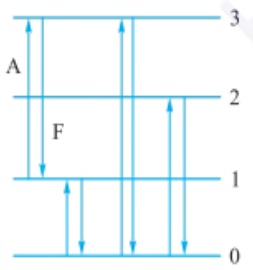

text_image

A
F
1
0
2
3

(a) 共振荧光

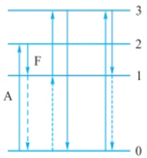

text_image

A
F
1
2
3
0

(b) 直跃线荧光

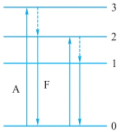

text_image

A
F
0
1
2
3

(c) 阶跃线荧光

0—原子基态；1，2，3—原子激发态；A—吸收，F—荧光，---无辐射跃迁

图 5.2.12 原子荧光的常见类型

[4] 武汉大学. 分析化学: 下册. 6 版. 北京: 高等教育出版社, 2018.
[5] 董慧茹. 仪器分析. 4 版. 北京: 化学工业出版社, 2022.
[6] 胡坪, 王氢. 仪器分析. 5 版. 北京: 高等教育出版社, 2021.
[7] 王玉枝, 宦双燕, 张正奇. 分析化学. 4 版. 北京: 科学出版社, 2023.
[8] Skoog D A, Holler F J, Crouch S R. Principles of Instrumental Analysis. 7th ed. Boston: Cengage Learning, 2017.

原子荧光现象是原子吸收现象的逆过程，于1905年首次在氯化钠的气体火焰中观测到。直到1964年I. D. Winefordner等科学家才建立了一种火焰原子荧光的测定方法，确定原子荧光光谱可作为一种仪器分析方法测定某些元素，并推导出其定量分析的依据。原子荧光分析方法的出现推动了原子光谱法领域的新发展，相继涌现出大量的相关研究成果。

我国的分析化学工作者在原子荧光光谱法领域投入了极大热忱，使该技术在我国得到了很好的发展。我国最早研制的原子荧光光谱仪是冷原子荧光测汞仪，相继又研发了早期的火焰-非色散原子荧光光谱仪和蒸气发生-原子荧光光谱仪。这些仪器的推出和逐步完善，使得原子荧光光谱技术在我国得到了广泛的应用。截至2024年，蒸气发生-原子荧光光谱仪已推出4通道仪器，可同时测定4种元素。

---

272

第五章 原子光谱法

（2）非共振荧光 当发射的荧光与激发光的频率不同时，即为非共振荧光。非共振荧光又分为直跃线荧光和阶跃线荧光。

① 直跃线荧光。激发态原子跃迁回至高于基态的亚稳态时所发射的荧光，如图5.2.12(b)所示。如果荧光线激发能大于荧光能，即荧光线的波长大于激发线的波长称为斯托克斯(Stokes)荧光，图5.2.12(b)左、右的直跃线荧光即为斯托克斯荧光。反斯托克斯(anti-Stokes)荧光是自由原子跃迁至某一能级，其获得的能量一部分是由光源激发能供给，另一部分是热能供给，然后返回低能级所发射的荧光。反斯托克斯荧光的荧光能大于激发能，荧光线波长小于激发线波长，如图5.2.12(b)中间部位的荧光。
② 阶跃线荧光。激发态原子先以非辐射形式去活化返回到较低能级，再以辐射形式返回到基态而发射的荧光称为阶跃线荧光。如图 5.2.12(c) 所示，阶跃线荧光中的荧光线波长都大于激发线波长。
（3）敏化荧光 激发态原子通过碰撞将其激发能转移给另一种基态原子使其激发，后者再以辐射方式去活化而发射荧光。但火焰原子化器中的原子浓度很低，主要以非辐射方式去活化，因此观察不到敏化荧光。

以上各类原子荧光中,共振荧光的谱线强度最大,最为常用。但个别元素的非共振荧光谱线灵敏度更高。

## 2. 原子荧光定量分析的基本关系式

当光源强度稳定、辐射光平行、自吸可忽略时，原子荧光强度 $I_{F}$ 与基态原子对特定频率光的吸收强度 $I_{A}$ 成正比，即

$$
I _ {\mathrm{F}} = \Phi I _ {\mathrm{A}} \tag {5-2-20}
$$

式中， $\Phi$  为荧光量子效率，其定义为

$$
\Phi = \frac {F _ {\mathrm{f}}}{F _ {\mathrm{A}}} \tag {5-2-21}
$$

式中， $F_{f}$  为单位时间发射的荧光光子数， $F_{A}$  为单位时间吸收激发光的光子数。但是受激发后的原子，可能发射共振荧光，也可能发射非共振荧光，还可能无辐射跃迁至低能级（图 5.2.12），因此在一般情况下荧光量子效率小于 1。

根据朗伯-比尔定律,可得

$$
I _ {\mathrm{F}} = \Phi I _ {0} A (1 - \mathrm{e} ^ {- \varepsilon L N}) \tag {5-2-22}
$$

式中， $I_{0}$  为原子化器单位面积上接收的光源辐射强度；A 为光源照射在检测系统的有效面积； $\varepsilon$  为峰值吸收系数；L 为吸收光程长；N 为单位体积内的基态原子数。

将式(5-2-22)的指数项按泰勒级数展开,高次项忽略,可得

$$
I _ {\mathrm{F}} = \Phi I _ {0} A \varepsilon L N \tag {5-2-23}
$$

当实验条件一定时,试液中待测元素的浓度 c 与原子蒸气中单位体积内的基态原子数 N 成正比,即

$$
N = a c \tag {5-2-24}
$$

将式(5-2-24)代入式(5-2-23)得到

$$
I _ {\mathrm{F}} = \Phi I _ {0} A \varepsilon L a c \tag {5-2-25}
$$

实验条件一定时， $\Phi$ 、A、 $I_{0}$ 、 $\varepsilon$ 、L 和 a 均可视为常数，则原子荧光强度与试液中待测元素的浓度成正比，即

$$
I _ {\mathrm{F}} = K c \tag {5-2-26}
$$

式中，K 为常数。式(5-2-26)为原子荧光光谱法定量分析的基本关系。由式(5-2-25)可知:

---

5.2 原子吸收与原子荧光光谱法

273

① 荧光强度随激发光源强度的增加而增大,因而用强光源可提高灵敏度,降低检出限;
②延长吸收光程,可提高灵敏度;
③ 式(5-2-25)只有在待测元素浓度较低时才成立,高浓度时 $I_{F}$ 与c的关系为非线性,所以原子荧光光谱法特别适用于痕量元素测定;
④ 量子效率  $\Phi$  随火焰温度和火焰组成而变化, 因此必须严格控制这些因素。

## 3. 原子荧光的猝灭

处于激发态的原子寿命是十分短暂的，当它从高能级跃迁到低能级时将发射出荧光，但也可能在原子化器中与其他粒子发生非弹性碰撞而丧失其能量。在后一种情况下，荧光将减弱或完全不产生，这种现象称为荧光猝灭。

原子荧光的猝灭有下述几种类型:

(1) 与自由原子碰撞 激发态原子  $M^{*}$  回到基态:

$$
\mathrm{M} ^ {*} + \mathrm{X} \longrightarrow \mathrm{M} + \mathrm{X}
$$

M 和 X 为中性原子。

或形成不同的激发态:

$$
\mathrm{M} ^ {*} + \mathrm{A} \longrightarrow \mathrm{M} ^ {\mathrm{x}} + \mathrm{A}
$$

$M^{*}$  和  $M^{x}$  为 M 的不同激发态。

(2) 与分子碰撞 激发态原子  $M^{*}$  回到基态:

$$
\mathrm{M} ^ {*} + \mathrm{AB} \longrightarrow \mathrm{M} + \mathrm{AB}
$$

这是形成荧光猝灭的主要原因，AB可能是火焰燃烧的主要产物。

或者形成不同的激发态:

$$
\mathrm{M} ^ {*} + \mathrm{AB} \longrightarrow \mathrm{M} ^ {\mathrm{x}} + \mathrm{AB}
$$

或者发生化学反应:

$$
\mathrm{M} ^ {*} + \mathrm{AB} \longrightarrow \mathrm{M} + \mathrm{A} + \mathrm{B}
$$

A 和 B 为火焰中存在的分子或稳定的自由基。

(3) 与电子碰撞

$$
\mathrm{M} ^ {*} + \mathrm{e} ^ {-} \longrightarrow \mathrm{M} + \mathrm{e} ^ {-}
$$

上述荧光猝灭过程将导致荧光量子效率降低,荧光强度减弱,因而严重影响原子荧光分析的灵敏度。为了减小猝灭的影响,应当尽量降低原子化器中猝灭粒子的浓度,特别是猝灭截面大的粒子的浓度。另外,还要注意减少原子蒸气中二氧化碳、氮和氧等气体的浓度。

## 5.2.2.2 原子荧光光谱分析仪器

原子荧光光谱仪的组成与原子吸收光谱仪相似，由激发光源、原子化器、分光系统及检测系统四部分组成。为了避免光源对原子荧光测定的影响，光源与原子化器后面的光学系统、检测系统一般呈 $90^{\circ}$ ，如图5.2.13所示。

（1）激发光源 在原子荧光光谱仪中，最常采用的光源是空心阴极灯和无极放电灯。为提高灵敏度和多元素同时分析的能力，也可以使用连续光源，如氙弧灯。
（2）原子化器 除采用石英炉管原子化器，原子荧光光谱仪中的原子化器的类型基本与原子吸收光谱仪中的相同。
（3）分光系统 原子荧光光谱简单，谱线干扰小，对单色器的分辨率要求不高。色散型原子荧光光谱仪中的色散原件为光栅或棱镜，非色散型原子荧光光谱仪的色散原件为滤光片。
(4) 检测系统 在色散型原子荧光光谱仪中, 目前普遍使用的检测器仍以普

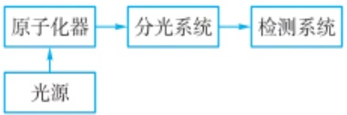

flowchart

图 5.2.13 原子荧光光谱仪示意图

原子荧光光谱仪器的研制经历了长期的发展，今后这也依然是原子荧光光谱法研究的主要方向。目前，原子荧光光谱法在多个领域的广泛应用加速了相关仪器的便携化和小型化研发。适合现场测试的便携式原子荧光光谱仪器及其器件可以为一些特定元素的检测进行深度化定制设计。例如，科学工作者开发了一种可用于Se光化学蒸气发生的小型化紫外发光二极管光化学反应器，只有硬币大小，可与AFS相结合实现痕量Se的测定（J.Anal.At.Spectrom.,2018,33,1217-1223）。但便携式原子荧光光谱仪需要在分析性能和仪器体积之间进行平衡。

思考:原子荧光光谱属于吸收光谱还是发射光谱范畴?原子荧光光谱仪的仪器构成与原子发射光谱仪和原子吸收光谱仪有什么异同?

---

274

第五章 原子光谱法

## 相关应用请参考:

Anal Chim Acta, 2017, 963, 53–60.

通的光电倍增管为主；对于非色散型光谱仪来说，为了消除日光的影响，必须采用光谱响应范围为 $160\sim 320~\mathrm{nm}$ 的日盲光电倍增管。

在各种原子荧光光谱仪中,单通道原子荧光光谱仪应用较多,也有利用两个空心阴极灯的供电脉冲之间的相位差,采用一个检测器的双通道仪器,分析效率提高。也有用于多元素分析的多通道原子荧光光谱分析仪。

## 5.2.2.3 原子荧光光谱法的应用

原子荧光光谱法定性分析的依据与原子吸收和原子发射一样,是基于不同原子的核外电子结构不同,吸收和发射谱线的波长不同而实现定性分析的。因此可以采用原子吸收和原子发射光谱法中相同的定性分析方法。

原子荧光光谱法的定量方法常采用标准曲线法和标准加入法。在低浓度时，线性范围宽，通常为3\~5个数量级，优于原子吸收光谱法，再加上极高的灵敏度、极低的检测限（如测镉、锌等元素可达 $1\ pg\cdot mL^{-1}$ ），因而原子荧光光谱法特别适合分析超纯物质、环境污染物、生物活性材料中痕量及超痕量元素。

原子荧光光谱法具体应用很多，如锌、锰、镉等多元素的分析测定，酸雨中锌的测定，盐矿中硒、碲的测定，矿石中痕量锡的测定等。尤其是稀土元素的原子/离子荧光光谱分析可克服光谱干扰，因而原子荧光光谱法已成为稀土元素分析的有效方法之一，得到了广泛应用。此外，以激光作为激发光源的原子荧光光谱法取得了令人瞩目的成果，特别是20世纪80年代中期发展起来的电热原子化器-激光激发原子荧光光谱法可以完成许多其他方法难以完成的痕量分析任务，如大气中的汞、南极冰雪样品中的铝和锌、土壤间气流中的金、海洋沉积物中金和钯的测定等。该方法也为我国的环境监测、矿产资源勘探等提供了非常有意义的信息支持。在科学前沿研究领域，我国科学工作者利用火焰原子荧光光谱仪，建立了河口和沿海水域痕量Mn自动在线预浓缩检测系统，具有高准确度、高精度、集成度高、能耗低、辅助设备简单等优点，适合现场作业。与其他常见的现场应用分子光谱仪相比，火焰原子荧光光谱法固有的高选择性和多元素适用性突出了所提出的分析系统的优越性和潜力。该系统成功应用于沿海水域溶解Mn的现场车载测定及天然水样分析。

## 习题

## - 章节练习题 -

1. 为什么原子吸收光谱分析中的谱线干扰不像发射光谱那样严重？
2. 在原子吸收光谱中, 影响吸收线宽度的因素有哪些?
3. 什么是积分吸收,什么是峰值吸收? 原子吸收分析中为什么采用峰值吸收?
4. 简述空心阴极灯的工作原理，并说明为什么空心阴极灯会发射锐线。
5. 为什么石墨炉原子化法比火焰原子化法的灵敏度高？
6. 简述原子荧光光谱、原子吸收光谱和原子发射光谱三者之间的区别。
7. 原子荧光是怎样产生的？有哪几种类型？
8. 什么是荧光猝灭？荧光猝灭有哪几种类型？如何降低荧光猝灭的影响？
9. 原子荧光光谱法的特点有哪些？与原子吸收和原子发射相比，有什么特点？

---

5.3 X 射线荧光光谱法

275

10. 原子荧光光谱法的定性和定量依据分别是什么？

## - 挑战性问题 -

11. 结合课本所学知识,并查阅相关文献,讨论回答如何提高原子荧光光谱仪的灵敏度。
12. 原子荧光涉及原子吸收和释放能量两个过程,通过查阅相关文献回答如何规避原子吸收能量过程对原子荧光测量的影响。

## -专题或报告-

13. 在利用原子吸收光谱法测定金属元素时，一般需要用该元素的空心阴极灯作为锐线光源。目前已有采用连续光源的原子吸收光谱仪，请通过查阅资料了解这种仪器，分析其设计思想可能存在的问题，并介绍其应用现状。

14. 查阅文献, 讨论回答目前原子荧光光谱仪的科学研究方向是什么。

## 5.3 X射线荧光光谱法

1908 年, 英国物理学家 C. G. Barkla 和 C. A. Sadler 发现物质中组成元素与物质受 X 射线辐照后会发出相关谱线, 也就是所谓的元素特征谱线。1913 年, Henry G. J. Moseley 研究了各种元素的特征光谱, 发现元素的特征谱线波长倒数的平方根与该元素原子序数成正比, 这就是著名的 Moseley 定律, 它奠定了 X 射线荧光光谱 (X-ray fluorescence, XRF) 分析的基础。

## 5.3.1 X射线荧光光谱法原理

X 射线与原子相互作用主要有散射和光电效应两种类型(图 5.3.1)，散射又分为康普顿散射(非弹性散射)和瑞利散射(弹性散射)。同时，还有一部分射线可能穿过样品，未与原子发生实质相互作用。在对 X 射线荧光信号分析时，以上过程都有可能对荧光信号产生影响，在具体分析中需要考虑。

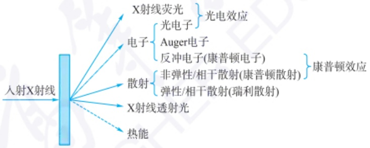

flowchart

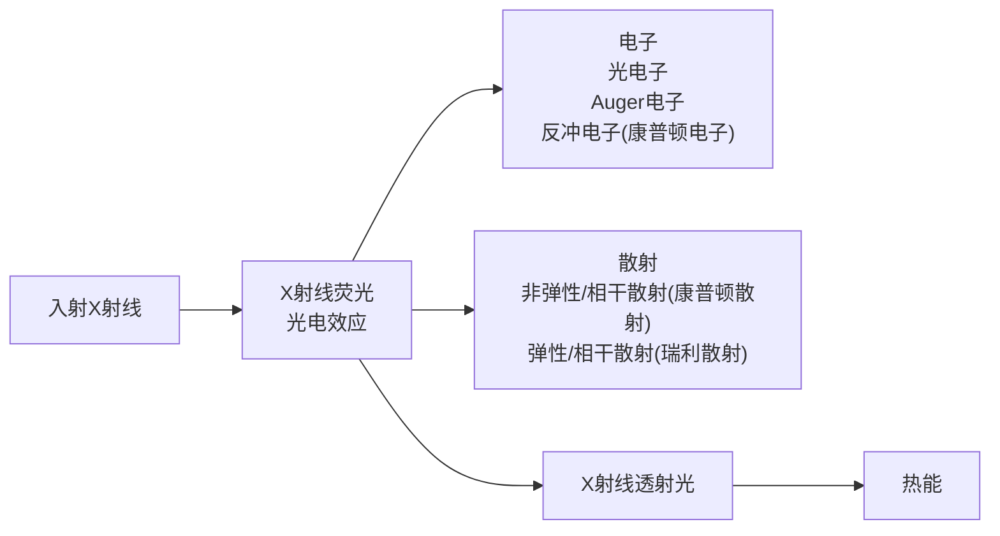

图 5.3.1 X 射线与原子相互作用过程

X射线的发现

X射线的特征性分析

（1）X射线荧光过程 具有一定能量的X射线与原子相互作用，把部分能量传递给原子内层电子，将其激发到能量较高的轨道，甚至打出原子外，使原子轨道上形成电子空穴，随后在 $10^{-24}\sim10^{-12}$ s，该原子内层电子重新配位，高能级的轨道电子可跃迁到电子空位的能级，以补充电子空位，同时释放出相当于跃迁电子初态能级与终态能级差的能量。这一能量可能以辐射的形式放出，即X射线荧光。

由此,特征 X 射线光子的能量等于能级间的能量差,即著名的 Moseley 定律,如式(5-3-1)所示:

$$
E = - R h c (Z - \sigma) ^ {2} \left(\frac {1}{n _ {\mathrm{f}} ^ {2}} - \frac {1}{n _ {\mathrm{i}} ^ {2}}\right) \tag {5-3-1}
$$

---

276

第五章 原子光谱法

式中， $R$ 为德伯频率； $h$ 为普朗克常量； $c$ 为光速； $Z$ 为原子序数； $\sigma$ 为屏蔽常数； $n_{\mathrm{i}}$ ，$n_{\mathrm{f}}$ 为核外电子由 $n_{\mathrm{i}}$ 跃迁至 $n_{\mathrm{f}}$ 层。

轨道电子的主量子数取值 1,2,3, $\cdots$ ,n,与之对应的主壳层轨道分别以 K、L、M、N 等符号表示。在 X 射线荧光光谱中，谱线在命名时，将形成电子空穴，并通过电子跃迁被电子补位的壳层的轨道命名谱线的系列，如 K 系、L 系等。又由于高能级轨道电子的来源，以及同一主壳层内电子的能级裂分，使得元素的同一线系下包含多条谱线，如  $K_{\alpha1}$  线、 $K_{\alpha2}$  线、 $K_{\beta1}$  线等。特征 X 射线的产生及其相应的线系，可用能级图加以说明，如图 5.3.2 所示。

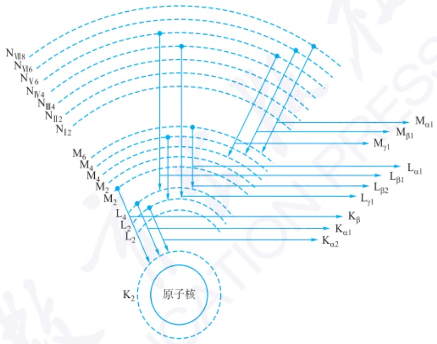

flowchart

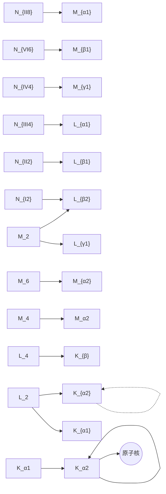

图 5.3.2 X 射线能级图及特征 X 射线的产生

(2) Auger 效应 有一定能量的 X 射线与原子相互作用,使原子轨道上形成电子空穴,在电子重新配位辐射能量时,并不一定产生特征 X 射线荧光,还可能通过射出另一个合适能级轨道上的电子的形式将能量通过无辐射跃迁的形式释放掉。这个过程被称为俄歇效应(Auger effect),在 Auger 发射过程中释放的电子称为 Auger 电子。荧光发射与 Auger 电子发射是两种竞争性效应。在 X 射线荧光图谱上,Auger 电子发射效应体现为 X 射线荧光特征线的伴线,或者卫星线。Auger 发射的强度随波长增大或能量降低而增强,轻元素因而更容易产生 Auger 效应,降低轻元素的荧光产额。
（3）XRF中的光谱背景 光谱背景的主要来源:宇宙射线；环境的放射性辐射；放大器及检测器电噪声；初级辐射连续谱的非相干散射（康普顿散射）；放射性样品的辐射；分光晶体及其他光路器件的次级辐射等。其中光管初级辐射连续谱的非相干散射为背景的主要来源，其次是光谱仪光路器件的散射。瑞利散射，也称相干散射，入射光与线度小于光波长的微粒（原子内一般为电子）相互作用，光子方向改变，但能量保持不变，也被称为非变质散射。相干散射是X射线衍射的理论依据，是晶体分光的重要依据。入射X射线光子与原子中结合松弛的电子发生碰撞时，电子因受冲击而离开原子并带走部分能量，入射光子因损失部分能量而改变传播方向和波长的现象称为非相干散射或康普顿散射。非相干散射或

---

5.3 X 射线荧光光谱法

277

非弹性散射是由康普顿首先发现的，我国物理学家吴有训在证实非相干散射及其规律的研究中做出了重要贡献，因此这种散射现象又称为康普顿-吴有训散射。

（4）XRF中的光谱干扰 样品中分析元素以外的组分也就是共存元素统称为基体，基体效应是X射线荧光光谱分析方法中不可避免的客观现象，样品中基体效应影响并制约着分析元素的测量准确度和分析精确度，是给X射线荧光带来误差的主要因素。基体效应包括样品的基本化学组成（吸收-增强效应）和物理-化学状态(物理-化学效应)差异对分析线强度的影响。

吸收效应包括两个部分,一是指基体元素对来自X射线管入射到样品的初级X射线的吸收(初级吸收效应),二是指基体元素对来自样品的荧光X射线的吸收(二次吸收效应)。增强效应是指分析元素的特征谱线除了受来自X射线管的一次X射线的激发外,还受基体元素特征谱线的激发,使分析线的荧光强度增强。

以简单的 Cr-Fe 二元系样品为例,说明元素间的吸收-增强效应(图 5.3.3)。

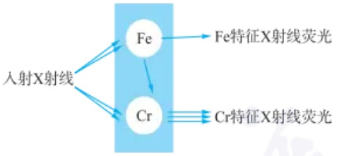

flowchart

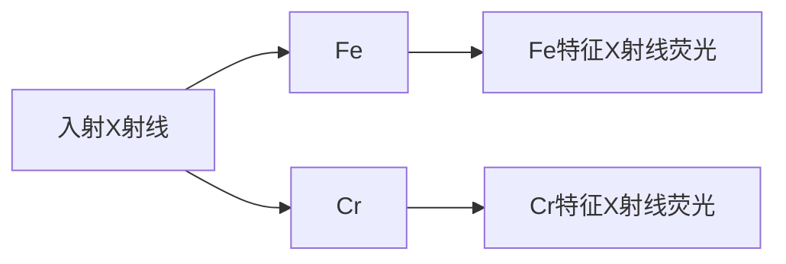

图 5.3.3 元素间的吸收-增强效应

如果关注 Cr 元素的含量, 即可将 Cr 视为样品, 元素 Fe 视为基体。已知两种元素的最强特征线及吸收限的关系: Fe 的初级荧光 ( $FeK_{a}$ ) 能高效激发样品中的元素 Cr。因此 Cr 受激发的次数等于由光管初级辐射直接激发产生的  $CrK_{a}$  线强度与由基体元素 Fe 的初级荧光  $FeK_{a}$  激发 Cr 产生的  $CrK_{a}$  次级荧光之和。由于基体中 Fe 元素的存在, 使得 Cr 的信号得到了增强。同理, 由于基体中 Cr 元素的存在, 使得 Fe 的信号被吸收减小。

二次吸收效应对分析元素的探测的影响通常比初级吸收效应严重,但比较容易预测、校正和计算。理论上,所有分析元素都受样品基体共存元素的影响。分析元素的强度不仅取决于分析物的浓度,还和样品中其他组分有关,在分析过程中可以通过数学校正和经验校正的方法处理结果,提高分析的准确性。

颗粒度、均匀性及表面结构的差异对样品元素发射的特征 X 射线强度产生影响。样品物理状态的影响可以通过合理制样使其减少或消除。

（5）X射线的吸收 前边讲到的无论是康普顿散射、瑞利散射还是X射线荧光、俄歇效应，都强调了在光子发射侧的规律。在X射线入射一侧的光子在与物质作用后的变化规律同样可以体现出上述物理过程的发生。

一束强度为  $I_{0}$  的单色 X 射线照射厚度为 l 的均匀吸收体时, 其初始强度将衰减至出射强度 I, 其强度的衰减遵循朗伯-比尔定律:

$$
\frac {\mathrm{d} I}{I} = - \mu \rho \mathrm{d} l \tag {5-3-2}
$$

$$
I = I _ {0} \mathrm{e} ^ {- \mu \rho l} \tag {5-3-3}
$$

式中， $\mu$  为质量衰减系数； $\rho$  为样品密度。

将质量衰减系数与波长或能量的对应关系画图,会得到一个不连续的曲线。

Ni-Fe 二元体系的基体校正

基体效应的数学校正一般分经验系数法、基本参数法和理论影响系数法三类。经验系数法是采用经验性的校正方程和系数来校正元素间的吸收-增强效应的方法。基本参数法是利用一些基本参数（如质量衰减系数，吸收跃迁因子，谱线分数和荧光产额等）和标样的测量强度进行迭代求未知样的浓度的方法。理论影响系数法中的影响系数通过理论计算出来，一般不依赖标样。

---

278

第五章 原子光谱法

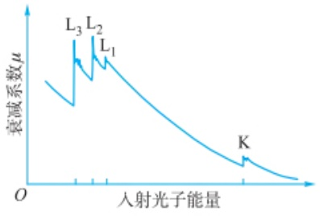

line

| Feature | Description |
| --- | --- |
| X-axis | 入射光子能量 |
| Y-axis | \(衰减系数\mu\) |
| Key Points | L1, L2, L3 |
| Point K | Local minimum in decay coefficient |

图5.3.4 质量吸收系数与X射线能量关系

表 5.3.1 特征 X 射线穿透一些

材料的临界厚度 单位: $\mu m$

| 吸收材料 | $MgK_{\alpha}$ | $CrK_{\alpha}$ | $SnK_{\alpha}$ |
| --- | --- | --- | --- |
| 铅 | 0.6 | 4.0 | 50 |
| 铁 | 0.9 | 30.0 | 260 |
| $SiO_{2}$ | 7.0 | 100 | 0.8 cm |
| $LiB_{4}O_{7}$ | 12.0 | 800 | 4.1 cm |
| $H_{2}O$ | 14.0 | 900 | 4.7 cm |

波长色散型指使用晶体分光的波长色散型光谱仪，效率较低，一般采用大功率发光激发。用于高精度、高灵敏度定量分析。在 $4 < Z < 92$ （Be-U）范围所有元素的光谱均具有很高的分辨率。

这是由于原子各壳层中的电子束缚能是量子化的,因而在特定的能量下质量衰减系数会出现若干不连续的跳跃点,这些特征的吸收突变称为吸收边或吸收限。

图 5.3.4 是质量衰减系数与 X 射线能量关系的一个示例。由图可见，随着入射光子能量的增加，X 射线在物质中的穿透能力增加，吸收下降。但是当入射光子能量稍稍比吸收边大时，因为入射光子的能量恰好大于该能级的最小激发能，光子能量可以激发出原子中的光电子，产生了对应能级的光电吸收会突然上升。不同元素的原子的壳层电子的势能不同，也就具有各自的特征吸收曲线。能从给定元素原子的特定能级逐出一个轨道电子需要的最低能量或最长波长为该元素特定能级的吸收限。能够在各元素的吸收谱中找到 1 条 K 吸收边、3 条 L 吸收边、5 条 M 吸收边和 7 条 N 吸收边。

吸收边概念在二次激发中用于说明特征 X 射线的产生与激发效率十分重要。这里还需要强调，由于只有波长短于某吸收限的光子才能激发出相应的特征谱线，因此任一元素对其自身的特征谱线都具有很高的透明度。

X 射线穿透物质的最大深度称为样品的临界厚度,超过临界值的厚度称为无限厚。由朗伯-比尔定律可以计算 99% 吸收情况的透射厚度  $d(\mu\mathrm{m})$ :

$$
d = 4 6 0 0 0 / (\mu \rho)
$$

式中， $\mu$  为质量衰减系数 $\left(\mathrm{cm}^{2}\cdot\mathrm{g}^{-1}\right)$ ;  $\rho$  为样品密度 $\left(\mathrm{g}\cdot\mathrm{cm}^{-3}\right)$ 。

特征 X 射线在固体样品中的透射深度通常只有几微米到几百微米。表 5.3.1 中列出了特征 X 射线穿透一些常用材料的临界厚度。

## 5.3.2 XRF 的谱仪类型和结构

X射线荧光光谱仪通常分为两大类，波长色散X射线荧光光谱仪（WDXRF，如图5.3.5所示)和能量色散X射线荧光光谱仪(EDXRF)。XRF仪器的基础结构包括X射线光源和探测器。除此之外还需要必要的机械系统、辅助系统和数据处理系统。波长色散光谱仪主要部件包括激发源、分光晶体、测角仪、探测器等，而能量色散光谱仪则只需激发源、探测器及相关电子与控制部件。

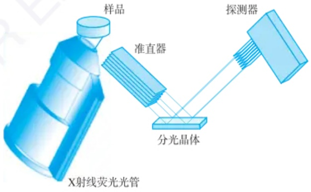

text_image

样品
准直器
探测器
分光晶体
X射线荧光光管

图 5.3.5 波长色散 XRF 结构示意图

（1）X射线的光源 常用的X射线激发源主要是各种X射线光管，电子、质子、放射性同位素、同步辐射等也可用作激发源。

X射线光管是常规分析中首选的激发源。当用高能电子束照射物质时，入射高能电子被物质组成元素中的电子减速，这种带电粒子的负加速会产生宽带的连续X射线谱，简称为连续谱或韧致辐射。另外，化学元素受高能光子或粒子的照射，如内层电子被激发，则当外层电子跃迁时，就会放射出同样符合莫塞莱定律的

---

5.3 X 射线荧光光谱法

279

特征X射线。X射线光管产生的连续谱和特征谱都可用于激发待测元素。

对于连续 X 射线,每种波长对应的连续谱强度随光管施加电压的平方而增加,还跟电流和靶材原子序数成正比(图 5.3.6)。

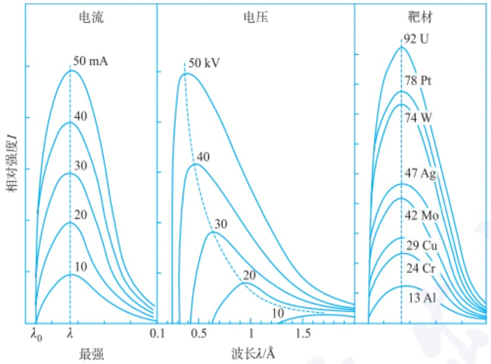

line

| Material | Current (mA) | Voltage (kV) | Target Material (U) |
| --- | --- | --- | --- |
| 13 Al | 10 | 10 | — |
| 24 Cr | 20 | 20 | — |
| 29 Cu | 30 | 30 | — |
| 42 Mo | 40 | 40 | — |
| 47 Ag | — | — | 47 Ag |
| 74 W | 30 | — | 74 W |
| 78 Pt | 40 | — | 78 Pt |
| 92 U | 50 | — | 92 U |

图 5.3.6 影响连续 X 射线光谱分布的若干参数

特征 X 射线的强度计算公式为

$$
I _ {\mathrm{K}} = C i (V - V _ {\mathrm{K}}) ^ {n} \tag {5-3-4}
$$

式中，C 为常数；i 为 X 射线光管的工作电流；V 为 X 射线光管的工作电流电压； $V_{K}$  为每种元素的 K 系临界激发电位； $n \approx 1.7$ 。

无论 X 射线光管激发条件如何变动,各光谱的强度分布都有一个仅与光管电压  $V(\mathrm{kV})$  有关的短波极限  $\lambda_{0}$  (最短波长), 短波极限  $\lambda_{0}$  与电流和靶材的原子序数无关:

$$
\lambda_ {0} = 1. 2 4 / V
$$

（2）探测器 将不能直接测量的 X 射线光子信号转变成可测量的电脉冲信号的装置，即 X 射线探测器。X 射线光谱分析中常用的三种探测器是充气正比计数器、闪烁计数器和半导体固体探测器。
（3）分光晶体 分光晶体又称分光器、单色器，它的作用是使二次X射线束发生色散，借此每条谱线可以单独进行测量。在波长色散X射线荧光光谱仪中，基本上可以分为晶体色散和非晶体色散两种方式。对于晶体色散来说可采用平晶(非聚焦)也可采用弯晶(聚焦)。对于LiF、KBr等晶体，应用单一的弯面晶体（约翰逊法）与平面晶体比较，其分辨率约高1倍左右，测量灵敏度则可提高3\~5倍。对于非晶体色散来说，主要是光栅和全反射镜面反射器这两类。

波长色散型谱仪是根据 X 射线衍射原理,用分光晶体为色散元件,以布拉格定律为基础,对不同波长的特征谱线进行分光,然后进行检测。波长色散型谱仪有分辨率好、灵敏度高等优点,应用比较广泛。

能量色散是X射线荧光光谱仪的另一种色散类型。探测器是能量色散分光的核心部件，它的发展主要是随着其分辨率的改善而得以全面的发展。探测器不仅起到光电转换作用，而且起能量甄别作用。和波长色散型仪器不同，能量色散X射线荧光光谱仪的探测系统因为没有晶体和测角仪，所以不需要任何的移动部件，仪器可以排布得非常紧凑。即使是功率较小的激发源，仍能满足分析需求。

---

280

第五章 原子光谱法

XRF样品的制备:压片法与熔片法

## 5.3.3 XRF的应用

一种理想的 XRF 样品具有如下的特点: 制备的样品具有整体代表性; 样品的化学组成成分分布均匀; 样品表面平整、光滑, 检测具有可重复性; 满足所需分析各元素的无限厚度要求。适用于 X 射线荧光光谱分析的样品形态有固体、粉末、液体、固溶体及薄膜等种类。

硼酸盐熔融是一种适用于大多数固体材料的样品制备技术，该方法最早由Claisse提出，被公认为是X射线荧光光谱的一种最精确的制样方法。在经典熔融法中，常用的熔剂有无水四硼酸钠、无水四硼酸锂、无水偏硼酸锂及各种比例的混合物。样品在高温下分散在熔融的助熔剂中，降温后固化生成玻璃体，从而消除各种复杂多变的矿物效应、颗粒效应等多方面的影响。表5.3.2为XRF典型的制样方法。

表 5.3.2 XRF 典型的制样方法

<table><tr><td>样品类型</td><td>样品种类</td><td>制样方法</td><td>制样意图</td></tr><tr><td>块体</td><td>金属、合金、矿石等</td><td>切割后用沙带抛光处理</td><td>获得光洁平整表面</td></tr><tr><td>粉末</td><td>金属、有机/无机物等粉末</td><td>研磨均匀后压片</td><td>获得平整表面</td></tr><tr><td rowspan="3">液体</td><td>土壤、玻璃等氧化物粉末</td><td>加助熔剂熔融制片</td><td>消除矿物效应、颗粒效应</td></tr><tr><td>水基溶液</td><td>直接加入专用样品杯中</td><td>He环境直接测试</td></tr><tr><td>油、有机溶液</td><td>点滴滤纸、沉淀过滤等</td><td>转化为固体测量</td></tr></table>

壁画底层物质元素分布成像

利用 X 射线荧光显微成像技术观察斑马鱼

颗粒效应可忽略时,粉末样品简单快捷的制备方法是直接压制成一定均匀致密的样片,压制时可视情况添加黏结剂,制样操作非常简单、快速。

液体样品由于不存在颗粒度等物理性质影响,而几乎成为一种理想样品的类型。可以直接测量,或经富集后在滤纸等支撑膜上测量。

定性分析可以基于波长色散扫描模式利用测角仪进行角度扫描，通过晶体对X射线荧光进行分光，再解析谱图以获知样品中所含的元素。也可基于能量色散扫描模式，利用检测器对X射线能量的分辨，解析谱图获知样品中所含的元素。如测量一份黑曜石样品时，在X射线荧光光谱仪上可以扫描获得如图5.3.7所示的荧光光谱，通过特征谱线的位置识别含有哪些元素。

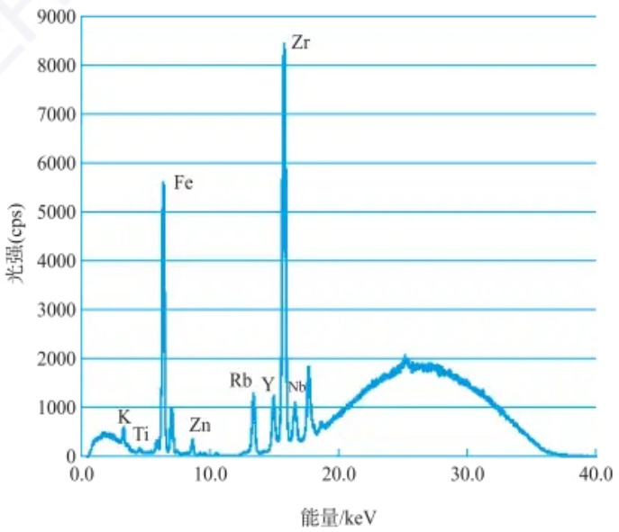

spectrogram

| Element | Energy (keV) |
| --- | --- |
| K | ~3.5 |
| Ti | ~6.0 |
| Fe | ~6.4 |
| Zn | ~8.6 |
| Rb | ~13.9 |
| Y | ~15.4 |
| Nb | ~17.1 |
| Zr | ~15.9 |

图 5.3.7 黑曜石样品的 XRF 光谱

---

5.3 X 射线荧光光谱法

281

半定量分析的准确度比定量分析稍差,也称为无标样定量分析,该方法一般是将大量理论和经验的参数,以及一组用于半定量分析的标准样品的测试值内置到软件中,使得在每次测试未知样品时不测量相应校正标样也能得到比较满意的定性和含量数据。

X 射线荧光光谱定量分析是采用一定的制样方法,选择合适的测量条件,获得净谱峰强度,并在此基础上,借助一定的数学方法,定量计算分析物浓度的方法。对校正标样有严格的要求,常规的定量分析最好采用相似标样,绘制标准曲线可以快速准确地实现物质的定量分析。

在进行定量、半定量分析时，需要对基体效应进行数学校正。当样品中被测物存在分析谱线重叠时，可用比例法扣除干扰。对于复杂体系，需要通过解谱或拟合来消除干扰。

XRF 定量、半定量方法在测试物质元素组成方面，具有无损、快速、准确等优点，在冶金、地质、化工、机械、石油、建筑材料等工业部门，农业和医药卫生，以及物理、化学、生物、地学、环境、天文及考古等科研部门都获得了广泛的应用。

微区 X 射线荧光光谱分析是 X 射线荧光光谱分析的一个重要分支, 是一种基于能量色散 X 射线荧光分析技术, 可实现对微米级区域样品中主量、次量及痕量元素定性和定量分析的方法, 具有原位、多维、动态和非破坏性的特征。

## 习题

## - 章节练习题 -

1. 简述 X 射线荧光发生的过程及利用 X 射线荧光进行定性定量分析的原理。
2. 举例说明 X 射线荧光的吸收-增强效应如何产生。
3. 请对波长色散型和能量色散型 X 射线荧光光谱仪进行比较。
4. 采用XRF测试固体样品时有哪些样品的前处理方法？简述不同方法在定性、定量时的优缺点。

## - 挑战性问题 -

5. 全反射 X 射线荧光光谱法是一种利用 X 射线荧光光谱原理测试微量样品中元素含量的方法。请结合文献和自己的理解，简述为了完成微量样品中的元素测量全反射 X 射线荧光光谱仪在结构设计上有哪些特点。

## - 专题和报告 -

6. 近年来,随着自动化程度的提高,多尺度的 XRF 成像技术已经成为众多领域必不可少的重要工具。请参考文献介绍一项 XRF 成像技术。
