# 第七章 电化学分析

原始 PDF 第 347–414 页。

## 第七章

# 电化学分析

电分析化学(electroanalytical chemistry)是仪器分析领域中的关键分支。这一类方法依赖于物质在电化学池中的电化学特性及其变化规律来进行分析，主要通过电位、电流、电荷量和电导率等电学参数与待测物质的量之间的关系来建立计量的基础。本章主要讲述电分析化学基础理论、电位分析法、伏安分析法、电导与阻抗分析法，拓展了解电分析领域的一些新兴分析技术。

## 7.1 电分析化学基础理论

## 7.1.1 电分析化学导论

## 7.1.1.1 电化学池

电化学池(electrochemical cells)通常被称作电池,是由至少一种电解质分隔开的两个电极组成的系统。在实验中,观察单个界面上的电化学行为是具有挑战性的。实际上,研究的焦点往往是电化学池中多个界面的综合特性。在电化学体系中,电极上的电荷传递是通过电子(或空穴)的移动来完成的,而在电解质相中,电荷的转移则是通过离子的迁移来实现的。这一过程涉及电化学中的一些基本理念。

化学电池是化学能与电能相互转换的装置，主要分为两种:原电池（也称为自发电池，galvanic cell）和电解池（electrolytic cell）。这两种装置呈现相反的能量转换过程。在原电池中，电极上的反应是自发进行的，它们将化学能转化为电能。典型的例子如一次电池（如 $\mathrm{Zn - MnO_2}$ 电池）、二次电池（如 $\mathrm{Pb - PbO_2}$ 蓄电池）及燃料电池（$\mathrm{H_2 - O_2}$ 电池）。相对地，电解池则依赖于外部电源驱动电池反应，将电能转换为化学反应产物的化学能，如电镀、电解和 $\mathrm{Pb - PbO_2}$ 蓄电极等。

图7.1.1(a)和(b)展示了一个典型的铜锌原电池的两种配置。在无液体接界的原电池，如图7.1.1(a)，将锌片和铜片同时浸入含有 $\mathrm{ZnSO_4}$ 和 $\mathrm{CuSO_4}$ 的混合溶液里，从而形成一个原电池；而在有液体接界的原电池，如图7.1.1(b)，锌片和铜片分别浸入 $\mathrm{ZnSO_4}$ 溶液与 $\mathrm{CuSO_4}$ 溶液中，这两个溶液通过一个盐桥（通常是含有饱和氯化钾的琼脂凝胶）来连接，形成了一个具有液体接界的原电池。两个电极之间通过一根金属导线连接，使得电流计能够检测到电流。这些电流是由原电池内部的化学反应所产生的，在两个电极上发生的化学反应具体如下:

$$
\mathrm{Zn} = \mathrm{Zn} ^ {2 +} + 2 \mathrm{e} ^ {-}
$$

$$
\mathrm{Cu} ^ {2 +} + 2 \mathrm{e} ^ {-} = \mathrm{Cu}
$$

Galvani的青蛙实验

2019年诺贝尔化学奖

电池的总反应为

---

7.1 电分析化学基础理论

327

$$
\mathrm{Zn} + \mathrm{Cu} ^ {2 +} = \mathrm{Zn} ^ {2 +} + \mathrm{Cu}
$$

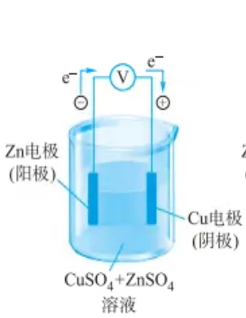

chemical

Electrolysis setup diagram of a copper-based electrolyte with zinc electrodes and copper sulfate/ZnSO4 solution

(a) 无盐桥的原电池

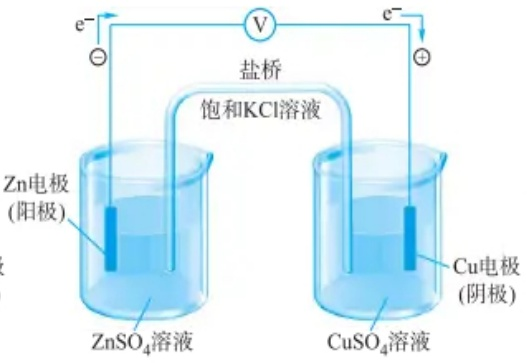

chemical

Electrolysis setup diagram of zinc and copper electrodes in electrolytic KCl solution with voltmeter and salt bridge

(b) 盐桥连接的原电池

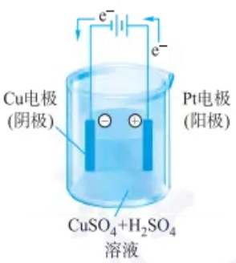

chemical

Electrolysis setup diagram of copper sulfate and hydrogen sulfate solution in a copper-ion battery

(c) 电解池

图 7.1.1 电化学池的类型

原电池是一种利用氧化还原反应生成电流的设备，它由两个电极构成:其中一个电极上发生氧化反应，称为阳极（anode）；另一个电极上发生还原反应，称为阴极（cathode）。电子的流动是从阳极经过外部电路到达阴极，因此阳极实际上是负极（negative electrode），阴极作为正极（positive electrode）。按照惯例，电流的方向被定义为与电子流动的方向相反，也就是说，电流被认为是从正极流经外部电路至负极。此时，如果将电池与一个外部电源连接，并且该外部电源的电动势高于电池的电动势时，电池吸收电能并使得反应方向逆转，电池则转变成电解池，如图7.1.1(c)所示。这时阳极作为正极，阴极作为负极。

每个电池都具有特定的电动势值,且由两个不同相界面之间的电位差产生。电池电动势被定义为右侧电极的电位与左侧电极的电位之差,即

$$
E _ {\text {电池}} = E _ {\text {右}} - E _ {\text {左}}
$$

其中，单个电极与相邻溶液的界面电位差，被称为电极电位（electrode potential）；两种溶液界面之间的电位差被称为液接电位。左侧电极发生氧化反应，右侧发生还原反应。液接电位的值通常很小，可通过使用盐桥来消除。

从图 7.1.1 中可以观察到,无论在原电池还是电解池中,阴极上都发生了相同类型的电极反应:

$$
\mathrm{Cu} ^ {2 +} + 2 \mathrm{e} ^ {-} \longrightarrow \mathrm{Cu}
$$

这类反应被称为半电池反应(half-cell reaction,或简称为半反应)。若要使铜在电极表面沉积,对于原电池而言,需要一个电位比  $Cu/Cu^{2+}$  更负的半电池来共同构成电池;对于电解池,则需要一个能够为该半反应提供电子的半电池。尽管原电池和电解池都可以用来研究相同的半反应,但它们在构成电池时的差异很大。为了研究半电池反应的特性及它们在整个电池反应中的角色,通常将电池反应分解为单独的过程进行考虑。这意味着,先研究一个半电池反应,并尽可能地减少另一个半电池反应的干扰。为了实现这一目标,通常需要将两个半电池反应隔离开,通过盐桥连接它们以形成一个电流回路,如图7.1.1(b)所示。

## 7.1.1.2 电化学池的图解表达式

## (1) 电位符号

根据 IUPAC 的规定, 半反应以还原过程为准, 即

$$
\mathrm{Ox} + n \mathrm{e} ^ {-} = \text {Red}
$$

其中  $O_{x}$  为氧化态, Red 为还原态。

---

328

第七章 电化学分析

本章中标准状态的标准压力为自1992年起由国际纯粹与应用化学联合会（IUPAC）重新定义的100 kPa；标准温度则为IUPAC推荐的298.15 K(25℃)。

同样,标准氢电极也遵循  $25^{\circ}$ C 及 100 kPa 的标准状态。

规定电极电位的符号应反映当该电极与标准氢电极结合形成电池时电极所带的电荷性质。例如，Cu与 $Cu^{2+}$ 构成电极，并且与标准氢电极形成电池时，如果金属Cu表现出正电荷，则其电极电位记为正值；而当Zn与 $Zn^{2+}$ 构成电极，与标准氢电极形成电池时，如果金属Zn表现出负电荷，则其电极电位记为负值。

## (2) 电池的图解表达式

以上述铜锌电池的图解表达式为例,其电池的图解表达式如下:

$$
\mathrm{Zn} \left| \mathrm{ZnSO} _ {4} (0. 1 \mathrm{mol} \cdot \mathrm{L} ^ {- 1}) \right\| \mathrm{CuSO} _ {4} (0. 1 \mathrm{mol} \cdot \mathrm{L} ^ {- 1}) \mid \mathrm{Cu}
$$

电池图解表达式的规定如下:

① 电极反应方向: 左侧电极进行氧化反应, 右侧电极进行还原反应。
② 界面表示: 电极的两相界面及不混溶的两种溶液之间的界面均使用“|”表示。当两种溶液通过盐桥连接并且已消除液接电位时, 使用双竖线“||”表示。如果同一溶液中同时存在多种组分, 则用逗号“,” 隔开。
③电解质位置:电解质位于两个电极之间。
④ 气体或均相的电极反应: 反应物质本身不应当直接用作电极, 而应当使用惰性材料(如铂、金或碳材料如石墨、玻璃碳等)作为电极, 以确保电流的良好传导。
⑤ 溶液的标注:电池中的溶液需标明浓(活)度。如涉及气体,则需注明其压力和温度。如未注明,则默认条件为  $25^{\circ}$ C 和 100 kPa(标准状态)。例如:

$$
\mathrm{Zn} \mid \mathrm{Zn} ^ {2 +} (0. 1 \mathrm{mol} \cdot \mathrm{L} ^ {- 1}) \parallel \mathrm{H} ^ {+} (0. 1 \mathrm{mol} \cdot \mathrm{L} ^ {- 1}) \mid \mathrm{H} _ {2} (1 0 0 \mathrm{kPa}), \mathrm{Pt}
$$

正极和负极的区分基于电极电位的正负程度,其中电位较正的电极为正极,电位较负的电极为负极。电池电动势的符号取决于电流的流向。当上述的铜锌电池短路时,电池内部电流从左向右流动(即电流从右侧的阴极流向左侧的阳极),其电池反应为

$$
\mathrm{Zn} + \mathrm{Cu} ^ {2 +} = \mathrm{Zn} ^ {2 +} + \mathrm{Cu}
$$

该反应是自发进行的,属于原电池,电动势为正值。

相反,如果电池改写为

$$
\mathrm{Cu} \mid \mathrm{Cu} ^ {2 +} (0. 1 \mathrm{mol} \cdot \mathrm{L} ^ {- 1}) \| \mathrm{Zn} ^ {2 +} (0. 1 \mathrm{mol} \cdot \mathrm{L} ^ {- 1}) | \mathrm{Zn}
$$

则电池反应为

$$
\mathrm{Zn} ^ {2 +} + \mathrm{Cu} = \mathrm{Zn} + \mathrm{Cu} ^ {2 +}
$$

此时电极无法自发反应,必须外加能量,为电解池,电动势为负值。

## 7.1.1.3 电极电位

## 1. 电极电位与测量

电池由至少两个电极组成,根据各自的电极电位可以计算出电池的电动势。然而,从物理学的定义来看,目前尚无法测量单个电极的绝对电位值。为此,目前人为规定下列的标准氢电极(standard hydrogen electrode, SHE)电位为零。

$$
\mathrm{Pt} \mid \mathrm{H} _ {2} (p = 1 0 0 \mathrm{kPa}) \mid \mathrm{H} ^ {+} (a = 1)
$$

当标准氢电极作为负极与待测电极连接，构成原电池的情况下，通过补偿法或在电流为零的条件下测量该电池的电动势，即可获得该待测电极的电极电位。例如，将标准氢电极与饱和甘汞电极:

$$
\mathrm{Hg} \mid \mathrm{Hg} _ {2} \mathrm{Cl} _ {2} \mid \mathrm{KCl} (\text {饱和水溶液})
$$

连接组成电池时,则

$$
\mathrm{Pt} \mid \mathrm{H} _ {2} (p = 1 0 0 \mathrm{kPa}) \mid \mathrm{H} ^ {+} (a = 1) \parallel \mathrm{Hg} \mid \mathrm{Hg} _ {2} \mathrm{Cl} _ {2} \mid \mathrm{KCl} (\text {饱和溶液})
$$

所测得的电池电动势即为饱和甘汞电极的电极电位。

---

7.1 电分析化学基础理论

329

各种电极的标准电极电位均可通过上述的方法进行测定，但仍有许多电极的标准电极电位不便于用此方法直接测定。在这种情况下，可以根据化学热力学的原理，通过相关反应自由能的变化进行计算，以求得电极电位。

## 2. 标准电极电位与条件电位

对于可逆电极反应  $Ox+ne^{-}\rightleftharpoons Red$ ，电极电位与反应物活度之间的关系可以用能斯特(Nernst)方程表示为

$$
E = E ^ {\ominus} + \frac {R T}{n F} \ln \frac {a _ {\mathrm{Ox}}}{a _ {\mathrm{Red}}} \tag {7-1-1}
$$

其中，当氧化态和还原态的活度均等于 $1\mathrm{mol}\cdot \mathrm{L}^{-1}$ 时，此时的电极电位即为标准电极电位 $(E^{\ominus})$ 。在 $25~^\circ C$ 时，式(7-1-1)可以写成

$$
E = E ^ {\ominus} + \frac {2 . 3 0 3 R T}{n F} \mathrm{lg} \frac {a _ {\mathrm{Ox}}}{a _ {\mathrm{Red}}} \tag {7-1-2}
$$

活度是活度系数与浓度的乘积,则式(7-1-2)变为

$$
E = E ^ {\ominus} + \frac {R T}{n F} \ln \frac {\gamma_ {\mathrm{Ox}}}{\gamma_ {\mathrm{Red}}} + \frac {R T}{n F} \ln \frac {[ \mathrm{Ox} ]}{[ \mathrm{Red} ]} \tag {7-1-3}
$$

前两项以 $E^{\ominus}$ 表示，即

$$
E ^ {\ominus \prime} = E ^ {\ominus} + \frac {R T}{n F} \ln \frac {\gamma_ {\mathrm{Ox}}}{\gamma_ {\mathrm{Red}}} \tag {7-1-4}
$$

故  $E=E^{\ominus\prime}+\frac{RT}{nF}\ln\frac{[Ox]}{[Red]}$  (7-1-5)

$E^{\ominus'}$ 是指氧化态与还原态的浓度均等于 $1\ mol\cdot L^{-1}$ 时的电极电位,称为条件电位。

显然，条件电位会因反应物的活度系数不同而有所变化，并且受到离子强度、络合效应、水解效应和 $\mathrm{pH}$ 等条件的影响。因此，条件电位是与溶液中各电解质成分相关的、以浓度表示的实际电位值。在分析化学中，溶液中除了待测离子以外，通常还存在着其他物质。这些物质虽不直接参加电极反应，但往往会显著影响电极电位。因此，条件电位比标准电极电位更具实际应用的价值。

»例 7.1.1 计算在  $H_{2}SO_{4}$  介质中  $H^{+}$ 浓度分别为  $1\ mol\cdot L^{-1}$  和  $0.1\ mol\cdot L^{-1}$  的溶液中  $VO_{2}^{+}/VO^{2+}$  电对的条件电极电位（忽略离子强度的影响）。

已知: $VO_{2}^{+}+2H^{+}+e^{-}=VO^{2+}+H_{2}O$   $\varphi^{\ominus}=1.00\ V$

》解:根据能斯特方程可得

$\varphi = \varphi^{\ominus} + (0.0592\mathrm{V})\lg \frac{[\mathrm{VO}_2^+][\mathrm{H}^+]^2}{[\mathrm{VO}^{2+}]}$ ，此时不考虑 $\mathrm{VO}_2^+$ 、 $\mathrm{VO}^{2+}$ 的副反应， $[\mathrm{VO}_2^+ ] = c_{\mathrm{VO}_2^+},[\mathrm{VO}^{2+}] = c_{\mathrm{VO}^{2+}}$ ，所以

$$
\varphi = \varphi^ {\ominus} + 2 \times (0. 0 5 9 2 \mathrm{V}) \lg [ \mathrm{H} ^ {+} ] + (0. 0 5 9 2 \mathrm{V}) \lg \frac {c _ {\mathrm{vo} _ {2} ^ {*}}}{c _ {\mathrm{vo} ^ {2 +}}}
$$

根据条件电位的定义，当 $c_{\mathrm{vo}_2} / c_{\mathrm{vo}^{2 + }} = 1$ 时其条件电位为: $\varphi^{\ominus \prime} = \varphi^{\ominus} + 2\times$ $(0.0592\mathrm{V})\lg [\mathrm{H}^{+}]$ ，所以 $[\mathrm{H}^{+}] = 1\mathrm{mol}\cdot \mathrm{L}^{-1}$ 时， $\varphi^{\ominus \prime} = \varphi^{\ominus} = 1.00\mathrm{V},[H^{+}] =$ $0.10\mathrm{mol}\cdot \mathrm{L}^{-1}$ 时， $\varphi^{\ominus \prime} = 1.00\mathrm{V} + 2\times (0.0592\mathrm{V})\lg 0.10 = 0.882\mathrm{V}$

Nernst和Faraday

电极电位也会影响电极反应的速率,其作用原理可参考文献:

大学化学,1997,(01):46-50。

## 3. 电极电位与电极反应的关系

电化学反应能否进行与电极电位密切相关。因此，通过改变电极电位，可以

---

330

第七章 电化学分析

费米能级是指温度在绝对零度时，固体能带中充满电子的最高能级，通常用EF表示。电子结合能是指电子所在能级与费米能级之间的能量差。

影响或改变电极反应。假设在惰性金属电极上发生了如下的电极反应:

$$
\mathrm{Ox} + n \mathrm{e} ^ {-} \rightleftharpoons \text {Red}
$$

该反应与电极电位相关。若 $\mathrm{Ox / Red}$ 电对相应的能量为 $E_{\mathrm{Ox / Red}}$ ，改变电极电位相当于改变金属电极内电子的能量，这会影响电极上最高电子占有能级，即费米能级（ $E_{\mathrm{F}}$ ）。而电子总是从这一能级移出或转入。图7.1.2表示了电极电位变化与电极/溶液界面电子传递之间的关系。在该体系中，氧化还原反应的能级 $E_{\mathrm{Ox / Red}}$ 是固定的，改变电极电位将导致电极上的 $E_{\mathrm{F}}$ 发生改变，从而改变电子的能量。

当电极电位由正向负变化时， $E_{F}$  向上移动，电子能量升高，高至一定程度时（高于  $E_{Ox/Red}$ ），就使得氧化态物质（Ox）倾向于从电极得到电子，发生还原反应，如图 7.1.2(a) 所示。相反地，当电极电位由负向正变化时， $E_{F}$  向下移动，电子能量降低，低至一定程度时（低于  $E_{Ox/Red}$ ），就使得还原态物质（Red）倾向于失去电子，发生氧化反应，如图 7.1.2(b) 所示。由此可见，电极电位的变化会改变电极反应的方向。

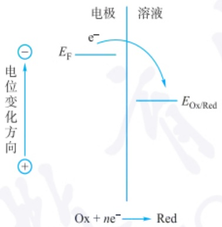

flowchart

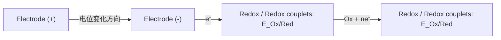

(a) 电极电位由正向负方向变化

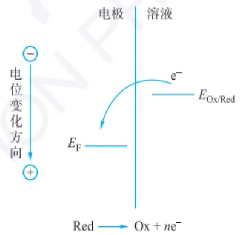

text_image

电极
溶液
e⁻
E_Ox/Red
E_F
Red → Ox + ne⁻
电位变化方向
-

(b) 电极电位由负向正方向变化

图 7.1.2 电极电位变化与电极/溶液界面电子传递的关系

## 4. 电极的极化

处在热力学平衡状态的电极体系，氧化反应与还原反应的速率实现了动态平衡，即两者速率相等且非零，但总反应速率表现为零，相应的平衡电位可用能斯特方程计算。当有电流从电极通过时，总反应速率不等于零，即原有的热力学平衡被打破，导致电极电位偏离平衡电位，这种现象称为极化。极化现象分为两类，电化学极化和浓差极化。电化学极化源于电极反应速率相对缓慢。当外部电压作用于电极，电子交换以一定速率进行，但电极反应跟不上电子交换的速率，导致电极上电荷累积，电极电位因此改变以提供反应物所需的活化能。如果电极表面电子过剩，相应的电极电位则向负方向移动，如果正电荷积聚，相应的电极电位则向正方向移动。浓差极化是由于电流通过时，电子交换反应消耗了电极表面附近的反应物，使得该区域溶液浓度低于未通电时的本体溶液浓度。根据能斯特方程，这一浓度差异导致电极电位偏离其平衡电位。当电流流经电极时，电极电位偏离平衡电位越大，极化程度就越高。若一个电极上通过无限小的电流，便引起电极电位发生显著变化，这样的电极则称为理想极化电极。通常，用过电位 $(\eta)$ 表示极化程度，即某一电流密度下电极电位（E）偏离平衡电位 $(E_{\mathrm{eq}})$ 的大小:

$$
\eta = E - E _ {\mathrm{eq}} \tag {7-1-6}
$$

---

7.1 电分析化学基础理论

331

对于阴极反应,称为阴极过电位;对于阳极反应,称为阳极过电位。

## 7.1.2 电极反应的基本历程

## 7.1.2.1 电极/溶液界面双电层

将电极插入电解质溶液，在电极和溶液之间会形成一个界面层。无论是原电池还是电解池，各种电化学反应都是在这一狭窄的界面层内发生的。因此，要研究这些反应，首先要了解电极和溶液间的界面层结构和性质。

在电极与电解质溶液的界面处，若金属电极带正电荷，这些正电荷都会分布于金属相的表层。在界面另一侧（与金属电极相邻的电解质溶液层），静电相互作用导致带负电荷的离子被吸引至电极表面附近，而带正电荷的离子则因排斥作用而远离，从而在界面两侧各自积累了等量但符号相反的过剩电荷，形成了类似于电容器的所谓双电层结构，如图7.1.3所示。双电层中两层电荷间距离极短，由此产生的电位差为0.1\~1 V，因而该区域的电场强度非常大。电极反应本质上是一个跨相电荷转移过程，其效率与速率深受界面电场强度的影响。基于此，通过控制电极电位可以有效地改变电极反应的速率和方向。此外，通过改变电极材料的物理性质和化学组成，也会改变双电层的结构和性质，从而影响电极反应。

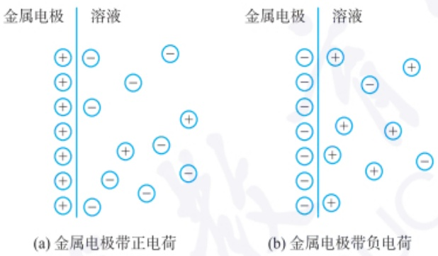

图 7.1.3 电极/溶液界面的双电层结构

## 7.1.2.2 法拉第过程与非法拉第过程

在电极界面上主要有两种过程发生。一种是法拉第过程（faradaic processes），在反应中有电荷（如电子）在金属/溶液界面上转移，电子转移引起氧化或还原反应发生。这些反应遵循法拉第电解定律，其伴随的电流称为法拉第电流。另一类过程则称为非法拉第过程（nonfaradaic processes），这类过程中，尽管可能不存在直接的电荷转移反应，但会发生如吸附、脱附等界面结构的变化，这些变化受到热力学或动力学因素的驱动。电极/溶液界面的结构可以随电位或溶液组成的变化而改变。即便没有电荷直接穿越界面，但在电位波动、电极表面积变化或溶液组成调整时，仍可能暂时性地引发外部电流。在实际的电极反应中，法拉第过程与非法拉第过程往往是同时发生的。虽然在研究某个电极反应时，一般考虑的是法拉第过程，但在某些情况下，非法拉第过程的影响也不容忽视。

## 7.1.2.3 充电电流

为了深入探究电化学体系的内在现象或获取特定物质氧化还原行为的详尽信息，一种常用的策略是向该体系施加电扰动（即改变电极的电位），并观测由此引起的体系特性的变化。这种电扰动方法包括电位阶跃、线性电位扫描及脉冲技术等。

在两种不同物质的界面上，正负电荷分别排列成的面层。在溶液中，固体表面常因表面基团的解离或自溶液中选择性地吸附某种离子而带电。由于电中性的要求，带电表面附近的液体中必有与固体表面电荷数量相等但符号相反的多余的反离子。带电表面和反离子构成双电层。

胶核表面拥有一层离子,成为电位离子,电位离子层通过静电作用,把溶液中电荷相反的离子吸引到胶核周围,被吸引的离子称为反离子,它们的电荷总量与电位离子的相等而符号相反。这样,在胶核周围介质的相间界面区域就形成所谓双电层。

---

332

第七章 电化学分析

## 思考:

在电极过程的基本历程中,主要包含哪几个步骤?决速步不同会造成哪些影响?

如前所述，电极表面的双电层结构其性质类似于一个电容器。当向电化学体系施加电扰动时，双电层所负载的电荷也会发生相应改变，从而导致电流的产生。这部分由双电层充电与放电过程所引发的电流，被称为充电电流，它本质上属于非法拉第电流。如果溶液中存在可氧化还原的物质，而且这种电扰动又足够引起这些物质的氧化还原反应，这时流经电路回路中的电流显然包括两种成分，即法拉第电流与充电电流。由此可见，当外电路的电子抵达电极表面时，一部分电子直接参与到氧化还原反应中，形成了法拉第电流；而另一部分电子则贡献于电极/溶液界面双电层的充电过程，产生了充电电流。

电化学测定体系犹如一个 RC 电路, 假设线路电阻和电解池电阻的总和为 R, 电极/溶液界面双电层电容为 C, 当向该体系施加一个电位阶跃值 E 时, 根据电子学知识, 这时所引起的充电电流  $i_{c}$  为

$$
i _ {\mathrm{c}} = \frac {E}{R} \mathrm{e} ^ {- t / R C} \tag {7-1-7}
$$

由式(7-1-7)可见,施加一个电位阶跃,充电电流随时间呈指数衰减,其时间常数为RC。若体系中电阻 $R=1\ \Omega$ ,电容 $C=20\ \mu F$ ,在 $t=20\ \mu s$ 时,电流将衰减至初始值的37%;而在 $t=60\ \mu s$ 时,电流衰减至初始值的5%。正是基于充电电流随时间迅速衰减的特征,脉冲技术才得以发展。

## 7.1.2.4 电极过程的基本历程

电极过程是指在电极与溶液的界面发生一系列变化的总和。因此，电极过程并非单一的化学反应，而是一个由不同性质的单元步骤串联构成的复杂过程。如图7.1.4所示，电极反应 $\mathrm{Ox + ne^{-}}\rightleftharpoons \mathrm{Red}$ （其中 $\mathrm{Ox}$ 为氧化态，Red为还原态）的基本历程包括:

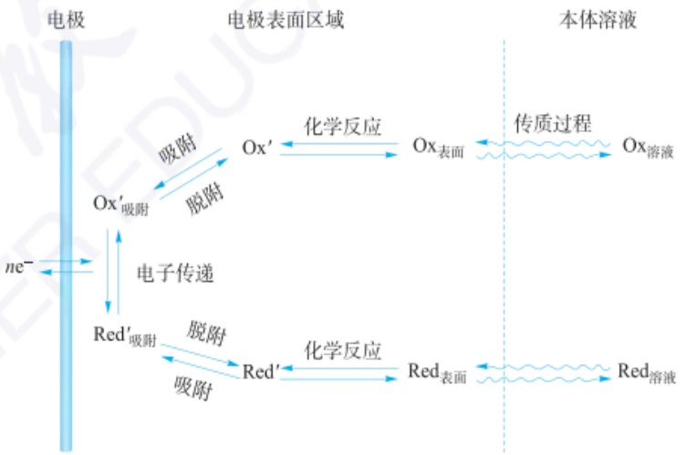

flowchart

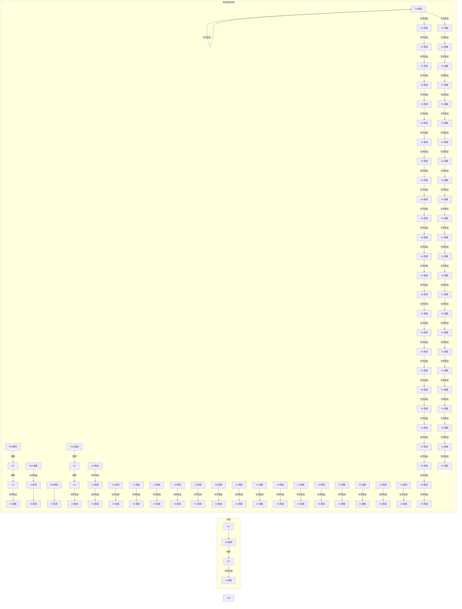

图 7.1.4 电极过程的基本历程

（1）反应物依靠液相传质(如扩散、对流和电迁移)到达电极表面,这一过程称为液相传递步骤。
（2）反应物在电极表面层进行吸附或其他非电子转移的化学转化，这一过程称为前置表面转化步骤。
（3）在电极和溶液的界面上，反应物通过电子交换生成产物，这一过程称为电子传递步骤。
（4）反应产物在电极表面发生某些转化，如脱附、复合和分解等化学变化。这一过程称为后续表面转化步骤。

---

7.1 电分析化学基础理论

333

（5）反应产物形成新相，如结晶、生成气体等。或者，反应产物是可溶的，并从电极表面传递至溶液中或液态电极。这一过程也称为物质的液相传递步骤。

任何电极过程都必然包含液相传递(1)、电子传递(3)和后续表面转化(5)这三个步骤。在实际情况中，一些电极过程更为复杂，除了这些串联步骤外，还可能存在并行的单元步骤。整个电极过程的速率由最慢的步骤决定（决速步），从而形成物质传递控制或电子传递控制的电极过程。

## 7.1.3 常规的电化学研究体系

电分析化学实验中常用的二电极或三电极测试体系构成电化学电池的电极系统。为了更好地理解这些体系，首先需要了解不同电极的名称和功能。

## 7.1.3.1 电极的基本类型

（1）工作电极(working electrode)，又称指示电极(indicating electrode):这类电极作为研究对象，在电化学池中发生预期的电化学反应或响应激励信号。在电分析中，电极上所出现的电学量(如电流、电位、电导、电阻等)变化可反映待测物的浓度(或活度)。
(2) 参比电极 (reference electrode): 这类电极的特点是在测量过程中其电位保持几乎不变, 以其电位为标准, 测量电池电动势的变化, 从而反映工作电极的电极电位变化。
（3）辅助电极(auxiliary electrode)，又称对电极(counter electrode):在三电极系统中，辅助电极与工作电极和参比电极共同构成完整的电池，它为电子传导提供通路，并与工作电极构成电流回路。常用的辅助电极有铂丝电极、石墨电极等。

## 7.1.3.2 二电极与三电极系统

图7.1.5展示了二电极和三电极系统的电路图。对于流经电池的电流较小的体系，如直流极谱法，通常直接采用由工作电极和参比电极组成的电池（即二电极系统）。然而当流经电池的电流较大时，参比电极可能会发生极化，导致其电极电位不再稳定。此外，体系（如电解质溶液）的 $iR$ 降也可能变得非常显著，难以消除其影响。在这种情况下，除了工作电极和参比电极之外，还需要引入一个辅助电极，从而构成三电极系统。工作电极和辅助电极构成了主要的电流通路，承担了绝大部分电流的传递。而工作电极与参比电极则构成了电位监测回路。由于该回路具有极高的阻抗，因此几乎没有电流流过。这样可以确保参比电极的电位保持稳定，从而实现对工作电极电位进行实时监测和显示。

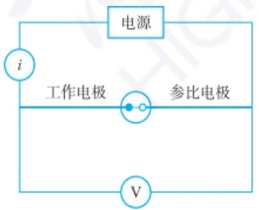

text_image

电源
i
工作电极
参比电极
V

(a)二电极系统

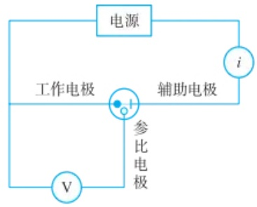

text_image

电源
工作电极
辅助电极
i
V
参比电极

(b)三电极系统

图 7.1.5 二电极和三电极系统的电路图

## 7.1.3.3 电分析化学测试方法

近年来,电分析化学领域发展迅速,近年来,新的电分析方法不断涌现。传统

---

334

第七章 电化学分析

伏安法根据工作电极类型的不同可以分为两大类:一类是以滴汞电极作为工作电极，其表面会进行周期性更新，称为极谱法，这也是最早出现的电分析化学方法。另一类则采用表面积固定或固态电极作为工作电极，如悬汞滴电极、玻璃碳电极、铂电极等，这类方法通常称为伏安法。可以认为极谱法是一种特殊的伏安法。

的分类方式是基于所测定的电化学变量类型进行区分，如电位分析法、伏安分析法等。如果从测量时体系所处的状态，则也可以将电分析化学技术分为稳态测试方法和暂态测试方法两大类。

1950年以后，电化学界面过程动力学有了长足的进步，Marcus建立了电子传递的微观理论，“固/液”界面的电子传递是其中的重要组成部分。其中稳态电化学极化方程Butler-Volmer方程为Tafel方程提供了理论依据。各种电化学测试技术被用来研究电化学反应的过程和机理，一般可分为稳态和暂态技术，由于暂态技术往往能反映更多的电化学信息，所以被广泛采用，如循环伏安技术、电化学阶跃、电化学阻抗等。

## 1. 稳态和暂态测试方法

（1）稳态测试方法，也称为静态法，是指在平衡态或非极化条件下进行的测量方法。在电分析化学测量过程中，体系没有电流流过，如电位法和电位滴定法；或者即使有电流流过，电流也极其微小，使得电极表面能够迅速建立扩散平衡，如微电极体系等。
（2）暂态测试方法，也称为动态法，是指在动态或极化条件下进行的测量方法。它是在电流开始流经体系，且体系的各项变量（例如，浓度分布、电流和电极电位等）都处于不断变化的过程中实现测量的。由于能够实现快速分析，暂态测试方法在现代电分析化学中得到了广泛的应用。

## 2. 电分析化学方法的分类

如前所述,电分析化学的计量基础是电位、电流、电荷量和电导等电化学变量与被测物质之间的关系。根据实验中所测量的不同电化学变量,传统上将电分析化学方法分为以下几类:

## (1) 电位分析法

电位分析法是将一个指示电极和一个参比电极，或两个指示电极与试液构成电池，并根据电池电动势或指示电极电位的变化进行分析的方法。

电位滴定法是电位分析法的一种,它通过观察滴定过程中指示电极电位的变化来确定反应的终点。当滴定接近化学计量点时,被测物质的浓度发生明显变化,导致指示电极电位骤然改变,从而能够精准判断滴定的结束。

## (2) 伏安法含极谱法

伏安法是指通过电极电解被测物质溶液，并根据所得电流-电压曲线进行分析的方法。采用滴汞电极为工作电极进行伏安分析的方法也称为极谱法。极谱分析经过长期发展，衍生出了方波极谱法、脉冲极谱法等多种电分析化学方法。

电流滴定法源于极谱分析,它是在固定外加电压的条件下,通过电解滴定剂或被滴定物质产生电流,并根据滴定过程中电流变化的转折点来确定滴定终点。

## (3) 电导和阻抗分析法

电导分析法是通过溶液的电导特性进行分析的方法。主要分为电导法和电导滴定法两种，其中电导法是直接采用溶液的电导（或者电阻）与待测离子浓度之间的关系进行分析，而电导滴定法是通过监测溶液电导的变化来确定滴定终点的方法。在滴定过程中，滴定剂与被测离子反应生成水、沉淀或其他难以解离的化合物，从而导致溶液电导的变化。滴定的结束通过化学计量点的转折判定。

阻抗分析方法是一种用于测试电路或设备阻抗的方法,其基本的原理是基于交流电信号在电路中的传输和电路响应进行分析。通过测量电流、电压和相位差等参数,可以计算出电路或设备的阻抗值,从而了解其性质和特征。

---

7.1 电分析化学基础理论

335

## (4) 电解和库仑分析法

使用外加电源电解试液,电解完成后直接称量电极上析出的被测物质的质量来进行分析的方法称为电重量法。如果利用电解过程进行物质的分离,则称为电解分离法。而根据电解过程中消耗的电荷量进行分析的则叫库仑分析法。

## 3. 电分析化学方法的特点

电分析化学是一门在分析化学领域发展迅速且应用日益广泛的学科。与其他分析方法相比，电分析化学方法具有以下特点:

(1) 灵敏度高, 最低分析检出限可达  $10^{-11} \, mol \cdot L^{-1}$ 。
（2）准确度高，如库仑分析法和电解分析法的准确度很高，前者特别适用于微量成分的测定，后者适用于高含量成分的测定。
（3）仪器设备较简单，价格低廉，仪器的调试和操作都较简单，容易实现自动化。
（4）易于微型化，基于微/纳技术的发展，电化学分析方法在细胞分析及活体分析中都体现出了独特的优势。特别是近年来脑科学研究的兴起，基于微/纳电极的脑活体传感，由于其高时空分辨且在体研究等特点，为脑科学的发展提供了有力的分析工具和方法。

## 7.1.4 电解分析方法

电解分析方法指的是以电子为沉淀剂，使金属离子还原为金属或形成其他形式电沉积于已知质量的电极上，然后根据电极上增加的质量计算被测物质浓度的一种电分析方法。一个典型的例子是铂电极电解硫酸铜（$\mathrm{CuSO_4}$）溶液。如图7.1.6所示，在一杯酸性硫酸铜溶液中插入两支铂电极，将可调压直流电源的正负极分别连接到这两根铂电极上。通过调节可变电阻，使电流在溶液中流动。此时，可以观察到正极上会产生气泡，而负极则会逐渐变色。这一现象表明在电极上发生了化学反应，这个过程被称为电解。对于 $\mathrm{CuSO_4}$ 溶液，发生在正铂电极上的反应为氧化反应。即

$$
2 \mathrm{H} _ {2} \mathrm{O} \longrightarrow 4 \mathrm{H} ^ {+} + \mathrm{O} _ {2} \uparrow + 4 \mathrm{e} ^ {-}
$$

发生在负铂电极的反应是还原反应,即

$$
\mathrm{Cu} ^ {2 +} + 2 \mathrm{e} ^ {-} \longrightarrow \mathrm{Cu}
$$

## 7.1.4.1 电解分析法的基本原理

## 1. 分解电压和析出电位

使用铂电极电解  $CuSO_{4}$  溶液，当外加电压较小时，不能引起电极反应，几乎没有电流或只有极其微量的电流通过电解池，这种极其微量的电流称为残余电流。继续增大外加电压，电流略微增加，直到外加电压增加至某一数值后，通过电解池的电流明显变大。这时电极上发生明显的电解现象。如果以外加电压  $U_{外}$  为横坐标，通过电解池的电流 i 为纵坐标作图，可以得到如图 7.1.7 所示的  $i-U_{外}$  曲线。图中 1 线对应的电压为引起电解质电解的最低外加电压，称为该电解质的“理论分解电压”。

如果只考虑单个电极,引起电解质电解的最正阴极电位或最负阳极电位称为“析出电位”。分解电压 $(U_{\text{分}})$ 与析出电位 $(E_{\text{析}})$ 的关系是

$$
U _ {\mathrm{分}} = E _ {\mathrm{阳析}} - E _ {\mathrm{阴析}} \tag {7-1-8}
$$

显然，阴极电位必须比析出电位更负才能实现某一物质在阴极上析出，产生迅速、连续不断的电极反应。同理，如果要使某一物质在阳极上析出，则阳极电位必须要比析出电位更正。对阴极而言，析出电位越正者，越容易被还原；反之对阳极而

1970 年开始, 原位 (in situ) 电化学技术被应用到电化学机理的探索, 如电化学原位红外反射光谱, 电化学原位拉曼, 电化学原位 XRD 等。近年来, 随着原子吸收光谱的发展, 电化学原位 X 射线吸收光谱相关研究也开始出现, 如研究 OER 的中间态, 推测它的活性物种。

1980年后，出现了以扫描隧道显微镜（STM）为代表的扫描微探针技术，迅速发展为电化学现场和非现场显微技术，尤其是电化学现场STM和AFM（原子力显微镜），为界面电化学的研究提供了宝贵的原子水平实验信息。

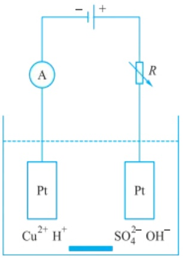

chemical

Electrochemical cell diagram with Pt electrodes, ammeter, and variable resistor

图 7.1.6 电解装置示意图

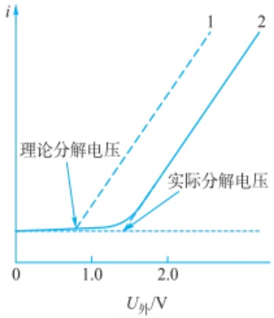

line

| U外/V | 理论分解电压 (i) | 实际分解电压 (i) |
| --- | --- | --- |
| 0 | ~0 | ~0 |
| 1.0 | ~0.2 | ~0.05 |
| 2.0 | ~1.5 | ~0.8 |

1—理论曲线；2—实测曲线

图 7.1.7 电解  $Cu^{2+}$  的  $i-U_{外}$  曲线

---

336

第七章 电化学分析

言,析出电位越负者,越容易被氧化。通常,在电解分析中只需考虑单个工作电极的情况,因此析出电位比分解电压更具有实用意义。

如果切断正在电解的电解池的电源，这时外加电压虽已经被除去，但电压表上的指针并不会回到零，而是向相反的方向偏转，这说明两个电极之间仍然存在一定的电位差。这是由于在电解作用发生时，阴极上镀上了金属铜，另一电极则逸出氧。电极上镀的金属铜和溶液中的 $\mathrm{Cu^{2+}}$ 形成一个电对，另一电极则成了$\mathrm{O}_2$ 电极。将这两个电极连接起来，就形成了一个原电池。原电池的反应方向由两个电极上反应物质的电极电位大小决定。该电池上发生的反应是

$$
\text {负极:} \mathrm{Cu-2e} ^ {-} \longrightarrow \mathrm{Cu} ^ {2 +}
$$

$$
\text {正极:} \mathrm{O} _ {2} + 4 \mathrm{H} ^ {+} + 4 \mathrm{e} ^ {-} \longrightarrow 2 \mathrm{H} _ {2} \mathrm{O}
$$

电池反应的方向正好与电解反应的方向相反。可见，电解产生的原电池的极性与电解池的极性相反，其电动势称为“反电动势” $(E_{\text{反}})$ 。因此，要使电解顺利进行，首先要克服这个反电动势。至少要使

$$
U _ {\text {分}} = E _ {\text {反}} \tag {7-1-9}
$$

才能使电解发生。而

$$
E _ {\text {反}} = E _ {\text {阳平}} - E _ {\text {阴平}} \tag {7-1-10}
$$

可见,分解电压等于电解池的反电动势,而反电动势等于阳极平衡电位与阴极平衡电位之差。因此,在可逆电极过程中,分解电压对应于电池的电动势,析出电位对应于电极的平衡电位,它们都可以根据能斯特方程计算出来。

## 2. 残余电流

在含有大量支持电解质的分析溶液中，用  $N_{2}$  或  $H_{2}$  除去其中的氧气后，当外加电压从零向负方向逐渐增加时，在电压达到金属离子的分解电位之前，仍有微量电流通过电解池，这部分电流称为“残余电流”  $i_{r}$ 。残余电流由两部分组成:一部分是法拉第电流  $i_{f}$ ，另一部分是非法拉第电流，即电容电流  $i_{e}$ 。法拉第电流是由于溶液中残留的氧或其他还原性微量杂质，如普通蒸馏水中的微量铜、试剂中的微量铁等在滴汞电极中产生的还原作用。非法拉第电流是电容电流  $i_{e}$ 。它是由汞滴的充放电产生的。电容电流  $i_{e}$  一般为  $10^{-7}$  A，相当于  $10^{-5}$  mol·L $^{-1}$  金属离子产生的扩散电流，因此经典极谱法的检测下限为  $10^{-5}$  mol·L $^{-1}$ 。

## 3. 过电位

对于电解 $1.0\mathrm{mol}\cdot \mathrm{L}^{-1}\mathrm{CuSO}_4$ 溶液，其 $U_{\text{分}}$ 不是 $0.89\mathrm{V}$，而是 $1.49\mathrm{V}$。这个$1.49\mathrm{V}$ 就是实际分解电压 $U_{\text{分}}^{\prime}$ （见图7-1-7中2线切线交点处）。$U_{\text{分}}^{\prime}$ 比 $U_{\text{分}}$ 大的原因主要有两点:一是由于电解质溶液本身有一定的电阻，为了使电流通过，必须用一部分电压克服 $iR$ 降（$i$ 为电解电流，$R$ 为电解回路的总电阻）；二是需要克服电极极化产生的阳极反应和阴极反应的过电位（$\eta_{\text{阳}}$ 和 $\eta_{\text{阴}}$）。因此，$U_{\text{分}}^{\prime}$ 为

$$
U _ {\mathrm{分}} ^ {\prime} = U _ {\mathrm{分}} + \eta_ {\mathrm{阳}} + \eta_ {\mathrm{阴}} + i R \tag {7-1-11}
$$

如果忽略 iR 降,代入平衡电位,式(7-1-11)即可表示为

$$
U _ {\text {分}} ^ {\prime} = (E _ {\text {阳平}} + \eta_ {\text {阳}}) - (E _ {\text {阴平}} + \eta_ {\text {阴}}) = (E _ {\text {阳平}} - E _ {\text {阴平}}) + (\eta_ {\text {阳}} - \eta_ {\text {阴}}) \tag {7-1-12}
$$

此方程称为电解方程。

因此，在电解  $1.0 \, mol \cdot L^{-1} CuSO_{4}$  溶液时，需要施加  $U_{分}' = 1.49 \, V$  的电压，而不是  $U_{分}' = 0.89 \, V$ ，多加的  $0.60 \, V$ ，就是用于克服 iR 降及极化引起的阳极反应和阴极反应的过电位。

过电位可分为两类:由浓度极化产生的浓差过电位和由电化学极化产生的电化学过电位。电化学极化是由电化学反应本身的迟滞引起的。一个电化学过程

---

7.1 电分析化学基础理论

337

实际上由多个分步过程组成，整个电极过程的速率取决于其中最慢的一步过程。在许多情况下，电极反应速率最慢的一步往往需要较大的活化能。因此，电解时为使反应能顺利进行，对阴极反应而言，必须使阴极电位比其平衡电位更负一些；对阳极反应而言，则必须使阳极电位比其平衡电位更正一些。这种由于电极反应导致电极电位偏离平衡电位的现象称为电化学极化。

## 4. 影响过电位大小的因素

过电位的大小与许多因素有关,但主要有以下几方面:

(1) 电极材料和电极表面状态。
(2) 析出物质的形态。
(3) 电流密度。
（4）温度。通常情况下，随着温度的升高，过电位会降低。例如，每增加10℃，氢的过电位会下降20\~30 mV。

## 5. 电解析出离子的次序及完全程度

水溶液中除了含有电解质的离子外，还有由水解离出来的 $\mathrm{H^{+}}$ 和 $\mathrm{OH^{-}}$ 。也就是说，水溶液中存在着两种或两种以上的阳离子或阴离子。当直流电通过电解溶液时，究竟哪一种离子先发生电极反应，不仅与其在电动序中的相对位置有关，也与其在溶液中的浓度有关，在某些情况下还与构成电极的材料有关。在采用电解方法分离物质时，首先应关注不同物质的析出电位差异。如果两种离子的析出电位有较大的差距，那么成功分离它们的可能性就会增加。在不考虑过电位的情况下，通常使用它们的标准电位值作为判断依据。例如，在电解包含 $\mathrm{Ag^{+}}$ 和 $\mathrm{Cu^{2+}}$ 的混合溶液时，它们的标准电位分别是 $E_{\mathrm{Ag^{+}/Ag}^{\ominus}} = 0.799\mathrm{V}$ 和 $E_{\mathrm{Cu^{2+}/Cu}^{\ominus}} = 0.337\mathrm{V}$ 。由于电位差较大，故可以认为这两种离子能够被分离。相反，对于 $\mathrm{Pb^{2+}}$ 和 $\mathrm{Sn^{2+}}$ ，其标准电位分别为 $E_{\mathrm{Pb^{2+}/Pb}^{\ominus} = -0.126\mathrm{V}$ 和 $E_{\mathrm{Sn^{2+}/Sn}^{\ominus} = -0.136\mathrm{V}$ ，电位差很小，因而不易分离。

»例 7.1.2 在含有  $2.0 \, mol \cdot L^{-1} Cu^{2+}$  和  $0.01 \, mol \cdot L^{-1} Ag^{+}$  的混合溶液中，若使用铂电极进行电解，在阴极上哪种离子会首先析出？这两种离子能否被完全分离？

》解:铜初始析出电位是

$$
\begin{array}{l} E _ {\mathrm{Cu} ^ {2 +} / \mathrm{Cu}} = E _ {\mathrm{Cu} ^ {2 +} / \mathrm{Cu}} ^ {\ominus} + (0. 0 5 9 2 \mathrm{V}) \lg 2 \\ = (0. 3 3 7 + 0. 0 0 8 9) \mathrm{V} = 0. 3 4 6 \mathrm{V} \\ \end{array}
$$

银初始析出电位是

$$
\begin{array}{l} E _ {\mathrm {Ag^ {+} /Ag}} = E _ {\mathrm {Ag^ {+} /Ag}} ^ {\ominus} + \frac {0 . 0 5 9 2 \mathrm{V}}{1} \mathrm{lg0.01} \\ = (0. 7 9 9 - 0. 1 1 8) \mathrm{V} = 0. 6 8 1 \mathrm{V} \\ \end{array}
$$

由于银的析出电位比铜的更正，因此银离子会首先在阴极上被还原并析出。随着电解过程的进行，$\mathrm{Ag^{+}}$ 的浓度逐渐降低，阴极电位也会随之变化。当 $\mathrm{Ag^{+}}$ 的浓度降至原始浓度的 $0.01\%$ 时，可以认为 $\mathrm{Ag^{+}}$ 已析出完全，此时的电极电位为

$$
\begin{array}{l} E _ {\mathrm {Ag^ {+} /Ag}} = E _ {\mathrm {Ag^ {+} /Ag}} ^ {\ominus} + \frac {0 . 0 5 9 2 \mathrm{V}}{1} \mathrm{lg} 1 0 ^ {- 6} \\ = (0. 7 9 9 - 0. 3 5 5) \mathrm{V} = 0. 4 4 4 \mathrm{V} \\ \end{array}
$$

此时  $Ag^{+}$  的电极电位仍较  $Cu^{2+}$  的电极电位要正，因此可以认为在  $Ag^{+}$  完全析出时， $Cu^{2+}$  尚未开始析出， $Ag^{+}$  和  $Cu^{2+}$  这两种离子可实现完全分离。

---

338

第七章 电化学分析

通常，对于分离两种共存的一价离子，如果它们的析出电位相差在 $0.30\mathrm{V}$ 以上，则可以认为能够完全分离；而对于共存的一价离子与二价离子的分离，析出电位相差在 $0.2\mathrm{V}$ 以上时，也可认为能够实现完全分离；对于两种二价离子，析出电位相差在 $0.15\mathrm{V}$ 以上则可达到分离目的。需要注意的是，如果对分离的要求更高，析出电位差也应相应增大。

在电解分析过程中,有时会使用所谓的“电位缓冲”方法,即在溶液中加入各种去极化剂,以达到分离不同金属离子的目的。由于去极化剂的存在,阴极(或阳极)的电位变化被限制,电极电位得以稳定在某一固定值上。另外,去极化剂在电极上的氧化或还原反应并不影响沉积物的性质,但能防止其他不需要的反应在电极上发生。例如,在铜的电解过程中,如果阴极上出现氢气析出,会导致铜的淀积质量变差。然而,若溶液中存在 $NO_{3}^{-}$ ,就可以有效防止 $H^{+}$ 的还原反应。当阴极电位变得更负时, $NO_{3}^{-}$ 会比 $H^{+}$ 优先在电极上被还原产生 $NH_{4}^{+}$ ,而 $NH_{4}^{+}$ 不会在阴极上淀积,也不会影响铜镀层的性质。因此,铜的电解应在硝酸介质中进行。此外,如果溶液中还存在 $Ni^{2+}$ 和 $Cd^{2+}$ ,它们也不会在阴极上被还原析出,因为大量存在的 $NO_{3}^{-}$ 会使电极电位在一段时间内稳定在 $NO_{3}^{-}$ 的还原电位上。 $NO_{3}^{-}$ 在阴极上的还原反应为

$$
\mathrm{NO} _ {3} ^ {-} + 1 0 \mathrm{H} ^ {+} + 8 \mathrm{e} ^ {-} \longrightarrow \mathrm{NH} _ {4} ^ {+} + 3 \mathrm{H} _ {2} \mathrm{O}
$$

其中， $NO_{3}^{-}$ 就是所谓的电位缓冲剂。

## 7.1.4.2 电解分析方法的种类及应用

## 1. 控制电流电解法

控制电流电解法通常称为恒电流电解法，在这种方法中，电解过程在恒定的电流下进行，然后通过直接称量电极上析出的物质质量来进行分析。这种方法也适用于物质的分离。在这种电解法中，直流电源被用作电解的电源。施加在电解池的电压可以通过可变电阻器进行调节，并由电压表显示电压值；电解池中的电流则通过电流表读取。通常，电解池中使用铂网作为阴极，螺旋形铂丝作为阳极，同时兼作搅拌器。在电解过程中，流经电解池的电流保持恒定。一般来说，电流越小，析出的镀层越均匀，但这也意味着所需的时间会相应增加。在实际操作中，一般将电流控制在0.5\~2 A。

恒电流电解法是一种操作简便、准确度高的分析技术，其相对误差可低于0.1%。由于该方法的选择性较低，主要用于分离电动序中位于氢之前与氢之后的金属离子。在电解过程中，氢之后的金属首先在阴极上析出，继续电解则会产生氢气。因此，氢之前的金属在酸性溶液中无法析出，需在碱性溶液中进行电解。

利用恒电流电重量法，可以测定的金属包括锌、铜、镍、锡、铅、铜、铋、锑、汞和银等，其中某些元素需要在碱性介质中或配位剂存在的条件下进行电解。目前，该方法主要应用于精铜产品的鉴定和仲裁分析。

## 2. 控制电位电解法

控制电位电解法是一种在保持阴极或阳极电位恒定的条件下进行电解的方法。当溶液中同时存在A、B两种金属离子时，它们在电解过程中的电流与阴极电位的关系曲线如图7.1.8所示。图中的a,b两点分别代表A,B离子的阴极析出电位。若在电解时将阴极电位控制在比a更负但比b更正的位置，如图中的d点电位，则A离子能在阴极上被还原并析出，而B离子则不会析出，从而实现了对B离子的有效分离。

在控制电位电解的过程中,通常只有一种物质被电解。根据7.1.8控制电位

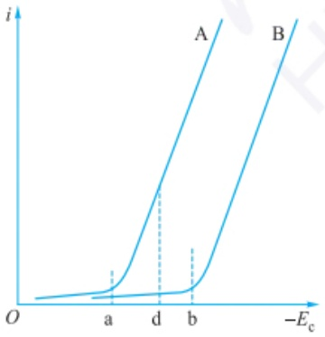

line

| -Ec | Curve A (i) | Curve B (i) |
| --- | --- | --- |
| a | ~0.1 | — |
| d | ~0.6 | — |
| b | — | ~0.1 |

图 7.1.8 控制电位与析出电位的关系

---

7.1 电分析化学基础理论

339

与析出电位的关系，由于在电解开始时该物质的浓度较高，因此电流较大，电解速率也较快。随着电解的进行，该物质的浓度逐渐降低，因此，电解电流也随之减小。当该物质被完全电解析出后，电流将趋近于零，表明电解过程已完成。电流与时间的关系如图7.1.9所示。

电解时,如果仅有一种物质在电极上析出,且电流效率100%,则

$$
i _ {t} = n A F D \frac {c _ {t}}{\delta} \tag {7-1-13}
$$

$$
\mathrm{d} Q _ {t} = n F V \mathrm{d} c _ {t} \tag {7-1-14}
$$

又因为 $i_{t} = \mathrm{d}Q_{t} / \mathrm{d}t$ ，所以有

$$
i _ {t} = i _ {0} 1 0 ^ {- k t} \tag {7-1-15}
$$

$$
k = 2 6. 1 \frac {D A}{V \delta} \tag {7-1-16}
$$

式中， $i_{0}$  表示电解开始时的初始电流； $i_{t}$  为在时间 t 时的电流；k 是一个常数，取决于电极和溶液的性质等因素；D 为扩散系数  $\left(\mathrm{cm}^{2} \cdot \mathrm{s}^{-1}\right)$ ; A 为电极表面积  $\left(\mathrm{cm}^{2}\right)$ ; V 为溶液体积  $\left(\mathrm{cm}^{3}\right)$ ;  $\delta$  为扩散层的厚度 (cm); 常数 26.1 中已包括了将 D 单位转换为  $cm^{2} \cdot min^{-1}$  的换算因子 60。在式 (7-1-15) 中，t 的单位是分钟 (min)。通常情况下，D 和  $\delta$  的值分别为  $10^{-5} cm^{2} \cdot s^{-1}$  和  $2 \times 10^{-3} cm$ 。根据式 (7-1-15) 和式 (7-1-16) 可知，若想缩短电解时间，则应增大 k 值，这可以通过增大电极表面积、减小溶液体积、提高溶液温度，以及有效搅拌来实现，这些措施能够提高扩散系数并降低扩散层的厚度。

控制电位电解法具有高选择性,因此常用于分离并测定多种金属离子。例如,它可以用于银与铜的分离,铜与铋、铅、银、镍等金属的分离,铋与铅、锡、锑等金属的分离,及镉与锌的分离。

## 7.1.5 库仑分析法

据电解过程中所消耗的电荷量来求得被测物质含量的方法称为库仑分析法。库仑分析法也可以分为两种类型:控制电位库仑分析法与控制电流库仑分析法两种。

## 7.1.5.1 法拉第电解定律

法拉第电解定律揭示了在电解过程中,电极上析出的物质的量与通过电解池的电荷量的关系,其数学式表示如下:

$$
m = \frac {M}{n F} Q \tag {7-1-17}
$$

式中，m 表示物质在电极上析出的质量(g)；M 为物质的摩尔质量( $g \cdot mol^{-1}$ )；n 为电极反应的电子转移数；F 为 Faraday 常数( $9.64853 \times 10^{4} C \cdot mol^{-1}$ )；Q 为通过的电荷量( $1 C = 1 A \cdot s$ )。如果通过电解池的电流是恒定的，则

$$
Q = i t \tag {7-1-18}
$$

代入式(7-1-17)，得

$$
m = \frac {M}{n F} i t \tag {7-1-19}
$$

如通过电解池的电流不恒定,且随时向不断变化,则

$$
Q = \int_ {0} ^ {\infty} i \mathrm{d} t \tag {7-1-20}
$$

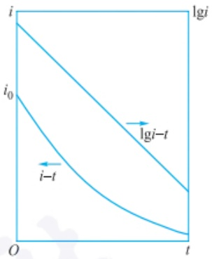

line

| Time | Current (i) | Current (lg i-t) |
| --- | --- | --- |
| 0 | i0 | i |
| t | — | — |

图 7.1.9 电流与时间的关系

---

340

第七章 电化学分析

法拉第定律是自然科学中最严格的定律之一，它的正确性已被许多实验证明。它不仅可应用于溶液和熔融电解质，也可应用于固态电解质。在实践中，测量结果与法拉第定律之间的偏差主要来源于其他物质也参加了初级反应或发生了次级反应。这两种情况均额外消耗了电荷量。例如，在电解含硫酸的硫酸锌溶液时，每消耗1F电荷量，在阴极上析出锌单质的量往往比按法拉第定律计算出来的少。这是由于锌离子在阳极上发生还原反应的同时，氢离子也在阴极上发生还原反应，结果是电解产物中除了锌单质外，还有氢气。

根据法拉第定律,可用重量法、气体体积法或其他方法来测量电极上析出的物质的量,再求算出通过电解池的电荷量;相反,若已测得通过电解池的电荷量,则可求算出电极上析出的物质的量。前者是测量电荷量的依据,后者则是库仑分析的基础。

## 7.1.5.2 电流效率

在一定的外加电压条件下,通过电解池的总电流  $i_{T}$ ,实际上是所有在电极上参与反应的电流的总和。它包括:①被测物质参与电极反应所产生的电解电流  $i_{e}$ ;②溶剂及其离子电解所产生的电流  $i_{s}$ ;③溶液中参与电极反应的杂质所产生的电流  $i_{imp}$ 。则电流效率  $\eta_{e}$  为

$$
\eta_{\mathrm{e}} = i_{\mathrm{e}} / (i_{\mathrm{e}} + i_{\mathrm{s}} + i_{\mathrm{imp}})\times 100\% = i_{\mathrm{e}} / i_{\mathrm{T}}\times 100\% \tag{7 - 1 - 21}
$$

从式中可知,要提高电流效率  $\eta_{e}, i_{e}$  应尽可能大,而  $i_{s}$  和  $i_{imp}$  应尽可能小。

电重量分析法不要求电流效率  $\eta_{e}$  达到 100%，但要求副产物不沉积在电极上，以免影响称量结果。库仑分析法则要求电流效率  $\eta_{e}$  达到 100%，即电极反应完全按化学计量比进行，无副反应，然而这在实际操作中是很难实现的。在常规分析中，电流效率  $\eta_{e}$  不低于 99.9% 是允许的。

## 7.1.5.3 控制电位库仑分析法

控制电位库仑分析法的装置与控制电位电重量分析法的基本相似。二者的不同之处在于，控制电位库仑分析法在电解电路中串联了一个能精确测量电荷量的库仑计。电解时，用恒电位装置来控制阴极电位，使电流效率达到100%，当电流趋于零时，即完成电解。电荷量由库仑计测得，再根据法拉第定律求算出被测物质的量。

由于这种方法是基于测量电解过程中所消耗的电荷量,而不是析出物的量,因此,除了具有控制电位电重量分析法的优点外,还不受称量产物状态的限制,既可用于物理性质较差的沉积体系,也可用于无固体产物的体系。

库仑计是控制电位库仑分析法装置中的一个重要组成部分。按照法拉第公式[式(7-1-21)]计算:

$$
Q = \frac {i _ {0}}{2 . 3 0 3 k} (1 - 1 0 ^ {- k t}) \tag {7-1-22}
$$

当 $kt \to \infty$ 时, 有

$$
Q = \frac {i _ {0}}{2 . 3 0 3 k} \tag {7-1-23}
$$

用作图法求 $i_{0}$ 与k的关系,即

$$
\mathrm{lg} i _ {t} = \mathrm{lg} i _ {0} + (- k t) \tag {7-1-24}
$$

求出 $i_0$ 和 $k$ ，代入 $Q = \frac{i_0}{2.303k}$ 即可算出 $Q$ ，这一过程通常采用人工方法来进行计算。

---

7.1 电分析化学基础理论

341

现代库仑计都已实现了自动化，$Q$ 值被自动记录，直接读取即可。若采用计算机软件计算法，可将式(7-1-22)表示为 $Q = \sum i_{t}\Delta t$ ，然后将测量采集到的与电流 $i$ 和时间 $t$ 相关的一系列数据输入计算机中进行计算，只要 $\Delta t$ 选得足够小，$Q$ 就足够准确。$Q$ 值可用作图法求算，图7.1.10中 $i - t$ 曲线下的面积的数值即为 $Q$ 值。

## 7.1.5.4 控制电流库仑分析法

## 1. 库仑滴定法

由恒电流发生器产生的恒电流通过电解池，用计时器记录电解时间。被测物质直接在电极上发生反应，或在电极附近由于电极反应产生一种能与被测物质起作用的试剂，被测物质作用完毕后，指示滴定终点的仪器发出信号，立即关闭计时器。测得电解进行的时间 $t(\mathrm{s})$ 和电流 $i(\mathrm{A})$，由公式:$m = \frac{M}{nF}it$ 求算出被测物质的质量 $m(\mathrm{g})$ 。此法被称为控制电流库仑滴定法，简称为库仑滴定法。该方法测量的是体积而非电荷量。它与普通滴定法的不同点在于，滴定剂不是由滴定管向被测溶液中滴加，而是通过恒电流电解在溶液内部产生，即电生滴定剂，其物质的量与电解消耗的电荷量成正比。因此，可以说库仑滴定法是一种以电子作为滴定剂的容量分析方法。

## 2. 滴定终点的确定方法

库仑滴定法终点的确定方法有很多种:化学指示剂法、电流法和电位法等。

（1）化学指示剂法 化学指示剂法是指示滴定终点最简单的方法，此法可省去库仑滴定装置中的指示系统。如采用恒电流电解KI溶液产生的滴定剂 $I_{2}$ 来测定As(Ⅲ)，就可以采用淀粉作为指示剂。化学指示剂法的灵敏度较低，但对于常量的库仑滴定能得到较为满意的测定结果。选择指示剂应注意:①所选用的指示剂不能在电极上同时发生反应；②指示剂与电生滴定剂的反应，必须在被测物质与电生滴定剂的反应之后，即前者反应速率要比后者慢。
（2）电流法 电流法的基本原理是:被测物质或滴定剂在指示电极上进行反应，所产生的电流大小与电活性物质的浓度成一定的比例关系，终点可由指示电流的大小变化来确定。电流法可分为单指示电极电流法和双指示电极电流法。前者常称为极谱滴定法，后者又称为永停终点法。双指示电极电流法通常采用两个相同的电极，并施加一个很小的外加电压(0\~200 mV)，由指示电流的变化率大小来确定终点。现以库仑滴定法测 As(Ⅲ)为例，来说明双指示电极电流法确定终点的原理。

指示电极为两个相同的铂片，施加于其上的电压约为  $200 \, mV$ 。在偏碱性的  $NaHCO_{3}$  介质中，以  $0.35 \, mol \cdot L^{-1} \, KI$  溶液为发生电解质，用电生的  $I_{2}$  来测定 As(Ⅲ)。在滴定过程中，工作阳极上发生如下反应:

$$
2 \mathrm{I} ^ {-} \longrightarrow \mathrm{I} _ {2} + 2 \mathrm{e} ^ {-}
$$

电生  $I_{2}$  立即与溶液中的 As(Ⅲ) 发生反应, 此时溶液中的  $I_{2}$  (或说  $I_{3}^{-}$ ) 浓度非常小, 无法与  $I^{-}$ 构成可逆电对在指示电极上反应产生电流。所以, 在化学计量点之前, 指示系统中基本上没有电流通过。若要使指示系统中有电流通过, 则在两个指示电极上必须发生如下反应:

阴极 $\mathrm{I}_2 + 2\mathrm{e}^{-}\longrightarrow 2\mathrm{I}^{-}$

阳极  $2I^{-} \longrightarrow I_{2} + 2e^{-}$

但当溶液中没有足够  $I_{2}$  的情况下,要使上述反应发生,指示电极系统的外加电压需远大于 200 mV,而实际上的外加电压不超过 200 mV,因此不会发生上述反应,

库仑滴定法测 As(Ⅲ) 的双指示电极电流法参考文献:

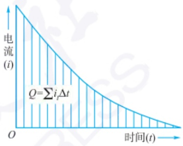

area

| Time (t) | Current (i) |
| --- | --- |
| 0 | High |
| ... | Decreasing |
| End | Low |

图 7.1.10 i-t 积分图

---

342

第七章 电化学分析

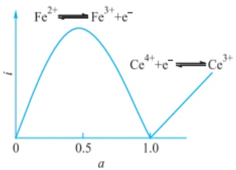

line

| a | i |
| --- | --- |
| 0 | 0 |
| 0.5 | Peak |
| 1.0 | 0 |
| >1.0 | Increasing |

图 7.1.11 双指示电极库仑滴定曲线( $Ce^{4+}$ 滴定 $Fe^{2+}$ 的反应过程)

也不会有电流通过指示系统。当 $\mathrm{As(III)}$ 反应完全时，过量的 $\mathrm{I}_2$ 与同时存在的 $\Gamma$ 组成可逆电对，在两个指示电极上发生上述反应，指示电极上的电流迅速增大，表示滴定终点已到达。仪器正是判断到了这个大的 $\Delta i$ 而强制滴定停止。

如果滴定剂和被测物质都是可逆电对，能同时在指示电极上发生反应，则得到的滴定曲线如图7.1.11（图中 $a$ 为滴定分数）所示。现以 $\mathrm{Ce^{4+}}$ 滴定 $\mathrm{Fe^{2+}}$ 为例说明滴定过程。滴定开始后，滴入的 $\mathrm{Ce^{4+}}$ 与 $\mathrm{Fe^{2+}}$ 反应生成 $\mathrm{Fe^{3+}}$ ， $\mathrm{Fe^{3+}}$ 与 $\mathrm{Fe^{2+}}$ 组成的可逆电对在指示电极上发生反应。随着 $\mathrm{Fe^{3+}}$ 浓度的增加，电流增大，直至 $\mathrm{Fe^{3+}}$ 与 $\mathrm{Fe^{2+}}$ 浓度相等，电流达到最大。随着滴定剂的加入， $\mathrm{Fe^{2+}}$ 的浓度越来越小，指示电极上的电流也越来越小，到达化学计量点时，电流最小。到达滴定终点后，加入的 $\mathrm{Ce^{4+}}$ 过量，与反应生成的 $\mathrm{Ce^{3+}}$ 组成可逆电对，在指示电极上反应产生电流，使电流增大。加入的 $\mathrm{Ce^{4+}}$ 越多，电流就越大。

这些指示终点的方法常用于氧化还原反应的滴定体系,也用于沉淀反应的滴定体系。此法装置简单、测量快速、灵敏度高、准确度高且应用范围广泛。

（3）电位法 用电位法指示终点的原理与普通电位滴定法相似。在库仑滴定过程中，每隔一定时间就停止通电，记录下电位读数和产生电生滴定剂的时间，并作二者关系图，从图中找出化学计量点。也用平衡电位法指示终点，即将电位计的电位固定在化学计量点上。滴定开始后，通过检流计的指示电流不断减小，当指示电流降至零时，表示滴定终点已到达。这种方法简便、快速，灵敏度和准确度也较高。此外，也可用分光光度法、电导法等方法来指示滴定终点。

## 3. 库仑滴定的特点及其应用

（1）由于库仑滴定法所用的滴定剂是由电解产生的，所以可使用不稳定的滴定剂，如  $Cl_{2}$ ， $Br_{2}$ ，Cu 等，这使得适用范围大大增加。
（2）适用于常量组分和微量组分的分析，方法的相对误差约为0.5%。如采用精密库仑滴定法，用计算机程序确定滴定终点，准确度可达0.01%以下，能用作标准方法。
(3) 控制电位的方法也能用于库仑滴定,以提高选择性,扩大适用范围。
（4）库仑滴定法可以使用不同类型的反应进行滴定，如酸碱中和、氧化-还原、沉淀及络合等。

## 习题

## - 章节练习题 -

1. 什么是液体接界电位, 它是如何产生的?
2. 使用离子选择性电极时,为什么要保持恒定的离子强度?
3. 过电位是什么？它们是如何产生的？它们对电解工业和电化学分析有何危害和益处？
4. 产生浓差极化的条件是什么？极谱分析的定量依据是什么？
5. 为什么半波电位可作为极谱定性分析的依据？
6. 电化学中的氧化还原反应与非电化学的氧化还原反应有何区别？
7. 为什么不能测定电极的绝对电位？通常使用的电极电位是如何获得的？
8. 充电电流是如何形成的？它与时间的关系有何特征？能否通过降低或消耗充电电流来开发灵敏的电分析方法。

---

7.2 电位分析

343

## 7.2 电位分析

电化学分析是利用溶液的电化学性质，通过传感器-电极将被测物质的浓度转换成电学参数而加以测量的方法。其中，通过测量电池电动势或电极电位来确定被测物质浓度的方法，称为电位分析法。例如，实验室使用的 $\mathrm{pH}$ 计就是利用电位分析的原理。电位分析的应用较广，它可用于环保、生物、医学、食品及工农业生产领域中的成分分析，也可用于化学、生物等领域的基础研究，如平衡常数的测定、动力学过程分析等。在这些测量过程中，溶液的浓度如何转化成电学参数？又如何从电学参数中获取被测物质的浓度呢？

## 7.2.1 电位分析概论

电位分析法(potentiometry)是一类在几乎无电流通过的条件下,通过测量电极电位或电池电动势来确定物质浓度的电化学分析方法。电极活性物质的活度可以由测得的电极电位代入能斯特方程求得

$$
E = E ^ {\ominus} + \frac {R T}{n F} \mathrm{ln} a \tag {7-2-1}
$$

电极电位的测量装置是由指示电极、参比电极及电解质溶液所构成的电化学系统。其中，指示电极是指，能对溶液中参与半反应的离子的活度，或不同氧化态的离子的活度，产生能斯特响应的电极。不响应被测电活性物质活度变化，提供测量电位参考的是参比电极。电解质溶液一般由被测物质及其他组分组成。

电位分析法分为两种(图 7.2.1)。第一类方法是直接电位法(direct potentiometry)。选用合适的指示电极浸入被测试液,测量其相对于一个参比电极的电位。将测出的电位代入能斯特方程,求出被测物质的浓度。第二类方法是电位滴定法(potentiometric titration)。向试液中滴加能与被测物质发生化学反应的标准溶液,它类似于化学滴定分析法,仅是利用电极电位在化学计量点附近的突变代替指示剂颜色的变化来确定滴定终点。根据滴定终点消耗标准溶液的量,可计算得出被测物质的含量。值得注意的是,电位法是在溶液平衡体系不发生变化的条

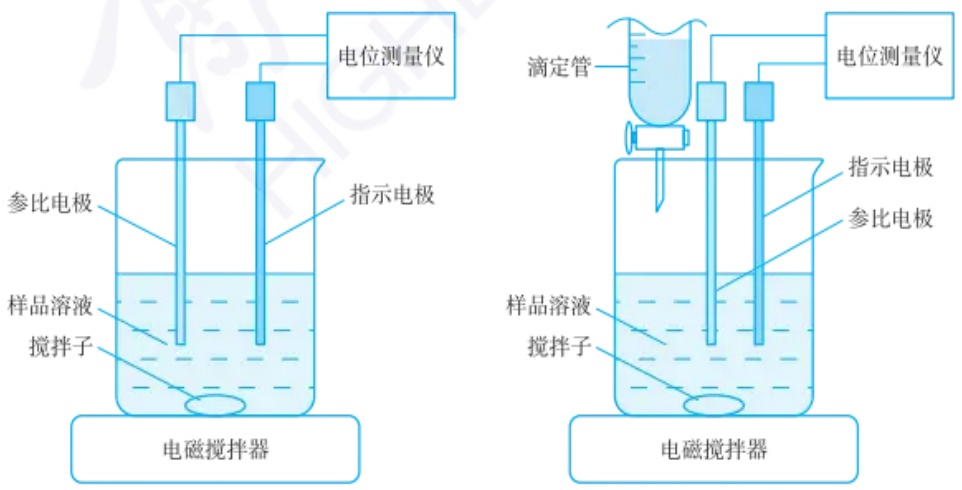

图 7.2.1 电位分析法装置图

## 拓展思考

为什么说电位分析法的测量过程中几乎无电流通过,它的工作原理是怎么样的?

## 电位型电极

1. 定义: 电位型电极的特点是电极电位(电压)随溶液中特定离子的活度或浓度变化而变化。
2. 工作原理: 这些电极通过测量电极电位来检测特定离子的存在和浓度。电极电位的变化与离子活度的对数成正比, 遵循能斯特方程。

## 电流型电极

1. 定义: 电流型电极的特点是电极产生的电流与溶液中特定离子或分子的浓度成正比。
2. 工作原理: 在电流型电极中, 电化学反应在电极表面发生, 产生的电流与电极反应的速率有关, 而反应速率又与溶液中离子或分子的浓度有关。

## 工作电极与指示电极

## 区别:

1. 功能角色: 指示电极主要用于电位测量, 而工作电极可以参与电位或电流的测量。
2. 反应类型: 指示电极通常不参与反应, 只是监测电位变化; 工作电极则是电化学反应的活跃部分。
3. 应用目的: 指示电极用于特定离子的检测, 而工作电极用于更广泛的电化学反应, 包括氧化还原反应、电流产生等。
4. 电位变化: 指示电极的电位随溶液中特定离子的活度变化, 而工作电极的电位可能因参与反应而发生变化。

---

344

第七章 电化学分析

在某些情况下，同一个电极可以同时作为指示电极和工作电极，尤其是在三电极体系中，工作电极（也称为研究电极或感测电极）是电化学反应的主要场所，而参比电极提供稳定的参考电位，有时指示电极和工作电极可以是同一个电极，尤其是在两电极体系中。一般不对工作电极与指示电极进行区分。

## 拓展思考

为什么要求制作第一类电极的金属的标准电极电位为正？如果不考虑动力学因素，使用标准电极电位为负的金属制作第一类电极会怎么样？

## 拓展

金属指示电极在实际应用中具有广泛的用途，尤其是在氧化还原滴定和痕量金属离子的检测中。例如，银电极常用于氯离子 $\left(\mathrm{Cl}^{-}\right)$ 的电位滴定，通过测量电极电位变化来确定氯化物的浓度；铂电极由于其良好的催化活性和化学稳定性，广泛应用于氧化还原反应的分析中，如测定水中的溶解氧或氧化还原电位。

此外，金属电极在环境监测、工业过程控制和生物医学检测中也有重要的应用，通过实时监控溶液中的金属离子浓度，为化学反应过程监测提供精确的分析手段。

件下进行测定的,测得的是物质游离离子的量,而电位滴定法测得的是物质的总量。

## 7.2.2 指示电极

电位分析法指示电极种类繁多，但可大致分为两大类。第一类是金属基指示电极(metallic indicator electrode)，其电极上有电子迁移。第二类是离子选择电极（ion-selective electrode, ISE），其电极上无电子交换。本节讲述的离子选择性膜电极是ISE的一种主要类型。

## 1. 金属基指示电极

（1）第一类电极（活性金属电极）:它是由金属与该金属离子溶液组成， $M|M^{+}$ 。如将洁净光亮的银丝插入 $AgNO_{3}$ 溶液中，其电极反应为

$$
\mathrm{Ag} ^ {+} + \mathrm{e} ^ {-} \rightleftharpoons \mathrm{Ag}
$$

25 ℃时,电极电位为

$$
E = E ^ {\ominus} (\mathrm{Ag} ^ {+} / \mathrm{Ag}) + (0. 0 5 9 2 \mathrm{V}) \lg a _ {\mathrm{Ag} ^ {+}} \tag {7-2-2}
$$

这类电极的金属的标准电极电位需为正，如 Cu, Ag, Hg, 活性比氢小, 标准电极电位为正。但在实际测量过程中, 综合动力学因素, 有些金属的标准电极电位虽然较负, 但由于氢在其上有较大的过电位, 所以也可以用于制作此类电极, 如 Zn, Cd, In, Tl, Sn, Pb 等。

（2）第二类电极(金属|难溶盐电极):它是由金属、该金属的难溶盐(或难解离的配合物)和该难溶盐(或难解离的配合物)的阴离子溶液组成。如银-氯化银电极、甘汞电极。

$(\mathrm{Ag}|\mathrm{AgCl},\mathrm{Cl}^{-})$  的电极反应为

$$
\mathrm{AgCl} + \mathrm{e} ^ {-} \rightleftharpoons \mathrm{Ag} + \mathrm{Cl} ^ {-}
$$

在 AgCl 溶液中

$$
a _ {\mathrm{Ag} ^ {+}} = \frac {K _ {\mathrm{sp}} (\mathrm{AgCl})}{a _ {\mathrm{Cl} ^ {-}}} \tag {7-2-3}
$$

代入式(7-2-2)，可得

$$
E = E ^ {\ominus} (\mathrm{Ag} ^ {+} / \mathrm{Ag}) + (0. 0 5 9 2 \mathrm{V}) \lg K _ {\mathrm{sp}} (\mathrm{AgCl}) - (0. 0 5 9 2 \mathrm{V}) \lg a _ {\mathrm{Cl} ^ {-}}
$$

$$
E = E ^ {\ominus} (\mathrm{AgCl/Ag}) - (0. 0 5 9 2 \mathrm{V}) \lg a _ {\mathrm{Cl} ^ {-}} \tag {7-2-4}
$$

甘汞电极与  $Hg^{2+}-EDTA$  配合物的水溶液可以构成第二类电极,该电极过程的半反应为

$$
\mathrm{HgY} ^ {2 -} + 2 \mathrm{e} ^ {-} \rightleftharpoons \mathrm{Hg(1)} + \mathrm{Y} ^ {4 -} \quad E ^ {\ominus} = 0. 2 1 \mathrm{V}
$$

$$
E = E ^ {\ominus} + \frac {R T}{n F} \lg \frac {a _ {\mathrm{HgY} ^ {2 -}}}{a _ {\mathrm{Y} ^ {4 -}}} \tag {7-2-5}
$$

因为络合物  $HgY^{2-}$  有非常大的形成常数（为  $6.3 \times 10^{21}$ ），因此 EDTA 在一定范围内的活度变化对络合物  $HgY^{2-}$  的活度影响不大，络合物  $HgY^{2-}$  的活度基本是恒定的。

$$
E = E ^ {\ominus} + \frac {0 . 0 5 9 2 \mathrm{V}}{2} \mathrm{lg} a _ {\mathrm{HgY} ^ {2 -}} + \frac {0 . 0 5 9 2 \mathrm{V}}{2} \mathrm{pY} \tag {7-2-6}
$$

$$
E = \mathrm{常数} + \frac {0 . 0 5 9 2 \mathrm{V}}{2} \mathrm{pY} \tag {7-2-7}
$$

$$
\mathrm{常数} = 0. 2 1 + \frac {0 . 0 5 9 2 \mathrm{V}}{2} \mathrm{lg} a _ {\mathrm{HgY} ^ {2 -}} \tag {7-2-8}
$$

---

7.2 电位分析

345

（3）第三类电极:这类电极是由金属与两种具有相同阴离子的难溶盐（或难解离的配合物），以及含有第二种难溶盐（或难解离的配合物）的阳离子组成的电极体系。典型例子是草酸根离子与银离子和钙离子生成草酸银和草酸钙难溶盐，如果两种盐溶液是过饱和的，则游离的钙离子的活度可用银电极测定。

电极图解式为

$$
\mathrm{Ag} \mid \mathrm{Ag} _ {2} \mathrm{C} _ {2} \mathrm{O} _ {4}, \mathrm{CaC} _ {2} \mathrm{O} _ {4}, \mathrm{Ca} ^ {2 +}
$$

由难溶盐的溶度积,可推得

$$
a (\mathrm{Ag} ^ {+}) = \left[ \frac {K _ {\mathrm{sp}} (\mathrm{Ag} _ {2} \mathrm{C} _ {2} \mathrm{O} _ {4})}{a (\mathrm{C} _ {2} \mathrm{O} _ {4} ^ {2 -})} \right] ^ {\frac {1}{2}} \tag {7-2-9}
$$

$$
a (\mathrm{C} _ {2} \mathrm{O} _ {4} ^ {2 -}) = \frac {K _ {\mathrm{sp}} (\mathrm{CaC} _ {2} \mathrm{O} _ {4})}{a (\mathrm{Ca} ^ {2 +})} \tag {7-2-10}
$$

代入银电极的Nernst方程， $E = E^{\ominus}(\mathrm{Ag}^{+} / \mathrm{Ag}) + (0.0592\mathrm{V})\lg a_{\mathrm{Ag^{+}}}$ ，可得

$$
E = E ^ {\ominus} (\mathrm{Ag} ^ {+} / \mathrm{Ag}) + \frac {0 . 0 5 9 2 \mathrm{V}}{2} \lg \frac {K _ {\mathrm{sp}} (\mathrm{Ag} _ {2} \mathrm{C} _ {2} \mathrm{O} _ {4})}{K _ {\mathrm{sp}} (\mathrm{CaC} _ {2} \mathrm{O} _ {4})} + \frac {0 . 0 5 9 2 \mathrm{V}}{2} \lg a _ {\mathrm{Ca} ^ {2 +}} (7 - 2 - 1 1)
$$

$$
E = E ^ {\prime} + \frac {0 . 0 5 9 2 \mathrm{V}}{2} \mathrm{lg} a _ {\mathrm{Ca} ^ {2 +}} \tag {7-2-12}
$$

电位滴定中,金属离子与 EDTA 滴定反应,常用 Hg/Hg-EDTA 电极(pM)作指示电极。电极反应可表示为

$$
\mathrm{Hg} \mid \mathrm{HgY} ^ {2 -}, \mathrm{CaY} ^ {2 -}, \mathrm{Ca} ^ {2 +}
$$

$$
E = E ^ {\ominus} (\mathrm{Hg} ^ {2 +} / \mathrm{Hg}) + \frac {0 . 0 5 9 2 \mathrm{V}}{2} \lg \frac {K _ {\mathrm{f}} (\mathrm{CaY} ^ {2 -})}{K _ {\mathrm{f}} (\mathrm{HgY} ^ {2 -})} + \frac {0 . 0 5 9 2 \mathrm{V}}{2} \lg \frac {a _ {\mathrm{HgY} ^ {2 -}}}{a _ {\mathrm{CaY} ^ {2 -}}} + \frac {0 . 0 5 9 2 \mathrm{V}}{2} \lg a _ {\mathrm{Ca} ^ {2 +}} \tag {7-2-13}
$$

式中， $K_{f}$  是配合物的生成常数。这种电极可在电位滴定中用作 pM 的指示电极。因为在滴定终点附近， $Ca^{2+}$  绝大部分形成  $CaY^{2-}$ ， $\left[HgY^{2-}\right]/\left[CaY^{2-}\right]$  值可视为基本不变，则有

$$
\mathrm{常数} = E ^ {\ominus} (\mathrm{Hg} ^ {2 +} / \mathrm{Hg}) + \frac {0 . 0 5 9 2 \mathrm{V}}{2} \mathrm{lg} \frac {K _ {\mathrm{f}} (\mathrm{CaY} ^ {2 -})}{K _ {\mathrm{f}} (\mathrm{HgY} ^ {2 -})} \tag {7-2-14}
$$

$$
E = \mathrm{常数} + \frac {0 . 0 5 9 2 \mathrm{V}}{2} \mathrm{lg} a _ {\mathrm{Ca} ^ {2 +}} \tag {7-2-15}
$$

（4）零类电极(惰性材料电极):它可以由惰性金属(铂或金)或石墨烯、碳纳米管等导电的非金属材料,与含有可溶性的氧化态和还原态物质的溶液组成。例如:

$$
\mathrm{Pt} \mid \mathrm{Fe} ^ {3 +}, \mathrm{Fe} ^ {2 +}
$$

$$
E = E ^ {\ominus} (\mathrm{Fe} ^ {3 +} / \mathrm{Fe} ^ {2 +}) + (0. 0 5 9 2 \mathrm{V}) \lg \frac {a _ {\mathrm{Fe} ^ {3 +}}}{a _ {\mathrm{Fe} ^ {2 +}}} \tag {7-2-16}
$$

这类电极不参与电极反应,仅仅起到传导电子的作用。

## 2. 离子选择性膜电极

这类电极具有敏感膜并能产生膜电位，故称为膜电极。膜电极种类很多，不同膜电极的膜/液界面上产生电位的机理也不同且较为复杂，所以没有对其原理统一简单的解释。但是膜电极的膜/液界面上都不发生电子交换反应，其膜电位方程可表示为

$$
E = \mathrm{常数} \pm \frac {R T}{n F} \mathrm{ln} a _ {\mathrm{离子}} \tag {7-2-17}
$$

## 拓展思考

前三类电极的能斯特方程最简式的形式十分相似,你能从中总结出什么规律?请分析一下式子中为什么会出现常数项。

---

346

第七章 电化学分析

当用仪器测量电极电位时，测量仪器的一边连接待测的电极，另一边不能直接插入电解液中与待测电极形成回路。此时，需要在中间连接一个导体，在测量仪器和电解液之间传递电子，才能将待测电极与测量仪器接通。因此，单个电极的绝对电极电位无法得到，只能测定组成电池的电动势。为了使各种电极测量得到的数据有可比性，引入了参比电极的概念。这种参比电极在给定的实验条件下能得到稳定而可重现的电位值。

式中，“+”一般对正离子，“-”一般对负离子；n 为反应中转移的电荷数。

## 7.2.3 参比电极

参比电极(reference electrode)是电化学中的一个重要概念,作为一个稳定的电极,其电位在测量过程中不会变化。因此,参比电极可以在电化学测量中提供一个已知电位作为比较基准。

对于参比电极的要求要有三个基本性质:① 可逆性:有微安量级的电流流过,反转变号时,电位基本保持不变;② 重现性:溶液的浓度和温度改变时,实时按 Nernst 方程响应,不存在滞后现象;③ 稳定性:测量中电位保持恒定,并且使用寿命较长。IUPAC 推荐以标准氢电极为基本的参比电极。

## 7.2.3.1 常见参比电极的类型

## 1. 标准氢电极

标准氢电极(图 7.2.2)是确定电极电位的基准(一级标准)电极,即所谓的理想参比电极。规定在任何温度下,其电极电位值为零,电极反应可表示为

$$
\mathrm{H} ^ {+} (\mathrm{aq}, a = 1. 0 \mathrm{mol} \cdot \mathrm{L} ^ {- 1}) + \mathrm{e} ^ {-} \rightleftharpoons \frac {1}{2} \mathrm{H} _ {2} (1 0 0 \mathrm{kPa})
$$

标准氢电极由铂电极覆盖氢气吸附层构成,浸泡在酸性电解质中,具有极强的稳定性,电极图解式和电位方程分别为

$$
\mathrm{Pt}, \mathrm{H} _ {2} (p) \mid \mathrm{H} ^ {+} (\mathrm{aq}, a = 1. 0 \mathrm{mol} \cdot \mathrm{L} ^ {- 1})
$$

$$
E (\mathrm{H} ^ {+} / \mathrm{H}) = E ^ {\ominus} (\mathrm{H} ^ {+} / \mathrm{H}) + \frac {R T}{F} \ln \frac {a _ {\mathrm{H} ^ {+}}}{\sqrt {p}} \tag {7-2-18}
$$

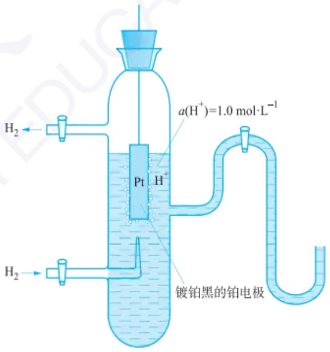

chemical

Electrochemical cell diagram for platinum electrode with H2 and pH electrolyte, showing pH=1.0 mol·L⁻¹ and platinum electrodes

图 7.2.2 标准氢电极示意图

标准氢电极成本较高,操作步骤烦琐,在通常测量工作中,一般不使用其作为参比电极。

## 2. 甘汞电极

甘汞电极(见图7.2.3)的电位在特定条件下(通常为 $25\;^{\circ}C$ )通过银-汞氯化物体系的饱和溶液的电位来定义,其电位与标准氢电极之间的差异在实践中被认为是恒定的,属于二级标准。甘汞电极的构造是在玻璃管中将铂丝浸入汞与氯化

---

7.2 电位分析

347

亚汞的糊状物中，以氯化亚汞的氯化钾溶液作为内充液。常用于酸性和中性条件下的电位测量。甘汞电极的半电池图解式为

$$
\mathrm{Hg(l),Hg_2Cl_2(s)} \mid \mathrm{Cl} ^ {-} (x \mathrm{mol} \cdot \mathrm{L} ^ {- 1})
$$

电极反应是

$$
\mathrm{Hg} _ {2} \mathrm{Cl} _ {2} (\mathrm{s}) + 2 \mathrm{e} ^ {-} \rightleftharpoons 2 \mathrm{Hg} (1) + 2 \mathrm{Cl} ^ {-}
$$

因为  $\mathrm{Hg}_{2}\mathrm{Cl}_{2}(\mathrm{s})$  和  $\mathrm{Hg}(1)$  的活度都等于 1，则  $25^{\circ}C$  时，电极电位为

$$
E (\mathrm{Hg} _ {2} \mathrm{Cl} _ {2} / \mathrm{Hg}) = E ^ {\ominus} (\mathrm{Hg} _ {2} \mathrm{Cl} _ {2} / \mathrm{Hg}) - (0. 0 5 9 2 \mathrm{V}) \lg a _ {\mathrm{Cl} ^ {-}} \tag {7-2-19}
$$

## 3. 银-氯化银电极

银-氯化银电极(图7.2.4)也是常见的参比电极,其电极电位是通过银电极与氯化银(AgCl)间的平衡电位来定义的,属于二级标准。构造是将银丝镀上一层氯化银沉淀,浸在用氯化银饱和的一定浓度的氯化钾溶液中。银-氯化银电极的电极电位为

$$
E (\mathrm{AgCl/Ag}) = E ^ {\ominus} (\mathrm{AgCl/Ag}) - (0. 0 5 9 2 \mathrm{V}) \lg a _ {\mathrm{Cl} ^ {-}} \tag {7-2-20}
$$

常温  $25^{\circ}$ C 时，甘汞电极和银-氯化银电极的电极电位见表 7.2.1。

表 7.2.1 甘汞电极和银-氯化银电极的电极电位(25 ℃)

| 电极 | KCl 浓度 | 电极电位(vs.SHE)/V |
| --- | --- | --- |
| $0.1 \text{ mol} \cdot \text{L}^{-1}$甘汞电极 | $0.1 \text{ mol} \cdot \text{L}^{-1}$ | +0.3365 |
| 标准甘汞电极(NCE) | $1.0 \text{ mol} \cdot \text{L}^{-1}$ | +0.2828 |
| 饱和甘汞电极(SCE) | 饱和 KCl 溶液 | +0.2438 |
| $0.1 \text{ mol} \cdot \text{L}^{-1} \text{Ag/AgCl}$电极 | $0.1 \text{ mol} \cdot \text{L}^{-1}$ | +0.2880 |
| 标准 Ag/AgCl 电极 | $1.0 \text{ mol} \cdot \text{L}^{-1}$ | +0.2223 |
| 饱和 Ag/AgCl 电极 | 饱和 KCl 溶液 | +0.2000 |

## 7.2.3.2 盐桥

盐桥是“连接”和“隔离”不同电解质的重要装置。盐桥基于正负离子间的静电相互作用力，其中的正、负离子在连接的两个电解质溶液中以相近的迁移速率扩散，以平衡两边的电荷。在电荷平衡过程中，正负离子的迁移速率相近，两种离子产生的液接电位方向相反，数值基本相等，相互抵消。参比电极中就有盐桥，甘汞电极和银-氯化银电极的盐桥中填充的是KCl溶液。

(1) 作用: 接通电路, 消除或减小液接电位。
（2）使用条件:①盐桥的电解质中不含被测离子；②电解质的正、负离子的迁移率应该基本相等；③要保持盐桥内离子的高浓度状态。常用作盐桥的电解质有 $\mathrm{KCl},\mathrm{NH}_4\mathrm{Cl},\mathrm{KNO}_3$ 等。

## 7.2.4 离子选择性电极

## 7.2.4.1 离子选择性电极

电位分析中使用的电极有金属基电极和离子选择性电极,它们可以作为指示电极或参比电极。

## 1. 离子选择性电极

离子选择性电极（ion selective electrode, ISE）被IUPAC定义为一类电化学传感器(图7.2.5)。它由敏感膜、电极帽、电极杆、内参比电极和内参比溶液等

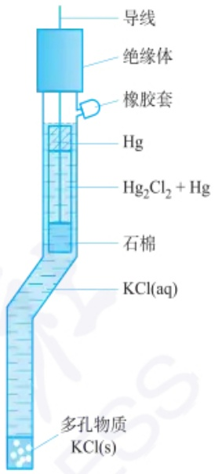

text_image

导线
绝缘体
橡胶套
Hg
Hg₂Cl₂ + Hg
石棉
KCl(aq)
多孔物质
KCl(s)

图 7.2.3 甘汞电极示意图

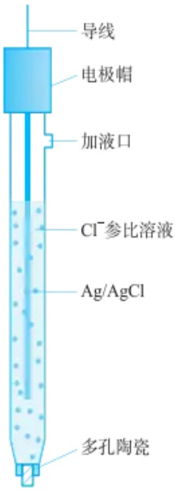

text_image

导线
电极帽
加液口
Cl⁻参比溶液
Ag/AgCl
多孔陶瓷

图 7.2.4 银-氯化银电极示意图

观察表 7.2.1 中不同 KCl 浓度下甘汞电极的电极电位,你能得出什么结论?

---

348

第七章 电化学分析

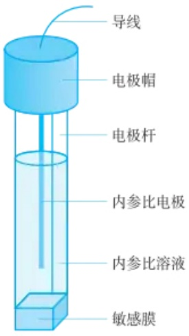

text_image

导线
电极帽
电极杆
内参比电极
内参比溶液
敏感膜

图 7.2.5 离子选择性电极示意图

## 拓展

离子选择性电极（ISE）的历史可以追溯到20世纪初，最早的ISE是pH玻璃电极，由Fritz Haber和Zygmunt Klemensiewicz在1909年发明。这一突破使得科学家能够精确测量溶液的酸碱度，推动了电化学分析的进步。随后，ISE技术迅速扩展到其他离子的检测，尤其是通过开发液膜和固态电极，大大提高了选择性和应用范围。

## 拓展

新型离子选择性电极的研究与发展趋势主要集中在提升电极的选择性、灵敏度和稳定性。近年来，纳米材料、离子液体和石墨烯等新材料的引入，使ISE的性能在复杂环境和低浓度检测中得到了显著提升。此外，微型化和智能化的发展趋势使得ISE能够应用于可穿戴设备和实时监测系统，为环境监测、生物医学诊断和食品安全提供了更便捷、准确的分析手段。

部分组成。其中，分开两种电解质溶液并能对某类物质有选择性响应的连续层称为敏感膜，它的性能决定了离子选择电极性能好坏，是离子选择性电极的关键组成部分。内参比电极常用银-氯化银电极或用银丝，内参比溶液由离子选择电极的种类决定，也有不使用内参比溶液的离子选择性电极。

## 2. 离子选择性电极的分类

通常,离子选择性电极的分类是按敏感膜材料为基本依据。根据1976年IU-PAC的推荐,离子选择性电极分为原电极和敏化电极两类。

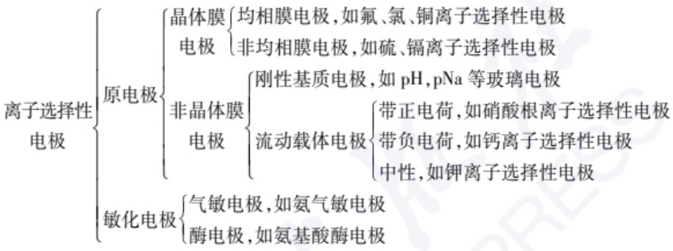

flowchart

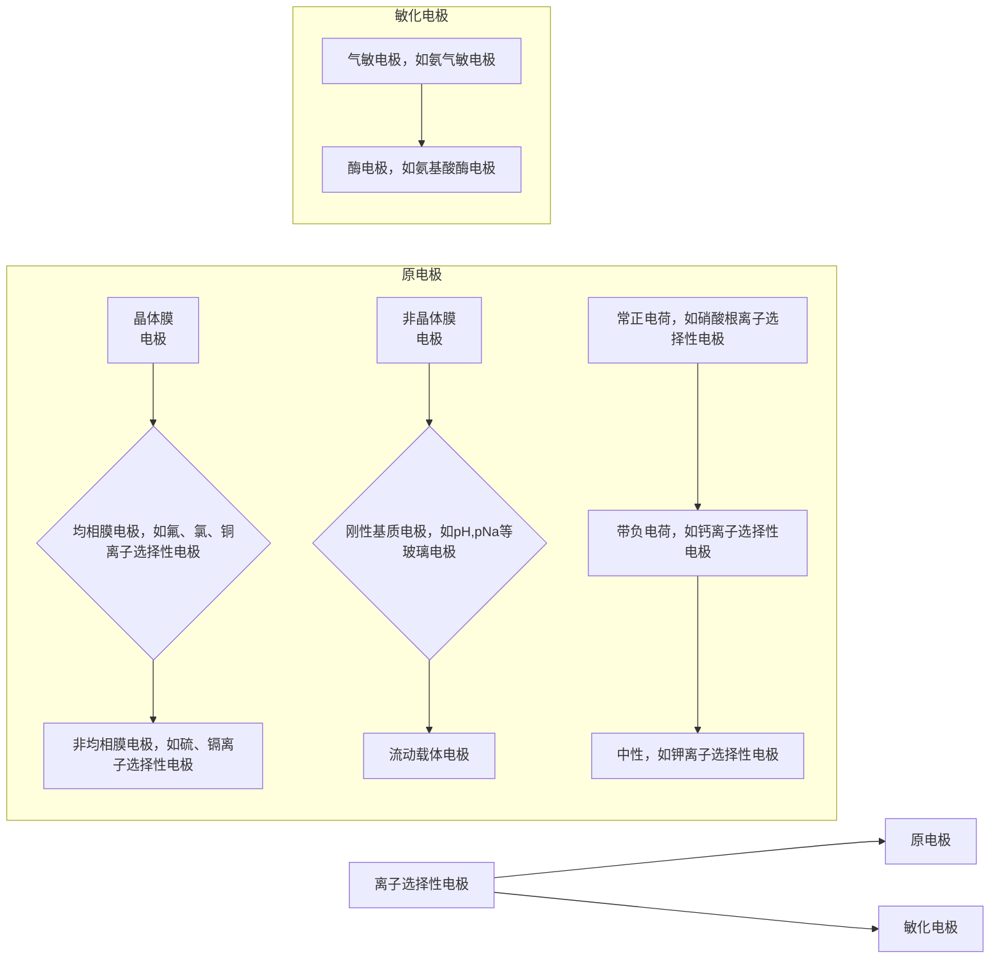

## 7.2.4.2 膜电位

## 1. 扩散电位

在两种不同离子或离子相同而活度不同的液-液界面或固体内部，由于离子扩散速率的不同造成的电位差，称为扩散电位。离子通过界面时，它没有强制性和选择性。离子选择性电极的膜相内部会产生扩散电位。

扩散电位可表示为

$$
E _ {\mathrm{d}} = \frac {R T}{F} \int_ {1} ^ {2} \sum \frac {t _ {i}}{n _ {i}} \mathrm{ln} a _ {i} \tag {7-2-21}
$$

式中， $n_{i}, t_{i}$  分别为离子的电荷数和迁移数。在最简单的情况下， $n_{+}=n_{-}=1, a_{+}=a_{-}=a$  时，方程可简化为

$$
E _ {\mathrm{d}} = \frac {R T}{F} (t _ {+} - t _ {-}) \ln \frac {a _ {i (2)}}{a _ {i (1)}} \tag {7-2-22}
$$

当正、负离子的迁移数相等时，扩散电位等于0。

## 2. Donnan 电位(道南电位)

当选择性渗透膜与溶液接触时,会有选择性地让某些离子通过,进而造成两相界面电荷分布的不均匀,产生电双层结构,形成电位差。这是一种具有强制性和选择性的扩散,这样形成的电位称为 Donnan 电位。在离子选择性电极中,膜与溶液两相界面上的电位具有 Donnan 电位的性质。Donnan 电位可表示为

$$
E _ {\mathrm{D}} = k \pm \frac {R T}{n F} \mathrm{ln} \frac {a _ {\mathrm{相1}}}{a _ {\mathrm{相2}}} \tag {7-2-23}
$$

通常所使用的离子选择性电极都有两个相界面，所以应包含有两个Donnan电位。

## 3. 膜电位

膜电位是膜内扩散电位和膜与电解质溶液形成的内外界面的 Donnan 电位的代数和。

$$
E _ {\mathrm{膜}} = E _ {\mathrm{D}} ^ {\mathrm{外}} + E _ {\mathrm{d}} + E _ {\mathrm{D}} ^ {\mathrm{内}} \tag {7-2-24}
$$

图7.2.6为离子选择性电极膜电位示意图。在一个电极膜中，可认为 $a_{\text{外}}^{\mathrm{m}}, a_{\text{内}}^{\mathrm{m}}, E_{\mathrm{d}}$

---

7.2 电位分析

349

保持恒定不变,其膜电位方程可表示为

$$
E _ {\text {膜}} = k ^ {\prime} \pm \frac {R T}{n F} \mathrm{ln} \frac {a _ {\text {外}} ^ {1}}{a _ {\text {内}} ^ {1}} \tag {7-2-25}
$$

当 $a_{内}^{1}$ 也被固定时，式(7-2-25)可重排为式(7-2-17)的形式。

## 7.2.4.3 常见离子选择性电极的响应机制

## 1. 玻璃膜电极

玻璃电极种类多样，有对 $\mathrm{H^{+},Li^{+},K^{+},Na^{+},Ag^{+}}$ 响应的玻璃电极。这些玻璃电极的结构都包含电极腔体（玻璃管）、内参比溶液、内参比电极和敏感玻璃膜，其中敏感玻璃膜为关键组成部分。玻璃电极分为单玻璃电极和复合电极两种，如(图7.2.7)所示，复合玻璃电极集指示电极和外参比电极于一体，使用起来更方便和牢靠。

$\mathrm{pH}$ 玻璃电极是最早出现的离子选择性电极，敏感玻璃膜是 $\mathrm{pH}$ 玻璃电极对 $\mathrm{H^{+}}$ 响应的关键。玻璃管内装一定 $\mathrm{pH}$ 的缓冲溶液（如 $\mathrm{pH} = 7$），内参比电极是 $\mathrm{Ag - AgCl}$ 电极，结构如图7.2.7所示。$\mathrm{pH}$ 玻璃电极的性质受敏感玻璃膜化学组成的影响很大。其玻璃由 $\mathrm{SiO_2}$，$\mathrm{Na_2O}$ 和 $\mathrm{CaO}$ 等组成。由纯 $\mathrm{SiO_2}$ 制成的石英玻璃的结构如副栏图示所示。它没有可供离子交换的电荷点（又称定域体），所以没有响应离子的功能。当加入金属氧化物后，使部分硅-氧键断裂，生成固定的带负电荷硅-氧骨架（称载体），在骨架的网络中是活动性强的平衡离子 $\mathbf{M}^{+}$。玻璃结构是一个无限的三维网络骨架，见图7.2.8。

水化敏感玻璃球膜分层模式如下:

（1）当玻璃电极与水溶液接触时， $M^{+}$ 与 $H^{+}$ 发生交换反应，在玻璃膜表面形成一层 $\equiv SiO^{-}H^{+}(G^{-}H^{+})$ ，它称为水化凝胶层。

$$
\mathrm{G} ^ {-} \mathrm{Na} ^ {+} + \mathrm{H} ^ {+} \rightleftharpoons \mathrm{G} ^ {-} \mathrm{H} ^ {+} + \mathrm{Na} ^ {+}
$$

该反应的平衡常数大，水化凝胶层表面的钠离子位点几乎都被 $\mathrm{H^{+}}$ 占据，所以 $\mathrm{H^{+}}$ 在水化凝胶层中的扩散速率较快。即水化层中的 $\mathrm{H^{+}}$ 可以与溶液中的 $\mathrm{H^{+}}$ 交换，这种 $\mathrm{H^{+}}$ 的交换，使玻璃膜的内外相界面上形成了双电层结构，产生两个Donnan电位。在内外两个水化凝胶层与干玻璃层之间又形成两个扩散电位。

在水化凝胶层中，由于  $H_{2}O$  的存在，使  $H^{+}$  大都以  $H_{3}O^{+}$  的形式存在。表面  $\equiv SiO^{-}H^{+}$  的解离平衡是决定 Donnan 电位的重要因素。

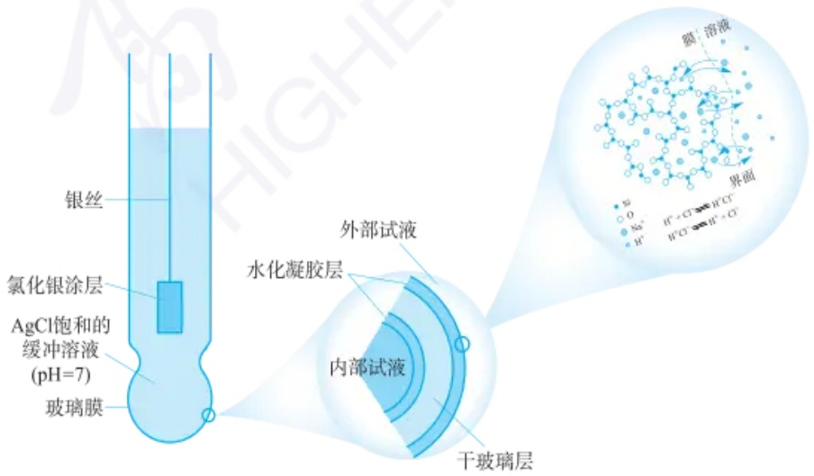

text_image

银丝
氯化银涂层
AgCl饱和的缓冲溶液
(pH=7)
玻璃膜
外部试液
水化凝胶层
内部试液
干玻璃层
膜'溶液
界面

图 7.2.8 水化敏感玻璃膜分层示意图

根据膜电位的公式推导过程总结膜电位方程的适用条件有哪些。

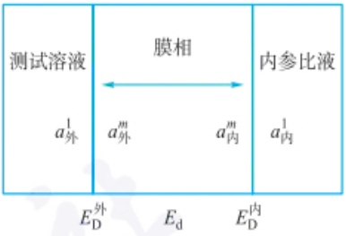

text_image

测试溶液
膜相
内参比液
a¹_外
aᵐ_外
aᵐ_内
a¹_内
E⁴_D
Eᵈ
E⁴_D

图 7.2.6 离子选择电极示意图

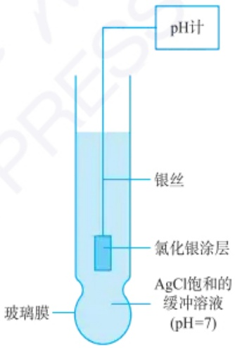

text_image

pH计
银丝
氯化银涂层
AgCl饱和的
缓冲溶液
(pH=7)
玻璃膜

(a) 单玻璃电极

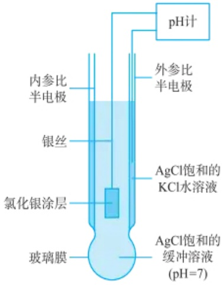

text_image

内参比
半电极
银丝
氯化银涂层
玻璃膜
pH计
外参比
半电极
AgCl饱和的
KCl水溶液
AgCl饱和的
缓冲溶液
(pH=7)

(b)复合玻璃电极

图 7.2.7 pH 玻璃电极示意图

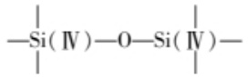

---

350

第七章 电化学分析

## 拓展

玻璃膜电极的历史可以追溯到20世纪初，它最初由Fritz Haber和Zygmunt Klemensiewicz在1909年发明，用于测量溶液的pH。这一发明标志着电化学分析中的重大突破，首次实现了酸碱度的精确测定。随着时间的推移，玻璃膜电极经历了多次改进，尤其是在玻璃成分和膜结构方面的优化，使其在化学分析、环境监测和生物医学领域得到了广泛应用。玻璃膜电极的高选择性、稳定性和重复性，使其至今仍是pH测定的标准工具。

## 思考:

当内部试液的浓度不可看作固定值时,外部试液浓度的测定会受到影响吗,为什么?

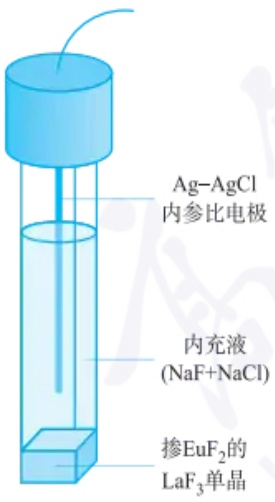

text_image

Ag-AgCl
内参比电极
内充液
(NaF+NaCl)
掺EuF₂的
LaF₃单晶

图 7.2.10 氟离子单晶膜电极示意图

$$
\equiv \mathrm{SiO} ^ {-} \mathrm{H} ^ {+} + \mathrm{H} _ {2} \mathrm{O} \rightleftharpoons \equiv \mathrm{SiO} ^ {-} + \mathrm{H} _ {3} \mathrm{O} ^ {+}
$$

（2）水化凝胶层和干玻璃层之间为过渡层，$\mathrm{G}^{-}\mathrm{Na}^{+}$只部分转化为 $\mathrm{G}^{-}\mathrm{H}^{+}$。由于 $\mathrm{H}^{+}$在未水化的玻璃中的扩散系数小，故其电导率比干玻璃层高1000倍左右。

(3) 干玻璃层中的电荷传导主要由  $Na^{+}$  承担。

$\mathrm{H}_3\mathrm{O}^+$ 在溶液与水化凝胶层表面界面上进行扩散，从而在内、外两相界面上形成双电层结构，产生两个相间电位。在内外两水化凝胶层与干玻璃之间形成两个扩散电位。若玻璃膜两侧的水化凝胶层性质完全相同，则其内部形成的两个扩散电位大小相等、符号相反、互相抵消。如果不相等，就称为不对称电位，其大小与玻璃膜的形状和工艺质量有关。水化敏感玻璃膜电荷传导示意如图7.2.9所示。

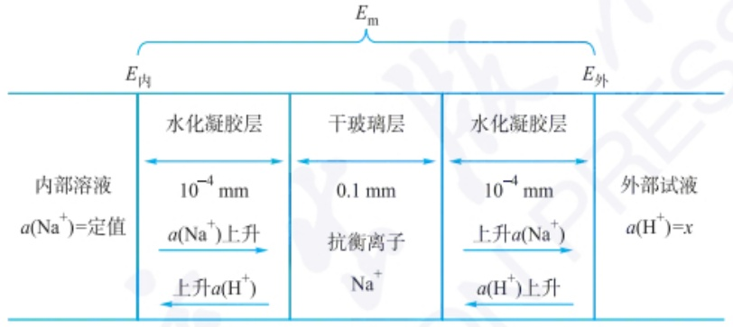

flowchart

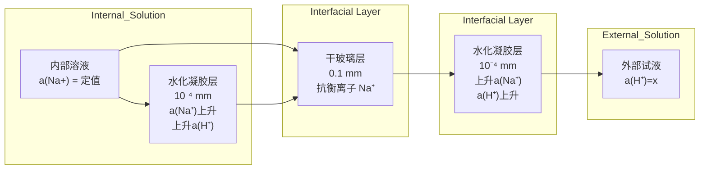

图 7.2.9 水化敏感玻璃膜电荷传导示意图

膜电位与溶液 pH 的关系

$$
E _ {\mathrm{m}} = E _ {\text {外}} - E _ {\text {内}} \tag {7-2-26}
$$

因为内部溶液组成一定,所以  $E_{内}$  的值为定值, $E_{外}$  由  $\equiv SiO^{-}H^{+}$  的解离平衡决定,它受外部试液中  $a(\mathrm{H}^{+})$  的影响。故在 25 ℃ 时 pH 玻璃电极电位可表示为

$$
E _ {\mathrm{m}} = \text {常数} - (0. 0 5 9 2 \mathrm{V}) \mathrm{pH} \tag {7-2-27}
$$

## 2. 晶体膜电极

晶体膜电极分为均相、非均相晶膜电极。均相晶膜由一种化合物的单晶或几种化合物混合均匀的多晶压片而成。非均相晶模由多晶中掺惰性物质经热压制成。

（1）氟离子单晶膜电极 氟电极的敏感膜为  $LaF_{3}$  的单晶薄片，其中掺杂有  $Eu^{2+}$  和  $Ca^{2+}$  等二价离子。二价离子的引入令氟化镧晶格缺陷增多，膜的导电性得到增强。这种敏感膜的电阻一般小于  $2 M\Omega$ 。氟离子单晶膜电极结构如图 7.2.10 所示。

该电极的工作原理是，溶液中的 $\mathrm{F}^{-}$ 能扩散进入膜相的缺陷空穴，膜相中的 $\mathrm{F}^{-}$ 也能进入溶液中，故能在两相界面上形成双电层结构，进而产生膜电位。这类敏感膜具有选择性，是因为缺陷空穴的大小、形状和电荷分布，只能容纳特定的可移动的晶格离子，把其他离子排斥在空穴之外。

氟离子选择性电极的电位可表示为

$$
E _ {\mathrm{ISE}} = k - (0. 0 5 9 2 \mathrm{V}) \lg a _ {\mathrm{F} ^ {-}} \tag {7-2-28}
$$

式中，k 为常数，与内参比电极、内参比溶液和膜的性质有关

测量时组成如下电极:

$\mathrm{Ag}\mid \mathrm{AgCl},\mathrm{Cl}^{-}(a_{\mathrm{Cl}^{-}}),\mathrm{F}^{-}(a_{\mathrm{F}^{-}})$ 试液 $(a_{\mathrm{F}^{-}} = x)\parallel \mathrm{Cl}^{-}(a_{\mathrm{Cl}^{-}}$ 饱和）， $\mathrm{Hg_2Cl_2}\mid \mathrm{Hg}$ $298~\mathrm{K}$ 时的电池电动势可表示为

---

7.2 电位分析

351

$$
E _ {\mathrm{ISE}} = E _ {\text {甘汞}} - E _ {\mathrm{ISE}} = b + (0. 0 5 9 2 \mathrm{V}) \lg a _ {\mathrm{F} ^ {-}} \tag {7-2-29}
$$

氟电极对 $\mathrm{F}^{-}$ 的线性响应范围可达 $5\times 10^{-7}\sim 1\times 10^{-1}\mathrm{mol}\cdot \mathrm{L}^{-1}$，电极的选择性很高，主要的干扰是 $\mathrm{OH}^{-}$，这是由于在晶体膜表面存在下列化学反应:

$$
\mathrm{LaF} _ {3} (\mathrm{s}) + 3 \mathrm{OH} ^ {-} \rightleftharpoons \mathrm{La(OH)} _ {3} (\mathrm{s}) + 3 \mathrm{F} ^ {-} \tag {7-2-30}
$$

所释放出来的 $\mathrm{F}^{-}$ 将增高试液中 $\mathrm{F}^{-}$ 的含量使电极响应的表现 $\mathrm{F}^{-}$ 浓度增大，也可以认为 $\mathrm{OH}^{-}$ 与 $\mathrm{F}^{-}$ 有近乎相似的离子半径，因此 $\mathrm{OH}^{-}$ 可以占据晶格中 $\mathrm{F}^{-}$ 所处的位置，与 $\mathrm{F}^{-}$ 一样参与导电过程。

pH 范围为 5\~6 时, 这种电极对  $F^{-}$  有良好的选择性。如果 pH 过低, 则会形成 HF 或  $HF_{2}^{-}$ , 而使游离  $F^{-}$  浓度降低; pH 过高, 则会产生  $OH^{-}$  的干扰。在实际工作中, 通常采用醋酸-醋酸钠缓冲溶液来控制溶液的酸度。同时加入 NaCl 和柠檬酸钠, 前者用于控制溶液的离子强度, 后者能与铁、铝等离子形成配合物, 借此消除它们因与  $F^{-}$  发生配合反应而产生的干扰。

（2）硫离子选择性电极 敏感膜由  $Ag_{2}S$  粉末压片制成。硫化银的电阻较低，膜内的  $Ag^{+}$ 迁移传递电荷。硫离子选择性电极的电位可以表示为

$$
E _ {\mathrm{ISE}} = k - \frac {0 . 0 5 9 2 \mathrm{V}}{2} \mathrm{lg} a _ {\mathrm{s} ^ {2 -}} \tag {7-2-31}
$$

（3）氯、溴、碘离子选择性电极 它们的膜分别由  $Ag_{2}S-AgCl, Ag_{2}S-AgBr$  和  $Ag_{2}S-AgI$  粉末混合压片制成。膜内  $Ag^{+}$ 迁移传递电荷，卤素离子选择性电极的电位可表示为

$$
E _ {\mathrm{ISE}} = k - (0. 0 5 9 2 \mathrm{V}) \lg a _ {\mathrm{X} ^ {-}} \tag {7-2-32}
$$

（4）铜、铅、镉离子选择电极 它们的敏感膜分别由  $Ag_{2}S-CuS, Ag_{2}S-PbS$  和  $Ag_{2}S-CdS$  粉末混合压片制成，膜内  $Ag^{+}$ 迁移传递电荷。电极电位为

$$
E _ {\mathrm{ISE}} = k + \frac {0 . 0 5 9 2 \mathrm{V}}{2} \mathrm{lg} a _ {\mathrm{M} ^ {2}}, \tag {7-2-33}
$$

$\mathrm{Ag_2S}$ 和 $\mathrm{AgX(X = Cl^-,Br^-,I^-)}$ 及 $\mathrm{Ag_2S}$ 和 $\mathrm{MS(M^{2 + } = Cu^{2 + },Pb^{2 + },Cd^{2 + })}$ 制成的离子选择性电极，它们的检测下限与各自的溶度积 $K_{\mathrm{sp}}$ 有关。

## 3. 流动载体膜电极(液膜电极)

流动载体膜电极见图 7.2.11, 亦称为液膜电极, 其中可以与被测离子发生作用的活性物质(即载体)可在膜相中流动。根据载体是否带有电荷, 可被分为带

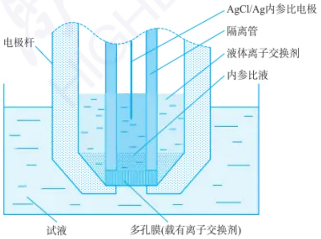

text_image

电极杆
AgCl/Ag内参比电极
隔离管
液体离子交换剂
内参比液
试液
多孔膜(载有离子交换剂)

图 7.2.11 流动载体膜电极的结构

## 局限与挑战

晶体膜电极尽管具有良好的离子选择性和稳定性，但在实际应用中也面临一些局限性与挑战。首先，晶体膜的脆性使其在某些复杂或恶劣环境下容易损坏，影响其使用寿命。其次，晶体膜电极的响应时间通常较慢，尤其是在较低浓度离子检测时，可能导致测量延迟。此外，这类电极对环境条件（如温度、pH等）较为敏感，导致在不同条件下的稳定性较差。最后，晶体膜材料的制备成本较高，限制了其在大规模应用中的普及。因此，如何提升晶体膜电极的耐用性、灵敏度及降低成本，仍是当前研究中的重要挑战。

## 液膜电极材料的选择

液膜电极的材料选择对其性能至关重要，特别是在选择性、稳定性和灵敏度方面。液膜通常由增塑剂、离子载体和膜溶剂组成。载体分子通过选择性离子交换决定电极对特定离子的响应，而增塑剂则调节膜的流动性和机械强度，使膜保持适当的物理特性。常用的载体分子包括用于钾、钠、钙等离子的冠醚、磷脂等专门设计的离子载体。选择合适的溶剂和增塑剂能够进一步提高电极的响应速度和离子选择性，确保液膜在复杂环境中具备良好的电化学性能。

---

352

第七章 电化学分析

## 气敏电极

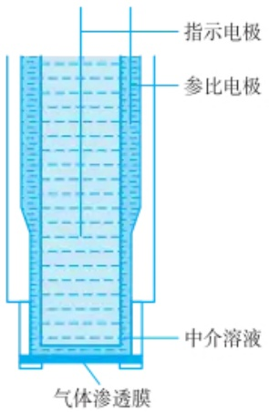

text_image

指示电极
参比电极
中介溶液
气体渗透膜

气敏电极（gas-sensing electrode）可以用于检测特定气体的浓度。气敏电极通常用离子选择性电极作为指示电极与参比电极组成，待测气体可通过气体渗透膜进入电极内的电解质溶液，与溶液中的组分发生化学反应，使电极电位发生变化，根据Nemst方程，可求算出待测气体的浓度。

气敏电极有较高的选择性和灵敏度,但其对温度变化敏感,响应速率较慢。

常用的气体透气膜材料有聚氯乙烯、聚苯乙烯和聚丙烯等。

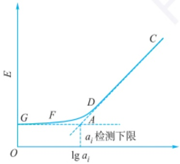

line

| Point | lg ai | E |
| --- | --- | --- |
| G | 0 | ~0.1 |
| F | ~0.2 | ~0.15 |
| D | ~0.6 | ~0.3 |
| A | Ai | Ai |

图 7.2.12 校准曲线

电荷的流动载体电极和中性载体电极。敏感膜将内充液与外部试液隔开，膜中的载体可以与被测离子结合，并在膜中迁移，此时被测离子和被排斥在膜外带相反电荷的离子在界面上形成膜电位。电极的选择性与响应离子和载体的结合常数有关，响应离子的结合常数越大，电极的选择性越好。电极的检测下限由离子在有机相和水相中的分配系数决定，分配系数越大，检测下限越低。或者说，检测下限取决于载体与离子的结合常数，即结合常数越大，检测下限越低。

流动载体膜电极还有聚氯乙烯(PVC)膜电极形式,不同于一般的流动载体电极,它有类似于固态的“固化”膜,是用载体、有机溶剂、PVC粉、增塑剂以一定比例混合,溶于四氢呋喃中,铺在玻璃板上,挥发掉四氢呋喃制成的。这种薄膜的稳定性和寿命较一般流动载体膜有很大提升。典型的例子如下。

（1）硝酸根离子电极 该电极的电活性物质是带正电荷的季铵盐，将它转换成  $NO_{3}^{-}$ 型，然后溶于邻硝基苯十二烷醚中，将此溶液与含 5% PVC 的四氢呋喃溶液混合 (1:5) 后，在平板玻璃上挥发制成透明膜，能够提供良好的电化学特性和长期稳定性。

$$
E _ {\mathrm{ISE}} = k - (0. 0 5 9 2 \mathrm{V}) \lg a _ {\mathrm{NO} _ {3} ^ {-}} \tag {7-2-34}
$$

（2）钙离子电极 它的电活性物质是带负电荷的二癸基磷酸，将它转化成$\mathrm{Ca^{2+}}$ 型，用苯基膦酸二正辛酯作溶剂，可制成带微孔敏感膜的液膜电极。

$$
E _ {\mathrm{ISE}} = k + \frac {0 . 0 5 9 2 \mathrm{V}}{2} \mathrm{lg} a _ {\mathrm{Ca} ^ {2 +}}. \tag {7-2-35}
$$

（3）中性载体电极 中性载体电极使用的膜可以和特定离子形成络合物，这些络合物能够溶于有机溶剂，在电极膜中自由移动而导电。一个典型的例子是钾离子选择性电极，使用缬氨霉素作为中性载体，缬氨霉素能与 $K^{+}$ 形成络合物，且对 $K^{+}$ 的选择性很高，该络合物在电极膜中的有机相内移动，从而产生膜电位。

## 4. 生物电极

生物电极(bioelectrode)是一种结合生物化学与电化学分析原理研制而成的新型电极。于1962年，由Clark L C提出，之后生物电极不断发展，电极类型增多。这种电极一般对生物分子和有机物的检测具有高选择性和特异性。

（1）酶电极 指示电极的敏感膜上涂抹生物酶，酶与待测物质反应产生能在该电极上响应的离子或其他物质，通过测量该物质的浓度间接测定待测物质的浓度。例如，葡萄糖氧化酶能催化葡萄糖的氧化反应:

$$
\mathrm{C} _ {6} \mathrm{H} _ {1 2} \mathrm{O} _ {6} + \mathrm{O} _ {2} + \mathrm{H} _ {2} \mathrm{O} \xrightarrow {\mathrm{GOD}} \mathrm{C} _ {6} \mathrm{H} _ {1 2} \mathrm{O} _ {7} + \mathrm{H} _ {2} \mathrm{O} _ {2}
$$

此时,可以采用氧电极检测试液中氧含量的变化来间接测定葡萄糖的含量。

（2）组织电极 利用动、植物组织内存在的某种酶，可以制成组织电极。例如，将香蕉与碳糊混合制成的组织电极，可以用于测定多巴胺的含量。基于酶的高度特异性，酶电极有较高的选择性。

## 7.2.4.4 离子选择性电极的性能参数

## 1. Nernst 响应斜率、线性范围和检测下限

离子选择性电极的电位随待测离子的活度变化的特征称为响应。若这种响应变化服从于Nernst方程，则称其为Nernst响应。以离子选择性电极的电位或电池的电动势对响应离子活度的对数作图，所得曲线称为校准曲线(图7.2.12)。当活度很低时，无法维持热力学平衡状态，被测离子的活度开始偏离Nernst方程，表现为图像逐渐弯曲。此校准曲线的直线部分(CD)所对应的离子活度范围称为离

---

7.2 电位分析

353

子选择性电极响应的线性范围。该直线的斜率 S 为电极的实际响应斜率，理论斜率 (298 K) 为  $\frac{59.2}{Z_{A}}$  (mV/Pa)，直线的斜率 S 也称级差。IUPAC 规定 CD 和 GF 延长线的交点 A 所对应的活度  $a_{i}$  称为检测下限。

## 2. 选择性系数

实际上,任何敏感膜不可能只响应某种特定离子,它对溶液中的其他离子也有可能存在不同程度的响应,因此,膜电极的响应应该考虑相对的选择性。选择性系数可以表示共存离子对电位(或电动势)的贡献。

当有共存离子时,膜电位与响应离子  $A^{2+}$  及共存离子  $B^{2+}$  的活度之间的关系,可以用 Nicolsky(尼柯尔斯)方程表示:

$$
E = \mathrm{常数} + \frac {R T}{n F} \mathrm{ln} (a _ {\mathrm{A}} + K _ {\mathrm{A,B}} ^ {\mathrm{pot}} a _ {\mathrm{B}} ^ {z _ {\mathrm{A}} / z _ {\mathrm{B}}}) \tag {7-2-36}
$$

式中， $K_{A,B}^{pot}$  即为电位选择性系数；a 为离子的浓度；z 为离子的电荷数；下标 A 为主响应离子，B 为干扰离子。由式(7-2-36)可推出，当有多种干扰离子  $B^{z+}, C^{z+}, \cdots$  存在时，电动势(或电位)为

$$
E = \mathrm{常数} + \frac {R T}{n F} \mathrm{ln} (  a _ {\mathrm{A}} + K _ {\mathrm{A,B}} ^ {\mathrm{pot}} a _ {\mathrm{B}} ^ {z _ {\mathrm{A}} / z _ {\mathrm{B}}} + K _ {\mathrm{A,C}} ^ {\mathrm{pot}} a _ {\mathrm{C}} ^ {z _ {\mathrm{A}} / z _ {\mathrm{C}}} + \dots  ) \tag {7-2-37}
$$

显然，选择性系数越小，电极对  $A^{z+}$  的选择性就越高。如果  $K_{A,B}^{pot}a_{B}^{z_{A}/z_{B}}$  为  $10^{-2}$ ，则表示电极对  $A^{z+}$  的敏感性为  $B^{z+}$  的 100 倍。或者，在相同的测定条件下， $A^{z+}$  和  $B^{z+}$  产生相同电位时  $A^{z+}$  的活度是  $B^{z+}$  活度的 1/100。由干扰离子引起的误差计算公式为

$$
\mathrm{误差} = (K_{\mathrm{A,B}}^{\mathrm{pot}}a_{\mathrm{B}}^{z_{\mathrm{A}} / z_{\mathrm{B}}} / a_{\mathrm{A}})\times 100\% \tag{7 - 2 - 38}
$$

选择性系数会受到被测离子活度及溶液条件的影响，并不是一个严格的热力学常数。可以从手册中查找电位选择性系数的数值，也可以通过试验测定。

## 3. 响应时间

（1）概念 IUPAC 将响应时间定义为静态响应时间: 从离子选择性电极和参比电极一起与试液接触时算起, 直至电池电动势达到稳定值 (变化在 1 mV 以内) 时为止, 在此期间所经过的时间, 称为实际响应时间。

## (2) 影响因素

① 膜的结构性质:一般晶体膜的响应时间较短,而流动载体膜的响应则涉及表面的化学反应过程而达到平衡较慢;② 响应离子的扩散速率;③ 响应离子的浓度;④ 共存离子的种类;⑤ 温度。

## 4. 内阻

离子选择性电极的实际内阻包括膜内阻、内充液和参比电极的内阻，其中主要考虑膜内阻，它与敏感膜的类型、厚度等因素有关。不同类型的离子选择性电极的内阻不同，晶体膜的内阻较低，玻璃膜的内阻较高。

## 5. 稳定性

在同一溶液中，离子选择性电极的电位值随时间向一个方向的变化，称为漂移。用 $8\mathrm{h}$ 或 $24\mathrm{h}$ 内漂移的电位值 $(\mathrm{mV})$ 来表示电极的稳定性。液膜电极的漂移较大。膜的稳定性、电极的结构和绝缘性都会影响漂移值的大小。

## 7.2.4.5 全固态电极

由离子选择性膜、内参比溶液和内参比电极及惰性腔体组成的电极，为液接离子选择性电极，如上述提到过的 $\mathrm{pH}$ 玻璃电极。液接离子选择性电极的发展相对成熟且应用广泛。但是由于包含内参比电极，内参比液的渗漏问题令液接离子

在校正曲线的直线部分 $(a_{\mathrm{A}}>a_{\mathrm{B}}$ ，不考虑B离子的干扰)的响应方程为 $E_{1}=k^{A}+S\lg a_{A}$ ；在水平线部分 $(a_{A}<a_{B}$ ，电位值完全由干扰离子决定)则 $E_{2}=k^{B}+S'\lg K_{A,B}^{\mathrm{pot}}a_{B}$ ，假定 $k^{A}=k^{B};S=S'$ 在两直线交点的M处， $E_{1}=E_{2}$ ，假定 $A^{z+}$ ， $B^{z+}$ 都为一价离子，由上两式则得 $K_{A,B}^{\mathrm{pot}}=\frac{a_{A}}{a_{B}}$ ；式中 $a_{A}$ 为交点M处对应的活度。对不同价态的离子， $K_{A,B}^{\mathrm{pot}}$ 的通式为 $K_{A,B}^{\mathrm{pot}}=\frac{a_{A}}{a^{z_{A}/z_{B}}}$

## 选择性系数的测量方法

① 分别溶液法: 分别配制活度相等的主响应离子  $A^{z+}$  和干扰离子  $B^{z+}$  的标准溶液, 然后用  $A^{z+}$  的离子选择性电极分别测量电位值, 两式做差。
② 混合溶液法——固定干扰法:先配制一系列含固定活度的干扰离子  $B^{z*}$  和不同活度的主响应离子  $A^{z*}$  的标准混合溶液，再分别测定其电位值，然后将电位值对  $pa_{A}$  作图:

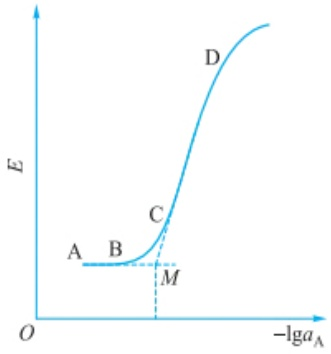

line

| Point | -lgaA | E |
| --- | --- | --- |
| A | ~0.2 | ~0.1 |
| B | ~0.3 | ~0.1 |
| C | ~0.4 | ~0.2 |
| M | ~0.5 | ~0.1 |

固定干扰法图示

③ 混合溶液法——固定主响应离子法:配制一系列含固定活度的主响离子  $A^{z+}$  和不同活度的干扰离子  $B^{z+}$  的标准混合溶液，再分别测定电位值。然后将电位值 E 对  $\lg a_{B}$  作图，从图中求得  $a_{B}$ ，可算出  $K_{A,B}^{pot}$ 。这种方法可确定离子选择性电极适合的 pH 范围。

---

354

第七章 电化学分析

## 拓展阅读

全固态电极的微型化和可穿戴应用是当前传感器技术的前沿发展方向。由于其固态结构的高稳定性和耐用性，全固态电极非常适合集成到微型化的设备中，如便携式传感器、微流控系统和可穿戴健康监测设备中。这种电极能够实时、连续监测生理参数（如电解质浓度、pH等），在医疗诊断、运动健康监测和环境监测领域具有广泛应用。微电子技术、纳米材料和柔性电子的进步，使得全固态电极能够与智能设备结合，提供更灵敏、稳定的实时监测解决方案，并推动个性化医疗和便携式传感技术的发展。

铂丝电极

水凝胶和多孔材料示意图

## 拓展阅读

标准加入法和校准曲线法是两种常见的定量分析方法，适用于不同的实验条件和样品类型。校准曲线法通过测定一系列已知浓度标准溶液的响应信号来建立浓度与信号的关系，适合于样品基质较为单一、干扰较少的情况。然而，标准加入法则更适合于复杂基质的样品，它通过向样品中直接添加已知浓度的标准物质，并利用响应信号的变化来消除基质效应的影响。因此，标准加入法在处理复杂样品（如血液、环境样品）中具有更高的准确性，而校准曲线法则更为简便，适合常规分析。

选择性电极在痕量分析方面的准确性不高。同时由于内参比液的存在，电极微型化及储存方面也面临很多困难。基于这些弊端，研究人员将液接部分转变为固态，即全固态离子选择性电极。

1971年Cattrall等人提出全固态离子选择性电极的概念，将传统液接离子选择性电极的内参比溶液和内参比电极换成一根铂丝，也被称为覆丝电极。使用铂丝就不存在内参比液渗漏的问题了，但是覆丝电极的小面积和小电容，使得它的离子电子转换效率低，稳定性较差。除了内参比液的渗漏问题，电极电位的稳定性还受到导电基底和离子选择性膜之间的水层的影响。综合上述问题，研究人员提出一种固态转接层策略，使用一种能传导离子和电子、大电容且疏水的材料制备固态转接层，连接导电基底和离子选择性膜。固态转接层巧妙地化解了上述液接型离子选择性电极遇到的问题，是全固态离子选择性电极的关键组成部分，影响着固态离子选择性电极的稳定性、重现性和检测限等。

固态转接层的材料需要满足以下条件:①离子信号传导和电子信号传导在其中的转化可逆;②疏水性良好;③具有优良的化学稳定性;④具有较大的比电容,能够提供一个理想的不可极化界面,具有高自交换电流密度。常见的固态转接层材料有水凝胶、氧化还原聚合物、自组装单层膜和多孔碳材料等。

与传统的液接离子选择性电极相比,全固态离子选择性电极具有受压强、温度等外界环境的影响较小、使用寿命更长、检测限更低、贮存和维护更简单等优点,它的出现为离子选择性电极的研究和发展提供了新的发展契机。

## 7.2.5 定量分析方法

## 7.2.5.1 校准曲线法

校准曲线法是一种常用于定量分析的方法,通过构建一条关于测量信号(如电位)与样品浓度之间关系的曲线,来确定未知样品的浓度。校准曲线法适用于成批量样品的分析。

测量时需要在标准系列溶液和试液中加入总离子强度调节缓冲液(TISAB)或离子强度调节液(ISA)。它们的作用主要有:①保持试液与标准溶液有相同的总离子强度及活度系数;②缓冲溶液可以控制溶液的pH,保持溶液在离子选择性电极合适的pH范围内;③含有配合剂,可以掩蔽干扰离子或使被测离子释放成为可检测的游离离子。

测量时,先配制一系列含被测组分的标准溶液,并用TISAB保持溶液的离子强度相对稳定,分别测出电位值E,再作E-lgc或E-pM图。待测溶液用TISAB调节,用同一套测量装置测定电位值,从校准曲线上查出对数浓度,计算待测溶液浓度。

## 7.2.5.2 标准加入法

标准加入法又称为添加法或增量法，由于加入前后试液的组成、活度系数、pH、干扰离子、温度等基本不变，有利于控制变量，适用于待测溶液成分比较复杂的情况。

## 1. 一次标准加入法

向被测溶液中只加一次标准溶液。先测定体积为 $V_{x}$ 、浓度为 $c_{x}$ 的样品溶液的电位值 $E_{x}$ ；然后再向此已测过的样品溶液中加入体积为 $V_{s}$，浓度为 $c_{s}$ 的被测离子的标准溶液，测得电位值 $E_{1}$ 。假设待测离子为一价阳离子且离子强度一定，按响应方程关系，$E_{1}$ 与 $E_{x}$ 的差可表示为

$$
E _ {x} = K + S \lg c _ {x} \tag {7-2-39}
$$

---

7.2 电位分析

355

$$
E _ {1} = K + S \lg \frac {c _ {\mathrm{s}} V _ {\mathrm{s}} + c _ {x} V _ {x}}{V _ {\mathrm{s}} + V _ {x}} \tag {7-2-40}
$$

$$
\Delta E = E _ {1} - E _ {\mathrm{x}} = \mathrm{Slg} \frac {V _ {\mathrm{x}} c _ {\mathrm{x}} + V _ {\mathrm{s}} c _ {\mathrm{s}}}{c _ {\mathrm{x}} (V _ {\mathrm{x}} + V _ {\mathrm{s}})} \tag {7-2-41}
$$

式子两边同时取反对数:

$$
1 0 ^ {\Delta E / S} = \frac {V _ {x} c _ {x} + V _ {s} c _ {s}}{c _ {x} (V _ {x} + V _ {s})} \tag {7-2-42}
$$

整理上式,得

$$
c _ {x} = \frac {V _ {\mathrm{s}} c _ {\mathrm{s}}}{(V _ {x} + V _ {\mathrm{s}}) 1 0 ^ {\Delta E / S} - V _ {x}} \tag {7-2-43}
$$

若 $V_{x} \gg V_{s}$, 则有

$$
c _ {x} = \frac {V _ {\mathrm{s}} c _ {\mathrm{s}}}{V _ {x} (1 0 ^ {\Delta E / S} - 1)} = \Delta c (1 0 ^ {\Delta E / S} - 1) ^ {- 1} \tag {7-2-44}
$$

式中， $\Delta c=\frac{V_{s}c_{s}}{V_{x}}$ 。该式为一次标准加入法公式。

样品加入法与标准加入法本质相同,仅是向一定体积已知浓度的标准溶液中加入一次一定体积的样品溶液,可推得公式如下:

$$
c _ {x} = c _ {\mathrm{s}} \frac {V _ {\mathrm{s}} + V _ {x}}{V _ {x}} \left(1 0 ^ {\Delta E / S} - \frac {V _ {\mathrm{s}}}{V _ {x} + V _ {\mathrm{s}}}\right) \tag {7-2-45}
$$

式中，S 为电极的实际响应斜率。S 的求解方法:① 可从标准曲线的斜率求出；② 使用最小二乘法算出；③ 稀释法:用空白溶液稀释已测得  $E_{x}$  的样品恰好一倍，然后测出  $E_{稀}$ ，则  $S=\frac{\left|E_{稀}-E_{x}\right|}{\lg2}=\frac{\left|\Delta E\right|}{0.30}$ 。

## 2. 连续标准加入法

在测量过程中连续多次向一杯测量溶液中加入标准溶液,根据一系列的 E 值对相应的  $V_{s}$  值作图来求得结果。该法的准确度较一次标准加入法高。

基本原理: 将式(7-2-40)重排, 得到

$$
(V _ {x} + V _ {s}) 1 0 ^ {\frac {\Delta E}{S}} = (c _ {s} V _ {s} + c _ {x} V _ {x}) 1 0 ^ {\frac {\Delta E}{S}} \tag {7-2-46}
$$

以 E 对  $V_{s}$  作图, 当  $(V_{x} + V_{s}) 10^{\Delta E/S} = 0$  时, 即直线与横坐标相交处, 可得到  $c_{s} V_{s} + c_{x} V_{x} = 0$ , 所以求得被测物质含量为

$$
c _ {x} = - \frac {c _ {\mathrm{s}} V _ {\mathrm{s}}}{V _ {x}} \tag {7-2-47}
$$

## 7.2.5.3 直接电位法

在 pH 计或离子计上直接读出试液的 pH(pM) 值:

pH 玻璃电极 | 试液 ( $a_{H^{+}} = x$ ) || 饱和甘汞电极

电池电动势:

$$
E = E _ {\text {甘汞}} - E _ {\mathrm{H}}
$$

$E_{甘汞}$ 是定值,结合式(7.2.27)得

$$
E = b + (0. 0 5 9 2 \mathrm{V}) \mathrm{pH}
$$

在实际测定未知溶液的 pH 时, 需先用 pH 标准缓冲溶液定位校准, 其电动势为

$$
E _ {\mathrm{s}} = b + (0. 0 5 9 2 \mathrm{V}) \mathrm{pH} _ {\mathrm{s}}
$$

## 拓展阅读

电位测定技术正朝着自动化、智能化和高精度方向发展。现代仪器集成了自动校准、温度补偿和液接界电位校正技术，大幅提升了测量的准确性和操作便捷性。高通量分析仪器的普及满足了环境监测、制药和工业中的快速检测需求，而便携化设备也为现场实时监测提供了便利。随着数据处理技术和人工智能的应用，未来电位测定将更加智能化，自动识别和处理数据异常，进一步提升分析效率和精度。

---

356

第七章 电化学分析

## 终点确定

电位滴定法的终点确定是通过监测滴定过程中电极电位的变化来实现的。当滴定接近终点时，溶液中反应物浓度迅速变化，导致电位出现明显突跃，通常通过电位-体积滴定曲线的拐点来确定终点。为了提高准确性，常使用一阶或二阶导数法来分析电位变化率，从而更加精确地定位滴定终点。该方法尤其适用于没有颜色变化、浑浊或有色溶液的滴定，是许多复杂反应体系中常用的终点判定手段。

再测定未知溶液的 pH, 其电动势

$$
E _ {x} = b + (0. 0 5 9 2 \mathrm{V}) \mathrm{pH} _ {x}
$$

合并以上两式得

$$
\mathrm{pH} _ {x} = \mathrm{pH} _ {\mathrm{s}} + \frac {E _ {x} - E _ {\mathrm{s}}}{0 . 0 5 9 2 \mathrm{V}} \tag {7-2-48}
$$

但在实际测试中，$\mathrm{pH}$ 大于10的强碱溶液或所含钠离子浓度较高的溶液和强酸溶液的 $\mathrm{pH}$ 是测不准的。对于前者，因为 $\mathrm{Na}^{+}$ 和 $\mathrm{H}^{+}$ 都参与了水化凝胶层与溶液界面的离子交换过程，此时电极电位对应的是 $\mathrm{Na}^{+}$ 浓度和 $\mathrm{H}^{+}$ 浓度的总和，故测量值 $\mathrm{H}^{+}$ 的浓度偏大，表现为 $\mathrm{pH}$ 测量值比实际值偏小，这种现象被称为碱差。对于后者，是因为在强酸溶液中，$\mathrm{H}^{+}$ 活度受到限制，以 $\mathrm{H}_3\mathrm{O}^+$ 形式传递，故 $\mathrm{H}^{+}$ 响应浓度偏小，表现为 $\mathrm{pH}$ 测量值比实际值偏大，这种现象被称为酸差。

## 7.2.6 电位滴定及相关电位分析仪器

## 7.2.6.1 电位滴定法

电位滴定法与电位法一样，以指示电极、参比电极及试液组成测量电池。所不同的是，电位法通过 Nernst 方程来确定被测物质的量，电位滴定法通过物质相互反应量的关系计算得出被测物质的量。

电位滴定法的电位变化代替了经典滴定法中对指示剂的依赖。这使得化学计量点的测定更加准确，且适用于有色和混浊溶液的分析。电位滴定终点的确定只需要注意电位值的变化，主要有作图法和微商计算法。

## 1. 作图法

滴定终点的突变可以在曲线中表现出来,如在 E-V 曲线(V 是 E 对应的加入的滴定剂体积)中,终点附近曲线的斜率较大,一般取曲线突跃范围的中点为化学计量点。当这种突变不够明显,即突跃范围过小不利于计算时,可以通过做一级微分滴定,取  $\frac{\Delta E}{\Delta V}-V$  曲线(注意:此处的 V 是 E-V 曲线中  $\Delta E$  相对应的始末两体积的平均值)的极大值为滴定终点。也可以作二级微分滴定,取  $\frac{\Delta^{2}E}{\Delta V^{2}}-V$  曲线(注意:此处的 V 是  $\frac{\Delta E}{\Delta V}-V$  曲线中  $\Delta\frac{\Delta E}{\Delta V}$  相对应的始末两体积的平均值)中  $\frac{\Delta^{2}E}{\Delta V^{2}}$  等于零的点为滴定终点。

## 2. 二级微商计算法

作图法的曲线是由各点之间的连线外推得到的，具有一定的主观性，且费时。还可以用数学中的二级微商的近似求法计算终点体积。分析 $\frac{\Delta^{2}E}{\Delta V^{2}}-V$ 曲线可知，在 $\frac{\Delta^{2}E}{\Delta V^{2}}$ 值出现相反符号时对应的两个体积 $V_{1}$ 和 $V_{2}$ 之间必有一点使 $\frac{\Delta^{2}E}{\Delta V^{2}}=0$ 。该点对应的体积就是滴定终点。此时，滴定终点的求解变为求过已知两点所作的直线与横轴交点的坐标。利用这种方法可以通过电位滴定二次微分的数据直接计算滴定终点。

## 3. 滴定反应类型及指示电极的选择

电位滴定法可以用于酸碱滴定、氧化还原滴定、沉淀滴定和配位滴定分析。滴定时，应根据不同的反应选择合适的指示电极。原则是电极指示的物质必须直

---

7.2 电位分析

357

接参加或间接参加滴定反应。

（1）酸碱反应可用 pH 玻璃电极作指示电极，用饱和甘汞电极作参比电极。
（2）氧化还原反应可用零类电极作指示电极，如铂电极，用饱和甘汞电极作参比电极，化学计量点的电位可由下式表示。

$$
E _ {\mathrm{ep}} = \frac {n _ {1} E _ {1} ^ {\prime} + n _ {2} E _ {2} ^ {\prime}}{n _ {1} + n _ {2}} \tag {7-2-49}
$$

（3）沉淀滴定可根据不同的沉淀反应，选用不同的指示电极。例如，用硝酸银溶液滴定卤素离子，其中卤素离子浓度发生变化，可用银电极来指示。
（4）配位滴定常用第三类电极中的 $\mathrm{pM}$ 电极作指示电极。如用EDTA滴定某金属离子时，溶液中游离汞离子浓度受游离EDTA浓度的制约，而游离EDTA的浓度又受该被滴定离子的浓度约束，所以汞电极的电位可以间接反映被测金属离子浓度的变化。测量时，将 $\mathrm{Hg}$ 电极插入含有微量 $(1\times 10^{-6}\mathrm{mol}\cdot \mathrm{L}^{-1})$ 的$\mathrm{Hg^{2 + } - Y^{4 - }(EDTA)}$ 和被测金属离子 $\mathbf{M}^{n + }$ 溶液中，构成（ $\mathrm{Hg|HgY^{2 - },MY^{n - 4},M^{n + }}$ )电极，该电极的电极电位能反映 $\mathbf{M}^{n + }$ 的浓度。也可以选用离子选择性电极作为指示电极。

## 7.2.6.2 电位分析仪器

## 1. 酸度计(pH 计)

随着现代电子数字技术的飞速发展,电位计的类型也逐渐多元化。主要有笔式、袖珍式和台式(扫描副栏二维码查看图示)三种类型。

三种类型电位计使用的场合不同,达到的读数精度也不一样。笔式、袖珍式精度一般为0.1 pH单位,台式一般为0.01 pH单位,高精度电位计可达0.001 pH单位。

输入阻抗是电位计(酸度计)最重要的参数,要求应不小于 $10^{12}\Omega$ 。因为高输入阻抗的仪器才能与高电阻的电极相匹配。玻璃膜的电阻高达 $10^{8}\Omega$ ，如果要测量误差小于1%，仪器输入阻抗要大于 $10^{11}\Omega$ 。测量误差可按下式估算:

$$
\text{测量误差} = \frac{R_{\text{电极}}}{R_{\text{电极}} + R_{\text{输入}}} \times 100\% \tag{7 - 2 - 50}
$$

输入阻抗越高，流过测量电池回路的电流就越小。趋于等于零，就达到了测量零电流的原则。

## 2. 离子敏感场效应晶体管(ISFET)

ISFET 是一种半导体生化传感器,1970 年,由 P. Bergveld 等人提出了相关概念和器件结构。同年,S. D. Caras 和 J. Janata 也报道了利用酶修饰的 ISFET 直接检测青霉素。

ISFET 通常由敏感膜、内充溶液和内参比溶液组成。它的工作原理是将溶液中的离子浓度转变为电学信号，将 ISFET 浸入待测离子的溶液中，敏感膜与离子之间的相互作用会使膜电位发生变化，进而改变场效应晶体管的阈值电压，通过测量阈值电压的变化可以检测溶液中待测离子的浓度。

后续研究在 ISFET 理论和技术不断发展的基础上,实现了大量生物传感的应用探索,如检测酶催化反应的 ISFET,脱氧核糖核酸 (DNA) 修饰的基于 DNA 杂交检测的 ISFET,以及用于检测  $H^{+}$ 、金属离子和各类盐离子的 ISFET。

ISFET 具有高灵敏度、高通量、快速响应及可大批量制造等优势，广泛应用于基因测序、疾病诊断、废水处理、食品安全等领域。

笔式、袖珍式和台式酸度计

## 场效应晶体管（FET）

场效应晶体管的原理是基于电场控制半导体材料中的电流流动。在 FET 中，电流通过源极和漏极之间的通道传导，而栅极电压用于调节通道的导电性。通过向栅极施加电压，产生一个横向电场，改变通道中电子或空穴的浓度，进而控制源极和漏极之间的电流强度。FET 是一种电压控制器件，常见类型包括结型 FET (JFET) 和金属氧化物半导体 FET (MOSFET)，广泛应用于电子电路中，由于其低功耗和高输入阻抗，特别适合于放大和开关应用。

---

358

第七章 电化学分析

## 习题

## - 章节练习题 -

1. 目前的电化学方法有哪些？电流和电压分别是怎么产生的？原电池和电解池的区别是什么？

2. 电位分析用的电化学池中的两电极分别称为什么？各自的特点是什么？

3. 电位分析法可以分成哪两种类型？基于的定量原理是否相同？它们各有何特点？

4. 实验室使用的 pH 计可以测量溶液的 pH, 生活中所使用的葡萄糖传感器可以测量血液中葡萄糖的含量。在这些过程中, 溶液的电化学性质如何转化成想要的信号呢?

5. 除了利用电极电位、电流、电荷量等电化学性质作为信号来发展检测方法外, 其他电化学性质如电导、电阻怎么作为被测量参数来发展电化学方法学?

6. 盐桥在电化学池中有何作用？制作水溶液用盐桥的电解质需要满足什么条件？

7. 普通 pH 玻璃电极的 pH 工作范围是什么？何谓 pH 玻璃电极的酸差和碱差？

8. 用 pH 玻璃电极测量得到的溶液 pH 与 pH 的理论定义有何关系?

9. 离子选择性电极分为哪几类？各举一例说明并写出其离子选择性电极的Nernst方程。

10. 为什么离子选择性电极多用于低价离子的测定？

11. 何谓离子选择性电极的电位选择性系数？写出有干扰离子存在下的Nernst方程表达式。

12. 液接型离子选择性电极中内参比电极的作用是什么?

13. 使用校准曲线法和标准加入法时, 向溶液中加入总离子强度调节缓冲液 (TISAB) 或离子强度调节液 (ISA) 的作用是什么?

14. 比较校准曲线法、标准加入法、直接电位法测定未知物浓度时的适用条件及其优缺点。

## - 挑战性问题 -

15. 氟化物能够增强牙釉质,起到预防龋齿的作用。对于成人和6岁以上儿童来说,使用含氟牙膏是安全的防龋方法,每次使用量适量,漱口干净,一般不会导致氟过量摄入。但对于6岁以下的儿童,建议使用儿童的含氟牙膏,以减少氟化物的吞咽。请你设计一个实验方案测定一般含氟牙膏和儿童含氟牙膏中氟离子的含量,对比数据得出结论,与同学分享讨论。

## - 专题或报告 -

16. 有没有想过如何用科学手段测量液体中的微量金属铅离子？你能想象如果水龙头中含有超过安全限度的铅金属，该如何知道并采取措施？

17. 电位分析在实际生活中的应用还有哪些？查询相关文献，了解其原理与应用，并与同学分享你的结果。

18. 随着新型材料的发展,电极的种类也越来越多,请查阅相关文献,整理与电极相关知识,在小组内进行分享。

---

7.3 伏安分析法

359

## 7.3 伏安分析法

伏安分析法(简称伏安法)是以测定电解过程中 I-U 曲线为基础的电化学分析方法,通过指示电极电位与通过电解池的电流之间的关系获得分析结果。因为要用电压除以电流,所以称为伏安法。

伏安法由极谱法(polarography)发展而来,极谱法通过测定电解过程中所得到的极化电极的电流-电位(或电位-时间)曲线,来确定溶液中被测物质浓度。极谱现象最初是1922年捷克斯洛伐克Jaroslav Heyrovsky以滴汞电极作工作电极时发现的,相关研究曾获诺贝尔化学奖。极谱法和伏安分析法的区别仅在于极化电极的不同。极谱法采用滴汞电极或其他表面能够周期性更新的液体电极为极化电极;伏安法是采用表面静止的液体或固体电极为极化电极。极谱法是伏安分析法的特例。

20 世纪 60 年代中期,经典伏安法得到很大改进,方法选择性和灵敏度提高,而且低成本的电子放大装置出现,伏安法开始大量用于医药、生物和环境分析中。此外伏安法与 HPLC 联用使该法更具生机。目前,该法仍广泛用于氧化还原过程和吸附过程的研究。

## 7.3.1 液相传质过程

液相传质步骤是电极过程中必不可少的环节,能保证电极过程连续地进行下去。液相传质步骤可能成为电极过程的控制步骤——决定整个电极过程的动力学特征。在其他单元步骤的速度非常快,处于准平衡态,影响可忽略的情况下,单独研究液相传质步骤可得到单纯液相传质步骤控制的动力学规律,进一步再考虑其他单元步骤对它的影响。

液相传质动力学本质是讨论电极表面物质浓度变化的速度(向电极表面传输物质的速度),虽然其与电极反应的速率也有关,但如果假定电极反应速率很快,那么这种物质浓度的变化速率主要取决于液相传质的方式及其速度,因此,要先了解液相传质的几种方式。

## 7.3.1.1 液相传质的三种方式

物质在溶液中传递依靠三种方式(如图7.3.1所示):①扩散(diffusion)传质:粒子在化学势梯度(或浓度梯度)下的运动即粒子从高浓度区向低浓度区扩散;②电迁移(migration)传质:带电粒子在电场(电势梯度)作用下的迁移运动:正电粒子顺电场方向运动,负电粒子逆电场方向运动;③对流(convection)传质:粒子随溶液的流动运动。溶液流动分为密度不同产生的自然对流与人为搅拌的强迫对流。

## 1. 扩散传质

扩散传质是由溶液中浓度梯度引起的传质形式,扩散传质速率 $J_{d,i}$ 计算方法如下:

$$
J _ {d, i} = - D _ {i} \left[ \left(\frac {\partial c _ {i}}{\partial x}\right) \hat {i} + \left(\frac {\partial c _ {i}}{\partial y}\right) \hat {j} + \left(\frac {\partial c _ {i}}{\partial z}\right) \hat {k} \right] = D _ {i} \nabla c _ {i} = - D _ {i} \mathrm{grad} c _ {i} \tag {7-3-1}
$$

式中，$\hat{i}, \hat{j}$ 和 $\hat{k}$ 分别为 $x, y, z$ 方向上的单位向量。“-”表明传质方向逆浓度增大方向。向量算符:$\nabla = \hat{i} \frac{\partial}{\partial x} + \hat{j} \frac{\partial}{\partial y} + \hat{k} \frac{\partial}{\partial z}$。grad $c_i: i$ 粒子的浓度梯度，将算符作用于非向量可转化成向量。

极谱法的装置

## 拓展思考

为什么说极谱法是伏安法的特例,它的工作原理是怎么样的?

## 扩散的方向

当溶液存在着某一组分的浓度差,即在不同区域内某一组分的浓度不同时,该组分将自发地从浓度高的区域向浓度低的区域内移动,这种液相传质运动叫作扩散。在反应过程中,扩散的方向主要是反应粒子将向电极表面方向扩散,而反应产物粒子将向远离电极表面的方向扩散。

## 扩散传质的特点

扩散传质的传输速度较慢，迁移距离较短。在绝大多数情况下，扩散传质是由溶质分子由高浓度处向低浓度处进行随机运动实现的。扩散传质受到溶质浓度差、温度、扩散系数等因素的影响。此外，扩散传质在流体闭合系统中尤为常见，如通气管道、密闭容器内等。

---

360

第七章 电化学分析

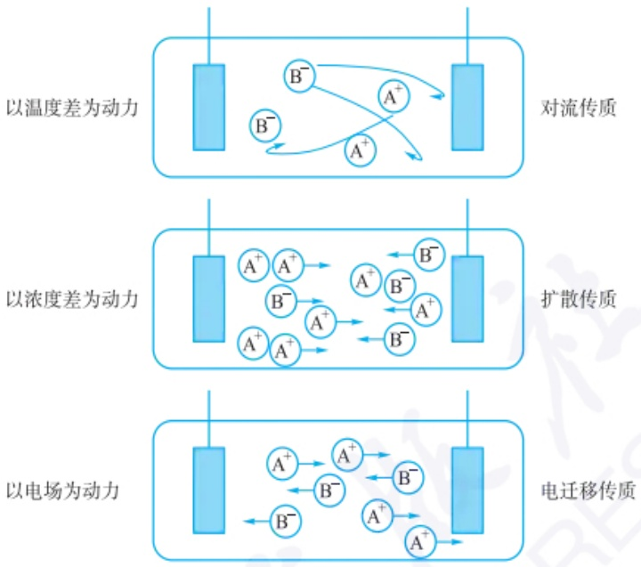

flowchart

This diagram illustrates the three types of electric field transfer mechanisms: temperature difference, concentration difference, and electric field transfer. It shows how these factors influence the flow of magnetic fields (B⁻) and positive/negative charges to produce specific physical states.

图 7.3.1 液相传质的三种方式

## 电化学体系中的电迁移

电化学体系主要由阴极、阳极和电解质溶液组成。当电化学体系中有电流通过时，阴极和阳极之间就会形成电场。在这个电场的作用下，电解质溶液中的阴离子就会定向地向阳极移动，而阳离子定向地向阴极移动。由于这种带电粒子的定向运动，使得电解质溶液具有导电性能。显然，由于电迁移作用也使溶液中的物质进行了传输。

## 对流传质的特点

对流传质的传输速度很快,能够较快地将物质从一处输送到另一处,在大多数情况下,对流传质是通过流体本身的流动来实现的,所以其传播速度受到流速、流态等因素的影响。此外,对流传质由于流体的不均匀分布,传输效果往往较好,且能够有效地提高溶质的浓度差,从而增加了传质效率。

## 2. 电迁移传质

当所研究粒子带电(离子)时,在电场力的作用下,将发生迁移。电迁移作用引起的传质速率为 $J_{m,i}$ 。显然,当研究对象(反应物或生成物)不带电荷时,如中性分子,则不存在电迁移。

由于液相中存在电场引起的离子向相反方向移动的现象,因此电迁移传质速率计算方法如下:

$$
J _ {\mathrm{m}, i} = \pm E u _ {i} ^ {0} c _ {i} = \pm (E _ {x} + E _ {y} + E _ {z}) u _ {i} ^ {0} c _ {i} \tag {7-3-2}
$$

式中， $u_{i}^{0}$  为带电 i 粒子的淌度，即单位电场作用下的运动速度；E 为电场向量；正、负号分别用于正离子与负离子。

若只考虑 x 方向, 上式简化为

$$
J _ {\mathrm{m}, i} = \pm E _ {x} u _ {i} ^ {0} c _ {i} \tag {7-3-3}
$$

## 3. 对流传质

当溶液中物质的粒子随流动液体运动时，液体与离子之间没有相对运动，这种传质方式叫对流。包括自然对流（以温度差、密度差等为动力）和强制对流（以搅拌为动力等）。对流可以增加单位时间内到达电极表面的粒子数目。一般采用对流通量 $J_{c,i}$ 来描述溶液中粒子的对流传质速率，计算方法如下:

$$
J _ {c, i} = v c _ {i} = (v _ {x} + v _ {y} + v _ {z}) c _ {i} \tag {7-3-4}
$$

式中，v 为流速， $v_{x}, v_{y}$  和  $v_{z}$  为三个坐标方向的速度分量。 $J_{c,i}$  和 v 均为向量且同向。

对流传质是液体各部分间存在浓度差或温度差引起密度差导致的传质。三种液相传质对比如表7.3.1所示，电极表面液层结构示意图如图7.3.2所示。

表 7.3.1 三种液相传质对比

|  | 扩散 | 电迁移 | 对流 |
| --- | --- | --- | --- |
| 推动力 | 浓度梯度(化学位梯度) | 电场力 | 重力差(自然对流)或外力(强制对流) |

---

7.3 伏安分析法

361

续表

|  | 扩散 | 电迁移 | 对流 |
| --- | --- | --- | --- |
| 物质性质 | 离子、分子、其他形式微粒 | 带电离子 | 溶质与溶剂(同时运动) |
| 液层 | 扩散层区:$x_{1}-x_{2}$,厚度$\delta (10^{-5} \sim 10^{-4} \text{ m})$,主要为电迁移与扩散 | 双电层区:厚度为$d$(溶液不太稀时,$10^{-9} \sim 10^{-8} \text{ m}$),液体浓度分布只受双电层电场的影响 | $x_{2}$以外区域,此区域只存在对流作用,浓度与本体一致 |

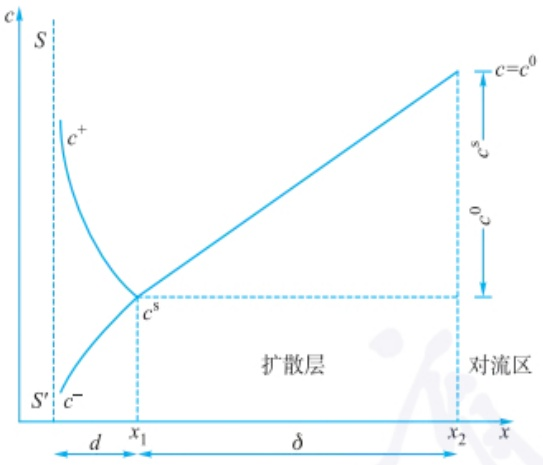

line

| Feature | Description |
| --- | --- |
| Curve | c+ |
| Horizontal Line | c^s |
| Point | c^s |
| X-axis range | \(d \leftarrow x_1 \leftarrow x_2\) |
| Y-axis range | S to S' |

图 7.3.2 电极表面附近液层结构示意图

## 传质作用区域

图 7.3.2 中, 由电极表面至  $x_{1}$  处是双电层区, d 为双电层厚度,  $\delta$  为扩散层厚度,  $c^{0}$  是溶液本体浓度,  $c^{*}$  是电极表面附近液层的浓度,  $c^{*}$  和  $c^{-}$ 分别是阳离子和阴离子的浓度,  $S-S'$  表示电极表面位置。

## 7.3.1.2 液相传质的基本方程

当有电流通过电极时，液相传质总通量为三种传质方式的通量之和。

$$
J _ {i} = J _ {\mathrm{e}, i} + J _ {\mathrm{m}, i} + J _ {\mathrm{d}, i} = \nu_ {x} c _ {i} \pm c _ {i} u _ {i} E - D _ {i} \left(\frac {\mathrm{d} c _ {i}}{\mathrm{d} x}\right) \tag {7-3-5}
$$

该式为平面电极系统的一维(x方向)“液相传质基本方程”。该式可根据如下理论进行简化:

在离电极表面较远的区域,对流速度比电迁移和扩散速度大几个数量级,故可以只考虑决速步骤——对流传质。

在电极表面附近液层对流可以忽略，仅有电迁移和扩散。当区域外（惰性）电解质浓度高时（一般为超过反应离子浓度的50倍），可以忽略电迁移，只考虑扩散（通常情况下加入支持电解质后的扩散传质会被明显加强，电迁移传质的扰动远小于扩散传质，可以忽略）。

上述两个区域的物质传递又是串联进行的，而扩散速率又远小于对流速率，进而成为整个传质过程的决速步骤。据此，式(7-3-5)可简化为

$$
J _ {i} = - D _ {i} \left(\frac {\mathrm{d} c _ {i}}{\mathrm{d} x}\right) \tag {7-3-6}
$$

## 液相传质三种方式影响

一定强度对流作用的存在,是实现稳态扩散过程的必要条件。

当电解液中无大量外部电解质添加时，电迁移作用不可被忽略。此时，电迁移对扩散过程起叠加或抵消作用。

## 7.3.2 扩散电流理论

## 7.3.2.1 稳态扩散过程与非稳态扩散过程

初始阶段——非稳态阶段或暂态阶段。初始阶段，电极表面附近液层中反应离子浓度处于不断变化之中的非稳态。

---

362

第七章 电化学分析

## 实现理想稳态扩散

大容器搅拌可产生强烈搅拌作用，电解质强烈对流，使分布均匀，但毛细管极小，搅拌对其内部溶液无影响，在毛细管中只有扩散传质作用，故可以把扩散区和对流区分开，如图7.3.4所示。

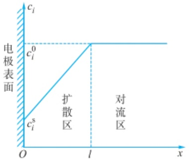

line

| x | c_i |
| --- | --- |
| 0 | c_i^s |
| l | c_i^0 |

图 7.3.4 理想稳态扩散过程中，电极表面附近液层中反应离子浓度分布示意图

## 理想稳态扩散的动力学规律

根据菲克第一定律,理想稳态扩散流量主要由式(7-3-8)所示。

若扩散为控制步骤,整个电极反应的速率就由扩散速率来决定,故可以用电流表示扩散速率。

## 稳态扩散的特点

$I_{d}$  的出现是稳态扩散的过程的重要特征

1.  $D_{i}$  增大导致离子运动速度增大, i 扩增大
2. $i$ 与 $c^0 - c^s$ 相关
3. $i$ 与 $l$ 成反比
4.  $c_{i}^{*}=0$  时, 出现极限扩散电流  $I_{d}$

稳态阶段——当出现浓度梯度的范围延伸到距离电极表面较远的区域时，会导致较强的对流传质过程，反应离子的传质速度已可以完全补充由于电极反应引起的消耗。此时，电极表面附近液层中的浓度梯度仍然存在，但不再发展，其浓度分布只与空间位置有关与时间无关，称为“稳态扩散阶段”。本节着重讨论稳态扩散过程。

一般由于反应离子的不断消耗,其浓度 $(c_{0})$ 将不断减小。只有当反应离子能得到不断补充或反应速率很小或反应时间不长的情况下,才可以忽略溶液中离子浓度的变化,近似为稳态扩散。

## 7.3.2.2 理想情况下的稳态扩散过程

当溶液中存在大量局部电解质时,反应粒子的电迁移流量可被忽略。但对流和扩散常常同时存在,即存在着两种过程交叠的区域,无法研究它们单个过程的规律性。

为了解决该问题,可利用如图 7.3.3 所示的设备,使扩散区(或称扩散层)与对流区分开。预期达到的理想条件是在排除电迁移影响的同时,区分扩散区和对流区,人为地创造一种单纯的扩散过程。理想稳态扩散过程中,电极表面附近液层中反应离子浓度分布如图 7.3.4 所示。

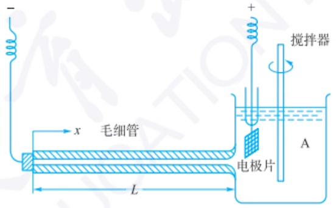

text_image

毛细管
x
L
电极片
A
+ 搅拌器

图 7.3.3 研究理想稳态扩散过程的装置

## 假设条件:

(1) A 中强烈搅拌, 各点浓度相同, 均为  $c^{0}$ ;
(2) $V_{A} \gg V_{毛细管}, S_{电极}$ 小, 且反应时间不长, 可认为 A 中浓度不变, 恒等于初始浓度 $c^{0}$;
(3) 毛细管中溶液静置, 仅存在扩散过程。

当 x=l 时, 扩散达到稳态, 毛细管中各点的浓度不随时间变化, 即

$$
\frac {\mathrm{d} c _ {i}}{\mathrm{d} x} = \frac {c _ {i} ^ {0} - c _ {i} ^ {s}}{l} = \text {常数} \tag {7-3-7}
$$

所以有

$$
J _ {\mathrm{d}, i} = - D _ {i} \left(\frac {\mathrm{d} c _ {i}}{\mathrm{d} x}\right) = - D _ {i} \left(\frac {c _ {i} ^ {0} - c _ {i} ^ {\mathrm{s}}}{l}\right) \tag {7-3-8}
$$

用 I 表示扩散电流密度,习惯上以还原电流密度为正值,则电流方向与 x 轴方向相反,有

$$
I = n F (- J _ {\mathrm{d}, i}) = - n F D _ {i} \left(\frac {c _ {i} ^ {0} - c _ {i} ^ {s}}{l}\right) \tag {7-3-9}
$$

显然，当  $c_{i}^{*}=0$  时，I 达到最大值，这时达到“完全浓差极化”，得到“稳态极限扩散电流密度  $I_{d}$ ”。

---

7.3 伏安分析法

363

## 7.3.2.3 实际情况下的稳态扩散过程

图7.3.5所示为电极表面附近液层中反应离子浓度的实际分布状况。大多数实际情况下，电极附近液层中的传质同时受扩散和对流的影响，所以常称实际情况下的稳态扩散为“对流扩散”，电极表面附近液相中的扩散层与界面双电层示意图如图7.3.6所示。这时采用了近似的处理方法，提出了“扩散层的有效厚度”——$\delta_{\text{有效}}$。于是有

$$
I = n F D _ {i} \left(\frac {c _ {i} ^ {0} - c _ {i} ^ {s}}{\delta_ {\mathrm{有效}}}\right) \tag {7-3-10}
$$

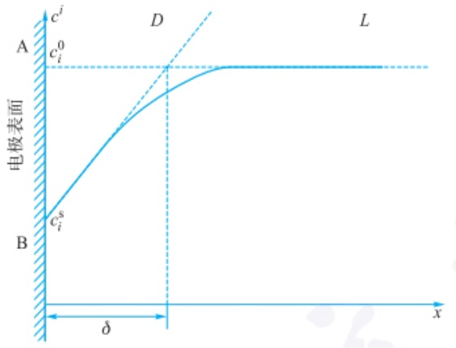

text_image

c^i
A
c^0_i
D
L
B
c^s_i
δ
x

图 7.3.5 电极表面附近液层中反应离子浓度实际分布示意图

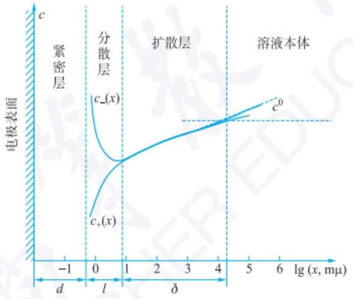

line

| lg(x, \(m\mu)\) | c (Solid Solution) | c_+(x) |
| --- | --- | --- |
| -1 | — | — |
| 0 | ~0.8 | ~0.2 |
| 1 | ~0.5 | ~0.5 |
| 4 | ~0.6 | ~0.6 |

图 7.3.6 电极表面附近液相中的扩散层与界面双电层

$$
I _ {d} = n F D _ {i} \left(\frac {c _ {i} ^ {0}}{\delta_ {\mathrm{有效}}}\right) \tag {7-3-11}
$$

$$
\left(\frac {d _ {c _ {i}}}{d _ {x}}\right) _ {x = 0} = \frac {c _ {i} ^ {0} - c _ {i} ^ {\mathrm{s}}}{\delta_ {\mathrm{有效}}} = \text {常数} \tag {7-3-12}
$$

$$
\delta_ {\text {有效}} = \frac {c _ {i} ^ {0} - c _ {i} ^ {s}}{\left(\frac {d _ {c _ {i}}}{d _ {x}}\right) _ {x = 0}} \tag {7-3-13}
$$

紧密层: d 厚度  $2 \sim 5 \, \text{Å} (1 \, \text{Å} = 0.1 \, \text{nm})$ ;

分散层: l 厚度可弥散至 10 \~ 100 Å;

## 扩散层的有效厚度

已知在边界层中的  $x > \delta$  处，全部靠切向对流作用实现传质过程，而在  $x < \delta$  处，即在扩散层内，主要靠扩散作用来实现传质过程，但此时层内  $u \neq 0$ ，仍有很小对流速度存在，故也存在对流传质作用，表明在真实电化学体系中，扩散层与对流层叠合在一起，很难明显分开，即使在扩散层中，距电极表面距离 x 不同的位置，对流速度也不同，因此各点的浓度梯度也不是常数，如图 7.3.5 所示。

---

364

第七章 电化学分析

## 扩散控制的判别

通常看是否出现浓差极化的动力学特征,判别电极过程是否由扩散步骤控制。

电极过程受扩散步骤控制,在一定电极电位范围内,出现一个不受电极电位影响的极限扩散电流密度,且其受温度变化影响较小。

## 拓展

典型的线性扫描伏安法的曲线如下图所示,一方面,电极反应随E增加而增强,电流也随之增加,另一方面,随着反应进行,电位继续扫描相当于极化时间延长,扩散层厚度增加,扩散流量逐渐下降,电流也随之下降。

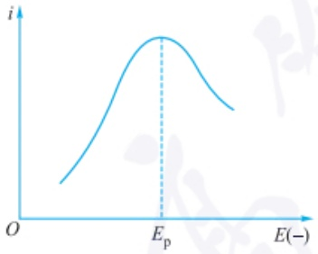

line

| E | i |
| --- | --- |
| ~0.2 | ~0.3 |
| Ep | Peak |
| ~1.5 | ~0.6 |

扫描速度不同,峰值电流也不同,如下图所示。

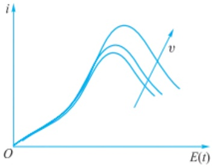

line

| E(t) | Curve 1 (i) | Curve 2 (i) | Curve 3 (i) |
| --- | --- | --- | --- |
| O | 0 | 0 | 0 |
| Peak | ~High | ~Medium-High | ~Medium-Low |

扩散层:厚度视具体液流状态,通常有  $10^{5} \sim 10^{6}$  Å;

在讨论扩散传质过程时,可以不考虑双电层的存在。

## 7.3.3 常用的伏安法

伏安法根据电流-电位曲线进行电化学分析,下面介绍几种常用的伏安法。

## 7.3.3.1 线性扫描伏安法

## 1. 原理

线性扫描伏安法(linear sweep voltammetry, LSV)又称线性电位扫描计时安培法。其原理为在工作电极与参比电极之间施加一个随时间线性变化的电极电位，同时记录通过工作电极与辅助电极之间的电流，从而获得电极电流与电极电位之间的伏安曲线，即线性扫描伏安图。该方法一般用于定量分析。电极电位的变化率称为扫描速率 $\left(v=\frac{\mathrm{d}E}{\mathrm{d}t}\right)$ ，为一常数。电极电位与时间的关系为 $E=E_{0}\pm vt$ 。

其中，v 为电极的扫描速率(单位为  $m \cdot s^{-1}$ )； $E_{0}$  为电极的起始扫描电位(单位为 V)；t 为时间(单位为 s)。电位扫描范围可分为大幅度和小幅度两类。大幅度扫描常用来观察整个电位范围内可能发生哪些反应，也可用来判断电极过程的可逆性，测定电极反应参数等。小幅度扫描范围通常在 5\~10 mV，主要用来测定反应电阻和双电层电容。

LSV 方法作为一种电位控制的暂态测量方法,与常用的电化学测量技术之一循环伏安法(CV)相比,仅需从初始电位向最终电位进行单向扫描,而 CV 方法则扫描至最终电位之后,再以相同的速率回扫至起始电位,甚至多次反复扫描。v 对暂态极化曲线的形状和数值影响较大,只有扫速足够慢时,才可得到稳态极化曲线。测量结果用 i-t 或 i-E 曲线表示,i-E 曲线也叫作伏安曲线。

## 2. 线性电位扫描过程中的响应电流的特点

通常情况下,线性扫描过程中的响应电流是双电层充电电流 $i_{c}$ 与电化学反应电流 $i_{f}$ 之和,即 $i=i_{c}+i_{f}$ 。

双电层充电电流 $i_{e}$ 为

$$
i _ {c} = \frac {\mathrm{d} q}{\mathrm{d} t} = \frac {\mathrm{d} \left[ - C _ {\mathrm{d}} (E - E _ {\mathrm{z}}) \right]}{\mathrm{d} t} = - C _ {\mathrm{d}} \frac {\mathrm{d} E}{\mathrm{d} t} + (E _ {\mathrm{z}} - E) \frac {\mathrm{d} C _ {\mathrm{d}}}{\mathrm{d} t} \tag {7-3-14}
$$

$C_{d}$  为双电层的微分电容; E 为电极电位;  $E_{z}$  为零电荷电位。

在电位扫描过程中，电位变化速率恒定，持续有电流给双电层充电。但充电电流 $i_{c}$ 在扫描过程中并非常数，而是随着 $C_{d}$ 的变化而变化。当电极表面发生活性物质吸附时，双电层电容变化，出现吸脱附峰。当电极表面不存在活性物质吸附时，双电层电容不变，充电电流变化可忽略。

另外，电化学反应产生的法拉第电流 $i_{\mathrm{f}}$ 也随着扫描速率 $v$ 的增大而增大，但不与 $v$ 成正比例关系。当存在电化学反应时，随扫描速率 $v$ 增大，$i_{\mathrm{c}}$ 比 $i_{\mathrm{f}}$ 增大程度更高，$i_{\mathrm{c}}$ 在总电流中所占的比例增加。相反，当扫描速率 $v$ 足够慢时，$i_{\mathrm{c}}$ 在总电流中所占比例极低，可以忽略不计，这是得到的 $i - E$ 曲线即为稳态极化曲线。

## 3. 线性扫描伏安分析的定量依据

Randles-Savcik 方程:

$$
i _ {\mathrm{p}} = 2. 6 9 \times 1 0 ^ {5} \times n ^ {3 / 2} \cdot D ^ {1 / 2} \cdot v ^ {1 / 2} \cdot A \cdot c \tag {7-3-15}
$$

$i_{p}$ 为峰电流(A), v 为极化速度 $(\mathrm{V}\cdot\mathrm{s}^{-1})$ , n 为电子转移数, A 为电极面积 $(\mathrm{cm}^{2})$ , D 为扩散系数, c 为被测物质浓度 $(\mathrm{mol}\cdot\mathrm{L}^{-1})$ 。在一定条件下:

---

7.3 伏安分析法

365

$$
i _ {\mathrm{p}} = k \cdot c \tag {7-3-16}
$$

该式表明电极反应的峰电流与电极反应物浓度成正比，这是线性扫描伏安法进行定量测定的理论依据。一般情况下，线性扫描伏安法的反应物最佳浓度范围为 $10^{-2}\sim10^{-4}\ mol\cdot L^{-1}$ 。同时，电极反应的峰电流与电极的电位扫描速率1/2次方成正比，因此提高扫描的速率可以提高测定的灵敏度。但对于不可逆过程，由于电极反应速率慢，在快速扫描时电极反应的速率小于极化速率，伏安曲线将不出现电流峰，因此对于电极反应速率较慢的物质应选用较慢的电位扫描速率。

对于可逆电极反应,伏安曲线上的峰电位与电解液的组成和浓度有关,与扫描速度无关,峰电位的表达式为

$$
E _ {\mathrm{p}} = E _ {\frac {1}{2}} \pm 1. 1 (R T / n F) \tag {7-3-17}
$$

由该式可知，当电极反应电子转移数 $n = 1$ 时，电流峰电位比平衡电位后移 $28.5\sim$ $31.5\mathrm{mV}$ 。电流峰的上升速度非常快，在起始 $10\%$ 上升到峰值所对应的电极电位变化约为 $100~\mathrm{mV}$ 。而当电极反应为不可逆时（半可逆或不可逆），峰电位 $E_{\mathrm{p}}$ 则随着扫描速率的增大而负(或正)移。

## 4. 应用

（1）判断电极的可逆性 LSV 方法可用于判断电极过程的可逆性:若峰值电势  $E_{p}$  不随扫描速率的变化而变化，则电极过程是可逆的；若峰值电位  $E_{p}$  随扫描速率的增大而变化（向扫描方向移动），则电极过程是不可逆的。简要示意图如图 7.3.7 所示。

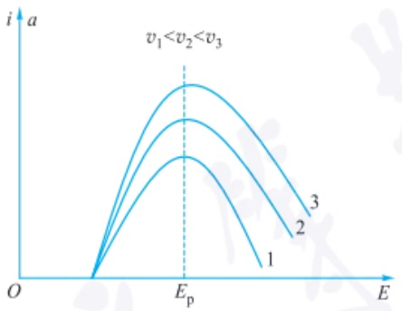

contour

| Curve | Description |
| --- | --- |
| 1 | Lower curve, starting from origin |
| 2 | Middle curve, shifted to the right compared to curve 1 |
| 3 | Upper curve, shifted to the right compared to curve 1 |

(a)

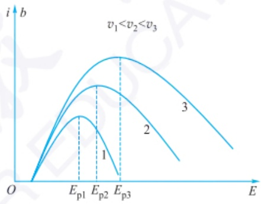

contour

| Point | Potential (E) | Current (i) |
| --- | --- | --- |
| 1 | E_p1 | — |
| 2 | E_p2 | — |
| 3 | E_p3 | — |

(b)

图 7.3.7 （a）可逆体系在不同扫描速率下的 LSV 曲线；（b）不可逆体系在不同扫描速率下的 LSV 曲线。

（2）定性及定量分析 LSV 方法用于定性及定量分析时，其基本原理与其他伏安法类似，首先根据峰电位对目标物进行定性，其次根据峰电流与浓度的线性关系，对目标物浓度定量，依据的公式主要为 Randles-Savcik 方程。
（3）材料电催化性能研究 LSV 方法应用于材料的电催化性能研究，是目前光电催化领域常用的测试手段之一。例如，在电解水方面，线性扫描伏安曲线可以最直观对比不同电极的活性，即比较同一电流密度下过电位大小可以判断材料的电催化活性，过电位越小，催化活性越高。一般情况下，以  $10 \, mA \cdot cm^{-2}$  电流密度下的过电位作为对比的标准。在某些由外部环境影响的特殊情况下，LSV 会出现两个峰，可能无法得到  $10 \, mA \cdot cm^{-2}$  处的过电位，也可以选取  $100 \, mA \cdot cm^{-2}$  处的过电位作为催化剂的活性评价标准。

## 拓展

线性扫描伏安法可以初步研究电极体系可能发生的电化学反应，可以对电极氧化还原反应机理进行研究，还可用于电极过程动力学分析，可以应用在生物医学、环境监测等领域。

线性扫描伏安法的优点:其具有较高的灵敏度和分辨率,能够提供丰富的电化学信息,操作简便,适用于多种电极材料和体系。缺点:需要较长的扫描时间和较高的电极电位,可能导致电极表面过度氧化或者还原,影响实验结果,另外对于快速反应的体系可能不太适用。

---

366

第七章 电化学分析

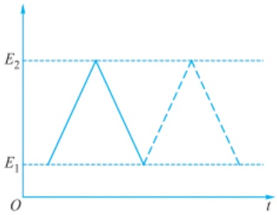

line

| Time (t) | Value |
| --- | --- |
| 0 | E1 |
| ~1.5 | E2 |
| ~3.5 | E1 |
| ~4.5 | E2 |
| ~6.5 | E1 |

图7.3.8 循环伏安法的电压-时间关系

## 拓展

1938 年 Matheson 和 Nichols 首先建立了循环伏安法。1958 年 Kemula 和 Kubli 将其应用于有机化合物电极过程的研究。

Wopschall 用循环伏安法研究了各种电极过程,从理论上计算了电极反应速率常数 k 的大小对伏安曲线的影响。

特征: $i_{pc}$ 与反应物的本体浓度成正比,与扫描速率也相关。

循环伏安法有两个重要的实验参数，一个是峰电流之比，另一个是峰电流之差。

## 7.3.3.2 循环伏安法

## 1. 原理

循环伏安法(cyclic voltammetry, CV)施加电压的方式与单扫描极谱法很相似，是将线性扫描电压施加在电极上，电压与扫描时间的关系如图7.3.8所示。从起始电压 $E_{i}$ 扫描至设定电压E后，再反向回扫至起始电压，施加电压呈等腰三角形。

若溶液中存在氧化态  $O_{x}$ ，当电位从正向负扫描时，电极上则会发生还原反应:

$$
\mathrm{Ox} + n \mathrm{e} ^ {-} \rightleftharpoons \text {Red}
$$

而反向回扫时,电极上生成的还原态 Red 又会发生氧化反应:

$$
\mathrm{Red} \rightleftharpoons \mathrm{Ox} + n \mathrm{e} ^ {-}
$$

循环伏安图如图 7.3.9 所示。若有需要, 可以进行连续循环扫描。

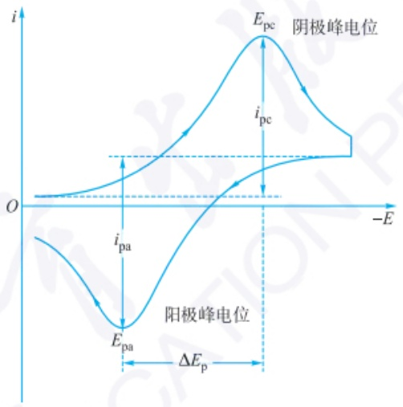

text_image

阴极峰电位
Epc
ipc
O
-E
ipa
Epa
阳极峰电位
ΔEp

图 7.3.9 循环伏安图

从循环伏安图上,可以测量得到阴极峰电流  $i_{pc}$  和阳极峰电流  $i_{pa}$ ; 阴极峰电位  $E_{pc}$  和阳极峰电位  $E_{pa}$  等重要参数。注意, 峰电流测量是以背景电流线作为起始值。

对于可逆电极过程,峰电流符合 Sevcik-Randles 方程:

$$
i _ {\mathrm{p}} = K n ^ {\frac {3}{2}} A D ^ {\frac {1}{2}} v ^ {\frac {1}{2}} c \tag {7-3-18}
$$

两峰电流比为

$$
\frac {i _ {\mathrm{pa}}}{i _ {\mathrm{pc}}} \approx 1 \tag {7-3-19}
$$

两峰电位差为

$$
\Delta E _ {\mathrm{p}} = E _ {\mathrm{pa}} - E _ {\mathrm{pc}} \approx \frac {5 6}{n} \mathrm{mV} \tag {7-3-20}
$$

这个差值与循环扫描的换向电位有关，当换向电位比 $E_{\mathrm{pc}}$ 负 $\frac{100}{n}\mathrm{mV}$ 时，$\Delta E_{\mathrm{p}}$ 为 $\frac{59}{n}\mathrm{mV}$ 。通常，$\Delta E_{\mathrm{p}}$ 值为 $55\sim 65\mathrm{V}$ 。可逆电极过程的 $E_{\mathrm{p}}$ 与扫描速率无关。

峰电位与条件电位的关系为

$$
\varphi^ {\ominus} ^ {\prime} = \frac {E _ {\mathrm{pa}} - E _ {\mathrm{pc}}}{2} \tag {7-3-21}
$$

---

7.3 伏安分析法

367

通常情况下,循环伏安法采用的是三电极系统。其中,使用的指示电极包括悬汞电极、汞膜电极和固体电极(如 Pt 圆盘电极、玻璃碳电极、碳糊电极等)。

在伏安法和极谱分析法中，通常使用 $\mathrm{Hg}$ 、Pt、C等材料制成的电极。电极适用的电位范围不仅与电极材料相关，也与测试溶液组成有关，如图7.3.10所示。通常，电极可使用的正电位受到水氧化生成 $\mathrm{O}_2$ 的限制；负电位受到水还原产生$\mathrm{H}_{2}$ 的限制。因为 $\mathrm{H}_{2}$ 在汞上有着高的过电位，汞电极适用于需要较大负电位范围的情况。

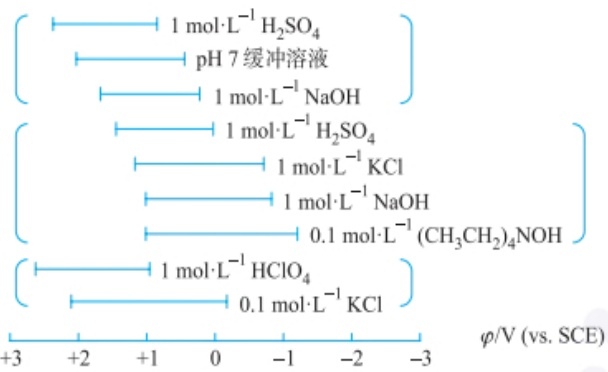

error_bar

| Solution | \(\phi/V (\)vs. SCE) Range |
| :--- | :--- |
| \(1 mol \cdot L^{-1} H_{2}SO_{4}\) | ~-2.5 to -0.5 |
| pH 7 缓冲溶液 | ~-2.0 to -0.5 |
| \(1 mol \cdot L^{-1}\) NaOH | ~-1.5 to -0.2 |
| \(1 mol \cdot L^{-1} H_{2}SO_{4}\) | ~-1.0 to 0.0 |
| \(1 mol \cdot L^{-1}\) KCl | ~-0.8 to 0.2 |
| \(1 mol \cdot L^{-1}\) NaOH | ~-0.6 to 0.3 |
| \(0.1 mol \cdot L^{-1} (CH_{3}CH_{2})_{4}NOH\) | ~-0.4 to 0.2 |
| \(1 mol \cdot L^{-1} HClO_{4}\) | ~-2.5 to -0.5 |
| \(0.1 mol \cdot L^{-1}\) KCl | ~-2.0 to 0.0 |

图 7.3.10 不同支持电解质溶液中 Pt、Hg 和 C 电极适用的电位范围

## 2. 应用

循环伏安法是一种简便而重要的电分析方法,主要应用是研究电极过程,除此之外还能研究化学修饰电极的表面覆盖度。

## (1) 电极过程研究

① 判断电极过程的可逆性。利用式(7-3-18)、式(7-3-19)、式(7-3-20)和式(7-3-21)，可以判断电极过程的可逆性。对于不可逆电极过程，以上四式并不适用，两峰电位差比式(7-3-20)预期的大，在反扫时，阳极峰电流会减小甚至消失。
② 研究电极上的吸附现象。用循环伏安法研究吸附现象可以获得清晰的结果。对于可逆电极反应，若反应物或产物在电极表面吸附作用较弱，循环伏安图形的变化不大，只是电流略有增加，如图7.3.11所示中的(a)、(b)。若是反应物吸附作用强烈，吸附作用会使得自由能变得很负，会在主峰后产生一个小的吸附后峰，如图7.3.11(c)所示；若是反应产物强吸附，则在主峰前出现一个小的吸附前峰，如图7.3.11(d)所示。
③ 电化学-化学偶联反应过程的研究。循环伏安法对于电极反应过程中的偶联(伴随)化学反应的研究也很有优势。以配离子 $\mathrm{Ru(NH_3)_5Cl^{2+}}$ 为例，在 $1.0\times$ $10^{-3}\mathrm{mol}\cdot \mathrm{L}^{-1}\mathrm{Ru(NH_3)_5Cl^{2+}}$ 及 $0.17\mathrm{mol}\cdot \mathrm{L}^{-1}$ 甲苯磺酸介质中，在很快的扫描速率下，循环伏安图如图7.3.12(a)所示，图中只出现一个阴极峰和一个阳极峰，表明只有电极反应:

$$
\mathrm{Ru(NH_3)_5Cl^{2+} + e^- \rightleftharpoons Ru(NH_3)_5Cl^+}
$$

由于扫描速率很快, $\mathrm{Ru(NH_{3})_{5}Cl^{+}}$ 在短时间内不易生成水合配离子:

$$
\mathrmRu(NH_3)_5Cl^+ + H_2O\xrightarrow{K} \mathrm{Ru(NH_3)_5H_2O^{2+} + Cl^-}
$$

因而水合配离子的电极反应并不明显。

而若在较慢的扫描速率进行循环伏安测定,其循环伏安图如图 7.3.12(b) 所示。较长的时间使生成水合配离子的反应能够充分进行,在电极表面的溶液中形

循环伏安法可以对电极过程产物进行鉴别,可以获得不少关于中间产物电化学及其他性质的信息,如有一对氧化还原峰,表明存在一种稳定的氧化还原态。

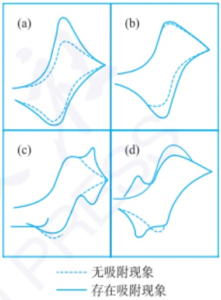

(a) 反应物弱吸附；(b) 产物弱吸附；
(c) 反应物强吸附；(d) 产物强吸附

图 7.3.11 电极反应中反应物或产物吸附的循环伏安图

line

| Curve | Description |
| --- | --- |
| (a) | High current response with distinct oxidation and reduction peaks. |
| (b) | Moderate current response with a single peak. |
| (c) | Low current response with a single peak. |

(a) 扫描时间为 100 ms; (b) 溶液同 (a), 扫描时间为 500 ms; (c)  $1.0 \times 10^{-3} \, mol \cdot L^{-1} \, Ru(NH_{3})_{5}H_{2}O^{3+}$  溶液，循环扫描时间为 100 ms

图 7.3.12 循环伏安图

循环伏安法可以通过曲线的峰形判断电极反应是否发生,峰值高低判断电极反应发生强弱,可以从侧面说明电极对反应物的吸附能力。

---

368

第七章 电化学分析

## 循环伏安法优缺点

优点:可以直接研究电化学反应动力学过程;实验操作相对简单,结果准确可靠,可以快速获得电化学反应的参数和特征。

缺点: 只能获得瞬态数据, 对于反应的中间过程数据很难得到; 实验参数的选择有一定限制。

## 拓展

溶出伏安法又称反向溶出极谱法,是使被测的物质,在待测离子极谱分析产生极限电流的电位下电解一定的时间,然后改变电极的电位,使富集在该电极上的物质重新溶出,根据溶出过程中所得到的伏安曲线来进行定量分析。

contour

| Curve | Peak Current (i) | Potential (E) |
| --- | --- | --- |
| 1 | i1 | Ep |
| 2 | ip | -E |

图7.3.13 ASV原理图

## 溶出伏安法特点

1. 高灵敏度, 可以测量微弱的电流变化, 常用于研究溶出速率比较慢的物质;
2. 非破坏性, 施加适当的电位差, 可以实现快速且可靠的测量物质的溶出行为;
3. 实时监测, 可实时研究物质溶出的过程;
4. 应用较广,适用于各种类型物质的溶出伏安分析。

成较多的水合配离子 $\mathrm{Ru(NH_3)_5H_2O^{2+}}$ ，因而在较正的电位处出现了该水合配离子的阴极峰和阳极峰，其电极反应为

$$
\mathrm{Ru(NH_3)_5H_2O^{3 + } + e^- \rightleftharpoons Ru(NH_3)_5H_2O^{2 +}}
$$

图 7.3.12(c) 是在  $1.0 \times 10^{-3} \, mol \cdot L^{-1} \, Ru(NH_{3})_{5}H_{2}O^{3+}$  溶液中测得的循环伏安图，证实图 7.3.13(b) 中较正电位处的阴极峰和阳极峰来自水合配离子。

利用式(7-3-21)可以确定这两个氧化-还原体系的条件电位,而用其他方法难以测得,因为在溶液中  $\mathrm{Ru(NH_{3})_{5}Cl^{+}}$  极易转化为水合钌的配合物。

（2）研究化学修饰电极 循环伏安法可以为研究单分子层、多分子层和聚合物膜修饰电极提供许多有用的信息。对于单分子层修饰电极，循环伏安曲线面积积分可以获得电荷量 Q（忽略双电层电容电流），从而得到电极表面电活性物质的总覆盖率  $\left(\mathrm{mol}\cdot\mathrm{cm}^{-2}\right)$ ，且总覆盖率与扫描速率 v 无关。

## 7.3.3.3 溶出伏安法

溶出伏安法是一种灵敏度高的电化学分析方法,因而在痕量成分分析中相当重要。它使用极谱分析类似的仪器设备,可测定40多种元素,检测极限可达 $10^{-11}\ mol\cdot L^{-1}$ 。

溶出伏安法的操作分为两步。第一步是预电解过程，第二步是溶出过程。预电解是在恒电位下搅拌溶液，其目的是富集痕量组分。富集后，让溶液静置30 s或1 min（称为休止期），再用极谱分析方法进行溶出，溶出过程的峰电流或峰高在一定条件下与被测物质的浓度成比例。

溶出伏安法根据溶出过程中的工作电极是发生氧化反应或还原反应,可以分为阳极溶出伏安法(ASV)和阴极溶出伏安法(CSV)。

## 1. 阳极溶出伏安法

阳极溶出伏安法原理如图 7.3.13 所示。被测物质预电解数分钟后让溶液静置 30\~60 s，再从负电位扫描到较正的电位，使富集在电极上的物质发生氧化反应而重新溶出。

（1）预电解过程 阳极溶出伏安法的预电解是在溶液搅拌条件下的恒电位电解过程。恒电位范围在被测物质产生极限电流时的电位范围内。在预电解时，达到电积分数  $x(0<x<1)$  所需要的时间为

$$
t = - \frac {V \delta}{0 . 4 3 A D} \mathrm{lg(1-x)} \tag {7-3-22}
$$

式中，V 为悬汞或汞膜电极的体积；A 为汞膜面积。

假定预电解过程中的溶液浓度没有明显变化,且将极限电流视为不变,则在电极上析出的金属量遵守法拉第定律:

$$
\frac {m}{M} = \frac {i _ {1} t}{n F} \tag {7-3-23}
$$

浓度为

$$
c _ {\mathrm{Hg}} = \frac {m}{M V} \tag {7-3-24}
$$

对于悬汞电极，电极体积为 $V = \frac{4}{3}\pi r^3$ 。电积在悬汞中的被测物质浓度为

$$
c _ {\mathrm{Hg}} = \frac {3 i _ {1} t}{4 \pi r ^ {3} n F} \tag {7-3-25}
$$

其中，r 为悬汞电极的半径。

---

7.3 伏安分析法

369

对于汞膜电极,电积在汞膜中的被测物质的浓度为

$$
c _ {\mathrm{Hg}} = \frac {i _ {1} t}{A l n F} \tag {7-3-26}
$$

其中，l 为汞膜厚度。

式(7-3-25)和式(7-3-26)表明电极的体积越小,电积的去极剂浓度就越大,因此减小电极体积,有利于提高测定的灵敏度。

由  $i_{1}$  值可求得电积物质在汞电极上的浓度  $c_{Hg}$  。电极不同，在搅动溶液中的  $i_{1}$  值也不同。

对于悬汞电极,极限电流的半经验式可表示为

$$
i _ {1} = 4 \pi r n F D c + k n r ^ {2} D ^ {\frac {2}{3}} f ^ {\frac {1}{2}} c \tag {7-3-27}
$$

式中，c 为被测金属离子在本体溶液中的浓度；r 为汞滴半径；f 为搅拌速率；k 为常数，其他符号具有通常含义。由该式知，增加搅拌速率，有利于提高  $i_{1}$  值，但搅拌速率太大，会使汞滴发生变形甚至脱落。

对于旋转圆盘电极,极限电流为

$$
i _ {1} = 0. 6 2 n F A D ^ {\frac {2}{3}} v ^ {- \frac {1}{6}} \omega^ {\frac {1}{2}} c \tag {7-3-28}
$$

式中， $\omega$  为电极的角速度， $\omega=2nf/60;v$  为溶液动力学黏度， $cm^{2}\cdot s^{-1}$ 。该式称为 Levich 公式。

（2）休止期 预电解后让溶液静置30\~60 s，使汞中的电积物均匀分布，从而获得重现性好的分析数据。
（3）溶出过程 溶出过程可以利用传统的极谱分析方法进行表征，如单扫描极谱法、脉冲极谱法、半微分电分析法及计时电位法等。溶出峰电流的大小与使用的极谱分析方法和电极类型有关。如采用单扫描极谱法，在悬汞电极上的可逆波溶出峰电流(298 K)为

$$
i _ {p} = 2. 7 2 \times 1 0 ^ {5} n ^ {\frac {3}{2}} A D ^ {\frac {1}{2}} v ^ {\frac {1}{2}} c _ {\mathrm{Hg}} \tag {7-3-29}
$$

式中，v 为扫描速率。

## 2. 阴极溶出伏安法

阴极溶出伏安法在预电解时,在恒电位下,工作电极 M(如 Ag)本身会发生氧化反应:

$$
\mathrm{M} _ {\mathrm{el}} \longrightarrow \mathrm{M} _ {\mathrm{el}} ^ {z +} + n \mathrm{e} ^ {-}
$$

该过程中,被测阴离子形成难溶化合物富集在电极上:

$$
\mathrm{A} ^ {m ^ {-}} + \mathrm{M} _ {\mathrm{el}} ^ {n ^ {+}} \longrightarrow \mathrm{M} _ {m} \mathrm{A} _ {n}
$$

预电解一定时间后,电极电位向较负的方向扫描时,电极上发生还原反应:

$$
\mathrm{M} _ {m} \mathrm{A} _ {n} + n \mathrm{e} ^ {-} \longrightarrow m \mathrm{M} _ {\mathrm{el}} + n \mathrm{A} ^ {m -}
$$

这种方法称为阴极溶出伏安法。

## 3. 溶出伏安法实验条件的选择

溶出伏安法的实验条件,包括底液、预电解电位、预电解时间及工作电极等的选择,对提高选择性和灵敏度有重要意义,这些条件必须通过实验来选择。

（1）底液 底液可以采用极谱分析的底液，具有配位性的底液对测定过程更有利。
（2）预电解电位 预电解电位的选择可以参考半波电位，通常选用的预电解电位比 $E_{1}$ 负 $0.2\sim 0.5\mathrm{V}$。

2

## 影响因素

1. 电极表面富集过程中需要一定时间, 受待反应物在电解质中的扩散影响;
2. 溶出过程中电压变化速率需要保持一致。

## 溶出伏安法优缺点

优点: 可以分析降解产物及中间体; 对材料的寿命和稳定性影响较小; 可以检测较低浓度待测物。

缺点:电极受沉积物和氧化层的影响较大;大多数时间需要在严格的无氧条件下测试;可重复性较差。

## 拓展

目前周期表中已有31种元素能进行阳极溶出；15种元素可以进行阴极溶出，7种元素可以进行阳极和阴极溶出。溶出伏安法具有较好的精度，可以同时测定几种含量较低的元素。

悬汞电极是静止的滴汞电极,每次测试间不需要清洗电极,是极谱法和伏安法的理想电极,价格较贵。

玻璃碳电极具有圆柱、圆盘等多种形状，用作基底可以制成修饰电极。

## 除氧的意义

氧气在水中存在发生电极反应的可能,会得电子生成氢氧根离子,有电极反应就会在伏安法过程中有相应的电流峰,很多时候会与希望检测的反应峰位置发生重合,互相干扰,所以需要进行除氧。

---

370

第七章 电化学分析

（3）预电解时间 预电解时间的选择与待测物的浓度和方法的灵敏度有关。例如，采用单扫描极谱法时，若使用悬汞电极，对于 $10^{-7}\sim10^{-6}\ mol\cdot L^{-1}$ 试液通常约需5 min。而用汞膜电极时，预电解时间短一些。

(4) 工作电极 溶出伏安法使用的工作电极分为汞电极和固体电极。

汞电极有悬汞电极和汞膜电极等，悬汞电极构成如图7.3.14所示。汞膜电极是在银电极或玻璃碳电极上镀一薄层汞。测定 $\mathrm{Cu^{2+}}$ 、 $\mathrm{Pb^{2+}}$ 、 $\mathrm{Cd^{2+}}$ 、 $\mathrm{Zn^{2+}}$ 等金属离子时使用悬汞电极和汞膜电极最合适。

固体电极有碳糊电极、石墨电极、玻璃碳电极和 Pt、Ag 电极等。以玻璃碳电极为例，电极组成如图 7.3.15 所示，电极由糠酮树脂在高温和隔绝空气的条件下石墨化而成，是一种玻璃状石墨。测定贵金属、Hg 及不形成汞齐的金属时，常用石墨电极、玻璃碳电极和铂电极等。

## 滴汞电极的缺点

1. 汞易挥发且有毒；
2. 汞能够被氧化,滴汞电极不能用于比甘汞电极高的电位;
3. 滴汞电极残余电流较大, 降低了灵敏度。

text_image

铂丝
贮汞球
150 mL
塑料管
毛细管
长10 cm
内径0.03~0.08 mm
汞滴

图 7.3.16 滴汞电极

text_image

测微计顶部
电极接线
入口
毛细管
Hg

图 7.3.14 悬汞电极

text_image

Pt
Hg

text_image

玻璃碳

图 7.3.15 玻璃碳电极

卤素离子和 Cr、Fe 等变价离子常以难溶化合物的形式富集在电极表面，工作电极通常采用汞电极、银电极和玻璃碳电极等。

(5) 除氧 溶出伏安分析通常需要除氧, 其除氧方法与极谱法相同。
(6) 定量分析 定量分析采用标准曲线法或标准加入法。

溶出伏安法可以测定数十种元素,灵敏度相对于极谱分析法高1\~2个数量级,能与无火焰原子吸收光谱法媲美。

## 7.3.4 伏安法常用的工作电极

固体电极、表面固定的液体电极（如C、Au、Pt、悬汞或汞膜电极），以及表面周期性更新的滴汞电极均可用作伏安法的工作电极。

## 7.3.4.1 滴汞电极

滴汞电极是汞从外径3\~7 mm，内径0.04\~0.08 mm的垂直玻璃毛细管下端流出，并形成汞滴而滴下的电极，通过控制汞滴的大小来调整电极面积，如图7.3.16所示，在电化学分析中具有广泛应用。

滴汞电极的优点:

(1) 稳定性好 滴汞电极表面处于极微小的汞饱和蒸气压下, 其电势稳定度

---

7.3 伏安分析法

371

极高。

（2）电极面积增加 电极表面积可以通过控制滴汞的大小改变，适应不同电化学反应。
（3）许多金属能与汞生成汞齐，它们的离子在汞电极上还原的可逆性好。
（4）氢在汞上的过电位比较高，受氢气析出影响小，使测定有可能在微酸性溶液中进行。

## 7.3.4.2 悬汞电极

一种静止的滴汞电极。它既有滴汞电极重现性好、氢过电位较高的优点；也具有固体电极电容电流小的优点，因此灵敏度高。

常用的有两种形式,一种是挂吊式悬汞电极,将汞滴托于汞齐化的微铂丝(也可用金丝、银丝)即制成悬汞电极。另一种是由机械螺旋控制的悬汞电极,旋动螺旋把汞从毛细管的一端挤压出来,形成汞滴。衡量悬汞电极的标准是能否保证悬汞滴大小完全重现,以及能否在一定范围内任意控制悬汞滴的大小。

悬汞电极常用于伏安法，主要作为循环伏安法和溶出伏安法中的工作电极。

## 7.3.4.3 汞膜电极

汞膜电极既包含汞电极的特性,又有较高的面积/体积比率。由于汞膜薄,电极面积大,搅拌速度可加快,因而电沉积效率高。汞膜电极具有溶出峰高而尖且分辨能力强的优点;缺点是重现性较差;主要因为膜薄易使溶解的金属达到过饱和,形成金属间化合物,产生相互干扰;同时也易受支持电解质组分的影响。

## 7.3.4.4 玻璃碳电极

玻璃碳简称玻碳,是将聚丙烯腈树脂或酚醛树脂等在惰性气氛中缓慢加热至1800℃高温处理成外形似玻璃状的非晶形碳,用作电子导体材料构建电极。

玻璃碳电极的优点是导电性好，化学稳定性高，热胀系数小，质地坚硬，气密性好，电位适用范围宽（相对于饱和甘汞电极-1\~1 V），可制成圆柱（图 7.3.17）、圆盘等电极形状，用它作基体还可制成汞膜玻璃碳电极和化学修饰电极等，在电化学实验或电分析化学中得到日益广泛的应用。

## 7.3.5 微电极技术

## 7.3.5.1 微电极概述及特点

微电极也称超微电极，通常是指其一维尺寸小于 $100\mu \mathrm{m}$，或者小于扩散层厚度的电极，是电分析化学的一门新技术。实验结果表明，当电极尺寸从毫米级降至微米或纳米级时，它将呈现出一些不同于常规电极的特点，如双电层充电电流很小、平衡时间短、响应快。

## 7.3.5.2 微电极的基本电化学性质

微电极的基本电化学性质归纳起来主要有以下几个方面:容易达到稳态电流；微电极的时间常数很小；适用于高阻抗溶液体系。

## 7.3.5.3 微电极的类型

（1）根据微电极的制作材料主要可以分为:碳纤维微电极、铂微电极、铜微电极、钨微电极、金微电极、铱微电极、银微电极和粉末微电极。
（2）根据微电极的形状可以分为:微柱电极、微盘电极、微带电极、微刷电极、微束盘电极、微圆盘电极、微流动电极、组合式电极、纳米级圆盘-圆柱电极。不同形状的微电极适用于不同的应用场景，例如，圆盘电极常用于电化学测量中的稳态伏安法，而阵列电极则适用于同时监测多个微区域的电化学信号。

## 悬汞电极的缺点

悬汞电极面积/体积比小,汞膜电极较长,因此分辨率较差。

## 汞膜电极的缺点

汞膜电极膜薄易使溶解的金属达到过饱和,形成金属间化合物,产生相互干扰,易受支持电解质组分的影响。

## 玻璃碳电极的缺点

玻璃碳电极表面具有多变的性质,很容易受实验条件的影响而发生变化,影响实验结果。

玻璃碳电极使用时必须保证玻璃碳表面清洁,使用之后必须进行抛光清洗。

natural_image

Five white cylindrical tubes with black centers, arranged diagonally on a plain surface (no text or symbols visible)

图 7.3.17 玻璃碳电极

## 微电极技术的优缺点

优点: 微电极表面液相传质速率加快, 测量响应速度较快; 具有较小的电流, 较高灵敏度; 微电极测试几乎无损伤, 可以用于生物活体及单细胞分析。

缺点: 微电极尺寸下, 制备过程需要极高的精度和稳定性, 对制备设备和工艺有极高的要求; 其次在制备过程中容易受到外界因素的干扰, 如温度、湿度等; 此外, 其成本较高。

---

372

第七章 电化学分析

## 化学修饰电极起源

化学修饰电极起源于电化学家早期在电极上的化学吸附研究。1975年，Miller和Murray分别报道了化学修饰电极的研制方法，标志着化学修饰电极的正式问世。

## 化学修饰电极要素

主要包括稳定性和重现性,渗透性和导电性,选择性,灵敏度及检测限。

## 吸附法的优缺点

优点: 简单直接。

缺点: 吸附层重现性差, 吸附的修饰物质容易掉落, 严重影响实验的可重复性。

## 共价键合法的优缺点

优点:原理和步骤很好地反映了化学修饰电极的设计和微结构的形成;

缺点: 方法较为烦琐, 电极表面覆盖率低。

（3）根据微电极的尺寸可以分为:常规电极、微电极和超微电极。超微电极是指电极尺寸为 $10^{-4}\mathrm{cm}$ 或 $10^{-7}\mathrm{cm}$ 的一类电极。超微电极具有常规电极无法比拟的优良电化学特性，已成为电化学研究中不可缺少的一个重要分支。

## 7.3.5.4 微电极的制备方法

微电极的制备方法主要有电沉积法、电化学刻蚀法、激光拉制法、内部填充法，其中电沉积法适用于多种材料，电化学刻蚀法适用于需要高灵敏度和稳定性的应用场景，激光拉制法适用于大规模制备微电极，而内部填充法适用于需要特殊形状和结构的电化学测量。随着技术的不断发展，还出现了一些新的制备手段，如自组装技术、化学气相沉积、模板法、离子束刻蚀技术、丝网印刷术、紫外光照射化学镀层技术等。

## 7.3.5.5 微电极的应用

微电极是20世纪60年代发展起来的并在电化学及电分析化学中显示了很好的应用价值。随着电化学及微系统相关技术的迅猛发展，微电极在生物电化学、能源电化学、光谱电化学、毛细管电泳-电化学检测系统、生命科学及所涉及的相关学科如生物学、细胞生物学、免疫学、环境分析与监测等各个领域被广泛使用；尤其是在新兴的纳米技术和基因工程中占有很重要的地位。如微电极可以实现对特定化学物质的高灵敏度检测，为环境监测、医疗诊断等提供准确信息；在能源存储与转换方面，微电极可用于研究电池、超级电容器等器件的电化学性能，为新能源技术的发展作出贡献；在微纳电子学等方面，微电极可以实现对微纳尺度上物质和能量的精确操控，为相关领域的研究和应用提供技术支持。

微电极具有高灵敏度响应,可观察微小目标物浓度及其变化,同时微米级尖端不破坏检测对象的结构和生理活性。

## 7.3.6 化学修饰电极

## 7.3.6.1 化学修饰电极概述

化学修饰电极(chemically modified electrode, CME)是20世纪70年代中期发展起来的一门新兴的、也是目前十分活跃的电化学及电分析化学的前沿领域。其主要采用化学或物理的方法将特定功能的分子、离子、聚合物等固定在电极表面，实现功能设计。化学修饰电极不仅推动电极过程动力学理论的发展，同时显示出了对催化、光电、表面配合、富集和分离、立体有机合成、分子识别、掺杂和释放等研究的重要影响。

## 7.3.6.2 化学修饰电极的制备和类型

化学修饰电极的制备是在这个领域开展研究的关键性步骤。修饰方法的设计、操作步骤及合理性对化学修饰电极的活性、重现性和稳定性有直接的影响，是化学修饰电极研究和应用的基础。

## 1. 吸附法

用吸附法可制备单分子层和多分子层修饰电极(图7.3.18)。主要分为如下四种策略:平衡吸附型(化学吸附法)；静电吸附型；LB膜吸附型；涂层型。

## 2. 共价键合法

共价键合法是最早用来对电极表面进行人工修饰的方法，键合方法主要首先对基底电极表面进行处理，然后引入化学活性基团进行键合(图7.3.19)。

## 3. 聚合物薄膜法

在电极表面利用聚合物或聚合反应形成修饰膜称为聚合物型修饰电极。聚

---

7.3 伏安分析法

373

图 7.3.18 单层吸附膜,复合膜

图 7.3.19 共价键合法

合物型修饰电极为多分子层、具有三维空间结构的特征，其活性基的浓度高，电化学响应信号强，而且具有较大的化学、机械和电化学稳定性，无论从研究和应用方面都有发展前景。

## 7.3.6.3 化学修饰电极的表征

## 1. 电化学方法

通过研究电极表面修饰物质发生相关的电化学反应产生的电流、电荷量、电位和电解时间等参数，可以定性、定量表征修饰电极的过程和性能。常用的电化学表征方法有循环伏安法、计时电位法、计时库仑法、脉冲伏安法、交流阻抗法等。

## 2. 光谱法

当修饰电极材料具有紫外-可见吸收、荧光等性质时，可以采用光谱分析技术研究，如透射和反射紫外-可见吸收光谱、荧光光谱、红外光谱、拉曼光谱、光声光谱、偏振光谱、圆二色谱等。

## 3. 表面分析技术

如需原位探测修饰电极表面几十纳米以内的结构性质，可采用具有不同激发方式的表面分析技术，使其释放出相应的光子、电子、离子、中子等，以此对电极表面层结构进行分析。常用的表面分析技术有电子能谱、离子散射谱、二次离子质谱、扫描电镜、透射电镜等。

## 4. 现场 X 射线衍射法

现场 X 射线衍射法可用于单原子吸附和聚合物化学修饰电极的表征, 可以分析氧化还原过程中配位数和键长的变化。

## 5. 石英晶体微天平法

石英晶体微天平能够灵敏监测纳克级质量变化,可测量电极表面层质量、电流、电荷量随电位变化情况,从而了解电化学界面过程、膜内物质传输、膜生长动力学及膜内的化学反应等。

## 拓展

下图为纳米金自组装电极的紫外-可见等离激元共振吸收差谱。

line

| \(\lambda/\)nm | 反射强度 |
| --- | --- |
| 250 | ~0.1 |
| 300 | ~-0.3 |
| 400 | ~-1.8 |
| 450 | ~-2.5 |
| 500 | ~-1.5 |
| 600 | ~1.2 |
| 700 | ~2.8 |
| 800 | ~3.9 |

选择性渗透为电化学传感器提供了高选择性和高稳定性。选择性渗透膜可以排除不必要的干扰，同时又允许待测物通过膜进行传质，因此，通过在电极表面增加一个原位分离的功能可大大拓展电化学传感器的应用范围。

修饰电极表面能对待测物进行富集分离是化学修饰电极用于分析测定的主要原因之一，利用修饰物对待测物选择性地络合、离子交换或吸附，可以使稀溶液中的溶质得到富集，从而提高电化学响应选择性和分析的灵敏度。

## 化学修饰电极的优点

化学修饰电极通过共价或者非共价作用将催化剂负载在电极表面，具有降低过电位、降低载量和电极可重复利用等优势；同时在分子水平上实现了电极功能的设计，可按意图赋予电极预定的功能。

---

374

第七章 电化学分析

## 6. 显微成像分析法

电极表面修饰层的纳米级形貌结构研究,表面电子结构、活性位点的表征,化学和生物成像分析等可采用扫描隧道显微成像、原子力显微成像、扫描电化学显微成像、光学显微成像等分析技术。

## 7.3.6.4 化学修饰电极的应用

## 1. 电化学传感器应用

具有选择透过性的修饰膜的修饰电极，其离子筛效应（如聚3-甲基噻吩修饰电极的离子筛效应）及催化特性（如修饰酶的催化作用）在 $\mathrm{pH}$ 、电位、电流、离子敏感电子器件、生物物质和药物等传感器中广泛应用。其中 $\mathrm{pH}$ 传感器研究最广泛，一些含羟基、N原子的芳香化合物聚合到电极表面后都具有 $\mathrm{pH}$ 响应功能，尤其是苯胺及衍生物的应用最为广泛。

## 2. 在伏安分析、电位溶出中的应用

当修饰剂选择具有配合富集能力的有机物或聚合物时，修饰电极可作为溶出伏安法或电位溶出法中的工作电极，可大大提高富集能力。电极表面的活性基团与溶液中的待测物之间通过离子交换、络合（或二者协同）、选择性吸附等相互作用，使待测物选择性分离和富集，大大提高了分析的灵敏度。

## 3. 电催化应用

许多物质在空白电极上响应迟钝、过电位大、可逆性差，用一般电极难检测。利用化学修饰电极的电催化特性，不仅降低了待测物的过电位，加快了反应速率，还增加了灵敏度。这种特性非常适用于流动注射（FIA）和液相色谱（HPLC）的电化学检测。如用聚苯胺修饰铂电极作为HPLC的电流检测装置，对维生素C进行检测，不仅稳定可靠，而且排除了复杂基体的干扰。除无机物外，一些电活性有机物也可以被富集测定，如左旋多巴、甲氨蝶呤、多巴胺、抗坏血酸等。

## 4. 在光电联用技术中的应用

主要指采用电化学激励信号，用光谱技术来检测体系对电激发信号的响应，能同时获得多种信息。如将化学修饰电极的富集性能与石墨炉原子吸收法的高灵敏度结合，是一种选择性、灵敏度均比较理想的方法。不仅可以用于金属离子测定，也可用于非金属离子、有机物的间接测定，如精氨酸、头孢拉定的测定。

## 5. 在生物传感器中的应用

电化学生物传感器利用生物材料（如酶、蛋白质、DNA、抗体、微生物、组织等）作为敏感元件，通过电极（如固体电极、离子选择性电极、气敏电极等）作为转换元件，以电势、电流等为特征检测信号。按照生物材料的类型可分为酶传感器、生物亲和传感器、DNA传感器、免疫传感器、微生物传感器、组织传感器等。这类传感器结合了生物材料的特异性和电化学检测的优势，具有灵敏度高、选择性好、响应迅速、操作简便等优点。

## 习题

## - 章节练习题 -

1. 什么是电化学极化,产生浓差极化的条件是什么?
2. 溶出伏安法主要有几个过程？其操作条件如何选择？

---

7.4 电导与阻抗分析

375

3. 液相传质有哪三种方式？对比有何异同。
4. 试对比线性扫描伏安法和循环伏安法的优缺点。
5. 解释在极谱分析中,为什么要加入大量支持电解质? 加入电解质后电解池的电阻将降低,但电流不会增大,为什么?
6. 分析极谱分析法中存在的主要干扰电流，并讨论如何加以消除或减小。
7. 简要论述伏安法常用的工作电极及其优缺点。

## - 挑战性问题 -

8. 多巴胺作为人类身体不可或缺的神经递质，其含量过高或过低都对人类有很大的影响，请合理使用伏安法设计一个实验方案实现多巴胺的灵敏检测，与大家分享讨论。

## - 专题和报告 -

9. 如何用科学手段测量液体中的微量重金属离子？你能想象如果水龙头中含有超过安全限度的重金属，该如何知道并采取措施？

## 7.4 电导与阻抗分析

在外加电场的作用下，导体中载带电荷的微粒会向一定方向进行定向移动，形成电流。导体按照导电方式可分为电子导体和离子导体两大类。金属、石墨等属于电子导体，依靠电子的定向移动形成电流；电解质溶液、固体电解质等属于离子导体，依靠离子的定向移动形成电流。本节侧重电解质溶液这类离子导体的电导和阻抗分析。

## 7.4.1 电导分析法基本原理

电导分析法是通过测量溶液的电导及其变化来检测溶液中离子活度及变化的分析方法，该方法灵敏度高，但选择性较差，因为测量的电导是存在于溶液中的各种离子电导之和，所以理论上不能直接鉴别和测定复杂样品中某一特定离子的含量。电导分析法多用于电解质总量的测定，如水质纯度、水中含盐量、土壤中可溶盐总量等的测定；但与化学反应及定量分析如滴定分析相配合时，电导分析法也可用于单一物质及其某些物理化学常数的测定；近年来，与微纳技术结合，发展了纳米孔道离子电导电流法，具有极高的检测灵敏度和特异性，已用于核酸、多肽、蛋白质等生物分子的高通量、单分子检测。

## 7.4.1.1 电导、电导率和摩尔电导率

电导 G 是表征电解质溶液导电能力大小的物理量, 单位为西门子(简称西), 用 S 或者  $\Omega^{-1}$  表示。电导是电阻 R 的倒数, 根据欧姆定律, 有

$$
G = \frac {1}{R} = \frac {I}{U} \tag {7-4-1}
$$

类似于电阻 R，电导 G 不仅取决于导体本身的性质，还与导体的形状、截面积大小等有关。

为了定量表述导体本身性质对电导的影响，引入电导率  $\kappa$ 。电导率  $\kappa$  表示单位截面积内导体在单位电场强度下所通过的电流强度，即电流密度与电场强度之比，其单位为  $S \cdot m^{-1}$ ，与电导的关系为

$$
\kappa = G \frac {l}{A} \tag {7-4-2}
$$

欧姆定律是19世纪初由德国物理学家Georg Simon Ohm提出。欧姆定律指出在同一电路中，通过某一导体的电流 $I$ 跟此导体两端的电压 $U$ 成正比、跟此导体的电阻 $R$ 成反比，即 $I = \frac{U}{R}$，其中电阻 $R$ 单位为欧姆（用$\Omega$ 表示）、电压 $U$ 单位为伏特（用V表示）、电流 $I$ 单位为安培（用A表示）。通常用 $R$ 表示电子导体的导电能力，用电阻率 $\rho$ 表示电子导体的电阻特性。电阻率 $\rho$ 表示单位长度（$1\mathrm{m}$）、单位截面积（$1\mathrm{m}^2$）导体的电阻，其数值表达式为:$\rho = R\frac{A}{l}$，其中 $A$ 是导体横截面积，$l$ 是导体长度，$\rho$ 的单位为 $\Omega \cdot \mathrm{m}$。电阻率 $\rho$ 与电导率 $\kappa$ 互为倒数。

---

376

第七章 电化学分析

$e_{0}$  表示一个电子所带的电荷（元电荷），数值为  $1.602 \times 10^{-19}$  C。

$n_{+}$ 、 $n_{-}$ 、 $z_{+}$ 、 $z_{-}$ 、 $v_{max,+}$ 、 $v_{max,-}$ 、 $u_{+}$ 、 $u_{-}$ 分别表示单位体积内阳离子、阴离子的数量，所带的电荷数，最大速率和离子迁移率。

从已知离子极限摩尔电导率（如  $\Lambda_{0,H^{+}},\Lambda_{0,Ac^{-}}$ ）或已知强电解质极限摩尔电导率（如  $\Lambda_{0,NaCl},\Lambda_{0,HCl},\Lambda_{0,NaAc}$ ）推算弱电解质的极限摩尔电导率（如  $\Lambda_{0,HAc}$ ）:

$$
\Lambda_ {0, \mathrm{HAc}} = \Lambda_ {0, \mathrm{H} ^ {\cdot}} + \Lambda_ {0, \mathrm{Ac}}
$$

$$
= (3 4 9. 8 + 4 0. 9) \times
$$

$$
1 0 ^ {- 4} \mathrm{S} \cdot \mathrm{m} ^ {2} \cdot \mathrm{mol} ^ {- 1}
$$

$$
= 3 9 0. 7 \times 1 0 ^ {- 4} \mathrm{S} \cdot \mathrm{m} ^ {2} \cdot \mathrm{mol} ^ {- 1}
$$

或

$$
\Lambda_ {0, \mathrm{HAc}} = \Lambda_ {0, \mathrm{HCl}} + \Lambda_ {0, \mathrm{NaAc}} - \Lambda_ {0, \mathrm{NaCl}}
$$

$$
= (4 2 6. 0 + 9 1. 0 - 1 2 6. 3) \times
$$

$$
1 0 ^ {- 4} \mathrm{S} \cdot \mathrm{m} ^ {2} \cdot \mathrm{mol} ^ {- 1}
$$

$$
= 3 9 0. 7 \times 1 0 ^ {- 4} \mathrm{S} \cdot \mathrm{m} ^ {2} \cdot \mathrm{mol} ^ {- 1}
$$

将间距为 l、横截面积均为 A 的两根电极置于电解质溶液中，施加电压 U，电极之间形成电流 I，此时 I 由阴阳离子的流动共同组成。电流表示单位时间内流过横截面的电荷量，则 I 可表述为

$$
I = A e _ {0} (n _ {+} z _ {+} v _ {\max, +} + n _ {-} z _ {-} v _ {\max, -}) \tag {7-4-3}
$$

合并式(7-4-1)、式(7-4-2)、式(7-4-3)得

$$
G = \kappa \frac {A}{l} = \frac {I}{U} = \frac {A e _ {0} (n _ {+} z _ {+} v _ {\max , +} + n _ {-} z _ {-} v _ {\max , -})}{U} \tag {7-4-4}
$$

$$
\kappa = e _ {0} (n _ {+} z _ {+} u _ {+} + n _ {-} z _ {-} u _ {-}) \tag {7-4-5}
$$

从式(7-4-5)可知,电解质溶液的电导率与电解质离子性质有关(即  $u_{+}, u_{-}, z_{+}, z_{-}$ ),也与单位体积内离子数量有关(即  $n_{+}, n_{-}$ )。

单位体积内离子数量与电解质的浓度 c 有关, 因此为了比较不同电解质的导电能力, 引入摩尔电导率  $\Lambda$  。摩尔电导率  $\Lambda$  表述为

$$
\Lambda = \frac {\kappa}{c} \tag {7-4-6}
$$

$\Lambda$ 的单位是 $\mathrm{S} \cdot \mathrm{m}^{2} \cdot \mathrm{mol}^{-1}$, 表示相距 $1 \mathrm{~m}$ 的两块平行电极之间包含 $1 \mathrm{~mol}$ 电解质溶液的电导率。当含 $1 \mathrm{~mol}$ 电解质溶液的体积为 $V(\mathrm{m}^{3})$ 时, $\Lambda$ 可写成

$$
\Lambda = \kappa V \tag {7-4-7}
$$

## 7.4.1.2 极限摩尔电导率

式(7-4-6)显示,电解质溶液的摩尔电导率  $\Lambda$  与其浓度有关,且随着浓度的降低而增大。19世纪末德国科学家 Kohlrausch 根据大量实验结果发现,在强电解质的稀溶液中,摩尔电导率  $\Lambda$  与浓度 c 的平方根呈线性关系:

$$
\Lambda = \Lambda_ {0} - K \sqrt {c} \tag {7-4-8}
$$

其中 K 是一个经验常数， $\Lambda_{0}$  表示无限稀溶液的摩尔电导率，也被称为极限摩尔电导率。由于无限稀溶液为一种理想状态，所以  $\Lambda_{0}$  无法测得。强电解质的  $\Lambda_{0}$  可由  $\Lambda$  与  $\sqrt{c}$  关系曲线外推至 c=0 处获得。表 7.4.1 列举了一些常见强电解质的极限摩尔电导率。

对于弱电解质, $\Lambda_{0}$ 则是依据Kohlrausch离子独立移动定律,从强电解质或从离子的极限摩尔电导率计算求得。Kohlrausch离子独立移动定律指出,在无限稀释的溶液中,离子间距离很大,离子间的相互作用可以忽略不计,即每个离子都独立移动,不受其他离子的影响。此时,电解质溶液的极限摩尔电导率就是阴阳离子的极限摩尔电导率之和:

$$
\Lambda_ {0} = \sum \Lambda_ {0, +} + \sum \Lambda_ {0, -} \tag {7-4-9}
$$

其中  $\Lambda_{0,+}$  和  $\Lambda_{0,-}$  分别代表阳离子和阴离子的极限摩尔电导率。

表 7.4.1 298 K 时一些强电解质的极限摩尔电导率

| 电解质 | $\Lambda_0$$(\times 10^{-4} \text{ S} \cdot \text{m}^2 \cdot \text{mol}^{-1})$ | 电解质 | $\Lambda_0$$(\times 10^{-4} \text{ S} \cdot \text{m}^2 \cdot \text{mol}^{-1})$ |
| --- | --- | --- | --- |
| HCl | 426.2 | KCl | 149.9 |
| NaOH | 248.4 | NaCl | 126.3 |
| NaAc | 91.0 | $KNO_3$ | 145.1 |
| $NaClO_4$ | 117.4 | $H_2SO_4$ | 859.6 |

另外,根据离子独立移动定律,在一定的温度和溶剂条件下,同一种离子的

---

7.4 电导与阻抗分析

377

$\Lambda_{0}$  为定值,不受溶液中其他离子影响。表 7.4.2 列出了一些离子的极限摩尔电导率。利用离子独立移动定律,还可以计算 I-I 型(即 AB 型)弱电解质的解离度  $\alpha$ :

$$
\alpha = \frac {\Lambda}{\Lambda_ {0}} \tag {7-4-10}
$$

表 7.4.2 298 K 时一些常见离子的极限摩尔电导率

| 阳离子 | $\Lambda_0$$(\times 10^{-4} \text{ S} \cdot \text{m}^2 \cdot \text{mol}^{-1})$ | 阴离子 | $\Lambda_0$$(\times 10^{-4} \text{ S} \cdot \text{m}^2 \cdot \text{mol}^{-1})$ |
| --- | --- | --- | --- |
| $H^*$ | 349.8 | $OH^-$ | 198.3 |
| $Na^*$ | 50.1 | $F^-$ | 55.4 |
| $K^+$ | 73.5 | $Cl^-$ | 76.4 |
| $NH_4^+$ | 73.5 | $Br^-$ | 78.1 |
| $Ag^*$ | 61.9 | $I^-$ | 76.8 |
| $Mg^{2+}$ | 106.2 | $NO_3^-$ | 71.6 |
| $Ca^{2+}$ | 119.0 | $CH_3COO^- (Ac^-)$ | 40.9 |
| $Ni^{2+}$ | 106.0 | $HCO_3^-$ | 44.5 |
| $Cu^{2+}$ | 107.2 | $CO_3^{2-}$ | 138.6 |
| $Zn^{2+}$ | 105.6 | $SO_4^{2-}$ | 160.0 |
| $Al^{3+}$ | 189.0 | $PO_4^{3-}$ | 240.0 |

## 7.4.1.3 溶液电导与浓度关系

电解质溶液导电能力来源于溶液中离子在外加电场作用下发生定向移动。将单个离子看作一个半径为 r 的球体，那么该离子在外加电场 E 作用下迁移时，受到的溶液中摩擦阻力 f 与离子运动速度 v 之间的关系，符合斯托克斯方程:

$$
f = 6 \pi \eta r v \tag {7-4-11}
$$

式中， $\eta$  是溶液的黏度。当离子运动速度达到极限值  $v_{max}$  时，离子受到的电场作用力与摩擦阻力相等:

$$
n e _ {0} \mid E \mid = 6 \pi \eta r v _ {\max} \tag {7-4-12}
$$

即

$$
v _ {\max} = \frac {n e _ {0} | E |}{6 \pi \eta r} \tag {7-4-13}
$$

$v_{max}$ 与 $|E|$ 相关,定义离子迁移率u为

$$
u = \frac {v _ {\max}}{| E |} = \frac {n e _ {0}}{6 \pi \eta r} \tag {7-4-14}
$$

根据式(7-4-4)、式(7-4-5)、式(7-4-6)、式(7-4-14)可以得到，电解质溶液的电导 $G$ 、电导率 $\kappa$ 和摩尔电导率 $\Lambda$ 与离子种类、浓度、离子迁移率 $u$ 等有关，受温度、溶剂等影响。

Debye-Hückel-Onsager理论提出，在外加电场作用下，离子发生电迁移时，将经历破坏原有离子氖并建立新离子氖的过程，这一过程所需的时间称为弛豫时间(relaxation time)。由于弛豫时间的存在，在离子迁移过程中，其位置与离子氖的中心总是存在一定的偏离，使得离子氖不对称，从而对离子迁移产生阻力，降低溶液的导电性能，这被称为弛豫效应(relaxation effect)。此外，离子在迁移时会带着溶剂化分子层(如水合层)一同移动，同时周围也会有带相反电

离子氖(ionic cloud)概念在1923年由Debye和Hückel提出。该概念提出，在强电解质溶液中，电解质完全解离为阴阳离子，由于静电作用，每一个中心离子周围都吸引有带相反电荷的离子，排斥相同电荷的离子，从而在该离子周围形成一个局部有序的球形带相反电荷的离子氛围，即“离子氛”。

1927 年, Onsager 将离子氖模型引入了有外加电场作用下的电解质溶液, 从而形成了 Debye-Hückel-Onsager 理论。该理论推算出某一浓度时电解质的摩尔电导率与极限摩尔电导率之间的定量计算公式, 称为 Debye-Hückel-Onsager 电导公式:

$$
\Lambda = \Lambda_ {0} - (p + q \Lambda_ {0}) \sqrt {c}
$$

式中 p 和 q 分别是电泳效应和弛豫效应引起的  $\Lambda$  的降低值。

---

378

第七章 电化学分析

text_image

交流电源
+
-
电导池
电极
溶剂化阳离子
电极界面双电层

图 7.4.1 电导池示意图

电导池的电极材料通常使用铂，其中，铂黑电极表面积大、电流密度小、极化作用小，常用于测量电导率高的溶液；而光亮铂电极常用于测量低电导率溶液。

text_image

Cx
Rx
G
R3
C
R1
R2
~AC

图 7.4.2 惠斯通电桥法的电路示意图

式(7-4-17)中， $\kappa_{0}$  表示标准温度(通常为298 K)时溶液的电导率， $\kappa_{1}$  表示实际溶液温度下的电导率， $t_{0}$  表示标准温度，t 表示待测溶液的实际温度， $\alpha$  表示溶液的温度校正系数。不同的电解质溶液，温度校正系数不同。

荷的离子带着溶剂化分子层向相反方向迁移，致使离子的迁移受到由溶液黏度所产生的摩擦阻力，降低溶液的导电性能，这被称为电泳效应（electrophoretic effect）。弛豫效应和电泳效应都随着溶液浓度的升高而增大，所以出现电导率 $\kappa$ 随着浓度的升高呈现先增大后减小的趋势，而摩尔电导率 $\Lambda$ 随着浓度的增大只呈现减少的趋势。

## 7.4.2 溶液电导的测量

## 7.4.2.1 电导率仪

测量电解质溶液的电导本质上就是测量该溶液的电阻值。电导池结构如图7.4.1所示，包含一对面积(A)、间距(l)固定的平行片电极。电导池的测量电源为交流电源，不宜使用直流电压。这是因为使用直流电源时，电流通过电极会发生氧化或还原反应，改变了电极附近溶液的组成，产生“极化”现象，从而引起电导测量的严重误差。而采用交流电源时，可以减轻或消除该误差，因为交流电的电流方向总是在变化，电极表面的氧化和还原是迅速交替进行的，其净结果可认为没有氧化或还原发生，因而不会影响溶液中的离子浓度，从而减小测量误差。

电导仪常用惠斯通电桥（Wheatstone bridge）电路测量溶液的电导或电阻，如图7.4.2所示。

其中  $R_{x}$  和  $C_{x}$  代表待测电解质溶液的等效电阻和电容； $R_{1}$  和  $R_{2}$  为标准电阻，其比值决定了电阻  $R_{x}$  测量中的放大比例； $R_{3}$  为可调精密电阻，C 为可变电容。当施加交流电压时，先选择合适的  $R_{1}, R_{2}$  和 C，调节  $R_{3}$  使得电桥达到平衡（G 显示零），此时:

$$
R _ {x} = \frac {R _ {1}}{R _ {2}} R _ {3} \tag {7-4-15}
$$

进而根据式(7-4-1)，可获得电解质溶液的电导。

## 7.4.2.2 电导率的测量

测得溶液的电导后,根据式(7-4-2)可以求算电解质溶液的电导率  $\kappa$ 。然而由于电极有效面积 A 和电极间距 l 不易精确测量,因此引入一个参数电导池常数  $K_{cell}$ :

$$
K _ {\mathrm{cell}} = \frac {l}{A} \tag {7-4-16}
$$

$K_{cell}$  单位为  $m^{-1}$ 。通常使用已知电导率的电解质溶液（如 KCl）注入电导池中，测得溶液的电导后再根据式(7-4-2)，得到该电导池的  $K_{cell}$ ，然后使用该电导池常数进行待测溶液电导率的测量。

在使用电导率仪测定电解质溶液的电导率时,需要定期测量并标定 $K_{cell}$ ,用于测量 $K_{cell}$ 的电解质溶液的温度和浓度应当接近待测溶液的温度和浓度。在测量电导率时,需要进行温度补偿:

$$
\kappa_ {1} = \kappa_ {0} \left[ 1 + \alpha (t - t _ {0}) \right] \tag {7-4-17}
$$

商业电导率仪通常可以进行自动温度补偿。每次测量前，电导池和电极需用去离子水 $(\kappa < 0.1\mu \mathrm{S}\cdot \mathrm{cm}^{-1})$ 清洗，以避免残留的离子污染待测溶液；在测量高纯水的电导率时，测量需要迅速完成，以免空气中的二氧化碳溶解在水中，解离成碳酸根离子而影响测量结果。

---

7.4 电导与阻抗分析

379

## 7.4.3 电导分析方法及应用

## 7.4.3.1 直接电导法

利用电导率仪直接测定溶液的电导率并计算待测物含量的方法称为直接电导法。由于溶液的电导率受到溶液中所有离子的影响，直接电导法适用于电解质总量或者单一物质的测定，而不太适用于多种组分的分别测定。

该方法主要应用于水质纯度的鉴定、大气污染物测定、某些物理化学常数的测定、强电解质溶液总浓度的测定（如土壤、海水的盐度）、离子交换色谱检测器等。

## 1. 水质纯度的鉴定

由于纯水自身存在微弱的解离，其具有较小的电导率，纯水的理论 $\kappa$ 为 $5.5 \times 10^{-6} \mathrm{~S} \cdot \mathrm{m}^{-1}$ （换算成电阻率为 $18.2 \mathrm{M} \Omega \cdot \mathrm{cm}$，这是国际上公认的超纯水标准）。当水中溶解了其他电解质时，水溶液的电导率将会发生明显的变化。水的电导率越大（电阻率越小），表示其中的离子越多，水的纯度越低。例如，海水由于含有大量氯化钠等盐，其电导率约为 $3000 \mathrm{~mS} \cdot \mathrm{m}^{-1}$，清洁的河水的电导率为 $1 \sim 30 \mathrm{~mS} \cdot \mathrm{m}^{-1}$。所以只要测定水的电导率就可判定其纯度。

## 2. 大气污染物测定

利用气体吸收装置,将污染气体通过一定的吸收液吸收,利用反应前后电导率的变化间接测量污染气体的含量。例如,大气中  $SO_{2}$  的测定,用  $H_{2}O_{2}$  为吸收液, $SO_{2}$  被  $H_{2}O_{2}$  氧化为  $H_{2}SO_{4}$  后使电导率明显增加,从而计算出大气中  $SO_{2}$  的含量。基于相似原理,也可测定大气中的 HCl、HF、 $CO_{2}$  等。该方法灵敏度高、操作简单并能连续测定,在环境监测中广泛应用。

## 3. 水的离子积测定

在  $25^{\circ}$ C 时, 纯水存在微弱的解离:

$$
\mathrm{H}, \mathrm{O} = \mathrm{H} ^ {+} + \mathrm{OH} ^ {-}
$$

生成的  $H^{+}$  和  $OH^{-}$  贡献了  $\kappa_{H_{2}O}=5.5\times10^{-6}\;S\cdot m^{-1}$  。由于水的解离程度非常小，因此水的摩尔电导率  $\Lambda_{H_{2}O}$  近似为其极限摩尔电导率  $\Lambda_{0,H_{2}O}$  。而:

$$
\Lambda_ {0, \mathrm{H} _ {2} \mathrm{O}} = \Lambda_ {0, \mathrm{H} ^ {+}} + \Lambda_ {0, \mathrm{OH} ^ {-}}
$$

查表7.4.2, 可得

$$
\Lambda_ {\mathrm{H} _ {2} \mathrm{O}} = \Lambda_ {0, \mathrm{H} _ {2} \mathrm{O}} = (3 4 9. 8 + 1 9 8. 3) \times 1 0 ^ {- 4} \mathrm{S} \cdot \mathrm{m} ^ {2} \cdot \mathrm{mol} ^ {- 1}
$$

因此，由依据式(7-4-6)，可得

$$
c _ {\mathrm{H} ^ {-}} = c _ {\mathrm{OH} ^ {-}} = \frac {\kappa_ {\mathrm{H} _ {2} \mathrm{O}}}{\Lambda_ {\mathrm{H} _ {2} \mathrm{O}}} = \frac {5 . 5 \times 1 0 ^ {- 6} \mathrm{S} \cdot \mathrm{m} ^ {- 1}}{(3 4 9 . 8 + 1 9 8 . 3) \times 1 0 ^ {- 4} \mathrm{S} \cdot \mathrm{m} ^ {2} \cdot \mathrm{mol} ^ {- 1}} = 1. 0 0 \times 1 0 ^ {- 7} \mathrm{mol} \cdot \mathrm{L} ^ {- 1}
$$

则水的离子积为  $K_{w}=1.00 \times 10^{-14}$ 。

## 4. 难溶盐溶度积测定

难溶盐的溶度积测定方法类似于水的离子积测定。难溶盐在水中只有微量溶解，解离出微量阴阳离子，共同贡献了盐溶液的电导率。由于溶液极稀，水的电导率不能忽略。所以，难溶盐的电导率  $\kappa_{难溶盐}$  是实验测得的电导率  $\kappa_{实验}$  减去同温度下所用水的电导率  $\kappa_{水}$ 。另外，由于溶解度很小，故可近似认为  $\Lambda_{难溶盐} = \Lambda_{0,难溶盐}$ 。通过查表获得阴阳离子的  $\Lambda_{0}$  进而求得  $\Lambda_{0,难溶盐}$ 。再依据式(7-4-6)即可以得出离子浓度，进而计算出溶度积。

## 7.4.3.2 电导滴定法

电导滴定法是利用电导变化指示滴定终点的滴定方法。电导滴定通常在电

国家实验室纯水标准主要依据水的电导率，实验室纯水分为三级:其中一级水的电导率 $<0.1\ \mu S\cdot cm^{-1}$ （电阻率 $>18.2\ M\Omega\cdot cm$ ），一级水也称为超纯水，主要用于高精度的分析实验和对水纯度要求高的生命科学实验；二级水电导率 $<1.0\ \mu S\cdot cm^{-1}$ （电阻率 $>1\ M\Omega\cdot cm$ ），二级水主要用于常规化学分析和生物学实验及给超纯水仪供水；三级水电导率 $<5.0\ \mu S\cdot cm^{-1}$ （电阻率 $>0.05\ M\Omega\cdot cm$ ），单蒸水、普通去离子水和反渗透水都属于三级水，主要用于一般实验室的清洗和制备试剂。一般来说一次蒸馏或者离子交换可以得到三级水，多次蒸馏或离子交换可以获得二级水，一级水则需要使用离子交换和反渗透处理。

---

380

第七章 电化学分析

导滴定池中进行，滴定过程中化学反应会引起溶液电导的变化，通过记录溶液电导的变化来确定滴定终点。电导滴定可用于酸碱滴定、沉淀滴定、络合滴定、氧化还原滴定等。

沉淀滴定中，以  $\mathrm{Ba(OH)}_{2}$  滴定  $MgSO_{4}$  为例，随着  $\mathrm{Ba(OH)}_{2}$  的不断滴入，生成  $BaSO_{4}$  和  $\mathrm{Mg(OH)}_{2}$  沉淀，溶液中离子浓度减小，溶液电导下降。终点时到达最低点（图 7.4.3），继续滴加  $\mathrm{Ba(OH)}_{2}$ ，溶液电导增加。

酸碱滴定中，对于强酸的滴定，以 KOH 滴定 HCl 为例，随着 KOH 的滴入， $H^{+}$ 被中和生成水，虽然溶液中的离子浓度未发生变化，但由于  $\Lambda_{H^{+}} > \Lambda_{K^{+}}$ ，则溶液电导不断降低，终点之后再增加，所以电导最低点为终点（图 7.4.3）。对于弱酸的滴定，以 KOH 滴定 HAc 为例，随着 KOH 的滴入，弱酸变成盐类，溶液电导逐渐上升，超过终点后，过量的 KOH 会使得溶液的电导快速上升。因此电导突然快速增大的转折点为滴定终点（图 7.4.3）。

line

| Reaction | Initial State (Concentration) | Final State (Concentration) |
| --- | --- | --- |
| \((H^{+} +\) Ac⁻) + (K⁺ + OH⁻) → H₂O + K⁺ + Ac⁻ | O | — |
| \((Mg^{2+} + SO_{4}^{2-}) + (\)Ba²⁺ + 2OH⁻) → Mg(OH)₂ ↓ + BaSO₄ ↓ | — | O |
| \((H^{+} + Cl^{-}) + (K^{+} + OH^{-}) \to H_{2}O + K^{+} + Cl^{-}\) | O | O |

图 7.4.3 电导滴定曲线

电导法还可以测定采用指示剂法或电位法无法直接准确测定的较弱酸，如NaOH滴定硼酸。反应初期生成的硼酸根和 $\mathrm{Na^{+}}$ 逐步取代导电性弱的硼酸，溶液电导逐渐增加，到达终点后继续加入NaOH，溶液电导迅速增加。

相比于传统滴定方法,电导滴定法可以应用于带有颜色和浑浊的溶液,也适用于极稀溶液,测量大多使用电导仪,可实现自动化,比传统滴定法更加便捷。

## 7.4.3.3 纳米孔道离子电导电流法

纳米孔道离子电导电流法是利用电场或流体场对溶液中目标分子的运动进行操控，通过测定其单分子通过纳米孔道时产生的瞬态离子流的变化，对目标分子进行检测的分析方法。纳米孔道离子电导电流法具有极高的检测灵敏度，可对核酸、多肽、蛋白质、糖等多种生物分子进行实时单分子分析。纳米孔道离子电导电流法主要包括纳米孔道分析法、离子电流整流法、扫描离子电导显微镜分析等。

## 1. 纳米孔道分析法

纳米孔道分析法的检测原理是将纳米孔道置于电解质溶液中，孔道内壁与作为离子导体的电解质直接接触形成两相界面，纳米孔道界面结构可被等效为特殊的“单分子阻抗”。在电场和流体场的驱动下，电解质离子有序地通过纳米孔道，从而形成稳定的离子流(I)。当目标单分子有序地逐个通过限域空间时，会引起纳米孔道界面的变化，从而使得测量体系的电阻和电导发生改变，进而产生相应的离子流变化(图7.4.4)。

纳米孔道主要有生物纳米孔道和人造纳米孔道两类。生物纳米孔道主要以天然成孔蛋白质或DNA为基础构建，如生物蛋白 $\alpha$ -溶血素( $\alpha$ -hemolysin, $\alpha$ -HL)，单胞菌溶素(aerolysin)、耻垢分枝杆菌(MspA)、大肠杆菌细胞溶素A(ClyA)等。人造纳米孔道主要包含固体纳米孔道和玻璃纳米孔道。固体纳米孔道的成孔材料主要为氮化硅、氧化硅、氧化铝、石墨烯、二硫化钼等，通常通过聚焦离子束、聚焦电子束等微纳加工方法制备。玻璃纳米孔道主要由硅酸盐或石英玻璃毛细管通过电化学刻蚀或激光拉制制备。

---

7.4 电导与阻抗分析

381

text_image

纳米
孔道
电极
目标
分子
电极
A
A
I
t

图 7.4.4 纳米孔道分析法检测装置及原理图

纳米孔道分析法对电解质溶液中待测物分子的控制是通过电极在纳米孔道两侧施加一个恒定的电位实现的。如图7.4.5所示，纳米孔道检测装置中的电阻分布可以分为两个部分:入口电阻 $(R_{\mathrm{access}})$ 和孔道电阻 $(R_{\mathrm{pore}})$ 。

text_image

纳米孔道
Rpore
电极
Raccess
电极
A

图 7.4.5 纳米孔道分析法检测装置中的电阻分布

不考虑孔道带电的情况下,整个体系的总电阻为

$$
R = R _ {\text {pore}} + R _ {\text {access}} \tag {7-4-18}
$$

整个体系的电导可表示为

$$
G = \kappa \left(\frac {4 l}{\pi d ^ {2}} + \frac {1}{d}\right) ^ {- 1} \tag {7-4-19}
$$

施加电压 U 时, 孔道离子流 I 为

$$
I = \kappa U \left(\frac {4 l}{\pi d ^ {2}} + \frac {1}{d}\right) ^ {- 1} \tag {7-4-20}
$$

其中 $d$ 为孔径，$l$ 为有效孔厚。所以在检测体系一定时，$I$ 与电解质的电导率 $\kappa$ 成正比。

纳米孔道分析法的一个主要应用是分子测序。20世纪80年代提出利用纳米孔道分析法进行DNA单分子测序。目前已有基于生物纳米孔道 $\alpha$-溶血素的商业化DNA测序仪。纳米孔道分析法的另一个主要应用是构建单分子传感器，用于生物大分子分析、主-客体相互作用测量、单分子构象研究、分子间弱相互作用识别等。

## 2. 离子电流整流法

离子电流整流法是基于纳米孔道里的离子整流效应,当目标检测物作用于纳米孔时,孔道内的电荷发生改变,从而引起离子流改变,通过测量离子流的变化,可以对目标物进行定性和定量检测。

纳米孔道的离子电流整流来源于纳米孔道内的离子选择渗透性。当纳米孔道的尺寸与双电层厚度(即 Debye 长度)接近时,离子通过孔道将严重受到双电层

---

382

第七章 电化学分析

text_image

I
U
(+)
(-)
(-)
(+)

图 7.4.6 纳米孔道内的离子电流整流现象示意图

图 7.4.7 电化学“黑箱”M 体系中的输入信号 X、输出信号 Y 及其函数表示  $G(\omega)$

结构的影响。由于不对称的双电层结构导致的电流-电压(I-U)曲线的不对称性称为离子电流整流。以一个表面带负电荷的锥形纳米孔道为例，由于异性相吸原理，孔道对于阳离子具有选择渗透性，而阴离子很难通过，离子电流主要来自流经孔道的阳离子。当孔道内施加负电压时，孔道末端(狭窄部分)聚集了阳离子，孔道内部的宽阔部分的平均电解质浓度增大，这两个因素都导致离子电导增强。在孔道内部施加正电压时，孔道末端附近的阳离子浓度降低，孔道内宽阔部分的平均电解质浓度降低，这两个因素都导致离子电导下降。因此，在孔道内施加不同的电压时，将出现不同的离子电流，即不对称I-U曲线(图7.4.6)。

离子电流整流法主要用于发展微纳尺寸的离子和生物传感器,以进行单细胞及活体(大鼠大脑皮层)中生物分子的实时、准确定量检测。

## 7.4.4 电化学阻抗分析的基本理论

电化学阻抗分析法在化学反应机理研究中扮演着重要的角色。不同于前文介绍的电导分析法，阻抗分析是一种频率域测量方法，可测定的频率范围很宽，因而比常规电化学方法得到更多的动力学信息和电极界面结构信息。通过频率的变化，阻抗分析可提供系统更精细的分析；在交流电场下，阻抗分析能够捕捉材料在动态条件下的多种电学特性，包括电荷传递、电极界面反应、离子扩散等复杂过程。

## 7.4.4.1 电化学阻抗的定义

对于一个稳定的线性系统 M, 如果使用频率为  $\omega$  的小振幅正弦波电流(或电势)信号 X 作为扰动信号, 并使电极系统产生近似线性的响应, 则系统将输出频率为  $\omega$  的正弦波电势(或电流)信号 Y:

$$
G (\omega) = Y / X \tag {7-4-21}
$$

其中，G 为频率响应函数，简称频响函数，反映系统 M 的频率响应特性，由系统的内部结构决定。该频响函数 G 就是该系统的电化学阻抗（或导纳）。

在一定频率范围内测得的一组频响函数值构成了电极系统的电化学阻抗谱，用以研究电极系统的方法称为电化学阻抗谱法（electrochemical impedance spectroscopy, EIS）。电化学交流阻抗测试将电化学体系视作一个“黑箱”，对其施加某种扰动或激发信号（如电位阶跃），在保持其他变量不变的情况下，测量某一响应信号（如电流随时间的变化）。通过已知的输入信号 $X$ 和输出信号 $Y$ ，可以求得频响函数 $G$ （如图7.4.7所示）。在不同频率下进行测量，就能得到 $G$ 随频率变化的关系。

要想满足式(7-4-21)且保证输出信号Y和输入信号X同频率,要求扰动信号与响应信号之间必须具有因果关系,即响应信号必须是扰动信号的线性函数,被测量的体系在扰动下是稳定的。基于此,阻抗分析具有三个前提条件。

（1）因果性 当对电极系统施加正弦波电位信号进行扰动时，因果性条件要求电极系统仅对该电位信号作出响应，控制电极过程的电位及其他状态变量都必须随正弦波电位的扰动同步变化。在阻抗测量中必须严格控制环境因素，排除噪声干扰，确保扰动信号与系统响应之间的唯一因果关系。
（2）线性 电极过程的动力学特性决定，电极过程的速度与状态变量的变化通常不遵循线性关系。当状态变量的变化足够小时，电极过程速度与该变量之间才满足近似线性的关系。因此，在阻抗测量中要满足线性关系就必须确保正弦波电位或正弦波电流的扰动幅值足够小，使电极过程的速度随每个变量的变化近似符合线性条件，从而确保电极系统的响应信号与扰动信号近似满足线性规律。通常扰动信号的电势正弦波幅度在 $5\mathrm{mV}$ 左右，一般不超过 $10\mathrm{mV}$ 。

---

7.4 电导与阻抗分析

383

（3）稳定性 对电极系统的扰动停止后，系统能够恢复到原有状态。稳定性要求扰动信号不会引起系统内部结构的变化；对于不可逆电极过程，只要电极表面变化不快，且扰动幅度较小、作用时间短，扰动停止后，系统能恢复到接近最初的状态，这样也可以近似满足稳定性条件。

由于采用小幅度的正弦电势信号对系统进行微扰,电极上交替出现阳极和阴极过程,二者作用相反,因此,即使扰动信号长时间作用于电极,也不会导致极化现象的积累性发展和电极表面状态的积累性变化。因此,EIS法是一种“准稳态方法”。

## 7.4.4.2 电化学阻抗的基本知识

当交流电作用于无源电路两端时,其电势与流经该电路的电流之比称为阻抗,用 Z 表示:

$$
Z (\omega) = \frac {\Delta E (\omega)}{\Delta I (\omega)} \tag {7-4-22}
$$

式中， $Z(\omega)$  被称为复阻抗，简称阻抗(impedance)；阻抗的倒数被称为导纳（表示为 Y, admittance），两者统称为阻纳（immittance）。

$Z(\omega)$  是一个复数, 复阻抗可表示为

$$
Z = Z _ {\mathrm{Re}} + j Z _ {\mathrm{Im}} = Z ^ {\prime} + j Z ^ {\prime \prime} \tag {7-4-23}
$$

复阻抗的辐角  $\phi$  等于电势电流的相位差, 称为阻抗角, 表示为

$$
\phi = \arctan \frac {Z ^ {\prime \prime}}{Z ^ {\prime}} \tag {7-4-24}
$$

复阻抗的模和辐角分别可以用来描述该电路的阻抗大小和电势与电流之间的相位差。复阻抗的复数平面图可表述为图7.4.8。复阻抗Z体现了电路元件对电流的阻碍作用和相位移效果，其阻碍和相位移特性如图7.4.9所示。

复阻抗也可采用三角表示法来表示。因为复数的模:

$$
\left| Z \right| = \sqrt {Z ^ {\prime 2} + Z ^ {\prime \prime 2}} = \frac {Z ^ {\prime}}{\cos \phi} = \frac {Z ^ {\prime \prime}}{\sin \phi} \tag {7-4-25}
$$

反映了电路阻抗的大小,辐角则表示电势与电流之间的相位差,因此复阻抗可以通过三角形式表示为

$$
Z = Z ^ {\prime} + j Z ^ {\prime \prime} = | Z | \cos \phi + j | Z | \sin \phi \tag {7-4-26}
$$

或

$$
Z = | Z | \mathrm{e} ^ {\mathrm{j} \phi} \tag {7-4-27}
$$

这种表示法更加简洁,尤其在相位差的计算中更加直观。

若在电阻两端加上正弦电势  $U_{R}$ ，令

$$
U _ {\mathrm{R}} = U _ {\mathrm{m}} \sin \omega t \tag {7-4-28}
$$

式中， $U_{m}$  为电势的幅值。在此电势作用下，流经电阻的电流 I 符合欧姆定律，即

$$
I = \frac {U _ {\mathrm{R}}}{R} = \frac {U _ {\mathrm{m}} \sin \omega t}{R} = I _ {\mathrm{m}} \sin \omega t \tag {7-4-29}
$$

式中， $I_{m}$  为电流的幅值。

由式(7-4-28)和式(7-4-29)可见,电阻两端的电势与流经电阻的电流在正弦交流电中具有相同的频率和相位。这是电阻元件的典型特性,与电容和电感元件不同,后者会产生电压和电流之间的相位差(详见7.4.5介绍)。

通过测定不同频率 $\omega$ 的扰动信号和相应信号的比值，得到不同频率下阻抗的实部、虚部、模值和相位角，可绘制成各种形式的电化学阻抗谱，最常用的有奈奎斯特图(Nyquist plot)和波特图(Bode plot)。奈奎斯特图是以阻抗的实部为横轴、

text_image

虚部Z''
(Z', Z'')
|Z|
φ
O
实部Z'

图 7.4.8 复阻抗的复数平面图

line

| Time | \(\phi (\)Amplitude) | I (Amplitude) |
| --- | --- | --- |
| 0 | 0 | 0 |
| Peak 1 | ~Peak | ~Peak/2 |
| Trough 1 | 0 | 0 |
| Peak 2 | ~Peak | ~Peak/2 |
| Trough 2 | 0 | 0 |
| Peak 3 | ~Peak | ~Peak/2 |
| Trough 3 | 0 | 0 |
| Peak 4 | ~Peak | ~Peak/2 |
| Trough 4 | 0 | 0 |
| Peak 5 | ~Peak | ~Peak/2 |
| Trough 5 | 0 | 0 |
| Peak 6 | ~Peak | ~Peak/2 |
| Trough 6 | 0 | 0 |
| Peak 7 | ~Peak | ~Peak/2 |
| Trough 7 | 0 | 0 |
| Peak 8 | ~Peak | ~Peak/2 |
| Trough 8 | 0 | 0 |
| Peak 9 | ~Peak | ~Peak/2 |
| Trough 9 | 0 | 0 |
| Peak 10 | ~Peak | ~Peak/2 |
| Trough 10 | 0 | 0 |
| Peak 11 | ~Peak | ~Peak/2 |
| Trough 11 | 0 | 0 |
| Peak 12 | ~Peak | ~Peak/2 |
| Trough 12 | 0 | 0 |
| Peak 13 | ~Peak | ~Peak/2 |
| Trough 13 | 0 | 0 |
| Peak 14 | ~Peak | ~Peak/2 |
| Trough 14 | 0 | 0 |
| Peak 15 | ~Peak | ~Peak/2 |
| Trough 15 | 0 | 0 |
| Peak 16 | ~Peak | ~Peak/2 |
| Trough 16 | 0 | 0 |
| Peak 17 | ~Peak | ~Peak/2 |
| Trough 17 | 0 | 0 |
| Peak 18 | ~Peak | ~Peak/2 |
| Trough 18 | 0 | 0 |
| Peak 19 | ~Peak | ~Peak/2 |
| Trough 19 | 0 | 0 |
| Peak 20 | ~Peak | ~Peak/2 |
| Trough 20 | 0 | 0 |
| Peak 21 | ~Peak | ~Peak/2 |
| Trough 21 | 0 | 0 |
| Peak 22 | ~Peak | ~Peak/2 |
| Trough 22 | 0 | 0 |
| Peak 23 | ~Peak | ~Peak/2 |
| Trough 23 | 0 | 0 |
| Peak 24 | ~Peak | ~Peak/2 |
| Trough 24 | 0 | 0 |
| Peak 25 | ~Peak | ~Peak/2 |
| Trough 25 | 0 | 0 |
| Peak 26 | ~Peak | ~Peak/2 |
| Trough 26 | 0 | 0 |
| Peak 27 | ~Peak | ~Peak/2 |
| Trough 27 | 0 | 0 |
| Peak 28 | ~Peak | ~Peak/2 |
| Trough 28 | 0 | 0 |
| Peak 29 | ~Peak | ~Peak/2 |
| Trough 29 | 0 | 0 |
| Peak 30 | ~Peak | ~Peak/2 |
| Trough 30 | 0 | 0 |
| Peak 31 | ~Peak | ~Peak/2 |
| Trough 31 | 0 | 0 |
| Peak 32 | ~Peak | ~Peak/2 |
| Trough 32 | 0 | 0 |
| Peak 33 | ~Peak | ~Peak/2 |
| Trough 33 | 0 | 0 |
| Peak 34 | ~Peak | ~Peak/2 |
| Trough 34 | 0 | 0 |
| Peak 35 | ~Peak | ~Peak/2 |
| Trough 35 | 0 | 0 |
| Peak 36 | ~Peak | ~Peak/2 |
| Trough 36 | 0 | 0 |
| Peak 37 | ~Peak | ~Peak/2 |
| Trough 37 | 0 | 0 |
| Peak 38 | ~Peak | ~Peak/2 |
| Trough 38 | 0 | 0 |
| Peak 39 | ~Peak | ~Peak/2 |
| Trough 39 | 0 | 0 |
| Peak 40 | ~Peak | ~Peak/2 |
| Trough 40 | 0 | 0 |
| Peak 41 | ~Peak | ~Peak/2 |
| Trough 41 | 0 | 0 |
| Peak 42 | ~Peak | ~Peak/2 |
| Trough 42 | 0 | 0 |
| Peak 43 | ~Peak | ~Peak/2 |
| Trough 43 | 0 | 0 |
| Peak 44 | ~Peak | ~Peak/2 |
| Trough 44 | 0 | 0 |
| Peak 45 | ~Peak | ~Peak/2 |
| Trough 45 | 0 | 0 |
| Peak 46 | ~Peak | ~Peak/2 |
| Trough 46 | 0 | 0 |
| Peak 47 | ~Peak | ~Peak/2 |
| Trough 47 | 0 | 0 |
| Peak 48 | ~Peak | ~Peak/2 |
| Trough 48 | 0 | 0 |
| Peak 49 | ~Peak | ~Peak/2 |
| Trough 49 | 0 | 0 |

图 7.4.9 复阻抗的相移作用

---

384

第七章 电化学分析

line

| \(Z' (\Omega)\) | \(-Z'' (\Omega)\) |
| --- | --- |
| 0 | 0 |
| ~50 | ~75 |
| ~100 | ~110 |
| ~150 | ~130 |
| ~200 | ~130 |
| ~250 | ~120 |
| ~300 | ~90 |
| ~350 | ~60 |
| ~400 | ~120 |
| ~425 | ~200 |
| ~440 | ~260 |
| ~450 | ~300 |

图 7.4.10 典型奈奎斯特图

虚部的负数为纵轴绘制的曲线（即 $Z'' - Z'$ 之间的关系曲线），也称为阻抗复数平面图(图7.4.10)，是阻抗数据中应用最广泛的形式之一。除此之外，波特图也应用很广，用来描述阻抗模值或相位角随频率的变化关系(图7.4.11)，即 $\lg |Z| - \lg \omega$ （或 $\lg |Z| - \lg f$ 和 $\phi -\lg \omega$ （或 $\phi -\lg f$ )的关系曲线。

line

| Low | High | 0 |
| --- | --- | --- |
| Medium | High | ~-45 |
| High | 0 | -90 |

(a)

line

| Left edge | ~100 | 0 |
| --- | --- | --- |
| Transition point | ~95 | ~-45 |
| Right edge | ~-30 | -90 |

(b)

图 7.4.11 典型波特图

## 7.4.5 电化学阻抗谱的等效电路

## 7.4.5.1 等效电路基本元件

用一系列电学元件和特定的“电化学元件”构成一个电路，其阻抗谱同测得的电化学阻抗谱相同，则这一构建电路被称为该电化学体系的等效电路（equivalent circuit），而所用的电学元件或“电化学元件”则称为等效元件。

在电感线圈(见表7.4.3)两端加上正弦电压 $U_{L}$ ，会产生电流I。电流在线圈内部和周围产生变化磁场，磁通的变化在线圈上产生感应电动势 $e_{L}$ 。根据楞次定律，感应电动势 $e_{L}$ 与引起磁通变化的电流变化呈反向。此外，感应电动势 $e_{L}$ 与电感量L及电流I对时间的变化率成正比，即

$$
e _ {\mathrm{L}} = - L \frac {\mathrm{d} I}{\mathrm{d} t} \tag {7-4-30}
$$

设流过线圈的正弦交流电流为 I, 令

$$
I = I _ {\mathrm{m}} \sin \omega t \tag {7-4-31}
$$

代入式(7-4-30) 得

$$
\begin{array}{l} e _ {\mathrm{L}} = - L \frac {\mathrm{d} I}{\mathrm{d} t} = - L \frac {\mathrm{d}}{\mathrm{d} t} (I _ {\mathrm{m}} \sin \omega t) = - I _ {\mathrm{m}} \omega L \cos \omega t \\ = - I _ {\mathrm{m}} \omega t \sin \left(\omega t + \frac {\pi}{2}\right) \tag {7-4-32} \\ \end{array}
$$

其中  $U_{L}$  与  $e_{L}$  大小相等, 方向相反, 即  $U_{L} = -e_{L}$ , 因此线圈两端电压表示为

$$
U _ {\mathrm{L}} = - e _ {\mathrm{L}} = I _ {\mathrm{m}} \omega t \sin \left(\omega t + \frac {\pi}{2}\right) = U _ {\mathrm{m}} \sin \left(\omega t + \frac {\pi}{2}\right) \tag {7-4-33}
$$

其中， $U_{m}=I_{m}\omega L$ ，是电压 $U_{L}$ 的最大值。且

$$
I = \frac {U _ {\mathrm{L}}}{\omega L} = \frac {U _ {\mathrm{L}}}{X _ {\mathrm{L}}} \tag {7-4-34}
$$

---

7.4 电导与阻抗分析

385

其中， $X_{L}=\omega L=2\pi fL$ ，称为电感元件的阻抗，简称感抗。

从式(7-4-31)和式(7-4-33)可得知,电感两端的电压与流经电感元件的电流也是同频率的正弦量,但在相位上电压 $U_{L}$ 比电流I超前 $\pi/2$ 。电感元件的复阻抗为

$$
Z _ {\mathrm{L}} = j X _ {\mathrm{L}} = j \omega L \tag {7-4-35}
$$

当在电容量为 $C$ 的电容两端加上正弦电压 $U_{c}$ 时，电容器会开始充电。此时，电容器上的电荷量 $Q$ 与电容量和电压 $U_{c}$ 成正比关系，表达式为

$$
Q = C U _ {\mathrm{c}} \tag {7-4-36}
$$

由于电流 $I$ 是单位时间通过的电荷量 $Q$ ，将式(7-4-36）代入

$$
I = C \frac {\mathrm{d} U _ {c}}{\mathrm{d} t} \tag {7-4-37}
$$

设加在电容两端的电压为

$$
U _ {\mathrm{c}} = U _ {\mathrm{m}} \sin \omega t \tag {7-4-38}
$$

代入式(7-4-37) 得

$$
I = C \frac {\mathrm{d}}{\mathrm{d} t} (U _ {\mathrm{m}} \sin \omega t) = U _ {\mathrm{m}} \omega C \sin \left(\omega t + \frac {\pi}{2}\right) = I _ {\mathrm{m}} \sin \left(\omega t + \frac {\pi}{2}\right) \tag {7-4-39}
$$

式中， $I_{m}=U_{m}\omega C$ ，是流过C的电流的最大值。且

$$
U _ {\mathrm{m}} = \frac {I _ {\mathrm{m}}}{\omega C} = I _ {\mathrm{m}} X _ {\mathrm{C}} \tag {7-4-40}
$$

式中， $X_{c}=\frac{1}{\omega C}=\frac{1}{2\pi fC}$ 称为电容器的阻抗，简称容抗。

比较式(7-4-38)和式(7-4-39)可知,加在电容器两端的电压和流经的电流是同频率的正弦量,只是电流I在相位上比电压 $U_{c}$ 超前 $\pi/2$ 。电容元件的复阻抗为

$$
Z _ {\mathrm{c}} = - j X _ {\mathrm{c}} = - j \frac {1}{\omega C} \tag {7-4-41}
$$

在复数平面图上，电阻、电感和电容元件的复阻抗分别有不同的表现形式，如图7.4.12所示。需要特别指出的是，在电化学系统中，由于电容性元件非常常见，惯例上通常将复数平面中的虚轴负方向画为向上的方向，以表示电容效应。

综上所述,将电阻R、电容C和电感L的常用元件表示和复阻抗总结在表7.4.3中。

表 7.4.3 电阻 R、电容 C 和电感 L 的常用元件表示和复阻抗汇总

|  | 电阻R | 电容C | 电感L |
| --- | --- | --- | --- |
| 常用元件表示复阻抗 | $R$ | $-j\frac{1}{\omega C}$ | $j\omega L$ |

当电路由多个元件串联组成时,总的复阻抗等于各复阻抗之和。例如,当一个电阻 R 和一个电容 C 串联时,总的复阻抗即为

$$
Z = Z _ {\mathrm{R}} + Z _ {\mathrm{C}} = R - j \frac {1}{\omega C} \tag {7-4-42}
$$

结合式(7-4-23)，则实部  $Z' = R$ ，虚部  $Z'' = -1/\omega C$ 。奈奎斯特图上表现为与横轴交于 R 与纵轴平行的一条直线，如图 7.4.13 所示。

text_image

-Z"
1/ωC
O
R
Z'
ωL

图 7.4.12 电阻 R、电容 C 和电感 L 的复阻抗

为了便于表述和书写复杂电路，可以采用电路描述码（circuit description code, CDC）来表示多个元件组合成的电路。CDC 核心规则:① 串联:将元件直接依次写在一起。如 RLC 或 CLR 表示电阻 R、电感 L 和电容 C 三者串联。② 并联:将元件用括号包围。例如，(RLC) 表示电阻 R、电感 L 和电容 C 三者并联。③ 复杂电路:对于更复杂的电路结构，可以通过括号来表示优先运算顺序。括号的层次表示组合的嵌套关系。若某元件外括号的层数为奇数，则该元件的第一层运算为并联。若某元件外括号的层数为偶数，则该元件的第一层运算为串联。通过这种规则，可以有效地描述复杂电路结构，简化电路图的表述。例如，CDC 码为  $R_{1}(C_{1}R_{2}(R_{3}L(C_{2}R_{4})))$  表示的电路如下图所示。

text_image

C₁
R₁
R₂
C₂
R₃
L
R₄

CDC 码  $R_{1}(C_{1}R_{2}(R_{3}L(C_{2}R_{4})))$  对应的电路。

---

386

第七章 电化学分析

scatter

| \(Z' (\Omega)\) | \(-Z'' (\Omega)\) |
| --- | --- |
| 50 | ~2.0 |
| 50 | ~3.0 |
| 50 | ~4.0 |
| 50 | ~5.0 |
| 50 | ~6.0 |
| 50 | ~7.0 |
| 50 | ~8.0 |
| 50 | ~9.0 |
| 50 | ~10.0 |
| 50 | ~11.0 |
| 50 | ~12.0 |
| 50 | ~13.0 |
| 50 | ~14.0 |
| 50 | ~15.5 |

图 7.4.13 串联电路阻抗图

当电路由多个元件并联组成时，总的复阻抗的倒数等于各并联复阻抗的倒数和，即各元件导纳之和，可表示为 $Y=Y_{R}+Y_{C}+Y_{L}$ 。例如，当一个电阻R、一个电容C和一个电感L并联时，总的复阻抗的倒数即为

$$
\frac {1}{Z} = \frac {1}{Z _ {\mathrm{R}}} + \frac {1}{Z _ {\mathrm{L}}} + \frac {1}{Z _ {\mathrm{C}}} = \frac {1}{R} + \frac {1}{j \omega L} - \frac {1}{j \frac {1}{\omega C}} = \frac {1}{R} - j \left(\frac {1}{\omega L} - \omega C\right) \tag {7-4-43}
$$

## 7.4.5.2 电解池的等效电路

电解池是一个相当复杂的体系，其中进行着电荷量的转移、化学变化和组分浓度的变化等。这种体系显然不同于由简单的电学元件（如电阻、电容等组成的电路），但是当用正弦交流电通过电解池进行测量时，往往可以根据实验条件的不同把电解池简化为不同的等效电路。在交流电通过电解池的情况下，可以把双电层等效地看作电容器，把电极本身、溶液及电极反应所引起的阻力看成电阻，因此可把电解池分解为交流阻抗电路。

在暂态电流分析中，电流通常包括多种不同的电流成分。在等效电路中，可以用不同的支路来表示每种电流，这些支路彼此并联。电极的总电流是这些支路电流的总和，如图7.4.14所示。 $R_{\Omega}$ 是研究电极表面到参比电极的欧姆电阻，其阻值可以通过溶液的电阻率和电极间的距离等参数来计算，实验上也可以测得。 $C_{d}$ 是双电层电容，其数值等于电极实际表面积与单位面积的双电层电容的乘积。在图7.4.14中，各路 $Z_{j}$ 通常不只是简单的电阻或电容，而是需要用阻抗来表示。对于电极上的每个独立电化学反应，可以用一个法拉第阻抗 $Z_{F}$ 来表示。

电化学反应中，反应物逐渐被消耗，产物逐渐积累，导致电极表面的电流逐渐受到影响，因此产生浓度极化现象。这种极化现象造成了反应中电流等于电极表面处的扩散电流；界面总过电位等于电化学极化过电位和浓度极化过电位之和。因此在等效电路中，浓度极化阻抗和电化学反应的阻抗是串联关系（图7.4.15），被称为法拉第阻抗等效电路，即 $Z_{\mathrm{F}} = R_{\mathrm{r}} + Z_{\mathrm{W}}$ 。其中， $Z_{\mathrm{F}}$ 为法拉第阻抗， $R_{\mathrm{r}}$ 为电化学反应过程阻抗， $Z_{\mathrm{W}}$ 为浓度极化阻抗。

如上所述，电极流经的总电流等于法拉第电流和非法拉第电流之和。法拉第阻抗 $Z_{\mathrm{F}}$ 两端的电势是通过改变电极/溶液界面双电层的荷电状态来建立的，因此法拉第阻抗与双电层电容是并联的，其阻抗等效电路如图7.4.16所示。为了简化

text_image

C_d
Z_1
R_Ω
Z_2
...
Z_j

图 7.4.14 电极等效电路( $R_{\Omega}$ : 溶液欧姆电阻;  $C_{d}$ : 双电层微分电容;  $Z_{1}, Z_{2}, \cdots, Z_{j}$ : 各法拉第或非法拉第阻抗)

图 7.4.15 法拉第阻抗等效电路

---

7.4 电导与阻抗分析

387

公式,这里暂时不考虑浓度极化阻抗  $Z_{w}$ , 根据式(7-4-43), 总的复阻抗即为

$$
\frac {1}{Z} = \frac {1}{Z _ {\mathrm{R}}} + \frac {1}{Z _ {\mathrm{C}}} = \frac {1}{R} + j \omega C = \frac {R}{1 + (\omega R C) ^ {2}} - j \frac {\omega R ^ {2} C}{1 + (\omega R C) ^ {2}} \tag {7-4-44}
$$

其中，实部 $Z^{\prime} = \frac{R}{1 + (\omega RC)^{2}}$ ，虚部 $Z'' = -\frac{\omega R^2C}{1 + (\omega RC)^2}$ ；消去 $\omega$ ，整理可得

$$
\left(Z ^ {\prime} - \frac {R}{2}\right) ^ {2} + Z ^ {\prime \prime 2} = \left(\frac {R}{2}\right) ^ {2} \tag {7-4-45}
$$

圆心为 $(R/2,0)$ ，半径为R/2的圆的方程。奈奎斯特图上显示为半径为R/2的半圆（图7.4.17）。

line

| Z' | -Z'' |
| --- | --- |
| 0 | 0 |
| ~2 | ~10 |
| ~3 | ~12 |
| ~4 | ~14 |
| ~5 | ~16 |
| ~6 | ~18 |
| ~7 | ~20 |
| ~10 | ~30 |
| ~20 | ~40 |
| ~30 | ~45 |
| ~40 | ~48 |
| 50 | 50 |
| ~60 | ~49 |
| ~70 | ~47 |
| ~80 | ~44 |
| ~90 | ~40 |
| ~95 | ~35 |
| ~98 | ~27 |
| ~99 | ~19 |
| 100 | 10 |
| 100 | 0 |

图 7.4.17 界面阻抗奈奎斯特图

在电化学测量中，常用的三电极体系进行电势及电流的测量和控制，其电极过程及其等效电路可以用图7.4.18来表示。图7.4.18展示了一个考虑四个步骤（双电层充电、电荷传递、扩散传质、离子导电）的简单电极过程的暂态等效电路。$R_{\Omega}$ 是离子导电过程的电阻；$C_{\mathrm{d}}$ 代表双电层充电过程的电容；$R_{\mathrm{r}}$ 对应电化学反应过程的电阻；$Z_{\mathrm{w}}$ 表示传质过程的阻抗。

在不考虑浓度极化阻抗 $Z_{\mathrm{w}}$ 的情况下，电极的等效阻抗可表示为

$$
Z = R _ {\Omega} + \frac {1}{j \omega C _ {\mathrm{d}} + \frac {1}{R _ {\mathrm{r}}}} \tag {7-4-46}
$$

而在考虑浓度极化阻抗 $Z_{\mathrm{w}}$ 的情况下，电极的等效阻抗可表示为

$$
Z = R _ {\Omega} + \frac {1}{j \omega C _ {\mathrm{d}} + \frac {1}{R _ {\mathrm{r}} + \sigma \omega^ {- \frac {1}{2}} (1 - j)}} \tag {7-4-47}
$$

两种情况下,对应的电极界面阻抗图谱分别为图7.4.19(a)和(b)。

对于典型的三电极电解池,其等效电路可以表示为图 7.4.20。图 7.4.20 通常包含更多的复杂性,因为它需要考虑三个电极(工作电极、参比电极和对电极)之间的相互作用及整个电解池的整体行为。

在等效电路中，各元件的阻抗大小表征了其对应子过程进行的难易程度。阻抗较大的过程通常成为电极总过程的速率控制步骤。尽管暂态系统的分析较为复杂，但由于暂态方法考虑了时间因素，因此可以通过各子过程对时间的不同响应，来简化或解析复杂的等效电路，从而测定等效电路中各部分的阻抗值。这种方法有助于研究各基本过程，并控制电极总过程的性能。通过暂态分析，能够更

text_image

C_d
R_r
Z_w

图 7.4.16 界面阻抗等效电路

text_image

电极
双电层电容Cd 溶液电阻RΩ
法拉第阻抗ZF
Cd
Rr Zw RΩ

图 7.4.18 电极的等效电路

---

388

第七章 电化学分析

text_image

-Z"
ω
∞
0
RΩ
RΩ+Rf/2
RΩ+Rf
0
Z'

(a)

text_image

动力学控制
ω降低
RΩ + Rr/2
RΩ + Rr
扩散控制
Z' -Z''

(b)

图 7.4.19 常见电极反应界面分别在(a)不考虑浓差极化和(b)考虑浓差极化情况下的阻抗奈奎斯特图

flowchart

图 7.4.20 电解池等效电路

详细地了解电极系统的动态特性和各子过程的影响,从而在研究和优化电极系统时,提供更准确的参数和改进策略。

## 7.4.6 电化学阻抗谱解析

进行电化学阻抗谱测量的目的,就是要根据测量得到的 EIS 谱图,确定 EIS 的等效电路或数学模型,与其他的电化学方法相结合,推测电极系统中包含的动力学过程及其机理;另一方面,如果已经建立了一个合理的数学模型或等效电路,就需要确定数学模型中有关参数或等效电路中有关元件的参数值,从而估算有关过程的动力学参数或有关体系的物理参数(图 7.4.21)。确定阻抗谱所对应的等效电路或数学模型与估算这种等效电路或数学模型中的有关参数的值是 EIS 数据处理的两个步骤。这两个步骤是互相联系、有机地结合在一起的。

flowchart

图 7.4.21 电化学阻抗谱解析目的和思路

根据上述两种不同的情况,阻抗谱的数据处理有两种不同的途径:一种情况是已经知道阻抗谱所对应的数学模型或等效电路,或是根据阻抗谱的特征(如阻

---

7.4 电导与阻抗分析

389

抗谱中含有的时间常数个数)和其他有关的电化学知识,有把握确定相应的数学物理模型。在这种情况下,阻抗数据处理途径是:先确定数学物理模型,然后将阻抗频谱对已确定的模型进行曲线拟合,求出数学模型中各个参数或等效电路中各等效元件的参数值。

另一种情况是，阻抗谱比较复杂，不知道对应于测得的阻抗谱频谱的等效电路是由哪些等效元件如何连接组成的。在这种情况下，阻抗谱数据处理的途径是依据数学模型逐个求解阻抗谱中各个时间常数所对应的等效元件的参数，从测得的阻抗谱求出最有可能的等效电路（物理模型），然后将整个阻抗谱所确定的物理模型进行曲线拟合确定等效电路中各等效元件的参数值。这种阻抗谱数据处理，一般叫作阻抗谱数据的解析。

另外，曲线拟合是阻抗谱数据处理的核心问题。无论采用上述两种数据处理中的哪一种，都必须解决阻纳频谱曲线拟合问题。所谓曲线拟合，就是确定数学模型中待定参数的数值，使得由此确定的模型的理论曲线最佳，更逼近实验的测量数据。由于阻纳是频率的非线性函数，一般采用非线性最小二乘法进行曲线拟合。

阻抗谱的解析目前主要还是依靠设计等效电路，然后采用计算机技术对阻抗谱进行拟合，获得等效电路中各元件的参数，进而计算各动力学参数。因此在本节不对阻纳数据的非线性最小二乘法的数学原理过多展开讨论，而重点讨论依据数学模型的阻抗谱数据解析。

IMPD1 是一个依据数学模型来处理阻抗数据的软件, 这个软件中包含有 5 种类型的模型, 即

① 电极过程含有一个时间常数(状态变量仪为电极电位);
② 电极过程含有两个时间常数(除电极电位之外, 另有一个状态变量):
③电极过程含有三个时间常数(除电极电位之外,另有两个状态变量);
④ 电极过程含有一个时间常数及受一种粒子的传质过程影响；
⑤ 电极过程含有两个时间常数并受传质过程的影响。

在大多数情况下,若电极系统的非法拉第阻抗仅为电双层电容,用这5个模型就足以处理实测到的电化学阻抗谱。经数据处理可以求得数学模型中参数的数值。这种方法操作简单,在确定阻抗谱所对应的数学模型后,便可在阻抗平面中的弧或直线上选取相应的数据点进行处理,求得参数的初始值后,再求取参数的最佳估算值。图7.4.22是一个通过理论计算得到的阻抗谱复平面图。图中可以观察到一个具有两段圆弧及一条直线的阻抗频响曲线。下面以这个阻抗谱为例,说明IMPD1软件进行数据处理的基本思路。

scatter

| \(实部/\Omega\) | \(虚部/\Omega\) |
| --- | --- |
| ~10 | ~20 |
| ~20 | ~30 |
| ~30 | ~40 |
| ~40 | ~50 |
| ~60 | ~60 |
| ~80 | ~70 |
| ~90 | ~60 |
| ~100 | ~50 |
| ~110 | ~40 |
| ~120 | ~30 |
| ~130 | ~40 |
| ~140 | ~50 |
| ~150 | ~60 |
| ~170 | ~80 |
| ~190 | ~90 |
| ~210 | ~95 |
| ~230 | ~95 |
| ~250 | ~95 |
| ~270 | ~95 |
| ~290 | ~100 |
| ~310 | ~110 |
| ~330 | ~120 |
| ~350 | ~130 |
| ~370 | ~140 |
| ~390 | ~195 |

图 7.4.22 具有两个时间常数且受扩散过程影响的电极过程的阻抗复平面图(理论计算曲线)

非线性最小二乘法由荷兰Tweate大学B.A.Boukamp提出，可选择Equivert软件、ZView、AutoLab、ZSimpWin软件等进行数据拟合处理。非线性最小二乘法的原理是基于在进行阻抗测量时，得到的测量数据是一系列不同频率下的复数阻抗。当确定了阻抗谱所对应的数学模型之后，就可以写出这一模型的阻抗表达式。对于任一频率，可以计算出数学模型确定的理论阻抗值。实测阻抗数据和理论计算阻抗数据的差值作为目标函数，阻抗数据拟合过程就是通过迭代，逐步调整并最终确定数学模型中各待定参数的最佳数值，使得目标函数为最小。

---

390

第七章 电化学分析

从图 7.4.22 中的阻抗频响曲线在高频与中间频率表现为两个连续的半圆。很容易看出这是一个具有两个时间常数的阻抗谱；从低频端出现直线，又可判断阻抗谱中具有浓度极化阻抗  $Z_{w}$  成分。因此，可以选用上述第⑤个模型来处理这个阻抗谱，这个模型的数学表达式为

$$
Z = R _ {\Omega} + \frac {1}{C _ {\mathrm{d}} + \frac {1}{\frac {1}{R _ {\mathrm{r}}} + \frac {B}{a + j w} + Z _ {\mathrm{w}}}} \tag {7-4-48}
$$

各项参数的意义同前面定义过的一样。

在选定了式(7-4-48)为阻抗谱所对应的模型之后,就是用分段拟合的方法来得到式中各参数的初始值。对于模型⑤,需要在3个频率段分别选取数据点。这些数据点分别在两个半圆及直线上选取。

很明显,式(7-4-48)在高频端可以近似为

$$
Z = R _ {\Omega} + \frac {1}{C _ {\mathrm{d}} + \frac {1}{R _ {\mathrm{r}}}} \tag {7-4-49}
$$

因此，通过对高频半圆的拟合，可以求得 $R_{\Omega}, R_{\mathrm{r}}, C_{\mathrm{d}}$ 等有关元件的参数值。同样，通过对第2个半圆的拟合，可以求得 $R_{\mathrm{r}}, B$ 和 $a$ 这三个参数的参数值，而通过直线拟合则可求解与 $Z_{\mathrm{W}}$ 有关的两个参数。为了提高计算精度，IMPD1软件可以自动扣除已求解的各元件的影响。在选取数据点之后，软件自动进行阻纳数据的解析，一次将解析结果全部给出。图7.4.23是软件IMPD1在对图7.4.22中的阻抗谱进行解析处理后给出的拟合结果图。从图7.4.23中可以看出，解析结果与原阻抗谱曲线大致吻合。

line

| \(实部/\Omega\) | \(虚部/\Omega\) |
| --- | --- |
| ~10 | ~20 |
| ~20 | ~30 |
| ~40 | ~40 |
| ~60 | ~50 |
| ~80 | ~50 |
| ~90 | ~40 |
| ~100 | ~30 |
| ~110 | ~20 |
| ~120 | ~30 |
| ~130 | ~40 |
| ~140 | ~50 |
| ~160 | ~70 |
| ~180 | ~80 |
| ~200 | ~85 |
| ~220 | ~85 |
| ~240 | ~85 |
| ~260 | ~85 |
| ~280 | ~90 |
| ~300 | ~100 |
| ~320 | ~110 |
| ~340 | ~120 |
| ~360 | ~140 |
| ~380 | ~160 |
| ~400 | ~190 |

图 7.4.23 阻抗数据的解析结果

数学模型方法处理阻抗数据时,确定阻抗谱所对应的数学模型要比确定一个等效电路容易得多,一个阻抗谱又与一个模型的某一组参数值有唯一对应的关系。因此,只要所选取的模型能够很好地与所处理阻抗谱数据拟合,那么这个模型的选择就是正确的。反之,在阻抗谱测量数据可靠的情况下,若所选取的模型不能很好地与阻抗数据拟合,则说明所选取的模型不当,应该重新选取模型进行拟合。

## 7.4.7 电化学阻抗分析方法的应用

电化学阻抗谱可用于研究电化学界面过程的动态特性。对于较为简单的电极过程，如包含溶液的欧姆极化、双电层的充放电及电荷传递这三个子步骤，可以

---

7.4 电导与阻抗分析

391

通过等效电路模型进行分析。通过对阻抗谱的解析，能够得出相关的电化学参数，如电化学反应阻抗 $R_{\mathrm{r}}$ 和交换电流密度 $i^{0}$ 等。因此，电化学阻抗谱成了研究电化学反应机理及求解电化学参数的广泛应用方法。

以电化学阻抗技术研究电极在不同过电位条件下的析氢反应动力学为例。采用银电极为工作电极，在 $7\mathrm{mol}\cdot \mathrm{L}^{-1}\mathrm{KOH}$ 溶液中测试不同析氢电位（$130~\mathrm{mV}$、$190~\mathrm{mV}$、$250~\mathrm{mV}$、$310~\mathrm{mV}$）下的阻抗图如图7.4.24所示，测试频率范围为 $10\sim 0.001\mathrm{Hz}$，正弦波振幅为 $5\mathrm{mV}$。可进一步求解交换电流密度等关键电化学参数，具体过程如下:

line

| \(Z' (\Omega \cdot\)cm²) | \(-Z'' (\Omega \cdot\)cm²) :: Sample 1 | \(-Z'' (\Omega \cdot\)cm²) :: Sample 2 | \(-Z'' (\Omega \cdot\)cm²) :: Sample 3 | \(-Z'' (\Omega \cdot\)cm²) :: Sample 4 |
| --- | --- | --- | --- | --- |
| ~0.5 | ~0.5 | ~0.5 | ~0.5 | ~0.5 |
| ~1.0 | ~1.5 | ~1.5 | ~1.5 | ~1.5 |
| ~1.5 | ~3.0 | ~2.0 | ~2.0 | ~2.0 |
| ~2.0 | ~4.5 | ~2.5 | ~2.5 | ~2.5 |
| ~2.5 | ~6.0 | ~3.0 | ~3.0 | ~3.0 |
| ~3.0 | ~7.0 | ~3.5 | ~3.5 | ~3.5 |
| ~3.5 | ~8.0 | ~4.0 | ~4.0 | ~4.0 |
| ~4.0 | ~9.0 | ~4.5 | ~4.5 | ~4.5 |
| ~4.5 | ~10.0 | ~5.0 | ~5.0 | ~5.0 |
| ~5.0 | ~11.0 | ~5.5 | ~5.5 | ~5.5 |
| ~6.0 | ~12.0 | ~6.0 | — | — |
| ~7.0 | ~13.0 | ~6.5 | — | — |
| ~8.0 | ~13.5 | ~6.5 | — | — |
| ~9.0 | ~14.0 | ~6.5 | — | — |
| ~10.0 | ~14.5 | ~6.0 | — | — |
| ~11.0 | ~14.8 | ~5.5 | — | — |
| ~12.0 | ~15.0 | ~5.0 | — | — |
| ~13.0 | ~15.2 | ~4.5 | — | — |
| ~14.0 | ~15.3 | ~4.0 | — | — |
| ~15.0 | ~15.4 | ~3.5 | — | — |
| ~16.0 | ~15.4 | ~3.0 | — | — |
| ~17.0 | ~15.4 | ~2.5 | — | — |
| ~18.0 | ~15.4 | — | — | — |
| ~19.0 | ~15.4 | — | — | — |
| ~20.0 | ~15.4 | — | — | — |
| ~21.0 | ~15.4 | — | — | — |
| ~22.0 | ~15.3 | — | — | — |
| ~23.0 | ~15.2 | — | — | — |
| ~24.0 | ~15.0 | — | — | — |
| ~25.0 | ~14.8 | — | — | — |
| ~26.0 | ~14.5 | — | — | — |
| ~27.0 | ~14.2 | — | — | — |
| ~28.0 | ~13.8 | — | — | — |
| ~29.0 | ~13.2 | — | — | — |
| ~30.0 | ~12.8 | — | — | — |
| ~31.0 | ~12.2 | — | — | — |
| ~32.0 | ~11.5 | — | — | — |
| ~33.0 | ~10.8 | — | — | — |
| ~34.0 | ~9.8 | — | — | — |
| ~35.0 | ~8.8 | — | — | — |
| ~36.0 | ~7.2 | — | — | — |
| ~37.0 | ~6.2 | — | — | — |
| ~38.0 | ~3.2 | — | — | — |
| ~39.0 | 0 | — | — | — |

图 7.4.24 银电极在碱性溶液中析氢反应阻抗图（过电位:曲线 1—130 mV；曲线 2—190 mV；曲线 3—250 mV；曲线 4—310 mV）

根据 Butler-Volmer 方程:

$$
\eta = a + b \lg i \tag {7-4-50}
$$

其中， $b = 2.3\frac{RT}{\alpha nF}$ ，当 $\eta = 0$ 时， $a = -b\lg i^0$

由于 $\frac{d\eta}{di}=R_{r}$ ，以上方程可写成

$$
i = \frac {R T}{\alpha n F} \cdot \frac {1}{R _ {\mathrm{r}}} \tag {7-4-51}
$$

由上两式可以得到

$$
\eta = - b \lg i + b \lg \frac {R T}{\alpha n F} + b \lg \frac {1}{R _ {\mathrm{r}}} \tag {7-4-52}
$$

由此可见，$\eta$ 与 $\lg \frac{1}{R_{\mathrm{r}}}$ 呈线性关系。根据图7.4.24可得银电极在不同过电位下的电化学反应阻抗值。以 $\eta$ 对 $\lg \frac{1}{R_{\mathrm{r}}}$ 作图可得到直线方程，其斜率为 $b$ ，将直线外推到 $\eta = 0$ ，可得到 $R_{\mathrm{r,0}}$ ，进一步由 $R_{\mathrm{r,0}}$ 值可以求得交换电流密度为

$$
i ^ {. 0} = \frac {R T}{\alpha n F} \cdot \frac {1}{R _ {\mathrm{r,0}}} = \frac {b}{2 . 3 R _ {\mathrm{r,0}}} \tag {7-4-53}
$$

锂离子电池的充放电反应是一个多相反应，主要集中在电极/电解液界面处，因此锂离子电池的电极界面特性研究对于深入理解其电化学工作机制和性能的提升至关重要。电化学交流阻抗法是研究锂离子电池界面反应的最常用方法之一，通常研究者们从高频到低频对锂离子电池进行阻抗测量时能够在图谱上观察到两个半圆和一条直线(图7.4.25)。图7.4.25可分为四个部分:①超高频部分，阻抗曲线与横轴相交部分即为溶液电阻 $R_{\Omega}$ 。②高频区部分，这部分的半圆通常被认为主要与电极/电解液的界面膜有关。③中频区部分，这部分的半圆通常被

## 参考:

应用化学,1995,12(6):25-28.

---

392

第七章 电化学分析

## 参考

J. Electrochem. Soc., 2019, 166: 5090–5098.

该工作中研究者们利用三电极体系，LCO 为正极活性物质， $Li_{4}Ti_{5}O_{12}$  为网状参比电极活性物质，金属锂为负极，电解液采用来自 BASF 的 LP57 型电解液。完成组装后，采用金属锂负极对参比电极进行嵌锂实验。

text_image

不锈钢板
LiCoO₂/Al
隔膜
Li₄Ti₅O₁₂/不锈钢网
隔膜
Li金属

锂离子电池组装及其构成

text_image

-Z"
RΩ
CSEI
Cd
RSEI
Rr
Zw
0 RΩ Z' 0

图 7.4.25 常见锂离子电池阻抗谱及其等效电路模型( $R_{\Omega}$  表示电解液欧姆电阻； $R_{SEI}$  和  $C_{SEI}$  表示固态电解质界面（SEI）膜的电阻和电容； $R_{r}$  和  $C_{d}$  分别代表电荷传递电阻和电双层电容； $Z_{w}$  为锂离子在电极材料中的扩散阻抗)

认为与锂离子在电极界面处的电化学反应电荷转移阻抗有关。④低频区部分，与实轴呈 $45^{\circ}$ 的直线，一般为锂离子在电极材料中的扩散阻抗。

以 $\mathrm{LiCoO_2(LCO)}$ 电极材料的电化学交流阻抗研究为例，由图7.4.26(a)可见，LCO材料的EIS图谱主要由高频区的半圆、中频区的半圆和低频区的扩散曲线构成。当电池的电压从 $3.9\mathrm{V}$ 提高到 $4.0\mathrm{V}$ 后，电池中频区的半圆出现明显下降，随后从 $4.0\mathrm{V}$ 提高到 $4.5\mathrm{V}$，中频区的半圆又开始逐渐增长，但高频区半圆在LCO材料电压升高的过程中基本不变。图7.4.26(a)中的EIS图可以通过图7.4.26(b)的等效电路进行拟合，可进一步得到一系列电池界面的电化学反应参数，实现对锂离子电池电极界面特性的研究。根据LCO材料的EIS曲线随电压变化的特点，推测上述高频区阻抗由LCO电极内部的接触电子阻抗、电极和电解液界面接触电阻，以及锂离子在正负极表面的吸脱附阻抗构成，中频区阻抗主要反映LCO电极表面的电荷交换阻抗和电解液在LCO表面分解形成的界面膜阻抗，根据EIS谱推导的界面反应机理如图7.4.26(c)所示。

line

| Series | \(Z' (\Omega)\) | \(-Z'' (\Omega)\) |
| --- | --- | --- |
| 4.0 V_Li | ~12 | ~3 |
| 4.1 V_Li | ~18 | ~3 |
| 4.2 V_Li | ~22 | ~6 |
| 4.3 V_Li | ~27 | ~10 |
| 4.4 V_Li | ~28 | ~13 |
| 4.5 V_Li | ~30 | ~15 |

等效电路

(a)

text_image

CPE_HF
Rs
R_HF
带电界面阻抗
高频区
CPE_LF
电荷转移和EEI阻抗
R_LF
低频区

(b)

flowchart

(c)

图7.4.26（a）LCO材料电化学阻抗奈奎斯特图；(b)用于模拟阻抗图的等效电路模型；(c）根据EIS图推导出的锂离子电池界面反应机理

---

7.4 电导与阻抗分析

393

电化学阻抗谱由于能提供丰富的界面结构和电极过程信息，已广泛应用于多学科研究中。随着科技进步和需求增加，阻抗谱技术也在不断发展。传统阻抗谱仅反映样品的平均信息，难以满足更精细的研究需求，因此出现了局部电化学阻抗谱、扫描开尔文探针、电化学扫描探针显微镜等微区测量技术，它们能分析材料的局部特性。此外，单一阻抗技术虽能提供界面阻抗信息，但结合其他分析技术（如拉曼光谱、红外光谱、扫描电子显微镜等）将是未来趋势，通过多模态测量可更全面地解析电极表面及材料特性。此外，现有的阻抗测试方法需要长时间测量，尤其在低频时耗时更长。未来，随着算法和信号处理技术的进步，基于多频率的快速测量技术有望提高效率。同时，传统的等效电路模型在应对复杂系统时存在局限，未来基于计算模拟和多尺度建模的研究将帮助更准确地拟合数据。人工智能和机器学习也可能用于自动化数据处理。

电化学阻抗技术的应用将随着新能源、环境保护和生物医学等领域的需求不断扩大，如锂电池、燃料电池和生物传感器的开发。因此，便携化、微型化设备也将成为趋势，适用于现场测试和工业应用。总体来看，未来的阻抗技术将更加注重多维度、快速和精确测量，并结合其他技术与模型，为电化学研究提供重要支持。

## 习题

## - 章节练习题 -

1. 强电解质、中性盐及弱电解质的电导率随浓度如何变化？区别是什么？为什么？
2. 强电解质溶液的电导、电导率和摩尔电导率随电解质浓度如何变化？有什么区别？
3. 如何获得强电解质溶液和弱电解质溶液的极限摩尔电导率？
4. 电导池测量装置对电极及电源有什么要求？为什么？
5. 298 K 时, 在一电导池中加入  $0.01 \, mol \cdot L^{-1} KCl$  溶液 (电导率为  $0.1411 \, S \cdot m^{-1}$ ), 测得电阻为  $150 \, \Omega$ ; 加入  $0.01 \, mol \cdot L^{-1} HCl$  溶液时, 测得电阻为  $51.4 \, \Omega$ , 试求 HCl 溶液的电导率和摩尔电导率。
6. 如实验测得  $25^{\circ}C$  时  $1.114 \times 10^{-4} \, mol \cdot L^{-1}$  浓度的 HAc 的摩尔电导率为  $127.7 \, S \cdot m^{2} \cdot mol^{-1}$ ，试求该浓度下 HAc 的解离常数。

## - 挑战性问题 -

7. 如需对单个活细胞中的活性氧进行精确测量,请根据本章学习的内容,思考选用哪种方法进行测量。试设计实验。
8. 解释电化学阻抗谱(EIS)中的奈奎斯特图和波特图的区别和联系。
9. 给定一个电化学阻抗谱的奈奎斯特图，其中高频限的实部为  $50 \Omega$ ，半圆的直径为  $200 \Omega$ ，试计算该系统的电荷转移电阻  $(R_{\mathrm{r}})$  和双电层电容  $(C_{\mathrm{d}})$ 。
10. 如果有一个燃料电池的 EIS 数据, 其奈奎斯特图显示在低频区有一个明显的  $45^{\circ}$  斜率, 这可能代表什么物理过程?
11. 设计一个实验来测量和分析涂层钢在不同腐蚀条件下的电化学阻抗谱。
12. 如果一组 EIS 数据在高频区的信号噪声很大, 如何处理这些数据以提高信噪比并得到可靠的阻抗谱?
