# 第八章 色谱分析

原始 PDF 第 415–525 页。

## 第八章

## 色谱分析

复杂混合物的分析需要结合高效的分离手段，色谱法无疑是当前最有效的分离分析技术。本章主要介绍色谱分离分析方法、应用及新进展，重点讨论色谱分析的基本原理、定性定量分析方法、气相和液相色谱分离分析和毛细管电泳分离技术，拓展了解色谱联用技术、微流控分析和分离分析新技术。

## 8.1 色谱理论基础


Tswett 对色谱的贡献

在分析过程中,绝大多数分析对象是由各种化合物组成的混合物。为了分析混合物组成,必须利用组分之间某种物理或化学行为的差异,逐一分离得到纯化合物。然后才能利用现代仪器分析方法(如质谱分析、核磁共振分析、红外吸收分析、紫外-可见吸收分析、X射线分析等)进行定性、定量或结构分析。因此,分离得到纯物质是混合物分析必不可少的前处理工作。色谱法是继萃取、精馏、结晶、吸附等分离技术之后创建的一种广泛应用的物理化学分离方法。色谱法是混合物最有效的分离、分析方法,特别是性质接近的混合组分分离分析。据估计,目前的分析任务超过一半是由色谱完成的。特别是面向极度复杂的生物体系的分析,如基因组学、蛋白质组学和代谢组学分析等,面对成百上千的待测组分,色谱是必不可少的分离分析工具。

## 8.1.1 色谱法概述

## 8.1.1.1 色谱法的发展简史

1903—1906年，俄国植物学家M.S.Tswett利用吸附原理分离植物色素而发明色谱法(chromatography)，这是分离科学技术发展中的重要里程碑。Tswett在研究植物色素的组成时，将植物提取物放入装有碳酸钙的玻璃管中，然后上部加入石油醚不断淋洗，植物提取液中的各种色素由于在碳酸钙上吸附力大小不同，向下移动速率不同，因此在玻璃管中呈现出一圈圈的连续色带，这种连续色带称为色层或色谱，色谱法由此而得名。色谱分离过程中所使用的玻璃管被称为色谱柱，管内的碳酸钙等填充材料称为固定相，石油醚淋洗液称为流动相或淋洗剂。

在Tswett提出色谱概念后的20多年里，这一伟大的发明并未引起人们重视。直到1931年德国化学家Kuhn和Lederer才重复了Tswett的某些实验，用氧化铝和碳酸钙柱色谱法，将100多年来公认为单一成分的胡萝卜素分离出 $\alpha, \beta$ 异构体，并发现多种类胡萝卜素。1940年瑞典化学家Ame Tiselius用自己设计的新电泳装置成功地分离了血清中蛋白质的4种组分，分别命名为:白蛋白，$\alpha, \beta$ 和γ球蛋白。该法迅速应用于分离和鉴定各种复杂蛋白质及其他天然物质的混合物的


Tswett色谱分离实验的动画

---

8.1 色谱理论基础

395

组成。Ame Tiselius 因对电泳分析和吸附方法的研究,特别是发现了血清蛋白的组分而获得 1948 年诺贝尔化学奖。20 世纪 40 年代至 50 年代初,先后出现了纸色谱(paper chromatography, PC)和薄层色谱法(thin-layer chromatography, TLC)。与经典柱色谱法相比,这些方法操作简单、分离时间短、样品量要求小。在色谱技术发展过程中,最重要的贡献是,1941 年,Martin 和 Synge 发明液-液分配柱色谱并提出了色谱塔板理论,为此获得 1952 年的诺贝尔化学奖。随后,James 和 Martin 发展的气相色谱分析法极大地推动了色谱分析法的发展,该方法已成为石油化工和环境监测等领域最主要的分离分析方法。20 世纪 60 年代,为了分离蛋白质、核酸等热不稳定的大分子物质,气相色谱中获得的系统理论与实践经验被应用于液相色谱研究。1966 年,耶鲁大学的 Horvath 首次提出高效液相色谱(high performance liquid chromatography, HPLC)的名称后,于 1967 年开发了世界上第一台高效液相色谱仪,开启了高效液相色谱的时代。1971 年,Kirkland 等人出版了《液相色谱的现代实践》一书,标志着高效液相色谱法建立。在此后的时间里,高效液相色谱法迅速成为生物医学、药学、食品等领域的重要分离分析技术。1981 年,Jorgenson 和 Lucacs 用内径小于 $80 \mu \mathrm{m}$ 的石英毛细管,在 $30 \mathrm{kV}$ 的高压电下进行丹酰化氨基酸样品的电泳分离,获得了超过 400000 理论塔板数/m 的高柱效,成为高效毛细管电泳划时代的里程碑。目前以气相色谱、高效液相色谱、高效毛细管电泳为代表的现代色谱分析技术已成为高效、高灵敏、应用最广的分离分析方法。近年来,色谱与其他分析检测技术的结合,特别是与质谱的结合,进一步提升了色谱技术的效能,拓宽了其应用范围,在很多领域成为不可或缺的工具。此外,新的色谱技术和性能优良的新型色谱固定相相继涌现,为色谱技术的发展不断注入新的活力。20 世纪 50 年代初我国的科技工作者开展了气相色谱的研究与应用工作,多年来在薄层色谱、气相色谱、毛细管色谱、高效液相色谱、毛细管电泳联用技术、毛细管电动色谱及智能色谱等方面都取得了很大的成就,在科学研究和国民经济建设中发挥了重要作用。

## 8.1.1.2 色谱分析法的定义和分类

色谱分离的基本原理是利用不同物质的性质，如吸附、分配、离子交换、亲和力、分子尺寸等的微小差别，当不同组分在相互不溶的两相，即固定相（stationary phase）和流动相（mobile phase）之间做相对运动时，流动相中携带的混合物与固定相发生相互作用。由于混合物中各组分在性质和结构上的差异，与固定相之间产生的作用力的大小不同，随着流动相的移动，混合物在两相间经过反复多次的分配平衡，使得各组分被固定相保留的时间不同，从而按一定次序由固定相中流出，与适当的柱后检测方法结合，实现混合物中各组分的分离与分析。现在较普遍的、公认的色谱定义由Giddings提出，指由于物质的吸着程度不同，在外加流体作用下引起微小的滞留作用的差异而获得分离。色谱被定义为一种根据分子的不同迁移速度达到分离的方法。

色谱分析法的类型较多,色谱分析法根据两相状态、分离机理、固定相和动力学的不同分成若干类型,如图8.1.1所示。

## 1. 按固定相和流动相的物质状态分类

色谱中存在流动相和固定相两相，流动相为气体的称为气相色谱（gas chromatography, GC），流动相为液体的称为液相色谱（liquid chromatography, LC）。气相色谱依据固定相的不同又可分为气-固色谱（gas-solid chromatography, GSC）和气-液色谱（gas-liquid chromatography, GLC）。气-固色谱的固定相为固体吸附剂，


新的色谱技术拓展介绍

我国科研工作者研制的深海原位气相色谱仪和气相色谱-质谱联用仪具有体积小、功耗低等优点，且突破了深海高压采样技术，实现了30—4500 m深海原位采样和分析海水中挥发性无机和有机物。此外，开发的双通道气相色谱仪作为空间站环控生保分系统的重要部组件，用于太空舱内空气中微量挥发性有机物的在线监测，有力保障了神舟十二号载人飞船飞行试验任务的顺利开展。

---

396

第八章 色谱分析

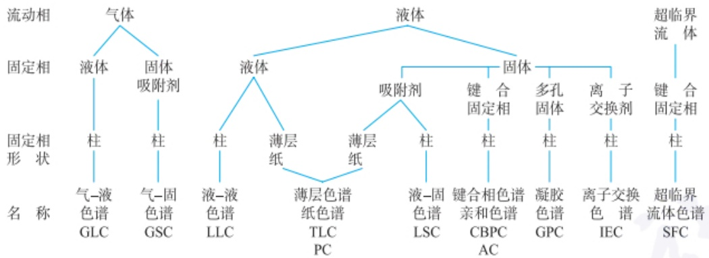

<details>
<summary>flowchart</summary>

This image displays a hierarchical classification diagram (tree structure) for chemical analysis, categorizing substances into Liquid and Solid components with their respective sub-types.
</details>

图 8.1.1 色谱分析法分类

气-液色谱的固定相为附着在惰性固体载体表面上的一薄层液体有机物。同样，液相色谱也可分为液-固色谱（liquid-solid chromatography, LSC）和液-液色谱（liquid-liquid chromatography, LLC）。此外，20世纪80年代发展起来的超临界流体色谱法（supercritical fluid chromatography, SFC）利用高于临界压力和临界温度的物质作为流动相，兼有气相色谱和液相色谱的特点。

## 2. 按色谱分离机理分类

在色谱法中，通常利用物质的吸附性能、溶解度差异等物理化学性质进行分离。利用组分在固体吸附剂上吸附能力强弱进行分离的方法称为吸附色谱。利用组分在固定液中溶解度的差异而进行分离的方法称为分配色谱。利用组分（离子型化合物）在离子交换树脂（固定相）上的亲和力的大小不同达到分离的方法称为离子交换色谱。这种色谱分析法广泛应用于无机离子、生物化学中各种核酸衍生物、氨基酸等的分离。利用组分的分子大小不同在多孔固定相中有选择渗透而达到分离的方法称为凝胶色谱或尺寸（空间）排阻色谱，这种色谱分析法主要用于聚合物、生物大分子等的分离。利用固定在载体上的固化分子对组分的专属性亲和力的不同进行分离的方法称为亲和色谱，其常用于分离蛋白质。

## 3. 按固定相的形态分类

色谱分离在柱中进行的称为柱色谱。根据柱管的大小、结构和制备方法不同，又分为填充柱、整体柱、毛细管或开管柱。固定相呈平面状称为平面色谱，它包括固定相以均匀薄层涂覆在玻璃、金属或塑料板上的薄层色谱和以滤纸作为固定相或固定相载体的纸色谱。

## 4. 按色谱动力学过程分类

（1）迎头法。以样品混合物为流动相，与固定相作用力弱的组分最先以纯物质状态流出。其后，吸附或溶解力较强的第二个组分和第一个组分的混合物流出色谱柱，其余类推。
（2）置换法。用与固定相作用力较分离组分强的物质流体作流动相，依次将组分从固定相上置换出来，与固定相作用力弱的组分先被置换洗出。
（3）淋洗法。以与固定相作用力比分离组分弱的流体为流动相，各组分按与固定相作用力、吸附力或溶解力等，从弱到强先后洗出，形成连续、区域宽度逐步展宽的高斯曲线色谱峰。淋洗法是使用最广泛的色谱分析方法。

## 8.1.1.3 色谱分析法的特点

与其他分析方法相比。色谱法具有以下显著的特点:①选择性高。利用高选择性的固定相，可实现物理、化学性质相近的组分分离，如同位素、空间异构体、

## 思考:

色谱与精馏、萃取等分离方法相比较有哪些优缺点？与光谱、质谱相比较有哪些优缺点？

---

8.1 色谱理论基础

397

同分异构体、旋光异构体等。②分离效率高，分析速度快。可在较短时间内分离复杂的多组分混合物。③灵敏度高、样品用量少。使用高灵敏度检测器，可以完成痕量样品的检测。④应用范围广。气相色谱法适用于无机气体和易挥发有机物分离分析。液相色谱适用于高沸点物质、高分子或大分子化合物、生物样品分离分析。离子色谱适用于无机离子、有机酸碱的分离分析。色谱法在石油工业、环境保护、临床化学、药物与药剂、农药、食品、卫生防疫理化检验、司法检验等领域得到广泛应用。⑤色谱的不足之处是对被分离组分的定性较为困难，但目前色谱与质谱等技术的联用已很好地解决了这一问题。

## 8.1.2 色谱参数

## 8.1.2.1 色谱分离过程和流出曲线

## 1. 色谱分离过程

以气相色谱为例描述色谱分离过程:① 当样品由载气携带进入色谱柱与固定相接触时，被固定相溶解或吸附；② 随着载气的不断通入，被溶解或吸附的组分又从固定相中挥发或脱附；③ 挥发或脱附下的组分随着载气向前移动时又再次被固定相溶解或吸附；④ 随着载气的流动，溶解、挥发，或吸附、脱附的过程反复地进行。由于各组分与固定相作用力大小的不同，各组分以不同的速度沿柱子向前移动。在移动过程中，样品各组分在流动相中的浓度和在固定相中的浓度是处于动态平衡状态。一定的温度和压力下，组分在流动相和固定相之间达到平衡时的浓度之比称为分配系数，用 K 表示，

$$
K = \frac {c _ {\mathrm{s}}}{c _ {\mathrm{m}}} \tag {8-1-1}
$$

式中， $c_{s}$  为组分在固定相中的浓度； $c_{m}$  为组分在流动相中的浓度。组分的分配系数 K 越大，在柱上移动速度越慢。当组分一定时，K 主要取决于固定相性质。不同组分在各种固定相上的分配系数 K 不同，因而选择适宜的固定相，增加组分间分配系数的差别，可显著改善分离效果。样品中的各组分具有不同的 K 值是分离的前提，对于某一固定相，如果两组分具有相同的分配系数，则无论如何改善分离条件都无法实现分离。某组分的 K=0 时，即不被固定相保留，最先流出。

## 2. 色谱流出曲线

由检测器测定流出柱体的流动相中各组分浓度，以检测器的信号强度对时间作图，获得色谱流出曲线，即色谱图。一般地说，色谱流出曲线的形状与该组分等温分配曲线的形状有关。等温分配曲线是描述在等温条件下分配系数随组分浓度变化的规律。典型的等温曲线有三种:直线型、凸线型和凹线型，见图8.1.2（a），相应的色谱流出曲线也有三种，如图8.1.2(b)所示。在线性等温曲线（直线型）的色谱体系之下，目标物质的分配系数与浓度无关，其流出曲线呈现完全对称的正常色谱峰，称为线性色谱。非对称的流出曲线称为不正常色谱峰（非线性色谱）。如果目标物质的分配系数随着样品浓度的增加而减小（凸线型），物质更加容易存在于流动相中，导致流出曲线前沿陡峭、后沿拖尾，形成拖尾峰。如果目标物质的分配系数随着样品浓度的增加而增加（凹线型），物质更加容易存在于固定相中，导致流出曲线前沿平伸、后沿陡峭，形成前伸峰。

## 8.1.2.2 色谱基本参数与流出曲线表征

下面以典型的线性色谱为例说明色谱图相关的术语。图8.1.3是两组分混合物的典型色谱图，其中一个组分是不与固定相作用，在柱内无保留值的物质。


气相色谱分离过程的动画

## 思考:

等温分配曲线如何影响色谱峰的形状？

---

398

第八章 色谱分析

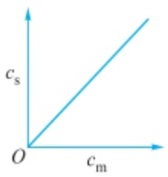

直线型

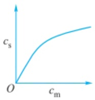

凸线型

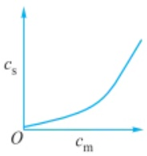

凹线型

(a)

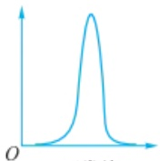

正常峰

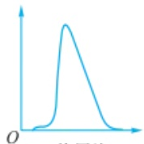

拖尾峰

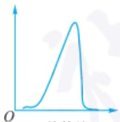

前伸峰

(b)

图 8.1.2 三种等温吸附曲线和对应的色谱峰形状

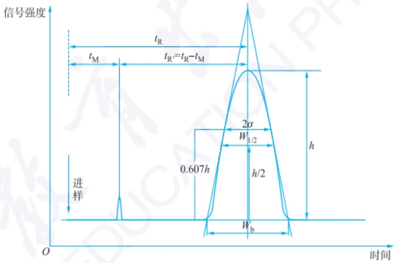

<details>
<summary>line</summary>

| 参数 | 值 |
| --- | --- |
| 0.607h | — |
| \(W_{1}/_{2}\) | — |
| h/2 | — |
| \(W_b\) | — |
| t_R | — |
| t_M | — |
| t_R' = t_R - t_M | — |
</details>

图 8.1.3 色谱流出曲线及参数

（1）基线 当没有组分进入检测器时，色谱流出曲线是一条只反映仪器噪声随时间变化的曲线，称为基线。
(2) 色谱峰 有组分流出色谱柱进入检测器时产生的响应信号的曲线。
（3）峰面积 组分的流出曲线与基线所包围的面积(即峰与峰底之间的面积)，称为该组分的峰面积。常用符号 A 表示。
（4）峰底 色谱峰下面的基线延长线(即从峰的起点与终点之间连接的直线)，称为峰底。
(5) 峰高 色谱峰最高点至峰底的垂直距离,称为峰高。常用符号 h 表示。
(6) 区域宽度 用来衡量色谱峰宽度的参数,有三种表示方法:① 峰宽。沿色谱峰两侧拐点处所作的切线与峰底相交两点之间的距离,常用符号 $W_{b}$ 表示。② 半高峰宽。也称为半峰宽,即在峰高为 0.5 h 处的峰宽,常用符号 $W_{1/2}$ 或 $Y_{1/2}$ 表示。③ 标准偏差。在峰高 0.607 h 处峰宽的一半,常用符号 $\sigma$ 表示, $W_{b} = 4\sigma$ 。
（7）保留值 保留值是表示被测组分在柱中停留时间的数值,常用以下各值表示:
① 保留时间。组分从进样到出现峰最大值所需的时间,称为该组分的保留

---

8.1 色谱理论基础

399

时间,常用符号 $t_{R}$ 表示。

② 死时间。不被固定相滞留的物质(如空气等)的保留时间称为死时间,常用符号  $t_{M}$  表示。
③ 调整保留时间。组分保留时间减去死时间后的值称为该组分的调整保留时间，常用符号  $t_{R}^{\prime}$  表示。
④ 保留体积。组分从进样到出现峰最大值所需的载气或流动相体积,称为该组分的保留体积,常用符号  $V_{R}$  表示。
⑤ 死体积。不被固定相滞留的物质的保留体积称为死体积，常用符号  $V_{M}$  表示。
⑥ 调整保留体积。组分保留体积减去死体积后的值称为该组分的调整保留体积，常用符号  $V_{R}^{\prime}$  表示。
⑦ 相对保留值。在相同操作条件下,组分 2 与参比组分 1 的调整保留值之比:

$$
r _ {2 1} = \frac {t _ {\mathrm{R(2)}} ^ {\prime}}{t _ {\mathrm{R(1)}} ^ {\prime}} = \frac {V _ {\mathrm{R(2)}} ^ {\prime}}{V _ {\mathrm{R(1)}} ^ {\prime}} \tag {8-1-2}
$$

气相色谱中，相对保留值 $r_{21}$ 只与柱温和固定相性质有关，与其他色谱操作条件无关。它表示了固定相对这两种组分的选择性。相对保留值也称为分离因子 $(\alpha)$ 或选择性因子，它仅考虑了色谱分离过程中热力学因素的影响，没有考虑动力学因素的影响，故不能反映两物质的实际分离情况。

## 8.1.2.3 色谱基本关系式

色谱分析中其他相关的重要参数及关系式如下。

## 1. 分配比

在实际工作中,除分配系数外也常用分配比,也称容量因子 k,来表征组分在两相间分配平衡过程。分配比是指一定温度下,组分在固定相和流动相中的质量比:

$$
k = \frac {m _ {\mathrm{s}}}{m _ {\mathrm{m}}} \tag {8-1-3}
$$

$m_{s}$  和  $m_{m}$  分别为组分在固定相和流动相中的质量。分配比也是衡量色谱分离柱对组分保留能力的参数，其数值越大，组分的保留时间越长。分配比与分配系数的不同在于分配比不仅与组分和两相性质有关，还与两相体积有关。分配系数无法直接由实验获得，但分配比可以由实验测得组分的保留值后计算获得。

## 2. 分配比 $k$ 与分配系数 $K$ 的关系

二者的关系可用下式来表示:

$$
k = \frac {m _ {\mathrm{s}}}{m _ {\mathrm{m}}} = \frac {\frac {m _ {\mathrm{s}}}{V _ {\mathrm{s}}} V _ {\mathrm{s}}}{\frac {m _ {\mathrm{s}}}{V _ {\mathrm{m}}} V _ {\mathrm{m}}} = \frac {c _ {\mathrm{s}}}{c _ {\mathrm{m}}} \cdot \frac {V _ {\mathrm{s}}}{V _ {\mathrm{m}}} = \frac {K}{\beta} \tag {8-1-4}
$$

式中  $\beta$  为相比, 即流动相与固定相体积比。

$$
\beta = \frac {V _ {\mathrm{m}}}{V _ {\mathrm{s}}}
$$

## 3. 分配比与保留时间的关系

为了利用色谱参数求得分配比,需要建立分配比与保留时间的关系式。由滞留因子 $R_{s}$ 与流动相的流速u和组分在柱内的线速度 $u_{s}$ 可推导出分配比k与保留

组分在柱内移动的快慢可用相对于流动相在柱内移动线性速度来表示,即

$$
R _ {\mathrm{s}} = \frac {u _ {\mathrm{s}}}{u}
$$

式中，u 为流动相线速度， $u_{s}$  为组分在柱内的线速度， $R_{s}$  称为保留比。由  $u = \frac{L}{t_{M}}; u_{s} = \frac{L}{t_{R}}$  (L 为柱长) 可得

$$
R _ {\mathrm{s}} = \frac {t _ {\mathrm{M}}}{t _ {\mathrm{R}}}
$$

保留比  $R_{s}$  亦称为滞留因子, 保留比的大小反映出该组分在流动相的分配比例数。例如, 不被固定相滞留组分的  $R_{s}$  值为 1, 即该组分 100% 分配在流动相中, 用组分在流动相的分配比例数表示, 保留比可表示为

$$
R _ {\mathrm{s}} = \frac {m _ {\mathrm{m}}}{m _ {\mathrm{s}} + m _ {\mathrm{m}}} = \frac {1}{1 + k}
$$

由此可推出式(8-1-5)。

---

400

第八章 色谱分析

时间的关系式:

$$
k = \frac {t _ {\mathrm{R}} - t _ {\mathrm{M}}}{t _ {\mathrm{M}}} = \frac {t _ {\mathrm{R}} ^ {\prime}}{t _ {\mathrm{M}}} \tag {8-1-5}
$$

从式中可以看出容量因子越大,保留时间越长。

## 4. 分配系数与分离温度的关系

分配系数是物质的一种热力学参数,因此温度变化必然要影响到溶质在两相中的分配。对于一定的溶质、流动相和固定相,溶质的分配系数与分离温度间存在以下关系:

$$
\lg K = \frac {a}{T _ {\mathrm{c}}} + b \tag {8-1-6}
$$

式中，a, b 为常数； $T_{c}$  为分离时的热力学温度。

由上式可见,分离温度越高,分配系数越小,即溶质在流动相中的浓度越大,在色谱柱中的保留时间越短,流出色谱柱也越快。

## 8.1.3 色谱理论

色谱分析研究的是混合物的分离分析问题,因此,色谱理论一方面需要解决的问题是如何评价色谱的分离效果,即建立分离及柱效的评价指标体系及柱效与色谱参数间的关系等;另一方面则是讨论影响分离及柱效的因素,在理论的指导下寻找提高柱效的途径。色谱分离过程涉及热力学和动力学两个方面,组分保留时间受色谱分离过程中的热力学因素控制(温度及流动相和固定相的结构与性质),色谱峰变宽则受色谱分离过程中的动力学因素控制(组分在两相中的运动情况)。因此,色谱理论实际上主要研究的是这两方面的问题。色谱分析中的基本理论有塔板理论和速率理论。塔板理论是一种半经验理论,从热力学的观点解释了色谱流出曲线,给出了柱效的评价指标。速率理论从动力学的角度出发,讨论了影响分离的因素及提高柱效的途径。

## 8.1.3.1 塔板理论

色谱与精馏分离有共同的物理化学基础，即被分离组分在两相中分布常数的差别构成组分分离的基础。在平衡色谱理论的基础上，Martin 和 Synge 将色谱柱内混合物分离过程与精馏塔的精馏分离类比，将色谱柱假设分成许多类似精馏塔塔板的区域。把连续的色谱分离过程看成这许多塔板中分配平衡过程的重复，于是就产生了著名的塔板理论。

## 1. 塔板理论的假设

塔板理论把色谱柱比拟为一个蒸馏塔，每个塔板的高度为 $H$ ，称为理论塔板高度。当物质进入柱内就在两相间进行分配，并假设:① 色谱柱由一系列内径一致、填充均匀，被称为塔板的若干小段组成，其高度均相等，以 $H$ 表示，称为塔板高度。② 溶质在每个塔板上的分布常数或分配系数不变，在两相间瞬间达成分布或分配平衡，纵向分子扩散可以忽略，即属于线性理想色谱。③ 流动相流经色谱柱不是连续的，而是脉冲式的间歇过程，每次进入和从上一个塔板向下一个塔板转移的流动相体积相等，为一个塔板的流动相体积 $\Delta V_{\mathrm{m}}$ 。

## 2. 色谱流出曲线方程

根据塔板理论的假设,组分在任一塔板上的分数可由二项式展开计算,对于塔板数较少的分离过程,色谱流出曲线是一个离散型的二项分布。当塔板数足够大,流动相传质的塔板体积数足够多时,曲线趋向于对称的连续分布,并可作近似

---

8.1 色谱理论基础

401

于正态分布处理。这样，流出曲线上的组分浓度与流动相体积关系可由色谱流出曲线方程表达:

$$
c = \frac {\sqrt {n} m}{\sqrt {2 \pi} V _ {\mathrm{R}}} \times \exp \left[ - \frac {n}{2} \times \left(\frac {V _ {\mathrm{R}} - V}{V _ {\mathrm{R}}}\right) ^ {2} \right] \tag {8-1-7}
$$

式中，m 为组分的进样质量；n 为塔板数；V 为柱后流出的组分浓度为 c 时，通过柱的流动相体积。上式也称为塔板理论方程。

## 3. 塔板公式

从塔板理论方程出发,可以推导出理论塔板计算公式,即理论塔板数与色谱参数之间的关系:

$$
n = 5. 5 4 \left(\frac {t _ {\mathrm{R}}}{W _ {1 / 2}}\right) ^ {2} = 1 6 \left(\frac {t _ {\mathrm{R}}}{W _ {\mathrm{b}}}\right) ^ {2} \tag {8-1-8}
$$

假设色谱柱长为 L，则塔板的高度可按下式计算:

$$
H = \frac {L}{n} \tag {8-1-9}
$$

由于保留时间 $t_{\mathrm{R}}$ 中包括了死时间 $t_{\mathrm{M}}$ ，组分在 $t_{\mathrm{M}}$ 时间内不参与柱内分配。为了扣除死时间的影响，引入以调整保留时间 $t_{\mathrm{R}}^{\prime}$ 计算的有效塔板数 $n_{\mathrm{eff}}$ 和有效塔板高度 $H_{\mathrm{eff}}$ 作为柱效指标:

$$
n _ {\mathrm{eff}} = 5. 5 4 \left(\frac {t _ {\mathrm{R}} ^ {\prime}}{W _ {1 / 2}}\right) ^ {2} = 1 6 \left(\frac {t _ {\mathrm{R}} ^ {\prime}}{W _ {\mathrm{b}}}\right) ^ {2} \tag {8-1-10}
$$

$$
H _ {\mathrm{eff}} = \frac {L}{n _ {\mathrm{eff}}} \tag {8-1-11}
$$

## 4. 塔板理论的特点和不足

（1）当色谱柱长度一定时，塔板数 n 越大（塔板高度 H 越小），被测组分在柱内被分配的次数越多，柱效能越高，所得色谱峰越窄。
（2）不同物质在同一色谱柱上的分配系数及理论塔板数不同，用塔板数和塔板高度作为衡量柱效能的指标时，应指明测定物质。
（3）柱效并不能表示被分离组分的实际分离效果，当两组分的分配系数 K 相同时，无论该色谱柱的塔板数多大，都无法分离。
（4）塔板理论无法解释同一色谱柱在不同的载气流速下柱效不同的实验结果，也无法指出影响柱效的因素及提高柱效的途径。

## 8.1.3.2 速率理论

塔板理论是从热力学角度处理色谱过程，而在色谱分离过程中热力学平衡不是瞬时的，其全过程是一个动力学过程。1956年，van Deemter等以气相色谱为对象提出速率理论，速率理论是将塔板理论中的塔板高度概念与组分在两相中的扩散和传质联系起来，认为色谱柱效受涡流扩散、分子扩散、两相间传质阻力等影响，它们是谱带展宽的主要因素。根据三个扩散过程对塔板高度 $H$ 的影响，导出速率方程即van Deemter方程:

$$
H = A + \frac {B}{u} + C \cdot u \tag {8-1-12}
$$

式中， $A$ 为涡流扩散项； $B / u$ 为分子扩散项； $C\cdot u$ 为传质阻力项； $u$ 为流动相线速度。由上式可见，减小 $A,B,C$ 可提高柱效，但这三项各与哪些因素有关是需要进一步讨论的。


色谱流出曲线表达式的推导过程

除了速率理论中表现的影响柱效因素,还有哪些影响谱带展宽的其他因素?

1. 等温分配曲线的非线性。由于等温线的非线性决定了分配系数不是常数，而是浓度的函数，使谱带的高浓度区域（中心附近）和低浓度区域（前沿和尾部）的分子的移动速率不等，造成色谱峰“拖尾”或“前伸”现象，从而使峰展宽。
2. 活性中心的影响。由于固相载体表面存在的活性中心对极性强的组分会产生吸附，使这些组分释放的速度慢于其他分子而造成拖尾。
3. 柱外效应。在色谱柱以外的某些因素，使谱带展宽，降低柱的实际分离效率的现象称为柱外效应。造成柱外效应的因素有两类:柱前后死体积和与进样有关的技术。

---

402

第八章 色谱分析


涡流扩散项的动画


分子扩散项的动画

由速率方程式中塔板高度对流速的一阶导数等于零可求得最佳流速 $(u_{\mathrm{opt}})$ 和最小塔板高度 $(H_{\min})$

$$
\frac {\mathrm{d} H}{\mathrm{d} u} = - \frac {B}{u ^ {2}} + C = 0
$$

$$
u _ {\mathrm{opt}} = \sqrt {\frac {B}{C}}
$$

$$
H _ {\min} = A + 2 \sqrt {B C}
$$


传质阻力项的动画

## 1. A—涡流扩散项

流动相由于受到固定相的阻碍,不断改变运动的方向和路径,发生类似“涡流”,使同一组分出柱的时间有差异,从而引起峰扩展,涡流扩散项亦称多路径项。峰扩展程度用下式表示:

$$
A = 2 \lambda d _ {\mathrm{p}} \tag {8-1-13}
$$

式中， $d_{p}$  为固定相的平均颗粒直径； $\lambda$  为固定相的填充不均匀因子。

涡流扩散项的大小与固定相的平均颗粒直径 $(d_{\mathrm{p}})$ 和填充是否均匀有关，而与流动相的流速无关。固定相颗粒越小，填充得越均匀，A项的值越小，柱效越高，表现在涡流扩散所引起的色谱峰变宽现象减轻，色谱峰较窄。涡流扩散项与组分、流动相性质和线速度无关，开管柱无此项，A=0。

## 2. B/u—分子扩散项

分子扩散项是由组分在流动中的浓差扩散所引起的。当样品以很窄的“塞子”形式进入色谱柱，并随流动相移动时，由于浓度梯度的影响，样品中的组分分子以样品带为中心向两边纵向扩散，从而导致色谱峰变宽，柱效下降。分子扩散与组分通过路径的弯曲程度和扩散系数有关，用下式表示:

$$
B = 2 \nu D _ {\mathrm{g}} \tag {8-1-14}
$$

式中， $\nu$  为因颗粒大小不规则引起流动相扩散路径弯曲的因子，简称弯曲因子；填充柱色谱， $\nu<1;D_{g}$  为样品组分分子在气相中的扩散系数 $\left(\mathrm{cm}^{2}\cdot\mathrm{s}^{-1}\right)$ 。分子扩散项与流速有关，流速越小，组分在色谱柱内滞留时间越长，扩散越严重。

组分分子在气相中的扩散系数要比在液相中的大 $10^{5} \sim 10^{6}$ 倍，故气相色谱中的分子扩散要比液相色谱中的严重。在气相色谱中，采用摩尔质量较大的载气，可使 $D_{\mathrm{g}}$ 值减小，两者之间存在如下关系:

$$
D _ {\mathrm{g}} \propto (M _ {\mathrm{载气}}) ^ {- 1 / 2} \tag {8-1-15}
$$

## 3. $C \cdot u$ —传质阻力项

色谱分离过程中，溶质在流动相和固定相之间进行质量传递。色谱过程处于连续流动状态，由于溶质分子与固定相、流动相分子间存在相互作用，有限传质速率导致溶质分子不可能在两相中瞬间建立吸附（或溶解）-解吸（或挥发）的分配平衡，而总是处于非平衡状态。有些溶质分子未能进入固定相就随流动相前进，发生分子超前；而有些溶质分子在固定相未能分布平衡并解吸进入流动相，发生分子滞后；从而造成谱带展宽。流动相流速越快，提供给平衡的时间越少，不平衡和离散越严重。因而传质对塔板高度影响与流动相流速成正比。

传质阻力包括气相传质阻力  $C_{g}$  和液相传质阻力  $C_{L}$ ，即

$$
C = C _ {\mathrm{g}} + C _ {\mathrm{L}} \tag {8-1-16}
$$

液相传质阻力大于气相传质阻力。气相传质阻力  $C_{g}$  是容量因子的一个复杂函数，正比于填料粒径  $d_{p}$  的平方，反比于溶质在气相中的扩散系数  $D_{g}$ 。

$$
C _ {\mathrm{g}} = 0. 0 1 \frac {k ^ {2}}{(1 + k) ^ {2}} \cdot \frac {d _ {\mathrm{p}} ^ {2}}{D _ {\mathrm{g}}} \tag {8-1-17}
$$

液相传质阻力  $C_{L}$  亦是容量因子的一个复杂函数，与载体上的固定液膜厚度  $d_{f}$  的平方成正比，与溶质在固定液中的扩散速度  $D_{1}$  成反比。

$$
C _ {\mathrm{L}} = \frac {2 k}{3 (1 + k) ^ {2}} \cdot \frac {d _ {\mathrm{f}} ^ {2}}{D _ {\mathrm{l}}} \tag {8-1-18}
$$

除了式子中的参数, $C_{L}$ 还与固定液的性质、组分的性质、柱温和载气流速

---

8.1 色谱理论基础

403

有关。

van Deemter 方程对选择最佳分离条件具有普遍的意义,表明了色谱柱填充的均匀程度、固定相颗粒大小、流动相的种类和线速度、固定相液膜的厚度及柱温等对柱效的影响。

速率方程式中，A项与流动相流速无关，B、C两项对理论塔板高度的贡献随流动相流速的改变而不同。流动相流速较高时，传质阻力项是影响柱效的主要因素。流速增加，传质不能快速达到平衡，柱效下降。载气流速低时样品由高浓度区向两侧纵向扩散加剧，分子扩散项成为影响柱效的主要因素，流速增加，柱效增加。由于流速对B、C两项的作用完全相反，流速对柱效的总影响使得存在一个最佳流速值，即速率方程中理论塔板高度对流速的一阶导数有一极小值。以理论塔板高度H对应流动相线速度作图得到图8.1.4，曲线最低点的流速即为最佳流速。

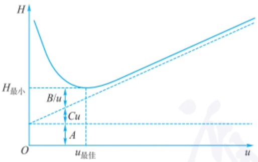

<details>
<summary>line</summary>

| Point | Description |
| --- | --- |
| H | Minimum value of H |
| u | Ultimate capacity at u=最佳 |
| Cu | Capacity at u=最佳 |
| A | Point on the curve below the minimum |
| B/u | Point above the dashed line at u=u |
| u | Point at u=u |
</details>

图 8.1.4 色谱柱效与载气流速关系

由以上的讨论,可以归纳出速率理论的要点:

（1）组分分子在柱内运行的多路径与涡流扩散、浓度梯度造成的分子扩散及传质阻力使气液两相间分配平衡不能瞬间达到等因素是造成色谱峰扩展、柱效下降的主要原因。
（2）通过选择适当的固定相粒度、载气种类、液膜厚度及载气流速可提高柱效。
（3）为色谱分离和操作条件选择提供了理论指导，阐明了流速对柱效及分离的影响。
（4）各种因素相互制约，如载气流速增大，分子扩散项的影响减小，使柱效提高，但同时传质阻力项的影响增大，又使柱效下降；柱温升高，有利于传质，但又加剧了分子扩散的影响，选择最佳条件，才能使柱效达到最高。

van Deemter 方程是以填充柱气相色谱为对象提出的,对于高效液相色谱和毛细管开管柱色谱,由于流动相性质和柱结构的不同,其速率方程具有不同的表达式,具体内容将放到后面的章节讨论。

## 8.1.3.3 分离度

塔板理论和速率理论都难以描述分离物质对的实际分离程度,难分离物质对的分离程度大小受色谱分离过程中两个因素的综合影响:色谱柱的选择性(分配系数、保留值之差)——色谱分离过程中的热力学因素;柱效(色谱峰区域宽度)——色谱分离过程中的动力学因素。图8.1.5说明柱效和选择性对分离度的影响。①柱效较高, $\Delta K$ （分配系数差）较大,完全分离;② $\Delta K$ 不是很大,柱效较高(峰较窄),基本上完全分离;③柱效较低, $\Delta K$ 较大,但分离得不好;④ $\Delta K$ 小,

»例 8.1.1 在一定条件下,两个组分的保留时间分别为 12.2 s 和 12.8 s,计算分离度(柱长 1 m, n=3600)。要达到完全分离,即 R=1.5,求所需要的柱长。

$\gg$ 解: $W_{\mathrm{bl}} = 4\frac{t_{\mathrm{Rl}}}{\sqrt{n}} = \frac{4\times 12.2}{\sqrt{3600}}$

$$
= 0. 8 1 3 3
$$

$$
W _ {\mathrm{h2}} = 4 \frac {t _ {\mathrm{R2}}}{\sqrt {n}} = \frac {4 \times 1 2 . 8}{\sqrt {3 6 0 0}} = 0. 8 5 3 3
$$

$$
R = \frac {2 \times (1 2 . 8 - 1 2 . 2)}{0 . 8 5 3 3 + 0 . 8 1 3 3} = 0. 7 2
$$

$$
L _ {2} = \left(\frac {R _ {2}}{R _ {1}}\right) ^ {2} \times L _ {1} = \left(\frac {1 . 5}{0 . 7 2}\right) ^ {2} \times 1 \mathrm{m} = 4. 3 4 \mathrm{m}
$$

---

404

第八章 色谱分析

柱效低,分离效果更差。

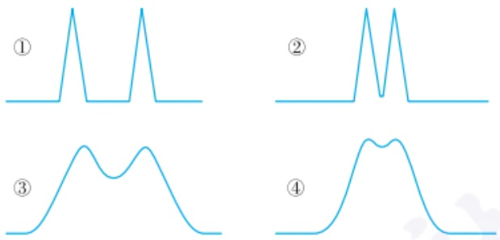

图 8.1.5 色谱分离中的四种情况

考虑色谱分离过程中的热力学和动力学因素,引入分离度(R)来定量描述样品中相邻两组分的实际分离程度。分离度的表达式:

$$
R = \frac {2 (t _ {\mathrm{R2}} - t _ {\mathrm{R1}})}{W _ {\mathrm{h2}} + W _ {\mathrm{h1}}} \tag {8-1-19}
$$

若相邻两峰峰底宽近似相等,则

$$
R = \frac {t _ {\mathrm{R2}} - t _ {\mathrm{R1}}}{W} = \frac {t _ {\mathrm{R2}} ^ {\prime} - t _ {\mathrm{R1}} ^ {\prime}}{W} \tag {8-1-20}
$$

## 思考:

根据分离度方程,如何优化色谱操作条件来提高分离度?

当 R=0.8，两峰的分离程度可达 89%；R=1.0，分离程度 98%；R=1.5，分离程度达 99.7%（相邻两峰完全分离的标准）。引入相对保留值  $r_{21}$ （或分离因子  $\alpha$ ），可导出有效塔板数 ( $n_{eff}$ ) 和分离度 (R) 的关系:

$$
R = \frac {r _ {2 1} - 1}{r _ {2 1}} \sqrt {\frac {n _ {\mathrm{eff}}}{1 6}} \tag {8-1-21}
$$

$$
n _ {\mathrm{eff}} = 1 6 R ^ {2} \left(\frac {r _ {2 1}}{r _ {2 1} - 1}\right) ^ {2} \tag {8-1-22}
$$

分离过程中需要考虑的其他因素有分离速度、色谱柱容量等。

上式可近似估计达到分离两组分的有效塔板数,进而计算分离两组分所需的柱长:

$$
L = 1 6 R ^ {2} \left(\frac {r _ {2 1}}{r _ {2 1} - 1}\right) ^ {2} \cdot H _ {\mathrm{eff}} \tag {8-1-23}
$$

将理论塔板数 n、分离因子  $\alpha$ 、分配比 k 引入分离度的定义式, 可得到分离方程:

$$
R = \frac {\sqrt {n}}{4} \cdot \frac {\alpha - 1}{\alpha} \cdot \frac {k _ {2}}{1 + k _ {2}} \tag {8-1-24}
$$

式中，下标2为相邻两组分中的第二组分，该方程可看出分离度受三个因素影响:柱效 $n$ ，分离因子 $\alpha$ ，容量因子 $k$ 。由分离方程可推出以下结论:①分离度与理论塔板数的平方根成正比。②分离因子 $\alpha$ 越大，柱子的选择性越好，分离效果越好。当 $\alpha$ 趋近1时，增加 $\alpha$ 对提高分离度显著。但当 $\alpha$ 趋近1.5后，$\alpha$ 的改进对分离度的影响较小。③分配比 $k$ 值较大，对 $R$ 有利。当 $k$ 值超过10时，对分离度的改进不明显，而保留时间却大大延长。

## 8.1.4 色谱定性与定量分析方法

色谱分析的目的是获得样品的组成和各组分含量等信息,但在所获得的色谱图中,并不能直接给出每个色谱峰代表何种组分及其准确含量。因此需要一定的分析方法来实现色谱定性和定量分析。

---

8.1 色谱理论基础

405

## 8.1.4.1 色谱定性鉴定方法

色谱法不能提供组分分子的结构信息,色谱法定性属于间接法,常用的有以下几种方法:

## 1. 利用标准物质定性

（1）利用保留值定性:通过对比样品中具有与标准样相同保留值的色谱峰，来确定样品中是否含有该物质。
（2）利用加入法定性:将标准样加入样品中，观察各组分色谱峰的相对变化，确定与标准样相同的组分。对于分离不完全的组分，需要在两支不同的色谱柱上进行对比。

## 2. 利用文献保留值定性

气相色谱中，相对保留值 $r_{21}$ 仅与柱温和固定液性质有关。在色谱手册中都列有各种物质在不同固定液上的保留数据，可以用来进行定性鉴定。此外，还可以利用保留指数定性。保留指数又称Kovats指数 $(I)$，是一种重现性较好的定性参数。其测定方法为:将正构烷烃作为标准，规定其保留指数为分子中碳原子个数乘以100（如正己烷的保留指数为600）。其他物质的保留指数 $(I_x)$ 是通过选定两个相邻的正构烷烃，其分别具有 $Z$ 和 $Z + 1$ 个碳原子。被测物质 $x$ 的调整保留时间应在相邻两个正构烷烃的调整保留值之间。则 $x$ 的保留指数为

$$
t _ {\mathrm{R} (Z + 1)} ^ {\prime} > t _ {\mathrm{R} (x)} ^ {\prime} > t _ {\mathrm{R} (Z)} ^ {\prime}
$$

$$
I _ {x} = 1 0 0 \left(\frac {\lg t _ {\mathrm{R(x)}} ^ {\prime} - \lg t _ {\mathrm{R(Z)}} ^ {\prime}}{\lg t _ {\mathrm{R(Z+1)}} ^ {\prime} - \lg t _ {\mathrm{R(Z)}} ^ {\prime}} + Z\right) \tag {8-1-25}
$$

将测得的 $I_{x}$ 值与文献值对照,即可做出判断。

## 3. 利用色谱与其他仪器联用定性

目前,利用色谱对混合物的高分离能力和其他结构鉴定仪器相结合发展起来的联用技术,使得色谱分析的定性问题得到很好的解决,成为当今最有效的复杂混合物成分分离、鉴定技术。相关技术将在后面的章节介绍。

## 8.1.4.2 色谱定量分析方法

利用色谱法可以确定混合样中各组分的含量。在一定的色谱分离条件下，色谱检测器的响应信号值（即色谱峰面积）与进入检测器的物质质量（或浓度）成正比，这是色谱定量分析的基础。

## 1. 峰面积的测量

常用的峰面积测量方法有峰高乘半峰宽法、峰高乘峰宽法、峰高乘保留时间法、峰高乘平均峰宽法。目前由于色谱仪与计算机相结合的色谱工作站的广泛使用，实现了自动采集数据和峰面积测量，其准确度高于手工测量。

## 2. 定量校正因子

在定量分析中，质量相同的不同物质在同一检测器上的色谱响应值不同，同一物质在不同检测器上的色谱响应值也不相同。因此，不能用峰面积等响应值来直接计算物质的含量。需要用标准物质对峰面积进行校正，用校正后峰面积计算物质的含量。样品中各组分质量与其色谱峰面积成正比，即

$$
m _ {\mathrm{i}} = f _ {\mathrm{i}} A _ {\mathrm{i}} \tag {8-1-26}
$$

比例系数 $f_{i}$ 称为绝对校正因子。

由于绝对校正因子受进样量和色谱条件影响大,难以测准和直接应用,常采用相对校正因子 $f_{i}^{\prime}$ ,即组分的绝对校正因子与标准物质的绝对校正因子之比:

## 思考:

根据色谱保留值,是否可以对未知结构的新化合物进行定性鉴定?

## 思考:

对比各种定量分析方法的优缺点,掌握如何根据需要选择合适的定量分析方法。

---

406

第八章 色谱分析

$$
f _ {\mathrm{i}} ^ {\prime} = \frac {f _ {\mathrm{i}}}{f _ {\mathrm{s}}} = \frac {m _ {\mathrm{i}} / A _ {\mathrm{i}}}{m _ {\mathrm{s}} / A _ {\mathrm{s}}} = \frac {m _ {\mathrm{i}} A _ {\mathrm{s}}}{m _ {\mathrm{s}} A _ {\mathrm{i}}} \tag {8-1-27}
$$

式中， $m_{i}$  和  $m_{s}$  为待测物质和标准物质的量，当  $m_{i}$ 、 $m_{s}$  以 mol 为单位时，所得相对校正因子称为相对摩尔校正因子，用  $(f_{\mathrm{M}}^{\prime})$  表示；当  $m_{i}$ 、 $m_{s}$  用质量单位时，所得相对校正因子称为相对质量校正因子，以  $(f_{\mathrm{W}}^{\prime})$  表示。

## 3. 常用的几种定量方法

（1）归一化法 当样品中有 n 个组分，各组分的量分别为  $m_{1}, m_{2}, m_{3}, \cdots, m_{n}$ ，则

$$
w_{\mathrm{i}} = \frac{m_{\mathrm{i}}}{m_1 + m_2 + \cdots + m_n}\times 100\% = \frac{f_{\mathrm{i}}^{\prime}A_{\mathrm{i}}}{f_1^{\prime}A_1 + f_2^{\prime}A_2 + \cdots + f_n^{\prime}A_n}\times 100\% \tag{8 - 1 - 28}
$$

归一化法简便、准确；进样量的准确性和操作条件的变动对测定结果影响不大；但仅适用于样品中所有组分全出峰，并已知定量校正因子的情况。

（2）外标法 外标法也称为标准曲线法。即配制一系列标准溶液进行色谱分析，在严格一致的条件下，由所测得的峰面积对应浓度作图，得到标准曲线。外标法不使用校正因子，准确性较高；操作条件变化对结果准确性影响较大；对进样量的准确性控制要求较高，适用于大批量样品的快速分析。
（3）内标法 在样品中加入能与所有组分完全分离的已知质量的内标物质，用相应的校正因子校正待测组分的峰面积值并与内标物质的峰面积值进行比较，求出待测组分的含量的方法，称为内标法。内标法中使用的内标物要符合以下要求:样品中不含有该物质；内标物最好与组分性质接近；内标物不能与样品发生化学反应；内标峰与组分峰靠近但对组分峰无影响；内标物能准确称量。准确称取一定量的样品 $m$ ，加入一定量内标物 $m_{s}$ ，则

$$
\frac {m _ {\mathrm{i}}}{m _ {\mathrm{s}}} = \frac {f _ {\mathrm{i}} ^ {\prime} A _ {\mathrm{i}}}{f _ {\mathrm{s}} ^ {\prime} A _ {\mathrm{s}}} \tag {8-1-29}
$$

$$
m _ {\mathrm{i}} = m _ {\mathrm{s}} \frac {f _ {\mathrm{i}} ^ {\prime} A _ {\mathrm{i}}}{f _ {\mathrm{s}} ^ {\prime} A _ {\mathrm{s}}} \tag {8-1-30}
$$

$$
w _ {\mathrm{i}} = \frac {m _ {\mathrm{i}}}{m} \times 100\% = \frac {m _ {\mathrm{s}} \frac {f _ {\mathrm{i}} ^ {\prime} A _ {\mathrm{i}}}{f _ {\mathrm{s}} ^ {\prime} A _ {\mathrm{s}}}}{m} \times 100\% = \frac {m _ {\mathrm{s}}}{m} \times \frac {f _ {\mathrm{i}} ^ {\prime} A _ {\mathrm{i}}}{f _ {\mathrm{s}} ^ {\prime} A _ {\mathrm{s}}} \times 100\% \tag {8-1-31}
$$

内标法的准确性较高,操作条件和进样量的稍许变动对定量结果的影响不大,但操作烦琐,每个样品的分析,都要进行两次称量,不适合大批量样品的快速分析。

## 习题

## - 章节练习题 -

1. 色谱分离过程中的热力学因素和动力学因素分别由哪两个参数表现出来？两个色谱峰的保留时间相差较大，就一定分离完全了吗？
2. 试列出影响色谱谱带展宽的各种因素。
3. 色谱定量分析为什么要引入定量校正因子？常用定量校正因子有哪几种表示方式？如何测定？
4. 在其他色谱条件不变的情况下, 若色谱柱的理论塔板数增加一倍, 则两相

---

8.2 气相色谱法

407

邻峰的分离度将增加多少倍？

## - 挑战性问题 -

5. 色谱的分离过程是十分复杂的,教材中只讲授了较简单的线性色谱理论,对于非线性色谱的非平衡热力学分离过程,应如何用理论来描述?

## - 专题或报告 -

6. 查阅文献,介绍最新的色谱分离技术和最前沿的应用领域,并将结果写成报告。

## 8.2 气相色谱法

以气体作为流动相的色谱分析法称为气相色谱法(GC)，是色谱中最重要的分支之一。本节主要介绍填充柱和毛细管柱气相色谱法的基本原理、仪器构造、色谱衍生化及分离分析条件的选择，拓展了解气相色谱法的应用与进展。

## 8.2.1 概述

GC 主要适用于分离沸点较低(一般<400 ℃)，易挥发且热稳定性好的组分。采用特殊技术，GC 也可以用于高分子聚合物的结构鉴定和不易挥发、热稳定性差的化合物的分离分析。此外，GC 与其他分析方法联用技术的飞速发展使其应用领域得到进一步的拓展。目前约有 20% 的有机物质可用 GC 进行分析。

## 8.2.1.1 分离原理

GC 主要利用物质的沸点、极性或吸附性质的差异来实现混合物的分离。混合物中各组分在流动相与固定相之间形成分配或吸附平衡。在载气的流动下，各组分在两相之间进行多次分配或吸附/解吸，即使分配系数只有微小差异的组分也能得到很好的分离。与固定相作用较弱的组分先流出色谱柱，而与固定相作用较强的组分后流出色谱柱，这样依次送入检测器测定，达到分离、分析各组分的目的。

## 8.2.1.2 特点

（1）高分离效能 能分离组分极为复杂的混合物，如用毛细管柱可将汽油样品中一百多种烃类化合物一次分离。
(2) 高选择性能分离结构极为相似的组分。
(3) 高灵敏度 可检出极微量的组分 $(10^{-14}\sim10^{-12}g)$ 。
（4）样品用量少 一般以 ng，甚至 pg 计，因此适用于大气、水、食品等样品中痕量污染物质的测定。
（5）分析速度快 一个样品通常可在几分钟或十几分钟完成测定，且操作和数据处理均可由计算机控制和进行。
（6）应用范围较广 具有一定的挥发性且在操作温度下稳定的气、固、液体样品均可测定。

缺点:对于难挥发和热不稳定性物质难以分析。

## 8.2.1.3 一般流程

气相色谱仪器型号较多，随着计算机的广泛使用，仪器的自动化程度也越来越高，但各类仪器的组成基本上相同，均由气路系统、温控系统、进样系统、分离系统（色谱柱）、检测系统和数据处理系统构成。其中色谱柱和检测器是气相色谱仪的两个关键部件。图8.2.1给出了气相色谱仪的基本结构流程。

气相色谱的流动相为气体,称为载气,通常由高压气体钢瓶供给。高压气体


卢佩章院士对我国气相色谱研究的贡献

---

408

第八章 色谱分析

## 红色担体

孔径较小，表孔密集，比表面积较大，机械强度好。缺点是表面存在有活性吸附中心点，适宜涂渍非极性固定液，分离非极性或弱极性组分的样品。

## 白色担体

原料在煅烧前加入了少量助溶剂(碳酸钠)，颗粒疏松，孔径较大，比表面积较小，机械强度较差，但吸附性显著减小，适宜分离极性组分的样品。

硅藻土型担体表面存在有硅羟基及其他杂质，为了改进担体孔隙结构、屏蔽活性中心，使用前通常需要对担体进行表面处理。采取的方法通常有酸洗和碱洗、硅烷化、釉化等。

## 酸洗、碱洗法

酸洗去除载体表面大部分 Al、Fe 等无机杂质，适用于分析酸性和酯类化合物的载体；碱洗主要去除  $Al_{2}O_{3}$  等酸性杂质，适用于分析碱性化合物。

## 硅烷化法

与硅烷化试剂(如二甲基二氯硅烷等)反应生成硅烷醚,去除载体表面硅醇基团。适用于分析易形成氢键的组分,如水、醇和胺等。

## 釉化法

在载体表面产生一层玻璃状的“釉”，起到屏蔽或惰化载体表面硅醇基团的影响。

经减压阀降压后，经过净化装置，由流量调节阀调节至所需压力，再由针形阀和流量计调节保持稳定流量的载气，携带气化后的样品进入分离柱，分离的组分进入检测器，信号经过放大器记录得到色谱图。

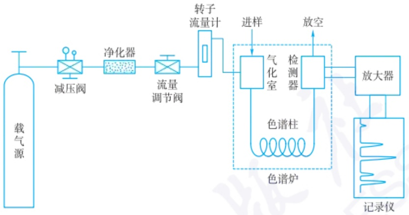

<details>
<summary>flowchart</summary>


</details>

图 8.2.1 气相色谱仪的结构示意图

## 8.2.1.4 分类

GC 按固定相状态分类或分离机理分类: 固定相在使用温度下有两种状态, 用固体作固定相称为气-固色谱法, 其机理通常是利用固体吸附剂对不同组分吸附性能的差异进行分离, 为吸附色谱; 用液体作固定相称为气-液色谱法, 其机理通常是利用不同组分在两相间分配系数的差异进行分离, 为分配色谱。

按色谱柱分类: 填充柱气相色谱法和毛细管柱气相色谱法。

## 8.2.2 填充柱气相色谱法

填充柱是指将固定相填充在柱管内制成的色谱柱。填充柱的固定相种类很多，按照操作条件下固定相的物理状态，可分为固体固定相和液体固定相两大类。

固体固定相主要包括固体吸附剂、高分子多孔微球等。

液体固定相多为高沸点的有机化合物，在操作条件下呈液态，称为固定液。固定液不能直接装在色谱柱内，而是将其涂渍在一种颗粒状的固体表面，这种固体颗粒称为载体（或担体），也是液体固定相的重要组成部分。

填充柱按柱管直径粗细又可分为常规填充柱和填充毛细管柱。常规填充柱使用内径为4\~6 mm的柱管，长2\~4 m。填充毛细管柱使用内径为0.1\~0.5 mm的柱管，长几十甚至上百米，将在8.2.3.1中进一步介绍。

填充柱制备简单,可供选择的固定相和载体种类很多,分析工作中选择合适的固定相是色谱分析的重要任务之一。

## 8.2.2.1 气-液填充柱

## 1. 载体

载体是使固定液能够稳定、均匀地附着在表面，以方便填装到空管柱中的惰性固体颗粒，又称担体。通常有足够大的比表面积和良好的空穴结构，渗透性好；呈化学惰性，不与任何样品和固定液发生化学反应；与固定液具有很好的吸附浸润性；颗粒大小均匀，具有一定的机械强度。

担体主要有硅藻土型和非硅藻土型两大类。目前应用最广的是硅藻土型，由硅藻土煅烧而成。根据制造方法又可分为红色担体和白色担体。非硅藻土型担体，仅在分析一些特殊样品时使用。如玻璃微球、氟载体及氟氯载体（聚三氟氯乙

---

8.2 气相色谱法

409

烯)等。

## 2. 固定液

固定液通常是高沸点、难挥发的有机化合物或聚合物。由于分析样品的多样性，固定液种类繁多，已被使用并可作为色谱固定液的化合物多达数千种。固定液决定了对被分离物质的选择性能力。针对特定的分离对象，人们总是可以从众多类别中选择出适宜的固定液，但同时也需要掌握固定液的分类方法及选择原则。

为了方便选择,需要将固定液进行分类。分类方法包括按极性分类和按化学类型分类两种。

（1）极性 极性是区分和表征固定液特性的重要参数，也是选择固定液的重要参考依据。如果被测组分与固定液分子的极性接近，其与固定液分子间的作用力强，在固定液中的溶解度大，即分配系数大，则被保留的时间将会较长。被测组分在色谱分离过程中的行为与其跟固定液分子间的相互作用力大小有直接关系。

分子间的作用力包括范德华力(定向力、诱导力和色散力)和氢键。在极性固定液上分离极性组分时，分子间的主要作用力为定向力，组分的极性越大，作用力越强。在分离极性组分和可极化组分的混合物时，可利用极性分子与极化分子之间存在的诱导力进行分离。如苯与环己烷的沸点十分接近（80.10℃和80.81℃），采用非极性固定液很难分离。利用苯比环己烷容易极化的特性，采用极性固定液，可使苯产生诱导偶极，保留时间增加，进而实现分离。在非极性固定液上分离非极性和弱极性组分时，主要依靠色散力的差异实现分离。固定液分子中含有—OH、—COOH、COOR、—NH₂、=NH基团时，对含氟、氧、氮化合物具有氢键作用，作用力越强，保留时间越长。

1959 年 Rohrschneider(罗氏)提出相对极性(P)表示色谱固定液的极性。规定非极性固定相角鲨烷(异三十烷)的相对极性为零,强极性固定相  $\beta,\beta'$ -氧二丙腈相对极性为 100。其他固定液的相对极性采用一对物质(如苯与环己烷)实验确定,即分别在角鲨烷、 $\beta,\beta'$ -氧二丙腈及待测固定液的三支色谱柱上测定对物质的调整保留值,按下式计算出待测固定液的相对极性  $P_{x}$ :

$$
P _ {x} = 1 0 0 - \frac {1 0 0 (q _ {1} - q _ {x})}{q _ {1} - q _ {2}} \tag {8-2-1}
$$

$$
q = \lg \frac {t _ {\mathrm{R}} ^ {\prime} (\text {苯})}{t _ {\mathrm{R}} ^ {\prime} (\text {环己烷})} \tag {8-2-2}
$$

式中，下标1、2及x分别表示 $\beta,\beta^{\prime}$ -氧二丙腈、角鲨烷及待测固定液。这样测得的其他各种固定液的相对极性P均在0\~100，每20为一级，分为五个等级，如图8.2.2所示。P的等级在0\~+1的固定液称为非极性固定液，+1\~+2为弱极性固定液，+2\~+3为中等极性固定液，+4\~+5为强极性固定液，非极性固定液也有用“-”表示。

显然，相对极性并不能全面反映组分与固定液之间的全部作用力。1966年罗氏提出了改进方案，采用五种性质不同的化合物作为代表物质，用其保留指数的差值来计算固定液的相对极性，称为罗氏常数。1970年McReynolds(麦氏)在罗氏常数的基础上进一步改进，用于不同种类固定相的极性和选择性评价，更有助于选择固定液。

(2) 化学类型 依据“相似相溶”原则,选择与组分性质相近的固定液。

① 烃类 包括烷烃和芳烃, 极性最弱。
② 聚硅氧烷类 目前应用最为广泛,具有热稳定好、成膜性好、适用温度范

## 罗氏常数测定

选用苯（电子给予体）、乙醇（质子给予体）、甲乙酮（定向偶极力）、硝基甲烷（电子接受体）和吡啶（质子接受体）5种物质为标准物质，在100℃柱温下分别测定它们在待测固定液和角鲨烷之间的保留指数差值 $\Delta I$ 值，将各 $\Delta I$ 值相加，得到表示某待测固定液的总极性，称为罗氏常数。

## 麦氏常数测定

选用10种化合物（苯、正丁醇、2-戊酮、1-硝基丙烷、吡啶、2-甲基-2-戊醇、碘丁烷、2-辛炔、二氧六环、顺八氢化茚），在柱温120℃分别测定它们在待测固定液和参比固定液（角鲨烷）上的保留指数差值 $\Delta I$ ，相加总和即麦氏常数。

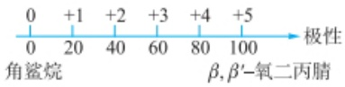

图 8.2.2 固定液极性分级

---

410

第八章 色谱分析

离子液体是一类完全由阴阳离子组成并具有较低熔点或玻璃化转变温度的有机物质。在室温及更低温度下保持液态的离子液体常称为室温离子液体。离子液体具有低挥发性、低熔点、高黏度等特点，其阴阳离子结构单元可以提供多种选择性分子作用，在气相色谱固定相方面具有极大的研究价值和应用前景。

## 固定液需具有哪些基本物理化学性质？

① 挥发性小，在操作温度下具有较低的蒸气压，以免在长时间的载气流动下造成固定液流失。
② 热稳定性好，在工作温度下不发生分解，故每种固定液应给出最高使用温度。
③ 熔点不能太高，在室温下不一定为液体，但在使用温度下一定呈液体状态，以保持样品在气液两相中的分配。故每种固定液也需要给出最低使用温度。
④ 对样品中的各组分有适当的溶解能力,具有高的选择性。
⑤ 化学稳定性好,不与被测物质发生不可逆化学反应。
⑥ 有合适溶剂溶解,使固定液能均匀涂敷在担体表面,形成液膜。

围宽,能够在侧链上引入不同的基团以适应各种需要等优点。不同取代基的聚硅氧烷固定液具有不同极性:

甲基聚硅氧烷，极性较弱。

苯基聚硅氧烷，在硅原子上引入苯基，极性比甲基硅氧烷强。通常，根据引入苯基含量分为低苯基聚硅氧烷（<20%）、中苯基聚硅氧烷（20%\~50%）和高苯基聚硅氧烷（>50%）。

氟烷基聚硅氧烷，在硅原子上引入氟烷基，中等极性固定液。

腈烷基聚硅氧烷，在硅原子上引入腈烷基，极性强，选择性和热稳定性好。

③ 醇类 一种为长链脂肪醇或多元醇,对强极性组分选择性很好,另一种为聚二醇。
④ 酯类 分为酯和聚酯两种,属于中强极性。常用的有邻苯二甲酸酯和己二酸二乙二醇聚酯等。
⑤ 其他类 有机皂土、硝基苯类、聚酰胺类、杂环类，以及手性固定液等。

近年来,离子液体的出现也为传统的分离科学注入了新的活力。

## 8.2.2.2 气-固填充柱

气-固填充柱由固体固定相与金属柱管或玻璃柱管组成。

## 1. 吸附剂

常见的吸附剂有活性炭、硅胶、氧化铝和分子筛等。多用于分离永久性气体及低碳烃类。具有多孔结构，比表面积大；热稳定性好，高温下不易流失；分离机理为吸附-解吸附作用；应用范围较窄。

以分子筛为例,分子筛是硅酸铝的钠盐或钙盐,具有良好的孔穴结构和吸附性能。大于孔穴直径的分子不进入分子筛空穴,从分子筛颗粒间隙流出,先出柱;小于孔穴直径的分子可进入分子筛空穴中,晚出柱。使用注意事项:使用前必须活化,去除孔内吸附的物质;对一些气体产生不可逆吸附,不适合分离  $H_{2}O$ ,  $CO_{2}$ ,  $NO_{2}$ ,  $H_{2}S$ ,  $SO_{2}$ ,  $Cl_{2}$  等;型号不同,分离差异很大。

## 2. 高分子多孔微球(GDX)

由苯乙烯和二乙烯苯共聚而成,是一类合成的有机固定相。可通过控制聚合反应条件得到极性、孔径及比表面积不同的型号。

使用注意事项: 使用前必须活化, 除去未聚合的单体及低沸点物质; 装柱时带有静电, 可用丙酮浸润过的纱布处理; 加热时膨胀明显, 装柱时不宜太紧。

高分子多孔微球和分子筛,既可直接用作气-固色谱固定相,也可涂渍固定液后用作气-液色谱固定相。

## 3. 化学键合固定相

利用化学反应把固定液键合在担体表面。可分析低碳烷烃、烯烃、炔烃、卤代烃及含氧有机化合物、 $CO_{2}$ 等。

## 8.2.2.3 填充柱的制备与评价

## 1. 柱管材料

填充柱的柱管多采用不锈钢和玻璃。玻璃柱的惰性较好，但易碎；不锈钢柱耐用，但表面有一定活性，易引起极性化合物的吸附或降解。玻璃柱常用于极性化合物的分析，但不锈钢柱应用更广泛。

## 2. 填充柱的制备

气-固色谱柱，将处理好的固定相密实而均匀地装入柱管即可。气-液色谱柱，固定相由载体和涂覆在表面的固定液组成。尽可能筛选粒度分布均匀的载体

---

8.2 气相色谱法

411

或固定相颗粒；保证固定液均匀涂覆在载体表面；保证固定相在色谱柱内填充均匀；避免载体颗粒破碎和固定液变质。填充柱的制备尚无规范，均需几个环节，流程如图8.2.3所示。

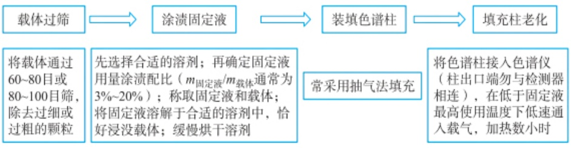

<details>
<summary>flowchart</summary>

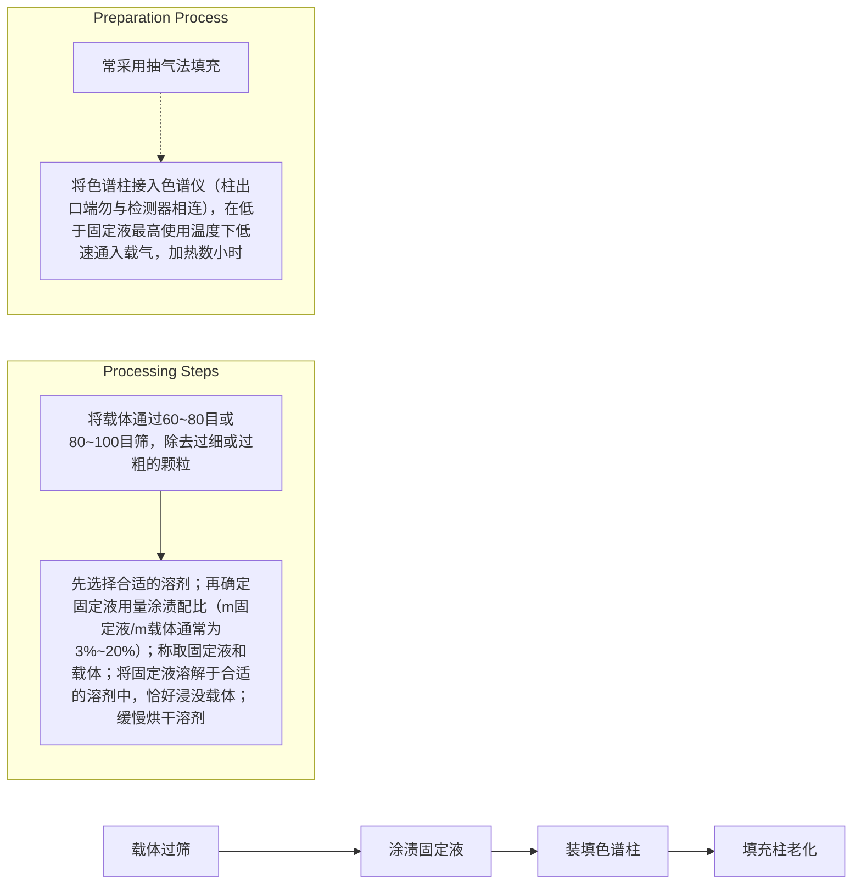
</details>

图 8.2.3 填充柱的制备流程

不同的色谱柱有不同的评价方法。通常性能良好的色谱柱，理论塔板数可达1500块/m或更高。

## 8.2.3 毛细管柱气相色谱法

与填充柱气相色谱法相比,毛细管柱气相色谱法使用毛细管柱,具有分离能力强、分析速度快、灵敏度高、易于实现色谱-质谱联用等特点,是目前 GC 分析最常用的方法。

1958 年, Golay 基于 van Deemter 方程, 提出毛细管柱速率方程:

$$
H = \frac {B}{u} + C u
$$

毛细管柱多为开管柱，与填充柱相比，具有以下特点:柱内为空腔，涡流扩散 $A = 0$；分子扩散项相似，但因管内无填料，弯曲因子 $\nu = 1$；毛细管柱内壁上的固定相涂层薄，传质阻力小，分析速度快；柱效高，可达5000块/m，柱长可达上百米；柱容量小；载气流量小，更易与质谱的高真空要求及检测器匹配。

## 8.2.3.1 毛细管柱的分类

毛细管柱按照制备方法分为开管型毛细管柱和填充型毛细管柱两大类,其中应用最为广泛的是开管型毛细管柱,固定相涂层在柱内壁上,如图8.2.4。

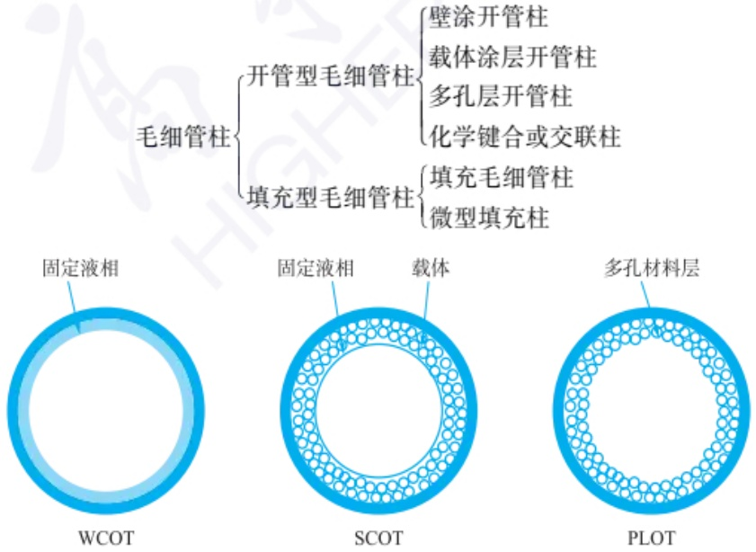

<details>
<summary>flowchart</summary>

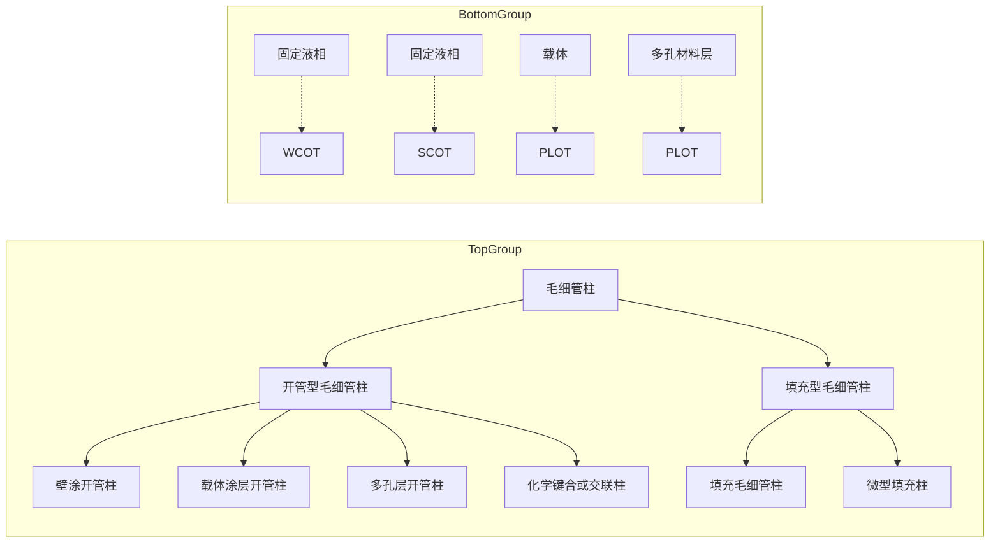
</details>

图 8.2.4 开管型毛细管柱管壁结构示意图


Golay 与毛细管柱色谱

---

412

第八章 色谱分析

静态涂渍法: 是目前毛细管柱制备最常用的方法, 适用于表面张力大或者黏稠的固定液。取一定长度的毛细管柱, 经合适的预处理后, 将一定浓度的固定相溶液 (0.2%\~2%, 质量体积分数) 通入柱内。充满后将色谱柱一端密封, 另一端接真空泵, 在一定温度下缓慢去除溶剂, 形成固定相涂层。

优点: 重现性好, 柱效高。但是柱端封口技术要求较高, 成败关键在于溶剂与封口的截面不能留下气泡, 否则将会部分或者全部将柱内的涂渍液带出柱外。

缺点: 涂渍时间长(几十小时)。

动态涂渍法:适用于黏度低、流动性好的固定液。涂渍厚度取决于涂渍液的黏度、浓度、流动速度及溶剂的挥发速度。方法是先将固定相溶液（10%\~60%，质量体积分数）压入整个色谱柱体积的1/10\~1/5，然后用氮气在一定速度下推动固定相溶液的液柱均匀向前移动，待液柱全部离开柱后，继续通入少量的气流时溶剂挥发完全，使固定液在色谱柱内壁形成涂层。

优点: 简便、快速, 应用广泛。

缺点: 重现性差, 柱效比静态法低, 液膜厚度难以准确预测。

## 1. 开管型毛细管柱

壁涂开管柱（wall coated open tubular column, WCOT 柱）:将固定液均匀涂渍并固化在玻璃或石英毛细管内壁上制成。制备方法相对简单，不足之处在于表面具有硅醇基，导致柱效降低，可对柱表面进行粗糙化或化学改性加以改善。

载体涂层开管柱(support coated open tubular column, SCOT 柱): 将载体微粒固化在毛细管柱内壁上, 再涂渍固定液, 是目前应用最广的壁处理毛细管柱。SCOT 柱的优点是除可以涂渍各类固定液外, 最大允许进样量和柱效相对较高, 固定液膜吸附牢固, 柱寿命较长。

多孔层开管柱(porous layer open tubular column, PLOT 柱): 在毛细管柱内壁上制备(或原位生成)多孔性微粒涂层, 常用于气-固色谱分析。

化学键合或交联柱: 将固定相通过化学反应键合在毛细管柱内壁上或使固定相分子交联在一起。此类色谱柱的热稳定性高。

## 2. 填充型毛细管柱

填充毛细管柱: 将载体、吸附剂等松散地装入玻璃管中, 然后拉制成毛细管。通常柱内径不超过 1.0 mm, 填料的粒度与柱径的比值为 0.2\~0.3, 柱效为 3000\~4000 块/m。

微型填充柱:又称细径填充柱。将已拉制好的直径小于1.0 mm的毛细管,填入涂有固定液的细颗粒填料(30\~50  $\mu$ m)而成,填料的粒度与柱径比小于0.2,柱效可达4000\~6000块/m。

## 8.2.3.2 毛细管柱的制备与评价

## 1. 柱管材料

开管柱的柱管材料大多用熔融石英，即弹性石英柱。由于石英材料受外力作用易脆，拉制成型后需在柱管外壁进行涂层，以增加柱管的柔性。目前广泛使用的聚酰亚胺涂层的最高使用温度为360℃左右，能够满足常规GC要求。对于高温色谱柱，可用镀铝层取代，使用温度可达420℃，但寿命较短。

另一种高温柱材料是不锈钢管内衬石英管，既利用不锈钢的耐高温性能，又利用石英材料的良好涂渍性能，是目前应用较多的高温柱材料。

## 2. 毛细管柱的制备

毛细管柱的制备如图 8.2.5 所示。

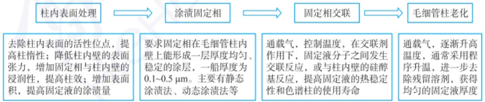

<details>
<summary>flowchart</summary>

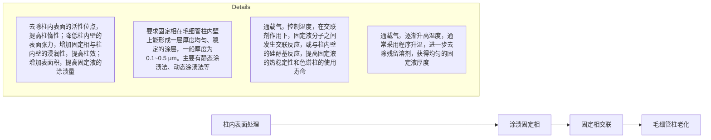
</details>

图 8.2.5 毛细管柱的制备

## 3. 毛细管柱的评价

由于固定相种类多、理化性质差异大，对各色谱柱的性能评价和要求也各不相同。

## (1) 评价指标

柱效:衡量色谱柱形成尖锐峰的能力,用理论塔板数或有效理论塔板数评价。

---

8.2 气相色谱法

413

选择性和分离性能:色谱选择性是衡量固定相区分组分间性质差异的能力;分离性能是衡量区分相邻色谱峰彼此分离的能力。分别用选择性因子( $\alpha$ )和分离度(R)评价。

色谱峰分离的理想状态:R=1.5

对于组成复杂的样品,较难实现所有组分的基线分离。此时,只要目标组分的分离满足测定要求即可。

柱惰性:反映固定相和毛细管内壁存在的硅醇基或一些金属氧化物等吸附活性位点的多少。

热稳定性:测定色谱柱的流失曲线是评价色谱柱热稳定性的方法之一。

## (2) 评价方法

由于固定相种类多、理化性质各异、对各色谱柱的性能评价和要求也不尽相同。因此，很难用某种统一的方法去评价性能迥异的各种色谱柱。目前，最具代表性的是Grob方法，通过一次实验可以同时取得反映柱子性能的多个方面内容，即分离效率、吸附活性、酸碱度及固定液液膜厚度等因素。Grob方法的具体操作可扫副栏二维码。

## 8.2.4 气相色谱仪

## 8.2.4.1 气路系统

气路系统包括各种气源、净化干燥管和流量控制器。

气源提供高纯载气，纯度>99.99%。主要有高压气瓶和气体发生器两种。常用的载气有:氢气、氮气、氦气。载气的选择主要取决于检测器、色谱柱和分析测定要求。氦气、氢气的相对分子质量小，热导系数大，常用于热导检测器；氮气的相对分子质量相对较大，扩散系数小，使用安全，多数检测器采用氮气作载气。

净化干燥管内装有吸附剂、催化剂等材料,主要作用是去除气体中可能存在的水分、烃类有机物、氧气等杂质。

流量控制器包括压力表、针形阀，电子流量计等。

采用毛细管柱气相色谱法分析时,毛细管柱的末端需增加尾吹装置,以增加色谱柱末端载气的流速,缩短流出色谱柱的样品组分进入检测器所需的时间,有效地减小扩散。

## 8.2.4.2 温控系统

温控系统主要指对进样系统的气化室、柱温箱及检测器三处的温度控制。柱温变化  $1^{\circ}C$ ，保留时间变化 5% 左右，因此要求控温尽可能精确 ( $\pm0.1^{\circ}C$ )。

柱温箱的温度控制方式有恒温和程序升温两种，可通过工作站进行设定。柱温的设定需低于色谱柱的最高使用温度，检测器温度的设定需保证被分离组分到达检测器时不被冷凝，一般高于柱温20\~30℃。

通常,对于沸点范围很宽的混合物,采用程序升温方式进行分析。

## 8.2.4.3 进样系统

进样系统包括进样器和气化室。

气相色谱仪一般配有填充柱和毛细管柱两个进样口。进样口内为衬管气化室，进样后样品组分瞬间气化。

气相色谱进样可采用微量进样器和自动进样装置。自动进样装置可自动完成进样针清洗、润冲、取样、进样、换样等过程，进样盘内可放置数十个样品瓶。进


Grob 方法简介

## 思考:

载气中的杂质对分析样品会产生怎样的影响？

---

414

第八章 色谱分析

## PTV的操作模式

进样器温度首先保持在低于样品溶剂沸点的温度(0\~50℃)。样品注入进样口时，打开分流阀，大部分溶剂蒸气在载气吹扫下从分流阀逸出，高沸点待测物存在衬管上。然后关闭分流阀，进样器快速升温，衬管上的待测物被全部转移到色谱柱顶端。可再次打开分流阀，以除去进样器内残留的溶剂和样品基质。如果需要，还可采用多次进样或控速进样。


顶空瓶: 不同规格的带有密封隔垫瓶盖的样品瓶, 可盛适量液体或固体样品。

顶空进样装置有静态进样分析和动态进样分析之分。静态进样分析是先将液体或固体样品密封在容器内，在一定温度下放置一段时间，待两相达到平衡，取上层气相进行分析。

动态进样分析是用流动的惰性气体通入液体样品或置于固体样品表面,将样品中的挥发性成分吹扫出来,再用一个捕集器吸附吹扫出来的物质,经热解吸样品进行分析,又称吹扫-捕集进样法。

样方式有填充柱进样、分流/不分流进样、顶空进样、裂解进样、程序升温进样、阀进样等，用以完成不同进样方式的样品分流。

气化室的死体积应足够小,通常为0.2\~1 mL。

（1）分流/不分流进样器 样品经隔垫进入气化室后瞬间气化，载气将气化后的样品部分(分流)或全部(不分流)吹扫入色谱柱中。在分流模式中，大部分样品与载气通过分流口放空，分流比一般为1:50\~1:500。

毛细管柱由于柱容量较小常采用分流进样。

(2) 柱头进样器 样品不经加热直接从柱头导入色谱柱, 常用于填充柱。
（3）程序升温蒸发器(programmed temperature vaporizer, PTV) 利用快速程序升温实施大体积进样，与常规进样方式相比，进样量可提高100倍以上。结合样品特征，采用相应的操作模式(见副栏)，实现复杂样品中挥发性成分的有效分离和检测，在环境污染物分析、生化物质分析及一般有机痕量分析等领域具有广泛的应用价值。
（4）顶空进样装置 主要用于固体、半固体、液体样品基质中挥发性有机化合物的分析。如茶叶中的香气成分、水中挥发性有机化合物、高分子材料中残留单体的分析等。可有效地避免将样品中难挥发性物质引入色谱柱中，减少污染。

## 8.2.4.4 分离系统

分离系统即色谱柱,是色谱仪的核心部件。

气相色谱仪一般配有填充柱和毛细管柱两套接口，根据需要连接填充柱和毛细管柱。柱的一端连接进样口，另一端连接检测器。

填充柱一般用于组成相对简单的混合物的分离,多采用恒温分析。毛细管柱常用于分析沸程较宽的复杂混合物,可采用程序升温模式分析。

## 8.2.4.5 检测系统

样品组分经色谱柱分离后依次进入检测器,按组分浓度或质量随时间的变化转换成相应的电信号,经放大记录后给出色谱图及相关数据。

气相色谱仪可以配备多种不同类型的检测器,以满足不同检测对象的需求。应根据分析对象的结构和性质选择适宜的检测器。

常用的检测器:热导检测器、氢火焰离子化检测器、电子捕获检测器、热离子检测器、火焰光度检测器等。

## 1. 检测器的分类和性能指标

(1) 分类 根据检测器的检测原理,可分为浓度型检测器和质量型检测器。

浓度型检测器: 输出信号强度(E)与载气中组分的浓度(c)成正比。如热导检测器和电子捕获检测器等。

质量型检测器: 输出信号强度(E)与单位时间内进入检测器的组分的质量 $(\mathrm{dm}/\mathrm{dt})$ 成正比。如氢火焰离子化检测器和火焰光度检测器等。

## (2) 性能指标

噪声与漂移:噪声是指无样品通过检测器时,由仪器本身工作条件引起基线起伏的值。若无样品通过检测器时,单位时间内基线向某一方向移动,称为漂移。

灵敏度(S): 表示单位质量的物质通过检测器时产生响应信号的大小。灵敏度是评价检测器, 并与其他类型检测器进行比较的重要指标。S 越大, 则检测器越灵敏。

检测限(D):一般是指信噪比 S/N = 3 时对应的被测物质的浓度或质量。

---

8.2 气相色谱法

415

线性范围: 检测器的响应信号强度与被测物质浓度或质量之间呈线性关系的范围。

## 2. 常用检测器

（1）热导检测器(thermal conductivity detector, TCD) 热导检测器是通过测量被测物质气流导热性能的变化，检测流出组分，为广谱型检测器。
① 基本结构。热导池基本结构如图8.2.6所示。池体一般用不锈钢制成。热敏元件常由电阻率高、电阻温度系数大的钨丝或铼钨丝制成。将两个材质和电阻相同的热敏元件装入同一个双腔的池体中，构成双臂热导池。一臂连接在进样口之前，仅允许纯载气通过，称为参考臂；另一臂连接在色谱柱出口，样品分析时由载气携带样品组分通过，称为测量臂。两臂与阻值相等的两个固定电阻 $R_{1}$ 和 $R_{2}$ 组成桥式电路，见图8.2.7。

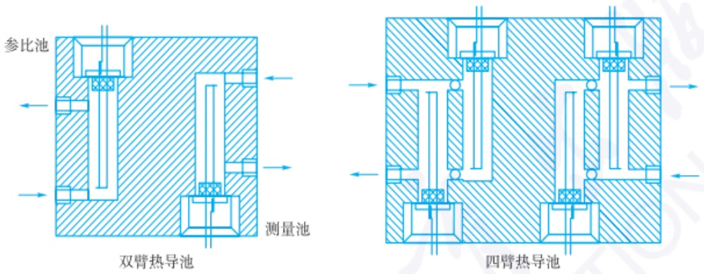

图 8.2.6 热导池基本结构

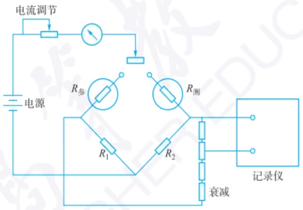

<details>
<summary>text_image</summary>

电流调节
电源
R参
R测
R1
R2
衰减
记录仪
</details>

图 8.2.7 热导池工作原理示意图

② 检测原理。TCD 检测基于不同的气体有不同的热导系数。

进样前,热丝通电,加热与散热达到平衡后,两臂电阻值相等,此时无电压信号输出,色谱图为一条直线(基线)。由于 $R_{参}=R_{测},R_{1}=R_{2}$ ,则

$$
R _ {\text {参}} \cdot R _ {2} = R _ {\text {测}} \cdot R _ {1}
$$

进样后，载气携带样品组分流过测量臂，而这时参考臂流过的仍是纯载气，使测量臂的温度改变，引起电阻的变化，此时测量臂和参考臂的电阻值不等，产生电阻差，即 $R_{参} \neq R_{测}$ ，则:

$$
R _ {\text {参}} \cdot R _ {2} \neq R _ {\text {测}} \cdot R _ {1}
$$

这时电桥失去平衡,有电压信号输出,检测信号为组分浓度随时间变化的曲

## 思考:

与其他种类检测器相比,TCD 灵敏度怎样?请调研和分析。

---

416

第八章 色谱分析

## 思考:

实际工作中,载气流速如何选定?是否选择最佳流速?

线，即色谱流出曲线。

③ 影响 TCD 灵敏度的因素。

桥路电流: 检测器的响应值与桥路电流 I 的 3 次方成正比。I 增加, 钨丝温度越高, 钨丝与池体之间的温差加大, 有利于热传导, 提高检测器灵敏度。但桥路电流太高, 会影响基线的稳定性, 可能烧断钨丝。

池体温度: 池体温度与钨丝温度相差越大, 越有利于热传导, 检测器的灵敏度也就越高。但池体温度不能低于色谱柱的温度, 通常高  $20 \sim 30 \, ^{\circ}C$ , 以防样品组分在检测器内冷凝。

载气种类:载气与组分的热导系数相差越大,在检测器两臂中产生的温差和电阻差越大,检测越灵敏。氢气具有较高的热导系数,但不安全,氦气比较理想,但价格较贵。某些气体热导系数如表8.2.1所示。

表 8.2.1 常见气体热导系数

| 气体 | $\lambda \times 10^{5} (100\, ^{\circ}\text{C})$ | 气体 | $\lambda \times 10^{5} (100\, ^{\circ}\text{C})$ |
| --- | --- | --- | --- |
| 氢 | 224.3 | 甲烷 | 45.8 |
| 氦 | 175.6 | 乙烷 | 30.7 |
| 氧 | 31.9 | 丙烷 | 26.4 |
| 空气 | 31.5 | 甲醇 | 23.1 |
| 氮 | 31.5 | 乙醇 | 22.3 |
| 氩 | 21.8 | 丙酮 | 17.6 |

④ TCD 的特点和注意事项。

(i) 为浓度型检测器。进样量一定时, 峰面积与载气流速成反比, 因此用峰面积定量时, 务必保持流速恒定。
（ii）为通用型检测器。可以用于测定不同种类的组分，特别是可以测定氢火焰离子化检测器不能直接测定的无机气体。
（iii）为非破坏型检测器。可以在检测器后收集组分或再与其他仪器联用分析。
（iv）为保护电热丝，通电前一定要先开载气；关机时一定要先关电源，后关载气。
（v）载气中的氧气会缩短 TCD 使用寿命，因此应彻底除去载气中氧气。勿使用聚四氟乙烯作载气管道，因为它会透过氧气。

(vi) 灵敏度较低。

（2）氢火焰离子化检测器(flame ionization detector, FID) FID 是气相色谱分析最常用的检测器之一，为质量型检测器。对有机化合物具有很高的灵敏度，是有机物测定的通用检测器。

① 基本结构。FID 的主要部件是离子化室，如图 8.2.8 所示，由气体入口、喷嘴、发射极和收集极等组成。在发射极和收集极之间加有一定的直流电压（100\~300 V）构成一个外加电场。FID 需要用到三种气体: $N_{2}$  载气携带样品组分； $H_{2}$  为燃气；空气为助燃气。使用时需要调整三者的流速比例关系，使检测器灵敏度达到最佳。一般情况下为 1:1:10。增大空气流速，提高检测器的温度有利于有效去除组分燃烧时产生的水蒸气。

② 工作原理。当载气携带有机物  $C_{n}H_{m}$  由喷嘴喷入火焰时，在 C 层发生裂解

---

8.2 气相色谱法

417

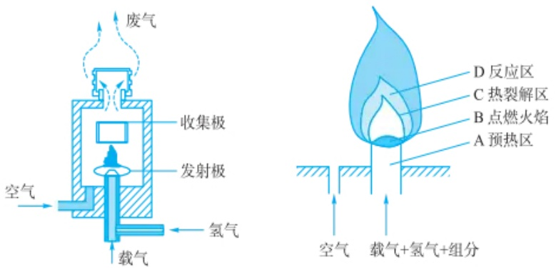

图 8.2.8 FID 的结构示意图

反应产生自由基:

$$
\mathrm{C} _ {n} \mathrm{H} _ {m} \longrightarrow \cdot \mathrm{CH}
$$

产生的自由基在 D 层火焰中与外面扩散进来的激发态原子氧或分子氧发生如下反应:

$$
\cdot \mathrm{CH} + \mathrm{O} \longrightarrow \mathrm{CHO} ^ {+} + \mathrm{e} ^ {-}
$$

生成的正离子  $CHO^{+}$ 与火焰中大量水分子碰撞而发生分子离子反应:

$$
\mathrm{CHO} ^ {+} + \mathrm{H} _ {2} \mathrm{O} \longrightarrow \mathrm{H} _ {3} \mathrm{O} ^ {+} + \mathrm{CO}
$$

化学电离产生的正离子和电子在外加恒定直流电场的作用下,分别向两极定向运动而产生微电流 $(10^{-14}\sim10^{-6}\mathrm{~A})$ 。

一定范围内,微电流的大小与进入离子室的被测组分质量成正比,属于质量型检测器。

组分在氢焰中的电离效率很低,大约五十万分之一的碳原子被电离。

离子电流信号输出到记录仪,得到峰面积与组分质量成正比的色谱流出曲线。

③ FID 的特点和注意事项。

(i) 结构简单, 稳定性好, 响应快速, 线性范围宽, 可达 7 个数量级。
（ii）为专属型检测器，对有机物具有很高的灵敏度，可达 $10^{-12}\mathrm{g}\cdot \mathrm{s}^{-1}$ ，比TCD高出3个数量级，但对含氢少和不含氢的物质不响应或不灵敏。
（iii）为质量型检测器。进样量一定时，峰高与载气流速成正比，因此用峰高定量时，务必保持流速恒定。
（iv）为破坏型检测器。组分进入 FID 后经高温燃烧破坏，检测后的样品不能再利用。
（v）使用时注意安全问题:测定  $H_{2}$  流量时务必关闭空气。无论任何原因导致火焰熄灭时，应立即关闭氢气阀门，排除故障后重新点火时再打开。
（3）电子捕获检测器(electron capture detector, ECD) ECD 是目前分析测定含电负性元素有机物最常用的检测器，多用于测定农副产品、食品及环境样品中农药残留。
① ECD 结构与工作原理。ECD 的结构如图 8.2.9 所示。放射源(常用 $^{63}$ Ni)产生的  $\beta$  射线使载气(通常为  $N_{2}$ )离子化，同时产生大量电子。这些电子在电场作用下向阳极(收集极)移动，形成稳定的基流( $10^{-9} \sim 10^{-8}$  A)。当含高电负性元素的组分流经检测器时，捕获电子使基流强度发生变化，信号经放大后记录得到色谱峰。

蔬果上的农药残留是一个普遍存在的问题:主要来源于施用农药直接污染农作物、农作物从污染的环境中吸收农药及农药通过食物链污染食品。常见的残留农药包括有机磷、氨基甲酸酯类、有机氯、杀菌剂等，其中有机磷是目前使用量最大的杀虫剂。

请调研农药残留有哪些检测手段？气相色谱法能够检测的农药残留的种类及相应的检测器有哪些？

---

418

第八章 色谱分析

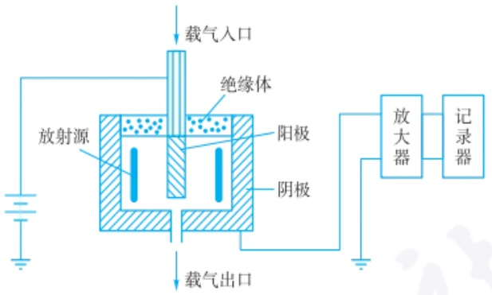

<details>
<summary>flowchart</summary>

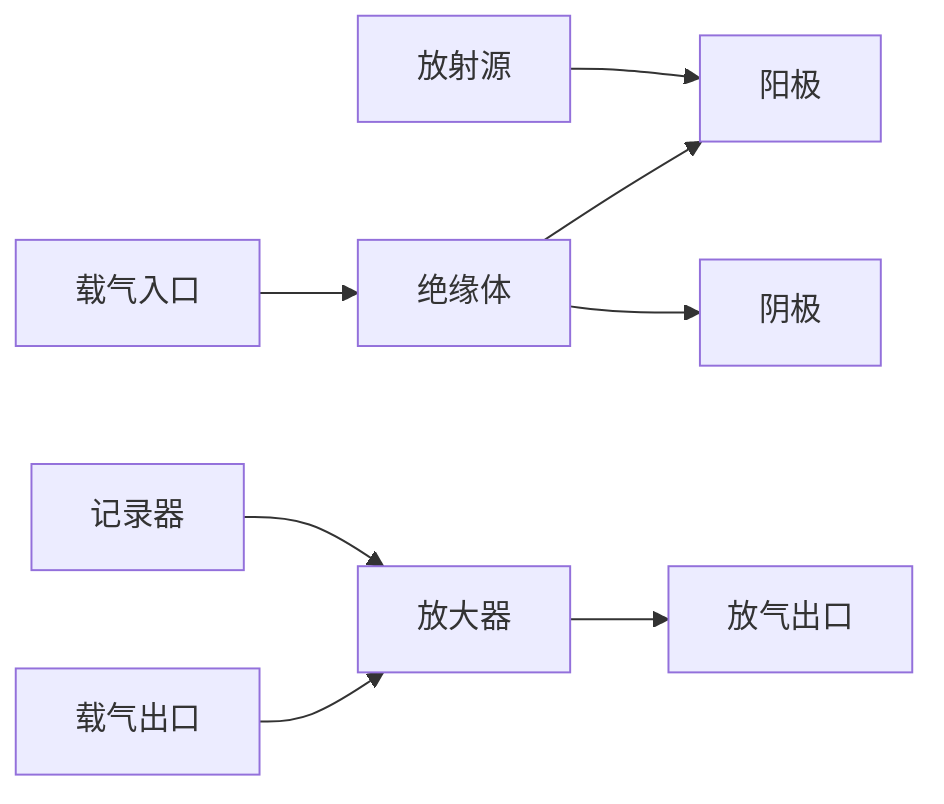
</details>

图 8.2.9 ECD 的结构示意图

② ECD 的特点和注意事项。
（i）为专属型检测器，针对含有如卤素、硫、氰基、共轭双键的有机物、过氧化物、醌类有机物等具有较高的灵敏度，且不破坏样品。
(ii) 线性范围较窄。对胺类、醇类及碳氢化合物等检测灵敏度不高。
(iii) 为浓度型检测器。
(iv) 要求高纯氮气(含氧量 $<1.0\times10^{-5}$ ), 因为氧气具有电负性, 可使基流降低。
（v）极化电压通常为  $20 \sim 50 \, V$ 。常采用脉冲电压，电子能量较小时易被捕获，灵敏度高。
(vi) 具有放射源, 使用时注意安全, 非专业人员勿触碰相关部件。
(4) 其他常用检测器

① 火焰光度检测器(flame photometric detector, FPD)。FPD 对含硫、磷的化合物具有高选择性和高灵敏度，为质量型检测器。工作原理是含硫、磷化合物在富氢火焰中燃烧生成化学发光物质，能辐射出 400 nm 和 550 nm 左右的特征光谱，可被检测。

FPD 适用于二氧化硫、硫化氢、石油精馏物的含硫量、有机硫、有机磷的农药残留物等的分析测定。也可用于其他含杂原子有机物和有机金属化合物的检测。

② 热离子检测器(thermionic detector, TID)。TID 检测器对氮、磷化合物具有高选择性和高灵敏度，为质量型检测器。其结构与 FID 类似。在 FID 的喷嘴与收集极之间加一个含硅酸铷的玻璃球，含氮、磷化合物在受热分解时，受硅酸铷作用产生大量电子，信号强。
TID 对氮、磷化合物的响应与其杂原子数成正比,也与化合物的结构有关,对易分解成氰基的化合物的响应值大,而对硝酸酯、酰胺类的响应较小。
③ 定性检测器(联用仪器)。色谱与其他分析仪器联用发展迅速,也可将所联用的仪器认为是色谱的检测器,联用仪器将在本章第5节中介绍。

## 8.2.4.6 数据处理系统

色谱数据的采集和处理由色谱工作站来完成。实现谱图显示、峰检测和基线校正、定量计算、打印报告等功能。利用色谱工作站，样品经气相色谱柱分析后即可得到色谱流出曲线。根据色谱图中组分的保留时间、色谱峰的峰面积或峰高等参数对目标组分进行定性和定量分析。

思考:

常规的气相色谱柱是否能分离含水量大的样品？原因是什么？

---

8.2 气相色谱法

419

## 8.2.5 气相色谱衍生化

## 1. 衍生化的目的与意义

20世纪50年代出现的气相色谱法使挥发性、热稳定性组分的分离、分析发生了巨大变化，现已成为石油、化工、环境、医药、食品、生命等领域的一种重要的、必不可少的分析手段。而面临挥发性差、极性强及热不稳定的样品时，用气相色谱法直接进行分析有困难，可以通过对样品进行化学衍生，改善其色谱行为，进而满足气相色谱分析的要求。

化学衍生技术就是通过化学反应将样品中难以分离检测的目标物定量地转化为另一易于分析检测的化合物,通过对后者的分析检测实现对目标化合物的定性和定量分析。归纳起来,化学衍生的目的:

（1）改善样品的挥发性 将气相色谱难分离的化合物转化成适合气相色谱分离的物质。如高沸点、极性大、热不稳定的化合物，样品挥发性低，对样品进行化学衍生化，将其转化为非极性或弱极性的衍生物，降低样品的沸点，可以改善样品的挥发性。例如，氨基酸和糖，不能用气相色谱直接分析，将其转化为 N-酰基氨基酸酯和三甲基硅烷基醚后，挥发性就能满足气相色谱分析的要求。
（2）减少与色谱材料的相互作用 带有极性基团的化合物进入色谱系统后，样品中的极性基团可能与色谱柱内壁和色谱载体发生反应，造成色谱峰变宽和拖尾，影响定性、定量的准确性，对样品进行衍生化，可以降低样品与色谱材料间的相互作用，获得满意的分析结果。
（3）分离结构近似的化合物 衍生化可以改变化合物的色谱性能，改善分离度。例如，某些异构体保留时间非常接近，在色谱上很难分离，通过衍生化反应，使两个异构体生成的衍生物色谱性能产生较大差异而得到分离。对一些难分离的物质，可以选用某些衍生化反应，只使其中一种物质发生衍生化反应转化为衍生物，使两者得以分离。
（4）提高分析检测的选择性和灵敏度 对样品进行衍生化，引入适当的衍生基团，不但能改善检测器的选择性，还可以提高灵敏度。例如，电子捕获检测器(ECD)对含卤素或硝基苯基的化合物有较高的灵敏度，通过使用含卤素或硝基苯基的衍生试剂与分析目标物反应，将目标物接上卤素或硝基苯基，可以实现复杂体系中选择性地检测分析对象，提高检测灵敏度。

## 2. 衍生化方法的选择

气相色谱衍生方法主要针对样品中含有羟基、氨基、巯基、亚氨基、羧基等极性基团中活泼氢，所选择的衍生化方法应具有如下特点:

（1）反应速率快，能定量进行，至少反应的转化率要恒定，能满足定量分析的要求。
(2) 反应重复性好, 反应条件易于控制。
(3) 反应的选择性高,最好只与目标化合物反应。
(4) 衍生产物具有良好的色谱行为, 易分离纯化和检测。
(5) 衍生试剂价廉易得。

## 3. 衍生化反应

（1）酯化衍生方法 羧基一般衍生为酯，通常为甲酯，主要是甲酯挥发性好，甲酯的制备方法主要有甲醇法、重氮甲烷法和三氟乙酸酐法等。

① 甲醇法-三氟化硼催化:有机酸与甲醇在三氟化硼催化剂条件下,发生酯

---

420

第八章 色谱分析

## 思考:

程序升温中有哪些重要的参数，选择依据有哪些？

化反应,生成有机酸甲酯。通常将甲醇与三氟化硼预先配成试剂,衍生时,取少量上述酯化试剂加入欲分析样品中衍生化。

② 甲醇法-氯化氢或浓硫酸催化:以甲醇-氯化氢或甲醇-浓硫酸溶液作为酯化试剂与欲分析样品反应，衍生产物可进行色谱分析。
③ 重氮甲烷法:重氮甲烷可以与有机酸反应生成有机酸甲酯，放出氮气。重氮甲烷可由浓碱分解 $N-$ 甲基- $N-$ 亚硝基脲或 $N-$ 甲基- $N-$ 亚硝基对甲苯磺酰胺来制备。重氮甲烷法反应简单、快速，转化效率高，通常没有副产物。但是反应要在非水介质中进行，另外重氮甲烷毒性大，活性高，易分解甚至产生爆炸，应在使用前临时制备，并只能在 $-20^{\circ}\mathrm{C}$ 以下短时间保存，制备与使用时要特别小心。
④ 三氟乙酸酐法: 在三氟乙酸酐存在下, 有机酸和酚可以反应生成酯, 此法比较适合空间位阻较大的有机酸或酚的酯化。
⑤ 其他酯化法:有时为了提高方法的灵敏度和选择性,需要制备甲酯之外的酯,其合成方法与甲酯类似。可用重氮乙烷、重氮丙烷、重氮甲苯代替重氮甲烷以合成相应的酯,与重氮甲烷相比,这些试剂的稳定性好。使用三氟化硼、氯化氢或浓硫酸催化时,用三氟化硼的乙醇、正(异)丙醇、正(异)丁醇溶液与有机酸反应可以制备相应的乙酯、正(异)丙酯、正(异)丁酯;苄基酯一般用苯基重氮甲烷制备。在使用选择性检测器,如 ECD 时,可用含卤素的醇作衍生试剂,以提高灵敏度。
（2）酰化衍生方法 酰化用于含羟基、氨基、巯基的化合物衍生化，酰化能降低羟基、氨基、巯基的极性，提高这些化合物的挥发性，改善这些化合物的色谱性能。对选择性检测器ECD，可用卤代酰化试剂，提高检测灵敏度。常用的酰化试剂有酰卤、酸酐和反应活性的酰化合物（酰基咪唑、二酰基胺等）。以乙酸酐为乙酰化试剂曾在羟基和氨基的衍生中广泛使用。乙酰化反应可用于糖类分析。但卤代酸酐更为常用，最常用的是三氟乙酸酐，它的衍生物挥发性高，色谱峰形好，在选择性检测器ECD中响应灵敏。常用的多氟化试剂主要为全氟代酸酐或酰卤，如三氟乙酰、五氟丙酸酐、五氟丙酰、五氟代苯甲酰氯、七氟丁酸酐和七氟丁酰，以五氟代苯甲酰氯基衍生物的ECD响应最高。
（3）硅烷化衍生方法 含羟基、氨基、巯基、羧基等官能团的化合物均可进行硅烷化反应，生成极性低、挥发性高、热稳定性好的硅烷基化合物。硅烷化反应体系中不能含有水分，选用溶剂一般为己烷、苯、吡啶、四氢呋喃、二甲亚砜等非极性溶剂。硅烷化试剂种类很多，而且大多商品化，有些甚至已与溶剂和催化剂配制好。

## 8.2.6 气相色谱分离条件的选择

色谱理论为改善混合物中各组分的分离提供了理论指导,但对于形形色色的样品,要完成分析任务,仍需要正确选择操作条件。

根据分离度方程和速率理论,色谱的分离条件主要包括色谱柱固定相、固定液的涂渍量、载气的种类及流速、气化温度、柱温、色谱柱的柱长和内径、进样方式和进样量等。分离条件的选择是否合适,决定了是否能够达到分离目的。

## 1. 色谱柱固定相的选择

气相色谱分析永久性气体(如  $O_{2}$ 、 $N_{2}$ 、 $H_{2}$ 、Ar、 $\cdots$ )或气态烃类时,常采用气-固色谱法。由于吸附剂对气体吸附的差异,可得到较好的分离效果。对于组分复杂的样品,常采用气-液色谱法改善分离度。由于载体起支撑的作用,固定液的种类

---

8.2 气相色谱法

421

显得更为重要,选择时需注意固定液的极性及其最高使用温度。

固定相的选择一般按照“相似相溶”原则,综合考虑分子间作用力。

当组分为非极性物质时,一般选用非极性固定相。色散力对分离起主要作用,组分按沸点顺序流出色谱柱,沸点低的先流出。

当组分为极性物质时,选择极性固定相。组分与固定相分子间的作用力主要是定向力,组分按极性大小顺序流出色谱柱,极性小的组分先流出,极性大的后流出。

当样品中同时含有非极性和极性组分时,需根据分析目的、组分性质等具体情况,选择合适极性的固定液。非极性组分先出峰,极性组分后出峰。

当组分为氢键型物质，优先选择极性或氢键型固定相。组分按形成氢键能力强弱流出色谱柱，氢键作用弱的组分先流出，氢键作用强的组分后流出。

当组分为挥发性酸/碱有机物时,一般选用极性固定相。

当样品组分复杂时,采用单一固定相色谱柱难以实现理想分离时,可采用混合固定相色谱柱;或者采用两种不同极性的色谱柱,利用二维或全二维色谱法进行分离。

## 2. 固定液涂渍量的选择

固定液在担体上的涂渍量称为配比，一般指的是固定液与担体的质量百分比。配比通常控制在 $5\% \sim 25\%$ ，根据速率理论，配比越低，担体上所形成的液膜越薄，则传质阻力越小，柱效越高，分析速度也就越快，但配比较低时，固定相的负载量低，允许的进样量较小。分析工作中通常倾向于使用较低的配比。

## 3. 载气及其流速的选择

载气种类的选择应该从载气对柱效的影响,载气的性质及检测器对载气的要求来考虑。

根据 van Deemter 方程可以绘制塔板高度 $H$ 与载气线速率 $u$ 曲线（图 8.1.4）。在曲线的最低点，塔板高度 $H$ 最小，此时柱效最高，与最小 $H$ 相对应的流速是最佳流速 $u_{\mathrm{opt}}$。从图 8.1.4 可知，当 $u$ 较小时，分子扩散项 $B/u$ 是影响塔板高度的主要因素，此时选择相对分子质量较大的载气 $(\mathrm{N}_2, \mathrm{Ar})$ 为宜，这样使组分在载气中有较小的扩散系数，提高柱效。当 $u$ 较大时，传质阻力项 $Cu$ 起主导作用，宜选择相对分子质量较小的载气 $(\mathrm{H}_2, \mathrm{He})$，使组分有较大的扩散系数，减少传质阻力，提高柱效。另外，载气的选择还需要考虑与检测器的匹配，一般而言，ECD 和 FPD 选用 $\mathrm{N}_2$ 为载气，FID 选择用 $\mathrm{N}_2$ 或 Ar 为载气，而 TCD 选用 $\mathrm{H}_2$ 或 He 为载气。

## 4. 气化温度的选择

气化温度取决于样品的挥发性、沸点范围及进样量等因素，须保证样品瞬间气化，通常相当于样品沸点或高于沸点。选择时，一般比柱温高30～70℃，还应防止气化温度太高造成样品分解。

## 5. 柱温的选择

柱温是气相色谱的重要操作参数，直接影响色谱柱的寿命、分离效能和分析速度。柱温升高，改善组分在气相、液相的传质速率，有利于提高柱效，但增加柱温同时又加剧纵向扩散，导致柱效降低，使得低沸点组分峰产生重叠，分离度降低。反之，柱温降低，分离度增大，但保留时间增长，分析时间延长。因此，选择柱温需要兼顾分离度和分析效率。柱温选择的一般原则:以最难分离的组分能够完全分离为前提，采取较低的柱温，同时需兼顾保留时间适宜，峰形不拖尾。

柱温的选择还应考虑固定液的使用温度,柱温不能高于固定液的最高使用温

---

422

第八章 色谱分析

度,否则固定液挥发流失,对分离不利。柱温通常选择接近或略低于组分平均沸点的温度。

对于组分复杂、沸程宽的样品，采用同一柱温往往造成低沸点组分分离效果不好，高沸点组分峰形扁平，可采用程序升温法，即在分析过程中按照一定速率提高柱温，使各组分能在最适宜的温度下得到分离。在程序升温开始时，柱温较低，低沸点的组分得到分离，中等沸点的组分移动很慢，高沸点的组分还在柱口附近；随着柱温的上升，组分由低沸点到高沸点依次分离出来（图8.2.10）。总之，程序升温改善了复杂成分样品的分离效果，使各组分都在较佳的温度下分离。

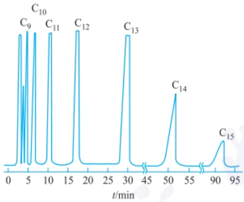

<details>
<summary>line</summary>

| Compound | Retention Time (min) |
| --- | --- |
| C9 | ~3.5 |
| C10 | ~6.5 |
| C11 | ~10.5 |
| C12 | ~17.5 |
| C13 | ~30.5 |
| C14 | ~52.5 |
| C15 | ~92.5 |
</details>

(a) 恒温150℃

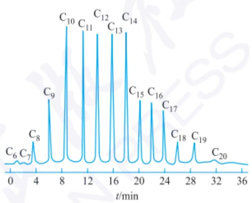

<details>
<summary>line</summary>

| Peak Label | Retention Time (min) |
| --- | --- |
| C6 | ~1.5 |
| C7 | ~3.5 |
| C8 | ~4.5 |
| C9 | ~6.5 |
| C10 | ~9.5 |
| C11 | ~12.5 |
| C12 | ~14.5 |
| C13 | ~16.5 |
| C14 | ~18.5 |
| C15 | ~20.5 |
| C16 | ~22.5 |
| C17 | ~24.5 |
| C18 | ~26.5 |
| C19 | ~28.5 |
| C20 | ~32.5 |
</details>

(b) 程序升温50\~250℃，8℃/min

图 8.2.10 正构烷烃恒温分离与程序升温分离效果对比图

## 6. 柱长和柱内径的选择

色谱柱柱长的选择应考虑分离度、分析时间和色谱柱的成本。在不改变塔板高度 H 的条件下，分离度  $R^{2}$  与柱长成正比，而分析时间与柱长成正比。增加柱长可使分离度增大，对分离有利；同时，又使传质阻力增大，引起色谱峰宽加大，分析时间延长。

因此，在保证一定的分离度前提下，尽可能选用较短的色谱柱。具体方法是选择一根极性适宜、任意长度的色谱柱，测定两组分的分离度，然后根据色谱分离方程来确定柱长是否合适。

## 7. 进样时间和进样量的选择

进样速度越快越好,可以防止色谱峰变宽,甚至峰变形,不利于分离和定量的问题。在实际工作中不仅进样要快,还需控制进样量适当。

进样量应控制在柱容量的允许范围及检测器的线性检测范围之内。进样量过大，所得到的色谱峰变宽，分离度变小，峰面积或峰高与进样量不成线性，无法定量。进样量太小，又会因检测器灵敏度不够，不能检出。最大允许进样量应控制在使半峰宽不变，而峰面积或峰高与进样量呈线性关系。液体样品采用色谱微量进样器进样，规格有 $1\mu \mathrm{L},5\mu \mathrm{L},10\mu \mathrm{L}$ 等。

## 8.2.7 气相色谱应用与进展

## 1. 气相色谱的应用

气相色谱除进行一般分析外，与一些辅助方法结合还可进行一些特殊要求的分析。常见的技术有针对高分子聚合物样品的裂解气相色谱分析和适用于液体或固体样品中挥发性气体的顶空气相色谱分析。

---

8.2 气相色谱法

423

（1）裂解气相色谱技术 裂解气相色谱(pyrolysis-gas chromatography, Py-GC)是常规气相色谱分析方法的扩展，是将热裂解和气相色谱两种技术结合的产物，适用于一些相对分子质量较大、结构复杂、难挥发、难溶解的固体物质的分析鉴定，如聚合物分析。

热裂解是在热能作用下，物质发生的化学降解过程。热裂解与气相色谱、质谱（或红外、核磁）联用技术已成为研究高分子化合物的有力工具，在高分子、生物医学、环境科学、考古学、地球化学、矿物燃料、炸药等领域有广泛应用。

（2）顶空气相色谱分析技术 顶空气相色谱分析是对液体或固体样品中的挥发性成分进行分析的最有效方法，如塑料食品包装袋中挥发性成分的分析，人在有毒环境中工作后，体液中有毒组分含量的分析等。

顶空气相色谱分析通常是将样品置于密闭的恒温系统中，当气-液（气-固）两相达到热力学平衡后，测定气相组成，可采用静态法和动态法两种方式进行。顶空气相色谱分析法的理论依据是当顶空瓶中样品上面的蒸气压相当低时，峰面积 $A_{i}$ 的大小与样品上面的气相中挥发性组分i的蒸气压 $p_{i}$ 成正比，以此来确定样品中组分的含量。

## 2. 进展

（1）新型色谱柱及固定相 高选择性色谱固定相是实现气相色谱高效分离复杂样品组分的关键。近年来，材料科学的快速发展，新型气相色谱固定相的研究和应用取得了明显进展，对于丰富色谱分离材料的种类、发现新的色谱分离机理、对难分离组分的分析测定和研究应用起到了重要的促进作用。

毛细管柱气相色谱法具有分析速度快、分离效率高、灵敏度高等特点，细内径的毛细管柱应用越来越广泛，耐高温的毛细管柱扩展了其应用范围。

新的高选择性固定液不断涌现，如手性固定液、离子液体、金属有机骨架（MOFs）、共价有机骨架（COFs）、石墨烯及其衍生物等，作为新型色谱固定相具有广阔的应用前景和发展潜力。

（2）全二维气相色谱(GC×GC) 气相色谱作为复杂混合物的分离工具，对挥发性化合物的分离分析发挥了很大的作用。在大量实际工作中，使用一根柱子，可以分析几十至几百种化合物的样品，当样品更复杂时，采用填充柱，总柱效不高，分离不好；使用毛细管柱，虽然有很高的柱效和分离能力，但存在柱容量低、进样少的缺点。为了解决大量存在的复杂样品和痕量组分的定量测定问题，许多学者进行了多维色谱的研究。多维色谱是指使用两根以上的色谱柱或两个以上检测器，通过阀门切换或改变各柱前后压力来改变载气流向的方法，使其得到比单柱系统更多的分离信息的手段。

全二维气相色谱(comprehensive two-dimensional gas chromatography, GC×GC)是多维色谱的一种，但是不同于通常的二维气相色谱(GC+GC)，在GC×GC中，经第一根色谱柱没有得到分离的样品，可通过改变载气流向的办法，使样品进入第二根色谱柱重新进行分离。GC×GC是近年来出现并飞速发展的气相色谱新技术，详见8.7.3.4。

（3）气相色谱联用技术 气相色谱是一种成熟的分析技术，具有高灵敏度、高分离效率和分析速度快的优点，是目前复杂混合物分离的常用工具，然而，气相色谱的定性能力较差。相反，像质谱（MS）、红外光谱（IR）、核磁共振波谱（NMR）等谱学方法，虽然具有很强的结构鉴定能力，却不具备分离能力，也不能直接用于复杂混合物的鉴定。将气相色谱与谱学方法结合起来，不仅能取长补

裂解气相色谱技术的基本原理和方法:

在一定条件下,高分子及非挥发性有机化合物的裂解遵循一定规律,即特定的样品能够产生特征的裂解产物及产物分布,采用气相色谱分析、鉴定裂解产物,并可据此对原样品进行表征。

将样品置于裂解器中，在严格控制的条件下，快速加热，使之迅速分解成为可挥发的小分子产物，然后直接将裂解产物送入色谱柱中进行分离，获得定性定量数据。

## 思考:

针对水样中的易挥发组分,怎样实现气相色谱法的测定?

## 生活实例1:

饮酒甚至醉驾具有重大交通安全隐患。现场酒精测试仪器测定快速，但无法保存样品，事后不能提供证据。

顶空气相色谱法可以完美解决血液中酒精含量的快速检测问题。常采用内标法进行测定。例如，采用叔丁醇为内标，顶空进样，FID 检测，用相对保留时间进行定性，用乙醇与内标物的峰面积比进行定量，实现血液样品中乙醇的定性和定量分析。

---

424

第八章 色谱分析

## 生活实例 2:

室内挥发性有机物（VOCs）为熔点低于室温而沸点在50\~260℃的具有一定挥发性的有机物的总称。包括苯系物（如甲苯、二甲苯等）、有机氯化物、有机酮、酸、酯、醇、醚、胺和烃化合物等。

请调研 VOCs 分析需要的色谱技术和条件。

提示: 可采用活性炭吸附、二硫化碳解析后, 用毛细管气相色谱法进行测定。

当前,太空生活对人们来说仍充满着神秘和未知。空气、辐射、营养、环境等问题依然是人类探索和利用太空所面临的挑战。

其中,空气质量是保证人类在太空生活的最基本问题。如果太空舱内空气不稳定、浑浊或污染,将会给宇航员的生活带来危险。舱内空气质量的主要指标是氧气、二氧化碳及挥发性有机物(VOCs)等,其中二氧化碳对人体健康影响最大,浓度过高会导致疲劳甚至昏迷,甚至会影响航天器的能源和系统。

## 思考:

太空舱内 VOCs 的检测如何实现？

短，而且还具有协同作用，获得两种技术单独使用时所不具备的某些功能。联用技术已成为当今仪器分析和分析仪器的一个主要发展方向。对气相色谱来说，最成功和应用最广的是与质谱和傅里叶变换红外光谱的联用（简称GC/MS和GC/FTIR）。在GC/MS和GC/FTIR联用系统中，色谱仪相当于谱学方法的分离和进样装置，质谱仪则相当于色谱的定性检测器。联用的关键是接口技术，用于协调联用的两种仪器的输出和输入问题，使两种仪器连接成一个整体。

（4）快速气相色谱技术 随着气相色谱在石油、化工、环境保护、食品安全、医药、法检、临床和超纯材料等领域的应用越来越广，要求气相色谱与其他方法一样，朝着更准确、更灵敏、专一、快速、简便的方向发展。快速和便携式气相色谱受到人们重视。例如，便携式气相色谱仪在临床上测量呼吸气中的挥发性有机物（VOCs），可精准查找与各种疾病（COVID-19、结直肠癌、肺癌等）相关的独特生物标志物，利用微型气相色谱仪可实现对一个呼吸样本进行多种疾病的同时检测。随着呼气诊断技术的发展，未来可通过体检中心、药店内的自助检测站、社区医院等利用微型气相色谱仪进行呼气检测，预防和监控疾病，为人类健康提供更多便利。

## 3. 应用示例

（1）尿液中兴奋剂的检测 刺激剂、麻醉剂、抗雌激素是竞技体育中常用的兴奋剂，属于违禁药物。采用毛细管柱气相色谱法（图8.2.11），可以不经衍生化直接测定尿液中甲基麻黄碱、哌替啶、美沙酮、他莫昔芬、芬太尼等。采用液-液萃取对样品进行前处理后，利用被测物与内标物的峰面积比进行定量分析。

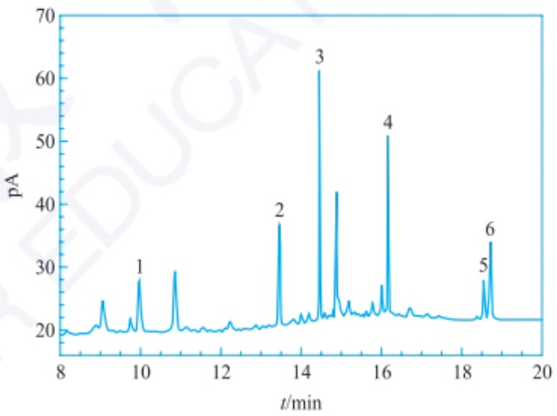

<details>
<summary>line</summary>

| Peak | t (min) | pA |
| --- | --- | --- |
| 1 | ~9.9 | ~28 |
| 2 | ~13.4 | ~37 |
| 3 | ~14.4 | ~61 |
| 4 | ~16.1 | ~51 |
| 5 | ~18.5 | ~28 |
| 6 | ~18.7 | ~34 |
</details>

图 8.2.11 加标尿样的气相色谱图

(色谱,2009,27(3):364)

色谱条件:HP-5毛细管柱(30 m × 0.32 m × 0.25μm)。程序升温85℃保持1 min,以5℃·min $^{-1}$ 升至130℃,保持10 min,再以20℃·min $^{-1}$ 升至280℃,保持5 min。N $_{2}$ 为载气,流速为1.3 mL·min $^{-1}$ ;进样口温度280℃;检测器为NPD,温度为340℃;空气流速60 mL·min $^{-1}$ ,氢气流速3.0 mL·min $^{-1}$ ,尾吹气流速30 mL·min $^{-1}$ ;进样量为1 μL,不分流进样。

（2）常见食品添加剂的检测 食品添加剂是在食品加工过程中为改善食品的色香味和存放时间而添加的化学合成物质或天然物质，如山梨酸、苯甲酸、脱氢乙酸、甜蜜素、对羟基苯甲酸酯类等。采用气相色谱法可以实现对这些食品添加剂的同时检测(图8.2.12)。

---

8.2 气相色谱法

425

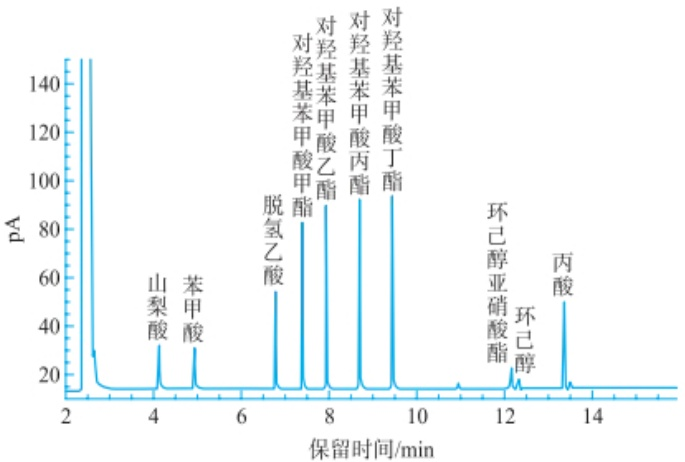

<details>
<summary>line</summary>

| Compound | Retention Time (min) |
| --- | --- |
| 山梨酸 | ~4.1 |
| 苯甲酸 | ~5.0 |
| 脱氢乙酸 | ~6.8 |
| 对羟基苯甲酸甲酯 | ~7.3 |
| 对羟基苯甲酸乙酯 | ~7.8 |
| 对羟基苯甲酸丙酯 | ~8.7 |
| 对羟基苯甲酸丁酯 | ~9.5 |
| 环己醇亚硝酸酯 | ~12.1 |
| 环己醇 | ~12.3 |
| 丙酸 | ~13.4 |
</details>

图 8.2.12 分离 9 种食品添加剂色谱图

(食品安全检测学报,2021,12(14):5684)

色谱条件:HP-5毛细管柱（$30\mathrm{m}\times 0.35\mathrm{m}\times 0.25\mu \mathrm{m}$）。程序升温 $70^{\circ}\mathrm{C}$ 保持 $3\mathrm{min}$，以 $30^{\circ}\mathrm{C}\cdot \mathrm{min}^{-1}$ 升至 $190^{\circ}\mathrm{C}$，保持 $2\mathrm{min}$，再以 $30^{\circ}\mathrm{C}\cdot \mathrm{min}^{-1}$ 升至 $250^{\circ}\mathrm{C}$，保持 $4\mathrm{min}$。$\mathrm{N}_2$ 为载气，流速为 $1\mathrm{mL}\cdot \mathrm{min}^{-1}$；进样口温度 $220^{\circ}\mathrm{C}$；检测器为FID，温度为 $260^{\circ}\mathrm{C}$；空气流速 $400\mathrm{mL}\cdot \mathrm{min}^{-1}$，氢气流速 $40\mathrm{mL}\cdot \mathrm{min}^{-1}$，尾吹气流速 $30\mathrm{mL}\cdot \mathrm{min}^{-1}$；进样量为 $1\mu \mathrm{L}$，分流比为 $10:1$。

## 习题

## - 章节练习题 -

1. 试比较填充柱与毛细管柱的性能。
2. 填充柱气相色谱与毛细管柱气相色谱在仪器构造上有哪些差异？
3. 讲述气相色谱法中常用检测器的基本原理、特点及适用范围。
4. 归纳总结气相色谱柱的固定相种类和选择依据。
5. 试设计下列样品的气相色谱分析方案:

(1) 天然气成分分析
(2) 香水中的各成分分析
(3) 果蔬中农药残留分析

## - 挑战性问题 -

6. 气相色谱仪中进样器是将样品引入载气流中的装置。通常情况下，样品进样后瞬间气化，气化后的样品组分被带入色谱柱进行分离。然而由于样品的多样性和复杂性使得常规进样不能满足样品的需求，这就促使进样装置要不断地改进与创新，以扩展气相色谱法的应用范围，提高分析检测的效率，同时检测的准确度和灵敏度也得到了进一步提高。请查阅文献资料，针对填充柱进样、分流/不分流进样、程序升温蒸发器、顶空进样、裂解进样等装置，提出你对方法创新的理解，可以从哪些系统进一步实现改进和创新？
7. 兴奋剂在医学中原指能刺激人体神经系统，使人产生兴奋从而提高机能状态的药物。在竞技体育赛事中有助于提高运动员的成绩，因其严重违背体育精神而被称为禁用药物。药物在人体中的浓度为 $10^{-9}$ 数量级，需要做到准确的定性和定量，且总是先于检测手段问世。因此，兴奋剂的检测是一项难度很高，

---

426

第八章 色谱分析

且责任重大的工作。色谱-质谱联用是一种重要的分析检测兴奋剂的手段，请查阅文献资料，了解哪些类型的兴奋剂适合气相色谱法分析，并设计可能的分析方案。

## - 专题或报告 -

8. 新型固定相材料——在气相色谱分析中，色谱柱的分离能力主要取决于固定相的色谱选择性。固定相的种类很多，目前应用较为广泛的是聚硅氧烷类、聚乙二醇类和环糊精类等。对于复杂样品分析，可采用含有两种或多种固定相混合的色谱柱进行分离分析。随着固定相种类的丰富，气相色谱技术的应用也在拓展和深入。近年来，新型的固定相材料不断涌现，如手性固定液、离子液体、金属有机骨架（MOFs）、共价有机骨架（COFs）、石墨烯及其衍生物等，气相色谱法的应用将越来越广。请总结归纳气相色谱法中的固定相种类，并调研近3年来发展的新型固定相材料。

## 8.3 液相色谱法

20 世纪 40～60 年代，早期经典液相柱色谱多采用内径 1～5 cm、长 50～100 cm 的玻璃柱，填充粒径 150～200 μm 的固定相，操作烦琐、分析时间冗长，难以满足现代分离需求。进入 60 年代，为了分离蛋白质、核酸等不易气化的大分子物质，气相色谱的理论和方法逐渐完善，并重新引入液相色谱。伴随着仪器加工技术的进步，1967 年 Kirkland、Haber、Horvath 等人研发出世界上首台以高压、高速为特征的高效液相色谱仪，开启了高效液相色谱的时代。

采用液体作为流动相进行分离分析的色谱法称为液相色谱法(LC)。使用高压推动流动相可以提高分离效率，也称高效液相色谱(high-performance liquid chromatography, HPLC)，适用于高沸点、热不稳定和大分子等化合物的分离分析。本节主要介绍液相色谱，特别是高效液相色谱的基本原理、仪器构造、固定相及衍生化技术、色谱分离模式等，拓展了解超高效液相色谱法。

## 8.3.1 液相色谱法概述

液相色谱是一种优秀的现代分离分析手段，历史已逾百年。高效液相色谱法产生于20世纪60年代，是在经典液相柱色谱法和气相色谱法的基础上迅速发展起来的一种高效、快速的分离分析新技术。20世纪80年代，亲和色谱填料研究为高效液相色谱在生命科学领域的应用奠定了坚实的基础。随着90年代生物医药研究的迅速发展，各类高通量及手性色谱柱纷纷出现，同时针对环境、化学及其他特殊分离应用的色谱柱开发使得液相色谱几乎能够应用于有机化学、生物化学、医学、药物开发与检测、化工、食品科学、环境监测、商品检验和法定检验检疫等所有领域。近年来，为满足复杂样品快速分离分析需求，采用亚 $2\mu \mathrm{m}$ 尺度粒径固定相的超高效(超高压)液相色谱仪，极大提升了分离效率。此外，各类自动化、智能化、专属化的液相色谱仪不断涌现，联用技术、多维色谱技术的普及，使高效液相色谱技术得到日新月异的发展。

与其他色谱分析方法相比,高效液相色谱具有如下显著优点:

（1）柱效相对较高 高效液相色谱所用填料粒径大多处于3\~10  $\mu$ m，比经典柱液相色谱和填充型气相色谱小，由速率理论可知，固定相粒径越小，柱效越高；液相色谱流动相的黏度比气相色谱中的气体流动相高约百倍，而物质在液体流动相中的扩散系数仅为在气体中的 $1/10^{5}\sim1/10^{4}$ ，分子扩散项非常小。上述原因使得高效液相色谱的柱效比填充型气相色谱高约百倍。
（2）分析对象广泛 高效液相色谱不仅适用于沸点高、热稳定性差的小分子化合物，同样适用于生物活性物质、高分子化合物及各类离子化合物的分离分析，相较气相色谱所适用的分析对象（仅限于气体和沸点较低的化合物）展现出极大优势。

---

8.3 液相色谱法

427

（3）应用范围宽 高效液相色谱可通过柱内径的扩展，如微径柱、制备柱等，用于痕量样品高灵敏分析或规模化分离，并且随着联用技术的发展，可与各类新型检测器联用，满足从实验室检测到工业制备的各种需求，应用前景广阔。

## 8.3.2 液相色谱速率理论

液相色谱与气相色谱的主要区别在于流动相不同(即液体与气体的差异)。溶质在液体中的扩散系数比在气体中小, 液体密度比气体大 $10^{3}$ 倍, 液体黏度比气体大等, 这些差异对样品分子在液体中扩散和传质影响很大。Giddings 和 Snyder 等人在 van Deemter 气相色谱方程的基础上, 根据液体与气体的性质差异, 提出了液相色谱速率方程:

$$
H = H _ {\mathrm{e}} + H _ {\mathrm{d}} + H _ {\mathrm{s}} + H _ {\mathrm{m}} + H _ {\mathrm{sm}} \tag {8-3-1}
$$

其中  $H_{e}$  为涡流扩散项,  $H_{d}$  为分子扩散项, 传质阻力项包括三项: ①  $H_{s}$  为固定相传质阻力项; ②  $H_{m}$  为流动的流动相的传质阻力项; ③  $H_{sm}$  为滞留的流动相的传质阻力项。

## 8.3.2.1 影响柱效的因素

## 1. 涡流扩散项  $H_{e}$

$$
H _ {\mathrm{e}} = 2 \lambda d _ {\mathrm{p}} \tag {8-3-2}
$$

其含义与气相色谱法相同。

## 2. 分子扩散项 $H_{\mathrm{d}}$

$$
H _ {\mathrm{d}} = \frac {2 \gamma D _ {\mathrm{m}}}{u} \tag {8-3-3}
$$

进样后溶质分子在柱内存在浓度梯度,导致纵向扩散而引起峰展宽(谱带展宽)。u为流动相线速度,u越小,分子在柱内的滞留时间越长,谱带展宽越严重。 $\gamma$ 的含义与气相色谱法相同。 $D_{m}$ 为分子在流动相中的扩散系数,由于分子在液相的 $D_{m}$ 很小,因此在液相色谱中,只要流速不太低,这一项通常就可以忽略不计。

## 3. 传质阻力项

(1) 流动的流动相的传质阻力项  $H_{m}$

$$
H _ {\mathrm{m}} = \frac {\omega_ {\mathrm{m}} d _ {\mathrm{p}} ^ {2}}{D _ {\mathrm{m}}} u \tag {8-3-4}
$$

式中， $\omega_{m}$  是常数，其值取决于柱的直径、形状和固定相的颗粒结构。当流动相流过色谱柱时，靠近固定相的组分流速相对较慢，而流动相中心的流速较快，因而引起峰形展宽。这种传质阻力对塔板高度的影响与固定相颗粒直径  $d_{p}$  的平方和流速 u 成正比，与样品分子在流动相中的扩散系数  $D_{m}$  成反比。

(2) 滞留的流动相的传质阻力项  $H_{sm}$

$$
H _ {\mathrm{sm}} = \frac {\omega_ {\mathrm{sm}} d _ {\mathrm{p}} ^ {2}}{D _ {\mathrm{m}}} u \tag {8-3-5}
$$

式中， $\omega_{sm}$  为一常数，与流动相在固定相颗粒微孔中所占的体积分数及容量因子有关。如果固定相是多孔性的，则固定相颗粒内部的空穴中会充满滞留流动相（静止流动相），溶质组分在滞留流动相中的扩散会产生传质阻力。对于只扩散到孔穴中滞留流动相表层的溶质组分，只需移动很短的距离就能很快返回到流路中，而扩散到孔穴中滞留流动相较深处的溶质组分，会消耗更多的时间停留在孔穴

---

428

第八章 色谱分析

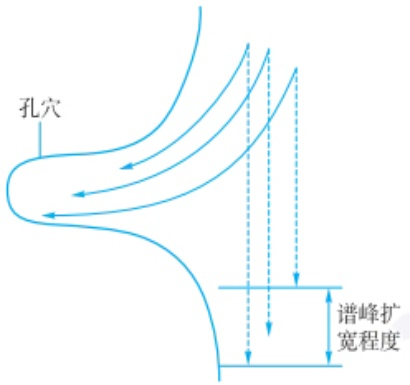

<details>
<summary>text_image</summary>

孔穴
谱峰扩
宽程度
</details>

图 8.3.1 流动相滞流区的传质阻力

中，导致较晚回到流路中而引起峰展宽，如图8.3.1所示。如果固定相的微孔越小越深，传质速率就会越慢，峰的扩展越严重。这一项对峰展宽的影响在整个传质过程中起着主要作用。所以改进固定相结构，减小静态流动相传质阻力，是提高液相色谱柱效的关键。

$H_{\mathrm{m}}$ 和 $H_{\mathrm{sm}}$ 都与固定相的粒径平方 $d_{\mathrm{p}}^{2}$ 成正比，与扩散系数 $D_{\mathrm{m}}$ 成反比。降低固定相粒度，采用低黏度流动相可以提高柱效。对于开管柱，流动相的传质阻力与柱内径的平方 $d_{\mathrm{c}}^{2}$ 成正比，采用细内径的开管柱可以提高柱效。对于填充柱来说，固定相粒径大小是影响柱效的一个非常重要的参数，而对于开管柱来说柱的内径是一个非常重要的参数。

(3) 固定相传质阻力项  $H_{s}$

$$
H _ {\mathrm{s}} = \frac {\omega_ {\mathrm{s}} d _ {\mathrm{f}} ^ {2}}{D _ {\mathrm{s}}} u \tag {8-3-6}
$$

## 思考:

液相色谱和气相色谱的速率理论有何异同点？

式中， $\omega_{s}$  为一常数， $D_{s}$  为组分在固定相内的扩散系数。 $H_{s}$  与  $d_{f}$  的平方和流速 u 成正比，与扩散系数  $D_{s}$  反比。当固定相为固体时，固定相传质阻力与组分吸附和解吸附所用的时间成正比。在厚涂层固定液、深孔离子交换树脂或解吸速度慢的吸附色谱中， $H_{s}$  才有明显影响。采用单分子层的化学键合固定相时  $H_{s}$  可以忽略。

将  $H_{e}, H_{d}, H_{s}, H_{m}, H_{sm}$  代入式(8-3-1)中，即得到液相色谱的速率理论方程:

$$
H = 2 \lambda d _ {\mathrm{p}} + \frac {2 \gamma D _ {\mathrm{m}}}{u} + \frac {\omega_ {\mathrm{m}} d _ {\mathrm{p}} ^ {2}}{D _ {\mathrm{m}}} u + \frac {\omega_ {\mathrm{sm}} d _ {\mathrm{p}} ^ {2}}{D _ {\mathrm{m}}} u + \frac {\omega_ {\mathrm{s}} d _ {\mathrm{f}} ^ {2}}{D _ {\mathrm{s}}} u \tag {8-3-7}
$$

从上式可以看出,要实现高效的色谱分析,一般可采取以下措施:

（a）使用粒度小且均匀的固定相 HPLC 所用的固定相颗粒细，形状规则，直径范围窄，孔浅，因而涡流扩散和传质阻力小，分离效率高。
（b）增大分子扩散系数 分子扩散系数越大，越有利于传质，分离效率就越高。过高的吸附作用可导致严重的峰展宽和拖尾，甚至不可逆吸附。
(c) 减小液膜厚度 目前 HPLC 固定相多使用键合填料, 其液膜薄, 柱效高。
(d) 合适的流速 与气相色谱一样以 $H$ 对 $u$ 作图，则有一最佳线速度 $u$，在此线速度时，$H$ 最小。一般情况下，HPLC 的最佳线速度 $u$ 很小（一般为 $0.03 \sim 0.1 \mathrm{~mm} \cdot \mathrm{s}^{-1}$），为了能在较短时间内实现样品分离，流动相的流速一般会高于其最佳线速度。

## 8.3.2.2 柱外效应

速率理论研究的是色谱柱内部谱带展宽的因素,实际上还存在影响柱效的柱

---

8.3 液相色谱法

429

外效应。对于HPLC，由于色谱柱体积小，且溶质在液相中扩散系数很小，因此柱外效应尤为明显。柱外效应可分为柱前峰展宽效应和柱后峰展宽效应两类:柱前展宽主要是由于进样器死体积，进样器与色谱柱之间的连接管件，进样时液流扰动及进样技术较差等引起；柱后展宽主要由色谱柱与检测器之间的连接管件和检测器的死体积等引起。现代高效液相色谱仪的进样器和检测器的死体积都比较小，引起的谱带展宽有限，连接管有时是柱外效应重要因素，尽可能采用细而短的连接管以减低连接管内谱带展宽。

## 8.3.3 高效液相色谱固定相和流动相

## 8.3.3.1 高效液相色谱固定相

液相色谱固定相是色谱分离的核心，主要由机械强度高、化学稳定性好的多孔材料构成并通过功能化赋予其不同分离性能。根据材料化学组成可分为无机材料、有机材料、有机/无机杂化材料；按材料的物理形状和内部结构可分为颗粒填料（填充柱）和整体材料（整体柱），颗粒填料又包括全多孔颗粒和表面多孔颗粒（核壳）材料等（图8.3.2）。


<details>
<summary>natural_image</summary>

Circular pattern of blue dots arranged in a hexagonal grid (no text or symbols)
</details>

(a) 全多孔颗粒


<details>
<summary>natural_image</summary>

Abstract pattern of blue circles arranged in a circular formation (no text or symbols)
</details>

(b) 表面多孔颗粒

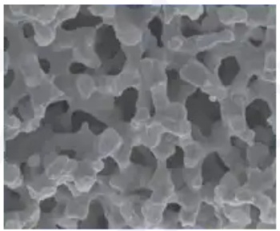

<details>
<summary>natural_image</summary>

Microscopic view of a porous, irregularly shaped material surface (no text or symbols)
</details>

(c) 整体材料

图 8.3.2 颗粒填料和整体材料

目前应用最广泛的是以溶胶-凝胶法或堆砌法制备的无机硅胶微粒，此外，氧化锆、氧化钛、氧化铝及各类复合氧化物微粒也有一定应用。无机微粒填料本身可直接用作液-固吸附色谱固定相，同时可用作固体载体，通过物理或化学作用如吸附、涂渍、键合、包覆等方法在其表面引入不同类别的薄层有机化合物或薄层多孔材料，形成杂化微粒填料用以满足不同类别复杂体系的分离，其中化学键合改性是应用最多的改性策略之一。

有机微粒填料主要包括天然多糖如葡聚糖、琼脂糖，经物理/化学加工制备的凝胶，以苯乙烯、二乙烯苯等有机单体和交联剂通过化学聚合制备的交联高聚物微球。整体柱是20世纪80年代后期快速发展的一种新型有机或无机分离介质，它是指在色谱柱内原位聚合直接形成整体固定相。一般采用正硅酸酯、烷基硅酸酯、丙烯酰胺、N,N-亚甲基二丙烯酰胺、苯乙烯、二乙烯苯、丙烯酸酯、二甲基丙烯酸乙二酯等单体和交联剂在色谱柱内原位交联聚合，形成具有微孔（或中孔）和连续穿透孔的整体无机或有机柱床。以正硅酸酯制备的硅胶无机整体柱，可采用类似无机填料表面改性方法引入有机分子，也可采用正硅酸酯、烃基硅酸酯直接缩聚制备有机/无机杂化整体柱。一般情况下，整体柱渗透性好，可在较低柱前压操作下实现快速分离。

常见高效液相色谱分离模式下固定相的类别将在 8.3.4 中一并介绍。这里简单介绍硅胶固定相的评价方法。

---

430

第八章 色谱分析

通常除了评价色谱柱效之外，还要评价固定相本身特性，对于反相色谱硅胶填料，常用的是恩格尔哈特测试方法（Engelhardt test），该方法使用的流动相为甲醇/水（55/45，体积比），紫外检测器波长254 nm。以尿嘧啶的保留时间为死时间，通过观察苯胺、苯酚、乙基苯胺位置异构体、甲苯、乙苯、苯甲酸乙酯、N,N-二甲基苯胺等分子的保留行为和峰型判断色谱柱残留硅羟基量、疏水性、选择性、填料纯度等，全面反映并预测不同类型化合物在该固定相上的保留行为。

此外，常用的评价方法还有SRM870（standard reference material 870）方法，使用尿嘧啶、甲苯、乙苯、1,4-二羟基蒽醌、阿米替林为分子探针，其中仍然使用尿嘧啶测定死时间，甲苯用来测试固定相疏水作用力和色谱柱效；乙苯用来测试固定相对亚甲基的选择性、疏水作用力和柱效；用1,4-二羟基蒽醌测试固定相的配位能力；用阿米替林测试固定相对碱性化合物的保留行为。该方法使用的流动相为$20\mathrm{mmol}\cdot \mathrm{L}^{-1}$ 磷酸钾缓冲溶液（pH7.0）与甲醇混合溶液（水相/甲醇，1/4，体积比）。如果出现下列三类谱图(图8.3.3)，说明固定相性能好，游离硅羟基少，金属残余量少。如果阿米替林的色谱峰严重拖尾，且甲苯与乙苯色谱峰重叠，说明金属杂质比较多。如果1,4-二羟基蒽醌出现拖尾，而其他物质色谱峰对称，说明游离硅羟基比较多。

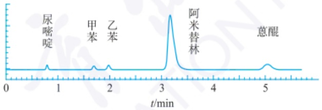

<details>
<summary>line</summary>

| Compound | Retention Time (min) |
| --- | --- |
| 尿嘧啶 | ~0.8 |
| 甲苯 | ~1.6 |
| 乙苯 | ~2.0 |
| 阿米替林 | ~3.1 |
| 蒽醌 | ~5.0 |
</details>

(a)

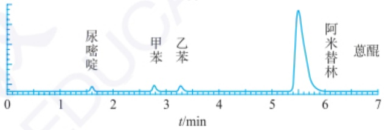

<details>
<summary>line</summary>

| Compound | Retention Time (min) |
| --- | --- |
| 尿嘧啶 | ~1.6 |
| 甲苯 | ~2.8 |
| 乙苯 | ~3.3 |
| 阿米替林 | ~5.5 |
| 蒽醌 | ~6.0 |
</details>

(b)

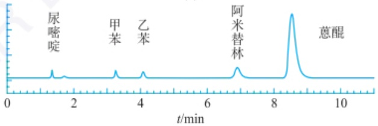

<details>
<summary>line</summary>

| Compound | Retention Time (min) |
| --- | --- |
| 尿嘧啶 | ~1.4 |
| 甲苯 | ~3.2 |
| 乙苯 | ~4.0 |
| 阿米替林 | ~6.8 |
| 蒽醌 | ~8.5 |
</details>

(c)

图 8.3.3 SRM 方法中可能出现的典型谱图

评价色谱固定相的目的是全方位了解固定相,判断不同化合物在其表面保留行为后确定其应用领域,减少盲目使用带来的时间和试剂浪费。

硅胶作为色谱固定相的主要基质，通常在 $\mathrm{pH} = 2\sim 8$ 的范围内使用，通过表面修饰可以拓宽 $\mathrm{pH}$ 使用范围，修饰合成的方法、方式及最终表面官能团决定了固定相的性质。硅烷化反应和Click反应是最常用的固定相合成方法。在硅胶表面聚合或自组装碳纳米粒子（碳纳米管、碳量子点、石墨烯、人造金刚石）、金属有机框架、共价有机框架、共价微孔聚合物、氢键有机框架等纳米材料极大丰富了色谱固定相类型，灵活可控的合成能制备具有不同形貌、表面性质、孔径及官能团的固

---

8.3 液相色谱法

431

定相，极大地提高了固定相的选择性。随着3D和4D打印技术的发展，打印色谱固定相成为其合成发展方向。此外，为了满足不同场景的分离需要，定制化固定相也成为其发展方向。

## 8.3.3.2 高效液相色谱流动相

流动相的溶剂种类和组成选择是分离条件优化的首要操作。液相色谱流动相需具备强的化学惰性、适宜的物理性质、适当的溶解能力、较高的安全性和经济性等特点。

表征流动相的特征参数有相对分子质量、密度、黏度、沸点、介电常数、偶极矩、折射率、紫外吸收截止波长等，对于分离来讲，与其密切相关的是溶剂洗脱能力或强度参数，其中极性参数 $P^{\prime}$ 可作为表征溶剂洗脱强度的指标，是溶剂与乙醇、二氧六环和硝基甲烷三种极性物质相互作用力的度量，反映溶剂接受质子、给出质子和偶极相互作用能力及选择性差异。表8.3.1给出了高效液相色谱常用流动相溶剂的极性参数及其他性质。

表 8.3.1 代表性高效液相色谱流动相溶剂相关参数

| 溶剂 | 沸点(bp)/°C | 折射率RI(25°C) | 紫外截止波长/nm | 黏度η/(mPa·s)(25°C) | 溶剂强度参数$\varepsilon^0$ | 溶解度参数δ | 溶剂极性参数P' |
| --- | --- | --- | --- | --- | --- | --- | --- |
| 正戊烷 | 36 | 1.355 | 195 | 0.22 | 0 | 7.1 | 0 |
| 正己烷 | 69 | 1.372 | 190 | 0.30 | 0.01 | 7.3 | 0.1 |
| 乙醚 | 35 | 1.350 | 218 | 0.24 | 0.38 | 7.4 | 2.8 |
| 环己烷 | 81 | 1.423 | 200 | 0.90 | 0.04 | 8.2 | -0.2 |
| 四氯化碳 | 77 | 1.475 | 265 | 0.90 | 0.18 | 8.6 | 1.6 |
| 二氯甲烷 | 40 | 1.421 | 233 | 0.41 | 0.42 | 9.6 | 3.1 |
| 正丙醇 | 97 | 1.385 | 205 | 1.90 | 0.82 | 10.2 | 4.0 |
| 正丁醇 | 118 | 1.397 | 210 | 2.60 | 0.7 |  | 3.9 |
| 四氢呋喃 | 66 | 1.405 | 212 | 0.46 | 0.57 | 9.1 | 4.0 |
| 氯仿 | 61 | 1.443 | 245 | 0.53 | 0.40 | 9.1 | 4.1 |
| 二氧六环 | 101 | 1.420 | 215 | 1.20 | 0.56 | 9.8 | 4.8 |
| 吡啶 | 115 | 1.507 | 305 | 0.88 | 0.71 | 10.4 | 5.3 |
| 丙酮 | 56 | 1.356 | 330 | 0.30 | 0.50 | 9.4 | 5.1 |
| 乙醇 | 78 | 1.359 | 210 | 1.08 | 0.88 |  | 4.3 |
| 乙腈 | 82 | 1.341 | 190 | 0.34 | 0.65 | 11.8 | 5.8 |
| 甲醇 | 65 | 1.326 | 205 | 0.54 | 0.95 | 12.9 | 5.1 |
| 水 | 100 | 1.333 |  | 0.89 |  | 21.0 | 10.2 |

注: $\varepsilon^{0}$  为在氧化铝吸附剂上溶剂强度参数。

## 8.3.4 高效液相色谱常见的分离类型

高效液相色谱分离类型多样,适用于不同分离对象,根据溶质与固定相的作用可分为吸附色谱、分配色谱、离子交换色谱等;根据流动相和固定相的相对极性,可分为正相和反相色谱;根据分析对象可分为手性色谱、亲和色谱等。本节主

## 思考:

在 HPLC 和 GC 中, 流动相对于色谱分离的作用是否相同?

---

432

第八章 色谱分析

要从分离机制的角度对高效液相色谱进行简要介绍,主要包括吸附色谱法、分配色谱法、手性色谱法、离子交换色谱法、体积排阻色谱法、亲和色谱法等。

## 8.3.4.1 吸附色谱法

吸附色谱(adsorption chromatography)基本原理是流动相吸附在固体吸附剂表面形成饱和单分子层,溶质分子(X)随流动相进入色谱柱后,与流动相分子在固定相(S)表面吸附位点发生竞争吸附,即

$$
\mathrm{X} _ {\mathrm{m}} + n \mathrm{S} _ {\mathrm{a}} = \mathrm{X} _ {\mathrm{a}} + n \mathrm{S} _ {\mathrm{m}} \tag {8-3-8}
$$

式中， $X_{m}$  和  $X_{a}$  分别表示在流动相中和吸附在吸附剂表面上的溶质分子； $S_{m}$  和  $S_{a}$  分别表示在流动相及吸附在吸附剂上的流动相分子；n 表示被溶质分子取代的流动相分子的数目。

溶质的分子结构,特别是所含官能团的极性、数目与空间排布,决定其在固定相上的吸附力和容量因子k。当被吸附分子与吸附剂表面呈平行排列时吸附强度显著提高;当官能团相邻有大体积位阻基团时会降低保留;顺式异构体比反式异构体有更高保留值;当目标分析物存在分子内氢键作用时可能抑制其保留行为,如邻硝基苯酚保留值比对硝基苯酚小。

吸附色谱常用固定相可分为极性吸附剂和非极性吸附剂，前者以多孔硅胶 $(m\mathrm{SiO}_{2}\cdot n\mathrm{H}_{2}\mathrm{O})$ 微球为典型代表，还包括氧化铝、氧化锆、氧化钛、氧化镁、复合氧化物及分子筛等，一般表面含有大量极性基团；后者主要包括活性炭或石墨化炭黑、高交联度苯乙烯-二乙烯苯聚合物多孔微球等。当使用硅胶等极性固定相时，流动相应采用正己烷等非极性溶剂为主，加入适量弱极性溶剂如卤代烃或强极性溶剂如醇等为改性剂调节流动相洗脱强度。若使用有机高聚物微球等非极性固定相，则应采用水、醇、乙腈等极性溶剂为流动相。

固定相含水量是控制吸附剂活性、影响溶质保留的重要因素。在硅胶或流动相中加入一定量的水，利用物理吸附水可降低吸附剂活性，抑制色谱峰拖尾，提高柱效。但流动相中含水量不能太高，水量高不但会导致有机分子在流动相中溶解度下降，同时大量水在硅胶表面的吸附会显著影响分离效果。稳定的固定相含水量是保证分离重复性的重要参量。

## 8.3.4.2 分配色谱法

由于固体吸附材料种类少，吸附色谱法应用范围有限，分配色谱法（partition chromatography）是应用最广的一种液相色谱方法。该方法类似于溶剂萃取，其固定相和流动相均为液体且互不相溶，基于物质在固定液和流动相中溶解度的不同，即分配系数 $K$ 不同，通过样品混合物在两相间多次的分配平衡，实现不同物质的分离。分配色谱法的固定相是通过将固定液负载在载体（也称为担体、基体）表面上实现的，主要有物理吸附和化学键合两种固定方式。通过物理浸渍的液体固定相由于流动相的溶解作用或者机械力作用很容易流失，导致溶质分子在色谱柱上保留行为的改变，并引起柱效下降，极大限制了其发展和应用。化学键合固定相是通过化学反应将有机分子键合到载体表面，可以有效避免固定液流失，是更为常用的方式。

一般来讲,根据固定相(液)和流动相的相对极性,分配色谱可分为两种类型:①极性的固定相和弱极性/非极性的流动相体系,称为正相色谱,适用于分离极性化合物,流出柱的顺序与组分极性大小的顺序基本相同,极性弱的组分先流出,极性强的后流出。②弱极性或非极性固定相和极性溶剂(水、甲醇、乙腈等)为流动相的体系,称为反相色谱,适用于非极性、弱极性、中等极性化合物样品

## 常用流动相的极性:

水>乙腈>甲醇>乙醇>四氢呋喃>丙醇>环己烷>己烷

---

8.3 液相色谱法

433

的分离分析，流出柱的顺序与正相色谱正好相反，极性强的组分先流出，极性弱的后流出。反相色谱在现代液相色谱中应用最为广泛，据统计，它占整个高效液相色谱应用的 $80\%$ 左右。此外，有别于正相和反相色谱，若使用极性键合相与混有少量水相缓冲溶液的极性有机溶剂（主要是乙腈）作为流动相，可称为亲水色谱。通常用于分离极性化合物，如极性代谢物、核苷/核苷酸、氨基酸、多肽、蛋白、寡糖等，成为蛋白质组学分析的重要工具之一。

液-液分配色谱固定相是将固定液负载在全多孔或薄壳型硅胶等载体表面，要求载体表面惰性、比表面积适中、降低残余吸附效应。常用的载体包括硅胶和有机高分子微球等。将固定液物理涂渍在载体上一般通过两种方式:一种是静态法，以固定液溶液浸渍载体，然后缓慢蒸发除去溶剂；使用该类型色谱填料时应选用对固定液溶解度小的溶剂为流动相，并预先使固定液在流动相中饱和，防止固定液被流动相溶解而流失。另一种是原位动态涂渍法，将载体填充在色谱柱中，然后将含有一定固定液浓度的流动相连续流经色谱柱，至固定液在载体和流动相中达到分布平衡，形成稳定的分离体系。液-液分配色谱具有柱容量高、适用样品类型广等特点，包括水溶性和脂溶性样品，极性和非极性、离子性和非离子性化合物等。理论上液-液分配色谱形成种类繁多的色谱体系，但由于固定液易被流动相溶解的限制，具备广泛实用价值的液-液分配色谱体系相当有限。

化学键合方式制备固定相通常是将有机官能团通过化学反应共价键合到惰性载体(如硅胶)表面的裸露羟基(—OH)而形成的固定相,最常见的固定相制备方法是硅羟基与有机硅烷进行硅烷化反应,形成稳定的—Si—O—Si—C—结构,典型反应如下:

$$
\text {—Si—OH} + \mathrm{X—Si—R} \xrightarrow {\mathrm{CH} _ {3}} \text {—Si—O—Si—R} \tag {8-3-9}
$$

式中，X为氯或甲氧基；R为起分离作用的有机基团。由于位阻效应，硅烷化反应表面键合量一般小于 $4\mathrm{mmol}\cdot \mathrm{m}^{-2}$ 。未反应的残留硅羟基可通过小位阻硅烷化试剂修饰，以减少拖尾。根据基团R类型的不同，分为非极性键合相（反相柱，如键合不同碳原子数的长链烃基或苯基）和极性键合相（正相柱，如键合氰基、氨基、羟基、卤素等极性基团）。化学键合固定相是单分子层的薄膜，传质速率较快，可获得较高的柱效。通过化学反应键合不同的官能团，增加了色谱柱的选择性，扩大了分析样品范围。流动相的组成或流速变化对键合相稳定性无明显影响。通常评价键合固定相的性能指标包括键合量、理论塔板数、色谱柱渗透性、分离选择性、保留值重现性、色谱峰对称性和稳定性等。图8.3.4以反相C8固定相为例，给出了硅胶表面的可能化学键形式，其中2表示水合硅羟基，3表示材料内部含有铝离子杂质，5表示自由硅羟基，6表示硅氧硅键合形式，4和7是正常化学修饰辛烷长链，1和8表示短链烷烃封端。此外，图中还显示了不同类型的Si—O键。

改变反相色谱非极性键合相的烃基链长和键合量可改变样品容量因子 $k$ 和分离因子 $a$ ，链长增加导致溶质容量因子 $k$ 增大；键合量增加，$k$ 增大；相同表面覆盖率的长链烃基柱保留略大于短链烃基柱:当表面覆盖率 $< 3\mu \mathrm{mol}\cdot \mathrm{m}^{-2},\lg k$ 与覆盖率呈线性关系。取代烃基键合相疏水性通常弱于烃基键合相，交联共聚物微球等非极性有机固定相疏水性往往比硅胶键合相更高。非极性、非离子性化合物的

---

434

第八章 色谱分析

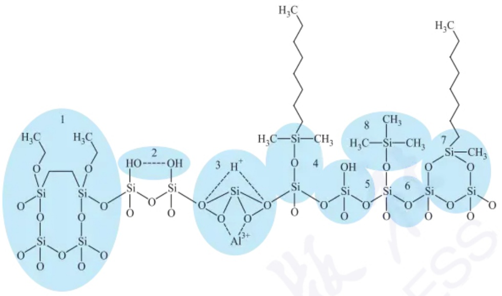

<details>
<summary>chemical</summary>

Chemical structure of a siloxane-based polymer with labeled atoms and functional groups
</details>

图 8.3.4 硅胶表面的可能化学键形式

反相色谱保留行为一般根据固定相不同遵循以下顺序:未改性硅胶(弱)<<氨基<氰基<羟基<醚基 $C_{1}<C_{3}<C_{4}<苯基<C_{8}\approx C_{18}<聚合物$ （强）。C18固定相是最常用的反相色谱固定相，常见的C18固定相类型如图8.3.5所示:(a)是市场上最常见的C18固定相形式；(b)是使用二氯硅烷合成的C18形式，这种类型固定相耐酸性好于(a)；(c)指的是硅原子上存在较大支链，起到掩盖裸露硅羟基的作用；(d)是桥联形式硅胶，在碱性条件下更稳定；(e)表示的是疏水链上镶嵌了极性官能团，额外提供了极性作用力，增加了固定相的稳定性，保证与流动相较好的浸润性。

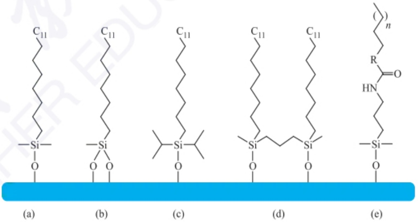

<details>
<summary>chemical</summary>

Polymer chain structures labeled (a) to (e), showing repeating silane units with C11 and R groups
</details>

图 8.3.5 常见的 C18 固定相类型

反相色谱溶质保留类似于从水中萃取有机化合物至有机溶剂（如辛醇），非极性疏水化合物更易于萃取至非极性固定相中。疏水效应是当今较为公认阐明反相色谱保留机理的理论依据。烃类键合相具有长链非极性基团，在固定相基质表面形成一层“分子刷”，以色散为主的非极性分子间作用力很弱，在高表面张力水溶性极性溶剂环境中，当非极性溶质或其分子中非极性部分与非极性基团接触时，周围溶剂膜会产生排斥力促进两者缔合，如图8.3.6所示，这种作用称为“疏水效应”或“疏溶剂效应”。

---

8.3 液相色谱法

435

缔合作用强度取决于三方面因素:溶质分子非极性部分总面积、键合相烃基总面积、极性流动相性质和组成。疏溶剂理论可以很好地解释在高含水量反相色谱流动相条件下溶质的保留行为,但当流动相含水量较低时,基质表面残余硅羟基对极性溶质保留亦有影响,随着键合相制备技术的完善,通过提高键合相的均匀性或改进流动相组成,残余硅羟基作用已降低至可忽略的水平。

正相色谱中极性键合相的保留作用主要来源于固定相与溶质间的氢键作用、偶极-偶极作用等，如氨基键合相兼有质子受体和给体双重功能，对可形成氢键的溶质具有极强作用，可增强其保留并提升分离选择性。使用极性键合相的反相色谱体系（通常指亲水色谱），由于固定相的弱疏水性和极性作用而显示双保留机理，何者占优势则取决于溶质结构、流动相中水-有机溶剂类型和组成。

## 8.3.4.3 手性色谱法

手性化合物的分离分析是分析化学中的难点之一，高效液相色谱分离手性化合物具有诸多优势，由于分离手性物质的特性，称为手性色谱。既可以使用手性固定相(chiral stationary phase, CSP)和非手性流动相，亦可使用非手性固定相和手性流动相(chiral mobile phase, CMP, 流动相中含有手性选择剂)，目前手性固定相法的应用更为广泛。

引入手性环境使对映体间呈现物理特征的差异是手性HPLC进行光学异构体拆分的基础。CSP通常是将手性物质化学键合或涂渍在载体表面提供手性环境。化学键合CSP是通过含活性基团(如烃氨基)的有机硅偶联剂与手性物质发生反应，将之接枝到硅胶等基质表面。溶质对映体分子与载体表面的手性分子通过氢键、 $\pi -\pi$ 、偶极、静电、包合和立体镶嵌等相互作用，形成瞬间非对映异构体复合物的能力有差异，达到分离的目的。采用CSP的高效液相色谱体系的流动相与分配色谱相似，根据CSP与流动相相对极性不同可构成正相或反相色谱，常用的CSP类型包括给受体型、多糖类、环糊精类、蛋白类等。

给受体型CSP，也称为Pirkle型手性固定相，是由Pirkle研究组最早开发的一类CSP，具有确定的化学结构，其共同结构特征是在手性中心附近含有取代芳基的 $\pi$ 电子给体或 $\pi$ 电子受体基团、能形成氢键和偶极作用的极性基团、具有立体位阻的大体积非极性基团，构成三点作用手性识别模式的结构基础(图8.3.7)。Pirkle CSP手性分子具有独立手性识别能力，通过固定相分子设计可以预测溶质对映体洗脱顺序，并可提供溶质绝对构型的有关信息。

多糖类手性固定相主要是纤维素、淀粉及其衍生物CSP，以含有芳环的取代苯甲酸酯衍生化纤维素居多。通常这些衍生物经涂渍分布在大孔微粒硅胶表面，也可通过羟基和有机硅偶联剂缩合键合至硅胶等载体表面。该类CSP手性识别机理复杂，至今仍未完全阐明，较普遍的观点认为，在氢键、偶极、$\pi-\pi$等作用辅助下聚合物螺旋形空穴“立体配合”（steric-fit）包合作用实现手性对映体分子区分。

环糊精(cyclodextrin, CD)类手性固定相，又称为空穴性固定相，是对天然环糊精超分子主体化合物进行功能改性并接枝于基质表面形成的手性分离材料。环糊精是由 $6(\alpha), 7(\beta), 8(\gamma)$ 个葡萄糖通过1,4-糖苷键形成的环状手性空穴结构，分子整体上具有光学活性和立体识别能力。空穴开口处由极性羟基包围，而空穴本身呈疏水性，可与各种有机分子疏水部分形成包合体，分子表面的大量羟基为其衍生化和键合提供了结构基础。由于疏水弱极性流动相易于与CD

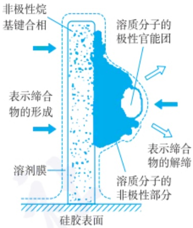

<details>
<summary>flowchart</summary>

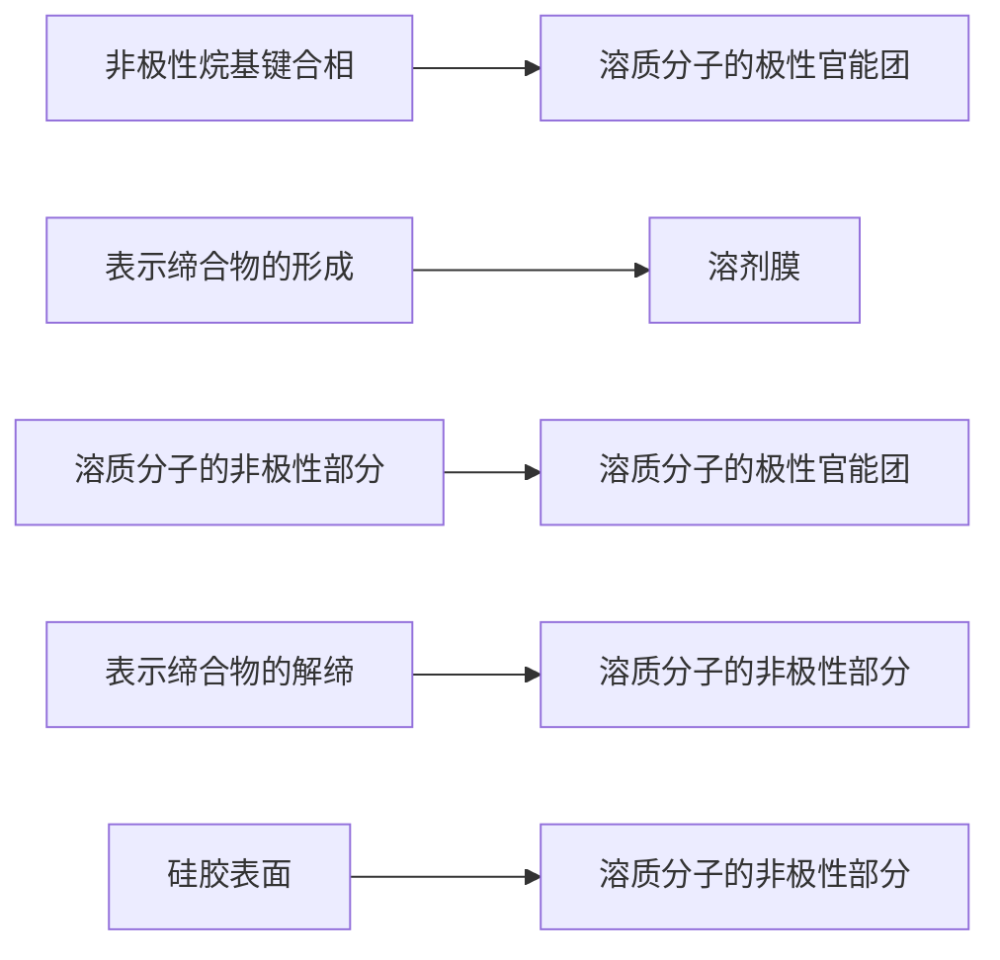
</details>

图 8.3.6 反相色谱固定相与溶质“疏溶剂效应作用”示意图

通常改变色谱固定相或色谱柱不如改变流动相溶剂类型和组成有效，只有当改变流动相难以实现期望的分离效果时，才尝试改变色谱柱类型。

手性广泛地存在于自然界中。如果某物体与其镜像不同，则其被称为“手性的”，互为镜像而无法叠合。手性药物在生物体内与蛋白质等大分子的结合能力不同造成不同药效，甚至相反药效，所以手性分离是药物制备中非常重要的工作。

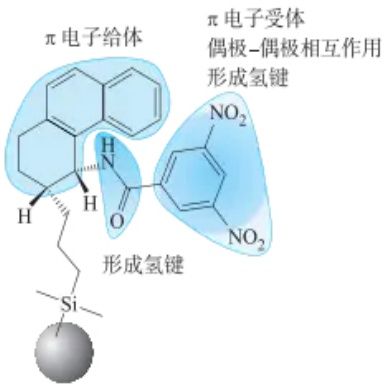

<details>
<summary>chemical</summary>

Diagram illustrating π electron binding mechanism involving silicon and nitro groups, showing formation of hydrogen bonds
</details>

图8.3.7 PirkleCSP手性识别作用点示意图

---

436

第八章 色谱分析

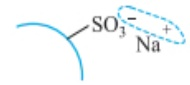

(a)阳离子交换示意图

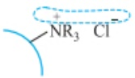

(b) 阴离子交换示意图

图 8.3.8 离子交换色谱固定相示意图

疏水空腔作用，因此，天然环糊精仅能在反相色谱中展现手性分离能力。通过对CD羟基进行功能化后，可显著提升其适用性，使其适配正相和反相色谱体系。

大环糖肽类手性固定相通常由多个氨基酸（如苯丙氨酸、丝氨酸、组氨酸等）和糖类（如葡萄糖、甘露糖等）组成，形成一个大环结构。这种结构的独特之处在于其结构复杂性和多样性，不仅可提供丰富的手性识别位点，还赋予了固定相独特的选择性和亲和力，使其能够有效分离多种手性化合物，包括药物、天然产物及其他有机小分子。大环糖肽类手性固定相表现出极好的稳定性和重现性及强的分离能力和选择性，使其应用广泛。

蛋白质是一类复杂的生物大分子，所含亚单位 $L$ -氨基酸具有手性特异性，对手性分子具有很强的识别能力，一般通过含氨基、二醇基等键合硅胶中间体将蛋白质固载至硅胶表面，用作手性固定相。蛋白质CSP的手性选择机理十分复杂，已观察到疏水效应、形成氢键、静电作用、立体效应等。不同的键合技术可能形成蛋白质络合点不同的微环境，蛋白质CSP次级结构的立体活性点对流动相组成相当敏感，因而分离条件优化相当困难，其手性选择性也难以预测。

除了上述 CSP 外, 还有手性冠醚类、分子印迹类及近年来发展迅速的手性多孔晶态材料如金属有机骨架及共价金属骨架类等。

## 8.3.4.4 离子交换色谱法

离子交换色谱法(ion exchange chromatography)是利用离子交换原理分离分析溶液中离子的一种色谱方法。传统的离子交换技术广泛应用于去离子水生产、稀土元素和各类裂变产物的分离与规模制备。采用专门制备的离子交换固定相，可以使液相色谱快速分离分析无机离子、有机酸碱及生物大分子。

在阴离子交换色谱中,样品阴离子  $A_{m}^{-}$  与流动相离子  $B^{-}$  争夺离子交换剂(即离子交换固定相)上的带电荷的基团  $R_{s}^{+}$ , 在阳离子交换色谱中, 样品阳离子  $A^{+}$  与流动相离子  $B^{+}$  争夺离子交换剂上的带电荷的基团  $R_{s}^{-}$  (图 8.3.8), 反应如下:

$$
\mathrm{A} _ {\mathrm{m}} ^ {-} + \mathrm{B} ^ {-} \mathrm{R} _ {\mathrm{s}} ^ {+} \rightleftharpoons \mathrm{B} _ {\mathrm{m}} ^ {-} + \mathrm{A} ^ {-} \mathrm{R} _ {\mathrm{s}} ^ {+} \tag {8-3-10}
$$

$$
\mathrm{A} _ {\mathrm{m}} ^ {+} + \mathrm{B} ^ {+} \mathrm{R} _ {\mathrm{s}} ^ {-} \rightleftharpoons \mathrm{B} _ {\mathrm{m}} ^ {+} + \mathrm{A} ^ {+} \mathrm{R} _ {\mathrm{s}} ^ {-} \tag {8-3-11}
$$

由于溶质离子与离子交换剂的相互作用有强弱,在流动相离子的竞争下,作用强的不易洗脱,作用弱的能较快洗脱,因此得以分离。

离子交换的平衡式可用下式表达:

$$
\mathrm{A} + \mathrm{BR} _ {\mathrm{s}} \rightleftharpoons \mathrm{B} + \mathrm{AR} _ {\mathrm{s}} \tag {8-3-12}
$$

$$
K _ {\mathrm{d}} = \frac {[ \mathrm{B} ] [ \mathrm{AR} _ {\mathrm{s}} ]}{[ \mathrm{A} ] [ \mathrm{BR} _ {\mathrm{s}} ]} \tag {8-3-13}
$$

式中，A 为流动相中的溶质组分的离子，B 为流动相（即洗脱剂离子）， $BR_{s}$  和  $AR_{s}$  分别表示和离子交换剂相结合的洗脱剂离子 B 和溶质离子 A。 $K_{d}$  为平衡常数（用浓度表示），反映溶质离子 A 与固定相亲和力大小，用来评价分离能力。 $K_{d}$  越大表示 A 与固定相亲和力越强，溶质的保留越强，越难以洗脱。实验表明，多电荷离子比单电荷离子保留值更高，交换剂上电荷基团一定时，分离效果与溶质离子间亲和力差异、溶质水合离子半径及其他性质有关。

目前，广泛应用的离子交换固定相主要有三种类型:①苯乙烯和二乙烯苯交联聚合物离子交换树脂，主要用于水的软化、去离子和溶液纯化。阳离子交换树脂最普通的活性点是强酸型磺酸基— $SO_{3}^{-}H^{+}$ ，弱酸型羧酸基— $COO^{-}H^{+}$ 。阴离子

---

8.3 液相色谱法

437

交换树脂最普通的活性点是强碱型季铵基—N $\left(\mathrm{CH}_{3}\right)_{3}^{+}\mathrm{OH}^{-}$ 或弱碱型伯铵基—NH $_{3}^{+}$ OH $^{-}$ 。按树脂物理结构不同，有微孔和大孔之分，前者交联度高，骨架紧密，孔穴小，适用于分离小体积的无机离子；后者交联度低，除微孔外，还有刚性大孔结构。聚合物离子交换固定相有pH使用范围广的优点，然而聚合物基质易被溶胀、压缩，同时聚合物内部的微孔结构导致传质速率慢，柱效较低。② 表面薄壳型无机-有机复合型交换剂，该类固定相具有较大粒径（10\~40  $\mu$ m），在无孔玻璃珠或聚合物内核表面涂覆薄层聚合物离子交换树脂或微粒硅胶。③ 硅胶化学键合离子交换剂，粒径5\~10  $\mu$ m，通过键合、化学反应引入离子交换基团，具有机械强度高、柱效高的优点，但适用pH范围窄。

离子交换色谱法的流动相大多为水溶液，通过调节流动相的 $\mathrm{pH}$ 和离子强度就可调整溶质组分的保留值，通常可使用含有一定盐离子浓度的缓冲溶液达到目的。①当流动相的离子强度大时，加入的盐使离子浓度增加，削弱了溶质组分离子的竞争吸附能力，使溶质组分的保留值降低。②流动相的 $\mathrm{pH}$ 的变化能导致可解离化合物在溶液中解离度发生变化，如解离度变大，则组分的保留值也增大。一般来说，离子强度的变化要大于 $\mathrm{pH}$ 变化对保留值的影响。③在流动相中添加有机溶剂，可使峰的拖尾得到改善，调节溶质组分保留值。如果是加入极性溶剂如醇类，就将抑制离子交换作用，分离机制将转化为分配形式，即在离子交换剂所吸附的水相和流动相之间分配。常用的有机溶剂有甲醇、乙醇、乙腈、二氧六环等。

用电导检测器检测离子交换色谱流出液时，由于淋洗液是强电解质，其电导完全掩盖了待测离子的信号。为此，在离子交换柱后引入了一个抑制器，以消除淋洗液中强电解质的影响。这种采用分离柱、抑制器、电导检测的离子交换色谱，称为离子色谱（ion chromatography）。从1975年发展至今，它已能分析许多无机及有机阴、阳离子。

## 8.3.4.5 体积排阻色谱法

体积排阻色谱法（size-exclusion chromatography, SEC），也称为尺寸排阻色谱法，通常用于相对分子质量大于2000的样品的分离。该方法最广泛的用途是测定聚合物的相对分子质量分布，对于某些大分子样品如蛋白质、核酸等，也是一种很好的分离纯化手段。它采用具有网状结构、多孔性的凝胶作为固定相，利用样品分子在固定相的网状结构内部渗透性的差异来分离各组分。渗透程度大的组分因不易洗脱而保留时间较大，渗透浅的则易洗脱而保留时间短（图8.3.9）。渗透性与相对分子质量具有相关性，所以实际上它是按分子大小顺序进行分离的一种色谱方法，分子大的不易渗透而被排阻在填料孔径外部，小分子则易渗透，不被排阻，最后分离流出的顺序与排阻分子的大小有关。需要指出，渗透性也与分子形状相关，有时相对分子质量相同，保留值并不相同。

对 SEC 固定相适用的相对分子质量范围可方便地从图 8.3.10 所示的校准曲线来说明。这里，直接以分子体积相关的相对分子质量对流动相体积  $V_{R}$  作图。图中存在一个排阻极限处 A，凡比此点对应的相对分子质量大的溶质分子均被排阻，以单一色谱峰 a 洗出。此外，还存在一个渗透极限点 B，所有相对分子质量低于此点的溶质分子完全渗透，以单一色谱峰 d 洗出。从 A 点随相对分子质量降低，溶质分子在凝胶孔穴中逐渐渗透，不断迁移，这是选择性渗透区，发生溶质按相对分子质量分级分离，形成系列色谱峰，如图中 b, c 等。凝胶色谱法的色谱峰型与溶质相对分子质量的分散性相关，保留时间具有可预测性，是一种稳定的分

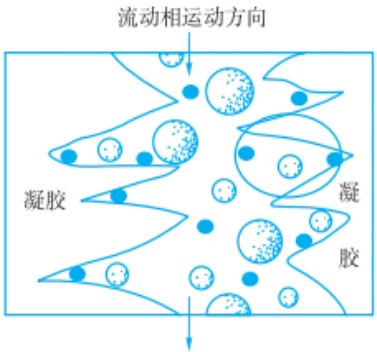

<details>
<summary>flowchart</summary>

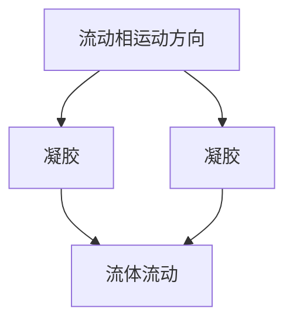
</details>

图 8.3.9 体积排阻色谱分离原理示意图

---

438

第八章 色谱分析

## 思考:

在体积排阻色谱法中改变流动相组成是否能改善分离情况？

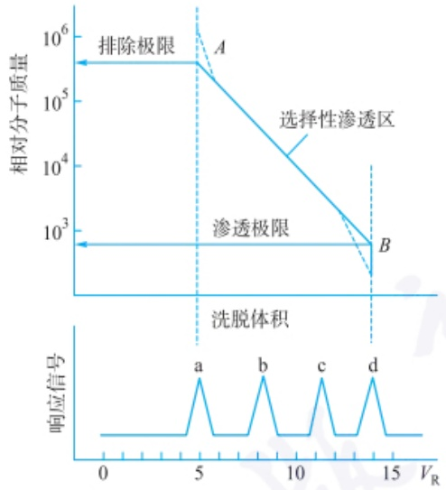

<details>
<summary>line</summary>

| VR | Relative Polymer Mass | Signal Type |
| --- | --- | --- |
| 0~4.5 | ~3e5 | Selectionic Penetration |
| 4.5~13.5 | ~3e5 ~7e2 | Penetration Limit |
| 13.5~14 | ~7e2 ~2e2 | Penetration Limit |
</details>

图 8.3.10 体积排阻色谱柱校准曲线和对应色谱示意图

离方法,不存在其他的保留机制,因而不会发生溶质的化学变化和损耗,离子也不易失活。其缺点是 SEC 固定相的柱效不高,对于分子大小相近的组分及复杂多组分的分离效果不够理想。

体积排阻色谱的常用固定相分两类，即有机交联聚合物和无机材料。有机聚合物凝胶常用的是苯乙烯和二乙烯苯交联共聚物（也称为半刚性凝胶），由交联度控制孔径范围。最初聚合物是疏水的，只适用非水流动相，对水溶性高分子化合物，如糖类等应用受到限制。现在通过聚苯乙烯磺酸化或利用聚丙酰胺可获得亲水性聚合物凝胶。无机材料常见的是多孔玻璃、多孔硅胶等（孔径范围4\~250 nm，也称为刚性凝胶）。它具有机械强度和稳定性高、易填充、耐高压和高温、更换溶剂平衡速率快、适用溶剂范围广等优点。其缺点是残余吸附导致溶质非排阻保留及催化作用引起溶质降解。为减少吸附，常采用硅烷化对表面改性，引进羟基等亲水性基团。为了使凝胶湿润、溶胀，流动相常采用低黏度的溶剂，选择的溶剂还须能溶解样品，能与检测器相匹配。常用的流动相有四氢呋喃、甲苯、邻二氯苯、二氯乙烷、氯仿、苯、四氯化碳和水等。此外，根据固定相和流动相种类，体积排阻色谱又可分为凝胶过滤和凝胶渗透色谱，前者多使用亲水性填料和水溶性溶剂流动相（如缓冲溶液），后者则主要使用疏水性填料和非极性有机溶剂。

## 8.3.4.6 亲和色谱法

亲和色谱法(affinity chromatography)是利用生物大分子与亲和色谱固定相表面配体之间存在的生物学和生物化学过程的特效性亲和作用,进行选择性分离生物分子的分离方法(图8.3.11)。由于这种结合是高度特异性的,非目标组分不会被固定相捕获,从而在洗脱过程中被移除。之后,通过改变流动相的条件(如pH、离子强度、温度等),可以促使目标分子与配体解离,实现目标分子的纯化和回收。

亲和色谱的固定相通常是一种具有特定结合位点的材料，如琼脂糖凝胶、纤维素或合成聚合物。配体的选择取决于目标分子的性质，常见的配体包括抗体、酶、激素、金属离子、某些特定官能团（苯硼酸等）、核酸适配体及其他生物活性小分子。流动相通常是一种缓冲溶液，其 $\mathrm{pH}$ 和离子强度需要根据目标分子和配体的特性进行调节。流动相的选择对于维持固定相的生物活性、促进目标分子与配体的特异性结合及后续的洗脱过程至关重要。

---

8.3 液相色谱法

439

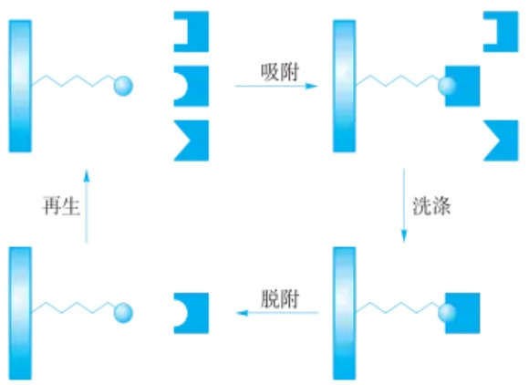

<details>
<summary>flowchart</summary>


</details>

图 8.3.11 亲和(锁-匙)相互作用示意图

## 8.3.5 衍生化技术

根据衍生化反应发生的位置,可以分为色谱柱前衍生和柱后衍生。柱前衍生可以是在线或离线衍生,方式灵活,衍生反应充分,有助于提高衍生化效率。柱后衍生一般采用在线衍生的方式,只能采用衍生化反应速率快并能够反应完全的化学反应,需要一定的设备配合使用,有一定的局限性。

根据衍生机理,可以分为光谱衍生(获取光谱检测信号)、电化学衍生(产生可测量的电化学信号,或通过电化学反应得到新的化学结构)、光化学衍生[通过光化学反应产生异构体或聚合(降解)得到新结构]、化学衍生(通过化学反应改变物质极性)、质谱衍生(提高待测物离子化效率)、手性衍生(利于异构体手性分离)等。

光谱衍生最常用的是紫外衍生和荧光衍生，如氨基酸紫外信号不强，用色谱分离后直接用紫外吸收检测器检测的灵敏度不高，可以通过衍生反应，让氨基酸带上更多发色团而提高灵敏度，如果带上荧光官能团，则分析灵敏度更高，常用的氨基酸荧光衍生试剂有邻苯二甲醛、荧光素异硫氰酸酯、丹磺酰氯、9-芴甲基氯甲酸酯、6-氨基喹啉-N-羟基琥珀酰亚胺甲酸酯等，不同衍生试剂使用的衍生条件不同，得到的检测灵敏度也存在差异。

茚三酮是最常用的柱后氨基酸的紫外衍生试剂,其反应式如下(图 8.3.12),从产物结构可以分析茚三酮不能成为柱前衍生试剂的原因。

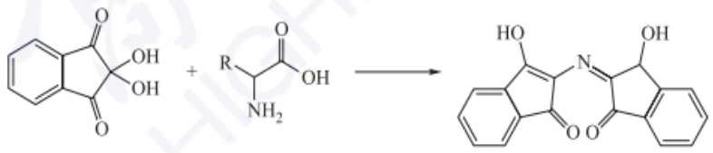

<details>
<summary>chemical</summary>

Chemical reaction equation showing the formation of a fused heterocyclic compound from a benzoyl carboxylic acid and an amino group
</details>

图 8.3.12 茚三酮衍生氨基酸的反应示意图

电化学衍生能改变分析物的氧化还原状态(或结构)，如图8.3.13所示的叶酸的电化学衍生过程。如果采用紫外吸收检测器，色谱分离分析叶酸的灵敏度很低，先通过电化学在线柱后衍生，使叶酸分解得到更强紫外信号的产物B，提升紫外检测灵敏度。

光化学衍生是指分析物先色谱分离，在柱后接受特定波长的光照射，吸收光能并改变其结构。比如一些物质结构平面化差，荧光量子效率低，检测灵敏度低，光化学衍生获得其稳定的平面结构而提高量子产率。黄曲霉毒素、苏丹红等物质

---

440

第八章 色谱分析

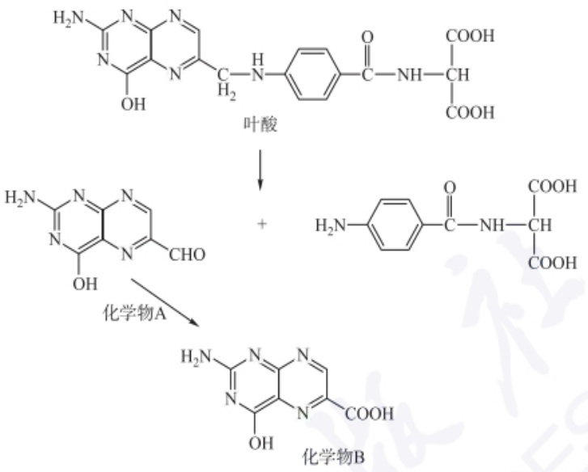

<details>
<summary>chemical</summary>

Chemical reaction pathway showing conversion of compound A to compound B via acetic acid and compound B under condition A
</details>

图 8.3.13 叶酸的电化学衍生示意图

均可以采用此方法提高分析灵敏度。

化学衍生是指通过化学反应改变物质的极性,以达到增强色谱保留和分离的目的,如图8.3.14所示的衍生反应。丙烯酰胺的极性太强,在反相色谱柱上的保留不够,难以准确定量,通过衍生化,可适当降低极性,延长保留时间,实现准确定量。

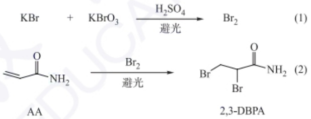

<details>
<summary>chemical</summary>

Chemical reaction scheme showing bromination of a ketone under H2SO4 and Br2 conditions, yielding 2,3-DBPA
</details>

图 8.3.14 丙烯酰胺的衍生化反应

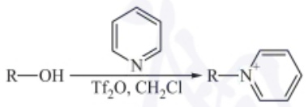

<details>
<summary>chemical</summary>

Chemical reaction equation showing reduction of R-OH to form a substituted benzene derivative using Tf2O and CH2Cl
</details>

图 8.3.15 醇类的质谱衍生示意图

质谱作为通用性色谱检测器，其关键部件是离子源，有些物质不容易离子化，降低了质谱检测灵敏度，针对质谱检测器进行分析物衍生，简称为质谱衍生。比如利用色谱-质谱进行醇类的分析检测，醇类的离子化效率很低，需提高灵敏度，利用下述方法衍生（图8.3.15，式中 $\mathrm{Tf_2O}$ 是三氟甲磺酸酐）可达到目的。

手性衍生是通过改变分子结构，达到异构体分离的目的。如图8.3.16所示。2个手性氨基酸经过手性衍生后，结构差异化显著，极大提高了色谱分离度，但是有可能带来干扰（如图8.3.16中所示的物质Mar-Orn）。

衍生化方法灵活,要注意根据目的进行选择使用。要关注衍生化反应的准确度、重复性和重现性,不能因为衍生降低准确度。

## 8.3.6 高效液相色谱仪

高效液相色谱法所使用的固定相粒度比较小，当流动相流过时会遇到很高的阻力，加上液体流动相的黏度和密度均比载气大，因而必须采用高的入口压力才能得到合理的柱内线速度及较短的分析时间。由于需要高压输液，要求进样器和色谱柱必须用能够耐高压的材料制成，这也使得高效液相色谱仪比其他类型的色

---

8.3 液相色谱法

441

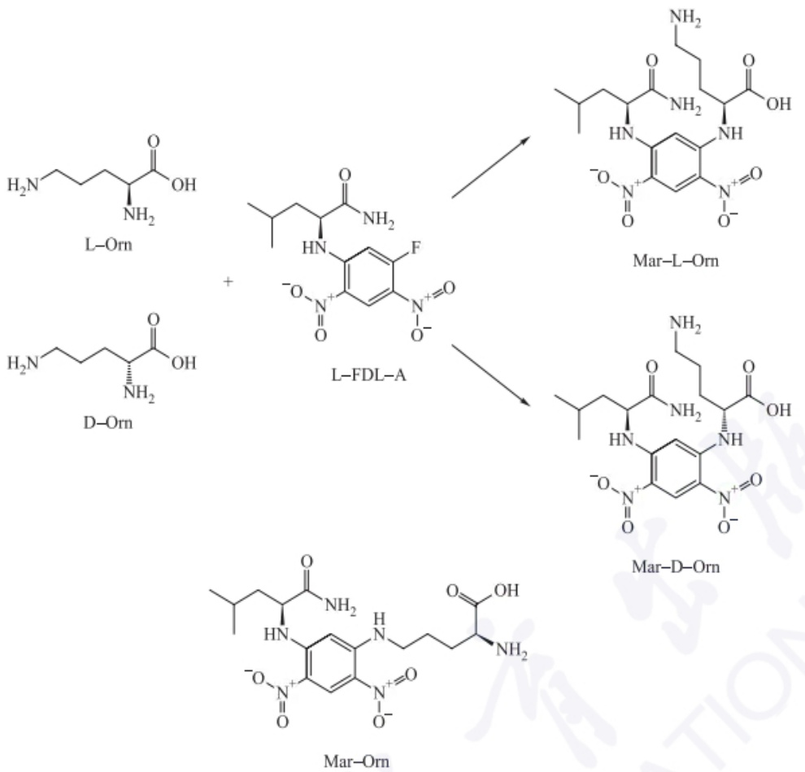

<details>
<summary>chemical</summary>

Chemical reaction pathway showing the synthesis of Mar-D-Orn from L-Orn and D-Orn precursors using L-FDL-A and its derivatives
</details>

图 8.3.16 手性氨基酸的衍生化反应示意图

谱仪更复杂，价格也相对较高。主要包括高压输液系统、进样系统、分离系统及检测和记录系统等单元。图8.3.17是高效液相色谱仪的结构流程图。高压泵将贮液器中的溶剂(需预先脱气)经进样器输送到色谱柱中，然后从检测器的出口流出。当样品从进样器进入时，流经进样器的流动相将样品带入色谱柱中进行分离，分离后的各组分依次进入检测器，检测器的信号由记录仪记录下来，即得液相色谱图。

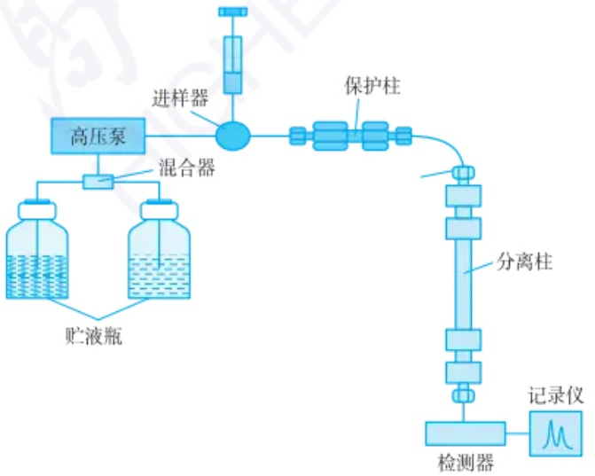

<details>
<summary>flowchart</summary>

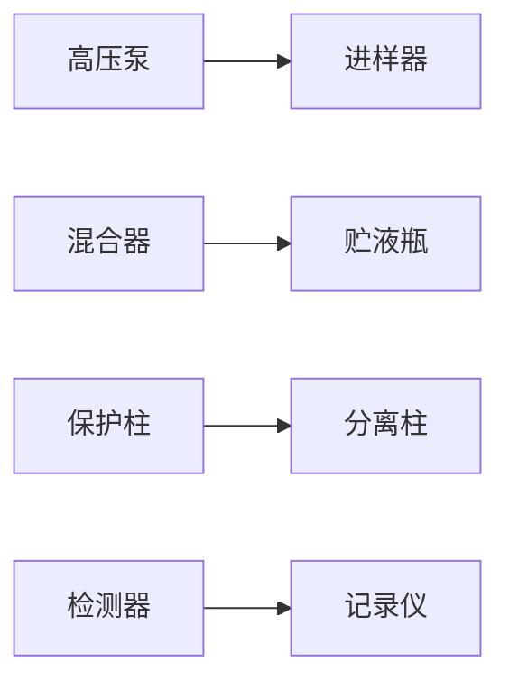
</details>

图 8.3.17 高效液相色谱仪结构流程图

---

442

第八章 色谱分析

## 8.3.6.1 高压输液系统

高压输液系统由贮液器、高压泵等组成，核心部件是高压泵。

## 1. 贮液器

贮液器是用来贮存流动相的容器，现代高效液相色谱仪会配备一个或多个流动相贮液器。用于制作贮液器的材料应耐腐蚀，一般包括玻璃、不锈钢、聚四氟乙烯塑料或聚醚醚酮(PEEK)等，常用体积为0.5\~2.0 L。如果流动相需要避光可以使用棕色瓶；需要加压，则使用耐压贮液瓶。

流动相使用前需要进行过滤和脱气处理。过滤是为了除去灰尘和一些不溶性微粒，以免损坏高压泵、堵塞进样器和色谱柱；脱气是为了避免流动相产生气泡，一旦流动相中有气泡存在，就会引起流速不稳，检测器噪声增大，分析的重现性下降。离线脱气常采用超声波脱气法，在线脱气则可以采用通氦气脱气法或真空脱气法。现在很多商品化仪器都配备在线脱气装置，能够很好地去除大部分气泡。

## 2. 高压输液泵

高压输液泵是 HPLC 系统中最重要的部件之一。泵的性能直接影响到整个分析检测质量和分析结果的可靠性。高压输液泵应具备如下性能:

（1）高压下连续工作一般要求耐压达40\~50 MPa，可在较长时间内连续工作；
（2）输出流量范围宽，分析型仪器能在  $0.1 \sim 10 \, mL \cdot min^{-1}$  范围连续调节，制备型仪器可达到  $100 \, mL \cdot min^{-1}$ ;
（3）输出流量稳定，重现性好，其相对标准偏差(relative standard deviation, RSD)应该小于0.5%；
(4) 泵体通常采用耐酸不锈钢制成,系统耐腐蚀性强,密封性能好。

按其操作原理,高压输液泵可分为恒流泵和恒压泵两大类。恒流泵的特点是,在一定的操作条件下输出的流量保持恒定,而与色谱柱等引起的阻力变化无关。恒压泵的特点是,保持输出的压力恒定,流量则随色谱系统阻力的变化而变化,常用于色谱柱的填充。

恒流泵有螺旋注射泵、往复式柱塞泵等，其中往复式柱塞泵是目前高效液相色谱仪中应用最多的高压输液泵，图8.3.18是单柱塞往复式柱塞泵结构示意图，主要由单向阀、柱塞杆、密封垫、偏心轮几部分组成。


<details>
<summary>text_image</summary>

偏心轮
与电动机相连
密封垫
柱塞杆
至色谱柱
单向阀
单向阀
流动相
</details>

图 8.3.18 单柱塞往复式柱塞泵结构示意图

电动机驱动偏心轮运转使柱塞杆往复运动，周期性地将流动相吸入和排出。偏心轮运转一周，柱塞杆往复运动一次，完成一次吸液和排液过程，改变电动机转速能方便地调节流量。使用单柱塞泵时，由于在吸液阶段柱塞泵没有液体输出，

---

8.3 液相色谱法

443

流动相流量的脉动不能满足色谱分析的要求，仪器无法正常工作，因此在实际应用中多采用双柱塞、三柱塞并联或串联泵，并附加阻尼器以提高输出液流量稳定性。往复式柱塞具有泵内体积小（一般是0.05\~1 mL），易于更换溶剂和进行清洗，适用于梯度洗脱，流速恒定，输出液压高(>70 MPa)等优点。

## 3. 梯度洗脱装置

在高效液相色谱法中，在分析组成比较复杂的混合物样品时，若使用组成恒定的流动相进行洗脱（称为等度洗脱）难以达到满意的分离，改用梯度洗脱可能很容易就得到解决。所谓梯度洗脱（gradient elution）就是在分离过程中使两种或两种以上不同极性的溶剂按一定程序改变配比，从而使流动相的极性、$\mathrm{pH}$ 或离子强度相应地变化，从而调整混合样品中各组分的 $k$ 值以达到提高分离度或缩短分析时间的目的。对复杂化合物，特别是保留性能相差较大的化合物的分离，梯度洗脱是一种极为重要的手段。梯度洗脱的目的类似于气相色谱法的程序升温。

梯度洗脱装置可以分为高压梯度和低压梯度两种模式。①低压梯度装置:不同的溶剂在常压下经过由计算机控制的电磁比率阀，使溶剂按一定比例输至混合室混合，然后用高压泵送入色谱柱中，由于流动相是在泵前的低压条件下混合的，故称为低压梯度。这种方式只使用一个高压泵即可。②高压梯度装置:采用多个高压泵（每种溶剂需要一个泵）将不同的溶剂增压后送入梯度混合室混合后再送入色谱柱。在高压下混合流动相不易产生气泡，对流动相的脱气要求较低。

## 8.3.6.2 进样系统

进样系统是将一定量的待分析样品有效地送入色谱仪的装置。在高效液相色谱中，进样方式及样品体积对柱效有很大的影响，加上高效液相色谱的流路处于高压力工作状态，因此对进样系统要求较高。HPLC进样系统需满足以下条件:①耐高压；②进样量准确、重复性好；③可根据需要选择不同进样量。目前HPLC大多使用高压六通阀进样。

高效液相色谱仪高压六通阀结构如图8.3.19所示，可在 $500\times10^{5}$ Pa甚至更高的压力下进样，其原理与气相色谱六通阀相似。采用六通阀进样还有手动阀进样和自动进样器进样之分。采用手动阀进样时，进样量由样品环的容量来控制，也可由注射器控制（但进样量不能超过样品环的容积）。自动进样器往往由计量泵来精确控制进样量，通过自动进样器可实现样品的定量、可控和批量进样。


图 8.3.19 高效液相色谱仪高压六通阀结构

## 思考:

梯度洗脱与气相色谱中的程序升温有何异同？

---

444

第八章 色谱分析

## 思考:

对于装填小颗粒的超高柱效分析柱,是否使用保护柱,为什么?

## 8.3.6.3 分离系统

分离系统包括色谱柱、恒温器和连接管等部件。由于 HPLC 在很高的压力下工作，色谱柱的柱管材料必须要有很好的机械强度，才能承受住高压，常用内壁抛光的不锈钢管材料，也有少数色谱柱采用聚醚醚酮（PEEK）材料。柱头装有不锈钢烧结材料的微孔过滤片，用以阻止填充物从柱中流出或注射口带入颗粒杂质。

## 1. 分析柱

HPLC 分析柱的内径常为 2\~6 mm(常用标准柱内径为 4.6 mm)，柱长一般为 5\~30 cm，柱内固定相的粒径一般为 3\~10 μm。由于高效液相色谱法使用的固定相粒径要比气相色谱法固定相小很多，使柱效得到很大的提高，其每米塔板数可达 40000\~60000 块，尽管液相色谱的色谱柱比较短，也能满足常规分析的需要，而且短柱有利于降低系统压力，延长色谱柱寿命，实现快速分析。

## 2. 保护柱

保护柱是位于进样器与分析柱之间的短柱，里面装填的固定相通常与分析柱中的固定相一样。保护柱的作用是:①阻拦碎片（如泵塞碎片）和流路中的杂质颗粒等容易堵塞分析柱的物质进入分析柱中；②将强保留组分保留在保护柱中，避免进入分析柱而造成污染。因此保护柱可延长分析柱的使用寿命。此外，在液-液分配色谱中，保护柱可作为流动相对固定液的饱和器，以降低分析柱上固定液的流失。

## 3. 柱恒温箱

柱恒温箱是用来控制色谱柱温度的装置。一般来说高效液相色谱柱的操作温度对分析结果的影响不像气相色谱柱那么强烈，而且流动相中的有机溶剂在高温条件下很容易挥发，硅胶基质的固定相在水中的溶解度也随温度的升高而增大，因此高效液相色谱法的分离分析工作大多在室温条件下完成，色谱柱的控温并不必要，但是对色谱柱甚至是流动相进行严格的温度控制，可以极大地提高分离分析的重现性。目前大部分的高效液相色谱仪都会配备柱恒温器，其控温范围可从近室温到150℃。

## 4. 固定相

详见 8.3.3 节和 8.3.4 节。

## 8.3.6.4 检测系统

理想的 HPLC 的检测器应具有灵敏度高、响应快、线性范围宽、噪声小、死体积小及对温度和流速的变化不敏感等特性。常用的检测器有两种类型。一类是溶质性质检测器，它仅对被分离组分的物理或化学特性有响应，这类的检测器有紫外吸收检测器、荧光检测器等；另一类是整体性质检测器，它对样品和流动相整体的物理性质或化学性质有响应，如示差折光检测器、电导检测器等。根据所适用的样品范围，还可将检测器分为通用型检测器和选择型检测器。常用的高效液相色谱检测器的性能指标见表 8.3.2。

表 8.3.2 高效液相色谱检测器的性能指标

<table><tr><td rowspan="2">性能</td><td colspan="5">检测器</td></tr><tr><td>紫外检测器</td><td>示差折光检测器</td><td>荧光检测器</td><td>电导检测器</td><td>蒸发光散射检测器</td></tr><tr><td>测量参数</td><td>吸光度</td><td>折射率</td><td>荧光强度</td><td>电导率</td><td>散射光强度</td></tr><tr><td>类型</td><td>选择型</td><td>通用型</td><td>选择型</td><td>选择型</td><td>通用型</td></tr></table>

---

8.3 液相色谱法

445

续表

<table><tr><td rowspan="2">性能</td><td colspan="5">检测器</td></tr><tr><td>紫外检测器</td><td>示差折光检测器</td><td>荧光检测器</td><td>电导检测器</td><td>蒸发光散射检测器</td></tr><tr><td>检出限(进样10μL)/(g·mL-1)</td><td>10-8~10-7</td><td>10-5~10-4</td><td>10-9~10-10</td><td>10-6</td><td>—</td></tr><tr><td>最小检出质量</td><td>~1 ng</td><td>~1 μg</td><td>~1 pg</td><td>~1 ng</td><td>0.1~10 ng</td></tr><tr><td>用于梯度洗脱</td><td>可以</td><td>不可以</td><td>可以</td><td>不可以</td><td>可以</td></tr><tr><td>对流量敏感性</td><td>不敏感</td><td>敏感</td><td>不敏感</td><td>敏感</td><td>不敏感</td></tr><tr><td>对温度敏感性</td><td>低</td><td>敏感</td><td>低</td><td>敏感</td><td>不敏感</td></tr></table>

## 1. 紫外-可见吸收检测器

紫外-可见吸收检测器(ultraviolet-visible absorption detector)，是高效液相色谱仪中使用最广泛的检测器。它属于选择型检测器，只能检测在紫外-可见光区内有吸收作用的样品。通常情况下，大多数样品在紫外光区域内检测，因此也简称为紫外吸收检测器。

紫外-可见吸收检测器的工作原理和基本结构与紫外-可见分光光度计相同，只是吸收池中的液体是流动的（故称流通池，见图8.3.20），检测是动态的，故要求响应要快。随着流动相和被分析物从色谱柱流出，检测器要随时读出吸光度，并转换为电信号在数据处理装置上记录下来。为了减小柱外峰展宽的影响，流通池的体积要尽可能小，一般池体积为1\~10  $\mu$ L；为了提高检测的灵敏度，流通池采用Z型结构，这样使得测量的光程较长，一般为2\~10 mm。

（1）固定波长紫外-可见吸收检测器 它是最简单的紫外-可见吸收检测器，采用低压汞灯作为光源，可以用滤光片选择强度最大的254 nm的光作为检测波长，有的仪器也可以选择250 nm、313 nm、334 nm和365 nm作为检测波长。这种检测器不能选择紫外-可见光谱范围的任意一个波长作为检测波长，而只能选择上述那几个波长中的一个波长。
（2）可变波长紫外-可见吸收检测器 其结构与紫外-可见分光光度计相同，可以在紫外-可见光谱范围内选择任意一个波长作为检测波长。可变波长紫外检测器克服了固定波长检测器在波长选择上的局限性，既扩大了应用范围，也提高了检测器的选择性和灵敏度。
（3）二极管阵列检测器 二极管阵列检测器(diode array detector, DAD)是20世纪80年代发展起来的新型紫外检测器，它与传统的紫外-可见吸收检测器(固定波长，可变波长检测器)有较大的区别，传统的紫外-可见吸收检测器一次测定只能得到物质对一个波长的吸收情况，而二极管阵列检测器可以在大约1 s的时间内同时获得物质对整个紫外-可见光谱区范围内的各个不同波长的吸收情况，便于组分的定性和定量分析。检测过程中，光束通过流通池，然后由分光系统分光后，所有波长的光在二极管阵列检测器内同时被检测，可以得到如图8.3.21所示的吸光度-波长-时间的三维色谱图。

在 190\~900 nm 波长范围有特征吸收峰的化合物,均可利用二极管阵列检测器进行检测。除此之外,还有以下特殊应用:对每个色谱峰的指定位置(峰前沿、峰顶点、峰后沿)实时记录吸收光谱图并进行比较,可以判别物质峰的实际纯度及


<details>
<summary>text_image</summary>

接色谱柱
石英窗
UV
光电
倍增管
废液
</details>

图 8.3.20 紫外-可见吸收检测器流通池结构示意图

## 思考:

为什么说与固定波长型检测器相比,可变波长检测器能够提高测定的灵敏度?

---

446

第八章 色谱分析

例如，氨基酸种类繁多，且多数没有紫外响应，无法用紫外检测器测定，可以采用2,4-二硝基氟苯柱前衍生化后，使氨基酸接上了发色团，这样就能够用紫外检测器进行检测。


<details>
<summary>line</summary>

| Wavelength (nm) | Absorbance (A) |
| --- | --- |
| ~240 | ~0.046 |
| ~280 | ~0.135 |
| ~300 | ~0.155 |
| ~320 | ~0.175 |
</details>

图 8.3.21 二极管阵列检测器的三维色谱图

分离情况;不仅可进行定量检测,还可利用色谱保留值规律和光谱特征吸收曲线综合进行定性分析。

紫外-可见吸收检测器，属于非破坏型、浓度敏感型、溶质性质检测器。作为溶质性质检测器，要求作为流动相的溶剂在所选检测波长下没有或只有很低的吸收，这在一定程度上限制了某些流动相的使用。由于紫外检测器具有结构简单、维修使用方便、灵敏度高、线性范围宽、受操作条件变化和外界环境影响很小，对流速和温度变化不敏感，可用于梯度洗脱分离的特点，因此它一直是HPLC中应用最为广泛的检测器。采用紫外-可见吸收试剂对无紫外-可见吸收样品衍生化或间接光度技术可扩大紫外检测器的应用范围。

## 2. 荧光检测器

荧光检测器(fluorescence detector, FLD)，属于非破坏型、浓度敏感型、溶质性质检测器。它是用于检测在光的激发下能发出荧光的物质，是一种选择型检测器。其原理与荧光分光光度计完全相同。对激发光和荧光有吸收或猝灭效应的溶剂不能作为流动相。荧光检测器适用于稠环芳烃、甾族化合物、酶、氨基酸、维生素、色素、蛋白质等荧光物质的痕量分析，也可用于检测不发荧光但经柱前或柱后衍生后可发荧光的物质。例如，多数氨基酸是不发荧光的，无法用荧光检测器进行检测，可以用邻苯二甲醛对氨基酸进行柱前衍生，生成荧光产物，该产物的荧光强度与氨基酸的含量成正比，可以通过测定荧光产物的荧光强度定量测定氨基酸的含量。

荧光检测器具有如下特点:

（1）灵敏度高 灵敏度比紫外吸收检测器高2\~3个数量级，特别适用痕量组分的分析。
(2) 选择性强 只对在光激发下能发出荧光的物质有响应。
（3）梯度洗脱 荧光检测器对温度和流动相流速稳定性的要求相对低一些，可用于梯度洗脱分析。

## 3. 示差折光检测器(RID)

示差折光检测器(differential refractive index detector, RID)，又称光折射检测器，它是通过连续监测纯流动相(参比池)与含有样品组分的流动相(测量池)二者之间折射率的差别来测定样品的浓度。由于每种物质都有其特定的折射率，因

---

8.3 液相色谱法

447

而该检测器对几乎所有物质都有响应，只有被测物质的折射率和流动相相同的物质不能被检出，但这种情况很少出现，因此它是一种通用型检测器。由于折射率对温度变化特别敏感，通常要求检测池的温度波动不超过 $\pm 0.001\mathrm{^\circ C}$ ，需要使用恒温器来控制温度。示差折光检测器还是一个整体性质检测器，不能用于梯度洗脱。示差折光检测器的灵敏度不如其他的检测器，多用于糖的测定。

## 4. 电导检测器(ECD)

电导测量仪、安培计、伏安计或库仑计均可用作 HPLC 的检测器，其中电导检测器 (electrical conductivity detector, ECD) 是使用较多的电化学检测器，在离子色谱中应用非常广泛。

电导检测器通过连续监测色谱柱流出液的电导,实现目标物质的检测,是一种整体性质检测器,不适合梯度洗脱分析。它只能测量离子或在所用色谱流动相中可解离的化合物,因而又是一种选择型检测器。由于电导率对温度的变化相当敏感,因此电导检测器要求恒温操作。

## 5. 蒸发光散射检测器

蒸发光散射检测器(evaporative light scattering detector, ELSD)，是20世纪90年代研制出的新型通用型检测器。它的工作原理是基于光线通过微小的粒子时会产生光散射现象的原理，如图8.3.22所示。被测组分从色谱柱中流出，随流动相进入检测器的雾化器，并在高速载气（通常为氮气或空气）作用下分散成微小的液滴，然后进入加热的蒸发室，流动相被蒸发成为气体，挥发性较低的待测物质则成为微小的颗粒。在光散射检测池中，激光束照在溶质颗粒上产生光散射，在与气流呈 $90^{\circ}$ 的方向用光二极管检测散射光强度，通过散射光的强度可以计算出被测组分的质量。

不同于紫外和荧光检测器，蒸发光散射检测器的响应不依赖于样品的光学特性，任何挥发性低于流动相的组分均能被检测，不受其官能团的影响，对所有非挥发性物质的响应几乎相同，因而无须测定不同化合物的定量校正因子。蒸发光散射检测器的灵敏度高于示差折光检测器，其检测限达到纳克数量级。温度、流动相组成的变化对蒸发激光散射检测器无明显影响，可用于梯度洗脱。

## 6. 质谱检测器

这种检测器是强有力的结构鉴定工具,事实上属于联用仪器,其原理及色-质联用技术分别参见第六章及8.5.3节。

## 8.3.7 超高效液相色谱

随着科技飞速发展，用户对液相色谱技术的要求也不断提高，需要“以更快的速度得到更好的结果”，超高效液相色谱法应运而生。超高效液相色谱（ultra performance liquid chromatography, UPLC），又称超高压液相色谱（ultra-high pressure liquid chromatography, UHPLC），是借助于高效液相色谱理论及原理，使用小颗粒固定相，具备低系统体积及快速检测等特点，显著提升了分析通量、灵敏度及色谱峰容量的一种全新色谱分离技术。简言之，超高效液相色谱是以高效液相色谱的极限为起点，把色谱分离科学推向一个全新的高度。作为世界第一个商品化UPLC产品的超高效液相色谱系统在1996年问世。目前，超高效液相色谱仪在众多领域已经开始替代常规液相色谱，广泛用于药物、生化、食品和环境的快速高灵敏分析检测。

## 思考:

使用蒸发光散射检测器时,流动相是否允许含有无机酸、碱或盐?


<details>
<summary>text_image</summary>

色谱柱流出物
载气
气溶胶雾滴
溶质微粒
雾化
蒸发
检测
检测器、放大器
激光源
</details>

图 8.3.22 蒸发光散射检测器的工作原理

使用蒸发光散射检测器时,散射光的强度与样品微粒的质量关系为

$$
I = k m ^ {b}
$$

式中，m 为微粒质量；k、b 为实验条件（如温度、流动相性质等）决定的常数。因此可以根据散射光强度对样品进行定量分析。

---

448

第八章 色谱分析

## 8.3.7.1 超高效液相色谱技术特点

依据速率理论,小尺寸固定相颗粒将显著提升色谱柱柱效,对于一定颗粒尺寸的固定相都存在一个获得最小塔板高度的最佳流速(图8.3.23),降低固定相颗粒度可在提高柱效的同时获得更高的线速度,以实现高速、高效分离。但使用小颗粒和高流速会带来更高的系统压力,对色谱柱固定相和仪器的耐压性提出了更高的要求。除此以外,高的柱效还需要更小的系统体积、更快的检测速度等条件支持才能实现,因此,要获得高速、高效、高灵敏的分析分离,超高效液相色谱需要达到以下要求:


<details>
<summary>contour</summary>

| 年份 | 线速度 \((mm \cdot s^{-1})\) | 塔板高度 \((\mu m)\) |
| --- | --- | --- |
| 1970's 10 \(\mu m\) | ~0.5 | ~34 |
| 1970's 10 \(\mu m\) | ~1.8 | ~34 |
| 1980's 5 \(\mu m\) | ~0.6 | ~19 |
| 1980's 5 \(\mu m\) | ~5.7 | ~24 |
| 1990's 3.5 \(\mu m\) | ~0.6 | ~16 |
| 1990's 3.5 \(\mu m\) | ~5.7 | ~24 |
| 2000's 1.7 \(\mu m\) | ~1.0 | ~8.5 |
| 2000's 1.7 \(\mu m\) | ~7.2 | ~5 |
</details>

图 8.3.23 不同颗粒尺寸固定相下的流速与塔板高度曲线

峰容量是用来比较各种色谱模式分离能力的一个概念。它是指在一定时间内，能从色谱柱洗出达到一定分离度的色谱峰个数，峰容量越大，表示柱子的分离能力越强。

（a）色谱柱需解决小颗粒的耐压和装填问题，获得良好的柱结构；
(b) 高压溶剂输送单元需具备 100 MPa 的耐压能力；
(c) 色谱仪需具备完善的整体耐压设计,降低系统体积尤其是死体积;
(d) 具备减少交叉污染的快速自动进样器；
(e) 需配备快速响应检测器。

## 1. 超高效液相色谱固定相

固定相性质是影响色谱柱性能最核心的要素。利用杂化颗粒制备技术（hybrid particle technology, HPT）合成的第二代高强度有机硅固定相粒度介于1.7\~2  $\mu$ m，耐压超过150 MPa，并具有较高的比表面积，以此为基础开发出多种超高效液相色谱固定相，相比高效液相色谱，其柱效提升了3\~5倍，大大提高了峰容量和分析速度，已经在人们日常生产实践中得到了广泛的应用。

## 2. 输液泵

制造超高压输液泵除了实现密封和提供高压驱动力外，还需解决在超高压下，溶剂的可压缩性及绝热升温问题。溶剂输送系统需要在很宽压力范围内，具有补偿溶剂压缩性变化的能力，从而能在梯度分离条件下保持流速的稳定性和操作的重现性。

## 3. 快速响应检测器

超高效液相色谱的色谱柱使用亚 $2\mu \mathrm{m}$ 固定相，分离获得的色谱峰半峰宽小于 $1\textrm{s}$，这对超高效液相色谱的检测器提出了挑战。首先，当组分通过检测器时，检测器必须有一个非常高的采样速度和非常小的时间常数，使它能够在很短的时间内收集足够多的数据点，以获得准确、可重现的保留时间和峰面积。其次，检测器的流通池死体积要尽可能小，以减少谱带扩展，保持高柱效。

---

8.3 液相色谱法

449

## 4. 自动进样器

超高效液相色谱进样系统也是至关重要的组成部分，传统高效液相色谱进样阀的设计都不能满足超高效液相色谱的极端高压。在超高效液相色谱中为保护色谱柱不受极端高压波动的影响，进样系统的死体积必须足够小，以降低样品谱带的扩展。快速进样周期使超高效液相色谱在保持高样品容量时，还具有低扩散和低交叉污染的小体积进样能力。

## 8.3.7.2 超高效液相色谱与高效液相色谱比较

与传统的高效液相色谱相比,超高效液相色谱在分析速度、灵敏度和分离度等方面均有显著提高,其主要性能参数比较见表8.3.3。

表 8.3.3 UPLC(UHPLC)与 HPLC 参数比较

| 性能参数 | UPLC(UHPLC) | HPLC |
| --- | --- | --- |
| 柱内径 | ~0.2 cm | ~0.4 cm |
| 柱长度 | 5~10 cm | 5~50 cm |
| 填料类型 | 1.5~2 μm 高强度杂化颗粒 | 3~10 μm 表面多孔或全多孔微粒 |
| 使用压力 | 60~100 MPa | 5~50 MPa |
| 分析时间 | 1~10 min | 10~60 min |

利用超高效液相色谱技术,有助于解决传统高效液相色谱遇到的分离组分越多,耗时、耗能越大的技术问题,有效提升工作效率,并可进一步拓宽液相色谱的应用范围,特别是对于基质复杂的混合痕量组分的分析,通过超高效液相色谱方法研究或从高效液相色谱到超高效液相色谱方法转换可获得更高的分析通量和分析速度。


HPLC 和 UPLC 分离效果比较

## 习题

## - 章节练习题 -

1. 试比较经典液相色谱、高效液相色谱和超高效液相色谱的异同。
2. 从分离原理、仪器构造及应用范围上, 简述气相色谱和高效液相色谱的异同点。
3. 高效液相色谱仪由几大部分组成？各部分的主要功能是什么？
4. 为什么要将流动相预先脱气？
5. 什么是等度洗脱和梯度洗脱？梯度洗脱有哪些优点？
6. 何谓正相色谱和反相色谱？
7. 什么是化学键合固定相？它的突出优点是什么？
8. 高效液相色谱仪常用的检测器有哪些？可以分别检测什么样的样品？简要说明什么是溶质性质检测器和整体性质检测器？哪些检测器可用于梯度洗脱分析，哪些不合适？
9. 简述蒸发光散射检测器的工作原理，并说明其应用范围。

10. 在离子色谱中为什么要使用抑制器？
11. 简述液相色谱中影响柱效的主要因素,如何提高柱效?
12. 举出几种只能用高效液相色谱法分析而不能用气相色谱法直接分析的化

---

450

第八章 色谱分析

合物。

13. 描述排阻色谱法的原理。
14. 什么是保护柱？为什么要使用保护柱？

## - 挑战性问题 -

15. 氨基酸是组成蛋白质的基本单元，在人体及动物生命活动中起着举足轻重的作用。氨基酸分子中普遍含有D型和L型异构体，它们在生命体内表现出不同的生理活性和作用。因此，对于氨基酸手性异构体的分离分析具有重要意义。但是由于氨基酸的结构简单，使其手性分离极其困难，如何设计有效的手性分离材料拆分氨基酸手性对映体？

## - 专题或报告 -

16. 查阅一篇氨基酸衍生的文献, 学习衍生条件的优化, 将结果写成报告。
17. 查阅一篇手性分析固定相的文献, 指出固定相可能的立体识别位点。

## 8.4 毛细管电泳分离

电泳(electrophoresis)源于希腊语 elektron(电子)+pherein(传送)，是指在电场作用下，电解质溶液中带电粒子(离子或胶粒)定向移动的现象。电泳分离是基于带电粒子电荷符号、电荷数量、粒子大小的不同，导致在电场中迁移速度的不同而分离。毛细管电泳(capillary electrophoresis, CE)是经典电泳和现代微柱分离技术相结合的产物，在20世纪80年代后期迅速发展，具有高效分离、快速分析和微量进样的特点。本节介绍电泳及其发展历史，阐述毛细管电泳法分离的基本原理、毛细管电泳仪的基本单元和不同分离模式，了解毛细管电泳在分析检测领域的应用。

## 8.4.1 毛细管电泳的发展简史


Tiselius 简介


1968年商业化电泳仪

1807—1809年，俄国物理学家Reuss首次发现黏土颗粒的电迁移现象。1907年，Field和Teague用电泳成功分离了白喉毒素和它的抗体。1937年，瑞典科学家Tiselius第一次从人血清中提取分离出白蛋白和 $\alpha, \beta, \gamma$ 球蛋白，并进行自由溶液电泳。但是，自由溶液电泳的分离效率受焦耳热的限制，只能在低电场强度下进行操作，分析时间长，分离效率很低。1967年，Hjerten提出了用小内径管在高电场下进行自由溶液电泳。1981年，Jorgenson和Luckas用 $75\mu \mathrm{m}$ 内径石英毛细管进行电泳分析，柱效高达40万塔板数/m，促进电泳技术发生了根本变革，成为可与GC、HPLC相媲美的新型分离分析技术。1983年，Hjerten采用丙烯酰胺作为毛细管电泳的分离介质，发明了毛细管凝胶电泳（capillary gel electrophoresis, CGE），实现了DNA与蛋白质等生物大分子的高效快速分离。1984年，Terabe提出了毛细管胶束电动色谱（micellar electrokinetic capillary chromatography, MECC），用表面活性剂胶束使CE分离的对象由带电荷物质扩展到了中性物质。1985年，Hjerten发展了毛细管等电聚焦（capillary isoelectric focusing, CIEF）分离模式，为蛋白质与肽等两性化合物提供了高效的微分离手段。1988年，出现商品毛细管电泳仪，CE研究在全世界范围内蓬勃开展起来。1989年，通过添加手性拆分试剂，将毛细管电泳技术拓展到手性分离分析。1990年，Manz等在芯片上实现了电泳分离，并首次提出微型全分析系统(miniaturized total analysis system)的概念，开启了微流控芯片技术的研究热潮。20世纪90年代，毛细管电泳与液相色谱的结合

---

8.4 毛细管电泳分离

451

出现毛细管电色谱(capillary electrochromatography, CEC)，溶质基于在流动相和固定相间分配系数的不同及自身电泳淌度的差异得以分离。它克服了毛细管电泳对电中性物质难分离的缺点，又结合了液相色谱固定相和流动相选择性多的优点，开辟了高效微分离分析技术的新途径，成为分离分析领域一个重要的发展方向。当前，毛细管电泳继续向高通量、微型化、集成自动化的方向发展，如阵列毛细管电泳、多维毛细管电泳、毛细管电泳-质谱联用、毛细管电泳-核磁共振联用等先进技术的出现把毛细管电泳的应用推向新的高峰。

## 8.4.2 毛细管电泳的基本原理

在电泳中带电粒子所受的驱动力有电泳力和电渗力。电泳和电渗是电泳分离理论中最基本的概念。

## 8.4.2.1 电泳和电泳淌度

当带电粒子以速度 v 在电场中移动时, 它受到一个正比于其有效电荷 (q) 和电场强度 (E) 的电场力 ( $F_{E}$ ), 即

$$
F _ {\mathrm{E}} = q E \tag {8-4-1}
$$

同时受到一个与其速度成正比的阻力(F)，即摩擦力

$$
F = f v \tag {8-4-2}
$$

式中，f为摩擦系数，与粒子大小和形状有关。

当这两个作用力相对平衡时,电场力和摩擦力大小相等而方向相反,则粒子以稳态速度运动,其速度为

$$
v = \frac {q E}{f} \tag {8-4-3}
$$

对于球状粒子 $f = 6\pi \eta r$；对于棒状粒子 $f = 4\pi \eta r$，则

$$
v = \frac {q E}{6 \pi \eta r} (\text {球状粒子}) \quad \text {或} \quad v = \frac {q E}{4 \pi \eta r} (\text {棒状粒子}) \tag {8-4-4}
$$

式中，r 为表观液态动力学半径； $\eta$  为介质黏度。又因为荷电粒子的有效电荷与 Zeta 电势  $\zeta_{e}$  相关

$$
\zeta_ {e} = \frac {q}{\varepsilon r} \tag {8-4-5}
$$

则有

$$
v = \frac {\varepsilon \zeta_ {e} E}{6 \pi \eta} (\text {球状粒子}) \quad \text {或} \quad v = \frac {\varepsilon \zeta_ {e} E}{4 \pi \eta} (\text {棒状粒子}) \tag {8-4-6}
$$

式中， $\varepsilon$  表示介质的介电常数。

在电泳中常用淌度(迁移速率)描述荷电粒子的电泳行为与特性, 滴度( $\mu$ )定义为单位电场下带电粒子的迁移速度, 其表达式为  $\mu = v / E$ 。由此可见, 带电粒子在电场中的迁移速度除了与电场强度和介质特性有关外, 还与粒子的解离度、有效电荷、大小和形状有关。不同的带电粒子电泳速度不同, 即淌度不同是电泳分离的基础。

## 8.4.2.2 双电层和电渗流

在一定的 $\mathrm{pH}$ 溶液中，石英毛细管内壁与溶液间会出现双电层(electric double layer)。双电层是浸没在液体中两相界面都具备的一种特性，通常是指两相之间的分离表面由相对固定和游离的两部分离子组成的与表面电荷异号的离子层。毛细管电泳通常采用石英毛细管柱，其表面为硅羟基(SiOH)，等电点 $\mathrm{pI} \approx 3$ ，当溶


<details>
<summary>text_image</summary>

电泳分离原理
缓冲液
</details>

---

452

第八章 色谱分析


毛细管电泳分析柱中的双电层与电渗流

液 $\mathrm{pH}$ 大于3时，石英内表面相当数量的SiOH解离，以 $\mathrm{SiO}^{-}$的形式存在，使内表面带负电荷。当它和溶液接触时，由于静电作用吸附溶液中带相反电荷的离子。毛细管内壁带负电荷，溶液离子吸附层带正电荷，但是溶液中的其余大部分阳离子离内壁远，呈自由状态。第一部分被称为斯特恩层（Stern层）或紧密层（compact layer），第二部分被称为扩散层（diffusion layer），形成双电层，如图8.4.1所示。扩散层的电荷密度随着与表面距离的增大而急剧减小。此处的电动势称为界面电动势，也称 $\zeta$ 电位(Zeta-potential）。


<details>
<summary>text_image</summary>

毛细管内表面
Stern层
扩散层
电场方向
δ
</details>

图 8.4.1 毛细管壁双电层形成示意图

在电场的作用下，在吸附层与扩散层之间的滑动面上固、液两相之间发生相对运动，这是由于处在扩散层中的阳离子的溶剂化作用，在电场中发生迁移时，将带动整个溶液向阴极移动，形成电渗流(electroosmotic flow, EOF)。

在毛细管电泳中带电粒子所受的驱动力包括电泳力和电渗力。实际上，毛细管电泳分离过程，带电粒子的迁移速度 $(v_{1})$ 是电泳迁移速度 $(v_{e})$ 和电渗流 $(v_{\infty})$ 两种速度的矢量和。

$$
v _ {\mathrm{I}} = v _ {\mathrm{e}} + v _ {\mathrm{eo}} \tag {8-4-7}
$$

当把样品从电源正极端注入毛细管时,各种离子将按下面的速度迁移到负极。

阳离子: $v_{1} = v_{e} + v_{eo}$ (8-4-8)

中性粒子: $v_{1}=v_{eo}$  (8-4-9)

阴离子: $v_{1} = v_{\mathrm{e}} - v_{\mathrm{eo}}$ (8-4-10)

对于阳离子，两种效应的方向一致，在负极流出；对于中性粒子，无电泳现象，受电渗流影响，在阳离子后流出；对于阴离子，两种效应的运动方向相反: $v_{\mathrm{eo}} < v_{\mathrm{e}}$ 时，在正极流出， $v_{\mathrm{eo}} > v_{\mathrm{e}}$ 时，阴离子随电渗流在负极流出。因此，毛细管电泳不但可以按粒子电荷种类分离，不同电荷数的同种类离子由于受到的电场力大小不一样，也可以被分离，如图8.4.2所示。


<details>
<summary>flowchart</summary>


</details>

图 8.4.2 电泳+电渗流分离示意图

---

8.4 毛细管电泳分离

453

## 8.4.2.3 电渗流的大小、方向及影响因素

## 1. 电渗流的大小

电渗流的大小用电渗流速度  $v_{eo}$  表示, 取决于电渗淌度  $\mu_{eo}$  和电场强度 E, 即

$$
v _ {\mathrm{eo}} = \mu_ {\mathrm{eo}} E \tag {8-4-11}
$$

电渗淌度的大小与 $\zeta$ 电位成正比,见式(8-4-12),其速度是电泳速度的若干倍,且受pH等条件的影响很大,在分离过程中很容易发生变化,因而必须加以控制,使其在一定范围内保持恒定。

$$
\mu_ {\mathrm{eo}} = \frac {\varepsilon \zeta}{4 \pi \eta} \tag {8-4-12}
$$

式中， $\mu_{eo}$  为电渗迁移率； $\varepsilon$  为介质的介电常数； $\eta$  为介质的黏度。

则电渗流(即溶剂流)的迁移速度为 $v_{eo}$ ，即

$$
v _ {\mathrm{eo}} = \frac {\varepsilon \zeta E}{4 \pi \eta} \tag {8-4-13}
$$

由式(8-4-13)可见,电渗流速度 $v_{\mathrm{eo}}$ 与 $\zeta$ 电位、 $\varepsilon$ 、E成正比,而与介质的黏度 $\eta$ 成反比。与HPLC柱不同,毛细管中的电渗流呈平面流型,它不存在径向梯度。

## 2. 电渗流的方向

电渗流的方向取决于毛细管内壁表面电荷的性质,若内表面带负电荷,溶液带正电荷,则电渗流流向负极;若内表面带正电荷,溶液带负电荷,则电渗流流向正极。

改变电渗流方向的常见方法包括:

对毛细管进行改性。通过对表面进行共价键合改变毛细管表面电荷性质。

改变毛细管表面电荷性质。例如，蛋白质带有许多正电荷取代基，会紧紧地被束缚于带负电荷的石英管壁上。为消除这种情况，可将一定浓度的二氨基丙烷加到电解质溶液中，此时以离子状态存在的 $^{+}$ H $_{3}$ NCH $_{2}$ CH $_{2}$ CH $_{2}$ NH $_{3}$  $^{+}$ 起到中和管壁电荷的作用。

加电渗流反转剂。例如，在内充液中加入大量的阳离子表面活性剂十六烷基三甲基溴化铵（CTAB）、1,5-二甲基二杂氮十一烷亚甲基聚-N-甲溴化物（HDB）等作为电渗流反转剂，使石英毛细管壁带正电荷，溶液表面带负电荷，使得电渗流流向正极。

## 3. 影响电渗流的因素

电渗流可以控制组分的迁移效率和方向,影响毛细管电泳的分离效率和重现性,因此电渗流控制是毛细管电泳的关键技术之一。

影响电渗流的因素可分为直接因素和间接因素。前者包括电场强度、溶液黏度、介电常数和 Zeta 电势等，后者包括温度、缓冲溶液的 pH、管壁的性质等。

电场强度的影响: 当毛细管长度一定时, 电渗流速度与电场强度成正比。但是, 当外加电压过高时, 由于焦耳热效应, 温度升高, 介质黏度降低, 扩散层厚度增大, 从而引起电渗流与电场强度的关系偏离线性。

毛细管材料的影响:不同材料毛细管的表面电荷特性不同,故产生的电渗流大小不同。在石英毛细管的内壁涂上聚合物,如聚丙烯酰胺涂层毛细管,减少电渗流。

电解质溶液性质的影响:对于石英毛细管,溶液 pH 增高时,表面硅羟基解离程度增大,电荷密度增加,管壁  $\zeta$  增大,电渗流增大。pH 小于 3 时,毛细管表面呈


<details>
<summary>flowchart</summary>


</details>

毛细管中的电渗流呈平面流型

## 思考:

根据影响电渗流的因素如何优化实验条件？

---

454

第八章 色谱分析

电中性，电渗流为零；$\mathrm{pH} = 7$ 时毛细管表面基本解离完全，电渗流接近最大值，继续增加 $\mathrm{pH}$ 对电渗流的增加不明显。当其他条件相同，采用浓度相同的不同阴离子时，毛细管中的电流有较大差别，产生的焦耳热不同，导致电渗流速度不同。由于缓冲溶液离子强度可影响双电层的厚度、溶液黏度和工作电流，故也可明显影响电渗流大小。一般而言，缓冲溶液离子强度增加，电渗流速度下降。

温度的影响: 毛细管内温度的升高将使溶液的黏度下降, 管壁硅羟基的解离度升高, 引起电渗流增大。

## 8.4.3 毛细管电泳的特点及与高效液相色谱的比较

毛细管电泳技术包含电泳技术和色谱技术及其交叉内容,是分析科学中继高效液相色谱之后的又一重大进展,它使分析科学从微升水平进入纳升水平,实现了从无机离子到生物大分子,从带电粒子到中性分子的分离分析,并使细胞分析,乃至单分子分析成为可能。CE在药物分析、环境分析、医学诊断、手性分离等方面得到了广泛应用,已经成为生命科学、环境及医药分析等领域常用的分析方法。

毛细管电泳分离过程具有以下优点。① 分离效率高:毛细管散热性好，通过提高分离电压可实现高分离效率，如毛细管区带电泳的分离效率可以达到 $10^{6}$ 理论塔板数/m，而毛细管凝胶电泳的分离效率甚至可以达到 $10^{7}$ 理论塔板数/m以上。② 分离模式多:毛细管电泳已发展多种分离模式，包括毛细管区带电泳、胶束电动毛细管色谱、毛细管凝胶电泳、毛细管等速电泳、毛细管等点聚焦、毛细管电色谱等，选择多样化。③ 分析对象广泛:多种分离模式使CE可以适用于各类分析物，包括有机化合物、无机化合物，多肽和蛋白质等大分子，带电荷离子和中性分子。④ 样品消耗量小:每次进样分析仅消耗纳升级的样品体积。⑤ 分析成本低:毛细管相对色谱柱成本较低，且仅消耗微量体积的溶剂和试剂。⑥ 环境友好:一般使用少量的水相溶液作为缓冲溶液进行分析，比高效液相色谱法使用大量有机溶剂作为流动相更加绿色环保。

但是，毛细管电泳也存在以下问题，给应用推广带来了一些困难。因为使用了小管径的毛细管导致光程短，对光学检测的灵敏度有较大影响，因此对光学检测器的设计提出了更高的要求。毛细管电泳为微分离分析技术，不适合样品制备。电渗流的微小变化对分析的重复性有很大影响，因此对电渗流的稳定性有很高的要求。进样体积的精确控制相当困难。此外蛋白质等大分子对管壁的吸附也是毛细管电泳分析的挑战。

毛细管电泳和高效液相色谱均属于液相分离分析技术，都是差速迁移过程，可用相同的理论描述，色谱中所用的一些名词概念和基本理论（如保留值、塔板理论和速率理论等）均可用于毛细管电泳技术。两者的仪器流程基本相同，均包括进样装置、分离柱、检测器和数据处理等部分。但是两者分离原理不同:电泳是指带电粒子在一定介质中因电场作用而发生定向运动，依据粒子所带的电荷数、形状、解离度等不同所产生的不同的迁移速度而分离；液相色谱是利用不同组分在两相（固定相和流动相）中的分配系数的不同而分离。毛细管电泳的一些分离模式也包含了色谱的分离机制，很大程度上毛细管电泳与液相色谱可以互为补充，无论从效率、速度、样品用量还是成本来看，毛细管电泳都显示了明显的优势。但毛细管电泳在迁移时间的重现性、进样和检测的准确性及样品制备方面比高效液相色谱分析法稍逊色。

---

8.4 毛细管电泳分离

455

## 8.4.4 高效毛细管电泳仪器结构与介绍

高效毛细管电泳的仪器与色谱的仪器相似，都具有进样部分、分离部分和检测部分，主要包括高压电源、进样系统、毛细管柱、检测器及数据记录与处理五部分，仪器装置简图如图8.4.3所示。


<details>
<summary>flowchart</summary>


</details>

图 8.4.3 高效毛细管电泳的仪器简图

调研对比毛细管电泳仪器与高效液相色谱仪器的结构异同点。


商品化毛细管电泳仪

## 8.4.4.1 高压电源

高压电源包括电源、电极和电极槽等。高压电源一般采用电压范围为0\~30 kV的稳定、连续可调的直流电源，其电压输出精度可达0.1%，具有恒压、恒流、恒功率输出和电场强度程序控制系统，电源极性易转换等特点。

## 8.4.4.2 进样系统

毛细管分离通道十分细小，整个柱体积一般只有4\~5  $\mu$ L，所需的样品区带只有几纳升。毛细管电泳采用无死体积的进样方法，即让毛细管直接与样品接触，通过电场力、压力和扩散等方式驱动样品进入管中，进样量可由驱动力的大小或施加时间来进行控制。目前主要有三种方法:电迁移法、压力法和浓差扩散法。

电迁移进样 把毛细管的进样端插入样品溶液并加上电场，组分会因电迁移和电渗作用进入管内。电迁移进样对毛细管内填充介质没有特别限制，可实现自动化操作，是常用的进样方法。但电迁移进样对组分存在进样歧视现象，即对淌度大的组分进样量要大。

压力进样 也称流动进样,要求毛细管中的填充介质具有流动性。当将毛细管的两端置于不同的压力环境中时,管中溶液流动,将样品带入。压力的产生有三种方法,即正压、负压和重力虹吸作用。压力进样没有进样歧视问题,但选择性差,样品及其背景都同时被引进管中,对后续分离性能产生影响。

浓度差进样 利用扩散原理将样品分子引入毛细管。当将毛细管插入样品溶液时，样品分子因管口界面存在浓度差而向管内扩散。扩散具有双向性，在溶质分子进入毛细管的同时，区带中的背景物质也向管外扩散，故可抑制背景干扰，提高分离效率。同时，扩散与电迁移速度和方向无关，可抑制进样偏向，提高定性定量的可靠性。

## 8.4.4.3 毛细管柱

毛细管电泳在高电场下进行分离,理想的毛细管柱应是化学和电惰性的,内径较小,表面积/体积比大,散热效果好,可以通过紫外光和可见光,易于弯曲,耐


几种毛细管电泳进样方式示意图

---

456

第八章 色谱分析

请查找不同检测器的应用范围。


发光二极管诱导荧光检测系统

用且便宜。毛细管柱的材料可以是聚四氟乙烯、玻璃和石英等。其中聚四氟乙烯可以透过紫外光，电渗较弱，缺点是较难得到内径均匀的柱管，对样品有吸附，热传导性差。玻璃材质电渗最强，但光学、机械性能差。通常采用石英毛细管，石英表面的金属杂质较少，不易对溶质产生非氢键吸附。熔融石英毛细管很脆，因此其外壁常涂敷一层保护性的聚酰亚胺薄膜，使其富有弹性，不易被折断。

在同样电压下，毛细管孔径越小，电流越小，产生的焦耳热量越少。此外，孔径越小，比表面积越大，散热效果越好。因此，从散热效果看，孔径越小越好，已有小至内径只有 $2\mu \mathrm{m}$ 的毛细管作电泳分离的报道。但是，孔径小，样品负载小，检测的难度增加，也会造成进样、清洗等操作上的困难，而且由于比表面积大，吸附作用的影响更为明显。因此，毛细管柱孔径的下限受检测灵敏度的限制，其上限受径向热梯度制约，一般使用的柱内径为 $25\sim 100~\mu \mathrm{m}$，最常用的是 $50~\mu \mathrm{m}$ 和$75~\mu \mathrm{m}$ 。柱的壁厚或外径对散热速率有影响，内径一定时，外径大，散热面积大，散热速度快。通常毛细管外径大于 $300~\mu \mathrm{m}$，柱长一般为 $40\sim 100~\mathrm{cm}$ 。

## 8.4.4.4 检测器

检测器是毛细管电泳仪器的关键部件,目前主要包括以下几种检测器。

紫外检测器 紫外检测器是毛细管电泳中使用最多的一种检测器，是大多数商品毛细管电泳仪器的主要检测手段。一般采用柱上检测方式，其结构简单，操作方便，仅需在毛细管的出口端适当位置上除去不透明的弹性保护涂层，让透明部位对准光路即可。它的定量原理是朗伯-比尔定律。目前主要有固定波长、可变波长、快速扫描三种类型。其中快速扫描型又包括二极管阵列装置、快速捕获紫外光和利用光电倍增管快速扫描。由于紫外检测器光路长度受毛细管内径的限制，其检测灵敏度相对较低，通常在 $10^{-6}$ 质量分数的水平，它的线性范围通常在3\~4个数量级。

荧光检测器 荧光检测器是毛细管电泳检测器中灵敏度较高的一种检测器。其中激光诱导荧光检测器(laser induced fluorescence detector, LIF detector)的灵敏度更高，检测限一般在 $10^{-13} \sim 10^{-10} \mathrm{~mol} \cdot \mathrm{L}^{-1}$ 。因为激光单色性好，强度大，容易校准且光散射较少，可以大大提高检测的灵敏度。常用的激光光源为波长 $325 \mathrm{~nm}$，强度为 $5 \sim 10 \mathrm{mV}$ 的He-Cd光源。基于荧光检测器的毛细管电泳在DNA测序、单细胞和单分子检测中广泛使用。不同的荧光通道可以应用于不同种类的物质分析，例如，LIF选择波长 $266 \mathrm{~nm}$ 可用于蛋白质的检测；选择波长 $325 \mathrm{~nm}$ 或 $355 \mathrm{~nm}$ 可用于2AB或2AA标记的单体和多糖的检测；选择波长 $405 \mathrm{~nm}$ 或 $445 \mathrm{~nm}$ 可用于NDA标记的氨基酸的分析；选择波长 $515 \mathrm{~nm}$ 或 $532 \mathrm{~nm}$ 可用于免疫球蛋白的检测；选择波长 $633 \mathrm{~nm}$ 或 $642 \mathrm{~nm}$ 可用于Cy5标记的寡核苷酸的检测。但对不能发射荧光的化合物，需要进行荧光修饰，操作步骤较复杂。

电化学检测器 可有效避免光学检测器中光程太短的限制,因此灵敏度较高。根据检测原理的不同,可分为安培(电流)检测器、电导检测器和电位检测器等。其中安培检测器最灵敏,检测限可达 $10^{-8}\sim10^{-9}\ mol\cdot L^{-1}$ 。安培检测器制造简单,成本较低,只对电活性物质有响应。

化学发光检测器 具有结构简单、灵敏度高等特点而受到重视。其中鲁米诺(luminol)体系对大多数待测物如金属离子、氨基酸及其衍生物的检测灵敏度高，且反应可在水相进行，故成为化学发光应用最多的体系。近年来，电致化学发光检测器由于灵敏度高已引起广泛关注。

质谱检测器 能够提供丰富的结构和质量信息,成为测定复杂样品中目标化

---

8.4 毛细管电泳分离

457

合物相对分子质量和结构信息的有力工具。毛细管电泳由于体积流速小，因此更容易和质谱联用，已有商品化仪器出售。质谱作为毛细管电泳检测手段均采用柱后检测方式，在毛细管柱出口处外部涂导电层，然后装入电喷雾接口，解决了毛细管电流回路与连入问题。受质谱技术限制，毛细管电泳流出物不得含有高盐和表面活性剂成分，最好是易挥发性缓冲溶液。CE-MS在肽链序列及蛋白结构、相对分子质量测定等方面有卓越的表现，是很有发展前景的技术之一。

## 8.4.4.5 数据记录和处理

目前，毛细管电泳仪的数据记录、处理和谱图显示主要采用色谱软件，因此，可以采用谱峰的迁移时间进行定性分析，采用谱峰的高度或峰面积进行定量分析。不同的是，毛细管电泳可采用添加内标法提高谱峰鉴定的可靠性。

## 8.4.5 毛细管电泳的主要分离模式

根据样品性质不同,毛细管电泳分离可选择采用不同的分离类型,每种分离类型的机理和选择性不尽相同。常见的分离类型有以下几种。

## 8.4.5.1 毛细管区带电泳

## 1. 分离原理

毛细管区带电泳(capillary zone electrophoresis, CZE)又称毛细管自由电泳，是毛细管电泳中最基本、应用最普遍的一种模式。

在毛细管中，由于电渗流的存在，所有溶质都有随电渗流一起向负极迁移的速度分量。由于带电粒子的迁移速度等于电泳和电渗流速度的矢量和，在只填充缓冲溶液的毛细管中，不同质荷比大小的组分在电场作用下因其淌度的不同而得以分离，通过调节电渗流大小，使其大于粒子的电泳速度，可以实现正负离子（或粒子）的同时分离，中性粒子随电渗流一起流出毛细管，但是不能分离只含有中性分子的样品。组分的检出顺序为:阳离子（正粒子）>中性粒子>阴离子（负粒子），质荷比越大的带正电荷粒子流出越快（图8.4.4）。


<details>
<summary>text_image</summary>

毛细管区带电泳
</details>

图 8.4.4 CZE 分离示意图

## 思考:

毛细管电泳不同分离模式有何异同点？各自适合哪些样品类型的分离？

## 2. 影响因素

在 CZE 中,需要控制的操作变量主要是操作电压、缓冲溶液、有机改性剂和操作温度等。

操作电压 操作电压与毛细管的内径、长度及缓冲溶液浓度(离子强度)有关。柱长一定时,在一定电压范围内,随着操作电压的增加,电渗流和电泳速度的绝对值都增加,迁移时间缩短,但是操作电压与迁移时间不呈线性关系,且当电压

---

458

第八章 色谱分析

## 思考:

如何用毛细管电泳分离中性粒子？

过高时，焦耳热效应的影响会进一步增大。一般采用小于  $30 \, kV$  的电压。

缓冲溶液 缓冲溶液的种类、浓度和 $\mathrm{pH}$ 均会对电泳产生影响，其中缓冲溶液的 $\mathrm{pH}$ 是影响组分离子淌度的最主要因素。一方面，$\mathrm{pH}$ 可以影响管壁电荷密度、电渗流的大小和迁移速率；另一方面，可以影响被分离物质的电荷、迁移速度和方向。因此，毛细管区带电泳中缓冲溶液应该在规定的 $\mathrm{pH}$ 范围内有较强的缓冲容量，并维持恒定的 $\mathrm{pH}$；尽可能使用分子体积大、电荷少、淌度低的缓冲盐溶液；在检测波长处有较低的吸光度；尽可能采用酸性缓冲溶液；吸附和电渗小。

有机改性剂 添加有机改性剂可以改变溶液黏度,降低电渗流。常用的有机改性剂有甲醇、乙腈等。

操作温度 温度每增加  $1^{\circ}C$ ，黏度降低  $2\% \sim 3\%$ ，使离子的电泳淌度增加，电渗流增大。因此，不能在较低的柱温下进行电泳实验，应配备自动控温的柱温箱，以保持实验结果的重复性。

## 8.4.5.2 胶束电动毛细管色谱

## 1. 分离原理

胶束电动毛细管色谱（micellar electrokinetic capillary chromatography, MECC）是将离子型表面活性剂（如十二烷基磺酸钠）加到缓冲溶液中，当其浓度超过临界浓度（CMC）后形成具有疏水内核、外部带负电荷的胶束。在电场力的作用下，胶束在毛细管柱中移动。电泳和电渗流的方向相反，且电渗流的速度远大于电泳速度，负电胶束以较慢的速度向负极移动。中性分子在胶束相（准固定相）和溶液（水相）间分配，因其本身疏水性不同，在两相中分配存在差异。疏水性强的组分与胶束结合较牢，流出时间长；亲水性组分则与胶束结合弱，流出时间短。根据中性粒子亲疏水性不同可以进行分离（图8.4.5）。MECC能同时分离不带电荷的中性分子和荷电粒子，并可用于强疏水性溶质的分离，分离效率高。MECC可用于中性物质的分离，广泛应用于中药分析、天然产物分析和农药分析中，拓宽了毛细管电泳的应用范围。


<details>
<summary>text_image</summary>

S
+
S
-
S
-
S
-
S
-
S
-
S
-
S
-
S
-
S
-
S
-
胶束电动
</details>

图 8.4.5 MECC 分离示意图

## 2. 胶束的选择

用于 MECC 的胶束通常要求胶束稳定性好, 可与溶质快速缔合, 减小峰扩散; 形成的胶束均匀、透明, 紫外吸收(背景)越低越好, 以便采用紫外检测; 胶束的黏度小, 不影响电渗流和分离度; 表面活性剂的临界胶束浓度低, 太高则电导大, 产生不利的热效应。

---

8.4 毛细管电泳分离

459

## 3. 影响因素

在缓冲溶液中加入不同的阴、阳离子和两性离子，不同的有机溶剂，以及不同的表面活性剂，均可以改变被分析物在两相之间的分配系数，其中尤以表面活性剂的影响最大。例如，SDS可用于大多数中性溶质的分离；强疏水性溶质可选用极性强的胶束体系，如胆酸盐；对易被管壁吸附的大分子溶质，可选用阳离子胶束；分离离子型溶质时，要选择与溶质电荷相反的胶束，才能产生强的相互作用进入胶束。

## 8.4.5.3 毛细管凝胶电泳

## 1. 分离原理

毛细管凝胶电泳(capillary gel electrophoresis, CGE)是在毛细管中充填多孔凝胶作为支持介质进行电泳分离。凝胶在结构上类似于分子筛，当被分离分子的大小与凝胶孔径相当时，其淌度与尺寸大小有关，小分子受到的阻碍较小，从毛细管中较快流出，大分子受到的阻碍较大，从毛细管中较慢流出。因此，分离主要是基于组分分子的尺寸，即筛分机理，其分离原理类似于体积排阻色谱。蛋白质、DNA等的电荷/质量比与分子大小无关，因此采用CZE模式很难分离，但采用CGE则可较好分离。毛细管凝胶电泳是第一代DNA测序(Sanger测序)的重要手段，具有抗对流性好、散热性好、分离度高等特点，但其制备麻烦，使用寿命短。若采用黏度低的线性聚合物如甲基纤维素代替聚丙烯酰胺，可形成无凝胶但有筛分作用的无胶筛分(non-gel sieving)介质，能避免气泡形成，比凝胶柱制备简单、寿命长，但分离能力比凝胶柱略差。

## 2. 影响因素

毛细管凝胶电泳的分离选择性受凝胶的浓度、交联度、相对分子质量、分离温度、电场强度、缓冲溶液等多种因素影响。例如，通常分离相对分子质量较低的物质时，采用较高的凝胶浓度或交联度，减小凝胶孔径，通过增加小分子的迁移时间提高其分离效率；分离相对分子质量较大的物质时则相反，采用较低凝胶浓度，增加孔径，提高分辨率。

## 8.4.5.4 毛细管等电聚焦

## 1. 分离原理

毛细管等电聚焦(capillary isoelectric focusing, CIEF)是一种根据等电点差别分离生物大分子的高分辨率电泳技术。毛细管内充有两性电解质(如具有不同等电点范围的脂肪族多胺基多羧酸混合物)，当施加直流电压时，管内建立一个由正极到负极逐步升高的pH梯度。具有一定等电点(pI)的蛋白质在电场建立的pH梯度介质中，当所处位置的pH小于等电点时带正电荷，向负极移动；在pH大于等电点的位置时带负电荷，向正极移动；在pH与等电点一致时，呈电中性，淌度为零。具有不同等电点的生物样品在电场力的作用下迁移，分别到达满足其等电点pH的位置时呈电中性并停止移动，所以不同等电点组分被聚焦在不同位置而达到聚焦和分离的目的(图8.4.6)。

## 2. 特点

CIEF 具有分辨率高（可用于分离等电点相差约 0.005 pI 单位的蛋白质）、灵敏度高（最低检出限可达 0.1 ng）、重复性好（RSD≥3%）、样品用量少等特点。与毛细管区带电泳相比，还具有峰容量大、对两性溶质的选择性好等优势。

## 思考:

凝胶电泳与 HPLC 中凝胶色谱有何区别？

---

460

第八章 色谱分析


图 8.4.6 CIEF 分离示意图

## 8.4.5.5 毛细管等速电泳

## 1. 分离原理

毛细管等速电泳（capillary isotachophoresis, CITP）是一种不连续介质电泳技术，它采用两种不同的缓冲溶液系统。一种是前导电介质，充满整个毛细管柱，另一种称尾随电介质，置于一端的电泳槽中，前者的淌度高于任何样品组分，后者则低于任何样品组分，被分离的组分按其淌度不同夹在中间，以同一个速度移动，实现分离（图8.4.7）。如分离阴离子，样品离子 $A^{-}$ 、 $B^{-}$ 和 $C^{-}$ 迁移率顺序为 $A^{-}>B^{-}>C^{-}$ ，施加电场后，由于各种离子迁移率不同，向正极迁移的速度不同，使电解质溶液形成由负极到正极增加的离子浓度，而电位梯度与电导率成反比，离子浓度越大，电导率越大，因此，电位梯度由负极到正极减小。由于离子的迁移速度与电场强度成正比，迁移速度大的离子 $A^{-}$ 在较小电场强度的作用下迁移速度逐渐减慢， $C^{-}$ 则逐渐加快。随着电泳的进行， $A^{-}$ 、 $B^{-}$ 、 $C^{-}$ 三种离子必将以和前导电介质相同的速度向前移动。此时若有任何两个区带脱节，其间阻抗趋于无穷大，在恒流源的作用下电场强度迅速增加，迫使后一区带迅速赶上，保持恒定。


图 8.4.7 CITP 分离示意图

## 2. 特点

谱带以同一速度移动是 CITP 的最大特点。除此之外，等速电泳还有两个特点。一是区带锐化，在平衡状态下，如果有离子扩散进入相邻区带，由于它的速度和这一区带上主体组分离子的速度不同，迫使它立刻返回自己的区带，因此形成

## 思考:

等速电泳还可以用在哪些领域？

---

8.4 毛细管电泳分离

461

界面清晰的谱带；二是区带浓缩，即组分区带的浓度由前导电介质决定，一旦前导电介质浓度确定，各区带内离子的浓度即为定值。因此对于浓度较小的组分有浓缩效应，这种浓缩效应已被用于其他毛细管电泳操作模式的预浓缩手段。

## 8.4.5.6 毛细管电色谱

毛细管电色谱(capillary electrochromatography, CEC)是以内壁涂覆或管内填充色谱固定相的毛细管为分离柱，将CE的高柱效和HPLC的高选择性有机地结合在一起，兼具二者的双重分离机理，开辟了高效微分离技术的新途径。CEC由于引入了色谱机制，因此其保留机理包括两个方面:其一，如同HPLC，基于溶质在固定相和流动相的分配过程；其二，如同CE，基于溶质的电迁移过程。尽管毛细管电色谱技术的发展历史不长，但作为一种新的分离分析方法，它兼具HPLC和CE的优点。与HPLC类似，根据固定相不同性质，CEC可以在反相、离子交换、亲和、手性等不同色谱模式下分离不同类型化合物，但CEC具有比HPLC更高的柱效，因此，在分离复杂混合物时更具优势。目前，CEC在环境、生物医学、食品、石油化工产品的分析中都有应用实例。

## 8.4.5.7 其他

此外,还有亲和毛细管电泳(affinity capillary electrophoresis, ACE)等其他分离模式。其中,ACE可以应用在分子间相互作用测定、分子构型变化及核酸适配体筛选等方面。

## 8.4.6 毛细管电泳的应用及前沿进展

毛细管电泳具有分离模式多样化的特点,其分析对象包括无机和有机化合物、生物分子(氨基酸、肽、蛋白质和核酸)、手性分子,甚至单细胞、病毒等。此外,毛细管电泳法因为柱效高、分离速度快、样品用量少、分析成本低等优点,在药物分析、食品安全、临床检验、刑事侦查、环境监测、生命科学等领域中得到了广泛应用。以下列举部分 CE 在不同领域的应用。

## 8.4.6.1 粒子分析

毛细管电泳在粒子分析中展现出了卓越的性能。作为一种高效的分离分析技术，CE利用带电粒子在电场中的迁移差异实现分离与检测。以热毒宁注射液为例，该药物成分复杂，包含多种阴阳离子及小分子有机酸。通过选择适当的缓冲溶液、分离电压及检测波长，CE能够在短时间内有效分离并定量测定注射液中的 $K^{+}$ 、 $Na^{+}$ 、 $Cl^{-}$ 及L-苹果酸等关键成分，该方法不仅简化了分析流程，提高了检测灵敏度，还为药物质量控制提供了可靠依据。

## 8.4.6.2 药物分析

毛细管电泳凭借其高分离效率、快速分析、低样品消耗及广泛的适用性，已经成为药物分析研究的重要手段。中药是我国传统文化的瑰宝，中药制剂成分复杂，对生物活性成分的研究、控制已经引起全球科学家的重视。在中药研究领域，中药指纹图谱的建立可以对中药质量进行整体描述和评价，对控制中药及中药制剂的质量，促进中药现代化具有重要的意义。例如，通过优化CE的分析条件，针对芍药中的芍药内酯苷、苯甲酰芍药苷等多种单萜苷类成分通过调整分离背景溶液、添加剂种类及浓度、分离电压等条件，实现了这些成分的高效分离与准确定量。CE技术作为一种新的分离手段为中药及其复方制剂的分析、鉴定及指纹图谱建立提供了一种高效、准确的方法。随着技术的不断进步，CE技术必将推动中药现代化，在中药等药物分析领域发挥越来越重要的作用。

## 思考:

CEC与CE和HPLC技术之间有什么联系和区别？

---

462

第八章 色谱分析

可查阅文献了解毛细管电泳在手性分离分析中有哪些应用。


单细胞分离实例

## 8.4.6.3 蛋白质和氨基酸分析

蛋白质在生物体内具有重要的生物学功能,其结构和功能通常都是通过其酶产生的肽片段来识别的。CE技术广泛应用于多肽的检测,蛋白质的分离、定量、结构分析及活性检测等方面。例如,以溶菌酶、碳酸酐酶等多种蛋白质为样本,利用羟乙基纤维素作为筛分介质,采用脉冲毛细管电泳(PFCE)技术,通过施加脉冲电场,提高了蛋白质的分离效率,通过调节脉冲频率和调制深度,缩短迁移时间,提高分离度。通过毛细管电泳可以快速分离分析氨基酸,在精密度和准确度方面能很好地满足定量分析要求。

## 8.4.6.4 核酸分析

CE 技术在核酸检测领域具有高度的敏感性和准确性,不仅用于分离不同形态的 DNA,如超螺旋、线性及开环质粒 DNA,还能精确测定这些构象的比例,而且在核酸适配体的筛选、核酸的分离检测及核苷酸的测定等方面展现出强大的分析能力,为生物医学研究、临床诊断及药物开发提供了有力的技术支持。例如,利用 CE 结合指数富集配体系统(SELEX)技术,成功筛选出了维吉霉素 M1 的高亲和力适配体,并测定了其平衡常数。

## 8.4.6.5 手性分析

手性是自然界和生命体中普遍存在的现象，从生物分子到人类所使用的药物，大部分都具有手性。不同旋光性的化合物具有不同的生理药理活性。例如，药物 $R-$ 反应停（$R$-thalidomide）曾被用作安眠药，但其 $S$ 型对映异构体却被发现引发了胎儿畸形的问题。多巴的 D 型对映异构体可以有效治疗帕金森病，而 L-多巴无显著的药理活性，甚至会产生严重的粒细胞缺乏症。在药物开发和使用中，手性分析在确保药物安全性和有效性方面发挥重要作用。在毛细管电泳手性分析领域，可以通过使用传统的手性选择剂如环糊精、冠醚、大环抗生素等实现，也可以通过新型手性选择试剂如手性离子液体、手性功能化纳米颗粒、生物分子等发挥作用。另外，通过在毛细管柱内填充或键合手性固定相，使用毛细管电色谱（CEC）也能够实现手性化合物的分离。HPLC 和 CE 均可以对手性化合物进行手性分离分析。HPLC 作为一种成熟的手性分离技术，通过使用手性试剂或手性色谱柱进行多种手性化合物的分离和分析，但其分析时间相对较长且需要较多的样品量。与之相比，CE 的分析速度快、样品用量少、自动化程度高，使其在处理复杂样品时尤其有效。

## 8.4.6.6 单细胞分析

单细胞分析是生命科学研究领域既艰巨又具有挑战性的课题，由于CZE无固定相，直接在缓冲溶液中进行电泳，可容纳相对分子质量很大的样品，因此可用于单细胞、细菌和病毒颗粒的分析研究。在1992年，Hogan和Yeung采用直接和间接荧光检测法，分离测定体积约为蜗牛神经细胞千分之一的人单个红细胞，此项工作在单个细胞的CE分析中具有重要意义。研究人员通过光学引导的原位亚细胞毛细管微采样，利用CE直接在活体脊椎动物胚胎的单细胞中进行无标记单细胞蛋白质组学的研究。当前，毛细管电泳结合微流控芯片-质谱联用技术开展单细胞内物质的分析工作，为生命科学研究提供了有价值的数据。

## 8.4.6.7 人类基因组测序

人类基因组计划(Human genome project, HGP)旨在测定组成人类染色体中所包含的30亿个碱基对组成的核苷酸序列，从而绘制人类基因组图谱，并且辨识其基因及其序列，达到破译人类遗传信息的最终目的。由美国科学家于1985年率

---

8.5 联用色谱技术

463

先提出，1990年正式启动，是由美国、英国、法国、德国、日本和中国科学家共同参与的一项规模宏大、跨国跨学科的科学探索工程。其中一项挑战性的内容是基因测序工作。起初，人类基因组计划使用Sanger测序法。该方法基于链终止法（chain termination method），其原理如下:首先将待测序的DNA样本制备成适合的片段，并使用特定的引物结合到模板DNA上。接着在反应体系中加入DNA聚合酶、四种常规去氧核糖核苷酸(dNTPs)及带有荧光标记的链终止剂(ddNTPs)。ddNTPs在与模板DNA的碱基配对时会终止DNA链的延伸。由于ddNTPs缺少3'-羟基(—OH)，因此一旦被加入DNA链中，链的合成就会停止，形成不同长度的DNA片段。这些片段随后通过毛细管电泳进行分离，根据荧光标记的不同读取每个片段的终止位置，从而确定DNA的序列。此方法在早期基因组测序中具有重要作用。

后来，随着技术的发展，毛细管阵列电泳（capillary array electrophoresis, CAE)成为一种更高效的分析方法。CAE通过在一个系统中设置多个并行的毛细管，使得多个样品可以同时进行分离和分析，显著提高了分析的速度和效率。与传统毛细管电泳相比，CAE不仅能够处理更多样品，缩短分析时间，还能提供更高的分辨率。此外，CAE系统与自动化样品处理和数据分析系统集成，进一步提高了工作效率和数据处理能力。这些改进使得大规模基因组测序和其他基因组分析变得更加快速和高效。在1998年，毛细管自动测序仪的使用极大地加快了基因测序的进度，毛细管电泳为HGP提供了强大的分离分析能力。2001年，人类基因组工作草图的发表被认为是人类基因组计划成功的里程碑。但是当时的工作仍遗漏了大约 $8\%$ 的DNA序列。遗漏的部分，主要是DNA序列高度重复的染色体中间部分的着丝粒、末端的端粒。研究人员认为，这些区域可能在进化和疾病中发挥着关键作用。2022年，Science杂志同时发表了6篇文章，并以封面形式介绍了人类基因组计划的最新成果——一份更完整的人类基因组，是人类基因组计划的全新里程碑。


Sanger 测序法与高通量毛细管阵列电泳示意图


人类基因组计划相关文献

## 习题

## - 章节练习题 -

1. 与传统电泳分离相比,高效毛细管电泳有哪些改进?
2. 为什么毛细管电泳具有非常高的分离效率？
3. 作为一种高灵敏的分析检测技术，毛细管电泳分离技术具有突出的优势，并在不同研究领域有着广泛的应用。但是现在毛细管电泳分离技术依然存在很多问题，请针对该技术的局限性思考其未来可能的发展方向。
4. 查阅文献,介绍不同毛细管电泳分离模式的发展现状和最前沿的应用领域,并将结果写成报告。

## - 挑战性问题 -

## - 专题或报告 -


拓展阅读

## 8.5 联用色谱技术

联用色谱技术是一类结合分离和检测的联用技术，已广泛应用于食品分析、

---

464

第八章 色谱分析

与色谱产生联用技术的起源可追溯至20世纪50年代，1957年J.C.Holmes和F.A.Morrell首次实现了气相色谱与质谱的联用。50年代末出现的色谱-红外光谱的联用，采用色谱分馏捕集技术，这是一种离线联用方式。1966年，Low等首次演示了气相色谱-傅里叶变换红外光谱联用实验。随后1967年Giddings首先提出了二维气相色谱联用的可能性。


并联检测示意图

完整的样品分析过程,大致可以分为以下4个步骤:①样品采集;②样品前处理;③分析测定;④数据处理与报告结果。样品的采集及前处理即样品进入测定仪器之前的操作环节又称为样品制备。样品制备是采用合适的方法、技术或策略,使原始样品转化为与后续分析检测过程匹配的测试样品的过程,其目的主要包括:浓缩痕量待测组分,降低检出限;除去样品中基体与其他干扰物;通过衍生化等手段使待测物转化为检测灵敏度更高的物质或与样品中干扰组分能分离的物质,提高方法的灵敏度与选择性;缩减样品质量与体积,便于运输与保存,提高测试样品的稳定性;保护分析仪器及测试系统,以免影响仪器的性能与使用寿命。


<details>
<summary>flowchart</summary>

```mermaid
graph TD
  Center(("联用策略"))
  
  subgraph Outer Ring
    A["样品前处理"]
    B["检测技术"]
    C["色谱(气相色谱、液相色谱)"]
  end
  
  subgraph Inner Ring
    D["分离"]
    E["技术"]
  end
  
  Center --> A
  Center --> B
  Center --> C
  
  A -->|"光谱"| |"质谱"||"电化学"||"检测"||"技术"||"色谱"||"检测"||"技术"||"检测"||"技术"||"检测"||"检测"||"检测"||"检测"||"检测"||"检测"||"检测"||"检测"||"检测"||"检测"||"检测"||"检测"||"检测"||"检测"||"检测"||"检测"||"检测"||"检测"||"检测"||"检测"||"检测"||"检测"||"检测"||"检测"||"检测"||"检测"||"检测"||"检测"||"检测"||"检测"||"检测"||"检测"||"检测"||"检测"))"||"检测"||"检测"||"检测"||"检测"||"检测"||"检测"||"检测"||"检测"||"检测"||"检测"||"检测"||"检测"||"检测"||"检测"||"检测"||"检测"||"检测"||"检测"||"检测"||"检测"||"检测"||"检测"||"检测"||"检测"||"检测"||"检测"||"检测"||"检测"||"检测"||"检测"||"检测"||"检测"||"检测"}}
```
</details>

图8.5.1 分离-检测联用技术示意图

环境分析、临床检测、药物分析及工业过程化学分析等领域。本节介绍了实现分离-检测联用技术的基本策略、接口装置设计原则，讨论了典型的分离-分离、分离-检测、检测-检测联用的应用实例。

## 8.5.1 分析中联用技术概述

随着科学技术的发展和科学研究的深入,研究的对象越来越复杂,研究的内容越发细致和深入,复杂样品基体中共存物会干扰目标分析物的测定;目标分析物在样品中的含量极低或分布不均匀;没有合适的标准参考物质;样品的物理化学性质不适合直接检测,这些情况都需要在分析之前采用适当的分离技术对复杂样品或未知样品进行处理。同时对目标分析物化学形态的检测和鉴定需求日益迫切,对分析方法的灵敏度、选择性和准确性提出了更高的要求。故综合运用高效的分离手段和各类检测及结构鉴定方法,实现更为高效的分离检测,成为分析技术发展的必然趋势。

联用是将两种或两种以上原理不同的技术通过合适的方法组合、集成起来，以达到优于单一技术独立运用时的效果，主要分为离线和在线两种模式。离线模式出现在联用分析技术发展初期，是一类脱机、非在线模式，这一模式存在操作费时费力、分析速度慢的问题，且样品在操作过程中易被污染或损失，影响分析结果。而在线联用是指组合的技术以联机、自动化或连续的方式进行，整个分析过程更加方便和高效，克服了离线模式的不足。联用技术是将两种技术如分离与检测，通过“接口”(interface)装置直接连接起来。协同作用、取长补短，获得两种技术单独使用时所不具备的功能。联用可以分为以下几种方式:串联、并联和一体化。在串联方式中，样品依序通过两个系统如样品前处理和色谱。串联的优点是简单、易实现，无须设计专门的器件和对检测器进行改造，只需用管线将相应的模块连接使用即可。在并联方式中，样品经分流后被分别导入下一级并列的系统中，如液相色谱的多个检测器并联，其优点是并列的不同检测器之间的相互干扰少；而且不会增加峰展宽。但是需考虑由于分流而导致进样量减少。一体化模式又称多功能模式，具体是指在有限的检测区内完成分离-检测的过程，如微流控芯片技术，需要针对所需检测特性专门设计。

分离是各种分析技术的基础,基于高效分离技术与待测物质特异性检测相结合的联用技术,是这类独特的分析方法的代表,能够在复杂基质中的痕量和超痕量水平上提供待测物质定性、定量及结构信息。分离技术与特异性检测器的在线联用如图8.5.1所示。其中分离技术主要包括样品前处理和色谱分离,用于检测的技术主要包括光谱法、质谱法和电化学检测。

在样品前处理过程中,目标分析物的分离方式均是以下4个过程的单独、同时或依次进行的过程:化学转换;两相中的分配;相的物理分离;外场作用下的迁移速度差异。样品前处理技术可以与分离技术如色谱分析联用;亦可直接与检测技术如光谱分析联用。

色谱技术是目前应用最为广泛的分离分析技术，但由于实际样品存在基体复杂的特点，采集后的样品需要经过必要的样品前处理，才能被色谱所分析。色谱分离结合高效的样品前处理技术可以大大减少手工操作产生的误差，提高分析结果的准确度与精密度。也能减少有毒溶剂的使用量，从而减少对人体和环境生态的危害。但色谱技术通常只是利用各组分的保留特性来进行定性，其定性和结构确定的能力有限，这在组分完全未知的情况下进行定性分析就更加困难。而不同

---

8.5 联用色谱技术

465

的检测手段如质谱、红外光谱、紫外光谱、原子发射光谱、拉曼光谱等技术，确定一个纯组分是什么化合物，其结构如何是相对容易的事。与不同的检测技术联用能提供更多分析物的相关信息，有助于给色谱分离后的组分定性和结构确定。故色谱联用技术常分为两类:第一类是样品前处理与色谱技术联用，经过样品前处理分离富集的待测组分通过接口送入色谱仪器进行分析。接口是样品前处理-色谱联用技术中的关键装置，它必须能协调前后两种技术的矛盾，既能满足样品前处理技术对待测组分进行分离富集的要求，又不影响色谱技术对前处理后得到的样品进样和分析的要求；第二类是为弥补通用检测器在结构鉴定中的不足，以联用方式为色谱仪器增加特殊二级检测器。根据不同检测器技术的优缺点和适用范围，将不同的检测器联合使用，可以发挥各检测器的优点，得到更多、更准确的信息。如色谱-质谱联用，包括气相色谱-质谱联用、液相色谱-质谱联用和毛细管电泳-质谱联用。这类联用的本质是结合色谱的分离和质谱定性定量的优势，实现复杂混合物中各组分的分离、鉴定和定量。

## 8.5.2 样品前处理-分离/检测联用技术

大多数样品不能直接测量或直接进入分析仪器，因此在测定之前需对它们进行必要的前处理。样品前处理的选择不仅取决于待测样品和目标分析物的性质，还取决于要采用的分析技术及其能力。迄今为止，没有一种样品制备方法能适合所有样品或所有待测对象。即使同一种待测物，所处的样品与条件不同，可能所采用的前处理方法也不同。所以对于不同样品中的分析对象要进行具体分析，找出最佳方案。

针对气、液、固样品特性及目标分析物的理化性质,如极性、挥发性、溶解度等,需要考虑样品前处理技术与色谱技术的联用,应根据联用双方的特点,选择最优的流路设计。

由于需要联用的两种分离技术的工作原理、目标组分的存在状态、形态结构均存在差异，样品在在线系统中的有效传递尤为重要。而联用接口正是为了实现样品/试剂的有效传递，是在线联用关键技术，对于各式各样的样品前处理技术和后续的分离、检测技术，其联用接口形式多样，常用的包括商品化的高压切换阀、进样阀或选择阀，也可是自制接口（图8.5.2）。

## 1. 样品前处理-色谱在线联用

样品前处理-色谱联用的接口应具有以下特点:

（1）可进行有效的样品传递，通过接口尽可能将经过前处理的样品载入色谱仪器，传输过程具有高的传输效率，稳定性和重复性好，以保持整个联用方法的灵敏度和重现性。
（2）接口应满足所选用样品前处理方法的操作模式和操作条件，亦方便与色谱仪器连接，具有操作方便，便于拆卸、更换和清洗等特点。
（3）样品在通过接口时一般不发生任何化学变化，如发生化学变化，也要遵循一定规律，通过色谱仪器的分析结果，可直接得到或间接推断发生化学反应前待测物的分析结果。通常接口本身具有一定的化学惰性，不产生基体干扰，不会削弱色谱信号，对分析物或基体无吸收，残留少。
（4）接口应保证经过前处理的样品在色谱分析中产生完整的色谱峰，不使色谱峰展宽。
(5) 接口的操作应简单、方便、可靠, 尽量使用标准尺寸配件, 方便与各种品

样品前处理约占整个分析时间的2/3，并可能产生1/3以上的误差。实际的分析工作中，粗糙的手工操作也会影响分析结果的准确度和精密度。

---

466

第八章 色谱分析


<details>
<summary>flowchart</summary>


</details>

图 8.5.2 样品前处理-分离/检测联用技术


切换阀工作原理

牌、型号的仪器联用；样品通过接口的速度既要保证完成样品的前处理，亦不能影响甚至制约色谱分析速度。

样品前处理-色谱在线分析方法中，需要将样品前处理萃取、富集的待测组分通过接口送入色谱仪器进行分析。阀切换是色谱在线分析最主要的接口技术，其功能是实现样品在不同流路、不同压力环境的切换，较常见的有切换阀、进样阀和选择阀等。如切换阀的功能是收集一定体积的样品（或溶剂）溶液，并以高度重现的方式将其注入连续流动的在线分离检测系统中。与商用的HPLC中使用的六通进样阀结构相似，切换阀共有六个接口（进样阀其中一口为进样针口位置），中间两个接口连接共用管路，其他四个接口分别为两套流路的出入口，通过阀切换可将共用部分的溶液切换到另一个流路中。切换阀主体材料通常是Nitronic 60不锈钢，采用哈氏合金hastelloy C型材料可减少样品吸附。同时，阀旋转密封材料采用填充石墨的聚四氟乙烯valco H材料，在室温下不受任何溶剂、强酸、强碱的侵蚀。阀体驱动通常包括手动、气动和电动三种操作方式。选择阀可实现多于两个流路的切换，通常只有一个出口或入口，一次只能选择一条通路。中心切换(heart-cut)是在阀切换技术的基础上发展起来的。当目标分析物在流动注射系统的某条流路中具有较高的浓度和较小的体积时，则可通过定量环进行捕集，并通过柱切换，将定量环中的目标分析物切换到平行的另外一条流路中进一步分离分析。选择阀又称为多通道选向阀，是顺序注射分析系统的核心部分，它可与检测器、样品、试剂或清洗溶液连接，依照一定顺序从不同通道吸入溶液并带到储存管中，再反转流向将储存的溶液推至检测器。根据不同需要，多通道选向阀的通道数一般为6\~10个，分别与样品、试剂、检测器、废液及其他功能型装置如稀释管、混合管、反应器等相连。与进样阀不同的是，这类阀的操作较为烦琐，只能通过编程才可有效控制。

分离和检测的联用接口一般具有专用性。如SPME(solid-phase microextraction)与色谱联用时，当微萃取探针与GC联用时，可直接将其插入进样口进行热解吸。而与HPLC联用时，其接口设计如图8.5.3所示:三个接入口呈T字结构，分别是溶剂接入口、流出口及微萃取探针插入接口；插入接口通常用石墨锥进行密封；溶剂流动没有固有顺序，溶液可从旁侧流入，亦可从底部流入。将接口接入切换阀

---

8.5 联用色谱技术

467

定量环位置,即可实现微萃取探针在液相色谱上在线溶剂解吸。


<details>
<summary>text_image</summary>

纤维入口
纤维密封装置
0.75 mm内径
HPLC三通
≈0.125 mm内径管
≥0.75 mm内径管
(解吸室)
≈0.125 mm内径管
</details>

图 8.5.3 固相微萃取探针与液相色谱联用的接口

固相萃取和固相微萃取与液相色谱和气相色谱的联用已日趋成熟。通常采用六通阀切换流路使样品和解吸液先后流经萃取介质即可完成在线萃取和解吸。在线萃取方式可分为单向流动和往复流动两种形式。单向流动萃取指样品只流经萃取介质一次即完成萃取，它适合于样品量大、目标分析物能迅速吸附在萃取相上的情况，这是最简单的在线方式，但对吸附材料要求较高，要求目标分析物在材料上的萃取/解吸速率快。往复式流动萃取方式通过流路的设计和阀的切换实现样品多次流经萃取涂层。在线解吸是指样品以在线的方式从萃取材料/组件中洗脱下，是最为简单的联用模式。SPME纤维探针、中空SPME和整体柱等均易于实现在线解吸。中空SPME和整体柱的在线解吸可用流动方式实现。SPME纤维可采用溶剂离线解吸后进样、GC在线加热解吸和HPLC在线溶剂解吸三种方法。对于易挥发目标分析物，可将纤维直接插入GC进样口进行在线解吸，无需对GC进行任何改造。而SPME-HPLC的联用是通过使用微量溶剂冲洗或浸泡萃取纤维解吸萃取物并直接进入后续的HPLC分析，它需要对商用色谱配件进行改造，研制适合纤维在线解吸的T型解吸池，通过阀切换技术来实现解吸和进样的转换。

## 2. 样品前处理-检测在线联用

样品前处理技术与检测分析技术如光谱、质谱和电化学的在线联用，结合分离与检测的优点，降低基体干扰、提高方法的灵敏度和分析速度，具有良好的发展前景。样品前处理无论与何种检测技术联用，接口的作用都是将分析物以合适的状态引入检测系统中，必须充分考虑选用的检测技术对样品的要求，采用合适的前处理方法和适配的接口实现进样。

流动分析技术可在一个连续(在线)封闭系统中处理和分析样品,它能将样品在线引入分离分析系统,提高样品通量、降低试剂和样品消耗,同时解决静态样品制备稳定性差和重现性不佳的问题。流动分析主要包括:流动注射技术

自动进样的中空管联用装置如二维码内容所示。在HPLC的自动进样阀和取样器之间放置一根涂有SPME涂层的GC石英毛细管。当处于进样位置时，进样针多次反复抽取/推送样品溶液，使之重复多次流经石英管壁的涂层上，实现往复流动萃取。萃取完成后，通过进样针在解吸溶剂瓶中吸入解吸溶剂，使解吸溶剂流经石英毛细管，进入色谱柱，进行色谱分析。


管内 SPME 与 HPLC 联用

---

468

第八章 色谱分析

1969 年, Holak 首次利用 Zn/HCl 还原 As 生成砷化氢 (Marsh 反应), 并利用原子吸收光谱进行了 As 检测, 建立了氢化物发生-原子光谱分析法。

(FIA)和连续流动技术。FIA具有装置易于小型化、操作简便、分析速率快、准确度和精密度高、样品和试剂消耗少、通用性强及适用于过程分析等优点，它能自动化地将样品引入分析系统，提供相对快速的提取和富集能力，又能提高分析方法的稳定性和重复性，获得了广泛关注和应用。FIA通常结合固相萃取柱，连续萃取或预富集分析物，一般使用聚四氟乙烯管连接蠕动泵、固相萃取柱、样品导入系统和检测器，蠕动泵运送试剂、洗脱液、还原剂和样品，固相萃取柱分离或富集目标分析物，样品导入系统将样品以气体或液体形式导入检测器。

化学蒸气发生(chemical vapor generation, CVG)法是利用化学反应将凝聚相中的分析元素(或其化合物)转化为挥发性物种的一类特殊的原子光谱分析进样技术。化学蒸气发生法的主要特点是:①进样效率高(甚至可接近100%),远远优于传统气动雾化进样法,气相产物的易解离特性也使原子/离子化效率大大提高,从而显著地改善了原子光谱分析法的检出限和灵敏度;②分析元素生成化学蒸气后与可能引起干扰的样品基体分离,因此可以消除或者减少来自基体的光谱/质谱干扰。CVG包括氢化物发生、光化学蒸气发生、电化学蒸气发生、等离子体诱导化学蒸气发生等方式。其实质涉及化学转化和相分离的样品前处理方法,可视为样品前处理-原子光谱联用的典型实例。

微等离子体技术是将等离子体限制在一个有限空间（至少有一个维度在毫米或亚毫米范围内），其尺寸使它们接近大多数气体Paschen曲线的最小电位，能形成非常稳定微等离子体的技术。微等离子体是原子发射光谱的激发源，可直接检测气体、液体和固体样品；亦可作为原子吸收光谱或原子荧光光谱中非热原子化器，可实现蒸气发生进样方式的原子化，以及对气相分析物具有富集功能。同时微等离子体还是常压解吸离子源，联用质谱检测，可实现深度剖面分析、元素分析及成像分析。微等离子体诱导化学反应，可实现多种元素的蒸气发生进样，以及形态转化与物质分解。

## 8.5.3 色谱-质谱联用技术

以下主要介绍气相色谱-质谱联用和液相色谱-质谱联用的技术难点和接口。

（1）气相色谱-质谱联用技术(GC-MS) 是分析仪器中较早实现联用技术的仪器。最早始于 1957 年，J.C.Holmes 和 F.A.Morrell 首次实现了气相色谱与质谱的联用，此后这一技术得到长足的发展。在所有的联用技术中，GC-MS 已成为主要的定性确认手段之一，逐渐发展成为分析复杂混合物最为有效的手段之一。其工作原理是，气相色谱将样品中的组分进行分离；联用接口负责将各组分送入质谱仪，起着配适器的作用。质谱仪对接口依次引入的各组分进行分析，成为气相色谱仪器的特色检测器；计算机系统交互地控制气相色谱、接口和质谱仪，进行数据采集和处理，是 GC-MS 的中央控制单元。GC-MS 联用技术中需要解决的两个技术问题可概括为:① 仪器接口:通常色谱柱的出口端为大气压力。而质谱仪器中样品气态分子在具有一定真空度的离子源中转化成样品气态离子，这些离子包括分子离子和其他各种碎片离子，在高真空的条件下进入质量分析器内。接口技术中需要解决气相色谱仪大气压的工作条件和质谱仪中的真空工作条件的联结和匹配。接口需要把气相色谱柱流出物中的载气尽可能多地除去，保留或浓缩待测物，使近似大气压的气流转变成适合离子化装置的真空状态，并协调色谱仪和质谱仪的工作流量。② 扫描速度:质谱仪与气相色谱仪联用后，由于气相色谱

---

8.5 联用色谱技术

469

峰很窄，有的仅几秒钟。一个完整的色谱峰通常需要至少6个以上的数据点。这就要求质谱仪有较高的扫描速度，才能在很短的时间内完成多次全质量范围的质量扫描。过高的扫描速度会使色谱峰峰形歧变，导致定量分析产生较大误差。同时，联用后要求质谱仪能很快地在不同质量数之间来回切换，以满足选择离子检测的需要。GC-MS接口是解决气相色谱和质谱联用的关键组件，理想的接口是能除去全部载气，但能将待测物毫无损失的从气相色谱传输到质谱仪，其联用接口如图8.5.4所示。可通过传输产率Y、浓缩系数N、延时t和峰展宽系数H来评价接口性能。目前常用的包括直接导入型(direct coupling)、开口分流型(open-split coupling)和喷射式分离器(jet separator)。还有一些在特殊场合使用的有机薄膜分离器和钯-银管分离器等。


<details>
<summary>flowchart</summary>


</details>

图 8.5.4 GC-MS 联用接口（a）分子射流分离器（b）GC-MS 接口

GC-MS 已成为许多有机化合物常规检测工作中的一种必备工具。环境水样中浓度较低的有机污染物，如二噁英等的标准方法中就规定使用 GC-MS。GC-MS 的其他应用领域还包括:药理学和法医目的的药物及代谢物的定量分析；法医化学中对案件现场的各种残留物，如纤维、呕吐物、血迹等检验和鉴定，危险废物堆和反应产物中未知的有机化学物质的鉴别；石油、食品、化工等工业生产领域，如农药和除草剂的检测，竞技体育运动中的兴奋剂检测。

（2）液相色谱-质谱联用技术(LC-MS) 始于20世纪70年代，直到90年代才出现被广泛接受的商品接口及成套设备。LC-MS联用使热不稳定和强极性化合物在不加衍生化的情况下得以直接分析，其应用范围更广。LC-MS的联用首先需要解决的是真空的匹配问题，质谱的工作真空一般要求为 $10^{-5}\mathrm{Pa}$，要与一般在常压下工作的液质接口相匹配并维持一个动态的高真空。商品化LC-MS仪器通过提高真空泵的抽速并采用了分段、多级抽真空的方法，形成真空梯度来满足接口和质谱正常的工作要求。除真空匹配之外，流量匹配和气化问题也是必须考虑的。LC-MS联用技术的发展主要是接口技术的发展，它起着除去大量色谱流动相、浓集和气化样品及电离目标分析物的作用。LC-MS联用接口如图8.5.5所示。液相色谱-质谱联用的接口包括直接液体导入接口、热喷雾接口、粒子束接口、快原子轰击、激光解吸离子化、大气压化学离子化技术(APCI)和电喷雾电离(ESI)等多种。ESI和APCI商品接口是实用、高效的“软”离子化技术，大大推动了LC-MS技术的发展。由于LC的检测器通常为紫外检测器，故LC-MS联机也可采用“泵-分离柱-ESI接口”的串接方式，亦可在分离柱的出口处接入一个T形三通，将一端接往紫外检测器，或将紫外检测器与质谱串接，可同时获得紫外信号(UV检测器)或紫外光谱(DAD检测器)。当HPLC的流动相组成不适合ESI

传输产率  $Y:Y=(q_{\mathrm{MS}}/q_{\mathrm{GC}})\times100\%$

浓缩系数 $N: N = (Q_{\mathrm{MS}} / Q_{\mathrm{GC}})\times Y$

延时 $t: t = t_{\mathrm{MS}} - t_{\mathrm{GC}}$

峰展宽系数  $H:H=W_{MS}/W_{GC}$

$(q_{\mathrm{MS}} \text{和 } Q_{\mathrm{MS}} \text{ 分别表示从接口流出, 进入质谱仪的样品量和流量; } q_{\mathrm{GC}} \text{ 和 } Q_{\mathrm{GC}} \text{ 分别表示从色谱仪流出, 进入接口的样品量和流量; } t_{\mathrm{GC}} \text{ 和 } W_{\mathrm{GC}} \text{ 表示无接口时, 气相色谱同样条件下检测到的色谱峰保留时间和 10% 峰高处的峰宽; } t_{\mathrm{MS}} \text{ 和 } W_{\mathrm{MS}} \text{ 表示有接口时, 气相色谱同样条件下, 质谱仪检测到的色谱峰保留时间和 10% 峰高处的峰宽。})$

早期的直接液体导入接口是在真空泵的承载范围内，以细小的液流直接导入质谱。LC的柱后流出物经分流，在负压的驱动下经喷射作用进入脱溶剂室形成细小的液滴并在加热作用下脱去溶剂。其离子化过程在离子源内发生，它归于化学电离一类技术。喷射方式可以采用金属毛细管（20\~50  $\mu$ m），也可以是起“筛网”作用的带孔薄膜（2\~5  $\mu$ m），其作用都是为了得到细小、均匀的液滴。其后发展的各种接口技术中，无论采用何种技术手段都是为了获得细小液滴，这对于离子化过程都是最为基本、必要的一步。这一技术始终停留在实验室使用阶段，最终未形成商品化仪器。

---

470

第八章 色谱分析

的离子化条件时,也可通过在此三通处加入某些溶剂或一定量的助剂作柱后补偿或修饰。


<details>
<summary>flowchart</summary>


</details>

图 8.5.5 LC-MS 联用仪器示意图

以电喷雾为接口的 LC-MS 技术已经在药物、化工、临床医学、分子生物学等许多领域中获得了广泛的应用。对有机合成中间体、代谢产物、基因工程产品的大量分析结果为生产和科研提供了许多有价值的数据，解决了许多在此之前难以解决的分析问题。

## 8.5.4 色谱-光谱联用技术

光谱学可以广义地定义为研究电磁辐射与物质之间相互作用的学科。光谱分析是根据待测物质的光谱性质来鉴别或确定其化学组成和相对含量的方法，主要包括原子光谱与分子光谱。

## 8.5.4.1 色谱分离-原子光谱联用

色谱分离与原子光谱联用技术是较为理想的元素分析方法，色谱分离提高了原子光谱技术的元素形态分析能力，但仍需解决联用接口的技术问题。色谱分离与原子光谱的联用接口要求在不降低色谱分离性能的前提下将分离后的组分尽可能多地送入原子光谱的原子化器内，同时不降低其原子化效率。根据色谱分离类型不同和原子光谱使用原子化器不同，接口的形式也有所不同，由于大多数原子光谱的原子化器要求以溶液方式进样，这使得色谱分离与原子光谱的联用接口较为简单，容易实现。原子光谱所使用的氢化物发生器也可作为接口连接色谱和原子光谱，测定某些特定元素。

## 1. 气相色谱-原子光谱联用

由于气相色谱的流动相通常采用氮气、氢气、氦气和氩气，而且被测组分在一定温度下也呈气态，故可将气相色谱分离后的组分在一定的保温条件下与载气一同直接导入原子光谱的原子化器进行原子化，直接进行分析测定。原子光谱实际上可视为气相色谱的一个选择性检测器。

气相色谱-原子吸收联用技术(GC-AAS):与传统的气相色谱检测器相比,气相色谱与原子吸收光谱法相结合有利于高选择性、高灵敏地检测金属,适用于易挥发性金属化合物的痕量分析。早在1966年气相色谱与火焰原子吸收法(FAAS)已实现在线联用。气相色谱分离后的组分通过有加热装置的传输线( heated transfer line)直接导入火焰原子吸收光谱的火焰原子化器。传输线材质包括聚四氟乙烯管材、不锈钢管材或石英材料。根据所测样品的不同,所需保温

1966 年, Kolb 等采用原子吸收光谱仪作为 GC 检测器, 将气相色谱分离柱直接连接到原子吸收光谱仪的燃烧器上, 在线联用分析汽油中四甲基铅和四乙基铅。分析过程中液体待测样品在 GC 进样口注入, 在气化室气化后由载气带入色谱柱进行分离, 后由空气-乙炔气带入 AAS 燃烧器原子化。

---

8.5 联用色谱技术

471

的情况不同选用不同的传输线，传输线的死体积尽可能小。FAAS 的原子化效率低，待测原子在测量光路停留时间短，使其测定灵敏度低于电热原子吸收法（ETAAS）。而 GC-ETAAS 的联用则是使用一根 10 cm 长的钨管将 GC 的流出物通过一个小孔引入石墨炉。钨管的顶端靠近石墨炉内壁并固定住，GC 的流出物直接进入 1700 ℃ 高温的石墨炉。但这种联用方式中钨管不能控制温度，即使使用氘灯扣除背景，亦不能消除溶剂峰的干扰。理想的设计是将气相色谱流出物直接导入原子化器进行原子化并测定，以减少样品损失，避免峰展宽，降低死体积，提高测定灵敏度。这样简单的联用接口适合于测定相对分子质量较小、结构对称、挥发性强的有机金属化合物，而对于相对分子质量较大、挥发性较弱的有机金属化合物的分离测定，联用系统的接口必须保持一定温度使待测样品在接口中维持气化状态或原子化。

气相色谱-原子荧光联用技术(GC-AFS):与AAS相比,AFS虽然可测定的元素有限,但在灵敏度、线性范围和抗光谱干扰方面的优势明显。由于原子吸收所使用的原子化器都可用于原子荧光光谱中,故GC-AAS使用的原子化器和传输(连接)方法也适用于GC-AFS联用系统中,只需要根据所测的元素来选择原子化器的类型和传输管的材料。适用于GC-AAS的接口,如加热套管、热裂解装置等,也适用于GC-AFS的联用。对于火焰原子荧光,采用氮屏蔽的空气-乙炔火焰,原子化器的燃烧头中部有一个狭缝,GC的流出物通过一根加热的不锈钢传输管引入燃烧器中;对非火焰的原子化器,则采用带有石英炉或石墨杯的碳棒,不锈钢传输管通过其侧面的小孔进入原子化器。由于样品在加热的不锈钢传输管中可能发生沉积,尤其在高浓度时沉积现象更严重。传输管的材料需保证被分析的有机物能以较小的损失量传输到检测器。

气相色谱-等离子体原子发射联用(GC-ICP-AES):1965年McCormack等首次建立了GC-AES联用系统,随着AES技术的发展,各种类型的等离子体激发光源取代了早期的火焰、弧光放电及火花放电等技术,出现了各种等离子体激发技术和放电激发技术。ICP-AES的特点是检测动态范围宽、灵敏度和选择性好,可实现多元素同时测定,可作为高效检测器与GC联用。通过加热的传输线,气相色谱流出物连同载气一起直接被引入氩/氦等离子体中并被原子化和激发而被检测,其联用接口相对简单。原子发射谱线较窄、重叠概率和光谱干扰较少,AES几乎可以测量所有的元素,但需采用背景校正技术以消除因原子化不完全而残留的分子所产生的光谱发射带对原子发射光谱的影响。同时AES灵敏度不足以克服等离子气体对分析物的稀释、大的死体积(约4 mL)和对非金属元素的低激发电离能力,限制了GC与ICP-AES的联用。需要指出的是,GC与ICP-AES的联用接口设计与GC与ICP-MS联用相似。

气相色谱-等离子体质谱联用(GC-ICP-MS):1986年van Loon首次报道将ICP-MS作为GC检测器以来,GC-ICP-MS联用技术获得了广泛的应用。ICP-MS具有选择性高、检出限低、可多元素同时测定等优点,其独有的同位素稀释分析还能有效地提高测定的准确性和精密度。将ICP-MS作为GC的元素分析特效检测器,已成为目前复杂基体样品中有机金属化合物形态分析的理想方法。GC-ICP-MS联用技术将GC的高分辨率和高分离效率与ICP-MS的高灵敏度(检出限达1 fg),高基体耐受,同位素比(使之可以进行同位素稀释准确定量)测定能力有机地结合起来。由于引入等离子体中的样品为气态,样品从GC到等离子体中的传输效率近于100%,使检出限得到改善。由于分析物以气态形式引入ICP中,


GC-AAS联用示意图

如使用加热石英管作为 GC-AAS 的原子化器的接口, 其接口结构为从 GC 色谱柱流出的气体, 通过一个 T 形侧臂装置引入。T 形装置更有利于排除通过小孔进入原子化器中的空气, 以免空气在原子化池中对样品产生稀释。连接 GC 色谱柱和石英管炉的管路可使用不锈钢管或内衬聚四氟乙烯的铝管, 管路需要加热, 以防止被分析物在管路中冷凝。石英管炉可加热到 1000 ℃, 石英炉的旁管通有空气或氢气, 以加速原子化并燃烧除去有机溶剂。

由于气相色谱(GC)的流出物是气体,因此,简单地使用一根短的传输管连接GC的色谱柱和ICP-MS的等离子体炬管是不难实现的,早期出现的“短的传输管”就成为GC-ICP-MS联用的“接口”。对GC-ICP-MS接口的基本要求是保证分析物以气态的形式从GC传输到ICP-MS的等离子体炬管,在传输过程中不会在接口处产生冷凝,这与GC与原子光谱联用是一样的。

---

472

第八章 色谱分析

## 思考:

为何液相色谱与电热原子吸收光谱的在线联用难以实现？如何解决？

不需去溶剂和蒸发，分析物的电离更有效。在 GC 中不使用高盐含量的缓冲溶液，故 ICP-MS 中取样锥和分离锥的腐蚀不像 LC-ICP-MS 中那样严重。GC-ICP-MS 的接口可以简单地通过一短的传输管线连接 GC 出口端与等离子体炬管底部加以实现。接口设计的特点是:分析物在传输过程中以气态形式从 GC 柱传输到等离子体并避免在接口处冷凝。这可以通过两种方式实现:有效地加热整个传输管线和选用气溶胶载体。前者可以避免冷凝，不需雾化器和雾化室，传输管线部分插入 ICP 中心通道，加热效率有赖于分析物的性质。后者 GC 流出物在引入 ICP 之前在雾化室中与水溶液气溶胶混合。不管哪种方式的接口，都需在等离子体气中添加氧气，以降低溶剂峰和减少炭的沉积。有关 GC-ICP-MS 联用技术的接口设计，参阅 Lobinski 等发表的综述。

## 2. 超临界流体色谱-原子光谱联用

超临界流体色谱(SFC)较 LC 和 GC 的优点源于超临界流体特殊的溶剂特性。与 GC 相比，它能增加热不稳定和非挥发性分析物的溶解度，具有更小的谱带展宽；SFC 分离较 LC 快。与气相色谱-原子光谱联用相似，SFC 和原子光谱的联用通常也是将分离后组分通过一根加热的传输线直接导入原子光谱的原子化器进行分析。以 SFC 与 ICP-AES/MS 的联用为例，通过一根加热的传输线将分离后的组分直接导入等离子体炬内。与传统的 SFC 火焰电离检测器相比，ICP-AES/MS 可提高灵敏度且更易于获得元素的形态信息。

## 3. 液相色谱-原子光谱联用

由于火焰吸收光谱和等离子体发射光谱的进样过程中，样品转化成溶液后经雾化器进入原子化器，或转化成溶液后在氢化物发生器中产生的氢化物而直接进入原子化器。这样的进样方式为液相色谱与原子光谱的联用提供了方便。在线联用的关键仍是如何将液相色谱分离的样品高效转移至光谱仪中，接口装置通常包括雾化接口与冷蒸气/氢化物发生接口两大类。其中，液相色谱与原子荧光、原子吸收等的在线联用常采用冷蒸气/氢化物发生接口；而液相色谱与ICP-AES/MS的在线联用则多采用雾化和冷蒸气/氢化物发生两类接口。

液相色谱-原子吸收光谱联用(LC-AAS): 液相色谱与火焰原子吸收光谱(FAAS)之间的连接最简单的方法是用一根低扩散的蛇形管作为接口将两者连接起来。这类接口不会降低液相色谱的柱效。而电热原子吸收光谱分析液体样品时通常需要经历加热-干燥-灰化-原子化-净化等一系列过程, 不能简单地直接连续检测液相色谱分析中连续流出的流出物, 需要通过特殊的接口联接。如热化学氢化物发生器常用来测定砷化合物: 液相色谱后的流出物通过热喷雾喷嘴雾化, 在甲醇/氧火焰中热解, 热解产物与过量氢的反应生成气相氢化物(如  $AsH_{3}$ )。产生氢化物的冷扩散火焰原子化器(cool diffusion flame atomization)接到固定于原子吸收光谱仪光路的石英池上而实现砷化合物的分离分析。

液相色谱-原子荧光光谱联用(LC-AFS): 原子荧光亦需要将被分析物原子化, 与原子吸收类似, 故火焰原子化器和电热原子化器接口也可应用于原子荧光。早期的联用是将液相色谱的流出液直接引入火焰原子化器中进行分析, 但流动相的干扰大大影响分析的灵敏度和分辨率。液相色谱与原子荧光联用更常采用氢化物/冷蒸气发生的接口。以砷的形态分析为例, HPLC 的流出液与稀酸混合, 在线调节酸度后, 与还原剂反应形成氢化物或冷原子蒸气, 经气液分离后直接被送入 AFS 原子化器。对于易于产生氢化物的元素如砷、硒、锑等, 其元素形态 (如无机砷、甲基砷) 可直接柱后还原使其转化为挥发性的氢化物, 进行 AFS 检测。但

---

8.5 联用色谱技术

473

某些特殊元素形态如砷糖的氢化物发生效率较差，通常需要将其氧化后再进行氢化物发生。氧化过程可通过在线混合氧化剂如  $K_{2}S_{2}O_{8}$ 、KBr-KBrO $_{3}$  等实现，亦可采用能量辅助如紫外、微波、加热的氧化方式，或者能量辅助与氧化剂相结合。

液相色谱-等离子体光谱/质谱联用（LC-ICP-AES/MS）:是解决元素化学形态分析的有效方法之一，具有同时多元素选择性检测的能力。主要有冷蒸气/氢化物发生和雾化两类接口。冷蒸气/氢化物发生接口可降低有机溶剂引入量，降低基质干扰，提高分析物的引入效率，提高检测灵敏度。以下重点介绍雾化接口。雾化接口中，色谱流出物在雾化器中雾化形成气溶胶。其中较大粒径气溶胶颗粒被分离去除，小粒径气溶胶颗粒进入ICP中。对雾化器和雾化室的要求是死体积小、进样效率高。理想的雾化器和雾化室的特点:产生平均粒径小、分布范围窄的气溶胶；传输效率高；死体积小，峰展宽小；其适用流速与色谱流动相适配。常用的雾化器有同心雾化器、交叉流雾化器、沟槽雾化器、平行流路雾化器、超声雾化器等，其中以同心雾化器使用最为广泛。常用雾化室有旋流雾化室、Scott雾化室、圆锥形雾化室等。针对小口径液相色谱，传统雾化器和雾化室的雾化与传输效率不能满足要求，死体积过大，柱后峰展宽严重，需采用低流速雾化器。低流速雾化器主要包括:微同心雾化器、高效雾化器、振荡毛细管雾化器、电喷雾雾化器等。为进一步提高样品传递效率而出现的直接注射雾化器是将喷雾口直接置于ICP焰基下的一种微同心雾化器，其设计流速 $\leqslant 100\mu \mathrm{L}\cdot \mathrm{min}^{-1}$，无须雾化室，色谱流出物可 $100\%$ 进入ICP。但操作较为复杂，易折断。而进一步发展的直接注射高效雾化器在峰宽、分辨率、峰对称性、检出限等方面性能优异。这些基于同心雾化器的结构而出现的新型雾化器具有优异的雾化性能与样品传输效率。

## 8.5.4.2 色谱分离-分子光谱联用

以下着重介绍色谱与傅里叶变换红外光谱、表面增强拉曼散射光谱和化学发光的联用。

## 1. 色谱-傅里叶变换红外光谱联用

气相色谱和液相色谱是物质分离定量的有效手段，但在未知物结构鉴定方面始终存在困难，仅靠保留指数定性未知物或未知组分通常不可靠。红外光谱能提供分子结构信息，是理想的定性鉴别工具，然而红外光谱法对分析物有严格的要求，原则上只适合纯化学物质，对混合物常常无能为力。色谱-红外光谱联用能各取所长，结合色谱技术的高效分离及定量检测能力和红外光谱独特的结构鉴别能力，用于复杂样品的分析。最早出现的联用是采用色谱分馏捕集技术，将色谱馏分低温冷凝在红外光谱仪的窗片上，或经冷阱冷凝后转移至微量吸收池中进行检测。这类非在线的联用模式，既浪费时间又容易沾污样品。与色散型仪器不同，傅里叶变换红外光谱（FTIR）具有光通量大、灵敏度高、扫描速度快、多路传输可同时获取全频域光谱信息的特点，同步跟踪扫描气相色谱馏分为GC-FTIR联用创造了条件。20世纪70年代中期汞镉碲检测器代替热释电检测器，内壁镀金硼硅玻璃光管取代早期的不锈钢管，实现了GC-FTIR在线联机检测。商品化的GC-FTIR接口有两种类型，光管接口和冷冻捕集接口。液相色谱不受样品挥发度和热稳定性的限制，特别适用于沸点高、极性强、热稳定性差、大分子样品的分离，对多数已知化合物，尤其是生化活性物质均能有效分离。由于液相色谱的流动相多为极性溶剂，这些溶剂在中红外区有较强的吸收，因此消除溶剂影响是液相色谱与FTIR联用的关键。其联用接口基本分为流动池接口和流动相去除接口两类。

在传统的液相色谱中,其流动相流速通常为  $0.5 \sim 1.5 \, mL \cdot min^{-1}$ 。这一流速与常规的 ICP-MS 样品引入流速相匹配,因此可较为方便地将色谱流出物直接连接 ICP-MS 的常规雾化器。

雾化器的设计及特点可参阅专著《原子光谱分析前沿》。


<details>
<summary>flowchart</summary>


</details>

微同心雾化器结构

GC-FTIR 联机检测基本过程:样品经气相色谱分离后各组分按保留时间顺序进入接口,与此同时,经干涉仪调制的干涉光汇聚到接口,与各组分作用后干涉信号被汞镉碲(MCT)液氮低温光电检测器检测。计算机数据系统存储采集到的干涉图信息,经快速傅里叶变换得到组分的气态红外谱图,进而可通过谱库检索得到各组分的分子结构信息。

---

474

第八章 色谱分析


TLC-SERS联用现场检测

## 思考:

是否存在更合理的联用方式,进一步提高灵敏度?


HPLC-SERS 联用实例

## 2. 色谱-表面增强拉曼散射光谱联用

拉曼散射光谱和红外光谱同属分子振动光谱，能反映分子的特征结构。但拉曼散射光强仅约为入射光强的 $10^{-10}$，限制了拉曼散射光谱的灵敏度。表面增强拉曼散射（surface enhanced Raman scattering, SERS）是灵敏的指纹光谱技术，但受样品基体干扰的影响，限制了其在复杂样品微痕量组分分析中的应用。色谱技术与SERS结合不仅能有效消除样品基体干扰，还能提高SERS的灵敏度。色谱与SERS联用的关键是表面增强拉曼活性粒子的增敏性能、固定化及传输方式。

薄层色谱与表面增强拉曼光谱(TLC-SERS)联用:薄层色谱(TLC)技术作为一种高通量分离技术,以薄层板为固定相,可以选择不同的展开剂进行分离。TLC技术具有分离距离短、分离速度快等优点;SERS技术具有灵敏度高、快速的特点,可以实现对单一物质组分的特异检测。TLC-SERS联用能同步完成分离和光谱检测,可实现混合物的快速现场分离和定量检测。TLC板可由固定相和金属纳米粒子(NPs)或其前体组成,分离后可直接SERS测定。复杂样品完成分离后,将NPs喷在分析物点上或整个薄层色谱板上,可获得增强拉曼信号,从而得到分析物的SERS谱图,TLC-SERS在食品科学、环境污染和生物医学等领域得到了广泛应用。

高效液相色谱-表面增强拉曼光谱(HPLC-SERS)联用:TLC难以完全分离结构或极性相似的化学物质，目标分析物的SERS信号仍然可能受到干扰。HPLC-SERS联用结合了液相色谱高效分离技能和SERS的高灵敏度。1988年，Freeman首次实现HPLC和SERS联用。这种以流动注射方式实现的联用，提高了普通拉曼光谱的灵敏度，但再现性和稳定性差。HPLC-SERS联用可通过设置2个T形混合器完成流动相/银胶体/聚集剂柱后混合，拉曼光谱仪记录从管中滴下混合物液滴的拉曼光谱(图8.5.6)。此外，另一类联用方式是通过自组装制备等离激元纳米粒子修饰的毛细管(NPMC)，并连接到HPLC出口端。分析物经高效液相色谱分离后，在毛细管中吸附在等离激元纳米粒子上，即可进行灵敏的SERS分析。需要注意的是，常见流动相如乙腈会产生背景光谱，影响目标分析物的SERS信号，故流动相宜选择甲醇，可以克服背景干扰，提高灵敏度。


<details>
<summary>flowchart</summary>


</details>

图 8.5.6 HPLC-SERS 联用的示意图

## 3. 色谱-化学发光联用

化学发光法(chemiluminescence, CL)是依据参与化学发光反应的待测物浓度与反应产生的发光强度在一定条件下呈线性定量关系的原理,通过检测化学发光

---

8.5 联用色谱技术

475

强度而确定待测物含量的一种微量和痕量分析方法。CL的特点是设备简单、分析速度快及灵敏度高，在金属离子、各类无机化合物、有机化合物分析及生物检测领域有广泛的应用。但CL选择性差，应用范围受限。高灵敏的CL检测技术，结合高分辨的HPLC、毛细管电泳（CE）和微流控芯片等分离技术，成为一种理想的分离分析方法。

高效液相色谱与化学发光(HPLC-CL)联用:HPLC-CL联用系统包括输液泵、色谱柱、混合器和化学发光检测器四部分，化学发光检测器由发光流通池和光电转换装置组成。液相色谱流出液与发光试剂在发光流通池中混合发生化学发光反应，光信号由光电倍增管或者其他光电转换器件转换并放大，最后由记录仪或者数据采集装置记录(图8.5.7)。HPLC-CL联用不需要光源和复杂的光学系统，消除了光源不稳定和杂散光的干扰，保留了CL高的灵敏度，同时结合了HPLC高效的分离性能。HPLC-CL因选择性高、灵敏度高、线性范围宽等优点而备受青睐，已在临床、环境、食品和药物分析等领域得到了广泛应用。HPLC-CL联用的关键是协调高效色谱分离所需的化学环境（主要是流动相的组成）与灵敏的CL检测所需的化学环境（反应温度、pH、溶剂、CL前体、影响CL反应产率的催化剂和增强剂等）。报道的大部分化学发光体系都具有很高的灵敏度，但与色谱联用时，色谱分离使用的有机溶剂与许多化学发光反应的条件并不匹配，限制了HPLC-CL联用技术的发展。应用最多的是水相化学发光的鲁米诺体系和有机相化学发光的过氧化草酸酯体系。这两个体系互相补充，普遍地应用于有机、无机和生物样品的分析。


<details>
<summary>flowchart</summary>


</details>

a—流动相；b，c—化学发光试剂；1—高压泵；2—样品阀；3，4—恒流泵；5—负高压；6—光电倍增管；7—计算机；8—废液；9—色谱柱；10—混合器

毛细管电泳与化学发光(CE-CL)联用: CE 具有高效、快速、样品量少和试剂消耗量少等优点, 对检测的灵敏度要求更高。CE-CL 兼备了毛细管电泳分离效率高和化学发光高灵敏度高的优点, 可直接用于复杂样品中微量组分的分离与测定, 同时解决了 CL 选择性差和 CE 灵敏度低的问题。CE-CL 联用最早见于 1998 年, 在线联用需考虑两方面的问题: 毛细管电泳分离进样量少且分离过程中需要施加高压电源, 而化学发光试剂的引入需要适当的溶液传输。接口方式对于仪器操作的安全性和提高分离效率、检测灵敏度都非常重要, 也是化学发光能否成功地作为毛细管电泳检测器的关键。按照 CL 试剂的引入方式, 包括柱上、柱下和柱端接口。主要有五种接口模式: 在柱套管式、柱后套管式、在柱填充固体氧化剂、柱端液池式。随后发展的柱后旋转 CL 检测池可在 CE 后端更新试剂, 克服了 CE

图 8.5.7 HPLC-CL 联用示意图


HPLC-CL 联用实例

---

476

第八章 色谱分析


自动 SPME-GC 分析系统


动态液-液-固印迹微萃取-HPLC联用实例

分析中气泡形成和液流堵塞的问题。最常见的CE-CL体系，包括三 $(2,2^{\prime}$ -联吡啶)钌(Ⅱ)体系，鲁米诺和吖啶衍生物，过氧草酸盐或氧化剂。CE-CL联用广泛应用在临床、制药、环境和食品分析等不同领域。

## 8.5.4.3 多功能在线分析系统

多功能在线分析将萃取、解吸、分离分析集于一体，是理想的联用模式。1999年，CTC Analytics公司将固相微萃取(SPME)纤维探针和公司研发的CombiPAL自动进样器结合在一起，应用该系统可同时完成多个样品在线萃取、SPME-GC热解吸及分离。2008年，Pawliszyn等设计了高通量SPME-LC-MS/MS自动分析系统。该系统可在 $100\mathrm{min}$ 之内完成96个样品的前处理。应用该系统准确测定了人血中四种镇静药的含量。同期出现的SPME-GC顶空在线分析系统，用于检测工业废水中的卤代烷烃、卤代烯烃和卤代酮类化合物等24种污染物。

基于分子印迹萃取介质的样品前处理-色谱在线联用系统可实现复杂样品的直接分析，如动态液液固印迹微萃取-高效液相色谱多功能在线联用系统，实现了复杂样品中痕量雌激素的直接萃取、解吸、分离、分析。该方法结合了液液萃取的富集能力、分子印迹材料的选择性和液相色谱的分离分析能力，并通过在线联用方式缩短了分析时间、提高了准确度和精密度，可应用于不同来源复杂样品中痕量有机物的分析检测。

结合微球填充萃取与阀上实验室，出现了实现编程可控的多功能分析系统（图8.5.8）。阀上实验室单元是该系统核心器件，包括八孔选择阀和编程可控的蠕动泵。以蠕动泵为动力，通过选择阀实现微球活化、样品导入和流动萃取等功能；通过下游六通阀完成解吸并把解吸液送至样品环；利用六通阀和三通阀，实现GC进样和分析。应用该在线分析系统测定了固体垃圾填埋场渗滤液或环境水中多氯联苯。


图 8.5.8 彩图


<details>
<summary>text_image</summary>

ECD
PTV
GC柱
GC
废液
电磁阀
针
甲醇
LOV
空气
色谱珠
乙酸乙酯
HC
废液
洗脱液管线
IV
样品
洗脱液回路
废液
1
2
3
4
5
6
7
8
9
10
11
12
13
14
15
16
17
18
19
20
21
22
23
24
25
26
27
28
29
30
31
32
33
34
35
36
37
38
39
40
41
42
43
44
45
46
47
48
49
50
51
52
53
54
55
56
57
58
59
60
61
62
63
64
65
66
67
68
69
70
71
72
73
74
75
76
77
78
79
80
81
82
83
84
85
86
87
88
89
90
91
92
93
94
95
96
97
98
99
100
MPSP On Off S1 S2 S3 On Off SV 空气 空气 废液储液器 传输管线 不间断电源
</details>

图 8.5.8 阀上实验室-大体积进样 GC 联用系统用于在线分析固体废物滤出物中的痕量多氯联苯

---

8.5 联用色谱技术

477

随后，出现了各种在线联用分析系统，如注射器磁力搅拌辅助分散液-液微萃取/衍生化结合气相色谱-质谱法(in-syringe-MSA-DLLME-GC-MS)的在线分析方法，用于测定环境水、化妆品中广泛使用的多种紫外防晒剂。基于场辅助萃取（FAE）、微固相萃取( $\mu$ -SPE)和HPLC的全在线萃取-分析系统，对食品中多环芳烃(PAHs)和化妆品样品中四环素类抗生素(TCA)进行在线检测。盐诱导液-液萃取(SI-LLE)在线固相萃取与超高效液相色谱串联质谱(online SPE-UHPLC-MS/MS)的联用方法，实现了牛奶中蛋白质和黄曲霉毒素的自动富集、净化及分析检测。全自动管内SPME/LC-柱前衍生-MS方法，用于测定尿液中己醛和庚醛含量。自动化电场驱动膜萃取-液相色谱-质谱分析系统，在线分析河水中氯化苯氧乙酸。结合HPLC、二极管阵列检测(DAD)、MS和luminol- $H_{2}O_{2}$ CL反应，开发了在线同步检测、活性评估和抗氧化剂清除剂鉴定的分析方法，该系统分析和研究了4种淫羊藿(三枝九叶草)的质量特征，确定了包括酚酸、8-异戊烯基黄酮苷和含有邻羟基的黄酮苷在内的32种活性化合物。

随着分离科学的发展,分析化学中联用分离-检测技术的策略能有效解决单一分析技术的不足,在当前越来越繁杂的分析任务中发挥着不可替代的作用,继续推动了科研工作的快速发展。随着计算机技术和互联网的高速发展,不同分析技术的在线联用、各种功能软件的开发及谱库检索等技术在科学研究各领域将发挥更大的作用。联用分析技术已经在向商品化、实用化、微型化及高通量等方面发展,这将进一步拓宽其应用领域和范围。


HPLC-DAD-MS-CL 联用系统实例


参考文献

## 习题

## - 章节练习题 -

1. 在分析化学中,联用技术的目的是什么? 常见的联用技术分几类?
2. 不同技术联用的方式分串联、并联和一体化三类，各列举一例应用实例。
3. 请分别列举分离-分离、分离-检测和检测-检测三类联用实例。
4. 以原子吸收光谱为例,联用的样品前处理技术有哪些?请至少列举出三种联用方式,在接口装置设计中需要注意的事项有哪些?
5. 根据质谱进样的要求,哪些样品前处理方法适合与其联用,并设计与之匹配的接口装置。
6. 请列举采用一体化联用模式的应用实例, 讨论其一体化的策略如何实现。
7. 请用思维导图完成本章内容的小结。

## - 挑战性问题 -

8. 疟疾是疟原虫引起的一类传染病，根据 WHO 报道全球每年仍有 2 亿多例疟疾病例，死亡达 50 万人以上。用于预防和治疗疟疾的药物，按其结构可分为青蒿素类喹啉类和嘧啶类。青蒿素类药物对多种抗性恶性疟疾具有作用快、疗效高、安全、副作用小的优点。屠呦呦等人研究的抗疟药青蒿素，获得了我国实施新药审批办法以来的第一个新药证书，是世界公认的首创药物。查阅相关文献，请根据青蒿素药物的主要结构特征，拟定药物含量的检测方法。青蒿素类药物进入人体内，经吸收分布代谢和排泄发挥作用，体内药物代谢动力学分析监测对于它们的临床合理应用具有重要的指导意义。请为青蒿素类药物的生物样本制订合适的分析方案（含样品制备）。

---

478

第八章 色谱分析


<details>
<summary>flowchart</summary>


</details>

微流控通道网络设计一般流程

## - 专题或报告 -

9. 在实际检测中,真实样品(土壤样品、材料样品、生物组织等)大多比较复杂,单一检测技术通常因基质干扰等问题的影响而受到限制,将两个或多个技术联用,有可能拓展原有技术的应用范围,并显著提高其准确性、选择性和灵敏度。查阅相关文献,选取一个有关真实样品分析的主题,拟定一个完整的分析方案(样品采集、样品前处理及制备、分离分析),并与同学分享你的结果。

## 8.6 微流控分析

流体在微纳空间尺度中的特殊性质为分离分析带来了诸多优势，本节主要介绍微流控分析(microfluidic analysis)的定义、特点和芯片制作加工方法，论述微流控气相色谱、微流控液相色谱、微流控电泳等常见的微流控分离分析技术，以微流控芯片质谱联用技术为例展示了微流控分析的优势及其实际分析应用。

## 8.6.1 微流控分析概述

在面对微量样品更多组分分离分析需求时,分析仪器开始了微型化的进程。20世纪80年代兴起的微机电系统(micro-electro mechanical system, MEMS)及其加工技术,为分析仪器微型化提供了理论和技术铺垫。微流控技术应运而生,并率先在分离科学领域迅猛发展起来。

## 8.6.1.1 定义

微流控是一种以在微米尺度空间对流体进行操控为主要特征的科学技术，具有将生物、化学等实验室的基本功能微缩到一块几平方厘米芯片上的能力，因此又被称为芯片实验室（lab-on-a-chip）。微流控芯片是具有一定结构的微通道网络及相应功能的分析器件，以可控流体贯穿整个通道网络，形成集成化的流动分析系统，来实现常规化学或生物等实验室的各种功能。

## 8.6.1.2 特点

微流控芯片的基本特征和最大优势是多种单元技术在微小可控平台上灵活组合和规模集成，因此微流控芯片在分析化学应用中的特点包括:样品和试剂的消耗量小，在微尺度反应室内可以实现快速反应；集成化程度高，可以实现高通量多通道平行测试；设备微型化便携性好；芯片设计多样，可以根据功能需要设计制作不同结构的芯片；体外生物模型研究中可以实现对细胞行为和细胞培养环境的精确调控。微流控芯片的终极目标是把化学和生物学等领域中所涉及的样品制备、反应、分离、检测、细胞培养、分选、裂解等基本操作单元集成到一块很小的芯片上，实现常规化学或生物实验室的各种功能。

## 8.6.2 微流控芯片的设计与制作

## 8.6.2.1 微流控通道网络的设计

微流控芯片的结构特征是微米级的微通道系统，其设计是多种多样的。除了最基本的微通道之外，还需要其他功能单元，如微泵、微阀、检测单元、微反应单元等。具体微结构的设计由具体应用决定，如芯片电泳常用十字形或双T形结构。微结构还可以通过绘图软件辅助设计，如AutoCAD、CorelDRAW等。

---

8.6 微流控分析

479

## 8.6.2.2 微流控芯片的加工技术

## 1. 微流控芯片的材料

随着芯片加工技术的不断发展，用于制作微流控芯片的材料也越来越多（表8.6.1），从最初的单晶硅到玻璃、石英、金属、高分子聚合物等。高分子聚合物材料，如聚二甲基硅氧烷（PDMS）、聚甲基丙烯酸甲酯（PMMA）、聚碳酸酯（PC）等，由于品种多、价格低、加工易，具有良好的透光性和介电性，已成为除玻璃材料之外的又一类主流芯片材料，在大规模一次性芯片的加工中优势明显。近年来，纸质材料因具有多孔结构，可以实现自驱动样品运输；并且有成本低、体积小、质量轻、便于储存和运输等优势，可作为微流控芯片的一类基材。

表 8.6.1 微流控芯片材料与优缺点

<table><tr><td>材料种类</td><td>优点</td><td>缺点</td></tr><tr><td rowspan="2">单晶硅</td><td>具有化学惰性和热稳定性</td><td>易碎、价格贵</td></tr><tr><td>加工工艺成熟,可使用光刻和刻蚀等制备集成电路的成熟工艺进行加工及批量生产</td><td>不能透过紫外线电绝缘性能不够好表面化学行为较复杂</td></tr><tr><td>玻璃、石英</td><td>电渗性好、光学性质优异,可用光刻和刻蚀技术进行加工,可用化学方法进行表面改性</td><td>加工成本较高键合难度较大</td></tr><tr><td>高分子聚合物</td><td>成本低、品种多、能透过可见光与紫外光,易加工,可通过铸造成型、激光溅射等方法批量生产,可用化学方法进行表面改性</td><td>不耐高温导热系数低表面改性方法有待进一步研究</td></tr></table>

## 2. 光刻技术制作微流控芯片

光刻技术在微流控芯片的制作中具有举足轻重的地位。光刻技术通过光学原理，将设计好的微结构转移到基材上，通过物理或化学的方法在基材上面形成各种微结构。以玻璃为基片的微流控芯片的制作如图8.6.1所示。先在洁净且平滑的玻璃基片表面上镀一层金属铬，在铬层上用甩胶机均匀地涂布一层光刻胶；将具有微通道网络的光掩膜覆盖在基片上，用紫外线照射，使光刻胶按微通道网络的形状曝光；再显影除去曝光了的光刻胶，并用去铬液腐蚀清除铬层，显出微通


图 8.6.1 光刻技术制作微流控芯片

---

480

第八章 色谱分析


<details>
<summary>flowchart</summary>

```mermaid
graph TD
  A["(1) 阴模作为母板"] --> B["(2) 注塑"]
  B --> C["(3) 固化"]
  C --> D["(4) 剥离"]
  D --> E["(5) 清洁表面"]
```
</details>

图 8.6.2 模塑法 PDMS 芯片的制作流程示意图


绘图法纸芯片的制作

道网络的平面二维图形，随后用湿法腐蚀制成具有微通道网络的基片；在刻蚀结束后，去除所有的光刻胶和保护铬层；最后，经打孔后的基片和平整的玻璃盖片清洗后高温键合制成玻璃芯片。

## 3. 高分子聚合物微流控芯片的加工方法

高分子聚合物因其价格低廉、制作方法简单、加工成本低、可一次性使用的特点已引起人们的广泛兴趣。利用高分子聚合物制作微通道的技术有模塑法、热压法、激光烧蚀和软光刻法等。

模塑法是采用玻璃阴模复制、两步注塑制作PDMS芯片的方法。注塑过程如图8.6.2所示:第一步以刻有通道的玻璃基片为阴模基础，用PDMS作为注塑材料，预聚合物以硅橡胶与固化剂以质量比 $10:1$ 的混合物浇注在玻璃基片上，$65^{\circ}\mathrm{C}$ 固化 $4\mathrm{h}$ 后剥离，制成PDMS阳模。第二步是PDMS与固化剂的混合物浇注于已固化的PDMS阳模上。固化后，阳模与PDMS基片剥离成具有微通道的基片，产生的PDMS基片与原玻璃基片有完全相同刻蚀的痕迹。PDMS基片的盖片在一培养皿中浇注制成。盖片按基片的尺寸裁片、打孔，用作样品引入口和储液池，PDMS盖片和基片对合即制成芯片。

## 4. 纸基芯片的制作方法

纸基芯片具有以下优势:① 纸基芯片以微通道形成网络,以可控流体贯穿整个系统,既具有定量、定速、流体均一等优点,又可同时检测多个样品或多个指标;② 纸基芯片的微通道最小宽度可达 $100\ \mu m$ ,仅消耗极少的试剂及样品,即可实现微量分析;③ 纸基芯片还能组装成三维结构,只需一次进样即可完成多步分离、纯化及检测。

纸基芯片的制作材料分疏水性和亲水性两种。疏水性材料如光刻胶、聚二甲基硅氧烷、蜡、聚苯乙烯、烷基烯酮二聚体等；亲水性材料则是纸基芯片的基质材料，如滤纸、硝酸纤维素膜、棉布等。目前，制作纸基芯片的方法主要有光刻法、绘图法、打印法等。

打印法有两种模式:一种是将整张纸都浸透疏水性材料,再喷墨打印上溶剂将疏水性材料溶解,在纸上暴露出亲水性的纸通道(图8.6.3);另一种是直接在纸上打印疏水性材料,构成亲水/疏水相间的区域,形成纸通道。首先将滤纸浸泡在1%聚苯乙烯甲苯溶液中,待其干燥后,将其放入喷墨打印机中。将喷墨打印机墨盒换成甲苯溶液,利用“喷墨”打印的方法将预先设计好的图案打印到滤纸上,从打印喷头处打印出来的甲苯就会溶解聚苯乙烯,露出纸的纤维,形成亲水通道。


<details>
<summary>flowchart</summary>

```mermaid
graph LR
  A["滤纸"] -->|"1 在疏水性溶剂中浸透"| B["Surface"]
  C["喷墨打印疏水性溶剂"] --> D["传感区域"]
  D --> E["进样通道"]
  F["打印化学传感墨水"] --> G["Final Product"]
```
</details>

图 8.6.3 打印法纸基芯片的制作流程示意图

---

8.6 微流控分析

481

## 8.6.3 微流控分离分析技术

将色谱分析装置微缩到一块芯片上，通过微流控技术实现分离分析可以大幅度提高分离效率和速度。随着各种芯片材料及微加工技术的不断迭代发展，微流控芯片不仅能为色谱分析提供新的分离柱和分离介质及功能更完备的集成系统从而加速分离，还能作为新一代微型便携分离分析装置以满足现场检测需求。以下将分别介绍微流控气相色谱、微流控液相色谱和微流控电泳分离分析这三种常见微流控分离分析技术。

## 8.6.3.1 微流控气相色谱

将微机电系统应用于分析化学,最先实现仪器装置微型化的是微流控气相色谱技术。微流控气相色谱系统由进样单元、分离单元和检测单元等模块组成,通过微加工技术构建,并可集成在一块芯片上。

微流控气相色谱的进样单元通常由十字形微通道构成，可通过流体操控将纳升级样品引入分离单元。分离单元，即色谱柱，可采用微型化的开管柱、填充柱、半填充柱，还可通过微加工构建多通道色谱柱。开管柱与填充柱的性能与传统气相色谱柱类似；半填充柱是利用光刻和深反应离子刻蚀等加工方法在芯片孔道内构筑阵列的微柱，并对微柱表面进行涂层修饰引入色谱固定相，是芯片色谱柱所独有的柱型。多通道色谱柱使用多条平行排列的窄通道作为载体对待测物进行分离，在提高通量的同时能获得较高的柱效。检测单元可与传统气相色谱检测器耦联，常用的微流控气相色谱检测器是热导池检测器、火焰离子化检测器和质谱检测器。

作为微型化的气相色谱技术,微流控气相色谱可用于挥发性和半挥发性有机化合物的分离分析,且分离效率更高,分析速度更快,自动化程度更高。微型化的气相色谱仪器的便携性还能满足现场原位分析的需求。

## 8.6.3.2 微流控液相色谱

微流控液相色谱与纳升级液相色谱都是微型化的液相色谱。不同的是，进样单元、分离单元、检测单元及泵系统等多功能单元能在芯片上高度集成，使微流控液相色谱可以最大限度地减小系统死体积。

常见的微流控液相色谱柱分为开管柱、整体柱、填充柱和半填充柱。开管式芯片色谱柱是在芯片通道内引入固定相，可直接在通道材料上进行化学键合固定相。整体柱式芯片色谱柱是将聚合物单体与致孔剂混合后灌注到芯片通道中，通过热引发或光引发聚合反应，在芯片内原位反应形成连续、整体的柱床；由于芯片通道的尺寸与毛细管的内径在同一尺度，因此大多数毛细管整体柱的柱工艺都可以移植到芯片整体柱的制备上。填充式芯片色谱柱是将传统的填充色谱柱直接移植到微流控芯片上。半填充式或微柱阵列式芯片色谱柱中的微柱可通过微加工技术构筑，这些构型尺寸相同的微柱规则地分布在芯片通道能增加芯片色谱柱的比表面积、提高柱效。纳升级喷雾离子源检测器和质谱检测器与纳升级流量匹配，可与微流控液相色谱联用。电化学检测器和光学检测器易于微型化和集成化，也能应用于微流控液相色谱系统。

## 8.6.3.3 微流控电泳分离分析

通过微流控实现的电泳分离不仅具备微型化分离的一般优势，还采用电场力作为驱动力，更易于流体的精确操控。微流控电泳分析芯片也包括进样单元、分离单元和检测单元等。


微流控气相色谱实例


微流控液相色谱实例

---

482

第八章 色谱分析


微流控电泳分离实例

与毛细管电泳类似，微流控电泳的进样可通过压力进样和电动进样来实现。压力进样需要增加泵和阀系统对进样进行控制，增加仪器装置和操作的复杂性；电动进样通过控制施加在进样通道上的电场强度和时间实现，但可能存在进样歧视效应。微流控电泳的芯片有多种材质，芯片通道的内表面可通过动态涂层或静态涂层进行表面修饰，从而调控分离柱中的电渗流大小、提高电泳分离效果。微流控电泳的检测器可采用激光诱导荧光、电化学、质谱等。激光诱导荧光检测法灵敏度高、与微量样品分析匹配性好，但是多数样品需要预先衍生化反应才能被检测到。电化学检测法普适性好，并能通过微加工技术将微电极集成在芯片上。质谱检测法不仅灵敏度高，还能提供分子结构信息，通过外源或集成的电喷雾针能实现微流控电泳与质谱的联用。

除了毛细管电泳，凝胶电泳、自由流电泳、电色谱等多种电泳模式都已在芯片上实现了微型化。微流控电泳分离已成为低耗、快速、高效、灵敏的新一代分析技术。

## 8.6.3.4 微流控细胞分离

由于芯片微通道的特征长度和大多数真核细胞尺寸相近,通道中液体呈层流流动,为单细胞的精准操控提供了恰当的环境。微流控芯片的可集成性,让细胞分离捕获和内容物分离检测等各个步骤可以在一块芯片上完成,提高分析通量。

微流控细胞分离方式按照是否施加外部作用力可分为主动式细胞分离和被动式细胞分离两类。主动式细胞分离包括流场驱动法、磁场驱动法、介电泳法、声场驱动法。被动式细胞分离可通过通道微结构、惯性力辅助、亲和作用等方式实现。

## 8.6.4 微流控质谱联用

## 8.6.4.1 微流控芯片质谱仪接口

质谱分析具有较高的检测灵敏度、良好的分子结构选择性及对复杂样品处理的能力，特别适用于对有机分子、核酸、蛋白质等分子结构类型的检测与鉴定，是微流控芯片上一种重要的分析检测方法。较早报道的微流控芯片与质谱联用技术是通过刻蚀的尖端结构产生液体喷雾离子化实现质谱检测分析；另一种方法是采用芯片上嵌入毛细管，利用毛细管尖端作为电喷雾离子化源与质谱联用直接用于质谱分析检测。我国科学家率先在国际上提出Chip-MS的概念及发展思路，采用毛细管直接将微流控芯片通道和质谱离子源接口连接，同时在芯片通道内集成了固相微萃取柱用于样品除盐和净化，可持续地对分析物进行检测，使得微流控芯片质谱联用分析得到快速发展和应用。

随着近年来微流控技术的发展，微型化的微流控离子源与质谱的联用平台得到了广泛关注，并取得了巨大的进展。微流控芯片与质谱的接口是芯片-质谱技术发展过程中的重要机遇与挑战。基于ESI源的质谱接口可以直接联用到微流控芯片上，而基于MALDI源的质谱接口通常是通过芯片出口将样品沉积在MALDI靶板上或通过芯片接口直接电离获得。

## 1. ESI 接口

电喷雾离子源(ESI)是通过对液体施加高压来产生气溶胶从而产生离子。它保持了大分子的完整性,离子化时分子碎片很少,这就是所谓的软电离技术。目前,已有一些将单个电喷雾发射器与不同材料结合的方法,如包含有强化电子接

---

8.6 微流控分析

483

触的 PDMS 通道芯片的 ESI 质谱接口，或将包含多个功能部件的集成微流控设备通过石英毛细管柱与 ESI-Q-TOF-MS 直接联用并用于生化分析，为分析化学提供了新的工具，并在多个领域开辟了新的研究方向。此外，与药物代谢或细胞分泌相关的功能，包括细胞培养、代谢生成、细胞分泌、样品预处理和检测，都可集成到微流控装置中。与传统的方法相比，该策略具有分析时间短（少于 10 min）、样品与试剂消耗量少（小于 100 μL）等优点。

微流控芯片与ESI源质谱联用的主要挑战是如何开发稳定高效的接口。ESI从原理上可以实现与微流控芯片的在线联用，通过压力驱动或电渗流将微流控芯片与电喷雾接口耦合，将液体引入接口，在接口处施加电压完成离子化。根据加工方式可以把芯片电喷雾接口归纳为以下三种制备方法（图8.6.4）:（a）芯片直接喷口；（b）芯片外接喷口；（c）芯片一体化喷口。

## 2. MALDI 接口

MALDI 技术是在 20 世纪 80 年代后期出现的一种相对较软的离子化方法，利用该方法所获得的离子大多为分子离子，碎片较少，这与 ESI 方法十分相似。不同之处在于 MALDI 利用基质吸收激光能量来帮助产生离子。MALDI 通常用于大分子，如蛋白质、多肽和其他生物分子等的分析，近年来也被应用于单细胞分析，最近，高密度微阵列芯片被直接用于 MALDI-MS 分析。MALDI-MS 具有从组织或其他样品获得数以千计的谱图的能力，这使它成为理想的高通量细胞分析和药物研究技术。MALDI-MS 的在线检测接口可通过气溶胶颗粒、毛细管或机械方法引入基质和分析物实现。

微流控芯片-MALDI联用的挑战在于样品状态不均一，芯片通常输出的是流体，而MALDI通常分析的是结晶后的固体。目前主要通过离线方式实现，主要分为靶板点样式和芯片靶板一体式接口(图8.6.5)。


图 8.6.4 微流控芯片——ESI

接口示意图


<details>
<summary>flowchart</summary>

```mermaid
graph LR
  A["Substrate"] --> B["Base Material"]
  B --> C["Refused Surface"]
  C --> D["Excitation"]
  D --> E["Final Coating"]
  F["Reagent/Coating"] --> G["Solvent/Coating"]
```
</details>

图8.6.5 微流控芯片MALDI源接口示意图

靶板点样式接口一般预先在激光靶板上喷涂基质，在微流控芯片末端延伸出一段毛细管，通过三维移动平台控制靶板移动，经过芯片分析后的样品被涂布到靶板上，与基质共结晶，随后转移到激光器下离子化[图8.6.5(a)]，该接口适用于微反应器和液滴微流控芯片中样品的高通量分析。芯片靶板一体式接口直接将芯片本身作为靶板，预先将基质溶于缓冲溶液，在芯片上完成分离后移除盖片，将底片流道中的溶剂蒸干或冻干，使样品与基质共结晶，随后转移到激光器下离子

---

484

第八章 色谱分析

化[图 8.6.5(b)]。

## 8.6.4.2 ESI 的三种界面

电喷雾离子源(ESI)质谱技术是一种将溶液中的粒子转变为气相离子的离子化技术。ESI的总体过程包括液滴的形成、去溶剂化、气相离子的形成三个阶段。电喷雾质谱技术是一种相对简单的离子化技术，具有较高的效率，尤其对于检测蛋白质来说离子化效率可以近乎达到 $100\%$ 。对于电喷雾质谱技术，最显著的优点是可以提供较为精确的分子质量和结构信息。另外，电喷雾质谱技术的检测范围较为广泛，不但可以分析大相对分子质量的生物分子如蛋白质、核苷酸、多肽、酶，而且可以分析其他难以蒸发、解离的小分子物质，微流控芯片技术和电喷雾质谱技术的结合是进行细胞研究较为理想的检测手段。现有的芯片与ESI质谱接口主要有以下三种制备方法:①直接从芯片边缘喷射；②从插入芯片的熔融石英片中喷射；③在集成微流控芯片的ESI尖端喷射。

## 1. 芯片直联喷口

设计微米级别的芯片的流道，依靠注射泵的压力驱动产生的液流，施加电压产生喷雾，实现了低浓度样品的快速分析，这项研究开辟了微流控芯片与质谱联用的新领域。但由于玻璃芯片表面的亲水性及平末端出口，流出液滴容易向边缘扩散，形成较大的死体积，影响喷雾的稳定性，也适用于混合物分离，目前已很少被采用。

## 2. 一体化接口

微流控芯片外接喷雾接口:在芯片上外接一个喷雾接口以完成离子化。这种喷雾头通常由电脑数控(CNC)铣削、加热和拉伸制造而成，玻璃毛细管喷雾器的性能与商用产品相仿。样品经过毛细管金属喷嘴，在毛细管和对电极板之间施加电压，使样品溶液形成高度分散的雾状小液滴。带电荷的液滴在向质量分析器移动的过程中，溶剂不断挥发，使其表面的电荷密度不断增大，当电荷斥力足以克服表面张力时，即达到瑞利极限，液滴发生裂分。经过反复多次的溶剂挥发-裂分过程，带电荷的液滴最终形成带有单个(或多个)电荷的准分子离子。在大气压条件下形成的离子，在电位差的驱使下通过干燥的氮气帘进入质谱仪的真空区。常用是钻孔加黏合的手段把毛细管喷雾头与芯片拼接到一起。外接的喷雾接口更容易加载高压，并且具有很小的死体积，制作方法简单，成本较低。可以通过有针对性的设计，对芯片通道中特定位置的成分进行喷雾进样检测，比如通道出口、液面交汇处、鞘流通道等。这种方式目前采用比较广泛。

外接接口通过在流路末端插入毛细管或商业化喷针，并在外接装置上施加喷雾电压实现离子化。该种方式采用的喷针内径通常为5\~15  $\mu$ m，溶液消耗量少，可以实现纳喷喷雾，所需的喷雾电压低，喷雾稳定。

目前，已有将单个电喷雾发射器与不同材料结合的方法，如包含有强化电子接触的PDMS通道芯片的ESI质谱接口相连接，利用微流控芯片构建细胞培养平台，将样品收集后通过微SPE柱预处理，然后用聚四氟乙烯套管的石英毛细管连接，通入雾化气体辅助产生喷雾，雾化气体的加入有效提升了样品的离子化效率，提高了信号强度(图8.6.6)。这种包含了多个功能部件的集成微流控设备可通过石英毛细管柱与ESI-Q-TOF质谱直接联用并用于生化分析，与药物代谢或细胞分泌相关的功能部件，包括细胞培养、代谢生成或细胞分泌、样品预处理和检测，都可集成到微流控装置中。与传统方法相比，该方法具有分析时间短（少于$10\mathrm{min}$）、样品与试剂消耗量少(小于 $100~\mu \mathrm{L}$ )等优点。

---

8.6 微流控分析

485


<details>
<summary>text_image</summary>

注射泵
ESI离子源
</details>

图 8.6.6 PDMS 芯片聚四氟乙烯套管的石英毛细管外接接口

图8.6.7展示了一种微流控芯片-质谱联用技术的芯片。该微流控芯片上包含两个不同功能的单元结构:①用于细胞培养的圆形小室；②质谱检测前用于样品除盐和富集的固相萃取微柱。将两个不同的功能单元通过聚乙烯管相连，能将药物代谢相关的操作单元如细胞的培养、代谢物的产生、样品的预处理和检测同时集成到一个微流控设备上。为了评价该平台进行药物代谢研究的可行性，以维生素E在A549细胞内的代谢为模型进行了验证。实验中用ESI-Q-TOF质谱成功地检测到了两种代谢产物，且整个检测时间只需要 $8\mathrm{min}$ 。通过集成多个平行的微通道，能同时完成多个样品的除盐和富集，且整个样品预处理的时间仅需 $15\mathrm{min}$ 左右，所消耗的溶剂量不到 $100~\mu \mathrm{L}$ 。研究结果表明，建立的芯片与质谱联用的技术平台在新药开发过程中具有很大的应用潜力。以该六通道芯片技术为基础，我国科学家成功研发出微流控芯片-质谱联用细胞分析仪（cellentCM-MS），并由岛津公司于2019年进行生产和推广。

## 参考:

Analytical Chemistry, 2010, 82(13): 5679–5685.


（a）微流控芯片上用于细胞培养和ESI-Q-TOS质谱检测前样品预处理的一个单元结构示意图；(b）细胞培养通道的尺寸；(c）微型SPE柱的尺寸；(d）含有六个单元结构的微流控芯片显微照片，其中细胞培养室填充有红色染料

图 8.6.7 用于细胞培养和代谢物检测的微流控芯片装置

---

486

第八章 色谱分析

## 8.6.4.3 微流控液滴电喷雾质谱技术

## 1. 喷墨打印液滴电喷雾质谱

喷墨打印技术主要是利用外力迫使成型材料以微细液滴(或液流)的形式从喷头容腔的小孔(喷嘴)射至基板上,形成二维图形文字、点阵或三维实体。喷墨打印所产生的“液滴”的尺寸大小可精确控制至微米级别水平,其体积范围可精确控制到微升至飞升量级水平。喷墨打印系统的核心器件是喷头,喷头是指依据控制信号,将液体从喷腔中喷出到指定位置的设备。按照喷墨打印头喷射液滴的方式,可分为连续式[continuous printing (CP)或 continuous ink-jetting (CIJ)]和按需式[drop-on-demand (DOD)又称随机式或脉冲式]两类。

## 2. 纸基电喷雾质谱

纸基电喷雾质谱法是一种敞开式的质谱技术，其将样品加载在低价易处理的纸上，通过施加高电压驱动目标分子到达纸尖，随后瞬间气化形成电喷雾进入质谱。由于其可以在开放式大气压环境下对样品或样品表面的物质进行分析，具有低成本、高通量、简便、实时、快速的分析优势。可以实现纸基微流控芯片与质谱的直接联用。

## 3. 单液滴单细胞电喷雾质谱

质谱分析作为一种强大的分析技术，能够对多组分进行快速高灵敏度的同时分析，检测的分子范围广，种类涵盖小分子、脂质、肽和蛋白，非常适用于细胞组分和药物代谢物等生物分子的结构鉴定，故在生物医学研究中占据重要的地位。在液滴单细胞质谱分析中，一个关键过程是如何将液滴与质谱相结合。这主要是因为液滴处于流动相中，而流动相往往会干扰质谱检测，同时也会稀释液滴内的目标物，使其含量降低；其次，当液滴中包含有细胞时，其中的细胞培养基中含有大量盐分而不能直接用于质谱分析；再次，液滴的高通量也限制了其与质谱的联用。为了克服这些问题，研究人员首先想到的是将液滴从流动相中分离出来，以减少流动相的干扰，即先将液滴收集并储存，然后再重新注入与质谱相连的微流控芯片中。此外，还可以在芯片中构建油水两相界面，利用电场将生成的液滴从油相推入水相中，进而流入熔融石英喷管中，产生电喷雾进入质谱检测。另外一种常见方法则是直接在玻璃板上产生液滴单细胞阵列，然后将细胞萃取物吸入与质谱相连的毛细管中进行检测。

## 8.6.5 微流控技术在生命分析中的应用

## 8.6.5.1 分析仪器集成化

## 1. 微流控样品预处理功能

集成微流控芯片中样品的预处理技术已成为一个重要的研究领域。例如，在生物分析中人们感兴趣的分析物通常是低浓度的并伴有复杂的干扰，考虑到分析系统体积有限，预处理大致分为预浓缩和分离两部分。例如，为了从真实病毒裂解物中提取DNA，微流控样品预处理系统可由微流控芯片、真空管路、电磁阀、微控制器和气泵或其他流体动力设备组成。这对于提高检测的灵敏度，使得数据获取具有快速、高灵敏度和良好的重现性。

## 2. 多通道快速分离功能

微流控芯片可以在平方厘米空间中布置大量微通道并在每个独立的通道上实现对样品的快速分离。例如，多通道快速分析芯片已经被用于芯片-质谱平台上的细胞分离。将毛细管电泳(CE)与ESI-MS结合可以形成一套用于自动实时

---

8.6 微流控分析

487

分析单细胞的微流控设备,其涉及一种在单独的自由溶液电泳通道中快速溶解单细胞的方法。在通道内,细胞成分被分离出来后,采用一个集成的电喷雾发射器进行组分的电离,然后采用质谱对洗脱液进行分析。

## 3. 高通量快速检测功能

现有临床检测大多受到通量低、操作要求高、影响因素多、缺乏自动化集成等问题的制约。微流控芯片由于可以在芯片上集成多个功能单元，在高通量快速检测方面具有独特的应用优势。随着微流控芯片的发展，系统地在微流控芯片的各通道内布置检测单元并与多种分析仪器（如显微镜、电学平台、质谱仪、核磁共振仪等）进行集成，可以为目标物的快速检测提供丰富的解决策略。

## 8.6.5.2 分析仪器微型化

## 1. 集成化智能控制

微流控芯片的一大特征在于可以利用芯片材料和微流体独特的性质集成多种功能单元，以替代传统分析方法。这些功能单元包括微泵、微阀、微通道、微流体控制单元、各种细胞培养单元及芯片离心功能单元等。这些功能单元极大程度上提升了微流控芯片对于物质分析检测的能力。通过智能化控制系统对功能单元进行自动化操作可以减少人工干预，提高实验效率。

## 2. 快速数据处理和分析功能

微流控分析可以与先进的计算机软件结合比较不同检测器的数据,设置显示数据的布局,进行色谱图的积分,校准曲线及打印数据报告等。此外,通过引入人工智能算法并进行可视化展示,可以将微流系统中的压力变化曲线、色谱及质谱图进行比较并获得定量信息。

## 8.6.5.3 微流控技术在生命分析中的应用

## 1. 单组分分析

细胞代谢物研究是分析化学和临床医学研究的热点，一些代谢产物被认为是癌症和获得性免疫缺陷综合征等主要疾病的重要指标。近年来，已经开展了一系列研究工作，将SPE微柱集成到细胞培养芯片中用以建立药物细胞检测平台，研究细胞间通信和药物代谢。通常这些装置由三部分组成:第一部分由药物和培养基注射入口组成；第二部分作为药物诱导细胞凋亡的细胞培养和观察室；第三部分由SPE微柱阵列组成，用于样品脱盐。通过对特定组分的高灵敏检测，将帮助人们深刻了解细胞代谢物的作用机制。

## 2. 多组分分析

快速、灵敏、特异性、定量和多组分基因分析的实现将会使疾病诊断重新被定义。微流控技术的来临为这一目标的实现带来了可能，在一个整体、易携的微流控芯片上可以集成各种复杂、多步的生化分析并且只需相对少量的生物样品。如离心式微流控芯片（如图8.6.8所示），可以通过离心力的驱动，将流体按特定路径，导入芯片多个反应孔，结合生化反应试剂、免疫试剂或者核酸探针等，可以有效实现样本中多组分（包括各类代谢产物、各类抗原/抗体和基因序列）的同时检测，完成疾病的全面诊断。

## 3. 细胞分析

在生物微环境中，细胞被多种生化因子包围，并对多种外界刺激产生反应。因此对于细胞的分析，包括细胞形态、内容物、信号转导和分泌过程等，在了解和掌握细胞的生命过程和生物机理中发挥了至关重要的作用。微流控芯片以其灵活多样的结构设计、低成本消耗、高通量、易于集成和自动化等优点，被认为是一


拓展学习

---

488

第八章 色谱分析


<details>
<summary>text_image</summary>

加样孔
反应孔
(a)
(b)
</details>

图 8.6.8 离心式微流控芯片(a)及设备(b)用于多重基因分析

种强大且极具前途的细胞分析工具。

斯坦福大学 Zare 课题组设计了一种微流控装置, 可以使用单分子荧光计数来操作、裂解、标记、分离和量化单个细胞的蛋白质含量。该技术为高灵敏度地分析单个细胞中的多种目标蛋白质提供了新工具, 特别适用于研究细胞间的差异性和基因表达调控。

我国科学家采用微流控芯片技术建立的单细胞原位提取装置，可以同时实现对单细胞表面多种磷脂的检测和对单细胞的操控。研究采用聚二甲基硅氧烷（PDMS）探针从培养基中直接提取单细胞，并通过电喷雾电离四极飞行时间质谱（ESI-QTOF-MS）分析细胞中的脂质。这一方法无须标记即可基于脂质表达对单细胞进行鉴定和分类，未来有望在疾病诊断等领域应用。

## 习题

## - 章节练习题 -

1. 微流控芯片的加工方法有哪些？
2. 哪些色谱分离可以通过微流控技术实现微型化？
3. 微流控分离分析技术与传统色谱分离分析技术相比有什么优势？
4. 微流控-质谱联用的优势是什么？
5. 微流控-质谱联用主要的组成部分是什么？简述每个部分的作用。
6. 简述微流控芯片质谱仪接口种类和工作原理。

## - 挑战性问题 -

7. 微流控芯片与质谱联用时, 如何提高离子化效率?
8. 微流控芯片质谱联用研究细胞生物分子涉及哪些实验技术, 它们有哪些优点和不足?

## - 专题或报告 -

9. 研究人员采用越来越多的新材料、新概念或新技术用于加工制造微流控芯片。一种新材料、新概念或新技术的应用所面临的关键问题和因素是什么？
10. 微流控芯片用于高通量、多组分的快速检测面临哪些挑战和困难？

---

8.7 分离分析新技术

489

## 8.7 分离分析新技术

科学研究和社会经济技术的深入发展,对分析化学提出了更高的要求和挑战,在各种传统的分离分析技术基础上,基于新材料的分离介质、基于新原理的分离分析技术及基于新检测原理的仪器装置研制日新月异。本节简要介绍色谱分离、分析技术的挑战与趋势,阐述了色谱固定相和样品前处理新介质研究进展,介绍了分离分析新技术、新装置和新应用等前沿知识。

## 8.7.1 分离分析的挑战与趋势

在仪器分析方法中，色谱法因其能同时进行分离和检测的特点而区分于其他方法，尤其是在解决多组分、复杂混合体系的分析中具有明显优势。在进入21世纪后，人类面临着生命科学、材料科学、环境科学等领域快速发展的挑战，尤其是蛋白质组学、多肽组学、糖组学和代谢组学等组学分析的发展对色谱分析技术提出了更高的要求。从简单物质的分离分析、单一信号的获取到复杂的、与生命体系相关的高通量分离分析与海量数据挖掘。从分离的核心角度，色谱柱就是色谱仪器的“心脏”，色谱固定相的发展是色谱分析的关键，也是各种色谱分离模式赖以建立和发展的基础。分别从色谱动力学和热力学角度出发，色谱固定相一直围绕如何提高分离柱效和分离选择性在不断发展。另一方面，对于实际复杂样品分析，发展样品前处理新技术和新介质，最大限度地消除复杂基体中干扰物的影响，更快、高通量和更简便环保地实现样品中痕量待测组分的分离富集，发展适合于野外或现场操作、应用范围广的分离富集新技术，也越来越受到分析化学工作者的重视。超高效液相色谱、快速气相色谱、全二维色谱等分离分析新技术的发展，为提高分离柱效、分析速度和增加峰容量提供了有效的解决途径。基于微芯片和纳米通道的微纳分离技术的发展，基于分离富集和传感检测于一体的技术，则为分离分析微型化、一体化开拓了新的领域。

## 8.7.2 新型分离材料

## 8.7.2.1 色谱固定相进展

色谱固定相是决定分离选择性和效率的关键因素，对分离性能有着极其重要的影响。为了获得更好的分离效果，首先要获得更高的柱效，色谱科学的发展就是不断追求高分离柱效的过程。同时在热力学方面，由于被分离物结构和性质的千变万化，色谱分析的发展也是不断丰富分离选择性的历史。生命科学、环境分析和食品安全等应用领域的发展促使复杂体系的高分辨、高精确度和高通量分离分析技术不断进步，因而对固定相也提出了新的要求。

## 1. 气相色谱固定相进展

毛细管柱气相色谱法因分离效率高、分析速度快是气相色谱应用的主要模式，固定液主要为聚硅氧烷类和聚醚类化合物等相对分子质量大、耐热性高的化合物。气相色谱固定液的发展重点在于研究低流失、耐高温、分离选择性好的毛细管色谱柱，以及研制各领域分离分析的专用色谱柱。

室温离子液体是在常温下呈液态的离子型化合物，常由较大的有机阳离子，如烷基咪唑盐、烷基季铵盐、烷基吡啶盐、烷基季磷盐和相对较小的无机或有机阴离子构成。室温离子液体具有热稳定性好、蒸气压力低、黏度高且随温度变化波

如何通过分离新材料和分离新技术解决超复杂生物体系中蛋白质组的分离问题？

---

490

第八章 色谱分析


超分子化学与色谱固定相


MOFs-GC 固定相快速分离二甲苯异构体

根据 van Deemter 方程, 是否可以通过减少固定相粒径提高柱效? 对色谱固定相的设计有什么启发?

填充柱存在什么问题？根据H-u曲线，较高的柱流速往往造成H增加，如何在提高分析速度的同时不降低分离效率？

动小、种类多等特点，这正符合作为气相色谱固定相的要求，因此室温离子液体作为气相色谱固定相得到较大发展并成功商品化。1999年Armstrong研究组首次将六氟磷酸1-丁基-3-甲基咪唑及相应的氯化物用作气相色谱固定相，可成功分离多种混合物，并发现离子液体固定相具有分离极性和非极性化合物的双重性质。2008年以后Supelco公司将室温离子液体气相色谱柱成功商品化，促进了离子液体气相色谱固定相的广泛使用，特别是在对不饱和脂肪酸的分析方面显现出优越性，对顺反异构体的分离也优于以往使用的多氰基聚硅氧烷固定相。

大环化合物具有独特的环状结构，在气相色谱固定相中的应用日益广泛。大环化合物主要包括冠醚、环糊精、杯芳烃、葫芦脲、柱芳烃等主体化合物，其固有的空腔对客体分子或离子具有一定的选择性，这种主客体相互作用的本质是非共价键相互作用的加和与协同。大环化合物气相色谱固定相主要用于位置异构体或手性分离，应用最广泛的是冠醚和环糊精及其衍生物。

近年来有序多孔材料如金属有机骨架(metal organic frameworks, MOFs)、共价有机骨架(covalent organic frameworks, COFs)、多孔有机笼(porous organic cages, POCs)作为气相色谱固定相开始崭露头角。这一类材料具有高比表面积、规则的孔道结构、较高的热化学稳定性、结构和功能可调等特点，使其在气相色谱固定相领域具有良好的开发应用价值和发展前景。MOFs是基于有机多齿配体与无机过渡金属离子或者金属簇之间通过配位作用形成的一类周期性网络微孔的晶体结构材料。MOFs纳米级孔道结构均一，极适宜于辨识特定的气体或挥发性小分子，从而分离聚硅氧烷类气相色谱柱无法分开的目标化合物。例如，将MIL-101动态涂渍在毛细管内壁，不到 $2\mathrm{min}$ 即可获得二甲苯异构体的基线分离。COFs材料是由C、H、O、N、B等轻质元素通过共价键连接构成的有序多孔材料，具备高比表面积和孔隙率及规整可调的孔道结构，这些特征使得COFs作为气相色谱固定相有很大发展空间。例如，以1,3,5-三甲酰基间苯三酚-联苯胺(TpBD)制备的COFs材料，能基线分离沸点相近的环己烷与苯的混合物，相比聚硅氧烷类商品柱表现出明显的分离优势。

## 2. 高效液相色谱固定相进展

高效液相色谱法固定相可以分为正相、反相、亲水、离子交换、亲和、手性等多种类型。尽管目前市场上已有多种商品化的色谱固定相，但是研制柱效高、分离选择性好、机械强度高、使用范围宽和寿命长的新型固定相仍然是当前色谱领域的研究热点之一。

以硅胶为基质的固定相占据了HPLC分离的主要地位。为克服硅胶的 $\mathrm{pH}$ 适用范围较窄的问题，各种改性硅胶，如聚合物或金属氧化物包覆硅胶应运而生。由于硅胶为酸性氧化物，解决碱性化合物在硅胶基质色谱固定相的拖尾问题也是色谱工作者和色谱柱生产厂商一直面临的重要问题，解决途径包括更有效的封尾技术、碱性去活、齿状修饰等。将氧化锆、二氧化钛等金属氧化物直接作为HPLC填料也是重要的补充。氧化锆同时具有硅胶基质的高机械强度和聚合物基质优良的化学稳定性，特别是耐碱性能好，同时耐高温，可在较苛刻的条件下使用，拓宽了HPLC固定相的使用范围。在正相色谱分离模式中，因其对碱性化合物吸附弱，分离碱性化合物色谱峰对称，相对硅胶基质有独特的优势。但是氧化锆固定相也存在着一些问题，如与Lewis酸性化合物之间较强的作用使得这些物质的分离不理想，其表面键合技术也不如硅胶基质成熟。

为了提高色谱柱效,根据速率理论方程,减小固定相的粒径是十分有效的方

---

8.7 分离分析新技术

491

法，且小颗粒固定相的柱效在高流动相流速下降幅更小（图8.7.1）。常规硅胶键合固定相的粒径是 $5\mu \mathrm{m}$，而超高效液相色谱的固定相粒径为 $1.7\sim 2.1\mu \mathrm{m}$。小颗粒硅胶固定相为色谱分离带来高柱效，在同等分离度的要求下可以采用较短的色谱柱提高分离速度。但使用的色谱固定相粒径减小，所产生的柱压自然成倍增大，故输液泵也需满足更高的压力。色谱固定相的变化引起仪器整体系统优化设计，HPLC也进入了超高效液相色谱的新时代。


<details>
<summary>line</summary>

| Particle Size | Linear Velocity (U, mm/sec) | \(HETP/\mu m\) |
| --- | --- | --- |
| 10 µm Particle (1970's) | ~0.2 | ~35 |
| 10 µm Particle (1970's) | ~0.8 | ~18 |
| 10 µm Particle (1970's) | ~2.5 | ~30 |
| 5 µm Particle (1980's) | ~0.2 | ~24 |
| 5 µm Particle (1980's) | ~0.8 | ~10 |
| 5 µm Particle (1980's) | ~2.5 | ~16 |
| 2.5 µm Particle (2000) | ~0.2 | ~9 |
| 2.5 µm Particle (2000) | ~0.8 | ~10 |
| 2.5 µm Particle (2000) | ~2.5 | ~4 |
| 1.7 µm Particle (2004) | ~4.5 | ~7 |
| 1.7 µm Particle (2004) | ~8 | ~11 |
| 2.5 µm Particle (2000) | ~4.5 | ~3 |
| 2.5 µm Particle (2000) | ~8 | ~5 |
</details>

图 8.7.1 不同粒径固定相的 H-u 曲线

另一方面，固定相介质构造差异造成色谱内流体模式和溶质传质方式的差异。高效液相色谱中，以球形全多孔硅胶颗粒为基质的填充柱占据主导地位。减小固定相的粒径虽能提升色谱柱效，却会导致柱压急剧升高。同时，填料粒径与流动相流速之间也存在难以调和的矛盾。整体柱又称连续床，是由单体、交联剂、致孔剂和引发剂的混合溶液在空的柱管内原位聚合，形成连续整体的多孔结构，具有制备简单、通透性好、柱压低的特点。不同于填充柱，整体柱的贯穿型大孔为流动相提供了通路，以对流传质取代扩散传质使传质速率大大提高，流速增加，柱压无显著变化，对柱效的影响也较小（图8.7.2）。整体柱可分为高分子聚合物基质和硅氧烷聚合物基质两大类，通过聚合条件的控制可制备得到不同孔径的整体柱。并且可以根据需要对表面进行修饰改性，以适应不同需求和分离模式。由于孔隙率高和操作压力低，可使分离对象在最短的时间内获得最佳的分离，在快速分离纯化生物大分子方面，与传统填充柱色谱固定相比较具有突出的优势。


图 8.7.2 整体柱贯穿孔示意图和柱压随流动相流速变化规律


新型色谱固定相文献

---

492

第八章 色谱分析

硅胶微球的表面修饰和功能化则为适应不同分离目标物的要求提供了多种选择，一些前沿的有机合成反应、聚合反应及生物分子嫁接方法为不断探索新的色谱固定相制备方法带来了启发。针对生命分析的需要，硼亲和色谱固定相解决了顺式二羟基生物分子的分离难点，为蛋白质组学、代谢组学和糖组学研究提供了有力的分离手段。硼亲和色谱固定相是将硼酸基团作为亲和配基，在较高的pH条件下，硼原子和氢氧根离子配位，再和顺式二羟基分子中邻二羟基发生酯化反应，从而形成稳定的五元环或六元环，在低pH条件下，硼原子由 $sp^{3}$ 杂化转变为 $sp^{2}$ 杂化，环状硼酸酯解离，释放出顺式二羟基分子（图8.7.3）。硼亲和技术是选择性识别顺式二羟基类化合物的独特方法，因此成为核苷、核苷酸、核酸、儿茶酚、糖蛋白和糖肽等重要生命物质分离的重要工具。


<details>
<summary>chemical</summary>

Chemical reaction scheme showing conversion of boronate species sp² and sp³ to form sp³ with specified pH conditions
</details>

图 8.7.3 硼亲和的原理


手性现象与手性色谱固定相

手性色谱固定相(chiral stationary phase, CSPs)的快速发展同样令人瞩目，商品化的HPLC手性固定相超过200余种。CSPs包括多糖类、刷型(Pirkle型)、蛋白质类、环糊精类、冠醚类、大环抗生素类、合成聚合物类等。按其拆分原理CSPs可分为独立型和协同型。独立型CSPs具有独立的手性识别能力，如刷型、环糊精、冠醚、大环抗生素类CPSs属于此类。协同型的手性识别机理比较复杂，与其超分子结构有关。在发展的众多HPLC CPSs中，多糖类CPSs目前应用最为广泛，其次是环糊精类和大环抗生素类CSPs。多糖类CSPs主要以纤维素和淀粉衍生物为手性选择剂。1984年Okamoto将纤维素衍生物涂覆于大孔硅胶，促进了多糖类CPSs的发展，随后和与之合作的Daicel公司开展了深入系统的研究，并推进其商品化生产。环糊精具有内腔疏水和端腔亲水的特点，可以与许多化合物形成包结物，未衍生的环糊精每个糖单元有5个手性中心，此双重作用使环糊精具有良好的手性识别能力。而大环抗生素是一类新型手性选择剂，分子中含有多个形状不一的环形结构和手性中心，可与溶质产生多点、复杂的作用，因而显示出广泛的手性识别能力。

## 8.7.2.2 样品前处理新介质

在分析工作中,样品的前处理是关键步骤之一,样品前处理过程实质上也是分离富集过程,直接关系到分析方法的性能。而样品前处理介质是其核心,根据分离机理的不同,物质与分离介质间发生分配或吸附作用,从而有效富集痕量待测组分,去除基体干扰成分。

有机溶剂是基于分配作用应用最广泛的分离介质,但一些新型绿色溶剂如离子液体的应用为推广环境友好型样品前处理技术开辟了新的道路。离子液体具

---

8.7 分离分析新技术

493

有很多独特的物理化学性质，如液态范围宽且高温时仍具有良好的热稳定性和化学稳定性、蒸气压低、不易挥发、不易燃烧、黏度范围宽且可调、溶解性能好、毒性低并具有生物可降解性，作为一种可设计的绿色溶剂被广泛应用于液-液萃取、液相微萃取、固相微萃取和膜分离等样品前处理技术中。离子液体种类繁多，目前研究较多的为咪唑基离子液体。

以固相吸附剂作为样品前处理介质的发展则更加引人注目。为了在复杂体系中高选择性地富集分析目标物，在分子识别基础上发展具有高特异性的吸附剂，如免疫亲和吸附剂、分子印迹吸附剂、适配体修饰吸附剂发展迅速，以此为填料的固相萃取小柱部分已商品化。将抗体固定在固相载体材料上，制成免疫亲和吸附剂，利用抗原与抗体之间高亲和性、高选择性的相互作用，特异性识别并结合特定的目标抗原，从而将其与杂质分离，实现目标化合物的萃取和净化。作为免疫分析的核心试剂，抗体及其制备技术的研究经历了多克隆抗体、单克隆抗体及基因工程抗体三个阶段。免疫亲和吸附剂的载体主要是琼脂糖、纤维素和硅胶等生物惰性的材料。免疫亲和吸附剂目前存在的主要问题是抗体的种类少，尤其是低相对分子质量的抗体制备难度大、成本高，较难推广应用。

分子印迹技术是近年来发展迅速的一种类似于生物识别体系的人工抗体技术，是将要分离的目标分子与功能单体通过共价或非共价作用进行预组装，与交联剂共聚制备得到聚合物，然后用化学或物理方法将目标分子从聚合物中移去，在聚合物内部便形成具有多重作用位点的“空穴”，它们的形状及空腔内各官能团的位置都与所使用的目标分子互补，类似于“钥匙”和“锁”的关系，依靠形状、大小和化学功能基的分布对模板分子进行识别，具有高度的选择性。分子印迹聚合物(MIP)的经典制备流程如图8.7.4所示。分子印迹技术兼具生物识别体系和化学识别体系的优点，具有抗恶劣环境、选择性高、稳定性好、机械强度高、制备简单等特点，可选择性识别富集复杂样品中的目标物，因此非常适合用作固相萃取的填充剂或固相微萃取的涂层材料分离富集复杂样品中的分析物，以达到分离净化和富集的目的。分子印迹聚合物作为样品前处理介质的发展非常迅速，已经出现商品化的分子印迹固相萃取产品，选择性和富集效率大为提高。但其进一步的发展还面临一些关键问题必须解决，如吸附容量低、水相中选择性差及模板分子渗漏。针对上述问题，近年来出现了纳米分子印迹聚合物、水相识别分子印迹聚合物等新型分子印迹吸附剂，采用替代模板分子进行聚合，为模板分子渗漏带来的干扰提供了思路。


分子印迹中的锁-钥匙模型


免疫亲和样品前处理介质应用案例


<details>
<summary>flowchart</summary>

```mermaid
graph LR
  A["印迹模板"] --> B["非共价作用\n共价修饰"]
  B --> C["配体交换"]
  C --> D["Molecularization"]
  D --> E["清洗\n共价键断裂"]
  E --> F["配体交换"]
  F --> G["+目标物\n-目标物"]
```
</details>

图 8.7.4 分子印迹聚合物的制备原理

---

494

第八章 色谱分析

分离分析新技术的发展趋势和挑战是什么？思考新技术发展的关键问题和核心内涵。

为解决生物分析中蛋白质等大分子吸附对小分子目标物测定的干扰问题，发展了限进介质固相萃取吸附剂。这类吸附剂具有特定的排阻屏障、生物兼容的外表面和吸附功能的内表面，同时兼具针对大分子的体积排阻功能和针对小分子分析物的萃取功能，通过控制吸附剂孔径和对吸附剂外表面进行亲水性修饰，使得样品中的生物大分子不能进入吸附剂的内孔，实现对小分子分析物的萃取。

另一方面，为提高痕量物质分析的灵敏度，各种纳米材料、介孔材料及有序多孔材料发展迅速，如以碳纳米管、石墨烯为代表的碳纳米材料，以金属有机骨架、共价有机骨架为代表的先进有序多孔材料，以笼型聚倍半硅氧烷（POSS）吸附剂为代表的无机-有机杂化纳米笼材料。这些样品前处理介质吸附比表面积大，能有效提高富集倍数。此外，综合利用氢键、偶极-偶极作用、疏水作用及离子交换等多种作用力的混合型吸附剂，可实现不同类型吸附剂之间的性能互补，从而有效拓展其适用范围。磁性固相吸附剂通过外部磁场的变化将吸附了分析物的磁性材料与样品基体溶液快速分离，可简化分离富集步骤，提升分离效率，成为样品前处理介质的重要分支。各种磁性材料的修饰和复合结构设计拓展了分离富集的应用范围。

## 8.7.3 分离分析新技术

随着科学技术和社会经济的不断发展,分析化学面临的样品越来越复杂,分析对象涵盖范围广、样品基体复杂、待测组分含量低且随时空变化,这为快速灵敏的样品分析技术提出了更高的要求。新的分析方法不仅要求快速(speediness)、灵敏(sensitivity)、高选择性(selectivity)、准确(accuracy)、自动化(automation)和实用(application),还需要满足实时、简便、绿色环保等要求。因此,在传统的光谱、色谱、电分析基础上,结合快速高效的样品前处理技术,发展新的分离分析技术,具有十分重要的理论意义和应用价值。

## 8.7.3.1 微纳分离分析技术

## 1. 微纳分离分析技术的研究范畴

微纳分离分析是在介观及以下尺度空间构建和获取物质组成、分布及其浓度信息的分离分析策略、方法和技术，它通过与数学、物理学和微加工技术等相关学科深入交叉合作甚至融合创新，以满足生命科学、环境科学、材料科学、医药卫生和工业技术中微痕量组分乃至单分子单细胞精准分离分析的需求。

微纳分离分析技术容易实现仪器装置微型化和微量流体的精准操控，结合不同微萃取方法，以及磁、声、激光等外场辅助流体及目标物的操控，不仅能实现微量样品制备，还能集成多个样品制备及分析检测功能单元，发展更高效、高灵敏和更简单的分析检测技术。目前，微纳分离分析技术已经在生命分析、疾病诊断等领域得到广泛研究和应用。

## 2. 微纳分离分析技术的研究方法

微纳尺度物质的分离尤其是单分子、单细胞的精准分离是当今生命分析的主流前沿。然而如何实现微纳尺度物质的无损、高效、在线分离筛选仍是亟待解决的关键科学问题和技术难点。目前，微流控技术和纳米孔技术是两种典型的微纳分离分析技术。

（1）微流控技术 微流控技术(microfluidics)也被称为芯片实验室(lab-on-a-chip)，起源于1990年Manz等人提出的微全分析系统(miniaturized total chemical analysis systems, μTAS)，它是通过制作微管道(尺寸为数十到数百

---

8.7 分离分析新技术

495

$\mu m$ )或微流控芯片来操纵微小流体(体积为pL至 $\mu L$ 级别)并对微尺度物质样品组分进行分离的技术,是一种主要针对微纳尺度物质分离的有效方法。

微流控技术实现了对微纳尺度物质的精准、高通量、在线分离，可以用最少的试剂、时间和成本完成分离任务，且具有微型化、集成化、成本低廉、高通量等特征。随着微流控技术的发展，利用微纳尺度物质的不同性质，制作特殊结构的微流控芯片装置，以提高对微纳尺度物质的分离效率（图8.7.5）。微流控芯片的生物相容性提高了其在生物细胞操作和分析中的应用，同时在微流控技术方面可以使复杂分析方案合理化，显著减少样品体积和试剂成本，在处理微量样品时具有降低成本、降低危害、提高分辨率等优势。随着微流控技术对微纳尺度物质分离发展的不断增长与进步，针对细胞、颗粒物等微纳尺度物质的分离对医疗领域、生物化学领域等的发展起到了至关重要的作用。前一节已有详述。


<details>
<summary>flowchart</summary>

```mermaid
graph TD
  A["操控"] --> B["微流控探针"]
  B --> C["介电泳"]
  C --> D["超声"]
  D --> E["磁铁"]
  F["微流控"] --> G["光学元件"]
  H["电化学"] --> I["质谱"]
  J["分析"] --> K["荧光"]
  K --> L["拉曼"]
  M["惯性流"] --> N["微液滴"]
  O["微观结构"] --> P["微流控"]
  Q["单细胞"] --> R["超声"]
  S["电化学"] --> T["质谱"]
  U["分析"] --> V["荧光"]
  W["显微镜"] --> X["显微镜"]
```
</details>

图 8.7.5 微流控芯片组织阵列用于高效抗肿瘤药物筛选的主要方式

（2）纳米孔传感技术 纳米孔传感技术是最近30年发展起来的一种崭新技术。纳米孔指的是孔径尺寸在纳米尺度的孔道，通常为1\~100 nm。生物体内的水通道、离子通道等均属于纳米孔。在典型的纳米孔道测量中，单个分析物分子在外加电场作用下进入纳米孔道限域空间，扰动离子流动和分布，产生与分析物尺寸、电性、序列等相关的时序电流响应变化。通过解析单分子电信号的电流幅值与波动程度、持续时间和事件频率等特征差异，纳米孔道在单分子水平上实现了包括DNA、RNA、多肽、蛋白质、小分子代谢物及其复合物在内的多种生物分子的随机传感测量和表征。

目前，基于纳米孔的传感器主要分为两类，一类是生物源的蛋白纳米孔家族，包括金黄色葡萄球菌 $\alpha-$ 溶血毒素、耻垢分枝杆菌毒素蛋白及噬菌体phi29连接器马达蛋白等；另一类是以人工材料，包括无机的硅、氮化硅、石墨烯及有机高分子薄膜等制备的固态纳米孔。作为一种简单高效的单分子分析方法，纳米孔传感技术被广泛用于DNA测序、小分子传感、疾病诊断、药物筛选、环境检测等诸多领域，推动了生命分析、化学传感和精准医疗领域的进一步发展。

微流控技术和纳米孔传感技术涉及的原理和各自的优缺点是什么？

---

496

第八章 色谱分析

## 思考:

一体化检测技术的研究思路是什么？

你能想到一体化检测技术在生产生活中有什么其他应用吗？

“放大”和“扩增”的策略是否也可以在其他分析检测技术中得到应用？


图 8.7.6 彩图

## 3. 微纳分离分析技术的应用和发展趋势

微纳尺度物质的分离在精准医学、材料科学和单细胞分析等研究中至关重要。精准、高效和快速的分离微纳尺度物质能够为癌症的早期诊断、生物样品检测和细胞筛选提供重要帮助。目前，微纳分离分析技术已在生命分析、疾病诊断等领域得到广泛研究和应用。微纳分离分析技术容易实现仪器装置微型化和微量流体的精准操控，结合不同微萃取方法，以及磁、声、激光等外场辅助流体及目标物的操控，不仅能实现微量样品制备，还能集成多个样品制备及分析检测功能单元，发展更高效、高灵敏和更简单的分析检测技术。

## 8.7.3.2 一体化检测技术

一体化检测技术是指将样品处理、分离、检测等步骤集成在一个系统中，实现对样品的全流程自动化分析的技术。一体化检测技术能够实现高效样品前处理技术与高灵敏分析检测技术的功能集成，从而能够在相对较短的时间内检测出待测样品中某种或某几种特定的成分或其量的信息。一体化检测技术在检测方法上更为简便、易用、可靠，在装置上更为便携、耐用和经济，因此高度契合快速检测的要求。并且，一体化检测技术能够极大地缩短样品前处理时间，避免由于滞后或不足的样品制备技术导致的漏检和假阳性等误判风险。

设计一体化检测系统时,需要考虑将样品前处理和分离技术整合在一起,以实现样品的快速预处理和分离。这涉及样品的预处理、稀释、提取、富集等步骤,需要在系统中实现自动化或半自动化操作。此外,需要与快速的检测技术联用,如免疫学方法、传感技术、荧光光谱、拉曼光谱、化学发光、紫外、可视化方法等,根据样品的性质和分析要求选择合适的检测手段,并将其整合到系统中。在此基础上,需要考虑各个部件之间的集成和控制,包括液体输送、温度控制、自动采样、数据处理等方面的优化,以确保系统的稳定性、灵敏度和可靠性。

将高效样品前处理技术和荧光、表面增强拉曼光谱等检测技术结合发展的系列快速检测方法及一体化检测装置，在食品、环境、生物等实际样品中显示出良好的分析性能。如图8.7.6所示，基于气体分离-荧光检测的一体化快检技术，可将牛奶等样品置于48通道样品板上，挥发性硫化物在加热下通过膜后与膜上的量子点材料相互作用，通过手机扫描和处理，可直接得到样品中硫化物的浓度。装置尺寸约 $10\mathrm{cm}\times 10\mathrm{cm}\times 10\mathrm{cm}$，实际样品检测时间可控制在 $20\mathrm{min}$ 内。


<details>
<summary>flowchart</summary>

```mermaid
graph LR
  A["Chemical Reaction Step"] --> B["Copolymerize"]
  B --> C["Polymerization Process"]
  C --> D["Chemical Synthesis"]
  D --> E["Ag+ Solution"]
  E --> F["H2S"]
  F --> G["Silver Ion Chromatography (S²⁻)"]
  H["Color Change Diagram"] -.-> I["Redox Reagent"]
  I -.-> J["Hotplate"]
  K["Sample Structure"] -.-> L["Membrane"]
  M["Smartphone Device"] -.-> N["Concave UW"]
  O["RGB Analysis"] -.-> P["B×G/10^8 vs Concentration (μg·L^-1)"]
```
</details>

图 8.7.6 集样品分离-检测于一体的可视化快检技术

---

8.7 分离分析新技术

497

## 8.7.3.3 循环分析技术

对于一般的分析检测技术,检测信号的使用往往是一次性的,这对于样品量大或信号较强的检测样品是可以满足要求的。然而,对于一些来源受限的复杂样品中各种低丰度组分,若要实现有效分析,则需要用到多种策略和方法以充分利用有限的痕量待测组分。其中高选择性和高效的样品制备技术是行之有效的解决思路;另外,也可以通过不同的循环方式来“放大”目标成分的响应或“扩增”目标成分的量,此即循环分析方法的基本原理。

循环分析方法可以通过循环提取、循环检测或循环反应等方式来实现。其中循环化学发光技术通过分析物的循环检测，可获得与复杂样品直接相关的多级数据信息，实现样品的整体分析。目前已发展出循环气相化学发光、循环液相化学发光等多种方法，在食品、石化、精细化工乃至手性药物分析等方面都已有成功应用。

以循环化学发光(cyclic chemiluminescence, CCL)新策略和新仪器为例，分别实现了复杂体系中同系物、结构异构体及手性物质的快速检测。如图8.7.7所示，循环化学发光分析系统通过泵阀控制实现载流方向的自动化、周期性改变，使未反应的物质多次进入反应室，促使发光反应反复进行。与传统的化学发光分析对比，循环化学发光的突出优点是可获得更多与化学反应特征相关的检测信号。此外，根据循环化学发光信号的指数衰减方程，能够实现反应物的定性及定量分析。

哪些技术可以实现循环分析,以及如何实现?调研循环分析技术在不同领域的前沿研究进展。


<details>
<summary>flowchart</summary>

```mermaid
graph TD
  subgraph Diagram_a
  A["载体"] --> B["进样"]
  B --> C["PMT"]
  C --> D["hv"]
  end

  subgraph Diagram_b
  E["Intensity (a.u.)"] --> F["O"]
  F --> G["t/s"]
  end

  subgraph Diagram_c
  H["Intensity (a.u.)"] --> I["n=1"]
  I --> J["n=2"]
  J --> K["n=3"]
  K --> L["n=4"]
  L --> M["n=5..."]
  end

  subgraph Diagram_d
  N["Intensity (a.u.)"] --> O["O"]
  O --> P["t/s"]
  end
```
</details>

图 8.7.7 （a）流动进样化学发光示意图（b）单次进样中流动进样化学发光的检测结果  
(c) 循环化学发光示意图 (d) 单次进样中循环化学发光的检测结果

---

498

第八章 色谱分析

结合气相色谱法的工作原理和系统组成,思考快速气相色谱法由哪些系统组成?

全二维色谱技术的研究思路是什么？其在香精香料质控、环境、石油化工中的应用和一般流程是怎样的？

## 8.7.3.4 色谱分析新技术

## 1. 快速气相色谱

快速气相色谱(fast gas chromatography, FGC)技术是一种改进的气相色谱(GC)技术,旨在提高分析速度和分离效果。

FGC技术采用一系列改进措施来加快色谱分离过程。首先，它使用较短的色谱柱，通常为 $0.1\sim 0.25\mathrm{mm}$ 内径和 $10\sim 60\mathrm{m}$ 长度，以减少样品保留时间和分离时间。其次，它采用高速加热和冷却系统，使色谱柱快速升温和降温，进一步缩短分析时间。此外，它还使用了高流速的气体载气和快速检测器，以提高采样速度和分辨率。

FGC 技术具有许多优点。首先，由于分析时间大幅缩短，样品处理和分析速度大大提高，适用于高通量样品分析和实时监测。其次，快速加热和冷却系统使得高效的分离可以在较短的时间内完成，提高了分析的效果。此外，FGC 技术还能够减少柱效的衰减，提高分辨率和改善峰形。因此，该方法已广泛应用于石油、化工、环保、医药等领域。

然而，FGC 技术也存在一些挑战。首先，由于采用较短的色谱柱和高速气体流动，传质过程可能会受到限制，导致分离效果降低。其次，由于快速加热和冷却系统的复杂性，设备成本较高。此外，由可采样和分析过程，样品含量的限制可能会影响该技术在一些样品类型中的应用。

## 2. 全二维色谱

全二维色谱主要解决的是传统一维色谱技术在分离复杂样品时峰容量严重不足的问题。它是把分离机理不同而又互相独立的两支色谱柱以串联方式连接，中间装有调制器，经第一根柱子分离后的所有组分在调制器内进行浓缩聚集后以周期性的脉冲形式释放到第二根柱子里进行继续分离，最后进入色谱检测器。

全二维气相色谱实现超高峰容量的途径，是通过在传统一维气相色谱的基础上，将每一小段一维柱分离出来的产物，相互独立地送到一根性质不同的二维柱上进行再分离，该过程称为调制，如图8.7.8所示。这里，相互独立的意思是指，前一小段物质在分离结束之前，后一小段物质不能进入二维柱。相互独立使得这两根不同性质的柱子产生的分离形成某种意义上的正交，其结果就是系统总的峰容量是两根柱子实际峰容量的乘积，而不是简单相加。因此，在第一维没有完全分开的组分在第二维进行进一步分离，达到了正交分离的效果。它可以极大地提高峰容量和分辨率，也提高灵敏度。这是全二维色谱和其他多柱色谱系统，如简单串联或中心切割二维色谱的本质差别。


<details>
<summary>flowchart</summary>

```mermaid
graph LR
  A["样品"] --> B["进样器"]
  B --> C["调制器"]
  C --> D["检测器"]
  D --> E["信号"]
  E --> F(("第二维柱"))
```
</details>

图 8.7.8 全二维气相色谱示意图

最新理论和实验证明，在相同的分析时间和检测限的条件下，全二维色谱的峰容量可以达到传统一维色谱的10倍；而一维色谱要获得同样的峰容量，理论上需要用到比目前长100倍的分离柱、高10倍的柱头压和1000倍的分析时间。

全二维色谱主要包括全二维气相色谱和全二维液相色谱。以全二维气相色谱为例，第二维是超快速色谱，其分离时间，即调制周期，一般只有几秒至十几秒，

---

8.7 分离分析新技术

499

柱长也相应地比普通的第一维小1\~2个数量级。这是因为如果调制周期太长（相对于调制前一维柱色谱峰的峰宽而言），更多的物质会进入调制环节，造成一维分离的严重损失，从而极大地降低一维的实际峰容量。周而复始的超快速第二维色谱对调制提出了极高的要求:除了要防止后一个周期的物质在当前周期里进入二维柱，每个周期还要形成极窄的进样峰宽，这样才能保证第二维获得足够的实际峰容量。

由于一维柱色谱峰的不同部分一般会被调制到多个相邻的调制周期里，检测器端会多次出现属于同一组分的二维色谱峰，这给解读和分析色谱图带来了困难，因此全二维气相色谱要用到专门的数据处理软件，将检测器采集到的原始一维性质的信号转化为方便解读的二维或三维形式。全二维色谱图的一维是总分析时间，最小单位为一个调制周期；二维分析时间就是一个调制周期，最小单位为检测器每个数据点的采样时间。原始一维信号按调制周期折叠成二维矩阵的形式。由于相邻周期的色谱条件，如柱流量和柱温，一般不会发生急剧的变化，相邻周期属于同一组分的二维信号便在这个矩阵里聚集成一个连续的区域。在二维图里，信号的大小用等高线或不同颜色来表示，每个组分所对应的区域便表现为一个二维的“斑点”；而如果用第三维来表示信号的大小，每个组分就表现为一个立体的“山峰”，如图8.7.9所示。


图 8.7.9 全二维气相色谱图

全二维气相色谱不仅是色谱领域本身的创新，还推动了调制器、检测器等硬件领域，以及数据可视化和化学信息学等多个领域的发展。目前，全二维气相色谱在石油化工（油品分析，工艺检测，溢油分析）、环境监测（挥发性有机物，PM2.5溯源，持久性有机物）、食品药品（非法添加，农药残留，特色鉴定）、生物医疗（代谢组学，呼气检测）等领域都得到了应用和推广。

---

500

第八章 色谱分析

结合中心法则,思考基因组学、蛋白质组学、代谢组学研究对象的关系如何?哪一种最为复杂?

## 8.7.4 组学分析

## 8.7.4.1 概述

组学分析通过对生物体内(或各种复杂体系中)各种生物分子的全面分析,揭示生物体的整体特征和功能。组学分析的起源可以追溯到20世纪末的基因组计划。随着人类基因组测序工作的完成,人们开始研究遗传信息如何由基因经转录向功能蛋白传递,基因的功能如何由其表达的蛋白质和代谢物来体现等方面的问题。

目前，组学分析涵盖了基因组学、转录组学、蛋白质组学、表观遗传学、代谢组学等多个层面的研究(图8.7.10)。基因组学通过对基因组的测序和分析，揭示生物体的基因组结构、基因组变异和基因功能。蛋白质组学通过对生物体蛋白质组的组成、结构和功能开展全面分析，揭示生物体蛋白质的表达水平和功能特征。表观遗传学研究基因表达和遗传信息传递过程中非DNA序列相关的遗传变化，包括DNA甲基化和组蛋白修饰等，以揭示这些修饰是如何影响基因表达和细胞功能。代谢组学通过对生物体代谢产物的种类和相对丰度的全面分析，揭示生物体在不同状态下的代谢特征及代谢途径的调控机制。组学分析是一种全面而综合的研究方法，通过组学分析可以全面了解生物体的分子组成和功能特征，为揭示生物体内部的复杂生物过程提供重要的科学依据。


<details>
<summary>flowchart</summary>

```mermaid
graph LR
  A["基因组学"] --> B["转录"]
  B --> C["翻译"]
  C --> D["功能"]
  D --> E["代谢组学"]
  E --> F["生物/组织/细胞的表型(特征)"]
  G["表观遗传学"] -.-> F
  H["蛋白质组学"] -.-> F
  I["转录组学"] -.-> F
```
</details>

图 8.7.10 各种组学技术的研究范畴及它们之间的关系

## 8.7.4.2 基因组学

基因组学(genomics)是研究生物体全基因组分子特征的一门学科,包括基因组的结构、功能、进化、定位和编辑等,以及它们对生物体的影响。人类基因组计划(HGP)的启动标志着基因组学作为生物学的一个分支学科的诞生,而它的顺利完成标志着基因组学走向独立与成熟。

DNA 测序技术是基因组学的核心技术,它能够获得生物的遗传信息。其中,第一代测序技术以化学降解法和双脱氧链终止法为主(也称 Sanger 法)(图 8.7.11)。相较于前者,双脱氧链终止法操作更简单,测定片段更长。该方法巧妙利用了 DNA 合成原理,在此基础上加入双脱氧核苷三磷酸终止 DNA 聚合,通过 $^{32}$ P 或者荧光团标记,在电泳分离的基础上进行荧光信号图像分析,确定 DNA 序列信息。但该技术存在测序通量低及成本高的缺点,无法满足大规模测序的需要。

---

8.7 分离分析新技术

501


图 8.7.11 Sanger 测序技术原理

第二代测序技术(NGS)指边合成边测序法,其中应用最广泛的是 Solexa 测序技术(图 8.7.12)。该技术通过在待测 DNA 片段两端连接接头序列,并利用 PCR 扩增获得大量模板,再在高密度芯片上进行大规模平行反应,通过监测每轮反应所产生的荧光信号,实现碱基信息的获取。第二代测序技术通量高、成本低,但由于在反应后期同一簇中不同序列间的荧光信号可能不能同步,因此存在读长较短(300 bp 以内)的局限。


<details>
<summary>flowchart</summary>

```mermaid
graph LR
  A["DNA片段"] --> B["添加接头序列"]
  B --> C["固定于测序芯片"]
```
</details>


<details>
<summary>flowchart</summary>

```mermaid
graph LR
  A["与引物结合"] --> B["桥式PCR扩增"]
  B --> C["解链"]
  D["形成DNA簇"] --> E["测序"]
  E --> F["信号检测"]
```
</details>

图 8.7.12 Solexa 测序技术原理

---

502

第八章 色谱分析

top-down和bottom-up两种分析策略各有什么优缺点？

第三代测序技术是单分子实时 DNA 测序技术, 其技术读长可达数千至百万碱基, 包括单分子实时测序技术和纳米孔测序技术。这两种方法都无需将测序模板扩增, 可直接读取每条 DNA 分子的序列, 读长相比于第二代测序技术更长, 且在测序同时可实时检测碱基修饰, 但在准确度上有待提升。

转录组是基因组表达的最初产物,主要是指一个细胞内或者某一种细胞类群中所有 RNA 分子的总和。转录组学的研究对象包括编码 RNA 和非编码 RNA 等。目前,转录组学的研究方法与基因组学类似,主要包括基因芯片技术、第一代测序技术及第二代测序技术。

## 8.7.4.3 蛋白质组学

蛋白质组学(proteomics)是从整体角度分析细胞、组织或有机体内动态变化的蛋白质组成成分、表达水平与修饰状态，旨在研究蛋白质的表达水平、翻译后修饰、蛋白与蛋白相互作用、蛋白质构象及在不同因素诱导下蛋白质的表达差异，由此获得蛋白质水平上的关于疾病发生、细胞代谢等过程的整体认识。

质谱技术的发展与革新使得基于质谱的蛋白质组学(MS-based proteomics)分析技术成为蛋白质组学研究的主要手段。基于质谱的蛋白质组学分析方法主要有自上而下(top-down)和自下而上(bottom-up)两种策略。自上而下策略指的是直接对完整的蛋白进行质谱分析，利用质谱碎裂产生的片段进行测序鉴定；自下而上的策略则是将蛋白质混合物进行酶切，通过色谱、电泳等分离技术在肽段水平上进行分离，通过生物质质谱手段对多肽进行鉴定(图8.7.13)。


<details>
<summary>flowchart</summary>

This flowchart illustrates the process of sample preparation and analysis for a biological sample processing system, including steps from sample preparation to final data processing.
</details>

图 8.7.13 蛋白质组学 bottom-up 策略的技术路线

近年来，研究者不再满足于对复杂体系蛋白种类的鉴定，而是进一步追求对各种蛋白相对和绝对含量的测定，从而发展了一系列定量蛋白质组学技术。同位素标记相对和绝对定量技术（iTRAQ）是一种多肽体外标记技术，该技术利用4种或8种同位素标签，对不同样品的特定多肽的氨基酸进行特异性标记。在随后的串联质谱分析中，依据不同组别对应的报告离子信号强度实现样品中蛋白质的相对定量。与iTRAQ技术采用的体外标记策略不同，细胞培养条件下稳定同位素标记技术(SILAC)是细胞培养过程中引入轻、中或重型同位素标记的必需氨基酸，最终通过串联质谱分析获得蛋白定量信息。

除此之外，以蛋白磷酸化、糖基化、乙酰化、泛素化等翻译后修饰为目标的翻译后修饰蛋白质组学近年来发展迅速。由于发生翻译后修饰的蛋白在生物样本中含量低、动态范围宽，因此需要将高效的分离、富集技术与质谱分析技术相结合，以实现对更多有价值修饰位点的鉴定与定量。

## 8.7.4.4 表观遗传学

表观遗传学(epigenetics)主要研究在不改变DNA序列的前提下通过某些机制引起的可遗传基因表达或者细胞表型的变化。表观遗传学包含的这类变化能

---

8.7 分离分析新技术

503

够遗传给下一代，且这种改变是可逆的，这使得通过调控表观遗传来影响生物学性状成为可能。

DNA 甲基化及组蛋白修饰是表观遗传机制的两种重要表现形式。DNA 甲基化是指在甲基转移酶的作用下，DNA 的 CpG 序列中胞嘧啶被选择性地添加甲基基团，从而影响基因的转录表达及染色质的稳定性。目前，DNA 甲基化的研究方法主要包括亚硫酸氢盐测序法、高效液相色谱法（HPLC）及液相色谱-质谱联用（LC-MS）等。组蛋白修饰是指组蛋白在相关酶的作用下发生甲基化、乙酰化、磷酸化、腺苷酸化、泛素化等修饰过程。该修饰过程能够通过影响蛋白与 DNA 双链的亲和性来发挥基因调控作用，通常和 DNA 甲基化共同发生。翻译后修饰蛋白质组学分析策略同样适用于组蛋白修饰研究。

## 8.7.4.5 代谢组学

代谢组学(metabolomics/metabonomics)的核心任务是对生物体中(或其他复杂体系中)所有内源性代谢物及其变化规律进行表征，并以差异代谢物作为核心解析揭示疾病发生发展和药效机制的生物学过程，以及环境因素对生物体的影响等。代谢组学的研究对象是参与生物体代谢、维持生物体正常功能的所有小分子代谢物。在基因组-转录组-蛋白质组-代谢组的系统框架内，代谢组学处于最下游，基因突变和蛋白质表达的微小变化会在代谢物浓度变化的层面上得到放大，有利于分析表征。

代谢组学研究的典型流程包括研究设计、样本收集、样本预处理、样本分析、数据分析和代谢通路分析等步骤(图8.7.14)。代谢组学分析的样本有血液、尿液、动植物组织和细胞的提取物等，成分极其复杂，各成分的浓度和物理化学性质相差极大，要对所有的代谢物进行无偏向性的分析，这往往是不可能实现的任务。在代谢组学研究中，通常有非靶标代谢组学(untargeted metabolomics)和靶标代谢组学(targeted metabolomics)两种研究思路。

表观遗传学一词最早由英国生物学家 Waddington 于 1942 年提出。2008 年冷泉港会议达成了对于表观遗传学的共识，即“由染色体改变所引起的稳定的可遗传的表现型，而非 DNA 序列的改变”。

## 常见的代谢组数据库

The Human Metabolome Database (HMDB)

The BiGG Database

KEGG

LipidMaps

MassBank


<details>
<summary>flowchart</summary>

```mermaid
graph LR
  A["研究设计\n样本收集"] --> B["样本预处理"]
  B --> C["样本分析"]
  C --> D["数据分析"]
  D --> E["代谢通路\n分析"]
  E --> F["模型预测 (d1)"]
```
</details>

图 8.7.14 代谢组学研究的典型流程

靶标代谢组学以科学假设为驱动，针对样本中特定的代谢物集合进行定量分析。这样的代谢物集合通常是某个代谢通路上的多个代谢物或者某一类代谢物，比如氨基酸、短链脂肪酸、酰基肉碱、胆固醇激素等。靶标代谢组学的特点是针对性强、灵敏度高、定量准确、数据分析简单等。该方法对色谱分离和质谱定量分析的准确度要求较高，常使用气相色谱、全二维气相色谱、高效液相色谱、多维液相色谱与三重四极杆质谱联用作为分析手段。三重四极杆质谱的多反应监测模式能够同时监测多个靶标化合物的离子对，从而提高分析的选择性，减少非靶标化合物的干扰，即使在复杂基质中也能实现极低浓度代谢物的定量分析。

非靶标代谢组学并不事先设定特定的目标分子,而是对整个代谢组进行系统、全面的分析,旨在发现和识别样本中尽可能多的代谢物,用于比较不同状态下

---

504

第八章 色谱分析


参考文献

生物体中所有小分子代谢物的动态变化。理想的代谢组学分析平台应该能够检出样本中尽可能多的代谢物，对检出的代谢物能够定量和定性，且分析通量高。气相色谱-质谱联用(GC-MS)分析灵敏度较高，有可供参考的标准谱图库，可以用于代谢物结构鉴定。但是，对挥发性较低的代谢物，GC-MS分析常常需要衍生化前处理。超高效液相色谱-质谱联用(UPLC-MS)样本前处理简单、分离效率高、线性范围宽，非常适合用于生物样本中代谢物的分析。UPLC较常规HPLC具有更高的分离效率、峰容量和灵敏度，与质谱离子化的要求更加适配。此外，核磁共振波谱也是常用的非靶标代谢组学分析技术之一。在非靶标代谢组学研究中获取的数据是多维的数据矩阵，要想从中抽提有用的信息，需通过化学计量学方法筛查出差异代谢物，研究与差异代谢物相关的代谢通路，揭示代谢物与生物学过程的关系。

目前，代谢组学已经广泛地应用于生物医学、药物开发、农业科学、食品科学、环境暴露等方面的研究。代谢组学分析方法在色谱质谱联用技术、同位素标记技术、拟靶标分析技术、单细胞分析技术等方面取得了一系列进展，提高了代谢物的检测灵敏度、覆盖度及鉴定准确度，使代谢组学研究走向单细胞分析和大规模应用。代谢组学与其他组学数据的整合，例如肠道菌群代谢组学中转录组与代谢组数据的整合，可以提供更全面的研究视角。将代谢组学数据与个性化医疗结合，能够促进个性化治疗和预防医学的发展。此外，人工智能在代谢组学研究中的应用将变得愈发重要。

## 习题

## - 章节练习题 -

1. 阐述以硅胶为基质的色谱固定相存在哪些问题？解决途径包括哪些？
2. 阐述分子印迹聚合物的制备原理及在样品前处理中的作用。
3. 阐述微纳分离分析的设计思路和一般流程。
4. 基因组学、蛋白质组学、代谢组学分析策略中具体用到了哪些分离分析技术？请尝试举例说明。

## - 挑战性问题 -

5. 简述三代基因测序技术的原理及各自优缺点。

6. 在食品安全方面,通过对食品样品进行分析测量,可对食品/饮料中成分实现快速分析和质量控制,从而对食品样品中的添加剂、污染物、营养成分进行检测。你了解的食品安全监管中的分离分析新技术有哪些?如何针对实际需求发展新的分离分析技术,有何思路?
7. 根据非靶标代谢组学和靶标代谢组学的特点, 讨论它们对分析技术有什么要求。

## - 专题或报告 -

8. 查阅文献,介绍不同分离分析技术的发展现状和最前沿的应用领域,并将结果写成报告。
9. 查阅文献,介绍各种组学技术的发展现状和最前沿的应用领域,并将结果写成报告。
