# 第九章 核磁共振波谱法

原始 PDF 第 526–568 页。

第九章

核磁共振波谱法

本章介绍核磁共振波谱法的基本原理；详细讨论核磁共振氢谱的化学位移、自旋耦合及自旋裂分与分子结构的关系，列举有机化合物核磁共振氢谱的解析实例；介绍核磁共振碳谱的原理，碳谱化学位移的影响因素，碳谱与结构的关系；最后简单介绍二维核磁共振技术和核磁共振波谱的最新进展。

磁矩不为零的原子核在外磁场作用下会发生自旋能级的分裂，当用无线电波照射磁场中的原子核时，自旋核会吸收特定频率的电磁辐射（与自旋能级分裂产生的能量差相等的辐射），自旋状态从较低的能级跃迁到较高能级，这一现象称为核磁共振。不同的自旋核或者自旋核处于不同的环境时，发生共振的条件不同。吸收信号的强度对共振频率（或磁场强度）作图，即为核磁共振波谱图。建立在此原理基础上的一类分析方法称为核磁共振波谱法（nuclear magnetic resonance spectroscopy, NMR）。核磁共振波谱法主要研究 $^{1}$ H、 $^{13}$ C、 $^{19}$ F、 $^{31}$ P 等原子核自旋。

核磁共振波谱法作为有机化合物、无机化合物及生物大分子结构解析和表征的四大谱(其他三个是紫外光谱、红外光谱和质谱)之一,可以提供非常丰富的结构信息。以核磁共振氢谱为例,它不仅能提供氢原子的种类、数目、所处化学环境信息,还能提供官能团的连接顺序信息。同时,核磁共振波谱既能给出原子核在分子中的精确位置和化学环境变化等微观信息,又能研究人体组织断层成像水平的宏观信息,既能对成分和结构进行定性分析,又能进行定量和动态过程研究。自核磁共振现象发现至今,该领域的相关研究已获得六次诺贝尔奖。因此,核磁共振在物理、化学、生物、医药、地球科学等领域有着广泛的应用。需要指出的是,核磁共振波谱法作为仪器分析内容的一个章节,深入的内容需要在专门的课程中学习。

## 9.1 核磁共振波谱法基本原理

本节中主要介绍核磁共振波谱法的基本原理和有关仪器发展。

## 9.1.1 概述

决定一个分子能否吸收电磁辐射的最为关键的条件在于光子的能量须等于两种能级状态之间的差值，如两种核自旋状态(NMR)、两种振动状态(IR)或两种电子状态(UV-VIS)之间的能量差值。在物理学中，当两个物体的频率相匹配时，便能够实现能量在物体之间的传递，这种情况被称为共振。在分子光谱学中，重点聚焦于光子的能量向分子进行传递的这一过程。

例如，图9.1.1中某分子有两种能量状态 $E_{1}$ 和 $E_{2}$ 。它们之间的能量差 $\Delta E = E_2 - E_1$ 。对于电子的自旋、分子的振动及原子核的自旋等运动状态，分子所处的能

## 思考:

通过基本原理的学习,体会在对微观世界的探索中,人们对原子核运动规律的科学问题是如何认识的?从核磁共振波谱仪的发展,体会科学和技术发展之间的关系。


<details>
<summary>chemical</summary>

Energy level diagram showing energy difference ΔE = E₂ - E₁ = hν between states E₁ and E₂
</details>

图9.1.1 分子的基态能级 $E_{1}$ 和激发态能级 $E_{2}$

---

506

第九章 核磁共振波谱法


<details>
<summary>text_image</summary>

B
电流
</details>

(a) 圆周运动的电荷


<details>
<summary>natural_image</summary>

Blue sphere with magnetic field vector B and circular motion arrows, no text or symbols present
</details>

(b) 自旋的球形原子核

图 9.1.2 自旋原子核与做圆周运动的电荷之间的相似性

级是量子化的，即具有特定的、不连续的能量值。当体系处于热力学平衡时，低能级 $E_{1}$ 的分子数量多于高能级 $E_{2}$ 的分子数量。分子从低能级被激发到高能级需要吸收 $\Delta E$ 的能量。因此，当电磁辐射轰击一个分子时，只有能量等于 $\Delta E$ 的频率才会被吸收。

核磁共振谱仪的设计核心在于探测特定原子核（如 $^{1}$ H、 $^{13}$ C）在外加磁场中发生的能级跃迁。简单来说，核磁共振仪主要由提供稳定且均匀强磁场的磁体、产生特定频率射频脉冲的射频发生器、用于放置样品的探头及信号检测器所构成。当射频辐射的频率与目标原子核的能级跃迁频率相匹配时，原子核就吸收能量并发生共振，随后释放能量时，检测器会捕捉到这一共振信号。通过改变磁场强度或射频频率，核磁共振谱仪能够区分出处于不同化学环境中原子核的信号差异。基于射频频率与共振信号强度的关系，可以绘制出谱图。该谱图由一系列具备特征化学位移的共振峰组成，能够揭示样品中原子核所处的化学环境，并为分子结构解析提供关键信息。

核磁共振波谱法基于考察原子核从较低能量的自旋态吸收能量，继而被激发至能量较高的自旋态的过程。众多元素的原子核都能够用于NMR的研究，如有机分子中常见的碳和氢这两种元素，它们分别含有同位素$^{1}\mathrm{H}$ 和$^{13}\mathrm{C}$，并能够给出富含结构信息的NMR谱图。核磁共振氢谱($^{1}\mathrm{H}$ NMR)能够提供分子中各类氢原子所处的环境信息；而核磁共振碳谱($^{13}\mathrm{C}$ NMR)则提供碳原子的结构信息。通过对氢谱和/或碳谱的解析，能够在很大程度上助力确定有机物的分子结构。

## 9.1.2 核磁共振基本原理

## 9.1.2.1 原子核的自旋

原子核有自旋现象。不同的原子核，其自旋情况不同。原子核自旋时产生自旋角动量，用矢量 P 表示，其方向依据右手螺旋法则而定。原子核是带正电荷的粒子。当原子核自旋时，正电荷绕核的自旋轴旋转，这种电荷的运动就像导线圈中的电流一样，会产生磁场（图 9.1.2）。自旋的原子核具有磁矩，用  $\mu$  表示，其大小与自旋角动量成正比，方向与自旋角动量相同。

$$
\mu = \gamma \cdot P \tag {9-1-1}
$$

式中， $\gamma$  是磁旋比， $\gamma$  值是原子核的特性参数。

自旋角动量的计算式为

$$
P = \frac {h}{2 \pi} \sqrt {I (I + 1)} \tag {9-1-2}
$$

原子核的自旋量子数 I 是量子化的, 只能取某些特定值, 如 0, 1/2, 1, 3/2 等。

当原子序数或原子质量数为奇数,或两者都同为奇数时,原子核即具有与其自旋相对应的磁性质。

按照自旋量子数的不同,可以将原子核分为以下三类:

（1）I=0，这类原子核的原子序数和质量数都是偶数，没有核自旋，磁矩  $\mu=0$ ，没有 NMR 信号，如  ${}^{12}C, {}^{16}O, {}^{28}Si, {}^{32}S$  等。
(2) $I=1,2,3,\cdots$ ，这种情况对应于原子序数是奇数，质量数是偶数的原子核，有核自旋现象，磁矩 $\mu\neq0$ ，如 $^{2}\mathrm{H}(I=1)$ 、 $^{14}\mathrm{N}(I=1)$ 、 $^{10}\mathrm{B}(I=3)$ 等。

（3） $I=n/2(n=1,3,5,7,\cdots)$ ，这种情况对应于原子序数是奇数或偶数，质量数是奇数的原子核，有核自旋现象，磁矩  $\mu\neq0$ ，如  ${}^{1}\mathrm{H}(I=1/2)$ 、 ${}^{13}\mathrm{C}(I=1/2)$ 、 ${}^{19}\mathrm{F}(I=1/2)$ 、 ${}^{31}\mathrm{P}(I=1/2)$ 、 ${}^{17}\mathrm{O}(I=5/2)$ 、 ${}^{11}\mathrm{B}(I=3/2)$ 。

---

9.1 核磁共振波谱法基本原理

507

由上可知,只有第(2)和(3)类原子核是 NMR 的研究对象。

## 9.1.2.2 核磁共振波谱产生的条件

氢原子 $^{1}$ H具有最简单的原子核。自旋的氢原子核产生了一个磁场（用B表示），且具有磁矩 $\mu$ 。在没有外部磁场时，原子核旋转产生的磁矩方向是随机的，原子核只有一个简并的能级。当把原子核放置在沿z轴方向的外部磁场 $B_{0}$ （磁场强度单位为T或特斯拉， $1T=10^{4}$ 高斯）中后（图9.1.3），原先简并的能级会分裂为 $2I+1$ 个能级。在外部磁场中，这种由于自旋核取向不同而产生的能级分裂称为塞曼(Zeeman)分裂。原子核在外部磁场中的自旋取向不是随机的，它可用磁量子数m表示，m值为 $I,I-1,\cdots,-I$ 。每一种自旋取向，会对应产生一个核磁矩，代表着原子核所处的某一特定能级。例如， $^{1}$ H核的m值只能为1/2和-1/2，在磁场中磁矩会呈现沿+z轴或-z轴方向的两种取向。磁矩与外部磁场 $B_{0}$ 的方向（+z轴）相同，m值为1/2，能量较低；磁矩与外部磁场 $B_{0}$ 的方向（-z轴）相同，m值为-1/2，能量较高。

需注意，在外部磁场中，氢核的磁矩方向（与自旋轴方向相同）与 $z$ 轴并不重合，二者形成一定的角度 $\theta$ 。氢核一边绕自旋轴旋转，同时又由于外部磁场与磁矩方向有夹角 $\theta$ ，在外磁场的力矩作用下，氢核的核磁矩会绕磁场方向进行圆周回旋运动，这种运动被称为拉莫尔(Larmor)进动(图9.1.4)。拉莫尔进动类似于旋转的陀螺在重力场中的运动状态。

磁矩围绕磁场 $B_{0}$ 进动的角频率 $\omega_{0}$ 又称为拉莫尔频率，其单位是弧度·秒$^{-1}$（rad·s$^{-1}$）（图9.1.5）。$\omega_{0}$ 与外部磁场强度成正比:$\omega_{0}=\gamma B_{0}$。式中 $\gamma$ 为磁旋比，$B_{0}$ 为外部磁场。在普朗克方程中，两个自旋态之间的能量差与核的进动频率 $\nu_{0}$ ($\omega_{0}=2\pi\nu_{0}$) 和角频率的关系可表示为:

$$
\Delta E = h \nu_ {0} = \hbar \omega_ {0} = \gamma \hbar B _ {0} \tag {9-1-3}
$$

由上式可推导出原子核发生核磁共振的条件是

$$
\nu_ {0} = \frac {1}{2 \pi} \gamma B _ {0} \tag {9-1-4}
$$

当用一定的能量(通常是射频,一种电磁波)照射待测样品时,电磁波的能量 $E(E=h\nu)$ 正好等于两个能级的能极差 $\left(\Delta E=h\nu_{0}\right)$ 时,原子核就可以吸收能量,由低能级跃迁至高能级,从而产生核磁共振吸收信号。也就是说,当进动频率 $\nu_{0}$ 恰好等于射频的频率 $\nu$ 时,便能发生核磁共振现象(图9.1.6)。


<details>
<summary>flowchart</summary>

```mermaid
graph LR
  subgraph n["\"无外加磁场\n自旋方向随机，无能量差异\""]
    direction TB
  A["Magnetic State: m=-1/2"] -->|"能量较高"| B["Total Energy Difference ΔE"]
  C["Magnetic State: m=+1/2"] -->|"能量较低"| B
  end
  subgraph n_1_2_1_2["\"有外加磁场\n自旋方向与磁场方向一致(+1/2)或相反(-1/2)\""]
    direction TB
  D["Total Energy Difference ΔE"] -->|"B₀"| E["External Magnetic Field"]
  end
```
</details>

图 9.1.6 在外加磁场  $B_{0}$  中  $^{1}H$  核的核磁矩取向及能级


<details>
<summary>text_image</summary>

B₀
m=+1/2
θ
θ
m=-1/2
z轴
</details>

图 9.1.3 在外部磁场中 $^{1}$ H 核的核磁矩取向


<details>
<summary>text_image</summary>

z
μ₂
μ
B₀
自旋轴
θ
y
μₓᵧ
B₁
x
→
自旋
重力场
</details>

图 9.1.4 拉莫尔进动和陀螺旋转示意图


<details>
<summary>text_image</summary>

B₀ z
M₊
y
x
M₋
</details>

图9.1.5 $I = 1 / 2$ 的原子核在外加磁场 $B_{0}$ 中沿两个圆锥面进动

---

508

第九章 核磁共振波谱法


与诺贝尔奖有关的核磁共振研究者介绍

量子力学规定，只有 $\Delta m = \pm 1$ 的跃迁才是被允许的，而且跃迁只能发生在两个相邻的能级之间。这就是说，对于 $I = 1 / 2$ 的氢原子核，跃迁发生在 $m = -1 / 2$ 和 $m = +1 / 2$ 之间。

当 $B_{0}$ 增强时，两种取向的能级之间的能量差随之增大。例如，对处于场强约为 $2.3\mathrm{T}$ 的外部磁场 $B_{0}$ 中（约是地球磁场强度的5万倍）的 ${}^{1}\mathrm{H}$ 核而言，${}^{1}\mathrm{H}$ 核的拉莫尔进动频率为 $100\mathrm{MHz}$，两个自旋态之间的能量差仅为 $0.009\mathrm{cal}\cdot \mathrm{mol}^{-1}$ （$0.040\mathrm{J}\cdot \mathrm{mol}^{-1}$）。当磁场强度增加到 $14.1\mathrm{T}$ 时，${}^{1}\mathrm{H}$ 核的进动频率增至 $600\mathrm{MHz}$，自旋态之间的能量差增至 $0.057\mathrm{cal}\cdot \mathrm{mol}^{-1}(0.240\mathrm{J}\cdot \mathrm{mol}^{-1})$。因此，通过增强磁场强度，可增大能级差，进而能够显著提高核磁共振谱图的分辨率和检测灵敏度。

## 9.1.2.3 弛豫

当存在磁场  $B_{0}$  时, 为数众多且自旋量子数 I = 1/2 的原子核会产生两种能级状态。在热平衡时, 分别处于 +1/2 和 -1/2 自旋态的原子核的相对比例遵循玻尔兹曼分布定律:

$$
\frac {n _ {- \frac {1}{2}}}{n _ {+ \frac {1}{2}}} = \mathrm{e} ^ {- \frac {\Delta E}{k T}} = \mathrm{e} ^ {- \frac {2 \mu B _ {0}}{k _ {v} T}} \tag {9-1-5}
$$

式中， $n_{+\frac{1}{2}}$  和  $n_{-\frac{1}{2}}$  分别是处于较低能级和较高能级的原子核数量， $k_{B}$  是玻尔兹曼常数，T 是热力学温度，单位是开尔文（K）， $\Delta E$  是两个自旋态之间的能量差。在通常情况下， $k_{B}T\gg\Delta E$ 。若磁场强度为 14.1 T，温度为 300 K，则两个自旋态之间的氢原子核数目之比为 0.999904，也即每  $1\times10^{6}$  个原子核中，低能级的氢核仅比高能级的核多约 48 个。由于低能级的原子核数目稍多，处于低能级的原子核向高能级进行跃迁时，会产生净的吸收现象。核磁共振正是依靠这略微过量的低能级原子核的跃迁而产生 NMR 信号的。因此相较于紫外-可见分析法和质谱等技术，核磁共振的灵敏度较低。

如果高能级的原子核不能有效地将能量释放并返回低能级，低能级的原子核数量就会越来越少。那么经过一段时间后，低能级和高能级的原子核总数相同，原子核将不再吸收射频，NMR信号消失，这种现象被称为饱和。但事实上，处于高能态的原子核能够通过非辐射形式释放能量，并返回至低能态，这一过程称为弛豫。弛豫过程所需要的时间称为弛豫时间。弛豫现象令高能态的原子核不断返回低能态，使得NMR信号得以持续产生。弛豫包含两种类型。

## 1. 自旋-晶格弛豫

自旋-晶格弛豫又称纵向弛豫。它涉及自旋的热平衡系统，原子核（自旋体系）周围的环境通常称为晶格，如溶液中的同类分子或溶剂分子等。当高能态和低能态的原子核比例被破坏时，为了恢复平衡，能量由自旋体系传输给晶格。因为自旋系统与晶格的热运动相耦合，可发生自旋弛豫。自旋-晶格弛豫恢复至热平衡状态需要一定的时间，其半衰期以 $T_{1}$ 表示。 $T_{1}$ 越短，表示弛豫速度越快，自旋-晶格弛豫效率越高。液体样品易出现纵向弛豫， $T_{1}$ 一般为 $10^{-4}\sim10^{2}s$ 。在固体样品中，分子排列紧密，分子的热运动受到限制，纵向弛豫速度慢，可长达数小时甚至更长。

## 2. 自旋-自旋弛豫或横向弛豫

自旋-自旋弛豫又称横向弛豫。它反映了核磁矩之间进行内部能量交换，高能级的原子核把能量传递给低能级核。其半衰期用 $T_{2}$ 表示。液体样品的 $T_{2}$ 约为 $1\mathrm{s}$，固体或高分子样品因各原子核间的相对位置较为固定，$T_{2}$ 较小，约为 $10^{-3}\mathrm{s}$。

---

9.1 核磁共振波谱法基本原理

509

对于每一个自旋核，它在高能态的平均停留时间（能级平均寿命）取决于 $T_{1}$ 和 $T_{2}$ 中数值较小者，而核磁信号峰的谱线宽度与该停留时间密切相关。根据海森堡(Heisenberg)测不准原理，谱线宽度与弛豫时间（由 $T_{1}$ 和 $T_{2}$ 中数值较小者决定）成反比。

$$
\Delta E \cdot \Delta t \geqslant \frac {h}{4 \pi} \tag {9-1-6}
$$

因  $\Delta E = h \cdot \Delta \nu$ ，所以  $\Delta \nu = \frac{1}{4\pi\Delta t}$ 。式中  $\Delta \nu$  表示谱线宽度，它与弛豫时间  $\Delta t$  成反比。由此可知，弛豫时间越短，谱线宽度则会越宽。

自旋-自旋相互作用一方面使局部磁场产生不均匀性，造成谱线变宽；另一方面，它引起同类核的自旋态之间发生交换，缩短了能级寿命。这两种因素共同影响谱线的线宽。

自旋-晶格相互作用由于引起了核自旋与晶格之间的能量交换，使能级寿命缩短，所以对线宽也能产生一定的影响。

固体样品的 $T_{1}$ 较大，$T_{2}$ 很小，所以固体核磁谱图的谱线很宽。另外，如果溶液中含有铁磁性或顺磁性物质（如氧气），会缩短 $T_{1}$，使谱线变宽。因此，测试样品中应避免使用这类物质。

## 9.1.3 核磁共振波谱仪

## 9.1.3.1 核磁共振波谱仪基本组成

虽然世界各地有各种各样的核磁共振波谱仪，但它们的基本组件是一致的，主要包括:① 提供外部磁场 $B_{0}$ 的磁体；② 产生射频脉冲 $B_{1}$ 并接收由此产生的NMR信号的装置——射频发生器和射频接收器；③ 放置样品的探头；④ 稳定 $B_{0}$ 场并优化信号的设备；⑤ 用于控制仪器运转并处理NMR信号的计算机（记录处理系统）（图9.1.7）。

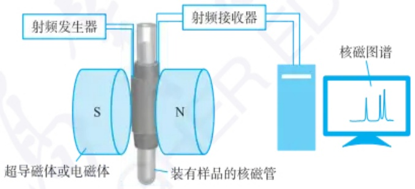

<details>
<summary>text_image</summary>

射频发生器
射频接收器
S
N
超导磁体或电磁体
装有样品的核磁管
核磁图谱
</details>

图 9.1.7 核磁共振波谱仪的示意图

最早的核磁共振波谱仪使用电磁铁，激发和信号接收方式是连续波(CW)模式。这些磁体灵敏度低，稳定性差，测样耗费的时间长。其后，采用永磁体的核磁共振波谱仪尽管维护较为简便，然而其灵敏度依旧处于较低水平。鉴于永磁体和电磁铁所能提供的场强存在局限性，如今绝大多数谱仪采用超导磁体，激发和信号接收方式是脉冲傅里叶变换(简称PFT-NMR)模式。超导磁体的场强范围为7.0\~28.2 T(对应于300\~1200 MHz范围的 $^{1}$ H共振频率)。使用超导磁体的谱仪具有灵敏度和稳定性高、检测速度快的特点。更为重要的是，超导磁体产生的强磁场能显著提高核磁共振信号的分辨率。

核磁共振波谱仪的分类方法较多。按照磁体的性质,可分为电磁铁、永磁体

---

510

第九章 核磁共振波谱法

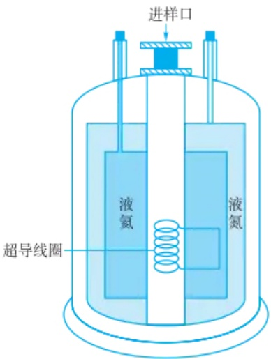

<details>
<summary>text_image</summary>

进样口
液氮
液氮
超导线圈
</details>

图 9.1.8 超导磁体的结构示意图


600 MHz 核磁共振波谱仪

和超导磁体谱仪；按照激发和信号接收方式可分为连续波和脉冲傅里叶变换核磁共振波谱仪；按照功能可分为高分辨液体、高分辨固体、固体宽谱、微成像波谱仪。

## 9.1.3.2 脉冲傅里叶变换核磁共振波谱仪(PFT-NMR)

PFT-NMR 主要是采用一个短(10\~100  $\mu$ s)而强的射频脉冲照射样品，使不同化学环境的同一类原子核同时发生核磁共振，被激发的原子核进行弛豫的过程中，谱仪检测到一个随时间逐步衰减的信号，称为自由感应衰减(free induction decay, FID)信号。FID 信号是一个振荡信号，随着时间的推移，其振幅逐渐衰减。FID 信号经傅里叶变换，将时间域信号转换为频率域信号，即得到 NMR 谱图。PFT-NMR 不仅极大地提升了检测灵敏度，易于实现信号累加，提升信噪比(信号和噪声强度的比值)，还具备检测速度快的优势，并且能够实现对  ${}^{1}H$ 、 ${}^{13}C$ 、 ${}^{19}F$ 、 ${}^{31}P$ 、 ${}^{15}N$  等核的检测，已成为主流的核磁共振波谱仪。它的主要部件包括:

## 1. 超导磁体

超导磁体的结构如图 9.1.8 所示。由铌合金组成的超导线圈浸泡于液氦之中。在液氦罐体外侧，再用液氮保护，用以减缓液氦（其价格较昂贵）的气化速度。在极低的温度下，线圈的电阻接近于零。当给线圈通电后，即可提供稳定的强磁场。

增加外部磁场  $B_{0}$  的场强, 可以直接提高原子核的灵敏度、信噪比和分辨率, 明显提升谱图的质量。在核磁共振实验中, 核磁信号的强度大致与  $\frac{I+1}{I^{2}}\mu^{3}B_{0}^{2}$  成正比。由此可知, 核磁信号的强度随着外部磁场  $B_{0}$  的增大而增强。

## 2. 射频发生器

核磁共振实验中，射频发射器主要用于提供射频场 $B_{1}$，其磁场方向与 $B_{0}$ 垂直。改变射频频率而 $B_{0}$ 保持不变的方式称为扫频法；改变磁场强度 $B_{0}$，射频频率固定不变的方式称为扫场法。

## 3. 射频接收器

它的功能相当于检测器。接收线圈感应到共振信号后，接收器将该信号进行放大，检波，转换为数字信号。

## 4. 探头

它位于磁场中心，在测试过程中是放置样品管的组件，是谱仪的关键设备。探头包括射频发射线圈、接收线圈及旋转器。样品管可在压缩空气的驱动下旋转，以提高样品所处磁场的均一性。

## 5. 记录处理系统

它的作用主要包括接收信号、控制谱仪和处理数据。

## 9.2 核磁共振氢谱分析

在所有核磁共振波谱的测定中，核磁共振氢谱的测定最先实现，因为氢谱的测定最灵敏、简便。核磁共振氢谱的可解析性高，峰形分析带来丰富的结构信息，是分子结构解析和表征的一种重要手段。在本节中，通过学习理解核磁共振氢谱中化学位移的影响因素，深入认识核磁共振氢谱带来的四方面结构信息，即质子种类数（信号数）、具体的种类（信号位置）、相应种类的数目（积分面积）及其质子之间的关联信息（耦合及耦合常数）；进一步介绍各类有机化合物的核磁共振氢谱特征和解析实例。

---

9.2 核磁共振氢谱分析

511

## 9.2.1 化学位移

在核磁共振谱图中,化学位移值反映被测原子核的类型及其所处的化学环境,与分子结构密切相关。

## 9.2.1.1 化学位移的产生

核磁共振谱图中最重要的特征是共振信号的位置，即共振频率  $\nu_{0}$ ，它取决于分子的化学环境、磁旋比  $\gamma$  及外部磁场  $B_{0}$ 。共振频率对结构的依赖性是核磁共振波谱在有机物的结构鉴定中如此重要的根本原因。

在前面的讨论中，通常涉及的只是单个的 $^{1}$ H核，而没有考虑 $^{1}$ H核所处的化学环境。在分子中， $^{1}$ H核通过共价键与其他原子（如碳、氧、氮等）相连。将分子置于磁场中，分子中的原子核所处的磁场不仅有外部磁场，也包含由周围原子核及原子核外电子的运动产生的磁场。外部磁场会影响分子中电子的运动，诱导其产生一个与外部磁场方向相反的磁场（图9.2.1）。因此，分子中的 $^{1}$ H核所感受到的净磁场总是小于外部磁场 $B_{0}$ ，即 $^{1}$ H核受到了屏蔽。原子核实际感受到的磁场强度可表示为

$$
B _ {i} = B _ {0} (1 - \sigma) \tag {9-2-1}
$$

式中， $\sigma$  是屏蔽常数，它取决于核所处的化学环境。核外电子对抗外部磁场的作用被称为屏蔽效应。屏蔽效应的强弱与核外电子云密度有关，电子云密度越大，屏蔽效应越强。

不论是不同分子中的 $^{1}$ H核，还是同一分子中处于不同化学环境中的 $^{1}$ H核，它们的屏蔽常数是不同的。 $^{1}$ H核受到的屏蔽越多，就需要施加越强的磁场才能使其达到共振，从而产生NMR信号。处于较高磁场强度(高场)的 $^{1}$ H核会比处于较低磁场强度(低场)的 $^{1}$ H核吸收更高频率的射频辐射。由于原子核所处的化学环境不同而引起核磁共振峰的位移被称为化学位移。

## 9.2.1.2 化学位移的测量

不同氢核的化学位移的差别在 $10^{-6}$ 数量级。要通过磁场的绝对强度来衡量这么小的差别是很困难的，而且氢核在不同外部磁场产生的共振频率数值也是各异的。为了解决上述问题，人们将标准物质的吸收峰位置作为标准[标准物质一般采用四甲基硅烷 $(\mathrm{CH}_3)_4\mathrm{Si}$，简称TMS，规定其化学位移为零]，其他$^1\mathrm{H}$ 核吸收峰与它的相对距离(频率差)，即为其化学位移值，用 $\delta$ 表示。化学位移值 $\delta$ 是量纲为1的量。

$$
\text {化学位移值} (\delta) = \frac {\text {样品吸收频率} - \text {四甲基硅烷的吸收频率}}{\text {谱仪的工作频率}} \times 1 0 ^ {6} \tag {9-2-2}
$$

化学位移值只取决于送测样品和测试条件（如所用的溶剂、测试温度等），而与谱仪的实际工作频率无关。例如，当使用100 MHz谱仪测试时，三氯甲烷 $\left(\mathrm{CHCl}_{3}\right)$ 中的 $^{1}$ H核信号出现在高于TMS信号峰726 Hz的位置。由于共振频率和磁场强度成正比，在400 MHz谱仪上，同一信号将出现在高于TMS信号峰2904 Hz的位置。

三氯甲烷在两种谱仪中的化学位移值如下。

$$
1 0 0 \mathrm{MHz} \text {谱仪}: \delta = [ 7 2 6 \mathrm{Hz} / (1 0 0 \times 1 0 ^ {6} \mathrm{Hz}) ] \times 1 0 ^ {6} = 7. 2 6
$$

$$
4 0 0 \mathrm{MHz} \text {谱仪}: \delta = [ 2 9 0 4 \mathrm{Hz/(} 4 0 0 \times 1 0 ^ {6} \mathrm{Hz)} ] \times 1 0 ^ {6} = 7. 2 6
$$

因此，在不同谱仪工作频率下测量出的化学位移可以直接比较。

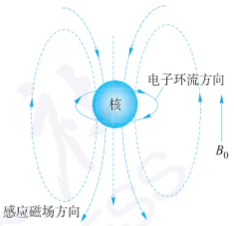

<details>
<summary>text_image</summary>

核
电子环流方向
感应磁场方向
B₀
</details>

图 9.2.1 核外电子的抗磁屏蔽

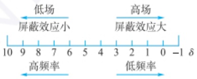

<details>
<summary>text_image</summary>

低场
屏蔽效应小
高场
屏蔽效应大
10 9 8 7 6 5 4 3 2 1 0 -1 δ
高频率
低频率
</details>

---

512

第九章 核磁共振波谱法

表 9.2.1 氢谱中甲烷和氯化甲烷的化学位移值

|  | ${\mathrm{{CH}}}_{4}$ | ${\mathrm{{CH}}}_{3}\mathrm{{Cl}}$ | ${\mathrm{{CH}}}_{2}{\mathrm{{Cl}}}_{2}$ | ${\mathrm{{CHCl}}}_{3}$ |
| --- | --- | --- | --- | --- |
| $\delta$ | 0.23 | 3.05 | 5.30 | 7.26 |

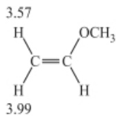

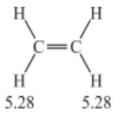

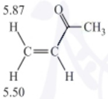

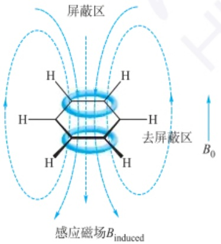

<details>
<summary>text_image</summary>

屏蔽区
去屏蔽区
感应磁场B$_{induced}$
B$_0$
</details>

图 9.2.3 苯的磁各向异性示意图

## 9.2.1.3 化学位移的影响因素

凡是能改变核外电子云密度的因素,均可使化学位移出现变化。常见的影响因素有以下几种:

## 1. 电子效应(诱导和共轭效应)导致的局部屏蔽效应

原子核周围的电子运动对原子核产生屏蔽，屏蔽效应可通过电子云密度进行评估。在有机化学中，电子效应描述了结构与电子云密度之间的关系。诱导效应常见于与吸电子基团（如卤素或硝基）直接相连或处于相邻位置时，原子的核外电子云密度下降，屏蔽效应被削弱，造成 $^{1}$ H核的共振信号向谱图左侧（低场方向）移动。例如，由于氯的吸电子诱导效应，用氯逐步取代甲烷的氢后，甲烷和氯化甲烷上 $^{1}$ H核的化学位移变化见表9.2.1。相反，连接了给电子原子或基团（如烷基），会增强屏蔽效应，共振信号向谱图右侧（高场方向）移动（图9.2.2）。

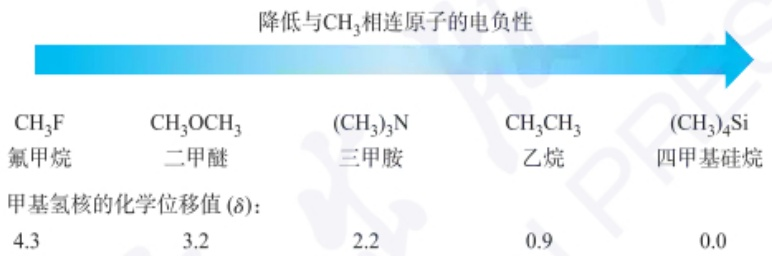

<details>
<summary>other</summary>

| 甲基氢核的化学位移值 \((\delta)\) | \(CH_{3}F\)氟甲烷 | \(CH_{3}OCH_{3}\)二甲醚 | \((CH_{3})_{3}N\)三甲胺 | \(CH_{3}CH_{3}\)乙烷 | \((CH_{3})_{4}\)Si四甲基硅烷 |
| --- | --- | --- | --- | --- | --- |
| \(4.3 \delta\) | — | 3.2 | 2.2 | 0.9 | 0.0 |
</details>

图 9.2.2 氢谱中  $CH_{3}X$  型化合物的化学位移值

除诱导效应外，电子云密度还可受到共轭效应的影响，这种效应在不饱和分子中尤为明显，如烯烃和芳香族化合物。例如，在乙烯基甲醚中，甲氧基通过给电子的共轭效应，增加了乙烯醚 $\beta$ 位 $^{1}$ H核的电子云密度，屏蔽效应增强。核磁共振实验结果显示，该化合物的 $\beta$ 位 $^{1}$ H核的化学位移分别为约3.57和3.99。相比于乙烯的化学位移值5.28, $\beta$ 位 $^{1}$ H核的化学位移出现了明显的高场位移。

## 2. 诱导磁场导致的磁各向异性

当分子中与 $^{1}$ H核相邻的原子或基团的电子云分布并非球形对称时，它们会对氢核产生一个各向异性的磁场，即磁各向异性。磁各向异性使得处于某些位置的氢核受到屏蔽效应，其化学位移向高场方向移动，而另一些位置上的氢核则受到去屏蔽效应，导致化学位移向低场移动。磁各向异性是经由空间进行传递的，其强弱程度与距离有关。

在外部磁场 $B_{0}$ 作用下，苯环平面上下的离域 $\pi$ 电子环流产生一个感应磁场，感应磁场的方向与外部磁场方向相反，而在苯环平面外侧，感应磁场的方向与外部磁场相同。因此，苯环平面的上下区域属于屏蔽区，苯环平面的外侧区域属于去屏蔽区（图9.2.3）。与苯环直接相连的$^{1}\mathrm{H}$核因受到去屏蔽效应，其化学位移值较大（$\delta$为6.5\~8.0）。

共轭环状分子的 $\pi$ 电子数满足 $4n + 2$ 规则，即Hückel规则，是分子具有抗磁性电子环流的前提条件。1,6-亚甲基桥[10]轮烯中的亚甲基$^{1}\mathrm{H}$核位于屏蔽区，在屏蔽作用的影响下，其化学位移值 $\delta$ 为-0.5（图9.2.4）。[18]轮烯的环内$^{1}\mathrm{H}$核位于环的中央，属于屏蔽区。在屏蔽效应的影响下，环内$^{1}\mathrm{H}$核的化学位移值 $\delta$ 为-3.0，环外$^{1}\mathrm{H}$核处于去屏蔽区，化学位移值 $\delta$ 为9.3。

双键化合物的磁各向异性应当慎重分析,最好找结构类似的化合物作参照。 $\pi$ 电子云分布在双键平面的上下方。 $\pi$ 电子的运动产生一个感应磁场,在双键的中央抵消外部磁场。因此,双键所在平面的上下方是其屏蔽区,双键所在平面外

---

9.2 核磁共振氢谱分析

513

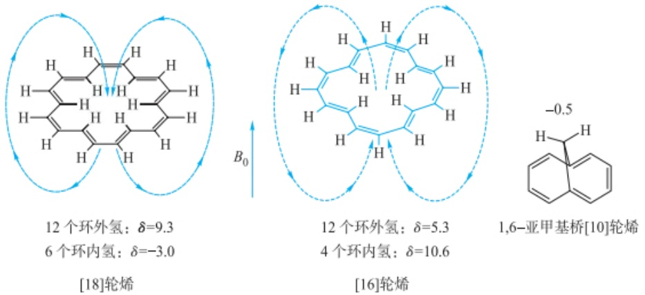

<details>
<summary>chemical</summary>

Chemical structures of [18] and [16] propylene with hydrogen bonding, including 1,6-亚甲基桥[10]烷
</details>

图 9.2.4 轮烯的磁各向异性示意图

侧是去屏蔽区[如图9.2.5(b)所示]。例如，乙烯分子的四个氢原子核均处于去屏蔽区，化学位移 $\delta$ 约为5.3。但也有人认为双键的各向异性效应应如图9.2.5(c)和图9.2.5(d)所示。醛类$^{1}\mathrm{H}$ 核的化学位移值 $\delta$ 为 $9.0\sim 10.5$ ，其原因除受到羰基的吸电子诱导效应以外，醛基$^{1}\mathrm{H}$ 核正好处于羰基平面上，还受到了羰基的去屏蔽作用。

与烯烃不同，炔键中两条 $\pi$ 键互相垂直，$\pi$ 电子围绕着 $\sigma$ 键形成圆柱状电子云。$\pi$ 电子围绕圆柱状的 $\pi$ 轨道运动，并产生诱导磁场。端基炔的$^{1}\mathrm{H}$ 核位于炔键的轴线上，在炔键的屏蔽效应影响下，炔氢的化学位移值 $\delta$ 通常在 $1.8\sim 3.1$ （图9.2.6）。例如，己-1-炔的炔基氢的化学位移值 $\delta$ 是1.9。

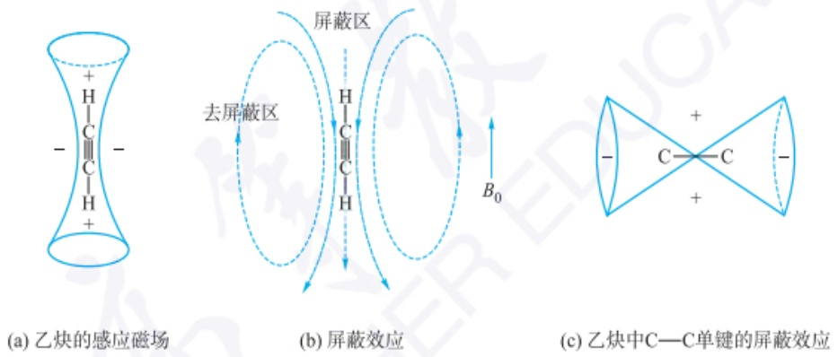

<details>
<summary>text_image</summary>

(a) 乙炔的感应磁场
(b) 屏蔽效应
(c) 乙炔中C—C单键的屏蔽效应
</details>

图 9.2.6 乙炔的磁各向异性

C—C 单键中  $\sigma$  键电子的磁各向异性较弱。沿  $\sigma$  键两侧的键轴方向的锥形区域为去屏蔽区，其余部分为屏蔽区。

## 3. 氢键影响

$^{1}$ H 核的化学位移受氢键的影响较明显。当分子形成氢键时，氢键给体中（如 OH 和 NH） $^{1}$ H 核的化学位移会向低场移动，因为氢键会削弱屏蔽作用。形成氢键的程度取决于分子结构、浓度、溶剂种类、温度、pH 等因素。例如，羧酸的 $^{1}$ H 核化学位移  $\delta$  通常在 10\~13，这是因为羧基 $^{1}$ H 核受到了强烈的去屏蔽作用所致。提高或降低溶液浓度时，具有氢键的 $^{1}$ H 核共振信号会发生明显位移，这是分子间氢键的强度变化造成的。例如，在浓度分别为 0.5% 和 10% 的乙醇/CCl $_{4}$  溶液中，羟基 $^{1}$ H 核的化学位移值  $\delta$  分别为 1.1 和 4.3。

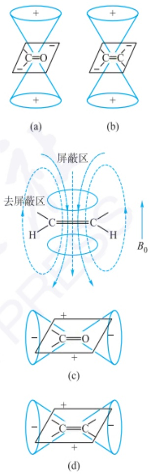

图 9.2.5 羰基(a)(c)和烯键

(b)(d)的磁各向异性

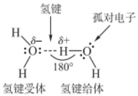

<details>
<summary>chemical</summary>

氢键形成与电子结构示意图，标注氢键受体、氢键给体及孤对电子
</details>

---

514

第九章 核磁共振波谱法

## 4. 溶剂效应

在不同溶剂中，同一化合物的化学位移是会发生变化的。溶质分子的氢核受到不同溶剂的影响而产生的化学位移变化的现象称为溶剂效应。溶剂的磁化率可改变样品分子所感受到的磁场强度，从而影响化学位移值；此外，极性溶剂可以影响溶质分子中 $^{1}$ H核的电子云形状，使其屏蔽效应发生变化。如果溶剂分子与溶质分子形成氢键，也会影响氢核的化学位移。

## 9.2.2 化学位移与分子结构的关系

## 9.2.2.1 烷基氢的化学位移

烷烃 $^{1}$ H核的化学位移通常是0.9\~1.5。烷基取代基越多，与取代烷基相连的碳原子上的 $^{1}$ H核化学位移越大。例如，乙烷 $\left(\mathrm{CH}_{3}\mathrm{CH}_{3}\right)$ 、丙烷 $\left(\mathrm{CH}_{3}\mathrm{CH}_{2}\mathrm{CH}_{3}\right)$ 和异丁烷 $\left\{\left(\mathrm{CH}_{3}\right)_{3}\mathrm{CH}\right\}$ 三种化合物中， $CH_{3}, CH_{2}$ 和CH中 $^{1}$ H核的化学位移值依次是0.86, 1.33和1.74。

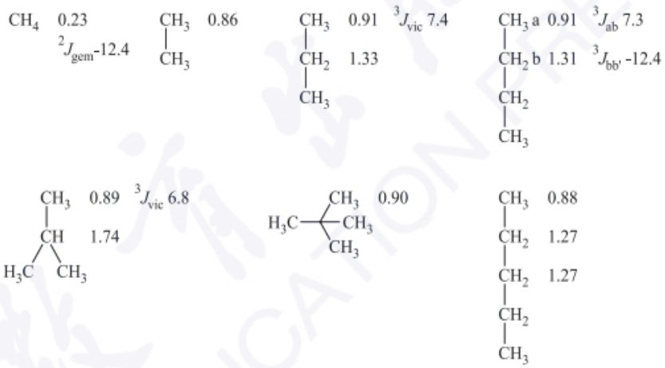

在环烷烃中，亚甲基 $^{1}$ H核的化学位移与环的大小有关。环丙烷、环丁烷、环戊烷、环己烷和环庚烷的亚甲基 $^{1}$ H核的化学位移值依次为0.22,1.96,1.51,1.44,1.53。

## 9.2.2.2 烯基氢的化学位移

由于烯烃  $sp^{2}$  碳原子的电负性强于  $sp^{3}$  碳原子，再加上受到双键磁各向异性效应的影响，烯基 $^{1}H$  核的化学位移向低场移动，通常在 4.5\~7.0，具体位置取决于双键上取代基的性质。其中非共轭烯基 $^{1}H$  核的化学位移在 4.5\~5.7，共轭烯基 $^{1}H$  核的化学位移会向低场方向移动。

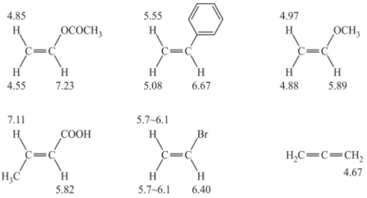

## 9.2.2.3 炔基氢的化学位移

炔烃化合物中炔基氢的化学位移值一般为1.8\~3.1。如乙炔、丙炔和苯乙炔

---

9.2 核磁共振氢谱分析

515

的炔基 $^{1}$ H核的化学位移值分别是1.8,1.9和3.0。

## 9.2.2.4 芳烃中芳香氢的化学位移

芳香化合物中芳香氢的化学位移值通常为6.5\~9.0。芳环上的取代基对芳香氢的化学位移会产生明显影响。例如，苯 $^{1}$ H核的化学位移是7.27，强吸电子基（如硝基）使苯基氢的化学位移向低场移动，而强给电子基团（如甲氧基）使苯基氢的化学位移向高场移动。

因杂原子可极化芳环的电子云,通常会使杂环上 $^{1}$ H核的化学位移值发生变化,如吡啶和吡咯。

各种结构类型 $^{1}$ H核的大致化学位移范围如图9.2.7所示,特定化合物的 $^{1}$ H核可能出现在上述范围以外,具体取决于取代基的屏蔽或去屏蔽效应的程度。羟基氢和氨基氢的化学位移值还受到测试条件(如溶剂、温度、浓度)的影响。

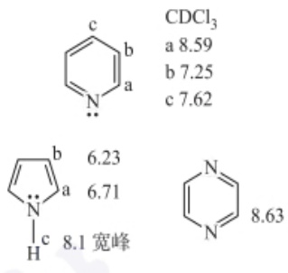

<details>
<summary>chemical</summary>

Chemical structures and corresponding molecular formulas for pyridine derivatives, including CDCl3, N,N', and N=N with bond lengths and peak positions.
</details>

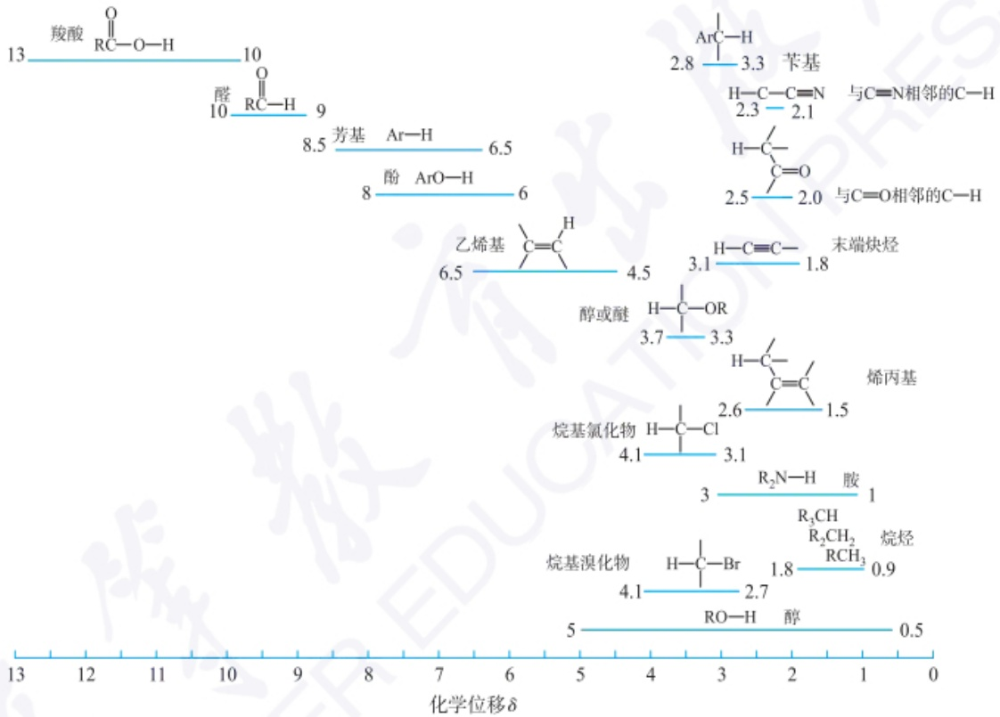

<details>
<summary>line</summary>

| Compound | Chemical Shift \((\delta)\) |
| :--- | :--- |
| 羧酸 | 13 |
| 醛 | 10 |
| 芳基 | 8.5 |
| 酚 | 8 |
| 乙烯基 | 6.5 |
| 醇或醚 | 4.5 |
| 烯基氯化物 | 4.1 |
| 烷基溴化物 | 4.1 |
| RO-H | 5 |
| 苄基 | 2.8 |
| 末端炔烃 | 3.1 |
| 烯丙基 | 2.6 |
| \(R_{2}N-H\) 胺 | 3 |
| \(R_{3}CH\) | 1.8 |
| \(RCH_{3}\) | 0.9 |
| 醇 | 0.5 |
</details>

图 9.2.7 各种结构类型 $^{1}$ H 核的大致化学位移范围

## 9.2.2.5 核磁共振氢谱积分

在氢谱谱图中，化学位移信息反映出分子中有多少种类型的 $^{1}$ H核，以及大致是哪些种类的氢。谱图中各组信号峰的相对峰面积(积分面积)提供了每种氢数目的信息。对各种峰进行积分，各种峰积分面积之比等于所含 $^{1}$ H核数目之比(图9.2.8)。再依据化合物分子式中的氢原子总数目，就可确定各组峰代表的氢原子数目。

## 9.2.3 核磁共振氢谱的自旋耦合和自旋裂分

## 9.2.3.1 自旋耦合和自旋裂分的产生和规律

分子中各个 $^{1}$ H核之间发生相互作用,会对吸收信号的峰形产生影响,如在乙醚的 $^{1}$ H NMR谱图(图9.2.8)中,峰面积之比为2:3, $CH_{2}$ 和 $CH_{3}$ 的峰形均不是单峰,前者为四重峰,后者为三重峰。

---

516

第九章 核磁共振波谱法

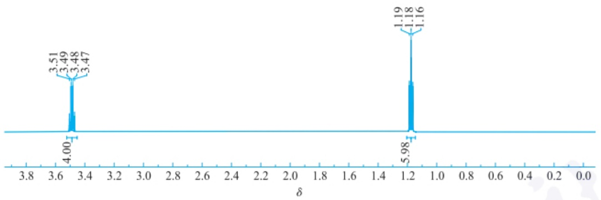

<details>
<summary>spectrogram</summary>

| Chemical Shift (ppm) | Integration |
| --- | --- |
| 3.51 | 4.00 |
| 3.49 | — |
| 3.48 | — |
| 3.47 | — |
| 1.19 | 5.98 |
| 1.18 | — |
| 1.16 | — |
</details>

图 9.2.8 乙醚的核磁共振氢谱图

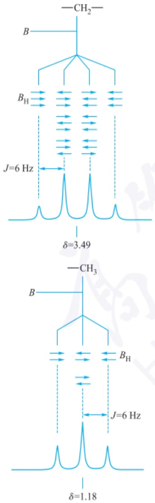

图 9.2.9 乙醚氢谱中的耦合分裂情况

许多化合物的高分辨核磁共振谱图都有这种精细结构。它是由自旋耦合使自旋产生的核磁矩之间的相互干扰造成的，又称自旋-自旋耦合。自旋裂分是由自旋耦合引起共振吸收峰分裂的现象，又称自旋-自旋裂分。每一个 $I\neq0$ 的核都有核磁矩，由该核产生的磁场可以影响相邻核感受到的磁场，从而轻微地改变相邻核发生核磁共振的频率。自旋耦合取决于所涉及的两个原子核的性质及相隔的化学键数目。核与核之间的耦合通过成键电子在原子核之间传递，传递范围通常不超过三条化学键。相隔四条或四条以上化学键的原子核，自旋耦合的影响较微弱，经常观测不到。

氢核在磁场中有两种自旋取向 $(+1/2$ 和 $-1/2)$ 。自旋取向是+1/2时，其方向与外部磁场一致，自旋取向是-1/2时，其方向与外部磁场相反。乙醚分子（图9.2.9）中亚甲基的2个 $^{1}$ H核共有4种可能的自旋取向组合，它们都能对邻近的甲基氢产生影响，其中 $(+1/2,-1/2)$ 和 $(-1/2,+1/2)$ 效果相同，最终使甲基氢感受到三种不同的磁场，甲基氢的共振峰分裂为三重峰，见图9.2.9。由于亚甲基中两个 $^{1}$ H核自旋状态的4种组合概率相同，所以三重峰的强度比是1:2:1。类似地，甲基的三个 $^{1}$ H核的自旋取向有八种 $(2^{3}=8)$ ，这八种组合的概率是相同的，并对亚甲基的两个 $^{1}$ H核一共产生四种不同的磁场，所以亚甲基峰分裂为四重峰，其强度比是1:3:3:1。

图中相邻 $^{1}$ H核的自旋取向以水平箭头表示,它们与外部磁场的方向相同或相反,导致共振吸收峰分裂成多重峰。具体氢核自旋组态如表9.2.2和表9.2.3所示。

表 9.2.2 甲基中 ${}^{1}\mathrm{H}$ 核的自旋组态

| $^{1}H$核自旋态的组合 | m | $\Sigma m$ | 相对强度比 |
| --- | --- | --- | --- |
| ↑↑ | (1/2,1/2) | 1 | 1 |
| ↑↓ ↓↑ | (1/2,-1/2)(-1/2,1/2) | 0 | 2 |
| ↓↓ | (-1/2,-1/2) | -1 | 1 |

表 9.2.3 亚甲基中 ${}^{1}\mathrm{H}$ 核的自旋组态

<table><tr><td colspan="3"> $^{1}$ H核自旋态的组合</td><td>m</td><td> $\Sigma m$ </td><td>强度比</td></tr><tr><td></td><td>↑↑↑</td><td></td><td>(1/2,1/2,1/2)</td><td>3/2</td><td>1</td></tr><tr><td>↑↑↓</td><td>↑↓↑</td><td>↓↑↑</td><td>(1/2,1/2,-1/2)(1/2,-1/2,1/2)(-1/2,1/2,1/2)</td><td>1/2</td><td>3</td></tr></table>

---

9.2 核磁共振氢谱分析

517

续表

<table><tr><td colspan="3"> $^{1}H$ 核自旋态的组合</td><td>m</td><td> $\Sigma m$ </td><td>强度比</td></tr><tr><td> $\uparrow \downarrow \downarrow$ </td><td> $\downarrow \uparrow \downarrow$ </td><td> $\downarrow \downarrow \uparrow$ </td><td> $(1/2,-1/2,-1/2)$  $(-1/2,1/2,-1/2)$  $(-1/2,-1/2,1/2)$ </td><td>-1/2</td><td>3</td></tr><tr><td></td><td> $\downarrow \downarrow \downarrow$ </td><td></td><td> $(-1/2,-1/2,-1/2)$ </td><td>-3/2</td><td>1</td></tr></table>

根据自旋耦合理论,可得出以下结论:

(1) 自旋耦合发生在核与核之间, 耦合的强弱程度与外部磁场无关。
(2) 自旋耦合是通过成键电子传递的, 不是通过自由空间传递。
（3）某基团的 $^{1}$ H核与n个相邻 $^{1}$ H核耦合时，被分裂为 $n+1$ 重峰，与该基团本身的 $^{1}$ H核数无关，这称为 $n+1$ 规律。若推广到更多类型的原子核参与的耦合体系，因受自旋量子数为I的n个原子核耦合，峰分裂产生的谱线数目为 $2nI+1$ ，这称为 $2nI+1$ 规律。其中， $n+1$ 规律是最经常使用的一种 $2nI+1$ 规律（对于 $^{1}$ H核，I=1/2）。
（4）在简单的自旋耦合体系中，相邻的每两条谱线间的距离是相等的。
（5）对于 I=1/2 的核，每组多重峰谱线的强度比是  $(a+b)^{n}$  二项式展开的各项系数。

| n | 二项式展开系数 | 峰形 | 英文表达 |
| --- | --- | --- | --- |
| 0 | 1 | 单峰 | singlet(s) |
| 1 | 1 1 | 双峰 | doublet(d) |
| 2 | 1 2 1 | 三重峰 | triplet(t) |
| 3 | 1 3 3 1 | 四重峰 | quartet(q) |
| 4 | 1 4 6 4 1 | 五重峰 | quintet |

## 9.2.3.2 耦合常数

谱线分裂产生的裂距,称为耦合常数,单位是 Hz,它反映了核之间耦合作用的强弱。耦合常数的符号是  $^{n}J_{ab}$ ,其中左上角标 n 表示相互耦合的核间隔的化学键数,右下角标 ab 表示两个核的元素符号。在不会引起混淆的情况下,耦合常数的上角标和下角标可以部分省略或全部省略。表 9.2.4 为部分有代表性的耦合常数。

按照耦合核间隔的化学键数来分类，可分为偕耦、邻耦和远程耦合。例如，连接在同一碳原子上的两个氢核间的耦合常数（偕耦）用 $^{2}J$ 表示， $^{3}J$ 表示邻位耦合常数。对于简单的耦合系统而言，相邻的每两条谱线间的距离是相等的，峰裂距就是耦合常数。对于高级耦合（ $\Delta\delta/J<6,\Delta\delta$ 是两组氢核化学位移之差的绝对值），耦合裂分不适用 $n+1$ 规律，其耦合常数需要进行计算才能得到。

表 9.2.4 部分有代表性的耦合常数

<table><tr><td>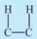</td><td>6~8</td><td>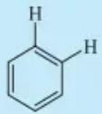</td><td>邻位6~10</td><td>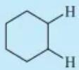</td><td>a,a 8~14a,e 0~7e,e 0~5</td></tr><tr><td>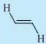</td><td>11~18</td><td>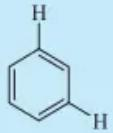</td><td>间位1~4</td><td>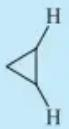</td><td>cis 6~12trans 4~8</td></tr></table>

---

518

第九章 核磁共振波谱法

续表

<table><tr><td rowspan="2">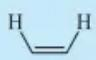</td><td rowspan="2">6~15</td><td></td><td></td><td rowspan="2">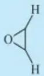</td><td>cis</td><td>2~5</td></tr><tr><td>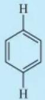</td><td>对位0~2</td><td>trans</td><td>1~3</td></tr><tr><td rowspan="2">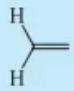</td><td rowspan="2">0~5</td><td></td><td></td><td rowspan="2">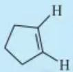</td><td></td><td></td></tr><tr><td>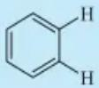</td><td>8~11</td><td colspan="2">5~7</td></tr><tr><td>[6DBC]</td><td>4~10</td><td></td><td></td><td>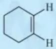</td><td colspan="2">8~11</td></tr><tr><td>H-C=C-CH</td><td>0~3</td><td></td><td></td><td></td><td></td><td></td></tr></table>

H—C=C—CH 0\~3

注:a为直立键，e为平伏键。

## 9.2.3.3 核的等价性与不等价性

## 1. 化学等价

具有相同化学环境的某一组核,其化学位移值也是相同的,则称这组核是化学等价的。例如,乙醇中甲基的三个 $^{1}$ H核的化学位移值相同,这三个 $^{1}$ H核是化学等价的核。这是因为—CH $_{3}$ 基团可以绕单键快速旋转,形成了一个平均化的化学环境,甲基 $^{1}$ H核在该环境中是等价的。除甲基以外,—CH $_{2}$ —,—NH $_{2}$ 等基团若可以绕单键快速旋转,则这些基团中的 $^{1}$ H核一般是化学等价的。

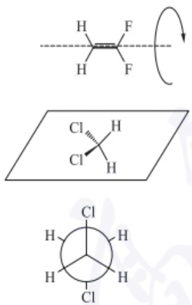

图 9.2.10 1,1-二氟乙烯,二氯甲烷和1,2-二氯乙烷的对称操作示意图

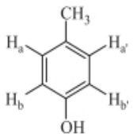

分子的对称性也有助于判断化学等价的核。通常，分子如果通过对称操作（如绕对称轴 $C_n$ 旋转，镜面对称或对称中心倒反）互换位置的核是化学等价的。例如，1,1-二氟乙烯，二氯甲烷和1,2-二氯乙烷中的 ${}^{1}\mathrm{H}$ 核可以分别通过沿旋转轴转动 $180^{\circ}$ 、镜面和反演操作互换(图9.2.10)，所以这几组 ${}^{1}\mathrm{H}$ 核是化学等价的。

反之，化学位移不相同的核是化学不等价的。例如，乙醇中甲基和亚甲基上的两组 $^{1}$ H核分别具有不同的化学位移，它们所处的化学环境也是不同的。凡具有任意一种下列情况， $^{1}$ H核都是化学不等价的。

（1）化学环境不相同的核是化学不等价的。
（2）与不对称碳原子相连的亚甲基上的2个 $^{1}$ H核是化学不等价的。例如，苯丙氨酸中，苄基位上的两个 $^{1}$ H核是化学不等价的，其化学位移值分别为3.29和3.13。
（3）当单键的自由旋转受到限制时，会产生化学不等价现象。例如，伯酰胺中，由于C—N键具有一定的双键性质，阻碍了C—N键的自由旋转，因此—$\mathrm{NH}_2$ 上的两个$^1\mathrm{H}$核是化学不等价的。此外，在部分环状结构中，如果环骨架上的单键不能自由旋转，则—$\mathrm{CH}_2$—上的$^1\mathrm{H}$核是化学不等价的。例如，环己烷在室温下，12个$^1\mathrm{H}$核是化学等价的，只有一个核磁共振吸收峰。但冷却至-100℃后，环骨架构象的翻转速度下降，会出现两个吸收峰，分别是由直立键和平伏键上的$^1\mathrm{H}$核产生的。

## 2. 磁等价

若分子中的一组核,它们的化学位移相同,并且在自旋体系中,对任意其他核的耦合常数都相同,这组核称为磁等价核。磁等价比化学等价的要求更加严格。例如, $Cl_{2}CH-CH_{2}Cl$  分子中, $CH_{2}$  上的两个  ${}^{1}H$  核是磁等价的。1,3,5-三甲苯中,苯环上的三个  ${}^{1}H$  核是磁等价的。值得注意的是对甲基苯酚,虽然  $H_{a}$  和  $H_{a'}$ ,  $H_{b}$  和

---

9.2 核磁共振氢谱分析

519

$H_{b'}$ 之间彼此是化学等价的，但是 $H_{a}$ 和 $H_{a'}$，$H_{b}$ 和 $H_{b'}$ 不是磁等价的，因为 $J_{ab} \neq J_{a'b}$，同样 $J_{ab'} \neq J_{a'b'}$。

由上面的例子可知，磁等价的核必然是化学等价的；而化学等价的核不一定是磁等价的；化学不等价的核一定是磁不等价的。磁等价的 ${}^{1}\mathrm{H}$ 核之间虽然有耦合，但不产生峰的分裂；化学等价而磁不等价的核之间发生耦合，将产生峰的分裂。例如，对甲基苯酚的 ${}^{1}\mathrm{H}$ NMR谱图中 $\mathrm{H_a}$ 和 $\mathrm{H}_{\mathrm{a}}$ 的化学位移相同，但峰形是双峰，同样 $\mathrm{H_b}$ 和 $\mathrm{H_{b'}}$ 也会形成一组双峰。在谱图解析中，弄清分子中某组氢是化学等价还是磁等价是很重要的。

## 9.2.3.4 自旋耦合分类原则和常见自旋系统

## 1. 自旋耦合系统命名原则

分子中化学等价核构成一个核组，相互耦合的几个核或者核组构成一个自旋系统。每个自旋系统是独立的，通常不与系统外的任意核耦合。例如，丙酸丙酯含有两个自旋系统: $-CH_{2}CH_{3}$  和  $-CH_{2}CH_{2}CH_{3}$ 。可以按照自旋耦合作用的强弱，将化合物的核磁共振谱图分为若干系统。当相互耦合的两组核的化学位移之差  $\Delta\delta$  与耦合常数之比  $\Delta\delta/J>6^{①}$ ，称为一级谱（图 9.2.11）。其谱图的特征是几组吸收峰位置相隔较远，而多重峰间距较小。当  $\Delta\delta/J<6$  时，称为高级谱，其特征是吸收峰位置相隔较近，多重峰间距较大。不同  $\Delta\delta/J$  值的自旋耦合系统变化如图 9.2.12 所示。

对于自旋系统的命名规则如下:

（1）化学位移相同的核构成一个核组，用一个大写英文字母来表示。几个核之间分别用不同字母表示，如 A、B、C…M…X 等
（2）如果一个自旋系统中包含两个核组，它们之间的化学位移相差较大 $(\Delta\delta/J>6)$ ，可用字母A与X(或M)表示，如 $BrCH_{2}CH_{3}$ 的亚甲基和甲基分别构成一个核组，这两个核组组成 $A_{3}X_{2}$ 系统。如果它们之间的化学位移相差较小 $(\Delta\delta/J<6)$ ，可用字母A与B(或C)表示，如 $BrCH_{2}CH_{2}COBr$ 中两个亚甲基构成 $A_{2}B_{2}$ 系统。

如果一个自旋系统中包含三个核组,核组之间的  $\Delta\delta/J>6$ , 则其中第一种核用 A、B、C… 表示, 第二种核用 K、L、M… 表示, 第三种核用 X、Y、Z… 表示。例如, 丙酸乙烯酯中三个  ${}^{1}H$  核构成 AMX 系统(图 9.2.15)。

（3）若核组内的核是磁等价的，则在大写英文字母右下角标注该组核的数目。例如， $CH_{3}I$ 的甲基为 $A_{3}$ 系统。若核组内的核是磁不等价的，则用两个相同字母表示，在其中一个字母右上角用撇号“'”表示，以便区分。例如，对硝基氯苯的四个 $^{1}H$ 核构成AA'BB'系统。

## 2. 常见自旋系统

（1）AX 系统 AX 系统属于一级谱，有四条强度相同的谱线(图 9.2.13)。A 和 X 使彼此分裂为两重峰，强度比为 1:1，两重峰之间的裂距为耦合常数  $J_{AX}$ 。每组二重峰的中点是该核的化学位移。
（2）$\mathrm{AX}_2$ 系统 $\mathrm{AX}_2$ 系统类似于AX系统，也属于一级谱。如图9.2.14所示，它有五条谱线，A被两个X耦合分裂成三重峰，强度比为 $1:2:1$ ，X受A的耦合分裂成二重峰，强度比为 $1:1$ 。三重峰的耦合常数与二重峰的相等，均为 $J_{\mathrm{AX}}$ 。每组峰的中心是该核的化学位移。

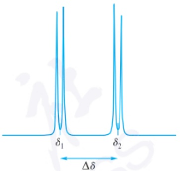

<details>
<summary>contour</summary>

| Category | Value |
| --- | --- |
| \(\delta_{1}\) | ~0.8 |
| \(\delta_{2}\) | ~0.8 |
</details>

图 9.2.11 具有不同化学位移的两个 $^{1}$ H 核之间的自旋耦合

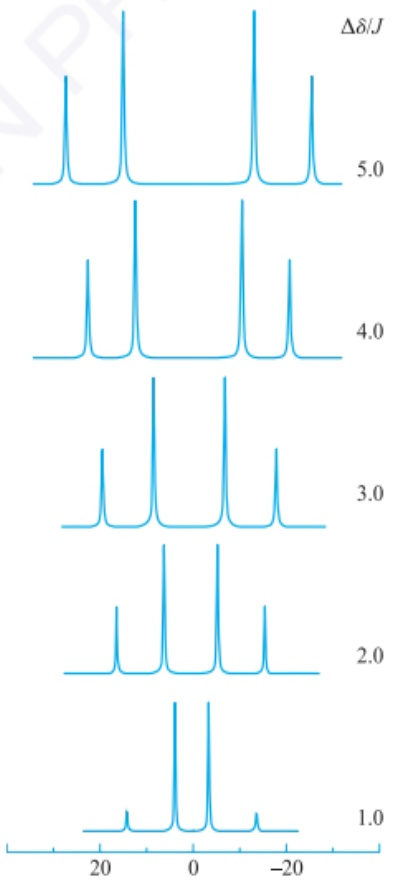

<details>
<summary>spectrogram</summary>

| \(\Delta\delta/J\) | Peak Position (approx) |
| --- | --- |
| 1.0 | ~-10, ~-5, ~-20 |
| 2.0 | ~-8, ~-3, ~-15 |
| 3.0 | ~-7, ~-4, ~-18 |
| 4.0 | ~-6, ~-3, ~-19 |
| 5.0 | ~-5, ~-2, ~-17 |
</details>

图 9.2.12 具有不同  $\Delta\delta/J$  值的自旋耦合系统 (J=10 Hz)

<small><span class="docvortex-page-footnote" data-block-type="page_footnote" style="color:#6b7280">① 一级谱和高级谱的划分标准并不统一。亦有规定  $\Delta\delta/J>10$  称为一级谱， $\Delta\delta/J<10$  是高级谱。</span></small>

---

520

第九章 核磁共振波谱法

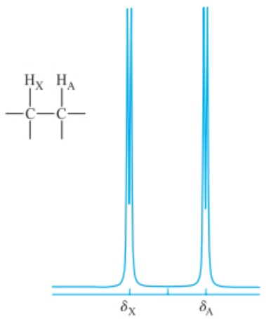

<details>
<summary>chemical</summary>

Chemical structure of a polymer with labeled hydrogen bonding distances δX and δA
</details>

图9.2.13 AX系统示意图

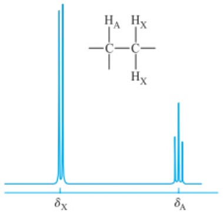

<details>
<summary>chemical</summary>

Chemical structure of a poly(ethylene glycol) repeating unit with labeled δX and δA peaks
</details>

图9.2.14 $\mathrm{AX}_2$ 系统示意图

（3）AMX系统 AMX系统中，各组核的化学位移差远大于耦合常数，能产生三组峰群，共12条谱线(图9.2.15)，A、M、X各有4条，且谱线强度均相等。耦合常数 $J_{\mathrm{AM}} \neq J_{\mathrm{AX}} \neq J_{\mathrm{MX}}$ 。每组四条谱线的中心是该核的化学位移，耦合常数和化学位移值如表9.2.5所示。

表 9.2.5 丙酸乙烯酯中烯基 ${}^{1}\mathrm{H}$ 核的耦合常数

| 烯基氢 | 化学位移值δ | 耦合常数J/Hz |
| --- | --- | --- |
| A=CH | 7.25 | $J_{AM}=16.8,10.0$ |
| M=CH2(反式) | 4.85 | $J_{AX}=16.8,2.1$ |
| X=CH2(顺式) | 4.55 | $J_{MX}=10.0,2.1$ |

(4) AB 系统 AB 系统属于高级谱, 有 4 条谱线, 其中 A 与 B 各有 2 条谱线。4 条谱线的强度不相同, 内侧的两条谱线高于外侧的谱线。耦合常数为  $J_{\mathrm{AB}} = (\delta_{1} - \delta_{2}) = (\delta_{3} - \delta_{4})$ 。

A 和 B 的化学位移( $\delta_{A}$  和  $\delta_{B}$ ) 不在相邻两谱线的中心, 而需要计算而得。

$$
\Delta \delta_ {\mathrm{AB}} = \delta_ {\mathrm{A}} - \delta_ {\mathrm{B}} = \sqrt {(\delta_ {2} - \delta_ {3}) (\delta_ {1} - \delta_ {4})} \tag {9-2-3}
$$

$$
\delta_ {\mathrm{A}} = \delta_ {1} - \frac {1}{2} \big [ (\delta_ {1} - \delta_ {4}) - \Delta \delta_ {\mathrm{AB}} \big ] \tag {9-2-4}
$$

$$
\delta_ {\mathrm{B}} = \delta_ {4} + \frac {1}{2} \big [ (\delta_ {1} - \delta_ {4}) - \Delta \delta_ {\mathrm{AB}} \big ] \tag {9-2-5}
$$

谱线强度比为

$$
\frac {I _ {1}}{I _ {2}} = \frac {I _ {4}}{I _ {3}} = \frac {\delta_ {2} - \delta_ {3}}{\delta_ {1} - \delta_ {4}} \tag {9-2-6}
$$

例如,顺- $\beta$ -乙氧基苯乙烯的 $^{1}$ H NMR 谱图(图 9.2.16)中烯烃上的两个氢核构成 AB 系统, $\delta$ 为 5.5\~6.5。

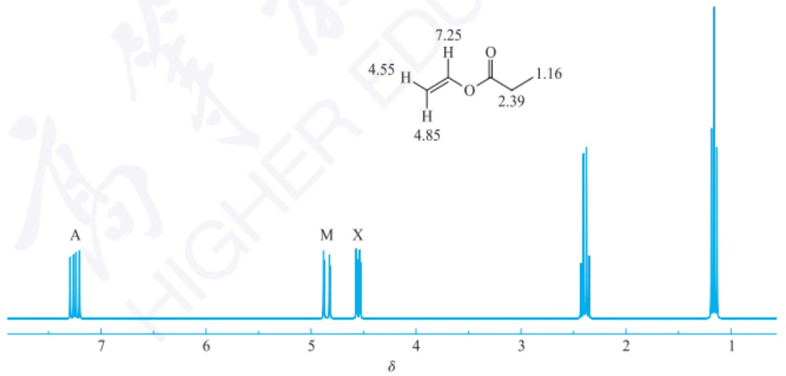

<details>
<summary>chemical</summary>

NMR spectrum with labeled peaks A, M, and X, corresponding to a chemical structure of a diol compound.
</details>

图 9.2.15 丙酸乙烯酯的核磁共振氢谱图

## 9.2.3.5 耦合的时间依赖性

自旋耦合通常被视为一种恒定的现象,而非时间依赖的过程。但在以下的情况下,自旋耦合的强度或表现确实会受到时间或动态过程的影响:

分子构象的快速翻转会影响自旋耦合，如环己烷上与同一碳原子相连的轴向氢和平伏氢之间没有耦合，只能看作等价氢。

---

9.2 核磁共振氢谱分析

521

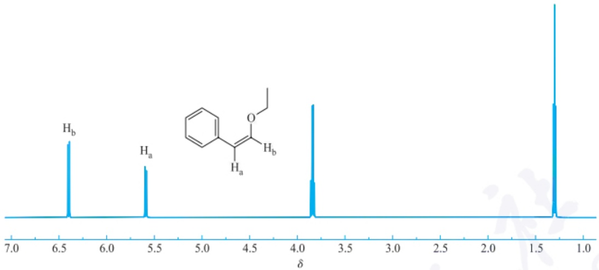

<details>
<summary>spectrogram</summary>

| Chemical Shift \((\delta)\) | Peak Label |
| --- | --- |
| ~6.4 | Hb |
| ~5.6 | Ha |
| ~3.8 | — |
| ~2.9 | — |
| ~1.3 | — |
</details>

图 9.2.16 顺- $\beta$ -乙氧基苯乙烯的核磁共振氢谱局部谱图

分子中不同部分之间发生快速交换,这种交换可能导致耦合常数的平均化或消失。由于快速交换或者氢键作用,羟基氢和氮氢峰一般会变宽,与其他氢核不发生耦合分裂。

## 9.2.4 核磁共振氢谱测试

## 9.2.4.1 样品制备

样品的制备直接影响到核磁谱图的质量。核磁共振谱仪要求将样品置于核磁管内进行测试。核磁管的质量特别重要，核磁管的管壁内外应均匀平直。核磁共振实验要求样品的纯度尽可能高，并且不含顺磁性物质。固体样品要用氘代溶剂配成约 $0.5\mathrm{mL}$ 溶液。最常用的氘代溶剂是 $\mathrm{CDCl}_3$ ，难溶解的化合物可选用$\mathrm{DMSO - }d_6,\mathrm{CD}_3\mathrm{OD}$ 或丙酮- $d_{6}$ 。由于氘（D或 ${}^{2}\mathrm{H}$ )的磁性质与 ${}^{1}\mathrm{H}$ 不同，所以氘核在 ${}^{1}\mathrm{HNMR}$ 谱中不会给出任何信号，因此氘代溶剂常用于NMR测试。对于水溶性物质如糖类，可使用 $\mathrm{D}_2\mathrm{O}$ 代替 $\mathrm{H}_2\mathrm{O}$ 。使用氘代溶剂，一方面避免了溶剂 ${}^{1}\mathrm{H}$ 核的信号干扰，另一方面同时氘核又可用于核磁共振谱仪锁场。如果样品溶液中出现悬浮的颗粒物，则可能造成局部磁场不均匀，使共振谱线变宽，因此最好提前滤去不溶物。为了便于确定化学位移，常会向样品溶液中加入少量四甲基硅烷（ $\delta = 0$ ）作为内标物。

氢谱和氟谱测试所需的样品量为 2\~20 mg，碳谱测试所需的样品量为 20\~100 mg。随着技术的不断进步，现已可以实现微克级样品量的氢谱采集，但是谱图的质量受到样品浓度、磁场强度、探头、脉冲次数等因素的影响。

## 9.2.4.2 测试参数

谱宽是指核磁共振谱图的频率范围。通常样品的氢谱谱宽的化学位移范围在0\~10，但也有部分样品的谱宽大于10。通常碳谱的化学位移范围在0\~250。

## 9.2.4.3 核磁双共振

核磁双共振是一种核磁共振技术，通过同时对两个不同的原子核施加射频场，来观察信号的变化情况，依此获取有关原子核之间相互作用和耦合等方面的信息。核磁双共振可分为几类:自旋去耦、选择性自旋去耦、核 Overhauser 效应、异核多量子共振(HMQC)和异核多键相关(HMBC)。

## 1. 自旋去耦

分子中氢核的自旋耦合可使谱峰发生分裂。通过自旋去耦，可以消除或减少

---

522

第九章 核磁共振波谱法

核之间的自旋-自旋耦合作用，从而简化谱图。换言之，自旋去耦可以将谱图中的多重峰变成单峰，有助于简化图谱解析工作。

以相互耦合的  $H_{a}$  和  $H_{b}$  为例，这两个核在氢谱中均呈现双峰。自旋去耦技术通过对耦合的核（如  $H_{b}$  核）施加射频脉冲，使其达到饱和， $H_{b}$  不再影响  $H_{a}$  的分裂，使  $H_{a}$  从原本的二重峰变成单峰。

## 2. 核 Overhauser 效应

核 Overhauser 效应(nuclear Overhauser effect, NOE) 是一种空间相关的现象。通过对一个核(如  ${}^{1}H$ ) 进行选择性饱和, 可以观察到与其邻近的核(如另一个  ${}^{1}H$  核) 信号的增强或减弱。这种效应用于确定两个核在空间上的接近关系。例如, 在蛋白质的结构解析中, NOE 数据在构建分子的空间模型方面发挥了重要作用, 可揭示分子不同片段之间的相对位置。

## 9.2.4.4 位移试剂

在含氧或含氮化合物中，加入特殊的化学试剂，可使部分氢核的化学位移发生不同程度的变化，起到把氢核信号分开的作用，这类试剂称为位移试剂。最常用的位移试剂是铕 $\left(\mathrm{Eu}^{3+}\right)$ 或镨 $\left(\mathrm{Pr}^{3+}\right)$ 的配合物，如[三(2,2,6,6-四甲基)-3,5-庚二酮]铕{简写 $\mathrm{Eu(DPM)_3}$ }和[三(1,1,1,2,2,3,3-七氟-7,7-二甲基)-4,6-辛二酮]铕{简写 $\mathrm{Eu(FOD)_3}$ }。

## 9.2.4.5 重氢交换法

重氢交换法常用于确认分子中的活泼氢原子。活泼氢通常指那些与氧、氮或硫等杂原子直接相连，并且容易参与氢键形成或易于解离的氢原子。如需要进一步确定活泼氢，可将含有待测样品与重水 $\left(\mathrm{D}_{2}\mathrm{O}\right)$ 混合并充分振荡，使活泼氢被重水中的氘取代。再作氢谱，氢被氘取代后，相应的NMR信号可能消失或峰面积变小，这可以用于确认活泼氢的存在。在对所测样品的重水溶液进行氢谱分析时，化学位移值约为 $\delta=4.8$ 处可清晰地观测到DOH的吸收峰。

## 9.2.5 核磁共振氢谱解析

## 9.2.5.1 核磁共振氢谱解析步骤

## 1. 初步考察谱图

检查 TMS 信号是否位于零点, 谱图的核磁共振信号是否尖锐和对称。弄清楚谱宽, 辨认杂质峰、溶剂峰、旋转边带和  ${}^{13}$ C 卫星峰。

在进行核磁共振实验时，通常都会使用氘代试剂作为溶剂。由于市售氘代试剂的氘代率达不到100%，存在少量非氘代溶剂分子，所以在谱图上会出现溶剂的吸收峰，如在 $CDCl_{3}$ 中，未被氘代的 $CHCl_{3}$ 溶剂峰的化学位移值为7.26。

旋转边峰是由于样品管的旋转，出现不均匀的磁场而产生的信号。其特点是，以共振吸收峰谱线为中心，在其左右对称处出现一对弱峰。旋转边峰与中央谱线的距离会随着样品管的转速变化而改变。

$^{13}$ C 卫星峰是  ${}^{13}$ C 核与  ${}^{1}$ H 耦合引起的。由于  ${}^{13}$ C 的天然丰度仅为 1.1%，所以  ${}^{13}$ C 卫星峰强度弱，一般只有在强峰两侧才能观察到卫星峰。

## 2. 确定各组峰的氢原子数目

根据积分曲线中各信号的相对峰面积,确定各组氢原子的数目之比。如已知测试样品的分子式,则可确定每组峰的氢原子数目。有时也可以由甲基或亚甲基的共振信号来推算其余峰的氢原子数目。

---

9.2 核磁共振氢谱分析

523

## 3. 计算不饱和度

如已知测试样品的分子式，应计算其不饱和度。这一步骤很重要，因为羰基、氰基、硝基等官能团在氢谱中是不会产生信号的。

## 4. 推导结构片段

根据各组峰的化学位移、耦合常数和峰形，推导出对应的结构片段，并估计其相邻基团。可根据特征峰的化学位移，解析谱图中部分氢核的信号，如位于高场区的甲基，位于低场区的醛基或羧基，芳环上的氢核信号等，然后再根据峰的耦合和峰形情况进行进一步解析，归属各组信号峰。

辨别一级谱，根据 $n + 1$ 规律和峰形推断相邻的碳上的氢核数；计算 $J$ 值，弄清分子结构中的耦合分裂关系，并判断可能存在的自旋系统。根据不饱和度和已掌握的分子结构信息，考察是否含其他结构片段，包括如氧原子、卤原子、羰基、硝基、亚砜、砜、酰胺（—CONRR'）、氰基等。最后结合上述信息验证各基团的连接顺序，推导出可能的分子结构。如分子结构较复杂，还应结合碳谱、二维谱、质谱、红外等谱图信息进行综合解析。

## 9.2.5.2 核磁共振氢谱解析举例

»例 9.2.1 某化合物的分子式为  $C_{10}H_{12}O_{2}$ ，其核磁共振氢谱如图 9.2.17 所示。试推断其化学结构。

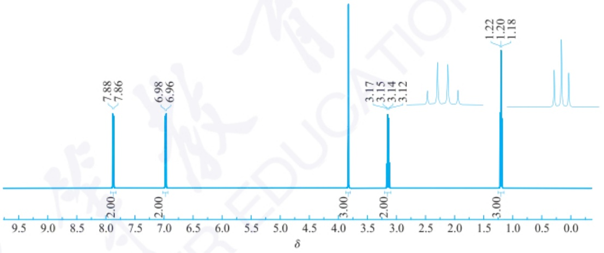

<details>
<summary>spectrogram</summary>

| Chemical Shift \((\delta)\) | Integration |
| --- | --- |
| 7.88 | 2.00 |
| 7.86 | 2.00 |
| 6.98 | 2.00 |
| 6.96 | 2.00 |
| 3.17 | 3.00 |
| 3.15 | 3.00 |
| 3.14 | 3.00 |
| 3.12 | 3.00 |
| 1.22 | 3.00 |
| 1.20 | 3.00 |
| 1.18 | 3.00 |
</details>

图 9.2.17 化合物  $C_{10}H_{12}O_{2}$  的核磁共振氢谱

» 解: 不饱和度  $\Omega=\frac{2n_{4}+2+n_{3}-n_{1}}{2}=\frac{2\times10+2+0-12}{2}=5$

由图9.2.17中的积分值（由左到右）可知，峰的相对面积为1.00、1.00、1.50、1.00、1.50。这说明12个氢核在各组氢峰的分配数是 $2:2:3:2:3$ 。 $\delta = 3.84$ 处的尖锐单峰是一个孤立的甲基产生的。由于甲基的化学位移能够达到3.5以上，说明与电负性强的原子直接相连，分子中应该存在甲氧基（一 $\mathrm{OCH}_3$ ）。

$\delta=6.91$  和  $\delta=7.93$  处的两组低场吸收峰来自苯环上的四个 $^{1}H$  核。苯环上有两种不同的 $^{1}H$  核，每一种都受相邻 $^{1}H$  核耦合分裂成二重峰。这样的谱图特征通常对应于对位二取代苯的结构。

$\delta=2.93$  和  $\delta=1.20$  处的四重峰和三重峰可推知有一个  $A_{2}X_{3}$  系统。亚甲基（—CH $_{2}$ —）与邻近甲基耦合而分裂成四重峰，甲基 $^{1}H$  核以三重峰的形式出现在  $\delta=1.20$  处。因此推测结构中存在乙基。

由分子式扣除已经推导出的结构单元,还剩下1个不饱和度、1个碳原子和1

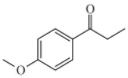

---

524

第九章 核磁共振波谱法

个氧原子,对应的应该是一个羰基。该羰基将苯环和乙基分隔开,故化合物的结构为对甲氧基苯丙酮。

»例 9.2.2 某化合物的分子式为  $C_{5}H_{6}O$ ，其核磁共振氢谱如图 9.2.18 所示 (CDCl $_{3}$ , 25℃, 90 MHz)。试推断其化学结构。

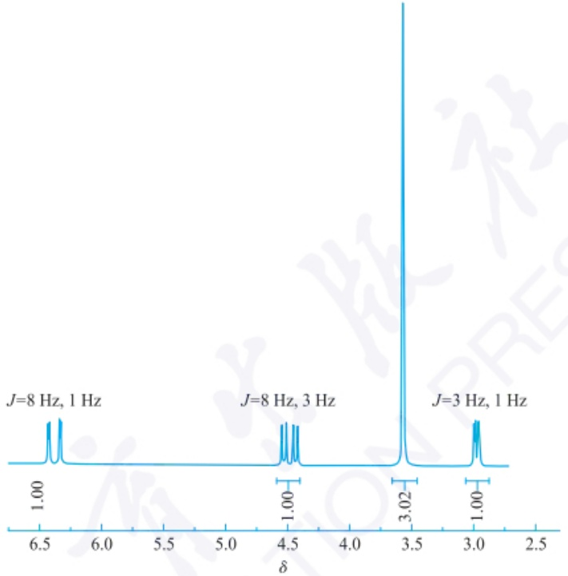

<details>
<summary>spectrogram</summary>

| Condition | Chemical Shift \((\delta)\) | Integration Value |
| --- | --- | --- |
| J=8 Hz, 1 Hz | ~6.4 | 1.00 |
| J=8 Hz, 3 Hz | ~4.5 | 1.00 |
| J=8 Hz, 3 Hz | ~4.4 | — |
| J=8 Hz, 3 Hz | ~4.3 | — |
| J=8 Hz, 3 Hz | ~4.2 | — |
| J=8 Hz, 3 Hz | ~3.5 | 3.02 |
| J=3 Hz, 1 Hz | ~3.0 | 1.00 |
</details>

图 9.2.18 化合物  $C_{5}H_{6}O$  的核磁共振氢谱

» 解: 不饱和度  $\Omega=\frac{2n_{4}+2+n_{3}-n_{1}}{2}=\frac{2\times5+2+0-6}{2}=3$

$\delta = 3.05$ 处的 ${}^{1}\mathrm{H}$ 核信号说明分子可能含有一个端基炔。化学位移值在约3.0，4.5和6.3处出现了强度相等的12条谱线，构成了一个AMX系统。$\delta_{\mathrm{M}} = 4.5$ 和$\delta_{\mathrm{X}} = 6.3, ^{3}J_{\mathrm{MX}} = 8\mathrm{Hz}$，说明可能是具有顺式构型的二取代乙烯基（—CH=CH—）。烯烃上的两个氢核化学位移相差大，说明乙烯基与具有强电子效应的基团相连。

$\delta = 3.6$ 处的尖锐单峰是一个孤立的甲基产生的，氧原子的强诱导效应使甲基的氢核去屏蔽，分子中应该存在甲氧基 $(-\mathrm{OCH}_3)$ 。氧原子的给电子共轭效应增加了乙烯基上的电子云密度，氢核 $\mathrm{H}_{\mathrm{M}}$ 受到屏蔽，化学位移向高场移动。

乙烯基和乙炔基上的氢核之间有远程耦合， $^{4}J_{AM}=3\ Hz$  和  $^{5}J_{AX}=1\ Hz$ 。

结合上述结构片段的信息,故化合物的结构应为 $(Z)-1-$ 甲氧基丁-1-烯-3-炔。

»例 9.2.3 某化合物的分子式为  $C_{10}H_{12}O_{5}$ ，其核磁共振氢谱如图 9.2.19 所示 ( $CDCl_{3}, 25^{\circ}C, 400 MHz$ )。试推断其化学结构。

» 解: 不饱和度  $\Omega=\frac{2n_{4}+2+n_{3}-n_{1}}{2}=\frac{2\times10+2+0-12}{2}=5$

$\delta=10.9$ 处的 $^{1}H$ 核信号说明分子可能含有一个羧基。

$\delta = 3.8\sim 4.2$ 范围的三个尖锐单峰是由孤立的甲基产生的，由分子式可知，分

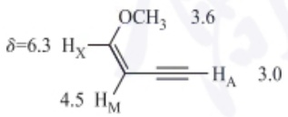

<details>
<summary>chemical</summary>

Chemical structure of a substituted cyclohexane with methoxy and hydrogen substituents, showing δ values and bond lengths
</details>

---

9.3 核磁共振碳谱分析

525

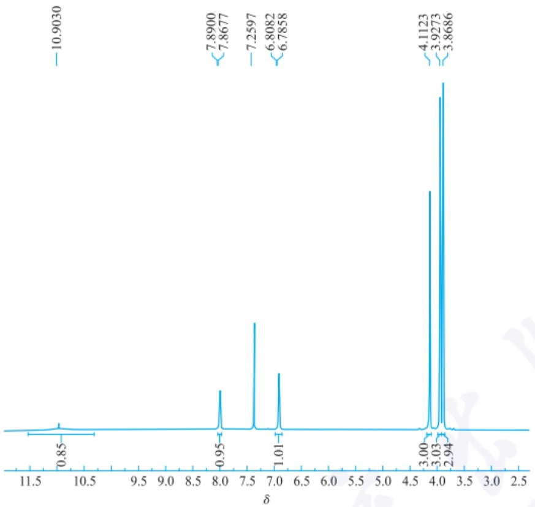

<details>
<summary>spectrogram</summary>

| Chemical Shift \((\delta)\) | Integration Value |
| --- | --- |
| 10.9030 | 0.85 |
| 7.8900 | 0.95 |
| 7.8677 | 0.95 |
| 7.2597 | 1.01 |
| 6.8082 | 1.01 |
| 6.7858 | 1.01 |
| 4.1123 | 3.00 |
| 3.9273 | 3.03 |
| 3.8686 | 2.94 |
</details>

图 9.2.19 化合物  $C_{10}H_{12}O_{5}$  的核磁共振氢谱

子中应该存在三个甲氧基( $-OCH_{3}$ )。

$\delta=6.80$  和  $\delta=7.88$  处的两组低场吸收峰（二者的耦合常数 J 均为 9.0 Hz）来自苯环上的两个  ${}^{1}H$  核。苯环上有两个相互耦合的  ${}^{1}H$  核，根据其峰形和耦合常数判断，它们应是邻位氢。

结合上述结构片段的信息,故化合物的结构应为2,3,4-三甲氧基苯甲酸。

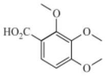

## 9.3 核磁共振碳谱分析

## 9.3.1 核磁共振碳谱概述

有机化合物的分子骨架基本是由碳原子构成，核磁共振碳谱（$^{13}\mathrm{CNMR}$）是研究有机分子结构十分有效的手段。尤其是随着核磁共振技术的发展，核磁共振碳谱在有机化学的各个领域，如有机化合物分子结构及构型、构象的研究、合成高分子、天然高分子及其动态过程的研究都有了广泛的应用，成为化学、生物、药学、医学、材料化工等领域不可或缺的分析工具。

## 9.3.1.1 核磁共振碳谱特点

碳原子主要有两种同位素， $^{12}$ C 和  ${}^{13}$ C，只有  ${}^{13}$ C 核有自旋，其自旋量子数 I = 1/2。

一方面， $^{13}$ C 核的化学位移范围是  ${}^{1}$ H 核的 20 倍左右，不同化学环境中碳原子的化学位移各不相同，谱线清晰，提供的结构信息更加丰富。因此，核磁共振  ${}^{13}$ C 谱可获得有机化合物分子中碳骨架的直接信息，对结构鉴定比  ${}^{1}$ H 谱具有更重要意义。

---

526

第九章 核磁共振波谱法

另一方面， $^{13}$ C 同位素的天然丰度只有 1.11%，核磁矩  $\mu(0.7021)$  只有  ${}^{1}$ H 的 1/4，信噪比只有  ${}^{1}$ H 的 1/5700，使得核磁共振碳谱的灵敏度很低。因此，用一般连续波方法就难以观察到  ${}^{13}$ C 核磁共振信号。

## 9.3.1.2  ${}^{13}$ C 化学位移  $\delta_{c}$

与核磁共振氢谱一样， $^{13}$ C 的核磁共振也要满足如下关系式:

$$
\nu_ {0} = \frac {\gamma_ {\mathrm{c}}}{2 \pi} B _ {0} (1 - \sigma) \tag {9-3-1}
$$

由于各种碳原子受到的屏蔽效应不同，即屏蔽常数不同，因此有不同的化学位移值。与核磁共振氢谱一样，在 $^{13}$ C NMR 谱中常用四甲基硅烷（TMS）作内标物，定义四甲基硅烷的 $^{13}$ C 信号的化学位移值为零，出现在 TMS 低场一侧信号的 $\delta_{c}$ 规定为正值，在 TMS 右侧即高场的信号规定为负值。

$$
\text {化学位移值} \left(\delta_ {\mathrm{c}}\right) = \frac {\text {样品碳吸收频率} - \text {四甲基硅烷碳的吸收频率}}{\text {谱仪的工作频率}} \times 1 0 ^ {6} \tag {9-3-2}
$$

$^{13}$ C NMR 谱主要有化学位移、耦合常数和谱线宽度三个参数,其中化学位移  $\delta_{c}$  最重要。 $^{13}$ C NMR 谱的化学位移分布范围为 0\~250,容易区别不同类型的碳原子。

## 9.3.1.3 核磁共振碳谱的发展简史

随着脉冲傅里叶变换、宽带去耦等技术的快速发展， $^{13}$ C 谱的检测灵敏度得到显著提高，使得 $^{13}$ C 核磁共振波谱能用于常规分析，成为有机化合物结构分析中重要的工具之一。

Richard Ernst 在 1966 年发明了脉冲傅里叶变换核磁共振(FT-NMR)技术, 这极大地提高了核磁共振信号的灵敏度。这个进展为 $^{13}$ C NMR 谱的应用铺平了道路, 他因此获得了 1991 年的诺贝尔化学奖。

20 世纪 70 年代末和 20 世纪 80 年代初, 去耦技术及核 Overhauser 效应 (NOE) 的应用, 进一步提高了  ${}^{13}$ C NMR 谱的分辨率和信噪比。去耦技术通过去除碳-13 与氢-1 之间的耦合, 使谱图得以简化, 化学家能够更容易地分析分子中的碳原子环境。

## 9.3.2 核磁共振碳谱灵敏度提高方法

## 9.3.2.1 脉冲傅里叶变换技术

为了提高 $^{13}$ C 检测灵敏度，在谱仪中引入脉冲傅里叶变换技术是最有效的手段，有关技术细节与氢谱的脉冲傅里叶变换一样，在此不再赘述。由于 $^{13}$ C 的含量少，得到的 FID 信号很小，谱峰信号比较弱。仪器通过发出多个脉冲，产生多个 FID 信号，累加起来后再进行傅里叶变换，从而使灵敏度显著提高，最终得到累加的 $^{13}$ C 核磁共振谱（图 9.3.1）。

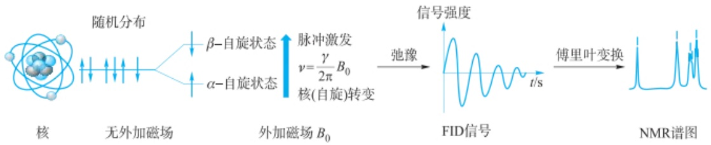

<details>
<summary>flowchart</summary>


</details>

图 9.3.1 核磁共振信号的傅里叶变换示意图

---

9.3 核磁共振碳谱分析

527

## 9.3.2.2 碳谱去耦技术

由于 $^{13}$ C核含量少,检测灵敏度低,同时 $^{13}$ C核与邻近甚至更远的 $^{1}$ H核会产生耦合,导致谱峰分裂,产生交叉重叠的多重峰,从而降低了峰的强度,使得谱图解析变得困难。为此,人们通常对谱图进行简化以提高灵敏度,常用的技术包括宽带去耦、偏共振去耦、门控去耦、反转门控去耦、质子选择去耦等。

## 1. 宽带去耦

宽带去耦也称质子噪声去耦。在观察碳谱时，同时发射一个频带相当宽的射频（其频带宽度大于样品中所有 $^{1}$ H核的共振频率），以消除全部 $^{1}$ H核对 $^{13}$ C核的耦合。这样，每个碳原子只出现一个谱峰，同时产生NOE效应，使得 $^{13}$ C谱信号强度大大增强，如图9.3.2(a)所示。

## 2. 偏共振去耦

虽然宽带去耦使谱图得以简化,得到各个不同 $^{13}$ C核的谱峰,但丢失了 $^{13}$ C- $^{1}$ H

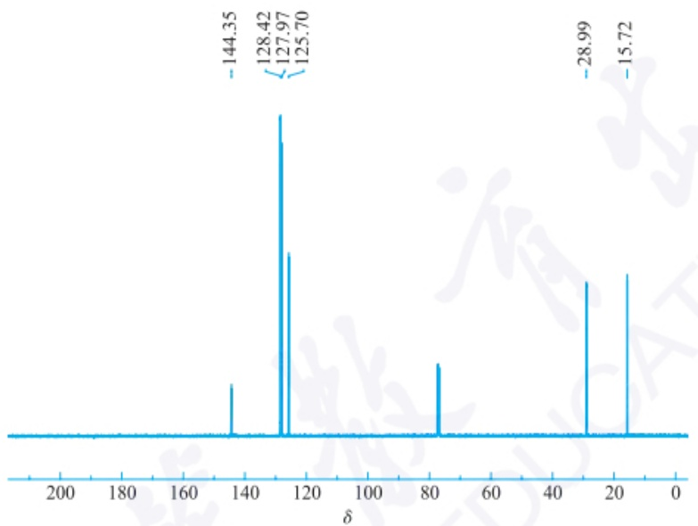

<details>
<summary>spectrogram</summary>

| Chemical Shift \((\delta)\) |
| --- |
| 144.35 |
| 128.42 |
| 127.97 |
| 125.70 |
| 28.99 |
| 15.72 |
</details>

(a) 宽带去耦

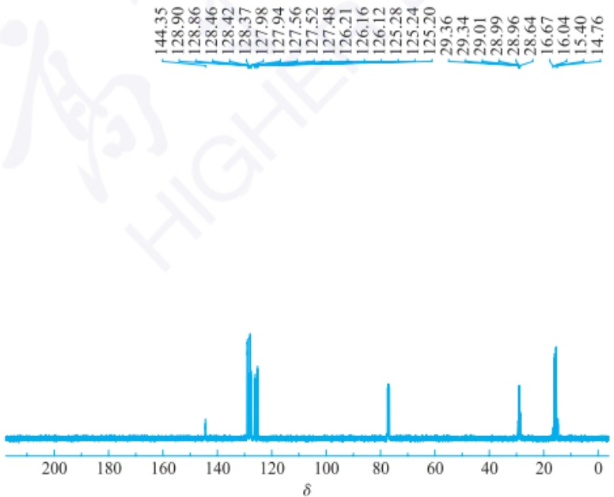

<details>
<summary>spectrogram</summary>

| Chemical Shift \((\delta)\) |
| --- |
| 144.35 |
| 128.90 |
| 128.86 |
| 128.46 |
| 128.42 |
| 128.37 |
| 127.98 |
| 127.94 |
| 127.56 |
| 127.52 |
| 127.48 |
| 126.21 |
| 126.16 |
| 126.12 |
| 125.28 |
| 125.24 |
| 125.20 |
| 29.36 |
| 29.34 |
| 29.01 |
| 28.99 |
| 28.96 |
| 28.64 |
| 16.67 |
| 16.04 |
| 15.40 |
| 14.76 |
</details>

(b) 偏共振共耦

---

528

第九章 核磁共振波谱法

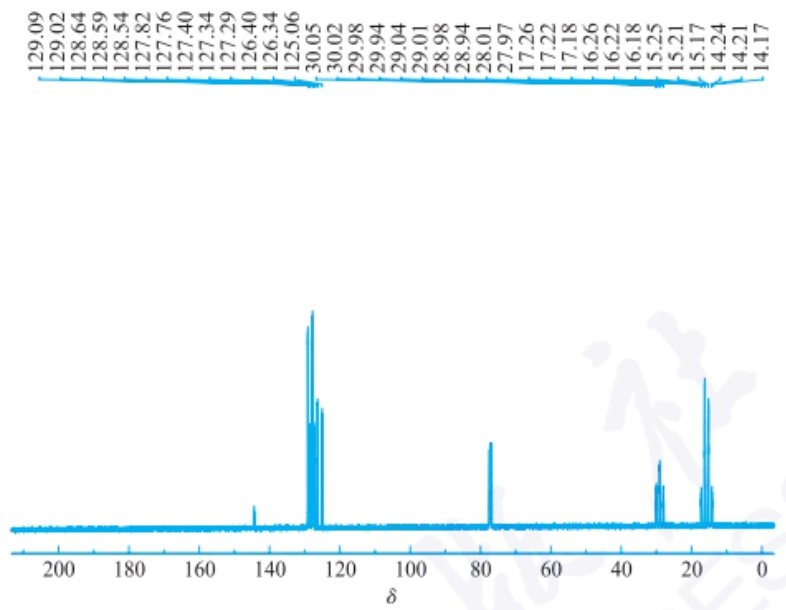

<details>
<summary>spectrogram</summary>

| Chemical Shift \((\delta)\) | Intensity |
| --- | --- |
| 129.09 | ~0 |
| 129.02 | ~0 |
| 128.64 | ~0 |
| 128.59 | ~0 |
| 128.54 | ~0 |
| 127.82 | ~0 |
| 127.76 | ~0 |
| 127.40 | ~0 |
| 127.34 | ~0 |
| 127.29 | ~0 |
| 126.40 | ~0 |
| 126.34 | ~0 |
| 125.06 | ~0 |
| 30.05 | High |
| 30.02 | Medium |
| 29.98 | ~0 |
| 29.94 | ~0 |
| 29.04 | ~0 |
| 29.01 | ~0 |
| 28.98 | ~0 |
| 28.94 | ~0 |
| 28.01 | Medium |
| 27.97 | ~0 |
| 17.26 | ~0 |
| 17.22 | ~0 |
| 16.26 | ~0 |
| 16.22 | ~0 |
| 15.25 | Medium |
| 15.21 | ~0 |
| 15.17 | High |
| 14.24 | ~0 |
| 14.21 | ~0 |
| 14.17 | ~0 |
</details>

(c)门控去耦


<details>
<summary>spectrogram</summary>

| Chemical Shift \((\delta)\) |
| --- |
| 144.35 |
| 128.42 |
| 127.97 |
| 127.95 |
| 125.70 |
| 29.00 |
| 15.72 |
</details>

(d) 反转门控去耦

图 9.3.2 各种方法测定的乙基苯 $^{13}$ C NMR 谱图

耦合的信息，无法确定不同 $^{13}$ C核上质子数目的信息。为了克服这一缺点，人们发展了偏共振去耦技术。它是采用一个比各种质子共振频率偏离几十到几百赫兹的中等强度射频照射样品，产生不完全的 $^{1}$ H核去耦。在这种情况下， $^{13}$ C与 $^{1}$ H的耦合常数变小，而多重分裂峰未完全消失。由于与 $^{13}$ C核直接相连的 $^{1}$ H核耦合最强，隔得越远的 $^{1}$ H核耦合越弱。上述偏共振去耦可消除弱的 $^{1}$ H核耦合，只保留与 $^{13}$ C核直接相连的 $^{1}$ H核耦合。此时， $^{13}$ C谱峰的数目与所连接的 $^{1}$ H核的数目有关，并且符合 $n+1$ 规律。可依据谱峰的数目判断出伯、仲、叔、季四种碳原子的存在，如图9.3.2(b)所示。

## 3. 门控去耦

质子宽带去耦得不到 $^{13}C-^{1}H$ 的耦合信息，质子偏共振去耦仅能看到与碳核直接相连 $^{1}H$ 核的耦合裂分信息，得不到远程耦合信号。为此，又发展了门控去耦技术。门

---

9.3 核磁共振碳谱分析

529

控去耦技术接收 FID 信号时不去耦, 峰具有多重性, 除接收 FID 信号外都去耦, 信号具有 NOE 增强。因此, 它也称为交替脉冲法, 或者称为带 NOE 的不去耦技术。

具体来说，门控去耦技术采用在发射脉冲前加一个去耦射频 $v_{2}$ ，使得自旋体系去耦，有NOE；紧接着发射脉冲 $v_{1}$ ，进行FID信号接收，此时 $v_{2}$ 关闭，核迅速恢复耦合。核的弛豫时间 $T_{1}$ 为秒数量级，发射脉冲为微秒级，NOE衰减与弛豫时间同数量级，因此接收的FID信号具有耦合同时也有NOE增强，可以得到 $^{1}J^{13}C^{-1}H$ 或者远程耦合。门控去耦谱如图9.3.2(c)所示。

## 4. 反转门控去耦

门控去耦的碳谱信号强度由于有NOE增强，其信号强度不与碳原子数成比例。为了确定碳原子数量，去耦器在弛豫延迟期关闭，而在采样期打开，与门控去耦的脉冲序列相反，因此称为反转门控去耦技术。反转门控去耦技术主要用于碳原子个数的定量，碳原子个数与信号强度成正比。反转门控去耦谱示例如图9.3.2(d)所示。

## 5. 质子选择性去耦

当化合物氢谱已全部归属时，质子选择性去耦技术对归属碳的吸收峰更有利。质子选择性去耦是以某一特定质子的共振频率进行照射后观察碳谱。在知道某一 $^{1}$ H核的化学位移后，选定某一频率照射该 $^{1}$ H核，使其产生共振，与该 $^{1}$ H核相连接的 $^{13}$ C核则被去耦，其核磁共振峰为一强单峰，从而确定信号归属。

## 9.3.2.3 碳谱极化转移技术: INEPT 谱、DEPT 谱和 APT 谱

在傅里叶变换核磁共振实验中，采用多种脉冲组成一个脉冲序列。在这种多脉冲实验中，一种核的极化变化会引起与它耦合的另一种核的极化变化，这称为极化转移。极化转移可以克服偏共振实验中共振谱线的重叠和碳原子归属问题，可以准确归属伯、仲、叔、季类型的碳原子，而测量时间比 $^{13}$ C偏振谱短。目前发展的极化转移谱技术主要有INEPT谱、DEPT谱和APT谱。

## 1. INEPT 谱

在核磁共振实验中,人们发现在具有两种核的自旋体系中,可以把高灵敏度 $\left(^{1}\mathrm{H}\right)$ 的自旋极化传递到低灵敏度的核 $\left(^{13}\mathrm{C}\right)$ ,信号增强4倍。

INEPT 即低敏核极化转移增强 (insensitive nuclei enhanced by polarization transfer)。在该实验中, 可以调节脉冲时间  $\Delta$  来调节 CH、 $CH_{2}$ 、 $CH_{3}$  信号强度, 从而有效识别。当  $\Delta = (4J)^{-1}$  的条件下, 只有叔碳 CH 呈现正信号, 其他碳信号很弱; 当  $\Delta = (8J)^{-1}$  时, 叔碳 CH、仲碳  $CH_{2}$  和伯碳  $CH_{3}$  都呈现正信号; 当  $\Delta = 3/(8J)$  时, 叔碳 CH 和伯碳  $CH_{3}$  呈现正信号, 仲碳  $CH_{2}$  呈现负信号。季碳没有极化转移, 在 INEPT 中没有信号, 但可以结合去耦谱来最终确定季碳。

## 2. DEPT 谱

DEPT 就是无畸形极化转移增强法(distortionless enhancement by polarization transfer, DEPT)得到的谱图。DEPT 谱是改变照射 $^{1}$ H 核的脉冲宽度(或者设定不同的弛豫时间)，在 DEPT 实验中，用  $\theta$  脉冲的变化代替脉冲时间  $\Delta$  的改变，使不同类型的  ${}^{13}C$  核在谱图上呈现单峰，并呈现正向峰或倒置峰，信号强度与脉冲倾倒角  $\theta$  有关，已经成为  ${}^{13}C$  NMR 谱的一种常规测定方法。DEPT 谱主要有三种技术:DEPT-45°、DEPT-90° 和 DEPT-135°。

DEPT-45°谱中，伯、仲、叔碳原子为正向峰，通过与去耦碳谱对比，即可确定季碳原子。DEPT-90°谱中，仅叔碳（—CH）为正向峰，其余信息被去除。DEPT-135°谱中，伯碳（—CH₃）和叔碳（—CH）是正向峰，仲碳（—CH₂—）是负向峰，从而可以清晰地区分不同类型的碳原子。

---

530

第九章 核磁共振波谱法

如图9.3.3(a)所示，丙二醇甲醚醋酸酯的宽带去耦谱上显示出六个单峰，对应于结构中六个不同的碳原子。羰基碳的化学位移值最大，在DEPT- $45^{\circ}$ 谱[图9.3.3(b)]上羰基碳的谱峰消失。在DEPT- $90^{\circ}$ 谱[图9.3.3(c)]上，只保留了叔碳


<details>
<summary>spectrogram</summary>

| Peak Label | Chemical Shift \((\delta)\) |
| --- | --- |
| 2 | 170.2388 |
| 6 | 77.5014 |
| 5 | 77.2887 |
| 5 | 77.0743 |
| 5 | 74.8618 |
| 5 | 69.0587 |
| 8 | 58.8263 |
| 1 | 20.9842 |
| 7 | 16.3626 |
</details>

(a) 常规质子宽带去耦 $^{13}$ C谱


<details>
<summary>spectrogram</summary>

| Peak Label | Chemical Shift \((\delta)\) |
| --- | --- |
| 6 | 74.8540 |
| 5 | 69.0596 |
| 8 | 25.8327 |
| 1 | 20.9986 |
| 7 | 16.3632 |
</details>

(b) DEPT-45°谱

---

9.3 核磁共振碳谱分析

531


<details>
<summary>spectrogram</summary>

| Spectrum | Chemical Shift \((\delta)\) |
| :--- | :--- |
| (c) \(DEPT-90{}^{\circ}谱\) | 74.3649, 69.0595, 21.6625, 16.3619 |
| (d) \(DEPT-135{}^{\circ}谱\) | 74.7035, 69.0590, 58.8325, 20.9955, 16.3631 |
</details>

图 9.3.3 化合物丙二醇甲醚醋酸酯的 $^{13}$ C NMR 谱图和 DEPT 谱图

---

532

第九章 核磁共振波谱法

表 9.3.1 常用溶剂的 ${\delta }_{\mathrm{c}}$ 值

<table><tr><td rowspan="2">溶剂</td><td colspan="2"> $\delta_{C}$ </td></tr><tr><td>非氘代化合物</td><td>氘代化合物</td></tr><tr><td> $CH_3SOCH_3$ </td><td>40.5</td><td>39.6</td></tr><tr><td> $CH_3COCH_3$ </td><td>30.4( $CH_3$ )</td><td>29.2( $CH_3$ )</td></tr><tr><td> $CH_3OH$ </td><td>49.9</td><td>49.0</td></tr><tr><td> $CH_3CN$ </td><td>1.7( $CH_3$ )</td><td>1.3( $CH_3$ )</td></tr><tr><td> $CH_3COOH$ </td><td>178.3(COOH)</td><td>—</td></tr><tr><td> $CHCl_3$ </td><td>77.2</td><td>76.9</td></tr><tr><td> $CH_2Cl_2$ </td><td>54.0</td><td>53.6</td></tr><tr><td> $CCl_4$ </td><td>96.1</td><td>—</td></tr><tr><td> $CS_2$ </td><td>192.8</td><td>—</td></tr><tr><td></td><td>67.4</td><td>66.5</td></tr><tr><td></td><td>128.5</td><td>128.0</td></tr><tr><td></td><td>27.5</td><td>26.1</td></tr></table>


(—CH)的正向单峰。在 DEPT-135°谱上[图 9.3.3(d)]，可以观察到一个—CH₂—的负峰，与正向的一个—CH 和三个不同的—CH₃峰区分开来。需要注意的是在 $^{13}$ C NMR 谱中，峰高与 $^{13}$ C 的数目不成比例。

## 3. APT 谱

APT 就是连接质子测试(attached proton test, APT)，又称 J 调制法。这种方法的脉冲序列简单，季碳也可以出峰。当  $\tau$  等于 1/J 时，C 和  $CH_{2}$  产生正信号，CH 和  $CH_{3}$  产生负信号。APT 技术实现了对分子骨架中所有碳原子依据其连接质子的情况进行编辑，与 DEPT-135°谱非常类似，但有季碳的信号峰。

## 9.3.3 核磁共振碳谱化学位移影响因素

$^{13}$ C 的化学位移( $\delta_{C}$ )直接反映了被研究碳原子所处的化学环境和种类。为了确定 $^{13}$ C 核的化学位移,一般用 TMS 作标准,它的 $\delta_{C}=0$ 。有时也用溶剂作标准,它们的化学位移值见表 9.3.1。

大多数有机化合物中的 $^{13}$ C 化学位移值为 0\~250。与核磁共振氢谱类似，凡是会影响碳原子核外电子云密度的因素，都会影响核磁碳谱的化学位移值。各种影响因素简介如下。

## 9.3.3.1 碳原子的杂化类型

饱和烷烃的碳  $sp^{3}$  杂化, 屏蔽效应大, 以 TMS 为标准, 其化学位移处于高场区 (0\~70)。

$sp^{2}$  杂化的碳原子处于低场区,其中烯烃的碳原子在 100\~150,芳烃和取代芳烃的碳原子在 120\~160,羰基碳原子则在 150\~220。sp 杂化的碳原子处于较高场 (70\~90),这与炔键电子云形成屏蔽效应有关。


<details>
<summary>chemical</summary>

Two organic molecular structures with labeled bond lengths and atom numbering
</details>

## 9.3.3.2 取代基电子和立体效应影响

## 1. 诱导效应

碳原子与电负性强的取代基相连时，由于去屏蔽效应，化学位移向低场移动，电负性取代基越多，化学位移越大。如甲烷碳原子的化学位移是-2.1，一氯甲烷碳原子的化学位移在25.6，二氯甲烷碳原子在54.0，三氯甲烷即氯仿的碳原子在77.2，四氯化碳的碳原子则移动到了96.1。羰基碳原子因为和氧直接相连，化学位移处于最低场。

当碳原子与给电子基团相连时，化学位移向高场移动。与氢核磁共振谱一样，诱导效应对碳谱的影响也是随距离急速下降。

## 2. 共轭效应及超共轭效应

羰基碳原子与双键或苯环发生共轭时，羰基碳原子上的电子云密度增大，化学位移值向高场移动。在羰基与孤对电子取代基相连的系统，这些基团的给电子共轭效应使得羰基碳正电荷被分散，使其共振向高场移动。

苯环的取代基若是—NH、—OH等饱和杂原子，这些基团的孤对电子将离域到苯环的 $\pi$ 电子体系，增加邻位和对位碳上的电荷密度，屏蔽增加， $\delta_{c}$ 变小。若苯上氢被吸电子共轭基团如—CN、—NO $_{2}$ 取代，减少了邻对位碳的电荷密度，则屏蔽减小，其 $\delta_{c}$ 变大。

---

9.3 核磁共振碳谱分析

533


## 3. 立体效应

碳的化学位移对分子几何形状非常敏感,相隔几个键的碳,如果它们空间非常靠近,则会相互产生强烈影响,这种短程的非成键相互作用称为立体效应。

当共轭体系的共轭效应受阻时，羰基碳化学位移向低场移动。


如苯乙酮中乙酰基邻位有甲基取代时，苯环与羰基的共平面发生扭曲，随着扭曲程度的增加，羰基与苯环共轭性降低，羰基碳正电荷增加，从而碳化学位移移向低场。这也可以认为是立体效应造成的。

γ 效应是一种典型的立体效应。基团的取代使得 γ 位的碳原子化学位移稍减小，即化学位移值移向高场，这种现象叫 γ 效应。


## 4. 分子内氢键效应

分子内氢键作用可以使碳原子上电子云密度降低,化学位移值向低场移动, $\delta_{C}$ 值增大。

## 5. 重原子效应

当碘、溴取代碳原子上的氢时，该碳原子化学位移减小(表9.3.2)。需要注意的是，重卤素虽然也有电负性去屏蔽效应，但因为具有很多电子，会使得碳原子电子云密度增加，化学位移的变化存在电负性去屏蔽效应和重原子屏蔽效应作用综合作用的结果。对于碘代物，表现出屏蔽作用，对于溴代物，溴原子多时，重原子屏蔽作用突出。

## 6. 介质效应

介质效应主要是溶剂效应。一般来说，溶剂对分析样品的碳谱化学位移值影响较小。如果溶剂与分析物有分子间氢键作用，则会降低相应碳的化学位移。如果发生酸碱反应，则样品碳谱的化学位移也会有变化。

## 7. 位移试剂效应

稀土元素如 Eu(Ⅱ)、Pr(Ⅱ)、Yb(Ⅱ) 的配合物常用作位移试剂，由于样品中的极性基团与金属离子发生配位作用，会使样品的碳化学位移产生诱导的、附加的化学位移。

$^{13}$ C 化学位移受各种因素的影响,会发生一些变化。总体来说,化合物碳谱化学位移值主要是取决于化合物本身的结构,包括官能团、取代基的电子、立体、重原子效应。


表 9.3.2 卤代甲烷中碳的化学位移值

| 化合物 | Cl | Br | I |
| --- | --- | --- | --- |
| $CH_3X$ | 25.6 | 9.6 | -24.0 |
| $CH_2X_2$ | 54.0 | 21.4 | -54.0 |
| $CHX_3$ | 77.2 | 12.1 | -139.9 |
| $CX_4$ | 96.1 | -28.7 | -292.5 |

---

534

第九章 核磁共振波谱法


## 9.3.4 核磁共振碳谱与分子结构的关系

用 TMS 作标准, 各类结构中  ${}^{13}C$  的化学位移值范围大致如下: 烷烃 0\~60; 醚类 50\~80; 烯烃、芳烃 100\~150; 羰基类 150\~220; 有机金属化合物 220\~240。

人们通过实验积累了大量数据和资料,经过总结研究提出了一些经验计算式,各类有机化合物的 $^{13}$ C的化学位移在上述范围的基础上可以予以估算。这在很多波谱学书中有介绍,比较难以记忆,此处不赘述。下面介绍各类化合物的碳谱主要特征。

## 9.3.4.1 饱和烷烃

饱和碳的化学位移为-2.1-43，其中甲烷碳的化学位移屏蔽最大，其值在-2.1。随着碳的级数升高，化学位移向低场移动，中心碳化学位移分别增加5.9，16.1,25.2和27.9。每增加一个甲基，中心碳化学位移约增加9.0，这叫 $\alpha$ 效应。若 $\beta$-氢被碳取代，$\alpha$-碳的化学位移向低场移动9左右，这叫 $\beta$ 效应。若 $\gamma$-氢被取代，$\alpha$-碳化学位移向高场移动约2.5，这叫 $\gamma$ 效应。更远的取代就没有突出影响了。

对环烷烃来说,环丙烷碳的化学位移为-2.6,其余环烷烃(环丁烷到环十七烷)碳的化学位移为23.3\~29.4。对取代环己烷来说,平伏键上的甲基化学位移为22\~23,而轴向甲基的为18\~19。

## 9.3.4.2 烯烃

烯键碳为  $sp^{2}$  杂化，化学位移范围在 100～165，与芳香烃碳化学位移有所重叠。对端基烯，当碳链多余 3 个碳时，端基碳的化学位移为 110，取代碳的化学位移为 134。在 2-烯中，碳链多于 5 个碳原子时，两个烯碳的化学位移相差 7～10；在 3-烯中，两个烯碳的化学位移相差更小，为 1～2。

对于取代烯,主要需考察取代基对烯键碳电子云密度的影响。若取代基增加烯键碳的电子云密度,则使得碳化学位移偏向高场,若取代基减少烯键碳的电子云密度,则使得碳化学位移向低场移动。关键在于区分诱导效应和共轭效应,并进行综合考量。

对于非环双烯，双烯是否共轭对化学位移影响不大，两个烯碳的化学位移值位于110和134左右。在丙二烯中，烯键碳化学位移为70\~90，中心sp杂化的碳化学位移为208\~213。

## 9.3.4.3 炔烃

炔键碳为 sp 杂化，化学位移值在 67\~92。端基炔两炔键碳的化学位移值相差 15,2-炔、3-炔两碳的化学位移差 3\~4 或 1\~2，烷基取代使得两炔键碳的化学位移接近。

## 9.3.4.4 芳香烃

苯环碳的化学位移在128.5，一般芳烃的碳化学位移在 $123\sim 142$ 。取代苯中碳的电子云分布随取代基变化而变化，进而影响碳化学位移的变化。见前面取代基对碳化学位移影响部分内容。

## 9.3.4.5 卤代烷、醇、胺化合物

卤代烷中各个碳的化学位移变化主要是诱导效应影响,使得化学位移向低场移动。对于碘代要考虑重原子效应。

对于醇来说,主要是由于氧原子具有吸电子的诱导效应,使得  $\alpha$ 、 $\beta$ 、 $\gamma$ -碳的化学位移向低场分别移动 35\~52、5\~12、0\~6。

---

9.3 核磁共振碳谱分析

535

胺类化合物中,伯胺碳的化学位移值沿烷基链分别向低场移动约为  $\alpha$  位 29.3,  $\beta$  位 11.3,  $\gamma$  位 4.6,  $\delta$  为 0.6。

## 9.3.4.6 羰基化合物

羰基碳有如下特征:化学位移值一般在150\~220（如图9.3.4所示），干扰少，只有丙二烯和叠烯中间碳在此区域。醛基碳化学位移在200，氢被甲基取代后向低场移动。羰基与苯环或者烯键共轭，因为电子云密度增加，碳化学位移向高场移动。对于羧酸及其衍生物，杂原子的 $p-\pi$ 共轭使羰基屏蔽增加，移向高场。


<details>
<summary>text_image</summary>

芳香烃C
-C≡C- C-Cl, C-Br
C=O
C=C
-C-O-
烷烃C
低场方向
TMS
</details>

图 9.3.4 各类碳的化学位移范围

环状或开链烷基酮羰基化学位移在200\~220。 $\alpha$  卤代时羰基碳化学位移在170\~200, $\alpha$ 、 $\beta$ -不饱和酮的碳化学位移在190\~210。

羧酸羰基碳化学位移在165\~185，离子化后化学位移向高场移动5左右。酸酐羰基与相应酸比较，屏蔽增加10左右，在150\~175。酰氯、酰溴、酰碘屏蔽使化学位移增加4\~8、5和10。酯羰基和酰胺羰基的碳化学位移与羧酸相差不大，都在160\~180。见前述碳对化学位移影响部分介绍。

## 9.3.5 核磁共振碳谱的解析

## 9.3.5.1 解析的基本步骤

$^{13}$ C NMR 谱的解析可以参考以下步骤。

## 1. 鉴别谱图中的溶剂峰和杂质峰

碳谱的溶剂峰和氢谱不同，氢谱中的溶剂峰是氘代不完全引起的，而碳谱中溶剂的碳原子出峰是不可避免的，氘代碳原子具有相对稳定的化学位移。如氘代氯仿 $\left(\mathrm{CDCl}_{3}\right)$ 在77.0左右表现出三重峰，氘代二甲基亚砜 $\left(\mathrm{DMSO}-\mathrm{d}_{6}\right)$ 在40.9处出现多重峰。一般来说，溶剂峰容易辨认。样品不纯时，还会有其他组分的干扰，包括溶剂残留等。

## 2. 由分子式计算不饱和度和估计分子的对称性, 对碳骨架有个大致的预判

不饱和度的计算和氢谱完全一致。若碳谱上的谱线等于分子式给出的数目，表明分子无对称性；若谱线数目小于分子式中碳原子数目，则说明分子具有一定的对称性，导致某些碳原子谱峰重叠。

## 3. 根据碳谱化学位移推测相应的碳骨架单元

如果碳原子化学位移值  $\delta>200$ ，可能是醛、酮类化合物的羰基碳；如果靠近160\~170，则可能是连接有杂原子的羰基；化学位移值  $\delta$  出现在90\~160，可能是不饱和碳原子，如苯环和烯烃（炔碳除外）；炔碳碳原子  $\delta$  在70\~100； $\delta<55$  可能是饱和碳原子；饱和碳原子如果和氧、氮、氟等杂原子连接， $\delta$  值可能会大于55。

## 4. 确定碳原子级数

由宽带去耦、偏共振去耦或 DEPT 谱来确定每个峰对应的碳原子是伯、仲、叔

---

536

第九章 核磁共振波谱法

碳原子还是季碳原子，由此确定与该碳相连的氢原子数，得到各结构单元。如果由此得到的氢原子数目小于分子式中氢原子数，则可能有活泼氢存在，如—OH、—COOH、—NH₂、—NH—等。

## 5. 确定结构

由结构单元组合成可能的结构式,对碳谱进行指认,确定正确的结构。化合物结构复杂时,还需要结合其他谱(MS、 $^{1}$ H NMR、IR、UV)来综合解析。

## 9.3.5.2 碳谱解析举例

## 1. 碳谱解析示例

一般来说,氢谱和碳谱结合,容易解析简单化合物的结构。如下是化合物 $C_{5}H_{8}O_{2}$ 的碳谱(图9.3.5),结合解析的基本步骤,可以逐步确定出结构。


<details>
<summary>spectrogram</summary>

| Category | Value |
| --- | --- |
| Peak 1 | 171.9(s) |
| Peak 2 | 69.4(t) |
| Peak 3 | 29.9(t) |
| Peak 4 | 22.3(m) |
| Peak 5 | 19.1(m) |
</details>

图 9.3.5 未知化合物的碳谱信息

根据分子式,该化合物的不饱和度计算为: $(2\times5+2-8)/2=2$ 。

碳谱中化学位移 171.9 处, 又没有氢的耦合, 判断为羰基碳 C=O。

化学位移 69.4 处的碳应该连接有一个电负性原子,根据分子式构成应该是与氧相连,耦合又是三重峰,基本可以判断是连接有氧的亚甲基:— $CH_{2}O$ —。

化学位移 29.9 处的碳应该连接有不饱和键,羰基比较合适;又是三重峰,可以判断为连接在羰基旁的亚甲基:— $CH_{2}CO$ —。

化学位移 19.1 和 22.3 处信号应该是没有直接连接杂原子或者不饱和键的碳，又都是三重耦合，应该是两个相连的亚甲基:—CH₂—CH₂—。

目前5个碳原子已基本确认，且氢原子也已经归属；除了羰基的一个不饱和度，应该还有一个不饱和度，只能是环的结构。将各个片段结合起来，该化合物应该是 $\delta-$ 环戊内酯。

## 2. 碳谱和氢谱的计算机模拟和标准谱图网上查对

Chemdraw 是最简便的  ${}^{1}$ H NMR 和  ${}^{13}$ C NMR 计算机模拟软件之一。以对硝基苯酚为例，具体操作介绍如下:

（1）用 Chemdraw 画出其正确的结构，若结构不正确，软件会有提示。也可以写出化合物名称，然后点击主菜单上的“Structure”，再点击“Convert Name to Structure”，计算机会自动给出结构。
(2) 选中结构式(结构式外围有虚线方框)
(3) 点击主菜单上“Structure”一栏。
（4）点击下拉菜单中的“Predict  ${}^{1}$ H NMR Shifts”或者“Predict  ${}^{13}$ C NMR Shifts”。
(5) 屏幕上出现谱图和相关数据:


δ-环戊内酯的结构

---

9.3 核磁共振碳谱分析

537

对氢谱来说,最上面一行是:ChemNMR  ${}^{1}$ H Estimation;下面是结构式及其每个氢的化学位移值标示;之后是软件模拟出来的谱图(图9.3.6)。

类似的,对碳谱来说,最上面一行是:ChemNMR  ${}^{13}$ C Estimation;下面是结构式及其每个碳的化学位移值标示;之后是软件模拟出来的谱图(图9.3.7)。

已知化合物的最后确认,需与标准图谱对照。可按照前面提供的方法,利用网络查找比对,也可以从标准图谱集中查找比对。


<details>
<summary>chemical</summary>

ChemNMR ¹H estimation of a benzamide derivative with hydroxyl and methoxy substituents
</details>

Estimation quality is indicated by color: good, medium, rough


<details>
<summary>spectrogram</summary>

| \(\delta\) | Intensity |
| --- | --- |
| ~12.5 | Low |
| ~8 | High |
| ~7 | High |
</details>

图 9.3.6 Chemdraw 模拟的对硝基苯酚氢谱

ChemNMR $^{13}\mathrm{C}$ Estimation


Estimation quality is indicated by color: good, medium, rough


<details>
<summary>spectrogram</summary>

| \(\delta\) | Value |
| --- | --- |
| ~155 | ~0.6 |
| ~140 | ~0.6 |
| ~125 | ~1.0 |
| ~123 | ~1.0 |
</details>

图 9.3.7 Chemdraw 模拟的对硝基苯酚碳谱

---

538

第九章 核磁共振波谱法

## 9.4 核磁共振波谱新技术

## 9.4.1 二维核磁共振技术概述

核磁共振氢谱和碳谱的共振信号是一个频率的函数，共振峰分布在一个频率轴（或磁场）上，可记为 $S(\omega)$，也称作一维核磁共振谱(1D NMR)。如果共振信号是两个独立频率(或磁场)变量的函数，记为 $S(\omega_1, \omega_2)$，共振信号就分布在两个频率轴组成的平面上，这就是二维核磁共振技术(two-dimensional NMR spectroscopy, 2D NMR)。2D NMR方法是20世纪70年代提出并发展起来的。2D NMR将化学位移、耦合常数等参数在二维平面上展开，于是在一般一维谱中重叠在一个坐标轴上的信号，被分散到由两个独立的频率轴构成的平面上，使得图谱解析和寻找核之间的相互作用更为容易。

2D NMR 一般有二维 J 分解谱、二维相关谱和多量子谱三类。不同的二维 NMR 方法得到的图谱不同，两个坐标轴所代表的参数也不同。

二维谱的记录有四种类型:

## 1. 堆积图

这是一种准三维立体图[图9.4.1(a)]，两个频率变量为二维，信号强度为三维。这种类型立体感强、直观，但画图费事，也容易大峰遮盖小峰。

## 2. 平面等值线图

平面等值线图又称为平面等高线图[图 9.4.1(b)]。最中心圆圈表示峰的位置, 圆圈的数目表示峰的强度, 它是用一个平行于 $F_{1}$(横轴)和 $F_{2}$ 轴(纵轴)的平面把堆积图予以平切后得到。

## 3. 截面图

只记录 2D NMR 全谱的某个剖面, 剖面常与一个轴成  $45^{\circ}$ 。

## 4. 积分投影图

这是一维谱形式图,是对垂直于投影轴的剖面上信号进行积分得到。

平面等值线图是常用的二维核磁共振谱图的表示方式。以下对各种二维谱进行简单的介绍，更全面的二维核磁谱可以参考波谱原理或者波谱解析等专业书籍学习认识。

## 9.4.2 二维核磁共振技术

## 9.4.2.1 二维 J 分解谱

二维 J 分解谱 (J resolved spectroscopy) 是将不同的 NMR 信号分解在两个不同的轴上, 使重叠在一起的一维谱化学位移  $\delta$  和耦合常数 J 分解在平面两个坐标上, 用于把化学位移与自旋耦合的作用分辨开来, 便于解析。

## 1. 氢、氢同核二维 J 分解谱

同核二维 J 分解谱将  ${}^{1}$ H NMR 中重叠密集的谱线多重峰结构展开在一个二维平面上，可将耦合常数  $J_{H-H}$  与化学位移分别在  $F_{1}$ 、 $F_{2}$  两个轴上给出。

## 2. 异核碳、氢二维 J 分解谱

异核碳、氢二维 $J$ 分解谱中被测定核的化学位移为一维，该种核与另一种核之间耦合的多重峰裂分为另一维。异核 ${}^{13}\mathrm{C},{}^{1}\mathrm{H}-2\mathrm{D}J$ 分解核磁共振谱的 $F_{2}$ 轴为 ${}^{13}\mathrm{C}$ 化学位移 $\delta_{\mathrm{C}}, F_{1}$ 轴为 ${}^{1}\mathrm{H}$ 与 ${}^{13}\mathrm{C}$ 的耦合常数 $J_{\mathrm{C-H}}$ 。由于使用的脉冲序列不同，

---

9.4 核磁共振波谱新技术

539

可以得到几种图谱。应用最多的为门控去耦 $^{13}C$ ， $^{1}H$  J分解2D NMR。此时 $F_{2}$ 轴为 $^{13}C$ 的化学位移 $\delta_{C}$ ， $F_{1}$ 轴为 $J_{C-H}$ 耦合的多重峰，裂距为 $1/2J_{C-H}$ 。出峰情况是CH为二重峰， $CH_{2}$ 为三重峰， $CH_{3}$ 为四重峰，季碳单峰或不出峰。


图 9.4.1 二维谱局部(a)堆积图和(b)平面等高线图

## 9.4.2.2 二维相关谱

相关谱是检测核自旋间的相互作用的，二维相关谱可分为化学位移相关谱、多量子跃迁谱及化学交换/NOE二维谱等种类。化学位移相关谱是二维谱的核心，又称 $\delta -\delta$ 相关。它能表征核磁共振信号的相关特性，包括同核相关谱、异核相关谱、NOE相关谱。

## 1. 氢-氢化学位移相关谱( $^{1}H-^{1}H\cosY$ )

$^{1}$ H- $^{1}$ H COSY 是同一个耦合体系中质子之间的耦合相关谱，它可以确定质子的化学位移及质子之间的耦合关系和连接顺序。 $^{1}$ H- $^{1}$ H COSY 因使用的脉冲序列不同会有多种技术，常用到的 $^{1}$ H- $^{1}$ H COSY 90°谱（图 9.4.2）。谱中 $F_{1}$ 和 $F_{2}$ 轴都是 $^{1}$ H 化学位移 $\delta_{H}$，图中有两类峰。第一类为对角峰，处在 $F_{1}=F_{2}$ 的对角线上，它

---

540

第九章 核磁共振波谱法

们在  $F_{1}$  和  $F_{2}$  上的投影就是各自的化学位移。第二类峰为交叉峰，也称为相关峰，交叉峰有两组，位于对角线的两侧。交叉峰显示具有相同耦合常数的不同核之间的耦合。


<details>
<summary>scatter</summary>

| Chemical Shift \((\delta)\) | Integration Value |
| --- | --- |
| ~0.5 | 0 |
| ~1.8 | 1 |
| ~2.5 | 2 |
| ~3.5 | 3 |
| ~4.0 | 4 |
| ~4.2 | 4 |
| ~4.5 | 4 |
| ~7.8 | 8 |
| ~8.2 | 8 |
| ~8.5 | 8 |
| ~9.2 | 8 |
| ~10.5 | 8 |
| ~11.2 | 8 |
| ~11.5 | 8 |
| ~11.8 | 8 |
| ~12.0 | 8 |
</details>

图 9.4.2 化合物甲硝唑的 $^{1}$ H- $^{1}$ H COSY 谱图

碳-碳同核化学相关谱即 $^{13}C-^{13}C$ COSY，由于 $^{13}C$ 天然丰度低，一般不会去做。

## 2. 异核碳氢化学位移相关谱( $^{13}C-^{1}H\cosY$ )

$^{13}$ C- $^{1}$ H COSY 谱中 $F_{1}$ 轴是 $^{1}$ H 化学位移 $\delta_{H}$, $F_{2}$ 轴是 $^{13}$ C 的化学位移 $\delta_{C}$, 得到的是直接相连的碳与氢( $^{1}J_{CH}$ )的耦合关系。从一个已知的 $^{1}$ H 信号, 按照相关关系可以找到与之相连的 $^{13}$ C 信号; 反之亦然。在谱图中只出现每一个碳直接键合氢的交叉峰, 没有对角峰(图 9.4.3)。


<details>
<summary>scatter</summary>

| Peak Label | \(\delta (\)ppm) |
| --- | --- |
| 1 | ~8.0 |
| 2 | ~8.0 |
| 3 | ~4.6 |
| 4 | ~8.0 |
| 5 | ~4.6 |
| 6 | ~4.6 |
| 7 | ~4.6 |
| 8 | ~4.0 |
| 9 | ~4.0 |
| 10 | ~2.5 |
| 11 | ~-0.5 |
</details>

图 9.4.3 化合物甲硝唑的 $^{13}$ C- $^{1}$ H COSY 谱

在 $^{13}C-^{1}H\cos\gamma$ 谱中，季碳没有信号。若一个碳上有几个位移值不同的氢，则在谱图中该碳的 $\delta_{c}$ 处（即相同 $F_{2}$ 坐标处）会出现几个信号；若一个碳上几个氢位移值相等，则只出现一个信号。

---

9.4 核磁共振波谱新技术

541

## 3.  ${}^{1}$ H 检测的异核化学位移相关谱(HMQC, HSQC, HMBC)

$^{13}$ C- $^{1}$ H COSY 对化合物结构鉴定很重要,但因为 $^{13}$ C 核灵敏度低,需要耗费较多的样品,也需要较长的累加时间。为此,人们发展了反向探头,由检测 $^{13}$ C 变为检测 $^{1}$ H,灵敏度提高了 8 倍,用样量和检测时间都大大减少了。

检测 $^{1}$ H 的异核多量子相干( $^{1}$ H detected heteronuclear multiple quantum coherence)的称为 HMQC, 检测 $^{1}$ H 的异核单量子相干( $^{1}$ H detected heteronuclear single quantum coherence)的称为 HSQC(图 9.4.4)。二者都是把 $^{1}$ H 核与其直接相连的 $^{13}$ C 核关联起来, 更有利归属解析结构。不同于一般的 $^{13}$ C- $^{1}$ H COSY, HMQC 和 HSQC 中 $F_{1}$ 域为 $^{13}$ C 化学位移, $F_{2}$ 域为 $^{1}$ H 化学位移, 二者 $F_{2}$ 域的分辨率高。HMQC 谱图和 HSQC 完全一样, 但在 $F_{1}$ 域 HSQC 比 HMQC 的分辨率高一些。


<details>
<summary>scatter</summary>

| Peak Label | Chemical Shift \((\delta)\) |
| --- | --- |
| 1 | ~7.8 |
| 2 | ~6.5 |
| 3 | ~4.5 |
| 4 | ~4.0 |
| 5 | ~3.5 |
| 6 | ~3.0 |
| 7 | ~2.5 |
| 8 | ~2.0 |
| 9 | ~1.5 |
| 10 | ~1.2 |
| 11 | ~0.2 |
</details>

图 9.4.4 化合物甲硝唑的 HSQC 谱图

图 9.4.4 是甲硝唑的 HSQC 谱图, 它们提供了  ${}^{1}J_{CH}$  耦合作用得到的 C—H 连接信息, 可以方便地对 7、8 和 10 号碳原子上的氢进行归属。例如, 7 号碳与 7 号碳上的氢形成交叉峰, 1 号碳与 1 号碳上的氢形成交叉峰。

检测 $^{1}$ H 的异核多键相关谱( $^{1}$ H detected heteronuclear multiple bond correlation)称为 HMBC（图 9.4.5），它把 $^{1}$ H 核与远程耦合的碳核关联起来，类似于远程 $^{13}$ C- $^{1}$ H COSY，也是具有灵敏度高、信息多特征。HMBC 可以高灵敏地检测到 $^{2}J_{CH}$ 、 $^{3}J_{CH}$ ，通过两三个键与季碳的耦合也有关联峰，可以得到有关碳链骨架的连接信息、有关季碳的结构信息及因杂原子存在而被隔断的耦合体系之间的结构信息。

图 9.4.5 是化合物甲硝唑的 HMBC 谱图, 分子结构中间隔两三个键的氢原子与碳原子之间的  ${}^{2}J_{CH}$  和  ${}^{3}J_{CH}$  耦合作用以交叉峰的形式呈现出来。例如, 4 号碳与 1、7 和 10 号碳上的氢产生耦合, 并分别形成交叉峰; 2 号碳分别与 1 号碳和 7 号碳上的氢形成交叉峰; 8 号碳与 7 号碳上的氢之间的  ${}^{2}J_{CH}$  形成交叉峰。

## 4. 超远程相关谱(NOESY, ROSEY)

二维 NOE 谱简称 NOSEY(nuclear overhauser effect spectroscopy)，表示的是质子之间的关系。谱图与 COSY 类似，其  $F_{1}$  和  $F_{2}$  两个轴均为质子的化学位移，有对角峰和交叉峰。NOE 是一种跨越空间的效应，它与核之间的距离有关，当质子

---

542

第九章 核磁共振波谱法


<details>
<summary>scatter</summary>

| Peak Label | \(\delta (\)ppm) |
| --- | --- |
| 1 | ~8.0 |
| 2 | ~8.0 |
| 3 | ~5.4 |
| 4 | ~8.0 |
| 5 | ~3.6 |
| 6 | ~3.6 |
| 7 | ~3.6 |
| 8 | ~3.6 |
| 9 | ~3.6 |
| 10 | ~2.2 |
| 11 | ~-0.2 |
| 12 | ~-0.2 |
</details>

图 9.4.5 化合物甲硝唑的 HMBC 谱图

键的空间距离小于0.4 nm时便可以观察到信号。利用NOE主要是研究分子内部质子空间的相关性，可以用于确定质子空间的距离，判断化合物的构型、构象。这种方法对研究有机物立体化学、超分子组装、蛋白质等生物大分子的结构十分有用。

需要注意的是,当相对分子质量在 1000\~3000 时,NOE 的增益为零,NOESY 得不到交叉峰,此时需要旋转坐标系中的 NOESY 得到信号,这时得到的谱就称为 ROSEY 谱。

## 9.4.3 其他自旋核的核磁共振

除了核磁共振氢谱和碳谱外,其他的自旋核在药物、功能材料、生物分子的结构解析中也非常有用。主要有:①核磁共振氟谱;②核磁共振磷谱;③核磁共振硅谱;④核磁共振氮谱。

## 9.4.3.1 核磁共振氟谱

氟化合物广泛存在于医药、农药、功能聚合物、表面活性剂和特殊溶剂中，如一些重要药物百忧解（氟西汀）和帕罗西汀。氟的常见同位素是 $^{19}$ F，具有100%的天然丰度，自旋量子数为1/2，核磁矩是 $4.5533\times10^{-26}$ J/T， $^{19}$ F的相对灵敏度约为 $^{1}$ H的83.4%。因此，核磁共振氟谱 $^{19}$ F NMR具有高的灵敏度，测试时需要样品量少、时间短。另外一个特征就是化学位移范围广，有机含氟化合物的化学位移达350，很少出现信号重叠的现象。因此， $^{19}$ F NMR对于测定这些化合物的结构是一种很有价值的技术。可以使用非氘代溶剂是氟谱的另外一个特点。氟原子和邻近的氢原子发生耦合，造成多重分裂，使得氟谱信号复杂化，降低信噪比，实验中一般采用 $^{1}$ H去耦的脉冲序列得到氟谱（图9.4.6）。

含氟药物占上市药物超过了五分之一，而且还在不断扩大。因此， $^{19}$ F NMR 在药物研究中有广泛的应用，不仅可用于原料药及制剂的定性鉴别和定量分析，还可用于非法添加物的定性鉴别和定量测定。

## 9.4.3.2 核磁共振磷谱

$^{31}$ P 同位素的自然丰度几乎为 100%，具有 15 个质子和 16 个中子， $^{31}$ P 的自旋量子数为 1/2，核磁矩是  $1.96 \times 10^{-26}$  J/T，检测  $^{31}$ P 核磁共振信号的图谱就是  $^{31}$ P

---

9.4 核磁共振波谱新技术

543

$\mathrm{NMR}_{\circ}^{31}\mathrm{P}$ 丰度高、核磁共振信号强度大，这为磷化学的研究提供了直接高效的信息。磷谱的化学位移范围比氢谱和碳谱要大很多，一般从 $-1000\sim +1000$ ，其零点的校正一般使用 $85\%$ 的磷酸溶液(图9.4.7）。


<details>
<summary>spectrogram</summary>

| Chemical Shift (ppm) |
| --- |
| -82.2287 |
| -115.1156 |
| -125.4685 |
| -127.0651 |
</details>

图 9.4.6 化合物 6-叠氮基-1,1,1,2,2,3,3,4,4-九氟壬烷的 $^{19}$ F NMR 谱图


<details>
<summary>spectrogram</summary>

| \(\delta\) | Intensity |
| --- | --- |
| 9.88 | High |
</details>

图 9.4.7 化合物磷酸二苯酯(DPP)的 $^{31}$ P NMR 谱图

由于磷的氧化态 $(-3\sim +5)$ 和配位数(1\~6)多变，这在磷谱上都有差异体现，因此$^{31}\mathrm{PNMR}$ 对磷化合物的化学结构包括价态、配位环境都可以提供丰富的信息。在有机磷化学(功能化合物、手性催化剂等)、生命化学特别是核酸化学(人工合成、新陈代谢、基因递送、转染表达等)、有机磷农药等的研究中具有广泛应用。

## 9.4.3.3 核磁共振硅谱

硅原子在自然界有三种同位素，分别是 $^{28}$ Si（92.23%）、 $^{29}$ Si（4.67%）和

---

544

第九章 核磁共振波谱法

## 自旋回波

自旋回波是磁共振现象中的一种重要信号来源。它通常发生在核磁共振(NMR)或磁共振成像(MRI)实验中，当样品受到射频(RF)脉冲的激发后，磁化向量会发生翻转并产生自由感应衰减(FID)信号。由于局部磁场不均匀、化学位移等因素，磁化向量会逐渐失相，导致FID信号强度减弱。为了重新聚焦这些失相的磁化向量，科学家会施加第二个射频脉冲，传统上是 $180^{\circ}$ 的翻转脉冲，使得不同旋进速率的自旋发生反转，跑得快的自旋在后，跑得慢的自旋在前。随着时间推移，这些自旋会逐渐重新聚焦，形成一个回波信号，即自旋回波。

## 魔角旋转

魔角旋转技术(magic angle spinning)是一种在固体核磁共振(NMR)技术中广泛应用的重要方法。在魔角旋转技术中，将样品以特定的角度（约为54.74°，即魔角）快速旋转，以及采用交叉极化等方法，来消除固体样品核磁共振波谱的多种谱线增宽现象，从而提高分辨率。通过魔角旋转，可以获得更加清晰的核磁共振信号，有助于研究人员深入了解固体材料的结构、化学组成及动力学特性等。

$^{30}$ Si(3.10%),其中 $^{29}$ Si是最常见的同位素。由于 $^{29}$ Si的核自旋量子数为1/2,核磁矩是 $0.9618\times10^{-26}$ J/T,可以产生核磁共振信号,有关的谱图就是硅核磁共振谱( $^{29}$ Si NMR)。

硅原子的核磁共振频率与其周围的化学环境密切相关，不同的化学环境会导致硅原子的核磁共振频率发生变化，从而产生不同的信号。通过对这些信号进行分析，可以得到硅化合物的结构信息和化学环境信息。 $^{29}$ Si NMR 谱的特点是灵敏度高、分辨率好，被广泛用于材料科学、化学、生物医学等领域的研究。经常是作固体样品的核磁谱图，也就是固体核磁共振谱，它对样品不破坏、不损伤。目前，固体核磁共振硅谱已经是一种非常重要的研究硅化合物结构和性质的技术，为材料科学、地球化学和生物化学等领域的研究提供了有力的工具。

## 9.4.3.4 核磁共振氮谱

氮原子在自然界有两种同位素，${}^{14}\mathrm{N}$ 的天然丰度为 $99.63\%$ ，自旋为1，四极矩为 $2.044\mathrm{fm}^2$ （相对比较大），核磁矩为 $1.93\times 10^{-26}\mathrm{J / T}$ 。 ${}^{15}\mathrm{N}$ 的天然丰度为 $0.364\%$ 自旋为 $1 / 2$ ，核磁矩为 $-1.04\times 10^{-26}\mathrm{J / T}$ 。虽然 ${}^{14}\mathrm{N}$ 丰度很高，也有自旋，但是由于具有比较大的四极矩，导致它的弛豫非常快，谱图很宽，用来做结构分析很难。当然，很多宽带探头也不支持采集共振频率很低的 ${}^{14}\mathrm{N}$ 谱。

$^{15}$ N 含量太低, 相对灵敏度也非常低, 所以除非含量非常高, $^{15}$ N 的采集是不现实的。平时作的氮核磁图谱, 一般都是特指人工标记的 $^{15}$ N 的核磁共振谱图, 应用不是很普遍。目前人们在不断努力提高氮谱的灵敏度。

## 9.4.4 核磁共振技术新进展

核磁共振技术发展日新月异,无论是从功能上还从使用上一直在发展变化。简单的介绍包括:①自旋回波技术;②固体高分辨核磁共振;③3D NMR;④便携式核磁共振谱仪;⑤磁共振成像;⑥核磁共振联用技术。

## 9.4.4.1 自旋回波技术

自旋回波(spin echo)技术是核磁共振中的一种重要实验方法。其基本原理是:在射频激发之后，热平衡态的磁化向量部分或全部被翻转到垂直主磁场的横平面上，产生了自由感应衰减(FID)这种信号。如果在经过时间 $\tau$ 之后，施加一个180°脉冲，该脉冲将横平面上的自旋向量反转180°。由于各自旋的频率保持不变，但其相位反转，因此在接下来的时间 $\tau$ 内，原来因为去相干而散开的自旋向量开始重新聚集。在时间2 $\tau$ 时，这些自旋矢量重新聚集，形成一个新的信号，称为自旋回波(spin echo)。这个信号来自射频聚焦，故应称为“射频回讯”，但因历史因素，多称为“自旋回波”。

自旋回波信号的强度受样品的 T2 衰减特性影响,因此可以用于测量 T2 弛豫时间,提供有关分子运动和相互作用的信息。由于人体组织的 T2 值不同,自旋回波序列可以用于产生不同对比度的图像。例如,在脑部成像中,白质和灰质的 T2 值不同,自旋回波技术可以清晰区分这些结构,从而为 MRI 用于临床诊断提供重要依据。

## 9.4.4.2 固体高分辨 NMR 谱

固体样品的 NMR 谱线比液体样品的 NMR 谱线宽得多。如冰的线宽为 105 Hz，而液态水的线宽仅为 0.1 Hz。这是由于固体样品中的核感受到各种“静”各向异性作用，这种作用在液体样品中可以通过分子的快速运动而平均掉。科学家经过长期研究探索，采用高功率去耦、交叉极化和魔角旋转相结合技术，可以造成真实空间或自旋空间的快速运动而消除化学位移各向异性引起的谱线变宽。

目前已有 $^{1}$ H、 $^{13}$ C 和 $^{29}$ Si 的固体高分辨核磁共振技术。它们在各种功能材料

---

9.4 核磁共振波谱新技术

545

结构表征和分析、多相催化反应等方面具有非常重要的应用。

## 9.4.4.3 三维核磁共振

3D NMR 实验是在 2D NMR 实验基础上发展起来的, 是通过预备期→发展期  $(t_{1})\rightarrow$  混合期  $(1)\rightarrow$  发展期  $(t_{2})\rightarrow$  混合期  $(2)\rightarrow$  检出期  $(t_{3})$ , 得到的信号  $(S)$  是含有三个时间变量的函数, 记作  $S(t_{1}, t_{2}, t_{3})$ 。经过三次傅里叶变换, 得到频率域的 3D NMR 谱。3D NMR 主要用于生物大分子的序列指认, 如蛋白质在溶液中的二级结构指认等。

## 9.4.4.4 便携式核磁共振谱仪

便携式核磁共振谱仪(portable magnetic resonance imaging, PMRI)是一种新型的核磁共振分析技术。类似传统的核磁共振仪，它由磁体、射频收发系统、数据采集系统、样品容器及控制和电源系统所组成，不过它是一种低场磁共振技术，各个部件尽可能小型化、智能化，它采用高灵敏度的探测器和数据采集系统，可以在短时间内获得高分辨率的核磁共振谱图或图像。相比传统的磁共振系统要轻便小巧，便于携带和移动，有助于更方便地进行样品检测与分析。在高通量化学反应和化合物快速筛选方面得到了很多应用。当然，需要注意的是，图谱的分辨率和传统的核磁共振仪还是有很大差距，不能作为标准物质的结构表征。

## 9.4.4.5 磁共振成像

磁共振成像是基于核磁共振基本原理,应用波谱技术获得有关分子的微观化学和物理信息。由于“核”容易让人们认为与放射性物质有关,为了避免这种误解,在医学上人们就把“核”字去掉,称作磁共振成像(magnetic resonance image, MRI)。1975年Ernst首先提出磁共振成像,1980年,Edelstein和他的研究小组实现了人体的成像,对于一个简单的成像仅需5 min,1996年成像时间降低至5 s。改变不同的实验方式,可获得不同的图像。如质子密度像、T1的空间分布像和T2的空间分布像,已用于医疗诊断,确定肿瘤的大小和位置(图9.4.8)。2003年的诺贝尔生理或医学奖授予了Paul Lauterbur和Peter Mansfield,以表彰他们为磁共振成像做出的杰出贡献。

磁共振成像具有很高的分辨率和清晰度，不仅能清楚地显示大脑的组织结构，而且还可以用于研究大脑的功能。如化学位移成像可无创性定域检测脑组织中生物化学物质的含量，它可检测其他物质分子的质子或其他的核（如 $^{31}$ P、 $^{19}$ F、 $^{23}$ Na、 $^{39}$ K等）的共振信号，并能在波谱图上清楚地显示出特定脑区域内一系列的化学物质及其含量。而这些化学物质及其含量与大脑的功能有关。如乳酸是葡萄糖的无氧代谢产物，正常状态时，它的含量很少，当局部脑血流不足或缺氧时，其含量会明显升高，通过磁共振成像就可很快予以诊断。

## 9.4.4.6 核磁共振联用技术

由于核磁共振波谱对结构鉴定的独特功能,近几十年来,核磁共振与其他仪器分析技术的结合联用得到了很大的发展,在材料表征和药物研发方面展示出巨大的应用潜力。常见的有液相色谱-核磁联用、质谱-核磁联用、电化学-核磁共振联用等。


<details>
<summary>natural_image</summary>

Medical brain scan image showing cross-sectional view of the human brain (no visible text or annotations)
</details>

图 9.4.8 人脑的磁共振扫描显示脑的一侧有转移性肿瘤(扫描二维码查看彩色大图)

习题

## - 章节练习题 -

1.  ${}^{1}$ H、 ${}^{13}$ C、 ${}^{12}$ C、 ${}^{19}$ F、 ${}^{18}$ O、 ${}^{28}$ Si 中，哪些原子核不具备核磁共振活性？

---

546

第九章 核磁共振波谱法

2. 在下列化合物的氢谱中,哪些氢可以产生自旋裂分,哪些氢是单峰?

$$
(\mathrm{CH} _ {3}) _ {2} \mathrm{CHOCH} _ {3} \quad (\mathrm{CH} _ {3}) _ {3} \mathrm{COCH} _ {3} \quad (\mathrm{CF} _ {3}) _ {2} \mathrm{CHCOCH} _ {3} \quad \mathrm{H} _ {3} \mathrm{C} - \bigcirc - \mathrm{CH} _ {3}
$$

3. 写出分子式为  $C_{4}H_{10}$  化合物所有异构体的可能结构, 以及其氢谱中  ${}^{1}H$  峰的数量。
4. 图 9.4.9 是 5-硝基水杨酸甲酯的氢谱(400 MHz, 溶剂是  $CDCl_{3}$ )。计算多重峰的耦合常数，并归属该谱图中的每一组氢峰。


<details>
<summary>spectrogram</summary>

| Chemical Shift \((\delta)\) | Integration |
| --- | --- |
| 11.4315 | 1.01 |
| 8.7930 | 0.99 |
| 8.3461 | 1.01 |
| 8.3233 | 1.01 |
| 7.1023 | 1.04 |
| 7.0794 | 1.04 |
| 4.0351 | 3.24 |
</details>

图 9.4.9 5-硝基水杨酸甲酯的氢谱

5. 比较下列化合物中  $H_{a}$  和  $H_{b}$  的化学位移大小，并解释原因。


<details>
<summary>chemical</summary>

Two organic molecular structures with labeled atoms: one with O=CH2 and H=CH2, the other with O=CH2 and Hb=CH2
</details>

6. 指出下列化合物分别在氢谱中会出现几组质子信号, 它们的碳谱中会产生多少组碳原子信号。


<details>
<summary>chemical</summary>

Three chlorinated aromatic compounds with chlorine substituents
</details>

7. 解释核磁共振氢谱中的化学位移是什么, 化学位移值是如何反映氢核的化学环境的。
8. 在芳香化合物中,为什么氢核的化学位移值通常比链状烃类化合物氢核的化学位移值要大?
9. 某化合物  $C_{9}H_{8}O$ ，根据  ${}^{13}C$  NMR 谱图（图 9.4.10）确定其结构。
10. 某化合物  $C_{8}H_{9}NO$ ，根据  ${}^{1}H$  NMR 及  ${}^{13}C$  NMR 谱图（图 9.4.11）确定其结构。
11. 查阅资料，并写出氘代二甲基亚砜 $\left(\mathrm{DMSO-d_{6}}\right)$ 、氘代甲醇 $\left(\mathrm{MeOH-d_{4}}\right)$ 、氘代丙酮 $\left(\mathrm{acetone-d_{6}}\right)$ 和氘代氯仿 $\left(\mathrm{chloroform-D},\mathrm{CDCl_{3}}\right)$ 分别在氢谱和碳谱中溶剂峰的化学位移值及其峰形。

## - 挑战性问题 -

12. 核磁共振氢谱在化合物结构解析、定性鉴别等方面得到诸多应用。核磁共振氢谱不仅可以做物质结构的鉴定，而且该方法也可用于样品的定量分析，因为称样量和峰面积有关，可实现样品的绝对定量，即核磁共振定量分析。这一技

---

9.4 核磁共振波谱新技术

547

术在药物标准品质量分析中具有重要价值。请通过文献调研，对此项技术予以介绍，并指出该方法的特点。


<details>
<summary>spectrogram</summary>

| Chemical Shift \((\delta)\) | Intensity |
| --- | --- |
| 140.12 | Low |
| 128.56 | High |
| 128.38 | Medium |
| 126.65 | High |
| 128.56 | Very High |
| 126.65 | High |
| 83.70 | Low |
| 74.80 | Medium |
| 64.10 | Medium |
</details>

图 9.4.10 化合物  $C_{9}H_{8}O$  的碳谱


<details>
<summary>spectrogram</summary>

| Peak Label | Chemical Shift \((\delta)\) |
| --- | --- |
| 2(H) | ~7.8 |
| 3(H) | ~7.4 |
| 1(H) | ~7.0 |
| 3(H) | ~3.0 |
| s | ~165 |
| s | ~135 |
| d | ~125 |
| d | ~123 |
| d | ~122 |
| q | ~25 |
</details>

图 9.4.11 化合物  $C_{8}H_{9}NO$  的氢谱和碳谱

## - 专题或报告 -

13. 在核磁技术的发展中，曾经有六次诺贝尔奖授予相应的科学家，请搜集资料，以问题导向为线索，分组对每次的技术进展及其应用价值予以介绍，重点介绍科学思维在其中的体现。
14. 核磁共振波谱是化学物质结构表征的重要手段，适合于液体、固体，甚至半固体，微量样品的研究。除了结构表征外，它在石油、橡胶、建材、食品等方面应用日益广泛。请通过调研对核磁共振最新的应用予以介绍并进行展望。
