# 第十章 表界面分析技术

原始 PDF 第 569–619 页。

## 第十章

## 表界面分析技术

随着分析化学应用领域的不断拓展,其已经深入到生命科学、材料科学、能源研究等多个前沿领域。在这些领域中,复杂体系的分析与检测、微纳材料的结构与功能表征、能源过程的动态监测等研究,往往涉及对表界面化学成分和结构的静态及动态实时分析。因此,表界面分析技术显得尤为重要。本章将重点介绍几种常见的表界面分析方法,包括电子能谱、离子散射谱、二次离子质谱、扫描电子显微镜、透射电子显微镜等,详细阐述它们的基本原理、仪器结构、谱图分析技巧及其应用发展。

## 10.1 电子能谱

电子能谱是一种重要的材料表面分析技术，用于研究固体表面的电子结构和表面化学性质。它通过研究表面上电子的能量分布，提供了关于材料表面组成、结构和相互作用的有价值的信息。电子能谱技术广泛应用于材料科学、表界面化学、催化化学及表面反应动力学等领域。

## 10.1.1 电子能谱简介

本节将对电子能谱的定义、分类、特点和电子能谱仪的基本构成进行阐述。

## 10.1.1.1 定义

电子能谱是一种用于研究材料表面电子结构的表征技术。它基于光电效应原理，通过照射样品表面并测量逸出电子的能量分布来获得信息。逸出电子的能量分布与材料的电子态密度及表面化学环境密切相关，因此能够提供关于表面组分、结构和化学状态的信息。

## 10.1.1.2 电子能谱的分类

电子能谱可以分为三大类:X射线光电子能谱（X-ray photoelectron spectroscopy, XPS）、俄歇电子能谱（Auger electron spectroscopy）和紫外光电子能谱（ultraviolet photoelectron spectroscopy, UPS）。XPS使用能量较低的X射线激发样品，由于光电效应，激发出内层轨道的电子，而这些电子带有特征性，适用于分析表面元素的化学状态和定量组成。当用特征X射线激发样品时，会激发出一个内层电子后产生空穴。外层电子为填补这个空位，跃迁到内层能级，此时会释放出一定能量，这一能量导致外层的其他电子被释放出来，成为俄歇电子，研究俄歇电子的能谱称为俄歇电子能谱。UPS则通过能量较低的紫外光激发样品，从而激发出外层轨道的电子，主要用于研究表面电子能带结构和价带特性。

## 思考:

电子能谱具有哪些特点？

## 思考:

XPS、AES、UPS 都分别用什么作为激发源？

## 思考:

为什么电子能谱仪要配备真空系统？

---

10.1 电子能谱

549

## 10.1.1.3 电子能谱的特点

（1）高分辨率 电子能谱技术具有很高的能量分辨率，能够分辨出不同能级的电子状态，从而提供详细的能带信息。
（2）半定量性 电子能谱可通过分析逸出电子的能量，计算出不同元素的表面浓度，并提供化学计量信息。
（3）化学信息 电子能谱技术不仅能够获得电子能带结构，还能通过分析能级分裂、束缚能等参数获得化学键性质和表面化学环境信息。
（4）非破坏性 电子能谱是非破坏性分析技术，样品在分析过程中不受损伤。

## 10.1.1.4 电子能谱仪的基本构成

如图 10.1.1 所示, 电子能谱仪主要由激发源、样品装置、电子能量分析器、检测器、显示记录系统、真空系统及计算机控制系统组成。

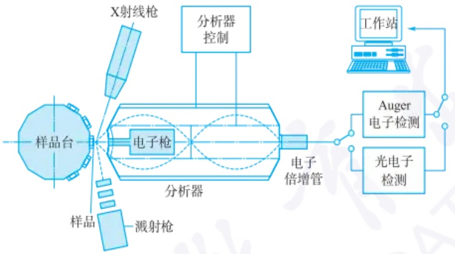

flowchart

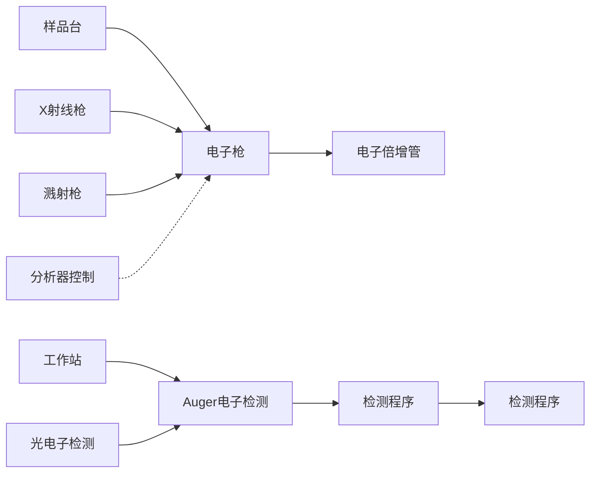

图 10.1.1 电子能谱仪结构示意图

## 1. 激发源

X射线光电子能谱仪采用X射线作为激发源，X射线激发源必须是单色的，且线宽越窄越好。通常采用轻元素 $\mathrm{Mg}$ 或Al作为靶材，其产生的特征X射线为X射线源。为获得良好的单色X射线源，提高信噪比和分辨率，还装有单色器，使辐射线的线宽变窄，去掉因连续X射线所产生的连续背底。一般用球面弯曲的石英晶体制成，能够使来自X射线源的光线产生衍射和“聚焦”，从而去掉伴线和韧致辐射，并降低能量宽度，提高谱仪的分辨率。而Auger电子能谱仪常用电子枪作为激发源，紫外光电子能谱仪则通常使用He、Ne等气体放电产生的共振线为激发源。

## 2. 样品室系统和真空系统

样品室系统由样品预处理（如氢离子清洗等）、进样系统和样品室三个部分组成，其中真空系统为系统提供高度真空的环境。而超高真空系统是保证电子能谱仪正常工作所必需的。为了能达到高真空 $\left(10^{-7}\mathrm{Pa}\right)$ ，常用的真空泵有扩散泵、离子泵和涡轮分子泵等。高真空系统具有以下两个基本功能:①使样品室和分析器保持一定的真空度，以便使样品发射出来的电子的平均自由程相对于谱仪的内部尺寸足够大，减少电子在运动过程中同残留气体分子发生碰撞而损失信号强度。②降低活性残余气体的分压。因在记录谱图所必需的时间内，残留气体会吸附到样品表面上，甚至有可能和样品发生化学反应，从而影响电子从样品表面上发射并产生外来干扰谱线。

---

550

第十章 表界面分析技术

## 3. 电子能量分析器

电子能量分析器是电子能谱仪的核心部件，其功能是将样品表面激发出来的光电子按其能量的大小分别聚焦，获得光电子的能量分布。它必须在高真空条件下工作，即压强要低于 $10^{-3}\mathrm{Pa}$，以便尽量减少电子与分析器中残余气体分子碰撞的概率。由于光电子在磁场或电场的作用下能偏转聚焦，故常见的能量分析器有磁场型和电场型两种。磁场型的分辨能力强，但结构复杂，磁屏蔽要求较高，所以应用不多。目前常用的是电场型能量分布器，它具有体积小、结构紧凑、真空要求低、外磁场屏蔽简单、安装方便等优点。电场型电子能量分布器按照形状又分为半球形和筒镜型两种，其中半球型能量分析器更为常见。

## 4. 检测器

一般用电子倍增器来检测电子数目。检测器通常可以分为两种:单通道电子检测器和多通道电子检测器。单通道电子倍增器是一种采用连续倍增电极表面（管状通道内壁涂一层高阻抗材料的薄膜）的静电器件，内壁具有二次发射性能。电子进入器件后在通道内连续倍增，增益可达 $10^{9}$ 。多通道检测器是由多个微型单通道电子倍增器组合在一起而制成的一种大面积检测器，也称为位敏检测器（PSD)或多阵列检测器。

## 5. 离子枪

离子束溅射系统主要用于对样品表面进行清洁或对样品表面进行定量剥离。常用的离子源有氩离子、氧离子、铯离子、镓离子等。离子束的溅射速率不仅与离子束的能量和束流密度有关，还与溅射材料的性质有关。值得注意的是，在使用离子枪进行表面清污时，应考虑到离子剥蚀的选择性。即在溅射过程中，由于不同元素的溅射产额不同，会导致易被溅射的元素在表面瞬时贫化，而不易被溅射的元素则在表面相对富集，这种现象称为“选择性溅射”。此外，离子轰击还可能诱发氧化还原等化学反应。这两种效应都会导致样品最表层的化学成分发生变化，与真实成分产生差异。因此，需用标准样品来选择溅射参数，以避免样品表面被溅射离子还原或改变表面成分影响测量结果。

## 10.1.2 X 射线光电子能谱分析方法

本节将对 X 射线光电子能谱的原理、谱图分析和应用进行阐述。

## 10.1.2.1 X 射线光电子能谱简介

X 射线光电子能谱是根据单色 X 射线激发内层电子形成的光电子能量分布特征进行材料表面元素成分和化学态分析的一种表征方法。

光电效应的发现开始于19世纪80年代，德国物理学家Hertz观察到电气系统中的金属触点暴露于光照时，表现出增强的火花放电能力。1905年，Einstein根据Planck在1900年提出的能量量子化的概念，指出光子可以将能量直接转移给原子中的电子，使其激发出来，即光电效应，这样就可以正确地解释以上所有的观察。1918年，Planck由于提出能量量子化的概念获得了诺贝尔奖。之后，1921年，Einstein由于对光电效应的贡献获得了诺贝尔奖。1954年，瑞典K.Sieghahn用X射线激发光电子能谱，寻找研究原子轨道的有效办法。光电子能谱中有“化学位移”现象，它是原子所处的不同化学环境所致，可以为原子所处的化学环境提供依据。

X 射线光电子能谱法是一种表面分析方法, 可以提供的信息深度为 3\~5 nm, 用来表征样品表面各元素的含量与化学状态 (H 和 He 除外)。如果利用 Ar 离子

Hertz, Einstein 和 Planck

---

10.1 电子能谱

551

枪作为剥离手段，XPS也可以实现不同深度的分析。X射线激发出来的光电子，根据光电子的能量可以标识出是从哪种元素的哪个轨道激发出来的电子，定性标记的工作可以由计算机来进行。由于各种各样的干扰因素的存在，如核电效应导致的结合能偏移、X射线激发的俄歇电子峰等，因此分析结果时需要注意。

## 10.1.2.2 X 射线光电子能谱法的基本原理

X射线光电子能谱是基于光电效应的原理,即当高能X射线光子与物质表面相互作用时,会导致光子与样品表面的原子或分子轨道上的电子发生能量转移。即单个光子把它的全部能量转给原子某壳层上一个受束缚的电子(内层电子容易吸收X射线量子,价电子容易吸收紫外光量子),其中一部分用于克服轨道结合能,剩余部分能量则作为它的动能,使分子或原子中的电子脱离原子核的束缚而成为自由电子,即光电子。而原子或分子A本身则变成一个激发态离子 $A^{+}$ ,这种现象称为光电离作用,这一过程可以表示如下:

$$
\mathrm{A} + h \nu \longrightarrow \mathrm{A} ^ {+ \cdot} + \mathrm{e} ^ {-} \tag {10-1-1}
$$

当光子与样品相互作用时，从原子中各能级发射出来的光电子数是不同的，而是有一定的概率，称为光电效应的概率，用光电效应截面 $\sigma$ 来表示。它与电子所在壳层的平均半径 $r$ 、入射光子频率 $\nu$ 和受激原子的原子序数 $Z$ 等因素有关。$\sigma$ 越大，说明该能级上的电子越容易被光激发，它的光电子峰的强度就越大。对于不同元素，同一壳层的 $\sigma$ 值随原子序数的增大而增大；而同一原子的 $\sigma$ 值反比于轨道半径的平方。所以，对于轻原子而言，1s比2s电子的激发概率要大约20倍；而对于重原子的内层电子，由于随着原子序数增大而轨道收缩，使得半径的影响并不重要；对于同一主量子数 $n, \sigma$ 值随着角量子数 $l$ 的增大而增大。

在光电离过程中,根据能量守恒,光子的能量  $h\nu$  满足 Einstein 光电效应关系式:

$$
h \nu = E _ {\mathrm{b}} + E _ {\mathrm{k}} + E _ {\mathrm{r}} \tag {10-1-2}
$$

式中， $E_{b}$  是原子能级中电子的电离能或结合能； $E_{k}$  是出射光电子的动能； $E_{r}$  是激发态原子的反冲动能，可以按照下式进行计算:

$$
E _ {\mathrm{r}} = \frac {1}{2} (M - m) v _ {\mathrm{a}} ^ {2} \tag {10-1-3}
$$

式中，m 和 M 分别表示电子和反冲原子的质量， $v_{a}$  表示激发态原子的反冲速度。在 X 射线能量不太大时，原子的反冲能量近似为

$$
E _ {\mathrm{r}} = h \nu \frac {m}{M} \tag {10-1-4}
$$

因为电子质量 m 相对于原子质量 M 一般很小, 所以  $E_{r}$  数值可以忽略。

对于气体样品,可以视为自由原子或分子,电子的结合能是以电子不受原子核吸引的真空能级为参比能级,电子能级和真空能级的能量之差就是电子的结合能 $E_{b}$ 。

而对于一般固体样品而言，选用Fermi能级 $(E_{\mathrm{F}})$ 作为计算结合能的参考点，即固体样品中某个能级电子的结合能是指它跃迁到Fermi能级所需的能量，而不是跃迁到真空能级所需的能量。所谓Fermi能级是相当于热力学零度时固体能带中充满电子的最高能级。对于一般固体而言，Fermi能级介于导带和价带之间。把固体样品中的电子由Fermi能级移到真空能级所需的能量，也可以理解为激发出来的光电子从样品内部输送到样品表面需要克服的功，称为逸出功，也称功函数 $\varphi_{\mathrm{sa}}$ ，对于不同样品而言， $\varphi_{\mathrm{sa}}$ 的大小是不同的。对于固体样品来说，X射线的能

## 思考:

简述光电效应的基本原理。

---

552

第十章 表界面分析技术

## 思考:

XPS 粉末、块体、液体或气体样品分别是如何制样的？

## 思考:

XPS 测试过程中有哪些注意事项？

XPS 的制样和注意事项

量 $h\nu$ 被固体吸收后将分配在:① 内层电子跃迁到Fermi能级所需的能量 $E_{\mathrm{b}}$；② 电子由Fermi能级进入真空能级所需能量，即逸出功 $\varphi_{\mathrm{sa}}$；③ 自由电子所具有的动能 $E_{\mathrm{k}}$。满足以下等式:

$$
h \nu = E _ {\mathrm{b}} + \varphi_ {\mathrm{sa}} + E _ {\mathrm{k}} \tag {10-1-5}
$$

式中， $E_{\mathrm{k}}$ 是光电子逸出固体样品表面时所呈现的动能，并不是能谱仪所检测出来的动能。这是因为固体样品的表面和能谱仪检测器的入口之间有一定距离，且二者之间具有一定电位差 $\Delta \varphi$ ，如果样品是导体材料时，如金属，这一电位差将导致光电子动能 $E_{\mathrm{k}}$ 变为 $E_{\mathrm{k}}^{\prime}$ 。一般来讲，导体固体样品通过样品台与仪器接触良好，且同时接地，根据固体物理的理论，它们两者的Fermi能级将处在同一水平（如图10.1.2所示）。于是，当具有动能 $E_{\mathrm{k}}$ 的电子穿过样品至能谱仪入口之间的空间时，受到能谱仪和样品之间的接触电位差 $\Delta \varphi$ 的影响，使其动能变为 $E_{\mathrm{k}}^{\prime}$，这才是能谱仪实际测量到的动能。值得注意的是，能谱仪材料也具有一定的逸出功，用 $\varphi_{\mathrm{sp}}$ 表示。对一台仪器而言，仪器条件不变时，其逸出功是固定的，一般在4eV左右。根据能量守恒定律，上述关系式也可以写成

$$
h \nu = E _ {\mathrm{b}} + \varphi_ {\mathrm{sp}} + E _ {\mathrm{k}} ^ {\prime} \tag {10-1-6}
$$

即有如下能量关系:

$$
\varphi_ {\mathrm{sa}} + E _ {\mathrm{k}} = \varphi_ {\mathrm{sp}} + E _ {\mathrm{k}} ^ {\prime} \tag {10-1-7}
$$

根据式(10-1-6)可以得出:

$$
E _ {\mathrm{b}} = h \nu - \varphi_ {\mathrm{sp}} - E _ {\mathrm{k}} ^ {\prime} \tag {10-1-8}
$$

式中， $h\nu$ 是实验时选用的X射线的能量，是已知的； $\varphi_{\mathrm{sp}}$ 是能谱仪的功函数，约为$4\mathrm{eV}$ ，只要利用能谱仪检测出光电子的动能 $E_{\mathrm{k}}^{\prime}$ ，就可以计算出样品中某一原子不同壳层电子的结合能。由于不同原子的电子结合能是一定的，因此可以进行定性分析。

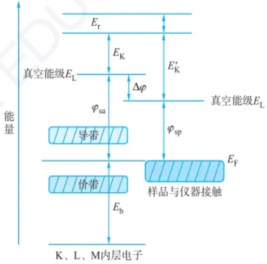

text_image

能量
真空能级EL
ER
EK
Δφ
φsa
E'K
真空能级EL
φsp
导带
EF
价带
样品与仪器接触
Eb
K、L、M内层电子

图 10.1.2 固体样品 X 光电子能谱能量关系示意图

## 思考:

XPS 谱图分析中通常会遇到哪几种常见的伴峰？

## 10.1.2.3 XPS 谱图分析

首先，光电子的能量分布曲线及XPS谱图是采用特定元素某一X光谱线作为入射光，实验测定的待测元素激发出一系列具有不同结合能的电子能谱图。谱线的表示方法通常以被激发电子所在的能级来表示。例如，K层被激发出来的电子称为1s电子，L层的光电子分别标记为 $2\mathrm{s}, 2\mathrm{p}_{1/2}, 2\mathrm{p}_{3/2}$ 等。

---

10.1 电子能谱

553

## 1. 元素的特征峰

每种元素都有一系列结合能不同的特征能谱峰,它们的强弱与量子数有关。① 主量子数 n 小的峰较 n 大的峰强;② n 相同,角量子数 l 大的峰强;③ 对于两个自旋分裂峰,内量子数大的峰强(如图 10.1.3 所示)。

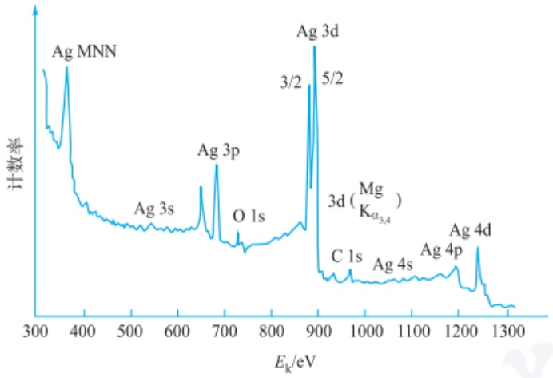

line

| Peak Label | Energy (eV) |
| --- | --- |
| Ag MNN | ~360 |
| Ag 3s | ~520 |
| Ag 3p | ~680 |
| O 1s | ~730 |
| 3/2 | ~870 |
| Ag 3d | ~890 |
| 5/2 | ~900 |
| C 1s | ~960 |
| 3d (Mg Kα3.4) | ~980 |
| Ag 4s | ~1050 |
| Ag 4p | ~1180 |
| Ag 4d | ~1240 |

图 10.1.3 Ag 片的 X 射线光电子能谱

## 2. 元素的伴峰

这些复杂现象的出现同体系的电子结构密切相关,它们在 XPS 谱图上表现为除正常光电子主峰外,还会出现若干伴峰,使得谱图变得复杂。解释谱图并由此判断各种可能的相互作用,获得体系的结构信息,这是当前推动 XPS 发展的重要方向,也是使用 XPS 经常遇到的问题。

## 10.1.2.4 XPS 谱图的应用

## 1. 元素及离子价态定性分析

各种元素都具有一定特征的电子结合能，因此在能谱图中会出现特征谱线，可以根据谱线在能谱图中的位置来鉴定周期表中除了H和He以外的所有元素。在定性分析时，一般利用XPS的宽扫描程序，在一次测定中就可以检出全部或大部分元素。在分析谱图时，首先必须考虑的是消除荷电位移。金属和半导体样品，一般不用校准，因为它们不会产生荷电效应。但对于绝缘样品则必须进行校准。因为当荷电效应较大时，会导致结合能位置有较大的偏移，引起错误判断。使用计算机自动标峰时，同样会出现这种情况。一般来说，只要该元素存在，其所有的强峰都应存在，否则就要考虑是否是其他元素。由于X射线激发源的光子具有较高的能量，可以同时激发出多个原子轨道的光电子，因此在XPS谱图上会出现多组谱峰。大部分元素都可以激发出多组光电子峰。由于相近原子序数的元素激发出的光电子的结合能有较大的差异，所以相邻元素间很少会产生干扰作用。由于光电子激发过程的复杂性，在XPS谱图上不仅出现各原子轨道的光电子特征峰，还有各种伴峰，在定性分析时必须予以注意。

元素的 XPS 谱峰的结合能位移通常分为两种: 物理位移和化学位移。物理位移是指固体的热效应与表面荷电的作用引起的谱峰位移; 化学位移是由于原子所处的化学环境不同而引起的内层电子结合能的变化, 在谱图上表现为谱峰的位移, 这一现象称为化学位移。化学位移的分析、测定, 是 XPS 分析中的一项主要内容, 是判定原子化合态的重要依据。一般来讲, 元素的化合态越高, 核外电子受到原子核的库仑力的影响, 电子结合能就越大, 从而可以进行元素或相应离子的

XPS 谱图常见的几种伴峰

## 思考:

通过 XPS 能获取样品哪些方面的信息？

---

554

第十章 表界面分析技术

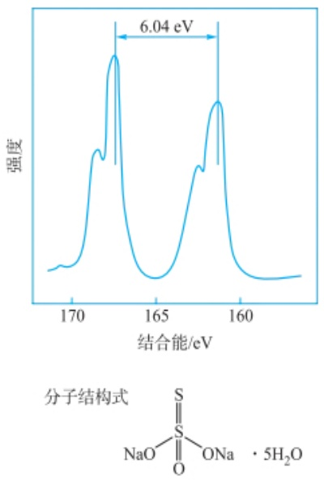

图 10.1.4  $Na_{2}S_{2}O_{3}$  S 2p XPS 谱图及相应分子结构式

## 思考:

Auger 电子是如何产生的？

化合态的定性判断。

## 2. 元素的定量分析

XPS不是一种很好的定量分析方法，它给出的仅仅是半定量的分析结果，即相对含量而不是绝对含量。目前最常用的半经验相对定量方法是元素灵敏度因子法，计算公式如下:

$$
C _ {i} = \frac {I _ {i} / S _ {i}}{\sum I _ {j} / S _ {j}} \tag {10-1-9}
$$

式中， $I_{i}$  为元素 i 在一个特定的光谱峰中每秒的光电子数； $S_{i}$  为元素 i 的灵敏度因子。

在定量分析中值得注意的是，XPS 给出的相对含量与样品表面受污染程度有关。不仅各元素的灵敏度因子不同，XPS 对不同含量光电子的传输效率也是不同的，并随着样品受污染程度而改变。XPS 可以提供 3\~5 nm 厚的表面信息，其组成不能反映体相成分。样品表面的 C、O 污染及吸附物的存在也会大大影响其定量分析的可靠性。

## 3. 化学结构分析

X 射线光电子能谱通过测量原子内壳层电子的结合能的化学位移,来研究离子在化合物中的价态、化合物的化学键、电荷分布等信息,从而研究物质的化学结构。

例如，用X射线光电子能谱测定硫代硫酸钠的结构。图10.1.4是 $\mathrm{Na_2S_2O_3}$ 的$\mathrm{S}2\mathrm{p}_{1 / 2}$ 和 $\mathrm{S}2\mathrm{p}_{3 / 2}$ 的双线，这两重双线代表两种不同的化学环境下的S原子，它们的S2p电子结合能之间有 $6.04\mathrm{eV}$ 的化学位移，从而证实硫代硫酸钠的分子结构（如图10.1.4所示）。

其中氧的电负性高于硫，因此中心硫原子带正电荷，它的结合能高，配位硫原子带负电荷，结合能低，两种硫原子所处的化学环境不同而造成内壳层电子结合能的化学位移，由此可以推测出化合物的结构。

## 10.1.3 Auger 电子能谱法

1925年，法国物理学家Pierre Auger在研究光电效应时，观察到了后来被称为“Auger电子”的现象，并对这一现象提供了准确的解释。他发现当一个原子从内层电子能级失去电子后，外层电子可能会跃迁到较低的空穴所在能级，释放出多余的能量，以非辐射的方式激发出电子，形成了后来被称为Auger电子的现象。这一发现为后来Auger电子能谱法的发展奠定了基础。到了20世纪60年代，随着微电子技术和筒镜能量分析器的引入，分析技术得到了显著提升。微电子技术的发展使得探测器更加灵敏，能够捕捉到更少的电子，从而提高了分析的灵敏度。筒镜能量分析器的应用则使得电子能谱的测量变得更加精确和快速。这些技术的引入使得Auger电子能谱法得以广泛应用于材料表面成分和结构的分析。

Auger 电子能谱法(AES)是采用具有特定能量的电子束(或 X 射线)激发样品表面产生 Auger 效应,通过检测 Auger 电子的能量和强度,获得有关材料表面化学成分和结构的方法。采用电子束激发可以产生较强的 Auger 电子谱信号,因此在 AES 中通常选择电子束作为激发源。另外,不同元素的 Auger 电子峰具有独特的能量特征,因此可以利用这些特征进行样品的定性分析,即确定其表面含有哪些元素。此外,Auger 电流与被激发的原子数量近似呈正比关系,因此可以利用 Auger 电流的测量进行样品某元素相对含量的定量分析。

---

10.1 电子能谱

555

Auger 电子能谱法是一种迅速而又高度敏感的表面分析方法。它可以提供关于材料表面成分的定性和定量信息。这使得 AES 成为研究和控制材料表面性质的有力工具，广泛应用于材料科学、表面化学和工业领域。

## 10.1.3.1 Auger 电子能谱的基本原理

## 1. Auger 电子产生原理

当原子受到特定能量的电子束(或X射线)照射时,内部的壳层电子可以被直接电离,导致原子变为一个具有初态空位的激发态离子,内层电子轨道上出现了空位。激发态离子回到基态的去激发过程可以通过两种竞争性的途径实现:一种途径是外层电子可以跃迁到空穴所在的内层轨道,多余的能量以X射线的形式释放出来,这被称为X射线荧光,可以用于确定样品的元素组成和测量元素的含量。另一种途径是内层的空穴可以被较外层的电子填充,导致该外层电子从一个较高能级跃迁到内层轨道,同时将多余的能量以非辐射方式传递给另一个电子,并使之发射出来,就是Auger电子。Auger电子的能量是与原子的内层电子结构和能级分布有关的,因此它具有元素特征,可以用于元素识别和分析。上述两种途径具体表现如副栏图示所示,即

$$
\mathrm{A} ^ {+ \cdot} \longrightarrow \mathrm{A} ^ {+} + h \nu (\text {发射X射线荧光}) \tag {10-1-10}
$$

$$
\mathrm{A} ^ {+ \cdot} \longrightarrow \mathrm{A} ^ {2 +} + \mathrm{e} ^ {-} (\text {发射 Auger 电子}) \tag {10-1-11}
$$

Auger 电子常用 X 射线能级来表示。例如， $KL_{I}L_{II}$  Auger 电子表示最初逐出 K 能级电子，然后由  $L_{I}$  能级上电子填入 K 能级的空穴，多余能量传给  $L_{II}$  能级上的一个电子并使之发射出来（整个过程如图 10.1.5 所示）。由于 Auger 跃迁过程至少有两个能级和三个电子参与，所以第一周期的氢原子和氦原子不能产生 Auger 电子。俄歇过程根据初态空位所在的主壳层能级的不同，可分为不同的系列，如 K 系列，L 系列，M 系列等；同一系列中又可按参与过程的电子所在主壳层的不同分为不同的群，如 K 系列包含 KLL, KLM, KMM, …俄歇群，每一群又有间隔很近的若干条谱线组成，如 KLL 群包括  $KL_{1}L_{1}, KL_{1}L_{2}, KL_{1}L_{3}, KL_{2}L_{2}, KL_{2}L_{3}, \cdots$  谱线。俄歇谱由多组间隔很近的多个峰组成。

## 思考:

如何区别 X 射线光电子峰与 Auger 电子峰？

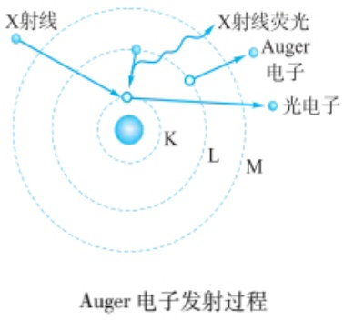

flowchart

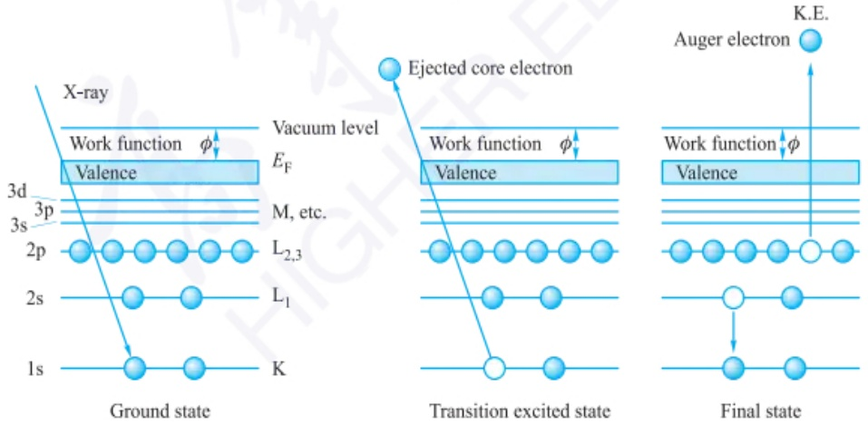

text_image

X-ray
Work function φ
Valence
Vacuum level
EF
3d
3p
M, etc.
2p
L2,3
2s
L1
1s
Ground state
Ejected core electron
Work function φ
Valence
Transition excited state
Auger electron K.E.
Final state
Work function φ
Valence

图 10.1.5 Auger 电子产生原理图

图10.1.6的Auger电子能谱手册中给出了各种原子不同系列的Auger峰位置。每种元素的各种Auger电子的能量是识别该元素的重要依据。Auger电子的动能仅取决于电子所处的能级和仪器的功函数 $\varphi$ ，与激发源的能量无关。因此，在X射线光电子能谱中识别Auger电子峰时，可以通过改变X射线源的能量来观察X射线光电子峰的移动情况，而Auger电子峰的位置则保持不变。利用这一特

---

556

第十章 表界面分析技术

Auger 电子能谱的化学环境影响

性,可以区分 XPS 和 Auger 这两种电子峰。

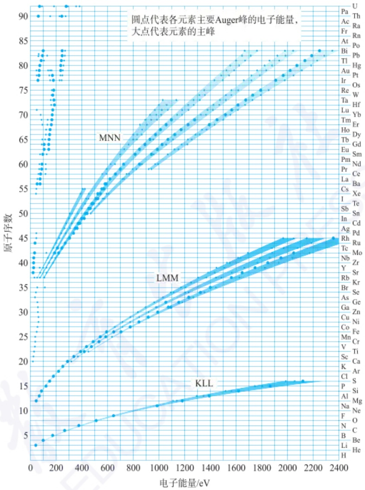

scatter

| 元素 | 电子能量 (eV) | 原子序数 |
| --- | --- | --- |
| MNN | ~100 ~2400 | ~37 ~83 |
| LMM | ~100 ~2400 | ~37 ~45 |
| KLL | ~100 ~2400 | ~3 ~16 |

图 10.1.6 Auger 电子能谱手册

Auger 电子的动能可以根据 X 射线能级来估算。例如， $KL_{1}L_{II}$  Auger 电子的能量是  $E_{k}-E_{L_{1}}-E_{L_{II}}$ 。精确计算时，还应该考虑仪器的功函数及 Auger 跃迁过程中电离态的变化。与单电离原子相比，双重电离原子的  $L_{II}$  电子的电子结合能还需要考虑电子从 Fermi 能级提升到仪器的样品托架电位所需要做的功。因此，固体物质的  $KL_{1}L_{II}$  Auger 电子的能量应为

$$
E _ {\mathrm{kL} _ {\mathrm{i}} \mathrm{L} _ {\mathrm{ii}}} = E _ {\mathrm{k}} (Z) - E _ {\mathrm{L} _ {\mathrm{i}}} (Z) - E _ {\mathrm{L} _ {\mathrm{ii}}} (Z + \Delta) - \varphi \tag {10-1-12}
$$

式中，Z 为原子序数； $\varphi$  为仪器功函数； $\Delta$  为有效核电荷补偿数，一般在  $(1/2 \sim 1/3)$  eV。

Auger 电子能量的通式可写成

$$
E _ {w x y} (Z) = E _ {w} (Z) - E _ {x} (Z) - E _ {y} (Z + \Delta) - \varphi \quad (Z \geqslant 3) \tag {10-1-13}
$$

式中， $E_{w}(Z) - E_{x}(Z)$ 是 $x$ 轨道电子填充 $w$ 轨道空穴时释放出的能量； $E_{y}(Z + \Delta)$ 是 $y$ 轨道电子电离时所需的能量。

由X射线和光电子能量表查得 $Z$ 和 $Z + 1$ 原子的 $y$ 轨道电子单重电离能，便可估算出 $E_{\mathrm{wxy}}(Z)$ 。测出Auger电子能量，对照Auger电子能量表，就可确定样品

---

10.1 电子能谱

557

表面的成分。

Auger 分析的选择遵循: 对于  $Z \leqslant 14$  的元素, 采用 KLL 俄歇电子分析;  $14 < Z < 42$  的元素, 采用 LMM 俄歇电子较合适; Z > 42 时, 以采用 MNN 和 MNO 俄歇电子为佳。Auger 电子峰常叠加在二次电子谱和散射电子谱上, 当把各种信息的电子按其能量分布绘制成电子能谱图  $N(E) - E$  时, 为了提高谱图的 Auger 信号并同时抑制本底信号, 通常将  $\mathrm{d}N(E)/\mathrm{d}E$  峰的最大负振幅处作为 Auger 电子峰的能量 (但要指出的是, 它和真正的 Auger 电子能量有区别), 它出现在第二次能量分布曲线 Auger 电子峰高能侧的拐点, 而不是该峰的顶点。图 10.1.7 是用 1 keV 的入射电子激发银靶得到的 Auger 电子峰。由图可见, 采用微分值后, 可得到明显的 Auger 电子峰。另外, 俄歇电子的激发方式虽然有多种 (如 X 射线、电子束等), 但通常主要采用一次电子激发。这是因为电子便于产生高束流, 容易聚焦和偏转。俄歇电子的能量和入射电子的能量无关, 只依赖于原子的能级结构和俄歇电子发射前它所处的能级位置。

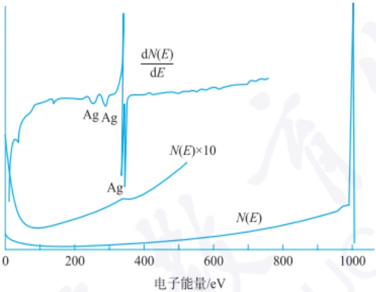

line

| 电子能量 (eV) | dN(E)/dE | \(N(E) \times 10\) |
| --- | --- | --- |
| 0 | ~0.2 | ~0.1 |
| 200 | ~0.4 | ~0.15 |
| 400 | ~0.6 | ~0.3 |
| 600 | ~0.7 | ~0.4 |
| 800 | ~0.8 | ~0.5 |
| 1000 | >1.0 | ~0.6 |

图 10.1.7 用 1 keV 的入射电子激发银靶得到的 Auger 电子峰

## 2. Auger 电子产额

Auger 电子产额或俄歇跃迁概率决定俄歇谱峰强度，直接关系到元素的定量分析。Auger 电子产生与 X 射线荧光发射是两个互相关联和竞争的发射过程。对同一 K 层空穴，退激发过程中荧光 X 射线与俄歇电子的相对发射概率，即荧光产额  $\left(\omega_{\mathrm{K}}\right)$  和俄歇电子产额  $\left(\alpha_{\mathrm{K}}\right)$  满足: $\alpha_{K}=1-\omega_{K}$ 。由于  $\alpha_{K}$  与原子序数有关，所以 X 射线荧光产额和 Auger 电子产额均随原子序数而变化，如图 10.1.8 所示。由图可见，Auger 电子能谱法更适用于轻元素  $(Z<33)$  的分析，产额较高，原子序数在 11 以下的轻元素发射 Auger 电子的概率在 90% 以上；随着原子序数的增加，X 射线荧光产额增加，而 Auger 电子产额下降。

## 3. Auger 电子峰的强度

Auger 电子峰的强度 $(I_{\mathrm{A}})$ 取决于两个关键因素:电离截面 $(Q_{\mathrm{i}})$ 和 Auger 电子发射概率 $(P_{\mathrm{A}})$ 。电离截面表示入射粒子与靶物质相互作用导致电离的概率,而 Auger 电子发射概率则表示在特定电离事件中,产生 Auger 电子的概率。这两个因素共同决定了 Auger 电子峰的强度,从而反映了该电子能谱特征的一部分信息。

$$
I _ {\mathrm{A}} \propto Q _ {\mathrm{i}} \cdot P _ {\mathrm{A}} \tag {10-1-14}
$$

电离截面是描述入射粒子与靶物质相互作用导致电离的概率的物理量。它

## 思考:

通过 Auger 电子能谱分析能获取样品哪些方面的信息？

---

558

第十章 表界面分析技术

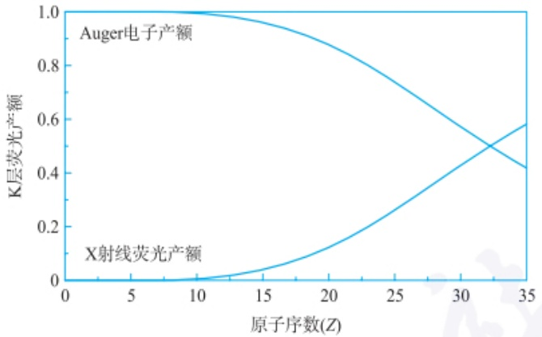

line

| 原子序数(Z) | Auger电子产额 | X射线荧光产额 |
| --- | --- | --- |
| 0 | 1.0 | 0 |
| 5 | 1.0 | ~0.01 |
| 10 | ~0.98 | ~0.03 |
| 15 | ~0.92 | ~0.08 |
| 20 | ~0.82 | ~0.16 |
| 25 | ~0.70 | ~0.28 |
| 30 | ~0.55 | ~0.42 |
| 35 | ~0.42 | ~0.58 |

图 10.1.8 Auger 电子产额与原子序数的关系

与被束缚电子i的能量 $(E_{\mathrm{bi}})$ 及入射电子束能量 $(E_{\mathrm{in}})$ 之间存在关系，即电离截面取决于这两个能量参数。当入射电子束能量 $(E_{\mathrm{in}})$ 接近被束缚电子i的能量 $(E_{\mathrm{bi}})$ 的3倍时，会产生较大的Auger电流。这是因为在这个能量范围内，入射电子的能量足够大，能够有效地促使Auger电子的产生。当入射电子束能量 $(E_{\mathrm{in}})$ 小于被束缚电子i的能量 $(E_{\mathrm{bi}})$ 时，入射电子的能量不足以使被束缚电子i发生电离。因此，在这种情况下，产生的Auger电子数量将为零。如果入射电子束能量 $(E_{\mathrm{in}})$ 过大，会导致入射电子与原子的相互作用时间非常短暂，不足以有效促使Auger电子的发射。这样的情况也会影响Auger电子的产生。为了增加Auger电流的产生，通常会选择较小的入射角度（一般为 $10^{\circ} \sim 30^{\circ}$）。这样做可以增大检测体积，提高被束缚电子i与入射电子的相互作用概率，从而获得较大的Auger电流信号。这对于有效地测量和分析Auger电子是非常有益的。

## 10.1.3.2 Auger 电子能谱法的特点及应用

## 1. Auger 电子能谱法的特点

（1）该方法能够分析除氢和氦以外的所有元素。它能够直接测量样品中单个能级的光电发射电子的能量分布，并直接提供电子能级结构的信息。
（2）将红外光谱的信息称为“分子指纹”，电子能谱提供的信息则称为“原子指纹”。这种方法能够提供有关化学键的信息，可以直接测量价层电子和内层电子轨道能级。此外，相邻元素的相同谱线之间的距离较大，互相之间的干扰较少，因此元素的定性标识性强。
(3) Auger 电子能谱法是一种无损的分析技术。
（4）该方法是一种高度灵敏的超微量表面分析技术，分析所需的样品数量约为  $10^{-8}$  g，绝对灵敏度可达到  $10^{-18}$  g，样品的分析深度为 1\~2 nm。

## 2. Auger 电子能谱法的应用

Auger 电子能谱法基本上适用于各种固体材料,具有高灵敏度,可以探测到表面浓度最小达到 0.1% 的单原子层。与 X 射线光电子能谱相比,它的采样深度更浅。由于其分析速度比 XPS 更快,因此可以用来追踪一些较快变化的过程。Auger 电子能谱法与 XPS 方法在许多方面具有相似之处。例如,可以用于除氢和氦之外的元素的定性、定量和状态分析等。然而,两者也存在一些不同之处。在微区分析中采用 Auger 电子能谱法时,由于电子束束斑非常小,因此具有出色的空间分辨率。这使得可以进行扫描、选点分析、线扫描分析和面分布分析等,以获得微小区域上元素的信息。但 Auger 电子能谱方法的局限性在于其使用电子作为激发源,因此在分析有机材料表面时存在一定的困难。Auger 电子能谱法的

---

10.1 电子能谱

559

主要应用如下:

（1）定性分析 Auger 电子的能量仅取决于原子内部的电子能级分布，而与入射电子的能量无关，这使得 Auger 电子的能量具有独特的特征。Auger 电子能谱主要适用于具有较低原子序数（Z<33）的轻元素，用于进行定性分析。通过将实验测得的 Auger 电子峰的能量与已知元素的各种 Auger 跃迁能量进行比较，可以确定样品中的元素种类。在许多情况下，Auger 电子能谱主要用于分析干净表面和受污染表面的元素组成或化学组成。此外，它还广泛应用于薄膜材料的分析领域。
（2）定量分析 Auger 电流在某种程度上与被激发的原子数量成正比，因此可以利用该特性进行元素的半定量分析。由于 Auger 电流的大小不仅与原子数量有关，还与 Auger 电子的逃逸深度、样品表面的光洁度、元素的化学状态及仪器状态等因素有关。因此，Auger 电子能谱技术通常不能提供分析元素的绝对含量。通常采用相对含量来进行定量分析，即将样品的 Auger 电子信号与标准样品的信号在相同条件下进行比较，这被称为半定量分析。
（3）表面元素的化学状态分析 Auger 电子能谱技术在分析表面元素的化学状态方面具有重要作用。与 XPS 相比，Auger 电子能谱的化学位移较大。通过结合深度分析，可以深入研究表面的化学状态。此外，Auger 电子能谱的线形变化也与元素的化学状态有关。因此，通过进行 Auger 电子能谱的线形分析，也可以有效地研究元素的化学状态。
（4）微区分析 微区分析是 Auger 电子能谱分析的重要应用，包括选点分析、线扫描分析和面扫描分析等技术，在纳米材料研究中具有关键作用。从理论上来看，Auger 电子能谱选点分析的空间分辨率可以达到束斑面积的大小。通过计算机辅助选点，可以同时对多个位置进行表面定性分析、表面成分分析、化学状态分析和深度分析。线扫描分析可以用来了解元素沿特定方向的分布情况，而面扫描分析则可以将某一元素在特定区域的分布以图像的方式呈现出来。此外，结合化学位移分析，还可以获取特定化学价态元素的化学分布信息。

## 10.1.4 紫外光电子能谱法简介

紫外光电子能谱(ultroviolet photoelectron spectroscopy, UPS)是以紫外线为激发光源的光电子能谱。UPS原理本质上与XPS相同，理论基础都是爱因斯坦光电效应定律。唯一的区别是入射光子的能量，UPS激发的光子能量较低。UPS通常使用几十电子伏特的电离辐射来诱导光电效应，而XPS则使用高于1 keV的光子。

现代UPS的开发可追溯到1960年左右，圣彼得堡的Vilesov和伦敦帝国理工学院的Turner开发了电子分析器，选择性地扫描光电子的动能，可以完整地测量电子结构并达到由激发能量决定的阈值。在接下来的几年里电子分析器的概念得到了进一步的发展。为了获得较高的电子计数率和样品表面的清洁度，人们开发了涡轮分子泵以保证样品处于超高真空环境。此外还发展了差分泵浦He等离子体源，该激发光源在 $E(\mathrm{HeI}\alpha) = 21.22\mathrm{eV}$ 处提供了高强度的发射，并且具有较小的自然线宽，可以进行高分辨率的测量。如今，He等离子体光源是UPS中使用最广泛的激发光源，而H-Lyman, Ar、Ne、Kr或Xe等离子体源，VUV激光器（通常在 $10\mathrm{eV}$ 左右）和具有可变光子能量的同步辐射光源也可作为激发光源使用。

随着时间的推移,UPS 提供了原子、分子和固体的电子结构信息,已经成为表面科学、固体物理学和化学领域较重要的技术之一。UPS 装置越来越普遍应用于

---

560

第十章 表界面分析技术

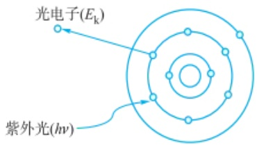

text_image

光电子(Eₖ)
紫外光(hν)

UPS 的过程示意图

## 思考:

UPS 与 XPS 在原理上有哪些异同点？

## 思考:

简述紫外光电子能谱的分析过程。

世界各地的实验室和同步辐射光源中，与UPS相关的测量技术已经在发展并不断改进，扩大了UPS的应用范围。例如，通过角分辨光电子能谱、双光子光电子能谱或飞秒分辨UPS研究能带结构，通过光电子能谱研究表面的电子结构，在自旋分辨光电子能谱中探测发射电子的自旋，或在近环境压力装置中跟踪气体暴露期间的表面相互作用等。

## 10.1.4.1 UPS 原理

UPS 的原理同样基于光电效应。当能量为  $h\nu$  的入射光子从分子中激发出一个电子以后，留下一个离子，这个离子可以振动、转动或以其他激发态存在。如果激发出的光电子的动能为  $E_{k}$ ，则

$$
E _ {\mathrm{k}} = h \nu - E _ {\mathrm{l}} - E _ {\mathrm{v}} - E _ {\mathrm{r}} \tag {10-1-15}
$$

式中， $E_{1}$  为电子的电离能， $E_{v}$  和  $E_{r}$  分别为分子的振动能和转动能。通常  $E_{v}$ （约 0.1 eV）和  $E_{r}$ （约 0.001 eV）都比  $E_{1}$  小得多，因此

$$
E _ {\mathrm{k}} = h \nu - E _ {1} \tag {10-1-16}
$$

相比于 X 射线,紫外光能量较低,线宽较窄(通常约 0.01 eV),因此只能激发价电子,且限制了其采样深度,不能深入原子的内层区域,但紫外光通常表现出更好的单色性,能分辨出分子的振动精细结构。目前已出现高分辨紫外光电子能谱仪。而由于 X 射线光电子是由原子内层电子激发出来的,其结合能比离子的振动能和转动能要大得多,而且射线的自然宽度也比紫外光大得多,因此 XPS 在分辨率上不如 UPS。

## 10.1.4.2 UPS 谱图分析

紫外光电子能谱图的形状取决于入射光子的能量和电离后离子的状态，以及具体的实验条件。图10.1.9是紫外光电子能谱仪观察到的示意图，与第一电离能 $I_{1}$ 相关的称为“第一谱带”，在谱图上它出现于高动能端；与第二电离能 $I_{2}$ 相关的称为“第二谱带”。第一谱带又包括几个峰（绝热电离能 $I_{n}:0\leftarrow0$ 跃迁，垂直电离能 $I_{v}$ ），分别对应于振动基态的分子到不同振动能级离子的跃迁。离子的振动频率记为 $\omega$ ，分子对应的振动频率记为 $\omega_{0}$ ，若成键电子被发射出来则 $\omega<\omega_{0}$ ；若发射的是反键电子，则 $\omega>\omega_{0}$ 。

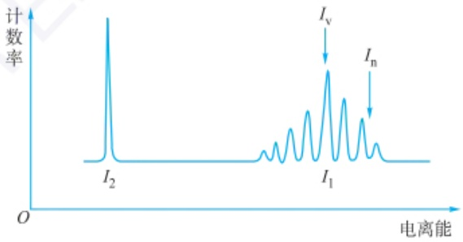

spectrogram

| Feature | Description |
| --- | --- |
| Peak 1 | I2 |
| Peak 2 | I1 |
| Peak 3 | IV |
| Peak 4 | In |

图 10.1.9 紫外光电子能谱示意图

紫外光电子能谱主要涉及分子的价层电子能级，成键轨道上的电子往往属于整个分子，它们的谱峰很宽，在实验上测量化学位移很困难。但对于非键或弱键轨道中电离出来的电子，它们的谱峰很窄，其位置常常与元素的化学环境有关，这是由于分子轨道在该元素周围被局部定域。

在 UPS 谱图的分析中,人们可以根据谱图中谱带的数目,推测特定原子、双键和原子团的存在,这点与红外光谱的解释类似。具体的分析步骤如下:

（1）根据谱带的位置和形状识别谱中的峰 UPS 谱图中大致有图 10.1.10 中显示的六种典型的谱带形状。如光电子来自非键或弱键轨道，分子离子的核间距

---

10.1 电子能谱

561

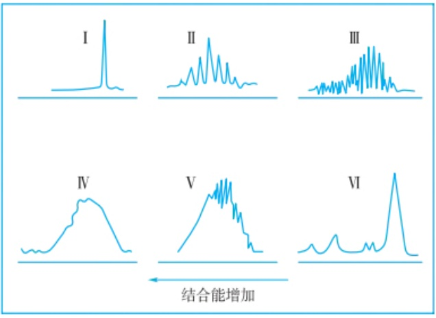

text_image

I
II
III
IV
V
VI
结合能增加

图 10.1.10 紫外光电子能谱示意图

离与中性分子的几乎相同，绝热电离能和垂直电离能一致，这使谱图上出现一个尖锐的对称的峰，在峰的低动能端还会存在一个或两个小峰，如图10.1.10中I所示；若光电子从成键或反键轨道发射出来，绝热电离能和垂直电离能不一致，垂直电离能具有最大的跃迁概率，因此谱带中相应的峰最强，其他的峰较弱，如图10.1.10中Ⅱ或Ⅲ所示；从非常强的成键或反键轨道发生的电离作用往往呈现缺乏精细结构的宽谱带，缺乏精细结构的原因是振动峰的能量间距过小，如图10.1.10中Ⅳ所示；有时振动精细结构叠加在离子解离造成的连续谱上，如图10.1.10中V所示；若分子被电离以后生成的离子的振动类型不止一种，谱带呈现一种复杂的组合带，如图10.1.10中VI所示。

（2）推测电子接受或授予原子或原子团的影响 轨道电离能与轨道环境有关，必须考虑电子接受或授予原子或原子团的影响。非键轨道通常高度定域在分子中的特定原子上，其能量很大程度上取决于该原子的电负性。根据元素电负性的不同，监视特定谱带的电离能随各种取代基的变化，有可能推测谱带的性质和起源。如果分子中有一个原子被电负性较高的原子取代，则将引起与该原子及其邻近原子有关分子轨道的电离能增加。如果原子被另一电负性较低的原子取代，则情况相反。

（3）找出轨道的相互作用 根据谱带峰的劈裂情况可以分析分子轨道的相互作用。分子内孤对电子轨道的电离作用在UPS上会呈现尖锐的谱带，孤对电子之间的相互作用可以在紫外光电子谱中观察到。如果两个孤对电子轨道足够近，并具有相同的对称性和差不多的能量，则它们可以相互作用，形成两个新的分子轨道。在这两个新的分子轨道中，有一个的能量比原来两个孤对电子轨道中能量低的轨道还要低，另一个比两个孤对电子轨道能量高的轨道还要高，这两个新的分子轨道的电离作用也将在UPS上得到反映。

根据(1)\~(3)并考虑强度和峰的重叠等因素,对谱图做出解释。

## 10.1.4.3 UPS的应用

由于光源能量较低，因此UPS一般用来分析价电子和分子轨道，或态密度(DOS)结构。虽然UPS采样深度较浅(由于发射的光电子的动能较低)，但它具有提供分子轨道信息的强大潜力，并且可以获取关于成键或反键特性的信息，如成键在分子中的位置及它对于分子几何结构的影响。在气相中，纯能量跃迁的振动线可能会产生多个发射态，因此UPS在研究气相中的分子方面有较多的应用。但UPS

---

562

第十章 表界面分析技术

也越来越多地用于研究固体表面，可作为一种简便的指纹技术或通过对发射态的分析获取表面信息。UPS还被用于分析聚合物、自组装单分子层(SAM)、催化剂和半导体/电子材料。

## 习题

## - 章节练习题 -

1. 简述电子能谱分析的特点。
2. 简述电子能谱仪的主要组成部件及各部件所起到的作用。
3. 简述 X 射线光电子能谱、Auger 电子能谱和紫外光电子能谱在原理上的异同点。
4. 简述 X 射线光电子能谱、Auger 电子能谱和紫外光电子能谱的分析过程。
5. 简述 X 射线光电子能谱、Auger 电子能谱和紫外光电子能谱在表界面分析方面的应用范围, 即通过这三种分析技术能获取哪些方面的信息?

## - 挑战性问题 -

6. 在电催化领域,原位 X 射线光电子能谱为研究电催化过程中催化剂表面物质组分的演变情况提供了强大的分析手段,为了解电催化过程的反应机理和电催化剂的优化设计提供了有力的数据支撑。请查阅和参考相关文献,设计实验:如何利用原位 X 射线光电子能谱测试研究过渡金属基催化剂表面成分在电催化甲苯氧化中的演变过程。

## - 专题或报告 -

7. 电子能谱在能源电化学领域的应用越来越广泛，在二次电池电极材料的分析方面，相关研究工作主要关注于电极/电解界面的变化情况，克服影响电池稳定性的因素，从而为设计稳定性更优的电池电极材料打下基础。请查阅相关科学文献，了解关于XPS、AES、UPS等电子能谱分别在电池电极/电解界面分析中的应用情况，并将结果写成报告。

## 10.2 离子散射谱

## 10.2.1 离子散射谱的定义、作用和特点

卫星低能离子能谱仪

离子散射谱法(ion scattering spectroscopy, ISS)是一种表面检测技术, 利用指定方向上离子束在固体靶上的弹性散射, 测量散射离子能量损失的能谱, 也称为离子能谱。为避免修改靶表面, 通常使用能量很小的初级离子(200\~2000 eV), 一般为稀有气体离子( $He^{+}$ 、 $Ne^{+}$ 、 $Ar^{+}$ )或者碱金属离子( $Li^{+}$ 、 $Na^{+}$ 、 $K^{+}$ ), 因此也被称为低能离子散射(low energy ion scattering, LEIS)。

1967 年, Smith 首次将低能离子散射用于表面分析。Smith 研究了吸附在银上的 CO, 由碳峰和氧峰的相对高度分析出 CO 的吸附结构。随后, Smith 通过峰的相对高度识别出硫化镉单晶体的不同晶面。这说明, 低能离子散射不但可以用来分析化学组分, 也可以用来研究表面结构。此后, 研究人员不断完善离子散射谱仪, 包括引入筒镜分析仪, 大大提高了灵敏度; 增加气体引入装置, 分析气体环境中的样品位置; 实现同轴碰撞, 进一步分析次表面原子层, 以及仪器联用技术。ISS 方法的特点

---

10.2 离子散射谱

563

是:① 基于对固体的最上面的一个或两个原子层的特异性极端灵敏，同轴碰撞下允许检测痕量元素；② 所需的采集时间短而使样品表面损坏小；③ 允许定量表面元素组成；④ 具有非导电材料的电荷补偿能力。

## 10.2.2 离子散射谱的发展趋势

1996年，Houssiau等利用离子散射研究了 $\mathrm{Cu}_{3}\mathrm{Au}(100)$ 表面的相变过程；2004年，Draxler等通过飞行时间低能离子散射监控了纳米层的厚度和生长模式；2009年，Ter Veen等从表面散射的离子的能量来确定表面原子的质量，证明不同催化剂发生催化过程的位置；2023年，Avval等基于高灵敏度低能离子散射对熔融石英表面硅醇密度进行标记计数。综上，在固体表面上进行化学反应时，表面元素的组成和结构决定了反应的趋势，深入了解局部表面元素组成和结构十分重要。由于在ISS中使用低能离子（keV量级），影锥（在表面原子后面形成的锥形阴影，入射离子不能进入）的半径与原子半径一样大，因此可以对最外表面层进行高灵敏度的测量，广泛应用于催化、合金表面的分凝和吸附、绝缘表面的分析等领域。

## 10.2.3 离子散射谱的物理学基础

## 10.2.3.1 ISS 物理模型

低能离子(如 0.2\~2 keV)与固体表面的碰撞,可简化成两个孤立的自由粒子间的弹性碰撞模型来处理,根据散射角可计算出碰撞后的粒子能量,如图 10.2.1 所示。

按照 de Broglie 方程, 物质波的波长  $\lambda = h/P, P$  为动量, h 为普朗克常量。设入射离子相对原子质量为 A, 能量为  $E_{0}(\mathrm{eV})$ , 则  $\lambda = 0.295(AE_{0})^{-1/2}(\mathring{\mathrm{A}})$ , 而晶格常数通常为  $\mathring{\mathrm{A}}(1\mathring{\mathrm{A}} = 0.1\mathrm{nm})$  量级, 入射离子完全可看成粒子。

比较入射离子的速度 $v_{p}$ 和靶原子内的电子轨道运动速度 $v_{e}$，如 $v_{p} \geqslant v_{e}$，可看作非弹性散射为主；如 $v_{p} \ll v_{e}$ 时则看作弹性散射为主。由于原子外壳层电子的能量约为0.5 eV，电子质量为 $m_{e}$，则 $\frac{1}{3} m_{e} v_{e}^{2} = 0.5 \, eV$ 。如入射离子质量为 $m_{1}$，当 $v_{p} = v_{e}$ 时的临界能量为

$$
E _ {0} = \frac {1}{2} m _ {1} v _ {\mathrm{p}} ^ {2} = \frac {1}{2} \frac {m _ {1}}{m _ {0}} (\mathrm{eV})
$$

即  $E_{0}=\frac{1}{2}\times1840\ A\approx A\ (KeV)$  (10-2-1)

即入射离子能量小于 AKeV 时, 以弹性碰撞为主。

同时，入射离子能量应远大于原子在靶上晶格中的结合能，如此才能认为靶上的原子也是“孤立”的、“自由”的。如果靶上原子间的结合能较强，相当于其“有效质量”增加。因此，原子间结合能常又确定了入射离子能量的下限。

在室温下，已知固体原子晶格振动的能量在 $10^{-2}$ eV量级，因而有理由认为靶上的原子在受到碰撞前是“冷”的，即“静止”的。

总之，在上述条件下，可认为入射离子携带一定的能量，相当于一个刚性球同靶上的原子（也相当于一个刚性球）进行弹性碰撞。

以此为基础,根据经典力学中能量守恒和动量守恒定理,即可处理这类二元弹性碰撞问题。

低能离子散射能谱仪

## 离子与固体表面相互作用

离子与固体表面相互作用主要表现为两大类。一类为弹性散射包括低能离子散射、离子溅射等，可以用两个孤立的自由粒子间的弹性碰撞模型来描述，碰撞后，靶原子和入射离子的结构都不发生变化；另一类为非弹性散射，需要考虑到其他粒子的辐射，如X射线、电子、次级电子等。通常，两个过程同时发生。下图展示了相关的物理过程。

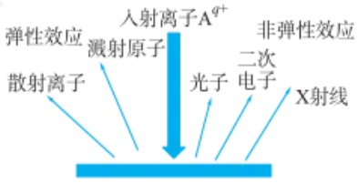

flowchart

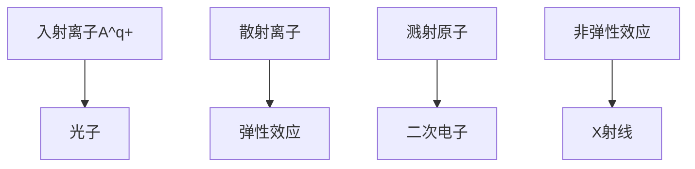

离子-表面相互作用示意图

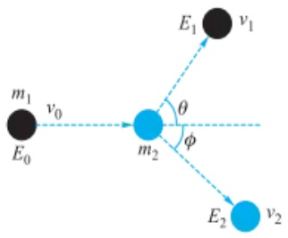

flowchart

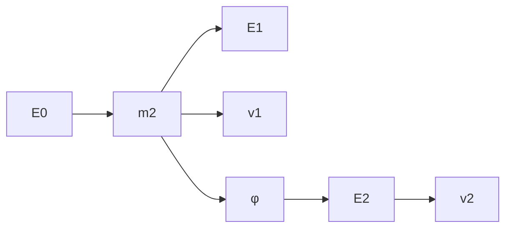

$m_{1}$ —入射离子的质量； $E_{0}$ —碰撞前
 $m_{1}$  的动能； $E_{1}$ —碰撞后  $m_{1}$  的动能；
 $m_{2}$  —靶上原子的质量； $E_{2}$  —碰撞后
 $m_{2}$  的动能，碰撞前  $m_{2}$  的动能为零；
 $\theta—m_{1}$  的散射角； $\phi—m_{2}$  的散射角；
 $\alpha—m_{2}/m_{1}$  即质量比

图 10.2.1 弹性碰撞物理模型

---

564

第十章 表界面分析技术

## 计算机模拟

采用碰撞运动学进行离子散射分析可以得到许多有用的结果。如果多重碰撞效应很重要，而且若要进行详细的结构分析，则需要更缜密的数据分析。为了理解相关的碰撞过程和数据解释，使用合适的模型并根据实验参数计算散射离子的强度分布是非常必要的。由于系统的复杂性和数学的限制，通常不能做解析解，因此需要数值模拟。为此，已开发出各种模拟程序。根据复杂程度，这些程序可以在计算时间需求较短的计算机上运行，或者可能需要更强大的计算机设施。一般的做法是提出被研究目标的成分和结构模型，然后改变相关的参数，直到获得满意的、与实验数据一致的结果。作为一致性评估的标准，有时使用可靠性因子（R因子）。对数据的无模型评价需要更精细的数学方法，如贝叶斯统计，因此通常不适用。

## 10.2.3.2 散射过程与原理

如图 10.2.2 所示, 利用弹性散射原理, 可处理离子散射问题。

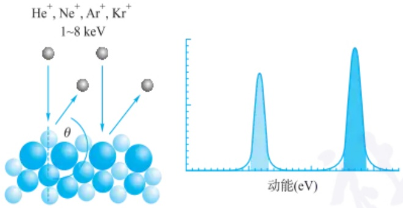

text_image

He+, Ne+, Ar+, Kr+
1~8 keV
θ
动能(eV)

图 10.2.2 离子散射过程与谱峰

可以导出, 当  $\alpha<1,\theta\leqslant\sin^{-1}\alpha$  时, 有

$$
\frac {E _ {1}}{E _ {0}} = (1 + \alpha) ^ {- 2} [ \cos \theta \pm (\alpha^ {2} - \sin^ {2} \theta) ^ {\frac {1}{2}} ] ^ {2} \tag {10-2-2}
$$

当 $\alpha\geqslant1$ 时,有

$$
\frac {E _ {1}}{E _ {0}} = (1 + \alpha) ^ {- 2} [ \cos \theta + (\alpha^ {2} - \sin^ {2} \theta) ^ {\frac {1}{2}} ] ^ {2}
$$

$$
\frac {E _ {1}}{E _ {0}} = 4 \alpha (1 + \alpha) ^ {- 2} \cos^ {2} \phi \tag {10-2-3}
$$

在 ISS 中, 通常  $m_{2} > m_{1}$ , 即  $\alpha \geqslant 1$ , 因此最常用的散射离子能量表示式为

$$
E = E _ {0} \left[ m / (m + M) \right] ^ {2} \left[ \cos \theta + (M ^ {2} / m ^ {2} - \sin^ {2} \theta) ^ {1 / 2} \right] ^ {2} \tag {10-2-4}
$$

应顺便指出，Rutherford 背散射谱学（Rutherford backscattering spectrometry, RBS）利用高能  $He^{+}$ 作原子核弹性背散射，也使用这一表示式。当散射角  $\theta=90^{\circ}$  时，上式简化为

$$
\frac {E _ {1}}{E _ {0}} = \frac {m _ {2} - m _ {1}}{m _ {2} + m _ {1}} \tag {10-2-5}
$$

或 $m_{2} = m_{1}\frac{1 + E_{1} / E_{0}}{1 - E_{1} / E_{0}}$ (10-2-6)

以上讨论表明,只要在已知散射角方向测得散射离子的能量分布,从峰值的位置 $E_{1}/E_{0}$ 即可求出相应的 $m_{2}$ ,即能量刻度可以变成靶表面原子的质量刻度。质量越大相应的能量也越高,而相应的峰高则与这种成分的含量有关。

## 10.2.3.3 相互作用势

在离子散射问题中,相互作用势  $V(r)$  不仅用于计算单次散射的截面,而且用于确定多个碰撞事件中的轨迹和最终能量。

两个原子之间或原子和离子之间的相互作用力来自原子核和电子之间的相互作用力。当距离较近时，表现为斥力，而当距离较远时，表现为吸引力。对于离子散射中使用的能量(>100 eV)，微粒距离很近，以至于可以忽略吸引力部分，完全用排斥势来描述相互作用。在碰撞期间，电子云重叠到一定程度，使得能由相对动能确定。当电子云的完全互穿，即呈现出库仑势:

$$
V (r) = \frac {1}{4 \pi \varepsilon_ {0}} \frac {Z _ {1} Z _ {2} e ^ {2}}{r} \tag {10-2-7}
$$

式中， $Z_{1}$  和  $Z_{2}$  分别是入射离子和靶原子的核电荷数，e 是元电荷。

对于 LEIS 中的能量,仅有部分是互穿的,内部电子持续屏蔽核,因此相互作

---

10.2 离子散射谱

565

用势应由具有屏蔽函数的库仑势来描述,以考虑电子-核和电子-电子相互作用。这些相互作用的效果是减少库仑排斥,使得势的一般形式变为

$$
V (r) = \frac {Z _ {1} Z _ {2} e ^ {2}}{r} \phi \left(\frac {r}{a}\right) \tag {10-2-8}
$$

式中，a 是屏蔽函数中的屏蔽参数，可以根据 Firsov 公式给出:

$$
a _ {\mathrm{F}} = \frac {0 . 8 8 5 4 a _ {0}}{\left(Z _ {1} ^ {1 / 2} + Z _ {2} ^ {1 / 2}\right) ^ {2 / 3}} \tag {10-2-9}
$$

式中， $a_0$ 是玻尔半径，为 $0.529\AA (1\AA = 0.1\mathrm{nm})$ ，数值因子是 $(9\pi^2 /128)^{1 / 3}$ 。类似的表达Lindhard也给出过:

$$
a _ {\mathrm{L}} = 0. 4 6 8 (Z _ {1} ^ {2 / 3} + Z _ {2} ^ {2 / 3}) ^ {- 1 / 2} \tag {10-2-10}
$$

莫里安势(Moliere potential)是目前离子-表面散射中应用最广泛的形式,因为它适用于大部分相关的相互作用范围。图10.2.3是相互作用势为关于He-Ni散射中原子距离的函数。

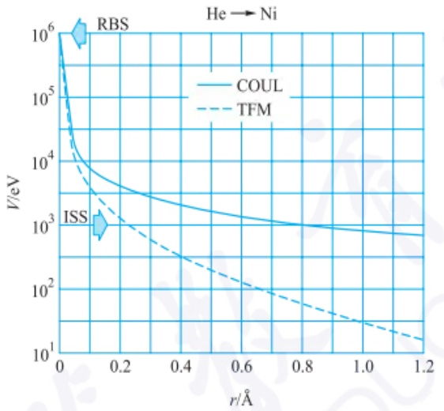

line

| r/Å | COUL (V/eV) | TFM (V/eV) |
| --- | --- | --- |
| 0 | 10^6 | 10^6 |
| 0.2 | ~4000 | ~1500 |
| 0.4 | ~2500 | ~300 |
| 0.6 | ~1800 | ~120 |
| 0.8 | ~1300 | ~60 |
| 1.0 | ~1000 | ~30 |
| 1.2 | ~800 | ~15 |

图 10.2.3 相互作用势为关于 He-Ni 散射中原子距离的函数（注:实线为库仑势，虚线为 Moliere 近似下的屏蔽势）

## 10.2.3.4 散射离子产率与散射过程中的电荷转移

## 1. 散射离子产率

在特定实验情况下离子散射的灵敏度与测量的离子产率有关,因为它表示对于特定浓度的目标物质预期的产率。

量化光谱中的峰的散射离子产率或强度必须考虑几个因素,其中显然包括横截面,但在使用惰性气体离子的典型的低能离子散射装置中,还必须考虑电荷交换现象。用于散射具有表面浓度 $N_{i}$ 的特定物质的离子产率 $I_{i}$ 可以表示为(仅在物体 $N_{i}$ 不被其他物品遮蔽的情况下有效):

$$
I _ {i} = I _ {0} N _ {i} A \frac {\mathrm{d} \sigma_ {i}}{\mathrm{d} \Omega} \Delta \Omega T P _ {i} \tag {10-2-11}
$$

式中， $I_{0}$ 是面积 A 上的初级离子电流 ( $A \cdot cm^{-2}$ ); A 是轰击面积与分析仪采样面积之间的重叠 ( $cm^{2}$ );  $\frac{d\sigma_{i}}{d\Omega}$ 是散射到单位实体角的微分截面 ( $cm^{2} \cdot sr^{-1}$ );  $\Delta\Omega$ 是分析器的接收角 (sr); T 是能量分析仪和探测器的总透射系数;  $P_{i}$ 是粒子在电离状态下逃逸的概率, 有时称为  $(1-P_{N})$ , 其中  $P_{N}$ 是中和概率。

## ISS原理简图

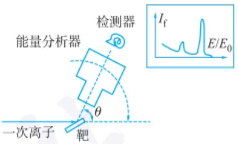

text_image

检测器
能量分析器
θ
一次离子
靶
If
E/E0

ISS 原理示意图

是否 ISS 也存在一定局限性呢?请查阅相关资料,了解 ISS 的局限性。

要计算莫里安屏蔽势下的散射截面，首先要考虑相互作用力对其运动轨迹的作用，可以观察其公式的具体形式，莫里安势其实是在电磁相互作用上加上屏蔽项。计算物体在势场中的运动时，可以采用哈密顿运动方程的方法，由广义坐标、广义动量构成一个微分方程组，求解这个微分方程组，就可以得到位置和动量相关信息。求解微分方程组时，可以采用变步长龙格-库塔方法，可以提高运算效率，保证运算精度。

---

566

第十章 表界面分析技术

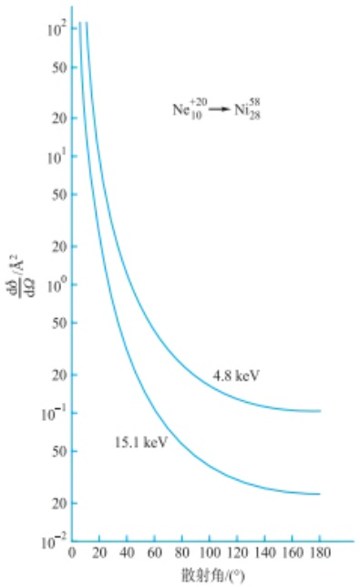

line

| 散射角 \(({}^{\circ})\) | d\(\sigma/d\Omega\) (4.8 keV) | \(d\sigma/d\Omega\) (15.1 keV) |
| --- | --- | --- |
| 0 | ~100 | ~100 |
| 20 | ~10 | ~30 |
| 40 | ~1 | ~10 |
| 60 | ~0.5 | ~3 |
| 80 | ~0.3 | ~1 |
| 100 | ~0.2 | ~0.5 |
| 120 | ~0.15 | ~0.3 |
| 140 | ~0.12 | ~0.25 |
| 160 | ~0.11 | ~0.22 |
| 180 | ~0.11 | ~0.21 |

图 10.2.4 4.8 keV 和 15.1 keV  $Ne^{+}$ 或 Ni 散射的微分截面作为(实验室)散射角的函数

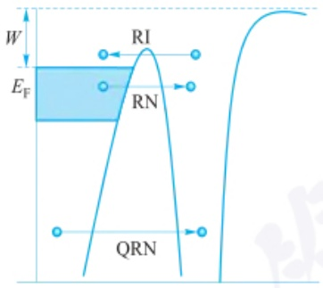

text_image

W
E_F
RI
RN
QRN

共振跃迁过程的示意图

共振跃迁和 Auger 跃迁的区别是什么？请查找相关资料了解共振跃迁和俄歇跃迁的定义及产生条件。

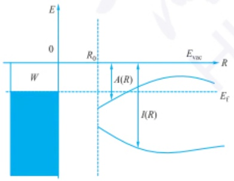

text_image

E
0
R₀
E_vdc
R
A(R)
I(R)
W
E_f

图 10.2.5 入射离子的电离能级与亲和能级随着与金属表面距离的变化关系

对于给定的实验系统,除了  $d\sigma/d\Omega$  和  $P_{i}$  之外,等式中的所有参数都可以精确地指定,并且如果不是这些,则离子产率可以直接与表面浓度相关,因此允许定量地确定表面组成。

第二个未知数，离子逃逸概率 $P_{i}$ 或更确切地说是中和概率 $P_{N}$，代表许多不同电荷交换过程的整体效应，这些过程可能发生在离子与表面的相互作用期间，并且最终导致以中性状态射弹离开表面。$P_{N}$ 可高达 $99.9\%$，但理论上不易定量。散射和中和可以很好地近似地被认为是独立的，因此可以分开处理。在文献中已经导出并报道了横截面的合适的近似表达式，例如，菲尔索夫势（Firsov potential）和玻恩-迈尔势（Born-Mayer potential），并由 Robinson 对各种势进行了列表说明。使用该工作的数据，Eckstein 等人绘制的横截面为 $4.8 \mathrm{keV}$ 和 $15.1 \mathrm{keV} \mathrm{Ne}^{+}$散射镍，作为散射角的函数。这些曲线如图 10.2.4 所示，用于说明横截面的一般特性。

## 2. 散射过程中的电荷转移

当离子接近金属表面时,其附近的电子将因其导带效应而受到干扰,这一现象可被称为“镜像电荷”。由于有镜像电荷,入射离子的能级可能会改变。

当入射离子与金属表面的距离大于一定值时，离子的能级变化量 $\Delta E$ 可以近似用 $(2Z - 1) / 4R$ 来表示。对于正离子 $(Z\geqslant 2)$ 和中性原子 $(Z = 1)$ 来说，其能级变化量是增加的。然而，对于负离子 $(Z\approx 0)$ 而言能级的变化值是负的，所以亲和能级是减小的。图10.2.5表示了电离能级和亲和能级的变化，其中 $E_{\mathrm{f}}$ 和 $W$ 分别表示金属的Fermi能级和功函， $R_0$ 是像平面的位置。从图中可以看出，在一定距离时，Fermi能级与电离能级相重叠，共振跃迁发生。对于负离子而言，亲和能级高于Fermi能级时会发生共振电离；相反，电子会从金属跃迁到入射离子上。

在研究电荷转移过程中,共振跃迁是很重要的一种电荷转移机制。共振跃迁一般分为两过程:①共振中性化(RN),即入射离子从靶上获得电子,变成中性原子;②共振电离(RI),即入射离子失去电子到靶上而被电离。此外还有一种情况,靶电子通过隧穿效应穿过势垒落到入射离子上,称为准共振中性化(QRN)。

当一个离子距离靶表面很远时，它的能级是离散的，但当它靠近靶表面时，由于离子与靶表面的电子态相互作用，离子能级将会展宽。并且在像势的作用下，离子亲和能级将会下移（电离能级将会上移）。如果入射离子进一步靠近靶表面，亲和能级可能会低于金属表面的Fermi能级，因此金属表面价带能级上的电子会跃迁到入射离子亲和能级上，形成负离子。在负离子离开金属表面时，负离子的亲和能级又高于Fermi能级，这时负离子通过共振电离又变成中性原子。

Auger 跃迁是另一种电荷交换机制, 它涉及双电子过程。主要有两种过程: ① 俄歇中性化(AN), 即靶表面导带上的一个电子跃迁到入射离子较低的能级上, 跃迁过程中释放的能量不是以 X 射线的形式发射出来, 而是将导带上另一个电子激发出来或使其成为激子(plasmon); ② 俄歇退激(AD), 即导带的一个电子被俘获到入射离子的亚稳态, 随后亚稳态电子退激到基态的过程中发射出另一个电子。Auger 跃迁的发生需要一定的条件, 入射离子的能量与 Fermi 能级之差大于表面功函的两倍。Auger 电子跃迁过程如图 10.2.6 所示。

---

10.2 离子散射谱

567

## 10.2.4 离子能谱仪基本构造

低能离子散射(LEIS)允许以仅最高原子层的灵敏度分析材料表面。在LEIS实验中，能量为几千电子伏的稀有气体离子从样品表面散射。离子在散射过程中的能量损失取决于散射伙伴的质量，因此通过记录反向散射离子的能量损失谱可以获得样品表面的定量元素组成。由于散射在更深原子层中的离子被有效地中和，并通过核和电子停止损失额外的能量，来自第一原子层的散射可以与亚表面散射区分开来。这种表面灵敏度水平是LEIS独有的，并为各种样品系统提供了有价值的信息。

## 10.2.4.1 离子源

最常见的离子源为使用惰性气体特别是氦、氩、氖气体的离子枪。通过高能电子束对气体轰击产生离子，离子经加速电极加速，并被聚焦到样品表面，不同的仪器根据不同的实验要求，加速电压可从数百伏到数百万伏。经过加速的离子，能量和质量均非单一，因此需要对其进行选择。常用的手段是使用磁或电偏转装置，可以获得单一能量单一质量的离子源，这些离子被汇聚到反应室内的样品上，用于样品的激发。离子枪可以将离子束的束斑直径控制在 $100\mu \mathrm{m}\sim 1\mathrm{mm}$ ，并可以控制电子束密度。

除了惰性气体外，还可以使用碱金属离子进行激发，相应的技术称为碱金属离子散射光谱(alkali ion scattering spectroscopy, AISS)。相较于其他离子，碱金属离子的稳定性高，从而可以提高离子的存活概率，在相同的离子束流量下具有较高的检测灵敏度。或在保持相同灵敏度的条件下可以使用更低的初级离子密度，从而减小对样品的破坏，以获得近似无损检测。碱金属离子散射方法的缺陷是与惰性气体相比，可能导致碱金属离子在样品表面的吸附或沉积，造成样品的污染。

离子源常用热阴极电子轰击型或双等离子体型。后者能量分散较大，要加能量过滤器。电子冲击离子源用惰性气体离子是最方便的，对于能量大约为 $1\mathrm{keV}$ 的离子源，很容易提供 $10\sim 30\mathrm{nA}$ 的恒定离子电流，其足够用于表面分析，且由于溅射造成的表面刻蚀非常有限。对束斑直径为 $1\sim 2\mathrm{mm}$，需要约为每平方厘米$10^{13}$ 个 $\mathrm{He^{+}}$ 的总通量，以在整个二次能量范围内记录能量谱。使用典型的 $\mathrm{He^{+}}$ 溅射率约为平均每个离子溅射 $10^{-1}$ 个原子，在一组谱中，只有约 $10^{-3}$ 的单层原子被从表面去除。然而，对轻元素的吸附，溅射率有可能会更高，吸附层必须在短的撞击间隔后恢复。对碱金属离子和中性粒子检测，较低的离子通量是必要的。另外，若要清洁获得近表面深度分布，则需要通过离子轰击进行表面刻蚀，一般可以施加较高的电流密度。对电子撞击惰性气体离子源来说，质量分离不是绝对必要的，但对等离子体离子源和固态供应源是必要的，因为它们产生的离子种类繁多，也发出活性的中性气体粒子。碱金属离子源可从商业上购得，它们包含适当的矿物，在温度升高时会释放 $\mathrm{Li^{+}}$、$\mathrm{Na^{+}}$ 或 $\mathrm{K^{+}}$ 离子。

入射离子束典型参数: $He^{+}, E_{0}$  为  $0.2 \sim 2 \, keV, \Delta E_{0}$  为几个电子伏（现可小于  $1 \, eV$ ），角分散小于  $\pm 1^{\circ}$ ，束斑直径  $1 \, mm$ （现可达  $100 \, \mum$ ），离子流为微安到毫安级。

## 10.2.4.2 样品室

样品室中包含样品台,用于放置样品,使一次离子束可以投射到样品上,同时还使得发出的离子束能够进入后续的检测装置。

## 离子中和

在低能散射时离子中和是一个重要问题。能量低于5 keV时静电分析器收集的散射离子只是总产额的一小部分。因此，散射产物的利用率很低。而且中和效率 $P_{N}$ 很可能与许多参数有关（如离子能量、基质材料、吸附的靶原子种类等），所以在定量解释上相当复杂。另一方面，低能离子散射最突出的特点是表面灵敏度极高，这也是由于中和效应之故。因为离子穿透到表面一、两个原子层以下比从表面散射受到的中和更为完全。低能离子散射谱有许多尖锐的峰，这与高能时的情况有显著区别。

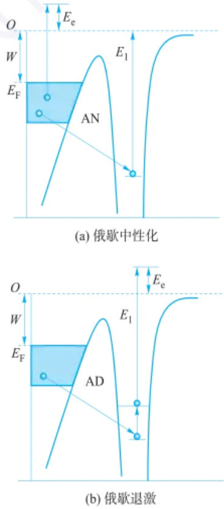

图10.2.6 Auger电子转移示意图

---

568

第十章 表界面分析技术

用低能离子散射进行表面分析其基本方法非常简单。用能量为0.1\~10 keV单能平行离子束打在靶面上，然后和某一特定角度上测量散射离子的能量分布即得到能谱。

入射离子的质量越轻，碰撞后运动状态的改变越大。因此，最常选用的离子是  $He^{+}$ ，但它不易分辨重元素。例如，要区分  ${}^{98}Mo$  和  ${}^{100}Mo$ ，用  ${}^{4}He^{+}$ 作入射离子时，在  $\theta = 90^{\circ}$  时，要求仪器的能量分辨率为 0.2%。而用  ${}^{20}Ne^{+}$ 或  ${}^{40}Ar^{+}$ 时，只要求分辨率为 0.6% 或 0.9%。

TOF-LEIS装置示意图

典型 ISS 装置示意图

## 10.2.4.3 能量分析器

使特定角度的散射离子进入能量分析器获得分离，不同能量的离子到达检测器分别获得检测。在不同表面上对气体离子的散射不同，具有重原子的表面对重气体离子（如Ar)轰击的响应就要比轻气体离子(He)好。当轰击离子与目标离子差距增大时，获得的质量分辨率降低。离子散射光谱的空间分辨率在 $100\mu \mathrm{m}$ 左右，低于其他探针技术。对于低能散射，可以使用带有法拉第杯的静电分析器，其装置与电子能谱中类似，只不过由于检测的是带正电荷的离子而非带负电荷的电子，使用的静电检测器其极性与电子能谱中正好相反，其分辨率 $(E / \Delta E)$ 在$200\sim 2000$ 范围。对于较高能量的散射离子（如 $>100\mathrm{keV}$ )，一般采用固态半导体检测器，如带有金窗口的硅检测器，最小分辨率在 $5\mathrm{keV}$ 到几十千电子伏特。

对于散射离子的能量分析，扇形静电场是非常方便和最普遍应用的。它们的相对能量分辨率  $\Delta E/E$  是由孔径宽度与中心轨道半径的比值给定的，即  $\Delta E/E = s/r$ 。对于 ISS 来说，1%\~2% 的分辨率就足够了。它遵循这种关系:静电分析器的能量窗口按检测到的能量比例增加，对绝对测量必须进行修正。ISS 通常不会报告使用恒定通能进行操作的可能性。球形扇形分析仪（90°扇形角度）可以安装在超高真空机械手系统，这样散射角从 0° 到 160° 或更大角度是可变的。对入射光束的方向、能量及角度和能量宽度的实验测定，这是非常有用的。散射角的变化对峰的指认常常是有用的，大的散射角对结构分析已变得非常重要。

柱面镜分析器(CMA)有大接受角度和随之而来的较高的散射信号(相比球形扇形分析器因子最高达30的优势。这种高强度和由于大散射角(137°)带来的较好质量分辨率使柱面镜分析器在标准表面成分分析方面非常有用。由于散射几何是固定的,因此它们一般不适合于结构测定。为了获得很高的检测效率,已开发出用螺旋状位错探测器同时记录角度和能量分布的特殊系统。能量色散环形棱镜也已成功地用于在多通道模式下测量能量和角度分布。

## 10.2.4.4 真空系统

由于 ISS 的表面灵敏度非常高,所以分析室的真空度要求十分高,以避免污染样品,造成测试困难,以致接收不到所要测试的表面真实数据及识谱的困难,真空室的真空度通常应高于  $1.33 \times 10^{-7}$  Pa。低能离子散射研究的对象是表面现象,一般仅限于表层一到两层原子。因此在测定的过程中,高度的真空非常重要,一般需要保持  $1.33 \times 10^{-8}$  Pa 甚至更低。从真空度的要求看,低能散射要求良好的真空条件,其真空度要优于高能散射时的最低要求。

## 10.2.4.5 离子流检测系统

离子流检测器使用电子倍增器，通道型或 Cu-Be 合金打拿极型均可，它处于超高真空室内应耐烘烤。这方面的问题与其他表面分析技术类似。其中，入射到电子倍增器的离子需加速至 3 keV 以增加灵敏度。前置放大器，脉冲计数等信号处理系统与 AES、XPS 等相同，主要进行大量复杂的数据的采集、储存、分析和处理。在 ISS 中经常会遇到离子轰击引起的靶面溅射而产生的本底噪声，影响 ISS 的正常分析。

由于ISS对表面极敏感，所以必须要有清洁表面的附件，如加热、氧化、还原等，还可以和XPS、AES、低能电子衍射(low-energy electron diffraction, LEED)等组合使用。实际上，在配有清洁样品用的扫描离子枪的XPS或AES仪器中，在电子透镜和能量分析器的电源中，加一个极性转换开关，就可以接收ISS。所以ISS仪器结构简单，常作为XPS或AES仪器的附件。

---

10.2 离子散射谱

569

## 10.2.5 离子能谱分析

## 10.2.5.1 元素分析

传统的 LEIS 测量涉及从固体表面散射能量 $(E_{0})$  为 0.5\~10 keV 的稀有气体离子束 $\left(\mathrm{He}^{+},\mathrm{Ne}^{+},\mathrm{Ar}^{+}\text{或}\mathrm{Kr}^{+}\right)$ 。入射离子束以相对于表面法线的角度  $\alpha(<60^{\circ})$  到达，并以一定的固定角度 $(\theta)$  分析反向散射离子的动能。来自表面原子的散射离子几乎完全来自二元碰撞，原子和离子的总动量守恒。当最初的“静止”表面原子后退时，散射离子会损失一些动能，损失的能量取决于原子和离子的相对质量，从而产生具有能量的反向散射离子:

$$
E _ {\mathrm{f}} = k \cdot E _ {0} \tag {10-2-12}
$$

其中 k 是由式(10-2-13)给出的运动学因子(k<1)。

$$
k = \left(\frac {\cos \theta \pm \sqrt {\left(\frac {m _ {2}}{m _ {1}}\right) ^ {2} - \sin^ {2} \theta}}{1 + \frac {m _ {2}}{m _ {1}}}\right) ^ {2} \tag {10-2-13}
$$

因此，弹性二元碰撞的运动学因子仅取决于散射角  $\theta$  及入射离子  $(m_{1})$  和固体表面原子  $(m_{2})$  的质量。根据经典力学原理，固体表面的每个元素在与入射离子和表面原子之间的动量传递有关的不同动能下产生一个独特的散射峰。因此，LEIS 允许通过测量从表面散射的离子的动能来确定固体表面元素的质量。固体最外层表面的元素分析的这一方面使 LEIS 成为可用的最具表面敏感性的表征技术之一。

$E/E_{0}$  随表面原子的质量 $(m_{2})$  和初级离子的性质 $(m_{1})$  而变化。初级离子通常由惰性气体组成，因为它们可以避免或最大限度地减少固体表面的污染。对于给定的入射  $m_{1}$  气体，可以检测到的表面原子是那些质量比初级离子大的原子，如式(10-2-12)和式(10-2-13)所示。因此， $^{4}He$  提供了最宽的质量范围，而氢 $(^{1}\mathrm{H},^{2}\mathrm{H}$  和 $^{3}\mathrm{H})$  是唯一无法检测到的元素。固体表面质量 $(m_{2})$  的分离随着质量的增加而迅速降低，但分辨率随着较重的初级离子 $(m_{1})$  而增加。因此，尽可能重但仍比目标原子 $(m_{2})$  轻的稀有气体离子 $(m_{1})$  将实现更好的质量分辨率。例如， $^{106}Pd$  和  ${}^{140}Ce$  的动能峰用  ${}^{4}He^{+}$ 很难分辨，但用  ${}^{20}Ne^{+}$ 很容易分辨。事实上，LEIS 提供了足够的质量分辨率来区分同位素（例如， ${}^{63}Cu$  和  ${}^{65}Cu$ ，使用  $Ar^{+}$ ）。一般来讲，4个  $He^{+}$ 的 LEIS 光谱将为较轻的表面原子，特别是 12\~60 amu 范围内的元素，提供质量分辨率和灵敏度方面的最佳信息。如果不需要更高的质量分辨率，那么用  ${}^{4}He^{+}$ 也可以测量具有更高质量的表面元素。

## 10.2.5.2 深度分析

和大多数表面分析技术一样，LEIS 可以用于动态(溅射)深度剖面。LEIS 具有表面表征方法中最好的本征深度分辨率，因为它是最灵敏的表面技术（-0.3 nm）。此外，LEIS 还可以提供无损的深度信息，产生如下所述的所谓“静态”样本深度剖面。“低能尾”是由入射离子产生的，这些离子通过穿过亚表面区域进行中和，然后在离开表面时再电离。中和的惰性气体原子在穿过亚表面区域时损失了一些能量，导致在较深的原子中出现能量略低的峰值。如果散射原子存在于连续层中，则在 LEIS 峰的低能量侧将出现连续的尾部。尾部的形状提供了有关所研究元素在深层次表层中的分布的信息。

背景的强度与这种中和再电离过程中涉及的离子数量成比例,而损失的能量

## 薄膜的化学计量比

如何利用 ISS 技术计算薄膜的化学计量比呢？请同学们查阅相关资料，对样品表面薄膜的近似比进行评估。

## 拓展:

直接反冲谱(DRS):DRS 是一种与离子散射技术密切相关的技术(在高能 RBS 方式中,通常称为“弹性反冲检测”,简称 ERD 或 ERDA)。在该方法中,检测因与入射离子的一次碰撞而从表面去除原子或离子。阴影锥概念也可以应用于 DRS。

---

570

第十章 表界面分析技术

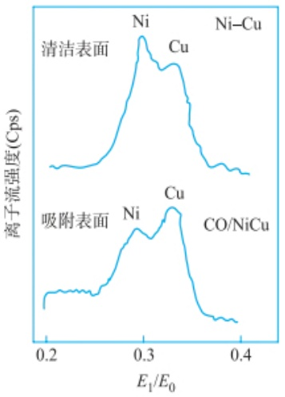

line

| Surface | Element | Peak Position (E1/E0) |
| --- | --- | --- |
| 清洁表面 | Ni | ~0.29 |
| 清洁表面 | Cu | ~0.33 |
| 吸附表面 | Ni | ~0.29 |
| 吸附表面 | Cu | ~0.33 |

CO 在 Cu-Ni 合金上吸附前后的 ISS 谱

## 思考:

为什么做成分分析时存在一些难认的谱峰呢？

做成分分析时,ISS 可能遇到的困难是有一些难指认的谱峰,有观点认为这可能是由于离子除了同表面单个原子碰撞外,还同表面原子及其近邻原子一起碰撞而产生的。

国外教材（John C V, Ian S G. Surface Analysis – The Principal Techniques. 2nd ed. Chichester: Wiley, 2009）也对碰撞离子散射谱（impact collision ion scattering spectroscopy, ICISS）技术有简单介绍:

A parallel flux of ions is incident along a chain of surface atoms with constant distance d. For small angles of incidence each chain atom is in the shadow of the preceding one and therefore cannot contribute to scattering. By increasing the angle of incidence, a critical angle c is reached at which the edge of the shadow cone (with its high ion flux) exactly hits the neighbouring atom. This results in a high backscattered intensity that, upon further increasing, falls to the average value of the primary flux.

是路径长度(与散射原子的深度有关)的函数。因此,LEIS光谱中的能量尺度可以转换为深度尺度,从而产生特定元素的定性浓度分布。与动态深度剖面相比,这种静态深度剖面具有两个优点。它不会受到溅射伪影的影响(例如,离子束混合或优先溅射),而且记录LEIS光谱的速度要快得多,通常为1\~3 min。在平坦的表面上,可以获得10 nm深度的信息。对于负载型催化剂或其他高度分散的样品,在这种静态深度分析中有用的信息稍微少一些。这是由于样品的拓扑结构,其中在几个纳米的深度处,成分将等于本体成分。然而,该信息有助于确定活性催化组分在催化剂表面上的分散。

## 10.2.5.3 影响谱峰的因素

## 1. 影响谱峰的条件

（1）入射离子及其能量选择 入射离子有两类，(a)常用的是惰性气体离子:$\mathrm{He}^{+}$、$\mathrm{Ne}^{+}$、$\mathrm{Ar}^{+}$等，具有中和概率高的特点。为了得到合适的信号，必须有较大的入射束流:$10^{13} \sim 10^{14}$ 离子/$\mathrm{cm}^{2}$，常用几十纳安每平方厘米（$\mathrm{nA} \cdot \mathrm{cm}^{-2}$）至微安每平方厘米（$\mu\mathrm{A} \cdot \mathrm{cm}^{-2}$），能量为几百电子伏至几千电子伏。(b)碱金属离子（如$\mathrm{Na}^{+}$、$\mathrm{K}^{+}$等）中和概率低，易发生多重散射。与惰性气体离子相比，束流可大大减小（小3\~4个量级），可减小表面损伤。在降低入射能量（约250 eV）时，也可用于检测表面单层。

（2）入射角度选择 主要考虑表面原子对其他原子的遮蔽(或阴影)。每个原子后面都有一个入射离子无法进入的区域(遮蔽锥)，在遮蔽锥边沿处，会对入射束起聚焦增强作用，或称遮蔽锥聚焦作用。入射角(入射束与样品表面法线夹角)越大，遮蔽锥越大。利用遮蔽效应，可研究表面原子结构。

(3) 质量分辨率 如式(10-2-6)可得

$$
\frac {m _ {2}}{\Delta m} = \frac {E}{\Delta E} \left(\frac {2 A}{A + 1}\right) \frac {\left[ A + \sin^ {2} \theta - \cos^ {2} \theta (A ^ {2} - \sin^ {2} \theta) \right] ^ {\frac {1}{2}}}{\left[ A - \sin^ {2} \theta - \cos^ {2} \theta (A ^ {2} - \sin^ {2} \theta) \right] ^ {\frac {1}{2}}} (A <   1) \tag {10-2-14}
$$

从上式可知, $\theta$ 增大,提高质量分辨率,当 $\theta\rightarrow180^{\circ}$ 时,有最大质量分辨率。但随 $\theta$ 增大,散射截面减小,因而信号也减小。

## 2. 影响谱峰的效应

（1）不存在基体效应 ISS 对不同元素灵敏度变化范围为 3\~10。定量不确定度为 10%，检测限约为 0.1 原子%。

灵敏度: $I_{i} = N_{x}I_{0}\frac{\mathrm{d}\sigma_{x}}{\mathrm{d}\Omega}(1 - \rho_{x})\cdot T\cdot \Delta \Omega$ (10-2-15)

式中， $I_{i}$ ——检测器接收的散射离子流；

$N_{x}$ ——x 元素的表面密度, 原子数  $\cdot cm^{-2}$ ;

$I_{0}$ ——入射束强度；

$\frac{\mathrm{d}\sigma_x}{\mathrm{d}\Omega}$ ——元素 $x$ 单位立体角上的微分散射截面 $(\mathrm{m}^2\cdot \mathrm{sr}^{-1})$；

$P_{x}$ ——x 元素的中和化概率；

T——能量分析器传输率；

$\Delta\Omega$ ——接收立体角。

$(1-\rho_{x})\sim10^{-2}$ ，一般规律是离子速度越低，中和概率越大。

（2）多重散射 入射离子入射到表面后，有些经历多重散射。实验表明，有时多重散射的表观总散射角和一次散射角相似，但不能用一次散射关系式表示。

---

10.2 离子散射谱

571

此时应把多重散射分解成若干个单次散射，且每次单散射都符合单散射公式。这时总的能量损失:

$$
\Delta E = \sum_ {i = 1} ^ {n} \Delta E _ {i} \tag {10-2-16}
$$

比起散射角与其表观一样的单次散射计算要小,反映在 ISS 谱中,多重散射表现在主峰高动能侧有肩峰。

（3）沟道效应 单晶中原子规则排列，会使入射离子沿一些特定方向入射时，可能遇到敞开的沟道（在密排的壁间），而穿透进入晶格较深处。这种现象称为沟道效应。
（4）荷电效应及其处理 ISS 中，对绝缘样品必须考虑荷电效应引起的实验结果的偏差。常使用中和电子枪，以消除积累的表面电荷。另外，可将粉末样品均匀地抹压在柔软金属（如 In、Pb 等）上或直接抹压在金属样品台上，也能有效地消除荷电。
（5）低能高本底 ISS 中，常可观察到较强的低能区离子信号，它们来自电离的反冲原子（或称溅射原子）。这对低能散射谱的解析不利。此时，就应选择合适的入射离子，使 ISS 主峰远离低能区。

## 10.2.6 离子能谱的应用

ISS 作为表面灵敏的一种手段,既可用于确定表面化学组分,又可推断一些几何结构如原子晶格排列等,一定条件下还可进行半定量的分析工作。探测的极限也在 0.1% 单原子层左右。目前,ISS 已广泛应用于表面吸附、离子诱导解吸、化合物的表面成分和催化、合金表面成分及电子轰击引起的表面过程的研究中。

## 10.2.6.1 成分结构分析

因为 ISS 具有只检测最外层原子的表面灵敏度, 所以特别适用于研究合金表面的分凝及吸附等现象。例如, 通过清洁表面和吸附表面的谱图对比, Ni 峰比 Cu 峰的比例发生了明显的变化, 说明 CO 优先吸附在 Ni 原子上。

## 10.2.6.2 表面结构分析

低能离子散射的突出优点之一是可以在实空间中获得关于晶体最顶层表面的质量选择性结构信息。这意味着可以测量选定结晶方向上相邻原子之间的距离。为了确定表面的几何形状，这些距离与通常从LEED结果推导出的结构模型结合使用。衍射研究在倒易空间中产生数据，从中推导出表面晶格的对称性，但是表面原子的精确位置，特别是对于多组分晶体，需要大量的计算工作。

用于结构确定的 ISS 的具体特征是在锥形边缘具有峰值离子通量的阴影锥，每个原子后面都有一个入射离子无法进入的区域（阴影锥），在阴影锥边沿处，会对入射束起聚焦增强作用，或称阴影锥聚焦作用。入射角（入射束与样品表面法线夹角）越大，阴影锥越大（图 10.2.7）。利用遮蔽效应，可研究表面原子结构。

ICISS技术迄今已很成功地用于与表面重构相关的结构测定（清洁表面和吸附诱导重构），用于定位吸附物质的位置，用于确定有序合金表面上组分的位置（与表面偏析相关）和确定表面原子的热振幅。一个紧密相关的技术是直接反冲谱(DRS)，其中直接反冲表面原子可以通过它们的能量来识别。这种技术对于难以通过散射检测的光吸附物(如氢同位素)特别有用。

## 10.2.6.3 表面成分定性定量分析

从关系式(10-2-14)可测知表面元素(即 $m_{2}$ )。从关系式(10-2-15)可进行

参考教材

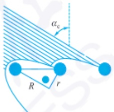

text_image

αc
R
r

(a)

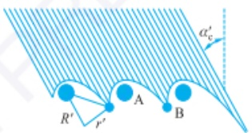

text_image

R'
r'
A
B
α′c

(b)

图 10.2.7 入射离子轨迹示意图: 显示了当入射离子以临界角  $\alpha$  撞击时的聚焦碰撞 (a) 入射离子束与样品表面法线夹角较大; (b) 夹角较小

## 发射原理

与用电子束入射的情形类似，用离子束入射时也能引起四种类型的粒子发射:离子散射和二次离子发射；中性粒子溅射；电子发射和光子发射。这些发射原理已构成多种表面的研究方法。

入射粒子 出射粒子 方法

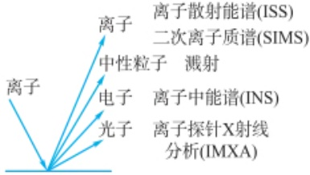

text_image

离子
离子
离子散射能谱(ISS)
二次离子质谱(SIMS)
中性粒子 溅射
电子 离子中能谱(INS)
光子 离子探针X射线
分析(IMXA)

离子束入射固体表面时引起的粒子发射和相应建立的分析方法

---

572

第十章 表界面分析技术

定量分析。实际上，用 ISS 测定表面元素的组成和定量分析，远非 XPS 和 AES 甚至二次离子质谱(SIMS)等方法简捷。但是由于它极高的表面灵敏度，常用 ISS 监视样品表面最顶层原子组成和结构变化。

$$
\frac {E _ {1}}{E _ {0}} = \frac {\left[ \cos \theta \pm (A ^ {2} - \sin^ {2} \theta) ^ {\frac {1}{2}} \right] ^ {2}}{(1 + A) ^ {2}} \tag {10-2-17}
$$

式中， $A = m_{2} / m_{1}$ ，当 $A > 1$ 时，取+号，当 $A\leqslant 1$ 时，取-号。 $\theta$ 为散射角。

在 ISS 实验中， $m_{1}$ 、 $E_{0}$ 已知， $E_{1}$ 可测得，求得 $m_{2}$，进而确定靶表面组成。

然而,表面成分分析只有在对该方法固有的某些限制内是正确的:

（1）没有明确定义的“技术”表面一般有富含H的表面污染层(烃类、水)，轻的H原子不会造成很多常见条件下的散射信号。有用的能谱只有在用分析离子束溅射去除污染层后才可获得。
（2）较重的元素的质量分辨率及质量识别受到碰撞运动学的限制，因此不能保证在没有任何预知识的情况下对较重质量的明确确定。

ISS 对不同元素灵敏度变化范围在 3\~10 倍, 分析时对表面损伤很小。但是, 定量分析有一定的困难, 谱峰较宽, 质量分辨本领不高, 常有一定的本底, 检测灵敏度为 $10^{-3}$ 量级。它常与 AES、SIMS 等仪器组合使用。在各种分析方法中, 它是一种很有特色的研究表层状态的分析手段。尽管 LEIS 对催化材料的表面分析有应用潜力, 但由于学界对 LEIS 缺乏了解, 相比于 XPS 光谱仪, LEIS 仪器的普及程度有限, 因此对 LEIS 这一表面表征技术的重视程度还有待加强。

分析过程中，部分离子束中的离子会与表面相互作用并在表面沉积下来，因此LEIS更多地被视作一种破坏性的分析方法。LEIS对于表面原子非常灵敏，可以获得表层的组成与结构信息，获取原子间距和关于吸附位点的信息，所获得的信息与样品的内层基质无关，该特点使得该方法在研究表面特征时具有独特的优势，因此在一些表面效应的研究中应用广泛，如热处理、溅射、吸附等处理后的表面。从光谱中可以获得不同元素的相对信号强度，可以给出有关吸附分子的排列信息。离子散射光谱可以检测所有比轰击离子原子序数高的元素，既可以用于定性分析，也可用于定量分析，检测灵敏度在 $1\%$ 左右。

中能和高能离子散射这两种方法很大程度上相似，它们能够给出元素组成及深度分布的信息。在进行深度分析时，其分析范围可以从数十原子层到数十微米量级，范围较广，分辨率在数十纳米量级。对于一些多层或整体的无机物，通过分析可以给出各成分在深度上的分布结果。该方法同样适用于生物样品。与LEIS不同，这两种方法激发离子并不会对样品产生破坏。对元素检测，随着原子序数的升高， $m/\Delta m$ 差异变小，引起相应的散射离子能量差异的降低，使得对元素分辨能力下降。同时，如果要对高原子序数元素进行定量，由于相对应的散射离子截面积小，检测灵敏度也下降。

该法是目前唯一对单原子层有选择性而不考虑下层原子种类的表面分析法。

仪器分析的方法众多,而且各种方法相对独立,可自成体系。常用的仪器分析方法有光学分析法、电化学分析法、色谱分析法、热分析法和质谱分析法等。

## 10.2.7 离子作为探束的其他能谱

## 10.2.7.1 高能离子散射谱

通过将一束确定能量的高能离子束(通常是质子或  $\alpha$  粒子, 能量在 25 keV 到几兆电子伏)打到待分析材料上, 检测背向反射的离子的能量, 即可确定靶原子的

---

10.2 离子散射谱

573

种类、浓度和深度分布，称为卢瑟福背散射谱学（Rutherford backscattering spectrometry, RBS），也被称为高能离子散射谱学（high-energy ion scattering, HEIS）。当初，Rutherford曾使用这种散射探知了原子核的存在。

现今,应用这些年累积的散射原理与技术,RBS能够侦测半导体内的重金属杂质。实际上,该技术也是第一个在月球使用的实地分析技术。在勘察者探测器降落于月球表面后,RBS实验被用来收集地质资料。

## 10.2.7.2 离子激发 X 射线谱

观察激发离子发射的X射线，沿着Auger电子能谱，作为一种可行的手段来测量各种激发概率及离子-原子碰撞产生的能量和跃迁速率，这种手段称为离子激发X射线谱（ion-induced x-ray spectroscopy）。多用于观测空间环境，如太阳耀斑、中子星自旋等。

## 10.2.7.3 离子中和谱

离子中和谱(ion neutralizing spectrum, INS)是研究固体表面电子能谱的新方法。当缓慢运动的离子或激发原子通过或碰撞固体表面时，吸引表面电子而中和，同时导致固体表面电子的共振型或Ruger型跃迁过程，在固体的填满价带中的两个电子相互作用——交换能量和动量。离子中和谱仪的数据处理是比较复杂的，目前仅限于少数实验室使用。

## 本节思考

还有哪些表面分析技术？列举几种，并简单概括它们与离子散射谱的异同点。

## 习题

## - 章节练习题 -

1. 什么是低能离子散射谱？
2. 低能离子散射谱有什么特点？
3. ISS 是基于什么物理模型？它的基本原理是什么？
4. 在离子散射问题中, 相互作用势的基本作用是什么?
5. 离子产率对 ISS 有什么影响？量化光谱中，影响离子产率的因素有什么？
6. 什么是“镜像电荷”？电荷转移机制有几种？并简单介绍每种电荷转移的过程。
7. ISS 一般采用哪些离子源？有何特点？
8. ISS 仪器的结构包括哪些?
9. 在用 ISS 进行元素分析时, 为获得更好分辨率, 怎样选择入射离子?
10. 简述 ISS“低能尾”的产生过程。
11. 影响 ISS 谱峰的因素都有什么？
12. 为什么 ISS 进行成分结构分析时有一些难认的谱峰？
13. 简述 ISS 表面结构分析的原理。
14. 在 ISS 研究中用离子束入射时能引起哪四种类型的粒子发射？与之相应的分析方法有哪些？
15. 除了 ISS, 还有哪些离子作为探束的其他能谱? 请简单介绍。

## - 挑战性问题 -

16. 假设入射离子能量未知。能量约为 $1\mathrm{keV}$ 的 $\mathrm{He^{+}}$ 与金基体散射，在$877~\mathrm{eV}$ 动能处观察到的强峰属于金。已知 $m_{1} = 4,m_{2} = 197,\theta = 130^{\circ}$，请计算出$E_0$ 值。

---

574

第十章 表界面分析技术

## - 专题或报告 -

17. 表面单原子层的表征对于催化机理的阐述有着重要作用,表面单原子层的分析能够辅助沉积效果的评价,作为表面分析手段之一,离子能谱在催化领域的应用越来越广泛。查阅关于离子能谱在催化领域应用的相关科学文献,并将结果写成报告。
18. 在实际检测中,面对的实际样品大多比较复杂,单一离子能谱对散射截面和中和概率这两个因素的准确测量还比较难,与多种其他分析设备集成,有可能拓展原有技术的应用范围,并显著提高其准确性、选择性和灵敏度。查阅相关科学文献,列举出1\~2种联用技术,了解其原理与应用,并与同学分享你的结果。

## 10.3 二次离子质谱

早在20世纪30年代，Arnot等人就研究了二次离子发射现象。1949年，Herzog和Viehböck首先把二次离子发射与质谱分析结合起来。60年代，先后发展了离子探针和直接成像质量分析器。70年代又提出和发展了静态二次离子质谱仪。这些二次离子质谱仪的性能不断改进，使之成为一种重要的、有特色的表面分析手段。现如今二次离子质谱已逐步发展为一种重要的材料分析手段，在材料科学、光电子领域及生物领域有着重要的应用。

## 10.3.1 二次离子质谱仪

二次离子质谱(secondary ion mass spectrometry, SIMS)是通过检测一次离子(主要包括  $Cs^{+}$ 、 $Ga^{+}$ 、 $O^{-}$ 、 $O_{2}^{+}$ 、 $Ar^{+}$ 等离子束)入射靶面后,溅射产生的二次离子而获取材料表面信息的质谱分析方法。
二次离子质谱仪主要包括真空系统、样品架及进样系统、离子枪系统、二次离子质量分析器及离子检测器和数据处理系统五部分，如图 10.3.1 所示。

SIMS 开拓者查良镇教授

## 思考:

查阅相关文献,了解目前二次离子质谱仪在不同领域具体有哪些应用。

flowchart

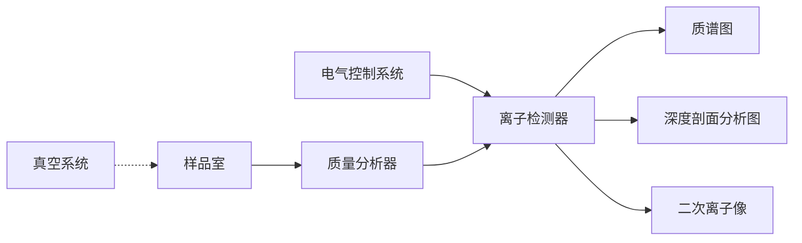

图 10.3.1 二次离子质谱仪组成示意图

## 10.3.1.1 二次离子质谱仪的工作原理

如图10.3.2所示，二次离子质谱的工作原理是通过质谱法分析入射离子（一次离子）轰击样品表面溅射产生的带有正、负电荷的二次离子，利用质量分析器接收分析二次离子，测量离子的质荷比和强度并得到二次离子质谱，获取材料表面信息。

---

10.3 二次离子质谱

575

flowchart

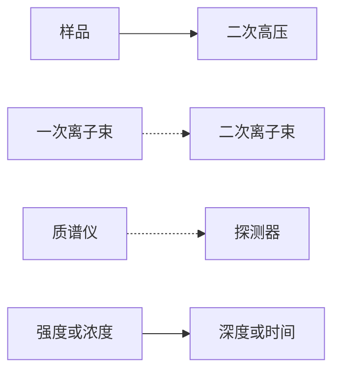

图 10.3.2 二次离子质谱工作原理图

在二次离子质谱分析过程中，离子枪发射的一次离子束轰击样品表面，一次离子在与样品相互作用时，可能穿透样品表面，进入样品的原子层，在这个过程中会发生一系列弹性和非弹性碰撞。入射的一次离子与样品晶格原子发生能量传递，促使样品部分晶格原子产生向表面的运动，并把能量的一部分传递给样品的表面粒子，表面的粒子接受能量并发射，这种过程称为粒子溅射。发生溅射一系列过程可以看成单个入射离子和样品的组成原子之间碰撞，荷能离子与表面的相互作用包括的一系列基本过程，如图10.3.3所示。

图 10.3.3 离子与固体表面相互作用引起的重离子发射过程

当入射离子与样品表面接触发生弹性或非弹性碰撞后，改变其运动方向朝真空端飞回，这种情况称为一次离子的背散射；同时与之接触的样品表面原子也受到弹性或非弹性碰撞影响，可能产生振动、移位等现象，被打入样品内部（称反弹注入），如图10.3.3中I所示。

一次离子还可进入样品表面，并在样品晶格中产生一系列级联碰撞，将其能量消耗在周围晶格，最后注入一定的深度（多种情况下为几个原子层），即离子注入。晶格内原子受到入射离子的碰撞，部分原子获得能量，当获得的能量高于一定阈值时就会发生晶格内移位，与周围其他原子发生碰撞。连续的碰撞部分扩展到样品表面粒子，当表面粒子获得足以使其离开样品表面所需的能量与方向，则会产生二次发射，这种现象称为溅射（如图10.3.3中Ⅱ所示）。溅射出的二次粒子包含原子、分子或原子团，其中中性粒子占大部分，其次是一些带正负电荷的二次离子。

还有一部分一次离子在和表面原子碰撞时，将其大部分能量传递给样品表面原子，样品表面原子可以获得很高的能量并发射出去（称为反弹溅射）；而耗散能量后的一次离子继续注入样品晶格内部，见图10.3.3中的Ⅲ。此外入射离子在与样品表面相互作用时与表面发生电荷交换，导致中和、电离及二次电子发射等，这种情况可以在样品表面内较深的区域、表面区及体外发生。

## 溅射产额

溅射产额是描述溅射现象的主要参量之一,它表示单个入射离子作用于样品表面溅射出的平均粒子数量。在一定条件下,溅射产额与入射离子的原子序数、能量、入射角度均有一定的关系,同时也受样品表面组分、结构等多种因素影响。

## 二次离子产额

一次离子束照射样品表面时引起的粒子溅射，二次离子只占其中的一小部分。二次离子产额指的是一个入射离子轰击样品表面所产生的二次离子数。同样二次离子产额也受入射离子束、样品性质及化学环境的影响。

入射离子与样品相互作用动画演示

## 知识拓展

1. 当带有一定能量的一次粒子（如电子、离子、中性粒子及光子）轰击物体表面时，物体表面会发射出二次粒子，二次粒子包括电子、原子、离子及分子等多种粒子。
2. 基体效应: 由于其他成分的存在, 同一元素的二次离子产额会发生变化。
3. 二次离子质谱测试样品一般要求:

① 种类一般包括金属和合金、半导体、绝缘体、有机物及生物膜等。
② 样品形态一般为晶态或非晶态固体,或是具有沉积薄膜及镀层的基底,样品表面需平坦而光滑。
③ 粉末样品必须将其压入软金属箔(如铜)中或压制成小块。

---

576

第十章 表界面分析技术

## 思考:

在实际应用中,一次离子束的束流强度、束斑大小和束能量对样品的分析结果与损伤均有影响,思考不同密度和束斑大小的离子束分别适合进行什么类型的分析?

## 思考:

划分二次离子质谱两种分析模式的主要标准是什么？

## 10.3.1.2 离子源

离子源是二次离子质谱仪的关键部件，用于发射一次离子，其基本组成包含离子枪和电磁透镜。通常采用几百伏特的电子束轰击气体分子（如惰性气体氦、氖、氩等），使气体分子电离，产生一次离子。产生的一次离子在电压的作用下从离子枪内射出，再经过电磁透镜使离子束聚焦，照射在样品表面上激发二次离子。

常见的离子源类型包括热阴极电离型离子源、双等离子体离子源和液态金属场离子源。

热阴极电离型离子源由金属表面直接加热离子源提供  $Cs^{+}$ 。其特点是级联碰撞效应小，纵向分析时深度分辨率高，但发射区域大，聚束困难、能量分散和角度分散较大。

双等离子体离子源提供  $O_{2}^{+}$ 、 $O^{-}$ 、 $Ar^{+}$  和  $Xe^{+}$ 。其亮度高，束斑可达  $1 \sim 2 \mu m$ ，可用于离子探针和成像分析。

液态金属场离子源提供  $Ga^{+}$ 。其束斑可聚焦很小，可以得到束斑为 20\~200 nm，束流为 0.5 nA 的离子束，另外液态金属场离子源空间分辨率较高。

## 10.3.1.3 二次离子质量分析系统

二次离子质量分析系统是二次离子质谱仪的核心部分，通常包括加速极、质量分析器和离子收集、放大等部分，通常还包括能量分析器。质量分析系统用以分离并检测从样品表面溅射而来的具有不同质荷比的二次离子，主离子束直径范围为0.3\~5 mm。在分析过程中，质量分析器不但可以提供对应于每一时刻的新鲜表面的多元素分析数据，而且还可以提供表面某一元素分布的二次离子图像。

目前常见的二次离子质谱仪中应用的质量分析器主要包含三种类型,即根据质量分析器不同,分为三种类型的二次离子质谱仪,分别是双聚焦磁偏转质谱仪、四极杆质谱仪和飞行时间质谱仪。

双聚焦磁偏转质谱仪利用不同动量的离子在磁场中偏转半径不同，将不同质荷比的离子分开。采用具有扇形静电场和扇形磁场的双聚焦分析器可以提高质谱仪的质量分辨本领。尽管双聚焦磁偏转二次离子质谱仪质量分辨率高，质量范围也较宽，但成本往往很高，且体积庞大，质量扫描速度慢。

四极杆质谱仪通过射频与直流电场使特定质荷比的离子以稳定轨迹穿过四极场，而质量较大或较小的离子由于轨迹不稳定偏转到四极杆上，从而达到质量分析目的。其价格低廉，操作方便，但其元素检测灵敏度不高。

飞行时间质谱仪利用具有相同能量不同质荷比的离子飞行速度不同,用负脉冲将二次离子引出,然后通过高压使离子加速,经过一段飞行它们分别在不同时间到达检测器,从而得到质谱。飞行时间质谱仪流通率很高,接近100%,同时具有较高的分辨率,分析速度快,质量范围原则上不受限,且样品的利用率最高。

## 10.3.1.4 二次离子质谱的分析模式

SIMS 的分析模式基本上分为两类,包括静态 SIMS 和动态 SIMS。静态 SIMS 用于表面亚单层的元素分析,动态 SIMS 用于获取表面下深度的位置信息。

静态 SIMS 要求分析室的真空度优于  $10^{-7}$  Pa，从而使分析时表面不会被真空环境干扰。初级离子束的能量低于 5 keV，束流密度降到纳安每平方厘米 (nA·cm $^{-2}$ ) 量级，使表面单层的寿命从几分之一秒延长到几个小时。在静态 SIMS 中，溅射非常缓慢，因此对样品的消耗基本上可以忽略不计。

动态 SIMS 一般使用流强较大的初级离子束, 将样品原子逐层剥离进行 SIMS 分析, 从而实现深层原子浓度的测量, 得到各种成分的深度分布信息。分析过程

---

10.3 二次离子质谱

577

中对样品表面产生动态破坏,产生二次离子的比率高,常用于深度剖析、成像和微区分析。

## 10.3.2 二次离子质谱的特点

二次离子质谱作为一种成熟的表面分析技术,已经应用于多个领域。其主要的优点如下:

（1）在高真空的测试条件下，可以得到样品表面的真实信息；
(2) 能分析氢在内的全部元素,并可监测同位素;
（3）可以对化合物进行测试分析并给出原子团、分子性离子、碎片离子等多方面信息；
(4) 信息深度为几个原子层,甚至单层(最表面原子打出);
（5）能够同步对样品进行深度剖析，可进行微区成分分析，还可得到一定程度的晶格信息；
（6）空间分辨率高，检测灵敏度高，对许多成分检测灵敏度很高，检测极限达 $10^{-6}$ ，甚至 $10^{-9}$ 量级；

同时二次离子质谱也存在一定的局限性,例如:

（1）测试过程中对样品表层或表层内部有一定破坏性；
(2) 分析结果受样品表面组成均一性及基体效应影响;
(3) 二次离子强度受化学和物理环境影响,造成定量分析困难;
(4) 溅射出的样品物质容易在周围零件沉积产生记忆效应。

## 10.3.3 二次离子质谱的应用

## 10.3.3.1 定性分析

二次离子质谱通过对获取的二次离子进行分析得到二次离子质量谱图，可以正确地对样品进行定性分析。但一般样品在受离子照射时，除一价离子外，还产生多价离子、原子团离子、一次离子与基体生成的分子离子等。这些离子会与其他谱相互干涉而影响质谱的正确分析。所以在分析时，应经常考虑到谱的干涉或干扰。同时应考虑同位素效应，一般地说，二次离子质谱中同位素的比例接近于天然丰度。SIMS在定性分析上具有较高的灵敏度，可达 $10^{-6}\sim10^{-5}$ 。

## 10.3.3.2 定量分析

目前二次离子质谱的定量分析能力依然有限。在 SIMS 中获得的分析信号取决于多个因素，包括一次离子的种类、材料的表面特性及其表面同位素丰度等。实际测试过程中，常采用标样物质对测试进行校准。同时由于元素与元素之间的灵敏度存在差异，定量分析也变得复杂。

## 10.3.3.3 微量元素分析

SIMS 具有的高灵敏度,对于微量元素分析很有优势,可用于定量测定固体中痕量元素的深度剖面。这些微量元素可能是来自样品本身,也可能是人工特意掺杂的微量元素。SIMS 的微量元素分析在半导体、电子器件及集成电路工业中有着重要应用。一方面可以分析材料中微量添加剂,另外还能够通过谱图分析器件的质量,优化制造工艺,提高产品质量。

## 10.3.3.4 深度剖面分析

通过动态 SIMS 可对样品进行深度剖面分析。动态 SIMS 测得的深度剖面分布与样品中真实浓度分布的关系可用深度分辨率来描述,通过校准曲线将二次离

## 拓展思考:

电子探针是微区成分分析时的常用分析工具,试了解电子探针工作原理,并思考与电子探针相比,二次离子质谱在微区分析中的优势是什么?

## 拓展思考:

查阅利用二次离子质谱对半导体材料进行微量元素分析时的应用实例。思考进行微量元素测定时，应注意哪些因素？

---

578

第十章 表界面分析技术

子信号强度转变为元素含量,可以得到样品中真实浓度分布。通常情况下,受入射离子的类型影响,界面严重的基体效应会对深度剖析曲线产生影响,同时一次离子束的束流密度分布与总束流的稳定性,入射离子与靶的相互作用,二次离子的平均逸出深度,二次离子的入射角及晶格效应等都对深度分辨有一定的影响。

## 10.3.3.5 元素面分布分析

在二次离子质谱分析过程中,当利用一次离子束作用在样品上时,通过二次电子或吸收电子像可以获取样品表面的形貌,通过质量分离的二次离子像可以获取材料表面分布的信息。成像质量的一个重要指标是横向分辨率(lateral resolution),目前液态金属离子枪系统可以得到最好的横向分辨。随着电子技术的不断发展和分析技术的提升,二次离子质谱的空间分辨率已可以达到亚微米量级。

## 10.3.3.6 有机物分析

静态 SIMS 是一种软电离分析技术, 近年来在对不蒸发、热不稳定有机物分析方面的应用迅速发展。根据质子-分子离子  $(M+H)^{+}$  质量数, 可确定有机物的分子质量, 通过碎片还可以确定有机物的分子结构。目前在有机物分析机理中, “预形成” 模型受到广泛认可并被采用, 即有机分子在载体表面先分离为  $(M+1)$  和  $(M-1)$  离子, 一次离子入射后。将其能量和动量传递给表面和点阵, 最后使预形成的离子发射出去。关于二次离子质谱分析有机物的机理研究还在不断地深入中。

## 习题

二次离子质谱应用相关文献

## - 章节练习题 -

1. 简述二次离子质谱仪的工作原理。
2. 二次离子质谱仪常见的离子源包括哪几种类型？
3. 二次离子质谱包括哪几种分析模式？
4. 简述二次离子质谱的特点。

## - 挑战性问题 -

5. 查阅相关科学文献, 设计实验: 选取一种材料, 考虑如何制备成为适合进行二次离子质谱测试的样品, 并考虑如何使用二次离子质谱仪对材料进行分析, 预测从测试结果中可以得到关于材料的哪些信息?

## - 专题或报告 -

6. 作为一种相对成熟的表面分析技术,二次离子质谱在很多领域的研究工作中发挥关键作用。查阅一篇相关科学文献,了解其主要的研究内容并简述二次离子质谱在该文献所报道的工作中发挥的作用。

## 10.4 扫描电子显微镜

## 10.4.1 扫描电子显微镜的发展历史

扫描电子显微镜(scanning electron microscope, SEM)是一种分辨率介于透射电子显微镜和光学显微镜之间的用于微观形貌，尤其是表面形貌观察的电子仪器。第二次世界大战结束后，英国剑桥大学工程系的 Charles Oatley 和他的学生

---

10.4 扫描电子显微镜

579

McMullan在英格兰建造了第一台扫描电子显微镜，加装了扫描线圈、扫描显示屏、二次电子探测器、电子信号放大器，1952年实现了 $50~\mathrm{nm}$ 的分辨率。此后，扫描电子显微镜具备的潜能开始受到商业界的重视。1959年CharlesOatley的另一个学生OliverWells首先使用立体对技术拍摄了可以进行样品景深信息测量的扫描电子显微镜显微图像，1960年T.E.Everhart和R.F.M.Thornley发展改善了二次电子探测器，Everhart-Thornley型二次电子探测器目前仍是扫描电子显微镜主流探测器。同样是CharlesOatley学生的KennethC.A.Smith使用磁透镜来聚焦，加装了消像散器和可倾转样品台，CharlesOatley又和Smith一起，将电子信号改成光信号放大探测，成功获得背散射电子像，Stewart也成功将聚焦离子束技术耦合到扫描电子显微镜中，成为当前微小样品制备、失效分析等众多领域应用最为广泛的双束电子显微镜技术。1965年CharlesOatley率领团队发明了第一台商用扫描电子显微镜并命名为Steroscan，这一命名正是体现了扫描电子显微镜立体成像特征，将扫描电子显微镜的分辨率提升至 $10~\mathrm{nm}$ 。

## 10.4.1.1 场发射扫描电子显微镜

20 世纪 80 年代,采用场发射枪(field emission gun, FEG)的场发射扫描电子显微镜(field emission scanning electron microscope, FESEM)投入商业使用。在该类扫描电子显微镜中,采用新型场发射枪使电子探针的直径减小到约 0.5 nm,极大提升了扫描电子显微镜的分辨本领。此外,FESEM 还能在极低的加速电压 (<1 kV) 下对样品进行高分辨率成像,不牺牲传统的高电压和高电流(分析)性能。FESEM 在低加速电压下的特点为表面表征方面的应用开辟了新的途径。

## 10.4.1.2 环境/可变气压扫描电子显微镜

20世纪80年代末，Electroscan公司制造了第一台商业环境扫描电子显微镜（environment scanning electron microscope, ESEM），是在电子显微镜仪器方面迈出的重要一步，具有举足轻重的作用。可变气压（variable pressure）/环境扫描电子显微镜（VP/ESEM）采用了特殊的真空设计，同时采用气体二次电子探头，样品台也采用具有制冷功能的特殊样品台，允许在约 $10\sim 10^{3}\mathrm{Pa}$ 的低真空下进行二次电子成像。此外，VP/ESEM还可在低真空条件下对绝缘体样品进行成像，最大限度避免了荷电效应的影响。

经过40多年的不断改进，扫描电子显微镜的分辨率已经提高到现在的 $1\mathrm{nm}$ 扫描透射电子显微的分辨率更是达到了 $0.01\mathrm{nm}$ 以下。由于扫描电子显微镜较大的样品室空间，可以较好地耦合X射线能量色散谱仪（EDX）、波谱仪（WDX）、背散射电子(EBSD)探头等硬件设备，对样品进行局部元素分析和晶体学表征。扫描电子显微镜已经发展成可全面对材料表界面微观分析的多功能电子显微仪器，广泛应用于各种材料的形态结构、界面状况、损伤机制及材料性能预测等方面的研究。

## 10.4.2 扫描电子显微镜的工作原理

## 10.4.2.1 扫描电子显微镜成像原理

扫描电子显微镜以电子枪发射的电子束作为照明源，经栅极聚焦后，在加速电压的作用下，经由2\~3个电磁透镜构成的电子光学系统，将初始电子束汇聚为细的电子束聚焦于样品表面。末级透镜上方或者内部装有扫描线圈，在扫描线圈的驱动下，电子束发生偏转，在样品表面逐行扫描。高能电子束与样品相互作用会产生多种信号，如二次电子、背散射电子、吸收电子、X射线、俄歇电子、阴极荧

Charles Oatley

## 思考:

为什么电子显微镜可以具有更高的分辨率？影响显微镜分辨率的因素有哪些？

环境扫描电子显微镜

不同种类电子枪灯丝

---

580

第十章 表界面分析技术

## 思考:

在扫描电子显微镜中利用了哪些信号源进行成像？在分辨率、分析方法、成像模式上有何区别？

商业化能谱仪和阴极荧光光谱仪

光和透射电子等，成像主要是二次电子和背散射电子。上述信号被相应的接收器接收，经放大后送到显像管的栅极上，调制显像管的亮度，最终形成一幅与扫描区域一一对应的扫描电子显微图像。

## 10.4.2.2 扫描电子显微镜的结构

扫描电子显微镜主要由以下几部分构成。① 电子光学系统:包含电子枪、电磁透镜；② 扫描系统:包含扫描信号发生器、扫描放大控制器、扫描偏转线圈；③ 信号探测放大系统:包含各种类型信号探测器（如二次电子探测器、背散射电子探测器等）和信号放大器；④ 图像显示和记录系统；⑤ 真空系统:包含机械泵、扩散泵和涡轮分子泵等；⑥ 电源系统。整体扫描电子显微镜结构如图10.4.1所示。

flowchart

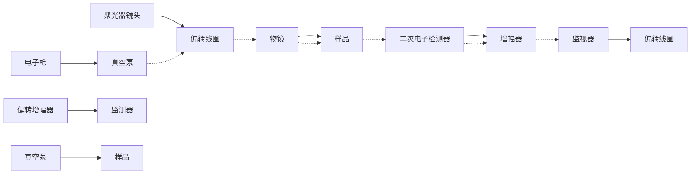

图 10.4.1 扫描电子显微镜结构示意图

## 10.4.2.3 扫描电子显微镜的优势

与光学显微镜相比,扫描电子显微镜具有很多独特的优势,汇总如下:

（1）SEM 仪器分辨本领较高。二次电子像分辨本领可达 1.0 nm（场发射），3.0 nm（钨灯丝）；仪器放大倍数变化范围大（从几倍到几十万倍），且连续可调。
（2）图像景深大，富有立体感。可直接观察起伏较大的粗糙表面（如金属和陶瓷的断口等）。
（3）样品制备简单。样品无论是块状还是粉末状，导电还是不导电，无须处理或稍加处理，就可直接放到SEM中进行观察。一般来说，比透射电子显微镜（TEM)的制样简单，且可使图像更近于样品的真实状态。
（4）可做综合分析。SEM 装上波长色散 X 射线谱仪 (WDX, 简称波谱仪) 或能量色散 X 射线谱仪 (EDX, 简称能谱仪) 后，在观察扫描形貌图像的同时，可对样品微区进行元素分析。
（5）装上半导体样品座附件，可以直接观察晶体管或集成电路的 p-n 结及器件失效部位的情况。
（6）装上不同类型的原位过程样品台和检测器，可以直接观察处于不同环境（加热、冷却、拉伸等）中的样品显微结构形态的动态变化过程（动态观察）。

---

10.4 扫描电子显微镜

581

## 10.4.3 扫描电子显微镜成像信号源及成像模式

## 10.4.3.1 电子束与样品的相互作用

在 SEM 中, 电子枪产生的电子束经过电磁透镜聚焦, 扫描线圈控制电子束对样品进行扫描, 与样品相互作用会产生多种物理信号。在扫描电镜中, 用来成像的信号主要是二次电子, 其次是背散射电子和吸收电子。用于分析成分的信号主要是 X 射线和背散射电子, 阴极发光和俄歇电子也有一定的用处。探测器将产生的物理信号转换成图像信息, 最终实现对样品表面形貌的观察和表征。主要的信号源有以下几种:

（1）二次电子 二次电子是指被入射电子轰击出来的样品的核外电子。二次电子的能量较低，小于50 eV。由于只有样品表面5\~50 nm深度范围产生的二次电子能够离开样品表面被收集，因此，二次电子可以有效显示样品的表面形貌。
（2）背散射电子 背散射电子是指被固体样品中的原子核反弹回来的一部分入射电子。该电子信号能量高，分布范围宽，一般为数十电子伏到数千电子伏。产额随样品原子序数增大而增多，不仅能用作形貌分析（分辨率不如二次电子），而且可以用来显示原子序数衬度，定性用作成分分析。

（3）特征 X 射线 原子内层电子被轰出后，外层电子向内层跃迁产生特征 X 射线。可以用特征 X 射线判定微区中存在的元素。

（4）Auger 电子 在入射电子激发样品的特征 X 射线过程中，如果在原子内层电子能级跃迁过程中释放出来的能量并不以 X 射线的形式发射出去，而是用这部分能量把空位层内的另一个电子发射出去（或使空位层的外层电子发射出去），这个被电离的电子称为 Auger 电子，Auger 电子特别适用于表面成分分析。

（5）阴极荧光是指氧化物或半导体材料被阴极射线管管内的热电子轰击后，价电子被激发到高能级或能带中产生弛豫发光的现象。其波长在紫外、可见或红外光区域，可以被用来检测矿物、半导体和生物样品中痕量元素的分布。

## 10.4.3.2 扫描电子显微镜样品的制备

SEM 经常观察的样品有块体样品、粉末样品、生物样品等。对于块体样品而言，其应该尽量小，一定不能超过电镜样品台尺寸。用导电胶把样品黏结在样品台上，对于不导电或者导电性差的样品，需要进行镀膜处理后再放入扫描电镜中观察；对于粉末样品而言，需要先将导电胶带粘在样品台上，然后将粉末样品均匀地撒在导电胶上面，随后用压缩空气（或者洗耳球）吹去没有黏住的样品；对于生物样品而言，由于生物样品性质较为特殊，一般都具有含水量高、质地柔软、导电性差、对热和电子束敏感等特性，因此生物样品的制样过程较为复杂，主要包括取样、清洗、固定、脱水、干燥、粘样、导电处理几个步骤。

## 10.4.3.3 扫描电子显微镜成像模式

## 1. 二次电子像

二次电子成像模式的信号源为二次电子，其发射率主要取决于样品表面，与原子序数的变化相关性不大。二次电子分辨率高、景深大，立体感较强，因此二次电子像是最主要的成像方式，主要用于观察样品表面形貌，金属、陶瓷等材料的断口形貌，甚至在微纳尺度动态观察样品形变过程，广泛应用于材料科学、生物领域等。

由于二次电子的能量较小,在应用 E-T 型探测器收集信号时,需要在栅网上加几百伏的正偏压,不仅可以吸引大部分的二次电子进行信号收集,还可以避免

## 思考:

要获得良好分辨率的扫描电镜照片,需要如何对样品进行处理?

二次电子探测器

---

582

第十章 表界面分析技术

## 思考:

对于点分析、线扫描分析以及面扫描分析,我们应该如何选择?

背散射电子衍射谱仪和成像图示

二次电子像的阴影效应。传统的 E-T 型二次电子探测器主要由三部分组成:闪烁体、光导管及光电倍增管，如图 10.4.2 所示。

text_image

M
光电倍增管
光导管
光学接触
玻璃
荧光粉
收集器栅偏压
样品
高真空<1×10⁻³ Pa

图 10.4.2 传统的 E-T 型二次电子探测器示意图

## 2. 背散射电子像

背散射电子像是以背散射电子为信号源，大部分背散射电子的能量为原入射电子能量的0.7\~0.9倍，其对原子序数比较敏感，分辨能力仅次于二次电子像。目前，场发射扫描电子显微镜的背散射电子像的几何分辨率可以达到2.5 nm，原子序数分辨率可以达到0.1 Z。一般情况下，高角度(>30°)的背散射电子像更容易表现出原子序数衬度，低角度(<30°)的背散射电子像则更适合显示样品的几何形貌。

由于扫描电子显微镜的型号不同，背散射电子探测器(SED)的结构布局和探测模式存在一定的差异，常见的SED结构布局和探测模式有以下几种（如图10.4.3所示）:①将样品向E-T二次电子探测器方向倾斜，并将探测器栅偏压调控至 $\leqslant 50\mathrm{V}$ 实现对背散射电子的间接采集；②于样品上方安装环形钇铝石榴石(YAG)闪烁体探测器或半导体背散射电子探测器(SS-BSED)；③采用广角鲁滨孙背散射电子探测器进行检测；④在样品上方对称布置4个小型圆柱形半导体探测器。

text_image

物镜
SED

(a) E-T SED检测背散射电子

text_image

物镜
SED

(b) 环形YAG或SS-BSED检测背散射电子

text_image

物镜
SED

(c) 鲁滨孙探测器检测背散射电子

text_image

物镜
SED

(d) 4个小圆柱形半导体探测器检测背散射电子

图 10.4.3 常见的 SED 结构布局和探测模式示意图

---

10.4 扫描电子显微镜

583

## 3. 元素成分分析

EDX能谱仪是一种用来分析物质元素的设备，其信号源为特征X射线。当特征X射线的光子被探测器收集后，会在 $\mathrm{Si(Li)}$ 晶体内激发出一定数目的电子空穴对，入射X射线的能量越高，电子空穴对的数目越多，经过前置放大器转换成电流脉冲，并进入多道脉冲高度分析器，利用脉冲高度分析器按高度把脉冲分类进行计数，最终获得按能量分布的图谱。能谱仪的 $\mathrm{Si(Li)}$ 探测器内部结构如图10.4.4所示。

text_image

冷阱
温度传感器
电子陷阱
准直器
FET
硅晶体
物镜
样品

图 10.4.4 能谱仪的 Si(Li) 探测器内部结构示意图

EDX 能谱仪的分析方法一般分为三种。① 点分析: 将电子束探针固定在样品指定位置进行定量或定性分析, 一般对于低含量元素的定量分析只能采用点分析; ② 线扫描分析: 将电子束沿一条分析线进行扫描, 可获得具有元素含量变化的线分布曲线, 将线分布曲线与二次电子像形貌对照分析, 能直观地获得元素在不同相或区域内的分布; ③ 面扫描分析: 将电子束在样品表面进行扫描, 则样品表面的元素分布以彩色呈现从而进行定量分布, 亮度越高, 说明元素的含量越高, 一般材料中的相分布、元素偏析等常用面扫描分析, 并与形貌像进行对照分析。

## 4. 其他成像模式

除了上述常用的成像模式外，还有其他配置在扫描电子显微镜中的成像系统，如阴极荧光成像、扫描透射成像等。其中，阴极荧光成像可以实现纳米级空间分辨率，一般情况可接收的信号范围为200\~800 nm，更宽范围可以到200\~1600 nm，在材料的位错缺陷、载流子动力学、界面衬度分析、应力应变分析等方面的研究具有重要作用。在扫描电子显微镜上配置透射附件，应用透射模式可得到物质的内部结构信息。相比于透射电子显微镜而言，其加速电压较低，可以显著减少电子束对样品的损伤，特别适合于有机高分子、生物软材料等样品的透射分析。

## 10.4.4 扫描电子显微镜在材料表界面分析中的应用

## 10.4.4.1 表界面结构静态表征

SEM腔室内一般处于高真空状态，压强范围在 $10^{-4} \sim 10^{-2} \mathrm{~Pa}$，这种模式为高真空模式，但对于生物样品而言在这种模式下是不利于观察的。除此之外，SEM还有一种环境扫描电子显微镜模式（ESEM），其压强可以在 $10 \sim 4000 \mathrm{~Pa}$ 范围调节，并且腔室内存在一个气体环境，任何状态的样品（湿的或干的，导电的或绝缘的）都可以直接测试，而无须进行表面预处理，因此更适用于观察生物样品或含有挥发性成分的样品。例如，利用SEM对隐士蜘蛛的蛛丝进行观察分析（如图

EDX成像图示

SEM 中的透射电子成像装置

---

584

第十章 表界面分析技术

SEM 图像示例

10.4.5 所示）。从图中可以看出，隐士蜘蛛的蜘蛛丝纤维由直径约 20 nm、长度大于 1 μm 的蛋白纳米纤维复合构成。

图 10.4.5 隐士蜘蛛及其蛛丝纤维形貌

SEM 表征手段对材料的开发与制备至关重要。在样品合成调控过程中,需要借助 SEM 技术手段对样品的表面形貌进行观察,进而反馈调控工艺。例如,通过 SEM 观察木质素的微观形貌(如图 10.4.6 所示)可以发现烤箱干燥的木质素看起来像不规则的土块。进一步放大后,可以看到木质素块的表面是平坦的。同样,

natural_image

Microscopic view of irregularly shaped particles with a 20 μm scale bar (no text or symbols beyond scale indicator)

(a)烘干木质素

natural_image

Microscopic grayscale image with 100 μm scale bar, no visible text or symbols

(b)烘干木质素表面

natural_image

Microscopic view of irregularly shaped particles with a 10 μm scale bar (no text or symbols beyond scale indicator)

(c) 真空干燥木质素

natural_image

Microscopic view of spherical particles with a 2 μm scale bar (no text or symbols)

(d) 喷雾干燥木质素

natural_image

Microscopic view of granular material with 100 μm scale bar (no text or symbols beyond scale indicator)

(e)冻干木质素

natural_image

Microscopic view of granular material with 200 μm scale bar (no text or symbols beyond scale indicator)

(f)冻干木质素表面

图 10.4.6 以不同的方式干燥木质素的微观形貌

---

10.4 扫描电子显微镜

585

SEM 结果显示真空干燥的样品与烤箱干燥的结果相同。喷雾干燥的木质素形成直径从数百纳米到数十微米不等的圆形颗粒。在低放大倍率下，冻干木质素与烘箱和真空干燥木质素没有明显区别，但进一步放大的图像表明冻干样品的表面有很大不同，可以明显观察到大量的木质素颗粒。冷冻干燥后应保持酸性沉淀木质素的小颗粒是合理的，但出乎意料的是，颗粒紧密聚集并形成大块形状物。

SEM在金属材料的表界面分析中占据重要地位。通过SEM观察断口表面，可以判断金属材料的断裂方式。图10.4.7展示了AA1050铝合金/低碳钢摩擦搅拌焊接接头钢侧断裂面SEM形貌及EDX分析结果。研究表明，钢侧断裂表面成分均为钢母材，不存在金属间化合物，且钢侧断裂表面较为平坦，存在撕裂脊，说明接头在 $\mathrm{Fe_2Al_5(\eta)}$ 金属件化合物-钢母材界面发生了伪脆性断裂。

text_image

Fe
10 µm

(a)

natural_image

Microscopic surface texture image showing Fe (metal) inclusions, scale bar indicates 10 μm (no text or symbols beyond label)

(b)

text_image

微形致密
4 µm

(c)

spectrogram

| Element | Wt% | Al% |
| --- | --- | --- |
| Aix | 5.82 | 11.34 |
| Fek | 94.18 | 88.66 |
| Total | 100 | 100 |

(d)

图 10.4.7 （a）\~（c）在不同的放大倍数和位置拍摄的接头钢侧断裂表面的 SEM 图像，(d) 标记区域 EDS 分析

EBSD 已广泛地成为金属材料工作者、陶瓷和地质矿物学家分析显微结构及织构的强有力的工具。例如，图 10.4.8 展示了锂金属的 EBSD 分析结果。每个像素的颜色表示该点相对于样品法线的晶格方向，通过计算可以得到 Kikuchi 衍射图，方向显示在反极图中。这种制备方法可能对锂的其他研究有用，如制备 AFM 样品或非原位固体电解质间相的形成和表征。

原子内层电子被轰出后,外层电子向内层跃迁产生特征 X 射线,可以利用特征 X 射线进行元素分析。图 10.4.9 展示了单壁碳纳米管的 SEM 和 EDX 图像。

## 10.4.4.2 表界面结构动态表征

单纯的静态表征材料的形貌、界面等微观结构已经不足以满足人们对材料特性的探索。因此，近年来发展了多种基于SEM的原位技术，这类技术可以通过原位观察材料表界面动态变化过程，揭示材料的内在机制。

在扫描电子显微镜中,通过原位拉伸设备可以探究不同拉伸取向下金属材料

原位拉伸样品台

---

586

第十章 表界面分析技术

的拉伸变形行为。如图 10.4.10 所示, 原位过程显示了 [001] 取向下二代镍基单晶高温合金在室温下的拉伸变形断裂行为和微观结构演变之间的关系。

natural_image

Microscopic view of a material's grain structure with 100 μm scale bar (no text or symbols beyond scale indicator)

(a)锂合金的大等轴晶粒

natural_image

Grayscale abstract texture with a faint diagonal line and speckled texture (no text or symbols)

(b)菊池花样

scatter

| Category | X-axis (range) | Y-axis (range) |
| --- | --- | --- |
| [001] | 0~[011] | 0~[001] |
| [011] | 0~[011] | 0~[001] |
| [111] | 0~[011] | 0~[001] |

(c) 反极图

图 10.4.8 锂金属的 EBSD

natural_image

Microscopic image of fibrous structures with scale bars (10 nm and 200 nm), no textual annotations or symbols present.

natural_image

Microscopic image showing nanoscale structures with scale bars (10 nm and 200 nm), no readable text or symbols beyond annotations

图 10.4.9 单壁碳纳米管的 SEM 和 EDX 图像

## 思考:

除了原位力学、原位电化学之外,还有哪些扫描的原位设备可以应用?

图 10.4.10 [001] 取向样品不同应力状态下的 SEM 图像

---

10.4 扫描电子显微镜

587

随着新能源技术的广泛应用，开发高能量密度、高安全性及长寿命的电池具有重要意义。扫描电子显微镜原位电化学技术的发展，为进一步探究电池中锂离子输运及锂枝晶生长动力学提供了机会，使扫描电子显微镜在新能源技术发展领域大放光彩。如图10.4.11所示，研究人员以 $\mathrm{LiPON(Li_{3.3}PO_{3.8}N_{0.22})}$ 作为固态电解质，以铜作为集流体，实现对金属锂在 $\mathrm{Cu|LiPON}$ 界面上电化学沉积和溶出过程的原位SEM观测。通过原位SEM动态观察表明:在电流密度为 $50~\mu \mathrm{A}\cdot \mathrm{cm}^{-2}$ 的沉积过程中，初始锂生长位点稀疏分布于 $\mathrm{LiPON|Cu}$ 界面上；随后，局部区域内的锂从预沉积位点沿 $\mathrm{Cu}$ 膜生长；最终，多数沉积锂会生长为微米级锂枝晶。

原位电化学测试系统

flowchart

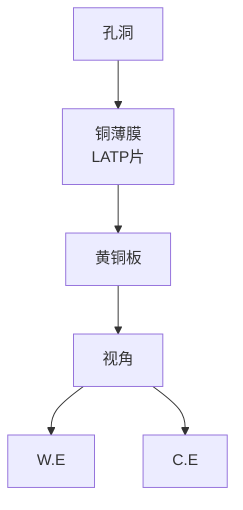

(a)

(b)

图 10.4.11 （a）原位实验示意图；（b）锂成核生长过程

## 10.4.5 扫描电子显微镜在表界面表征中的应用展望

扫描电子显微镜在材料科学、生命科学、环境科学等领域发挥着重要作用。尤其是近年来，随着扫描电子显微镜原位技术的发展，人们对于扫描电子显微镜的应用已经由原来的静态观察逐步过渡到动态表征，并研究出多种原位设备，如原位力学设备、原位电化学设备等。借助扫描电子显微镜实时动态揭示材料的物理化学性质已成为该领域重要的发展趋势，扫描电子显微镜的静态与动态表征相结合的方式将在表界面研究中具有广阔的发展前景，对于相关学科的发展具有重要意义。

习题

## - 章节练习题 -

1. 请解释扫描电子显微镜与光学显微镜的主要区别和优势。
2. SEM 是如何产生高分辨率图像的？请描述其工作原理。

---

588

第十章 表界面分析技术

显微成像发展史中的历史人物

3. SEM 在材料科学、生物学和其他领域中的应用有哪些？请列举一些具体的应用案例。
4. 高真空环境对SEM操作的必要性是什么？如何确保SEM系统的高真空状态稳定并避免污染？

## - 挑战性问题 -

5. 在 SEM 成像中准确表征样品的化学成分和结构信息通常需要结合其他技术手段, 研究人员可以在 SEM 成像中更准确地表征样品的化学成分和结构信息, 从而深入理解材料的性质和行为。随着技术的不断发展和完善, SEM 在材料科学领域的应用前景将会更加广阔。SEM 成像中如何准确表征样品的化学成分和结构信息? 有哪些先进的技术可以实现元素成分分析和三维成像?

## - 专题或报告 -

6. 扫描电子显微镜的样品制备是非常重要的, 因为样品的制备直接影响到 SEM 成像的质量和结果的准确性。例如, 样品制备过程中需要确保样品表面的平整度, 避免凹凸不平或颗粒堆积等情况, 以确保 SEM 成像时能够获得清晰的图像。请查阅相关科学文献, 了解扫描电子显微镜样品制备的常见方法和技术, 并将结果写成报告。

## 10.5 透射电子显微镜

## 10.5.1 透射电子显微镜的发展历史

## 10.5.1.1 电子光学理论的建立

早期，人们在利用常规光学系统进行观测的过程中逐步发现了光学系统的分辨率存在极限的问题。1834年George Biddell Airy在用天文望远镜观察天体时，发现了由于光的波动性而引起的衍射现象，从而在1835年他提出艾里这种光学衍射极限对分辨率限制的概念。到1878年，Cleveland Abb指出光学显微镜分辨本领受到光波衍射的限制，给出了表示显微镜分辨本领极限的公式，指出显微镜的分辨能力受光的波长限制。为了突破光学显微镜的极限，研究人员在寻找高分辨率显微镜的过程中逐渐把注意力转移到真空中高速运动的电子上。

1907 年, Stommel 发表了一篇关于极光的论文, 这篇文章实际上已得出了旋转对称磁场中电子轨迹的普遍方程。从 1921 年 Biji 为解决在示波器用的电子束管中得到细电子束这样一个实际问题开始, 便诞生了电子光学。1926 年, 德国科学家 H. Busch 发表了磁透镜方面的理论研究论文, 人们才意识到利用电子射线制造基于新原理的显微镜的可能性。布什在实践中也制成了第一只高真空磁聚焦电子束管, 证明了旋转对称磁场可以使电子束折射、聚焦, 如同光学透镜对光线的作用, 为电子光学的发展准备了条件。随后, 德国的 W. Glacer、O. Scherze 等发表了一系列电子光学理论性论文, 从而奠定了电子光学的理论基础。

## 10.5.1.2 早期电子显微镜的发展

Hans Busch 提出的高速运行的电子束能被轴对称的电场或磁场折射而聚焦，并在理论上证明了利用电场或磁场能做成电子透镜。Hans Busch 的工作对柏林大学高压研究室的 Max Knoll 和 Ernst Ruska 产生了巨大的影响。Ernst Ruska 从 1929 年开始研究单磁透镜的光学作用，于 1931 年用阴极射线示波器改装成的没有聚光镜的二级磁透镜系统，获得了放大 13 倍的铂金网像。1933 年底至 1934 年

---

10.5 透射电子显微镜

589

初，Ernst Ruska 在配备一个聚光镜和用短焦距的极靴式磁透镜代替空心线圈后，又获得了放大 12000 倍的铝箔与纤维的像，分辨率比光学显微镜提高了 4 倍。然而在一段时期内，由于电子显微镜真空度不高的缺陷及样品在高速电子轰击下易受到损伤，使人们怀疑电子显微镜是否能起到实际的作用。直到 1939 年，Ernst Ruska 在德国的西门子(Siemens)公司制成了分辨率优于 10 nm 的商品电子显微镜，在其投放市场后，世界各国才广泛地开展了对电子显微镜的研制。

例如，荷兰的飞利浦(Philip)公司，美国的无线电(RCA)公司，日本的日立(Hitachi)公司、明石(Bright stone)公司等实验室和公司大力推进电子显微镜的研制过程。电子显微镜的发明人Ernst Ruska因为对电子显微镜的巨大贡献于1986年获得诺贝尔物理学奖。

## 10.5.1.3 透射电子显微镜的进一步发展

早期透射电子显微镜的发展是从阴极发射式电子显微镜开始的。1932年Brucher和Yahasso设计了用于观测阴极且只具有一级放大的电子显微镜。在这种电子显微镜中，发射电子的阴极是被研究的对象，其发射的电子通过一定的几何光学系统后给出阴极的像。像的明暗取决于物面上的发射电子分布，了解发射电子分布就能了解物面的结构情况。但人们要研究的物体绝大多数都不能发射电子，因此阴极发射式电子显微镜的应用受到很大的限制。于是人们想到可以让电子束通过被研究的物体来研究物体的结构，这就是透射电子显微镜。

1947 年, Heller 和 Lambert 将消像散器应用于电子显微镜, 将电子显微镜分辨率提高到 1 nm。但要使电子束穿过被研究的物体, 不仅要求电子束具有足够大的能量, 同时还要求物体具有极小的厚度。历史上由于样品制备上的困难, 物理学家和金属材料学家较晚才开始运用透射电子显微镜技术。1955 年以前, 电子显微镜的基本功能还只限于显微放大。它在固体材料上的应用也局限于用表面复型技术观测材料的表面, 这种方法只能间接了解固体的表面状况。1956 年 Hersch 等成功地制出 100\~200 nm 的薄样品, 先后在不锈钢和铝中看到了位错。从此, 透射电子显微学引起了人们极大的兴趣, 迅速发展成直接观察样本缺陷的有力工具, 从复型技术到透射技术的转变是电子显微学发展史上一个重要的转折点。1956 年, Menter 发明多束电子成像技术, 开创了高分辨率电子显微术, 可以观察到 1.2 nm 的条纹。1971 年, 日本、法国先后建成了超高压电子显微镜, 最高加速电压可达 3000 kV, 分辨率为 2 nm。

1990年，Otto Scherzer的学生Harald Rose在理论上证明了双六极球差校正器（double-hexapole Cs corrector）的可行性。1991年，Harald Rose与Maximilian Haider和Knut Urban开始合作研发球差校正光学元件，并于1998年成功研制出世界上第一台TEM球差校正器。该原型球差校正器搭载于Philips CM200，将其点分辨率由 $0.24\mathrm{nm}$ 提升至 $0.13\mathrm{nm}$，正式将透射电子显微镜业带入原子级分辨的崭新时代。球差校正技术的突破不仅重构了材料微观结构的研究范式，更持续推动材料科学、凝聚态物理及生命科学等领域表征能力的革新，是当今科学研究不可或缺的工具之一。

## 10.5.2 透射电子显微镜的基本构造和成像原理

## 10.5.2.1 透射电子显微镜的基本构造

透射电子显微镜(transmission electron microscope, TEM)是以电子束为光源，用电磁透镜聚焦成像的电子光学仪器。其放大倍数可达到100万倍以上。透射

国产电子显微镜

---

590

第十章 表界面分析技术

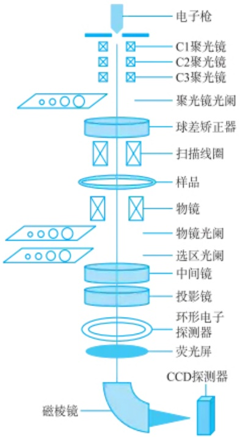

flowchart

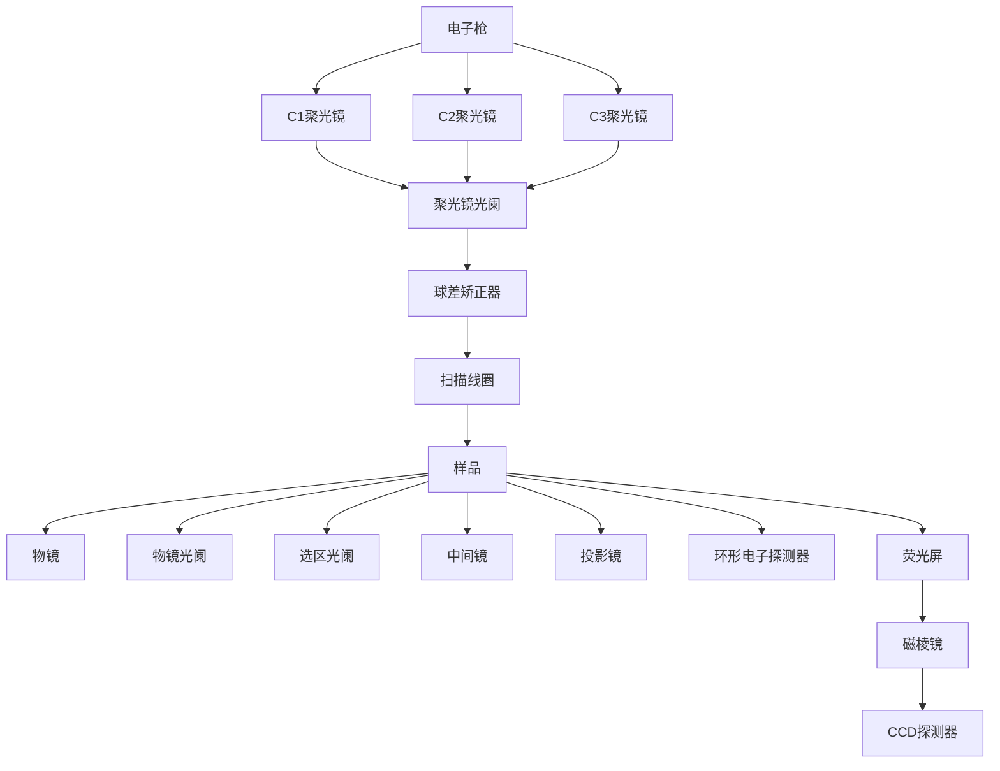

图 10.5.1 透射电子显微镜组成结构

透射电子显微镜实物图

## 思考:

查阅相关文献,了解选区电子衍射技术的具体应用领域。

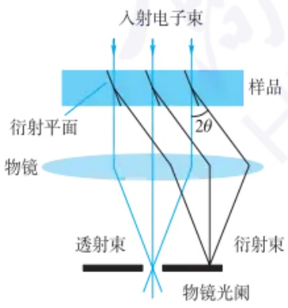

text_image

入射电子束
样品
衍射平面
物镜
透射束
衍射束
物镜光阑

明场像

电子显微镜由真空部分、电子光学部分和电源电器控制部分组成。真空部分的主要部件有真空泵、真空阀和显示仪表，为电子束稳定工作提供高真空、超高真空环境，保证电子自由程，避免灯丝、样品的损伤。透射电子显微镜工作期间，整个电子通道处于真空状态。电子枪、镜筒和照相室之间各装有真空阀，各部分可单独抽真空。可以在不破坏其他部分真空状态的情况下进行灯丝更换、样品更换、光阑清洗和电子显微镜维护。电源电器控制部分为整个电子显微镜和各个控制单元提供电源。其中电子光学部分是透射电子显微镜的核心部分，真空部分和电源电器控制部分是辅助系统。电子光学部分主要包含照明系统、成像系统、观察-记录系统，分别发挥提供光源、成像与衍射、观察-照相的功能。透射电子显微镜组成结构如图10.5.1所示。

除了上述系统,透射电子显微镜还装备样品杆、电子束倾斜和平移装置、消像散器等部件。

样品杆是装载样品放入电子显微镜的基本部件，通过样品杆将样品送进电子显微镜中观察。由于样品需要进行多种观察，对样品杆提出了很高的要求，因此设计开发出具有不同功能的样品杆，例如，单倾杆、双倾杆、多功能样品杆及可以进行原位实验的力学杆、加热杆、冷却杆、气相杆、液相杆等。

## 10.5.2.2 透射电子显微镜成像原理

由电子枪发射出来的电子束，在真空通道中沿着镜体光轴穿越聚光镜，经聚光镜会聚成一束尖细、明亮而又均匀的光斑，照射在样品室内的样品上；透过样品后的电子束携带有样品内部的结构信息，样品内致密处透过的电子量少，稀疏处透过的电子量多；经过物镜的会聚调焦和初级放大后，电子束进入下级的中间透镜和第1、第2投影镜进行综合放大成像，被放大了的电子影像投射在观察室内的荧光屏板上；最终通过荧光屏将电子影像转化为可见光影像以供使用者观察。

## 10.5.2.3 选区电子衍射基本原理

借助安装在物镜像平面的选区光阑，可以对产生衍射的样品区域进行选择，并对选区范围的大小加以限制，从而实现形貌观察和电子衍射的微观对应。选区光阑用于挡住光阑孔以外的电子束，只允许光阑孔以内视场所对应的样品微区的成像电子束通过。荧光屏上观察到的电子衍射花样，仅来自选区范围内样品的贡献。

## 10.5.2.4 高分辨成像技术基本原理

高分辨率透射电子显微术(high-resolution transmission electron microscopy, HRTEM)是一种基于透射电子显微镜的高分辨率成像技术。通过利用透射电子束与样品相互作用的原理，HRTEM可以获得非常高的空间和能量分辨率，从而实现对材料微观结构的观察和分析。

## 10.5.3 透射电子显微镜成像模式及定量化分析技术

## 10.5.3.1 透射电子显微镜的成像模式

透射电子显微镜的成像模式主要包括以下四种:

（1）明暗场衬度图像 这是 TEM 中最基本的成像模式, 包括明场成像和暗场成像。
（2）晶体学衬度图像 这种模式主要用于观察晶体材料的晶面间距、原子排布等结构信息。

（3）相衬图像 这种模式通过改变照明光束和样品之间的相位差来观察样品的不均匀性，常用于生物组织等生物样品的研究。

---

10.5 透射电子显微镜

591

（4）能量过滤图像 这种模式通过选择性地阻挡不同能量的电子来观察不同元素或不同化学键的样品区域。

## 10.5.3.2 扫描透射电子显微镜基本原理

扫描透射电子显微术(scanning transmission electron microscopy, STEM)是一种高分辨率的电子显微镜技术，它能够在纳米尺度下观察样品的结构和化学成分。STEM成像的原理基于电子的波动性和干涉效应。首先，STEM使用的是电子束而非光束，因为电子的波长比光的波长短得多，能够克服光学显微镜的分辨率限制。在STEM中，使用的透射电子束被聚焦成非常细的探针，然后样品与电子束相互作用，透射的电子被收集并在探测器上形成图像。

## 10.5.3.3 能谱仪成分分析技术、电子能量损失谱及四维扫描透射电子显微术

## 1. 能谱仪成分分析技术基本原理

能谱仪(energy dispersive spectrometer, EDS)是一种分析物质元素的表征手段，常与扫描电子显微镜或者透射电子显微镜联用。其工作原理基于电子束-物质相互作用机制:在真空环境下，聚焦电子束轰击样品表面激发出特征X射线，通过探测器接收不同能量的特征X射线信号，对元素周期表中硼至铀元素的定性或半定量分析。EDS可实现样品表面特定区域的点分析（单点成分）、线扫描（成分分布）及面分布成像（元素面分布）。

## 2. 电子能量损失谱基本原理

电子能量损失谱(electron energy loss spectroscopy, EELS)是一种基于电子非弹性散射过程解析材料中元素组成和化学键合的表征手段。具有已知动能的电子束入射待测材料后，部分电子与原子相互作用发生非弹性散射，损失部分能量并且路径发生随机的小偏转，这个过程中能量损失的大小经电子能谱仪测量并得以分析解释。通过研究非弹性散射电子的能量损失分布，可以得到原子中电子的空间环境信息，从而研究样品的多种物理和化学性质。

## 3. 四维扫描透射电子显微术

四维扫描透射电子显微术（four-dimensional STEM, 4D-STEM）是指在 STEM 模式下，采用会聚电子束对样品进行二维实空间逐点扫描的同时，通过像素化的直接电子探测器同步记录每个扫描点对应的二维动量空间衍射图样，构建包含实空间坐标和动量空间衍射信息的四维数据集。基于采集的四维数据集，研究人员可在后处理阶段通过虚拟探测器重构和机器学习算法等数字处理手段，获得多维度的样品信息。与传统 STEM 相比，4D-STEM 完整保留了电子束与样品相互作用产生的全部散射信息，同时包含样品在实空间的结构特征与动量空间的衍射特征，这种信息完备性为材料多尺度表征提供了前所未有的可能性。

## 10.5.3.4 透射电子显微镜样品制备和操作步骤

透射电子显微镜是采用波长很短的电子束透过样品成像，由于电子束的穿透能力较弱，因此，对于TEM样品的厚度有一定的要求，而且通过TEM观察的区域一定要代表所研究的材料。理想的TEM样品要求均匀分散或均匀减薄，具有良好的导电性，同时耐电子束轰击。TEM样品制备的方法有很多种，材料的类型不同，选取的制样方法就会有所不同。适合的制样方法对透射电子显微镜的观察效果有着重要的影响。

## 1. 粉末样品

针对粉末样品,选择高质量的微栅网(直径3 mm),这是关系到能否拍摄出高质量高分辨电镜照片的第一步;用镊子小心取出微栅网,将膜面朝上,轻轻平放在

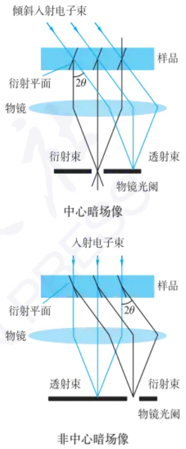

## 思考:

扫描透射电子显微镜与扫描电子显微镜的异同点。

## 思考:

微栅网的种类有哪些？

## 思考:

双喷电解减薄法中的电解液种类有哪些？

---

592

第十章 表界面分析技术

## 思考:

了解离子减薄法的优缺点。

## 思考:

查阅相关文献,了解聚焦离子束技术在原子探针层析技术(APT)中的具体应用。

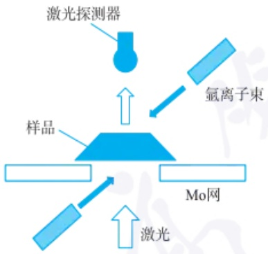

flowchart

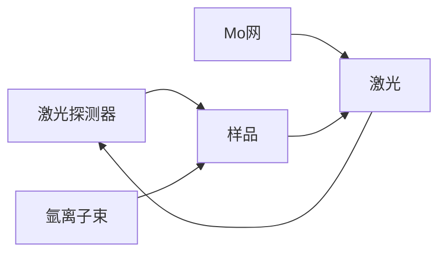

图 10.5.3 离子减薄法示意图

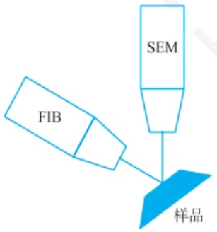

flowchart

图10.5.4 FIB-SEM双束系统示意图

白色滤纸上；取适量的粉末和乙醇分别加入小烧杯，进行超声振荡10\~30 min，静置3\~5 min，用玻璃毛细管吸取粉末和乙醇的均匀混合液，然后滴2\~3滴该混合液体到微栅网上。等15 min以上，以便乙醇尽量挥发完毕。

## 2. 块状样品

（1）双喷电解减薄法 双喷电解抛光法主要用于制备金属和合金薄膜样品。在双喷电解抛光之前，样品一般要进行预减薄，其操作流程如下:用精密切割机或复式线锯将块体样品切成 $0.3\mathrm{mm}$ 左右的均匀薄片。接着用砂纸将薄片机械研磨至 $100~{\mu\mathrm{m}}$ 左右的厚度。随后机械抛光或使用化学抛光液将薄片减薄至 $40~{\mu\mathrm{m}}$ 左右，最后用冲孔机冲下直径 $3\mathrm{mm}$ 的圆片以备终减薄使用，其原理如图10.5.2所示。

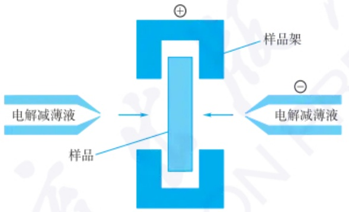

flowchart

图 10.5.2 双喷电解减薄法示意图

（2）离子减薄法 离子减薄法可用于陶瓷材料、合金、复合材料、多相半导体及截面样品的TEM样品制备。使用离子减薄法制备TEM样品之前，同样需要对样品进行预减薄，一般采用机械研磨的方法或金刚石切割器将样品减薄为$100\mu \mathrm{m}$ 厚度的薄片，随后用冲孔机冲下直径 $3\mathrm{mm}$ 的圆片，对于陶瓷等脆性材料，需要用直径 $3\mathrm{mm}$ 的金属环补强。再用凹坑机在圆片中央部位磨出一个凹坑以备离子减薄使用。离子减薄主要是利用高能惰性气体离子（通常使用的是Ar离子)轰击样品表面，使表面的原子溅射出来，其原理如图10.5.3所示。
（3）聚焦离子束技术 聚焦离子束(focused ion beam, FIB)技术，由聚焦离子束扫描电子显微镜(FIB-SEM)双束系统来完成，其工作原理如图10.5.4所示。电子束垂直安装，离子束与电子束成一定的夹角安装，通常称电子束和离子束焦平面的交点为共心高度位置，在使用过程中样品处于共心高度的位置即可同时实现离子束加工和电子束成像，并可以通过样品台的倾转使样品表面与电子束或离子束垂直。

## 3. 透射电子显微镜的操作步骤

装载样品: 使用镊子将样品小心地转移到样品杆上, 并确保样品与样品杆接触良好。

插入样品杆: 将样品杆插入样品室, 关闭显微镜的样品室门, 并启动抽真空系统。

拍摄原子像: 打开电子枪电源, 调节聚光镜的焦距和孔径, 使用显微镜的对焦机构, 将样品对焦到清晰的图像。调整到合适的放大倍数拍摄样品的原子像。

拔出样品杆:实验结束,关闭电子枪阀门,点击“holder”使样品杆中的样品回归到初始位置,拔出样品杆。

---

10.5 透射电子显微镜

593

卸载样品、样品放回样品盒:将样品从样品夹持器上取下，并妥善存放于样品盒中，等待下次实验使用。

## 10.5.4 透射电子显微镜在材料表界面分析中的应用

## 10.5.4.1 表界面结构静态表征

透射电子显微镜是以波长很短的电子束作为照明源，用电磁透镜聚焦成像的一种具有高分辨率、高放大倍数的电子光学仪器，该电子显微镜具有操作简单、性能可靠的特点，可观察低倍50倍至高倍60万倍图像。

透射电子显微镜作为材料表征的重要手段在不同研究领域大放异彩，不仅可以用衍射模式来研究晶体的结构，还可以在成像模式下得到实空间的高分辨像，即对材料中的原子进行直接成像，直接观察材料的微观结构。

## 1. 金属合金领域

由于合金在制备过程中，不同层之间的偏析、扩散等现象会导致界面产生多余应变，改变宏观晶体生长质量，可以通过透射电子显微镜，探究微观的应变、元素扩散与材料能带结构、电荷分布及宏观性能之间的关系。我国科学家发现在$\mathrm{AlCoCrFeTi_{0.5}}$ 高熵合金中添加Ni元素，可以获得体心立方（BCC）/面心立方(FCC)双相结构，并实现最有希望的强度和塑性的组合。通过透射电子显微镜等表征技术发现随着Ni添加量从物质的量之比为0增加到3，初始有序的BCC(B2相)结构首先转换为双工BCC(A2+B2)结构，然后转换为FCC(L12)/BCC(A2+B2)双相结构，如图10.5.5所示。

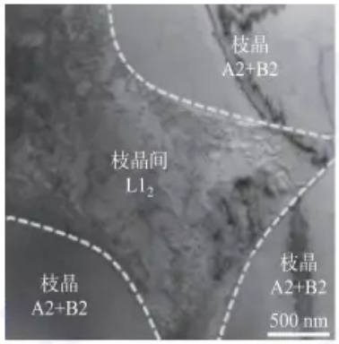

text_image

枝晶
A2+B2
枝晶间
L1₂
枝晶
A2+B2
枝晶
A2+B2
500 nm

(a)

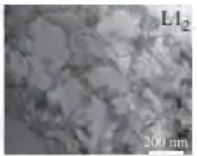

(b)

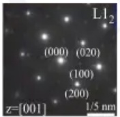

(d)

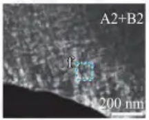

(c)

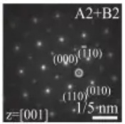

(e)

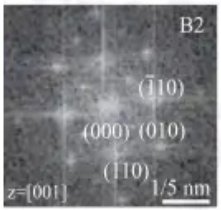

text_image

B2
(110)
(000) (010)
(110)
z=[001]
1/5 nm

(g)

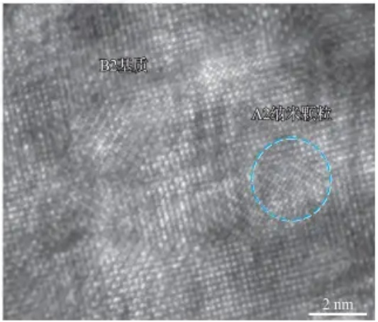

text_image

B2基质
A2纳米颗粒
2 nm

(f)

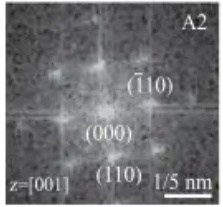

text_image

A2
(110)
(000)
(110)
z=[001] 1/5 nm

(h)

材料表界面的 TEM 图像示例

图 10.5.5 由枝晶和枝晶间区域组成的 Ni2.5 HEA 的典型 TEM 图像

---

594

第十章 表界面分析技术

## 2. 化学领域

透射电子显微镜可以在极高的放大倍数下直接观察纳米颗粒的形貌和晶体结构，是纳米材料最常用的表征手段之一。我国科学家采用扫描电子显微镜对一种碳包覆磷酸铁锂材料进行观察，发现材料呈现均匀的球形颗粒结构；而透射电子显微镜则可以测量颗粒的粒径大小，在高分辨模式下还能看到磷酸铁锂材料的晶格排布，如图10.5.6所示。同时由于包覆的碳层有明显的晶格缺陷，其晶体排布呈短程有序，长程无序的特征明显区别于磷酸铁锂材料，由此就可通过透射电子显微镜照片测量出碳包覆的厚度。我国科学家研究三元材料在不同存储条件下的反应时，采用扫描电子显微镜可以看出不同储存条件下材料表面会生成不同的杂质；而采用透射电子显微镜可以进一步探究杂质分布情况，结果显示空气存储条件下三元材料表面完全被杂质覆盖，而干燥 $\mathrm{CO}_{2}$ 条件下杂质包覆并不明显。

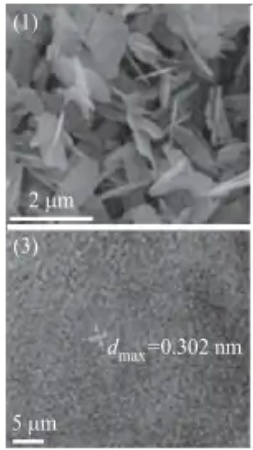

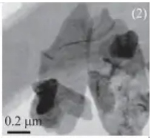

natural_image

Microscopic image showing dark irregular structures with a 0.2 μm scale bar (no text or symbols beyond label)

text_image

(4)
c
h
2 1/nm

(a)

natural_image

Microscopic view of spherical particles with no visible text or symbols

natural_image

Microscopic image showing a textured surface with a 2 nm scale marker and an inset diffraction pattern (no text or symbols)

(b)

(c)

图 10.5.6 透射电子显微镜在锂离子电池中的应用[(a),(b)磷酸铁锂材料 LPF;(c)三元镍钴锰酸锂材料 NCM]

## 思考:

查阅相关文献,了解原位透射电子显微镜技术的发展历程。

## 3. 生物学领域

我国科学家利用透射电子显微镜研究了甘露醇酯类化合物(MELS)对革兰氏阳性蜡样芽孢杆菌营养细胞和芽孢的抑菌作用及其机制，如图10.5.7所示。实验观察到通过MELS处理后的细菌细胞出现了明显的形态和超微结构变化，证实了细胞膜的破坏和细胞环境的失衡。此外，MELS还显示出良好的抑制蜡样芽孢杆菌孢子萌发的能力。这些结果表明，MELS的抗菌作用主要是通过破坏细胞膜实现的，这表明它在食品加工中替代抗菌剂和防腐剂的应用潜力。

---

10.5 透射电子显微镜

595

natural_image

Microscopic view of a rod-shaped bacterial cell (no text or labels visible)

(a) 对照

natural_image

Microscopic view of a rod-shaped bacterial cell (no text or labels visible)

(b) 用MIC水平的MEL处理的蜡样细胞

图 10.5.7 蜡状芽孢杆菌的形态

## 10.5.4.2 表界面结构动态表征

原位透射电子显微术(in-situ transmission electron microscopy, in-situ TEM)通过集成多功能原位样品杆，使研究人员能够在多物理场(力、热、电、磁)耦合环境或化学反应进程中，对材料进行原子尺度的实时观察和原位操控，直接观察相变、位错滑移、晶体生长等微观演化过程，如图10.5.8所示。

## 1. 原位力学研究

使用 in-situ TEM 完成最多的工作是在形变和相变领域: 微观组织形变, 熔化和结晶, 晶体结构之间的转变, 以及由温度、电压或机械应变驱动的固态扩散。

我国科学家通过结合先进的原位电镜技术和分子动力学模拟，经过精巧的实验设计和独特的原位力学实验方法，制备出含有各种类型晶界的金属纳米材料结构。通过精确控制原位样品杆的移动端，成功做到了稳定原位剪切加载，并使用高速相机实时捕捉材料变形时的晶界结构动态演化，从原子尺度揭示了剪切应力作用下不同结构的晶界通过失配位错形核、滑移和交互作用实现往复迁移的一般机制，并在一系列实验中验证了该迁移机制的普适性，完善了目前对晶界变形行为的认识，如图10.5.9所示。

纳米孪晶金刚石复合材料的原位拉伸 TEM 实验

(a) Wildfire原位加热样品杆

(b) Lighting原位电学样品杆

(c) Climate原位气体样品杆

(d) Stream原位液体样品杆

图 10.5.8 DENSsolutions

原位透射样品杆

text_image

Triple junction
GB1
TB
GB2
Shear
0 s

(a)

natural_image

Close-up of a textured surface with a small circular feature labeled '1' and a time marker '0.4 s' (no other text or symbols)

(b)

text_image

GB migration
1
1.2 s

(c)

text_image

2
1
1.6 s

(d)

text_image

4 3 2
2.4 s

(e)

text_image

7 6 5
3.2 s

(f)

图 10.5.9 （a）纳米晶体中的三叉晶界结构；（b）和（c）失配位错1从三叉晶界处形核并在GB2上滑移，导致相应的晶界迁移；（d）\~（f）多个失配位错连续从三叉晶界处形核，并在GB2上滑移，导致GB2的大幅度迁移

---

596

第十章 表界面分析技术

原子分辨高温力学测试系统

## 2. 原位热学研究

国内外科学家基于透射电子显微镜的原位加热技术，在催化剂/纳米线界面上观察到 InAs 纳米线从纤锌矿结构向闪锌矿结构的转变，通过详细的结构和动力学分析，发现每一层 In 的成核位置和催化剂表面能对闪锌矿结构的生长起着决定性的作用，如图 10.5.10 所示。

text_image

25 ℃
10 nm
膜晶体面

(a)

natural_image

Microscopic image of a nanoscale structure with 10 nm scale bar and 310 °C annotation (no readable text or symbols beyond labels)

(b)

text_image

320 °C
8s
10 nm

(c)

text_image

320 °C
46s
10 nm

(d)

图 10.5.10 原位加热过程的高分辨率透射电子显微镜

(a)  $25^{\circ}C$  (b)  $310^{\circ}C$  的图像；(c)(d) 加热温度为  $320^{\circ}C, 8s$  和  $46s$  的图像

用于 TEM 内电池材料操作表征的原位液体微电池构造

text_image

B
C
0 s D
147 s E
215 s F
347 s G
487 s H
625 s I
747 s J
823 s K
920 s L
1013 s M
1119 s N
1860 s O
ILE

图 10.5.11 SnO₂ 纳米线在充电过程中的锂化过程及其结构变化

## 3. 原位电学研究

通过原位样品电学杆对样品进行原位电学激励及测量。由于样品是被静态固定到了芯片的电极上，因此该方式下的样品在原位实验中较稳定，较易实现原子级的图像拍摄。

在锂电池中，充放电过程中的微结构变化对电池的性能与可靠性有极大影响，然而普通的静态电镜研究无法对其动态过程进行有效观察。我国科学家利用探针式原位电学样品杆构造的纳米电化学器件，成功地对  $SnO_{2}$  纳米线阳极在充电中的锂化过程进行了实时的电子显微镜观察，如图 10.5.11 所示。实验观察到反应前端区域沿着纳米线持续传播，导致纳米线膨胀、伸长和卷曲，且该反应前端区域包含了大密度的移动位错，表明其表面有很大的错配应力，是电化学驱动的固态非晶化的前驱体。这些发现为设计新型先进电池提供了重要的机械方面的新理解。

## 4. 原位磁场研究

由于 TEM 中的样品总是处在强磁场中,大多数磁性样品在这样的强磁场下会失去原本的磁结构,所以与磁相关的原位 TEM 研究较为困难,也相对较少,一般借助电子全息术和具有洛伦兹透镜的电子显微镜来研究相关材料的磁性结构。TEM 电子全息术是一种记录电子波在样品中传播时相对相移的技术,由于这种相移与样品平面内的磁感应成比例,因此可以在接近纳米尺度的高空间分辨率下

---

10.5 透射电子显微镜

597

进行定量评估。

我国科学家利用电子全息观察和计算机模拟的方法对非晶态软磁材料 FeSi 磁涡旋的三维自旋结构进行研究。涡旋中心附近的磁化分布由全息观察获得的相位分布估计，如图 10.5.12 所示。利用样品倾斜实验揭示这种磁化分布，当样品相对于电子束方向倾斜时，相位图像中心沿着倾斜轴移动。顺时针和逆时针倾斜样品，测量相位图像中心的位移。利用有限元计算模拟，在无样品倾斜条件下的实验磁化分布记录样品倾斜时相位图像中心的偏移量，并利用实验获得的无倾斜条件下的磁化分布数据来模拟这些位移量，结果发现，相位图像中心的模拟位移与样品倾斜实验中的相位图像中心的位移吻合得很好从而证实了电子全息观测得到的涡旋中心附近的磁化分布。

## 思考:

查阅相关文献,了解原位透射电子显微镜技术在研究金属形变机理的应用。

natural_image

Microscopic view of a circular patterned structure with concentric rings and labeled axes (x, y, z), no readable text or symbols present.

(a)

natural_image

Microscopic image showing concentric circular patterns with a 100 nm scale bar (no text or symbols beyond labels)

(b)

natural_image

Microscopic view of a circular biological structure with concentric rings and a 45° angle label (no other text or symbols)

(c)

line

| 相移 (nm) | 转动角度 \(({}^{\circ})\) |
| --- | --- |
| -100 | ~120 |
| 0 | ~142 |
| 500 | 0 |
| 600 | 0 |

(d)

line

| Displacement (nm) | Rotation angle \(({}^{\circ})\) (Black line) | Rotation angle \(({}^{\circ})\) (Blue line) |
| --- | --- | --- |
| -30 | ~137.2 | ~134.0 |
| -10 | ~141.8 | ~140.8 |
| 0 | ~143.2 | ~139.2 |
| 10 | ~142.0 | ~139.8 |
| 30 | ~137.8 | ~137.2 |

(e)

图 10.5.12 样品转动角度与相移

(a)(b)(c)以y轴为旋转轴，样品分别转动 $-45^{\circ},0^{\circ},45^{\circ}$ 的示意图；(d)沿(a)\~(c)中直线对应的相移；(e)是(d)方框区域的放大图

## 10.5.5 透射电子显微镜在表界面表征中的应用展望

进行原位实验已成为目前 TEM 研究的重要方向之一,这是在纳米乃至皮米尺度上研究物质在不同场环境中的结构变化,探寻材料在使用条件下性能的结构根源,进而进行源头创新不可或缺的工具,在物理、材料、化学、生物和机械等基础研究与技术研发领域都有着极广泛的应用。尤其是在电子技术不断发展的今天,微电子器件尺度已经达到了几纳米,原位电子显微镜以其原子分辨的成像能力,必将成为电子技术研究领域极为重要的研究手段。

---

598

第十章 表界面分析技术

## 习题

## - 章节练习题 -

1. 简述透射电子显微镜的特点。
2. 简述透射电子显微镜主要组成部件及各部件所起到的作用。
3. 简述透射电子显微镜的基本原理。
4. 了解并掌握透射电子显微镜对于不同种类样品的制备方法。

## - 挑战性问题 -

5. 不同研究领域中，科研人员更想通过实时观测样品中微观结构的变化，以此来建立结构-性能之间的联系。原位透射电子显微技术应运而生，该项技术允许研究人员在实时观察和操控样品的条件下进行高分辨率成像和表征。并能够实现直接从原子层次观察样品在力、热、电、磁作用下及在化学反应过程中研究材料的结构和行为，并直接观察相变、位错运动、晶体生长等动态过程。通过原位透射电子显微技术，研究人员可以更深入地了解材料的性能、相互作用和响应机制，一度成为材料研究最为热门的工具。请查阅和参考相关文献，了解什么是原位透射电子显微镜技术，了解其在材料科学领域中的应用情况。

## - 专题或报告 -

6. 透射电子显微镜在能源电化学、材料科学、纳米科学及生物科学领域的应用越来越广泛。例如，在材料力学领域，通过透射电子显微镜观测金属样品在拉伸前后的微观组织变化情况，厘清影响金属材料强韧性的因素。请查阅相关科学文献，了解关于透射电子显微镜在材料力学分析中的应用情况，并将结果写成报告。
