# 第十一章 显微成像分析

原始 PDF 第 620–663 页。

第十一章

显微成像分析

显微成像技术可以提供高分辨率的图像，帮助研究人员深入了解样本的微观结构和性质，如新材料表面结构和成分研究、细胞和活体成像分析等，有效推动科学研究从宏观走向微观，从结构成像逐步走向分子水平的化学成像。本章主要介绍扫描隧道显微成像、原子力显微成像、电化学显微成像、光学显微成像、激光扫描共聚焦显微成像和超分辨成像，了解各类微区分析技术的基本原理、仪器构造、工作模式和应用发展。

## 11.1 扫描隧道显微成像

本节阐述扫描隧道显微成像技术的原理、仪器构造、工作模式和相关应用。

## 11.1.1 扫描隧道显微成像发展历史及原理

## 11.1.1.1 发展历史

1982 年, IBM 瑞士苏黎世实验室的物理学家 Gerd Binnig 和 Heinrich Rohrer 研制出世界上第一台扫描隧道显微镜 (scanning tunneling microscope, STM), 并于 1986 年获得诺贝尔物理学奖。扫描隧道显微镜的诞生使得人类首次实现了在单个原子尺度上实时无损地观察物质表面的原子排列状态和电子行为, 被国际科学界公认为 20 世纪 80 年代世界十大科技成就之一。

## 11.1.1.2 量子隧穿效应

量子隧穿效应(quantum tunneling effect)是指当势垒高度大于粒子总能量时，微观粒子(电子、中子或质子)直接穿透高能量势垒的量子行为(如图11.1.1所示)。根据海森堡不确定性原理，由于微观粒子具有不确定性，即粒子能量低于势垒能量时，也有一定的概率出现在势垒之外。该现象也可以通过微观粒子的波动性来解释，在使用波函数描述粒子位置和动量的概率分布时，即使在势垒区域外也不完全为零，而是会有一个非零的“隧穿尾巴”延伸到势垒之外。粒子的能量越大，则发生隧穿的概率越大。该理论属于量子力学的研究领域，已广泛应用于半导体、超导体器件、核反应等方向，其中最典型的例子是扫描隧道显微成像技术。由于量子隧穿效应的存在，电子较易穿过厚度小于 $1\mathrm{nm}$ 的绝缘层或晶体管，因此在一定程度上限制了微电子器件的尺寸。

在经典力学中,粒子的能量大于势垒时才可以越过势垒,能量小于势垒的粒子绝对不可能越过势垒,即透射系数等于零,粒子将完全被弹回。在量子力学中,由于微观粒子具有波粒二象性,可用波函数描述粒子的可能位置及动量分布。当粒子发生量子隧穿过程时,波函数不会立刻变为零,而是发生指数衰减,其波峰及

世界上第一台扫描隧道显微镜的研制

---

600

第十一章 显微成像分析

## 经典力学和量子力学中， 穿过能量势垒的不同方式

在经典力学中，当一个运动中的粒子遇到势垒时，能量低于势垒的粒子绝对不可能从势垒的一边移动到另一边，需要一定的能量来翻越该势垒；在量子力学中，由于粒子具有不确定性，即使能量低于势垒的粒子也具有一定的概率可以穿越该势垒，并且粒子的能量越大，穿越势垒的概率越高，这就是量子隧穿效应。量子隧穿效应发生的厚度一般约为1 nm以下，由于微观粒子具有波粒二象性，因此可用波函数来表述粒子的状态。

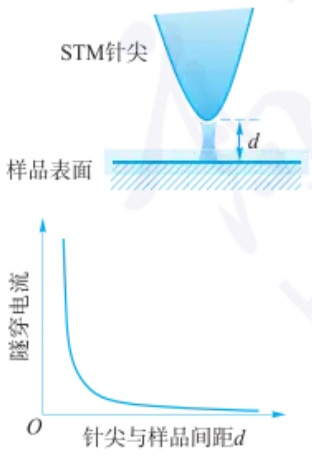

图 11.1.2 扫描隧道显微成像技术中, 探针针尖与样品表面的隧穿电流示意图(上)以及隧穿电流和针尖和样品间距之间的关系(下)

波谷位置在这一过程中均会发生一定的位移,代表了量子动量的改变。

量子隧穿效应是由于粒子的波动性而引起的, 只有在一定的条件下, 该效应才会显著。经计算, 透射系数 T 可表示为

$$
T \approx \frac {1 6 E (V - E)}{V ^ {2}} e ^ {- \frac {2 a}{h} \sqrt {2 m (V _ {0} - E)}} \tag {11-1-1}
$$

式中，T 与势垒厚(宽)度 a，粒子初始能量  $V_{0}$ ，势垒与粒子能量差 (V-E) 及粒子的质量 m 有着很敏感的关系。随着势垒厚(宽)度 a 的增加，T 将呈指数衰减，因此在宏观体系中，几乎无法观察到粒子隧穿势垒的现象。在实际应用中，当两个薄金属层之间存在一个小于 1 nm 的绝缘层时，微粒的部分动能 E 可能小于两端金属之间的势垒 V，从而穿透绝缘层从一侧金属到达另一侧金属。

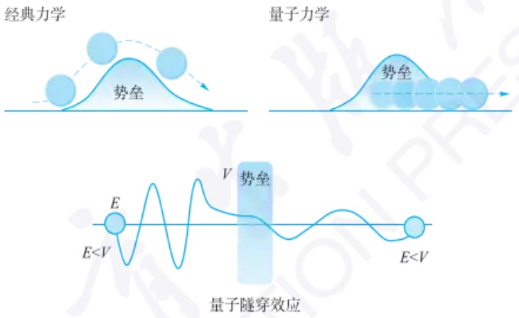

text_image

经典力学
势垒
量子力学
势垒
量子隧穿效应
E
E<V
V
势垒
E<V

图 11.1.1 经典力学和量子力学中, 穿过能量势垒的不同方式

## 11.1.1.3 扫描隧道显微成像原理

扫描隧道显微成像是通过量子隧穿效应来探测物质表面结构的原子级分辨率的成像技术。该技术利用电子在针尖和物质表面原子间的量子隧穿效应，将物质表面原子的排列转换为图像信息，直接获得物质表面局域电子态密度，从而实现原子定位和操纵原子等。

该技术以金属针尖为一电极，物质表面作为另一电极。金属针尖往往采用钨丝或铂铱丝，其尖端只有几个原子的大小。当物质表面的原子与导电针尖之间的距离缩小至原子尺寸数量级（小于1 nm）时，两者之间的势垒变得非常薄，从而产生量子隧穿效应。金属中的自由电子以一定的概率穿透势垒，从一个电极到达另一个电极，两个导体及之间的亚纳米级绝缘层构成了金属-绝缘体-金属的隧道结。如果在两电极之间加上较小的偏置电压（通常为2 mV至2 V），便可以测得隧穿电流。隧穿电流与两个电极的有效间隙呈指数关系（如图11.1.2所示），因此当针尖和样品之间的距离每减少0.1 nm时，隧穿电流增大约一个数量级，其公式如下:

$$
I = V _ {\mathrm{b}} \exp (- A d \sqrt {\varphi}) \tag {11-1-2}
$$

式中，$I$ 为隧穿电流，$V_{\mathrm{b}}$ 为针尖和样品之间施加的偏置电压，常数 $A$ 在真空条件下约为 $1, d$ 为针尖与样品之间的距离。$\varphi$ 为针尖和样品表面的平均功函数，$\varphi = \frac{1}{2} (\varphi_1 + \varphi_2)$，其中 $\varphi_1$ 与 $\varphi_2$ 分别代表针尖和样品表面的功函数。该技术将空间距离的变化转化为电流信号，从而获取样品表面的形貌图像，横向空间分辨率可达 $0.1 \mathrm{~nm}$，纵向空间分辨率优于 $0.01 \mathrm{~nm}$。此外，该技术还可以实时获得物质表面的

---

11.1 扫描隧道显微成像

601

三维空间图像、电子态密度、表面势垒的变化等。当样品表面的原子高低不平时，探针与样品表面距离的动态变化引起隧穿电流的改变，从而转化为样品表面原子级空间分布。

扫描隧道显微成像技术与其他表面分析技术相比,具有以下成像特征:

（1）可实现原子级高空间分辨率。该技术在平行于样品表面方向上的空间分辨率可达 $0.1\mathrm{nm}$，即可以分辨单个原子。
（2）可获取样品表面真实空间三维图像。可进行周期性或非周期性表面结构动态变化的实时研究。

（3）可获取单原子层局域信息。单原子层局域信息的获取可实现表面重构、表面吸附、表面扩散等动态过程的直接观察，以获取吸附物的形态和位置的实时变化。

（4）可进行无损探测，工作范围较广。该技术可在真空、大气、溶液、常温、低温等不同环境下工作，适用温度范围可达0\~1100 K，无须特殊的制样过程，且整个探测过程针尖与样品并没有发生实际的接触，因此对样品没有损伤。可进行电极表面电化学过程、多相催化过程等内在反应机理的研究。

（5）可在低温下进行单原子或单分子的精准操控。探针针尖可在4 K的低温下对样品表面的单原子或单分子进行精准地移动或操纵，构造所需要的纳米结构。

（6）可与扫描隧道谱联用，实现样品表面逐点局域电子态密度、能隙结构、掺杂原子分布和电离等信息的测量。

## 11.1.2 扫描隧道显微成像装置

## 11.1.2.1 扫描隧道显微镜构造

## 1. 机械传动系统

机械传动系统包含了扫描隧道显微镜探针和扫描头。探针采用硬度较大且导电的钨丝或者铂铱丝，避免高速扫描导致的针尖晃动从而降低成像质量。为了达到原子级分辨率，目前主要有机械剪切和电化学蚀刻这两种方法来制备单个或数个原子尺度的探针针尖。扫描头用于固定探针并精确调控探针的三维空间位置，通常由压电陶瓷制成。通过施加适当的电压，扫描头中的压电陶瓷管可以伸长和扭转，进而驱动探针针尖在水平方向和垂直方向做三维运动。探针针尖一般安装在三条边互呈 $90^{\circ}$ 的悬臂顶角上，支架的每一条边都为压电陶瓷制作而成。压电陶瓷伸长或缩短的变化值与所施加的电压呈线性相关，可将 $1\mathrm{mV} - 1000\mathrm{V}$ 的电压信号转换为亚纳米到微米级别的空间位移。压电陶瓷目前多采用钛酸钡等多晶陶瓷材料。一般来说，机械传动部分具有粗调节器和压电驱动器两个调节系统，第一级采用粗调节器来控制针尖与样品之间百纳米及以上的相对位置变化，第二级则采用压电驱动器来控制探针针尖与样品的相对位置小于 $1\mathrm{nm}$ 。

扫描隧道显微镜针尖结构的优化是扫描隧道显微技术要解决的主要问题之一。针尖的大小、形状和化学同一性不仅影响着扫描隧道显微镜图像的分辨率和图像的形状，而且也影响着测定的电子态。钨针尖的硬度好，熔点较高，可进行高温处理，制备常用电化学蚀刻法，该过程较为复杂且耗时。电化学蚀刻法主要是通过将金属线浸泡于碱性溶液中并施加电压，使得金属线在溶液凹液面处发生蚀刻。控制交流电或直流电可产生不同形貌的针尖以满足不同的测量需求。刻蚀好的针尖在使用前一般要进行高温处理，来除去针尖的绝缘氧化层和污染物。

扫描隧道显微成像技术存在的不足

## 针尖的影响

针尖的宏观结构应使得针尖具有高的弯曲共振频率，从而可以减少相位滞后，提高采集速度。如果针尖的尖端只有一个稳定的原子而不是有多个原子，那么隧道电流就会很稳定，而且能够获得原子级分辨的图像。当扫描隧道显微镜探针针尖的化学纯度很高时，就不会涉及系列势垒。例如，针尖表面若有氧化层，则其电阻可能会高于隧道间隙的阻值，从而导致针尖和样品间产生隧道电流之前，二者就发生碰撞。

不同方法制备的针尖

---

602

第十一章 显微成像分析

## 计算机控制系统离线数据分析 常见功能

1. 傅里叶变换: 对获得的图像进行快速傅里叶变换来研究原子级空间图像的周期性;
2. 平滑: 将图像像素与邻近的像素进行加权平均, 使获得的原子级图像数据的高度变化趋于平缓, 消除点突变的情况;
3. 滤波: 消除测量过程中, 由于外在条件扰动带来的毛刺;
4. 高斯拟合: 对获得的图像数据进行统计及高斯拟合处理, 并得到高度的峰值。

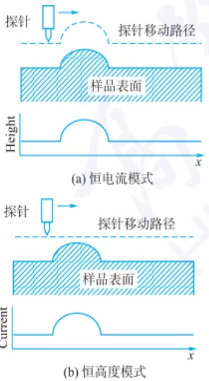

图 11.1.3 扫描隧道显微成像恒电流模式和恒高度模式示意图

铂-铱合金针尖抗氧化性强，但硬度低，熔点低，多采用机械剪切法制备，一般直接用剪刀剪切而成。针尖表面往往覆盖着氧化层或吸附杂质，这经常是造成隧道电流不稳、噪声大和扫描隧道显微镜图像质量差的原因。因此，每次实验前需要采用化学法清洗针尖，去除表面的氧化层及杂质，保证针尖具有良好的导电性。在进行超导材料或磁性材料的性质研究时，可采用特殊的功能探针针尖，如铌制备的超导针尖或镍/铬的磁性针尖等。

## 2. 电子学系统

电子学系统主体为电流反馈回路。针尖与样品之间的隧穿电流经过前置放大器和对数放大器进行线性化处理，接着通过数模转换器来控制扫描头的压电陶瓷，从而实现针尖与样品之间距离的精确调节。该纳米级随动系统可在恒电流工作模式中，将实时测量的隧穿电流值与预设的电流值进行比较，并通过反馈回路来控制探针针尖的上下位置，从而保持隧穿电流的稳定不变。该系统还可以实现机械传动系统中各种预设的操作功能，如探针针尖的连续扫描、单步进针、退针等过程。

## 3. 计算机控制系统

计算机控制系统主要包含在线扫描控制和离线数据分析两部分。前者可实现实验参数的设定和调节，以及扫描数据的采集；后者则对记录的实验数据进行分析和处理，如傅里叶变换、平滑、滤波、高斯拟合等，从而获得样品表面形貌及电子态信息的原子级别三维图像。扫描隧道显微镜的常用参数有隧穿电流、针尖高度、偏置电压、扫描范围、扫描速度等。

## 4. 减震系统

减震系统通常采用阻尼材料、金属弹簧和磁性涡流阻尼装置，来减少外界振动引起的噪声。同时，实验过程中探针和样品部分可用金属罩隔绝外界的电磁扰动，提高检测的准确性。根据隧穿电流公式可知，隧穿电流随着针尖-样品的间距的减小呈指数增长，且扫描隧道显微镜探针针尖与样品之间的工作距离一般在1 nm以下，因此任何微小的振动都会影响仪器的精确度。建筑物的振动、人员走动、气流引起的环境振动的振动频率一般在1\~100 Hz，因此可以通过提高扫描隧道显微镜装置的固有振动频率，同时使用阻尼系统来降低环境振动的影响。扫描隧道显微镜装置目前常用金属弹簧悬吊的方式来进行减振处理。一般来说，扫描隧道显微镜系统由于振动引起的垂直方向高度变化需要控制在0.001 nm以下，以满足测量的准确性要求。

## 11.1.2.2 扫描隧道显微成像的工作模式

扫描隧道显微镜通常有三个重要的工作参数:针尖相对于样品的偏压,针尖高度和隧穿电流。通过选择性地调控这三个参数,可以实现不同工作模式之间的切换。其中,最常见的两种扫描成像工作模式是恒电流模式与恒高度模式(如图11.1.3所示)。

恒电流模式是指在扫描过程中始终保持隧穿电流的数值固定不变。当施加恒定的偏压时，扫描隧道显微镜的反馈回路控制探针，使其根据被测物质表面形貌的起伏上下移动来保持隧穿电流的恒定不变，记录针尖高度随样品表面局域结构的变化，从而获得样品表面的形貌及电学信息。由于反馈回路的存在，针尖的高度可根据样品形貌的变化进行实时调整。恒电流模式是目前扫描隧道显微成像主流的工作模式。反馈回路的存在使得恒电流模式下的扫描速度受到反馈时间的限制。当反馈时间过长时，探针的扫描速度较慢，此时扫描隧道显微成像系统中的机械热力学漂移较大；当反馈时间过短时，探针的扫描速度较快，使得反馈

---

11.1 扫描隧道显微成像

603

回路来不及精确调节探针与样品之间的间距,此时获得的图像并不是严格意义上的恒电流模式下的测量结果。

恒高度模式是指在扫描过程中始终保持探针高度恒定不变。当施加恒定的偏压时，关闭反馈回路，探针针尖在样品表面上方固定的高度进行扫描，同时记录对应的隧穿电流值。通过分析样品与针尖之间的距离与隧穿电流的关系，可获得样品表面结构的相关信息。由于在恒高度模式中，探针的扫描信号无须通过反馈回路，可获得较快的扫描速度，能够减少噪声和热飘移对于信号的影响。但是，反馈回路的关闭使得针尖与样品的距离无法根据样品表面形貌的变化进行实时调整，容易发生探针接触到样品进而损毁探针或样品的情况。因此，恒高度模式一般适用于研究表面相对平整且组成成分单一的样品。

当样品表面不同区域分布的原子或分子种类不同时，其不同区域的功函数和电子态密度不同，此时扫描隧道显微镜获得的图像不仅仅取决于样品表面高低起伏的差异，而是样品表面高低起伏和电子态密度差异共同作用的结果。由于扫描隧道显微镜无法精确区分上述两种作用，因此可通过联用扫描隧道谱来进行进一步解析。

## 11.1.3 扫描隧道显微成像技术的应用

扫描隧道显微成像技术具有原子级空间分辨率,可直接观测到样品实时的三维空间形貌特征及表面局域电子结构信息。该技术的工作范围较为广泛,可在真空、大气及液体环境下对样品进行无损测量,温度可高可低,已应用于表面化学、材料科学、生物学等领域。

## 11.1.3.1 表面结构特征及电子态的高分辨成像研究

扫描隧道显微成像技术可得到单原子层表面的局部结构特征，直接观测到表面重构、表面缺陷及表面吸附的形貌和三维空间位置，还可以对表面反应、扩散等动态过程进行实时成像分析。该技术可对 Ag(111) 基底上的单个偶极分子定向旋转过程进行实时成像分析。含有氧原子的单个偶极分子与 Ag(111) 基底间存在特殊的相互作用，这一作用位点可在电场诱导下发生分子定向旋转。运用扫描隧道显微成像技术，能够以表面吸附的单个 CO 分子作为参照，捕获偶极分子顺时针旋转的动态过程（图 11.1.4）。

## 11.1.3.2 单原子及单分子操控

利用扫描隧道显微镜观察样品表面时,为了避免损坏样品的形貌特征,往往在针尖和样品之间采用较弱的相互作用力。扫描隧道显微镜可控制针尖对样品表面的单个原子或分子施加一定的强相互作用力(吸引或排斥),实现单原子或单分子的空间位移,最终构建特定的纳米结构。

STM 技术中通常有以下两种单原子或单分子操纵方式:

（1）利用 STM 针尖与吸附在材料表面的分子或原子之间的吸引或排斥作用，使吸附分子在材料表面发生横向移动，具体又分为“牵引”“滑动”“推动”三种方式。主要操作分为三步:首先确定目标分子或原子的空间位置并加大隧穿电流，针尖通过强相互作用来移动目标分子或者原子达到特定位置，随后逐渐减小隧穿电流使得针尖慢慢远离吸附的分子或原子。
（2）通过某些外界作用将吸附分子或原子转移到针尖上，然后移动到新的位置，再将分子或原子沉积在材料表面；或是通过外加一电场，改变分子的形状，但却不破坏它的化学键。

单原子操控示例

---

604

第十一章 显微成像分析

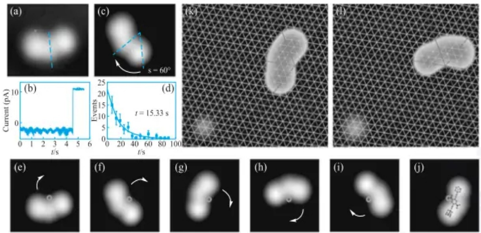

图 11.1.4 电位诱导下 Ag(111) 基底表面单个偶极分子定向旋转的扫描隧道显微成像研究。(a)(c) 施加电压前后的单个 DDNB 分子  $\{2,5-\mathrm{di}(\mathrm{ethynyladamantanyl})-4-(\mathrm{dimethylamino})\mathrm{nitrobenzene}\}$  扫描隧道显微镜图像。(b) 电流随时间变化曲线。(d) 单分子在电位诱导的旋转发生前的时间 t 泊松分布图。(e) \~ (j) 单个 DDNB 偶极分子在电位诱导下完整的顺时针旋转扫描隧道显微镜图像。绿色圆圈对应于 (a) 图中的红点区域。(k)(1) 单个 DDNB 分子在施加电位前后以单个 CO 分子为参照的扫描隧道显微镜图像 (文献: Nature Communications, 2019, 10, 4631)

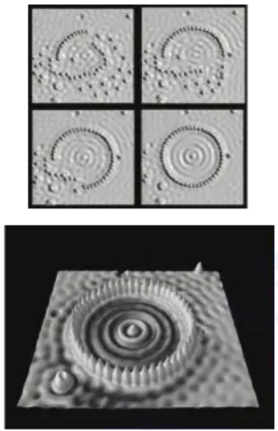

图 11.1.5 在低温下(4 K)，运用扫描隧道显微镜技术的原子操控技术对吸附在 Cu(111) 表面上的 48 个 Fe 单原子逐一操纵移动并排列成一个圆形围栏，也称为“量子围栏 (quantum corral)”。每个围栏的平均直径为 142.6 Å，每个相邻的铁原子之间的平均距离为 0.95 nm，围栏内部的圆环状波纹为电子密度波的驻波（文献: Science, 1993, 262, 218）

1993年，扫描隧道显微镜原子操控的技术可实现 $4\mathrm{K}$ 低温下将吸附在单晶铜(111)表面的48个铁原子逐一移动至特定位置，并排列呈一圆形围栏的纳米结构（如图11.1.5所示），该围栏内的区域为单晶铜表面无缺陷的范围，其平均直径约为 $142.6\AA (1\AA = 0.1\mathrm{nm})$ 。由于金属表面的自由电子被局限于量子围栏的内侧，因此可以从扫描隧道显微镜图像中观察到表面态电子由于量子干涉效应导致的圆环状驻波。 $\mathrm{Cu}(111)$ 表面吸附铁原子对表面态电子有很强的散射作用。当表面只存在单个铁原子时，入射的表面态电子波与从铁原子散射的电子波之间发生干涉，形成围绕铁原子的驻波，进一步引起表面局域电子态密度的变化。这一应用首次实现了人为操控单个原子构成功能性纳米结构，为量子器件的设计和制备提供了一种新的方法。

## 11.1.3.3 单分子电子学及单分子器件的构造

基于扫描隧道显微镜的单分子裂结技术可用于单分子电子学的研究及单分子器件的设计和构造。该技术在针尖与金属基底之间构筑单分子结，通过对单分子结体系隧穿电流的测量，获得分子的几何构型和空间取向。同时，对体系施加外场，可研究单分子的电输运特性及单个化学键的电力学特征。通过扫描隧道显微镜控制探针针尖反复接触以及远离导电基底，单分子裂结技术可以实现单分子的连接、拉伸及断裂过程，获得单分子结体系的电学信号。当针尖与样品之间的距离小于数个纳米时，在两者之间施加电压会产生电子隧穿现象，同时产生隧道电流。

## 11.1.3.4 与其他技术的联用

扫描隧道显微镜具有极高的空间分辨率，但时间分辨率较低（微秒量级），且化学分辨能力差。因此将针尖增强拉曼技术与其联用，可将激发光聚焦在扫描隧道显微镜金属探针针尖上，在基底表面产生局域等离激元共振。局域等离激元激发分子产生拉曼信号，从而研究亚分子尺度单个化学键的动态变化过程。将飞秒激光的泵浦-探测技术（pump-probe）与扫描隧道显微成像技术联用，利用超快激光与电子隧穿过程的耦合效应来实现飞秒尺度的极限研究，可极大提高扫描隧道显微成像技术的时间分辨率和空间分辨率。光泵浦技术的光子能量较低，与扫描

---

11.2 原子力显微成像

605

隧道显微成像技术联用后其诱导电子隧穿的能量会极大增强。在诱导产生相同大小的隧穿电流时，光泵浦技术所需要的单光子能量仅为同等条件下近红外光的百万分之一，因此其产生的热膨胀和热电流可忽略不计，保证了无损稳定地测量。同时，光泵浦技术与扫描隧道显微成像技术的联用可以拓展光与表面相互作用机制的理论和实验研究，对超快反应动态过程进行捕获及操控。

扫描隧道显微成像技术要求样品具有一定的导电性，目前只能直接观察导体和半导体的表面结构特征。对于一些非导电材料，需在其表面覆盖一层导电膜进行观测，往往掩盖了样品原本表面的结构细节。随着技术的不断发展，针对不同研究需求的新型扫描隧道显微镜目前也逐渐实现国产化。2020年，我国科研人员基于光泵浦技术与扫描隧道显微镜技术联用研制出国内首台超快扫描隧道显微镜，可实现飞秒级别的超高时间分辨率和原子级空间分辨率；2022年，我国自主研发出太赫兹扫描隧道显微镜系统，该系统可以兼顾原子级空间分辨率及高于500 fs的时间分辨率。上述技术使得人们在原子尺度上探索超快动力学过程成为可能。目前不断发展的新型扫描隧道显微成像技术已经广泛应用于化学、物理、光学、生命、能源等领域，以实现样品原子级表面形态和电子特性的解构和调控。

通过单分子隧穿电流研究电催化脱氢反应机制

光泵浦与扫描隧道显微镜联用技术

## 习题

## - 章节练习题 -

1. 在扫描隧道显微成像技术中,影响隧穿电流大小的因素有哪些?
2. 简述扫描隧道显微成像技术两种工作模式的原理及特点。

## - 挑战性问题 -

3. 在单细胞分析领域, 扫描隧道显微成像技术为研究细胞表面结构和细胞膜电位的动态变化提供了一种强有力的工具。查阅和参考相关科学文献, 设计实验: 如何使用扫描隧道显微成像技术研究细胞膜表面分子吸附过程。
4. 查阅资料并思考,扫描隧道显微成像技术目前面临的主要挑战和未来的发展趋势是什么。

## - 专题或报告 -

5. 扫描隧道显微成像技术在生命分析领域的应用越来越广泛。在生物分子分析方面，相关研究工作主要关注生物分子表面的电荷分布、几何形态、自组装动态过程及分子间相互作用等。查阅关于扫描隧道显微成像技术在生物单分子分析中应用的科学文献，并将结果写成报告。
6. 在单分子甚至于亚分子尺度的检测中，扫描隧道显微成像的时间分辨率有待提升，将两个或多个技术联用，有可能拓展原有技术的应用范围，并显著提高其准确性、选择性和灵敏度。查阅相关科学文献，了解其原理与应用，并与同学分享你的结果。

## 11.2 原子力显微成像

## 11.2.1 原子力显微镜的发展历史

原子力显微镜(atomic force microscope, AFM)是一种在纳米尺度下观察和研

---

606

第十一章 显微成像分析

Binnig, Quate 和 Gerber

究物质表面的先进仪器。继发明 STM 后，Gerd Binnig 继续探索着可以在纳米尺度下进行表面成像的新方法。1986 年，Gerd Binnig, Calvin Quate 和 Christoph Gerber 首次实现了高分辨率原子力显微镜图像的获取，成功地在非导体表面以类似扫描隧道显微镜的工作方式观察到了精细结构。

不同于 STM 利用电子隧穿效应的原理,原子力显微镜通过探针与样品表面的相互作用力来获取图像。随后的几年中,原子力显微镜得到了不断改进和发展。扫描技术的改进提高了成像速度和分辨率,同时增加了显微镜对不同性质样品的适应性。第一台商业化的原子力显微镜于 1989 年面市,为更多的科研机构和实验室提供了使用的机会。

原子力显微镜的发展标志着人类进入了探索纳米世界的全新时代，推动了纳米科学和纳米技术的发展，对材料科学、生物学、表面物理学等领域产生了深远影响。随着原子力显微镜与光谱、电化学等方法的结合，它也逐步成为在纳米尺度认识物质化学性质的重要工具。

AFM 的探针

AFM 的探针起着“纳米指尖”的作用,用于感知物质的高低起伏。理想条件下,仪器能够测量到探针尖端的单个原子与表面上与其最接近的单个原子间的作用力

## 四象限光电探测器

四象限光电探测器是把四个性能完全相同的光电二极管按直角坐标系的四个象限排列而成的光电探测器件，常用于调节光路准直。当光斑照射在象限原点处时，四个象限间的光电流差值最小。若光斑偏离原点则象限间光电流差值迅速变化，仪器即可响应到光束发生偏离。

## 11.2.2 原子力显微镜的基本原理与结构模块

## 11.2.2.1 原子力显微镜的基本原理

AFM 通过测量探针与样品相互作用时产生的微悬臂弯曲程度获取样品形貌信息。其基本工作原理如图 11.2.1 所示。具有纳米级甚至原子级尖端的微小针尖固定在一个对作用力极敏感的微悬臂一端。同时，将一束激光照射在微悬臂上，用一个四象限光电探测器检测从微悬臂上反射的激光。当探针缓慢靠近样品表面时，会与样品间产生微小的相互作用力，进而导致微悬臂弯曲。极微弱的悬臂形变都会使反射光斑在远处的四象限光电探测器上发生明显的位移，进而使仪器感知到探针-样品间力的大小。之后，AFM 探针在水平方向上以极小的步进量移动，扫描一条直线或一个区域。在每个扫描点，样品表面的起伏和微小特征会导致探针所在的悬臂梁发生不同的偏转。在扫描过程中，测量到的探针位置、相互作用力和悬臂梁偏转等数据可以同时记录下来。通过分析这些数据，就可以生成样品表面的拓扑图像。

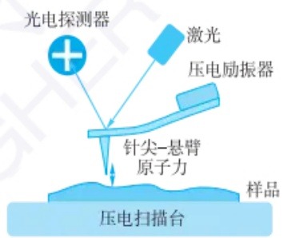

flowchart

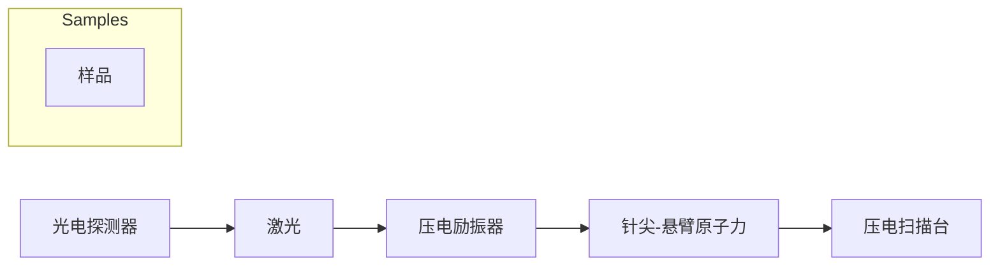

(a)

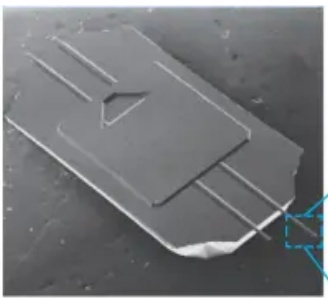

natural_image

Close-up of a gray plastic electronic component with internal slots and a small protrusion (no visible text or symbols)

(b)

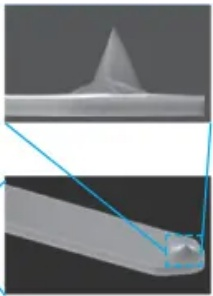

natural_image

3D rendered mechanical parts with a conical tip and cross-sectional view (no text or symbols)

图 11.2.1 AFM 的(a) 基本原理和(b) 商业化 AFM 探针

AFM 在 z 轴, 即垂直于样品表面的方向上的分辨率可以达到 0.1 nm, 在 x-y 平面内的分辨率一般为 1 nm, 最大扫描范围可以达到数微米。由于 AFM 是基于对作用力的检测, 因此不需要像 STM 一样必须保证探针和样品均为导体。

## 11.2.2.2 原子、分子间作用力的定义和分类

由于 AFM 探测的是针尖原子与样品原子或分子间的相互作用力,因此将

---

11.2 原子力显微成像

607

这些作用力笼统称为“原子力”。这与物理学研究中描述的原子内部基本粒子间的电磁力、强核力、弱核力等原子力是完全不同的概念。在AFM中，针尖和样品之间的相互作用力是获得高分辨率表面形貌图像和力学性质信息的关键。如图11.2.2所示，AFM探针与样品之间的相互作用力大致可以分为长程力和短程力。长程力通常包括范德华力和静电力等，其衰减长度一般为几纳米或者几十纳米。短程力主要包括来自针尖和样品之间形成化学键的作用力和由于针尖-样品电子云交叠产生的泡利排斥力，其衰减长度一般约为 $0.1\mathrm{nm}$ 。在特殊的环境下，针尖和样品之间的相互作用力还包括机械接触力、毛细力、磁场力、卡西米尔力、水合力等。

这些相互作用力在 AFM 的工作中同时起作用，并影响探针的运动。通过测量和控制这些相互作用力，AFM 可以获取样品表面的形貌和性质信息，实现非常高分辨率的成像。值得注意的是，不同的 AFM 模式会涉及不同类型的相互作用力，并且需要特定的探测器和控制系统来实现不同的测量目标。例如，长程力对针尖-样品间的距离不敏感，很难分辨较小的表面起伏，要想获得较高的空间分辨率，需要让短程力的贡献占主导。

## 11.2.2.3 原子力显微镜的组成

AFM 主要由探针系统、扫描系统、检测系统、反馈系统和电子控制系统几部分组成,如图 11.2.3 所示。

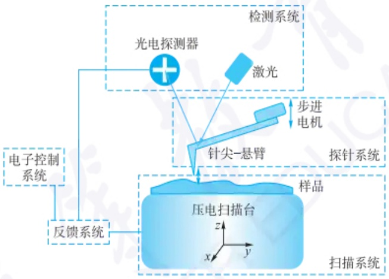

flowchart

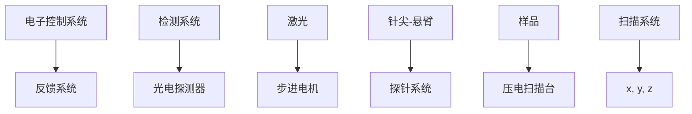

图 11.2.3 AFM 的组成

（1）探针系统 针尖是 AFM 的核心部件，通常由硅或硅钼石制成，具有纳米尺寸的尖端(图 11.2.1)。针尖的尖锐程度对原子力显微成像的质量至关重要。用久的针尖往往因为尖端磨钝或物质吸附导致的污染引起成像质量变差。针尖和针尖托架一起固定在步进电机上。步进电机的作用是在进行样品扫描前将探针以较粗的精度，通常为  $1 \mu m/$  步，靠近样品表面。虽然直接将探针通过支架固定在三维扫描电机上靠近样品并扫描也是可能的，但由于探针在平面上扫描时照射在悬臂上的激光必须随之移动，技术上相对难实现。因此多数 AFM 仪器并非真正使探针在样品表面扫描，而是反过来让样品在位置相对固定的探针下移动，进而实现扫描成像。
（2）扫描系统 扫描器是实现针尖相对样品表面进行扫描的部件，可实现在垂直和水平方向的精确运动。扫描器通常由一组精密的压电陶瓷或电动驱动器构成。如前所述，常将样品置于扫描器上，因此也称作扫描台。在探针到达样品

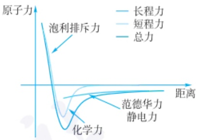

line

| 动力类型 | 描述 |
| --- | --- |
| 长程力 | 线性增长趋势 |
| 短程力 | 值在负值区域波动 |
| 总力 | 均衡曲线，呈现典型的能量分布特征 |

图 11.2.2 不同性质的力叠加形成 AFM 中探针感受到力曲线

## 范德华力

范德华力是由于分子之间的瞬时电荷不均匀而产生的吸引力。虽然单个分子并没有净电荷，但由于电子的运动，分子内部的电荷分布会瞬时变化，导致分子之间在瞬间形成暂时的偶极矩，从而产生吸引力。范德华力是AFM中最常见的相互作用力，即使在没有净电荷的情况下也存在。它的作用距离相对较长，通常在几个纳米到几十纳米的范围内。

## 静电力

静电力是由于针尖和样品表面分布的电荷产生的相互作用力。如果样品表面带有净电荷（正电荷或负电荷），针尖与样品之间会产生静电斥力或吸引力。静电力的大小取决于电荷量和针尖与样品之间的距离。

## 泡利排斥力

当两个原子核或两个分子之间靠得太近时会产生质子之间的电荷斥力，称为泡利排斥力。这种力作用距离相当短，当探针和样品表面的原子核彼此靠近时，电荷的排斥力会使得探针产生一个阻力，阻止它们彼此进一步靠近。

---

608

第十一章 显微成像分析

## 压电陶瓷

压电陶瓷是一类在施加电压时能够膨胀或收缩的特殊材料。其伸缩幅度可以通过施加电压精确控制到1 nm/步，甚至0.1 nm/步。AFM就是利用了以压电陶瓷为核心的压电电机才实现高达原子级分辨率的成像。要实现三维高精度定位，可以使用三个相互垂直的压电电机，也可以在三个垂直方向上对同一块压电陶瓷施加电压。

步进电机外形和工作原理

## 光干涉信号检测系统

光干涉信号检测系统中，探针尖端覆盖有透明薄膜，激光束可以通过探针进行透射。当针尖与样品之间发生相互作用力变化时，薄膜的厚度发生微小变化，导致透射光的相位发生改变。通过测量透射光的相位差，可以获得针尖与样品之间的相互作用力信息。

## 振动传感器信号检测系统

振动传感器信号检测是基于振动谐振频率变化的 AFM 信号检测方法。在该系统中，探针端固定在谐振器上，当探针与样品之间发生相互作用时，谐振器的谐振频率会发生变化。通过测量谐振频率的变化，可以获得针尖与样品之间的相互作用力信息。

## 电容传感器信号检测系统

电容传感器信号检测是基于电容变化的 AFM 信号检测方法。在该系统中，探针尖端和样品之间形成一个微小的电容结构。当针尖与样品之间发生相互作用时，电容值会发生微小的变化。通过测量电容的变化，可以获得针尖与样品之间的相互作用力信息。

表面后，扫描器驱动样品在 x-y 平面内按照预定的模式扫描，从而获得样品的拓扑结构信息。压电陶瓷的扫描精度为 0.1 nm。

（3）检测系统 检测系统用于检测悬臂梁的位移或振动，从而获得样品表面的相互作用力数据。常见的AFM信号检测系统最常见的是激光反射信号检测系统。如图11.2.3，在激光反射信号检测系统中，激光束聚焦在探针尖端，当探针靠近样品后，微悬臂会因探针受力发生弯曲，导致反射在四象限光电探测器上的激光斑点位置偏移。系统即可根据光电探测器上的信号大小与方向判断针尖位置和受力情况。此外，信号检测系统还包括光干涉信号检测系统、振动传感器信号检测系统、电容传感器信号检测系统等，不同检测系统的原理差异较大。
（4）反馈系统 反馈系统用于控制探针与样品之间的相互作用力，使其保持在预定范围内。以图11.2.3为例，当探针与样品发生相互作用时，检测系统感知到微悬臂发生弯曲后会立刻调控步进电机停止向前，并启动压电陶瓷回缩，实现针尖与样品表面“轻柔”地接触。
（5）电子控制系统 电子控制系统是 AFM 的智能核心，它负责对针尖的位置和相互作用力进行控制和调节。在进行样品形貌扫描时，电子控制系统会随时根据测得的探针位置调整样品向上或向下移动，以维持相互作用力的稳定，维持针尖在样品表面稳定扫描。

## 11.2.3 原子力显微镜的基本成像模式

探针悬臂在针尖-样品相互作用力作用下的运动,可以近似看作一维受迫阻尼谐振子,其整体动力学由下式描述:

$$
m \frac {\mathrm{d} ^ {2} z}{\mathrm{d} t ^ {2}} + \gamma \frac {\mathrm{d} z}{\mathrm{d} t} + k z = F _ {\mathrm{tip-sample}} \tag {11-2-1}
$$

式中，m 是悬臂的质量，z 是悬臂的位移，t 是时间， $\gamma$  是悬臂的阻尼系数，k 是悬臂的弹性系数， $F_{tip-sample}$  是针尖与样品之间的相互作用力。

围绕上述公式,通过改变不同的测量策略发展出了多种 AFM 的测量模式,可以满足不同样品测量的需要。以下是一些常见的 AFM 测量模式(图 11.2.4)。

## 11.2.3.1 静态模式

静态模式是最简单、最常用的AFM测量模式，也称为接触模式或常规模式。在静态模式下，探针直接接触样品表面，并在针尖与样品表面之间施加垂直力。当探针在样品表面扫描时，样品表面的拓扑结构会导致悬臂的弯曲变化，称为“悬臂弯曲”或“悬臂挠度”。为了保持探针悬臂弯曲程度在扫描成像时始终一致，压电陶瓷必须随样品起伏而在 $z$ 轴方向做上下移动。因此，记录探针高度变化就可以得到样品表面的拓扑图像。

静态模式能够测量纳米级别的高度差异,其测量灵敏度取决于探针的弹性常数(针尖和样品的弹性刚度)和探测系统的稳定性和灵敏度。静态模式的分辨率取决于多个因素,包括探针的尺寸和形状、探测系统的稳定性和灵敏度,以及样品的硬度和表面特性,通常在纳米级别。较小的探针尺寸和较高的探测系统灵敏度可以提高分辨率。

## 11.2.3.2 动态模式

AFM 的动态模式是基于悬臂探针振动进行成像和测量的模式。在动态模式下，探针悬浮在样品表面上方，与样品之间没有直接的物理接触。探针通过激励

---

11.2 原子力显微成像

609

信号进行振动，并通过反馈回路来保持悬臂的振动特性恒定。当探针接近样品表面时，样品表面的相互作用力会引起悬臂的共振振动发生变化。反馈系统会感知悬臂振动的变化，并根据预设的振动特性来调整激励信号的频率和幅度，使得悬臂的振动保持恒定。调整后的激励信号即反映了与样品表面相互作用力的信息。动态模式下，可以测量探针与样品之间的相互作用力曲线（force-distance curve），通过分析力曲线的形状和特征，可以获得样品的力学性质，如硬度、弹性模量、黏性等。

（1）非接触模式 非接触模式是一种常用的动态测量模式，也被称为调频模式。相比静态模式，非接触模式避免了探针与样品之间的直接接触，因此适用于更多类型的样品，并能够提供更高的分辨率和更好的成像效果。在非接触模式下，探针悬浮在样品表面，使得针尖与样品之间的距离处于纳米级别。在此距离下，范德华力开始对探针产生作用，针尖-样品的弱相互作用会让共振频率产生细微偏移；仪器实时跟随并以频率偏移作为成像/反馈信号，而振幅基本保持不变。扫描时通过调节压电扫描器伸缩量使频率偏移保持在设定值，从而获得高分辨率图像（在合适条件下可达原子级）。

非接触模式中,探针与样品之间的相互作用力是范德华力。通过避免与样品接触,可以避免对样品造成损伤,非常适用于脆性材料或敏感样品。

非接触模式的测量灵敏度受到多种因素影响，包括探针的弹性常数 $(k)$ 、探针的谐振频率 $(f_{\mathrm{res}})$ 、采样频率、探测系统的稳定性等。较高的弹性常数和谐振频率可以提高探针探测样品表面微小变化的灵敏度。非接触模式的分辨率通常在纳米到亚纳米级别。分辨率取决于多个因素，包括探针的尺寸和形状、探针的弹性常数和谐振频率、采样频率、探测系统的稳定性，以及样品的硬度和表面特性。较小的探针尺寸可以提高分辨率，因为小尺寸的探针能够更精细地感知样品表面的微小变化（如氢键成像即是通过非接触模式进行测量）。此外，较高的谐振频率和采样频率也有助于提高分辨率，因为高频率的振动可以更细致地感知样品表面的细节。

在非接触模式下,探针的谐振频率与探针的弹性常数成反比。这可以通过以下公式来描述:

$$
f _ {\mathrm{res}} = \sqrt {\frac {k}{m _ {\mathrm{eff}}}} \tag {11-2-2}
$$

式中， $f_{res}$  表示探针的谐振频率，k 是悬臂的弹性常数， $m_{eff}$  是探针的有效质量。

（2）轻敲模式 轻敲模式是另一种常见的动态AFM测量模式，又称调幅模式。轻敲模式在接近共振的固定频率下工作；针尖-样品作用力会改变振幅（有时也改变相位），仪器把一个目标振幅作为设定值，通过上下微调压电扫描器伸缩量让实际振幅回到该设定；成像用振幅/相位，频率在扫描中不随像素改变。轻敲模式适用于不同硬度的样品表面的测量，对于刚性和软性样品都能够获得准确的表面拓扑信息。除了表面拓扑，轻敲模式还可用于测量样品的力学特性，如弹性模量、黏性和吸附特性等。轻敲模式下，探针与样品非接触或短接触，因此可以在较短的时间内获取样品表面的拓扑信息，实现快速成像。

## 11.2.3.3 非共振模式

非共振模式是 AFM 中的另一种模式。在非共振模式下，探针不处于共振振动状态，而是通过调节激励信号的振幅或频率来维持探针的振动。探针与样品之间的相互作用力导致探针振动的振幅或频率发生变化，从而实现对样品表面的测量。非共振模式适用于对柔软样品或在液体环境中进行成像，因为这些样品的共

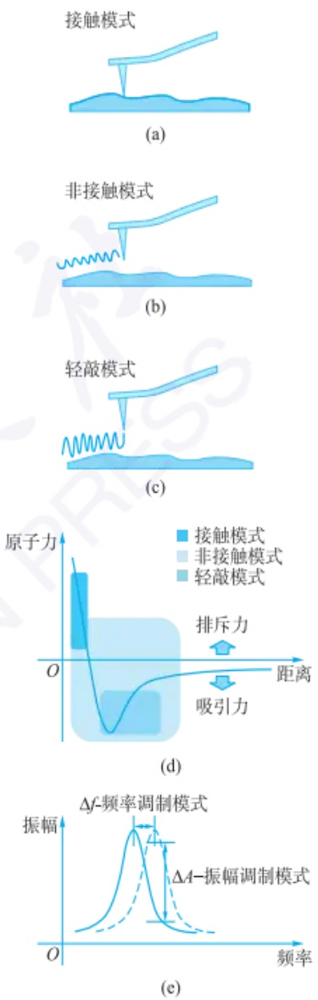

图 11.2.4 AFM 的成像模式  
(a) 接触模式、(b) 非接触模式、(c) 轻敲模式示意图。(d) 不同测量模式与力曲线的关系, 不同模式的大致工作范围区分并不严格。(e) 悬臂在频率调制和振幅调制模式下的共振曲线

在调频模式下,悬臂的共振频率变化响应时间( $\tau_{FM}$ )不受悬臂的品质因子Q影响:

$$
\tau_ {\mathrm{FM}} = \frac {1}{2 \pi f _ {0}}
$$

其中， $\tau_{FM}$  表示 FM 模式下的响应时间， $f_{0}$  为悬臂的本征振动频率。

---

610

第十一章 显微成像分析

调频模式下的响应时间与悬臂的品质因子 $Q$ 无关，只与悬臂的本征振动频率有关。因此，即使在超高真空低温环境中使用具有较高 $Q$ 因子的悬臂，响应时间仍然保持不变。这使得调频模式成为在超高真空环境下广泛使用的工作模式，因为它可以保持较高的扫描速度，同时保持高 $Q$ 因子，从而提供更高的敏感度和信噪比。

在调幅模式下,悬臂的共振频率变化响应时间( $\tau_{AM}$ )与悬臂的品质因子Q成正比:

$$
\tau_ {\mathrm{AM}} = \frac {Q}{\pi f _ {0}}
$$

式中， $\tau_{AM}$  表示调幅模式下的响应时间， $f_{0}$  为悬臂的本征振动频率。

显然，当品质因子 $Q$ 增加时，调幅模式的响应时间会线性变大，响应时间与品质因子 $Q$ 成正相关。因此，当在超高真空低温环境中使用具有较高 $Q$ 因子的悬臂时，响应时间会大幅延长。这会导致扫描成像所需的时间增加，因此调幅模式主要适用于大气或液体环境下的实验。

## 准静态过程

非共振轻敲模式下的探针运动较缓慢,使得探针与样品之间的力可以视为在每个像素点上达到平衡,从而称为准静态。

振频率可能较低或易受到阻尼效应的影响，难以在共振模式下工作。

以非共振轻敲模式为例，探针通过以频率远低于悬臂的共振频率进行激励，使得悬臂整体上下运动。在各个像素点上方的振动可以看作准静态过程，因此在各个像素点，探针受到的力均为可测量的、可控制的力。因此非共振轻敲模式可以实现对探针受到的相互作用力进行准确测量。通过在非共振状态下探针的运动，可以在成像的同时获得力-距曲线，进而获取样品的力学性质信息。由于非共振轻敲模式对探针的激励频率和振幅有较好的控制，可以通过调节这些参数实现对相互作用力的精确控制，有利于在不同样品表面进行测量。非共振轻敲模式探针的振动频率较低，可以避免共振频率带来的频谱展宽，从而提高成像的分辨率。由于非共振轻敲模式的激励频率较低，对于软性样品和不规则样品表面的测量更加友好，可以减少对样品的损伤和形貌干扰。

在非共振轻敲模式中,悬臂的振动频率远低于其共振频率,因此可以忽略阻尼项。稳态下悬臂的位移与力的关系可以表示为

$$
z = \frac {F _ {\mathrm{tip-sample}}}{k} + z _ {0} \tag {11-2-3}
$$

式中，参数含义与式(11-2-1)中相同， $z_{0}$ 是悬臂的平衡位置。这个关系式表明了悬臂的位移与相互作用力之间的线性关系。通过测量悬臂的位移和相互作用力，可以获得力-位移曲线，进而获取样品的力学性质信息。

## 11.2.3.4 原子力显微镜的特殊成像模式

除了常规的测量模式, AFM 还发展了一些特殊的测量模式, 这些模式在特定应用中能够提供更丰富的物理、化学信息或更高的测量灵敏度。以下是一些常见的特殊测量模式(图 11.2.5)。

（1）导电原子力显微镜 导电 AFM 是一种用于表征材料电学性质的高分辨率成像技术。探针表面覆盖导电涂层，如铂铱合金或导电刚玉。在测量过程中，探针悬浮在样品表面上方，同时测量探针与样品之间的力和电流信号。当探针接触样品表面时，样品的电学性质会影响探针与样品之间的电流传输。通过测量探针与样品之间的电流信号，可以获取样品表面的电导率、电阻率及局部电流分布等电学性质信息。
（2）扫描扩展电阻显微镜 扫描扩展电阻显微镜基于 AFM 的接触模式实现。通过在探针接触位置的样品表面上测量微小电流，可以测量样品表面的局部电阻分布，进而对样品进行亚纳米空间分辨率的二维和三维载流子分析。
（3）压电力显微镜 压电力显微镜利用压电效应测量和映射材料表面的力和电学性质。在压电力显微镜中，通过将压电探针放置在样品表面并施加交变电场，测量压电响应，从而获得关于样品表面电荷、极性和压电性质的信息。压电力显微镜在材料科学、纳米电子学和生物医学领域具有广泛应用，可用于研究压电和铁电材料、表面电荷分布、生物分子相互作用等。
（4）静电力显微镜 在静电力显微镜中，可通过在扫描探针和样品之间施加直流电压，观察由于静电相互作用而引起的力的变化。这种技术对样品表面的电荷分布和电学性质非常敏感，因此可以提供关于表面电荷状态和电场分布的详细信息。静电力显微镜在半导体器件研究、纳米电子学、生物材料等领域有着广泛的应用。它不仅能够揭示材料的电学性质，还可用于研究电荷转移和电场调控的现象，为理解和优化各种材料和器件提供了有力的工具。
(5) 磁力原子力显微镜 磁力 AFM 是一种基于 AFM 的特殊成像模式, 探针

---

11.2 原子力显微成像

611

通常由磁性材料制成，如铁磁材料（铁氧体）。当探针靠近样品表面时，样品表面的磁域会对探针产生作用，引起探针的磁性相互作用力发生变化。磁力 AFM 测量基于磁性相互作用力和原子力的相互作用，可以得到样品表面的微观磁性结构和纳米级特征，包括磁域的位置、形状和磁性强度等。

（6）开尔文探针力显微镜 开尔文探针力显微镜利用AFM的探针与样品之间的相互作用力来测量样品表面的电位或表面势能分布。在开尔文探针力显微镜中，探针通常由导电材料制成，如金属或导电刚玉。在测量过程中，探针悬浮在样品表面上方，与样品表面之间没有直接的物理接触。然而，当探针靠近样品表面时，样品表面的电位或表面势能会影响探针与样品之间的电荷转移。这种电荷转移导致探针与样品之间的相互作用力发生变化。开尔文探针力显微镜利用调制的交流电压作用于探针，通过调整交流电压的频率和振幅，可以实时测量探针与样品之间的相互作用力的变化，进而得到样品表面的电位或表面势能分布信息。

## 11.2.4 原子力显微镜在分析化学中的应用

在科研领域,常用 AFM 获取纳米材料的形貌信息。例如,利用 AFM 成像可以获得石墨烯、二硫化钼等二维层状材料的片层大小、厚度、层数等信息。除此之外,很多表面起伏小于 100 nm 的材料、修饰电极,甚至是细胞膜表面也可以进行 AFM 成像。虽然在这些成像过程中也能够获得分子在界面的位置、分布等化学信息,但实际上往往化学“意味”不足,更多地体现出 AFM 作为材料和界面分析工具的特点。

事实上，AFM在一些发展方向上展现出独特的化学信息获取能力，下面将对这些方向做简要介绍。

## 11.2.4.1 以高分辨率获取分子、原子内部化学信息

通过不断提高空间分辨率，AFM已经实现了对金属、硅等材料表面原子排布成像和原子位置操控。将分辨率提升至亚原子级后，还能观察到铁原子在铜表面能够吸附形成环形结构簇。我国研究人员研发了qPlus型力传感器，并利用其改造AFM仪器，在国际上首次实现了对分子间氢键的直接成像，为化学界争论了80多年的“氢键本质”问题提供了直观证据。

## 11.2.4.2 以单分子力测量获取蛋白结构信息

AFM 可以作为灵敏的力传感器,利用 AFM 探针拉住蛋白质等大分子的一端,并控制探针远离基底表面。此时,由于蛋白质内部的二级结构不断被拉力打开,可以检测到探针的受力随距离增大呈现齿状。通常将该力曲线称为单分子力谱,从中可以获得生物大分子内部二级结构信息。此外,利用 AFM 还可以探测单分子蛋白的积聚等行为。

## 11.2.4.3 结合光谱、电化学技术获取纳米区域分子信息

光谱分析方法可以获得分子重要的结构信息。例如，红外光谱、拉曼光谱都包含了与分子结构密切相关的官能团振动信息。但由于存在衍射极限，红外光、可见光均不能聚焦成约小于其入射光一半波长的光斑。这也就意味着，用普通显微聚焦的方式很难获得纳米级甚至微米级区域内高空间分辨的光谱。但是，利用AFM有时可以将光谱测量转换为力测量。

（1）结合红外光谱 当不同波数的红外激光照射样品表面时，样品对红外光的吸收转化为因膨胀而引起的分子间作用力变化，从而推动或吸引 AFM 探针的微弱移动。将不同波数的红外光引起的这种力快速解析出来就得到与宏观红外

导电原子力显微镜

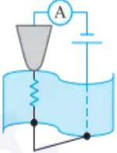

静电力显微镜

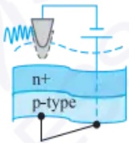

扫描扩展电阻显微镜

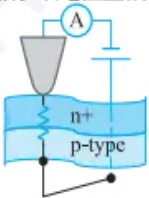

磁力显微镜

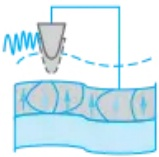

压电力显微镜

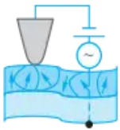

开尔文探针力显微镜

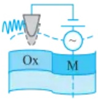

图 11.2.5 原子力显微镜的特殊测量模式: A 为电流计; Ox 为氧化物, M 为金属。图中仅表示具有不同表面势能的样品。

Fe 在 Cu(111) 面上吸附的 AFM 图像

---

612

第十一章 显微成像分析

δ-羟基喹啉分子在铜表面的 qPlus
AFM 图像

利用AFM进行单分子蛋白力谱测量

AFM 与红外光谱、拉曼光谱、微电极结合的成像模式

光谱测量类似的力-红外光波数曲线,这样就可以实现空间分辨能力达到约5 nm的红外光谱成像,从而对微区内分子结构进行鉴定。

（2）结合拉曼光谱 拉曼光谱也受到与红外光谱类似的空间分辨率限制，无法直接实现纳米级空间分辨率的拉曼光谱测量。如果使用等离激元金属如 Au、Ag 制备 AFM 探针，并同样使用等离激元金属作为基底。在 AFM 探针靠近基底时，施加可见激光照射，则在金属针尖与基底间极小的空间范围内形成超强的电磁场，从而增强局部空间中的拉曼光谱散射。这种技术也叫作针尖增强拉曼散射（tip-enhanced Raman scattering, TERS）。利用 TERS 技术已经能够实现对单个有机分子进行亚分子级的拉曼光谱成像。

（3）结合纳米电极测量 传统的电化学测量方法同样没有空间分辨能力。20世纪90年代，A.J.Bard等人提出利用微米电极结合 $x - y$ 二维平面扫描实现对样品性质的电化学二维成像，即扫描电化学显微术(SECM)，详见11.3.1。进而，C.Demaille等发展了仅纳米尖端导电的金属AFM探针，制成电化学原子力显微镜(EC-AFM)，在进行力曲线测量的同时能够进行电化学检测，为探测纳米区域内分子的电化学行为提供了重要工具。

## 习题

参考文献

## - 章节练习题 -

1. 原子、分子间的作用力主要包括哪些？
2. 静电力、泡利排斥力分别属于长程力和短程力中的哪一类？
3. AFM 实验过程中, 在探针靠近样品表面时, 总是在某一位置处突然靠近样品, 之后停在样品表面。请根据探针感受到的力曲线解释这一现象。
4. AFM 由哪些部分组成？
5. 什么是 AFM 测量的静态模式和动态模式？
6. 结合 AFM 和表面增强拉曼基本原理, 自行查找文献资料, 解释为何针尖增强拉曼方法具有超过衍射极限的空间分辨能力。

## - 挑战性问题 -

## - 专题或报告 -

7. 单分子力检测文献报告: 原子力显微镜作为力显微镜探测单分子蛋白质结构时蛋白分子是怎样一端连在基底上, 另一端连在探针上的? 怎样实现力的测量? 力随探针向上位移而变化的曲线是怎样与单分子蛋白的结构相关联的? 请同学们在专业科学论文数据库(如 Web of Science 等)以 “AFM” “single molecule protein” 等为关键词查询相关文献, 并形成文献报告。为更准确地查到相关内容, 还可以在查询蛋白连接方法时加入 “surface modification” 等更具体的词进行查询。

## 11.3 电化学显微成像

## 11.3.1 扫描电化学显微成像

扫描电化学显微术(scanning electrochemical microscopy, SECM)是Allen J Bard

---

11.3 电化学显微成像

613

等人在20世纪80年代末提出并发展起来的一种电化学现场检测新技术，它是通过探针的电化学反应及该反应在基底间的正、负反馈来提供基底的电化学形貌。其分辨率通常介于普通光学显微镜和扫描隧道显微镜（STM）之间，并直接依赖于探针的尺寸及其与样品之间的距离。Bard等人首次利用SECM及微米探针得到了高分辨图像。相比于原子力显微镜（AFM）和扫描隧道显微镜（STM）只能提供基底电极表面上的几何形貌信息，而不能提供基底电极表面上的化学（电化学）活性信息，SECM具有“化学敏感性”，不仅能够提供基底的几何形貌，而且能够提供微区电化学活性等相关信息。

## 11.3.1.1 扫描电化学显微成像基本原理及装置

## 1. SECM 的基本原理

SECM 是一种以电化学原理为基础的扫描探针技术, 可测量微区内物质因氧化或还原所产生的电化学电流。其大小受界面电子转移动力学过程和溶液中传质过程控制。通过测得的法拉第电流研究基底形貌或基底反应过程动力学参数等信息。通过驱动可三维移动的超微电极(探针)靠近样品, 在距离基底表面很近的位置进行扫描, 获得对应微区电化学信息。该技术可用于研究导体和绝缘体基底表面的几何形貌、固/液、液/液界面的氧化还原活性、不均匀电极表面的电化学活性、微区电化学动力学、生命过程及对材料进行微区加工。

## 2. 实验装置

SECM 的主要装置包括电化学部分(电解池、探针、基底、各种电极、双恒电位仪)、压电驱动器(精确地控制操作探针和基底位置)和计算机(控制操作、获取和分析数据)。SECM 利用双恒电位仪分别控制探针电势和基底(样品)电势(如果基底为导体)，由压电晶体管控制探针在基底表面扫描，通过对探针电极的法拉第电流的控制和测量获得丰富的信息。在实验过程中(图 11.3.1)，电解池固定于操作台上，基底固定在电解池的底部，基底可以是各种材料的导体或者绝缘基底。

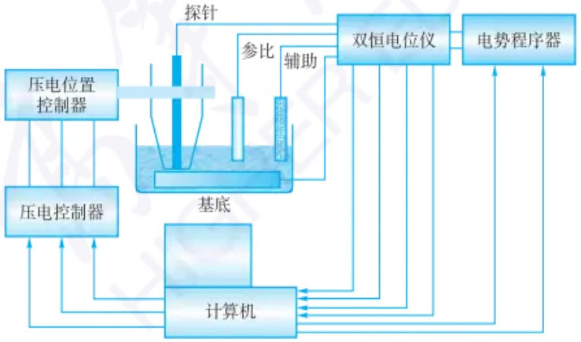

flowchart

This diagram illustrates the system architecture and data flow of a pressure measurement system, showing interactions between pressure controllers, a computer, dual-hinged position tester, and an electrical power program.

图 11.3.1 SECM 实验装置图

探针电极的设计和表面状态可显著影响SECM的分辨率和实验的重现性，用前需预处理以获得干净表面。SECM最常用的探针是外部包覆绝缘玻璃的超微圆盘电极（UMDE），常为贵金属（如Pt)或碳纤维，半径在微米级和亚微米级。制作时把清洗过的微电极丝放入除氧毛细玻璃管内，两端加热封口，然后打磨至露出电极端面，由粗到细用抛光布依次抛光至探针尖端为平面。再小心地把绝缘层打磨成锥形，以在实验中获得尽可能小的探针-基底间距 $(d)$ 。有

通常情况下,饱和甘汞电极或Ag/AgCl电极作为参比电极,铂电极作为对电极,探针电极作为工作电极,有时基底也作为第二工作电极。根据实验的需要,可以选用不同的微电极作为探针电极,如超微圆盘电极和微纳米管等。将探针固定在三维马达控制的定位装置上,使探针在基底上方沿x、y、z轴各方向精确移动。

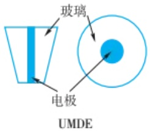

text_image

玻璃
电极
UMDE

---

614

第十一章 显微成像分析

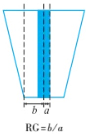

text_image

RG = b/a
b a

## 思考:

什么情况下需要电极的 RG 值大于 10?

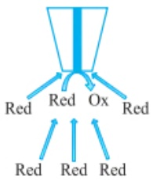

flowchart

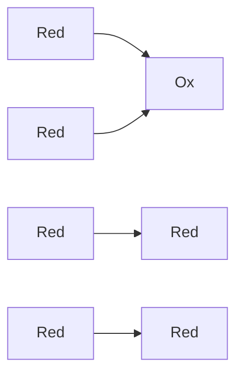

图 11.3.2 SECM 探针远离基底表面时, 物质 Red 在电极表面电化学氧化, 此时 Red 向探针的扩散为半球形扩散

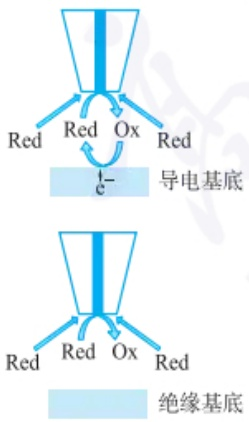

text_image

Red Red Ox Red
导电基底
e-
绝缘基底
Red Red Ox Red

图 11.3.3 SECM 的反馈模式原理图: 导电基底上的正反馈和绝缘基底对扩散的阻碍

时也会使用到半球面超微电极。而锥形的电极尖端因探针电流不随 d 而变化，故很少使用。纳米探针制备方法包括电化学刻蚀法、激光拉制仪拉制法、Ar 离子束稀释剂刻蚀法、碳纤维火焰刻蚀法等。绝缘方法包括蘸涂 Apiezon 蜡法、阴极和阳极涂料电化学沉积法、聚酰亚胺热聚合法、等离子体放大化学蒸发沉积法等。

SECM 的探针电极质量严重影响 SECM 的分辨率和实验的重现性。SECM 探针要求电极的导电部分应在电极的最下端。对圆盘电极来说， $RG \leqslant 10 (RG = b/a, b$  为探针绝缘层半径和电极半径之和，a 为探针半径）。RG 值影响生成的 SECM 图像的清晰度。能够做出小而平的超微圆盘电极是提高分辨率的关键，且足够小的 d 与 a 能够较快获得探针稳态电流。同时要求绝缘层要薄，减小探针周围归一化屏蔽层尺寸 RG 值，以获得更大的探针电流响应。然而，RG 值也不能太小，否则反应物在绝缘体上的扩散不会被有效阻止，由此产生的不良负反馈响应可能导致导电区和绝缘区之间难以区分。通常情况下，合理的 SECM 探针的 RG 值为 10。同时，应尽可能保持探针端面与基底平行，以正确反映基底形貌信息。

## 11.3.1.2 扫描电化学显微镜的成像模式

目前，SECM 的工作模式主要包括反馈模式（FB）、探针产生/基底收集模式（TG/SC）、基底产生/探针收集模式（SG/TC）、穿透模式、离子转移反馈模式、平衡扰动模式、电位测定模式等。

## 1. 反馈模式

反馈模式(feedback mode)是最常见的SECM成像模式，在已知电位偏压下，电极测量与样品相互作用的氧化还原介质被还原或氧化而产生的法拉第电流。该法拉第电流反映了样品的电化学活性。SECM探针电极插入含有电活性中介体(如还原性电活性物质，Red)的溶液中，样品固定在基底上，在探针上施加足够正的电位，Red在探针上发生氧化反应 $(\mathrm{Red - ne^{-} = Ox})$ 。如图11.3.2所示，当探针远离基底 $(d > (5 - 10)a, a$ 为探针的半径)时，反应物Red向探针上的扩散为半球形扩散，电极电化学氧化Red的速度受Red扩散到探针上的速度控制，UMDE探针上测到的电流即为稳态极限扩散电流 $i_{\mathrm{T},\infty}$ :

$$
i _ {\mathrm{T}, \infty} = 4 n F D c _ {\mathrm{R}} a \tag {11-3-1}
$$

式中，n 为探针上电极反应涉及的电子转移数，F 为法拉第常数，D 为电活性物质 Red 的扩散系数， $c_{R}$  电活性物质 Red 的本体浓度，a 为 UMDE 探针的半径， $\infty$  表示探头与基底间距离很大。当探针电极不断靠近基底时，探针上的电流  $i_{T}$  将随基底性质的不同及探针基底间距的变化而发生改变。

如图11.3.3所示，如果样品基底是导体时，则通常将样品基底作为双恒电势仪的第二个工作电极，并控制样品的电势使得 $\mathrm{Ox + ne^{-} = Red}$ 发生。当探针向导体基底逼近的距离 $(d)$ 大约为几个 $a$ 时，探针上产生的氧化态物质 $\mathrm{Ox}$ 扩散到基底上并能在基底上重新还原成 $\mathrm{Red(Ox + ne^{-} = Red)}$ 。随后，新产生的Red又扩散至探针，使探针上Red的有效流量增加，从而使得 $i_{\mathrm{T}} > i_{\mathrm{T},\infty}$ 。探针离样品的距离越近，电流 $i_{\mathrm{T}}$ 就越大，这种使探针上的电流 $(i_{\mathrm{T}})$ 随 $d$ 的减小而增加的过程被称为正反馈。反之，当基底是绝缘体时，探针产生的物质 $\mathrm{Ox}$ 不能在其表面发生反应。随着探针向基底逼近，绝缘体会阻碍Red从本体溶液扩散到探针，此时 $i_{\mathrm{T}}$ 随 $d$ 的减少而降低，即 $i_{\mathrm{T}} < i_{\mathrm{T},\infty}$，这个过程称为负反馈。

氧化物质 $\mathrm{Ox}$ 在基底上被还原的速率决定了探针电流变化的程度，通过记录

---

11.3 电化学显微成像

615

探针电极电流 $(i_{\mathrm{T}})$ 随探针-基底间距 $(d)$ 变化获得的逼近曲线（approach curve），可以获得有关基底本质方面和反应的动力学过程的信息。如图11.3.4所示，直径为 $10\mu \mathrm{m}$ 的铂探针在 $2\mathrm{mm}$ 的导电基底(铂)和玻璃基底上的反馈曲线及其对应的模拟曲线结果。当探针靠近导电基底时，电流随距离的减小迅速增大，表现为正反馈效应。随着探针与基底之间的距离缩小，反馈电流效应明显增强，表明电子转移过程更加活跃。而当探针靠近绝缘基底时，电流逐渐减小，表现为负反馈效应。随着探针与基底的距离减小，反馈电流逐渐减少到某一低值，表明电子转移受阻。实验数据和拟合结果表明，探针反馈电流与基底性质有关，同时也与探针和基底的距离有关，距离越小，反馈电流效应越强，且正反馈效应大于负反馈效应。

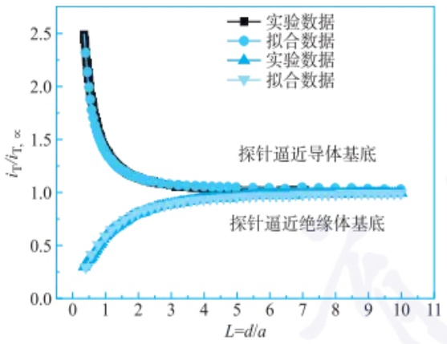

line

| L=d/a | 实验数据 \((iT/iT\),\(\infty)\) | 拟合数据 \((iT/iT\),\(\infty)\) |
| --- | --- | --- |
| 0.3 | ~2.5 | ~2.3 |
| 0.5 | ~1.8 | ~1.7 |
| 1.0 | ~1.4 | ~1.3 |
| 2.0 | ~1.2 | ~1.15 |
| 3.0 | ~1.1 | ~1.1 |
| 4.0 | ~1.05 | ~1.05 |
| 5.0 | ~1.05 | ~1.05 |
| 6.0 | ~1.05 | ~1.05 |
| 7.0 | ~1.05 | ~1.05 |
| 8.0 | ~1.05 | ~1.05 |
| 9.0 | ~1.05 | ~1.05 |
| 10.0 | ~1.05 | ~1.05 |

图 11.3.4 SECM 探针逼近不同基底时的电流-距离理论曲线

## 2. 产生/收集模式

在产生/收集模式(generation/collection mode)中，探针电极和基底电极都可作为工作电极，其中一个电极发生反应，另一个电极对其产物进行检测（图11.3.5）。当基底电极检测在探针电极上施加电位产生物质的引起电流变化的方法称为探针产生/基底收集模式(tip-generation/substrate-collection, TG/SC)。反之，当探针电极检测在基底电极上施加电位产生的物质引起电流变化的方法称为基底产生/探针收集(substrate-generation/tip-collection, SG/TC)。该工作模式可以用于研究非电化学活性的物质(如碱金属离子等)或者在基底电极表面通过不可逆的氧化还原反应产生的物质(如葡萄糖等)的浓度梯度和流量变化，据此来获得相关化学信息；也可以通过探针电流 $i_{T}$ 及收集效率 $\frac{i_{T}}{i_{S}}$ (S表示基底电流)检测基底产物的流量，绘制浓度剖面图。利用这一模式进行相关研究时，探针的运动范围不得超出基底产物的扩散层，当基底上不发生反应时，探针电极的响应信号为零。

## 11.3.1.3 SECM 测量模式

## 1. 电流模式

该模式是基于给定探针、基底电势，观察电流随时间或探针位置的变化，从而获取各种信息的方法，又包括变电流模式和恒电流模式（直接模式）。变电流模式还可以细分为反馈模式、收集模式及暂态检测模式。在反馈模式中，探针既是信号的发生源又是检测器。在探针接近基底的过程中，根据基底性质的不同会产

图中，等效距离 $L(L = \frac{d}{a}, d$ 为探针与基底距离，$a$ 为电极半径）从10降至5时，归一化探针电流 $\left(\frac{i_{\mathrm{T}}}{i_{\mathrm{T},\infty}}\right)$ 基本没有明显变化；$L$ 降至3时，开始出现较为明显的反馈效应；$L$ 降至1时（探针与基底电极距离为 $5\mu \mathrm{m}$），正负反馈效应对应的归一化电流分别为1.42和0.71；$L$ 继续降至0.5时（探针与基底距离 $2.5\mu \mathrm{m}$），正负反馈效应增强至2.07和0.50。实验数据和拟合结果表明，探针反馈电流与基底性质有关；同时也与探针和基底的距离有关，距离越小，反馈电流效应越强，且正反馈效应大于负反馈效应。

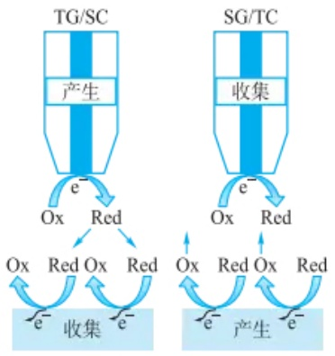

flowchart

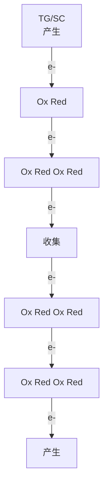

图 11.3.5 SECM 的产生/收集模式工作原理图

---

616

第十一章 显微成像分析

生“正反馈”或“负反馈”。此时的归一化探针电流 $I_{\mathrm{T}}(\mathrm{L}) = \frac{i_{\mathrm{T}}}{i_{\mathrm{T},\infty}}$ 与 $d$ 有定量关系。$\mathrm{RG} \geqslant 10$ 时，对导体和绝缘体基底分别有如下近似方程:

$$
I _ {\mathrm{T}} (L) = 0. 6 8 + \frac {0 . 7 8 3 7 7}{L} + 0. 3 3 1 5 \mathrm{e} ^ {\left(\frac {- 1 . 0 6 7 2}{L}\right)} (\text {导体} 0. 7 0 \% \text {近似}) \tag {11-3-2}
$$

$$
I _ {\mathrm{T}} (L) = \left[ 0. 2 9 2 + \frac {1 . 5 1 5 1}{L} + 0. 6 5 5 3 \mathrm{e} ^ {\left(\frac {- 2 . 4 0 3 5}{L}\right)} \right] ^ {- 1} (\text {绝缘体} 1.2\% \text {近似}) \tag{11-3-3}
$$

式中，L 为归一化探针基底间距  $\left(L=\frac{d}{a}\right)$ 。

在收集模式中,探针(基底)上施加电势得到电化学反应产物,基底(探针)电极上记录所收集的该物质产生的电流,根据收集比率得到物质产生/消耗流量图。

在暂态检测模式中,单电势阶跃计时安培法和双电势阶跃计时安培法已用于SECM研究,获取暂态信息。在探针上施加大幅度电势阶跃至扩散控制电势,考察还原反应并定义 $t_{c}$ 为到达稳态的时间,则在绝缘体基底上 $t_{c}$ 是 $\frac{d^{2}}{D_{R}}$ 的函数,而在导体基底上 $t_{c}$ 是 $d^{2}\left(\frac{1}{D_{R}}+\frac{1}{D_{0}}\right)$ 的函数。

在恒电流模式中,探针在基底表面扫描,固定探针基底间距,电流达到稳态时,检测探针在垂直方向上的变化,实现成像过程,得到基底的表面形貌信息。

## 2. 电势法

微型离子选择性电极已被用作 SECM 的探针。此类探针仅传感基底附近浓度，而不产生或者消耗电极反应活性物质。电极膜电势方程可用于浓度空间分布的计算并确定探针基底间距范围。应该注意的是计算时需要考虑探针对于基底扩散层的扰动，且需要假设基底上产生的物质是稳定状态。

## 3. 电阻法

液膜或者玻璃微管选择性电极可用于没有电活性物质或者有背景电流干扰的体系，也常用于生物体系中。在两电极之间施加恒电势，通过测量探针基底电极间的溶液电阻来获得空间分辨信息。探针电极内阻越小，该方法的灵敏度越高。可通过减小内 Ag/AgCl 电极与探针孔之间的距离来提高灵敏度。也可以利用探针阻抗与探针基底间距的关系对基底扫描，得到样品表面图像。

## 11.3.1.4 扫描电化学显微镜应用

SECM 因具有诸多优势而被应用于众多领域之中。首先，相比于宏观电化学测量的是整个样品的平均值，SECM 可以局部检测样品的电化学活性，进而将这些信息可视化。例如，SECM 可以测量新材料晶粒和晶界的电化学特性，这些特征通常对系统的整体电化学特性有不同的影响，而宏观电化学很难进行区分。其次，SECM 是一种非接触式技术，与原子力显微镜（AFM）等其他局部测量技术相比，SECM 可以在更大的探针到样品的距离上进行成像。这在测量容易因接触而损坏的易碎样品（如二维材料薄片）时尤为有利。此外，SECM 对样品也没有导电性要求，这使得 SECM 具有高度的灵活性，适用于广泛的应用领域。以上特征表明 SECM 可以测量宏观电化学难以测量的样品，特别是因为电接触不容易而无法测量的样品，例如，液-液界面、生物材料、二维材料和电极阵列。最后，SECM 可以探测特定化学物质与样品的相互作用，在研究催化剂、抗原-传感器相互作用、生物分子代谢产物的释放及锂离子在电池电极上的插层/脱层等方面具有重要意义。

---

11.3 电化学显微成像

617

## 1. 在生物分析中的应用

用SECM的电流法或电位法可观察人工或天然的生物体系，如活细胞研究、生物酶活性的分布和测定、抗原抗体成像等。例如，SECM应用于细胞分析时，通过检测叶片在光合作用过程中活性氧的浓度分布及借助铁氰化钾进行负反馈模式的形貌成像，研究各种植物叶片的光合作用活性。其次，SECM还可以利用细胞对二茂铁甲醇的氧化电流表现出正反馈作用实现细胞成像。借助不同介质，利用SECM对正常和转移性的人乳腺细胞进行成像，研究结果表明这些细胞对于亲水性介质的电化学反应电流起负反馈作用，对于疏水性介质的电化学反应电流起正反馈作用。然而，不同细胞对于某种特定介质的电化学电流的反馈作用类型也不同。在正常鼠肾细胞形成的连续细胞层中选中一个细胞，通过超微电极在其上方生成氢氧根离子以增加该细胞附近的局部 $\mathrm{pH}$ 。同时，利用SECM跟踪该细胞在局部 $\mathrm{pH}$ 增大的情况下的形貌变化，发现在氢氧根离子的攻击下该细胞明显肿胀变大，符合细胞坏死过程的形貌特征。

除了对细胞的形貌进行成像外，SECM还可以通过将识别元件修饰在超微电极上，组成基于SECM的生物传感器，利用细胞对SECM电流的反馈作用实现对活细胞表面某种生物大分子的分布成像。此外，SECM还可用于在细胞水平上研究各种生理过程，如呼吸作用。利用(二茂铁基甲基)三甲基碘化铵作为氧化还原介质对大鼠嗜铬细胞瘤细胞(PC12)的形貌进行成像，同时利用氧气作为氧化还原介质对PC12细胞表面摄取氧气的情况进行成像，以研究PC12细胞的呼吸作用。通过将PC12细胞表面氧气浓度的分布情况与其物理形貌进行对比，发现细胞呼吸作用的强度存在局部区域差异，细胞中心处呼吸作用较强，而细胞边缘处呼吸作用较弱。

为了实现抗原抗体成像分析,必须先用标记技术使抗原标记有能够产生氧化还原信号的物质,再用探针检测。例如,将碱性磷酸酶(ALP)连接到抗体上,并与单细胞表面的目标蛋白质分子相结合。在底物对氨基苯基磷酸盐单钠盐(PAPP)存在的条件下,ALP能够催化底物,将底物转化成具有电化学活性的对氨基酚(PAP),被纳米探针所检测。

## 2. 样品表面扫描成像

探针在靠近样品表面扫描并记录作为 $x - y - z$ 坐标位置函数的探针电流，可以得到三维的SECM图像。SECM已用于导体或绝缘体等各种样品表面的成像。对既有导电区域又有绝缘区域的基底，在给定 $d$ 值下，电流响应在不同区域不同，其中导电区域表现为 $i_{\mathrm{T}} > i_{\mathrm{T},\infty}$，而绝缘区域表现为 $i_{\mathrm{T}} < i_{\mathrm{T},\infty}$ 。除此之外，可以通过在 $z$ 轴压电陶瓷上加一正弦电压，使探针在 $z$ 方向进行调制，记录调制探针电流相对调制距离的相位，可以区分导电和绝缘区域。在导电区域探针接近表面时电流增加，而在绝缘区域探针接近表面时电流减少，因此如果使用锁相放大器测量调制电流，则其间相位差为 $180^{\circ}$ 。SECM也可以用于测绘基底表面存在的不同反应活性区域。在保持恒高距离扫过基底表面时，探针所生成的 $\mathrm{Ox}$ 在基底不同区域被还原成Red，探针收集到的电流为 $\mathrm{Ox}$ 在基底不同活性区域还原速率的一种度量。例如，这一技术被用于研究附着在惰性碳表面的单个金纳米颗粒的电化学活性。由于二茂铁在金纳米颗粒上电化学氧化速率远高于基底表面其他区域，因此，探针在合适的电势下扫描时，在金纳米颗粒上采集的电流远高于其他区域，表明金纳米颗粒的电化学活性高于基底表面其他区域。

---

618

第十一章 显微成像分析

## 3. 微区加工

当探针移至样品表面时，电子转移局限于靠近样品表面很小的区域，故SECM探针可以作为工作电极来直接进行微区沉积或刻蚀。例如，通过将尖端电极的电化学调制反馈给定位系统，利用电化学诱导化学蚀刻可以在半导体晶圆上进行纳米加工。具体做法是先将规则和不规则的纳米图案转换成空间分布的电流。随后，通过SECM直接写入模式，将所需的纳米图案直接“雕刻”在半导体晶圆上。目前，加工精度能够控制在亚微米级甚至纳米级。这一进展有望在半导体工业中的三维微/纳米结构的电化学纳米加工中发挥重要作用。

## 11.3.1.5 扫描电化学显微镜展望

SECM 仪器未来发展需要提高检测灵敏度、提高空间分辨率及更精确地控制探头的位置。为了解决生物学、医学、材料科学等领域内的问题，SECM 将更侧重于研究更为复杂的体系，如生物膜、单细胞、单分子、金属的腐蚀与保护、晶体的溶解等。SECM 将不断向现场化、微型化（纳米级微电极）、自动化的方向发展。SECM 与其他技术的联用将成为一种趋势。SECM 与石英晶体微天平（QCM）联用，SECM 提供电化学信息，QCM 提供质量效应信息，进而研究有机或无机薄膜性质；SECM 与原子力显微镜联用，可以同时提供高空间分辨率的电化学和基底形貌信息，已用于表面刻蚀和固/液界面研究。SECM 与扫描光学显微技术联用，可以同时进行扫描电化学、光学研究，获得空间分辨信息。

## 11.3.2 电化学发光显微镜

## 11.3.2.1 基本概念

电化学发光(electrochemiluminescence, ECL)，又称为电致化学发光，是一种由电化学反应触发的发光现象。在电极上施加合适的电位，电生物质之间通过高能电子转移反应生成激发态发光体，激发态跃迁回基态，辐射出光子。1987年，Engstrom等发展了电化学发光成像方法，直接观察了电极表面电活性物质的浓度及电流密度分布，为电化学发光研究提供了新思路。电化学发光成像方法是以电化学发光为光源的显微成像方法。鲁米诺/过氧化氢和三联吡啶钌/三正丙胺是电化学发光显微成像中最常用的电化学发光反应体系。电化学发光成像具有高通量、可视化等优势，能够获取电极表面的空间分辨信息，在电极表面微区结构表征、微/纳米颗粒活性分析、指纹分析、单细胞分析等领域获得广泛关注。

## 11.3.2.2 成像原理与传感策略

电化学发光显微成像一般可借助普通光学显微镜实现。在暗室中关闭显微镜光源，施加一定的电压触发电极表面的电化学发光反应，电化学发光信号经物镜、镜筒等结构到达电荷耦合器件（CCD），获得电化学发光图像。电化学发光显微成像与荧光成像虽有相似之处，但两者激发态的产生方式不同，电化学发光由电信号触发，而荧光由外加光激发产生。由于无须使用激发光，电化学发光背景信号极低，通常其检测灵敏度较普通荧光方法高2\~3个数量级。

电化学发光成像检测策略主要分为两类。第一类方法是将电化学发光分子直接标记在目标物表面，进行电化学发光成像。例如，在聚苯乙烯微球表面修饰三联吡啶钌分子，研究者观察到了单个微球的电化学发光图像。微球尺寸与细胞相当，对单个微球电化学发光成像的成功实现表明了电化学发光成像技术用于高灵敏度单细胞分析的可行性。基于直接成像策略，研究者已经实现了细胞膜蛋白、微纳颗粒等分子和结构的成像分析。在该策略中，由于发光分子被固定在成

---

11.3 电化学显微成像

619

像对象表面,大多数发光分子不能直接在电极表面氧化,因此,电化学发光主要由共反应剂氧化/还原触发。

第二类策略则是基于目标物对电化学发光信号的增强或减弱作用，实现其间接成像。在该策略中，发光分子和共反应剂分子均分散在溶液中，操作上较第一类方法更为简便。生物氧化酶具有高度专一性，能够催化溶液中相应的底物和溶解氧反应生成 $H_{2}O_{2}$ ，显著提高鲁米诺的电化学发光强度。将特异性的酶促反应与高灵敏的鲁米诺电化学发光成像相结合，研究人员构建了各式各样的酶生物传感器，实现了生物分子如葡萄糖、胆碱、乳酸等的高灵敏成像检测。例如，将电化学发光探针鲁米诺和胆固醇氧化酶分散在溶液中，后者催化细胞膜表面胆固醇氧化生成 $H_{2}O_{2}$ ，增强鲁米诺的电化学发光。比较引入胆固醇氧化酶前后电化学发光图像的差异，可以获得细胞表面胆固醇分布的空间分辨信息。此外，将三联吡啶钌 $Ru(bpy)_{3}^{2+}$ 和TPrA分散在溶液中，利用电极表面微区电活性的差异，可以进行非标记的电化学发光成像。例如，按压在电极表面的指纹嵴线中的脂肪酸、胆固醇等电惰性物质使其覆盖的电极表面导电能力减弱甚至不导电，阻碍电化学发光反应发生，因此在电化学发光图像中呈现为暗区；在电极空白区域，发光反应正常发生，在图像中呈现为亮区，由此实现指纹的电化学发光反相成像。

## 11.3.2.3 仪器构造

电化学发光显微成像无须外加光源，仪器构成相对简单，其核心部件包含电化学工作站和光学设备两部分(图11.3.6)。其中，电化学工作站用于驱动电化学发光反应，光学设备用于捕获电极表面产生的光信号。电化学发光显微成像通常在普通光学显微镜上完成，与明场/荧光观察的区别仅为操作中不引入激发光。为提高电化学发光图像分辨率，通常选用高数值孔径的物镜。结合电子倍增电荷耦合器件（EMCCD），可以实现高灵敏度甚至单光子水平成像。电化学触发与光学采集的同步运行可通过信号发生器实现。

此外，将扫描电化学显微镜与电化学发光方法联用，也可实现电化学发光显微成像。在该模式中，电化学发光产生于扫描电化学显微镜探针尖端。通过扫描电化学显微镜确定空间位置信息，光电倍增管（PMT）记录发光强度，从而获得电化学发光图像（图11.3.7）。当探针对样品进行扫描时，探针上产生的电化学发光信号受探针与样品的距离、样品光学性质和电化学性质等的影响，因此可对基底进行成像分析。

## 11.3.2.4 应用

电化学发光显微成像在材料科学和生命科学领域均发挥了重要作用,其应用主要包括电极表面微区结构与活性位点表征、微纳米颗粒成像、免疫阵列多重检测、单细胞分析等。

电化学发光成像能够在微纳米尺度研究电极表面电化学反应，获取宏观溶液测量难以提供的电极局域活性的信息。如在光纤束尖端构建微米级锥形电极阵列，可以获得电极阵列的电化学发光空间分布，推测单个电极的等效电极半径（0.5\~1.5  $\mu$ m）。控制施加电位的时间可以调控电化学发光反应的扩散距离，时长增大发光光斑增大，但进一步延长时会出现微电极图像重叠，电化学行为表现为类似平板电极的性质。

电化学发光成像在单颗粒电子转移性质与催化活性研究中应用广泛,电化学发光分布的异质性可用于解析颗粒表面的催化活性位点,解析催化剂构效关系。

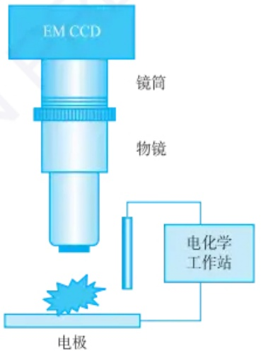

text_image

EM CCD
镜筒
物镜
电化学
工作站
电极

图11.3.6 基于光学显微镜的电化学发光成像仪器:电化学发光信号在电极表面产生，由EMCCD收集

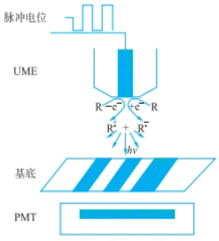

text_image

脉冲电位
UME
R-e⁻ +e⁻ R
R⁺ + R⁻
hv
基底
PMT

图 11.3.7 基于扫描电化学显微镜的电化学发光成像仪器: 电化学发光反应在探针尖端产生, 光信号由 PMT 收集

---

620

第十一章 显微成像分析

对单个异质金-铂双金属纳米颗粒表面的电化学反应进行实时电化学发光成像，可以研究纳米颗粒的催化行为。相比单一金属构成的纳米颗粒，金-铂双金属纳米颗粒的电化学发光强度更强，稳定性更高，证明双金属异质结构具有更好的催化效率及稳定性。使用电化学发光成像对金纳米片的电化学反应活性位点进行成像，可以得到不同位置处反应动力学常数及平衡电势的差异。进一步进行时序电化学发光测量，揭示了金纳米片不同位点的反应活性与其结构演化密切相关。

电化学发光免疫分析是最常用的商品化免疫分析方法之一。电化学发光免疫分析通常以磁微球为载体，在微球表面修饰捕获抗体，并将其与待测样品、$\mathrm{Ru(bpy)}_{3}^{2+}$ 标记的检测抗体共孵育，捕获抗体-抗原-检测抗体三者在磁微球表面形成“三明治”夹心结构。待测样品中抗原的浓度与磁微球的电化学发光强度正相关，以此实现抗原定量。电化学发光成像分析能够有效提高检测通量，实现多种标志物的同时检测，满足临床中精准诊断的需求。例如，在微球内掺杂不同波长的荧光分子，并在其表面修饰不同抗体，捕获对应抗原。根据荧光颜色识别抗原种类，电化学发光图像强度对抗原进行定量，可以实现同一样本中多种抗原的同时检测。此外，以导电金微球作为触发电化学发光反应的微电极和免疫反应的固相载体，通过微粒尺寸辨识抗原种类、图像中电化学发光强度定量抗原浓度，可以进一步提高生物标志物的检测通量。

电化学发光成像无须激发光，避免了细胞自体荧光干扰，特别适用于单细胞分析。自2015年单个细胞的电化学发光成像工作被报道以来，多种电化学发光单细胞分析体系被建立起来，完成了单个细胞内活性小分子、蛋白质、核酸和细胞器等物质和结构的成像分析。例如，使用佛波酯刺激细胞产生过氧化氢，增强L012（一种鲁米诺类似物）的电化学发光。比较刺激物加入前后电化学发光图像的差异，可以获取单细胞水平细胞释放过氧化氢异质性的信息。在细胞培养皿中加入胆固醇氧化酶，后者能够催化细胞膜表面胆固醇氧化产生 $H_{2}O_{2}$ ，由此可实现细胞表面胆固醇含量的分析。将细胞孵育在电极表面时，细胞将与胞外基质之间形成细胞-基质黏着。细胞-基质黏着是一种致密的蛋白结构，能够抑制电极表面电化学发光的产生，并且阻碍溶液中的发光分子扩散至黏着处。这样，细胞-基质黏着在电化学发光图像中呈现为暗斑，而无黏着处电化学发光正常发生，实现细胞-基质黏着的反相成像。此外，低丰度生物分子的高灵敏检测是电化学发光成像分析的挑战之一。将电化学发光分子或纳米颗粒标记于细胞，研究者实现了细胞膜、蛋白质等的电化学发光成像。

## 11.3.2.5 展望

作为一种超灵敏的成像分析技术，电化学发光显微镜已经实现了从单个分子和颗粒到细胞、组织的多维度成像。聚集诱导增强电化学发光、电化学发光波导、电化学发光电容显微镜等新概念的提出，进一步拓展了电化学发光显微镜的应用范围。量子点、聚合物点和金属纳米团簇等新型电化学发光体的发现，也为电化学发光显微镜超灵敏分析技术的发展提供了新机遇。此外，作为一种光学和电化学结合的成像方法，电化学发光成像的空间分辨率也受到光学衍射极限的限制。近期，电化学发光超分辨成像技术逐渐发展起来，成为电化学发光显微镜研究的新热点。

---

11.4 光学显微成像

621

## 习题

## - 章节练习题 -

1. 请简述正反馈和负反馈成像模式工作原理及分别适合应用于哪些场景。
2. 细胞进行呼吸作用时会消耗细胞周围溶液中的氧气,因此可以通过 SECM 技术可以探测细胞周围的氧气从而研究细胞活性。请简述其中原理及探针电极可能收集到的电流。

## - 挑战性问题 -

3. 查阅相关文献资料, SECM 还能有哪些应用? 是否有替代技术?
4. 简述鲁米诺和三联吡啶钌电化学发光成像体系的成像原理和适用场景。
5. 请比较电化学发光成像与荧光成像的异同点及两种方法的优缺点。
6. 根据本章内容并查阅文献,设计合适的电化学发光成像分析方法,对细胞表面或细胞内的以下物质进行成像:(1)葡萄糖;(2)鸟嘌呤;(3)磷脂酰丝氨酸。

## -专题或报告-

7. 以“电化学发光指纹成像分析”为关键词查询文献, 总结该领域的研究背景和进展, 以文献汇报的形式交流分享。

## 11.4 光学显微成像

光学显微镜(optical microscope)以其实时成像、操作便捷和非侵入性的优势，广泛应用于生物学、医学等学科的研究。特别是在研究活细胞的动态生命活动时，光学显微镜发挥着不可替代的作用。随着光学显微镜的发展，光学显微技术也逐渐成为一种强大的工具，如可以无损检测化学成分，用于环境样品的精确分析，为分析化学研究提供了精准而动态的成像能力。

人类用眼睛去感受宏观世界，而要看到更加微观的世界，则需要借助工具。光学显微技术是人类探索肉眼感知能力以外领域的利器。它的起源可以追溯到400年前，当时镜片工匠们开始制作简单的透镜，在此基础上创造了最原始的显微镜。17世纪60年代，英国的Robert Hooke在显微镜中加入调焦机构、照明系统和工作台，这是现代显微镜的雏形。同期，荷兰的Antonie van Leeuwenhoek制成单组元放大镜式的高倍显微镜并首次发现微生物。19世纪70年代，德国学者Ernst Abbe通过确立光学显微镜成像原理，并开发了油浸物镜，使得光学显微镜的分辨率达到理论极限。这一技术进步极大地推动了显微镜在科学研究中的应用，奠定了现代光学显微成像的基础。

## 11.4.1 光学显微镜的基本概念

## 11.4.1.1 显微成像基本原理

光学显微镜利用凸透镜的放大成像原理,将微小物体放大到人眼能够分辨的尺寸。近代的光学显微镜通常采用两级放大,分别由焦距很短的物镜和焦距较长的目镜完成。为了减少像差,显微镜的目镜和物镜都是由透镜组构成的复杂光学系统。如图11.4.1所示,物体AB位于物镜的前焦点外靠近焦点的位置,经物镜成

德国学者 Ernst Abbe

---

622

第十一章 显微成像分析

明视距离:物理学里,人眼看太远和太近的物体时,眼球都要进行调节,也就是改变眼球的突起程度,但有一个距离恰能使眼睛不用调节就能看清楚,这个距离就叫明视距离。也就是说眼睛看明视距离处的物体是感觉最舒服的、最适合正常人眼观察近处较小物体的距离,约为250 mm。

放大倒立的实像  $A^{\prime}B^{\prime}$ 。 $A^{\prime}B^{\prime}$  位于目镜的物方焦距内侧但靠近焦点的位置上，作为目镜的物体。目镜将物镜放大的实像再放大成虚像  $A^{\prime\prime}B^{\prime\prime}$ ，该虚像位于明视距离处（距离人眼 D=250 mm 处），供眼睛观察。显微镜的总放大倍率等于物镜放大倍率和目镜放大倍率的乘积。

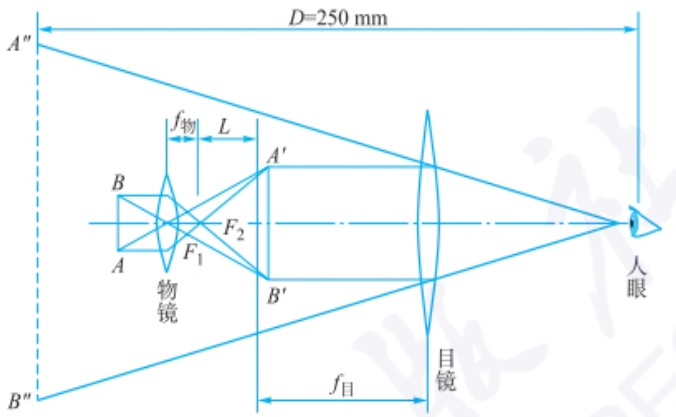

text_image

D=250 mm
A"
f物
L
A'
B
F1
F2
物镜
B'
B"
f目
目镜
人眼

图 11.4.1 显微镜成像基本原理。 $f_{物}$ 是物镜的焦距， $f_{目}$ 是目镜的焦距， $F_{1}$ 是物镜的后焦平面， $F_{2}$ 是目镜的前焦平面

透镜在成像过程中,由于其本身物理条件的限制,会导致成像产生变形或者模糊不清的现象,这种现象被称为光学系统的像差。根据产生原因,像差可以分为两类:一类是多色光成像时,由于介质折射率随光的波长不同而引起的像差,即色差;另一类是单色光成像时的像差,即单色像差,包括球差、彗差、像散、场曲和畸变。各种像差会从不同方面影响显微镜的成像质量,在设计中可以尽量减小,但不能完全消除。

## 1. 色差

光学材料对于不同波长的光折射率不同。当光轴上的物点发出的多色光经单透镜成像时，将得到一系列与各色光对应的不重合的像点，导致成像模糊，这种现象称为色差。造成色差的原因是普通光学材料对于紫光的折射率比红光大，因此当以相同的入射角透过透镜时，折射出的紫光比红光有更大的偏折角。色差分为轴向色差和垂轴色差。轴向色差是指各色光的成像位置沿轴向分布不同，而垂轴色差是由于对各色光的放大率不同而导致成像大小不同，也称放大率色差。垂轴色差会使白光成像边缘出现彩色。借助组合光学系统中各组元焦距与介质色散参数的恰当组合，可校正色差。

## 2. 球差

由光轴上某一物点发出的单色光束经光学系统后，若不同孔径角的各光线交汇于光轴不同位置，从而使轴上像点被一弥散光斑所代替，则称光学系统对该物点的成像有球差。球差的产生是由于通过光轴附近的光线的折射角较小，而通过透镜边缘的折射角较大而造成的。通过使用不同材料的凸凹透镜组合，可以校正球差。此外，在使用显微镜时，可以调节孔径光阑，控制入射光束的粗细，使细光束通过透镜中心部位，从而将球差降至最低限度。然而，这种操作会减小孔径角，进而使分辨率降低。

## 3.彗差

彗差是由位于轴外的某一点，向光学系统发出的单色圆锥形光束，经该光学系统折射后，并不会聚一点，而是结成拖着明亮尾巴的彗星形光斑。与球差一样，

---

11.4 光学显微成像

623

彗差的存在严重影响成像的清晰度。彗差与透镜的形状有关,可以通过采用轴向平行光、改变透镜形状和采取组合透镜来减小或者消除。

## 4. 像散

像散也是影响清晰度的轴外点单色像差。当视场很大时，边缘上的物点离光轴远，光束倾斜大，经透镜后则引起像散。像散使原来的物点在成像后变成两个分离并且相互垂直的短线，在理想像平面上综合后，形成一个椭圆形的斑点。像散可通过复杂的透镜组合来消除。

## 5. 场曲

场曲也被称为“像场弯曲”。当透镜存在场曲时，整个光束的交点与理想像点不重合。虽然在每个特定点都能得到清晰的像点，但整个像平面却是一个曲面。这样在镜检时无法同时清晰地观察整个像面，给观察和照相带来了困难。因此，研究用显微镜的物镜一般都是平场物镜，这种物镜已经矫正了场曲。

## 6. 畸变

畸变是指影响物体几何相似性的像差。由于光束的倾斜度较大，导致透镜近轴部分的放大率与边缘部分的放大率不一致，从而在形状上造成失真。畸变并不影响成像的清晰程度，因此通常影响不大。

## 11.4.1.2 光学显微镜的基本构造

光学显微镜主要由两个部分组成:机械部分和光学部分。机械部分的功能是将各光学部件固定在保证成像光路的最精确位置上,可以调节聚焦改变物像的清晰度。光学显微镜的基本组成包括镜筒、目镜、物镜、物镜转换器、镜臂、载物台、粗准焦螺旋、细准焦螺旋、聚光镜、光阑、反光镜、镜脚(镜座)等(图11.4.2)。其中镜筒、目镜、物镜转换器、载物台、聚光镜全部悬挂在镜臂上,调焦螺旋、聚光器调节螺旋等所有光路调节系统只与镜臂相关联。镜座主要起稳定作用,与镜臂通过倾斜关节连接以适应光源的入射方向。

19世纪80年代，光学显微镜的机械部件基本结构已经定型。现在，小型生物研究显微镜基本上保持了该显微镜的原始设计。现代光学显微镜的机械部件和布局发生了很大变化，趋向于模块化和集成化，用户可以根据需要选择相应的部件进行安装。与传统显微镜不同，现代光学显微镜的镜座演变为多功能的机台，上面安装了光源系统、滤光系统、调焦系统、聚光系统及其他光路转换装置。镜臂和镜座整合为一体化机件，调焦动作不再通过镜臂的升降来实现，而是通过载物台的升降。现代光学显微镜的结构越来越复杂，功能也越来越多，可以安装各种镜筒头、照相机、摄像机、光电倍增器和落射光系统的连接口。调焦螺旋和载物台移动螺旋实现了同轴化。现代光学显微镜的光路系统中包括了目镜、物镜、聚光镜、光阑、光栅、照明装置和分光装置等多种部件。这些部件的种类、性能和用途变得越来越复杂。下面将对一些重要的光学部件进行介绍。

## 1. 目镜

目镜是安装在镜筒上端的一种透镜，靠近观察者的眼睛，因此也称为接目镜。通常由上下两组透镜组成，上面的透镜叫作接目透镜，起放大作用；下面的透镜叫作会聚透镜或场镜，使成像亮度均匀。上下透镜之间或场镜下面装有一个光阑，其大小决定了视场的大小。标本正好在光阑面上成像，可在其上面放置目镜测微尺，用来测量所观察标本的大小。目镜的功能是放大物镜所得的物像。目镜的放大倍数与焦距成反比，因此目镜越短，放大倍数越大。常用目镜的放大倍数为5\~16倍。

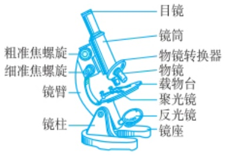

text_image

目镜
镜筒
物镜转换器
物镜
载物台
聚光镜
反光镜
镜座
粗准焦螺旋
细准焦螺旋
镜臂
镜柱

图 11.4.2 19 世纪 80 年代的 Zeiss 显微镜

---

624

第十一章 显微成像分析

## 2. 物镜

物镜是决定显微镜性能的关键部件，安装在物镜转换器上，靠近被观察的物体，因此也称为接物镜。它由若干个透镜组合而成，旨在克服单个透镜的成像缺陷，提高物镜的光学质量。物镜的作用是将标本进行第一次放大。物镜质量直接影响显微镜成像质量，是决定分辨率和清晰度的主要部件。物镜的种类很多，根据浸法特征分为非浸式（干式）和浸式（包括油浸、水浸、甘油浸等）物镜；根据数值孔径和放大倍数，可分为低倍、中倍和高倍物镜；根据像差校正情况不同可分为消色差、半复消色差、复消色差、平场消色差、平场复消色差物镜等。

## 3. 聚光镜

聚光镜又名聚光器，安装在载物台下方，主要由聚光镜和可变光阑组成。小型显微镜通常不配备聚光镜，但使用数值孔径0.40以上的物镜时，必须配备聚光镜。聚光镜不仅可以弥补光量的不足，适当改变来自光源的光线特性，还可以将光线聚焦于被检物体上，以获得最佳的照明效果。聚光镜由多块透镜组成，有多种结构，如阿贝聚光镜、消色差聚光镜、摇出式聚光镜等。

## 4. 光阑

光阑，从广义角度上，一切限制入射光束界面的框孔都可认为是光阑，如聚光镜、物镜、目镜等。但是在显微技术中，只把那些专门限制和调节入射光束截面、光通量的可变光阑或者限制视野范围及在视野范围内的固定框孔叫作光阑。在普通显微镜的聚光镜的下方，装有可变光阑，也称为光圈，由多张金属薄片组成，中心部分形成圆孔。它的作用是调节光强度，并使聚光镜的数值孔径与物镜的数值孔径相适应。当可变光阑打开得越大时，有效数值孔径越大。

## 5. 照明装置

显微镜的照明可以使用自然光源或人工光源。常用的人工光源包括显微镜灯、日光灯等。现代大型显微镜的照明装置由多个部件组成，包括发光灯管、灯罩或者灯室、会聚透镜、防热线滤光片、光束切断装置、散热片等。根据照明光束的形成方式，显微镜的照明方法可分为“透射式”和“落射式”两大类。前者适用于透明或半透明的被检物体，大多数生物显微镜属于此类；后者适用于非透明的被检物体，光源来自上方，也称为“反射式照明”，主要应用于金相显微镜或荧光显微镜。

## 11.4.1.3 显微镜的性能

显微镜的性能主要由分辨率、放大倍数和数值孔径等物理参数决定，这些参数与显微镜的分辨能力密切相关。

## 1. 数值孔径

数值孔径,又称为镜口率,简写为 NA,是物镜和聚光器的主要参数之一,与显微镜的分辨力成正比。数值孔径反映了物镜的聚光能力,是物镜的重要性质之一(图 11.4.3)。从几何光学的角度来解释,物镜的数值孔径是指从物体反射或者折射出来的光束,能够进入物镜框口的张角,或者立体角的正弦函数值与物镜前透镜同物体间所处的介质折射率的乘积,公式表达为

$$
\mathrm{NA} = n \cdot \sin \frac {u}{2} \tag {11-4-1}
$$

NA 为物镜的数值孔径, n 为介质的折射率, u 为从物体进入物镜前透镜框口的光束的立体角(也叫镜口角或者孔径角)。物镜的框口给定的条件下, 标本距物镜越远, 进入物镜框口的光束的立体角越小。反之, 距离越近, 进入框口的光束的

以放大率为100、工作距离为$0.11\mathrm{mm}$ 、物镜前透镜直径（框口）为$0.7\mathrm{mm}$ 、镜口角为 $140^{\circ}$ 的物镜为例，用空气作介质时，数值孔径为0.940，用香柏油为介质时，数值孔径为1.424。由此可见，折射率高的介质能显著提高物镜的数值孔径。常见的干式物镜的数值孔径为 $0.05\sim 0.95$ ，一般用于低倍物镜。油浸物镜的数值孔径可达 $1.30\sim 1.50$ ，适用于高倍物镜。物镜的数值孔径通常标在物镜的镜体上。

---

11.4 光学显微成像

625

立体角越大。但物体和物镜前透镜之间的距离是有限的，即使标本贴近物镜前透镜，进入框口光束的立体角也绝对不会达到 $180^{\circ}$，因此物镜的镜口角是有极限的。

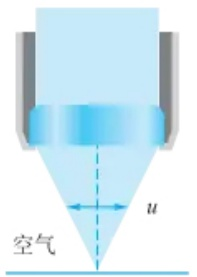

text_image

空气
u

低数值孔径干物镜

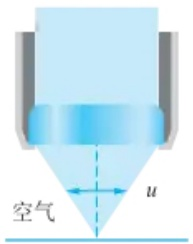

text_image

空气
u

较高数值孔径干物镜

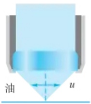

text_image

油
u

最高数值孔径油浸物镜

图 11.4.3 物镜的数值孔径

从数值孔径的公式中可以看出，镜口角是重要的决定因素。物镜的框口不变，物镜与标本之间的距离即工作距离不变的情况下，介质的折射率也是影响数值孔径的重要因素。干物镜与标本之间的介质通常是空气，其折射率约为1；水浸物镜的介质是水，其折射率为1.33；油浸物镜的介质是香柏油，其折射率为1.515。介质的折射率越大，越能把具有更大立体角的光束纳进物镜。

## 2. 分辨率

显微镜的分辨率,又称为解像本领、分辨力或者分辨本领,是指显微镜能够帮助人眼看清相互靠近两个质点的最短距离。分辨率的大小用分辨距离的数值来表示,即所能分辨开两个物点间的最小距离。在明视距离(250 mm)处,正常人眼能看清相距0.073 mm的两个物点,这个数值即为正常人眼的分辨距离。显微镜的分辨距离越小,表示它的分辨力越高,性能越好。

根据显微镜的凸透镜成像原理，凸透镜能将入射光聚焦到它的焦点上，但由于透镜口径有一定大小，光线透过时会发生衍射，无法将光线汇聚成无限小的焦点，而是形成一定能量分布的光斑，称为艾里斑（Airy disk）。艾里斑是在衍射限制的系统中由圆形孔径形成的聚焦光点，中央是明亮的圆斑，周围有一组较弱的明暗相间的同心环状条纹。每一个发光的物点，经过有限直径的透镜后，都会在像平面形成一个艾里斑。对于非常接近的两个点，成像后艾里斑会过于接近，以至于无法分辨。若两个等光强的非相干点像之间的间隔等于艾里斑的半径，即一个艾里斑中心与另一个艾里斑边缘正好重合时，这两个物点刚好能被人眼或光学仪器所分辨（图11.4.4）。物镜所能分辨的最小距离可以用如下公式表示。

$$
r _ {0} = \frac {0 . 6 1 \lambda}{\mathrm{NA}} \tag {11-4-2}
$$

式中， $r_0$ 表示艾里斑的半径，也是物镜的最小分辨距离， $\lambda$ 为入射光波长，NA为数值孔径。式(11-4-2)表示的是两个非相干的自身发光点的分辨率。根据以上公式，可以采用更短波长的光源，或者提高物镜的数值孔径，来提高显微镜的分辨率。一般物镜的数值孔径小于1，油浸系物镜可以做到1以上，若采用数值孔径较大的物镜，如数值孔径为1.4的物镜，物镜能够分辨的最小间距大约是0.44倍光源波长。在可见光波段，光源多采用波长为500多纳米的可见光，一般认为光学显微镜分辨率的极限在 $200\mathrm{nm}$ 左右。

不同规格的物镜

在显微镜中,对于自身不能发光的点,照明条件不同,分辨率也不同。研究表明,当被观察物体不发光,而被其他光源照明时,只需要修正上式中的因子,该式仍然有效。一般地,该因子在0.57\~0.83范围变化,当物体在斜射光照明下,该因子为0.5。

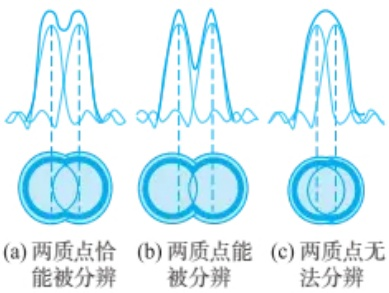

图11.4.4

---

626

第十一章 显微成像分析

物镜的基本参数、工作距离和视场直径

## 3. 放大倍数

放大倍数,又称放大率,是指被检验物体经物镜放大再经目镜放大后,人眼所看到的最终图像的大小对原物体大小的比值,是物镜和目镜放大倍数的乘积。放大率是显微镜的重要参数,但不能盲目认为放大率越高越好,选择时应首先考虑物镜的数值孔径。

物镜的放大倍数,是指物镜在线长度上放大实物倍数的能力指标。放大倍数有两种表示方法,一种是直接在物镜上刻度出如 $4\times$ 、 $10\times$ 、 $20\times$ 、 $40\times$ 、 $60\times$ 、 $100\times$ 等;另一种则是在物镜上刻度出该物镜的焦距f,焦距越短,放大倍数越高。物镜的放大倍数公式为

$$
M _ {\text {物}} = - L / f _ {\text {物}} \tag {11-4-3}
$$

L 是光学镜筒长度, 镜筒长度是指物镜底面到目镜顶面的距离, 机械镜筒长度多为 160 mm、170 mm、190 mm。 $f_{物}$  为物镜的焦距, 负号表示所成的像是倒立的。

同理,目镜的放大率为

$$
M _ {\text {目}} = D / f _ {\text {目}} \tag {11-4-4}
$$

D 为人眼的明视距离, $f_{目}$ 为目镜的焦距。显微镜的总放大率等于物镜和目镜的放大率的乘积,即

$$
M = - \frac {L D}{f _ {\mathrm{物}} f _ {\mathrm{目}}} \tag {11-4-5}
$$

## 4. 工作距离

工作距离也叫物距,是指当所观察的标本最清晰时物镜的前端透镜下表面到标本的盖玻片上表面的距离。物镜的工作距离与物镜的数值孔径有关,物镜倍率越高,数值孔径越大,其工作距离越小。

## 5. 焦点深度

在显微镜的光轴上有一段距离范围内物体被看得清晰,超出这段距离的物体就模糊不清,这段距离位于显微镜焦点的上下很小的范围之内,这段距离的上下限叫作焦点深度,简称焦深。焦点深度的大小决定了在显微镜中能够清晰观察到的物体的范围。焦深大,可以看到被检物体的全层,焦深小,只能看到被检物体的一个薄层。显微镜的总放大率越大,焦点深度越小,工作距离也越短。物镜的焦点深度与物镜的数值孔径、总放大率关系如下:

$$
T = \frac {n K}{\mathrm{NA} \cdot M} \tag {11-4-6}
$$

T 为焦点深度, NA 为物镜的数值孔径, M 为总放大率, K 为一常数 0.24, n 为介质的折射率。焦深与总放大倍数及物镜的数值孔径成反比, 焦深增大, 分辨率将降低。

## 6. 视场直径

视场直径也称视场宽度或视场范围,是指在显微镜下看到的圆形视场内所能容纳被检物体的实际范围。视场直径越大,越便于观察。视场直径符合以下公式:

$$
F = \frac {\mathrm{FN}}{M _ {\mathrm{obj}}} \tag {11-4-7}
$$

式中，F 为视场直径，FN 为视场数，是目镜的固定参数，标刻在目镜的镜筒外侧， $M_{obj}$  为物镜放大率。

---

11.4 光学显微成像

627

## 11.4.2 光学显微成像的模式

## 11.4.2.1 明场显微成像

明场显微镜，也称复合光学显微镜，是最简单的光学显微镜之一，以样本的颜色及透射率为基础，利用光线在明亮背景上产生具有对比度的图像。当样品放置在明场显微镜的载物台上并从下方照射时，光线会通过聚光镜聚焦到样品上，透射或反射的光由物镜收集，经物镜和目镜放大成像。

明场显微成像广泛应用于生物、病理检验。标本常用染料进行染色，增强图像的对比度，方便观察。

## 11.4.2.2 暗场显微成像

与明场显微成像不同，暗场显微成像并不直接观察到照明光线，而是观察到被观测物体散射的光线。在暗场观测中，视场是黑暗的背景，而被观测的物体则呈现出比较明亮的像。为了进行暗场观测，需要安装特殊的附件——暗场聚光镜。这种聚光镜中包含一个“暗场环”，暗场环中间存在一个挡片，这个挡片的作用是阻挡垂直入射的光线，使光线以一定角度斜射向样品。利用样品表面散射的光形成明亮的图像，从而达到在黑暗的背景下可看到标本的外部形态的效果（图11.4.5）。

暗场显微镜特别适用于胶体化学中观察原虫、细菌的鞭毛、伪足运动；在医学检验学领域，适用于观察人体体液中螺旋体、尿管形、结晶或各种粒子。

## 11.4.2.3 相衬显微成像

人眼对于光波的区分主要依赖于对颜色(波长)和亮度(振幅)的感知。相衬显微镜利用光的干涉现象,将人眼不可分辨的相位差变为可分辨的振幅差,因此无色透明的样品,也能够通过相衬显微镜变得清晰可见。

相衬显微成像是通过在光路中加装环状光阑和相位板来实现（图11.4.6）。环状光阑装在聚光镜的下方，与聚光镜组合为一体，组成相衬聚光镜。环状光阑实际上是一个窄缝，用于产生相干光源。相位板安装在物镜的后焦面上，即物镜体内透镜组中间位置。相位板是一片玻璃上喷涂环形吸光物质的平板，与环状光阑构成共轭面。相位板上除环形吸光物质以外的部分称为补偿面。在相衬成像中通过聚光镜前环形光阑形成的环形光被聚光镜聚焦在样品上，部分环形光被样品的光学致密结构衍射，经历约 $1 / 4\lambda$ 的相移。这些直射光和衍射光经过物镜后焦平面上的相位板时被相位板分离，在中间像平面上聚焦，形成目镜中观察到的最终相衬图像。衍射光在相位板的补偿面上再经历约 $1 / 4\lambda$ 的相移，若直射光和衍射光的波峰和波谷相遇，则合成波的振幅减小，导致通过样品的光强衰减得多，

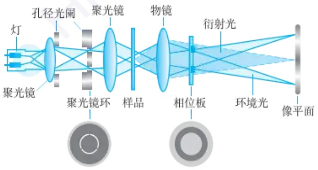

flowchart

图 11.4.6 相衬显微成像基本原理

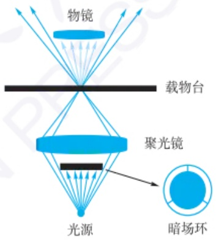

text_image

物镜
载物台
聚光镜
光源
暗场环

图 11.4.5 暗场显微成像基本原理

图11.4.6、图11.4.7和图11.4.8彩图

---

628

第十一章 显微成像分析

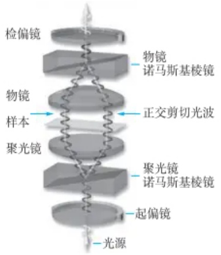

flowchart

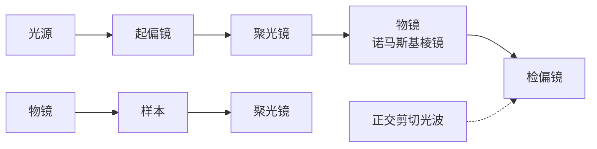

图 11.4.7 微分干涉显微成像基本原理

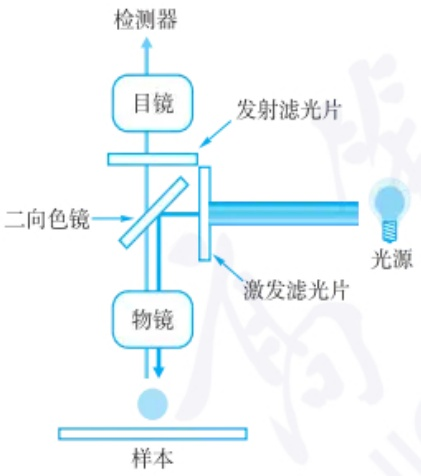

flowchart

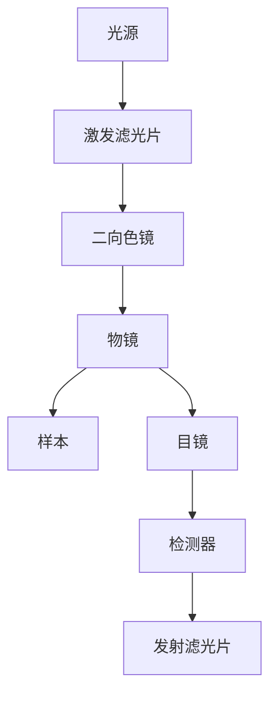

图 11.4.8 荧光显微成像的基本原理

相衬显微镜下标本细节的反差加大，样品比背景暗得多，这种反差叫暗反差，也叫正反差。若在相位板的共轭面上再涂一层吸光物质，使直射光的相位与通过补偿面的衍射光的相位相一致，两光束的波峰相遇，其合成波的振幅等于两光束振幅之和，光强比直射光增强了4倍，样品比背景明亮得多，这叫作明反差，也叫负反差。相衬成像主要适用于活细胞、微生物、薄组织切片等未被染色的半透明样本。

## 11.4.2.4 微分干涉显微成像

微分干涉显微镜是利用偏振光来进行成像。光源发出的入射光经过起偏器和诺马斯基棱镜后被分解成两束偏振方向不同的光线，然后经过聚光镜变成平行光。这两束光在穿过样品前是相位一致的，但在穿过样品后由于样品厚度和折射率的不同而产生光程差。随后，光束穿过第二个诺马斯基棱镜和偏振装置（即检偏器），将两束垂直的光波组合成具有相同偏振面的光束，从而发生干涉。在成像的灰色背景上，会出现明暗相间的条纹，图像呈现出立体的三维效果（图11.4.7）。微分干涉显微镜的附件包括起偏器、检偏器、诺马斯基分光棱镜、诺马斯基聚光棱镜、四分之一波长棱镜（简称1/4波晶片）、半波片等。

微分干涉显微成像与折射率的变化、样品的厚度有较大的关系，所成影像具有较强的立体感、较高的分辨率，它常被用来观察活的未染色的细胞。

## 11.4.2.5 荧光显微成像

荧光显微成像技术是利用荧光物质的激发和发射来进行成像的一种方法。根据照明方式，荧光显微镜分为透射式和落射式两种。透射式荧光显微镜和普通光学显微镜类似，光源经过聚光镜到达样品，激发荧光后通过物镜，最后到达目镜。而落射式荧光显微镜的入射光是通过物镜到达样品，激发荧光后再发射回物镜，最后到达目镜，这样可以减少激发光的损失，提高荧光效率。目前，市场上常见的荧光显微镜多为落射式，光路图如图11.4.8所示，光源发出的入射光经过激发滤光片，选择性地透过可使样本产生荧光的特定短波，再经二向色镜反射，到达物镜。物镜收集入射光并将其汇聚，照射到样本上，激发样本内的荧光物质发射出荧光。通过物镜收集发射光再次到达二向色镜，由二向色镜反射入射光并允许波长较长的发射光通过，经过发射滤光片，阻挡没有被标本吸收的激发光，选择性地透过特定波长的荧光，进而成像。落射荧光显微镜也分为正置荧光显微镜和倒置荧光显微镜。

## 11.4.3 荧光显微镜的基本构造

根据落射式荧光显微镜的成像原理,它的基本构造主要包括光源、滤色系统、物镜和摄像系统。

## 1. 光源

在大多数荧光显微镜应用中，到达眼睛或检测器的光子数量通常很低。为了产生足够的激发光强度，需要功率较高的光源，通常使用的光源为氙弧灯、汞蒸气灯、超连续光源及大功率LED照明器。目前，多采用 $200\mathrm{W}$ 的超高压汞灯作为光源，它可以发射很强的紫外和蓝紫光，激发各类荧光物质，被荧光显微镜普遍采用。

此外，激光器的应用越来越广泛，如氩离子激光器、氩-氪离子激光器和固体激光器等。它们具有光源尺寸小、散度低、单色性好、平均亮度高等优点，在扫描共聚焦显微镜中已成为必不可少的光源。

---

11.4 光学显微成像

629

## 2. 滤色系统

滤色系统是荧光显微镜的重要部位，由激发滤光片、发射滤光片和二向色分光镜组成。激发滤光片的主要作用是选择性地传递激发波长的光线；发射滤光片主要用来选择性地传递发射波长的荧光光线，使观察者能够看到样品所发射的荧光，同时保护观察者的眼睛免受紫外线损伤。二向色分光镜能够将激发光反射，同时又能透射荧光到目镜(图11.4.9)。

## 3. 物镜

理想的荧光显微镜物镜具有较高的数值孔径(NA)。相同放大倍数下，NA值越大，物镜的分辨能力越高，物镜可以收集到的光子数量就越多。油浸物镜可减少由于盖玻片的反射和折射而造成的光损失，提高激发和收集效率，被广泛应用于荧光显微镜。此外，消色差物镜的自体荧光极微且透光性能(波长范围)适合于荧光，因此应用广泛。

## 4. 摄像系统

摄像系统有助于以高分辨率记录标本的图像。系统中经常使用电子探测器，如互补金属氧化物半导体(CMOS)或电荷耦合器件(CCD)相机，将光学信号转变为数字图像信号，该信号可传输到计算机。这些图像可以被外部保存，以便查看或者通过传统分析手段对面积、颗粒大小和分布进行分析。

## 11.4.4 光学显微成像的应用

光学显微成像技术在分析化学领域中的应用随着技术的进步经历了重要的发展阶段。每个阶段的技术革新都极大地推动了化学分析研究的深度和广度。

在光学显微镜发明的初期,传统光学显微镜主要用于观察和分析微小的化学晶体和矿物。通过显微镜,化学家能够仔细观察和研究物质的微观结构和形态学特征,从而在化学分析中进行定性分析和分类。传统光学显微镜作为一种基础的显微技术,凭借其操作简便、样本兼容性广及高分辨率等优势,广泛用于基础研究。

荧光显微镜相较于传统光学显微镜，具有其独特的优势和应用领域。传统光学显微镜因其衍射极限的限制，通常只能实现有限的分辨率，难以清晰观察微小的细胞结构。荧光显微镜凭借其灵敏的荧光标记技术，能够特异性地标记并观察细胞内特定分子或结构，不仅可以实现定性成像，也可完成定量分析。其独特的优势在于通过荧光染料或荧光蛋白，能够进行高对比度、高灵敏度的成像，尤其适用于实时观察生物分子的动态行为和相互作用。此外，荧光显微镜还能够通过多重荧光标记技术实现多种分子的同时观察，这对于复杂生物系统的研究尤为重要。它的应用范围涵盖了细胞生物学、分子生物学及药物开发等领域，特别是在研究细胞内部机制、疾病标志物检测及活细胞成像中展现了其强大的功能。

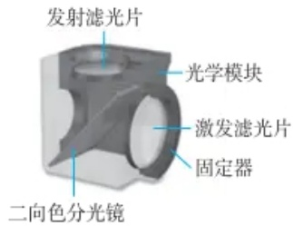

text_image

发射滤光片
光学模块
激发滤光片
固定器
二向色分光镜

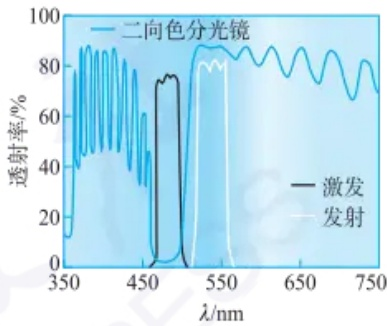

line

| Wavelength (nm) | Excitation (%) | Emission (%) |
| --- | --- | --- |
| 350 | ~12 | ~12 |
| 450 | ~35 | ~35 |
| 460 | ~75 | ~0 |
| 500 | ~75 | ~0 |
| 520 | ~88 | ~80 |
| 550 | ~88 | ~80 |
| 650 | ~88 | ~80 |
| 750 | ~70 | ~70 |

图 11.4.9 滤色系统的基本结构

图11.4.9彩图

## 荧光蛋白

20 世纪 90 年代, 生物荧光成像正式迈入了基因编码荧光蛋白的生物标记技术的时代, 其中以绿色荧光蛋白 (GFP) 最为经典。目前, 各种荧光蛋白在分子生物学和细胞生物学等研究领域内被广泛使用。它们可作为报告基因的产物用于分析基因表达的时空特异性、监测信号传导和基因转移效率, 可作为融合标签内源性标记蛋白, 用于观察细胞的形态、运动、分化、增殖和凋亡等过程, 也可作为蛋白质相互作用的转换子 (如 fluorescence resonance energy transfer, FRET 等), 进而去分析蛋白质的结构、功能、定位、修饰等特性。

荧光染料、荧光蛋白及荧光成像分析

---

630

第十一章 显微成像分析

## 习题

参考文献

## - 章节练习题 -

1. 显微镜的像差有哪几种？如何校正？
2. 在光学系统中, 什么是数值孔径?
3. 影响光学显微镜分辨率的因素有哪些？
4. 说明明场显微成像和暗场显微成像的原理，并说明二者的优缺点。
5. 荧光显微镜中滤色系统主要结构及其作用是什么？

## - 挑战性问题 -

6. 请动手查阅文献,概括总结前沿新兴的光学显微技术特点及原理。

7. 假设你正在设计一款新型显微镜,需要在分辨率和成像深度之间做出权衡。你将如何选择合适的光学元件和设计参数来优化系统性能?
8. 荧光显微镜根据特定荧光分子吸收了激发光后，能发射不同波长的光，通过测定样本发射的荧光强度，可以获取关于样品成分的定量信息。比率型荧光探针是一类特殊的荧光探针，可以在两个不同的波长下发射荧光，从而实现对生物分子或细胞环境的定量分析。常见的比率型荧光探针有 Fura-2、pHrodo、DiBAC4(3)等。请动手查阅文献，说明 Fura-2 可以检测的金属离子种类和浓度区间。

## - 专题或报告 -

9. 荧光显微成像在生命分析领域的应用越来越广泛，在亚细胞器成像、细胞微环境动态变化分析方面具有重要应用，相关研究工作主要关注疾病病程中亚细胞器及细胞微环境中重要标志物的分布和形态变化。查阅相关科学文献，并将结果写成报告。
10. 请分别以“optical microscopy”“STED”为关键词检索文献数据库进行相关下载与学习，并总结相关专题。[STED: stimulated emission depletion, 可参考 Optics Letters, 1994, 19(5): 780-782.]

## 11.5 激光扫描共聚焦显微成像

## 11.5.1 激光扫描共聚焦成像的光路与特点

## 激光扫描共聚焦显微镜发展历史

1957 年 Marvin Minsky 提出共聚焦显微镜技术的基本原理。
1967 年 Egger 和 Petran 应用共聚焦显微镜产生了光学横断面。
1984 年 Bio-Rad 推出世界第一台商品化的共聚焦显微镜。
1987 年 White 和 Amos 在 Nature 发文,标志着激光扫描共聚焦显微镜成为科学研究的重要工具。

激光扫描共聚焦显微镜(laser scanning confocal microscopy, LSCM)是以激光作为光源，在传统宽场荧光显微成像基础上，采用共轭聚焦原理和激光扫描装置，并利用计算机对所观察的对象进行数字图像处理的一套观察、输出和分析系统。与传统荧光成像技术相比，激光扫描共聚焦显微成像的光学成像分辨率提高了30%\~40%。该技术使用紫外或可见光激发荧光探针，从而得到细胞或生物组织内部微细结构的荧光图像，在亚细胞水平上观察生理信号及细胞形态的变化，成为分析化学、分子生物学、细胞生物学等领域中新一代的研究工具。

如图 11.5.1 所示,传统宽场荧光显微镜的成像光路为:从汞灯或激光器发出的激发光源,经过二向色镜时因波长较短被反射进入物镜照射到标本上,激发标本中的荧光标记物产生荧光。这些发射光再穿透物镜和二向色镜被检测器收集从而实现荧光成像。

---

11.5 激光扫描共聚焦显微成像

631

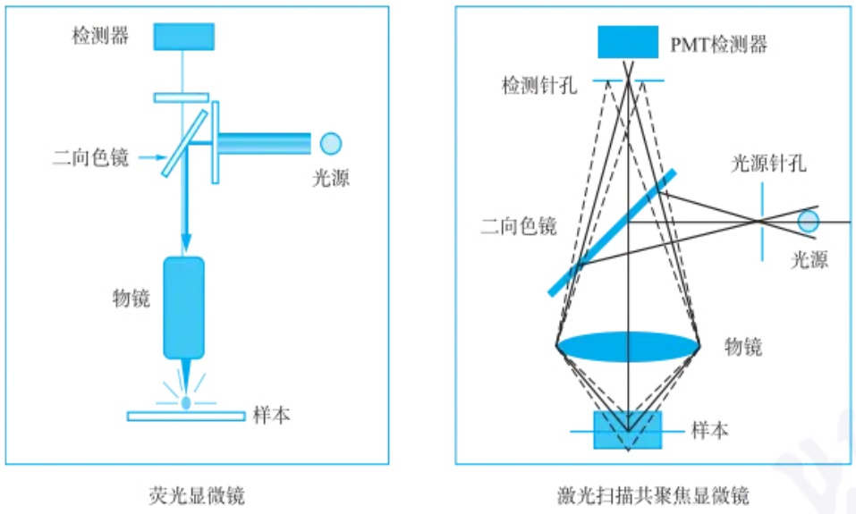

图 11.5.1 宽场荧光显微镜与激光扫描共聚焦显微镜的光路示意图

从激光扫描共聚焦显微镜的光路示意图可以看出，激光扫描共聚焦显微镜与传统宽场荧光显微镜最大的区别在于其成像光路中存在两个处于共轭平面的针孔，即光源针孔和检测针孔。光源针孔位于光源后端，它所在的位置是在物镜的前焦点上，从光源发出的激发光经过光源针孔可认为是从物镜的焦点上发出，经过二向色镜的反射，最终在样本的某一处聚焦，激发标本中的荧光标记物并产生荧光，再经过物镜和二向色镜后聚焦于检测器前检测针孔所在的平面。而检测针孔可以将发射光中所包含的非焦平面信号过滤，只让焦平面上的光线透过，并被检测器收集。检测针孔所处的位置正好与物镜的后焦点重合，其与光源针孔形成共轭聚焦，可消除非焦面信号的干扰，使共聚焦成像更为清晰。由于光源针孔和检测针孔处于物镜的前后焦点所在的两个共轭平面，故而得名共聚焦。最后，利用扫描系统依次对标本不同位置的标记物进行扫描激发，收集不同位置的荧光信号后，借助图像重构等数据处理技术获得标本平面或立体的图像信息。

对比宽场荧光显微镜和激光扫描共聚焦显微镜的成像原理,可以发现激光扫描共聚焦显微镜存在两大特点:

特点之一:针孔滤波(pinhole)。在荧光进入探测器(如光电倍增管PMT)前,存在一个微小的检测针孔光阑,其直径尺寸在10\~100  $\mu$ m范围内可调。检测针孔可起到空间滤波的功能,使仅有在物镜焦平面上的光才能在针孔处汇聚并通过针孔,从而被探测器接收;而非焦平面上的光在针孔上产生的是弥散光斑,其直径大于针孔直径,因而绝大多数的光被针孔滤掉,对焦平面的标本信号影响很小,而且离焦平面越远,所产生的弥散斑就越大,滤波效果就越好。由于针孔的作用,该成像技术仅对焦平面上的样品成像,有效地抑制了衍射光和杂散光的干扰,从而能够获得远高于宽场荧光成像的清晰度和信噪比。由于具有沿光轴方向的分辨能力,该技术具有对较厚样品的光学层切能力,因而也被称作光学“CT”(computed tomography)。这是激光扫描共聚焦显微镜不同于其他传统宽场荧光显微镜的最重要特点。如果去除针孔作用,则与传统荧光显微镜类似。

经过光源针孔的光线,理论上只能聚焦在物镜焦点处的标本上,因此激光共聚焦只收集物镜焦点处的标本图像,这就是激光扫描共聚焦显微镜的点扫描成像技术。如果需要获取一整幅图,就需要变换物镜和标本之间的相互位置,逐点扫描,并

## 共聚焦显微镜对

## 普通光学显微镜的改进

（1）采用激光作为照明光源，由于激光的单色性非常好，光源波束的波长相同，基本消除了色差对成像的干扰。
（2）采用共聚焦技术，在物镜的焦平面上放置了针孔光阑，将焦平面以外的杂散光挡住，基本消除了球差，且有助于进一步消除色差。
（3）采用点扫描技术，将样品分解成二维或三维空间上的无数点，用极其细小的激光束（即点光源）逐点逐行扫描成像，再通过计算机组合成一个整体平面的或立体的像。
（4）利用光电倍增管进行信号转换和放大，并使用计算机完成信号的采集和处理。

---

632

第十一章 显微成像分析

通过软件后期合成。如果要获得样品的全局信息，可将样品分解成二维或三维空间上的无数点，用十分细小的激光束(点光源)逐点逐行扫描成像，通过计算机软件组合、三维重构等技术，最后得到一个整体平面的或立体的图像(图11.5.2)。

激发光对焦点平面进行平面扫描示意图

## 激光扫描共聚焦显微镜相关术语

二向色镜:又称双色镜,是一种基于光的干涉原理实现短波辐射选择性反射、长波辐射选择性穿透的光学元件。

滤光片:选择性透过特定波段辐射的光学元件。

焦点: 平行光线经过透镜或透镜组折射后在光轴上的汇聚点。

焦平面: 沿不同入射方向的平行光线经过透镜或透镜组折射后的汇聚点所构成的平面。

共轭焦平面:在光学系统中当光线从样本所在的平面经过光学元件(如透镜、镜面及其组合)聚焦后,会形成一个与物体形状相似的像。物体与像所在的两个平面即为共轭焦平面。

图 11.5.3 彩图

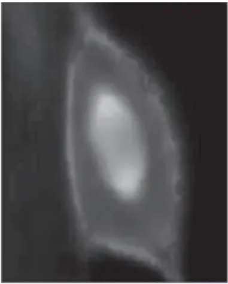

natural_image

Grayscale abstract image with a bright central oval shape, resembling a glowing oval or ring (no text or symbols)

(a)宽场荧光成像

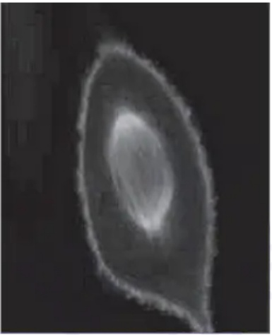

natural_image

Abstract grayscale shape resembling a teardrop or crescent, with no visible text or symbols

(b) 共聚焦成像

图 11.5.2 宽场荧光显微镜与激光扫描共聚焦显微镜的成像差异

特点之二:扫描成像。由于激光扫描共聚焦成像技术是对物镜焦点处的样品局部激发和探测,要完成对整个样品的成像需要改变焦点和样品的相对位置,使焦点扫描整个被探测样品区域。扫描装置(如扫描振镜、压电位移平台等)能够提供三个维度的相对位移,通过计算机自动控制,并与探测器同步逐点记录扫描区域的荧光信号。首先在某一特定深度获得该深度时的二维图像,继而改变深度获得一系列的二维图像,再通过图像处理中的三维重建技术,把这些二维图像重建,最终获得样品三维图像。此外,扫描方式还有线扫描与阵列扫描等。这种通过扫描成像并获取三维图像的方式,是激光扫描共聚焦光学显微成像的一大特点。

## 11.5.2 激光扫描共聚焦显微镜的结构模块

激光扫描共聚焦显微镜主要包括激光光源、荧光显微镜系统、扫描装置、图像存储与处理系统等模块(图 11.5.3)。此外,还包括其他辅助设备,如风冷/水冷等冷却系统、气浮型隔振光学平台等。

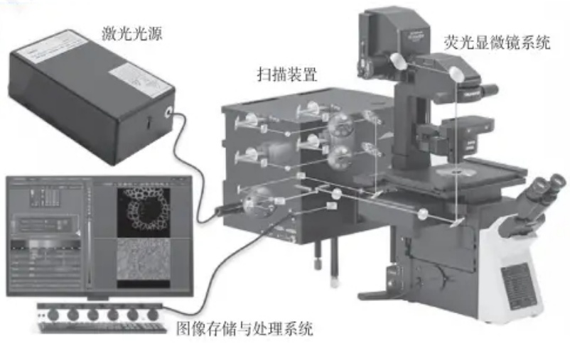

text_image

激光光源
扫描装置
荧光显微镜系统
图像存储与处理系统

图 11.5.3 激光扫描共聚焦显微镜的结构模块

---

11.5 激光扫描共聚焦显微成像

633

## 1. 激光光源

激光扫描共聚焦显微镜使用的激光光源通常有单激光和多激光系统。早期，激光扫描共聚焦显微镜常用的激光器包括多谱线 Ar 离子激光器（氩离子激光器），He-Ne 激光器（氦氖激光器），UV 激光器（紫外激光器）。目前，发射波长覆盖可见至近红外区的固体激光器凭借光束质量高、使用寿命长等优点，已成为商品化激光扫描共聚焦显微镜光源的首选。

## 2. 荧光显微镜系统

激光扫描共聚焦显微镜所用的荧光显微镜系统与常规倒置荧光显微镜大致相同。但又有其特点:需与扫描装置连接，使激光能进入显微镜物镜照射样品，并使样品发射的荧光到达检测器；需有光路转换装置，即汞灯与激光转换，同时光线强度可调。

## 3. 扫描装置

扫描装置通过计算机自动控制，逐点扫描位于物镜焦平面的样品，并实现样品中荧光标记物的逐点激发。扫描装置主要由针孔光阑（控制光学切片的厚度）、二向色镜（可反射短波和透过长波）、滤光片（选择一定波长范围的发射光进行检测）、检测器（光电倍增管或雪崩光电二极管）组成。

## 4. 图像存储与处理系统

控制硬件的软件功能,比如控制电动显微镜;选择激光波长,调节激光强度;拍摄二到五维图像;选择光谱拍摄范围、分辨率和滤光片等信息。

## 11.5.3 激光扫描共聚焦显微镜的功能与应用

凭借出色的断层扫描成像能力和极高的成像信噪比,激光扫描共聚焦显微镜被广泛应用于分析化学、生命科学和生物医学等研究领域。随着应用研究的拓展深入,激光扫描共聚焦显微镜的功能也得到了不断的开发。一般来说,激光扫描共聚焦显微镜的功能和应用主要包括以下几个方面:

## 1. 组织光学切片成像

激光扫描共聚焦成像技术利用照明点与探测点的共轭特性,可有效抑制同一焦平面上非测量点的杂散荧光及来自样品中非焦平面的荧光,从而获得普通荧光显微镜无法达到的信噪比,以及特有的深度识别率和纵向分辨率。利用扫描控制系统,可以逐层获得高反差、高分辨率、高灵敏度的二维光学横断面图像,从而对活的或固定的细胞及组织进行无损伤的系列“光学切片”,得到各个层面的信息。

## 2. 多通道序列扫描成像

普通荧光显微镜每次只能观测一种荧光，要观测多种荧光标记的样品需要多次观测，因而难以实现多通道同时成像，且易造成样品光损伤。激光共聚焦显微镜支持多激光多通道同时扫描，可实现多通道同时探测。由于激光扫描共聚焦显微镜往往包含荧光成像光路与透射光成像光路（明场、微分干涉相差成像等），并配备有多个不同波长的独立固体激光器，在进行不同的荧光通道扫描成像时，还可进行多通道荧光图像即时叠加（图11.5.4），荧光图像与明场图像即时叠加。此外，采用激光扫描共聚焦成像还可以对样本进行多维信息扫描，如xyz三维立体扫描、xyt二维时间扫描、xyλ二维光谱波长扫描，从而获取标本多维度信息。

荧光共定位成像

---

634

第十一章 显微成像分析

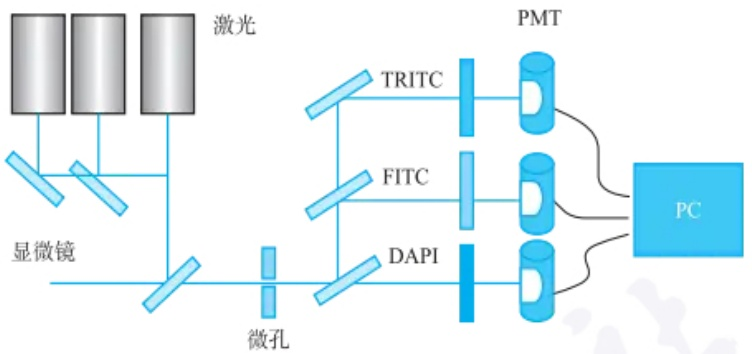

flowchart

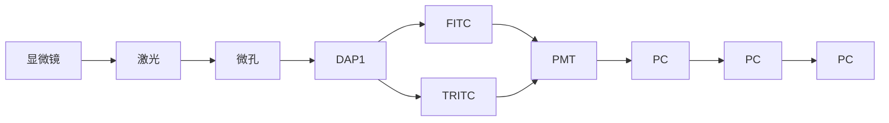

图 11.5.4 激光共聚焦多通道扫描成像

图11.5.4和图11.5.5彩图

## 3. 三维图像重建

激光扫描共聚焦显微镜具有薄层光学切片功能，可通过三维立体扫描方式采集标本三维信息，借助计算机图像处理和三维重建软件，沿 $x, y$ 和 $z$ 轴或其他任意角度来观察标本的外形及剖面，最后得到标本的三维立体结构。利用激光扫描共聚焦显微镜可在亚细胞器分辨率上对标本的立体结构与形态信息进行灵活、直观的观察，再结合图像重构和图像增强技术揭示亚细胞结构的空间关系及其随时间的变化等信息。如图11.5.5所示，利用激光扫描共聚焦显微镜光学切片功能进行 $z$ 轴扫描成像和三维图像重建，可对胚胎的立体结构进行精细分析。

natural_image

Grid of 20 circular microscopic or medical images showing cellular or tissue structures, no visible text or symbols

(a) 胚胎结构z轴扫描成像图

natural_image

Microscopic view of a porous, honeycomb-like structure with no visible text or symbols

(b)三维结构重建图

图 11.5.5 z 轴扫描成像和三维图像重建

## 4. 光操控功能

随着激光技术与光操控技术的发展，多种基于激光扫描共聚焦显微镜的光操控功能被开发出来，使得激光扫描共聚焦显微镜逐渐成为具有强大光操控功能的新工具。比如光激活技术，基于激光扫描共聚焦显微镜的逐点扫描功能，结合标本中的光响应标记，通过控制激发光的波长、辐射时间及照射区域，可以在可控的时间、空间尺度上实现标本中多种生物活性分子的激活，从而调控其生物学功能。利用该技术，可以实现活细胞内多种重要生物活性分子（如神经递质、细胞内第二信使cAMP、核苷酸、$\mathrm{Ca^{2+}}$ 及某些荧光素等）在细胞增殖、分化等生物过程中的功能调控。比如荧光光漂白恢复(FRAP)技术，借助于高强度脉冲式激光照射细胞的某一区域，从而造成该区域荧光分子的光猝灭，其周围的非猝灭荧光分子将以一定速率向受照区域扩散，通过监测分子扩散，研究细胞骨架构成、核膜结构和大分子组装等过程，揭示细胞结构和细胞动态变化机制。

---

11.6 超分辨成像

635

由上述介绍可见,激光扫描共聚焦显微镜凭借强大的功能已成为分析化学、化学生物学与生命科学研究领域强有力的分析工具。结合其他分析技术,激光扫描共聚焦成像技术有望在进一步揭示微观尺度上生命活动与生命现象的分子机制研究中发挥更大的作用。随着精密光学仪器与分子标记技术的不断革新与进步,激光扫描共聚焦显微镜有望实现更广泛的生化物质的定性与定量检测。

## 习题

## - 章节练习题 -

1. 简述激光扫描共聚焦显微镜的工作原理。
2. 简述激光扫描共聚焦显微镜与宽场荧光显微镜的差别。它有哪些优缺点？
3. 简述激光扫描共聚焦显微镜的功能与应用。

## - 挑战性问题 -

4. 激光扫描共聚焦显微镜可对单标记或双标记细胞及组织标本的荧光信号进行定量分析，并显示荧光沿 z 轴的强度变化；同时还可自动将荧光图像与相差图像重叠，并显示荧光标记物在细胞内的定位与分布。查阅和参考相关科学文献，设计实验:如何使用激光共聚焦显微镜成像并分析荧光药物（比如阿霉素）在细胞内的分布情况。

## - 专题或报告 -

5. 激光扫描共聚焦显微镜可以基于荧光能量共振转移(Förster resonance energy transfer, FRET)技术研究生物分子相互作用。FRET是将激发的供体(donor)荧光染料的能量非辐射转移到受体(acceptor)荧光染料的现象。FRET现象的发生和能量传递效率主要取决于以下几个方面:①两个荧光染料分子之间的距离(<10 nm)；②供体的发射光谱与受体的激发光谱的重叠区域；③供体的量子产率；④供体的荧光寿命；⑤供体和受体分子的相对偏振方向。利用激光共聚焦扫描显微成像技术开展FRET分析可以实现将多种生物学过程中生物分子相互作用过程与机制的可视化研究。查阅关于激光共聚焦荧光能量共振转移在DNA构象分析中的应用相关科学文献，并将结果写成报告。
6. 在实际激光共聚焦成像中，一般都需要对于样品进行荧光标记或者染色。采用一定的标记物，使样品中待测物质具有特定的荧光特征，这种标记物被称为荧光探针。这种给样品赋予特征荧光的操作称为荧光标记。查阅相关科学文献，了解荧光标记相关原理与应用，并与同学分享你的结果。

FRET 相关文献

## 11.6 超分辨成像

## 11.6.1 超分辨成像简介

在光学显微镜问世之初，人们认为只要提高放大倍率，就可以观察到趋近于无穷小的物体。但是随着研究的不断深入，研究者发现当物体小于某个极限时，无论如何提高物镜倍数，都无法清晰地观察和分辨它们。1835年，G.Airy提出艾里斑这一概念，同时可以通过瑞利判据来评估光学显微镜的空间分辨率。由11.4

---

636

第十一章 显微成像分析

## 艾里斑

艾里斑是点光源通过衍射受限透镜成像时，由于衍射而在焦点处形成的光斑。中央是明亮的圆斑，周围有一组较弱的明暗相间的同心环状条纹，把其中以第一暗环为界限的中央亮斑称为艾里斑。

艾里斑图像

2014年诺贝尔化学奖

超分辨显微成像发展历程

小节可知，光学成像的分辨率与光斑的强度分布有关，采用点扩散函数(point spread function, PSF)能够对光斑进行建模。而对PSF进行工程化改造，能够有效提高光学成像分辨率（缩短两个光斑间恰能分辨的距离）。根据瑞利判据公式，常规的方法包括采用更大数值孔径的物镜，以及采用折射率更高的介质，如油相或水相代替空气相等。在可见光波长(400\~700 nm)和常用的物镜数值孔径(NA不超过1.49)范围内，光学显微镜的分辨率一般为横向200 nm，轴向600 nm左右。

为了进一步突破衍射极限，对亚微米及更小尺度的体系进行研究，超分辨成像应运而生。W.E.Moerner首次实现单个分子检测并发现单个绿色荧光蛋白光转化效应，Eric Betzig在此基础上基于特殊荧光蛋白设计出光激活定位显微技术（photoactivated localization microscopy, PALM), Stefan W. Hell基于PSF调制设计出受激发射损耗显微镜(stimulated emission depletion, STED)，两者均大幅突破衍射极限，同时开启了超分辨显微成像发展的两个方向。他们三位也因此共同获得了2014年的诺贝尔化学奖。除此之外，还有多位超分辨显微成像的先驱，如Samuel T. Hess提出了荧光激活定位显微镜(fluorescence photoactivated localization microscopy, FPALM)，华裔科学家庄小威教授提出了基于荧光染料分子的随机光学重建显微镜(stochastic optical reconstruction microscopy, STORM), Mats Gustafsson提出了结构光照明显微镜(structured illumination microscopy, SIM)，通过求解图案中的高频信息获得样品的纳米分辨图像。

超分辨成像打破了传统光学显微镜的分辨率限制，一方面使得人们能够研究更细小、更复杂的结构和过程，帮助研究者更直观地探索微观世界中的亚细胞结构及纳米级别的相互作用。例如，在生物学领域，超分辨成像技术能够实现对细胞器、蛋白质分布和动态过程的高分辨率成像，从而深入了解细胞的组织结构和功能；在物理化学反应中，实现对于微观超快变化过程的直接成像，获得更加精准的活性位点及反应动力学信息。另一方面，新兴研究领域的不断涌现，将超分辨成像技术与飞秒激光超快时间分辨探测技术结合的超时空分辨技术可以实现对于极小时空尺度下新的科学现象和规律的探索，进一步推动相关光电材料/器件与产业的发展。

## 11.6.2 超分辨成像原理和仪器构造

艾里斑的相互重叠使光学成像分辨率受到限制，因此只要避免这一情况就能够打破衍射极限，由此发展了两种超分辨成像策略:基于单分子定位的超分辨成像技术通过控制衍射极限范围内的荧光探针在不同时间发光，代表性技术包括STORM、PLAM和FPALM等；通过光源调制激发特定区域的荧光分子减少周围荧光分子的信号，如STED。

超分辨成像的仪器构造与常规白光成像类似，具有照明模块和成像模块。区别在于超分辨成像照明采用激光作为光源而非白光，同时引入特殊模块，例如，全内反射照明，以及空间光调制器、涡旋相位板等光源调制器件；成像模块则结合高质量滤光片滤除激光和杂散光，采用高灵敏度的相机收集荧光信号。以下将详细介绍各种超分辨成像原理和仪器构造。

## 11.6.2.1 基于单分子点扩散成像的超分辨技术

连续发光点的 PSF 重叠会导致图像分辨率受光学衍射限制,那么如果让发光点离散分布,就有可能突破衍射极限,得到更高的分辨率。单分子定位显微技术 (single-molecule localization microscopy, SMLM) 的实现正是基于该思想。使相机采

---

11.6 超分辨成像

637

集的每一幅图像中荧光分子的PSF不发生重合，就可以采用多种方法（质心定位、高斯拟合和极大似然估计法等)确定分子在图像中的精确位置，得到一幅定位图像。图11.6.1展示了对单个荧光分子的定位过程:图11.6.1(a)模拟了相机中采集到的单个分子荧光信号，十字代表分子的真实位置；图11.6.1(c)模拟了用于定位的高斯函数，点代表单分子定位得到的位置；图11.6.1(b)和图11.6.1(d)为相应的强度直方图。当采集足够多的荧光闪烁图像，并对每一幅都进行分子定位后，再将所有定位图像重叠，就可以得到基于单分子定位的超分辨重构图像。分子定位的精度可以通过下式得到:

$$
\sigma_ {\mathrm{loc}} = \sqrt {\frac {\sigma_ {0} ^ {2}}{N} + \frac {a ^ {2}}{1 2 N} + \frac {8 \pi b ^ {2} \sigma_ {0} ^ {4}}{a ^ {2} N ^ {2}}} \tag {11-6-1}
$$

式中，$\sigma_0$ 表示PSF的标准差，$N$ 是单幅图像收集到的光子数，$a$ 是相机单个像素的尺寸，$b$ 是背景噪声，可以看出信噪比越高，荧光背景越低，则定位精度越高，实验条件下定位精度一般在 $10\sim 20~\mathrm{nm}$，如图11.6.1(e)所示，蓝点代表同一分子在多幅图像中的定位结果，圆圈代表其标准差，即定位精度。图11.6.1(f)展示了单个分子定位的概率分布。

(a)

(c)

(e)

(b)

(d)

(f)

图11.6.1 单个荧光分子的质心定位及定位精度计算:(a) 模拟单个荧光分子的衍射极限图像，十字标记为分子的实际位置；(b) 为(a)图对应的光子计数直方图；(c) 为(a)中图像的2D高斯函数拟合结果，点为预估的质心位置；(d) 为(c)图对应的强度直方图；(e) 同一个荧光分子的不同成像图的预估位置（蓝点），浅蓝十字代表这些蓝点的平均位置，蓝色圆圈表示其标准偏差，深蓝十字代表分子的实际位置；(f) 单个定位的概率分布

如何使发光点在空间中离散分布是单分子定位显微技术的核心问题，PALM和STORM率先实现了这一想法。PALM使用光激活荧光蛋白标记样品，这种蛋白只有经过激活光照射后才能被激发出荧光。实验中采用低能脉冲激活光随机激活少量荧光蛋白，随后切换为激发光连续照射。只有被激活的荧光蛋白才能够发射荧光用于定位，直至被漂白后进入下一轮激活过程，被漂白的分子在之后的循环中不会再被激活。而STORM使用荧光染料标记样品，先利用高强度激发光照射直至所有荧光分子漂白，再使用低强度激活光照射，随机使少量分子转变为“点亮态”，能够再次被激发直至漂白。该STORM过程也可采用不同波长的激光来实现。通过交替使用激活光和激发光照射样品，使荧光染料在“点亮/熄灭”状态间不断转换（如图11.6.2所示）。以达到单幅图像中荧光分子的PSF不发生重合的目的，从而实现超分辨成像。

由于需要比较低的背景,单分子定位显微技术的激发方式可采取全内反射照明技术(total internal reflection fluorescence microscopy, TIRFM)。当光线从高折

传统的光学显微镜凭借其非接触、无损伤等优点，长期以来是生物医学研究的重要工具。但是，光学显微镜的分辨率极限约为200 nm，无法用于清晰观察生物结构。超分辨光学成像是21世纪光学显微成像领域最重大的突破，打破了光学显微镜的分辨率极限，为生命科学研究提供了前所未有的工具。

---

638

第十一章 显微成像分析

以 STORM 为例, 其成像序列使用一种假设的六聚体对象, 这些对象标记有红色荧光团, 可以通过红色激光和绿色激光分别切换到荧光状态和暗态。所有荧光团首先通过强红色激光脉冲切换到暗态。在每个成像周期中, 使用绿色激光脉冲激活少量荧光团, 从而得到一个光学上可分辨的激活荧光团集合。然后, 在红色激光照明下, 这些分子会发射荧光, 直到它们被漂白, 而它们的位置能够被高精度确定(白色十字)。再次重复上述激活-漂白过程, 从多个成像周期获得的荧光团位置重建整体图像。

STORM 成像过程

## 全内反射显微成像技术

利用光线全反射后在介质另一面产生衰逝波的特性,激发荧光分子以观察荧光标定样品的极薄区域,观测的动态范围通常在200 nm以下。因为激发光随穿透深度呈指数衰减的特性,只有极靠近全反射面的样本区域会产生荧光反射,大大降低了背景光噪声干扰。

全内反射原理图

flowchart

图 11.6.2 基于单分子定位成像的超分辨图像重构过程

射率的介质进入低折射率的介质时 $(n_{2}>n_{1})$ ，折射角大于入射角，因此当入射角增大至超过某一角度时，折射角会大于 $90^{\circ}$ ，激发光全部被反射而不发生折射，称为全反射，此时的入射角为临界角 $\theta_{e}$ 。发生全反射时，虽然激发光被全部反射，但它的部分能量仍然会穿过界面，平行于界面传播，称为消逝波。消逝波也能够激发荧光分子，其强度随着z（与界面的垂直距离）的增加呈指数级减小，激发深度随入射角变化，可在几十至三百纳米范围内调节。由于利用消逝波激发样品，激发深度较小，处于消逝波区域外的荧光分子不会被激发，可以很大程度降低背景。

单分子定位显微技术多用于生物研究中观察亚细胞结构，它的超分辨原理也被应用到化学领域中，以研究催化反应的动态性质。此时不再使用荧光标记的样品，而是在流动池中使用非荧光或弱荧光分子作为底物，流经固体表面并发生催化反应后，底物分子生成强荧光分子或荧光波长发生改变，将产生荧光信号变化的位置作为催化剂表面的活性位点。将反应物的浓度控制在一个很低的范围，使每一幅图像上的荧光信号不发生重叠，再对荧光分子发出的信号进行定位，得到单个分子转化事件在时间和空间上的分布，该技术称为单分子化学成像技术（single-molecule chemical imaging, SMCI）。通过单分子化学成像实验能够得到催化剂活性位的超分辨重构图像、反应动力学参数和分子扩散系数等信息。

单分子定位显微成像相比于其他超分辨方法具有以下优点:其一,具有比其他方法更高的定位精度,一般为10\~20 nm;其二,为宽场成像,能够同时获得百微米范围内样品的图像;其三,仪器较为简单,关键模块仅为全内反射照明模块。但该方法也有它的局限性:其一,成像需要不断漂白和激活荧光分子,成像耗时长,开展动态成像需要进一步改进方法;其二,反复的成像循环可能会导致荧光团的光漂白,从而降低定位精度。

## 11.6.2.2 受激发射损耗显微技术

受激发射损耗显微技术(stimulated emission depletion, STED)是一种远场超分辨成像方法，通过对光源的调制来打破光学衍射极限。该方法利用了分子的受激发射特性，荧光产生的过程是分子从基态 $S_{0}$ 被激发至激发单重态 $S_{1}$，再回落到基态 $S_{0}$ 的各个振动能级时所辐射的光子，而这一过程能在特定波长的光（被称为损耗光）照射下被抑制。当处于 $S_{1}$ 最低振动能级的电子受到特定波长的损耗光照射时，会受激发射跃迁回低能级较高的振动态，并释放出同频率的光子。若损耗光的功率足够高，就会使分子几乎被抑制在基态，从而不产生荧光。

诺奖得主 Stefan Hell 及其团队基于此率先提出了 STED 超分辨成像方法, 其原理是采用两束光进行照明, 一束光作为激发光照射分子产生荧光, 另一束光作为损耗光(也称 STED 光), 用来抑制部分区域荧光的产生。例如, 通过螺旋相位

---

11.6 超分辨成像

639

板调制，改变损耗光的相位，获得形如甜甜圈的光束，其中心位置的激光强度为零，两束光叠加使荧光的发射区域被抑制在中心，经过滤光片滤除损耗光后得到小于衍射极限的荧光光斑（如图11.6.3所示）。

flowchart

图 11.6.3 STED 的仪器原理图及两束照明光束的形状

STED 的空间分辨率取决于损耗光和荧光分子的强度, 满足以下公式:

$$
d = \frac {\lambda}{2 \mathrm{NA} \sqrt {1 + \frac {I _ {\max}}{I _ {\mathrm{sat}}}}} \tag {11-6-2}
$$

式中， $I_{max}$  表示损耗光的最大强度， $I_{sat}$  为荧光的饱和光强，因此增加损耗光的强度能够有效提高 STED 分辨率。理论上 STED 的分辨率能够达到无穷小，而实际测量过程中耗损光的强度过大可能会导致样品破坏、光漂白、多光子吸收等情况，因此常规 STED 的分辨率一般在 30\~80 nm。该分辨率可以实现生物体系中的亚细胞结构的观察，例如，利用荧光蛋白作为探针进行标记，可对神经元突触小泡、内质网、病毒等进行超分辨成像。由于 STED 采用的是单点成像，因此需要进行扫描才可对一定区域进行成像，其成像速度与区域大小有关，可在秒级到分钟级不等。

STED 成像相比于其他超分辨方法具有以下优点: 其一, 对于感兴趣的区域可即时成像, 无须图像处理; 其二, 作为一种远场成像方法, 探测深度更高, 可达数十微米。但 STED 也具有局限性: 它的损耗光强度较高, 容易引起光损伤; 而且仪器较为复杂, 需要考虑两束光的高精度合束和同步扫描等要求, 成本较高。

## 11.6.2.3 结构光照明显微技术

从频域角度看,光学系统的衍射作用过滤了样品的高频信息,导致成像丢失细节。结构光照明让特定位置的荧光分子发光,发光部分对应频谱由样品频谱重组得到,重组的方式与结构光的强度分布有关。一般将样品频谱高频区域的信息移动至发光部分频谱的低频区域,从而避免衍射影响(如图11.6.4所示)。SIM技术通常使用强度正弦变化的结构光,所采集图像的频谱同时包含样品的高低频信息,使用合适的算法将高低频信息解耦合,根据补全高频信息的样品频谱就能重构出超分辨图像。

受激发射的能级示意图

## 空间域与频域

信号分析的两种角度,空间域上描述信号在不同位置的强度(即图像),而频域上描述信号的不同频率分量的幅值和相位(即频谱)。对图像进行傅里叶变换能够得到它的频谱。

---

640

第十一章 显微成像分析

flowchart

图 11.6.4 结构光照明分辨率提升原理(其中虚线圆圈直径相同)

相较于其他超分辨技术, SIM 技术采集少量图像即可重构出分辨率 80\~100 nm 的超分辨图像, 成像速度更快。并且, 该技术可以适用低强度激光, 细胞毒性更低, 能够保持长时间的生物过程动态成像。

使用特定图案的激发光激发样品是结构光照明显微镜的核心，图案调制通过正弦光栅或空间光调制器实现(图11.6.5)。激光经过正弦光栅和透镜后，在焦平面汇聚成三个衍射光斑，使用小孔滤去中间的衍射光斑，剩余两个光斑在样品平面发生干涉，产生明暗相间的正弦分布的条纹。旋转和移动正弦光栅，条纹也随着旋转和平移。空间光调制器与正弦光栅作用相同，但可调节性更好，能够自由设计照明图案，缺点是晶元有间隙，图案质量不如光栅。

## 思考:

考虑到超分辨率显微镜技术在揭示细胞内部结构方面的突破性进展,如何进一步优化 STORM 等技术以提高成像速度和降低光毒性,从而更好地适用于活细胞成像?

text_image

正弦光栅
样品平面

图 11.6.5 结构光照明示意图

伪影是 SIM 成像普遍存在的问题, 图案参数的估计误差和系统噪声会显著影响图像重构质量。高信噪比时, 维纳解卷积 (Wiener deconvolution) 方法能够较好地抑制噪声, 但是这会牺牲时间分辨率并提升光毒性。而添加物理约束, 或者连续性、稀疏性假设等先验信息的深度学习算法, 能够增强图像重构过程在低信噪比时的抗噪声能力, 抑制伪影并提高空间分辨率。

---

11.6 超分辨成像

641

## 11.6.3 超分辨成像应用

## 11.6.3.1 生物成像分析

由于超分辨技术对时间和空间分辨率的改进，在生物领域，超分辨显微镜的应用广泛而重要。超分辨显微镜在细胞成像方面发挥着关键作用。传统显微镜受到衍射极限的限制，无法观察到细胞内的亚细胞结构。然而，通过利用超分辨技术能够实现对细胞器、蛋白质分布和动态过程的高分辨率成像，从而深入了解细胞的组织结构和功能，例如，哺乳动物细胞中的微管的精细结构。同时，超分辨显微镜在神经科学研究中具有重要意义。例如，利用STED显微技术呈现了活细胞中树突棘的结构特征和活体海马组织切片中突触顶端的结构特征。此外，超分辨显微镜技术在分子生物学和组织工程等领域也得到广泛应用。它使研究者能够更准确地观察和分析分子之间的相互作用、细胞内复杂的生物化学过程及细胞和基质的三维结构。

总而言之，超分辨显微镜在生物领域的应用为科学家提供了强大的工具，使他们能够更深入、更准确地观察和理解生命的机制。通过超越传统光学限制，能够在细胞和分子水平上探索更多的细节，从而推动生物学研究的进展，并为治疗疾病和改善人类健康提供新的机会。

## 11.6.3.2 化学成像分析

基于超分辨成像技术的单分子化学成像已被应用于研究催化剂个体之间及单个固体催化剂表面不同结构特征造成的活性不均一性。在空间维度，单分子化学成像中重构的单个分子的静态位置不仅可以用于揭示局域结构特征（如晶面、缺陷等）的性质和催化剂的调控（如尺寸、电场等）对活性的影响。在时间维度，不同时刻下单个分子的位置分布和密度可以用于研究催化剂的稳定性和催化性能的开关行为。利用荧光反应，单分子化学成像还可以通过计数荧光产物的生成来监测反应动力学信息（如吸附平衡常数、转化速率常数、脱附速率等）。

## 11.6.4 超分辨成像展望

近年来，基于上述四种典型的超分辨成像技术，还发展出可逆饱和光学荧光跃迁显微术（reversible saturable optical fluorescence transition microscopy, RESOLFT）、饱和结构光照明显微术（saturated structured illumination microscopy, SSIM）等超分辨成像技术。超分辨成像技术给生物和化学研究提供了超高时空分辨率的分析范式，为研究生物过程的分子机制和化学反应的空间异质性带来了空前的帮助。随着体系的深入，更多维度的信息，如光谱分布、三维空间位置、偏振态、分子角度取向等，也被获取用来增强人类对化学和生物过程的理解。成像技术对系统观测的精细程度由时空分辨率决定，追求更高的时空分辨率是目前成像技术的重要方向。2014年，诺贝尔化学奖颁发给了研究超分辨成像的三位科学家，鼓励他们在突破传统光学分辨极限方面所做出的重要贡献。时至今日，深度学习和统计分析方法的引入，正在把荧光显微技术的成像分辨率推向新的高峰，即将突破分子尺度，为研究微观世界带来技术革新。

超分辨成像在生物成像分析中的应用

超分辨成像在化学成像分析中的应用

## PAINT 技术的原理基于荧光分子的短暂结合和解离

（1）荧光探针与样品相互作用:使用短荧光标记的寡核苷酸链作为探针。这些探针与样品表面相互作用，可以通过碰撞后脱离或永久结合后漂白发出荧光信号。
（2）多次采集记录:通过多次采集记录自由扩散在溶液中的荧光探针与样品相互作用的荧光信号，获得每个荧光分子的精准定位信息。
（3）图像叠加:将数万张含有荧光分子精准定位信息的图像叠加，最终重建出一张纳米级别的超分辨图像。

---

642

第十一章 显微成像分析

## 习题

## - 章节练习题 -

1. 对于单分子定位显微技术,哪些因素会影响单分子的定位精度?
2. 是否可以调节损耗光的形状和大小使得成像的分辨率无限小？

## - 挑战性问题 -

3. 与传统成像技术相比, 超分辨成像技术有何优势和局限性?

## - 专题或报告 -

4. 超分辨率成像技术能否与现有的其他成像模式(如电子显微镜)结合,以获得细胞结构和功能的更全面理解?查阅关于基于超分辨成像的多模态表征在生物成像分析中应用的科学文献,并将结果写成报告。
5. 超分辨率显微镜技术的进步如何促进生物学、物理学、材料科学和计算机科学等不同学科之间的合作？查阅相关科学文献，了解研究现状，并与同学分享你的结果。
