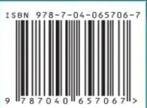

# 附录C 化学平衡常数等各类物理化学数据

原始 PDF 第 668–683 页。

附录C

## 化学平衡常数等各类物理化学数据

C.1 一些离子的离子体积参数( $\mathring{a}$ )和活度系数( $\gamma$ )

<table><tr><td rowspan="2">离子</td><td rowspan="2"> $\mathrm{d}/\mathrm{{nm}}$ </td><td colspan="4"> $\gamma$ </td></tr><tr><td> $I=0.005$ </td><td> $I=0.01$ </td><td> $I=0.05$ </td><td> $I=0.1$ </td></tr><tr><td> ${\mathrm{H}}^{ + }$ </td><td>0.9</td><td>0.934</td><td>0.914</td><td>0.854</td><td>0.826</td></tr><tr><td> ${\mathrm{{Li}}}^{ + },{\mathrm{C}}_{6}{\mathrm{H}}_{5}{\mathrm{{COO}}}^{ - }$ </td><td>0.6</td><td>0.930</td><td>0.907</td><td>0.834</td><td>0.796</td></tr><tr><td> ${\mathrm{{Na}}}^{ + },{\mathrm{{HCO}}}_{3}^{ - },{\mathrm{{IO}}}_{3}^{ - },{\mathrm{H}}_{2}{\mathrm{{PO}}}_{4}^{ - },{\mathrm{{Ac}}}^{ - }$ </td><td>0.4</td><td>0.927</td><td>0.902</td><td>0.817</td><td>0.770</td></tr><tr><td> ${\mathrm{{HCOO}}}^{ - },{\mathrm{{ClO}}}_{3}^{ - },{\mathrm{{ClO}}}_{4}^{ - },{\mathrm{F}}^{ - },{\mathrm{{MnO}}}_{4}^{ - },{\mathrm{{OH}}}^{ - },{\mathrm{{SH}}}^{ - }$ </td><td>0.35</td><td>0.926</td><td>0.900</td><td>0.812</td><td>0.762</td></tr><tr><td> ${\mathrm{K}}^{ + },{\mathrm{{Br}}}^{ - },{\mathrm{{CN}}}^{ - },{\mathrm{{Cl}}}^{ - },{\mathrm{I}}^{ - },{\mathrm{{NO}}}_{3}^{ - },{\mathrm{{NO}}}_{2}^{ - }$ </td><td>0.3</td><td>0.925</td><td>0.899</td><td>0.807</td><td>0.754</td></tr><tr><td> ${\mathrm{{Ag}}}^{ + },{\mathrm{{Cs}}}^{ + },{\mathrm{{NH}}}_{4}^{ + },{\mathrm{{Rb}}}^{ + },{\mathrm{{Tl}}}^{ + }$ </td><td>0.25</td><td>0.925</td><td>0.897</td><td>0.802</td><td>0.745</td></tr><tr><td> ${\mathrm{{Be}}}^{2 + },{\mathrm{{Mg}}}^{2 + }$ </td><td>0.8</td><td>0.756</td><td>0.690</td><td>0.517</td><td>0.446</td></tr><tr><td> ${\mathrm{{Ca}}}^{2 + },{\mathrm{{Cu}}}^{2 + },{\mathrm{{Zn}}}^{2 + },{\mathrm{{Fe}}}^{2 + },{\mathrm{C}}_{6}{\mathrm{H}}_{4}{\left( \mathrm{{COO}}\right) }_{2}^{2 - }$ </td><td>0.6</td><td>0.748</td><td>0.676</td><td>0.484</td><td>0.402</td></tr><tr><td> ${\mathrm{{Ba}}}^{2 + },{\mathrm{{Cd}}}^{2 + },{\mathrm{{Hg}}}^{2 + },{\mathrm{{Pb}}}^{2 + },{\mathrm{S}}^{2 - },{\mathrm{C}}_{2}{\mathrm{O}}_{4}^{2 - }$ </td><td>0.5</td><td>0.743</td><td>0.669</td><td>0.465</td><td>0.377</td></tr><tr><td> ${\mathrm{{Hg}}}^{2 + },{\mathrm{{CO}}}_{3}^{2 - },{\mathrm{{CrO}}}_{4}^{2 - },{\mathrm{{HPO}}}_{4}^{2 - },{\mathrm{{SO}}}_{3}^{2 - },{\mathrm{{SO}}}_{4}^{2 - }$ </td><td>0.4</td><td>0.738</td><td>0.661</td><td>0.445</td><td>0.351</td></tr><tr><td> ${\mathrm{{Al}}}^{3 + },{\mathrm{{Cr}}}^{3 + },{\mathrm{{Fe}}}^{3 + },{\mathrm{{La}}}^{3 + }$ </td><td>0.9</td><td>0.540</td><td>0.443</td><td>0.242</td><td>0.179</td></tr><tr><td> ${\mathrm{{Cit}}}^{3 - }$ (柠檬酸根)</td><td>0.5</td><td>0.513</td><td>0.404</td><td>0.179</td><td>0.112</td></tr><tr><td> $\mathrm{{Fe}}{\left( \mathrm{{CN}}\right) }_{6}^{3 - },{\mathrm{{PO}}}_{4}^{3 - }$ </td><td>0.4</td><td>0.505</td><td>0.394</td><td>0.162</td><td>0.095</td></tr><tr><td> ${\mathrm{{Ce}}}^{4 + },{\mathrm{{Th}}}^{4 + },{\mathrm{{Zr}}}^{4 + }$ </td><td>1.1</td><td>0.348</td><td>0.253</td><td>0.099</td><td>0.063</td></tr><tr><td> $\mathrm{{Fe}}{\left( \mathrm{{CN}}\right) }_{6}^{4 - }$ </td><td>0.5</td><td>0.305</td><td>0.200</td><td>0.047</td><td>0.020</td></tr></table>

## C.2 弱酸及弱碱在水溶液中的解离常数(25℃)

C.2-1 弱酸

<table><tr><td rowspan="2">酸</td><td rowspan="2">化学式</td><td rowspan="2">分级解离</td><td colspan="2"> $I=0$ </td><td colspan="2"> $I=0.1$ </td></tr><tr><td> $K_a$ </td><td> $pK_a$ </td><td> $K_a^M$ </td><td> $pK_a^M$ </td></tr><tr><td rowspan="3">砷酸</td><td rowspan="3"> $H_3AsO_4$ </td><td> $K_{a_1}$ </td><td> $5.8×10^{-3}$ </td><td>2.24</td><td> $8×10^{-3}$ </td><td>2.1</td></tr><tr><td> $K_{a_2}$ </td><td> $1.10×10^{-7}$ </td><td>6.96</td><td> $2×10^{-7}$ </td><td>6.7</td></tr><tr><td> $K_{a_3}$ </td><td> $3.2×10^{-12}$ </td><td>11.50</td><td> $6×10^{-12}$ </td><td>11.2</td></tr><tr><td>亚砷酸</td><td> $H_3AsO_3$ </td><td> $K_{a_1}$ </td><td> $5.1×10^{-10}$ </td><td>9.29</td><td> $8×10^{-10}$ </td><td>9.1</td></tr><tr><td>硼酸</td><td> $H_3BO_3$ </td><td> $K_{a_1}$ </td><td> $5.79×10^{-10}$ </td><td>9.237</td><td></td><td></td></tr><tr><td rowspan="2">碳酸</td><td rowspan="2"> $H_2CO_3(H_2O+CO_2)$ </td><td> $K_{a_1}$ </td><td> $4.46×10^{-7}$ </td><td>6.351</td><td> $5×10^{-7}$ </td><td>6.3</td></tr><tr><td> $K_{a_2}$ </td><td> $4.69×10^{-11}$ </td><td>10.329</td><td> $8×10^{-11}$ </td><td>10.1</td></tr></table>

---

648

附录 C 化学平衡常数等各类物理化学数据

续表

<table><tr><td rowspan="2">酸</td><td rowspan="2">化学式</td><td rowspan="2">分级解离</td><td colspan="2">I=0</td><td colspan="2">I=0.1</td></tr><tr><td>Ka</td><td>pKa</td><td>KMa</td><td>pKM</td></tr><tr><td>铬酸</td><td>H2CrO4</td><td>Ka2</td><td>3.2x10-7</td><td>6.50</td><td></td><td></td></tr><tr><td>氢氰酸</td><td>HCN</td><td></td><td>6.2x10-10</td><td>9.21</td><td>6x10-10</td><td>9.2</td></tr><tr><td>氢氟酸</td><td>HF</td><td></td><td>6.8x10-4</td><td>3.17</td><td>8.9x10-4</td><td>3.1</td></tr><tr><td rowspan="2">氢硫酸</td><td rowspan="2">H2S</td><td>Ka1</td><td>9.5x10-8</td><td>7.02</td><td>1.3x10-7</td><td>6.9</td></tr><tr><td>Ka2</td><td>1.0x10-14</td><td>14.0</td><td>3x10-13</td><td>12.5</td></tr><tr><td rowspan="3">磷酸</td><td rowspan="3">H3PO4</td><td>Ka1</td><td>7.11x10-3</td><td>2.148</td><td>1x10-2</td><td>2.0</td></tr><tr><td>Ka2</td><td>6.34x10-8</td><td>7.198</td><td>1.3x10-7</td><td>6.9</td></tr><tr><td>Ka1</td><td>4.22x10-13</td><td>12.38</td><td>2x10-12</td><td>11.7</td></tr><tr><td rowspan="2">硅酸</td><td rowspan="2">H2SiO3</td><td>Ka1</td><td>1.7x10-10</td><td>9.77</td><td>3x10-10</td><td>9.5</td></tr><tr><td>Ka2</td><td>1.6x10-12</td><td>11.80</td><td>2x10-13</td><td>12.7</td></tr><tr><td>硫酸</td><td>H2SO4</td><td>Ka2</td><td>1.03x10-2</td><td>1.987</td><td>1.6x10-2</td><td>1.8</td></tr><tr><td rowspan="2">亚硫酸</td><td rowspan="2">H2SO3(H2O+SO2)</td><td>Ka1</td><td>1.39x10-2</td><td>1.857</td><td>1.6x10-2</td><td>1.8</td></tr><tr><td>Ka2</td><td>6.73x10-8</td><td>7.172</td><td>1.6x10-7</td><td>6.8</td></tr><tr><td>甲酸</td><td>HCOOH</td><td></td><td>1.80x10-4</td><td>3.744</td><td>2.2x10-4</td><td>3.65</td></tr><tr><td>乙酸</td><td>CH3COOH</td><td></td><td>1.75x10-5</td><td>4.756</td><td>2.2x10-5</td><td>4.65</td></tr><tr><td>丙酸</td><td>C2H5COOH</td><td></td><td>1.34x10-5</td><td>4.874</td><td></td><td></td></tr><tr><td>氯乙酸</td><td>ClCH2COOH</td><td></td><td>1.36x10-3</td><td>2.865</td><td>2x10-3</td><td>2.7</td></tr><tr><td>二氯乙酸</td><td>Cl2CHCOOH</td><td></td><td>4.5x10-2</td><td>1.35</td><td>8x10-2</td><td>1.1</td></tr><tr><td rowspan="2">氨基乙酸</td><td>NH3*CH2COOH</td><td>Ka1</td><td>4.47x10-3</td><td>2.350</td><td>3x10-3</td><td>2.5</td></tr><tr><td>NH3*CH2COO-</td><td>Ka2</td><td>1.67x10-10</td><td>9.778</td><td>2x10-10</td><td>9.7</td></tr><tr><td>苯甲酸</td><td>C6H5COOH</td><td></td><td>6.28x10-5</td><td>4.202</td><td>8x10-5</td><td>4.1</td></tr><tr><td rowspan="2">草酸</td><td rowspan="2">H2C2O4</td><td>Ka1</td><td>5.62x10-2</td><td>1.250</td><td>8x10-2</td><td>1.1</td></tr><tr><td>Ka2</td><td>5.42x10-5</td><td>4.266</td><td>1x10-4</td><td>4.0</td></tr><tr><td>苯酚</td><td>C6H5OH</td><td></td><td>1.01x10-10</td><td>10.00</td><td>1.6x10-10</td><td>9.8</td></tr><tr><td>乙酰丙酮</td><td>CH3COCH2COCH3</td><td></td><td>1x10-9</td><td>9.0</td><td>1.3x10-9</td><td>8.9</td></tr><tr><td rowspan="2">α-酒石酸</td><td rowspan="2"></td><td>Ka1</td><td>9.20x10-4</td><td>3.036</td><td>1.3x10-3</td><td>2.9</td></tr><tr><td>Ka2</td><td>4.31x10-5</td><td>4.366</td><td>8x10-5</td><td>4.1</td></tr><tr><td rowspan="2">琥珀酸</td><td rowspan="2"></td><td>Ka1</td><td>6.21x10-5</td><td>4.207</td><td>1.0x10-4</td><td>4.00</td></tr><tr><td>Ka2</td><td>2.31x10-6</td><td>5.636</td><td>5.2x10-6</td><td>5.28</td></tr></table>

---

附录 C 化学平衡常数等各类物理化学数据

649

续表

<table><tr><td rowspan="2">酸</td><td rowspan="2">化学式</td><td rowspan="2">分级解离</td><td colspan="2"> $I=0$ </td><td colspan="2"> $I=0.1$ </td></tr><tr><td> $K_a$ </td><td> $pK_a$ </td><td> $K_a^M$ </td><td> $pK_a^M$ </td></tr><tr><td rowspan="2">邻苯二甲酸</td><td rowspan="2"></td><td> $K_{a_1}$ </td><td> $1.12\times 10^{-3}$ </td><td>2.950</td><td> $1.6\times 10^{-3}$ </td><td>2.8</td></tr><tr><td> $K_{a_2}$ </td><td> $3.90\times 10^{-6}$ </td><td>5.408</td><td> $8\times 10^{-6}$ </td><td>5.1</td></tr><tr><td rowspan="3">柠檬酸</td><td rowspan="3"></td><td> $K_{a_1}$ </td><td> $7.44\times 10^{-4}$ </td><td>3.128</td><td> $1\times 10^{-3}$ </td><td>3.0</td></tr><tr><td> $K_{a_2}$ </td><td> $1.73\times 10^{-5}$ </td><td>4.761</td><td> $4\times 10^{-5}$ </td><td>4.4</td></tr><tr><td> $K_{a_3}$ </td><td> $4.02\times 10^{-7}$ </td><td>6.396</td><td> $8\times 10^{-7}$ </td><td>6.1</td></tr><tr><td rowspan="6">二乙胺四乙酸</td><td rowspan="6"></td><td> $K_{a_1}$ </td><td></td><td></td><td> $1.3\times 10^{-1}$ </td><td>0.9</td></tr><tr><td> $K_{a_2}$ </td><td></td><td></td><td> $3\times 10^{-2}$ </td><td>1.6</td></tr><tr><td> $K_{a_3}$ </td><td></td><td></td><td> $8.5\times 10^{-3}$ </td><td>2.07</td></tr><tr><td> $K_{a_4}$ </td><td></td><td></td><td> $1.8\times 10^{-3}$ </td><td>2.75</td></tr><tr><td> $K_{a_5}$ </td><td> $5.3\times 10^{-7}$ </td><td>6.28</td><td> $5.8\times 10^{-7}$ </td><td>6.24</td></tr><tr><td> $K_{a_6}$ </td><td> $1.13\times 10^{-11}$ </td><td>10.948</td><td> $4.6\times 10^{-11}$ </td><td>10.34</td></tr><tr><td rowspan="2">8-羟基喹啉</td><td rowspan="2"></td><td> $K_{a_1}$ </td><td> $1.15\times 10^{-5}$ </td><td>4.94</td><td> $1\times 10^{-5}$ </td><td>5.0</td></tr><tr><td> $K_{a_2}$ </td><td> $1.51\times 10^{-10}$ </td><td>9.82</td><td> $1.3\times 10^{-10}$ </td><td>9.9</td></tr><tr><td rowspan="2">苹果酸</td><td rowspan="2"></td><td> $K_{a_1}$ </td><td> $4.0\times 10^{-4}$ </td><td>3.40</td><td> $5.2\times 10^{-4}$ </td><td>3.28</td></tr><tr><td> $K_{a_2}$ </td><td> $8.9\times 10^{-6}$ </td><td>5.05</td><td> $1.9\times 10^{-5}$ </td><td>4.72</td></tr><tr><td rowspan="2">水杨酸</td><td rowspan="2"></td><td> $K_{a_1}$ </td><td> $1.07\times 10^{-3}$ </td><td>2.972</td><td> $1.3\times 10^{-3}$ </td><td>2.9</td></tr><tr><td> $K_{a_2}$ </td><td> $2\times 10^{-14}$ </td><td>13.7</td><td> $8\times 10^{-14}$ </td><td>13.1</td></tr><tr><td rowspan="2">磺基水杨酸</td><td rowspan="2"></td><td> $K_{a_1}$ </td><td></td><td>2.49</td><td> $3\times 10^{-3}$ </td><td>2.6</td></tr><tr><td> $K_{a_2}$ </td><td></td><td>12.00</td><td> $3\times 10^{-12}$ </td><td>11.6</td></tr><tr><td rowspan="2">顺丁烯二酸</td><td rowspan="2"></td><td> $K_{a_1}$ </td><td> $1.20\times 10^{-2}$ </td><td>1.921</td><td></td><td></td></tr><tr><td> $K_{a_2}$ </td><td> $5.37\times 10^{-7}$ </td><td>6.270</td><td></td><td></td></tr></table>

---

650

附录 C 化学平衡常数等各类物理化学数据

C.2-2 弱碱

<table><tr><td rowspan="2">碱</td><td rowspan="2">化学式</td><td rowspan="2"></td><td colspan="2"> $I=0$ </td><td colspan="2"> $I=0.1$ </td></tr><tr><td> $K_{\text{b}}$ </td><td> $\text{p}K_{\text{b}}$ </td><td> $K_{\text{b}}^{\text{M}}$ </td><td> $\text{p}K_{\text{b}}^{\text{M}}$ </td></tr><tr><td>氨</td><td> $NH_3$ </td><td></td><td> $1.8\times 10^{-5}$ </td><td>4.75</td><td> $2.3\times 10^{-5}$ </td><td>4.63</td></tr><tr><td rowspan="2">联氨</td><td rowspan="2"> $H_2N-NH_2$ </td><td> $K_{b_1}$ </td><td> $9.8\times 10^{-7}$ </td><td>6.01</td><td> $1.3\times 10^{-6}$ </td><td>5.9</td></tr><tr><td> $K_{b_2}$ </td><td> $1.32\times 10^{-15}$ </td><td>14.88</td><td></td><td></td></tr><tr><td>羟氨</td><td> $NH_2OH$ </td><td></td><td> $9.1\times 10^{-9}$ </td><td>8.04</td><td> $1.6\times 10^{-8}$ </td><td>7.8</td></tr><tr><td>甲胺</td><td> $CH_3NH_2$ </td><td></td><td> $4.2\times 10^{-4}$ </td><td>3.38</td><td></td><td></td></tr><tr><td>乙胺</td><td> $C_2H_5NH_2$ </td><td></td><td> $4.3\times 10^{-4}$ </td><td>3.37</td><td></td><td></td></tr><tr><td>苯胺</td><td> $C_6H_5NH_2$ </td><td></td><td> $4.2\times 10^{-10}$ </td><td>9.38</td><td> $5\times 10^{-10}$ </td><td>9.3</td></tr><tr><td rowspan="2">乙二胺</td><td rowspan="2"> $H_2NCH_2CH_2NH_2$ </td><td> $K_{b_1}$ </td><td> $8.5\times 10^{-5}$ </td><td>4.07</td><td></td><td></td></tr><tr><td> $K_{b_2}$ </td><td> $7.1\times 10^{-8}$ </td><td>7.15</td><td></td><td></td></tr><tr><td>三乙醇胺</td><td> $N(CH_2CH_2OH)_3$ </td><td></td><td> $5.8\times 10^{-7}$ </td><td>6.24</td><td> $1.3\times 10^{-8}$ </td><td>7.9</td></tr><tr><td>六亚甲基四胺</td><td> $(CH_2)_6N_4$ </td><td></td><td> $1.35\times 10^{-9}$ </td><td>8.87</td><td> $1.8\times 10^{-9}$ </td><td>8.74</td></tr><tr><td>吡啶</td><td> $C_5H_5N$ </td><td></td><td> $1.8\times 10^{-9}$ </td><td>8.74</td><td> $1.6\times 10^{-9}$ </td><td>8.79( $I=0.5$ )</td></tr><tr><td>邻二氮菲</td><td></td><td></td><td> $6.9\times 10^{-10}$ </td><td>9.16</td><td> $8.9\times 10^{-10}$ </td><td>9.05</td></tr></table>

C.3 金属络合物的稳定常数

<table><tr><td>金属离子</td><td>离子强度</td><td>n</td><td> $\lg {\beta }_{n}$ </td></tr><tr><td colspan="4">氨络合物</td></tr><tr><td> $Ag^{+}$ </td><td>0.1</td><td>1,2</td><td>3.40,7.40</td></tr><tr><td> $Cd^{2+}$ </td><td>0.1</td><td>1,...,6</td><td>2.60,4.65,6.04,6.92,6.6,4.9</td></tr><tr><td> $Co^{2+}$ </td><td>0.1</td><td>1,...,6</td><td>2.05,3.62,4.61,5.31,5.43,4.75</td></tr><tr><td> $Cu^{2+}$ </td><td>2</td><td>1,...,4</td><td>4.13,7.61,10.48,12.59</td></tr><tr><td> $Ni^{2+}$ </td><td>0.1</td><td>1,...,6</td><td>2.75,4.95,6.64,7.79,8.50,8.49</td></tr><tr><td> $Zn^{2+}$ </td><td>0.1</td><td>1,...,4</td><td>2.27,4.61,7.01,9.06</td></tr><tr><td colspan="4">羟基络合物</td></tr><tr><td> $Ag^{+}$ </td><td>0</td><td>1,2,3</td><td>2.3,3.6,4.8</td></tr><tr><td> $Al^{3+}$ </td><td>2</td><td>4</td><td>33.3</td></tr><tr><td> $Bi^{3+}$ </td><td>3</td><td>1</td><td>12.4</td></tr><tr><td> $Cd^{2+}$ </td><td>3</td><td>1,...,4</td><td>4.3,7.7,10.3,12.0</td></tr><tr><td> $Cu^{2+}$ </td><td>0</td><td>1</td><td>6.0</td></tr><tr><td> $Fe^{2+}$ </td><td>1</td><td>1</td><td>4.5</td></tr><tr><td> $Fe^{3+}$ </td><td>3</td><td>1,2</td><td>11.0,21.7</td></tr><tr><td> $Mg^{2+}$ </td><td>0</td><td>1</td><td>2.6</td></tr><tr><td> $Ni^{2+}$ </td><td>0.1</td><td>1</td><td>4.6</td></tr></table>

---

附录 C 化学平衡常数等各类物理化学数据

651

续表

<table><tr><td>金属离子</td><td>离子强度</td><td>n</td><td> $\lg {\beta }_{n}$ </td></tr><tr><td> $Pb^{2+}$ </td><td>0.3</td><td>1, ..., 3</td><td>6.2, 10.3, 13.3</td></tr><tr><td> $Zn^{2+}$ </td><td>0</td><td>1, ..., 4</td><td>4.4, —, 14.4, 15.5</td></tr><tr><td> $Zr^{4+}$ </td><td>4</td><td>1, ..., 4</td><td>13.8, 27.2, 40.2, 53</td></tr><tr><td colspan="4">氟络合物</td></tr><tr><td> $Al^{3+}$ </td><td>0.53</td><td>1, ..., 6</td><td>6.1, 11.15, 15.0, 17.7, 19.4, 19.7</td></tr><tr><td> $Fe^{3+}$ </td><td>0.5</td><td>1, 2, 3</td><td>5.2, 9.2, 11.9</td></tr><tr><td> $Th^{4+}$ </td><td>0.5</td><td>1, 2, 3</td><td>7.7, 13.5, 18.0</td></tr><tr><td> $TiO^{2+}$ </td><td>3</td><td>1, ..., 4</td><td>5.4, 9.8, 13.7, 17.4</td></tr><tr><td> $Sn^{4+}$ </td><td>*</td><td>6</td><td>25</td></tr><tr><td> $Zr^{4+}$ </td><td>2</td><td>1, 2, 3</td><td>8.8, 16.1, 21.9</td></tr><tr><td colspan="4">氯络合物</td></tr><tr><td> $Ag^{+}$ </td><td>0.2</td><td>1, ..., 4</td><td>2.9, 4.7, 5.0, 5.9</td></tr><tr><td> $Hg^{2+}$ </td><td>0.5</td><td>1, ..., 4</td><td>6.7, 13.2, 14.1, 15.1</td></tr><tr><td colspan="4">碘络合物</td></tr><tr><td> $Cd^{2+}$ </td><td>*</td><td>1, ..., 4</td><td>2.4, 3.4, 5.0, 6.15</td></tr><tr><td> $Hg^{2+}$ </td><td>0.5</td><td>1, ..., 4</td><td>12.9, 23.8, 27.6, 29.8</td></tr><tr><td colspan="4">氰络合物</td></tr><tr><td> $Ag^{+}$ </td><td>0~0.3</td><td>1, ..., 4</td><td>—, 21.1, 21.8, 20.7</td></tr><tr><td> $Cd^{2+}$ </td><td>3</td><td>1, ..., 4</td><td>—, 24.0, 28.6, 30.3</td></tr><tr><td> $Cu^{+}$ </td><td>0</td><td>1, ..., 4</td><td>5.5, 10.6, 15.3, 18.9</td></tr><tr><td> $Fe^{2+}$ </td><td>0</td><td>6</td><td>35.4</td></tr><tr><td> $Fe^{3+}$ </td><td>0</td><td>6</td><td>43.6</td></tr><tr><td> $Hg^{2+}$ </td><td>0.1</td><td>1, ..., 4</td><td>18.0, 34.7, 38.5, 41.5</td></tr><tr><td> $Ni^{2+}$ </td><td>0.1</td><td>4</td><td>31.3</td></tr><tr><td> $Zn^{2+}$ </td><td>0.1</td><td>4</td><td>16.7</td></tr><tr><td colspan="4">硫氰酸络合物</td></tr><tr><td> $Fe^{3+}$ </td><td>*</td><td>1, ..., 5</td><td>2.3, 4.2, 5.6, 6.4, 6.4</td></tr><tr><td> $Hg^{2+}$ </td><td>1</td><td>1, ..., 4</td><td>—, 16.1, 19.0, 20.9</td></tr><tr><td colspan="4">硫代硫酸络合物</td></tr><tr><td> $Ag^{+}$ </td><td>0</td><td>1, 2</td><td>8.82, 13.5</td></tr><tr><td> $Hg^{2+}$ </td><td>0</td><td>1, 2</td><td>29.86, 32.26</td></tr><tr><td colspan="4">柠檬酸络合物</td></tr><tr><td> $Al^{3+}$ </td><td>0.5</td><td>1</td><td>20.0</td></tr><tr><td> $Cu^{2+}$ </td><td>0.5</td><td>1</td><td>18</td></tr><tr><td> $Fe^{3+}$ </td><td>0.5</td><td>1</td><td>25</td></tr><tr><td> $Ni^{2+}$ </td><td>0.5</td><td>1</td><td>14.3</td></tr><tr><td> $Pb^{2+}$ </td><td>0.5</td><td>1</td><td>12.3</td></tr><tr><td> $Zn^{2+}$ </td><td>0.5</td><td>1</td><td>11.4</td></tr></table>

---

652

附录 C 化学平衡常数等各类物理化学数据

续表

<table><tr><td>金属离子</td><td>离子强度</td><td>n</td><td> $\lg {\beta }_{\mathrm{n}}$ </td></tr><tr><td colspan="4">磺基水杨酸络合物</td></tr><tr><td> ${\mathrm{{Al}}}^{3 + }$ </td><td>0.1</td><td>1,2,3</td><td>12.9,22.9,29.0</td></tr><tr><td> ${\mathrm{{Fe}}}^{3 + }$ </td><td>3</td><td>1,2,3</td><td>14.4,25.2,32.2</td></tr><tr><td colspan="4">乙酰丙酮络合物</td></tr><tr><td> ${\mathrm{{Al}}}^{3 + }$ </td><td>0.1</td><td>1,2,3</td><td>8.1,15.7,21.2</td></tr><tr><td> ${\mathrm{{Cu}}}^{2 + }$ </td><td>0.1</td><td>1,2</td><td>7.8,14.3</td></tr><tr><td> ${\mathrm{{Fe}}}^{3 + }$ </td><td>0.1</td><td>1,2,3</td><td>9.3,17.9,25.1</td></tr><tr><td colspan="4">邻二氮非络合物</td></tr><tr><td> ${\mathrm{{Ag}}}^{ + }$ </td><td>0.1</td><td>1,2</td><td>5.02,12.07</td></tr><tr><td> ${\mathrm{{Cd}}}^{2 + }$ </td><td>0.1</td><td>1,2,3</td><td>6.4,11.6,15.8</td></tr><tr><td> ${\mathrm{{Co}}}^{2 + }$ </td><td>0.1</td><td>1,2,3</td><td>7.0,13.7,20.1</td></tr><tr><td> ${\mathrm{{Cu}}}^{2 + }$ </td><td>0.1</td><td>1,2,3</td><td>9.1,15.8,21.0</td></tr><tr><td> ${\mathrm{{Fe}}}^{3 + }$ </td><td>0.1</td><td>1,2,3</td><td>5.9,11.1,21.3</td></tr><tr><td> ${\mathrm{{Hg}}}^{2 + }$ </td><td>0.1</td><td>1,2,3</td><td>—,19.65,23.35</td></tr><tr><td> ${\mathrm{{Ni}}}^{2 + }$ </td><td>0.1</td><td>1,2,3</td><td>8.8,17.1,24.8</td></tr><tr><td> ${\mathrm{{Zn}}}^{2 + }$ </td><td>0.1</td><td>1,2,3</td><td>6.4,12.15,17.0</td></tr><tr><td colspan="4">乙二胺络合物</td></tr><tr><td> ${\mathrm{{Ag}}}^{ + }$ </td><td>0.1</td><td>1,2</td><td>4.7,7.7</td></tr><tr><td> ${\mathrm{{Cd}}}^{2 + }$ </td><td>0.1</td><td>1,2</td><td>5.47,10.02</td></tr><tr><td> ${\mathrm{{Cu}}}^{2 + }$ </td><td>0.1</td><td>1,2</td><td>10.55,19.60</td></tr><tr><td> ${\mathrm{{Co}}}^{2 + }$ </td><td>0.1</td><td>1,2,3</td><td>5.89,10.72,13.82</td></tr><tr><td> ${\mathrm{{Hg}}}^{2 + }$ </td><td>0.1</td><td>2</td><td>23.42</td></tr><tr><td> ${\mathrm{{Ni}}}^{2 + }$ </td><td>0.1</td><td>1,2,3</td><td>7.66,14.06,18.59</td></tr><tr><td> ${\mathrm{{Zn}}}^{2 + }$ </td><td>0.1</td><td>1,2,3</td><td>5.71,10.37,12.08</td></tr></table>

\* 离子强度不确定。

C.4 金属离子与氨羧络合剂络合物稳定常数的对数

<table><tr><td rowspan="2">金属离子</td><td colspan="3"> $EDTA^a$ </td><td colspan="2"> $EGTA^b$ </td><td colspan="2"> $HEDTA^c$ </td></tr><tr><td> $lgK_{MHL}^H$ </td><td> $lgK_{ML}^H$ </td><td> $lgK_{MOHL}^{OH}$ </td><td> $lgK_{MHL}^H$ </td><td> $lgK_{ML}^H$ </td><td> $lgK_{MHL}^H$ </td><td> $lgK_{ML}^H$ </td></tr><tr><td> $Ag^+$ </td><td>6.0</td><td>7.3</td><td></td><td></td><td></td><td></td><td></td></tr><tr><td> $Al^{3+}$ </td><td>2.5</td><td>16.1</td><td>8.1</td><td></td><td></td><td></td><td></td></tr><tr><td> $Ba^{2+}$ </td><td>4.6</td><td>7.8</td><td></td><td>5.4</td><td>8.4</td><td>6.2</td><td></td></tr><tr><td> $Bi^{3+}$ </td><td></td><td>27.9</td><td></td><td></td><td></td><td></td><td></td></tr><tr><td> $Ca^{2+}$ </td><td>3.1</td><td>10.7</td><td></td><td>3.8</td><td>11.0</td><td>8.0</td><td></td></tr><tr><td> $Ce^{3+}$ </td><td></td><td>16.0</td><td></td><td></td><td></td><td></td><td></td></tr><tr><td> $Cd^{2+}$ </td><td>2.9</td><td>16.5</td><td></td><td>3.5</td><td>15.6</td><td>13.0</td><td></td></tr><tr><td> $Co^{2+}$ </td><td>3.1</td><td>16.3</td><td></td><td></td><td>12.3</td><td>14.4</td><td></td></tr><tr><td> $Co^{3+}$ </td><td>1.3</td><td>36</td><td></td><td></td><td></td><td></td><td></td></tr><tr><td> $Cr^{3+}$ </td><td>2.3</td><td>23</td><td>6.6</td><td></td><td></td><td></td><td></td></tr><tr><td> $Cu^{2+}$ </td><td>3.0</td><td>18.8</td><td>2.5</td><td>4.4</td><td>17</td><td>17.4</td><td></td></tr><tr><td> $Fe^{2+}$ </td><td>2.8</td><td>14.3</td><td></td><td></td><td></td><td>12.2</td><td>5.0</td></tr></table>

---

附录 C 化学平衡常数等各类物理化学数据

653

续表

<table><tr><td rowspan="2">金属离子</td><td colspan="3"> $EDTA^a$ </td><td colspan="2"> $EGTA^b$ </td><td colspan="2"> $HEDTA^c$ </td></tr><tr><td> $lgK_{MHL}^{H}$ </td><td> $lgK_{ML}^{H}$ </td><td> $lgK_{MOHL}^{OH}$ </td><td> $lgK_{MHL}^{H}$ </td><td> $lgK_{ML}^{H}$ </td><td> $lgK_{MHL}^{H}$ </td><td> $lgK_{ML}^{H}$ </td></tr><tr><td> $Fe^{3+}$ </td><td>1.4</td><td>25.1</td><td>6.5</td><td></td><td></td><td>19.8</td><td>10.1</td></tr><tr><td> $Hg^{2+}$ </td><td>3.1</td><td>21.8</td><td>4.9</td><td>3.0</td><td>23.2</td><td>20.1</td><td></td></tr><tr><td> $La^{3+}$ </td><td></td><td>15.4</td><td></td><td></td><td>15.6</td><td>13.2</td><td></td></tr><tr><td> $Mg^{2+}$ </td><td>3.9</td><td>8.7</td><td></td><td></td><td>5.2</td><td>5.2</td><td></td></tr><tr><td> $Mn^{2+}$ </td><td>3.1</td><td>14.0</td><td></td><td>5.0</td><td>11.5</td><td>10.7</td><td></td></tr><tr><td> $Ni^{2+}$ </td><td>3.2</td><td>18.6</td><td></td><td>6.0</td><td>12.0</td><td>17.0</td><td></td></tr><tr><td> $Pb^{2+}$ </td><td>2.8</td><td>18.0</td><td></td><td>5.3</td><td>13.0</td><td>15.5</td><td></td></tr><tr><td> $Sn^{2+}$ </td><td></td><td>22.1</td><td></td><td></td><td></td><td></td><td></td></tr><tr><td> $Sr^{2+}$ </td><td>3.9</td><td>8.6</td><td></td><td>5.4</td><td>8.5</td><td>6.8</td><td></td></tr><tr><td> $Th^{4+}$ </td><td></td><td>23.2</td><td></td><td></td><td></td><td></td><td>8.6</td></tr><tr><td> $Ti^{3+}$ </td><td></td><td>21.3</td><td></td><td></td><td></td><td></td><td></td></tr><tr><td> $TiO^{2+}$ </td><td></td><td>17.3</td><td></td><td></td><td></td><td></td><td></td></tr><tr><td> $Zn^{2+}$ </td><td>3.0</td><td>16.5</td><td></td><td>5.2</td><td>12.8</td><td>14.5</td><td></td></tr></table>

a:EDTA—乙二胺四乙酸；b:EGTA—乙二醇双(2-氨基乙醚)四乙酸；c:HEDTA—2-羟乙基乙二胺三乙酸。

C.5 一些络合滴定剂、掩蔽剂、缓冲剂阴离子的  $\lg\alpha_{L(H)}$

| pH | EDTA | HEDTA | $NH_3$ | $CN^-$ | $F^-$ |
| --- | --- | --- | --- | --- | --- |
| 0 | 24.0 | 17.9 | 9.4 | 9.2 | 3.05 |
| 1 | 18.3 | 15.0 | 8.4 | 8.2 | 2.05 |
| 2 | 13.8 | 12.0 | 7.4 | 7.2 | 1.1 |
| 3 | 10.8 | 9.4 | 6.4 | 6.2 | 0.3 |
| 4 | 8.6 | 7.2 | 5.4 | 5.2 | 0.05 |
| 5 | 6.6 | 5.3 | 4.4 | 4.2 |  |
| 6 | 4.8 | 3.9 | 3.4 | 3.2 |  |
| 7 | 3.4 | 2.8 | 2.4 | 2.2 |  |
| 8 | 2.3 | 1.8 | 1.4 | 1.2 |  |
| 9 | 1.4 | 0.9 | 0.5 | 0.4 |  |
| 10 | 0.5 | 0.2 | 0.1 | 0.1 |  |
| 11 | 0.1 |  |  |  |  |
| 12 |  |  |  |  |  |
| 13 |  |  |  |  |  |

酸的形成常数

| $\lg {K}_{1}$ | 10.34 | 9.81 | 9.4 | 9.2 | 3.1 |
| --- | --- | --- | --- | --- | --- |
| $\lg {K}_{2}$ | 6.24 | 5.41 |  |  |  |
| $\lg {K}_{3}$ | 2.75 | 2.72 |  |  |  |
| $\lg {K}_{4}$ | 2.07 |  |  |  |  |
| $\lg {K}_{5}$ | 1.6 |  |  |  |  |
| $\lg {K}_{6}$ | 0.9 |  |  |  |  |

---

654

附录 C 化学平衡常数等各类物理化学数据

C.6 一些金属离子的 $\lg \alpha_{\mathrm{M(OH)}}$

<table><tr><td rowspan="2">金属离子</td><td rowspan="2">离子强度</td><td colspan="14">pH</td></tr><tr><td>1</td><td>2</td><td>3</td><td>4</td><td>5</td><td>6</td><td>7</td><td>8</td><td>9</td><td>10</td><td>11</td><td>12</td><td>13</td><td>14</td></tr><tr><td> $Al^{3+}$ </td><td>2</td><td></td><td></td><td></td><td></td><td>0.4</td><td>1.3</td><td>5.3</td><td>9.3</td><td>13.3</td><td>17.3</td><td>21.3</td><td>25.3</td><td>29.3</td><td>33.3</td></tr><tr><td> $Bi^{3+}$ </td><td>3</td><td>0.1</td><td>0.5</td><td>1.4</td><td>2.4</td><td>3.4</td><td>4.4</td><td>5.4</td><td></td><td></td><td></td><td></td><td></td><td></td><td></td></tr><tr><td> $Ca^{2+}$ </td><td>0.1</td><td></td><td></td><td></td><td></td><td></td><td></td><td></td><td></td><td></td><td></td><td></td><td></td><td>0.3</td><td>1.0</td></tr><tr><td> $Cd^{2+}$ </td><td>3</td><td></td><td></td><td></td><td></td><td></td><td></td><td></td><td></td><td>0.1</td><td>0.5</td><td>2.0</td><td>4.5</td><td>8.1</td><td>12.0</td></tr><tr><td> $Co^{2+}$ </td><td>0.1</td><td></td><td></td><td></td><td></td><td></td><td></td><td></td><td>0.1</td><td>0.4</td><td>1.1</td><td>2.2</td><td>4.2</td><td>7.2</td><td>10.2</td></tr><tr><td> $Cu^{2+}$ </td><td>0.1</td><td></td><td></td><td></td><td></td><td></td><td></td><td></td><td>0.2</td><td>0.8</td><td>1.7</td><td>2.7</td><td>3.7</td><td>4.7</td><td>5.7</td></tr><tr><td> $Fe^{2+}$ </td><td>1</td><td></td><td></td><td></td><td></td><td></td><td></td><td></td><td></td><td>0.1</td><td>0.6</td><td>1.5</td><td>2.5</td><td>3.5</td><td>4.5</td></tr><tr><td> $Fe^{3+}$ </td><td>3</td><td></td><td></td><td>0.4</td><td>1.8</td><td>3.7</td><td>5.7</td><td>7.7</td><td>9.7</td><td>11.7</td><td>13.7</td><td>15.7</td><td>17.7</td><td>19.7</td><td>21.7</td></tr><tr><td> $Hg^{2+}$ </td><td>0.1</td><td></td><td></td><td>0.5</td><td>1.9</td><td>3.9</td><td>5.9</td><td>7.9</td><td>9.9</td><td>11.9</td><td>13.9</td><td>15.9</td><td>17.9</td><td>19.9</td><td>21.9</td></tr><tr><td> $La^{3+}$ </td><td>3</td><td></td><td></td><td></td><td></td><td></td><td></td><td></td><td></td><td></td><td>0.3</td><td>1.0</td><td>1.9</td><td>2.9</td><td>3.9</td></tr><tr><td> $Mg^{2+}$ </td><td>0.1</td><td></td><td></td><td></td><td></td><td></td><td></td><td></td><td></td><td></td><td></td><td>0.1</td><td>0.5</td><td>1.3</td><td>2.3</td></tr><tr><td> $Mn^{2+}$ </td><td>0.1</td><td></td><td></td><td></td><td></td><td></td><td></td><td></td><td></td><td></td><td>0.1</td><td>0.5</td><td>1.4</td><td>2.4</td><td>3.4</td></tr><tr><td> $Ni^{2+}$ </td><td>0.1</td><td></td><td></td><td></td><td></td><td></td><td></td><td></td><td></td><td>0.1</td><td>0.7</td><td>1.6</td><td></td><td></td><td></td></tr><tr><td> $Pb^{2+}$ </td><td>0.1</td><td></td><td></td><td></td><td></td><td></td><td></td><td>0.1</td><td>0.5</td><td>1.4</td><td>2.7</td><td>4.7</td><td>7.4</td><td>10.4</td><td>13.4</td></tr><tr><td> $Th^{4+}$ </td><td>1</td><td></td><td></td><td></td><td>0.2</td><td>0.8</td><td>1.7</td><td>2.7</td><td>3.7</td><td>4.7</td><td>5.7</td><td>6.7</td><td>7.7</td><td>8.7</td><td>9.7</td></tr><tr><td> $Zn^{2+}$ </td><td>0.1</td><td></td><td></td><td></td><td></td><td></td><td></td><td></td><td></td><td>0.2</td><td>2.4</td><td>5.4</td><td>8.5</td><td>11.8</td><td>15.5</td></tr></table>

## C.7 金属指示剂的 $\mathrm{lg}\alpha_{\mathrm{In(H)}}$ 及金属指示剂变色点的 $\mathbf{pM}$ [即 $\mathrm{pM_t}$]

C.7-1 铬黑 T

| pH | 6.0 | 7.0 | 8.0 | 9.0 | 10.0 | 11.0 | 12.0 | 13.0 | 稳定常数 |
| --- | --- | --- | --- | --- | --- | --- | --- | --- | --- |
| $\lg\alpha_{\text{In(H)}}$ | 6.0 | 4.6 | 3.6 | 2.6 | 1.6 | 0.7 | 0.1 |  | $\lg K_{\text{HIn}}^{\text{H}} = 11.5, \lg K_{\text{H}_2\text{In}}^{\text{H}} = 6.4$ |
| $\text{pCa}_{\text{t}}(\text{至红})$ |  |  | 1.8 | 2.8 | 3.8 | 4.7 | 5.3 | 5.4 |  |
| $\text{pMg}_{\text{t}}(\text{至红})$ | 1.0 | 2.4 | 3.4 | 4.4 | 5.4 | 6.3 |  |  | $\lg K_{\text{MgIn}} = 7.0$ |
| $\text{pZn}_{\text{t}}(\text{至红})$ | 6.9 | 8.3 | 9.3 | 10.5 | 12.2 | 13.9 |  |  | $\lg\beta_{\text{ZnIn}} = 12.9, \lg\beta_{\text{ZnIn}_{2}} = 20.0$ |

C.7-2 紫脲酸铵

| pH | 6.0 | 7.0 | 8.0 | 9.0 | 10.0 | 11.0 | 12.0 | 稳定常数 |
| --- | --- | --- | --- | --- | --- | --- | --- | --- |
| $\lg\alpha_{\text{In(H)}}$ | 7.7 | 5.7 | 3.7 | 1.9 | 0.7 | 0.1 |  | $\lg K_{\text{HIn}}^{\text{H}} = 10.5, \lg K_{\text{H}_2\text{In}}^{\text{H}} = 9.2$ |
| $\lg\alpha_{\text{HIn(H)}}$ | 3.2 | 2.2 | 1.2 | 0.4 | 0.2 | 0.1 | 1.5 |  |
| $pCa_t$(至红) |  | 2.6 | 2.8 | 3.4 | 4.0 | 4.6 | 5.0 | $\lg K_{\text{Caln}} = 5.0$ |
| $pCu_t$(至橙) | 6.4 | 8.2 | 10.2 | 12.2 | 13.6 | 15.8 | 17.9 |  |
| $pNi_t$(至黄) | 4.6 | 5.2 | 6.2 | 7.8 | 9.3 | 10.3 | 11.3 |  |

C.7-3 二甲酚橙 $^{a}$

| pH | 1.0 | 2.0 | 3.0 | 4.0 | 4.5 | 5.0 | 5.5 | 6.0 |
| --- | --- | --- | --- | --- | --- | --- | --- | --- |
| $pBi_{t}$(至红) | 5.5 |  |  |  |  |  |  |  |
| $pCd_{t}$(至红) |  |  |  |  | 4.0 | 4.5 | 5.0 | 5.5 |
| $pHg_{t}$(至红) |  |  |  |  |  | 7.4 | 8.2 | 9.0 |

---

附录 C 化学平衡常数等各类物理化学数据

655

续表

| $pLa_t(至红)$ |  |  |  |  | 4.0 | 4.5 | 5.0 | 5.6 |
| --- | --- | --- | --- | --- | --- | --- | --- | --- |
| $pPb_t(至红)$ |  |  | 4.2 | 4.8 | 6.2 | 7.0 | 7.6 | 8.2 |
| $pTh_t(至红)$ | 3.6 | 4.9 | 6.3 |  |  |  |  |  |
| $pZn_t(至红)$ |  |  |  |  | 4.1 | 4.8 | 5.7 | 6.5 |
| $pZr_t(至红)$ | 7.5 |  |  |  |  |  |  |  |

a: 表中二甲酚橙与各金属络合物的  $pM_{t}$  均系实验测得。

C.7-4 PAN

| pH | 4.0 | 5.0 | 6.0 | 7.0 | 8.0 | 9.0 | 10.0 | 11.0 | 稳定常数(20%二氧六环) |
| --- | --- | --- | --- | --- | --- | --- | --- | --- | --- |
| $\lg\alpha_{\text{In(H)}}$ | 8.2 | 7.2 | 6.2 | 5.2 | 4.2 | 3.2 | 2.2 | 1.2 | $\lg K_{\text{HIn}}^{\text{H}} = 12.2, \lg K_{\text{H}_2\text{In}}^{\text{H}} = 1.9$ |
| $\text{pCu}_t$(至红) | 7.8 | 8.8 | 9.8 | 10.8 | 12.8 | 13.8 | 14.8 |  | $\lg K_{\text{CuIn}} = 16.0$ |

## C.8 标准电极电位( $\varphi^{\ominus}$ )及一些氧化还原电对的条件电极电位( $\varphi^{\ominus'}$ )

C.8-1 标准电极电位( $\varphi^{\ominus}$ ), 25 ℃

| 电极反应 | $\varphi^{\ominus}/V$ | 电极反应 | $\varphi^{\ominus}/V$ |
| --- | --- | --- | --- |
| $F_2 + 2e^- \rightleftharpoons 2F^-$ | +2.87 | $I_3^- + 2e^- \rightleftharpoons 3I^-$ | +0.54 |
| $O_3 + 2H^+ + 2e^- \rightleftharpoons O_2 + H_2O$ | +2.07 | $I_2(固) + 2e^- \rightleftharpoons 2I^-$ | +0.535 |
| $S_2O_8^{2-} + 2e^- \rightleftharpoons 2SO_4^{2-}$ | +2.0 | $Cu^+ + e^- \rightleftharpoons Cu$ | +0.52 |
| $H_2O_2 + 2H^+ + 2e^- \rightleftharpoons 2H_2O$ | +1.77 | $Fe(CN)_6^{3-} + e^- \rightleftharpoons Fe(CN)_6^{4-}$ | +0.355 |
| $Ce^{4+} + e^- \rightleftharpoons Ce^{3+}$ | +1.61 | $Cu^{2+} + 2e^- \rightleftharpoons Cu$ | +0.34 |
| $2BrO_3^- + 12H^+ + 10e^- \rightleftharpoons Br_2 + 6H_2O$ | +1.5 | $Hg_2Cl_2 + 2e^- \rightleftharpoons 2Hg + 2Cl^-$ | +0.268 |
| $MnO_4^- + 8H^+ + 5e^- \rightleftharpoons Mn^{2+} + 4H_2O$ | +1.51 | $SO_4^{2-} + 4H^+ + 2e^- \rightleftharpoons H_2SO_3 + H_2O$ | +0.17 |
| $PbO_2(固) + 4H^+ + 2e^- \rightleftharpoons Pb^{2+} + H_2O$ | +1.46 | $Cu^{2+} + e^- \rightleftharpoons Cu^*$ | +0.17 |
| $BrO_3^- + 6H^+ + 6e^- \rightleftharpoons Br^- + 3H_2O$ | +1.44 | $Sn^{4+} + 2e^- \rightleftharpoons Sn^{2+}$ | +0.15 |
| $Cl_2 + 2e^- \rightleftharpoons 2Cl^-$ | +1.358 | $S + 2H^+ + 2e^- \rightleftharpoons H_2S$ | +0.14 |
| $Cr_2O_7^{2-} + 14H^+ + 6e^- \rightleftharpoons 2Cr^{3+} + 7H_2O$ | +1.33 | $S_4O_6^{2-} + 2e^- \rightleftharpoons 2S_2O_3^{2-}$ | +0.09 |
| $MnO_2(固) + 4H^+ + 2e^- \rightleftharpoons Mn^{2+} + 2H_2O$ | +1.23 | $2H^+ + 2e^- \rightleftharpoons H_2$ | 0.00 |
| $O_2 + 4H^+ + 4e^- \rightleftharpoons 2H_2O$ | +1.229 | $Pb^{2+} + 2e^- \rightleftharpoons Pb$ | -0.126 |
| $2IO_3^- + 12H^+ + 10e^- \rightleftharpoons I_2 + 6H_2O$ | +1.19 | $Sn^{2+} + 2e^- \rightleftharpoons Sn$ | -0.14 |
| $Br_2 + 2e^- \rightleftharpoons 2Br^-$ | +1.08 | $Ni^{2+} + 2e^- \rightleftharpoons Ni$ | -0.14 |
| $HNO_2 + H^+ + e^- \rightleftharpoons NO + H_2O$ | +0.98 | $PbSO_4(固) + 2e^- \rightleftharpoons Pb + SO_4^{2-}$ | -0.25 |
| $VO_2^+ + 2H^+ + e^- \rightleftharpoons VO^{2+} + H_2O$ | +0.999 | $Cd^{2+} + 2e^- \rightleftharpoons Cd$ | -0.356 |
| $NO_3^- + 3H^+ + 2e^- \rightleftharpoons HNO_2 + H_2O$ | +0.94 | $Fe^{2+} + 2e^- \rightleftharpoons Fe$ | -0.403 |
| $Hg^{2+} + 2e^- \rightleftharpoons 2Hg$ | +0.845 | $S + 2e^- \rightleftharpoons S^{2-}$ | -0.44 |
| $Ag^+ + e^- \rightleftharpoons Ag$ | +0.7994 | $2CO_2 + 2H^+ + 2e^- \rightleftharpoons H_2C_2O_4$ | -0.48 |
| $Hg_{2}^{2+} + 2e^- \rightleftharpoons 2Hg$ | +0.792 | $Zn^{2+} + 2e^- \rightleftharpoons Zn$ | -0.49 |
| $Fe^{3+} + e^- \rightleftharpoons Fe^{2+}$ | +0.771 | $SO_4^{2-} + H_2O + 2e^- \rightleftharpoons SO_3^{2-} + 2OH^-$ | -0.7628 |
| $O_2 + 2H^+ + 2e^- \rightleftharpoons H_2O_2$ | +0.69 | $Al^{3+} + 3e^- \rightleftharpoons Al$ | -0.93 |
| $2HgCl_2 + 2e^- \rightleftharpoons Hg_2Cl_2 + 2Cl^-$ | +0.63 | $Mg^{2+} + 2e^- \rightleftharpoons Mg$ | -1.66 |
| $MnO_4^- + 2H_2O + 3e^- \rightleftharpoons MnO_2 + 4OH^-$ | +0.588 | $Na^+ + e^- \rightleftharpoons Na$ | -2.37 |
| $MnO_4^- + e^- \rightleftharpoons MnO_4^{2-}$ | +0.57 | $Ca^{2+} + 2e^- \rightleftharpoons Ca$ | -2.713 |
| $H_3AsO_4 + 2H^+ + 2e^- \rightleftharpoons HAsO_2 + 2H_2O$ | +0.56 | $K^+ + e^- \rightleftharpoons K$ | -2.925 |

---

656

附录 C 化学平衡常数等各类物理化学数据

C.8-2 一些氧化还原电对的条件电极电位( $\varphi^{\ominus'}$ ),25℃

<table><tr><td>电极反应</td><td> $\varphi^{\ominus}/V$ </td><td>介质</td></tr><tr><td> $Ag^{2+} + e^{-} \rightleftharpoons Ag^{+}$ </td><td>2.00</td><td>4 mol· $L^{-1}$   $HClO_{4}$ 溶液</td></tr><tr><td rowspan="5">Ce(IV)+e-⇌Ce(III)</td><td>1.93</td><td>3 mol· $L^{-1}$   $HNO_{3}$ 溶液</td></tr><tr><td>1.74</td><td>1 mol· $L^{-1}$   $HClO_{4}$ 溶液</td></tr><tr><td>1.45</td><td>0.5 mol· $L^{-1}$   $H_{2}SO_{4}$ 溶液</td></tr><tr><td>1.28</td><td>1 mol· $L^{-1}$  HCl溶液</td></tr><tr><td>1.60</td><td>1 mol· $L^{-1}$   $HNO_{3}$ 溶液</td></tr><tr><td rowspan="2">Co(III)+e-⇌Co(II)</td><td>1.95</td><td>4 mol· $L^{-1}$   $HClO_{4}$ 溶液</td></tr><tr><td>1.86</td><td>1 mol· $L^{-1}$   $HNO_{3}$ 溶液</td></tr><tr><td rowspan="3"> $Cr_{2}O_{7}^{2-} + 14H^{+} + 6e^{-} \rightleftharpoons 2Cr^{3+} + 7H_{2}O$ </td><td>1.03</td><td>1 mol· $L^{-1}$   $HClO_{4}$ 溶液</td></tr><tr><td>1.15</td><td>4 mol· $L^{-1}$   $H_{2}SO_{4}$ 溶液</td></tr><tr><td>1.00</td><td>1 mol· $L^{-1}$  HCl溶液</td></tr><tr><td rowspan="4">Fe(III)+e-⇌Fe(II)</td><td>0.75</td><td>1 mol· $L^{-1}$   $HClO_{4}$ 溶液</td></tr><tr><td>0.70</td><td>1 mol· $L^{-1}$  HCl溶液</td></tr><tr><td>0.68</td><td>1 mol· $L^{-1}$   $H_{2}SO_{4}$ 溶液</td></tr><tr><td>0.51</td><td>1 mol· $L^{-1}$  HCl溶液-0.25 mol· $L^{-1}$   $H_{3}PO_{4}$ 溶液</td></tr><tr><td rowspan="2"> $Fe(CN)_{6}^{3-} + e^{-} \rightleftharpoons Fe(CN)_{6}^{4-}$ </td><td>0.56</td><td>0.1 mol· $L^{-1}$  HCl溶液</td></tr><tr><td>0.72</td><td>1 mol· $L^{-1}$   $HClO_{4}$ 溶液</td></tr><tr><td> $I_{3}^{-} + 2e^{-} \rightleftharpoons 3I^{-}$ </td><td>0.545</td><td>0.5 mol· $L^{-1}$   $H_{2}SO_{4}$ 溶液</td></tr><tr><td>Sn(IV)+2e-⇌Sn(II)</td><td>0.14</td><td>1 mol· $L^{-1}$  HCl溶液</td></tr><tr><td>Sb(V)+2e-⇌Sb(III)</td><td>0.75</td><td>3.5 mol· $L^{-1}$  HCl溶液</td></tr><tr><td> $SbO_{3}^{-} + H_{2}O + 2e^{-} \rightleftharpoons SbO_{2}^{-} + 2OH^{-}$ </td><td>-0.43</td><td>3 mol· $L^{-1}$  KOH溶液</td></tr><tr><td rowspan="3">Ti(IV)+e-⇌Ti(III)</td><td>-0.01</td><td>0.2 mol· $L^{-1}$   $H_{2}SO_{4}$ 溶液</td></tr><tr><td>0.15</td><td>5 mol· $L^{-1}$   $H_{2}SO_{4}$ 溶液</td></tr><tr><td>0.10</td><td>3 mol· $L^{-1}$  HCl溶液</td></tr><tr><td>V(V)+e-⇌V(IV)</td><td>0.94</td><td>1 mol· $L^{-1}$   $H_{3}PO_{4}$ 溶液</td></tr><tr><td>U(VI)+2e-⇌U(IV)</td><td>0.35</td><td>1 mol· $L^{-1}$  HCl溶液</td></tr></table>

C.9 难溶化合物的活度积 $(K_{\mathrm{ap}}^{\ominus})$  和溶度积 $(K_{\mathrm{sp}})$ , 25 ℃

<table><tr><td rowspan="2">化合物</td><td colspan="2"> $I=0$ </td><td colspan="2"> $I=0.1$ </td></tr><tr><td> $K_{\text{ap}}^{\ominus}$ </td><td> $\text{p}K_{\text{ap}}^{\ominus}$ </td><td> $K_{\text{sp}}$ </td><td> $\text{p}K_{\text{sp}}$ </td></tr><tr><td>AgAc</td><td> $2\times 10^{-3}$ </td><td>2.7</td><td> $8\times 10^{-3}$ </td><td>2.1</td></tr><tr><td>AgCl</td><td> $1.77\times 10^{-10}$ </td><td>9.75</td><td> $3.2\times 10^{-10}$ </td><td>9.5</td></tr><tr><td>AgBr</td><td> $4.95\times 10^{-13}$ </td><td>12.31</td><td> $8.7\times 10^{-13}$ </td><td>12.06</td></tr><tr><td>AgI</td><td> $8.3\times 10^{-17}$ </td><td>16.08</td><td> $1.48\times 10^{-16}$ </td><td>15.83</td></tr><tr><td> $Ag_2CrO_4$ </td><td> $1.12\times 10^{-12}$ </td><td>11.95</td><td> $5\times 10^{-12}$ </td><td>11.3</td></tr><tr><td>AgSCN</td><td> $1.07\times 10^{-12}$ </td><td>11.97</td><td> $2\times 10^{-12}$ </td><td>11.7</td></tr><tr><td> $Ag_2S$ </td><td> $6\times 10^{-50}$ </td><td>49.2</td><td> $6\times 10^{-49}$ </td><td>48.2</td></tr><tr><td> $Ag_2SO_4$ </td><td> $1.58\times 10^{-5}$ </td><td>4.80</td><td> $8\times 10^{-5}$ </td><td>4.1</td></tr></table>

---

附录 C 化学平衡常数等各类物理化学数据

657

续表

<table><tr><td rowspan="2">化合物</td><td colspan="2"> $I=0$ </td><td colspan="2"> $I=0.1$ </td></tr><tr><td> $K_{sp}^{\ominus}$ </td><td> $pK_{sp}^{\ominus}$ </td><td> $K_{sp}$ </td><td> $pK_{sp}$ </td></tr><tr><td> $Ag_2C_2O_4$ </td><td> $1\times 10^{-11}$ </td><td>11.0</td><td> $4\times 10^{-11}$ </td><td>10.4</td></tr><tr><td> $Ag_3AsO_4$ </td><td> $1.12\times 10^{-20}$ </td><td>19.95</td><td> $1.3\times 10^{-19}$ </td><td>18.9</td></tr><tr><td> $Ag_3PO_4$ </td><td> $1.45\times 10^{-16}$ </td><td>15.84</td><td> $2\times 10^{-15}$ </td><td>14.7</td></tr><tr><td>AgOH</td><td> $1.9\times 10^{-8}$ </td><td>7.71</td><td> $3\times 10^{-8}$ </td><td>7.5</td></tr><tr><td> $Al(OH)_3(无定形)$ </td><td> $4.6\times 10^{-33}$ </td><td>32.34</td><td> $3\times 10^{-32}$ </td><td>31.5</td></tr><tr><td> $BaCrO_4$ </td><td> $1.17\times 10^{-10}$ </td><td>9.93</td><td> $8\times 10^{-10}$ </td><td>9.1</td></tr><tr><td> $BaCO_3$ </td><td> $4.9\times 10^{-9}$ </td><td>8.31</td><td> $3\times 10^{-8}$ </td><td>7.5</td></tr><tr><td> $BaSO_4$ </td><td> $1.07\times 10^{-10}$ </td><td>9.97</td><td> $6\times 10^{-10}$ </td><td>9.2</td></tr><tr><td> $BaC_2O_4$ </td><td> $1.6\times 10^{-7}$ </td><td>6.79</td><td> $1\times 10^{-6}$ </td><td>6.0</td></tr><tr><td> $BaF_2$ </td><td> $1.05\times 10^{-6}$ </td><td>5.98</td><td> $5\times 10^{-6}$ </td><td>5.3</td></tr><tr><td> $Bi(OH)_2Cl$ </td><td> $1.8\times 10^{-31}$ </td><td>30.75</td><td></td><td></td></tr><tr><td> $Ca(OH)_2$ </td><td> $5.5\times 10^{-6}$ </td><td>5.26</td><td> $1.3\times 10^{-5}$ </td><td>4.9</td></tr><tr><td> $CaCO_3$ </td><td> $3.8\times 10^{-9}$ </td><td>8.42</td><td> $3\times 10^{-8}$ </td><td>7.5</td></tr><tr><td> $CaC_2O_4$ </td><td> $2.3\times 10^{-9}$ </td><td>8.64</td><td> $1.6\times 10^{-8}$ </td><td>7.8</td></tr><tr><td> $CaF_2$ </td><td> $3.4\times 10^{-11}$ </td><td>10.47</td><td> $1.6\times 10^{-10}$ </td><td>9.8</td></tr><tr><td> $Ca_3(PO_4)_2$ </td><td> $1\times 10^{-26}$ </td><td>26.0</td><td> $1\times 10^{-23}$ </td><td>23</td></tr><tr><td> $CaSO_4$ </td><td> $2.4\times 10^{-5}$ </td><td>4.62</td><td> $1.6\times 10^{-4}$ </td><td>3.8</td></tr><tr><td> $CdCO_3$ </td><td> $3\times 10^{-14}$ </td><td>13.5</td><td> $1.6\times 10^{-13}$ </td><td>12.8</td></tr><tr><td> $CdC_2O_4$ </td><td> $1.51\times 10^{-8}$ </td><td>7.82</td><td> $1\times 10^{-7}$ </td><td>7.0</td></tr><tr><td> $Cd(OH)_2(新析出)$ </td><td> $3\times 10^{-14}$ </td><td>13.5</td><td> $6\times 10^{-14}$ </td><td>13.2</td></tr><tr><td>CdS</td><td> $8\times 10^{-27}$ </td><td>26.1</td><td> $5\times 10^{-26}$ </td><td>25.3</td></tr><tr><td> $Ce(OH)_3$ </td><td> $6\times 10^{-21}$ </td><td>20.2</td><td> $3\times 10^{-20}$ </td><td>19.5</td></tr><tr><td> $CePO_4$ </td><td> $2\times 10^{-24}$ </td><td>23.7</td><td></td><td></td></tr><tr><td> $Co(OH)_2(新析出)$ </td><td> $1.6\times 10^{-15}$ </td><td>14.8</td><td> $4\times 10^{-15}$ </td><td>14.4</td></tr><tr><td>CoS α型</td><td> $4\times 10^{-21}$ </td><td>20.4</td><td> $3\times 10^{-20}$ </td><td>19.5</td></tr><tr><td>β型</td><td> $2\times 10^{-25}$ </td><td>24.7</td><td> $1.3\times 10^{-24}$ </td><td>23.9</td></tr><tr><td> $Cr(OH)_3$ </td><td> $1\times 10^{-31}$ </td><td>31.0</td><td> $5\times 10^{-31}$ </td><td>30.3</td></tr><tr><td>CuI</td><td> $1.10\times 10^{-12}$ </td><td>11.96</td><td> $2\times 10^{-12}$ </td><td>11.7</td></tr><tr><td>CuSCN</td><td> $4.8\times 10^{-15}$ </td><td>14.32</td><td> $2\times 10^{-13}$ </td><td>12.7</td></tr><tr><td>CuS</td><td> $6\times 10^{-36}$ </td><td>35.2</td><td> $4\times 10^{-35}$ </td><td>34.4</td></tr><tr><td> $Cu(OH)_2$ </td><td> $2.6\times 10^{-19}$ </td><td>18.59</td><td> $6\times 10^{-19}$ </td><td>18.2</td></tr><tr><td> $Fe(OH)_2$ </td><td> $8\times 10^{-16}$ </td><td>15.1</td><td> $2\times 10^{-15}$ </td><td>14.7</td></tr><tr><td> $FeCO_3$ </td><td> $3.2\times 10^{-11}$ </td><td>10.50</td><td> $2\times 10^{-10}$ </td><td>9.7</td></tr><tr><td>FeS</td><td> $6\times 10^{-18}$ </td><td>17.2</td><td> $4\times 10^{-17}$ </td><td>16.4</td></tr><tr><td> $Fe(OH)_3$ </td><td> $3\times 10^{-39}$ </td><td>38.5</td><td> $1.3\times 10^{-38}$ </td><td>37.9</td></tr><tr><td> $Hg_2Cl_2$ </td><td> $1.32\times 10^{-18}$ </td><td>17.88</td><td> $6\times 10^{-18}$ </td><td>17.2</td></tr><tr><td>HgS(黑)(红)</td><td> $1.6\times 10^{-52}$ </td><td>51.8</td><td> $1\times 10^{-51}$ </td><td>51</td></tr><tr><td> $Hg(OH)_2$ </td><td> $4\times 10^{-53}$ </td><td>52.4</td><td></td><td></td></tr><tr><td></td><td> $4\times 10^{-26}$ </td><td>25.4</td><td> $1\times 10^{-25}$ </td><td>25.0</td></tr></table>

---

658

附录 C 化学平衡常数等各类物理化学数据

续表

<table><tr><td rowspan="2">化合物</td><td colspan="2"> $I=0$ </td><td colspan="2"> $I=0.1$ </td></tr><tr><td> $K_{\text{ap}}^{\ominus}$ </td><td> $\text{pK}_{\text{ap}}^{\ominus}$ </td><td> $K_{\text{p}}$ </td><td> $\text{pK}_{\text{p}}$ </td></tr><tr><td> $\text{KHC}_4\text{H}_4\text{O}_6$ </td><td> $3\times 10^{-4}$ </td><td>3.5</td><td></td><td></td></tr><tr><td> $\text{K}_2\text{PtCl}_6$ </td><td> $1.10\times 10^{-5}$ </td><td>4.96</td><td></td><td></td></tr><tr><td> $\text{La(OH)}_3$ (新析出)</td><td> $1.6\times 10^{-19}$ </td><td>18.8</td><td> $8\times 10^{-19}$ </td><td>18.1</td></tr><tr><td> $\text{LaPO}_4$ </td><td></td><td></td><td> $4\times 10^{-23}$ </td><td>22.4*</td></tr><tr><td> $\text{MgCO}_3$ </td><td> $1\times 10^{-5}$ </td><td>5.0</td><td> $6\times 10^{-5}$ </td><td>4.2</td></tr><tr><td> $\text{MgC}_2\text{O}_4$ </td><td> $8.5\times 10^{-5}$ </td><td>4.07</td><td> $5\times 10^{-4}$ </td><td>3.3</td></tr><tr><td> $\text{Mg(OH)}_2$ </td><td> $1.8\times 10^{-11}$ </td><td>10.74</td><td> $4\times 10^{-11}$ </td><td>10.4</td></tr><tr><td> $\text{MgNH}_4\text{PO}_4$ </td><td> $3\times 10^{-13}$ </td><td>12.6</td><td></td><td></td></tr><tr><td> $\text{MnCO}_3$ </td><td> $5\times 10^{-10}$ </td><td>9.30</td><td> $3\times 10^{-9}$ </td><td>8.5</td></tr><tr><td> $\text{Mn(OH)}_2$ </td><td> $1.9\times 10^{-13}$ </td><td>12.72</td><td> $5\times 10^{-13}$ </td><td>12.3</td></tr><tr><td rowspan="2"> $\text{MnS(无定形)}$ (晶形)</td><td> $3\times 10^{-10}$ </td><td>9.5</td><td> $6\times 10^{-9}$ </td><td>8.8</td></tr><tr><td> $3\times 10^{-13}$ </td><td>12.5</td><td></td><td></td></tr><tr><td> $\text{Ni(OH)}_2$ (新析出)</td><td> $2\times 10^{-15}$ </td><td>14.7</td><td> $5\times 10^{-15}$ </td><td>14.3</td></tr><tr><td> $\text{NiS α型}$ </td><td> $3\times 10^{-19}$ </td><td>18.5</td><td></td><td></td></tr><tr><td> $\beta$ 型</td><td> $1\times 10^{-24}$ </td><td>24.0</td><td></td><td></td></tr><tr><td> $\gamma$ 型</td><td> $2\times 10^{-26}$ </td><td>25.7</td><td></td><td></td></tr><tr><td> $\text{PbCO}_2$ </td><td> $8\times 10^{-14}$ </td><td>13.1</td><td> $5\times 10^{-13}$ </td><td>12.3</td></tr><tr><td> $\text{PbCl}_2$ </td><td> $1.6\times 10^{-5}$ </td><td>4.79</td><td> $8\times 10^{-5}$ </td><td>4.1</td></tr><tr><td> $\text{PbCrO}_4$ </td><td> $1.8\times 10^{-14}$ </td><td>13.75</td><td> $1.3\times 10^{-13}$ </td><td>12.9</td></tr><tr><td> $\text{PbI}_2$ </td><td> $6.5\times 10^{-9}$ </td><td>8.19</td><td> $3\times 10^{-8}$ </td><td>7.5</td></tr><tr><td> $\text{Pb(OH)}_2$ </td><td> $8.1\times 10^{-17}$ </td><td>16.09</td><td> $2\times 10^{-16}$ </td><td>15.7</td></tr><tr><td> $\text{PbS}$ </td><td> $3\times 10^{-27}$ </td><td>26.6</td><td> $1.6\times 10^{-26}$ </td><td>25.8</td></tr><tr><td> $\text{PbSO}_4$ </td><td> $1.7\times 10^{-8}$ </td><td>7.77</td><td> $1\times 10^{-7}$ </td><td>7.0</td></tr><tr><td> $\text{SrCO}_3$ </td><td> $9.3\times 10^{-10}$ </td><td>9.03</td><td> $6\times 10^{-9}$ </td><td>8.2</td></tr><tr><td> $\text{SrC}_2\text{O}_4$ </td><td> $5.6\times 10^{-8}$ </td><td>7.25</td><td> $3\times 10^{-7}$ </td><td>6.5</td></tr><tr><td> $\text{SrCrO}_4$ </td><td> $2.2\times 10^{-5}$ </td><td>4.65</td><td></td><td></td></tr><tr><td> $\text{SrF}_2$ </td><td> $2.5\times 10^{-9}$ </td><td>8.61</td><td> $1\times 10^{-8}$ </td><td>8.0</td></tr><tr><td> $\text{SrSO}_4$ </td><td> $3\times 10^{-7}$ </td><td>6.5</td><td> $1.6\times 10^{-6}$ </td><td>5.8</td></tr><tr><td> $\text{Sn(OH)}_2$ </td><td> $8\times 10^{-29}$ </td><td>28.1</td><td> $2\times 10^{-28}$ </td><td>27.7</td></tr><tr><td> $\text{SnS}$ </td><td> $1\times 10^{-25}$ </td><td>25.0</td><td></td><td></td></tr><tr><td> $\text{Th(C}_2\text{O}_4)_2$ </td><td> $1\times 10^{-22}$ </td><td>22.0</td><td></td><td></td></tr><tr><td> $\text{Th(OH)}_4$ </td><td> $1.3\times 10^{-45}$ </td><td>44.9</td><td> $1\times 10^{-44}$ </td><td>44.0</td></tr><tr><td> $\text{TiO(OH)}_2$ </td><td> $1\times 10^{-29}$ </td><td>29.0</td><td> $3\times 10^{-29}$ </td><td>28.5</td></tr><tr><td> $\text{ZnCO}_3$ </td><td> $1.7\times 10^{-11}$ </td><td>10.78</td><td> $1\times 10^{-10}$ </td><td>10.0</td></tr><tr><td> $\text{Zn(OH)}_2$ (新析出)</td><td> $2.1\times 10^{-16}$ </td><td>15.68</td><td> $5\times 10^{-16}$ </td><td>15.3</td></tr><tr><td> $\text{ZnS α型}$ </td><td> $1.6\times 10^{-24}$ </td><td>23.8</td><td></td><td></td></tr><tr><td> $\beta$ 型</td><td> $5\times 10^{-25}$ </td><td>24.3</td><td></td><td></td></tr><tr><td> $\text{ZrO(OH)}_2$ </td><td> $6\times 10^{-49}$ </td><td>48.2</td><td> $1\times 10^{-47}$ </td><td>47.0</td></tr></table>

$^{*}$ I=0.5。

---

## 郑重声明

高等教育出版社依法对本书享有专有出版权。任何未经许可的复制、销售行为均违反《中华人民共和国著作权法》，其行为人将承担相应的民事责任和行政责任；构成犯罪的，将被依法追究刑事责任。为了维护市场秩序，保护读者的合法权益，避免读者误用盗版书造成不良后果，我社将配合行政执法部门和司法机关对违法犯罪的单位和个人进行严厉打击。社会各界人士如发现上述侵权行为，希望及时举报，我社将奖励举报有功人员。

反盗版举报电话 (010)58581999 58582371

反盗版举报邮箱 dd@hep.com.cn

通信地址 北京市西城区德外大街4号

高等教育出版社知识产权与法律事务部

邮政编码 100120

## 读者意见反馈

为收集对教材的意见建议,进一步完善教材编写并做好服务工作,读者可将对本教材的意见建议通过如下渠道反馈至我社。

咨询电话 400-810-0598

反馈邮箱 hepsci@pub.hep.cn

通信地址 北京市朝阳区惠新东街4号富盛大厦1座

高等教育出版社理科事业部

邮政编码 100029

## 防伪查询说明

用户购书后刮开封底防伪涂层,使用手机微信等软件扫描二维码,会跳转至防伪查询网页,获得所购图书详细信息。

防伪客服电话 (010)58582300

---

海隆教 海志出版社
HIGHER EDUCATION PRESS

---

# 化学“101计划”核心教材目录

<table><tr><td>1.《普通化学》</td><td>杨娟</td><td></td><td></td><td></td><td></td></tr><tr><td>2.《无机化学(上册)》</td><td>朱亚先</td><td>匡勤</td><td>蔡苹</td><td>邱晓航</td><td></td></tr><tr><td>3.《无机化学(下册)》</td><td>朱亚先</td><td>匡勤</td><td>胡涛</td><td>王颖霞</td><td></td></tr><tr><td>4.《有机化学(上册)》</td><td>张丹维</td><td>王彦广</td><td>裴坚</td><td></td><td></td></tr><tr><td>5.《有机化学(下册)》</td><td>张丹维</td><td>王彦广</td><td>裴坚</td><td></td><td></td></tr><tr><td>6.《分析化学》</td><td>蒋健晖</td><td>宦双燕</td><td>李攻科</td><td>李娜</td><td>谭蔚泓</td></tr><tr><td>7.《物理化学教程》</td><td>彭笑刚</td><td></td><td></td><td></td><td></td></tr><tr><td rowspan="2">8.《物理化学:一种分子途径》</td><td colspan="5">Donald A. McQuarrie John D. Simon 著</td></tr><tr><td>侯文华</td><td>李伟</td><td>吴强</td><td>彭路明</td><td>黎书华 译</td></tr><tr><td>9.《结构化学》</td><td>庄林</td><td></td><td></td><td></td><td></td></tr><tr><td>10.《高分子化学与物理》</td><td>张希</td><td>刘世勇</td><td></td><td></td><td></td></tr><tr><td>11.《化学生物学(上册)》</td><td>刘磊</td><td>陈鹏</td><td></td><td></td><td></td></tr><tr><td>12.《化学生物学(中册)》</td><td>刘磊</td><td>陈鹏</td><td></td><td></td><td></td></tr><tr><td>13.《化学生物学(下册)》</td><td>刘磊</td><td>陈鹏</td><td></td><td></td><td></td></tr><tr><td rowspan="2">14.《基础化学实验》</td><td>张剑荣</td><td>章文伟</td><td>邓顺柳</td><td>李维红</td><td>任艳平</td></tr><tr><td>李一峻</td><td>李厚金</td><td>淳远</td><td>马荔</td><td></td></tr><tr><td>15.《化学实验基本操作规范建议》</td><td>张剑荣</td><td>李厚金</td><td>淳远</td><td>任艳平</td><td>李一峻 张树永</td></tr><tr><td>16.《合成化学实验(上册)》</td><td>苏成勇</td><td>陈洪燕</td><td>郭玉鹏</td><td>惠新平</td><td></td></tr><tr><td>17.《合成化学实验(下册)》</td><td>苏成勇</td><td>陈洪燕</td><td>陈思翀</td><td></td><td></td></tr><tr><td>18.《化学测量学实验(上册)》</td><td>任斌</td><td></td><td></td><td></td><td></td></tr><tr><td>19.《化学测量学实验(中册)》</td><td>任斌</td><td></td><td></td><td></td><td></td></tr><tr><td>20.《化学测量学实验(下册)》</td><td>任斌</td><td></td><td></td><td></td><td></td></tr><tr><td>21.《化学生物学实验》</td><td>王初</td><td>贾桂芳</td><td>邹鹏</td><td></td><td></td></tr></table>

[QR Code]

详细信息

---

## AI赋能

通过智能问答、智慧阅读、知识图谱和资源中心等功能和模块提供学习服务。通过访问 https://ai-101.hep.com.cn/chemistry/fxhx，或扫描下方二维码访问平台。如平台部分功能无法在移动端显示，可通过计算机访问使用。

text_image

ISBN 978-7-04-065706-7
9 787040 657067 >

定价 118.00 元
