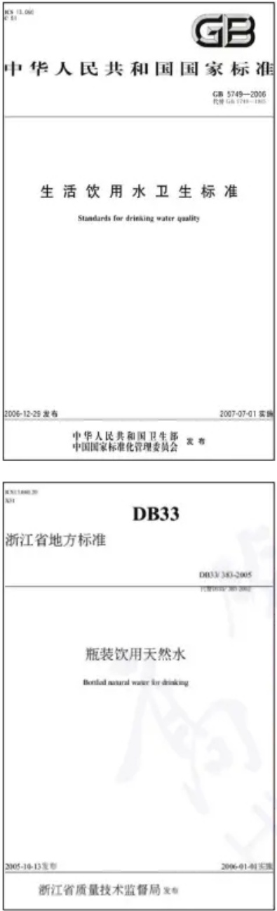
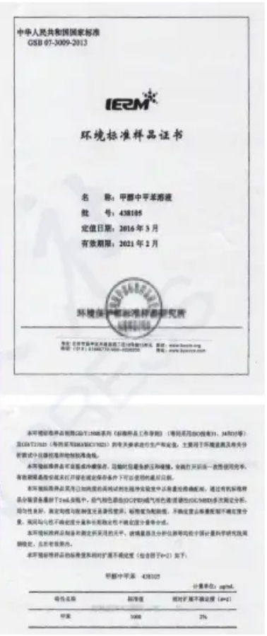
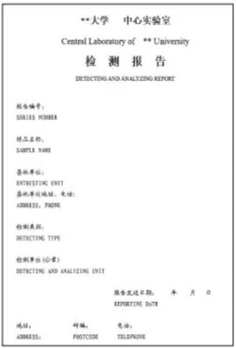
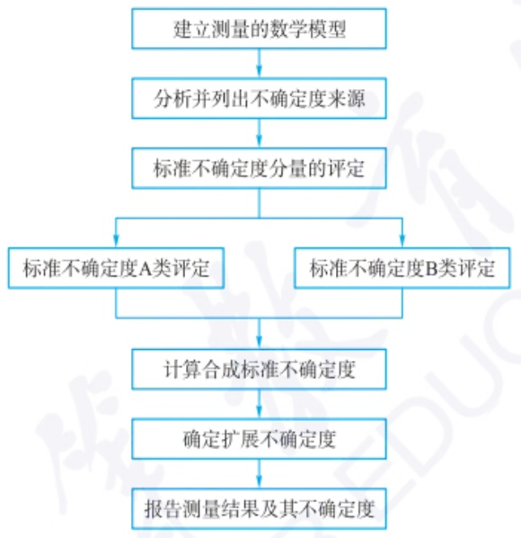
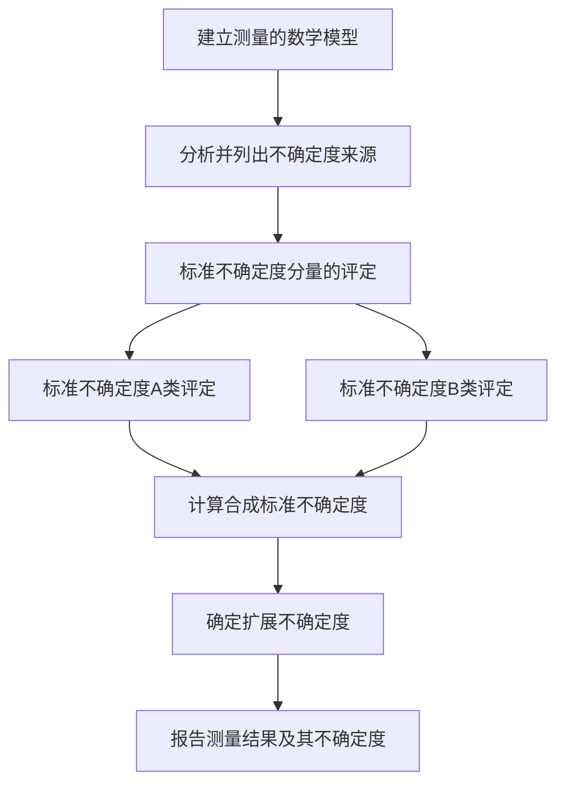
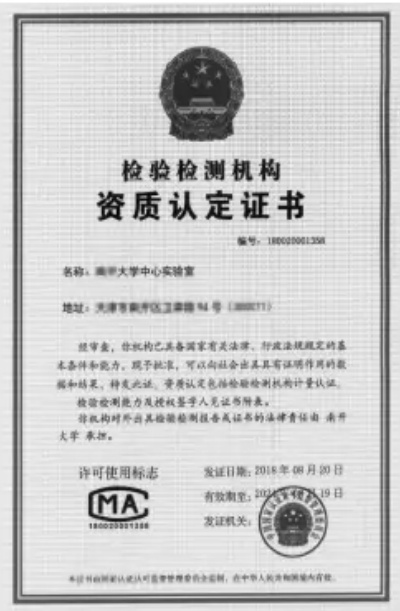
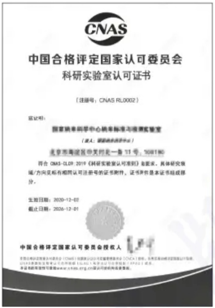

2013年某矿泉水砷超标事件中，该矿泉水商品标签显示使用检测标准为《瓶装饮用天然水》（浙江省地方标准，DB33/383—2005），但此时已有《生活饮用水卫生标准》（国家标准GB5749—2006）。这一事件带来的启示是什么？

在检测系统校准范围内进行。

标准方法、非标准方法、允许偏离的标准方法在应用于样品检测前，应对方法的性能进行验证。

如果验证发现标准方法中有未能详述但会影响检测结果的操作步骤,应将详细操作步骤编写成操作指导书,经审核批准后作为标准方法的补充。

对于定性检测方法,应当确保能够对一定浓度水平的分析物进行检测。定性方法确认的关键在于其检测水平的能力。对分析物的检测至少要在检出限浓度水平确保95%的检出正确率。

方法确认时,可以对方法适用的全部基质和分析物进行验证,也可以采用具有代表性的样品基质进行验证。通常,某类样品的个别品种可以代表其他同类样品,但是,当因特殊变异性而使个别样品不同于同类其他样品时,需要对该样品进行单独确认。

方法确认时,应采用加标回收实验确认方法的准确度,因此分析物的加标回收水平应包括方法的检出限和至少另一个较高的浓度水平,通常已知残留参量水平更具有实际的意义。应采用加标回收平行实验确认方法的精密度,同一水平下至少需要5个平行实验测定。

方法确定后应制定分析方法的控制程序,重复多次实验,熟练掌握实验技能和操作条件,确保方法受控。

实验室应定期核查方法的时效性,确保实验室使用的方法现行有效。非标准方法和允许偏离的标准方法应经过验证、编制偏离标准的操作指导书,经过审核批准后方可使用。

## 1.3.2.2 标准物质

标准物质指用于校准测量装置、评价测量方法或给材料赋值的一种材料或物质，包括化学成分分析标准物质、物理特性与物理化学特性测量标准物质和工程技术特性测量标准物质，中国国家标准物质以 GBW 表示。其特点是:准确性、均匀性和稳定性。标准物质不仅广泛用于工业生产的质量检查和工艺流程控制，也作为商业贸易中的仲裁依据及临床检验和药物鉴定的标准，更是科学研究数据准确、可靠的保证。

标准物质的制备可根据标准物质的状态结合均匀性、稳定性的要求进行制备。定值方法通常有:①一种已知准确度的标准方法；②两种以上独立可靠的方法；③由一组经选拔合格的高水平实验室按照预定程序进行合作实验来定值。

同时,为了保证国家标准、行业标准的实施,标准样品作为另一种实物标准的形式,更有针对性和实用性。标准样品编号用 GSB 表示。

## 1.3.3 分析全过程的质量保证与质量控制

分析全过程的质量保证与质量控制包括取样、样品处理、分析方法选择、测定过程、实验记录、分析结果表达等。当采集的有代表性的样品送到实验室进行样品分析时，为取得满足质量要求的分析数据，必须在分析过程中实施各项质量保证、质量控制的技术方法、措施和管理规定。由这些技术方法、措施和管理规定组成的程序就是实验室质量保证和质量控制程序。

分析检测的质量控制一般有如下要求:

（1）实施有效的数据结果质量控制活动，应覆盖全部检验检测项目类别，能

有效监控检验检测结果的稳定性和准确性。

（2）对分析测试数据结果质量控制活动包括内部质量控制和外部质量控制。内部质量控制方式包括但不限于人员比对、设备比对、留样再测、盲样考核；外部质量控制方式包括但不限于能力验证、实验室间比对。
（3）在开展数据、结果质量控制活动时，应对其进行评价分析。若发现数据异常或超出预先判定规则时，应当组织原因分析，必要时采取有效的措施纠正，防止报告错误的结果。

实施分析检测的过程中,仪器质量控制和环境质量控制是两个重要环节,分别介绍如下:

## 1.3.3.1 仪器质量控制(仪器的检定与校准)

分析仪器的检测参数(灵敏度、精密度、准确度、线性度、检测限、选择性和分辨率等)必须满足分析方法的要求。

对于检测的准确性或者有效性有显著影响的所有设备，包括辅助测量设备、器具，在投入使用之前应进行检定（校准），应根据仪器设备的特性和使用频率制定核查周期。

关键设备(包括校准的参考标准、基准、传递标准及标准物质/参考物质)需要进行期间核查、做好记录、保持仪器处于良好状态,授权签字人应对组织期间核查的结果进行评审。

应加强仪器的使用管理。要求操作人员按照操作指导书的要求规范操作，严禁超量程使用，大型精密仪器应安排专人专业负责仪器设备的维护保养。校准状态检测设备的硬件和软件应得到保护，任何人不得进行错误的调整，以免导致检测结果错误。

定容器具特别是重复使用的必须彻底清洗。如果条件允许，标准品和样品提取用的玻璃容器应分开使用，避免交叉污染。避免使用过度刮擦或者蚀刻的玻璃容器。所有的玻璃器具、试剂、溶剂和水在使用前都应通过空白试验，检查是否有可能的干扰性污染物。

应正确使用校准因子。当校准产生一组修正因子时，应确保其所有备份（包括测量软件）得到正确更新。

## 1.3.3.2 环境质量控制

实验环境条件对仪器设备使用、仪器精度和测试结果影响较大，因此必须对实验室的环境条件进行确认和控制，使实验室环境条件满足检测工作的需要。应采取措施确保实验室的环境温度、湿度、粉尘、振动、辐射、电流电压等内务良好。应对影响化学分析检测质量的区域加以控制，限制进入或使用上述区域，并根据其特定的情况确定控制的程度。应将不相容活动的相邻区域进行有效隔离，防止污染源的带入。

化学分析、样品制备及前处理等场所应采光良好、有效通风和具有适宜的室内温度，应采取相应的措施防止溅出物或挥发物引起的交叉污染。样品、标准品、试剂存放区应满足其所需的保存条件，在冷藏和冷冻区域保存时，应定期对温度进行监控并做好记录。当需要在实验室外部场所进行取样或检测时，要特别注意工作环境条件，并做好现场记录。相关的规范、方法和程序对环境条件有要求，或者环境条件对检测结果质量有影响时，应监测、控制和记录环境条件。

痕量分析与常量分析必须分别在独立的房间进行,使用完全独立的实验室设

标准物质证书示例

仪器设备应标注校准状态标识和使用状态标识。绿色:满足或符合使用要求，标明校准日期和有关参数；黄色:限制使用，要求给出限制范围；红色:停止使用，封存或故障。

text_image

**大学 中心实验室
Central Laboratory of ** University
检测报告
DETECTING AND ANALYZING REPORT

报告编号:
SERIES NUMBER

样品名称:
SAMPLE NAME

委托单位:
ENTREISTING UNIT
委托单位地址、电话:
ADDRESS, PHONE

检测类别:
DETECTING TYPE

检测单位(公章)
DETECTING AND ANALYZING UNIT

报告送达日期: 年 月 日
REPORTING DATE

地址: 副编: 电话:
ADDRESS: POSTCODE TELEPHONE

典型分析报告格式示例

施。避免常量分析对痕量分析的污染，产生假阳性、假阴性结果或检测灵敏度降低。对于实验室内部或附近的有害生物进行控制时，必须使用那些被认为不会对检测产生影响的药物。

此外,对分析结果的表达,如果是出具第三方测试结果的单位,其报告和证书应有如下要求:

检验检测机构应准确、清晰、明确、客观地出具检验检测结果，符合检验检测方法的规定，并确保检验检测结果的有效性。结果通常应以检验检测报告或证书的形式发出。检验检测报告或证书应至少包括下列信息:

a. 标题；

b. 标注资质认定标志, 加盖检验检测专用章(适用时);

c. 检验检测机构的名称和地址,检验检测的地点(如果与检验检测机构的地址不同);

d. 检验检测报告或证书的唯一性标识(如系列号)和每一页上的标识,以确保能够识别该页是属于检验检测报告或证书的一部分,以及表明检验检测报告或证书结束的清晰标识;

e. 客户的名称和联系信息；

f. 所用检验检测方法的识别；

g. 检验检测样品的描述、状态和标识；

h. 检验检测的日期,对检验检测结果的有效性和应用有重大影响时,注明样品的接收日期或抽样日期;

i. 对检验检测结果的有效性或应用有影响时, 提供检验检测机构或其他机构所用的抽样计划和程序的说明;

j. 检验检测报告或证书的签发人的姓名、签字或等效的标识和签发日期；

k. 检验检测结果的测量单位(适用时);

1. 检验检测机构不负责抽样(如样品是由客户提供)时,应在报告或证书中声明结果仅适用于客户提供的样品;

m. 检验检测结果来自外部提供者时的清晰标注；

n. 检验检测机构应做出未经本机构批准,不得复制(全文复制除外)报告或证书的声明。

## 1.3.4 不确定度与溯源性

## 1.3.4.1 不确定度

不确定度指分析结果的正确性或准确性的可疑程度，是表达分析质量优劣的一个指标。通俗来说，不确定度指由于测量误差的存在而对测得值不能确定的程度，比如检测报告给出的某待测组分含量为 $(1.55\pm0.04)\mathrm{mg}\cdot\mathrm{L}^{-1};k=2$ ，其报出结果含量为 $1.55\ mg\cdot L^{-1}$ ，不确定度为 $0.04\ mg\cdot L^{-1}$ ，它表达了报出结果不能肯定的程度，即为0.04，其中k为容量因子，下文具体解释。不确定度和误差有密切联系，但有本质区别。误差是测量值与测量真值之差，是以真值为中心，测量不确定度是以测量值为中心，表征测量不确定度（即不能肯定的程度）所具有的范围。不确定度是建立在误差理论基础上的一个新概念，不确定度越小，结果与真值越靠近，测量的质量越高，结果的使用价值越大；反之，结果的使用价值越小。

不确定度的测量和表示:

测量不确定度分量按照评定方法的不同分为两类: A 类和 B 类不确定度, A类不确定度是指用统计学方法评定的不确定度分量，B 类不确定度是指用非统计学方法评定的不确定度分量。

A 类不确定度通过计算平均值的标准偏差进行评定, 用  $U_{A}$  表示,  $U_{A}=\frac{s}{\sqrt{n}}$ 。

B类不确定度需要根据有关信息进行科学估计，这些信息来源有:以前的观测数据；仪器的技术资料和测量仪器的特性；仪器的检定校准证书提供的数据；手册中的参考数据及其不确定度。比如天平是实验室常用仪器，天平的检定证书上提供的数据可以评定由天平产生的不确定度，属于B类不确定度。

当分析结果是通过若干个相互独立的测量分量的值求得时,一般用合成标准不确定度表示,即按各分量的方差计算得相应的合成标准不确定度。

分析测试中一般以扩展不确定度表述分析结果的不确定度,它是指合成标准不确定度乘以容量因子(也叫包含因子)k,k值选择一般为2,有时为3,约对应置信水平95%和99%。

## 1.3.4.2 不确定度的评定过程

flowchart

## 1.3.4.3 分析结果的溯源性

溯源性是指测量值通过具有规定不确定度的连续比较链与测量基准联系起来，使所有的同种量值都可以按这条比较链通过校准向测量的源头追溯，溯源到同一测量基准（国家基准或国际基准）的特性。分析结果应具有溯源性，否则，分析测量值处于多源或多头，必然会在技术上和管理上造成混乱。溯源性可用准确度来评价。准确度是指测量值与真值接近的程度，可用测量值与理论值、约定值或标准值等参考量值的误差来衡量，常用标准物质对照试验和标准方法对照试验来检定或校准。

## 1.3.5 实验室认可与资质认定

实验室认可,简称 CNAS(China national accreditation service for conformity assessment),是根据《中华人民共和国认证认可条例》的规定,由国家认证认可监督管理委员会(认监委)批准设立并授权的国家认可机构,统一负责对认证机构、实验室和检验机构等相关机构的认可工作。

## 思考:

不确定度和误差在表达分析结果时有何区别？为什么现在第三方检测时定量分析结果都要求出具不确定度报告？

计量认证，简称 CMA(China metrology accreditation)，即实验室资质认定，是依据《中华人民共和国计量法》《中华人民共和国认证认可条例》等有关法律、法规的规定，对为社会出具公证数据的检验机构进行强制考核的一种手段，是政府对第三方实验室的行政许可，是政府权威部门对检测机构进行规定类型检测所给予的正式承认。只有取得计量认证合格证书的检测机构，才能够从事检测检验工作，并允许其在检验报告上使用 CMA 计量认证标记。有 CMA 计量认证标记的检验报告可用于产品质量评价、成果及司法鉴定，具有法律效力。

CMA 和 CNAS 有以下区别。

## 区别一:评审组织机构的区别

CNAS 实验室认可证书的评审组织机构和发证机构是中国合格评定国家认可委员会。

CMA 分省级和国家级的,国家级实验室的资质认定由国家认监委负责,非国家级实验室一般由所在地省级的市场监管局负责组织评审和发证。

## 区别二:评审原则的区别

CNAS 秉承的是自愿、非歧视的原则。

CMA 是针对为社会出具公证数据的检验机构进行的强制考核。

## 区别三:对实验室的法律地位要求的区别

CNAS 认可对实验室的法律地位没有限制, 可以是企业内部的实验室, 也可以是独立的第三方实验室。

CMA 实验室资质认定的对象,需要是独立的第三方实验室、政府相关部门下属的事业单位实验室等。

## 区别四:报告有效范围的区别

通过 CNAS 认可的实验室在其认可范围内出具的带 CNAS 标识的报告, 可在全球的多个国家和地区通行;

通过 CMA 资质认定的实验室在其认定范围内出具的报告只在国内有效。

## 习题

## - 章节练习题 -

1. 分析质量保证和质量控制应包含哪些环节和要素？

2. 什么是标准物质？其特点和性质是什么？有哪些应用？

3. 什么是标准样品？标准样品和标准物质有什么区别？

4. 实验室内部质量控制的方式有哪些？

5. 实验室外部质量控制主要有哪些？

6. 仪器设备的检定和校准包括哪些方面？其核心要求是什么？

7. 如何理解分析结果的溯源性要求？

8. 如何确认分析方法准确度,应该怎么做? 确认方法精密度时,一般需要平行几次?

## - 挑战性问题 -

9. 什么是不确定度？误差和不确定度有什么关系？

## - 专题或报告 -

10. 实验室资质认定和实验室认可的区别是什么？各有什么特点？如何看待

2021年《科研实验室良好规范》这一国家标准实施的意义？

text_image

检验检测机构
资质认定证书
编号：180020001358
名称：清华大学中心实验室
地址：天津市南开区卫津路94号（300071）
经审查，你机构已具备国家有关法律、行政法规规定的基本条件和能力，现予批准，可以向社会出具具有证明作用的数据和结果，特发此证。资质认定包括检验检测机构计量认证。
检验检测能力及授权签字人见证书附表。
你机构对外出具检验检测报告或证书的法律责任由南开大学承担。
许可使用标志
发证日期：2018年08月20日
MA
180020021358
有效期限：2018年08月19日
发证机关：
本证书的同意人认可质量管理委员会审核，在中华人民共和国境内有效。

资质认定证书示例

text_image

中国合格评定国家认可委员会
科研实验室认可证书
（注册号：CNAS RL0002）
兹证明：
国家纳米科学中心纳米标准与核素实验室
（法人：新疆纳米化学工业）
北京市海淀区中关村北一街11号，508190
符合CNAS-UL09.2019《科研实验室认可准则》的要求，具体研究领域/方向见标有相同认可注册号的证书附件，证书原件是本证书组成部分。
生效日期：2020-12-02
截止日期：2026-12-01
中国合格评定国家认可委员会授权人
CNAS认证年度报告中的名称（CNAS）包括认证公司信息披露事务中心（CCS）审核、技术监督和内部审计工作。2019年第四季度报告中可采用标准(ULAS)和认证会计师制度(APAC)报告。本证书的有效性可查阅www.cnas.org.cn认可的机构备案。

科研实验室认可证书示例

## 第二章

# 分析数据处理

## 真值(true value)

真值是指某一物理量本身具有的客观存在的真实数值。由于分析误差不可避免，因此真值是不可测得的。实际工作中往往将理论真值、计量学约定真值或相对真值等作为真值来检验分析结果的准确度。

理论真值是指由公认理论推导或证明的某物理量的数值,如  $1 \, mol \, H_{2}O$  含  $2 \, mol \, H$  和  $1 \, mol \, O$ , 水的组成常数即为理论真值。

计量学约定真值是指计量组织、学会等规定的公认计量单位的数值，如国际计量大会定义的光在真空中传播(1/299792458) s 所经过的路径长度为 1 m。

相对真值是指由公认的权威机构严格按照标准方法进行多次平行测定后，用数理统计方法得到相对准确的测定值。例如，国际相对原子质量和相对分子质量、基准试剂标签所给保证值等都是相对真值。

error_bar

| Category | Q1 | Q2 (Median) | Q3 |
| --- | --- | --- | --- |
| 甲 | ~37.35 | ~37.55 | ~37.60 |
| 乙 | ~36.95 | ~37.05 | ~37.15 |
| 丙 | ~36.25 | ~36.40 | ~36.65 |
| 丁 | ~36.65 | ~37.05 | ~37.85 |

图 2.1.1 同一样品的四种测定结果

定量分析的主要目的是获得样品中待测组分的含量信息。然而，由于受到分析方法、分析仪器和试剂等条件限制、测试条件的波动及人为因素的影响，分析结果不会和样品的真实含量完全一致。因此，必须对分析结果的可靠性和准确度做出合理的判断，进行正确的表达。本章主要介绍分析测量误差(measurement error)的产生原因、规律和减免措施，常用分析数据统计处理的方法原理和应用，以及定量校正模型和方法，以充分挖掘测量数据中的信息。

## 2.1 分析测量误差

## 2.1.1 误差的表征

## 1. 准确度

样品中待测组分的测定值与其真实值接近的程度即为分析结果的准确度（accuracy）。真实值也称为真值，是指某一物理量本身具有的客观存在的真实数值，用 $x_{T}$ 表示。测定值与真值越接近，分析结果的准确度越高；反之，分析结果的准确度越低。

## 2. 精密度

精密度(precision)是指一组平行测定结果相互接近的程度。如果平行测定的结果相互之间越接近,则分析结果的精密度越高。

## 3. 准确度与精密度的关系

图2.1.1直观地反映了准确度和精密度的关系。同一样品的四种测定结果中，甲的平均值与真值接近，且实验值彼此都很接近，因此准确度和精密度均好；乙的精密度好，但准确度稍差；丙的准确度和精密度都很差；丁的精密度很差，虽然平均值接近于真值，但这是由大的正负误差抵消导致，如果减少一次测定，平均值就会有很大变化，因此其准确度好是偶然的。可见，精密度是保证准确度的先决条件，但高的精密度不一定能保证有高的准确度。

## 2.1.2 误差的表示

## 1. 误差

准确度的高低用误差(error)来衡量。误差是测定值(通常以平均值 $\bar{x}$ 表示测定结果)和真值 $x_{T}$ 之间的差异。误差的大小可用绝对误差E和相对误差 $E_{r}$ 表示。

$$
E = \overline {{x}} - x _ {\mathrm{T}} \tag {2-1-1}
$$

$$
E_{\mathrm{r}} = \frac{\overline{x} - x_{\mathrm{T}}}{x_{\mathrm{T}}} \times 100\% \tag{2 - 1 - 2}
$$

绝对误差和相对误差都有正值和负值。误差为正值时称为分析结果偏高，误差为负值时称为分析结果偏低。

»例 2.1.1 在分析天平的使用过程中,需要定期用标准砝码对天平进行校正,标准砝码的标示质量为相对真值。若用某分析天平称得标示为 1.0000 g 的标准砝码的质量为 0.9998 g,标示为 2.0000 g 的标准砝码的质量为 1.9998 g,则两者称量的绝对误差和相对误差分别是多少?该结果说明什么问题?

» 解: 绝对误差  $E_{1}=x_{1}-x_{T_{1}}=0.9998\ g-1.0000\ g=-0.0002\ g$

$$
E _ {2} = x _ {2} - x _ {\mathrm{T} _ {2}} = 1. 9 9 9 8 \mathrm{g} - 2. 0 0 0 0 \mathrm{g} = - 0. 0 0 0 2 \mathrm{g}
$$

相对误差

$$
E_{\mathrm{r}_1} = \frac{E_1}{x_{\mathrm{T}_1}} = \frac{-0.0002}{1.0000}\times 100\% = -0.02\%
$$

$$
E_{\mathrm{r}_{2}} = \frac{E_{2}}{x_{\mathrm{T}_{2}}} = \frac{-0.0002}{2.0000}\times 100\% = -0.01\%
$$

计算结果说明,绝对误差相等,相对误差不一定相同。同样的绝对误差,当被测定的量较大时,相对误差就比较小,测量的准确度也就比较高。相对误差可用于不同情况下测定结果准确度的比较,因此更具实用性。

## 2. 偏差

分析结果的精密度的高低常用与平均值相关的各种偏差(deviation)来表示。

（1）极差 最简单的一种表示精密度的方式是极差。极差又称全距 (range)，以 R 表示，它是一组测定数据中最大值  $x_{max}$  与最小值  $x_{min}$  之差。极差可以用来反映一组数据的离散程度，其不足之处是不能充分利用数据。
（2）绝对偏差和相对偏差 绝对偏差  $d_{i}$  和相对偏差  $d_{r}$  用于衡量单次测定值  $x_{i}$  与一组测定值(平行测定次数为 n) 的平均值  $\bar{x}$  的偏离程度。

$$
d _ {i} = x _ {i} - \overline {{x}} \tag {2-1-3}
$$

$$
d_{\mathrm{r}} = \frac{x_{i} - \overline{x}}{\overline{x}}\times 100\% \tag{2 - 1 - 4}
$$

绝对偏差和相对偏差有正有负,单次测定偏差的代数和必为0,因此不能用它来表示一组测定值的精密度。

（3）平均偏差和相对平均偏差 平均偏差  $\bar{d}$  和相对平均偏差  $\bar{d}_{e}$  是每次测定偏差的绝对值的平均值和相对平均值，取绝对值后，避免了正负偏差相互抵消，它们表示一组测定值的精密度。

$$
\bar {d} = \frac {\left| d _ {1} \right| + \left| d _ {2} \right| + \cdots + \left| d _ {n} \right|}{n} = \frac {1}{n} \sum_ {i = 1} ^ {n} \left| d _ {i} \right| = \frac {1}{n} \sum_ {i = 1} ^ {n} \left| x _ {i} - \bar {x} \right| \tag {2-1-5}
$$

$$
\bar {d} _ {\mathrm{r}} = \frac {\bar {d}}{\bar {x}} \times 100\% \tag {2-1-6}
$$

（4）标准偏差和相对标准偏差 标准偏差(standard deviation)又称均方根偏差,当测定次数趋于无限多时,称为总体标准偏差,是单个测定结果与总体平均值 $\mu$ 的差方和均根,用 $\sigma$ 表示。

## 总体（population）与样本（sample）

研究对象的整体称为统计总体，简称总体。从总体中随机抽取的一部分个体称为随机样本，简称为样本。例如，某化工厂生产的所有硫酸铵为总体，从中抽取部分硫酸铵用于检测，抽取的硫酸铵即为样本。通过对有限个样本的测量，推断总体的统计特性是统计检验的中心任务。

## 自由度

## (degrees of freedom)

能够独立取值的偏差数被称为自由度，用 $f$ 表示。自由度的概念可以这样理解:设有6个测定值，前5个的绝对偏差分别是0.6,1.2,-1.4,1.3和-0.5，由于 $\sum_{i=1}^{6}(x_i - \overline{x}) = 0$ ，第6个测定值的绝对偏差只能为-1.2，没有选择的自由，因此能够独立取值的偏差数为5个，也就是 $n - 1$ 。

$$
\sigma = \sqrt {\frac {\sum_ {i = 1} ^ {n} (x _ {i} - \mu) ^ {2}}{n}} \tag {2-1-7}
$$

在一般的分析工作中,平行测定的次数是有限的,此时标准偏差为单个测定结果与平均值的差方和均根,亦称为样本标准偏差,用 s 或 SD 表示。

$$
s = \sqrt {\frac {\sum_ {i = 1} ^ {n} \left(x _ {i} - \overline {{x}}\right) ^ {2}}{n - 1}} \tag {2-1-8}
$$

式中， $n - 1$ 称为自由度，用 $f$ 表示，表示能够独立取值的偏差数，用以校正经 $\overline{x}$ 代替$\mu$ 所引起的误差。

标准偏差与平均值之比称为相对标准偏差(relative standard deviation, RSD)或变异系数(coefficient of variation, CV)。

$$
\mathrm{RSD} = \frac{s}{\overline{x}}\times 100\% \tag{2 - 1 - 9}
$$

## »例 2.1.2 有两组测定值如下:

甲组 2.9 2.9 3.0 3.1 3.1

乙组 2.8 3.0 3.0 3.0 3.2

试分别采用平均偏差和标准偏差判断两组测定值精密度的差异。

## 》解:

|  | 平均值$\overline{x}$ | 平均偏差$\overline{d}$ | 标准偏差$s$ |
| --- | --- | --- | --- |
| 甲组 | 3.0 | 0.08 | 0.10 |
| 乙组 | 3.0 | 0.08 | 0.14 |

由题中数据可知，乙组测定值比甲组更为分散，但两组的平均偏差却相同。标准偏差计算结果显示，乙组的s比甲组大，即精密度差些。标准偏差通过平方突出了较大偏差的影响，能更好地反映测定值的分散程度，因此最为常用。在一般情况下，对测定结果应标示出标准偏差（或相对标准偏差）。

（5）平均值的标准偏差 平均值的标准偏差  $s_{\overline{x}}$  是指一系列平行测定结果的平均值  $\overline{x}_{1}, \overline{x}_{2}, \cdots, \overline{x}_{n}$  的标准偏差，它反映了平均值的精密度。可以证明（参考例2.1.3）， $s_{\overline{x}}$  与其中一组测定值的标准偏差及测定次数 n 之间存在以下关系:

$$
s _ {\bar {x}} = \frac {s}{\sqrt {n}} \tag {2-1-10}
$$

平均值的标准偏差与测定次数的平方根成反比，显然，平均值的精密度比单次测定的精密度更好，且增加测定次数可以提高测定结果的精密度。 $s_{\overline{x}} / s$ 值与 $n$ 的关系如图2.1.2所示，当 $n$ 足够大时，再增加测定次数，精密度的提高并不明显。因此在实际工作中，平行测定次数不必太多，一般为3\~5次，再多则得不偿失。

## 2.1.3 误差的分类

图 2.1.2 平均值的标准偏差与测定次数的关系

根据误差产生的原因及其性质的不同可分为系统误差(systematic error)和随机误差(random error)。

## 1. 系统误差

系统误差是由确定原因引起的误差，它决定测定结果的准确度。系统误差具有单向性、恒定性、可测性、可校正性。单向性是指在同一原因的影响下，测定结果总是偏高或总是偏低。恒定性是指在一定条件下，误差大小基本不变。可测性是指误差的大小可以测定，因此可对结果进行校正，也可以设法减免。

产生系统误差的原因主要有以下几种:

（1）方法误差 由于分析方法本身所产生的误差。例如，在滴定分析中指示剂选择不当，使终点与化学计量点不一致；又如在重量分析时，由于沉淀中包藏有其他杂质，使分析结果偏高，或沉淀不完全，使分析结果偏低。
（2）试剂误差 所用的试剂或溶剂中含有干扰测定的组分，导致测定产生误差，这对痕量组分分析造成的影响更为严重。若基准物质的纯度达不到要求，也会造成系统误差。
（3）仪器误差 测量仪器本身都存在一定误差。如滴定管、容量瓶等容量器皿刻度不准确；电位差计测量的精度不够等。
（4）操作误差 由分析操作者的主观判断引起的误差。例如，不同人员观察颜色的能力不同，对颜色不敏感的人辨别滴定终点颜色偏深；对分度估读习惯不同，读数偏高或偏低等。

## 2. 随机误差

随机误差是由一些难以避免、无法控制的不确定因素引起的误差，如环境温度、湿度、电压、污染情况等的变化引起样品质量、组成、仪器性能等的微小变化；滴定管读数的不确定性等。它决定测量结果的精密度。随机误差时大时小，可正可负，难以找到具体原因，更无法测量它的值，因此这种误差是不可避免的，只能采取一定措施减小，如取多次测量的平均值（参见本章2.2节）。

## 2.1.4 提高分析结果准确度的方法

## 1. 选择合适的分析方法

在选择分析方法时,应考虑样品的性质、所需的准确度和精密度、分析成本等因素。例如,当样品含量很低时,需要使用高灵敏度的分析方法。如果样品很复杂,则需要使用具有高分离能力或高选择性的分析方法等。

## 2. 减少测量误差

测量时不可避免地会有误差存在,但是如果对测量对象的量进行合理地选取,则会减少测量误差,提高分析结果的准确度。

## 3. 消除系统误差

系统误差具有可测性和可校正性。可先通过对照试验、回收率试验结合显著性检验(参见本章2.2节)确定有无系统误差存在,再设法找出产生系统误差的原因并针对性地进行消除。

选择组成与样品组成相近的标准样品进行对照试验,将测定结果与标准值进行比较;或者采用标准方法与所选方法同时测定某一样品,将两种方法的测定结果进行比较。如果上述两种方法都不适用,则可以通过回收率试验或加标回收率试验确定有无系统误差存在。

根据产生系统误差的原因采用以下方法加以消除。

做空白试验用于扣除由试剂(包括蒸馏水)和器皿带进杂质所造成的系统误差。在不加样品的情况下,按照与样品分析相同的操作程序和条件进行测定,所

## 分析中的“过失”是否属于误差？

除系统误差和随机误差外，分析过程中往往存在由于分析人员的疏忽或失误造成的“过失”，其本质上讲是一种错误，不能称为误差。例如，容器不洁净、加错试剂、试液损失、记录和计算错误等。要避免过失，分析人员须不断提高理论水平和操作水平，严格遵守操作规程，养成良好的实验习惯。分析过程中一旦出现过失，应立即停止实验，及时纠正错误并重新进行分析；确知由操作失误得到的数据必须主动舍弃；未被察觉的由过失操作得到的数据常表现为离群数据，可以用数理统计检验法将其剔除（参见本章2.2节）。

## 对照试验（control test）

对照试验是检查某测定方法是否存在系统误差的方法之一。一般分为两种，一种是采用该方法对标准样品进行测定，然后将测定值与标准值相对照。如果二者有显著差异，则说明该分析方法本身存在系统误差；另一种是用国家规定的标准方法或公认可靠的“经典”分析方法分析同一样品，将分析结果同该测定方法所得到的结果进行对照，如果二者无显著差异，则说明新方法可靠。

## 回收率试验（recovery test）

回收率试验可用来评价分析方法的准确度，并判断有无系统误差存在。一般选用组成与样品接近的标准样品进行测定，将测定值 $x_{1}$ 与标准值 $x_{2}$ 进行对照比较，按下式计算分析方法的回收率:

$$
R = \frac{x_1}{x_2} \times 100\%
$$

如果对样品的组成不完全清楚，难以获得组成与样品接近的标准试样时，可以采用加入法进行加标回收率试验。取等量平行样品两份，在其中一份样品中加入已知量 $x_{2}$ 的待测组分并混合均匀，对两份样品进行平行测定。若测得样品中待测组分的量为 $x_{1}$，加标后的样品中待测组分的量为 $x_{3}$，则加样回收率为

$$
R = \frac{x_3 - x_1}{x_2} \times 100\%
$$

R 值越接近 100%, 表明分析方法的准确度越高, 系统误差越小; 反之, 则系统误差越大。

得结果称为空白值。然后从样品分析结果中扣除空白值。

校准仪器以消除仪器不准确所引起的系统误差。例如，分析天平可通过使用标准砝码进行外部校准，或利用内置自动校准装置（即内校）进行自校准。容量仪器可以通过绝对校正法或相对校正法获得校正值并加以扣除。

采用其他分析方法进行校正。例如，用  $Fe^{2+}$  标准溶液滴定钢铁中的铬时，钒和铈一起被滴定，产生正误差。此时，可选择其他合适的方法测定钒和铈的含量，并按计量关系从滴定结果中扣除钒和铈消耗的  $Fe^{2+}$  标准溶液的量，从而提高测定结果的准确度。

## 4. 减少随机误差

在消除系统误差的前提下,增加平行测定次数可以减少随机误差,减小分析结果的标准偏差,提高测量的准确度。

## 5. 其他辅助方法

定期维护仪器,使用计算机辅助分析,建立质量管理体系实现样品管理、实验室环境管理、仪器管理、记录管理等,规范操作步骤,都有利于提高测定结果的准确度。

## 2.1.5 误差的传递

分析结果一般是根据各测定值和一定的公式运算得到,各测定值的误差会传递到分析结果中去,这就是误差传递(propagation of error)。

假设  $A, B, \cdots$  是测定值, R 是计算得到的分析结果:

$$
R = f (A, B, \dots) \tag {2-1-11}
$$

误差传递研究的实质就是要计算 A, B 等数值的微小变化将导致分析结果 R 发生多大的变化。这是一个全微分问题，即

$$
\mathrm{d} R = \frac {\partial f}{\partial A} \mathrm{d} A + \frac {\partial f}{\partial B} \mathrm{d} B + \dots \tag {2-1-12}
$$

式中，dA、dB 可视为 A、B 测定值的误差，dR 可视为分析结果 R 的误差。

## 1. 系统误差的传递

根据式(2-1-12)推导出系统误差的传递公式如下:

$$
\Delta_ {R} = \frac {\partial f}{\partial A} \Delta_ {A} + \frac {\partial f}{\partial B} \Delta_ {B} + \dots \tag {2-1-13}
$$

式中， $\Delta$  表示测定值或者计算值与真值之差。

假设分析结果 R 的计算式为  $R=\alpha A+\beta B-\gamma C$ ，其中 A、B 和 C 分别表示直接测定值， $\alpha$ 、 $\beta$  和  $\gamma$  是系数。根据式(2-1-13)可得

$$
\Delta_ {R} = \frac {\partial R}{\partial A} \Delta_ {A} + \frac {\partial R}{\partial B} \Delta_ {B} + \frac {\partial R}{\partial C} \Delta_ {C} = \alpha \Delta_ {A} + \beta \Delta_ {B} - \gamma \Delta_ {C} \tag {2-1-14}
$$

若分析结果的计算式为  $R=\frac{A^{\alpha}B^{\beta}}{C^{\gamma}}$ ，根据式(2-1-13)可得

$$
\frac {\Delta_ {R}}{R} = \alpha \frac {\Delta_ {A}}{A} + \beta \frac {\Delta_ {B}}{B} - \gamma \frac {\Delta_ {C}}{C} \tag {2-1-15}
$$

## 2. 随机误差的传递

根据式(2-1-12)推导出随机误差的传递如下:

$$
s _ {R} ^ {2} = \left(\frac {\partial f}{\partial A}\right) ^ {2} s _ {A} ^ {2} + \left(\frac {\partial f}{\partial B}\right) ^ {2} s _ {B} ^ {2} + \dots \tag {2-1-16}
$$

式中，s 为标准偏差，表示分析结果 R、直接测定值 A 和 B 的随机误差。

»例 2.1.3 在相同条件下对某随机噪声信号进行 n 次测定, 取平均值后, 计算平均值的标准偏差。

》解:以  $x_{i}$  表示第 i 次测定值,  $s_{i}$  表示标准偏差  $(i=1,2,\cdots,n)$ ,  $\bar{x}$  表示平均值:

$$
\bar {x} = \frac {1}{n} (  x _ {1} + x _ {2} + \dots + x _ {n}  )
$$

根据随机误差传递原理,得

$$
s _ {x} ^ {2} = \left(\frac {\partial \overline {{x}}}{\partial x _ {1}}\right) ^ {2} s _ {1} ^ {2} + \left(\frac {\partial \overline {{x}}}{\partial x _ {2}}\right) ^ {2} s _ {2} ^ {2} + \dots + \left(\frac {\partial \overline {{x}}}{\partial x _ {n}}\right) ^ {2} s _ {n} ^ {2} = \frac {s _ {1} ^ {2} + s _ {2} ^ {2} + \cdots + s _ {n} ^ {2}}{n ^ {2}}
$$

式中， $s_{\bar{x}}$  表示平均值的标准偏差。由于测定条件相同，所以  $s_{1}=s_{2}=\cdots=s_{n}=s_{单}$ ， $s_{单}$  表示单次测定的标准偏差。上式变为

$$
s _ {\bar {x}} = \frac {1}{\sqrt {n}} s _ {\text {单}}
$$

随机噪声的强度度量是标准偏差。上述结果表明，将相同条件下的多个测定值进行平均是一种有效的噪声抑制方法。它具有显著的降噪效果，而又不影响非噪声信号，优于普通(电子或数字)滤噪方法。傅里叶变换红外光谱和傅里叶变换核磁共振波谱都是利用这一原理进行噪声抑制，以测量微弱的非噪声信号。但是，这种方法要求非噪声信号在多次测定中保持不变。

## 2.1.6 有效数字及其运算规则

## 1. 有效数字的定义

有效数字是在测定中能得到的有实际意义的数字，即所有准确数字加一位估计值。例如，滴定管的读数为 $25.04\mathrm{mL}$，共有4位有效数字，其中前三位是准确值，最后一位数字“4”是估读的，可能是3，也可能是5，存在不确定性。一般有效数字的最后一位数字有 $\pm 1$ 个单位的误差，它反映了测定值的准确程度。因此在进行实验记录和数据处理时，数据的位数不能随意增减。要改换数据单位时，也应注意不能改变有效数字的位数。例如，当需要在数的末尾加“0”作定位用时，可采用指数形式表示数据。

“0”是不是有效数字，应根据其在数据中的作用来确定。如果只是起定位作用，就不是有效数字；若作为普通数字用则为有效数字。例如，用精度为 $0.0001\mathrm{g}$ 的分析天平称得某物质的质量为 $0.0518\mathrm{g},5$ 前面的两个“0”只起定位作用，因此0.0518有三位有效数字；用精度为 $0.00001\mathrm{g}$ 的分析天平称得质量为 $0.05180\mathrm{g},8$ 后面的“0”是称量数据，因此0.05180有四位有效数字。该例也说明有效数字的位数与测量仪器的精度有关。

对数的有效数字位数取决于小数部分(尾数)数字的位数,因其整数部分(首数)只代表了该数的方次。例如,pH=11.02为两位有效数字,如将其换算成氢离子的浓度,应为 $\left[H^{+}\right]=9.5\times10^{-12}\ mol\cdot L^{-1}$ 。

## 2. 有效数字的修约

在数据处理过程中及最终结果表达时,应根据对有效数字的需要去掉多余的数字,即修约。修约的目的是删除计算过程中产生的多余数字,因为这些数字是纯数学结果,不反映分析结果的准确度。修约方法可归纳为“四舍六入五留双”,即当多余尾数 $\leqslant4$ 时舍去尾数, $\geqslant6$ 时进位。尾数正好是5时分两种情况:若5后数字不为0,一律进位;5后无数或为0,采用5前是奇数则将5进位,5前是偶数则把5舍弃,简称“奇进偶舍”。修约时,如果舍去的数字不止一位,则应一次修约到位,不能连续多次修约。

## 3. 有效数字的运算规则

（1）加减法 对于加减法，有效数字的保留应以小数点后位数最少的数据为准。其依据是小数点后位数最少的那个数的绝对误差最大。

例如,求数据 13.72 和 0.3674 的和,结果应保留两位小数。

$$
\begin{array}{c} 1 3. 7 2 \\ +) \quad 0. 3 6 7 4 \\ \hline 1 4. 0 9 \end{array}
$$

（2）乘除法 对于乘除法，有效数字的位数应以几个数中有效数字最少的那个数据为准。其依据是有效数字位数最少的那个数的相对误差最大。例如:

$$
\frac {0 . 0 3 2 5 \times 5 . 1 0 3 \times 6 0 . 0 6 4}{1 3 9 . 8 2}
$$

式中,0.0325 的相对误差最大,为  $\frac{\pm0.0001}{0.0325} \approx 0.3\%$ , 因此分析结果只能保留三位有效数字, 为 0.0712。

在有效数字的运算过程中还要注意以下规则:

① 分析结果的计算会遇到一些非测定值,如测定次数、倍数、系数、分数、常数(如  $\pi$ )等,其有效数字位数可看作无限多位,在运算过程中无需考虑它们的有效数字。
② 在乘除法运算中,首位数为 “9” 的数字,在运算过程中其有效数字位数可多计一位。
③ 如果算式比较复杂, 可先完成计算, 不修约中间结果。最后再对算式进行分析以确定最终结果的有效数字位数, 然后进行修约。
④ 分步计算时,每一步计算结果可多保留一位数字,在获得最终结果时再进行修约,以减小分步计算中截断误差的累积。

在实际测定中,对组分含量 $\geqslant10\%$ 的分析结果,一般用四位有效数字表示;含量为 $1\%\sim10\%$ 时,用三位有效数字;对于含量 $<1\%$ 的微量组分,一般只要求有两位有效数字。

## 习题

## - 章节练习题 -

1. 分别以邻苯二甲酸氢钾和二水合草酸作为基准物质对浓度为 $0.1 \mathrm{~mol} \cdot \mathrm{L}^{-1}$ 的 $\mathrm{NaOH}$ 溶液进行标定时，若滴定管可估读到 $\pm 0.01 \mathrm{~mL}$，所消耗 $\mathrm{NaOH}$ 溶液的体积至少应为多少毫升才能满足滴定分析准确度的要求？此时，两种基准物质需分别称取多少克？计算结果说明什么问题？
2. 测定某合金样品铝的含量,五次平行测定的结果分别为 56.80%、56.85%、56.76%、56.86%、56.90%,计算(1)平均值;极差;平均偏差;相对平均偏差;标准偏差；相对标准偏差；平均值的标准偏差。（2）若该样品中铝的含量的真值是$56.70\%$ ，计算测定结果的绝对误差和相对误差。

3. 以下数值有几位有效数字？

$$
\pi ; 1. 2 5 0 \mathrm{g}; 0. 0 2 5 \mathrm{mL}; \mathrm{pH} = 1 1. 2 0; \mathrm{pK} _ {\mathrm{a}} = 2. 1 0 0; [ \mathrm{H} ^ {+} ] = 1. 0 \times 1 0 ^ {- 1 0} \mathrm{mol} \cdot \mathrm{L} ^ {- 1}
$$

4. 按有效数字运算规则, 计算下列各式:

(1)  $2.187 \times 0.954 + 9.6 \times 10^{-5} - 0.0326 \times 0.00814;$
(2) $\frac{0.1065 \times (20.05 - 13.67) \times 136.6}{1.502}$

5. 下列情况分别引起什么误差？如果是系统误差，应如何消除？

(1) 称量时, 分析天平未处于水平状态;
(2) 在用减量法进行样品称量时, 直接用手取称量瓶;
(3) 以含量为 98% 的锌粒作基准物质标定 EDTA 溶液的浓度;
(4) 容量瓶和移液管不配套；
(5) 试剂中含有微量的待测组分；
(6) 滴定时,滴定管尖嘴处产生气泡;
(7) 读取滴定体积时, 最后一位数字未进行估读;
(8) 重量分析中杂质被共沉淀；
(9) 天平称量时最后一位读数估计不准。

6. 在用光度法分析药物含量时,称取该药物样品 0.0401 g,计算得该药物的含量为 95.12%。请问该结果是否合理,为什么?

7. 两个学生同时测定某样品中硫的质量分数,称取样品均为 4.5 g,分别报告结果如下:甲为 0.045% 和 0.044%;乙为 0.04502% 和 0.04395%。哪份报告是合理的?为什么?

## - 挑战性问题 -

8. 以实验课中酸碱滴定分析得到的三个平行数据进行相对偏差、相对平均偏差、相对标准偏差的计算，并讨论用三种偏差进行精密度估计的优缺点。
9. 吸收光谱分析中，波长为  $\lambda$  、强度为  $I_{0}$  的单色光透过厚度为 b 的溶液时，被浓度为 c 的组分吸收了部分，透射光强度为 I 。经推导， $\lg(I_{0}/I)=\varepsilon bc$ ，其中  $\varepsilon$  是该组分吸光系数（常数）。若定义透射比（透光率） $T=\frac{I}{I_{0}}$ ，吸光度 A=- $\lg T$ ，那么定量关系变为  $A=\varepsilon bc$ 。试从系统误差传递的角度分析光强测量误差  $\Delta_{I}$  对组分浓度相对误差的影响。
10. 以实验课中的酸碱滴定分析过程为例, 讨论其测量误差的来源, 以及提高分析结果准确度的方法。

## -专题或报告-

11. 查找几篇与定量分析相关的英文文献,并指出其测定结果的有效数字是否合理?如果不合理,请提出修改意见并写成调研报告。
12. 不确定度(uncertainty)一词起源于德国物理学家 Heisenberg 在量子力学中提出的不确定度关系,又称为测不准原理。1962 年,美国国家标准局的 Youden 首先提出在计量校准系统中定量表示不确定度的建议。不确定度是指测量结果的可信程度,是经典误差理论发展的产物,目的是澄清一些模糊的概念,便于其实际使用。现在,测量不确定度的评定已广泛应用于生产过程中的质量控制和质量保证,法律和法规的符合性判断(基于风险水平考虑),测量标准和仪器的校准等

## 对统计学的理解

人类很早就知道随机现象，但是直到近代才发展出概率论，缺乏的不是数学工具，而是哲学层面的动力。统计学可以说是人类对随机性无力完全掌控下的一种努力，统计规律是人类在这种局限性约束下认识自然的一种结果。

## 数理统计的特点

（1）相对简单的数学知识和抽象难懂的概念；
(2) 计算容易完成,但结果阐释较难,而后者是重点。

为提高计算效率,本节涉及一些Matlab程序和Excel软件,用以取代传统的统计数值表,因此分析化学师生可将注意力集中在更为重要的结果阐释上。

多个领域。请查阅相关文献，了解测量不确定度的基本概念、传递、评定方法和应用，并与同学分享你的学习结果。

## 2.2 分析数据的统计处理

分析化学是一门测量科学,为了挖掘测量数据中的信息、减小甚至消除测量误差,需要应用数理统计方法。本节主要介绍分析化学数据处理所需的常用数理统计知识和典型应用。

分析数据的统计处理(statistical treatment of analytical data)主要依靠统计规律处理随机因素。统计规律就是随机变量的分布,相当于无数实例表现出的规律性。随机变量及分布是数理统计方法的基础,也是本节重点。

## 2.2.1 随机变量及分布

由于不确定性,随机因素对单次测量结果的影响无法预知,因此无从研究。然而在相同条件下进行多次测量,大量数据能够显示出较为清晰的统计规律性。之所以强调相同条件下的测量,是为了固定各种确定性因素,消除其对随机因素的影响。

上述随机因素和随机因素的统计规律性是数理统计中两个基本概念——随机变量和随机变量的分布(distribution)。随机变量可以视为取值随机而在确定范围内取值具有确定概率的变量,大量取值呈现出的统计规律性是随机变量的分布。

## 2.2.1.1 频数分布

下面通过实例解释随机变量及其分布。对真实长度为 $1\mathrm{cm}$ 的物体进行200次长度测量，并且假设不存在任何系统误差（尺子进行了校正，测量者能够客观读取数据等）。通过测量值的分布图像[图2.2.1(a)]，可以看出测量值相当接近，只在数值1附近波动，说明随机因素的影响程度不大。由频数分布图[图2.2.1(b)]可见，极端值只是少数，而且数值越极端，数量越少。

scatter

| 测量序号 | 长度测量值 |
| --- | --- |
| 0~200 | ~1.0 |

(a)

histogram

| 长度测量值 (Bin) | 数量 |
| --- | --- |
| ~0.975 ~0.98 | ~4 |
| ~0.98 ~0.985 | ~6 |
| ~0.985 ~0.99 | ~12 |
| ~0.99 ~0.995 | ~24 |
| ~0.995 ~1.0 | ~38 |
| ~1.0~1.005 | ~38 |
| ~1.005 ~1.01 | 40 |
| ~1.01 ~1.015 | ~27 |
| ~1.015 ~1.02 | ~9 |
| ~1.02 ~1.025 | ~2 |

(b)

图 2.2.1 200 个长度测量值及其频数分布

当测量值无限多、频数分布的分组组距无限短时，频数分布变成连续形式，这就是概率密度曲线（probability density curve）。

## 2.2.1.2 随机变量的概率密度和累积概率

概率密度曲线是概率密度(以 p 表示)与随机变量取值(以 x 表示)的关系曲线。概率密度有些抽象,其积分却是学习者熟悉的概率。概率密度在某区间上的积分,即曲线在此区间上围成的面积,就是随机变量取值落入此区间的概率。在图 2.2.2(a) 的示例中,三个不同区域的面积分别为 A、B 和 C,含义是随机变量取值落入区间  $(-∞,-1]$ 、 $[-1,1]$  和  $[1,∞)$  的概率;落入区间  $[-1,1]$  之外的概率等于  $A+C$ 。显然,概率密度曲线在实数域上围成的面积为 1。

概率密度曲线代表的函数称为概率密度函数（probability density function, PDF）。如果图2.2.2(a)中的PDF表示为 $p(x)$，那么可以得到上述结论的数学等价:

$$
A = P \{X <   - 1 \} = \int_ {- \infty} ^ {- 1} p (x) \mathrm{d} x
$$

$$
B = P \{- 1 <   X <   1 \} = \int_ {- 1} ^ {1} p (x) \mathrm{d} x
$$

$$
C = P \{X > 1 \} = \int_ {1} ^ {\infty} p (x) \mathrm{d} x
$$

$$
A + C = 1 - \int_ {- 1} ^ {1} p (x) \mathrm{d} x
$$

$$
\int_ {- \infty} ^ {\infty} p (x) \mathrm{d} x = 1
$$

与概率密度相关的一个概念是累积分布(cumulative distribution)。累积分布是概率密度在区间 $(-∞, x]$ 上的积分(对于只取正值的随机变量,此区间为 $(0, x]$ ),以P表示。累积分布函数(cumulative distribution function, CDF) $P(x)$ 与概率密度函数 $p(x)$ 的关系如下:

$$
P (x) = P \{X <   x \} = \int_ {- \infty} ^ {x} p (t) \mathrm{d} t \tag {2-2-1}
$$

借助 CDF, 可以计算出随机变量取值落入任何区间的概率: 以图 2.2.2(a) 为例,  $A = \mathrm{CDF}(-1)$ ,  $B = \mathrm{CDF}(1) - \mathrm{CDF}(-1)$ ,  $C = 1 - \mathrm{CDF}(1)$ 。CDF 曲线的示例见图 2.2.2(b)。

violin

| 随机变量 | 概率密度 |
| --- | --- |
| -1 | ~0.25 |
| 0 | ~0.75 |
| 1 | ~0.25 |

(a)

line

| 随机变量 | 概率 |
| --- | --- |
| -5 | 0.1 |
| -1 | 0.1 |
| 1 | 0.9 |
| 5 | 1.0 |

(b)

图 2.2.2 概率密度曲线(a)及相应累积分布曲线(b)的示意图

(a) A、B 和 C 分别表示曲线在区域  $(-∞, -1]$ 、 $[-1, 1]$  和  $[1, +∞)$  上围成的面积；
(b) 标识了累积分布函数分别在 -1 和 1 处的值

注释: 连续型随机变量取某一确定值的概率是零。因此, 谈及连续型随机变量的取值区间时, 是否包括端点无关紧要。

数理统计中的符号表示