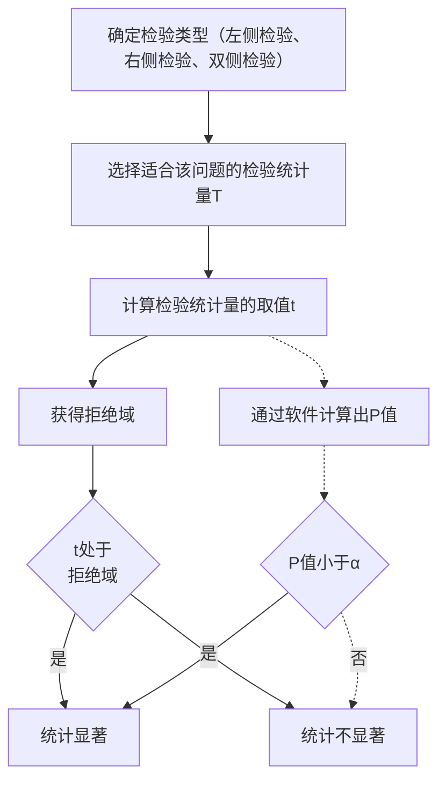
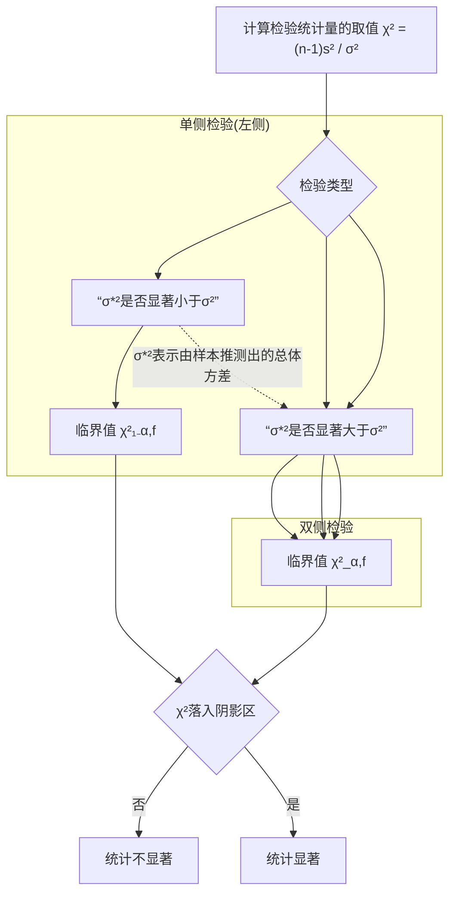

正态分布  $N(\mu, \sigma^{2})$  的 PDF、CDF 和 ICDF 及相关计算方式

CDF 计算随机变量取值落入区间  $(-∞, x]$  的概率。反之，如果这一概率已知，求区间端点 x 时，可以使用逆累积分布函数（inverse cumulative distribution function, ICDF）。

## 2.2.1.3 随机变量的正态分布

正态分布 (normal distribution) 是最常见的一种分布, 表示为  $N(\mu, \sigma^{2})$  。 $\mu$  和  $\sigma^{2}$  是正态分布的两个参数, 含义是 (服从正态分布的) 随机变量所有取值的平均和方差, 故称总体均值和总体方差。可扫描副栏二维码了解正态分布的 PDF、CDF 和 ICDF 及相关计算方式。

图 2.2.3 是参数不同的两个正态分布  $N(0,0.25)$  和  $N(0,1)$  的概率密度曲线和累积分布曲线。从图中可以看出，正态分布是关于  $x=\mu$  对称的峰形曲线；峰位置由  $\mu$  控制，峰宽由  $\sigma$  控制， $\sigma\approx\frac{1}{2}W_{0.6}(W_{0.6}$  表示 60% 峰高处的峰宽）；曲线在  $x=\mu\pm\sigma$  处有两个拐点（二阶导数为零）。


<details>
<summary>violin</summary>

| 随机变量 | \(\mu=0, \sigma^{2}=0.25\) (概率密度) | \(\mu=0, \sigma^{2}=1 (\)概率密度) |
| --- | --- | --- |
| -3 | 0 | ~0.05 |
| -1 | ~0.1 | ~0.3 |
| 0 | ~0.8 | ~0.4 |
| 1 | ~0.1 | ~0.3 |
| 3 | 0 | ~0.05 |
</details>

(a)


<details>
<summary>line</summary>

| 随机变量 | 概率 \((\mu=0\), \(\sigma^{2}=1)\) | 概率 \((\mu=0\), \(\sigma^{2}=0.25)\) |
| --- | --- | --- |
| -5 | 0 | 0 |
| -3 | ~0.01 | 0 |
| -1 | ~0.15 | ~0.05 |
| 0 | ~0.55 | ~0.45 |
| 1 | ~0.95 | ~0.85 |
| 3 | 1.0 | 1.0 |
| 5 | 1.0 | 1.0 |
</details>

(b)

图 2.2.3 参数不同的两个正态分布的概率密度曲线(a)和累积分布曲线(b)

均值为0、方差为1的正态分布称为标准正态分布 $N(0,1)$ 。通过简单数学变换，标准正态分布可以与任意参数的正态分布相互转换，这一性质使得相关计算更加便捷，下面进行说明。

以  $p(u)$  和  $p(x)$  分别表示  $N(0,1)$  和  $N(\mu,\sigma^{2})$  的 PDF, 那么两个函数的自变量和因变量存在如下关系:

$$
u = \frac {x - \mu}{\sigma}, \quad p (u) = \sigma p (x) \tag {2-2-2}
$$

如果 $N(0,1)$ 的概率密度已知，那么通过上述简单变换即可得到 $N(\mu, \sigma^2)$ 的概率密度，不必费力计算PDF。例如，Matlab中的randn命令，该命令生成服从标准正态分布的随机数，那么通过算式 $\sigma * \mathrm{randn} + \mu$ 即可得到服从 $N(\mu, \sigma^2)$ 分布的随机数。

以  $P(u)$  和  $P(x)$  分别表示  $N(0,1)$  和  $N(\mu,\sigma^{2})$  的 CDF, 那么两个函数的自变量和因变量存在如下关系:

$$
u = \frac {x - \mu}{\sigma}, \quad P (u) = P (x) \tag {2-2-3}
$$

如果  $N(0,1)$  的累积概率已知,那么通过上述简单变换即可得到  $N(\mu,\sigma^{2})$  的累积概率,不必费力计算 CDF。在计算工具欠发达的年代,计算 CDF 颇为困难,于是人们制作了  $N(0,1)$  的累积概率数值表,列出不同 u 值与其对应的  $P(u)$ 。通过数值表和  $u=\frac{x-\mu}{\sigma}$  这一简单算式,无须计算 CDF 即可得到任意参数正态分布  $N(\mu,\sigma^{2})$  的累积概率。

## 2.2.1.4 抽样分布

多数情况下正态分布可以较好地描述测量值,而当需要研究测量值的平均值、方差等参数时,则需要使用抽样分布(sampling distribution)。

数理统计中,研究对象的所有可能取值构成一个集合,称为总体(population),这些取值称为个体(individual)。总体包含大量甚至无限多个体。通过简单抽样,从总体抽取有限个体构成的集合称为样本(sample),其中个体的数量称为样本容量。

为了反映样本特征,需要从样本信息构造一些变量,如样本均值、样本方差等。这种完全由样本信息确定的量称为样本统计量(statistic)。样本统计量的概率分布就是抽样分布。如果抽样分布能够从总体的分布得出,那么称为精确抽样分布。

精确抽样分布大多从正态总体得到,这就是统计中著名的三大抽样分布—— $\chi^{2}$ 分布、t分布和F分布。精确抽样分布适用于样本容量较小的数理统计问题,因而成为处理少量测量数据的重要工具。

## 2.2.1.5 抽样分布之样本均值的分布

设  $x_{1}, x_{2}, \cdots, x_{n}$  是来自正态总体  $N(\mu, \sigma^{2})$  的随机样本，以  $\bar{x}$  表示样本均值，那么  $\bar{x}$  服从正态分布  $N\left(\mu, \frac{\sigma^{2}}{n}\right)$ 。如果定义随机变量 U:

$$
U = \frac {\bar {x} - \mu}{\sigma} \sqrt {n} \tag {2-2-4}
$$

那么 U 服从标准正态分布。

对于均值 $\mu$ 、方差 $\sigma^2$ 的任何总体，样本均值 $\tilde{x}$ 近似服从正态分布 $N\left(\mu, \frac{\sigma^2}{n}\right)$；样本容量越大，近似程度越好，这就是中心极限定理（central limit theorem）。因此，即使总体的分布未知，也可以使用正态分布研究其样本均值。

## 2.2.1.6 抽样分布之 $\chi^{2}$ 分布

设  $x_{1}, x_{2}, \cdots, x_{n}$  是来自正态总体  $N(\mu, \sigma^{2})$  的随机样本，那么以下形式的随机变量  $\chi^{2}$  服从自由度 (degrees of freedom, df) 为  $f(f = n - 1)$  的  $\chi^{2}$  分布 (Chi-squared distribution)，记作  $\chi^{2} \sim \chi^{2}(f)$ 。

$$
\chi^ {2} = \frac {(n - 1) s ^ {2}}{\sigma^ {2}} \tag {2-2-5}
$$

式中， $s^{2}$  表示样本方差。

扫描副栏二维码了解 $\chi^{2}$ 分布的 PDF、CDF 和 ICDF 及相关计算方式。

图 2.2.4 是自由度分别为 1、5 和 20 三种  $\chi^{2}$  分布的概率密度曲线和累积分布曲线。从图中可以看出，概率密度曲线不对称，f 越大，曲线越趋于对称。当  $f \to \infty$  时， $\chi^{2}(f)$  趋向正态分布  $N(f, 2f)$ 。

## 2.2.1.7 抽样分布之 $t$ 分布

设 $x_{1}, x_{2}, \cdots, x_{n}$ 是来自正态总体 $N(\mu, \sigma^{2})$ 的随机样本，那么以下形式的随机

理解抽样分布: 分析化学中的测量值司空见惯, 如测定矿石含铁量: 对同一样品平行测定 5 次, 得到 5 个测量值。从数理统计角度, 可以这样理解: 考虑所有的测量情形, 理论上可以得到无数个含铁量的测量值, 从中抽取 5 个就得到了这 5 个测量值。

简单抽样:是指抽样随机(所有个体被抽中的概率相同)和抽样独立(抽样结果互不影响)。


$\chi^{2}$  分布的 PDF、CDF 和 ICDF 及相关计算方式

t 分布: 由英国统计学家 W. S. Gosset 在 1908 年创立, 发表论文的署名是 A. Student, 得名 t 分布, 也称 Student 分布。


<details>
<summary>line</summary>

| 随机变量 | f=1 (概率密度) | f=5 (概率密度) | f=20 (概率密度) |
| --- | --- | --- | --- |
| 0 | ~0.3 | ~0.02 | ~0.01 |
| 5 | ~0.05 | ~0.15 | ~0.01 |
| 10 | ~0.01 | ~0.05 | ~0.03 |
| 15 | ~0.005 | ~0.01 | ~0.07 |
| 20 | ~0.002 | ~0.005 | ~0.06 |
| 25 | ~0.001 | ~0.002 | ~0.04 |
| 30 | ~0.001 | ~0.001 | ~0.02 |
| 35 | ~0.001 | ~0.001 | ~0.01 |
| 40 | ~0.001 | ~0.001 | ~0.01 |
</details>

(a)


<details>
<summary>line</summary>

| 随机变量 | f=1 (概率) | f=5 (概率) | f=20 (概率) |
| --- | --- | --- | --- |
| 0 | 0 | 0 | 0 |
| 10 | ~0.95 | ~0.85 | ~0.05 |
| 20 | 1.0 | 1.0 | ~0.6 |
| 30 | 1.0 | 1.0 | ~0.9 |
| 40 | 1.0 | 1.0 | 1.0 |
</details>

(b)

图 2.2.4 自由度不同的三种  $\chi^{2}$  分布的概率密度曲线 (a) 和相应累积分布曲线 (b)

变量 T 服从自由度为  $f(f=n-1)$  的 t 分布，记作  $T \sim t(f)$ 。

$$
T = \frac {\bar {x} - \mu}{s} \sqrt {n} \tag {2-2-6}
$$

式中， $\bar{x}$  表示样本均值；s 表示样本标准偏差。

扫描副栏二维码了解 t 分布的 PDF、CDF 和 ICDF 及相关计算方式。

图 2.2.5 给出了自由度分别为 1 和 20 两种 t 分布的概率密度曲线和累积分布曲线。从图中可以看出，概率密度曲线是关于 x=0 对称的峰形曲线，峰形随自由度不同而改变。当  $f \to \infty$  时， $t(f)$  趋向标准正态分布  $N(0,1)$ 。


t 分布的 PDF、CDF 和 ICDF 及相关计算方式


<details>
<summary>violin</summary>

| 随机变量 | 概率密度 (f=1) | 概率密度 (f=20) |
| --- | --- | --- |
| -5 | ~0.02 | 0 |
| -3 | ~0.08 | ~0.02 |
| -1 | ~0.25 | ~0.35 |
| 0 | ~0.45 | ~0.55 |
| 1 | ~0.25 | ~0.35 |
| 3 | ~0.08 | ~0.02 |
| 5 | ~0.02 | 0 |
</details>

(a)


<details>
<summary>line</summary>

| 随机变量 | 概率 (f=1) | 概率 (f=20) |
| --- | --- | --- |
| -5 | ~0.08 | 0 |
| -3 | ~0.15 | ~0.02 |
| -1 | ~0.35 | ~0.25 |
| 0 | ~0.55 | ~0.55 |
| 1 | ~0.75 | ~0.85 |
| 3 | ~0.90 | ~0.98 |
| 5 | ~0.95 | ~1.0 |
</details>

(b)

图 2.2.5 自由度不同的两种 t 分布的概率密度曲线(a)和相应累积分布曲线(b)

F 分布: 此命名用以纪念统计学家 R. A. Fisher 爵士。

## 2.2.1.8 抽样分布之 F 分布

设  $x_{1}, x_{2}, \cdots, x_{m}$  为来自正态总体  $N(\mu_{x}, \sigma^{2})$  的随机样本， $y_{1}, y_{2}, \cdots, y_{n}$  是来自正态总体  $N(\mu_{y}, \sigma^{2})$  的随机样本，那么以下形式的随机变量 F 服从自由度分别为  $f_{1}(f_{1}=m-1)$  和  $f_{2}(f_{2}=n-1)$  的 F 分布，记作  $F \sim F(f_{1}, f_{2})$ 。其中， $f_{1}$  和  $f_{2}$  分别称为分子自由度和分母自由度（也称第一自由度和第二自由度）。

$$
F = \frac {s _ {1} ^ {2}}{s _ {2} ^ {2}} \tag {2-2-7}
$$

式中， $s_{1}^{2}$  和  $s_{2}^{2}$  分别表示两个样本的样本方差。

扫描副栏二维码了解 F 分布的 PDF、CDF 和 ICDF 及相关计算方式。

图2.2.6给出了自由度不同的三种 $F$ 分布的概率密度曲线和累积分布曲线。从图中可以看出，$F(f_{1},f_{2})$ 不同于 $F(f_{2},f_{1})$ 。


<details>
<summary>line</summary>

| 随机变量 | f1=1, f2=1 (概率密度) | f1=5, f2=20 (概率密度) | f1=20, f2=5 (概率密度) |
| --- | --- | --- | --- |
| 0 | ~1.4 | 0 | 0 |
| 0.5 | ~0.6 | ~0.7 | ~0.3 |
| 1 | ~0.3 | ~0.5 | ~0.6 |
| 2 | ~0.1 | ~0.2 | ~0.2 |
| 3 | ~0.05 | ~0.1 | ~0.1 |
| 4 | ~0.02 | ~0.05 | ~0.05 |
| 5 | ~0.01 | ~0.02 | ~0.02 |
</details>

(a)


<details>
<summary>line</summary>

| 随机变量 | 概率 (f1=5, f2=20) | 概率 (f1=1, f2=1) | 概率 (f1=20, f2=5) |
| --- | --- | --- | --- |
| 0 | 0 | 0 | 0 |
| 1 | ~0.65 | ~0.55 | ~0.45 |
| 2 | ~0.95 | ~0.75 | ~0.85 |
| 3 | ~0.98 | ~0.85 | ~0.92 |
| 4 | ~1.0 | ~0.92 | ~0.96 |
| 5 | ~1.0 | ~0.96 | ~0.98 |
</details>

(b)

图 2.2.6 自由度不同的三种 F 分布的概率密度曲线(a)和相应累积分布曲线(b)

值得指出的是,如果随机变量  $F \sim F(f_{1}, f_{2})$ , 那么随机变量  $\frac{1}{F} \sim F(f_{2}, f_{1})$ 。

三大抽样分布的随机变量有些抽象,但是具有明确的应用特征。例如,使用 $\chi^{2}$ 分布研究样本方差中的随机因素;使用t分布研究样本均值与总体均值差异中的随机因素;使用F分布研究两个样本方差中的随机因素。由于这种应用特征,三大抽样分布成为显著性检验的基础。

## 2.2.2 显著性检验

科学技术研究中,经常需要判断事件源自确定性因素还是随机因素,以便采取针对性措施。这种判断通过显著性检验(test of statistical significance)来完成。检验结论有两种,分别是“统计显著”(statistically significant)和“统计不显著”(statistically insignificant);前者表明事件源自确定性因素,后者表明事件源自随机因素。给出上述两个结论,显著性检验依据的就是随机变量的分布。

显著性检验容易实施，在计算机硬件普及、软件丰富的当前尤其如此；生成式AI出现后，显著性检验变成无须用脑的人问机答。然而，更重要、也更有价值的是检验方法的正确应用和检验结果的合理阐释，这需要深入理解显著性检验的原理。

## 2.2.2.1 基本原理

扫描副栏二维码了解显著性检验的底层逻辑。被检验问题通过一个随机变量来描述，称为检验统计量（test statistic）。检验统计量的分布就是如图2.2.7所示的PDF曲线；使用该曲线的前提是“事件源自随机因素”这样一个假设，称为原假设(null hypothesis)。图2.2.7中浅色区域面积较大，表示检验统计量在区间$[a,x]$内取值的概率很大，这个概率称为置信度(confidence)；深色区域面积较小，表示检验统计量在区间$[x,b]$内取值的概率很小，这个概率称为显著性水平（significance level），以 $\alpha$ 表示。如果检验统计量取值落入区间$[x,b]$，属于（不该发生


F 分布的 PDF、CDF 和 ICDF 及相关计算方式


显著性检验的底层逻辑


<details>
<summary>area</summary>

| X | Y |
| --- | --- |
| a | ~0 |
| x | ~0.25 |
| b | ~0 |
</details>

图 2.2.7 显著性检验中的概率密度函数示意图

$[a,b]$ 为检验统计量的取值范围； $[a,x]$ 为接受域，区域内浅色部分的面积为置信度； $[x,b]$ 为拒绝域，区域内深色部分的面积为显著性水平；x为临界值。


显著性检验的两类错误

的)小概率事件,为了解决矛盾就拒绝原假设。如果检验统计量取值落入区间 $[a,x]$ ,属于(应该发生的)大概率事件,就接受原假设。区间 $[a,x]$ 被称为接受域(acceptance region),区间 $[x,b]$ 被称为拒绝域(rejection region)。x是接受域和拒绝域的分界,称为临界值(critical value)。

显著性检验合乎情理,却经不起细究,因为既不承认小概率事件可能发生,也不承认大概率事件可能不发生。所以,无论拒绝原假设,还是接受原假设,结论都不是百分之百正确,这就是显著性检验的两类错误。扫描副栏二维码了解相关讨论。

## 2.2.2.2 检验类型

显著性检验分为三种类型，分别是左侧检验（left-sided/left-tailed test）、右侧检验（right-sided/right-tailed test）和双侧检验（two-sided/two-tailed test），前二者统称为单侧检验（one-sided/one-tailed test）。这些类型的名称来自拒绝域和接受域的位置关系，如图2.2.8所示。

图 2.2.8 中深色部分所在区域为拒绝域，面积为显著性水平；浅色部分所在区域为接受域，面积为置信度；圆点表示临界值。注意双侧检验有两个拒绝域和两个临界值，每块深色区域的面积为显著性水平的一半。


图 2.2.8 （a）左侧单侧检验、（b）右侧单侧检验和（c）双侧检验中的概率密度函数、拒绝域和接受域示意图

以上三种检验类型中,如果检验统计量取值落入拒绝域,那么结论分别是:该值在统计意义上“显著地小”(左侧)、“显著地大”(右侧)和“显著地与众不同”(双侧);表明该值大概率源自确定性因素。如果检验统计量取值落入接受域,那么结论分别是:不能认为该值在统计意义上“显著地小”(左侧)、“显著地大”(右侧)或“显著地与众不同”(双侧);表明该值大概率源自随机因素。

这三种类型都具有明确的应用场景。以分析化学中的实验数据处理为例，如果判断“平均值是否显著小于参考值”，那么属于左侧检验；如果判断“平均值是否显著大于参考值”，那么属于右侧检验；如果判断“平均值是否显著异于真值”，那么属于双侧检验。


显著性检验的 $P$ 值

## 2.2.2.3 显著性检验的 $P$ 值

显然，只要获得拒绝域，显著性检验便可顺利完成。另一种有效的完成手段是使用 $P$ 值（$P$ value）:无论是单侧检验还是双侧检验，如果 $P$ 值小于显著性水平 $\alpha$ ，那么统计显著；如果 $P$ 值 $>\alpha$ ，那么统计不显著。关于 $P$ 值的定义和计算，扫描副栏二维码详细了解。

专业的统计软件通常会计算 P 值,人们只需判断其与  $\alpha$  的大小便可得出结论。这种便捷性使得 P 值成为完成显著性检验的首选手段,拒绝域/接受域在实际中很少使用。

## 2.2.2.4 显著性检验的实施

下面是显著性检验的一般步骤,实线流程表示通过拒绝域/接受域判断,虚线流程表示通过 P 值判断。

实线所示的流程中,关键在于拒绝域的获得,也就是需要计算出临界值。临界值是根据预先设定的显著性水平,通过逆累积分布函数 ICDF 计算得到。然而,ICDF 对于简单计算器而言过于复杂,所以在计算工具欠发达的年代,人们只能使用由专业人员计算好的统计数值表。分析化学传统教材中,统计数值表是附录的必要部分。


<details>
<summary>flowchart</summary>


</details>

统计数值表曾经必不可少,但是也存在明显不足。限于篇幅,普通统计数值表只列出常用数值(注释1);存在多种数值表,不易区分,所以表头通常给出明确的图示和相应公式,避免误用。

当前计算机硬件普及、软件丰富，常见分布的ICDF计算不再困难。所以，本书不提供统计数值表，显著性检验所需的临界值或者 $P$ 值均通过stac软件得到，该软件还能够计算正态分布、$t$ 分布、$\chi^2$ 分布和 $F$ 分布的CDF和ICDF。扫描二维码观看软件演示视频。软件有Matlab和Android两个版本，分别运行于计算机（注释2）和智能手机。

## 2.2.2.5 分析化学中常见的显著性检验

分析化学中常见的显著性检验包括 u 检验、 $\chi^{2}$  检验、t 检验和 F 检验，相关信息列于表 2.2.1。

表 2.2.1 u 检验、 $\chi^{2}$  检验、t 检验和 F 检验的 PDF 曲线、拒绝域及临界值的表示和计算

(圆点表示临界值; $\alpha$ 表示显著性水平,对应图中阴影面积,阴影所在区域为拒绝域;

ICDF 表示逆累积分布函数; f 表示自由度)

| 检验统计量及其分布 | 左侧检验 | 右侧检验 | 双侧检验 |
| --- | --- | --- | --- |
| 服从N(0,1)分布的随机变量 | $-u_{\alpha} = \text{ICDF}(\alpha)$ | $u_{\alpha} = \text{ICDF}(1-\alpha)$ | $-u_{\frac{\alpha}{2}} = \text{ICDF}\left(\frac{\alpha}{2}\right)$$u_{\frac{\alpha}{2}} = \text{ICDF}\left(1-\frac{\alpha}{2}\right)$ |

注释1:更加全面、详尽的数值只能求诸专业书,如国家标准局批准(GB 4086.1\~4086.6-83)、中国标准出版社1984年出版的《统计分布数值表》。

注释 2: 需要在计算机上安装 Matlab 以运行 stac, 安装 Matlab 基本组件即可, 不需要任何工具箱。Matlab 有 Windows 和 Mac 版本。


stac 软件演示

续表

<table><tr><td>检验统计量及其分布</td><td>左侧检验</td><td>右侧检验</td><td>双侧检验</td></tr><tr><td rowspan="2"> $\frac{(n-1)s^2}{\sigma^2}$ 服从 $\chi^2$ 分布</td><td></td><td></td><td></td></tr><tr><td> $\chi^{2}_{1-\alpha,f} = \text{ICDF}(\alpha, f)$ </td><td> $\chi^{2}_{\alpha,f} = \text{ICDF}(1 - \alpha, f)$ </td><td> $\chi^{2}_{1-\frac{\alpha}{2},f} = \text{ICDF}\left(\frac{\alpha}{2}, f\right)$  $\chi^{2}_{\frac{\alpha}{2},f} = \text{ICDF}\left(1 - \frac{\alpha}{2}, f\right)$ </td></tr><tr><td colspan="2"></td><td></td><td></td></tr><tr><td>服从 $t$ 分布</td><td> $-t_{\alpha,f} = \text{ICDF}(\alpha, f)$ </td><td> $t_{\alpha,f} = \text{ICDF}(1 - \alpha, f)$ </td><td> $-t_{\frac{\alpha}{2},f} = \text{ICDF}\left(\frac{\alpha}{2}, f\right)$  $t_{\frac{\alpha}{2},f} = \text{ICDF}\left(1 - \frac{\alpha}{2}, f\right)$ </td></tr><tr><td colspan="2"></td><td></td><td></td></tr><tr><td>服从 $F$ 分布</td><td colspan="2"> $F_{1-\alpha,f,f_2} = \text{ICDF}(\alpha, f_1, f_2)$   $F_{\alpha,f,f_2} = \text{ICDF}(1 - \alpha, f_1, f_2)$ </td><td> $F_{1-\frac{\alpha}{2},f_1, f_2} = \text{ICDF}\left(\frac{\alpha}{2}, f_1, f_2\right)$  $F_{\frac{\alpha}{2},f_1, f_2} = \text{ICDF}\left(1 - \frac{\alpha}{2}, f_1, f_2\right)$ </td></tr></table>

这些检验能够满足特定的数据分析需求。例如，欲判断确定性因素还是随机因素导致了测量数据的波动，那么使用 $\chi^{2}$ 检验，因为检验统计量包含描述数据波动的样本方差 $s^{2}$ 。再如，欲判断确定性因素还是随机因素导致了测量数据平均值异于真值，那么使用t检验，因为检验统计量包含样本均值 $\bar{x}$ 和真值 $\mu$ 。通过后面的例题加深理解。

## 2.2.3 数理统计的应用方法

这一部分针对分析化学中不同的数据处理情形,介绍数理统计的具体应用。数理统计应用的重点和难点是概念理解、方法选择和结果阐释,其中涉及的数值计算相对简单得多。

$\chi^2$ 分布、$t$ 分布和 $F$ 分布是来自正态总体的精确抽样分布，所以适用于数据量小、测量值服从正态分布的数据。人们在实际应用中经常忽略后一条件，所得结论就失之偏颇甚至错误（幸运的是，很多情况下测量值服从或者近似服从正态分布）。数理统计方法的应用固然重要，然而更重要的是避免误用和滥用。

## 2.2.3.1 检出限和定量限

由于随机因素的影响,即使被测物质不存在,测量值(即空白测量值)也不一定为零,而是零值附近很小的随机波动。如果被测物质存在,但是非常少,以至于相应测量值与这些随机波动在统计意义上没有区别,那么不能认为该测量值来自被测物质。从另一个角度看,任何分析方法的检测能力都存在下限,这个下限称为检出限(limit of detection, LOD)。

检出限是分析方法的最小可靠测量值对应的被测物质的量(注释1)。可靠测量值是指该测量值属于随机波动的可能性极小。所以，确定检出限的关键在于判断测量值是否显著大于随机波动，这可以通过数理统计方法来实现。

一般认为，空白测量值是服从正态分布 $N(0,\sigma^2)$ 的随机变量。容易计算出，该随机变量的取值大于 $3\sigma$ 的概率仅为 $0.13\%$ （注释2）。所以，大于 $3\sigma$ 的测量值源自随机因素的可能性极小，反而极有可能是对少量被测物质的真实响应。

综上所述,分析方法的最小可靠测量值是其空白测量值标准偏差的3倍,对应的被测物质的量就是检出限(注释3)。这就是所谓的“ $3\sigma$ 规则”。检出限的单位可以是浓度、质量或者物质的量。检出限是分析方法性能的重要指标之一。

检出限属于定性分析范畴。对于定量分析,存在类似概念,称为定量限(limit of quantification,LOQ)。定量限一般为空白测量值标准偏差10倍所对应的被测物质的量。

分析化学中还有一个相关概念称为灵敏度(sensitivity)，是指被测物质量的改变引起的测量值的变化，定义式如下:

$$
\mathrm{Sen} = \frac {\Delta y}{\Delta c} \tag {2-2-8}
$$

式中，Sen 表示灵敏度； $\Delta c$  表示被测物质含量的改变； $\Delta y$  表示相应测量信号值的变化。Sen 与检出限 LOD 的关系为  $LOD = \frac{3\sigma}{Sen}$ 。灵敏度在一定范围内为定值，这个范围是分析方法的线性范围。

## 2.2.3.2 离群值的判定

相同条件下的一组测量值不完全相等,根据经验研究者觉得这可能很正常;同样根据经验,研究者会注意到有时某个值明显偏大或者偏小,显得不太“合群”。对于这个值,无论是探究其产生原因(很正确),还是删除了事(不太正确),都需要事先解决一个问题:有没有比依靠个人经验更为客观的判定方式?答案是有,这就是离群值(outlier)的统计学判定,下面介绍两种常见方法。

以 $x_{e}$ 表示待判定的值，$\bar{x}$ 和 $\bar{d}$ 分别表示移除 $x_{e}$ 后的样本均值和平均偏差；如果 $|x_{e} - \bar{x}| > 4\bar{d}$，那么判定 $x_{e}$ 离群。这就是所谓的“$4\bar{d}$ 法”。$4\bar{d}$ 法虽然简单，其统计学原理是明确的（注释4）。

“4d法”比较简便，但功效逊于Grubbs法。Grubbs法计算检验统计量 $G = \frac{|x_{\mathrm{e}} - \bar{x}|}{s}$，其中 $\bar{x}$ 和 $s$ 分别表示样本均值和样本标准偏差。 $G$ 大于临界值时，判定 $x_{\mathrm{e}}$ 离群。

Grubbs法所需的临界值通过相应的概率密度函数计算得到，但是计算非常复杂。为了方便使用，将常见临界值列表，如表2.2.2所示，更全面的临界值可以查阅中华人民共和国国家标准GB/T4883—2008《数据的统计处理和解释——正态样本离群值的判断和处理》（注释5）。

注释 1: IUPAC 对检出限的定义如下: The limit of detection, expressed as the concentration,  $c_{L}$ , or the quantity,  $q_{L}$ , is derived from the smallest measure,  $x_{L}$ , that can be detected with reasonable certainty for a given analytical procedure. The value of  $x_{L}$  is given by the equation  $x_{L} = \bar{x}_{bi} + k s_{bi}$ , where  $\bar{x}_{bi}$  is the mean of the blank measures,  $s_{bi}$  is the standard deviation of the blank measures, and k is a numerical factor chosen according to the confidence level desired.

注释 2:你能通过 stac 或者 Excel 软件计算出这个数值吗?

注释3:有时空白测量值非常稳定,标准偏差为零。这种情况下,可向试剂空白加入极少量被测物质,使分析方法产生响应。加入的被测物质应该尽量少,否则标准偏差可能被人为降低,导致错误的检出限。

注释4:如果  $x_{e} \sim N(\mu, \sigma^{2})$ ，那么  $\frac{x_{e} - \mu}{\sigma} \sim N(0, 1)$ 。根据正态分布， $\left|\frac{x_{e} - \mu}{\sigma}\right| > 3$  的概率仅为 0.27%；如果实际情况确实如此，那么认为  $x_{e}$  显著偏离总体均值  $\mu$ ，属于离群值。 $\bar{x} \approx \mu$ 、 $\sigma \approx \sqrt{\frac{\pi}{2}} \bar{d}$ ，那么  $\left|\frac{x_{e} - \mu}{\sigma}\right| > 3$  可近似为  $|x_{e} - \bar{x}| > 4 \bar{d}$ 。

注释 5: 可在“国家标准全文公开系统”中查阅此国家标准全文。

表 2.2.2 Grubbs 检验在不同显著性水平 $\alpha$ 下的临界值

<table><tr><td rowspan="2">测量值数量</td><td colspan="5">显著性水平α</td></tr><tr><td>0.10</td><td>0.05</td><td>0.025</td><td>0.01</td><td>0.005</td></tr><tr><td>3</td><td>1.148</td><td>1.153</td><td>1.155</td><td>1.155</td><td>1.155</td></tr><tr><td>4</td><td>1.425</td><td>1.463</td><td>1.481</td><td>1.492</td><td>1.496</td></tr><tr><td>5</td><td>1.602</td><td>1.672</td><td>1.715</td><td>1.749</td><td>1.764</td></tr><tr><td>6</td><td>1.729</td><td>1.822</td><td>1.887</td><td>1.944</td><td>1.973</td></tr><tr><td>7</td><td>1.828</td><td>1.938</td><td>2.020</td><td>2.097</td><td>2.139</td></tr><tr><td>8</td><td>1.909</td><td>2.032</td><td>2.126</td><td>2.221</td><td>2.274</td></tr><tr><td>9</td><td>1.977</td><td>2.110</td><td>2.215</td><td>2.323</td><td>2.387</td></tr><tr><td>10</td><td>2.036</td><td>2.176</td><td>2.290</td><td>2.410</td><td>2.482</td></tr><tr><td>11</td><td>2.088</td><td>2.234</td><td>2.355</td><td>2.485</td><td>2.564</td></tr><tr><td>12</td><td>2.134</td><td>2.285</td><td>2.412</td><td>2.550</td><td>2.636</td></tr><tr><td>13</td><td>2.175</td><td>2.331</td><td>2.462</td><td>2.607</td><td>2.699</td></tr><tr><td>14</td><td>2.213</td><td>2.371</td><td>2.507</td><td>2.659</td><td>2.755</td></tr><tr><td>15</td><td>2.247</td><td>2.409</td><td>2.549</td><td>2.705</td><td>2.806</td></tr></table>

表中数据摘自国家标准 GB/T 4883—2008。

Q 检验法是 W. J. Dixon 在 1951 年提出的离群值判定方法。在测量值数量较少时，Q 检验法与 Grubbs 法相差甚微，而后者的功效最优（GB/T 4883—2008）。

离群值的统计学判定结果只是表明离群源自确定性因素。在探明确定性因素的情况下（如测量条件改变或者操作失误），应该尝试修正离群值；如果无法修正，那么删除之，避免其“污染”最终结果。如果离群原因未明，则不应该轻易删除；此时如果担心离群值影响平均值，可以将测量数据的中位数作为最终结果。

统计学方法为判定离群值提供一个比经验更为客观的方式，而不是为删除“异常值”提供一个心安理得的理由。正如国家标准 GB/T 4883—2008 所称“对检出的离群值，应尽可能寻找其技术上和物理上的原因，作为处理离群值的依据。”

离群值的处理通常是数据处理的第一步,舍弃实验过失导致的错误数据,然后才可以进行其他处理,如显著性检验等。

## 2.2.3.3 分析结果精密度的检验

例行分析中,需要定期检查分析系统的稳定性。在相同条件下对同一样品进行多次分析,然后检验由样本推测出的总体方差与参考值(方差参考值通过长期分析实践或者经验得到)是否显著不同。如果存在显著性差异,说明数据波动源自确定性因素,那么应该检查试剂、设备、分析人员等。

解决上述问题的数理统计方法是 $\chi^{2}$ 检验,具体步骤如下。

»例 2.2.1 在药品生产线上实时监测药品活性成分含量。根据经验, 活性成分含量服从正态分布 N(4.55,0.01)。某天随机读取 25 个样品的活性成分含量, 样本方差为 0.009。在 0.05 显著性水平下, 判断当天产品的活性成分含量是否出现异常波动。


<details>
<summary>flowchart</summary>


</details>

》解:这是一个双侧检验问题。样本方差太大当然属于异常,说明某(些)确定性因素致使生产条件不稳定;样本方差太小也是“异于寻常”,尽管这是好事,说明某(些)确定性因素提高了稳定性。

根据题意,使用 $\chi^{2}$ 检验,检验统计量的取值为

$$
\chi^ {2} = \frac {2 4 s ^ {2}}{\sigma^ {2}} = 2 1. 6
$$

通过stac或者Excel软件，得到两个临界值 $\chi_{0.975,24}^2 = 12.40$ 、 $\chi_{0.025,24}^2 = 39.36$ ，所以该问题的接受域为[12.40,39.36]。检验统计量的取值落入接受域，说明统计不显著，即不能认为当天产品的活性成分含量出现异常波动。

## 2.2.3.4 两组数据精密度的比较

分析化学中常有比较两组实验数据的情形。例如，两名分析人员使用同一方法分析同一样品、一名分析人员使用两种方法分析同一样品、一名分析人员使用同一方法分析两种样品等。比较两组实验数据之前，必须检验二者的精密度是否存在显著性差异，因为精密度是准确度的必要条件。此外，精密度的比较也可以判断一组数据的分析条件是否比另一组更加稳定。

解决上述问题的数理统计方法是 F 检验, 具体步骤如下。

»例 2.2.2 某分析化学家合成了一种新型酸碱指示剂,变色敏锐,终点更易于判断。使用该指示剂进行8次滴定,滴定体积的标准偏差为0.02。作为对比,使用变色点相同的传统指示剂进行8次滴定,滴定体积的标准偏差为0.04。在0.05显著性水平下,能否认为新型指示剂的效果优于传统指示剂?

》解:本题判断使用新指示剂的滴定体积的方差是否显著小于使用传统指示剂的情形,所以这是一个左侧单侧检验问题。根据题意,使用F检验,检验统计量

一些传统教材规定 F 检验的检验统计量为“大方差除以小方差”。F 检验的原理并没有这个要求（扫描下方二维码了解详情），然而得益于这种规定，一个显著性水平为  $\alpha$  的统计数值表就能完成显著性水平为  $\alpha$  的单侧检验和显著性水平为  $2\alpha$  的双侧检验。

这种检验方式可以简化步骤、节约篇幅，但是有损检验的直观性，而且也无法进行其他显著性水平下的检验（除非提供相应的统计数值表）。统计软件则可以避免这些问题，使用时也不必刻意“大方差除以小方差”，按照框图中的步骤，或许更容易理解。


$F$ 检验的检验统计量

## 讨论:

结论可靠性提高到 $99\%$ 是否更好？

注释1:一个常见的错误表述是“真值落入置信区间的概率是……”;随机性只出现在测量值(平均值)中,真值已经确定,不存在随机性。


<details>
<summary>flowchart</summary>

```mermaid
graph TD
  Start["计算检验统计量的取值 F = (s1^2 / s2^2)"] --> Decision{"检验类型"}
  Decision -->|单侧检验左侧| LeftGroup["“s1^2 是否显著小于s2^2”"]
  Decision -->|单侧检验右侧| RightGroup["“s1^2 是否显著大于s2^2”"]
  Decision -->|双侧检验| RightGroup
  
  subgraph LeftGroup
  LeftGroup --> LeftResult["临界值 F_{1-α,f1,f2}"]
  end
  
  subgraph RightGroup
  RightGroup --> RightResult["临界值 F_{α,f1,f2}"]
  end
  
  LeftResult --> FinalDecision{"F 落入阴影区"}
  RightResult --> FinalDecision
  
  FinalDecision -->|否| EndFail["统计不显著"]
  FinalDecision -->|是| EndSuccess["统计显著"]
```
</details>

的取值为

$$
F = \frac {s _ {\text {新型}} ^ {2}}{s _ {\text {传统}} ^ {2}} = 0. 2 5
$$

通过stac或者Excel软件，得到临界值 $F_{0.95,7,7} = 0.26$ ，所以该问题的拒绝域为[0,0.26]。检验统计量的取值落入拒绝域，说明统计显著，即使用新型指示剂的滴定体积的精密度显著优于使用传统指示剂的情形。这一结论的可靠性为 $95\%$ 。

## 2.2.3.5 置信区间

很多情况下,真值无法得知,而是根据实际分析结果进行区间估计。该区间称为置信区间(confidence interval, CI),以分析结果的平均值为中心。CI包含真值(注释1)的概率是一个较大的预设值,称为置信度;CI不包含真值的概率等于显著性水平 $\alpha$ 。

在2.2.1.5介绍的样本均值分布中，随机变量 $U = \frac{\bar{x} - \mu}{\sigma}\sqrt{n}$ 服从标准正态分布 $N(0,1)$ 。 $U$ 取极端值的概率很小，如果将此概率设为显著性水平 $\alpha$，那么可以确定一个非极端值的取值区间， $U$ 取值落入该区间是一个大概率事件（概率等于 $1 - \alpha$）。以 $\pm u_{\alpha /2}$ 表示该区间的端点，得到:

$$
P \{- u _ {\alpha / 2} \leqslant U \leqslant u _ {\alpha / 2} \} = 1 - \alpha \tag {2-2-9}
$$

将 $U = \frac{\bar{x} - \mu}{\sigma}\sqrt{n}$ 代入上式，整理后得到:

$$
P \left\{\bar {x} - \frac {\sigma u _ {\alpha / 2}}{\sqrt {n}} \leqslant \mu \leqslant \bar {x} + \frac {\sigma u _ {\alpha / 2}}{\sqrt {n}} \right\} = 1 - \alpha
$$

$\left[\bar{x}-\frac{\sigma u_{\alpha/2}}{\sqrt{n}},\bar{x}+\frac{\sigma u_{\alpha/2}}{\sqrt{n}}\right]\text{就是置信区间，包含真值的概率等于}1-\alpha.$

如果总体方差  $\sigma^{2}$  未知,那么以随机变量  $T=\frac{\bar{x}-\mu}{s}\sqrt{n}$  代替  $U=\frac{\bar{x}-\mu}{\sigma}\sqrt{n}$ 。 $T\sim t(n-1)$ ，通过 t 分布得到置信区间  $\left[\bar{x}-\frac{st_{\alpha/2,f}}{\sqrt{n}},\bar{x}+\frac{st_{\alpha/2,f}}{\sqrt{n}}\right]$ 。

置信区间端点的计算式中， $u_{\alpha/2}$  和  $t_{\alpha/2,f}$  分别是标准正态分布和 t 分布的临界值，参考 2.2.2.5 表 2.2.1 中双侧检验的图示。

置信度和置信区间长度是相互制约的两个量。较小的 $u_{\alpha/2}$ 或者 $t_{\alpha/2,f}$ 可以缩短置信区间，但是置信度随之降低；高置信度下， $u_{\alpha/2}$ 或者 $t_{\alpha/2,f}$ 变大，置信区间变宽，实用价值降低。缩短置信区间而又不降低置信度的实用方式是增加测量次数。

## 2.2.3.6 平均值与参考值的比较

分析化学中,测量值与参考值之间有时存在差异。数理统计方法可以帮助探究差异背后可能的确定性因素。

从 2.2.1 介绍的抽样分布可知, 包含平均值与参考值之差的随机变量有  $U = \frac{\bar{x} - \mu}{\sigma} \sqrt{n}$  和  $T = \frac{\bar{x} - \mu}{s} \sqrt{n}$ ,  $U \sim N(0, 1)$ ,  $T \sim t(n-1)$ 。以 U 或者 T 作为检验统计量的方法称为 u 检验或者 t 检验, 分别适用于总体方差已知或者未知的情形。

t 检验的具体步骤如下。u 检验的步骤完全相同，只需要将检验统计量改为  $U=\frac{\bar{x}-\mu}{\sigma}\sqrt{n}$  、临界值改为  $u_{\alpha}$ （单侧检验）或者  $u_{\alpha/2}$ （双侧检验）。


<details>
<summary>flowchart</summary>

```mermaid
graph TD
  Start["计算检验统计量的取值 t = (x̄ - μ/s)√n"] --> Decision{"检验类型"}
  Decision -->|单侧检验左侧| LeftTest["&quot;x̄是否显著小于μ&quot;"]
  Decision -->|单侧检验右侧| RightTest["&quot;x̄是否显著大于μ&quot;"]
  Decision -->|双侧检验| RightTest["&quot;x̄是否显著异于μ&quot;"]
  
  subgraph MeasurementData["测量数据: x₁, x₂, ..., xₙ\n参考值: μ\n显著性水平: α"]
  Start --> Decision
  LeftTest --> Decision
  RightTest --> Decision
  RightTest --> Decision
  
  Decision --> Result{"t 落入阴影区"}
  Result -->|否| EndFail["统计不显著"]
  Result -->|是| EndSuccess["统计显著"]
```
</details>

## 讨论:

使用更低显著性水平以减小临界值是否合适？

»例 2.2.3 某制药厂生产复合维生素制剂,称 50 g 产品的含铁量不低于 2.000 mg。对某批次产品进行 10 次抽查,测得含铁量(mg)如下:

$$
2. 0 0 0 \quad 1. 9 9 7 \quad 1. 9 8 3 \quad 1. 9 9 7 \quad 1. 9 9 2 \quad 1. 9 9 0 \quad 1. 9 8 8 \quad 1. 9 9 5 \quad 1. 9 8 0 \quad 2. 0 1 0
$$

在 0.05 显著性水平下, 判断该批次产品的含铁量是否显著低于规定标准。

》解:抽查结果的平均值为1.993 mg,虽然低于参考值,但原因可能是测量过程中的随机因素。只有通过显著性检验排除这种情况,才可以认为结果偏低源自确定性因素——该批次产品不合格。

本题是一个左侧单侧检验。总体方差未知，所以使用 t 检验，检验统计量的取值为

$$
t = \frac {(\bar {x} - 2 . 0 0 0) \sqrt {1 0}}{s} = - 2. 4 8
$$

通过stac或者Excel软件，得到临界值 $-t_{0.05,9} = -1.83$ ，所以该问题的拒绝域为$(-\infty , - 1.83]$ 。检验统计量的取值落入拒绝域，说明统计显著，即该批次产品的含铁量显著低于规定标准。这一结论的可靠性为 $95\%$

## 2.2.3.7 两个平均值的比较

当两组数据的精密度没有显著性差异时,有时会进一步比较两个平均值,判断二者的差异源自随机因素还是确定性因素。

解决上述问题的数理统计方法是 t 检验, 步骤见 2.2.3.6, 不同的只是自由度和检验统计量。以 m 和 n 分别表示两组数据的数据量, 那么该检验的自由度  $f = m + n - 2$ , 检验统计量为

$$
T = \frac {\overline {{x}} _ {1} - \overline {{x}} _ {2}}{\overline {{s}}} \sqrt {\frac {m n}{m + n}} \tag {2-2-10}
$$

式中  $\bar{s}$  是合并标准偏差 (pooled standard deviation)，计算公式如下:

$$
\overline {{s}} = \sqrt {\frac {(m - 1) s _ {1} ^ {2} + (n - 1) s _ {2} ^ {2}}{m + n - 2}} \tag {2-2-11}
$$

只有当 $s_{1}^{2}$ 和 $s_{2}^{2}$ 无显著性差异时，才可以计算 $\overline{s}$，这也是首先进行F检验的原因。

»例 2.2.4 某河流污染严重。取 12 个水样测定化学需氧量 $\left(\mathrm{mg}\cdot\mathrm{L}^{-1}\right)$ ，均值 70.1，标准偏差 2.1。后来关闭了污染源，欲利用水体的自洁功能降低污染。一段时间后又取 12 个水样测定化学需氧量，均值 68.5，标准偏差 3.6。在 0.05 显著性水平下，判断化学需氧量是否有了显著降低。

》解:首先通过 F 检验判断两个方差是否有显著性差异。这是一个双侧检验问题,检验统计量的取值为

$$
F = \frac {s _ {1} ^ {2}}{s _ {2} ^ {2}} = 0. 3 4
$$

通过stac或者Excel软件，得到两个临界值 $F_{0.975,11,11} = 0.29, F_{0.025,11,11} = 3.47$ ，所以该问题的接受域为[0.29,3.47]。检验统计量的取值落入接受域，所以方差没有显著性差异。

然后进行 $t$ 检验，判断68.5是否显著小于70.1。这是一个左侧单侧检验问题，检验统计量的取值为

$$
t = \frac {6 8 . 5 - 7 0 . 1}{\overline {{s}}} \sqrt {6} = - 1. 3 3
$$

通过stac或者Excel软件，得到临界值 $-t_{0.05,22} = -1.72$ ，所以该问题的接受域为$[-1.72,\infty)$ 。检验统计量的取值落入接受域，说明统计不显著，即不能认为这段时间内化学需氧量有了显著降低，68.5小于70.1的原因是测量过程中的随机因素。

## 2.2.3.8 配对数据的比较

分析化学中存在这样的情形:有多个样品,每个样品通过两种方法分析,或者由两名分析人员使用同一方法在相同条件下分析。分析完成后,每个样品都有两个结果,这就是所谓的配对数据(paired data):

|  | 样品1 | 样品2 | $\cdots$ | 样品n |
| --- | --- | --- | --- | --- |
| 分析一 | $a_{1}$ | $a_{2}$ | $\cdots$ | $a_{n}$ |
| 分析二 | $b_{1}$ | $b_{2}$ | $\cdots$ | $b_{n}$ |

配对数据的检验,不属于上面介绍的“两个平均值的比较”,因为 $a_{i}$ (或者 $b_{i}$ )不是同一对象的测量值,计算其平均值 $\bar{a}$ (或者 $\bar{b}$ )没有意义。正确的做法是计算配对数据的差值 $d_{i}=a_{i}-b_{i}$ ,然后检验平均值 $\bar{d}$ 与参考值是否存在显著性差异。“参考值”是指仅在随机因素的影响下差值的期望值,这个期望值一般是零,当然也有例外。

配对数据的检验过程:首先计算出配对数据的差值,然后根据具体问题确定这些差值的期望值,最后使用2.2.3.6介绍的t检验。

》例 2.2.5 分析一批采集自不同区域的铁矿石。对每一样品分别采用光度法和滴定法进行分析,测得如下结果:

| 光度法 | 6.33 | 9.05 | 14.35 | 17.32 | 20.47 | 24.88 | 27.88 | 32.56 | 35.73 | 39.72 |
| --- | --- | --- | --- | --- | --- | --- | --- | --- | --- | --- |
| 滴定法 | 6.53 | 9.52 | 14.68 | 17.74 | 20.78 | 24.67 | 27.73 | 32.23 | 35.40 | 39.21 |

在 0.05 显著性水平下, 检验两种分析方法的结果是否一致。

》解:该问题属于配对数据检验,先计算配对数据的差值d:

$$
- 0. 2 0 \quad - 0. 4 7 \quad - 0. 3 3 \quad - 0. 4 2 \quad - 0. 3 1 \quad 0. 2 1 \quad 0. 1 5 \quad 0. 3 3 \quad 0. 3 3 \quad 0. 5 1
$$

这是一个双侧检验问题,检验统计量的取值为

$$
t = \frac {(\bar {d} - d _ {\mathrm{R}}) \sqrt {1 0}}{s _ {d}} = - 0. 1 7
$$

式中， $d_{R}$  表示差值的参考值，在本题中等于零。通过stac或者Excel软件，得到两个临界值 $-t_{0.025,9}=-2.26,t_{0.025,9}=2.26$ ，所以该问题的接受域为 $[-2.26,2.26]$ 。检验统计量的取值落入接受域，说明统计不显著，即差值不为0的原因是随机因素，所以两种分析方法的结果一致。

## 讨论:

如果选择一个大于-1.33的临界值会如何？

## 习题

## - 章节练习题 -

1. 根据长期分析经验, 某合金标样的 Zn 含量服从正态分布  $N(1.35,0.01^{2})$ , 那么测量值处于 [1.35,1.37] 的概率是多少?
2. 对标样进行9次分析, 标准偏差0.07。规定标样分析结果的标准偏差不得超过0.05。在0.05显著性水平下, 能否认为该实验室结果的标准偏差显著偏大?

## 化学计量学 (chemometrics)

化学计量学是一门化学与数学、统计学、计算机科学交叉而产生的化学学科分支，它选择最优试验设计和测量方法，通过处理、解析测量数据，最大限度地获取有关物质系统的成分、结构和其他相关信息。

化学计量学的研究内容主要包括:采样理论和方法、化学实验设计与优化方法、分析检测理论与信号处理方法、多元校正与分辨、化学模式识别、计算机数字模拟、人工智能与化学专家系统等。其中本章节涉及的多元校正模型和方法是化学计量学的研究重点和热点之一。

3. 相同条件下对同一样品进行两次分析, 结果如下:

第一次 9.56 9.56 9.60 9.57 9.58 9.62

第二次 9.33 9.51 9.49 9.51 9.49 9.34

在 95% 置信度下,第一次数据的精密度是否显著优于第二次数据的精密度?

4. 通过一种新方法测定锌含量为 $34.33\%$ 的标准合金样品，5次测定结果为 $34.38\%$ 、 $34.26\%$ 、 $34.29\%$ 、 $34.38\%$ 和 $34.37\%$ 。在 $95\%$ 置信度下判断新方法是否有系统误差。
5. 通过两种方法测定标准矿样中的铁含量。方法一测定7次，均值2.08，标准偏差0.10；方法二测定9次，均值2.19，标准偏差0.12。在0.10显著性水平下检验精密度是否存在显著性差异，两个平均值是否存在显著性差异。两个结论的可靠性是多少？
6. 一名学生从称量瓶转移固体样品到已恒重的坩埚中, 然后比较称量瓶的减重和坩埚的增重。操作6次的结果如下:

称量瓶减重 0.2125 0.3026 0.1426 0.1573 0.1443 0.1561

坩埚增重 0.2124 0.3025 0.1423 0.1568 0.1443 0.1566

在 0.05 显著性水平下,该学生的称量是否合格?

## - 挑战性问题 -

7. 某 F 分布的统计数值表标明“单侧, 显著性水平 0.05”。将表中数据用于双侧检验时, 显著性水平是多少? 如果标明的是“双侧, 显著性水平 0.05”, 那么将表中数据用于单侧检验时, 置信度是多少?
8. 已知正态总体  $N(36,10^{2})$ ，为了使样本均值  $\bar{x}$  取值大于 32 的概率高于 95%，样本容量 n 应该超过多少？
9. 对矿样的含铜量进行测定, 13 次分析的平均值为 1.21%, 标准偏差为 0.04%。计算 95% 置信度下含铜量平均值的单侧置信下限。

## - 专题或报告 -

10. 查阅应用显著性检验的文献,领域不限。这些文献中,“统计显著”和“统计不显著”的结论各自有多少;讨论结论可靠性的文献又有多少;是否有“不能认为存在统计显著性”的结论?根据这些资料,对显著性检验的优点和局限性进行总结。
11. 查阅应用显著性检验的文献, 领域不限, 使用 P 值的有多少? 查阅包含显著性检验的教材, 使用 P 值的有多少? 从中可以得出什么结论?
12. 查阅应用显著性检验的文献, 总结显著性水平有哪些。为什么不使用更大或者更小的显著性水平?

## 2.3 定量校正模型和方法

现代分析仪器(如荧光光谱仪、紫外-可见光谱仪、拉曼光谱仪、近红外光谱仪、色谱-质谱联用仪等)的检测速度快,适用于大量样本的快速分析,在食品、化工、化学和生物制药、环境监测、临床检验等领域获得广泛的应用。在使用各类仪器分析方法对待测样品中目标物质进行定量分析时,首先需要利用标准样品(样品中目标物质的浓度已知或已测定)构建目标物质浓度(y)与分析仪器信号响应(x)之间的校正模型 $y=f(x)$ ,然后才能对待测样品中的目标物质进行定量分析。本章以吸光光度法为例介绍单变量校正模型和方法,以及多元(或多变量)校正模型和方法,这些方法也适用于其他类型分析仪器的校正。

## 2.3.1 单变量校正模型和方法

现假定采用吸光光度法测得某目标物质的稀溶液样本在波长 $\lambda$ 处的吸光度值为 $x\left(x = \lg \frac{I_0}{I_1}\right)$，按照朗伯-比尔(Lambert-Beer)定律则有:待测溶液样本的吸光度 $x$ 与目标物质的物质的量浓度 $(c)$ 和液层厚度 $(l)$ 成正比[图2.3.1、式(2-3-1)]。

$$
x = \lg \frac {I _ {0}}{I _ {1}} = c l \varepsilon \tag {2-3-1}
$$

式中，$\varepsilon$ 代表目标物质在波长 $\lambda$ 处的摩尔吸光系数。液层厚度 $l$ 实际上是入射光在溶液中传播的路程，简称“光程”。对于均匀的非散射样本（如均相溶液样本）来说，$l$ 和 $\varepsilon$ 均为常数。若用 $y$ 代替 $c$ 表示待测溶液样本中目标物质的物质的量浓度，并且将实验误差 $(e)$ 考虑进来，则式(2-3-1)可简写如下:

$$
y = b x + e \tag {2-3-2}
$$

式中， $b=\frac{1}{l\varepsilon}$ 。考虑到可能存在溶剂的吸收和光谱仪器的基线漂移现象，通常会在式(2-3-2)中添加一项常数项，得到如下常用的单变量校正模型:

$$
y = b _ {0} + b _ {1} x + e \tag {2-3-3}
$$

为了获取式(2-3-3)中的模型参数 $b_{0}$ 和 $b_{1}$，需要用光谱仪器测定一组已知浓度的标准样本（亦称校正样）的吸光度值。然后利用所测得的数据估计出模型参数 $b_{0}$ 和 $b_{1}$ 。设现有m个待测组分浓度为 $y_{i}(i=1,2,\cdots,m)$ 的标准样本，测得其相应的吸光度值为 $x_{i}(i=1,2,\cdots,m)$，则有以下关系式成立。

$$
\begin{array}{r l} & y _ {1} = b _ {0} + b _ {1} x _ {1} + e _ {1} \\ & y _ {2} = b _ {0} + b _ {1} x _ {2} + e _ {2} \\ & \vdots \\ & y _ {m} = b _ {0} + b _ {1} x _ {m} + e _ {m} \end{array} \Rightarrow \left[ \begin{array}{c} y _ {1} \\ y _ {2} \\ \vdots \\ y _ {m} \end{array} \right] = \left[ \begin{array}{c c} 1 & x _ {1} \\ 1 & x _ {2} \\ \vdots & \vdots \\ 1 & x _ {m} \end{array} \right] \left[ \begin{array}{c} b _ {0} \\ b _ {1} \end{array} \right] + \left[ \begin{array}{c} e _ {1} \\ e _ {2} \\ \vdots \\ e _ {m} \end{array} \right] \Rightarrow \mathbf {y} = \mathbf {X b} + \mathbf {e} \tag {2-3-4}
$$

式中， $y=\begin{bmatrix}y_{1}\\ \vdots\\ y_{m}\end{bmatrix},X=\begin{bmatrix}1&x_{1}\\ \vdots&\vdots\\ 1&x_{m}\end{bmatrix},b=\begin{bmatrix}b_{0}\\ b_{1}\end{bmatrix},e=\begin{bmatrix}e_{1}\\ \vdots\\ e_{m}\end{bmatrix}$ 。要使以上模型能够充分代表所测得的 m 个数据点  $(x_{i},y_{i})$ ，则模型参数向量 b 的取值应使  $E=\sum_{i=1}^{m}e_{i}^{2}=e^{\prime}e=(y-Xb)^{\prime}(y-Xb)$  达到最小值，其中上标“'”表示矩阵转置。使 E 最小的 b 通常用如下最小二乘法获得:

$$
\frac {\partial E}{\partial \mathbf {b}} = - 2 \mathbf {X} ^ {\prime} \mathbf {y} + 2 \mathbf {X} ^ {\prime} \mathbf {X} \mathbf {b} = 0 \tag {2-3-5}
$$

整理上式,得到

$$
\mathbf {b} = \mathbf {X} ^ {+} \mathbf {y} \tag {2-3-6}
$$

式中，符号“+”用于表示矩阵的 Moore-Penrose 广义逆，等于  $(\mathbf{X}^{\prime}\mathbf{X})^{-1}\mathbf{X}^{\prime}$ 。获得待测样本的吸光度  $x_{test}$  后，其中目标物质的浓度  $y_{test}$  可按下式估算出来。

$$
y _ {\mathrm{test}} = [ 1, x _ {\mathrm{test}} ] \mathbf {b} \tag {2-3-7}
$$

如果待测样本的吸光度值与其浓度之间的关系并不严格遵循朗伯-比尔定律所描述的简单线性模型,则可在式(2-3-3)的基础上添加非线性项(如 $x^{2}$ ),从而得到

$$
y = b _ {0} + b _ {1} x + b _ {2} x ^ {2} + e \tag {2-3-8}
$$

同样地,若已测得 m 个标准样本的数据点 $(x_{i},y_{i})$ ,则下式成立。


<details>
<summary>text_image</summary>

I₀
c, ε
l
I₁
</details>

图 2.3.1 待测溶液样本的吸光度检测示意图( $I_{0}$  为入射光强度, $I_{1}$  为透射光强度)