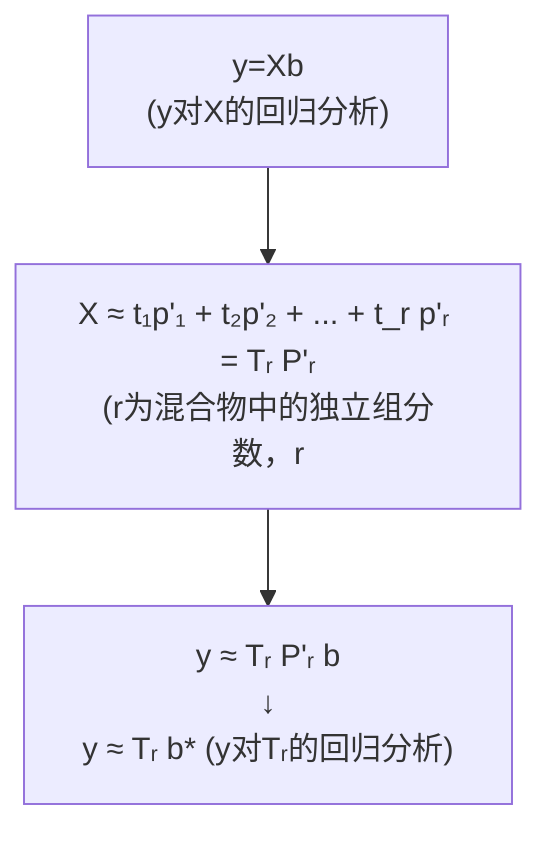
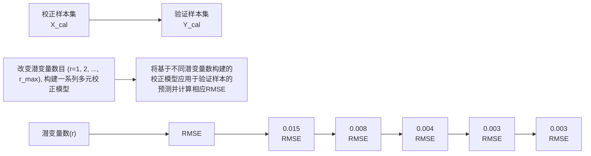
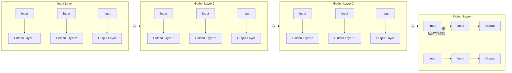

$$
\begin{array}{r} y _ {1} = b _ {0} + b _ {1} x _ {1} + b _ {2} x _ {1} ^ {2} + e _ {1} \\ y _ {2} = b _ {0} + b _ {1} x _ {2} + b _ {2} x _ {2} ^ {2} + e _ {2} \\ \vdots \\ y _ {m} = b _ {0} + b _ {1} x _ {m} + b _ {2} x _ {m} ^ {2} + e _ {m} \end{array} \Rightarrow \left[ \begin{array}{c} y _ {1} \\ y _ {2} \\ \vdots \\ y _ {m} \end{array} \right] = \left[ \begin{array}{c c c} 1 & x _ {1} & x _ {1} ^ {2} \\ 1 & x _ {2} & x _ {2} ^ {2} \\ \vdots & \vdots & \vdots \\ 1 & x _ {m} & x _ {m} ^ {2} \end{array} \right] \left[ \begin{array}{c} b _ {0} \\ b _ {1} \\ b _ {2} \end{array} \right] + \left[ \begin{array}{c} e _ {1} \\ e _ {2} \\ \vdots \\ e _ {m} \end{array} \right] \Rightarrow \mathbf {y} = \mathbf {X b} + \mathbf {e} \tag {2-3-9}
$$

式中， $y=\begin{bmatrix}y_{1}\\ \vdots\\ y_{m}\end{bmatrix},X=\begin{bmatrix}1&x_{1}&x_{1}^{2}\\ \vdots&\vdots&\vdots\\ 1&x_{m}&x_{m}^{2}\end{bmatrix},b=\begin{bmatrix}b_{0}\\ b_{1}\\ b_{2}\end{bmatrix},e=\begin{bmatrix}e_{1}\\ \vdots\\ e_{m}\end{bmatrix}$ 。式(2-3-9)中的模型参数

向量 b 的最小二乘解为:  $b = X^{+}y$ 。显然, 该解在形式上与式(2-3-6)完全一致, 但 X 和 b 所代表的具体内容有所不同。

在实际工作中,当两个变量 x 和 y 之间并不存在严格的线性关系时,虽然也可以按照上述步骤求得线性校正模型,但此线性校正模型不一定有意义。所得线性校正模型是否有意义可用相关系数(correlation coefficient, r)进行检验。

$$
r = \frac {\sum_ {i = 1} ^ {m} (x _ {i} - \bar {x}) (y _ {i} - \bar {y})}{\sqrt {\sum_ {i = 1} ^ {m} (x _ {i} - \bar {x}) ^ {2} \sum_ {i = 1} ^ {m} (y _ {i} - \bar {y}) ^ {2}}} \tag {2-3-10}
$$

式中， $\bar{x}$  和  $\bar{y}$  分别为  $x_{i}$  和  $y_{i}(i=1,2,\cdots,m)$  的平均值。当两个变量 x 和 y 之间存在完全线性关系时， $|r|=1$ ；当两个变量之间不存在线性关系时， $|r|=0$ ；当  $0<|r|<1$  时，两变量之间存在线性关系， $|r|$  越接近 1，两变量之间的线性关系越强。当用相关系数来判断两变量之间线性关系的强弱时，还应考虑测量次数和置信度。表 2.3.1 列出了不同置信度及自由度时的相关系数绝对值的临界值。若计算出的相关系数的绝对值大于表中相应的数值，则表示两变量显著相关，所求得的线性校正模型有意义；反之，则无意义。

表 2.3.1 检验相关系数绝对值的临界值表

<table><tr><td rowspan="2">f=m-2</td><td colspan="4">置信度</td></tr><tr><td>90%</td><td>95%</td><td>99%</td><td>99.9%</td></tr><tr><td>1</td><td>0.988</td><td>0.997</td><td>0.9998</td><td>0.999999</td></tr><tr><td>2</td><td>0.900</td><td>0.950</td><td>0.990</td><td>0.999</td></tr><tr><td>3</td><td>0.805</td><td>0.878</td><td>0.959</td><td>0.991</td></tr><tr><td>4</td><td>0.729</td><td>0.811</td><td>0.917</td><td>0.974</td></tr><tr><td>5</td><td>0.669</td><td>0.755</td><td>0.875</td><td>0.951</td></tr><tr><td>6</td><td>0.622</td><td>0.707</td><td>0.834</td><td>0.925</td></tr><tr><td>7</td><td>0.582</td><td>0.666</td><td>0.798</td><td>0.898</td></tr><tr><td>8</td><td>0.549</td><td>0.632</td><td>0.765</td><td>0.872</td></tr><tr><td>9</td><td>0.521</td><td>0.602</td><td>0.735</td><td>0.847</td></tr><tr><td>10</td><td>0.497</td><td>0.576</td><td>0.708</td><td>0.823</td></tr></table>

»例 2.3.1 用分光光度法测得6个酚标准溶液的数据如下:

| 样本标号 | 1 | 2 | 3 | 4 | 5 | 6 |
| --- | --- | --- | --- | --- | --- | --- |
| 酚含量$y_i$ | 0.005 | 0.010 | 0.020 | 0.030 | 0.040 | 0.050 |
| 吸光度$x_i$ | 0.020 | 0.040 | 0.100 | 0.120 | 0.140 | 0.180 |

请根据表中的数据构建酚的含量与其吸光度之间的单变量校正模型，并检查校正模型在 $95\%$ 的置信度下是否有意义。

》解:

$$
\mathbf {y} = \left[ \begin{array}{l} 0. 0 0 5 \\ 0. 0 1 0 \\ 0. 0 2 0 \\ 0. 0 3 0 \\ 0. 0 4 0 \\ 0. 0 5 0 \end{array} \right], \quad \mathbf {X} = \left[ \begin{array}{l l} 1 & 0. 0 2 0 \\ 1 & 0. 0 4 0 \\ 1 & 0. 1 0 0 \\ 1 & 0. 1 2 0 \\ 1 & 0. 1 4 0 \\ 1 & 0. 1 8 0 \end{array} \right], \quad \mathbf {b} = \mathbf {X} ^ {*} \mathbf {y} = \left[ \begin{array}{l} - 0. 0 0 2 4 \\ 0. 2 8 2 6 1 \end{array} \right]
$$

校正模型:  $y = -0.0024 + 0.28261x$

按式(2-3-10)计算相关系数:

$$
r = \frac {\sum_ {i = 1} ^ {6} (x _ {i} - \bar {x}) (y _ {i} - \bar {y})}{\sqrt {\sum_ {i = 1} ^ {6} (x _ {i} - \bar {x}) ^ {2} \sum_ {i = 1} ^ {6} (y _ {i} - \bar {y}) ^ {2}}} = 0. 9 8 3
$$

查表 2.3.1, $r_{95\%,6-2}=0.811$ , $r>r_{95\%,6-2}$ ，故所得校正模型有意义。测得样品的吸光度 x，即可由该校正模型求得样品中酚的含量 y。

## 2.3.2 多元线性校正模型和方法

以上单变量校正模型仅适用于只含有一个具有光谱活性溶质组分(即能产生光谱信号的化学组分)样本的定量分析。当样本中含有多个具有光谱活性的化学组分时,其光谱定量分析就需要用到多元(或称多变量)线性校正模型了。

假定采用吸收光谱仪器测得某 K 个组分混合溶液样本在波长范围  $\lambda_{1} \sim \lambda_{n}$  内的吸光度向量  $\mathbf{x}(\mathbf{x} = [x_{1}, x_{2}, \cdots, x_{n}], x_{j}$  为在波长  $\lambda_{j}$  处的吸光度值）。根据朗伯-比尔定律则有:混合物溶液样本的光谱响应 (x) 可表达为 K 个组分光谱响应贡献的线性加和。

$$
\mathbf {x} = c _ {1} \mathbf {s} _ {1} + c _ {2} \mathbf {s} _ {2} + \dots + c _ {K} \mathbf {s} _ {K} + \mathbf {e} = \sum_ {k = 1} ^ {K} (c _ {k} \mathbf {s} _ {k}) + \mathbf {e} \tag {2-3-11}
$$

式中，标量 $c_{k}$ 代表混合物溶液样本中第 $k$ 个组分的物质的量浓度；行向量 $\mathbf{s}_k$ 代表第 $k$ 个组分的单位物质的量浓度的光谱响应（即纯光谱）；e为实验误差。为表达方便，式(2-3-11)可改写成矩阵形式（即经典多元线性校正模型）。

$$
\mathbf {c} = [ c _ {1}, \dots , c _ {K} ], \quad \mathbf {S} = [ \mathbf {s} _ {1}; \dots ; \mathbf {s} _ {K} ] = \left[ \begin{array}{c} \mathbf {s} _ {1} \\ \vdots \\ \mathbf {s} _ {K} \end{array} \right], \quad \mathbf {x} = \mathbf {c S} + \mathbf {e} \tag {2-3-12}
$$

若混合物溶液样本中所有具有光谱活性组分的纯光谱 $(\mathbf{s}_{k}, k=1,2,\cdots,K)$ 均为已知，则混合物溶液样本中所有组分的浓度(c)可以按下式直接从其光谱响应向量x中估算出来。

$$
\mathbf {c} = \mathbf {x} \mathbf {S} ^ {+} \tag {2-3-13}
$$

式(2-3-13)表明利用多变量的思想可以实现混合物中多组分的直接同时定量分析。

## 2.3.2.1 多重线性回归(multiple linear regression, MLR)

利用基于经典多元线性校正模型的式(2-3-13)实现混合物中多组分的同时

多重线性回归参考文献:

Nature Methods, 2015, 12 (12):

1103-1104.

定量分析的前提是:混合物溶液样本中所有具有光谱活性组分的纯光谱 $(\mathbf{s}_{k},k=1,2,\cdots,K)$ 均为已知。若现需对一K个组分混合物溶液样本中的所有K个组分进行定量分析,但该K个组分的纯光谱 $(\mathbf{s}_{k},k=1,2,\cdots,K)$ 未知。则可先配制m个标准混合物样本,测得这些标准样本的光谱 $(\mathbf{x}_{i},i=1,2,\cdots,m)$ 。

$$
\left. \begin{array}{c} \mathbf {x} _ {1} = c _ {1, 1} \mathbf {s} _ {1} + \dots + c _ {1, K} \mathbf {s} _ {K} + \mathbf {e} _ {1} \\ \mathbf {x} _ {2} = c _ {2, 1} \mathbf {s} _ {1} + \dots + c _ {2, K} \mathbf {s} _ {K} + \mathbf {e} _ {2} \\ \vdots \\ \mathbf {x} _ {m} = c _ {m, 1} \mathbf {s} _ {1} + \dots + c _ {m, K} \mathbf {s} _ {K} + \mathbf {e} _ {m} \end{array} \right] \Rightarrow \mathbf {X} = \mathbf {C S} + \mathbf {E} \tag {2-3-14}
$$

式中， $X=[x_{1};\cdots;x_{m}]=\begin{bmatrix}x_{1}\\ \vdots\\ x_{m}\end{bmatrix},E=\begin{bmatrix}e_{1}\\ \vdots\\ e_{m}\end{bmatrix},S=\begin{bmatrix}s_{1}\\ \vdots\\ s_{K}\end{bmatrix},C=\begin{bmatrix}c_{1,1}&\cdots&c_{1,K}\\ c_{2,1}&\cdots&c_{2,K}\\ \vdots&\vdots&\vdots\\ c_{m,1}&\cdots&c_{m,K}\end{bmatrix}(c_{i,k}$ 代表第

i 个标准样本中第 k 个组分的物质的量浓度)。由于 X 和 C 为已知, 则可按式 (2-3-15) 计算出由混合物中各组分纯光谱组成的纯光谱矩阵 S。

$$
\mathbf {S} = \mathbf {C} ^ {+} \mathbf {X} \tag {2-3-15}
$$

获得待测样本的光谱  $x_{test}$  后, 其中所有组分的浓度向量 ( $c_{test}$ ) 可按下式估算出来:

$$
\mathbf {c} _ {\mathrm{test}} = \mathbf {x} _ {\mathrm{test}} \mathbf {S} ^ {+} \tag {2-3-16}
$$

以上所述的多重线性回归能够实现混合物中多组分的同时定量分析。使用多重线性回归方法的前提条件是:需要知道待测样本中所有主要组分,并能够获得这些组分的纯试剂,用于配制标准混合物样本。在实际工作中,分析工作者常常只需对待测复杂样本中的某一个(或几个)目标组分进行定量分析,而不需要对所有组分进行同时定量分析,此时多重线性回归就满足不了需求了。

## 2.3.2.2 多元逆校正模型(inverse multivariate calibration model)

基于朗伯-比尔定律推导出的式(2-3-12)和式(2-3-14)将样本的光谱数据与样本中所有组分的浓度和纯光谱联系在一起。因此当使用基于式(2-3-12)或式(2-3-14)的校正方法进行定量分析时，即使只需要对样本中某一个目标组分进行定量分析，也必须获取样本中所有组分的纯光谱或者测定标准样本中所有组分的浓度。为此需要推导出将样本中目标物质浓度直接与样本的光谱联系在一起的多元逆校正模型。

由朗伯-比尔定律可知:m 个 K 组分混合物标准样本的光谱数据阵 X 与样本中所有组分的浓度矩阵 C 和纯光谱阵 S 服从公式  $X = CS + E$ 。任意假定样本中的第一个组分为待测的目标组分，则根据矩阵的分块理论可将浓度矩阵 C 和纯光谱阵 S 进行如下分块:

$$
\mathbf {X} = \mathbf {C S} + \mathbf {E} = [ \mathbf {c} _ {1}, \mathbf {C} _ {\mathrm{rest}} ] \left[ \begin{array}{l} \mathbf {s} _ {1} \\ \mathbf {S} _ {\mathrm{rest}} \end{array} \right] + \mathbf {E} = \mathbf {c} _ {1} \mathbf {s} _ {1} + \mathbf {C} _ {\mathrm{rest}} \mathbf {S} _ {\mathrm{rest}} + \mathbf {E} \tag {2-3-17}
$$

式中， $c_{1}$  为一列向量，其元素为第一个组分（即目标物质）在各标准样本中的浓度； $s_{1}$ （行向量）为第一个组分的纯光谱。在式(2-3-17)的等号两边同时乘以矩阵 $\left(\mathbf{I}-\mathbf{S}_{\mathrm{rest}}^{+}\mathbf{S}_{\mathrm{rest}}\right)$  并展开后可得到下式（注:利用 Moore-Penrose 广义逆的性质  $S_{rest}S_{rest}^{+}S_{rest}=S_{rest}$ ）。

$$
(\mathbf {X} - \mathbf {E}) (\mathbf {I} - \mathbf {S} _ {\mathrm{rest}} ^ {+} \mathbf {S} _ {\mathrm{rest}}) = \mathbf {c} _ {1} \mathbf {s} _ {1} (\mathbf {I} - \mathbf {S} _ {\mathrm{rest}} ^ {+} \mathbf {S} _ {\mathrm{rest}}) \tag {2-3-18}
$$

设  $\mathbf{p}=\mathbf{s}_{1}(\mathbf{I}-\mathbf{S}_{\mathrm{rest}}^{+}\mathbf{S}_{\mathrm{rest}})$ ，则 p 为一行向量。在式(2-3-18)的等号两边同时乘以

多元逆校正模型参考文献:Massart D L, Vandeginste B G M, Buydens L M C, et al. Handbook of chemometrics and qualimetrics. Amsterdam: Elsevier, 1997.

$\mathbf{p}^{\prime}/(\mathbf{pp}^{\prime})$ , 可得式(2-3-19)。

$$
(\mathbf {X} - \mathbf {E}) (\mathbf {I} - \mathbf {S} _ {\mathrm{rest}} ^ {+} \mathbf {S} _ {\mathrm{rest}}) \mathbf {p} ^ {\prime} / (\mathbf {p p} ^ {\prime}) = \mathbf {c} _ {1} \tag {2-3-19}
$$

设  $\mathbf{b}=(\mathbf{I}-\mathbf{S}_{\mathrm{rest}}^{+}\mathbf{S}_{\mathrm{rest}})\mathbf{p}^{\prime}/(\mathbf{pp}^{\prime})$ ，则 b 为一列向量。另外可设  $y=c_{1}$ ，以及 e=-Eb，则式(2-3-19)可简写如下:

$$
\mathbf {y} = \mathbf {X b} + \mathbf {e} \tag {2-3-20}
$$

式(2-3-20)即为将样本中目标物质浓度直接与样本的光谱联系在一起的多元逆校正模型。多元逆校正模型中的模型参数 b 可用最小二乘法估算出来。

$$
\mathbf {b} = \mathbf {X} ^ {+} \mathbf {y} \tag {2-3-21}
$$

获得待测样本的光谱  $x_{test}$  后, 待测样本中目标物质的浓度  $y_{test}$  可按下式估算出来:

$$
y _ {\mathrm{test}} = \mathbf {x} _ {\mathrm{test}} \mathbf {b} \tag {2-3-22}
$$

与经典的多元线性校正模型相比,多元逆校正模型的优点在于:待测物质的浓度与样本的光谱信号数据直接相关;在估计模型参数 b 时,无须知道共存组分的浓度或事先获取它们的纯光谱。但是基于最小二乘法计算出来的模型参数 b 易受实验噪声的影响,相应校正模型预测结果的准确度较差。如图 2.3.2 所示,


图2.3.2 三组分混合物体系的纯光谱矩阵(S)、浓度矩阵(C)、不含随机噪声的模拟光谱数据矩阵$(\mathbf{X}_0)$ 、含随机噪声的模拟光谱数据矩阵 $(\mathbf{X}_1)$，以及利用最小二乘法分别从 $\mathbf{X}_0$ 和 $\mathbf{X}_1$ 中估算出来的目标组分校正模型参数 $\mathbf{b}_0$ 和 $\mathbf{b}_1$

$X_{0}$  为 19 个三组分混合样本的无噪声模拟光谱， $X_{1}$  则为添加了一定随机噪声的相应模拟光谱（随机噪声的幅度为最大吸收值的 0.1%）。微小随机噪声的存在却使得通过最小二乘法估计出来的目标组分（黑色纯光谱组分）校正模型参数  $b_{1}$  显著偏离其真值  $b_{0}$ 。

由于利用最小二乘法从 $\mathbf{X}_0$ 和 $\mathbf{X}_1$ 中估算模型参数 $\mathbf{b}_0$ 和 $\mathbf{b}_1$ 涉及 $\mathbf{X}_0^+$ 和 $\mathbf{X}_1^+$ 的计算。通过对矩阵 $\mathbf{X}$ 进行奇异值分解获得 $\mathbf{U},\Sigma$ 和 $\mathbf{V}(\mathbf{X} = \mathbf{U}\Sigma \mathbf{V}')$ ，可以方便地求出 $\mathbf{X}$ 的Moore-Penrose广义逆 $(\mathbf{X}^{+} = \mathbf{V}\Sigma^{+}\mathbf{U}^{\prime})$ 。因此为了弄清楚为什么模型参数 $\mathbf{b}$ 会易受实验噪声的影响，需要首先对 $\mathbf{X}_0$ 和 $\mathbf{X}_1$ 进行奇异值分解。如图2.3.3所示，$\mathbf{X}_0$ 只有3个大于零的奇异值，正好代表3个化学成分的光谱信息，剩余的奇异值均等于零；由于受随机噪声的影响，$\mathbf{X}_1$ 除了3个显著较大的奇异值外，剩余的奇异值虽然很小，但均不等于零。在求算 $\mathbf{X}_0^+$ 和 $\mathbf{X}_1^+$ 时分别涉及计算对角矩阵 $\Sigma_0$ 和 $\Sigma_1$ 的Moore-Penrose广义逆 $\Sigma_0^+$ 和 $\Sigma_1^+$ 。计算 $\Sigma_0^+$ 时，只需对 $\Sigma_0$ 的前3个大于零的奇异值求倒数即可；然而计算 $\Sigma_1^+$ 时，由于 $\Sigma_1$ 除了3个显著较大的奇异值外，还有很多由随机噪声带来的非常小的奇异值，对这些小的奇异值的求倒数会显著放大随机噪声的影响，因而使得由此估算出来的模型参数会显著偏离其真值。


<details>
<summary>text_image</summary>

X₀=U₀Σ₀V'₀
Σ₀的对角元素
2.0086
0.3581
0.0682
0.0000
0.0000
⋮
0.0000
0.0000
0.0000
X₁=U₁Σ₁V'₁
Σ₁的对角元素
2.0086
0.3582
0.0684
0.0010
0.0010
⋮
代表组分
光谱信息
代表组分
光谱信息
代表随机
噪声影响
</details>

图 2.3.3 三组分混合物体系的不含随机噪声的模拟光谱数据矩阵 $\left(\mathbf{X}_{0}\right)$ 和含随机噪声的模拟光谱数据矩阵 $\left(\mathbf{X}_{1}\right)$ 的奇异值分解结果

## 主成分回归参考文献:

[1] British Journal of Statistical Psychology, 1957, 10(2):69-79.
[2] Biometrics, 1976, 32: 1-49.

## 2.3.2.3 主成分回归(principal component regression, PCR)

基于最小二乘法计算出来的多元逆校正模型的模型参数 b 易受随机噪声影响的根本原因在于光谱数据阵 X 中包含代表随机噪声的奇异值所对应的次要成分的贡献。因此为了获得比较稳健的模型参数 b，最为直观的做法就是将 X 的奇异值分解所获得的对角矩阵  $\Sigma$  中代表随机噪声的奇异值均置为零（或者将其代表的次要成分的贡献从 X 中删除）。PCR 正是通过删去代表随机噪声的奇异值所对应的次要成分的贡献来消除实验噪声对校正模型参数的影响，仅保留代表化学组分光谱信息的主要成分的贡献，从而提高预测结果的准确度。PCR 的具体建模和预测过程如下:

（1）对标准样本的光谱数据矩阵 X 进行奇异值分解:

$$
\mathbf {X} = \mathbf {U} \boldsymbol {\Sigma} \mathbf {V} ^ {\prime} = \lambda_ {1} \mathbf {u} _ {1} \mathbf {v} _ {1} ^ {\prime} + \lambda_ {2} \mathbf {u} _ {2} \mathbf {v} _ {2} ^ {\prime} + \dots + \lambda_ {p} \mathbf {u} _ {p} \mathbf {v} _ {p} ^ {\prime} \tag {2-3-23}
$$

（2）设标准样本中含有 r 个具有光谱活性的独立组分，则前面 r 个较大的奇异值代表 r 个独立组分的光谱信息，其余 p-r 个较小的奇异值代表随机噪声的影响，可将其贡献从 X 中删除:

$$
\mathbf {X} \approx \lambda_ {1} \mathbf {u} _ {1} \mathbf {v} _ {1} ^ {\prime} + \lambda_ {2} \mathbf {u} _ {2} \mathbf {v} _ {2} ^ {\prime} + \dots + \lambda_ {r} \mathbf {u} _ {r} \mathbf {v} _ {r} ^ {\prime} = \mathbf {T} _ {r} \mathbf {P} _ {r} ^ {\prime} \tag {2-3-24}
$$

式中， $T_{r}=\left[\lambda_{1}u_{1},\lambda_{2}u_{2},\cdots,\lambda_{r}u_{r}\right],P_{r}=\left[v_{1},v_{2},\cdots,v_{r}\right]$ 。

(3) 若标准样本中待测物质的浓度矢量 y 已知, 则有

$$
\mathbf {y} = \mathbf {X} \mathbf {b} \approx \mathbf {T} _ {r} \mathbf {P} _ {r} ^ {\prime} \mathbf {b} \tag {2-3-25}
$$

$$
\mathbf {b} = \mathbf {P} _ {r} \mathbf {T} _ {r} ^ {+} \mathbf {y} \tag {2-3-26}
$$

（4）测得待测样本的光谱  $x_{test}$  后，待测样本中待测物质的浓度  $y_{test}$  可按下式估算出来:

$$
y _ {\mathrm{test}} = \mathbf {x} _ {\mathrm{test}} \mathbf {P} _ {r} \mathbf {P} _ {r} ^ {\prime} \mathbf {b} \tag {2-3-27}
$$

用 PCR 从图 2.3.2 所示含随机噪声的模拟光谱数据矩阵  $X_{1}$  中求解目标组分（黑色纯光谱组分）的校正模型参数  $b_{2}$  与利用最小二乘法从不含随机噪声的模拟光谱数据矩阵  $X_{0}$  中估算出来的校正模型参数  $b_{0}$  高度一致（图 2.3.4），证明了:从光谱矩阵中删去代表随机噪声的奇异值所对应的次要成分的贡献确实能够消除随机噪声对校正模型参数的影响。


<details>
<summary>line</summary>

| \(\lambda/\)nm | Absorbance (A) |
| --- | --- |
| 850 | ~0.0 |
| 900 | ~-0.2 |
| 910 | ~-1.5 |
| 930 | ~1.7 |
| 960 | ~-1.2 |
| 980 | ~0.1 |
| 1000 | ~-0.1 |
| 1040 | ~1.4 |
</details>


<details>
<summary>line</summary>

| \(\lambda/\)nm | Absorbance (A) |
| --- | --- |
| 850 | ~0.0 |
| 900 | ~-0.5 |
| 925 | ~1.9 |
| 950 | ~0.2 |
| 975 | ~-1.3 |
| 1000 | ~-0.2 |
| 1025 | ~0.8 |
| 1050 | ~1.3 |
</details>


<details>
<summary>line</summary>

| \(\lambda/\)nm | Absorbance (A) |
| --- | --- |
| 850 | ~0.0 |
| 900 | ~-0.2 |
| 910 | ~-1.5 |
| 925 | ~1.7 |
| 950 | ~-0.3 |
| 965 | ~-1.2 |
| 980 | ~0.1 |
| 1000 | ~-0.1 |
| 1025 | ~0.5 |
| 1045 | ~1.4 |
</details>

图 2.3.4 利用最小二乘法分别从  $X_{0}$  和  $X_{1}$  中估算出来的目标组分校正模型参数  $b_{0}, b_{1}$ ，以及用 PCR 从  $X_{1}$  中求解出来的模型参数  $b_{2}$

上述 PCR 建模过程也可以从“潜变量”的角度进行理解。如图 2.3.5 所示，PCR 首先寻找一组由原始变量的线性组合所构成的潜变量  $\mathbf{t}_{j}(\mathbf{t}_{j}=\mathbf{X}\mathbf{w}_{j},\mathbf{w}_{j}^{\prime}\mathbf{w}_{j}=1, j=1,2,\cdots,r)$ ，使其能充分代表 X 所携带的信息（假定 X 已列中心化，即  $t_{j}$  解释的方差越大，其代表 X 所携带的信息就越多），然后将目标组分的浓度向量 y 对原始变量 X 的回归分析变换成 y 对潜变量  $\mathbf{T}_{r}(\mathbf{T}_{r}=[\mathbf{t}_{1},\mathbf{t}_{2},\cdots,\mathbf{t}_{r}]$  的回归分析（图 2.3.6）。

在使用 PCR 估算校正模型参数 b 时, 首先需要确定使用多少个潜变量。理论上, PCR 中所用的潜变量数应该等于待测混合物体系中具有光谱活性的独立化学组分数。在实际应用中, 由于难以准确获知未知待测混合物体系中具有光谱活性的独立化学组分数目, PCR 中所用最佳潜变量数通常采用如下两种方法来确定。


<details>
<summary>flowchart</summary>

```mermaid
graph TD
  subgraph Method_1
  A["t₁ = Xw₁, w'₁w₁ = 1"] --> B["max(t'₁t₁) = max(w'₁X'Xw₁), w'₁w₁ = 1"]
  B --> C["拉格朗日乘数法求解: f(w₁) = w'₁X'Xw₁ + λ₁(1-w'₁w₁)"]
  C --> D["∂f(w₁)/∂w₁ = 2X'Xw₁ - 2λ₁w₁ = 0\n∂f(w₁)/∂λ₁ = 1-w'₁w₁ = 0\nX'Xw₁ = λ₁w₁\nEig(X'X)\nt₁ = Xw₁; p₁ = X't₁/(t'₁t₁); X = X-t₁p'₁"]
  end

  subgraph Method_2
    E["&quot;tⱼ = Xwⱼ, j = 2, ..., r"] (top row)"]
    F["X = X-tⱼ₋₁pⱼ₋₁&quot;; tⱼ = Xwⱼ, w'ⱼwⱼ = 1"]
    G["max(t'ⱼtⱼ) = max(w'ⱼX'Xwⱼ), w'ⱼwⱼ = 1"]
    H["拉格朗日乘数法求解: f(wⱼ) = w'ⱼX'Xwⱼ + λⱼ(1-w'ⱼwⱼ)"]
    I["∂f(wⱼ)/∂wⱼ = 2X'Xwⱼ - 2λⱼwⱼ = 0\n∂f(wⱼ)/∂λⱼ = 1-w'ⱼwⱼ = 0\nX'Xwⱼ = λⱼwⱼ\nEig(X'X)\ntⱼ = Xwⱼ; pⱼ = X'tⱼ/(t'ₜtⱼ)"]
  end

  subgraph Method_3
    J["按以下迭代方法求解其他潜变量tⱼ (tⱼ = Xwⱼ, j = 2, ..., r)"]
    K["X = X-tⱼ₋₁pⱼ₋₁&quot;; tⱼ = Xwⱼ, w'ⱼwⱼ = 1"]
    L["max(t'ⱼtⱼ) = max(w'ⱼX'Xwⱼ), w'ⱼwⱼ = 1"]
    M["拉格朗日乘数法求解: f(wⱼ) = w'ⱼX'Xwⱼ + λⱼ(1-w'ⱼwⱼ)"]
    N["∂f(wj)/∂wj = 2X'Xwj - 2λjwj = 0\n∂f(wj)/∂λj = 1-w'jwj = 0\nX'Xwj = λjwj\nEig(X'X)\ntⱼ = Xwj; pj = X'tj/(t'j'tj)"]
  end
```
</details>

图 2.3.5 PCR 寻找由原始变量的线性组合所构成的潜变量  $\mathbf{t}_{j}(j=1,2,\cdots,r)$  的具体过程


<details>
<summary>flowchart</summary>


</details>

图 2.3.6 PCR 把 y 对原始变量 X 的回归分析变换成 y 对潜变量  $T_{r}$  的回归分析

（1）若标准样本数目足够多，则可将标准样本划分为校正样本集（calibration set）和验证样本集（validation set），通过考察用不同潜变量数构建的PCR校正模型对验证样本集预测结果的均方根误差（root mean square error，$\mathrm{RMSE} = \sqrt{\sum_{i=1}^{n_{\mathrm{val}}} (\hat{y}_{\mathrm{val},i} - y_{\mathrm{val},i})^2 / n_{\mathrm{val}}}$；其中，$y_{\mathrm{val},i}$ 和 $\hat{y}_{\mathrm{val},i}$ 分别为第 $i$ 个验证样本中目标物质的实际浓度和预测浓度，$n_{\mathrm{val}}$ 为验证样本数目）来确定最优潜变量数（图2.3.7）。一般来说，若RMSE在潜变量数取某数值时达到最小，则该数值即为最佳潜变量数。若随着潜变量数的增加，RMSE一直下降，并未出现最小值，此时可以将RMSE值与实验误差相当时所对应的潜变量数视为最佳潜变量数。


<details>
<summary>flowchart</summary>


</details>

图 2.3.7 基于验证样本预测均方根误差的多元校正模型最优潜变量数确定策略示意图

（2）若标准样本数目较少，则可采用交叉验证法(cross-validation, CV)确定在 PCR 校正模型中所用的最优潜变量数。交叉验证法的具体步骤如下:① 在选定的潜变量数(r)下,从给定的标准样本中拿出大部分标准样本用于构建校正模型,用所建立的校正模型对剩余的标准样本进行预测;②上述过程一直进行,直到所有的标准样本都被预测了一次而且仅被预测一次,然后计算在选定的潜变量数(r)下校正模型对所有标准样本预测结果的均方根误差(通常记作 $RMSE_{cv}$ );③将 $RMSE_{cv}$ 对潜变量数(r)作图,RMSE值达到最小或者与实验误差相当时所对应的潜变量数视为最佳潜变量数。根据从标准样本中抽取用于验证校正模型预测性能的样本数目不同,交叉验证法可分为“K折交叉验证法”(K-fold cross-validation)和“留一交叉验证法”(leave-one-out cross-validation,LOOCV)。“K折交叉验证”将N个标准样本大致平均分割成K个样本子集,保留一个单独的样本子集用于验证校正模型的预测性能,其他K-1个样本子集则用于构建校正模型。交叉验证重复K次,每个样本子集验证一次。10折交叉验证最为常用。“留一交叉验证”则只将原标准样本中的一个样本用作验证样本,而剩余的其他样本则用于构建校正模型。这个步骤一直持续到每个标准样本都被用作一次验证样本。

利用 PCR 构建校正模型只需确定最优主成分数目即最佳潜变量数即可，而且其预测结果不易受实验噪声的影响。但是由于 PCR 采用了近似公式（即  $y \approx T_{r}P_{r}'b$ ）来估算校正模型参数 b，由 PCR 估算出的校正模型参数 b 是有偏的（即其期望值不等于其真值）。另外，用于 PCR 建模的“潜变量”仅仅是根据光谱数据矩阵 X 的信息计算出来的。若光谱数据矩阵 X 除受化学组分浓度变化的影响外，还受到其他因素的影响，那么按上述方法计算出来的“潜变量”可能与待测物质的浓度之间的相关性较低，导致所建立的校正模型的预测结果不准确。

## 2.3.2.4 偏最小二乘回归 (partial least squares regression, PLSR)

PLSR 最早由 H. Wold 等人在 1975 年提出。相比于 PCR 所寻找的潜变量只充分代表光谱数据矩阵 X 所携带的信息，PLSR 寻找的潜变量  $\mathbf{z}_{j}(\mathbf{z}_{j}=\mathbf{X}\mathbf{w}_{j}, j=1,2,\cdots,r)$  既要能充分代表原始变量 X 所携带的信息，又要能有效地用于目标组分浓度向量 y 的预测（图 2.3.8）。换而言之，PLSR 的潜变量  $\mathbf{z}_{j}(j=1,2,\cdots,r)$  不但能解释较大的方差，而且应该与目标组分的浓度向量 y 具有最大的相关性。


图 2.3.8 PLSR 建模策略示意图

假定 X 和 y 均已列中心化, 则 PLSR 寻找到的潜变量  $\mathbf{z}_{j}(\mathbf{z}_{j}=\mathbf{X}\mathbf{w}_{j}, j=1,2,\cdots,r)$  的具体计算过程如图 2.3.9 所示(在此计算过程中, 相应的 V 和 b 也同时被计算出来了)。

根据上述潜变量  $\mathbf{z}_{j}(\mathbf{z}_{j}=\mathbf{X}\mathbf{w}_{j}, j=1,2,\cdots,r)$  的计算过程可以推导出如图 2.3.10 所示一系列关系。

定义  $\mathbf{W}^{*}=\left[\mathbf{w}_{1},\left(\mathbf{I}-\mathbf{w}_{1}\mathbf{v}_{1}^{\prime}\right)\mathbf{w}_{2},\cdots,\left(\prod_{j=1}^{r-1}\left(\mathbf{I}-\mathbf{w}_{j}\mathbf{v}_{j}^{\prime}\right)\right)\mathbf{w}_{r}\right]$ ，则有

$$
\mathbf {Z} = [ \mathbf {z} _ {1}, \mathbf {z} _ {2}, \dots , \mathbf {z} _ {r} ] = \mathbf {X W} ^ {*} \tag {2-3-28}
$$

$\hat{y}=Zb=XW^{*}b=Xb^{*}$  （注:在求解潜变量 $z_{j}$ 时已将b求出）

$$
(2 - 3 - 2 9)
$$

偏最小二乘回归参考文献:

[1] Journal of Applied Probability, 1975, 12(S1):117-142.
[2] Analytical Chemistry, 1998, 60:1193-1202.


图 2.3.9 PLSR 寻找由原始变量的线性组合所构成的潜变量  $\mathbf{z}_{j}(j=1,2,\cdots,r)$  的具体过程


<details>
<summary>text_image</summary>

z₁=Xw₁
z₂=X₁w₂=(X-z₁v₁')w₂=(X-Xw₁v₁')w₂=X(I-w₁v₁')w₂
z₃=X₂w₃=(X₁-z₂v₂')w₃=(X₁-X₁w₂v₂')w₃=X(I-w₁v₁')(I-w₂v₂')w₃
⋮
zᵣ=Xᵣ₋₁wᵣ=X(I-w₁v₁')(I-w₂v₂')⋯(I-wᵣ₋₁vᵣ₋₁)wᵣ=X\left(\prod_{j=1}^{r-1}(I-wⱼvⱼ')\right)wᵣ
</details>

图 2.3.10 潜变量  $\mathbf{z}_{j}(j=1,2,\cdots,r)$  满足的一系列关系

$$
\hat {y} _ {i} = b _ {1} ^ {*} x _ {i, 1} + \dots + b _ {n} ^ {*} x _ {i, n} \tag {2-3-30}
$$

式(2-3-30)表明: $b_{j}^{*}$  的绝对值反映了第 j 个原始变量  $(x_{i,j})$  对预测  $y_{i}$  的重要性。若  $b_{j}^{*}$  为负值，则其影响为负影响；若  $b_{j}^{*}$  为正值，则其影响为正影响。测得待测样本的光谱  $x_{test}$  后，待测样本中待测物质的浓度  $y_{test}$  可按下式估算出来。

$$
y _ {\mathrm{test}} = \mathbf {x} _ {\mathrm{test}} \mathbf {b} ^ {*} \tag {2-3-31}
$$

与 PCR 一样, 在使用 PLSR 估算校正模型参数 b 时, 也需要确定使用多少个潜变量。理论上, PLSR 中所用潜变量数应该等于待测混合物体系中具有光谱活性的独立化学组分数目。但是, 在实际应用中, 人们往往难以准确知道体系中所有具有响应的化学组分的数目。此外, 测得的光谱数据中还存在噪声、基线漂移等干扰因素。因此 PLSR 中所用潜变量数通常也是根据验证样本的均方根误差或交叉验证的均方根误差来确定。

## 2.3.2.5 人工智能方法与多元校正

人工智能(artificial intelligence)简称AI，是研究、开发用于模拟、延伸和扩展人的智能的理论、方法、技术及应用系统的一门新的技术科学。它是计算机科学的一个分支，试图了解智能的实质，并生产出一种新的能以人类智能相似的方式作出反应的智能机器，该领域的研究非常广泛，包括机器人、语言识别、图像识别、自然语言处理和专家系统等，相关方法在化学领域已得到相当广泛的应用。人工智能方法，如反向传播人工神经网络(back propagation artificial neural network, BP-ANN)、卷积神经网络(convolutional neural network, CNN)等，能够用于解决复杂体系的非线性多元校正问题。图2.3.11展示的是利用BP-ANN建立的非线性多元

人工智能方法和深度学习文献:

李明禄. 英汉云计算·物联网·大数据辞典. 上海: 上海交通大学出版社, 2018.

Nature, 2015, 521 (7553): 436 - 444.

校正模型。一个基本的人工神经网络通常由多个层组成，包括输入层、隐藏层和输出层，每层包含多个神经元（或称节点）。每个神经元接收来自前一层神经元的输入，经过加权求和和激活函数处理后，产生输出传递给下一层神经元。具体对于单个神经元而言，其输出 $y$ 通常由以下两个步骤计算得出:


<details>
<summary>flowchart</summary>


</details>

图2.3.11 基于BP-ANN建立的非线性多元校正模型示意图

（1）加权求和(线性组合) 假设当前神经元接收来自前一层 n 个神经元的输入, 这些输入分别记作  $x_{1}, x_{2}, \cdots, x_{n}$  (还包括一个偏置项 b, 其权重可以视为 1), 则加权求和的公式为

$$
z = \sum_ {i = 1} ^ {n} w _ {i} x _ {i} + b = w _ {1} x _ {1} + w _ {2} x _ {2} + \dots + w _ {n} x _ {n} + b \tag {2-3-32}
$$

式中，z 是加权求和的结果，也称为神经元的净输入。

（2）激活函数 将加权求和的结果 z 通过一个激活函数 f，得到神经元的输出 y。激活函数的选择取决于具体的问题和所需的网络特性。激活函数的加入带给模型处理非线性数据的能力，模型能对更高级特征进行归纳，目前使用最多的默认激活函数为 ReLU 函数，其形式为

$$
f (z) = \max (0, z) \tag {2-3-33}
$$

可见 ReLU 函数的简单形式使其在梯度计算(即损失函数对参数求偏导数)过程中消耗的内存较少,并且使一部分神经元的输出变成了 0,网络也变得稀疏,因此一定程度上缓解了过拟合问题。

综上,该神经元的输出公式为

$$
y = \max \left(0, \sum_ {i = 1} ^ {n} w _ {i} x _ {i} + b\right) \tag {2-3-34}
$$

BP-ANN 模型的训练主要采用梯度下降法,通过误差反向传播来不断调整各神经元的权重和偏置,使得该人工神经网络的预测值和真值之间的误差平方和达到最小。BP-ANN 模型的训练完成后,固定各神经元的权重和偏置,即可通过待测样本的光谱数据预测出其中目标组分的含量。人工神经网络具有很强的非线性映射能力,能够拟合复杂体系中目标物质浓度与仪器响应信号强度之间的各种非线性关系。一般而言,人工神经网络在解决非线性问题、处理大数据等方面更有优势。

近年来，以CNN为代表的深度学习方法在图像处理等领域取得了巨大的进展，并已逐渐应用于非线性多元校正领域。CNN模仿了人脑对视觉信息的处理过程，通过逐层卷积和池化操作，能够自动提取图像中的多尺度局部空间特征，并通过深层网络进一步将其组合为具有较强表示能力的特征，之后可完成分类或回归任务。由于常见光谱数据为矢量数据，因此可采用一维卷积神经网络（one-

## 人工智能深度学习领域“三巨头”

2018年，深度学习界的三位顶尖学者Geoffrey Hinton、Yoshua Bengio、Yann LeCun因其在深度神经网络领域的重大突破而共同荣获图灵奖，被广泛誉为深度学习领域“三巨头”。他们不仅在理论上做出了开创性贡献，更是将深度神经网络的概念和应用推向了实际工程的前沿，极大地推动了人工智能技术的发展与革新。

## 2024年诺贝尔奖与人工智能

2024 年诺贝尔物理学奖颁给 John Hopfield 和 Geoffrey Hinton, 以表彰他们“基于人工神经网络实现机器学习的基础性发现和发明”。

2024 年诺贝尔化学奖的一半授予 David Baker, 以表彰他在“计算蛋白质设计”方面的贡献, 另一半授予 Demis Hassabis 和 John Jumper, 以表彰他们在“蛋白质结构预测”方面的贡献。

这些奖项的内容均与人工智能和神经网络紧密相关,表明人工智能技术已成为推动科学发现和技术创新的核心力量。

dimensional convolutional neural network, 1D-CNN) 处理这类数据的非线性多元校正问题。图 2.3.12 展示了 1D-CNN 的一般网络结构，其隐藏层通常由交替的卷积层、激活函数、池化层和全连接层构成。


<details>
<summary>flowchart</summary>


</details>

图 2.3.12 基于 1D-CNN 建立的非线性多元校正模型示意图

卷积层是CNN的核心算法模块，可以逐层提取输入信息中的多种局部特征，同时对局部特征的平移、旋转和尺度变化具有一定的鲁棒性。网络前向传播的过程中，每个卷积核都会沿着设定顺序滑动，并对相应的区域执行卷积运算。局部连接和权值共享是CNN最重要的两个特征，通过卷积操作可实现局部连接，再通过权值共享缩减了实际参数的数量，避免了全连接中参数过多难以计算的问题，为实现多层网络提供可能。图2.3.13展示一维光谱数据卷积计算的过程。


<details>
<summary>text_image</summary>

输入x
卷积核w
步长 Str=2
核尺寸 F=3
1 2 4 2 1 3 1
F
1 2 4 2 1 3 1
* 
1 5 -2
→ 1×1+2×5+4×(-2)=3
3
Str
* 
1 5 -2
→ 4×1+2×5+1×(-2)=12
3 12
Str
* 
1 2 4 2 1 3 1
Str
* 
1 5 -2
→ 1×1+3×5+1×(-2)=14
3 12 14
</details>

图 2.3.13 一维光谱数据卷积计算过程

对于输入的一维光谱向量 x 和卷积核 w, 一维卷积操作可以表示为

$$
y _ {i} = \sum_ {j = 0} ^ {F - 1} (x _ {(i \times \mathrm{Str} + j)} \times w _ {j}) + b \tag {2-3-35}
$$

其中卷积核(filter)的长度为 $F$ ，步长(stride)为 $\mathrm{Str},y_{i}$ 是输出序列的第 $i$ 个元素；$x_{(i\times \mathrm{Str} + j)}$ 是输入光谱的第 $(i\times \mathrm{Str} + j)$ 个元素；$w_{j}$ 是卷积核的第 $j$ 个权重；$b$ 是偏置项。注意这些索引均从0开始，这符合许多编程语言的习惯，包括Python等。

池化层将相邻的多个特征点合并，精简了数据，同时提高了计算效率和模型鲁棒性。通常使用得最多的是最大池化（max pooling）和平均池化（average pooling）。最大池化输出特征图的第 $i$ 个元素计算公式为

$$
y _ {i} = \max (x _ {(i x S t r)}, x _ {(i x S t r + 1)}, \dots , x _ {(i x S t r + P L - 1)}) \tag {2-3-36}
$$

平均池化输出特征图的第 $i$ 个元素计算公式为

$$
y _ {i} = \frac {1}{\mathrm{PL}} \sum_ {j = 0} ^ {\mathrm{PL-1}} x _ {(i \times \mathrm{Str} + j)} \tag {2-3-37}
$$

式中，PL 是池化窗口的大小，Str 为池化的步长。

一般在 CNN 的最后, 使用压平层 (flatten 层) 把不同卷积核提取的特征整合在一起, 再用全连接层进行特征归纳, 实现最后的非线性多元校正或分类任务。

现今人工智能系统的成功可归功于大数据、强算力、强算法。从数据量上看，我国实验分析仪器在2019年产量已达278万余台，这些仪器每天将产生海量的分析数据；从数据的大小上看，全二维液相色谱（LC×LC）一个数据的峰容量大约为 $10^{3}$ ，而傅里叶变换离子回旋共振质谱（FTICR-MS）数据的峰容量甚至可达到 $10^{6}$ 左右；从数据产生的效率看，一台飞行时间质谱（TOF-MS）每秒可以获得 $10^{8}$ 个峰数据。这些信号表明，我们已经真正步入大数据时代，“数据海啸”带给分析化学家的既是机遇也是挑战。

表 2.3.2 领先的超级计算机 Summit、2019 年的典型个人计算机和人类大脑的粗略对比

<table><tr><td></td><td>超级计算机</td><td>个人计算机</td><td>人类大脑</td></tr><tr><td rowspan="2">计算单元数</td><td> $10^{6}$ 个GPU+CPU</td><td>8个CPU内核</td><td> $10^{6}$ 列</td></tr><tr><td> $10^{15}$ 个晶体管</td><td> $10^{10}$ 个晶体管</td><td> $10^{11}$ 个神经元</td></tr><tr><td rowspan="2">存储单元数</td><td> $10^{16}$ 字节(10PB)RAM</td><td> $10^{10}$ 字节(10GB)RAM</td><td> $10^{11}$ 个神经元</td></tr><tr><td> $10^{17}$ 字节(100PB)硬盘</td><td> $10^{12}$ 字节(1TB)硬盘</td><td> $10^{14}$ 个突触</td></tr><tr><td>周期时间</td><td> $10^{-9}$ s</td><td> $10^{-9}$ s</td><td> $10^{-3}$ s</td></tr><tr><td>运算/秒</td><td> $10^{18}$ </td><td> $10^{10}$ </td><td> $10^{17}$ </td></tr></table>

表2.3.2中粗略对比了超级计算机、个人计算机和人类大脑的计算能力。数千年来，人类大脑的能力并没有太多变化，而超级计算机的计算能力已经从20世纪60年代的百万次浮点运算每秒(MFLOP)提高到了现如今的百亿亿次浮点运算每秒(exaFLOP)。此外，随着近年来的深度学习算法如卷积神经网络(CNN)、循环神经网络(RNN)、Transformer等的提出，使得人工智能概念深入人心，它们也正在不同领域中发挥重要作用。可以看出，人类的科学研究已经开始步入第四范式——以大数据知识发现为特征的数据密集型科学，可以期待人工智能方法在分析化学领域得到更多的应用和突破。

大数据与人工智能参考文献:

[1] Angewandte Chemie International Edition, 2022, 134 (44): e201801134.
[2] Russell S, Norvig P. Artificial Intelligence: a modern approach, 4th US ed. University of California, Berkeley, 2021.

卷积神经网络(CNN)在光谱多元校正中的应用文献:

[1] Chemometrics and Intelligent Laboratory Systems, 2018, 182: 9–20.
[2] Advanced Science, 2025: e12750.

## 习题

## - 章节练习题 -

1. 与经典的多元线性校正模型相比, 多元逆校正模型有什么特点?
2. 主成分回归(PCR)建模过程中如何确定所需的主成分数?
3. 试说明主成分回归(PCR)与偏最小二乘回归(PLSR)的异同。
4. 为什么说主成分回归(PCR)和偏最小二乘回归(PLSR)的性能相对于多重线性回归(MLR)有显著性的改善?

## - 挑战性问题 -

5. 尝试使用 Matlab、Python 或其他计算机语言编写出主成分回归(PCR)和偏最小二乘回归(PLSR)的程序。

## - 专题或报告 -

6. 通过查阅文献了解最新的多元校正方法及其应用情况，并将查阅结果写成报告。

滴定分析方法是基于化学反应建立的，并要求反应达到化学平衡状态。化学分析的目标是在允许误差范围内确定物质的浓度或量。因此，在某些条件（如温度、压力、其他干扰物质等）下反应建立平衡时，目标物质的浓度或量应该是明确和恒定的。反应达到平衡状态时，正向和逆向反应仍继续发生，但正、逆反应的速率相等，使得处于平衡状态的系统在宏观层面上看起来是静态的。理解化学反应平衡，对发展分析方法至关重要。化学平衡不仅为滴定分析提供了基础，还为生物化学、药学、地质学及海洋学等其他学科提供了基础。特别是，$\mathrm{pH}$ 计算和酸碱缓冲溶液在许多学科领域都非常重要。本章从分析化学学科角度出发介绍化学平衡及其影响因素，介绍处理溶液平衡的一般方法，详细讨论与滴定分析相关的酸碱平衡、络合平衡、氧化还原平衡，以及沉淀平衡。在此基础上，介绍基于上述溶液平衡发展的滴定分析法。

除了经典的滴定分析方法,作为非平衡态体系的分析方法,动力学分析法基于化学反应速率获得分析物的浓度,有些化学反应速率慢,不适合使用滴定分析,可使用动力学方法进行分析;同时,动力学方法非常适于酶、底物及酶催化特性的定量分析。因此,本章第三部分内容是简介动力学分析方法的原理与应用,主要是化学动力学分析法。

## 3.1 化学平衡

化学平衡(chemical equilibrium)是分析化学中最重要的部分之一,是滴定分析法和其他分析方法的基础。基于化学平衡的处理,可以预测反应完成的方向,计算溶液中不同物质的浓度并解释不同副反应对平衡的影响,构筑滴定曲线并理解滴定分析方法,计算滴定误差,以及设计新反应并发展新的分析方法。本节将简介化学平衡及影响因素,基于平衡体系中的定量关系式和平衡表达式介绍处理化学平衡的通用方法,引入副反应系数、条件稳定常数定量描述副反应对滴定主反应的影响及反应实际进行的程度,从而为滴定分析方法的讨论奠定定量描述的基础。

## 3.1.1 化学平衡简介

## 3.1.1.1 平衡常数与 Gibbs 自由能变

在给定温度下,当下述可逆反应达到平衡时,

$$
a \mathrm{A} + b \mathrm{B} \rightleftharpoons c \mathrm{C} + d \mathrm{D}
$$

其平衡常数为

$$
K _ {\mathrm{c}} = \frac {\left[ \mathrm{C} \right] ^ {c} \left[ \mathrm{D} \right] ^ {d}}{\left[ \mathrm{A} \right] ^ {a} \left[ \mathrm{B} \right] ^ {b}} \tag {3-1-1}
$$

式中，[ ]表示溶质的物质的量浓度； $K_{c}$ 是用平衡浓度表示的平衡常数，为简化起见，后续统一用K表示。K适用于稀溶液中的反应。对于非理想溶液中的反应，应以活度平衡常数 $K^{\ominus}$ 表示。

化学反应的自发性取决于焓变( $\Delta H$ )和熵变( $\Delta S$ )。Gibbs自由能(G)将焓和熵统一起来,定义为

$$
G = H - T S
$$

式中，T 为热力学温度(Kelvin, K); G 是体系能量的量度。

等温变化过程的 Gibbs 自由能变为

$$
\Delta G = \Delta H - T \Delta S \tag {3-1-2}
$$

对于自发过程, $\Delta H<T\Delta S$ ,即 $\Delta G<0$ 。由此可判断反应进行的方向。即 $\Delta G<0$ ,反应正向进行; $\Delta G=0$ ,反应处于平衡状态; $\Delta G>0$ ,反应逆向进行。

在标准态与温度 T 条件下, 由稳定单质生成 1 mol 化合物的 Gibbs 自由能变, 称为标准 Gibbs 生成自由能, 以  $\Delta_{\mathrm{f}} G_{\mathrm{m}}^{\ominus}(T)$  表示, 简写为  $\Delta G_{\mathrm{f}}^{\ominus}(T)$ , 单位为  $kJ \cdot mol^{-1}$ 。

对于任意反应,当反应达到平衡时,有

$$
\Delta G _ {\mathrm{f}} ^ {\ominus} = - R T \ln K = - 2. 3 0 3 R T \lg K \tag {3-1-3}
$$

式中，R 为摩尔气体常数 $(8.314\ J \cdot K^{-1} \cdot mol^{-1})$ 。

## 3.1.1.2 分析化学中常见的平衡种类与平衡常数

分析化学中涉及的化学平衡主要包括酸碱平衡、络合平衡、氧化还原平衡及沉淀溶解平衡，各类反应的平衡常数表达式如表3.1.1所示。

表 3.1.1 分析化学中涉及的重要平衡及平衡常数

| 平衡类型 | 平衡常数及符号 | 实例 | 平衡常数表达式 |
| --- | --- | --- | --- |
| 水的解离 | 离子积,$K_{w}$ | $2H_{2}O \rightleftharpoons H_{3}O^{+} + OH^{-}$ | $K_{w} = [H_{3}O^{+}] [OH^{-}]$ |
| 弱酸(碱)的解离 | 解离常数,$K_{a}$或$K_{b}$ | $HAc + H_{2}O \rightleftharpoons H_{3}O^{+} + Ac^{-}$$Ac^{-} + H_{2}O \rightleftharpoons HAc + OH^{-}$ | $K_{a} = \frac{[H_{3}O^{+}] [Ac^{-}]}{[HAc]}$$K_{b} = \frac{[HAc] [OH^{-}]}{[Ac^{-}]}$ |
| 沉淀溶解平衡 | 溶度积,$K_{sp}$ | $BaSO_{4} \rightleftharpoons Ba^{2+} + SO_{4}^{2-}$ | $K_{sp} = [Ba^{2+}] [SO_{4}^{2-}]$ |
| 络合物形成 | 累积稳定常数,$\beta_{a}$ | $Cu^{2+} + 4NH_{3} \rightleftharpoons Cu(NH_{3})_{4}^{2+}$ | $\beta_{4} = \frac{[Cu(NH_{3})_{4}^{2+}]}{[Cu^{2+}] [NH_{3}]^{4}}$ |
| 氧化还原平衡 | $K_{redox}$ | $H_{3}AsO_{4} + 3I^{-} + 2H^{+} \rightleftharpoons HAsO_{2} + I_{3}^{-} + 2H_{2}O$ | $K_{redox} = \frac{[HAsO_{2}] [I_{3}^{-}]}{[H_{3}AsO_{4}] [I^{-}]^{3} [H^{+}]^{2}}$ |

## 3.1.1.3 影响化学平衡的因素

由 Le Châtelier 原理可知, 当平衡体系的条件(如温度、压强及反应物或生成物的浓度)发生变化时, 平衡将向着削弱这种改变的方向移动。该平衡移动原理可以指示化学平衡的移动方向及定性预测化学平衡点。

## 1. 离子强度

电解质对平衡的影响与溶液离子强度(ionic strength)有关。离子强度 $I$ 可根据溶液中各种离子的浓度和电荷进行计算，

$$
I = \frac {1}{2} \sum_ {i = 1} ^ {n} c _ {i} z _ {i} ^ {2} \tag {3-1-4}
$$

式中， $c_{i}$  和  $z_{i}$  分别为 i 离子的浓度和所带电荷数。

在电解质溶液中,由于对理想溶液的偏离,离子在化学反应中表现出来的浓度不同于其真实浓度,以活度 a 表示。

对于溶液中的组分 X, 其活度与平衡浓度的关系为

$$
a = \gamma [ \mathrm{X} ] \tag {3-1-5}
$$

式中，$\gamma$ 为活度系数(activity coefficient)，用于定量计算实际溶液对理想溶液的偏离程度，也是衡量该组分在所参与的平衡中影响平衡效果的指标。

活度系数是离子强度的函数。当离子强度小于 $0.1\mathrm{mol}\cdot \mathrm{L}^{-1}$ 时，活度系数可由Debye-Hückel公式计算:

$$
- \lg \gamma_ {i} = 0. 5 1 2 z _ {i} ^ {2} \left(\frac {\sqrt {I}}{1 + B \dot {a} \sqrt {I}}\right) \tag {3-1-6}
$$

式中，B 是常数，25 ℃时为 3.28； $\dot{a}$  为离子体积参数，约等于其水合离子的直径，单位为 nm。

根据式(3-1-6)，带有不同电荷数离子的活度系数随 $\sqrt{I}$ 变化的情况如图3.1.1所示。可以看到:

(i) 对理想溶液而言, $\gamma=1$ 。对于中性分子,一般认为 $\gamma=1$ 。极稀电解质溶液可视为理想溶液,处理其平衡问题时一般不考虑浓度与活度的差别。
（ii）在不太浓的溶液中，特定组分的活度系数与电解质的性质无关，只与离子强度有关。相同电荷的离子的活度系数大致相等，其微小差异可能与水合离子的有效直径相关联。
（iii）在特定离子强度下，离子活度系数的下降程度随着物种电荷的增加而更加显著。


<details>
<summary>line</summary>

| \(\sqrt{I}\) | H+ | M+, A- | M2+, A2- | M3+, A3- |
| --- | --- | --- | --- | --- |
| 0.0 | 1.0 | 1.0 | 1.0 | 1.0 |
| 0.4 | ~0.8 | ~0.75 | ~0.32 | ~0.08 |
</details>

图 3.1.1 离子强度对活度系数的影响

## 2. 其他影响因素

温度、压强和反应物浓度的变化及干扰物质的存在，都会导致化学平衡的移动。当温度增加时，平衡向吸热方向移动。当压强增大时，平衡向气体分子数减少的方向移动。当反应物浓度增大时，平衡向消耗反应物的方向移动。而干扰物质的引入，会增大平衡溶液对理想溶液的偏离程度，当其与反应物或生成物反应时（如发生络合、氧化还原、沉淀等反应），平衡会向增加反应物或生成物的方向移动。

## 3.1.1.4 活度常数、浓度常数和混合常数

以弱酸 HA 的解离反应为例: