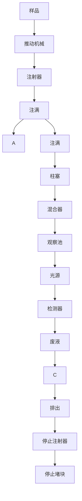
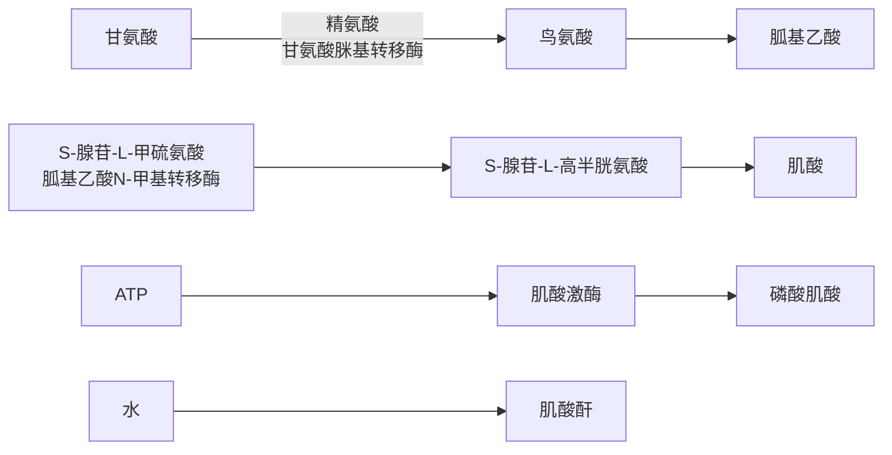
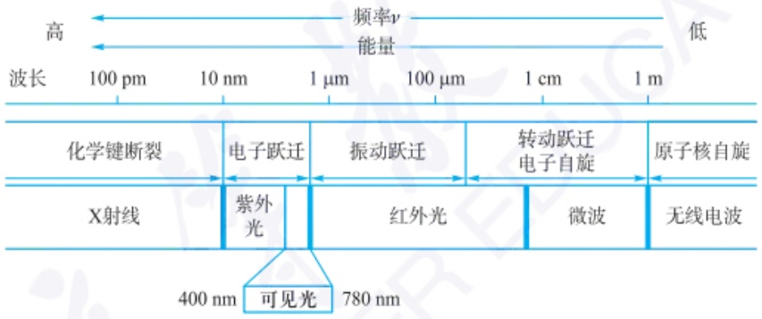

在 AgCl 表面,避免其与 SCN $^{-}$ 接触。

返滴定法测定  $Br^{-}$  和  $I^{-}$  时不存在上述问题, 因为 AgBr 和 AgI 的溶解度均小于 AgSCN 的溶解度。返滴定法测定  $I^{-}$  时, 指示剂应该在 AgI 生成后加入, 以避免  $Fe^{3+}$  对  $I^{-}$  的氧化。

福尔哈德法的适宜 pH 范围是 0\~1，在此强酸性溶液中， $AsO_{4}^{3-}$ 、 $CO_{3}^{2-}$ 、 $C_{2}O_{4}^{2-}$ 、 $PO_{4}^{3-}$ 、 $SO_{4}^{2-}$ 等酸根不再与  $Ag^{+}$ 生成沉淀，因此不会干扰滴定分析。

## 3. 法扬斯法

法扬斯法是波兰物理化学家 Kasimir Fajans 创立的方法,既可以测定  $Ag^{+}$ ,也可以测定卤素离子。法扬斯法借助卤化银沉淀的吸附性,通过吸附指示剂(adsorption indicator)确定滴定终点。

滴定过程中,生成的卤化银沉淀优先吸附构晶离子,致使其表面带有电荷。如果沉淀表面电荷与指示剂离子的电荷相反,那么指示剂离子被吸附到沉淀表面。由于这种吸附,指示剂分子构型发生改变,导致颜色变化,从而指示终点。

例如，$\mathrm{Ag^{+}}$滴定 $\mathrm{Cl^-}$，荧光黄阴离子作为指示剂。终点前 $\mathrm{Cl^-}$过量，$\mathrm{AgCl}$ 沉淀因优先吸附 $\mathrm{Cl^-}$而使表面带有负电荷；荧光黄阴离子不被吸附，呈现本来的黄绿色。终点后 $\mathrm{Ag^{+}}$过量，$\mathrm{AgCl}$ 沉淀因吸附 $\mathrm{Ag^{+}}$而使其表面带有正电荷，荧光黄阴离子被吸附在沉淀表面，呈现粉红色，指示终点。

吸附指示剂的颜色变化发生在卤化银沉淀表面,所以沉淀的表面积越大,终点变色越敏锐。为此,滴定时常加入糊精,以防止卤化银沉淀聚集,导致表面积减小。

卤化银容易感光变为灰黑色,影响终点观察,因此法扬斯法应避免在强光下进行。

指示剂应该主要以离子形态存在，才能够被沉淀吸附。所以需要调节酸度，使溶液中有足够的指示剂离子。例如，荧光黄是有机弱酸， $K_{a}\approx1\times10^{-7}$ ，为了有足够的荧光黄阴离子指示终点，调节溶液pH为7\~10。

指示剂的吸附性应该适当,吸附和脱附能够迅速完成,否则无法正确指示终点。例如,曙红不适合作为  $Ag^{+}$ 滴定  $Cl^{-}$ 的指示剂,因为其吸附性大于  $Cl^{-}$ ,化学计量点之前就会被吸附到 AgCl 沉淀表面发生颜色变化,无法正确指示终点。

## 3.2.6 滴定分析理论的总结

## 3.2.6.1 滴定曲线反函数的通式

滴定曲线是滴定体系的纵坐标随滴定体积 V（或滴定百分数）变化的函数，对于酸碱滴定、络合滴定、氧化还原滴定及沉淀滴定，纵坐标分别为 pH、pM'（或 pM）、 $\varphi$ 、pX（此处 X 为  $Ag^{+}$ 或卤素离子）。本节到此，已经对滴定曲线进行了较详细讨论。

在滴定曲线的讨论中，不仅学习了传统的分段式滴定曲线的绘制与讨论方法，还领略了基于基本定量关系式，如电荷平衡式和物料平衡式，推导出滴定曲线反函数 $V = g([H^{+}]$，绘制滴定曲线，获得滴定突跃范围信息，以及基于体积计算误差的便捷性。此外，也可以看到滴定过程中，分析物与滴定剂浓度、滴定反应常数、参与反应的质子转移或电子转移的量与滴定体积的关系，也即化学反应的热力学常数、物料平衡、质子转移守恒或电子转移守恒这些底层逻辑关系对滴定曲线的影响。

若滴定剂和分析物分别表示为 T 和 A, 其浓度相同, 均为  $c \left( \mathrm{mol} \cdot \mathrm{L}^{-1} \right)$ , A 的起始体积为 $V_{0}(\mathrm{mL})$ ，如果滴定反应计量关系为 $n_1\mathrm{T} - n_2\mathrm{A}$ ，那么滴定曲线的反函数通式可以总结为:

$$
V = \frac {n _ {1} c f - m}{n _ {2} c + m} V _ {0} \tag {3-2-29}
$$

其中， $m=n_{1}[A]-n_{2}[T]$ ; f 为分析物存在解离时的因子。

该通式将基于四大化学平衡的四种滴定分析方法之滴定曲线统一起来,说明了四大滴定分析法之底层逻辑的一致性。

\- 关于 $f$

对于强酸的滴定、络合滴定、氧化还原滴定和沉淀滴定，f=1；对于弱酸体系和含有弱酸的混合酸体系的滴定，f为弱酸滴定产物所有带电荷形态的电荷相关的分布分数的加和，对应于分析物的解离产生的相应的质子的分布分数加和。

\- 关于 $m$

## (i) 化学计量比为 1:1 的滴定体系

对于酸碱滴定， $m=\left[H^{+}\right]-\left[OH^{-}\right]$ ；对于EDTA滴定金属离子的络合滴定， $m=\left[M\right]-\left[Y\right]$ ；对于单电子转移的氧化还原滴定，如 $Ce^{4+}$ 滴定 $Fe^{2+}$ ， $m=\left[Fe^{2+}\right]-\left[Ce^{4+}\right]$ ；对于以 $Ag^{+}$ 滴定卤离子的沉淀滴定， $m=\left[X\right]-\left[Ag\right]$ 。可以看出，m在这几种滴定中，表示在滴定剂T加入体积V时，未反应的分析物A的浓度与滴定剂T的浓度之差。

## (ii) 化学计量比不为 1:1 的滴定体系

这种情况主要与氧化还原滴定体系有关，例如  $Fe^{3+}$  滴定  $Sn^{2+}$ ，以及  $Cr_{2}O_{7}^{2-}$  滴定  $Fe^{2+}$  体系。对于计量关系为  $n_{1}T-n_{2}A$  的氧化还原滴定， $n_{1}$  和  $n_{2}$  分别为分析物和滴定剂电对的电子转移数， $m=n_{1}[A]-n_{2}[T]$ ，表示在滴定剂 T 加入体积 V 时，未反应的分析物 A 的电子转移数相关的浓度与滴定剂 T 的电子转移数相关的浓度之差，本质上反映了电子转移作为反应定量的基本单元。

\- 关于初始浓度 $c$ 的系数

对于化学计量比为1:1的滴定体系,初始浓度的系数为1。

化学计量比不为 1:1 的情况主要与氧化还原滴定体系有关。分子中，分析物相关的初始浓度项 c 前面多了一个因子  $n_{1}$ ，对应于分析物的电子转移数；分母中，滴定剂相关的初始浓度项 c 前面多了一个因子  $n_{2}$ ，对应于滴定剂的电子转移数。

## 3.2.6.2 滴定曲线

为便于理解,以下仅对化学计量比为1:1的滴定体系的滴定曲线进行讨论。

对于化学计量比为 1:1 的强碱滴定强酸(弱酸的滴定详见 126 页二维码)、络合滴定、氧化还原滴定和沉淀滴定,滴定曲线反函数简化为

$$
V = \frac {c - m}{c + m} V _ {0}
$$

从该滴定曲线反函数可以获得化学计量点及滴定突跃信息:

- 化学计量点时，$V = V_0$，则 $(c - m) / (c + m) = 1$，由此推知 $m = 0$，故 $[\mathrm{A}]_{\mathrm{sp}} = [\mathrm{T}]_{\mathrm{sp}}$。
- 化学计量点之前，$V < V_0$，则 $(c - m) / (c + m) < 1$，由此推知 $m > 0$，故 $[\mathrm{A}]_{\mathrm{pre}} > [\mathrm{T}]_{\mathrm{pre}}$，滴定剂T的量不足且反应殆尽，故 $[\mathrm{A}]_{\mathrm{pre}} >> [\mathrm{T}]_{\mathrm{pre}}$，那么 $m = [\mathrm{A}] - [\mathrm{T}] \approx [\mathrm{A}]$。

在化学计量点前 $0.1\%$ ， $V = 0.999V_{0}$ ，则 $(c - m) / (c + m) = 0.999$ ，故

$$
m \approx 0. 0 0 1 c _ {\mathrm{sp}}
$$

\- 化学计量点之后，$V > V_0$，则 $(c - m) / (c + m) > 1$，由此推知 $m < 0$，故 $[\mathrm{A}]_{\mathrm{post}} < [\mathrm{T}]_{\mathrm{post}}$，滴定剂过量。此时待滴定的 A 反应殆尽，因此 $[\mathrm{A}]_{\mathrm{post}} << [\mathrm{T}]_{\mathrm{post}}$，那么 $m = [\mathrm{A}] - [\mathrm{T}] \approx -[\mathrm{T}]$。

在化学计量点后 $0.1\%$ ， $V = 1.001V_{0}$ ，则 $(c - m) / (c + m) = 1.001$ ，故

$$
m \approx - 0. 0 0 1 c _ {\mathrm{sp}}
$$

根据不同的滴定体系,可进一步通过平衡关系式获得滴定曲线的纵坐标。对于上述氧化还原体系,可根据氧化剂电对的 Nernst 方程计算此时体系的电位。

表 3.2.8 为基于上述滴定曲线反函数讨论获得的滴定突跃与计量点信息（为便于比较，将弱酸的滴定也列于其中），其中滴定突跃通过近似简化获得。可以看到:

- 化学计量点:滴定曲线纵坐标与滴定反应常数有关。
- 滴定突跃: 对于氧化还原滴定, 滴定突跃上下限均与浓度无关; 对于强酸碱滴定和沉淀滴定, 滴定突跃上下限均与浓度有关; 对于络合滴定, 滴定突跃下端点只与浓度相关, 上端点只与滴定反应常数有关; 对于一元弱碱滴定, 滴定突跃下端点只与滴定反应常数和水的质子自递常数有关, 滴定突跃上端点与强酸的滴定类似, 只与浓度有关。

表 3.2.8 对于化学计量比 1:1 的滴定反应, 基于滴定曲线反函数获得的滴定突跃与计量点信息

| 滴定体系 | 化学计量点$[A] = [T]$ | 滴定突跃下限$[A] = 0.001c_{sp}$ | 滴定突跃上限$[T] = 0.001c_{sp}$ |
| --- | --- | --- | --- |
| NaOH $\longrightarrow$ HCl | $\text{pH} = \frac{1}{2}\text{p}K_{\text{w}} = \frac{1}{2}\text{lg}K_{\text{t}}$ | $3 + pc_{sp}$ | $\text{lg}K_{\text{t}} - 3 - pc_{sp}$ |
| NaOH $\longrightarrow$ HA | $\text{pH} = \frac{1}{2}(\text{p}K_{\text{u}} + \text{p}K_{\text{a}} - pc_{sp})$$= \text{p}K_{\text{u}} - \frac{1}{2}(\text{lg}K_{\text{t}} - pc_{sp})$ | $3 + pK_{\text{a}}$ | $\text{lg}K_{\text{t}} - 3 - pc_{sp}$ |
| Y $\longrightarrow$ M | $\text{pM}' = \frac{1}{2}(\text{lg}K' + pc_{sp})$$= \frac{1}{2}(\text{lg}K_{\text{t}} + pc_{sp})$ | $3 + pc_{sp}$ | $\text{lg}K_{\text{t}} - 3$ |
| $AgNO_3 \longrightarrow NaCl$ | $\text{pCl} = \frac{1}{2}\text{p}K_{sp} = \frac{1}{2}\text{lg}K_{\text{t}}$ | $3 + pc_{sp}$ | $\text{lg}K_{\text{t}} - 3 - pc_{sp}$ |
| $Ce^{4+} \longrightarrow Fe^{2+}$ | $\varphi = \frac{1}{2}(\varphi^{\ominus}_{\text{Fe}^{3+}/\text{Fe}^{2+}} + \varphi^{\ominus}_{\text{Ce}^{4+}/\text{Ce}^{3+}})$ | $\varphi^{\ominus}_{\text{Fe}^{3+}/\text{Fe}^{2+}} + 3 \times 0.0592 \text{V}$ | $\varphi^{\ominus}_{\text{Ce}^{4+}/\text{Ce}^{3+}} - 3 \times 0.0592 \text{V}$ |

\- 滴定反应常数与初始浓度的影响:滴定反应常数增加,滴定突跃范围增加;与浓度有关的滴定反应,初始浓度增加,滴定突跃范围增加。因此,滴定反应常数大的体系,则允许在较低的浓度水平进行滴定,也就是方法的灵敏度高。

## 3.2.6.3 基于滴定曲线反函数的滴定误差计算

根据式(3-2-1)基于滴定终点体积和化学计量点体积进行误差计算是较容易理解的,也容易实现。

$$
E_{\mathrm{t}} = \left(\frac{V_{\mathrm{ep}}}{V_{\mathrm{sp}}} -1\right)\times 100\% \tag{3 - 2 - 1}
$$

滴定曲线反函数为滴定终点体积的计算提供了一个捷径。根据滴定曲线通式，只要得知滴定终点的纵坐标值，$\mathrm{pH}_{\mathrm{ep}}$、$\mathrm{pM}_{\mathrm{sp}}^{\prime}$、$\varphi$ 和 $\mathrm{pX}$，便可通过平衡关系获得 $m$，进而可通过反函数获得 $V_{\mathrm{ep}}$。从而通过式(3-2-1)计算终点误差。

## 习题

## - 章节练习题 -

1. 以浓度为  $c(\mathrm{mol} \cdot \mathrm{L}^{-1})$  的 HCl 溶液滴定同浓度 NaOH 溶液, 若滴定突跃范围为 5.40 pH 单位, 计算  $c_{0}$ 。
2. 现有  $H_{2}SO_{4}$  和  $H_{3}PO_{4}$  混合溶液 20.00 mL，其分析浓度均为  $0.10 \, mol \cdot L^{-1}$ ，今以同浓度 NaOH 溶液滴定该混合溶液，试绘制滴定曲线并求滴定突跃范围。
3. 以 $0.10\mathrm{mol}\cdot \mathrm{L}^{-1}\mathrm{HCl}$ 溶液滴定同浓度 $\mathrm{Na_2CO_3}$ 溶液，若以甲基橙作指示剂，$\mathrm{pH}_{\mathrm{ep}} = 4.00$ ，计算终点误差。
4. 以 $0.10 \mathrm{~mol} \cdot \mathrm{L}^{-1} \mathrm{NaOH}$ 溶液滴定同浓度 HAc 溶液，若滴定至 $\mathrm{pH}_{\mathrm{ep}} = 7.00$ ，计算终点误差。欲将终点误差控制在 $\pm 0.1\%$ 内，$\mathrm{pH}_{\mathrm{ep}}$ 应该在什么范围？
5. HCl 和  $H_{3}BO_{3}$  混合溶液, 分析浓度均为  $0.10\ mol\cdot L^{-1}$  。以同浓度 NaOH 溶液滴定其中的 HCl,  $pH_{ep}=5.20$ , 计算终点误差。当  $H_{3}BO_{3}$  的分析浓度超过多少时, 终点误差会超出 0.1%?
6. 以 $0.020 \mathrm{~mol} \cdot \mathrm{L}^{-1}$ EDTA 溶液滴定同浓度 $\mathrm{Zn}^{2+}$ 溶液, 控制 $\mathrm{pH} = 5.50$ 。计算 $[\mathrm{Y}]_{\mathrm{sp}}$ 。
7.  $Cd^{2+}$  与二甲酚橙（XO）生成有色配合物。现有 pH = 5.00 25.00 mL 0.020 mol·L $^{-1}$   $Cd^{2+}$  溶液，控制  $[I^{-}]$  多大时， $Cd^{2+}$  恰好不与 XO 显色？（提示: $Cd^{2+}$  恰好不与 XO 显色可以理解为  $Cd^{2+}$  与 XO 刚开始显色。）
8. 以  $0.020 \, mol \cdot L^{-1}$  EDTA 溶液滴定同浓度  $Fe^{3+}$  溶液, 计算该滴定体系的最低允许 pH。
9. 以  $0.020 \, mol \cdot L^{-1}$  EDTA 溶液滴定同浓度  $Mg^{2+}$  溶液，EBT 为指示剂，控制 pH=10.00，计算终点误差。
10. 以 $0.010 \mathrm{~mol} \cdot \mathrm{L}^{-1}$ EDTA 溶液滴定同浓度 M 离子溶液（化学反应计量关系为 $1:1$）。滴定剂加入体积为 $0.999 V_{\mathrm{sp}} \sim 1.001 V_{\mathrm{sp}}$ 时，$\mathrm{pM}'$ 改变了 1 个单位，计算 $K_{\mathrm{MY}}'$。
11.  $Zn^{2+}$  和  $Cd^{2+}$  混合溶液，二者的分析浓度均为  $0.020\ mol\cdot L^{-1}$ 。以同浓度 EDTA 溶液在 pH=5.00 滴定其中的  $Zn^{2+}$ ，二甲酚橙为指示剂，以 KI 掩蔽  $Cd^{2+}$ ， $\left[I^{-}\right]_{ep}=1.0\ mol\cdot L^{-1}$ 。忽略  $Zn^{2+}-OH^{-}$  络合物，计算终点误差。
12. 以 $0.020 \mathrm{~mol} \cdot \mathrm{L}^{-1} \mathrm{K}_{2} \mathrm{Cr}_{2} \mathrm{O}_{7}$ 溶液滴定 $0.12 \mathrm{~mol} \cdot \mathrm{L}^{-1} \mathrm{Fe}^{2+}$ 溶液，计算滴定突跃的上端点，并说明其影响因素。电对 $\mathrm{Cr}_{2} \mathrm{O}_{7}^{2-}/\mathrm{Cr}^{3+}$ 和 $\mathrm{Fe}^{3+}/\mathrm{Fe}^{2+}$ 的条件电位 $\varphi_{1}^{\ominus'}$ 和 $\varphi_{2}^{\ominus'}$ 分别为 $1.00 \mathrm{~V}$ 和 $0.68 \mathrm{~V}$。
13. 碱性条件下以 8-羟基喹啉将 50.00 mL 试液中的  $Al^{3+}$  定量沉淀为  $\mathrm{Al}(\mathrm{OC}_{9}\mathrm{H}_{6}\mathrm{N})_{3}$ 。沉淀经过滤、洗涤后以 HCl 溶解，再加入 50.00 mL  $KBrO_{3}(0.04285\ mol\cdot L^{-1})-KBr(1\ mol\cdot L^{-1})$  溶液，生成的  $Br_{2}$  与 8-羟基喹啉发生二取代反应，剩余  $Br_{2}$  通过间接碘量法测定，为 0.5113 mmol。计算试液中  $Al^{3+}$  的浓度。
14. 称取  $0.7378 \, g \, K_{2}Cr_{2}O_{7}$  基准物质，溶解后转入  $250.00 \, mL$  容量瓶中定容。

area

| 反应时间 | [A] (动力学分析法区域) | [P] (热力学分析法区域) |
| --- | --- | --- |
| 初始 | 0 | 0 |
| 中间 | ~中等值 | ~高值 |
| \(t_e\) | ~低值 | ~高值 |

化学反应进程示意图。纵坐标为浓度，横坐标为反应时间， $t_{e}$ 标识了反应终点。其中虚线左边为动力学分析法的应用范围（达到化学平衡之前），虚线右边为热力学分析法的应用范围（达到化学平衡之后）。动力学方法在反应速率较慢的体系的测量中具有优势。

温室效应的发现和影响

移取 25.00 mL 该溶液, 加入 5 mL 盐酸和 1 g KI, 暗处反应 5 min 后用 22.17 mL  $Na_{2}S_{2}O_{3}$  标准溶液滴定至终点。称取 0.1272 g 铜合金, 溶解样品并进行预处理, 然后加入 1 g KI, 立即以上述  $Na_{2}S_{2}O_{3}$  标准溶液滴定至终点, 消耗 19.25 mL。计算  $Na_{2}S_{2}O_{3}$  浓度及铜合金中铜的质量分数。

15. 用福尔哈德法测定 NaCl 含量。将 0.2255 g 样品制成溶液，加入 50.00 mL 0.1033 mol·L $^{-1}$ AgNO $_{3}$ 标准溶液，反应完成后加入硝基苯保护 AgCl 沉淀。以 23.16 mL 0.1159 mol·L $^{-1}$ NH $_{4}$ SCN 滴定剩余 Ag $^{+}$ 。计算该 NaCl 样品的纯度。

## 3.3 动力学分析法

前述测量理论均基于化学热力学理论,讨论体系达到平衡态的性质,并进行测量。实际上,动力学方法在反应速率较慢的体系的测量中则有优势。

本节将简单介绍化学动力学基本原理和酶催化动力学原理,阐述动力学分析中的直接计算法和曲线拟合法,讨论动力学分析法的应用和特点。

## 3.3.1 化学动力学理论

## 3.3.1.1 反应速率

反应速率(reaction rate)描述化学反应进行的快慢,一般表述为单位时间内反应物浓度的减少值或产物浓度的增加值,对以下反应:

$$
\mathrm{R} \longrightarrow \mathrm{P}
$$

反应速率 v 的表达式为

$$
v = - \frac {\mathrm{d} [ \mathrm{R} ]}{\mathrm{dt}} = \frac {\mathrm{d} [ \mathrm{P} ]}{\mathrm{dt}} \tag {3-3-1}
$$

其中 R 为反应物 (reactant), P 为产物 (product), [R] 和 [P] 分别为反应物和产物的物质的量浓度, 反应速率的单位一般为  $mol \cdot L^{-1} \cdot s^{-1}$  。除了反应物本身的性质之外, 浓度、温度、压强、光照、催化剂、反应物接触面积等因素都可以影响反应速率。因为反应速率与反应物浓度、催化剂浓度等密切相关, 所以可以通过测量反应速率和反应过程中的浓度变化等动力学相关数据来计算分析物的浓度。这种方法被称为动力学分析法。

## 3.3.1.2 速率方程和反应级数

速率方程(rate equation)描述了反应物的浓度如何影响反应速率。对如下化学反应:

$$
m \mathrm{A} + n \mathrm{R} \longrightarrow \mathrm{P}
$$

反应速率方程的一般形式为

$$
v = - \frac {1}{m} \frac {\mathrm{d} [ \mathrm{A} ]}{\mathrm{d} t} = k [ \mathrm{A} ] ^ {x} [ \mathrm{B} ] ^ {y} \tag {3-3-2}
$$

其中，k 是这一反应的速率常数（rate constant），与温度、压强、光照、催化剂、反应物接触面积、反应活化能等因素有关，通常可通过阿伦尼乌斯公式（Arrhenius equation）计算获得，也可以通过实验测定。x、y 为反应级数（reaction order），由反应机理决定。在基元反应中，反应级数等于化学计量数。

如果反应对于分析物 A(analyte) 是一级反应, 假设 A 的化学计量数为 1, 那么速率方程的微分表达式为

$$
v = - \frac {\mathrm{d} [ \mathrm{A} ]}{\mathrm{d} t} = k [ \mathrm{A} ] \tag {3-3-3}
$$

如果将上式积分,将获得速率方程的积分表达式:

$$
\ln [ \mathrm{A} ] _ {t} = \ln [ \mathrm{A} ] _ {0} - k t \tag {3-3-4}
$$

或

$$
\left[ \mathrm{A} \right] _ {t} = \left[ \mathrm{A} \right] _ {0} \mathrm{e} ^ {- k t} \tag {3-3-5}
$$

其中， $[A]_{0}$ 是分析物的起始浓度， $[A]_{t}$ 是分析物在时间 t 的浓度。

在实际应用中,反应速率的表达式一般更加复杂。比如在一个实际反应中,分析物 A 和反应物 R 发生反应,生成产物 P,反应方程式如下:

$$
\mathrm{A+R} \rightleftharpoons \mathrm{P}
$$

反应对 A 为一级反应, 对 R 为一级反应。因此反应速率的微分表达式为

$$
v = - \frac {\mathrm{d} [ \mathrm{A} ]}{\mathrm{d} t} = k _ {\mathrm{f}} [ \mathrm{A} ] [ \mathrm{R} ] - k _ {\mathrm{r}} [ \mathrm{P} ] \tag {3-3-6}
$$

其中， $k_{f}$  为正反应(forward reaction)速率常数， $k_{r}$  为逆反应(reverse reaction)速率常数。式(3-3-6)的积分形式过于复杂，因此很难被直接应用于动力学分析法。为了进行简化，一般会选择在反应起始阶段进行测量，此时产物的浓度可以忽略不计，式(3-3-6)可以写为

$$
v = - \frac {\mathrm{d} [ \mathrm{A} ]}{\mathrm{d} t} = k _ {\mathrm{f}} [ \mathrm{A} ] [ \mathrm{R} ] \tag {3-3-7}
$$

为了进一步进行简化,一般会选择使用较高浓度的反应物 R,因此在测量的过程中该浓度的变化可以忽略不计,式(3-3-7)可以简化为

$$
v = - \frac {\mathrm{d} [ \mathrm{A} ]}{\mathrm{d} t} = k _ {\mathrm{f}} [ \mathrm{A} ] [ \mathrm{R} ] _ {0} = k ^ {\prime} [ \mathrm{A} ] \tag {3-3-8}
$$

其中  $k' = k_{f} [R]_{0}$  。此时，速率方程的表达形式与一级反应相同，因此反应被称为准一级反应（pseudo-first-order reaction）。式(3-3-8)的积分形式为

$$
\ln [ \mathrm{A} ] _ {t} = \ln [ \mathrm{A} ] _ {0} - k ^ {\prime} t \tag {3-3-9}
$$

或

$$
\left[ \mathrm{A} \right] _ {t} = \left[ \mathrm{A} \right] _ {0} \mathrm{e} ^ {- k ^ {\prime} t} \tag {3-3-10}
$$

如果测量过程的时间很短,分析物 A 的浓度变化可以忽略不计,则认为该反应是准零级反应(pseudo-zero-order reaction),相应的速率方程存在更为简单的微分形式和积分形式:

$$
v = - \frac {\mathrm{d} [ \mathrm{A} ]}{\mathrm{d} t} = k _ {\mathrm{f}} [ \mathrm{A} ] _ {0} [ \mathrm{R} ] _ {0} = k ^ {\prime \prime} \tag {3-3-11}
$$

$$
\left[ \mathrm{A} \right] _ {t} = \left[ \mathrm{A} \right] _ {0} - k ^ {\prime \prime} t \tag {3-3-12}
$$

其中 $k'' = k_{\mathrm{f}}[\mathrm{A}]_{0}[\mathrm{R}]_{0}$

## 3.3.1.3 催化反应和酶催化反应

催化剂(catalyst)可以加速一些化学反应的反应速率。如果一个催化反应的反应速率正比于催化剂的浓度，则可以进行动力学分析。在诸多催化剂中，酶(enzyme)是一类天然的催化剂。酶参与了生物体内大量的生物化学进程，极为高效地催化了一系列底物(substrate)的反应。酶催化动力学(enzyme kinetics)描述了酶催化的化学反应速率，可以用于定量分析反应底物。对如下的酶催化反应(enzyme catalysis):

$$
\mathrm{E+S} \underset {k _ {2}} {\overset {k _ {1}} {\rightleftharpoons}} \mathrm{E} \cdot \mathrm{S} \overset {k _ {3}} {\longrightarrow} \mathrm{E+P}
$$

半衰期(half-life)是一个重要的动力学参数,是指某种特定物质的浓度经过某种反应降低到初始时一半所消耗的时间,对于一级反应(如放射性核素的衰变),半衰期是恒定数值。

natural_image

3D ribbon diagram of a protein structure, showing alpha helices and beta sheets (no labels or text)

碳酸酐酶（carbonic anhydrase），是一类催化二氧化碳/水与碳酸间转换的酶，可维系血液中的酸碱平衡与二氧化碳的运输。其中 $\alpha$ 型碳酸酐酶的活性位点由三个组氨酸（histidine, His）螯合一个锌离子，催化机理为

chemical

Chemical reaction mechanism showing zinc ion exchange and hydrolysis steps with labeled intermediates and products

## 思考:

碳酸酐酶如何维持血液的 pH? (提示: 使用缓冲溶液的相关原理进行分析)

米氏方程由德国生物化学家、化学家、物理学家 Leonor Michaelis（1875—1949）和加拿大化学家、物理学家 Maud Menten（1879—1960）共同发现。

其中 E 为催化反应的酶，S 为反应底物，E·S 为反应中间体，P 为反应产物。假设此反应不可逆，反应产物不与酶结合， $k_{3}<k_{2}$ ，则该反应速率可以表达为

$$
v = \frac {\mathrm{d} [ \mathrm{P} ]}{\mathrm{d} t} = k _ {3} [ \mathrm{E} \cdot \mathrm{S} ] \tag {3-3-13}
$$

根据稳态近似理论(steady state approximation)，在整个反应过程中，反应中间体的浓度变化近似为零。因此，有如下关系:

$$
\frac {\mathrm{d} [ \mathrm{E} \cdot \mathrm{S} ]}{\mathrm{d} t} = k _ {1} ([ \mathrm{E} ] _ {0} - [ \mathrm{E} \cdot \mathrm{S} ]) [ \mathrm{S} ] \tag {3-3-14}
$$

$$
- k _ {2} [ \mathrm{E} \cdot \mathrm{S} ] - k _ {3} [ \mathrm{E} \cdot \mathrm{S} ] = 0
$$

式(3-3-14)可简化为

$$
k _ {1} [ \mathrm{E} ] _ {0} [ \mathrm{S} ] = [ \mathrm{E} \cdot \mathrm{S} ] (k _ {1} [ \mathrm{S} ] + k _ {2} + k _ {3}) \tag {3-3-15}
$$

可以获得中间体  $E \cdot S$  的浓度表达式:

$$
\left[ \mathrm{E} \cdot \mathrm{S} \right] = \frac {k _ {1} \left[ \mathrm{E} \right] _ {0} \left[ \mathrm{S} \right]}{k _ {1} \left[ \mathrm{S} \right] + k _ {2} + k _ {3}} \tag {3-3-16}
$$

代入式(3-3-13)，可获得米氏方程(Michaelis-Menten equation):

$$
v = \frac {\mathrm{d} [ \mathrm{P} ]}{\mathrm{dt}} = \frac {k _ {1} k _ {3} [ \mathrm{E} ] _ {0} [ \mathrm{S} ]}{k _ {1} [ \mathrm{S} ] + k _ {2} + k _ {3}} = \frac {k _ {3} [ \mathrm{E} ] _ {0} [ \mathrm{S} ]}{[ \mathrm{S} ] + K _ {\mathrm{M}}} \tag {3-3-17}
$$

其中

$$
K _ {\mathrm{M}} = \frac {k _ {2} + k _ {3}}{k _ {1}}
$$

$K_{\mathrm{M}}$ 为米氏常数(Michaelis constant)，是酶的特征性常数。式(3-3-17)可以进一步简化为

$$
v = \frac {\mathrm{d} [ \mathrm{P} ]}{\mathrm{d} t} = v _ {\max} \frac {[ \mathrm{S} ]}{[ \mathrm{S} ] + K _ {\mathrm{M}}} \tag {3-3-18}
$$

$v_{max}$ 为酶催化反应在给定的酶的浓度下的最大反应速率。当底物浓度远大于米氏常数时，即 $[S]\gg K_{M}$ ，该反应为零级反应，其速率常数表达式为

$$
v = \frac {\mathrm{d} [ \mathrm{P} ]}{\mathrm{d} t} = v _ {\max} \tag {3-3-19}
$$

当底物浓度远小于米氏常数时, 即  $[S] \ll K_{M}$ , 该反应为一级反应, 其速率常数表达式为

$$
v = \frac {\mathrm{d} [ \mathrm{P} ]}{\mathrm{dt}} = \frac {v _ {\max}}{K _ {\mathrm{M}}} [ \mathrm{S} ] \tag {3-3-20}
$$

## 3.3.2 化学动力学分析方法

化学动力学分析方法可以分为两类:直接计算法和曲线拟合法。在直接计算法中，基于适当的速率方程，分析物的初始浓度可以被直接计算获得。比如，对于一级反应，可以选取式(3-3-4)通过测定 $k, t$ 和 $[\mathrm{A}]_t$ 计算出 $[\mathrm{A}]_0$ 。曲线拟合法则是通过对数据进行回归分析找出最佳的拟合结果。比如，对于一级反应，选取式(3-3-4)，使 $[\mathrm{A}]_t$ 成为时间 $t$ 的函数，选取 $k$ 和 $[\mathrm{A}]_0$ 作为可变参数进行拟合，最终获得分析物的浓度。

## 3.3.2.1 基于浓度测量的直接计算法(时间点法)

通过在反应时间点 t 测量分析物浓度  $[A]_{t}$ ，就可以使用速率方程的积分形式直接计算分析物的初始浓度  $[A]_{0}$ 。其中，反应的速率常数 k 可以通过使用分析物的标准溶液和速率方程测定,分析物在时间 t 的浓度可以通过光谱法或电化学分析法测定。

如果反应产物的浓度 $[P]$ 更容易被测定,依然可以使用直接计算法。比如,对于反应:

$$
\mathrm{A} + \mathrm{R} \rightleftharpoons \mathrm{P}
$$

在时间 t 的分析物浓度的表达式为

$$
\left[ \mathrm{A} \right] _ {t} = \left[ \mathrm{A} \right] _ {0} - \left[ \mathrm{P} \right] _ {t} \tag {3-3-21}
$$

已知分析物和产物的化学计量数相等,且反应对于 A 为准一级反应,代入式(3-3-21),则速率方程的积分形式可以写作

$$
\ln ([ \mathrm{A} ] _ {0} - [ \mathrm{P} ] _ {t}) = \ln [ \mathrm{A} ] _ {0} - k ^ {\prime} t \tag {3-3-22}
$$

对式(3-3-22)进行转化,可以得到分析物初始浓度 $[A]_{0}$ 的表达式:

$$
\left[ \mathrm{A} \right] _ {0} = \frac {\left[ \mathrm{P} \right] _ {t}}{1 - \mathrm{e} ^ {- k ^ {\prime} t}} \tag {3-3-23}
$$

因此,通过测量产物的浓度,也可以使用直接计算法获得分析物的浓度。

## 3.3.2.2 基于浓度测量的直接计算法(时间段法)

在该方法中,使用某反应发生特定变化所需要的反应时间段  $\Delta t$  来进行相关计算。该方法一个重要的应用是对催化剂的定量分析。当催化剂的浓度提高时,特定反应的时间段  $\Delta t$  将会变小。对很多催化反应,催化剂浓度和反应时间段遵循以下关系:

$$
\frac {1}{\Delta t} = F _ {\mathrm{cat}} [ \mathrm{C} ] _ {0} + F _ {\mathrm{uncat}} \tag {3-3-24}
$$

其中 $[C]_{0}$ 是催化剂的起始浓度， $F_{cat}$ 和 $F_{uncat}$ 分别为有催化剂和无催化剂时的反应速率相关常数。使用式(3-3-24)，可以通过测量催化剂标准溶液的反应时间段 $\Delta t$ 数据获得标准曲线，再测量待测样品反应的时间段来计算获得催化剂浓度。

## 3.3.2.3 基于反应速率的直接计算法

在该方法中,使用速率方程的微分形式,如式(3-3-3),来计算分析物的浓度。当使用反应物浓度为纵坐标,反应时间为横坐标作图时,曲线上任意一点的斜率的绝对值即为此时间的反应速率。对于一级反应,在时间t的反应速率表达式为

$$
v _ {t} = k [ \mathrm{A} ] _ {t} \tag {3-3-25}
$$

将式 $(3-3-5)$ 代入可得

$$
v _ {t} = k [ \mathrm{A} ] _ {0} \mathrm{e} ^ {- k t} \tag {3-3-26}
$$

在固定时间点测量同一反应的反应速率,速率常数 k 和  $e^{-kt}$  均为常数。因此可以获得反应速率对分析物浓度的标准曲线,用于计算分析物的浓度。该方法一般测量反应的起始速率  $(t=0)$ 。由于反应速率会随时间衰减,测量起始速率会具有最大的灵敏度;此外在反应起点附近,分析物浓度变化较小,具有准零级反应的特点,分析物浓度对时间的曲线为线性,使得斜率的计算较为简单。

## 3.3.2.4 曲线拟合法

在直接计算法中，由于分析物的初始浓度 $[\mathrm{A}]_0$ 和实际测量的变量（如在时间 $t$ 的分析物浓度 $[\mathrm{A}]_t$ 或产物浓度 $[\mathrm{P}]_t$）的关系与速率常数相关。只需要先通过标准溶液进行测量获得 $k$，即可完成分析物初始浓度的直接计算。

曲线拟合法会不断测量反应物或产物随时间变化的结果,使用回归法将此数据用相应的微分速率方程或积分速率方程进行拟合。比如,对一个准一级反应,

通过实时测定反应产物浓度变化来计算反应物浓度方法的一个典型案例是硫氰酸根离子的检测。硫氰酸根离子与铁离子反应生成血红色配合物  $\mathrm{Fe(SCN)^{2+}}$ ，可通过测定该配合物的浓度随时间变化来计算硫氰酸根浓度。此原理也被应用于沉淀滴定的福尔哈德法中。

line

| Time | Current [A] |
| --- | --- |
| 0 | \([A]_{0}\) |
| t | \(\Delta[A]\) |
| t | \(\Delta t\) |

反应物浓度随时间变化的曲线，任一点的斜率绝对值为此时间的反应速率。

关于基于反应速率的直接计算法,请检索并阅读文献 Talanta 2009,78(4-5),1383-1388,学习其中的关于抗菌药诺氟沙星的动力学定量方法。

除 Lineweaver-Burk 作图法外，Eadie-Hofstee 作图法和 Hanes-Woolf 作图关系法也被用于米氏方程的线性回归分析。Eadie-Hofstee 的线性关系如下:

$$
v = v _ {\mathrm{max}} - K _ {\mathrm{M}} \cdot \frac {v}{[ \mathrm{S} ]}
$$

其中，反应速率与反应速率和底物浓度的比值呈线性关系，曲线斜率为 $-K_{M}$ ，截距为 $v_{max}$ 。

Hanes-Woolf 的线性关系如下:

$$
\frac {[ \mathrm{S} ]}{v} = \frac {1}{v _ {\max}} \cdot [ \mathrm{S} ] + \frac {K _ {\mathrm{M}}}{v _ {\max}} K
$$

底物浓度和反应速率的比值与底物浓度呈线性关系, 曲线斜率为  $\frac{1}{v_{max}}$ , 截距为  $\frac{K_{M}}{v_{max}}$ 。

基于以上关系,可以使用曲线拟合法进行相关动力学参数及底物浓度的分析。

动力学分析法的另一个应用是通过测定表面等离激元共振(surface plasmon resonance, SPR)来定量分析蛋白与配体的亲和作用、纳米材料表面吸附情况等。请查阅文献了解其原理。

可以使用以下方程[由式(3-3-23)转化得来]:

$$
\left[ \mathrm{P} \right] _ {t} = \left[ \mathrm{A} \right] _ {0} (1 - \mathrm{e} ^ {- k ^ {\prime} t}) \tag {3-3-27}
$$

使用 $[A]_{0}$ 和k作为可调整的变量,使用反应产物的浓度进行拟合。在曲线拟合法中,多个不同时间点的测量数据可被使用,所以该方法的结果更加准确。

## 3.3.2.5 酶催化动力学分析

米氏方程[式(3-3-17)]是酶催化反应的动力学分析的基础。根据米氏方程作图，横坐标为底物浓度，纵坐标为反应速率，将得到如图3.3.1所示曲线。

line

| 底物浓度 [S] | 反应速度 v |
| --- | --- |
| K_M | 1/2v_max |

图 3.3.1 酶催化反应的反应速率与底物浓度关系图

酶催化反应速率随底物浓度增加而增大。在底物浓度较低时，反应为一级反应。底物浓度与米氏常数 $K_{M}$ 相等时，反应速率达到最大反应速率 $v_{max}$ 的一半。随着底物浓度的提高，反应逐渐转变为准零级反应。

基于米氏方程,可以使用直接计算法进行动力学分析。当底物浓度远小于米氏常数时,反应为一级反应,将式(3-3-5)与式(3-3-20)结合,可获得该反应在任意时间点的底物浓度表达式:

$$
\left[ \mathrm{S} \right] _ {t} = \left[ \mathrm{S} \right] _ {0} \mathrm{e} ^ {- \frac {v _ {\mathrm{max}}}{K _ {\mathrm{M}}} t} \tag {3-3-28}
$$

使用此公式,即可通过测定 $\frac{v_{\max}}{K_{M}},t$ 和 $[S]_{t}$ 计算出 $[S]_{0}$ 。

米氏方程只在底物浓度较低时呈线性关系, 拟合较为复杂, 难以精准计算  $v_{max}$  和  $K_{M}$  。为了进行更简单的线性拟合, 可以由米氏方程推导以得到线性关系式。如 Lineweaver-Burk 作图法, 又称为双倒数作图法。将米氏方程取倒数可获得以下关系:

$$
\frac {1}{v} = \frac {K _ {\mathrm{M}}}{v _ {\mathrm{max}}} \cdot \frac {1}{[ \mathrm{S} ]} + \frac {1}{v _ {\mathrm{max}}} \tag {3-3-29}
$$

根据该公式,反应速率的倒数与底物浓度的倒数呈线性关系,曲线斜率为 $\frac{K_{M}}{v_{max}}$ ,截距为 $\frac{1}{v_{max}}$ 。可通过简单的线性回归来确定酶催化动力学中的参数。

## 3.3.3 化学动力学分析法的应用和特点

## 3.3.3.1 动力学分析法的应用

## 1. 催化法

催化法是以催化反应为基础进行定量测量的方法。使用基于浓度测量的直接计算法(时间段法)，可以直接对痕量的催化剂浓度进行测量。此外，在酶参与的催化反应中，基于米氏方程，在一定条件下反应对底物为一级反应，因此可以使用基于浓度测量的直接计算法(时间点法)对底物浓度进行分析，也可以使用米氏方程或由其推导出的线性关系，使用曲线拟合法进行分析。酶动力学也被用于酶抑制剂(inhibitor)或活化剂(activator)的分析中。

## 2. 非催化法

非催化法是测量非催化反应的速率进而测定某种反应物的浓度的方法。由于反应速率普遍较低，灵敏度和准确度都不如催化法。在无机化学中的应用一般仅为配位反应的速率测定，在有机化学中应用较广，可通过比较相似组分与同一试剂的反应速率差异来进行同时测定。

## 3. 停流分析法

停流分析法是一种用于快反应动力学分析的自动检测法。分析物和反应物放置于不同的注射器内，并按照精确的比例同时注射入混合器，启动快速反应。该混合溶液将通过检测室，其某一特性如吸光度随时间的变化将被测量来监测反应进程。停止注射器有“停流”功能，限制注射的体积。随着反应溶液填充入停止注射器中，柱塞击中停止堵块，便瞬时停流。停流分析法可以在 $1\mathrm{ms}$ 内完成分析物和反应物的混合并记录起始的动力学信息。配合自动进样器，停流分析法可以在 $1\mathrm{h}$ 内完成千次以上的测量。

## 3.3.3.2 动力学分析法的特点

## 1. 动力学分析法和基于化学平衡的分析法的区别

基于化学平衡和化学计量学的分析法(如滴定法)在反应体系达到化学平衡后进行测量,根据化学计量关系计算出分析物浓度;动力学分析法在反应达到平衡之前进行测量,根据速率方程等动力学公式计算出分析物浓度。

## 2. 准确度和精密度

由于影响反应速率的因素非常多,比如温度和 pH,并且很难控制,所以动力学分析法的准确度一般比基于化学平衡的分析方法要低。其中,曲线拟合法由于使用了更多的数据,一般会比直接计算法获得的结果的准确度高。动力学分析法的精密度一般由仪器的测量精密度决定。

## 3. 灵敏度

动力学分析法可以进行微量和痕量分析。检测限常由反应速率决定。反应速率越快，检测限越低。因此催化法一般会获得较低的检测限。而非催化法中的有机物分析由于速率较慢，对分析物的浓度要求较高。动力学分析法的灵敏度可以通过方法的优化而提高，比如选择测量反应物浓度时，应尽量在接近反应起点的时间进行测量；选择测量产物浓度时，应尽量等待较长时间再进行读数。此外，基于速率测量的方法应尽量测量初始速率。

## 4. 选择性

在分析物和干扰物同时存在时,如果可以通过调整反应条件使二者的反应速率差距较大,则有可能在其一完全反应后,另一物质仍在反应。这样就可以直接进行动力学分析,而不必进行预处理(如掩蔽或分离干扰物)。

习题

flowchart

停流分析仪示意图

## - 章节练习题 -

1. 对一个一级反应, 反应时间为 25.0 s 时, 转化率为 30%。计算反应的半衰期。

2. 以下数据来自一个准零级反应, 计算分析物的起始浓度和反应的速率常数。

| 反应时间s | 分析物浓度$mmol \cdot L^{-1}$ | 反应时间s | 分析物浓度$mmol \cdot L^{-1}$ |
| --- | --- | --- | --- |
| 3 | 0.0731 | 8 | 0.0448 |
| 4 | 0.0728 | 9 | 0.0404 |
| 5 | 0.0681 | 10 | 0.0339 |
| 6 | 0.0582 | 11 | 0.0217 |
| 7 | 0.0511 | 12 | 0.0143 |

3. 脲酶(urease)可以催化尿素水解成氨和二氧化碳, 常被用于检测血液中的尿素。已知室温下脲酶的米氏常数为  $2.0 \, mmol \cdot L^{-1}$ , pH=7.5 时  $k_{2}=2.5 \times 10^{4} \, s^{-1}$ 。计算当脲酶的浓度为  $0.050 \, mmol \cdot L^{-1}$  时的反应起始速率, 并计算  $v_{max}$ 。
4. 以下数据来自硝基甲烷的分解反应,该反应在碱过量的情况下对硝基甲烷是准一级反应。计算该体系硝基甲烷的起始浓度和准一级反应的速率常数。

| 时间/s | [硝基甲烷] | ln[硝基甲烷] |
| --- | --- | --- |
| 0.25 | $3.86 \times 10^{-3}$ | -5.557 |
| 0.50 | $2.59 \times 10^{-3}$ | -5.956 |
| 0.75 | $1.84 \times 10^{-3}$ | -6.298 |
| 1.00 | $1.21 \times 10^{-3}$ | -6.717 |
| 1.25 | $0.742 \times 10^{-3}$ | -7.206 |

## - 挑战性问题 -

尿液中肌酐的动力学分析

背景介绍

肌酸(creatine)是一种存在于脊椎动物肌肉组织的有机酸,可以通过与ATP反应生成贮存高能磷酸碱的磷酸肌酸(phosphocreatine)。它可以促进ATP的循环利用,快速提供肌肉所需要的能量。

flowchart

肌酸和磷酸肌酸的生物合成途径

肌酸和磷酸肌酸的一种代谢物是肌酐(creatinine)，主要由肌肉中磷酸肌酸的非酶促反应生成，并通过肾小球滤过排出体外。因此，血液中的肌酐浓度可作为检测肾小球滤过功能的指标之一。

chemical

Chemical equilibrium reaction showing amide bond rearrangement between two pyrimidine rings

肌酐的互变异构体结构

通过测定肌酐与苦味酸(三硝基苯酚, picric acid)在碱性溶液中反应的速率，可以计算尿液中肌酐的浓度(该反应由德国化学家 Max Jaffe 在 1886 年发现, 因此得名 Jaffe 反应)。

chemical

Chemical reaction equation showing the formation of a heterocyclic compound from aniline and nitrobenzene under basic conditions

Jaffe 反应

在给定的实验条件下,该反应对苦味酸根(picrate)、肌酐和氢氧根均为一级反应,其速率方程为

$$
v = k [ \text {苦味酸根} ] [ \text {肌酐} ] [ \mathrm{OH} ^ {-} ]
$$

使用苦味酸根离子的选择性电极来监控反应。

## 分析过程:

使用质量浓度为 $10.00\mathrm{g}\cdot \mathrm{L}^{-1}$ 的肌酐标准溶液（含有 $5\mathrm{mmol}\cdot \mathrm{L}^{-1}\mathrm{H}_2\mathrm{SO}_4$），配制一系列含有 $0.5\sim 3.0\mathrm{g}\cdot \mathrm{L}^{-1}$ 肌酐的标准溶液。配制 $1.00\times 10^{-2}\mathrm{mol}\cdot \mathrm{L}^{-1}$ 的苦味酸钠溶液。取 $25.00~\mathrm{mL}$ 浓度为 $0.20\mathrm{mol}\cdot \mathrm{L}^{-1}$ 的NaOH溶液（使用 $\mathrm{Na_2SO_4}$ 将离子强度调节至 $1.00\mathrm{mol}\cdot \mathrm{L}^{-1}$），加入一个恒温反应池中，温度设为 $25^{\circ}\mathrm{C}$ 。之后向反应池中加入 $0.500~\mathrm{mL}$ 、浓度为 $1.00\times 10^{-2}\mathrm{mol}\cdot \mathrm{L}^{-1}$ 的苦味酸钠溶液。将苦味酸根离子选择性电极悬置在溶液中，监测电位直到电位稳定。当电位稳定后，加入$2.00~\mathrm{mL}$ 的肌酐标准溶液，并记录电位随时间的变化。使用其余的标准溶液重复该过程。构建 $\Delta \varphi /\Delta t$ 与初始肌酐浓度的校准曲线。使用相同的程序分析样品，使用 $2.00~\mathrm{mL}$ 尿液代替标准溶液。利用校准曲线确定样品中肌酐的浓度（参考文献:J.Chem.Educ.,1983,60(1):74.)。

## 问题:

（1）在配制 NaOH 溶液时，为什么要调节其离子强度至  $1.00 \, mol \cdot L^{-1}$ ?
(2) 在实际检测条件下, 反应对苦味酸根为准一级反应。试证明在此条件下, 电极电位随时间的变化是线性的。
(3) 在该条件下, 反应对肌酐和氢氧根离子为准零级反应。基于以上信息, 分析该动力学分析法检测肌酐浓度的原理。[提示: 分析问题(2)中线性关系的

挑战性问题参考答案

斜率与肌酐浓度的关系]

（4）肌酐检测的历史发展，经历了由基于Jaffe反应的动力学检测法到酶催化检测法。请查阅肌酐检测的酶催化方法的文献，并简单描述酶催化检测法的原理和流程。

光分析法是利用光(电磁辐射)与物质相互作用的特性来进行物质的定性、定量和结构分析的方法,分为光谱法和非光谱法。光谱法测量的是物质内部能级跃迁产生的吸收、发射、散射等光谱波长和强度变化,而非光谱法则不涉及能级跃迁,也不以波长为特征信号,主要观测电磁辐射基本性质的变化(如反射、折射、干涉、偏振等)。根据产生光谱的粒子分类,光谱法又可分为分子光谱法和原子光谱法。本章在光分析总论的基础上,着重介绍紫外-可见吸收光谱法、红外吸收光谱法、拉曼光谱法、荧光与磷光光谱法、化学发光与生物发光分析法等分子光谱分析方法。在熟悉各类光谱分析法的原理、仪器、光谱特点、定性定量分析及其应用的基础上,拓展了解分子光谱发展前沿。

## 4.1 光分析总论

光分析总论主要讲述电磁辐射与物质的相互作用、各类光谱分析法简介及光谱分析仪器的组成和工作原理。

## 4.1.1 电磁辐射的性质

电磁辐射是周期性变化的电磁场向外传递能量的过程，它以波的形式在空间进行传播。电磁辐射的本质是电磁波，可以用频率 $\nu$ 、波长 $\lambda$ 或波数 $\tilde{\nu}$ 来描述。不同波长和频率的电磁辐射在真空中的传播速率都等于光速 $c$ （约 $299792\mathrm{km}\cdot$ $\mathrm{s}^{-1}$）。波数是波长的倒数，即每厘米长度内含有完整波长的数目，单位为 $\mathrm{cm}^{-1}$。波长和频率及波长和波数的关系式为

$$
\lambda = \frac {c}{\nu} \tag {4-1-1}
$$

$$
\tilde {\nu} = \frac {1}{\lambda / \mathrm{cm}} = \frac {1 0 ^ {4}}{\lambda / \mu \mathrm{m}} \tag {4-1-2}
$$

电磁辐射的范围非常广泛,主要类型如表4.1.1所示(按波长从短到长排序)。

表 4.1.1 电磁波谱的分区与主要参数

<table><tr><td>波谱区域</td><td>波长范围</td><td>光子能量/eV</td><td>主要跃迁能级类型</td></tr><tr><td> $\gamma$ 射线</td><td>5~140 pm</td><td> $8.3\times 10^{3} \sim 2.5\times 10^{6}$ </td><td>核能级</td></tr><tr><td>X射线</td><td> $10^{-3} \sim 10$  nm</td><td> $1.2\times 10^{2} \sim 1.2\times 10^{6}$ </td><td>内层电子能级</td></tr><tr><td>远紫外光</td><td>10~200 nm</td><td>6~125</td><td rowspan="3">原子及分子的价电子或成键电子能级</td></tr><tr><td>近紫外光</td><td>200~400 nm</td><td>3.1~6</td></tr><tr><td>可见光</td><td>400~780 nm</td><td>1.7~3.1</td></tr></table>

太阳光谱的发现:白光的分解与复合

## 红外线与紫外线的发现:认识到光的组成

1800 年, 英国天文学家 William Herschel 使用棱镜对太阳光进行分光, 他用温度计记录了产生的每种颜色光的温度。Herschel 观察到, 当将温度计从太阳光的紫色部分移动到红色部分时, 温度会逐渐升高。当温度计放在太阳光产生的红色部分以外的区域时, 其温度更高。他推断红光的外侧存在肉眼无法看见的光谱成分, 其特征是具有热效应。该光谱被称为“infrared”, 即红外线。1801 年, 德国物理学家 Johann Wilhelm Ritter 采用不同颜色的光照射浸有氯化银的纸张, 并观察到在光照下, 氯化银会分解变暗。他发现在可见光谱的紫色端之外的不可见光线对促进氯化银分解反应速率特别有效。Ritter 推断, 在紫光的外侧也存在肉眼无法看见的光谱成分, 其特征是促进氯化银的分解, 具有化学效应。该光谱被称为“ultra-violet”, 即紫外线。

续表

<table><tr><td>波谱区域</td><td>波长范围</td><td>光子能量/eV</td><td>主要跃迁能级类型</td></tr><tr><td>近红外光</td><td>0.75~2.5 μm</td><td>0.5~1.7</td><td rowspan="2">分子振动能级</td></tr><tr><td>中红外光</td><td>2.5~50 μm</td><td>0.02~0.5</td></tr><tr><td>远红外光</td><td>50~1000 μm</td><td> $4 \times 10^{-4} \sim 2 \times 10^{-2}$ </td><td rowspan="2">分子转动能级或电子自旋能级</td></tr><tr><td>微波</td><td>0.1~100 cm</td><td> $4 \times 10^{-7} \sim 4 \times 10^{-4}$ </td></tr><tr><td>射频</td><td>1~1000 m</td><td> $4 \times 10^{-10} \sim 4 \times 10^{-7}$ </td><td>核自旋</td></tr></table>

电磁辐射是自然界中的一种基本现象,如太阳辐射就是地球上生命赖以生存的重要能源之一。电磁辐射(电磁波)同时具有波动性和粒子性,即波粒二象性。作为波动,它可以显示出反射、折射、散射、干涉和衍射等现象;作为粒子(光子),它可以表现出能量的量子化。

## 4.1.1.1 电磁波的波动性

电磁波的波动性是其最基本的物理特性之一，它描述了电磁波以波的形式在空间中传播的行为。电磁波由相互垂直的电场和磁场组成，这两个场在空间中以波的形式传播，且传播方向垂直于电场和磁场的振动方向。这种特性使得电磁波能够展现出典型的波动现象，如干涉、衍射和折射。干涉是指两波相遇时发生的相互加强或相互削弱的现象；衍射是指一束平行电磁波在穿过狭缝、小孔或圆盘之类的障碍物时，将偏离直线传播的路径而向各个方向传播的现象；折射则是波从一种介质进入另一种介质时速度的改变，导致传播方向的改变。电磁波的这些波动性质不仅体现了其作为波动的本质，也是分析和应用电磁波的重要基础，它们在光学、无线通信和许多其他技术领域中有着广泛的应用。

## 4.1.1.2 电磁波的粒子性

电磁波的粒子性是其波粒二象性的另一方面，揭示了电磁辐射在与物质相互作用时表现出类似粒子的行为。这种粒子性最直观的表现是光电效应，光子是电磁辐射的基本单位，具有确定的能量和动量，但没有静止质量。电磁波的粒子性质主要体现在量子层面上，每个光子的能量与频率成正比，或与波长成反比，而与光的强度无关。单个光子能量的表达式为

$$
E = h \nu = h c / \lambda \tag {4-1-3}
$$

式中，E 是能量，h 是普朗克常量  $(h=6.626\times10^{-34}\mathrm{~J\cdot s})$ ， $\nu$  是频率，c 为光速。每摩尔光子能量的表达式为

$$
E = h \nu N _ {\mathrm{A}} = h N _ {\mathrm{A}} c / \lambda \tag {4-1-4}
$$

电磁波的粒子性解释了为什么电磁辐射能够以量子的形式被吸收或发射,例如,物质通过吸收或发射光子与外界进行能量交换这也是光电效应的基础,对理解和设计光电器件具有重要的意义。

## 4.1.2 电磁辐射与物质的相互作用

电磁波与物质可以发生吸收、发射、散射、反射、折射、干涉、衍射和偏振等多种相互作用。这些相互作用的具体形式依赖于电磁波的特性(如频率或波长)及物质的特性(包括电子结构、分子排列、晶体结构和化学性质等)。

吸收:物质通过吸收特定频率的电磁波,将电磁波的能量转化为自身的内能。这一过程可能导致电子能级的跃迁、分子的振动能级改变或晶格振动的激发。不同类型的吸收光谱(如紫外-可见吸收光谱和红外吸收光谱)是基于该原理进行

光子的能量单位可用 J(焦耳)或者 eV(电子伏)表示。eV 常用来表示高能量光子的能量单位, 它表示 1 个电子通过电位差为 1 V 的电场时所获得的能量。 $1\ eV=1.602\times10^{-19}\ J$ 。在化学中用  $J\cdot mol^{-1}$  为单位表示 1 mol 物质所发射或吸收的能量。

物质的定性定量分析的。

发射:物质在吸收能量后,电子返回到较低能级时会发射电磁辐射。这种机制是荧光和磷光现象的基础。

散射:电磁波在物质中传播时,遇到不均匀结构会发生方向改变的现象。散射分为弹性散射和非弹性散射,其中,拉曼散射为非弹性散射,该过程反映了电磁波与物质相互作用时散射光频率的变化。

## 4.1.3 各类光分析法简介

根据物质与电磁辐射相互作用时，物质能级是否发生跃迁，光学分析法可分为非光谱分析法和光谱分析法。非光谱分析法通常测定物质引起电磁辐射的某些基本性质（反射、折射、干涉和偏振等）变化，而不是以波长为特征信号或涉及能级跃迁。这类方法包括比浊法、折射法、衍射法、干涉法、旋光法和圆二色光谱法等。与此相对，光谱分析法是利用物质对电磁辐射吸收、发射或散射特性来进行分析的方法。当物质与电磁辐射相互作用时，会根据其不同的能级结构吸收、发射或散射特定波长的光，形成独特的光谱。通过分析这些光谱的特征，如峰的位置、形状和强度，可以获得物质的定性、定量和结构信息。相比之下，非光谱分析法可能在某些特定情况下更具优势，比如在样品复杂或存在强干扰时，但在灵敏度、分析速度和多功能性等方面通常不如光谱分析法。目前，光谱分析法是应用最广泛的分析方法之一。

光谱分析法包括吸收光谱法、发射光谱法和散射光谱法。光波谱区及能量跃迁相关图如图 4.1.1 所示。

text_image

高
波长 100 pm 10 nm 1 µm 100 µm 1 cm 1 m
频率ν
能量
低
化学键断裂 电子跃迁 振动跃迁 转动跃迁 电子自旋 原子核自旋
X射线 紫外光 红外光 微波 无线电波
400 nm 可见光 780 nm

图 4.1.1 光波谱区及能量跃迁相关图

吸收光谱法是一种基于物质吸收特定波长的电磁辐射来进行分析的光谱方法。当光或其他形式的电磁辐射通过一个样品时，样品中的原子核、原子或分子会选择性地吸收特定能量的光，这种能量吸收会导致磁性核自旋能级、原子和分子的电子能级、分子振动或转动能级等发生跃迁。吸收的光能量与物质的化学结构和浓度密切相关，因此，通过测量不同波长处的吸收强度，可以得到关于物质的定性、定量和结构信息。

吸收光谱法的分类如表 4.1.2 所示。

表 4.1.2 吸收光谱法

| 方法名称 | 辐射能 | 作用物质 | 检测信号 |
| --- | --- | --- | --- |
| Mossbauer 谱法 | $\gamma$射线 | 原子核 | 吸收后的 $\gamma$ 射线 |
| X 射线吸收光谱法 | X 射线放射性同位素 | $Z>10$ 的重元素原子的内层电子 | 吸收后的 X 射线 |

## 太阳光谱黑线的发现和理解:光谱分析法的创立

英国医生兼化学家 William Hyde Wollaston(1766—1828) 透过三棱镜发现了太阳光谱是不连续的, 各谱线间夹杂着一些黑线。1814 年, 德国物理学家 Joseph von Fraunhofer(1787—1826) 通过特别制作的三棱镜观察太阳光谱时发现其中存在 500 多条黑线, 他用字母分别标注了这些太阳黑线中最清晰的几条, 这一标注方法至今仍在沿用, 这些太阳黑线因此被命名为夫琅禾费线。1859 年, 德国海德堡大学物理系教授 Gustav Robert Kirchhoff(1822—1887) 和化学系教授 Robert Wilhelm Bunsen(1811—1899) 通过研究太阳光谱中的暗线, 提出了光谱分析法。他们解释了太阳黑线产生的本质是太阳光球发射的光被太阳外壳较冷的蒸气和气体吸收了。他们通过光谱分析发现, 太阳上有氢、钠、铁、钙、镍等元素。