光的反射、折射、干涉、衍射和偏振示意图

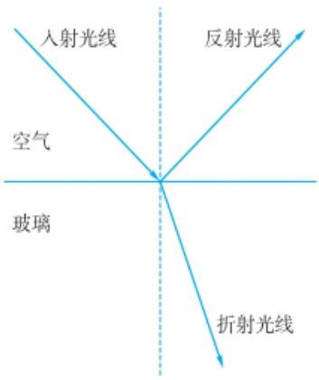

text_image

入射光线
空气
玻璃
反射光线
折射光线

光的反射和折射

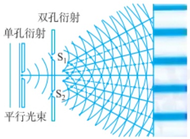

text_image

双孔衍射
单孔衍射
S₁
S₂
平行光束

杨氏双缝干涉实验:光的干涉和衍射

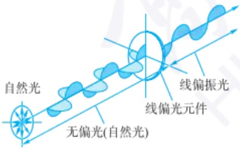

text_image

自然光
无偏光(自然光)
线偏振光
线偏光元件

光的偏振

光的吸收、发射和散射示例

续表

| 方法名称 | 辐射能 | 作用物质 | 检测信号 |
| --- | --- | --- | --- |
| 原子吸收光谱法 | 紫外、可见光 | 气态原子的外层电子 | 吸收后的紫外、可见光 |
| 紫外-可见吸收光谱法 | 紫外、可见光 | 分子中的电子 | 吸收后的紫外、可见光 |
| 红外吸收光谱法 | 2.5~15 μm 红外光 | 分子内化学键 | 吸收后的红外光 |
| 核磁共振波谱法 | 0.1~800 MHz 射频 | 具有核自旋的原子核,如分子质子 | 吸收后的射频 |
| 电子自旋共振波谱法 | $10^3 \sim 8.0 \times 10^5$ MHz 微波 | 未成对电子 | 吸收后的微波 |

发射光谱法是一种基于分析物被激发后发射电磁波的光谱法。这种方法利用样品在接受能量激发（如热能、电能或光能）后，其原子或分子从高能级跃迁至低能级时所发出特定波长的光辐射。这些发射的光谱线具有特定的波长，能够代表特定的原子或分子，因此可以用来识别和量化样品中的元素或化合物。

发射光谱法的原理基于原子和分子的能级跃迁。当原子或分子吸收特定的能量后，电子会被激发到更高的能级，形成激发态。这种激发态是不稳定的，电子很快会回到基态或较低的激发态，在这个过程中释放出与能级差相对应的能量，通常以光的形式发射出来。发射的光波长特定，与原子或分子的类型密切相关，因此可以通过测量发射光的波长和强度来分析样品的成分和含量。通过选择适当的激发源和检测系统，发射光谱法可以分析从固体、液体到气体等各种样品类型。发射光谱法的分类如表4.1.3所示。

表 4.1.3 发射光谱法

| 方法名称 | 激发方式 | 作用物质 | 检测信号 |
| --- | --- | --- | --- |
| X射线荧光光谱法 | X射线(0.01~2.5 nm) | 原子内层电子的逐出,外层能级电子跃入空位(电子跃迁) | 特征X射线(X射线荧光) |
| 原子发射光谱法 | 火焰、电弧、火花、等离子炬等 | 气态原子外层电子跃迁 | 紫外、可见光 |
| 原子荧光光谱法 | 高强度紫外、可见光 | 气态原子外层电子跃迁 | 原子荧光(紫外、可见光) |
| 分子荧光光谱法 | 紫外、可见光 | 分子 | 荧光(紫外、可见光) |

散射光谱法是基于光与物质相互作用产生散射现象而建立的一种光谱分析方法，通过分析散射光的特性来研究物质的结构、成分及其动力学性质。散射现象指的是光波在通过介质（如气体、液体或固体）时，由于遇到不同大小的粒子或不均匀介质，导致光波方向、强度或能量发生变化的过程。

散射光谱法的优点包括非侵入性、对样品破坏小、适用于各种状态的物质（固体、液体和气体）及不需要特殊的样品制备。这些技术在化学分析、物理、生物医学及材料科学等领域有着广泛的应用，用于识别未知物质、研究分子动力学、监测化学反应过程和探索新材料的性质等。

## 4.1.4 光谱分析仪器的组成和工作原理

光谱分析仪器是一类基于光与物质相互作用原理进行物质组成和含量分析的精密仪器。这些仪器主要由光源、波长选择系统、样品池、检测器和信号处理与显示系统组成。工作原理涉及光的吸收、发射或散射等现象，通过分析样品对光的这些相互作用，可以定性或定量地确定样品的化学成分和结构。各类光谱仪器结构如图4.1.2所示。

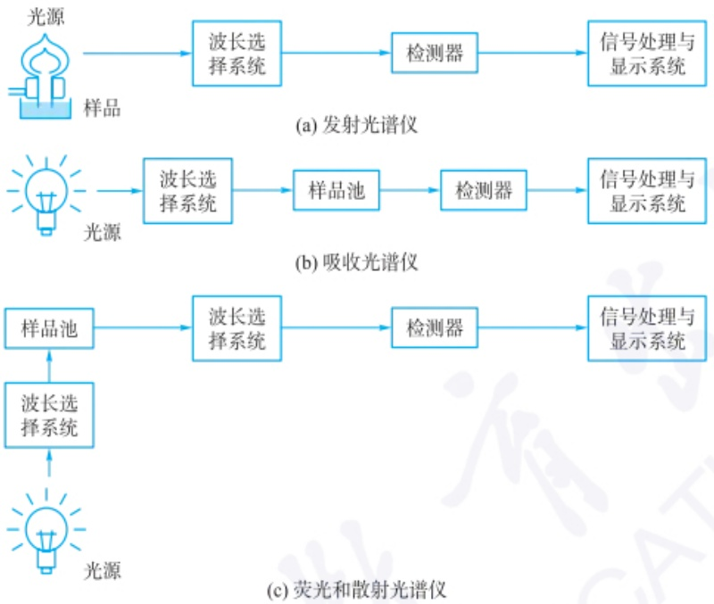

flowchart

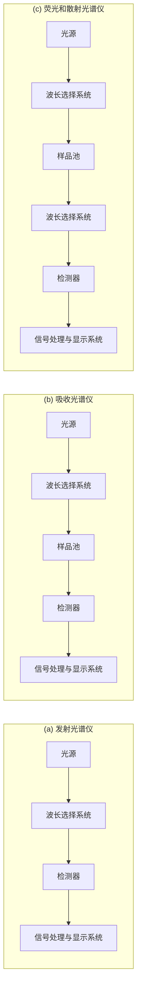

图 4.1.2 各类光谱仪结构示意图

## 4.1.4.1 光源

光谱分析法中光源的作用是为整个光谱分析过程提供光能。理想的光源通常具有稳定的光输出，适当的光谱范围，足够的亮度和功率，以及较长的使用寿命和低维护需求等特点。由于光源辐射强度的稳定性与电源功率的变化直接相关，因此需要使用稳压电源以保证输出稳定，或者用参比光束的方法来减少光源输出的波动对测定所产生的影响。光源可以划分为连续光源和线光源，也可以根据发光强度随时间的变化分为持续发光的光源和脉冲光源。

脉冲光源与持续发光的光源不同，它是间歇性发光的光源，以短时高强度的脉冲方式发光，每次发光持续的时间很短（通常是纳秒级或微秒级），然后快速关闭，形成一个间断的脉冲。连续光源和线光源都可以输出脉冲方式的光，如脉冲氙灯、脉冲空心阴极灯和脉冲激光。脉冲光源的特点是发光强度在每个脉冲期间非常高及脉冲的频率和持续时间可调节，有利于高时间分辨率的应用，常用于荧光寿命分析、时间分辨光谱学和超快光谱现象的研究等。图4.1.3为不同波谱区所用的光源。

## 1. 连续光源

连续光源是一种能够发射连续光谱的光源，广泛应用在紫外-可见吸收光谱、红外吸收光谱、分子荧光光谱和分子磷光光谱仪器中。理想的连续光源应有足够的发光强度，且在所用波长区域发射强度恒定，即其发光强度与波长无关。实际

## 为什么花朵呈现各种不同的颜色？

你有没有想过,为什么花朵的颜色是五颜六色的?

1. 色素是花朵颜色的主要来源
色素是一种能够吸收特定波长的光线的物质,从而使物体呈现出特定的颜色。常见的色素包括花青素、叶黄素和类胡萝卜素等。
2. 花瓣表面结构对花朵颜色的影响

花瓣表面的结构可以改变光线的折射和散射,从而产生不同的颜色效果。有两种主要的结构因素,分别是表皮细胞和气泡。

3. 环境因素对花朵颜色的影响

除了色素和结构之外,花朵颜色还受到环境因素的影响。环境因素可以改变花朵中色素的含量或活性,从而导致花朵颜色的变化。有三种主要的环境因素,分别是温度、光照和pH。

溴钨灯、氙灯及发光二极管的发射光谱图

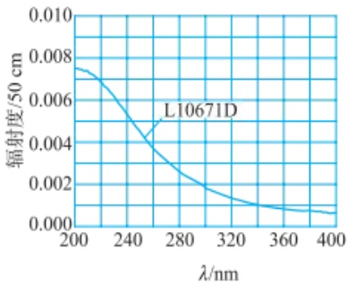

line

| \(\lambda/\)nm | 辐射度/50 cm |
| --- | --- |
| 200 | ~0.0075 |
| 240 | ~0.0052 |
| 280 | ~0.0026 |
| 320 | ~0.0013 |
| 360 | ~0.0008 |
| 400 | ~0.0005 |

氘灯的发射光谱图

## 光电效应证实了电磁辐射的粒子性

1887 年, Heinrich Hertz 在研究光的电磁本性时, 发现了光电效应。

1899 年, J. J. Thomson 发现阴极射线就是电子。1902 年 Philip Lenard 发现, 光电效应产生的电子的能量与光的强度无关。

1905 年 3 月, 爱因斯坦用普朗克的能量量子化观点成功地解释了 1887 年赫兹发现的光电效应。当光照射在金属表面上时, 只要光子具有足够的能量, 就会有电子逸出, 这就是光电效应。他因发现了光电效应的规律, 获得 1921 年的诺贝尔物理学奖。

1915年Robert Millikan经过10年的努力，验证了爱因斯坦1905年提出的光电效应公式 $E_{k} = h\nu -W_{0}$ ，并直接运用光电方法对普朗克常量 $h$ 作了首次测量。他因对基本电荷和光电效应的研究，获得了1923年度的诺贝尔物理学奖。

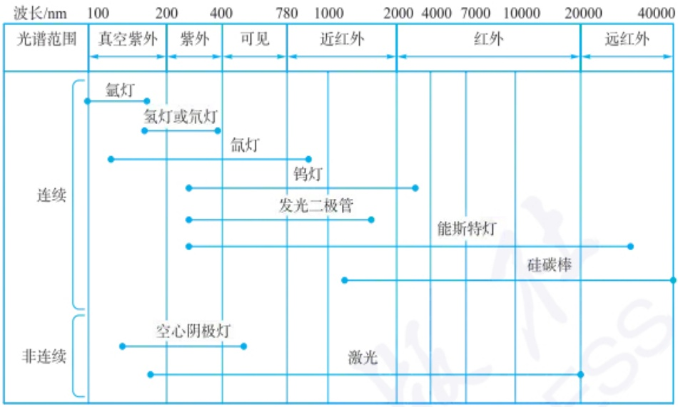

text_image

波长/nm
光谱范围
真空紫外
紫外线
可见
近红外
红外
远红外
连续
氩灯
氢灯或氘灯
氙灯
钨灯
发光二极管
能斯特灯
硅碳棒
非连续
空心阴极灯
激光

图 4.1.3 不同波谱区所用的光源

上很难找到符合这些条件的理想连续光源。

（1）紫外光源 氢灯和氘灯是常用的紫外连续光源，它们是气体放电灯，在低压(约 $1.3\times10^{3}$ Pa)下以电激发的方式产生连续光发射，其光谱范围为160\~375 nm。相对氢灯而言，氘灯具有更强的发光强度和更长的寿命，提供相对均匀的光强度，因此在光谱分析中更为通用。
（2）可见光源 钨灯和氙灯是常用的可见光连续光源。钨灯具有宽的光谱范围、稳定性好和成本低等特点，是一种广泛使用的光源。它属于白炽灯的一种，使用钨丝作为灯丝，在电流的作用下加热到高温发光。钨灯的工作温度一般为  $2870 \, K$ ，光谱波长范围为  $320 \sim 2500 \, nm$ 。

氙灯是一种气体放电灯，使用氙气作为主要发光介质，可以发出接近自然光的连续光谱，在光谱波长范围250\~700 nm的发光强度较为恒定。氙灯因高强度发射、宽广的光谱输出及良好的颜色呈现能力而被用作荧光分光光度计的光源。

发光二极管(light emitting diode, LED) 是一种半导体光源, 它的工作原理基于半导体物理中的电致发光原理。发光二极管是由含镓(Ga)、砷(As)、磷(P)、氮(N)等元素的化合物制成的 p-n 结二极管, 当电流通过发光二极管时, 电子和空穴在半导体材料的 p-n 结中复合, 释放出能量。这部分能量以光的形式发射出来, 产生发光现象。不同的半导体材料能够产生不同颜色的光, 通过调控半导体材料的组成, 可以获得最大发光波长的范围为 375\~1000 nm, 其带宽范围为 20\~50 nm, 可分别在连续模式和脉冲模式下工作。

（3）红外光源 常用的红外光源是一种用电加热到温度为  $1500 \sim 2000 \, K$  的惰性固体，如能斯特(Nernst)灯和硅碳棒。能斯特灯是一种特殊类型的白炽灯，使用稀有的陶瓷材料(如氧化锆和氧化钇混合物)作为发光体。能斯特灯的工作原理基于能斯特效应，即在特定温度下，某些电介质材料的电导率随温度的增加而显著增加，从而使这些材料在加热到一定温度后能够导电并发光。其光谱波长  $\lambda$  范围为  $2 \sim 25 \, \mum$ ，适用的波数  $\tilde{\nu}$  范围为  $400 \sim 5000 \, cm^{-1}$ 。能斯特灯具有在高波数区有更强的发射、稳定性好、使用寿命长、价格较贵等特点。

## 2. 线光源

（1）空心阴极灯(hollow cathode lamp, HCL) 空心阴极灯被广泛用于原子吸收光谱(atomic absorption spectrum, AAS)中作为特定元素的光源。它能产生非常窄的带宽的光谱线，这些光谱线与被测元素的特定吸收线相对应。
（2）金属蒸气灯 金属蒸气灯是一种高强度放电灯，它通过电弧放电在金属蒸气中产生光线。汞灯和钠灯是常用的金属蒸气灯。汞灯产生的一系列线光谱的波长范围为 $254\sim 734~\mathrm{nm}$，钠灯的发射谱线波长主要为 $589.0~\mathrm{nm}$ 和 $589.6~\mathrm{nm}$。
（3）激光器 激光器是一种产生激光的设备，能够产生高度方向性、单色性强、相干性好的光束。激光技术自20世纪中叶发展以来，在荧光光谱、发射光谱、拉曼散射光谱、傅里叶变换红外光谱和光声光谱等领域有极为广泛的应用。

激光器的基本工作原理是受激发射。在一个增益介质（如气体、固体、液体或半导体）中，通过外部能量的输入（通常是光或电），使得介质中的原子或分子的电子被激发到高能级。当这些高能级的电子自发地回落到低能级时，会释放出光子。这些光子进一步激发其他已经处于高能态的原子或分子，导致更多相同能量和相位的光子被释放，形成了强度大、方向性好的光束。

## 4.1.4.2 波长选择系统

波长选择系统是光谱仪器中的分光系统,其主要作用是分解吸收或发射的复合光为单色光或窄谱带,从而提高测定的灵敏度和仪器的光谱选择性。波长选择装置有滤波器和单色器两种。图 4.1.4 为用于光谱仪器的各材料透光范围及波长选择器的材质。

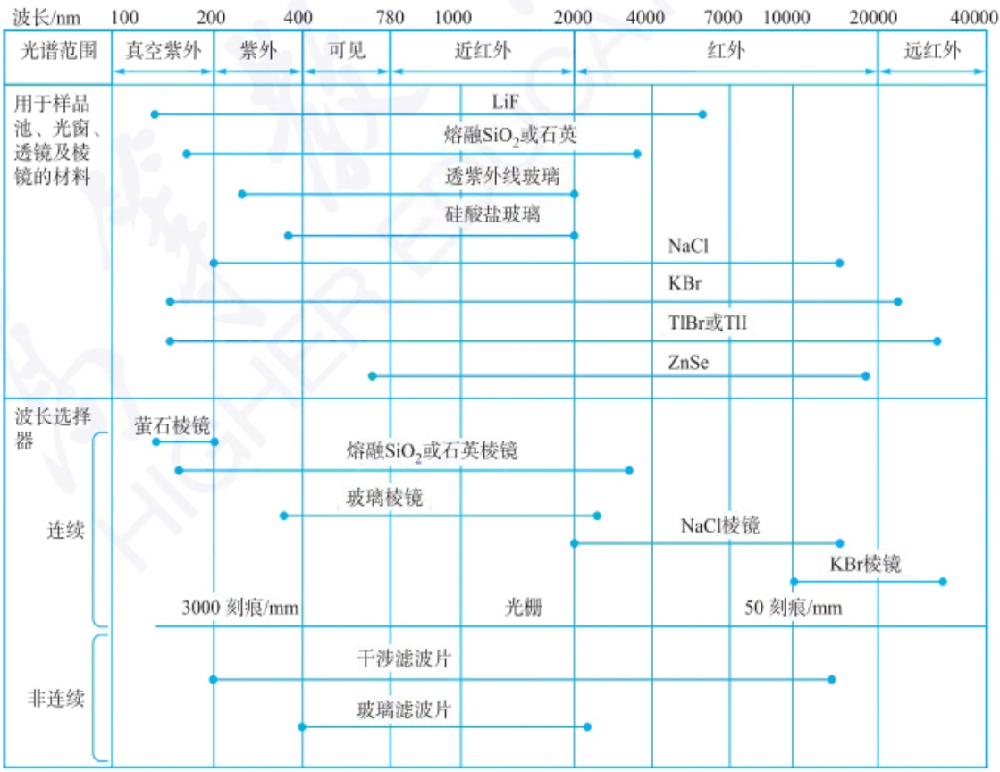

other

| Category | Material / Technology | Wavelength Range (nm) |
| :--- | :--- | :--- |
| 用于样品池、光窗、透镜及棱镜的材料 | 真空紫外 | ~100 ~200 |
| 用于样品池、光窗、透镜及棱镜的材料 | 紫外 | ~200 ~400 |
| 用于样品池、光窗、透镜及棱镜的材料 | 可见 | ~400 ~780 |
| 用于样品池、光窗、透镜及棱镜的材料 | 近红外 | ~780 ~2000 |
| 用于样品池、光窗、透镜及棱镜的材料 | 红外 | ~2000 ~40000 |
| 波长选择器 | 黄石棱镜 | ~100 ~200 |
| 连续 | 熔融SiO2或石英棱镜 | ~200 ~400 |
| 连续 | 玻璃棱镜 | ~400 ~780 |
| 连续 | 光栅 | ~780 ~2000 |
| 连续 | NaCl棱镜 | ~2000 ~50刻痕/mm |
| 连续 | KBr棱镜 | ~50刻痕/mm ~20000 |
| 连续 | TlBr或TlI | ~2000 ~40000 |
| 连续 | ZnSe | ~4000 ~20000 |
| 非连续 | 干涉滤波片 | ~3000 ~50刻痕/mm |
| 非连续 | 玻璃滤波片 | ~50刻痕/mm ~2000 |
| 非连续 | N/A | ~2000 ~40000 |

图 4.1.4 用于光谱仪器的各材料透光范围及波长选择器的材质

## 声光可调滤光器的原理和特点

声光可调滤光器利用声波与光波的相互作用来改变光的传播方向，从而选择性地滤过特定波长的光。这种滤光器通常由一个声光晶体（如石英或铌酸锂）构成，声波通过压电换能器引入，改变晶体的折射率，从而实现对光波的调制。声光可调滤光器的主要特点包括:

1. 高速调谐: 通过改变声波的频率, 可以快速调谐滤波器的中心波长, 调谐速度通常在微秒级。
2. 无机械运动部件: 与传统的机械调谐滤光器不同, AOTF 没有移动部件, 因此更为可靠和耐用。
3. 多波长选择: 可以在多个波长上同时工作, 适合多通道光谱分析。
4. 高分辨率: 具有较高的波长分辨率, 目前已达到 0.0125 nm 或更小, 适合精细光谱分析。

## 棱镜和光栅的区别

1. 原理不同,棱镜是根据光的折射作用进行分光的色散元件,不同波长的光具有不同的折射率。光栅是利用光的干涉和衍射现象进行分光的色散元件,不同波长的光经过光栅后有不同的衍射角,所以能将不同波长的光分开。
2. 棱镜的角色散率与棱镜的折射率、顶角及棱镜材料有关，产生非均排光谱；光栅角色散率是常数，不随波长而改变，产生的是均排光谱。
3. 光栅的适用波长范围比棱镜宽。
4. 一般光栅的分辨率比棱镜高，这是因为棱镜的分辨率与棱镜底边的有效长度及棱镜材料的色散率成正比，而光栅总刻线越多，则分辨率越高。

## 1. 滤波器

（1）滤光片 滤光片是一种光学元件，用于选择性地传递（透过）或阻挡（吸收或反射）特定波长范围内的光。根据滤光片的设计和材料，它们可以对光谱的特定部分进行精确控制，而使得一定带通的光辐射通过。

用于波长选择的滤光片主要有吸收滤光片和干涉滤光片。

吸收滤光片是通过材料本身吸收某些波长的光而工作，透过光则呈一定的单色性。吸收滤光片仅限用于可见光范围，其带通为 $30\sim 250~\mathrm{nm}$ ，其透过率通常仅为 $1\%$ 或更低，主要用于简单的颜色过滤。

干涉滤光片是利用多层薄膜的干涉效应来选择性地透过或反射特定波长的光,能够提供更精确的波长选择性,其带通更窄,透过率更高。常用的干涉滤光片包括截止滤光片和带通滤光片两类。

选择滤光片时,通常需要考虑透过率、截止或带宽、材料和持久性及尺寸和形状等因素。

（2）声光可调滤光器(acousto-optic tunable filter, AOTF) 声光可调滤光器是一种利用声光效应来控制光的传播特性的固体电调带通滤波器。AOTF 广泛应用于光谱分析、成像系统、激光雷达和通信系统中，尤其在需要快速调谐和高可靠性的场景中表现优异。

## 2. 单色器

单色器的作用是分解复合光为单色光或窄谱带。单色器包括入射狭缝、准直透镜、色散元件和出射狭缝等部件。如图 4.1.5 所示。单色器中的色散元件有棱镜和光栅两种类型。

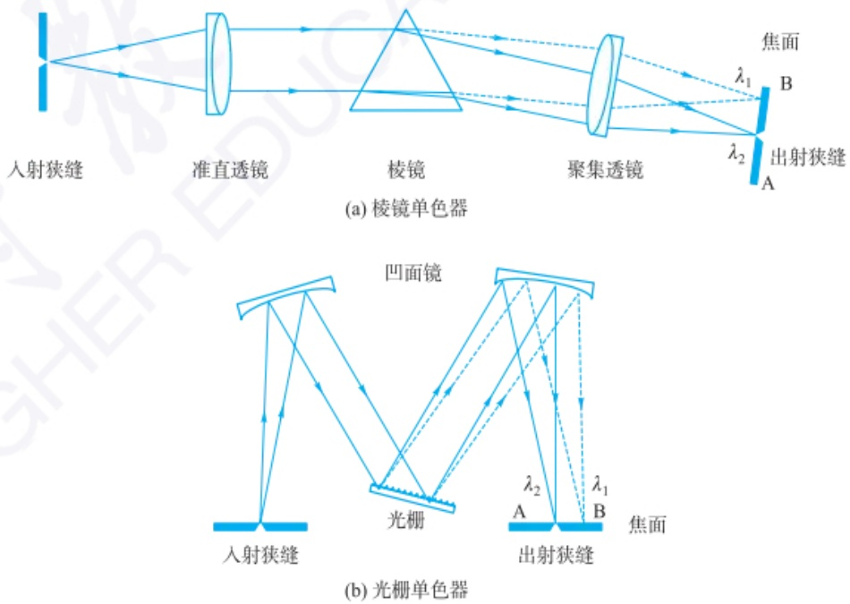

图 4.1.5 两种类型的单色器光路示意图

（1）棱镜 棱镜是一种基于光的折射而进行分光的色散元件，通常由透明的材料(如玻璃或石英)制成。通常用角色散率和分辨率表示棱镜的分光性能。角色散率是指入射光与折射光夹角 $\theta$ 和波长 $\lambda$ 变化大小的比值 $\mathrm{d}\theta /\mathrm{d}\lambda$ ，角色散率越大，波长相差很小的两条谱线分得越开。

分辨率 R 是指分开两条相邻谱线的能力,一般表示为

$$
R = \overline {{\lambda}} / \Delta \lambda \tag {4-1-5}
$$

式中， $\bar{\lambda}$  为两条谱线波长的平均值， $\Delta\lambda$  为刚好能够分开的两条谱线之间的波长差。

棱镜的分辨率随波长而变化,对短波长的光分辨率大,对长波长的光分辨率小。

（2）光栅 光栅是基于多狭缝干涉和单狭缝衍射联合作用的色散元件。其中，多狭缝干涉决定谱线所在的位置，单狭缝衍射决定谱线的强度分布。光栅按照其结构和工作方式可以分为透射光栅和反射光栅两大类。反射光栅又可分为平面反射光栅(闪耀光栅,blazed grating)、凹面光栅(concave grating)和全息光栅(holographic grating)。

反射光栅是在玻璃表面真空蒸镀铝层，之后在铝层上刻制出许多等间隔、等宽的平行刻痕（或称为槽线）。当光线照射到这些刻痕上时，每个刻痕都会反射光线，而这些反射的光线会因为刻痕之间的相对位置和角度而发生干涉，进而产生衍射现象。这种衍射效应使得反射光栅可以将入射光分解成其组成的不同波长（即色彩），从而用于光谱分析。反射光栅的工作原理基于衍射理论，特别是根据光的波动性质。当光波遇到光栅上的刻痕时，每个刻痕相当于一个次级光源，发出的光波会相互干涉。根据干涉条件，即相邻刻痕反射的光波相位差决定了衍射光的强度分布，这导致光栅能够以不同的角度反射不同波长的光。这一现象可以用光栅方程来描述:

$$
d \sin \theta = m \lambda \tag {4-1-6}
$$

式中，d 是相邻两刻痕之间的距离（光栅常数）， $\theta$  是衍射角（即反射光和光栅表面的夹角）， $\lambda$  是光波的波长，m 是衍射级次，可以是  $0, \pm1, \pm2$  等整数。

反射光栅具有几个关键的性能指标,包括衍射效率(即反射特定波长光的能力)、分辨率(能够分辨两个接近波长的能力)、色散率及波长范围。

光栅的分辨率 R 为光谱级次 n 与光栅刻痕总数 N 的乘积, 即

$$
R = \frac {\overline {{\lambda}}}{\Delta \lambda} = n N \tag {4-1-7}
$$

它们的设计可以通过改变刻痕的密度、深度和形状来优化这些性能指标，以适应特定的应用需求。反射光栅能够处理的光强度高、可用于宽波长范围的光，并且具有较高的分辨率和效率，因此光谱仪多采用反射光栅。现在用的光栅基本上都是从母光栅复制的复制光栅，用于紫外-可见区的光栅刻痕数一般为300\~2000条·mm $^{-1}$ ，用于中红外光区的光栅刻痕数为100条·mm $^{-1}$ 即可。

## 4.1.4.3 样品池

样品池用于盛放样品，由对待测光谱区透明的材料制成。

分子光谱的样品是常温常压下的固体、液体或者气体，因此在紫外光区工作时，采用石英或者熔融二氧化硅材料；在可见光区时，采用硅酸盐玻璃；在红外光区时，则可根据不同的波长范围选用不同材料的晶体和待测样品混合组成压片，如 NaCl 和 KBr。

原子光谱要求分析物在测定时处于原子状态,因此其样品引入系统的原子化功能通常通过电热、火焰或者电感耦合等离子体炬等方式提供高温条件来实现。

## 4.1.4.4 检测器

检测器的作用是将光信号转换为电信号，即光电转换器。有对光有响应的光检测器和对热有响应的热检测器两种类型。光检测器类型比较多，有硒光电池、光电管、光电倍增管、硅二极管阵列检测器、半导体检测器和感光板等，主要应用于紫外-可见光区的信号检测。热检测器主要包括真空热电偶、热释电检测器和光电导检测器，主要应用于红外光谱的检测。图4.1.6为光谱仪的检测器及其应用波长范围。

典型光检测器的光谱响应曲线

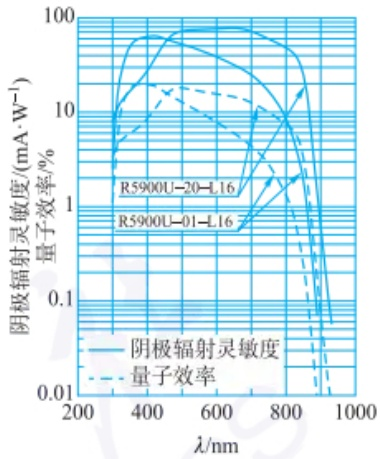

line

| \(\lambda/\)nm | 阴极辐射灵敏度 \((mA \cdot W^{-1})\)::R5900U-20-L16 | 量子效率 (%)::R5900U-20-L16 | 阴极辐射灵敏度 \((mA \cdot W^{-1})\)::R5900U-01-L16 | 量子效率 (%)::R5900U-01-L16 |
| --- | --- | --- | --- | --- |
| 300 | ~8 | ~4 | ~8 | ~4 |
| 400 | ~60 | ~18 | ~60 | ~18 |
| 500 | ~70 | ~15 | ~50 | ~15 |
| 600 | ~75 | ~12 | ~40 | ~12 |
| 700 | ~75 | ~8 | ~30 | ~8 |
| 800 | ~60 | ~2 | ~10 | ~2 |
| 900 | ~1 | ~0.1 | ~1 | ~0.1 |

PMT 光谱响应曲线

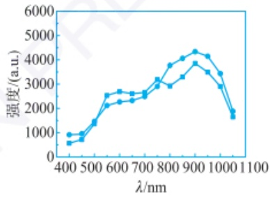

line

| \(\lambda/\)nm | 强度 (a.u.) (Series 1) | 强度 (a.u.) (Series 2) |
| --- | --- | --- |
| 400 | ~900 | ~550 |
| 450 | ~900 | ~750 |
| 500 | ~1400 | ~1400 |
| 550 | ~2500 | ~2100 |
| 600 | ~2700 | ~2300 |
| 650 | ~2600 | ~2300 |
| 700 | ~2600 | ~2500 |
| 750 | ~3200 | ~2900 |
| 800 | ~3800 | ~2900 |
| 850 | ~4100 | ~3300 |
| 900 | ~4400 | ~3850 |
| 950 | ~4150 | ~3500 |
| 1000 | ~3450 | ~2900 |
| 1050 | ~1850 | ~1650 |

硅光电二极管的光谱响应曲线

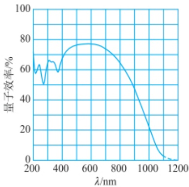

line

| \(\lambda/\)nm | 量子效率/% |
| --- | --- |
| 200 | ~60 |
| 250 | ~63 |
| 300 | ~50 |
| 350 | ~65 |
| 400 | ~58 |
| 500 | ~75 |
| 600 | ~77 |
| 700 | ~75 |
| 800 | ~65 |
| 900 | ~48 |
| 1000 | ~20 |
| 1100 | ~2 |
| 1200 | ~0 |

CCD 光谱响应曲线

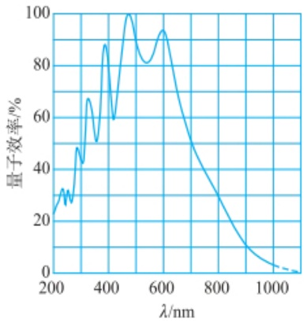

line

| \(\lambda/\)nm | 量子效率/% |
| --- | --- |
| 200 | ~23 |
| 250 | ~32 |
| 270 | ~26 |
| 300 | ~48 |
| 330 | ~67 |
| 360 | ~50 |
| 400 | ~88 |
| 430 | ~59 |
| 480 | ~100 |
| 550 | ~81 |
| 610 | ~93 |
| 700 | ~50 |
| 800 | ~30 |
| 900 | ~10 |
| 1000 | ~3 |
| 1100 | ~1 |

CMOS 光谱响应曲线

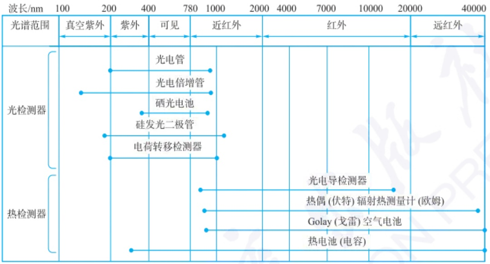

text_image

波长/nm
100 200 400 780 近红外 红外 远红外
光谱范围
真空紫外 紫外 可见
光电管
光电倍增管
硒光电池
硅发光二极管
电荷转移检测器
光谱检测器
热检测器
光电导检测器
热偶(伏特)辐射热测量计(欧姆)
Golay(戈雷)空气电池
热电池(电容)

图 4.1.6 光谱仪的检测器及应用波长范围

## 1. 光检测器

## (1) 真空光电管类检测器

（i）真空光电管。真空光电管是一种早期的利用光电效应（即光能转换为电能的现象）来检测光信号的光电探测器。它由一个真空密封的玻璃管、光敏阴极和阳极组成，在特定波长的光照射下产生电流，用于检测光强度。真空光电管基于外光电效应工作，当入射光照射在光敏阴极（通常是光敏材料，如铯、钾、钠等）上时，光子的能量使得阴极材料中的电子获得能量，跃迁并释放到真空中。这些释放的电子称为“光电子”。这些释放的电子向阳极移动，如果在阴极和阳极之间施加电压，就会形成电流，这个电流的大小与入射光的强度成正比，因此通过测量电流可以得到入射光的强度信息。

真空光电管的光谱响应特性由阴极上的涂层决定,因此不同光谱区的辐射,应选用不同类型的光电管进行检测。例如,氧化钾-银和铯-银的敏感光谱范围在紫外-可见区,氧化铯-银对近红外光区敏感。

（ii）光电倍增管。光电倍增管（photomultiplier tube, PMT）是一种高灵敏度的光电探测器，能够检测极低强度的光信号。它实际上是一种由多级倍增电极组成的光电管，利用光电效应和二次电子倍增技术将接收到的光信号转换成电信号，并能显著放大这些信号，使得光电倍增管在需要极高灵敏度和宽动态范围的应用中非常有价值。

如图 4.1.7 所示, 光电倍增管的基本结构包括一个光敏阴极、多个次级发射电极(称为打拿极或倍增极)及一个阳极。阴极涂有能发射电子的光敏物质如锑-铯或银-氧-铯等, 当光信号入射到光敏阴极时, 阴极会吸收光能并释放出电子(这一过程称为光电效应)。这些初级电子随后被加速并撞击第一个打拿极, 每

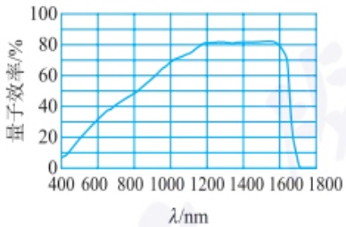

line

| \(\lambda/\)nm | 量子效率/% |
| --- | --- |
| 400 | ~8 |
| 600 | ~30 |
| 800 | ~48 |
| 1000 | ~68 |
| 1200 | ~81 |
| 1400 | ~81 |
| 1600 | ~75 |
| 1700 | 0 |

半导体检测器 InGaAs 的光谱响应曲线

## 单光子计数器

单光子计数器(single photon counting modules, SPCMs)是一种高灵敏的光学探测器，可用于探测单个光子，目前在量子光学、荧光和弱光等检测中被广泛使用。请查询资料详细了解单光子计数器的工作原理，并比较其与光电倍增管的区别。

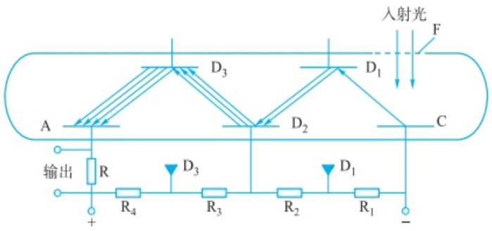

text_image

入射光
F
D1
D3
A
D2
C
输出
R
+
R4
D3
R3
R2
D1
R1
-

图 4.1.7 光电倍增管结构和工作原理示意图

$D_{1}$ 、 $D_{2}$ 、 $D_{3}$ —次级电子发射极， $R_{1}$ 、 $R_{2}$ 、 $R_{3}$ 、 $R_{4}$ —电阻

次撞击时都会释放出更多的二次电子。这些二次电子再被加速并撞击下一个打拿极，如此重复，通过串联的多个打拿极（通常为10个以上），实现电子的级联倍增。最终，在阳极处收集到的电子数量约为最初由光敏阴极释放的电子数量的 $10^{6}\sim10^{7}$ 倍，从而实现了信号的显著放大。

光电倍增管对紫外-可见光区有极高的灵敏度和宽广的动态范围,响应时间短,能够探测到极弱的光信号(如单光子)。

（2）半导体光学检测器 半导体光学检测器的检测原理基于半导体材料的光电效应，即光子入射到半导体材料上时产生电子-空穴对（电子从价带跃迁到导带）的现象。这些电子和空穴在电场的作用下产生电流或电压信号，从而检测到光的存在和强度。
(i) 硒光电池。硒光电池是一种利用光电效应将光能转换为电能的装置，它的主要工作材料是硒。这种光电池在历史上是最早用于直接光电转换的技术之一，虽然现代更多使用硅等材料制作的光伏设备，硒光电池在早期光电技术发展中却扮演了重要角色。
（ii）光电二极管。光电二极管的核心部分是一个具有光敏特征的 p-n 结。在正常情况下，p-n 结会形成一个内建电场，方向从 n 型区域指向 p 型区域。当光线照射到 p-n 结上时，光的能量被半导体材料吸收，产生电子-空穴对。在内建电场的作用下，电子会被推向 n 型材料，而空穴则被推向 p 型材料，从而在 p-n 结两端形成电压差或产生电流流动，实现了光信号到电信号的转换。

光电二极管根据其用途和性能的不同,可以进一步分为几种类型,如 PIN 光电二极管、雪崩光电二极管(avalanche photodiode, APD)、肖特基光电二极管等。PIN 光电二极管在 p 型和 n 型半导体之间增加了一个本征(I 型)半导体层,以提高光电转换效率和响应速度。雪崩光电二极管通过利用雪崩倍增效应来提高光电流,适用于需要高灵敏度检测的场合。

（iii）多通道光检测器。多通道光检测器是由多个光敏单元以线阵排列或面阵排列于一个半导体(通常是硅)芯片上的检测器件。芯片通过电路将每个单元的信号按照顺序或者同时以电的形式输出。对于光谱分析，多通道光检测器一般置于光谱仪或者单色器的焦面，可以同时收集多个波长的光谱信号。

多通道光检测器包括光电二极管阵列(photodiode array, PDA)和电荷转移器件。电荷转移器件通过收集阵列不同位置的光产生的电荷，测定一定短时间内累积的电荷，灵敏度可以与光电倍增管相当。电荷转移器件又包括电荷注入器件(charge-injection devices, CID)、电荷耦合器件(charge-coupled device, CCD)和互补

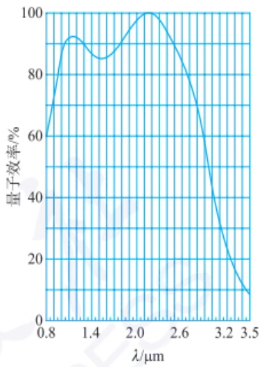

line

| \(\lambda/\mu m\) | 量子效率/% |
| --- | --- |
| 0.8 | ~62 |
| 1.0 | ~92 |
| 1.4 | ~85 |
| 2.1 | 100 |
| 3.5 | ~9 |

半导体检测器 PbS 的光谱响应曲线

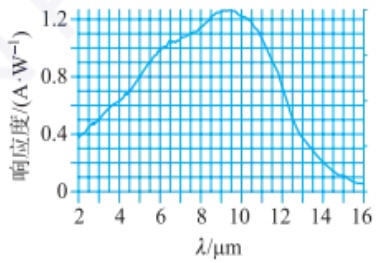

line

| \(\lambda/\mu m\) | \(响应度/(A \cdot W^{-1})\) |
| --- | --- |
| 2 | ~0.38 |
| 4 | ~0.65 |
| 6 | ~1.05 |
| 8 | ~1.15 |
| 10 | ~1.25 |
| 12 | ~0.75 |
| 14 | ~0.25 |
| 16 | ~0.05 |

半导体检测器 HgCdTe 的光谱响应曲线

## CCD 和 CMOS 的比较

CCD(电荷耦合器件)和CMOS(互补金属氧化物半导体)是两种广泛应用的图像传感器,它们在工作原理、性能、应用和制造工艺等方面都有显著的差别。以下是它们的主要异同点分析:

## 相似点

1. 基本功能: CCD 和 CMOS 都用于将光信号转换为电信号, 通常用于数码相机、摄像机、天文设备等的图像传感器中。它们都可以捕捉图像, 并将光的强度转换为数字信号进行处理。
2. 成像原理: 两者都基于光电效应, 利用光子在半导体材料中产生电子-空穴对, 并通过特定的方式收集这些电子, 以形成图像。

## 不同点

1. 工作原理: CCD 传感器通过电荷耦合的方式将每个像素中的电荷逐步转移到输出节点, 再转换为电压信号。这个过程要求电荷在芯片上依次转移, 类似于流水线操作, 最后才输出信号。CMOS 传感器在每个像素点上集成了光电二极管和信号放大器, 因此每个像素都可以直接读取并转换电信号, 这使得信号读取更加独立和并行。
2. 功耗: CCD 传感器功耗较高, CMOS 传感器功耗较低。
3. 速度: CCD 传感器的读取速度较慢, CMOS 传感器速度较快, 适合高速成像应用。
4. 制造成本: CCD 的制造工艺复杂, 通常需要专门的制造设备, 因此成本较高。CMOS 传感器可以使用标准的半导体制造工艺, 与现有的集成电路制造兼容, 因此成本较低。
5. 图像质量: CCD 传感器具有较高的图像质量, 特别是在低光环境下表现优异, 噪声较低, 因此在专业摄影、天文摄影中常用。CMOS 传感器虽然图像质量与 CCD 接近, 但早期版本在低光环境下噪声较大。近年来, 随着技术的进步, CMOS 传感器的图像质量显著提高, 甚至在某些方面超过 CCD。
6. 应用领域: 由于其高图像质量, CCD 常用于高端摄影设备、天文观测仪器、科学研究仪器等领域。CMOS 因其具有成本低、功耗低且速率快的优势, 广泛应用于消费级电子产品, 如智能手机、数码相机、安防摄像头等。

CCD 和 CMOS 各有优劣, CCD 在高图像质量和低噪声方面表现出色, 适合专业和科研用途; 而 CMOS 由于功耗低、成本低、速度快等特点, 更适合消费电子产品。随着技术的发展, CMOS 传感器的性能不断提升, 逐渐在许多领域中取代 CCD, 尤其在大多数消费级应用中已成为主流。

金属氧化物半导体(complementary metal-oxide semiconductor, CMOS)。这些多通道检测器广泛用于光谱成像检测中。

## 2. 热检测器

热检测器是一类基于热效应原理工作的光学检测器，这类检测器能够响应从紫外线、可见光到红外线甚至更长波长的电磁辐射。热检测器通过将入射光的能量转换为热量，进而产生温度变化，这些温度变化可以通过各种方式检测和量化，从而实现对光辐射的强度测定。与半导体光学检测器不同，热检测器不依赖于光子的能量来激发电子，而是通过吸收电磁波（通常是红外辐射）导致温度变化，再通过测量这个变化来检测信号。热检测器可用作红外光谱仪的检测器。红外光到达检测器时的功率一般很小，要求吸收红外光的元件热容小，以便对温度产生灵敏响应。热检测器主要包括真空热电偶、热释电检测器、光电导检测器和Golay（戈雷）空气电池等。

（1）真空热电偶 真空热电偶通常含有两种不同的导电材料（金属或合金，如铜-镍、铬-铝等），通过形成闭路时的温度差转变为电势差进而产生电流的一种装置。它以一小片涂黑的金箔作为红外辐射的接受面，金箔的另一面焊有两种不同的金属作为热端。在冷端接有金属导线。当红外辐射透过盐窗（如KBr和CsI等）照射到涂黑的金箔上时，热端温度升高，而冷端保持较低温度时，这两种材料之间由于温度差而产生电势差，在闭路中产生电流。这个电流与热端和冷端之间的温度差成正比。热电偶通常密封在真空度为0.01 Pa的真空腔中，以避免热损失和受到环境的热干扰。真空热电偶主要用于色散型红外光谱仪。
（2）热释电检测器 某些晶体材料（如氘化硫酸三甘肽、氘化L-丙氨酸硫酸三甘肽、钽酸锂和钛酸钡等）具有特殊的性质，即当它们的温度发生变化时，材料内部的极化状态会发生改变，从而在其表面产生电荷。这种现象称为热释电效应。当外界的红外辐射进入检测器时，材料的温度发生细微变化，材料内部的电荷重新分布，产生电流信号。电流变化幅度与热电元件表面积和温度极化率的变化呈正比，因此可测量红外辐射的强度。热释电检测器与传统的热电偶或热电堆检测器不同，前者对温度的变化特别敏感，而后者对热力学温度敏感。热释电检测器的优势在于它能够检测到微小的温度波动和瞬时温度变化，因此更适合运动探测和动态环境下的温度变化监控。由于热释电效应对温度变化的快速响应，热释电检测器的响应时间非常快，适用于傅里叶变换红外光谱仪。
（3）光电导检测器 光电导检测器是一种基于材料的光电导效应来检测光信号的传感器。当光照射到特定的半导体材料上时，材料的电导率会发生变化，进而产生电信号。碲镉汞检测器（mercury cadmium telluride detector, HgCdTe）是一种广泛用于红外探测领域的高性能半导体光电检测器，特别擅长检测中红外和长波红外波段的辐射。碲镉汞材料的独特之处在于其组成中碲（Te）、镉（Cd）、汞（Hg）的比例可以调节。这种调节直接影响材料的带隙，进而可以调整探测器的光谱响应范围。通过改变碲、镉、汞的比例，可以使检测器灵敏于不同波长的红外辐射，通常涵盖从短波红外到长波红外（1\~14  $\mu$ m）的宽光谱范围。碲镉汞检测器具有高灵敏度、宽波长响应和快速响应的特点，适用于快速扫描测量和气相色谱-傅里叶变换红外光谱仪联机检测。

## 4.1.4.5 信号处理与显示系统

信号处理与显示系统的作用是处理、读出和显示检测信号，主要由信号处理器和显示器件组成。

信号处理器通常是一种电子器件，它可以放大检测器的输出信号。此外，信号读取也可能将信号在直流与交流直接转换，滤掉不必要的信号组分等。由检测器将光信号转换为电信号后，老式光谱仪器一般用记录仪、微安表、检流计、数字显示器或阴极射线显示器显示和记录测定结果。现代仪器一般使用数字显示器、液晶显示器或者计算机显示器显示和记录测定结果。

## 4.1.5 光分析法的进展

近年来,光分析法取得了显著的进展,主要集中在新光源、新光学材料器件、新的光学激发构型和联用技术等几个方面。

## 4.1.5.1 新光源

新光源包括超快激光、超连续激光和量子级联激光等。如飞秒激光能提供极短的脉冲（飞秒级别， $1\ fs=10^{-15}\ s$ ），能够捕捉和研究超快动力学过程，如化学反应的中间态。这种光源广泛用于超快光谱、光电子显微镜等领域。新光源的发展极大地推动了光分析技术的进步。

## 4.1.5.2 新光学材料器件

纳米材料和光导纤维等新光学材料在现代光学分析技术中扮演着重要角色。纳米材料因其尺寸接近原子或分子尺度，具有独特的物理、化学性质，在光电器件（如光伏电池、光探测器）方面具有广泛的应用。如采用  $CsPbBr_{3}$  纳米片/ZnO 纳米线/石墨烯/PVDF 结构的柔性紫外探测器，可获得高的光暗电流比。另外，混合维度范德华异质结如  $Gr/PdSe_{2}/Ge$  增强的光吸收特性和石墨烯透明电极高效的载流子收集能力，构建的光电探测器表现出高的光响应率、高的比探测率，对纳秒级脉冲光信号具有快速的响应能力，并实现了从紫外到中红外的光谱响应等优异的器件性能。光导纤维是一种用来传输光信号的纤维状材料，依靠全内反射原理来传输光信号，在光通信和传感技术中起着关键作用。光纤传感技术的发展为实时、在线监测提供了新的手段。利用光纤传感器，可以实现对化学反应、环境变化和生物过程的连续监测，应用前景广泛。

## 4.1.5.3 新的光学激发构型

近年来，光学激发技术的发展促使了多种新型激发构型的出现。这些构型在不同应用中展现出独特的优势，尤其在超快光谱、成像技术及纳米光学等领域。如受激发射损耗(stimulated emission depletion, STED)模式是一种超分辨荧光显微技术，能够突破光学显微镜的衍射极限，实现纳米级别的分辨率。STED 显微镜由德国物理学家 Stefan W. Hell 于 1994 年提出，并在 21 世纪得以广泛应用。Stefan W. Hell 因此技术获得了 2014 年的诺贝尔化学奖。

STED 显微镜的光学激发构型基于两个光束的精确设计与控制: 激发光束用于激发样品中的荧光分子, 而 STED 光束通过环状光圈的受激发射损耗抑制外围区域的荧光发射, 只有中心区域的分子才能发出荧光。这种光学构型有效地压缩了发射区域, 从而突破了衍射极限, 实现纳米级分辨率的超分辨成像。

## 4.1.5.4 联用技术

光分析联用技术是将光分析方法与其他分析技术相结合，以提高分析的准确性、灵敏度和信息量。如光谱-质谱联用，激光解吸电离质谱:利用激光解吸样品表面的分子并通过质谱检测。此技术可以用于分析大分子如蛋白质、聚合物等的质量和结构信息。光谱-显微镜联用:例如，使用荧光显微镜和荧光光谱联用，用于单分子荧光分析，适用于生物样品的超分辨成像。光谱-电化学联用:将光谱技术与电化学分析结合，用于研究电化学反应中的中间体和反应机理。例如，紫外-可见光谱电化学、红外光谱电化学等，广泛应用于电池、燃料电池和电催化研究中。

这些光分析联用技术的出现,使得研究人员能够在单一实验中获得更多维度的样品信息,显著提高了分析的准确性和效率。这些技术在化学分析、材料科学、生物医学研究及环境监测等领域都有着广泛的应用前景。

## 习题

## - 章节练习题 -

1. 请对红外光、紫外光、无线电波、X射线、可见光和微波分别按波长递增和能量递增的顺序进行排序。
2. 什么是复合光和单色光？光谱分析中如何获得单色光？
3. 光谱仪一般由哪几部分组成？它们的作用分别是什么？
4. 单色器由哪几部分组成？它们的作用分别是什么？
5. 如用刻痕数为 400 条·mm $^{-1}$ 的光栅观察钠双线 589.0 nm 和 589.6 nm, 需要的光栅长度是多少?
6. 不经任何改装的商品荧光光谱仪、紫外-可见吸收光谱仪或红外吸收光谱仪可以用来做化学发光分析测定吗？为什么？
7. 请问光电倍增管作为光学检测器, 是否可以分别用作分子荧光光谱仪、紫外-可见吸收光谱仪、原子吸收光谱仪、ICP-原子发射光谱仪、化学发光分析仪或红外光谱仪的检测器? 为什么?

## - 挑战性问题 -

8. 紫外-可见-近红外吸收光谱仪在纳米材料、生物医药研究和环境科学等领域发挥着重要作用。例如，在纳米材料表征方面，紫外-可见-近红外吸收光谱仪能够提供关于纳米材料结构和性质的关键信息，这对于新材料的设计和优化至关重要。在医药研究领域，通过检测药物在紫外、可见和近红外区域的吸收特性，分析药物的成分和结构，确保药物的安全性和有效性。如果要制作一台紫外-可见-近红外吸收光谱仪，波长范围200\~2500 nm，应选择什么光源和检测器？使用单一光源和检测器是否可以？

## - 专题或报告 -

9. 1970 年,一种新的激光光源——超连续谱激光横空出世。超连续谱激光经常被形象地称为白光激光,它与一般的单色性(窄谱)普通激光不同,是一种具有极宽光谱的多色激光。其光谱宽度在 100 nm 以上,甚至可达上万纳米。请通过文献调研,说明产生超连续谱激光的原理,比较超连续谱激光与普通激光的性能,举例说明其应用领域,评述其优缺点,并对今后的发展方向提出你的看法。

## 4.2 紫外-可见吸收光谱法

紫外-可见吸收光谱法(ultraviolet-visible absorption spectroscopy)，又称紫外-可见分光光度法，是根据物质分子对紫外和可见光区电磁辐射的吸收特征和吸收程度来进行定性、定量和结构分析的方法。该方法灵敏度高、准确度较好，仪器简单,操作简便,广泛应用于医药卫生、食品安全、环境监测、工业生产和科学研究等各个领域。本节将主要介绍紫外-可见吸收光谱法的基本原理、仪器结构和应用。

## 4.2.1 紫外-可见吸收光谱法基本原理

## 4.2.1.1 紫外-可见吸收光谱的产生

吸收光谱(absorption spectrum)又称吸收曲线,是指物质吸收光子,从低能级跃迁到高能级而产生的光谱。采用连续的入射光照射分子时,分子会选择性吸收与该分子能级差相等的辐射;在微观上表现为分子由低能级跃迁到较高能级,在宏观上则表现为特定波段的透射光强度变小。紫外-可见光的能量能够引起分子的电子能级跃迁,产生电子吸收光谱,又称紫外-可见吸收光谱或电子光谱。分子吸收紫外-可见光引起的电子跃迁除了满足能量匹配外,还遵循 Franck-Condon 原理和电子允许跃迁选择定律。电子跃迁的概率越大,产生的吸收光谱的强度越大,而透射光的强度越小。当分子发生电子跃迁时,总会伴随振动和转动能级的改变。这些振、转动能级差分别为 0.05\~1 eV 和 0.005\~0.05 eV,致使跃迁产生大量能量相近而相互重叠的谱线;此外,溶剂环境和分子热运动等因素进一步导致谱线展宽。因此,分子吸收光谱通常呈现带状光谱。

若以溶液的吸光程度(即吸光度 A)为纵坐标,以波长( $\lambda$ )为横坐标,可得到 A- $\lambda$ 曲线,即吸收光谱或吸收曲线。典型的紫外-可见吸收光谱如图 4.2.1 所示,其中最大吸收峰处所对应的波长为最大吸收波长( $\lambda_{max}$ ),相应的摩尔吸收系数为最大摩尔吸收系数( $\varepsilon_{max}$ ),单位为 L·mol $^{-1}$ ·cm $^{-1}$ ;吸收峰旁边出现的不成峰形的曲折称为肩峰;在吸收光谱短波段的 200 nm 波长附近,具有强吸收但未形成峰的部分为末端吸收。

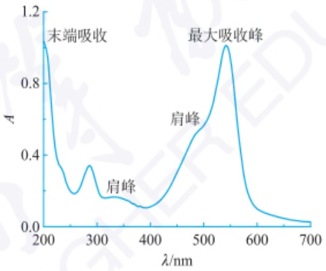

line

| Wavelength (nm) | Absorbance (A) |
| --- | --- |
| 200 | ~1.05 |
| 250 | ~0.25 |
| 300 | ~0.35 |
| 350 | ~0.20 |
| 400 | ~0.15 |
| 500 | ~0.60 |
| 550 | ~1.05 |
| 600 | ~0.15 |
| 700 | ~0.05 |

图 4.2.1 紫外-可见吸收光谱

## 4.2.1.2 电子跃迁与紫外-可见吸收光谱

紫外-可见吸收光谱是由分子中电子的跃迁产生的。参与形成化学键的原子的种类、数量及空间排列方式不同，由此形成的分子的结构及分子轨道上的电子的性质不同，产生的紫外-可见吸收光谱也不同。

## 1. 有机化合物

有机化合物的价电子包括:成键的 $\sigma$ 电子、$\pi$ 电子和未成键的 n 电子（孤对电子）。根据分子轨道理论，当受到电磁辐射激发时，处于较低能级的价电子将跃迁到较高能级的 $\sigma^{*}$ 反键轨道和 $\pi^{*}$ 反键轨道能级。可能产生的电子跃迁主要为 $\sigma \rightarrow \sigma^{*}, n \rightarrow \sigma^{*}, n \rightarrow \pi^{*}$ 及 $\pi \rightarrow \pi^{*}$，如图 4.2.2 所示。

指纹鉴定在刑侦工作中扮演着重要角色。茚三酮被称为指纹识别的化学魔术师，它遇到指纹，会与指纹中的氨基酸快速反应生成蓝紫色物质，使得隐藏的潜在性指纹变得清晰可见。产物为什么会显示蓝紫色呢？这与物质分子对可见光的吸收有关。

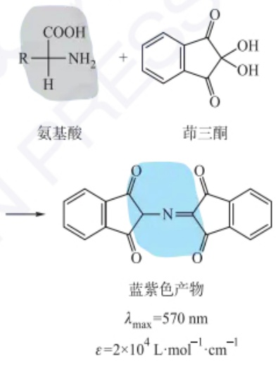

chemical

Chemical reaction scheme showing synthesis of blue purple compound from amino acid and benzothiazole under UV light

Franck-Condon 原理: 电子跃迁过程中, 分子中各原子核的位置及环境不变。

电子允许跃迁选择定律包含三个方面:① 电子自旋允许,即跃迁过程中,电子的自旋方向保持不变;② 轨道对称性允许,即电子只能在分子轨道对称性变化的不同能级间跃迁;③ 轨道重叠允许,即只有轨道相互重叠的分子轨道间才有可能发生跃迁。

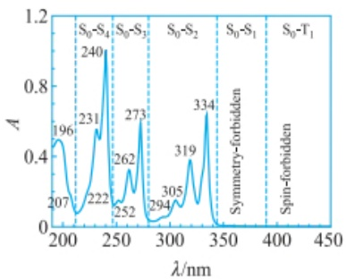

line

| Wavelength (nm) | Absorption (A) |
| --- | --- |
| 196 | ~0.5 |
| 207 | ~0.1 |
| 222 | ~0.1 |
| 231 | ~0.5 |
| 240 | ~1.0 |
| 252 | ~0.1 |
| 262 | ~0.3 |
| 273 | ~0.6 |
| 294 | ~0.1 |
| 305 | ~0.15 |
| 319 | ~0.4 |
| 334 | ~0.6 |

(a)

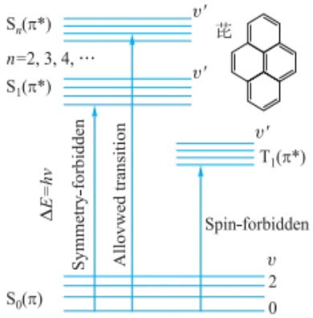

text_image

S_n(π*)
n=2, 3, 4, …
S_1(π*)
ΔE=hν
Symmetry-forbidden
Allowed transition
T_1(π*)
v'
v'
Spin-forbidden
v
2
0
S_0(π)

(b)

芘的正己烷溶液的紫外吸收光谱(a)和电子能级跃迁示意图(b)(图中 symmetry-forbidden 和 spin-forbidden 分别意为对称性禁阻和自旋禁阻的跃迁, allowed transition 意为允许的跃迁; A 表示吸光度;  $\lambda$  表示波长)

[化学教育(中英文).2024,45(16):108-112.]

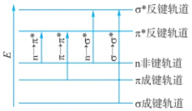

text_image

E
n→π*
π→π*
n→σ*
σ→σ*
σ*反键轨道
π*反键轨道
n非键轨道
π成键轨道
σ成键轨道

图 4.2.2 有机化合物分子中电子跃迁示意图

$\sigma\rightarrow\sigma^{*}$  跃迁: 发生  $\sigma\rightarrow\sigma^{*}$  跃迁所需的能量较大, 与其对应的吸收光谱处于 200 nm 以下的远紫外区。饱和烃类化合物只有  $\sigma$  电子, 只能发生  $\sigma\rightarrow\sigma^{*}$  跃迁, 如甲烷的最大吸收波长为 125 nm。

$n\rightarrow\sigma^{*}$  跃迁:含有未成键的 n 电子的有机化合物(如含有— $NH_{2}$ ,—OH,—SH,—X 等基团)可产生  $n\rightarrow\sigma^{*}$  跃迁。 $n\rightarrow\sigma^{*}$  跃迁的吸收光谱接近或位于近紫外区,如  $CH_{3}Cl$  和  $CH_{3}NH_{2}$  的最大吸收波长分别为 173 nm 和 213 nm。但  $n\rightarrow\sigma^{*}$  跃迁产生的吸收峰强度较弱。

$\pi \rightarrow \pi^{*}$ 跃迁:含有 $\pi$ 电子的有机化合物（如含有 $\mathrm{C} = \mathrm{C}$ 、 $-\mathrm{C} \equiv \mathrm{C}-$ 、 $\mathrm{C} = \mathrm{O}$ 等基团）可产生 $\pi \rightarrow \pi^{*}$ 跃迁。孤立的 $\pi \rightarrow \pi^{*}$ 跃迁位于 $200\mathrm{nm}$ 附近；随着共轭程度的增大，$\pi \rightarrow \pi^{*}$ 跃迁的吸收光谱向长波方向移动，吸收强度也随之增强，一般 $\varepsilon_{\max} > 10^{4}\mathrm{L} \cdot \mathrm{mol}^{-1} \cdot \mathrm{cm}^{-1}$。

$n\rightarrow\pi^{*}$  跃迁:化合物分子中同时存在 n 电子和  $\pi$  电子时(如含有  $-N=N-$ 、 $\left.\begin{array}{l}\mathrm{C}=\mathrm{O} \\/\end{array}\right.$  等基团),会发生  $n\rightarrow\pi^{*}$  跃迁。 $n\rightarrow\pi^{*}$  跃迁所需的能量较低,吸收峰一般位于近紫外区或可见区,但属于禁阻跃迁,谱带强度很弱。

电荷转移跃迁:某些分子同时具有电子给予体部分和电子接受体部分,在外来辐射激发下,电子可从给予体轨道向接受体跃迁,这种跃迁称为电荷转移跃迁,可用下式表示这一过程:

$$
\mathrm{D-A} \xrightarrow {h \nu} \mathrm{D} ^ {+} - \mathrm{A} ^ {-} \tag {4-2-1}
$$

式中，D 是电子给予体，A 是电子接受体。如某些取代芳烃可产生这种分子内电荷转移吸收带:

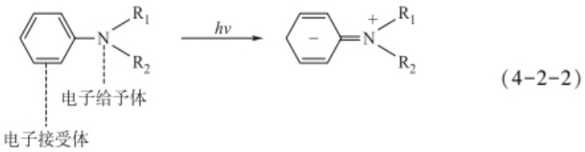

chemical

Chemical reaction equation showing electron transfer of a pyridine derivative to form a substituted pyridine with R1 and R2 groups, labeled as (4-2-2)

电荷转移跃迁的特点是其产生的吸收峰谱带较宽, 吸收强度大, 摩尔吸收系数可大于  $10^{4}$  L·mol $^{-1}$ ·cm $^{-1}$ 。

## 2. 无机化合物

无机化合物的吸收光谱主要由电荷转移跃迁和配位场跃迁产生。

电荷转移跃迁:与某些有机化合物相似,许多过渡金属离子与含生色团的试剂反应所生成的配合物也可产生电荷转移跃迁。例如:

$$
\begin{array}{c} \left[ \mathrm{Fe} ^ {3 +} \mathrm{SCN} ^ {-} \right] ^ {2 +} \xrightarrow {h \nu} \left[ \mathrm{Fe} ^ {2 +} \mathrm{SCN} \right] ^ {2 +} \\ \text {电子接受体} \quad \text {电子给予体} \end{array} \tag {4-2-3}
$$

此外，许多水合无机离子，如 $\mathrm{Cl}^{-}(\mathrm{H}_2\mathrm{O})_n$ 及一些具有 $\mathrm{d}^{10}$ 电子结构的过渡元素形成的卤化物及硫化物，如 $\mathrm{AgBr},\mathrm{HgS}$ 等，也是由于这类跃迁而产生颜色。无机化合物的电荷转移吸收光谱谱带的吸光能力强，一般 $\varepsilon_{\mathrm{max}} > 10^{4}\sim 10^{5}\mathrm{L}\cdot \mathrm{mol}^{-1}\cdot \mathrm{cm}^{-1}$，常用于微量组分的定量分析。

配位场吸收光谱是指在配位场作用下，过渡金属元素简并的d轨道及镧系和锕系元素简并的f轨道分别分裂成能量不等的d轨道或f轨道，在光能激发下，低能态的d电子或f电子产生d-d跃迁或f-f跃迁。该类光谱的吸光能力很弱，一般 $\varepsilon_{\mathrm{max}} < 100\mathrm{L}\cdot \mathrm{mol}^{-1}\cdot \mathrm{cm}^{-1}$，较少用于定量分析，但常用于配合物的结构和无机配合物键合理论研究。

## 3. 其他常见材料

有机高分子聚合物是由有机小分子以共价键结合形成的相对分子质量较大、具有重复结构单元的有机化合物，其吸收光谱主要取决于生色团和助色团的结构特征和跃迁类型。聚苯胺是一种常见的半导体材料，它具有优异的光电性质，其结构式如下:

$$
\left[ \right.\left(\text {C}_6\text {H}_5\right) - \mathrm{N} - \text {C}_6\text {H}_5\left. \right) _ {y} ^ {\mathrm{H}} \left(\text {C}_6\text {H}_5\right) - \mathrm{N} = \text {C}_6\text {H}_5\left. \right) _ {1 - y} ^ {\mathrm{N}} \Bigg ] _ {n} \tag {4-2-4}
$$

聚苯胺的吸收光谱如图 4.2.3 所示,340 nm 附近的吸收峰对应共轭链中的电子跃迁,640 nm 左右的宽吸收峰对应分子内苯环向醌环的电荷转移跃迁。

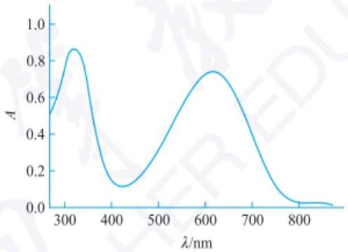

line

| \(\lambda/\)nm | A |
| --- | --- |
| 300 | ~0.52 |
| 325 | ~0.86 |
| 400 | ~0.15 |
| 425 | ~0.12 |
| 500 | ~0.35 |
| 600 | ~0.72 |
| 625 | ~0.74 |
| 700 | ~0.45 |
| 800 | ~0.03 |

图 4.2.3 聚苯胺的吸收光谱

无机纳米材料的紫外-可见吸收主要来源于电子跃迁或者等离激元共振吸收。例如，半导体材料纳米  $TiO_{2}$  的价带电子获得能量跃迁进入导带、金属纳米材料表面等离激元共振吸收。

金属-有机配位聚合物及杂化材料的吸收光谱主要源于有机配体的特征吸收和金属离子-有机配体电荷转移跃迁引起的吸收。

## 4.2.1.3 紫外-可见吸收光谱的影响因素

## 1. 生色团与助色团

分子中能吸收紫外或可见光的基团称为生色团。生色团含有不饱和键，能产生  $\pi\rightarrow\pi^{*}$  及  $n\rightarrow\pi^{*}$  跃迁，表 4.2.1 列出了一些常见生色团的吸收特征。

某些基团本身在波长大于  $200 \, nm$  的紫外光区无吸收，但与生色团相连时能

## 两类典型材料的吸收光谱

## 1. 量子点

三元量子点 CdSeTe 是一种胶体纳米晶, 其吸收光谱受三元组分比例的影响, 如下图所示:

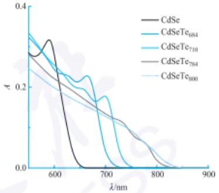

line

| \(\lambda/\)nm | CdSe | CdSeTe684 | CdSeTe710 | CdSeTe784 | CdSeTe800 |
| --- | --- | --- | --- | --- | --- |
| 550 | ~0.28 | ~0.32 | ~0.33 | ~0.29 | ~0.25 |
| 600 | ~0.31 | ~0.24 | ~0.25 | ~0.22 | ~0.19 |
| 650 | ~0.05 | ~0.21 | ~0.22 | ~0.17 | ~0.15 |
| 700 | 0.0 | ~0.17 | ~0.17 | ~0.13 | ~0.12 |
| 750 | 0.0 | 0.0 | ~0.05 | ~0.11 | ~0.10 |
| 800 | 0.0 | 0.0 | 0.0 | ~0.05 | ~0.06 |
| 850 | 0.0 | 0.0 | 0.0 | 0.0 | ~0.01 |

<table><tr><td rowspan="2">量子点</td><td colspan="3">元素质量分数/%</td></tr><tr><td>Cd</td><td>Se</td><td>Te</td></tr><tr><td> $CdSeTe_{684}$ </td><td>12</td><td>1</td><td>87</td></tr><tr><td> $CdSeTe_{710}$ </td><td>32</td><td>3</td><td>65</td></tr><tr><td> $CdSeTe_{780}$ </td><td>41</td><td>7</td><td>52</td></tr><tr><td> $CdSeTe_{800}$ </td><td>44</td><td>45</td><td>11</td></tr></table>

( Electrochim. Acta, 2017, 247: 899–909)

## 2. 金属-有机框架材料

受毛细管现象的启发,科学家采用面对面限制生长策略,在石英、蓝宝石等基板上生长  $\mathrm{Cu}_{2}(\mathrm{TCPP})(\mathrm{TCPP}=$  meso-tetra(4-carboxyphenyl)卟啉)晶圆级 MOF 薄膜,可作为各种电子器件的有源层。

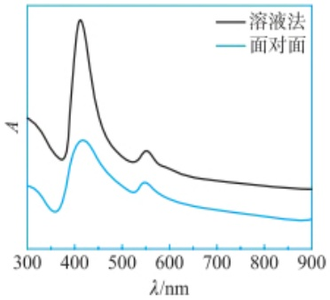

line

| \(\lambda/\)nm | 溶液法 (A) | 面对面 (A) |
| --- | --- | --- |
| 300 | ~0.65 | ~0.45 |
| 350 | ~0.45 | ~0.35 |
| 410 | ~1.05 | ~0.65 |
| 550 | ~0.55 | ~0.45 |
| 900 | ~0.35 | ~0.25 |

采用溶液法及介质衬底上面对面限域生长法制备的  $\mathrm{Cu}_{2}(\mathrm{TCPP})$  MOFs 的 UV-Vis 消光光谱(对于胶体或浊液，入射光通过样品后，光强减少的部分包括吸收和散射，且散射效应不可忽略，因此测得的光谱常被称为消光光谱)。

( Adv. Mater., 2021, 33 (13): 2007741)

## 跨环效应

5-硫代环辛酮在 $293\mathrm{nm}$ 处出现一中等强度的吸收带，这是由于结构中虽然酮基与硫原子不产生共轭关系，但适当的立体排列，使硫的孤对电子与酮基的 $\pi$ 电子发生相互作用，与环辛酮相比，其吸收向长波方向移动，且增强增大。

<table><tr><td>化合物</td><td> $\frac{\lambda_{\max}}{nm}$ </td><td> $\frac{\varepsilon_{\max}}{L \cdot mol^{-1} \cdot cm^{-1}}$ </td></tr><tr><td rowspan="2">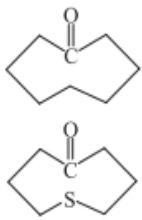</td><td>238</td><td>15</td></tr><tr><td>293</td><td>2535</td></tr></table>

## 溶剂效应

溶剂极性增加,使  $n \rightarrow \pi^{*}$  跃迁的对应的  $\lambda_{max}$  蓝移,使  $\pi \rightarrow \pi^{*}$  跃迁对应的  $\lambda_{max}$  红移。

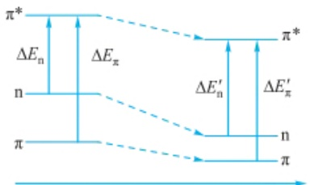

chemical

Energy level diagram showing electronic transitions between π and π* with energy differences ΔE_n, ΔE_π, ΔE'_n, ΔE'_π

溶剂极性增加

使生色团的 $\lambda_{\mathrm{max}}$ 向长波方向移动(红移)，此类基团称为助色团。通常助色团都含有孤对电子(n电子)，可通过 $n - \pi$ 轨道共轭而增加生色团的共轭程度，使 $\pi \rightarrow \pi^{*}$ 和 $n\rightarrow \pi^{*}$ 的跃迁能减小，从而产生助色效应。常见的助色团有—OH、—NH$_2$、—NR$_2$、—OR、—SH、—Cl、—Br和—I等。

表 4.2.1 常见生色团的吸收特征

<table><tr><td>生色团</td><td> $\lambda_{\max}/nm$ </td><td> $\varepsilon_{\max}/(L \cdot mol^{-1} \cdot cm^{-1})$ </td><td>跃迁类型</td></tr><tr><td>—C=C—</td><td>180</td><td>12500</td><td> $\pi \rightarrow \pi^{*}$ </td></tr><tr><td>—C≡C—</td><td>172</td><td>4500</td><td> $\pi \rightarrow \pi^{*}$ </td></tr><tr><td>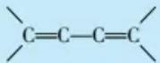</td><td>209</td><td>25000</td><td> $\pi \rightarrow \pi^{*}$ </td></tr><tr><td rowspan="3"></td><td>184</td><td>90000</td><td> $\pi \rightarrow \pi^{*}$ </td></tr><tr><td>204</td><td>8000</td><td> $\pi \rightarrow \pi^{*}$ </td></tr><tr><td>259</td><td>200</td><td> $\pi \rightarrow \pi^{*}$ </td></tr><tr><td rowspan="2">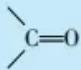</td><td>182</td><td>10000</td><td> $\pi \rightarrow \pi^{*}$ </td></tr><tr><td>289</td><td>12.5</td><td> $n \rightarrow \pi^{*}$ </td></tr><tr><td rowspan="2">— $NO_{2}$ </td><td>202</td><td>4400</td><td> $\pi \rightarrow \pi^{*}$ </td></tr><tr><td>279</td><td>15.8</td><td> $n \rightarrow \pi^{*}$ </td></tr></table>

## 2. 共轭效应

当化合物含有共轭体系时，伴随共轭体系增大，各能级间的能量差减小， $\pi\rightarrow\pi^{*}$  跃迁所需的能量降低，从而使吸收带向长波方向移动，吸收强度也增加（增色效应）。几种常见共轭多烯化合物的吸收特征见表4.2.2。

表 4.2.2 几种常见共轭多烯化合物的吸收特征

| 化合物 | $\lambda_{\max}/nm$ | $\varepsilon_{\max}/(L \cdot mol^{-1} \cdot cm^{-1})$ | 颜色 |
| --- | --- | --- | --- |
| 1,3-丁二烯 | 217 | 21000 | 无 |
| 1,3,5-己三烯 | 258 | 35000 | 无 |
| 1,3,5,7-辛四烯 | 304 | 64000 | 淡黄 |
| 1,3,5,7,9-癸五烯 | 334 | 121000 | 淡黄 |
| 番茄红素 | 470 | 185000 | 红 |

## 3. 立体化学效应

空间位阻使分子内共轭的生色团或生色团与助色团之间的共平面性减小，电子跃迁所需能量增加，吸收峰向短波方向移动（蓝移），吸收强度减弱（减色效应）；分子中两个生色团或生色团与助色团之间虽不共轭，但因在环上的空间位置排列合适，能够发生轨道间的相互作用，即产生跨环效应，使吸收峰红移，吸收强度增强。

## 4. 溶剂效应

当物质处于气相时，由于分子间相互作用力很小，因此可以观测到伴随电子光谱的振动光谱乃至转动光谱的精细结构。物质溶解于溶剂后，溶剂化作用将限制溶质分子的转动，伴随溶剂极性的增大，溶剂与溶质分子间的相互作用加强，溶质分子的振动也受到限制，导致吸收光谱损失更多的精细结构。例如，苯酚的精细结构在非极性溶剂庚烷中清晰可见，而在极性溶剂乙醇中则完全消失而呈现一

个宽峰。

改变溶剂极性，还将使吸收光谱发生移动，即溶剂效应。在 $\pi \rightarrow \pi^{*}$ 跃迁中，由于分子激发态的极性大于基态，其激发态与极性溶剂发生作用从而降低能量的程度大于基态。因此，基态与激发态之间的能量差变小，致使吸收带向长波方向移动。与此相反，在 $n\to \pi^{*}$ 跃迁中，分子基态中未成键n电子会与极性溶剂形成氢键，大大降低基态的能量，使基态与激发态之间的能量差变大，导致吸收谱带向短波方向移动。

因此，测定紫外-可见吸收光谱时，溶剂的选择需注意以下几点:① 尽量选择非极性或低极性溶剂；② 溶剂能很好地溶解分析物，且形成的溶液具有良好的化学和光化学稳定性；③ 溶剂在样品的吸收光谱区内无明显吸收。④ 溶剂对样品惰性，不与样品中的组分发生化学反应。

## 5. 溶液 pH 的影响

体系 pH 对含有酸性或碱性基团的物质的紫外-可见吸收光谱影响较大。例如，在碱性环境中，苯胺为分子形态，其氮原子上未成键 n 电子与苯环上  $\pi$  电子共轭， $\lambda_{max}$  值为 280 nm；而在酸性介质中，苯胺可形成苯胺盐阳离子，其氮原子上不存在未成键 n 电子，不能与苯环产生  $n-\pi$  共轭，故  $\lambda_{max}$  值与苯的相近，约为 254 nm。

$$
\mathrm {\bigcirc - NH_ {2} + H^ {+} \rightleftharpoons \bigcirc - NH_ {3} ^ {+}} \tag {4-2-5}
$$

## 4.2.2 光的吸收定律

## 4.2.2.1 透射比和吸光度

当一束强度为 $I_{0}$ 的平行单色光通过溶液时，设吸收光的强度为 $I_{a}$，透过光的强度为 $I_{t}$，则

$$
I _ {0} = I _ {\mathrm{a}} + I _ {\mathrm{t}} \tag {4-2-6}
$$

透射光强度  $I_{1}$  与入射光强度  $I_{0}$  的比值称为透射比或透光率(transmittance)，用 T 表示:

$$
T = \frac {I _ {\mathrm{t}}}{I _ {0}} \tag {4-2-7}
$$

溶液对光的吸收程度用吸光度  $A(\text{absorbance})$  表示:

$$
A = - \lg T = \lg \frac {I _ {0}}{I _ {\mathrm{t}}} \tag {4-2-8}
$$

溶液的透光率 T 越小, 表示它对光的吸收越大, 吸光度 A 也越大。

## 4.2.2.2 朗伯-比尔定律

朗伯-比尔定律是光吸收的基本定律。朗伯(Lambert)和比尔(Beer)分别于1760年和1852年研究了光吸收与溶液厚度及溶液浓度的定量关系，二者合并称为朗伯-比尔定律。朗伯-比尔定律可描述为:当一定强度的单色光通过含有吸光物质的透明、均一的溶液时，溶液的吸光度 $A$ 与吸光物质的浓度 $c$ 及液层厚度 $b$ 成正比，这是吸收光谱法进行定量分析的理论依据。其数学表达为

$$
A = K b c \tag {4-2-9}
$$

式中， $K$ 为比例常数， $K$ 值随 $c$ 和 $b$ 所取的单位不同而异。当浓度 $c$ 以 $\mathrm{mol}\cdot \mathrm{L}^{-1}$ 、液层厚度 $b$ 以 $\mathrm{cm}$ 为单位表示时， $K$ 用符号 $\varepsilon$ 表示。$\varepsilon$ 称为摩尔吸收系数（molar

## 溶液 pH 的影响

溶液对甲基橙的分子结构和紫外-可见吸收光谱的影响如下所示:

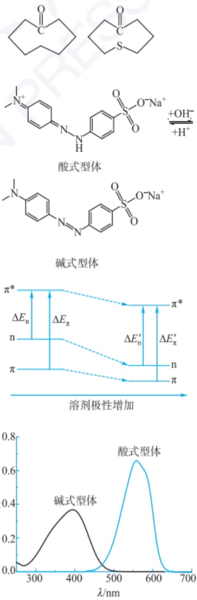