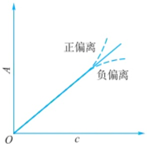

text_image

正偏离
负偏离
O
c
A

图4.2.4 标准曲线及对朗伯-比尔定律的偏离

光源

单色器和检测器

比色皿

absorption coefficient), 其单位为  $L \cdot mol^{-1} \cdot cm^{-1}$ 。此时朗伯-比尔定律的形式为

$$
A = \varepsilon b c \tag {4-2-10}
$$

摩尔吸收系数  $\varepsilon$  与吸光物质的性质、入射光的波长、溶液的性质及温度有关。 $\varepsilon$  值反映物质对某波长单色光的吸收能力，也反映用吸光光度法测定该吸光物质的灵敏度，通常认为  $\varepsilon > 10^{4} L \cdot mol^{-1} \cdot cm^{-1}$  时，该方法具有较高的灵敏度。

朗伯-比尔定律一般适用于浓度较低的溶液,因此,在实际分析工作中,一般不直接采用  $1 \, mol \cdot L^{-1}$  的高浓度标准溶液测定  $\varepsilon$  值,而是采用适当的低浓度标准溶液测定吸光度 A,通过计算求出  $\varepsilon$  值。

## 4.2.2.3 吸光度的加和性

如果溶液中含有两种或两种以上可吸收入射光的物质,若这些物质彼此间不存在相互作用,则总吸光度等于各物质吸光度之和。吸光度的加和性是分光光度法进行多组分定量测定的理论基础,但同时也表明共存物质会带来干扰。

## 4.2.2.4 偏离朗伯-比尔定律的因素

在一定条件下,固定溶液的液层厚度 b, 测定各标准溶液的吸光度 A, 以吸光度 A 为纵坐标、浓度 c 为横坐标作图, 得到的直线称为标准曲线。但在实际工作中, 经常出现标准曲线不成直线的情况, 特别是当吸光物质浓度太高时, 标准曲线发生向下弯曲的现象(个别情况向上弯曲), 即偏离朗伯-比尔定律(图 4.2.4)。

偏离朗伯-比尔定律的主要原因是实际测定的仪器条件或溶液条件与理想条件不一致,一般可以分为以下几类情况。

非单色光引起的偏离:朗伯-比尔定律只适用于单色光,但受限于仪器,实验中得到入射光均为包含某一波段的复色光。由于物质对不同波长的光吸收程度不同,因而导致对朗伯-比尔定律的偏离。因此,测定应选择适当的浓度范围,使吸光度读数在标准曲线的线性范围内。

介质不均匀引起的偏离:朗伯-比尔定律要求吸光物质的溶液是均一的,若被测溶液为均匀性较差的胶体溶液、乳浊液或悬浊液,入射光除被待测物质吸收外,还会有少部分光因散射或反射等原因改变方向而损失,使得透过光减弱,而实际测定的吸光度增加,产生正偏离。

化学因素引起的偏离: 当溶液中的吸光物质发生缔合、解离、形成新的化合物或互变异构等化学反应时, 可引起吸光物质本身性质和浓度发生变化, 从而导致偏离朗伯-比尔定律。溶剂的性质也会影响吸光物质的存在形式, 如碘在水溶液中为黄棕色, 而在四氯化碳中呈紫色。

## 4.2.3 紫外-可见分光光度计

紫外-可见分光光度计通常由光源、单色器、样品池、检测器和信号读取与输出装置构成。根据仪器结构的不同，紫外-可见分光光度计可分为单光束分光光度计、双光束分光光度计、双波长分光光度计、多通道分光光度计、光纤探头式分光光度计及紫外-可见漫反射光谱仪等。

## 4.2.3.1 单光束分光光度计

单光束分光光度计是最简单的分光光度计，它主要由一束单色光、一个测量池和一个光电转换器（多为光电倍增管）组成[图4.2.5(a)]。测定时，参比溶液和样品溶液轮流置于光路中，分别获得 $I_{0}$ 和 $I_{t}$，因此测量结果受光源和检测器的波动影响大。每改变测定波长，都要用参比溶液对 $I_{0}$ 进行校正，即调节 $T = 100\% (A = 0)$ 。

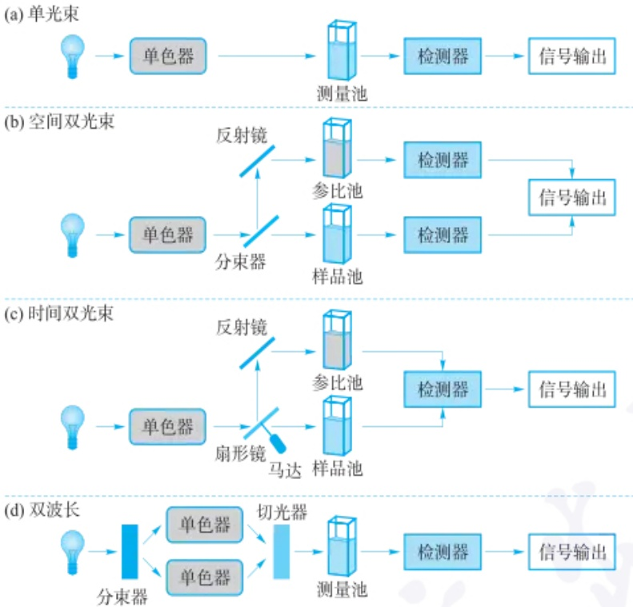

图4.2.5（a）单光束、(b)空间双光束、(c)时间双光束和(d)双波长分光光度计的结构示意图

## 4.2.3.2 双光束分光光度计

双光束分光光度计指的是有两束单色光和两只吸收池的光度计,根据检测器的数量又分为两类:使用2个光电转换器的空间双光束型和使用1个光电转换器的时间双光束型。

在空间双光束光度计中[图4.2.5(b)]，单色器色散出射的单色光被分束器分成强度和波长均相等的两束单色光，分别通过参比吸收池和样品吸收池到达两个性能匹配的检测器，通过自动比较两束透过光的强度，获得透射比，并转换为吸光度。该类型的仪器可消除光源强度变化引起的误差，但若两个检测器的性能不完全一致，则会带来系统误差。

在时间双光束光度计中[图4.2.5(c)]，一个以一定频率快速转动的扇形镜将单色器出射的单色光分为两束相同波长的光，分别进入参比池和样品池，二者的透过光以一定周期交替进入同一个检测器，得到 $I_{0}$ 和 $I_{t}$，输出透射比或吸光度的信号。如此一来，时间双光束型光度计既可消除光源的波动，又可避免两个检测器性能不匹配带来的系统误差。因此，目前使用最广泛的分光光度计是时间双光束光度计。

## 4.2.3.3 双波长分光光度计

双波长分光光度计有两个单色器，采用前分光技术，即同一光源发出的光被分束器分为两束，分别经过两个单色器以同时获得两束不同波长 $(\lambda_{1},\lambda_{2})$ 的单色光；在切光器调节下，两束单色光以一定的频率交替照射到同一个吸收池，然后进入同一个检测器[图4.2.5(d)]，得到待测试液在波长 $\lambda_{1}$ 和 $\lambda_{2}$ 处的吸光度差值$\Delta A$ 。由于可同时获得两个波长处的吸光度，双波长分光光度计适用于混合物及混浊样品的定量分析，还可进行化学反应的动力学研究等。

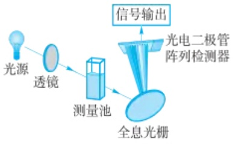

flowchart

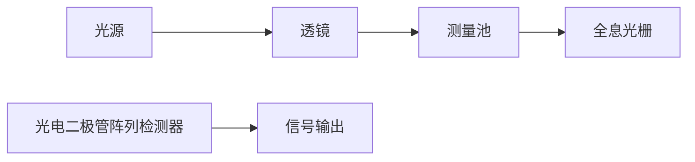

图 4.2.6 多通道分光光度计的结构示意图

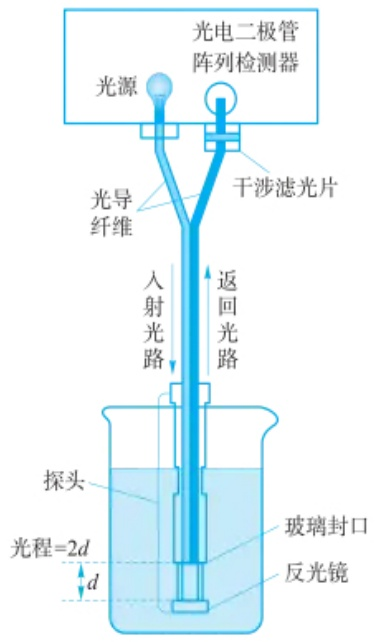

text_image

光电二极管
阵列检测器
光源
干涉滤光片
光导
纤维
入射光路
返回光路
探头
光程=2d
玻璃封口
反光镜
d

图 4.2.7 光纤探头式分光光度计的结构示意图

## 紫外-可见漫反射测试及带隙计算示例

先用标准白板进行基线测试,然后对样品进行漫反射测试,得到样品的紫外-可见漫反射光谱。由Kubelka-Munk函数可知:

$$
F (R _ {\infty}) = \frac {K}{S} = \frac {(1 - R _ {\infty}) ^ {2}}{2 R _ {\infty}}
$$

R、K 和 S 分别代表样品的反射系数，吸收系数和散射系数。基于 Tauc 方程:

由于多组分同时测定的需要及后分光技术的发展,双波长分光光度计逐渐被多通道分光光度计取代。

## 4.2.3.4 多通道分光光度计

多通道分光光度计(图 4.2.6)的特点是采用全息光栅后分光技术和以光电二极管阵列(即 DAD)为检测器。光源发出的复合光先通过测量池,再经全息光栅色散,色散后的单色光由 DAD 检测器接收,能够在极短时间内(1 s 内)获得整个光谱信息,特别适用于快速反应动力学研究和多组分混合物的分析。

## 4.2.3.5 光纤探头式分光光度计

光纤探头式分光光度计一般由光源、两根相互隔离的光纤（传导光的人造纤维，又称光导纤维）、各种不同的光学组件（如斩波器、透镜、滤光片和反射镜等）和检测器组成（图4.2.7）。光源发出的光由一个光纤传导至样品溶液，被试液吸收后的透射光经反射镜反射后由另一根光纤传导送回到光学检测器（如光电二极管阵列检测器或电荷耦合器件）。这类光度计不需要吸收池，直接将光纤探头插入样品溶液中进行原位检测，不受外界光线的影响，常用于环境分析、反应动力学过程监测和光度滴定法。

## 4.2.3.6 紫外-可见漫反射光谱仪

采用液体测量池和透射模式可测定均匀、非散射的液体、气体或固体样品对光的吸收，但无法准确测量乳浊液、悬浊液等不透明溶液及表面粗糙的粉末、薄膜等固体样品的吸收。漫反射光谱法可以有效解决这一问题。光照射固体样品时，一部分光在样品表层产生镜面反射；另一部分光则进入样品内部，经部分吸收后射至内部晶粒界面，再发生多次反射、折射、吸收等返回样品表面，最终向各方向反射出来，即漫反射光。在紫外-可见分光光度计上，使用内壁涂有高反射率物质（通常为 $\mathrm{BaSO_4}$ 、MgO或聚四氟乙烯）的积分球收集样品的漫反射光，投射到检测器上产生电信号，再经Kubelka-Munk方程[即漫反射定律；式(4-2-11)]转化输出为紫外-可见漫反射光谱。

$$
F (R _ {\infty}) = \frac {K}{S} = \frac {(1 - R _ {\infty}) ^ {2}}{2 R _ {\infty}} \tag {4-2-11}
$$

式中，K 为吸收系数，S 为散射系数。 $R_{\infty}$  表示无限厚样品的反射率。测定漫反射光谱时，先用标准白板或参比样品进行基线测试，然后再测试样品（图 4.2.8）。

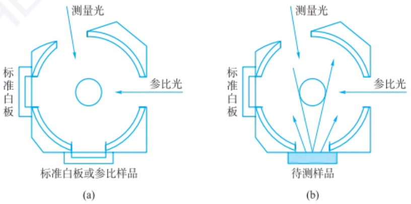

图 4.2.8 紫外-可见分光光度计积分球进行基线校正和样品测定的示意图

紫外-可见漫反射光谱可以获得固体材料表面的电子结构、过渡金属离子的化学环境(配位、氧化还原等)、半导体材料的光吸收性能等。

## 4.2.4 分析条件的选择

为使分析方法有合适的灵敏度和较高的准确度，分析条件的选择至关重要。对于紫外-可见分光光度法能够直接测定的物质，只需选择合适的测定条件；对于不能直接测定的物质，可通过合适的显色/褪色反应间接测定，因此还需优化反应条件。

## 4.2.4.1 测定条件的选择

## 1. 吸光度读数范围的选择

任何仪器都有一定的测量误差，吸光度测量的不确定性是光度法误差的主要来源之一。光度计测量吸光度时，先要进行暗电流校正 $T = 0$ 和参比溶液校正 $T = 100\%$ （即获得 $I_0$），再测定入射光被样品吸收后的透射光的强度 $I_{\mathrm{t}}$，最后将透光率 $(T = I_{\mathrm{t}} / I_{0})$ 转换为吸光度 $A$。根据朗伯-比尔定律和误差传递规律可知，当光程 $b$ 为定值时，浓度测定结果的相对误差 $(E_{\mathrm{r,c}})$ 与吸光度 $A$ 测定结果的相对误差 $(E_{\mathrm{r,A}})$ 相等:

$$
E _ {\mathrm{r,c}} = \frac {\mathrm{d} c}{c} = \frac {\mathrm{d} A}{A} = E _ {\mathrm{r,A}} \tag {4-2-12}
$$

根据 A 与 T 之间的负对数关系, 推导得到  $E_{r,A}$  与 T 具有如下关系:

$$
E _ {\mathrm{r}, A} = \frac {\mathrm{d} A}{A} = \frac {- \mathrm{d} (\lg T)}{- \lg T} = \frac {\mathrm{d} T}{T \ln 1 0 \lg T} = \frac {0 . 4 3 4 \mathrm{d} T}{T \lg T} \tag {4-2-13}
$$

综合式(4-2-12)和式(4-2-13)，以有限值表示，可得 $E_{r,c}$ 与T具有如下关系:

$$
E _ {\mathrm{r,c}} = \frac {0 . 4 3 4 \Delta T}{T \lg T} \tag {4-2-14}
$$

由式(4-2-14)可知， $E_{r,c}$  不仅与 T 有关，还与 T 测量结果的绝对误差 ( $\Delta T$ ) 有关。当 T 的一阶导数为 0 时， $E_{r,c}$  有极小值，此时  $T = 36.8\%$ ，即 A = 0.434。不同光度计的性能不同，测量 T 的不确定度  $\Delta T$  不同；T 过大或过小时（即  $I_{t}$  很大或很小）时，测定误差均较大。因此，要根据仪器性能及浓度测量允许的相对误差大小，选择适宜的 T 范围，即吸光度读数范围。如图 4.2.9 所示，若要求  $E_{r,c}$  不超过 5%，使用  $\Delta T = 0.01$  的光度计测量时，A 的读数应控制在 0.2\~0.7；而使用  $\Delta T = 0.001$  的光度计时，A 的读数可放宽至 0.1\~2.4。

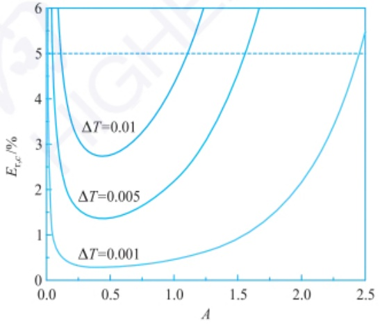

contour

| A | \(E_r,c (%)\) \((\Delta T=0.01)\) | \(E_r,c (%)\) \((\Delta T=0.005)\) | \(E_r,c (%)\) \((\Delta T=0.001)\) |
|---|---|---|---|
| 0.0 | >6 | >6 | ~1.2 |
| 0.5 | ~2.8 | ~1.4 | ~0.3 |
| 1.0 | ~4.5 | ~2.2 | ~0.5 |
| 1.5 | ~6.0 | ~3.5 | ~0.9 |
| 2.0 | — | ~5.5 | ~1.8 |
| 2.5 | — | — | ~3.5 |

图 4.2.9 浓度测量相对误差 $(E_{r,c})$ 与溶液吸光度(A)及光度计测量不确定度 $(\Delta T)$ 的关系

$$
(h \nu \times \alpha) ^ {n} = A (h \nu - E _ {\mathrm{g}})
$$

h 为普朗克常量,  $\nu$  为频率, A 为常数,  $\alpha$  为吸收指数,  $E_{g}$  为半导体禁带宽度, 对于间接带隙型半导体  $n=\frac{1}{2}$ , 对于直接带隙型半导体  $n=2, F(R_{\infty})$  正比于吸收系数  $\alpha$ , 在 Tauc 方程中可以用  $F(R_{\infty})$  代替  $\alpha$ , 因此, 上式可转变为

$$
\left[ F (R _ {\infty}) h \nu \right] ^ {n} = A (h \nu - E _ {\mathrm{g}})
$$

以  $h\nu$  为横坐标， $(F(R_{\infty})h\nu)^{n}$  为纵坐标画图，当  $(F(R_{\infty})h\nu)^{n}=0$  时，对应的横坐标  $h\nu$  即为  $E_{g}$  值的大小。

某直接型半导体材料示例如下:

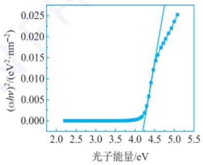

line

| 光子能量/eV | \((\alpha\)hv)²/(eV²·nm⁻²) |
| --- | --- |
| ~2.2 | 0.000 |
| ~3.0 | 0.000 |
| ~3.5 | 0.000 |
| ~4.0 | 0.001 |
| ~4.1 | 0.002 |
| ~4.2 | 0.003 |
| ~4.3 | 0.006 |
| ~4.4 | 0.012 |
| ~4.5 | 0.015 |
| ~4.6 | 0.017 |
| ~4.7 | 0.019 |
| ~4.8 | 0.021 |
| ~4.9 | 0.023 |
| ~5.0 | 0.025 |

采用同一分析方法测定不同样品时,选择的参比溶液可能不同。例如,邻二氮菲分光光度法测定不同样品中的铁含量,参比溶液的选择见下表:

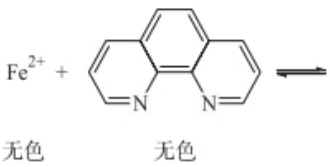

chemical

Chemical reaction equation showing Fe²⁺ reacting with a pyridine derivative under light to form an enol ether

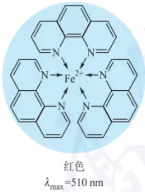

chemical

Redox reaction diagram of iron(II) complex with 510 nm excitation wavelength

参比溶液的选择

| 样品 | 试液特点 | 参比溶液 |
| --- | --- | --- |
| 自来水 | 透明、无吸收 | 蒸馏水或试剂空白 |
| 工业废水 | 透明,略有颜色 | 不加邻二氮菲的试液 |
| 铜合金 | 酸溶试液中$Cu^{2+}$有干扰 | 加硫脲(掩蔽$Cu^{2+}$)的试液 |

## 2. 测定波长的选择

根据朗伯-比尔定律可知，当光程 $b$ 恒定时，溶液的吸光度与其浓度及吸光系数有关。由吸收光谱可知，$\lambda_{\mathrm{max}}$ 处的吸光系数大、曲线形状较平坦，因此，选择 $\lambda_{\mathrm{max}}$ 为测定波长获得的吸光度较大且测量重现性较好，从而提高方法的灵敏度和精密度。若干扰组分在该波长处有吸收，可根据“干扰小，吸收大”的原则选择测定波长，避开干扰组分的吸收。

## 3. 参比溶液的选择

测量溶液的吸光度时,需要先采用参比溶液校正  $T=100\%$ , 以扣除溶剂、溶液中其他成分及吸收池对入射光的吸收、反射、散射等,获得相对准确的  $I_{0}$ 。样品溶液的性质不同,参比溶液的选择也不同。可根据被测样品溶液及加入的显色剂等试剂在测定波长处的吸光情况,选择溶剂空白、试剂空白、样品空白或平行操作溶液等为参比溶液。

## 4.2.4.2 反应条件的选择

在紫外-可见光区无吸收、吸收较弱或干扰严重的物质，可选用适当试剂显色后再测定，也可利用待测物引发的褪色反应进行定量分析。

## 1. 反应类型的选择

常见的显色/褪色反应有配位反应、氧化还原反应及衍生化等。其中，配位反应使用较广。若待测物有多种显色/褪色反应，应从选择性、灵敏度、有色化合物的稳定性及有色化合物与待测样品的色差对比度等方面选择合适的反应。一般来说，当  $\varepsilon$  值为  $10^{4} \sim 10^{5} L \cdot mol^{-1} \cdot cm^{-1}$  时，可认为该反应的灵敏度较高。实际测量的有色化合物应当组成恒定、稳定性好、反应条件易于控制，其与样品中其他组分的颜色应具有显著性差异。

## 2. 反应条件的选择

分光光度法是测定显色/褪色反应达到平衡后溶液的吸光度,因此若要得到准确的结果,必须了解影响显色/褪色反应的因素,控制适当的反应条件,以保证测定结果的重现性。

影响显色/褪色反应的因素主要有试剂用量、溶液酸度、反应温度、反应时间和溶剂种类等。例如，在配位显色反应中，显色剂用量会影响生成的配合物的量；酸度会影响显色剂的平衡浓度、金属离子的存在形式和配合物的稳定性及吸收光谱形状等。在实际分析工作中，对于受多个条件变量影响的反应，一般通过控制单一变量实验法确定其适宜的范围，即先控制其他几个因素不变，集中研究一个因素（即实验变量）对吸光度测定结果的影响，绘制 $A$ 与实验变量的关系曲线，根据曲线形状选择适宜的反应条件。例如，对于生成配合物的显色反应，配合物的吸光度与显色剂用量之间可能出现如图4.2.10所示的三种情况。图中曲线1表明只要显色剂过量，显色反应就能定量进行，且生成的配合物稳定性好，可在$c_{1,\mathrm{a}}\sim c_{1,\mathrm{b}}$ 较宽范围内选择显色剂用量。曲线2表明显色剂加入过多，会导致被测配合物发生副反应，只宜选择吸光度大且稳定区域对应的显色剂用量（即 $c_{2,\mathrm{a}}\sim$ $c_{2,\mathrm{b}}$ )。曲线3显示吸光度随显色剂用量增加不断增大，可能是由于生成了颜色不同的多级配合物，需严格控制显色剂用量，才能得到准确的结果。类似地，可确定其他影响因素的适宜范围。

## 3. 干扰的消除

在紫外-可见分光光度分析中,样品中共存组分引起的干扰可能有以下情形:干扰物本身有吸收、干扰物竞争参与显色/褪色反应、干扰物水解形成胶体或沉淀物对入射光产生散射。根据干扰的来源，表4.2.3列出了选择合适的措施，消除共存组分的干扰。

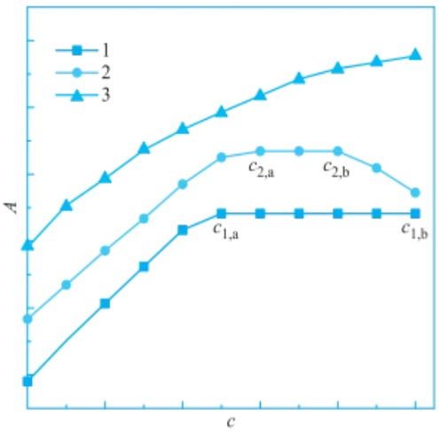

line

| c | Series 1 (A) | Series 2 (A) | Series 3 (A) |
| --- | --- | --- | --- |
| 1 | ~0.15 | ~0.35 | ~0.65 |
| 2 | ~0.35 | ~0.55 | ~0.85 |
| 3 | ~0.55 | ~0.75 | ~1.05 |
| 4 | ~0.75 | ~0.95 | ~1.25 |
| 5 | ~0.95 | ~1.15 | ~1.45 |
| 6 | ~1.15 | ~1.35 | ~1.65 |
| 7 | ~1.35 | ~1.45 | ~1.85 |
| 8 | ~1.45 | ~1.45 | ~1.95 |
| 9 | ~1.45 | ~1.45 | ~2.05 |
| 10 | ~1.45 | ~1.35 | ~2.15 |

图4.2.10 显色剂用量对典型显色体系1、2和3中配合物的吸光度的影响

表 4.2.3 光度法常用的消除干扰的方法

<table><tr><td colspan="2">消除干扰的方法</td><td>应用案例</td></tr><tr><td>物理法</td><td>选择干扰物无吸收处的测定波长</td><td>在 $K_2Cr_2O_7$ 共存下测定 $KMnO_4$ ,选择545nm而不是525nm</td></tr><tr><td rowspan="4">化学法</td><td>控制溶液酸度</td><td>双硫腙法测定 $Hg^{2+}$ 时,利用双硫腙与 $Hg^{2+}$ 形成的配合物较稳定,选择0.5mol· $L^{-1}$  $H_2SO_4$ 溶液为溶剂,可消除 $Pb^{2+}$ 、 $Cu^{2+}$ 、 $Ni^{2+}$ 和 $Cd^{2+}$ 的干扰</td></tr><tr><td>加入掩蔽剂</td><td>在0.5mol· $L^{-1}$  $H_2SO_4$ 溶液中,二硫腙法测定 $Hg^{2+}$ 会受到 $Ag^+$ 和 $Bi^{3+}$ 的干扰。加入KSCN和EDTA可分别掩蔽 $Ag^+$ 和 $Bi^{3+}$ ,消除干扰</td></tr><tr><td>改变干扰离子的价态</td><td>铬天青测定 $Al^{3+}$ 时, $Fe^{3+}$ 有干扰,加入抗坏血酸将 $Fe^{3+}$ 还原为 $Fe^{2+}$ ,可降低共存物质与铬天青的稳定常数,从而消除干扰</td></tr><tr><td>预分离</td><td>核酸常与蛋白质结合形成核蛋白,紫外法测定核酸时,需要先将其与蛋白质分离</td></tr><tr><td>数学法</td><td>双/多波长光度法</td><td></td></tr></table>

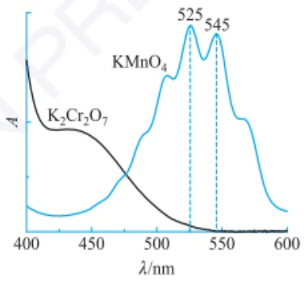

line

| Wavelength (nm) | K2Cr2O7 Absorption | KMnO4 Absorption |
| --- | --- | --- |
| 525 | — | Peak |
| 545 | — | Peak |

$K_{2}Cr_{2}O_{7}$  和  $KMnO_{4}$  溶液的吸收光谱

## 4.2.5 紫外-可见分光光度法的应用

紫外-可见分光光度法不仅可根据吸收光谱的特征、吸收程度及变化情况进行定性分析、结构鉴定和分子间作用力鉴别，还可以进行定量分析及测定某些化合物的物理和化学参数。

## 4.2.5.1 定性分析

无机化合物的定性分析多采用显色法和原子发射光谱，很少采用紫外-可见分光光度法。有机化合物对紫外-可见光的吸收主要取决于生色团、助色团及它们的连接情况。因此，紫外-可见吸收光谱在鉴定整个分子的结构方面能力不足，但在鉴定生色团共轭关系、分子骨架结构、取代基情况等方面有独到之处，常辅助

生命科学和医学研究中，核酸的纯度对下游实验的顺利进行至关重要，常采用的鉴定方法为紫外-可见吸收光谱法。

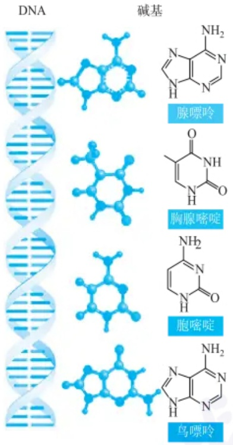

chemical

DNA double helix structure and its corresponding chemical structures including ribosomal, cytoplasmic, and cytosolic peptides

核酸中的所有碱基均有共轭双键，其在紫外光谱区有一条典型的吸收光谱，吸收峰位于260 nm；而蛋白质在紫外光谱区的吸收峰位于280 nm，所以常采用260 nm与280 nm处吸光度的比值判断核酸纯度。

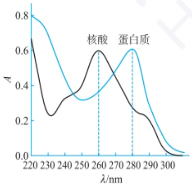

line

| \(\lambda/\)nm | Blue Curve (A) | Black Curve (A) |
| --- | --- | --- |
| 220 | ~0.80 | ~0.67 |
| 230 | ~0.65 | ~0.24 |
| 240 | ~0.40 | ~0.33 |
| 250 | ~0.33 | ~0.38 |
| 260 | ~0.37 | ~0.60 |
| 270 | ~0.48 | ~0.45 |
| 280 | ~0.61 | ~0.27 |
| 290 | ~0.35 | ~0.22 |
| 300 | ~0.05 | ~0.01 |

核酸和蛋白质的吸收光谱图

红外光谱、核磁共振波谱和质谱等技术进行定性和结构分析。

紫外-可见分光光度法用于有机化合物定性分析时，一般有三种方法:吸收光谱曲线比较法、导数光谱曲线比较法和  $\lambda_{max}$  实验值与其理论值比较法。

## 1. 吸收光谱曲线比较法

吸收光谱的形状、吸收峰的数目及位置、吸收谷及肩峰位置、 $\lambda_{max}$ 的位置及相应的 $\varepsilon_{max}$ 是进行定性分析的依据。在相同的测量条件(溶剂、pH等)下，测定并比较未知物与所推断化合物的标准物的吸收光谱，若二者完全一致，则可认为它们含有相同的生色团和助色团；否则，可判断二者是不同物质或待测物含有其他杂质。

吸收光谱比较法也可用于物质纯度鉴定。为了简便，常选择几个特征波长处吸光度的相对大小判定物质的纯度。例如，分光光度法常用于鉴别提取的核酸的纯度。核酸链上的碱基嘌呤和嘧啶具有共轭双键，$\lambda_{\mathrm{max}}$ 位于 $260~\mathrm{nm}$；其共存组分蛋白质中的酪氨酸、色氨酸和苯丙氨酸含有共轭双键和供电子基团，$\lambda_{\mathrm{max}}$ 位于 $280~\mathrm{nm}$。因此，常用 $260~\mathrm{nm}$ 和 $280~\mathrm{nm}$ 处的吸光度的比值 $(A_{260} / A_{280})$ 评估核酸被蛋白质污染的程度。理论上，纯的核糖核酸(RNA)的 $A_{260} / A_{280}$ 值为 $2.0; A_{260} / A_{280}$ 为 $1.8 \sim 2.0$ 时，认为RNA被蛋白质轻微污染，处于可接受范围；当 $A_{260} / A_{280} < 1.8$ 时，则认为蛋白质污染比较严重，需进一步纯化RNA。

## 2. 导数光谱曲线比较法

导数光谱是以波长为横坐标，以吸光度随波长的变化率为纵坐标的曲线，常采用数学计算软件将吸光度信号转换为微分信号获得。图4.2.11(a)为某物质的理论模拟吸收光谱及经数学计算软件获得的1\~4阶导数光谱。随着导数的阶次增加，导数光谱的谱带变得更尖锐，分辨率也越高，能够将吸收光谱的微小变化显示出来，适于分辨重叠严重的吸收峰、强吸收峰肩部的弱吸收峰及宽吸收带上的$\lambda_{\mathrm{max}}$ 。由于导数光谱能够显示物质的特征精细结构，因此又被称为“指纹光谱”，可用于物质的鉴定和纯度检验。但是，在实际应用中，由于仪器测定吸光度时存在一定的误差（见前文图4.2.9），随着导数阶次增加，噪声被逐渐放大，导致信噪比减小[图4.2.11(b)]，因此，在实际应用中，常用一阶导数光谱。

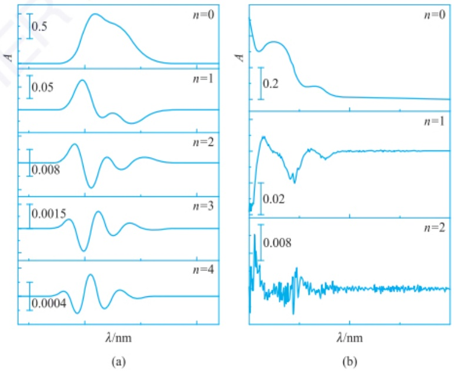

图 4.2.11 （a）理论模拟吸收光谱和（b）实验测量的吸收光谱及其导数光谱

## 3. $\lambda_{\mathrm{max}}$ 实验值与其理论值比较法

对于不饱和有机化合物的结构鉴定，可采用经验规则计算  $\lambda_{max}$ ，并与实验测定值比较，从而确认其结构。常见的经验规则有 Woodwar 规则或 Woodwar-Fieser 规则、Scott 规则。Woodwar-Fieser 规则可计算共轭二烯烃、多烯烃及共轭烯酮类化合物的  $\pi\rightarrow\pi^{*}$  跃迁对应的  $\lambda_{max}$ ，Scott 规则可计算芳香族羰基衍生物 E2 带的吸收波长。

## 4.2.5.2 结构分析

## 1. 官能团的鉴定

利用紫外吸收光谱鉴定有机化合物的基团，虽不如利用红外吸收光谱普遍和有效，但在鉴定共轭生色团或某些基团方面有其独到之处，可作为其他鉴定方法的有力补充。一般而言，常根据表4.2.4所示的规律初步鉴定有机化合物的官能团，缩小该化合物的归属范围，再结合其他方法（如红外光谱、质谱、核磁共振谱）测试结果确认化合物的结构。

表 4.2.4 根据紫外吸收光谱判断有机化合物的官能团的一般规律

| 吸收光谱的特点 | 可能存在的基团 |
| --- | --- |
| 200~800 nm 无吸收峰 | 脂肪/脂环烃或其衍生物(氯化物、醇、醚等),单烯或孤立多烯 |
| 210~250 nm 强吸收带,$\varepsilon = 10^{4} \sim 2 \times 10^{4}$L·mol$^{-1}$·cm$^{-1}$ | 共轭二烯或 $\alpha, \beta$-不饱和羰基 |
| 260~350 nm 强吸收带 | 3~5 个共轭双键 |
| 230~300 nm 中等强度的吸收带 | 苯环 |
| 仅在 270~350 nm 有一弱吸收带($\varepsilon = 10 \sim 100$ L·mol$^{-1}$·cm$^{-1}$) | 非共轭的 n 电子生色团,如饱和醛、酮的羰基 |
| 多个紫外吸收峰,甚至延伸到可见光区 | 长链共轭化合物或多环芳烃 |

## 2. 构型或构象判别

如 4.2.2 节所述,有机化合物的空间结构会影响基团的共平面性及化学键的转动,导致其吸收光谱发生变化。因此,根据紫外-可见吸收光谱的形状,可判定一些化合物的构型或构象。

一般而言，反式异构体的空间位阻小，共平面性及共轭程度高，其  $\lambda_{max}$  和  $\varepsilon_{max}$  均大于顺式异构体，据此可区分顺式和反式异构体。例如，顺式  $\beta-$  苯丙烯酸（又名肉桂酸）的  $\lambda_{max}$  为 280 nm,  $\varepsilon_{max}$  为  $13500\ L\cdot mol^{-1}\cdot cm^{-1}$ ; 反式  $\beta-$  苯丙烯酸  $\lambda_{max}$  则红移至 295 nm,  $\varepsilon_{max}$  增至  $27000\ L\cdot mol^{-1}\cdot cm^{-1}$ 。

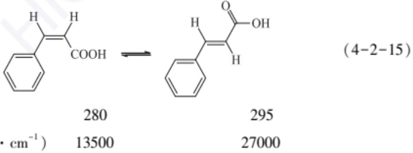

chemical

Chemical reaction equation showing conversion of a benzene derivative to a hydroxybenzene derivative with associated molar values

紫外-可见吸收光谱还可对某些互变异构体进行判别。常见的构象互变有酮式和烯醇式互变、醇醛的环式和链式互变、酰胺的内酰胺式和内酰亚胺式互变等。例如，乙酰乙酸乙酯存在酮式和烯醇式互变异构现象，在酮式结构中，羰基是孤立的，$\pi \rightarrow \pi^{*}$ 和 $n\rightarrow \pi^{*}$ 跃迁产生的吸收分别在 $204~\mathrm{nm}$ 和 $280~\mathrm{nm}$ 处，$\varepsilon$ 均较小；在烯

Woodwar-Fieser 规则:

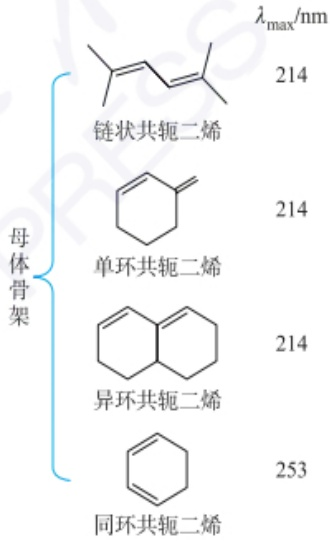

chemical

Chemical structures of polymer chains with different morphologies and peak wavelengths labeled

<table><tr><td colspan="2">每改变1个官能团</td><td> $\lambda_{\max}$ 变化/nm</td></tr><tr><td rowspan="2">增加</td><td>共轭双键</td><td>+30</td></tr><tr><td>环外双键</td><td>+5</td></tr><tr><td rowspan="5">双键上基团取代</td><td>烷基或环基</td><td>+5</td></tr><tr><td>Cl、Br</td><td>+5</td></tr><tr><td>OR(烷氧基)</td><td>+6</td></tr><tr><td> $NR_2$ </td><td>+60</td></tr><tr><td>SR</td><td>+30</td></tr></table>

应用示例:

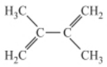

该分子骨架为链状共轭二烯,双键上共有两个烷基取代基,根据规则计算:

$\lambda_{max}=214+2\times5=224\ (nm)$ ，与实验测定值(226 nm)相近。

醇式结构中,存在共轭的双键, $\lambda_{max}$ 位于243 nm,吸收较强( $\varepsilon_{max}=18000\ L\cdot mol^{-1}\cdot cm^{-1}$ )。

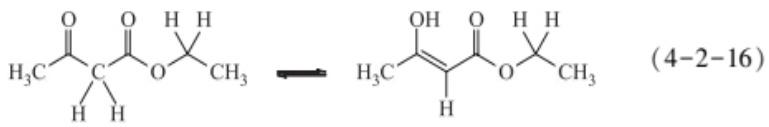

chemical

Chemical structure of a diester compound with ethyl and methyl substituents, labeled as (4-2-16)

$$
\lambda_ {\max} / \mathrm{nm}
$$

$$
2 8 0
$$

$$
\varepsilon_ {\max} / (\mathrm{L} \cdot \mathrm{mol} ^ {- 1} \cdot \mathrm{cm} ^ {- 1}) 1 1 0
$$

$$
243
$$

$$
1 8 0 0 0
$$

## 4.2.5.3 定量分析

定量分析是紫外-可见分光光度法的重要应用之一。光度法定量分析的依据是朗伯-比尔定律，即在特定条件下，物质在一定波长处的吸光度 $A$ 与它的浓度 $c$ 呈线性关系。因此，通过测定待测组分标准物质的吸光系数及未知样品的吸光度，即可求出该组分在样品中的浓度或含量。下面介绍几种常用的测定方法。

## 1. 单组分测定

单组分测定常采用标准曲线法,具体做法是:配制一系列不同浓度的待测组分的标准溶液,选择合适的空白溶液为参比,在选定的测定波长(通常为 $\lambda_{max}$ )和实验条件下测定标准溶液的吸光度,绘制吸光度-浓度(A-c)曲线,即标准曲线(图4.2.12)。在相同条件下,测定未知样品的吸光度,利用标准曲线计算样品中待测组分的含量。

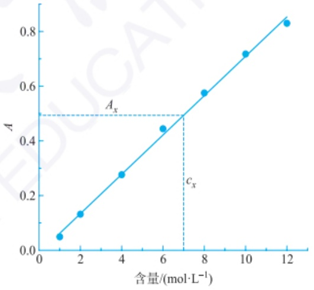

line

| 含量 \((mol \cdot L^{-1})\) | A |
| --- | --- |
| 1 | ~0.05 |
| 2 | ~0.13 |
| 4 | ~0.28 |
| 6 | ~0.45 |
| 8 | ~0.58 |
| 10 | ~0.72 |
| 12 | ~0.84 |

图 4.2.12 紫外-可见分光光度法测定某物质的标准曲线

为了简便,也可采用标准对比法测定。在相同条件下,测定样品溶液和标准溶液的吸光度 $A_{x}$ 和 $A_{s}$ ,根据式(4-2-17)计算样品中待测组分的含量。

$$
\frac {A _ {x}}{A _ {\mathrm{s}}} = \frac {\varepsilon b c _ {x}}{\varepsilon b c _ {\mathrm{s}}} = \frac {c _ {x}}{c _ {\mathrm{s}}} \tag {4-2-17}
$$

不管采用上述哪种方法,定量分析都应在符合朗伯-比尔定律的浓度范围内进行。另外,采用标准对比法时,应使 $A_{x}$ 和 $A_{s}$ 相近,才能得到较为准确的结果。

## 2. 多组分测定

在多组分体系中,如果各组分对光都有吸收且无相互作用时,根据“吸光度具有加和性”的特点,在 n 个波长处分别测定各组分的总吸光度值,然后解 n 元一次方程,可求出各组分的浓度。其中,比较常见的是双组分测定。

设样品中有两种组分I和Ⅱ，分别绘制吸收光谱。若两组分的吸收光谱互不重叠[图4.2.13(a)]，则按两个单一组分处理，即在各自 $\lambda_{\mathrm{max}}$ 处分别进行测定；若两组分的吸收光谱有重叠[图4.2.13(b)]，则可选择两个测定波长 $\lambda_{1}$ 和 $\lambda_{2}$，根据吸光度的加和性及两组分在 $\lambda_{1}$ 和 $\lambda_{2}$ 处的吸光系数和总吸光度，解两个联立方程组得出两组分的含量 $c_{\mathrm{I}}$ 和 $c_{\mathrm{II}}$。

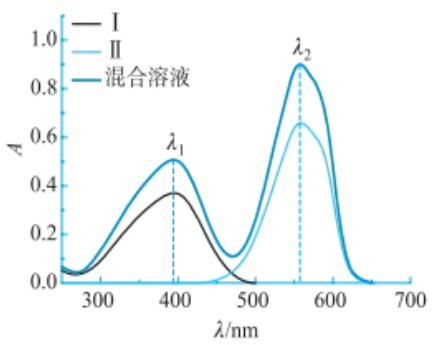

line

| Wavelength (nm) | I (Absorption) | II (Absorption) | 混合溶液 (Absorption) |
| --- | --- | --- | --- |
| ~250 | ~0.05 | ~0.05 | ~0.05 |
| ~400 | ~0.36 | ~0.36 | ~0.50 |
| ~560 | ~0.00 | ~0.65 | ~0.90 |

(a) 组分Ⅰ和Ⅱ的吸收光谱互不重叠

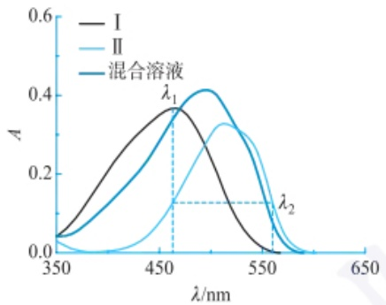

line

| Wavelength (nm) | I (Absorbance) | II (Absorbance) | 混合溶液 (Absorbance) |
| --- | --- | --- | --- |
| 350 | ~0.04 | ~0.02 | ~0.04 |
| 450 | ~0.36 | ~0.12 | ~0.36 |
| 550 | ~0.02 | ~0.32 | ~0.32 |
| 650 | 0 | 0 | 0 |

(b) 组分 I 和 II 的吸收光谱重叠

图 4.2.13 组分 I、II 及二者的混合溶液的吸收光谱

另外,针对图 4.2.13(b) 的情况,也可采用双波长等吸收点法计算。如要测定组分 I 的含量,可通过选择对组分 II 具有等吸收的两个波长  $\lambda_{1}$  和  $\lambda_{2}$  加以消除。

## 4.2.5.4 其他应用

## 1. 分子间作用鉴别

根据朗伯-比尔定律可知，若溶液中两组分不存在相互作用，则吸光度具有加和性。反之，则可判断两组分一定存在相互作用。例如，图4.2.14为十氟联苯（DFB）、全氟辛烷磺酸钾(PFOS)及二者混合溶液(PFOS+DFB)的吸收光谱。在200\~300 nm区间，二者混合溶液的吸光度值明显小于各自溶液吸收光谱的算术加和(蓝色虚线)，表明二者存在强相互作用。

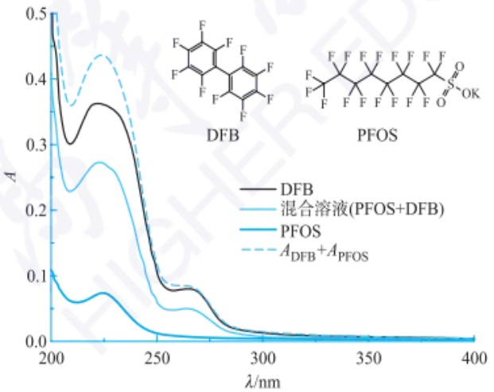

line

| \(\lambda/\)nm | DFB | 混合溶液(PFOS+DFB) | PFOS | A_DFB + A_PFOS |
| --- | --- | --- | --- | --- |
| 200 | ~0.5 | ~0.5 | ~0.11 | ~0.5 |
| 210 | ~0.3 | ~0.23 | ~0.06 | ~0.36 |
| 220 | ~0.36 | ~0.27 | ~0.08 | ~0.44 |
| 230 | ~0.35 | ~0.26 | ~0.07 | ~0.42 |
| 240 | ~0.25 | ~0.18 | ~0.04 | ~0.28 |
| 250 | ~0.1 | ~0.06 | ~0.02 | ~0.1 |
| 260 | ~0.09 | ~0.05 | ~0.01 | ~0.09 |
| 270 | ~0.08 | ~0.05 | ~0.01 | ~0.08 |
| 280 | ~0.04 | ~0.02 | ~0.01 | ~0.04 |
| 290 | ~0.02 | ~0.01 | ~0.01 | ~0.02 |
| 300 | ~0.01 | ~0.01 | ~0.01 | ~0.01 |
| 350 | ~0.01 | ~0.01 | ~0.01 | ~0.01 |
| 400 | ~0.01 | ~0.01 | ~0.01 | ~0.01 |

图 4.2.14 十氟联苯(DFB)、全氟辛烷磺酸钾(PFOS)及二者混合溶液的吸收光谱及二者吸收光谱的算术加和

由于分子间相互作用会改变分子中电子云密度，影响电子跃迁过程，因此，根据吸收峰位置和强度的变化还可判断分子间作用力类型。例如，根据卟啉分子Soret吸收带的位置变化，可判断分子间作用力是卟吩环之间的 $\pi -\pi$ 堆积作用或分子间氢键等。

## 紫外-可见吸收光谱法鉴别 卟啉分子间作用

以二甲基亚砜为溶剂时，卟啉分子单体在 $425\mathrm{nm}$ 附近有较强的吸收峰，称为Soret吸收带。当以水为溶剂时，卟啉分子可通过卟吩环之间的$\pi-\pi$堆积作用形成面对面排列的H聚集体，此时卟啉分子单体的Soret吸收带蓝移。当在二甲基亚砜中引入乙二醇单甲醚时，卟啉分子除了形成H聚集体外，还可通过分子间氢键形成首尾相连的J聚集体，此时卟啉单体的Soret吸收带发生红移。由下图可知，卟啉纳米粒子包含了H和J两种聚集体。

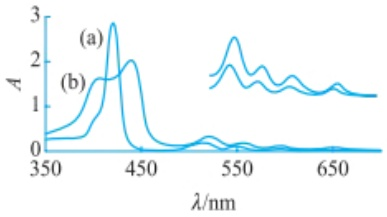

line

| \(\lambda/\)nm | A (a) | A (b) |
| --- | --- | --- |
| 350 | ~0.3 | ~0.2 |
| 420 | ~2.8 | ~1.6 |
| 450 | ~0.1 | ~2.0 |
| 550 | ~0.1 | ~0.3 |
| 650 | ~0.1 | ~0.1 |

(a) 叶啉分子单体(溶剂为二甲基亚砜); (b) 叶啉纳米粒子(溶剂为水)的紫外-可见吸收光谱。右侧插图中的吸光度为刻度×5倍。

(J. Am. Chem. Soc., 2002, 124(48):14290-14291)

## 2. 理化常数测定

分析化学中使用的指示剂在一定条件下会发生颜色变化,因此可用紫外-可见分光光度法测定相关反应的平衡常数和化学计量数等,如有色弱酸或弱碱的解离常数 $(K_{a})$ 及有色配合物的组成、解离度和稳定常数。

以一元弱酸 HB 为例,介绍该方法测定 $K_{\mathrm{a}}$ 的原理。设 [HB] 和 $[\mathrm{B}^{-}]$ 分别为酸式型体 HB 和碱式型体 $\mathrm{B}^{-}$ 的平衡浓度,二者之和等于 HB 的分析浓度 $c_{\mathrm{HB}}$ 。根据 HB 在溶液中的解离平衡可知,只需用 pH 计测出溶液 pH,用光度计测出 [HB] 和 $[\mathrm{B}^{-}]$,就可以计算出 $K_{\mathrm{a}}\left(=\frac{\left[\mathrm{H}^{+}\right]\left[\mathrm{B}^{-}\right]}{\left[\mathrm{HB}\right]}\right)$ 。具体做法是:固定 $c_{\mathrm{HB}}$ 不变,使用缓冲溶液调节溶液 pH,在某一确定波长 $\lambda$ 下,用 $1 \mathrm{~cm}$ 吸收池测量不同溶液的吸光度 $A_{\mathrm{i}}$,根据吸光度的加和性可知

$$
A _ {\mathrm{i}} = \varepsilon_ {\mathrm{HB}} [ \mathrm{HB} ] + \varepsilon_ {\mathrm{B}} [ \mathrm{B} ] \quad (b = 1 \mathrm{cm}) \tag {4-2-18}
$$

调节溶液 pH 至强酸性  $(pK_{a}-2)$  或强碱性  $(pK_{a}+2)$ ，使 HB 全部以酸式型体 HB 或碱式型体 B⁻ 存在，即两种型体的平衡浓度均等于分析浓度  $(HB]=c_{HB}$  或  $[B^{-}]=c_{HB})$ ，测得其在确定波长  $\lambda$  处的吸光度分别为  $A_{HB,t}$  和  $A_{B,t}$ ，此时， $A_{HB,t}=\varepsilon_{HB}c_{HB}, A_{HB,t}=\varepsilon_{HB}c_{HB}$ ，即  $\varepsilon_{HB}=\frac{A_{HB,t}}{c_{HB}}, \varepsilon_{B}=\frac{A_{B,t}}{c_{HB}}$ ，将  $\varepsilon_{HB}$  和  $\varepsilon_{B}$  代入式 (4-2-18)，可知:

$$
\frac {[ \mathrm{HB} ]}{[ \mathrm{B} ]} = \frac {A _ {\mathrm{HB,t}} - A _ {\mathrm{i}}}{A _ {\mathrm{i}} - A _ {\mathrm{B,t}}} = \frac {K _ {\mathrm{a}}}{[ \mathrm{H} ^ {+} ]} \tag {4-2-19}
$$

$$
\lg \frac {A _ {\mathrm{i}} - A _ {\mathrm{B,t}}}{A _ {\mathrm{HB,t}} - A _ {\mathrm{i}}} = - \mathrm{pH} + \mathrm{p} K _ {\mathrm{a}} \tag {4-2-20}
$$

这是光度法测定一元弱酸解离常数的基本关系式。以 $\mathrm{pH}$ 为横坐标，以 $\lg \frac{A_{\mathrm{i}} - A_{\mathrm{B,t}}}{A_{\mathrm{HB,t}} - A_{\mathrm{i}}}$ 为纵坐标作图(图4.2.15)，所得直线在 $\mathrm{pH}$ 轴上的截距即为 $\mathrm{pK_a}$ 。有关数据见表4.2.5。

表 4.2.5 双波长法测定有机弱酸/弱碱的  $pK_{a}$

<table><tr><td rowspan="2">化合物</td><td colspan="2"> $pK_a$ </td><td rowspan="2">化合物</td><td colspan="2"> $pK_a$ </td></tr><tr><td>实验值a</td><td>报道值b</td><td>实验值a</td><td>报道值b</td></tr><tr><td>甲基橙</td><td>3.40</td><td>3.40</td><td>4-硝基酚</td><td>6.99</td><td>7.15</td></tr><tr><td>溴甲酚绿</td><td>4.71</td><td>4.68</td><td>2,4-二硝基苯酚</td><td>4.01</td><td>4.05</td></tr><tr><td>溴甲酚紫</td><td>6.38</td><td>6.30</td><td>4-羟基苯甲醛</td><td>7.62</td><td>7.62</td></tr><tr><td>苯胺</td><td>4.71(+1)</td><td>4.60</td><td>喹啉</td><td>4.82(+1)</td><td>4.80</td></tr><tr><td>苯酚</td><td>9.94</td><td>9.99</td><td></td><td></td><td></td></tr></table>

a 分析科学学报,2007,23(4):401-404.

b 李梦龙,蒲雪梅,分析化学数据速查手册.北京:化学工业出版社,2009.

采用光度法测定有色配合物组成的方法有摩尔比法、等摩尔连续变化法、斜率比法和平衡移动法等。下面以前两种方法为例，介绍光度法如何测定配合物的组成。

摩尔比法又称饱和法，根据M可被L配位饱和的特点测定配合物的组成。固定金属离子M的分析浓度 $c_{M}$ ，改变配体L的分析浓度 $c_{L}$ ，得到一系列 $c_{L}/c_{M}$ 数值不同的溶液，在特定波长处，以试剂空白为参比，测定溶液的吸光度A，以A对 $c_{L}/c_{M}$ 作图。当 $c_{L}$ 增加时，A先线性增加而后趋于稳定，曲线上直线与水平阶段的转折点或两阶段曲线外推的交点(即图4.2.16中 $A_{1}$ )对应的 $c_{L}/c_{M}$ 即为配合物的配位数n。该法简便,适于测定解离度小的配合物的组成。另外,从 $A_{1}$ 点所作垂线与曲线相交点对应的吸光度值(即 $A_{2}$ )小于 $A_{1}$ ,这是配合物的解离所致,据此可求得解离度( $\alpha$ )为

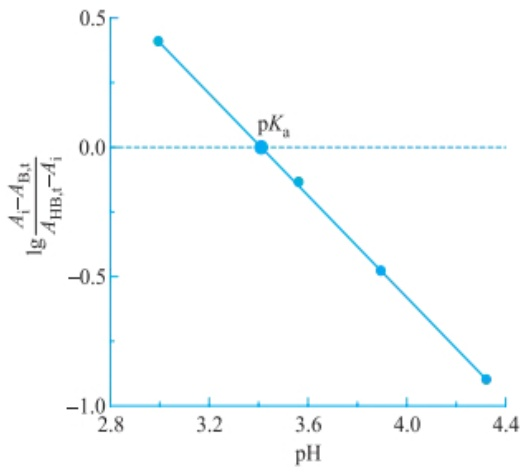

line

| pH | lg(Ai - ABBt / AHBt - Ai) |
| --- | --- |
| ~3.0 | ~0.42 |
| ~3.4 | 0.0 |
| ~3.55 | ~-0.12 |
| ~3.9 | ~-0.48 |
| ~4.35 | ~-0.9 |

图4.2.15 某有机酸的 $\lg \frac{A_{\mathrm{i}} - A_{\mathrm{B,t}}}{A_{\mathrm{HB,t}} - A_{\mathrm{i}}}$ 与溶液 $\mathrm{pH}$ 的关系图

$$
\alpha = \frac {A _ {1} - A _ {2}}{A _ {1}} \tag {4-2-21}
$$

根据解离度  $\alpha$  及各组分的平衡浓度, 还可求得配合物的稳定常数  $K_{ML}$ 。

等摩尔连续变化法又称 Job 法，其实验方法是:保持溶液中  $c_{M}$  与  $c_{L}$  之和  $c(c_{\mathrm{M}} + c_{\mathrm{L}} = c)$  不变，改变  $c_{L}/c_{M}$ ，在特定波长处，测定溶液的 A；以 A 为纵坐标、 $c_{L}/c$  为横坐标，绘制连续变化法曲线（图 4.2.17），从曲线上吸光度上升和下降阶段曲线外推的交点  $c_{L}/c$  计算  $c_{L}/c_{M}$ ，即为配合物中 L 与 M 的摩尔比。该法适用于只形成一种配位数小且稳定性高的配合物。另外，与摩尔比法类似，也可根据吸光度  $A_{1}, A_{2}$  及平衡浓度计算配合物的解离度及稳定常数  $K_{ML}$ 。

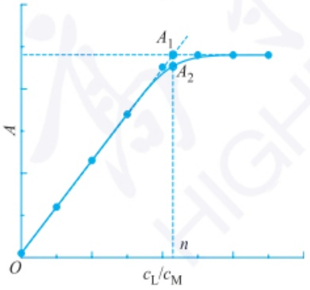

line

| Point | cL/cM | A |
| --- | --- | --- |
| O | 0 | 0 |
| A1 | ~0.65 | ~0.85 |
| A2 | ~0.75 | ~0.75 |

图 4.2.16 摩尔比法测定配合物

配位数之 $A$ 与 $c_{\mathrm{L}} / c_{\mathrm{M}}$ 的曲线

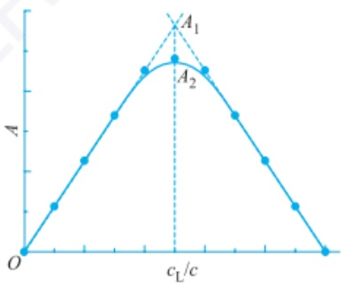

line

| cL/c | A |
| --- | --- |
| 0 | 0 |
| ~0.15 | ~0.25 |
| ~0.3 | ~0.45 |
| ~0.45 | ~0.65 |
| ~0.6 | ~0.75 |
| ~0.75 | ~0.75 |
| ~0.9 | ~0.65 |
| ~1.05 | ~0.45 |
| ~1.2 | ~0.25 |
| ~1.35 | 0 |

图 4.2.17 等摩尔连续变化法测

定配合物配位数之 $A$ 与 $c_{\mathrm{L}} / c$ 的曲线

## 3. 催化动力学分光光度法

催化动力学分光光度法是以催化反应为基础，通过测定催化反应体系中指示物的吸光度变化速率确定待测组分含量的方法，常用于测定催化剂含量。设有一反应速率较慢的显色反应，因催化剂H的存在而加速，当反应物的浓度很大时，生成有色产物的速率与催化剂浓度 $(c_{\mathrm{cat}})$ 正相关，若催化反应时间恒定，则体系的吸光度与催化剂浓度正相关。实验时，常采用快速冷却、改变酸度、加入催化剂活性抑制剂等方法终止反应以获得恒定的催化反应时间t，通过测定一系列不同 $c_{cat}$ 的标准溶液对应体系在t时的吸光度A，绘制 $A-c_{cat}$ 工作曲线，根据待测液在t时的吸光度值，求得 $c_{cat}$ 。该方法具有灵敏度高、检出限低的优点。以酶催化反应为基础的动力学分光光度法被称为酶催化动力学分光光度法，可用于测定酶活性，灵敏度可达 $10^{-12}-10^{-6}\ g\cdot mL$ ，但由于酶催化反应的影响因素多，不易严格控制，测定误差相对较大。

纳米材料比色法检测三聚氰胺

## 4. 纳米材料比色传感器法

Au、Ag等贵金属纳米材料具有表面等离激元共振（SPR），其特征吸收峰的位置和强度受颗粒的尺寸、形貌、组成、粒子间距及周围介质等因素的影响。通过表面修饰和改性，使金属纳米颗粒与待测物发生相互作用，引起颗粒的分散/聚集状态改变或组成/结构变化，导致SPR消光光谱变化。根据SPR消光光谱的变化与待测物浓度之间的相关关系进行定量分析的方法称为纳米材料比色传感器法。该方法具有快速、简单、灵敏度高等优势，可用于高通量、实时检测。

## 习题

## - 章节练习题 -

1. 下列分子中, 哪些存在  $n-\pi^{*}$  跃迁, 请解释选择的原因。(a) 甲酸 (HCOOH); (b) 乙烯 ( $C_{2}H_{4}$ ); (c) 甲醇 ( $CH_{3}OH$ ); (d) 氢氟酸 (HCN)。

2. 含  $Cu^{2+}$  的水溶液呈蓝色, 请问其能吸收可见光吗? 为什么?

3. 以下两种同分异构体中，一个在 235 nm 处有最大吸收， $\varepsilon_{max}$  为 12000 L·mol $^{-1}$ ·cm $^{-1}$ ，另一个在 220 nm 以外无高强吸收，鉴别各属于哪一个异构体。

(a) $\mathrm{CH}_3 - \mathrm{C}(\mathrm{CH}_3) = \mathrm{CH} - \mathrm{CO} - \mathrm{CH}_3$ (b) $\mathrm{CH}_2 = \mathrm{C}(\mathrm{CH}_3) - \mathrm{CH}_2 - \mathrm{CO} - \mathrm{CH}_3$

4. 在生物体系中，许多酶可催化还原型辅酶 NADH 和氧化型辅酶  $NAD^{+}$  的相互转换，因此常通过测定  $NAD^{+}$  和 NADH 的浓度评价酶的活性。这对氧化还原型辅酶中，一种在波长 260 nm 和 340 nm 处均有吸收，而另一种仅在波长 260 nm 处有吸收，请根据它们的结构判断对应的酶。已知某混合溶液在波长 260 nm 和 340 nm 处的吸光度值分别为 1.362 和 0.382，请根据以下数据，计算混合溶液中  $NAD^{+}$  和 NADH 的浓度。

| 辅酶 | $\varepsilon_{260\,\text{nm}} / (\text{L} \cdot \text{mol}^{-1} \cdot \text{cm}^{-1})$ | $\varepsilon_{340\,\text{nm}} / (\text{L} \cdot \text{mol}^{-1} \cdot \text{cm}^{-1})$ |
| --- | --- | --- |
| 辅酶 1 | $1.84 \times 10^{4}$ | $6.22 \times 10^{3}$ |
| 辅酶 2 | $1.54 \times 10^{4}$ |  |

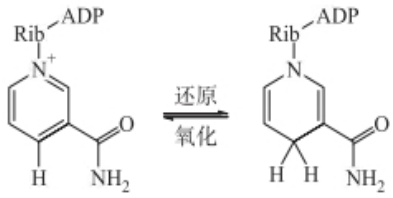

chemical

Chemical reaction showing addition of ADP to a pyridine derivative under basic conditions

$\mathrm{NAD}^{+} + \mathrm{H}^{+} + 2\mathrm{e}^{-}\rightleftharpoons$ NADH

5. 尿液中的磷含量是人体内磷代谢的一个指标，可采用磷钼蓝分光光度法测定，即在酸性条件下，先用钼酸铵处理尿液，使其中的磷（即无机磷酸盐）与钼酸铵反应生成磷钼酸，再在还原剂氨基奈酚磺酸作用下生成磷钼蓝，测定其  $\lambda_{max}=690\ nm$  处的吸光度。某患者 24 h 排尿 1850 mL，尿液 pH=6.5。取 1.00 mL 尿样，用上法显色后稀释至 100.0 mL，另取一系列磷标准溶液同样处理，在 690 nm 波长处以试剂空白为参比，测得吸光度如下:

| 磷标准溶液浓度/($\mu g \cdot mL^{-1}$) | 1.00 | 2.00 | 3.00 | 4.00 | 尿样 |
| --- | --- | --- | --- | --- | --- |
| A | 0.205 | 0.410 | 0.615 | 0.820 | 0.625 |

(a) 请计算该患者每日的排磷量(g);
（b）请计算该患者尿液中  $H_{2}PO_{4}^{-}$  与  $HPO_{4}^{2-}$  的比值 (mol/mol)。(已知  $H_{3}PO_{4}$  的  $K_{a_{1}} = 1.1 \times 10^{-2}, K_{a_{2}} = 7.5 \times 10^{-8}, K_{a_{3}} = 4.8 \times 10^{-13}$ 。)

## - 挑战性问题 -

6. 南极上空的臭氧层空洞(ozone depletion)曾引起社会层面的广泛关注。但在近几年,关于臭氧层空洞的消息却很少提起,是人类在灾害面前已经麻木了吗?当然不是,2024年1月,世界气象组织(WMO)及联合国环境署(UNEP)发布了一则令人振奋的好消息:预计南极的总臭氧柱(TCO)将在2066年左右恢复至1980年的水平,北极的TCO则将在2045年左右恢复至1980年的水平,而全球北纬60°到南纬60°区间将在2040年左右恢复至1980年的水平。查阅和参考相关科学文献,(1)解释臭氧层是什么?(2)臭氧层空洞为什么如此重要?(3)表征臭氧层空洞的指标是什么?(4)利用本章学习的知识设计实验方案,测定臭氧层空洞。

## - 专题或报告 -

7. 专用型光度计是针对特定应用领域设计的光度计，操作相对简单。胆红素仪是临床上检测胆红素的光度计，主要用于胆红素代谢异常所致疾病的诊断和治疗，如新生儿黄疸，针对其治疗，目前常用光照疗法降低新生儿体内的胆红素。请查阅相关科学文献，了解经皮胆红素仪（又称经皮黄疸仪）或血清胆红素仪的测定原理、特点及光疗法治疗黄疸的原理，并与同学分享你的结果。也可选择其他专用型光度计完成此作业，如总磷测定仪、化学需氧量(COD)测定仪、亚硝酸盐测定仪等。
8. 贵金属纳米颗粒具有独特的表面等离激元共振(SPR)吸收和良好的化学稳定性,基于SPR效应构建的传感器广泛用于食品安全、环境检测、医药卫生等领域。查阅相关科学文献,了解SPR比色法/光度法的原理及应用,并将结果写成报告。

## 4.3 红外吸收光谱法

红外吸收光谱法(infrared spectroscopy, IR)是一种基于物质分子对红外辐射的特征吸收，研究分子结构、化学组成及动态行为的分析技术。该方法广泛应用于化学、物理、生物医学和材料科学等领域。本节将概述红外吸收光谱法的基本原理、测试技术及分析应用，并简要讨论其新兴发展方向。

## 4.3.1 红外光谱法基本原理

## 4.3.1.1 概述

## 1. 红外光区的划分

红外光谱是由量子化振动能态之间的跃迁产生的，也称分子的振、转动光谱。

红外光谱法的发展历程

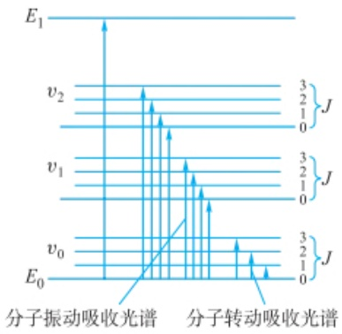

spectrogram

| Energy Level | Transition Type |
| --- | --- |
| E1 | N/A |
| v2 | J |
| v1 | J |
| v0 | J |
| E0 | N/A |

图 4.3.1 振动能级和转动能级示意图

红外选律

振动能级跃迁所需能量远比电子能级跃迁所需的能量小(图 4.3.1)，其波长在中红外光区。而转动能级跃迁比振动能级跃迁所需的能量要小，其波长在远红外区。红外光谱是有机化合物结构解析的重要工具，根据有机化合物的红外特征吸收频率，可确定化合物的官能团，也可依据特征吸收峰的强度变化进行定量分析。

$$
\Delta E _ {\text {分子}} = \Delta E _ {\text {振动}} + \Delta E _ {\text {转动}} \tag {4-3-1}
$$

$$
\Delta E _ {\text {振动}} \approx 0. 0 5 \sim 1 \mathrm{eV}
$$

$$
\lambda_ {\mathrm{振动}} \approx 1. 2 4 \sim 2 5 \mu \mathrm{m} (\text {中红外})
$$

$$
\Delta E _ {\text {转动}} \approx 0. 0 0 5 \sim 0. 0 5 \mathrm{eV}
$$

$$
\lambda_ {\text {转动}} \approx 2 5 \sim 2 5 0 \mu \mathrm{m} (\text {远红外})
$$

红外光区的波长范围为  $0.78 \sim 1000 \mu m$ ，习惯上又将红外光区分为三个区:

（1）近红外光区(0.78\~2.5  $\mu$ m) 近红外光区的吸收主要由低能电子能级跃迁、含氢原子团(如 O—H、N—H、C—H、S—H 等)伸缩振动的倍频、合频吸收产生(见 4.1.4)。适合于研究含氢基团，如水、醇、酚、胺、碳氢化合物、蛋白质、油脂等，也可以研究稀土及过渡金属离子的配位性质。通常该区域的谱带宽，吸收强度弱，且重叠严重，需要结合一定的化学计量学方法进行光谱信息解析。近红外光谱分析无须对样品进行预处理，适合于原位、无损、在线分析，在食品、农业、工业、环境、石油化工、医药、烟草等领域应用广泛。

（2）中红外光区(2.5\~25  $\mu$ m) 绝大多数有机化合物和无机离子的基频吸收带(由基态振动能级 v=0 跃迁至第一振动激发态 v=1 所产生的吸收峰)都在此区。由于基频振动吸收发生的概率最大，且中红外光谱技术最为成熟、简单，因此该区域是应用最为广泛的红外光谱区，通常的红外光谱即指中红外光区的光谱。
（3）远红外光区(25\~1000  $\mu$ m) 远红外光区的吸收主要由气体分子的转动能级跃迁、液体与固体中重原子的伸缩振动、晶体的晶格振动等产生，该区域适合研究无机化合物和小分子气体，也可以研究某些变角振动、骨架振动、氢键和吸附现象。

## 2. 红外光谱产生的条件

需满足两个条件:

（1）辐射能应具有能满足物质产生振动能级跃迁所需的能量；
（2）分子振动伴随偶极矩的变化。单原子分子和同核双原子分子(He、Ne、 $N_{2}$ 、 $O_{2}$ 、 $Cl_{2}$ 、 $H_{2}$ 等)振动时偶极矩不改变，不能与红外辐射产生偶合作用，因此不具有红外活性。

## 3. 红外光谱图

使用红外光谱仪测量样品时，样品吸收特定频率的红外光，引发振动能级跃迁，透射光强度相应减弱。通过记录透光率与波数的关系，即得红外光谱图（图4.3.2）。红外光谱通常用波数（单位:$\mathrm{cm}^{-1}$）表示能量，其物理意义为每厘米内的波长数目，波数与波长（单位:$\mu \mathrm{m}$ 或 $\mathrm{nm}$）的关系如下:

$$
\tilde {\nu} (\mathrm{cm} ^ {- 1}) = \frac {1 0 ^ {4}}{\lambda (\mu \mathrm{m})}
$$

## 4.3.1.2 双原子分子振动方程

化学键并非绝对刚性。当施加足够的力时，化学键会发生拉伸或压缩，并以特定频率振动，该频率由键的类型和连接原子决定。化学键类似于连接两点质量的机械弹簧。以最简单的双原子分子为例，可以将其看作由质量 $m_{1}$ 与 $m_{2}$ 的两个原子通过无质量弹簧连接的系统（见图4.3.3）。根据胡克定律，当两个原子沿键轴方向振动时,力与位移的关系遵循经典力学中的简谐振动,振动频率  $\nu$  表达式为

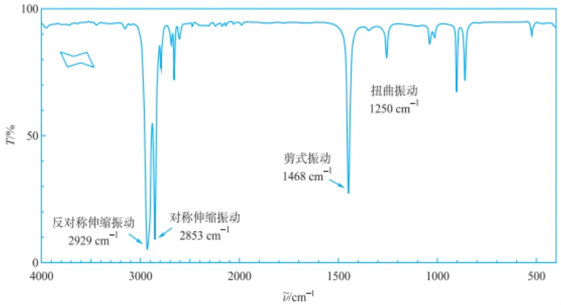

spectrogram

| Peak Label | Wavenumber \((cm^{-1})\) |
| --- | --- |
| 反对称伸缩振动 | 2929 |
| 对称伸缩振动 | 2853 |
| 剪式振动 | 1468 |
| 扭曲振动 | 1250 |

图 4.3.2 环己烷的红外吸收光谱图

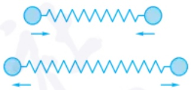

natural_image

Two identical spring-mass systems connected by directional arrows, no text or symbols present

图 4.3.3 双原子分子振动示意图(理想化)

$$
\nu = \frac {1}{2 \pi} \sqrt {\frac {k}{\mu}} \tag {4-3-2}
$$

式中，k 为键力常数(单位为  $dyn \cdot cm^{-1}$ )； $\mu$  为折合质量，表示为

$$
\mu = \frac {m _ {1} m _ {2}}{m _ {1} + m _ {2}} \tag {4-3-3}
$$

波数  $\tilde{\nu}$  与频率  $\nu$  的关系用下式表示:

$$
\tilde {\nu} = \frac {\nu}{c} \tag {4-3-4}
$$

式中，c 为光速，大小为  $3 \times 10^{8} \, m \cdot s^{-1}$ 。式(4-3-2)代入式(4-3-4)得

$$
\tilde {\nu} = \frac {1}{2 \pi c} \sqrt {\frac {k}{\mu}} \tag {4-3-5}
$$

若键力常数 k 用  $N \cdot cm^{-1}$  为单位，折合质量  $\mu$  采用原子质量  $u(1\ u = 1/N_{A}\ g = 1.66053886 \times 10^{-24}\ g, N_{A}$  为阿伏伽德罗常数) 为单位。上式可合并为

$$
\tilde {\nu} = \frac {N _ {\mathrm{A}} ^ {1 / 2}}{2 \pi c} \sqrt {\frac {k}{\mu}} = 1 3 0 2 \sqrt {\frac {k}{\mu}} \tag {4-3-6}
$$

由此可见，原子质量和化学键力常数直接影响基本振动频率。由于有机化合物结构各异，原子质量和键力常数不同，因此吸收频率不同，产生特征性的红外吸收光谱(表4.3.1)。

表 4.3.1 一些化学键的  $k(\mathbf{N} \cdot \mathbf{cm}^{-1})$ ,  $\mu(\mathbf{u})$

| 化学键 | $k / (N \cdot cm^{-1})$ | $\mu / u$ | 化学键 | $k / (N \cdot cm^{-1})$ | $\mu / u$ |
| --- | --- | --- | --- | --- | --- |
| H—Cl | 5.15 | 0.972 | C—C | 4.5~5.6 | 6.0 |
| H—O | 7.80 | 0.941 | C=C | 9.5~9.9 | 6.0 |
| H—N | 6.5 | 0.933 | C≡C | 15.6~17 | 6.0 |
| H—C | 4.7~5.0 | 0.923 | C—O | 5.0~5.8 | 6.857 |
| H—C=C | 5.1 | 0.923 | C=O | 11.8~13.4 | 6.857 |

例如，甲烷中的 C—H 的  $k=4.79\ N\cdot cm^{-1}$ ，可以根据式(4-3-5)计算得到  $\tilde{\nu}=2966\ cm^{-1}$ ，实测值为  $2915\ cm^{-1}$ ，理论计算值与实测值接近，且实测值比理论值略低。

折合质量