## 4.3.1.3 多原子分子的振动

大多数分子由多个原子组成，振动方式更复杂，除了双原子分子的伸缩振动外，还包括键角变化引起的变形振动。多原子分子的振动可分解为多个简单的基本振动，即简正振动。在简正振动中，分子质心保持不变，整体不转动，各原子在平衡位置附近简谐振动，且振动频率和相位相同。分子中任何一个复杂振动都可以看成这些简正振动的线性组合。

## 1. 简正振动的基本形式

简正振动的类型如下。

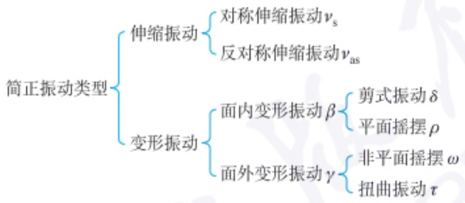

flowchart

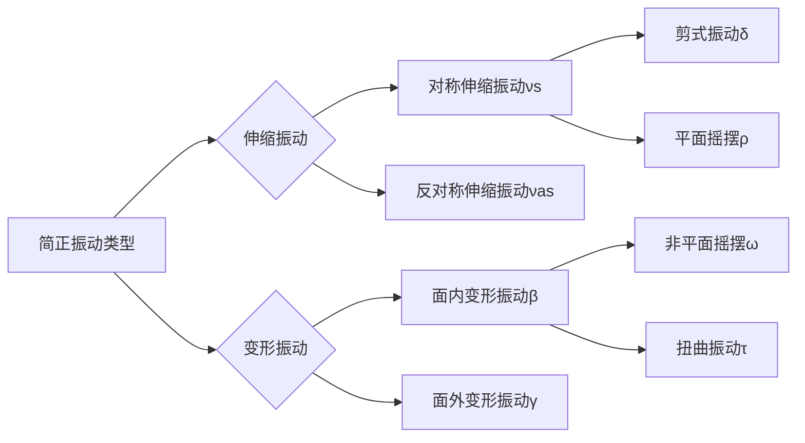

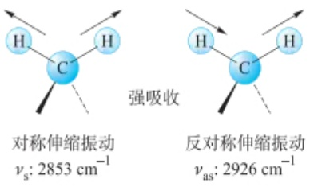

chemical

Photoisomerization reaction diagram showing strong absorption of carbon monoxide (C⁻) into hydrogen atoms, with corresponding vibrational frequencies νs and νas.

图 4.3.4 亚甲基的伸缩振动

（1）伸缩振动:原子沿键轴方向伸缩，键长发生周期性变化，键角保持不变（记为 $\nu$ ，如图4.3.4所示）。如果振动的各化学键同时伸长或者收缩，则称为对称伸缩振动（用 $\nu_{\mathrm{s}}$ 表示)；如有些键伸长而另外的键收缩，则称为反对称伸缩振动（用 $\nu_{\mathrm{as}}$ 表示）。
（2）变形振动:又称弯曲振动（如图4.3.5所示），原子垂直于键轴方向、键角发生周期性变化而键长不变的振动（用 $\delta$ 表示）。根据对称性不同，分为对称变形振动（用 $\delta_{\mathrm{s}}$ 表示)和反对称变形振动（用 $\delta_{\mathrm{as}}$ 表示）。根据振动方向与基团平面的关系，还可分为面内变形振动（用 $\beta$ 表示)和面外变形振动（用 $\gamma$ 表示）。而面内变形振动又分为剪式振动(δ)和平面摇摆(ρ)；面外变形振动又分为非平面摇摆(ω)和扭曲振动(τ)。

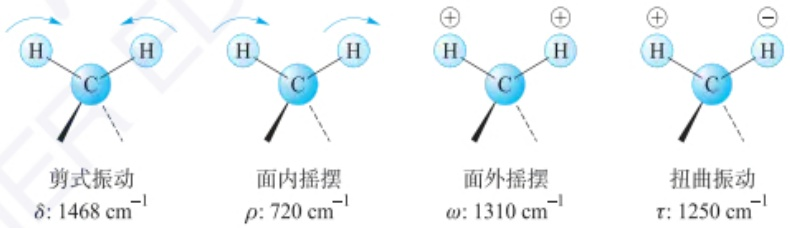

图 4.3.5 亚甲基的变形振动（⊕/⊖: 表示由纸面向外/向内）

## 2. 简正振动的理论数

简正振动的数目称为振动自由度,理论上每个振动自由度相当于红外光谱图上一个基频吸收带。分子的总自由度等于确定分子中各原子在空间的位置所需坐标的总数。在空间确定一个原子的位置,需要3个坐标(x、y和z)。当分子由n个原子组成时,则自由度(或坐标)的总数等于平动、转动和振动自由度的总和,即

$$
3 n = \text {平动自由度} + \text {转动自由度} + \text {振动自由度} \tag {4-3-7}
$$

在三维空间中，分子总是有三个平动自由度（表示整个分子在三个正交方向之一的移动）和三个（非线性分子:可以绕三个垂直轴旋转）或者两个（线性分子:可以绕两个垂直于键的独立轴旋转）转动自由度，因此，非线性分子的振动自由度为 $3n - 6$ ，线性分子的振动自由度为 $3n - 5$ 。然而，绝大多数化合物在红外光谱图上出现的峰数,远小于理论上计算的振动数,这是由如下原因引起的:

(1) 没有偶极矩变化的振动, 不产生红外吸收, 即非红外活性。
(2) 相同频率的振动吸收重叠, 简并为一个吸收峰。
（3）某些振动吸收强度太弱，或者某些振动吸收频率十分接近，仪器不能检测或不能分辨；某些振动吸收频率，超出了仪器的检测范围。

以  $CO_{2}$  (线性分子, 如图 4.3.6 所示) 为例, 它有 3n-5=4 个振动自由度, 按计算应有四个基频振动, 但在实际测试中只出现  $666\ cm^{-1}$  和  $2350\ cm^{-1}$  两个基频吸收峰。这是因为对称伸缩振动偶极矩变化为零, 不产生红外吸收。而面内和面外变形振动频率相等, 发生简并, 在红外光谱图中呈现一个吸收峰。

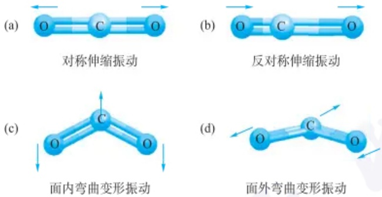

图 4.3.6  $CO_{2}$  的基频振动

## 3. 基频振动吸收峰外的其他吸收峰

（1）倍频峰(泛频峰): 振动能级由基态 $(\nu=0)$ 跃迁至第二激发态 $(\nu=2)$ 、第三激发态 $(\nu=3)$ ……所产生的吸收峰。由于振动的非谐性, 倍频峰并不正好是基频吸收峰位置的两倍处, 而是比两倍基频频率低。
(2) 合频峰: 吸收光子时同时激发两种频率的振动, 产生两个(或更多)不同频率之和(如  $v_{1} + v_{2}$ ) 的吸收峰。
（3）差频峰:已处于一个激发态的分子在吸收足够的外加辐射而跃迁到另一激发态，产生两个频率之差（如  $v_{2}-v_{1}$ ）的吸收峰。

## 4.3.1.4 红外光谱与分子结构的关系

## 1. 影响红外吸收峰强度的因素

红外吸收峰的强度通常比紫外吸收峰低2\~3个数量级。根据摩尔吸收系数 $\varepsilon(\mathrm{L}\cdot\mathrm{mol}^{-1}\cdot\mathrm{cm}^{-1})$ ，吸收峰的强度可分为以下等级:极强(vs,>200)，强(s,75\~200)，中等(m,25\~75)和弱(w,5\~25)。影响吸收峰强度的主要因素包括:

（1）跃迁概率:基频振动的跃迁概率高于倍频振动,因此基频吸收峰的强度较大。
（2）偶极矩变化:振动跃迁时，偶极矩的变化越大，吸收峰强度越强。偶极矩的变化受分子极性、对称性及基团振动方式的影响。通常，极性基团（如O—H，C=O,N—H)的偶极矩变化较大，吸收峰较强；非极性基团（如C—C,C=C)的吸收峰较弱。此外，反对称伸缩振动的强度通常大于对称伸缩振动，伸缩振动强于变形振动，吸收峰强度依次为: $v_{as}>v_{s}>\delta$ 。

## 2. 影响红外吸收峰形的因素

电负性差异较大的键(如 O—H 和 N—H 的氢键)在伸缩振动时会产生较宽的吸收峰; C=O 伸缩振动的峰宽适中, 而 C—C 的振动峰形较窄。

影响红外吸收峰强度的因素

红外中的振动耦合

## 3. 影响红外吸收峰频率的因素(表4.3.2)

表 4.3.2 电子效应对于红外吸收峰频率的影响

|  | $\mathrm{X}$$\mathrm{Y}$ | $\mathrm{H}_{3}\mathrm{C}$$\mathrm{H}$ | $\mathrm{BrH}_{2}\mathrm{C}$$\mathrm{Cl}$ | $\mathrm{ClH}_{2}\mathrm{C}$$\mathrm{Cl}$ | $\mathrm{Cl}_{3}\mathrm{C}$$\mathrm{Cl}$ | $\mathrm{F}$$\mathrm{Cl}$ | $\mathrm{F}$$\mathrm{F}$$\mathrm{F}$ |
| --- | --- | --- | --- | --- | --- | --- | --- |
| 电负性 | 4.47 | 5.41 | 5.59 | 5.73 | 6.92 | 7.90 |  |
| $\tilde{\nu}_{\text{c=0}}/\mathrm{cm}^{-1}$ | 1752 | 1794 | 1803 | 1820 | 1868 | 1928 |  |

化学键的振动频率不仅取决于键的性质,还受到分子内部结构及外部因素的影响。相同基团的特征吸收频率通常在一定范围内波动。

## (1) 内部因素

① 电子效应: 电子效应(诱导效应、共轭效应和中介效应)通过影响键的电子云密度来改变力常数, 从而导致频率位移。
(i) 诱导效应(I效应):由于取代基具有不同的电负性,通过静电诱导效应,引起分子中电子云分布的变化,改变了键的力常数,使键或基团的特征频率发生位移。例如,当电负性强的取代基与羰基相连时,诱导效应会增强 C=O 键的力常数,使吸收峰向高波数方向移动。
(ii) 共轭效应(C 效应, $\pi\rightarrow\pi$  共轭):由于邻近原子或基团的共轭效应削弱双键的强度,从而使力常数减小,吸收频率降低。

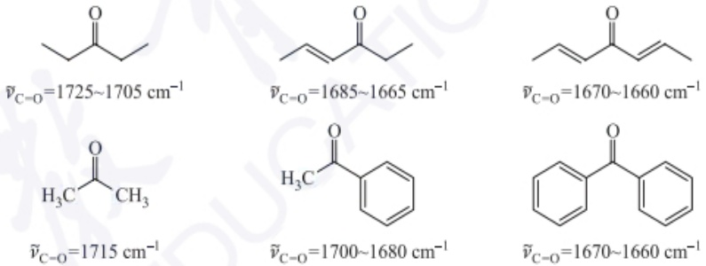

（iii）中介效应(M效应, $p\rightarrow\pi$ 共轭):含有孤对电子的原子(O、S、N等)与羰基相连时,通过共轭作用使C=O上的电子云更移向氧原子,C=O双键的电子云密度平均化,吸收频率向低波数位移。对同一基团,若诱导效应和中介效应同时存在,则振动频率最后位移的方向和程度,取决于这两种效应的结果。当诱导效应大于中介效应时,振动频率向高波数移动,反之,振动频率向低波数移动。

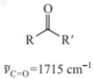

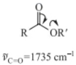

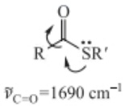

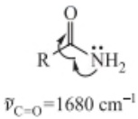

$I$ 效应 $>M$ 效应

$M$ 效应 $>I$ 效应

② 氢键效应(X—H): 形成氢键使电子云密度平均化(缔合态), 使体系能量下降, X—H 基团伸缩振动频率降低, 其强度增加但峰形变宽。

|  |  | $\tilde{\nu}_{\text{C=O}}/\text{cm}^{-1}$ | $\tilde{\nu}_{\text{O-H}}/\text{cm}^{-1}$ |
| --- | --- | --- | --- |
| 游离单体 | 1760 | 3550 |  |
| 氢键二聚体 | 1700 | 3250~2500 |  |

③ 空间位阻效应:由于空间位阻的存在,大位阻基团影响分子的构象和分子间作用,进而影响吸收频率。例如,大位阻基团破坏 C=O 与苯环的共面性而影响共轭效应,使羰基的特征频率升高;大位阻基团使分子间羟基不容易形成氢键,使羟基表现出游离单体的红外吸收峰。

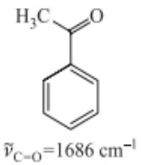

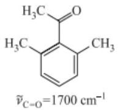

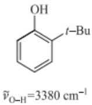

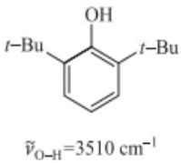

④ 振动耦合: 当两个相邻或相连的基团振动频率相似时, 振动相互作用导致共振, 谱带分裂 (分别移向高频和低频)。如  $CH_{3}$  的对称弯曲振动频率为  $1380\ cm^{-1}$ , 但在 2,4-二甲基戊烷中, 两个甲基连在同一个 C 原子上, 形成异丙基时发生振动耦合, 即  $1380\ cm^{-1}$  的吸收峰消失, 出现  $1385\ cm^{-1}$  和  $1375\ cm^{-1}$  两个吸收峰。
⑤ 费米共振: 当基频与另一振动的倍频接近时  $(2\nu_{\mathrm{A}}=\nu_{\mathrm{B}})$ ，二者相互作用，产生强吸收峰或峰裂现象。例如，醛基的 C—H 伸缩振动的基频  $(2850\ cm^{-1})$  和醛基 C—H 弯曲振动的泛频  $(1390\ cm^{-1})$  之间产生的费米共振:在  $2850\sim2720\ cm^{-1}$  出现双峰，特别是  $2720\ cm^{-1}$  左右的峰可以用来区别醛类和酮类。
⑥ 张力效应: 当环张力增加时, 环外键的吸收频率增大, 而环内键的吸收频率减小。对环上 C=O 来说, 随着构成环的原子数目  $(6 \geqslant n \geqslant 3)$  的减少, 环张力增加, 其环外双键振动频率相应地增加; 而对于环内 C=C 双键, 则随着构成环的原子数目  $(6 \geqslant n \geqslant 4)$  的减少, 环张力增加, 其振动频率相应地减小。对于环外双键, 由于构成小环的 C—C 单键的环内角随着环张力的增大逐渐减小, 为了满足环内小内角的要求, 需要环上 C 原子对环内键提供较多的 p 轨道成分 (键角越小, 碳键的 p 轨道成分越多, 如 sp 杂化轨道间夹角  $180^{\circ}$ ;  $sp^{2}$  杂化轨道间夹角  $120^{\circ}$ ;  $sp^{3}$  杂化轨道间夹角  $109^{\circ}$ ), 而使得环上 C 原子对环外双键提供的 s 轨道成分增加, 环外双键的键强度增加, 因此伸缩振动频率增大。而对于环内 C=C 双键, 为了满足环内小内角的要求, 双键需要 C 原子提供较多的 p 轨道成分, 而使得双键 p 轨道成分增加, s 轨道成分减少, 键的强度减弱, 因此伸缩振动频率减小。

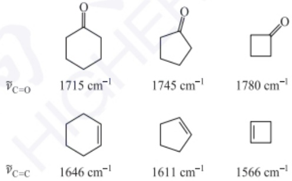

chemical

Cyclohexane derivatives with corresponding wavenumbers (cm⁻¹) for C=O and C=C bonds

不同物态水的红外光谱

## (2) 外部因素

① 物质状态及制样方法

(i) 气态时, 分子间距离较大, 相互作用较弱, 分子可自由转动, 因而能观察到分子转动光谱的精细结构, 得到的是孤立分子的吸收峰。
（ii）在液态和固态条件下，由于分子间存在相互作用，使分子的转动受到限制，观察不到能够区分开的振动与转动能级改变所对应谱线的精细结构，而只能观察到峰型变宽的振动吸收峰。在液态下的红外光谱的强度和位置相较气态和

固态会发生变化。

（iii）固态样品中，由于晶体力场的作用，分子振动与晶格振动发生耦合，无法观察到转动光谱，但会出现新的吸收峰，且吸收峰比液态和气态更尖锐，数量也有所增加。

例如，丙酮 液态时: $\tilde{\nu}_{c=0}=1718\ cm^{-1}$

气态时: $\tilde{\nu}_{\mathrm{C = 0}} = 1742~\mathrm{cm}^{-1}$

② 溶剂效应

极性基团的伸缩振动频率通常随溶剂极性增大而降低,而变形振动频率随之升高,如羧酸中的 C=O 。

气态: $\tilde{\nu}_{c=0}=1780\ cm^{-1}$

非极性溶剂: $\tilde{\nu}_{c=0}=1760\ cm^{-1}$

乙醚溶剂: $\tilde{\nu}_{c=0}=1735\ cm^{-1}$

乙醇溶剂: $\tilde{\nu}_{c=0}=1720\ cm^{-1}$

因此红外光谱通常需在非极性溶剂中测量。

## 4.3.2 红外光谱仪

红外光谱仪分为传统的色散型和新型的干涉型两类。

## 4.3.2.1 色散型红外光谱仪

色散型红外光谱仪的结构类似于紫外-可见分光光度计(图 4.3.7)，包含光源室、样品池、单色器和检测器等部分，但各部件在结构、材料、性能和排列上有所不同。

色散型红外光谱仪的优点与不足

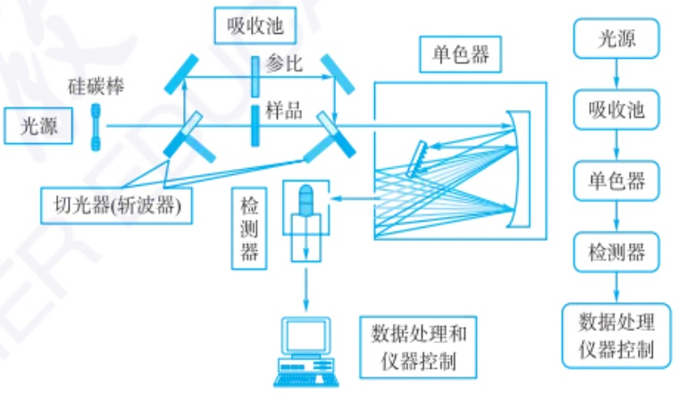

flowchart

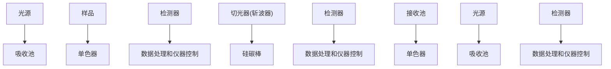

图 4.3.7 色散型红外光谱仪的基本组成

## 4.3.2.2 傅里叶变换红外光谱仪

## 1. 傅里叶变换红外光谱仪的工作原理

色散型红外光谱仪利用色散元件将入射光逐步分解，并逐次对各组分进行单独测量（一次一个“扫描”），而目前广泛使用的傅里叶变换红外光谱仪（Fourier transform infrared spectrometer, FT-IR 光谱仪）则采用完全不同的工作原理（图 4.3.8）。FT-IR 采用迈克尔逊干涉仪将光源调制为干涉光，与样品作用后得到包含所有光谱信息的干涉图信号，再经傅里叶变换处理，将时域干涉图转换为频域（以波数表示）红外光谱图。

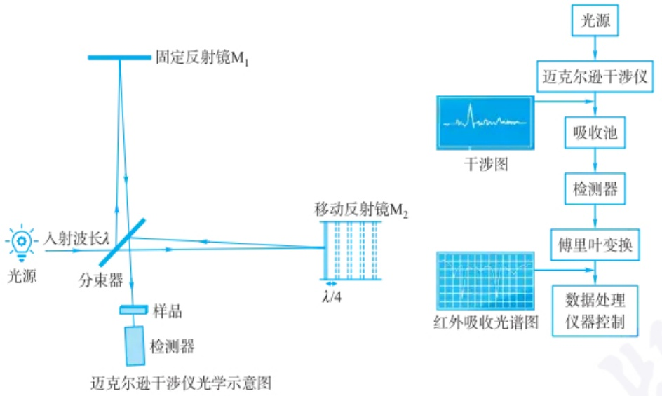

flowchart

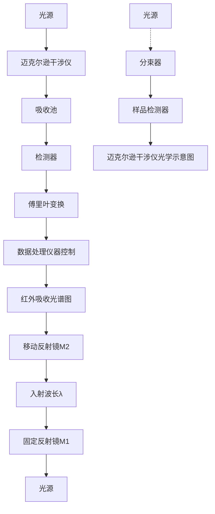

图 4.3.8 傅里叶变换红外光谱仪结构框图

## 2. FT-IR 光谱仪的核心组件包括:

(1) 红外光源: 发射红外光;
(2) 干涉仪: 随时间变化改变红外光的光谱组成, 产生干涉图;
(3) 检测器: 记录干涉图并将其转换为频率图。

红外光通过干涉仪时，分束器将其分成两束光。第一束光被定镜反射，而第二束光被动镜反射。动镜会不断地前后移动，第二束光会根据其位置而传播更长或更短距离。两束光在分束器处再次相遇，并产生干涉。由于第二束光传播距离的变化，从干涉仪发出的红外光束的频率分布不断改变。检测器记录此“干涉图”，通过计算机将信号强度与时间（=镜位置）的函数傅里叶转换为频率谱，即信号强度与频率/波数的函数。

## 3. FT-IR 光谱仪的优势

（1）更快的扫描速度:FT-IR 光谱仪可同时测量所有频率/波数，是一种快速简便的分析技术，可在数秒内提供结果。
（2）更高的分辨率和灵敏度:FT-IR 光谱仪利用干涉仪原理，数学处理优势及增加扫描次数，可以实现更高的光谱分辨率和更高的信噪比。
（3）对样品友好:应用于多种类型样品，包括液体、固体、粉末、半固体、气体和糊剂，样品量少，无须复杂的样品前处理，且能提供定量和定性分析。

## 4. FT-IR 光谱采样技术

FT-IR 光谱采样技术见图 4.3.9。

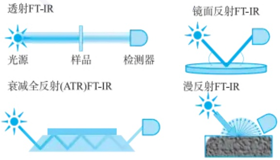

text_image

透射FT-IR
光源	样品	检测器
衰减全反射(ATR)FT-IR
镜面反射FT-IR
漫反射FT-IR

图 4.3.9 傅里叶变换红外光谱中的四种采样技术

ATR 与透射红外光谱的区别

（1）透射 FT-IR: 常规 FT-IR 光谱分析采用透射模式, 红外光通过样品后由位于样品另一侧的检测器测量, 生成光谱。透射 FT-IR 是一种通用技术, 适用于液体、气体、粉末和薄膜, 但不适用于吸收强、透射率低的样品。
（2）衰减全反射(attenuated total reflection, ATR) FT-IR: 红外光通过高折射率晶体进入折射率较低的样品表面，当入射角大于临界角时发生全反射。实际上，部分红外光会穿透样品表面一定深度后返回表面，若样品在特定频率下有吸收，反射光的强度会减弱，生成类似透射吸收的光谱，从而可获得样品表层化学成分的结构信息。ATR FT-IR 可快速、轻松地测量各种样品类型，包括液体、固体、粉末、半固体和糊剂。其具有样品制备简便、适用于吸光性强或不透明样品、无损检测等优点，但其光谱分辨率和信噪比不如透射 FT-IR。ATR 技术的应用简化了特殊样品的测试，提高了微区成分的分析速度和检测灵敏度，使得红外光谱的应用范围大幅扩展。ATR FT-IR 在分析物质表面结构方面发挥着重要作用，并在多个领域得到广泛应用。
（3）镜面反射 FT-IR: 红外光以特定角度照射到样品表面上并被反射。然后在与入射光相同的特定角度检测反射光。样品本身必须是光滑的，让红外光可以直接反射，以避免出现散射而影响数据。这种技术常用于非常薄的金属表面镀膜、晶圆表面分析、珠宝或艺术品的检查。其入射角可调，入射角越大，薄样品内对红外光能量的反射吸收就越多，并且增加了样品光程。
（4）漫反射式 FT-IR: 适用于表面较粗糙的样品(通常为粉末)。此时, IR 光照射到样品上, 并在各个方向上发生反射。得到的漫反射光谱与透射光谱相似, 但相对峰强度有所不同。为了尽可能提高信号, 需要将粉末研磨成均匀的小颗粒。通常会用 KBr 粉末稀释, 这样可以减少样品吸收并使光子更深入地穿透样品, 常用于研究催化剂和聚合物的表面化学性质, 或测试环境样品。

## 4.3.3 样品的制备

一张高质量的谱图要求谱图基线较平,最强峰仍在透过率范围内,弱峰仍能清晰看出,而不被噪声所掩盖。因此,需根据样品特性选择合适的制样方法。

## 1. 样品的前处理与提纯

红外光谱对各类样品具有良好的适应性,无论是固体、液体或气体,纯物质或混合物,有机物或无机物均可进行红外分析。在进行结构分析时,为了便于与纯物质的标准光谱进行比对,建议样品纯度应大于98%。

## 2. 样品的制备

## (1) 气体样品

气体、蒸气压高的固体或液体分解所产生的气体均可用气体池测定。

## (2) 液体样品

① 液体池法:对于沸点低，挥发性较大的液体或吸收很强的固、液体配成溶液，注入液体池中测量。
② 液膜法: 高沸点、黏度大不易清洗的样品滴入 1\~2 滴液样在两盐板之间, 形成液膜, 用专门夹具夹放在仪器的光路上测量。

## (3) 固体样品

① 压片法: 压片法是测定固体样品应用最广泛的方法。按比例取样品和 KBr（质量比: 1/100）充分研磨混合, 用压片机压片后测量。
②糊状法:把粉末样品和适量(1\~2滴)石蜡油或氟碳油混合后研匀,取出样

品涂在窗片上放上另一窗片压紧进行测定。

③ 薄膜法: 主要用于高分子聚合物的测定。样品溶于挥发性强的有机溶剂中, 然后滴加在盐板上, 有机溶剂挥发后形成薄膜测量。

## 4.3.4 红外吸收光谱法的应用

每个分子的振动模式(对映体除外)都是独特的,因此其红外光谱也是相对唯一的,可以用于分子结构分析。早期主要基于经验进行光谱解析。如今,计算机辅助的光谱匹配方法已成为解析分子结构的主要手段,通过将未知光谱与数据库中的参考光谱进行比对,大大提高了分析的效率和准确性。然而,在使用光谱数据库时仍需保持谨慎,尤其是在识别数据库中尚无记录的未知化合物时,必须意识到,光谱的相似性并不一定意味着分子结构的相似性,因此仍需结合其他分析手段以确保结果的可靠性。

## 4.3.4.1 官能团区和指纹区

红外吸收光谱的分区如图 4.3.10 和表 4.3.3 所示。

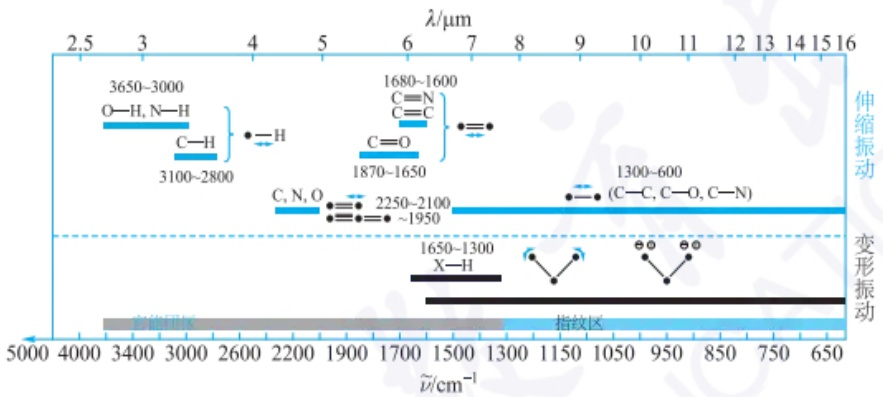

other

| Wavelength Range \((\lambda/\mu m)\) | Absorption Coefficient \((\nu\)̃\(/cm^{-1})\) |
| --- | --- |
| 2.5~3.0 | O-H, N-H |
| 3.0~4.0 | C-H |
| 4.0~5.0 | — |
| 5.0~6.0 | — |
| 6.0~7.0 | C=O |
| 7.0~8.0 | — |
| 8.0~9.0 | — |
| 9.0~10.0 | — |
| 10.0~11.0 | — |
| 11.0~12.0 | — |
| 12.0~13.0 | — |
| 13.0~14.0 | — |
| 14.0~15.0 | — |
| 15.0~16.0 | — |
| 5000~650 | — |

图 4.3.10 红外吸收光谱分区示意图

表 4.3.3 红外吸收光谱分区

<table><tr><td colspan="3">官能团区</td><td>指纹区</td></tr><tr><td>第一区域</td><td>第二区域</td><td>第三区域</td><td>第四区域</td></tr><tr><td> $4000 \sim 2500 \text{ cm}^{-1}$ </td><td> $2500 \sim 2000 \text{ cm}^{-1}$ </td><td> $2000 \sim 1300 \text{ cm}^{-1}$ </td><td> $1300 \sim 600 \text{ cm}^{-1}$ </td></tr><tr><td>氢键区</td><td>三键区</td><td>双键区</td><td>单键区</td></tr><tr><td>O—H(s, wide )</td><td>—C≡C(2260~2120)</td><td>C=C</td><td>—C—C—</td></tr><tr><td>—C—H(v,multi)=C—H(m,multi)≡C—H(s,sh)↓</td><td>C≡N(2260~2220)</td><td>C=O</td><td>C—N</td></tr><tr><td>N—H</td><td>C=C=C(~1950)</td><td>...</td><td>...</td></tr></table>

官能团区(或特征区, $4000\sim1300\ cm^{-1}$ )的吸收峰(带)多源于化学键的基频伸缩振动,峰位稳定且特征性强,主要用于鉴定分子中存在的特定官能团。

指纹区(1300\~600 cm $^{-1}$ )的吸收峰多源于分子的变形振动、骨架振动或单键伸缩振动等，吸收峰密集、重叠且对分子结构的微小变化极敏感，如同人类的指纹一样具有独特性，因此称为指纹区。与已知标准图谱比对，可作为确认分子唯一

性的“指纹”依据。

## 4.3.4.2 结构分析

谱图解析时,可先从官能团区入手,发现某些特征基团存在后,再结合指纹区进行验证。进一步与常用红外标准谱图库中的光谱比较,确定结构信息。

## 1. 常用红外标准谱图库

(1) Sadtler 标准红外吸收光谱图
(2) Aldrich 红外谱图库
(3) SDBS 有机化合物谱图

## 2. 典型有机化合物的红外光谱

饱和烃及其衍生物、烯烃、炔烃、氰基化合物、芳烃、羰基化合物等常见有机化合物的红外特征吸收峰如表4.3.4所示。

以芳烃为例,芳香环上的 C—H 键通常在  $3100 \sim 3050 \, cm^{-1}$  范围出现吸收峰。这些吸收峰较弱且尖锐。C—H 弯曲振动在  $900 \sim 690 \, cm^{-1}$  范围,芳香环的 C—H 键有几个中等强度到强度的吸收峰,这些吸收峰被称为“芳香带”。芳香环的 C=C 伸缩振动通常在  $1600 \, cm^{-1}$  和  $1500 \, cm^{-1}$  附近出现两个较强的吸收峰,有时还会在  $1450 \, cm^{-1}$  和  $1420 \, cm^{-1}$  出现更弱的吸收峰。

## 4.3.4.3 定量分析

红外光谱在定量分析中具有一些显著的优点和缺点。

## 1. 定量分析的依据

定量分析主要基于吸光定律,即样品的吸光度与其浓度成正比(红外光谱中的通过率必须先转换成吸光度才能进行定量分析)。

表 4.3.4(a) 典型有机化合物的红外特征吸收峰

<table><tr><td rowspan="2">振动类型基团</td><td colspan="3">伸缩振动</td><td colspan="3">弯曲振动</td></tr><tr><td>特征频率 $/{\mathrm{{cm}}}^{-1}$ </td><td>强度</td><td>归属</td><td>特征频率 $/{\mathrm{{cm}}}^{-1}$ </td><td>强度</td><td>归属</td></tr><tr><td rowspan="3">烷烃</td><td rowspan="3">3000~2850</td><td rowspan="3">str</td><td rowspan="3"> ${\mathrm{{CH}}}_{3},{\mathrm{{CH}}}_{2}$ 或CH</td><td>1470~1350</td><td>med</td><td> ${\mathrm{{CH}}}_{2}$ 或 ${\mathrm{{CH}}}_{3}$ </td></tr><tr><td>1390~1370</td><td>med</td><td> ${\mathrm{{CH}}}_{3}$ </td></tr><tr><td>725~720</td><td>wk</td><td> ${\mathrm{{CH}}}_{2}$ </td></tr><tr><td rowspan="3">烯烃</td><td>3100~3020</td><td>med</td><td>=C—H或=CH2(ssharp)</td><td>995~880</td><td>str</td><td>=C—H或=CH2</td></tr><tr><td>1680~1630</td><td>var</td><td>C=C(对称性降低强度)</td><td>850~780</td><td>med</td><td>(面外弯曲)</td></tr><tr><td>2000~1900</td><td>str</td><td>C=C(反对称伸缩)</td><td>730~675</td><td>med</td><td>顺式—RCH=CHR</td></tr><tr><td rowspan="2">炔烃</td><td>~3300</td><td>str</td><td>C—H(sharp)</td><td>700~600</td><td>str</td><td>C—H</td></tr><tr><td>2250~2100</td><td>var</td><td>C≡C(对称性降低强度)</td><td></td><td></td><td></td></tr><tr><td rowspan="2">芳烃</td><td>~3030</td><td>var</td><td>C—H(多峰)</td><td>900~690</td><td>str-med</td><td>C—H</td></tr><tr><td>~1600~1500</td><td>med-wk</td><td>C=C(环内,共轭)</td><td></td><td></td><td></td></tr><tr><td rowspan="3">醇或酚类</td><td>3650~3580</td><td>var</td><td>O—H(单体,sharp)</td><td>1430~1330</td><td>med</td><td>O—H(面内弯曲)</td></tr><tr><td>3550~3200</td><td>str</td><td>O—H(氢键缔合,broad)</td><td>770~650</td><td>var-wk</td><td>O—H(面外弯曲)</td></tr><tr><td>1250~970</td><td>str</td><td>C—O</td><td></td><td></td><td></td></tr><tr><td rowspan="3">胺</td><td>3500~3400</td><td>wk</td><td>N—H(一级胺)</td><td>1650~1550</td><td>med-str</td><td> ${\mathrm{{NH}}}_{2}$ (一级胺)</td></tr><tr><td>3400~3300</td><td>wk</td><td>N—H(二级胺)</td><td>900~660</td><td>var</td><td> ${\mathrm{{NH}}}_{2}$ 或N—H(氢键)</td></tr><tr><td>1250~1000</td><td>med</td><td>C—N</td><td></td><td></td><td></td></tr><tr><td rowspan="7">醛或酮</td><td>2840~2690(双峰)</td><td>med</td><td>C—H(醛)</td><td>1360~1350</td><td>str</td><td> $\alpha-CH_3$ </td></tr><tr><td>1740~1720</td><td>str</td><td>C=O(饱和醛)</td><td>1450~1400</td><td>str</td><td> $\alpha-CH_2$ </td></tr><tr><td>1720~1710</td><td>str</td><td>C=O(饱和酮)</td><td>~1100</td><td>med</td><td>C—C—C</td></tr><tr><td>~1690</td><td>str</td><td>芳基酮</td><td></td><td></td><td></td></tr><tr><td>~1675</td><td>str</td><td> $\alpha, \beta-$ 不饱和酮</td><td></td><td></td><td></td></tr><tr><td>~1745</td><td>str</td><td>环戊酮</td><td></td><td></td><td></td></tr><tr><td>~1780</td><td>str</td><td>环丁酮</td><td></td><td></td><td></td></tr><tr><td rowspan="9">羧酸及其衍生物</td><td>3300~2500(酸)(和C—H重叠)</td><td>str</td><td>O—H(very broad)</td><td>1440~1395</td><td>med</td><td>C—O—H</td></tr><tr><td>1720~1705(酸)</td><td>str</td><td>C=O(氢键)</td><td></td><td></td><td></td></tr><tr><td>1320~1210(酸)</td><td>med-str</td><td>O—C(双峰)</td><td></td><td></td><td></td></tr><tr><td>1815~1785(酰卤)</td><td>str</td><td>C=O</td><td></td><td></td><td></td></tr><tr><td>1820~1750(酸酐)</td><td>str</td><td>C=O</td><td></td><td></td><td></td></tr><tr><td>1100~1040</td><td>str</td><td>O—C</td><td></td><td></td><td></td></tr><tr><td>1750~1735(酯)</td><td>str</td><td>C=O</td><td></td><td></td><td></td></tr><tr><td>1300~1000</td><td>str</td><td>O—C</td><td>1650~1590</td><td>med</td><td>N—H(一级酰胺)</td></tr><tr><td>1695~1630(酰胺)</td><td>str</td><td>C=O(一级酰胺)</td><td>1560~1500</td><td>med</td><td>N—H(二级酰胺)</td></tr><tr><td rowspan="3">腈类、异氰酸酯、异硫氰酸酯、二酰亚胺、叠氮和烯酮</td><td>2260~2240</td><td>med</td><td>C≡N(sharp)</td><td></td><td></td><td></td></tr><tr><td>2270~2100</td><td>med</td><td>—N=C=O,—N=C=S</td><td></td><td></td><td></td></tr><tr><td></td><td></td><td>—N=C=N—,—N3,C=C=O</td><td></td><td></td><td></td></tr></table>

表 4.3.4(b) 常见基团的红外特征吸收峰

| 基团 | 特征频率/$cm^{-1}$ | 基团 | 特征频率/$cm^{-1}$ |
| --- | --- | --- | --- |
| 含硫基团 |  | C=N | 1665±15 |
| S—H 硫醇 | 2600~2550$cm^{-1}$(weak 或 sharp) | N—O | 945±15 |
| S—OR 硫醚 | 900~700(str) | N—O 氧化胺 |  |
| S—S 二硫 | 540~500(weak) | 脂肪族 | 960±20 |
| C=S 硫代羰基 | 1200~1050(str) | 芳香族 | 1250±50 |
| S=O 亚砜 | 1060~1030(str) | N=O 亚硝基 | 1550±50(str) |
| 砜 | 1325±25(as)或1140±20(s)(both str) | 硝基 | 1530±20(as)或1350±30(s) |
| 磺酸 | ~1345(str) | 含磷基团 |  |
| 磺酰氯 | 1365±5(as)或1180±10(s)(both str) | P—H 膦 | 2440~2280 $cm^{-1}$(med 或 sharp) |
| 硫酸盐 | 1350~1450(str) |  | 1250~950(weak)P—H bending |
| 含硅基团 |  | (O=)PO—H 膦酸 | 2700~2550(med) |
| Si—H 硅烷 | 2360~2100 $cm^{-1}$(str) | P—OR | 1050~900(str) |
| Si—OR | 1100~1000(str 或 broad) | P=O 膦氧化物 | 1200~1100(str) |
| $Si—CH_3$ | 1250±10(str 或 sharp) | 膦酸酯 | 1260~1230(str) |
| N—O 基团 |  | 磷酸酯 | 1200~1100(str) |
| =NOH 肟 |  | 磷酰胺 | 1275~1200(str) |
| O—H(stretch) | 3600~3550 $cm^{-1}$(str) |  |  |

$CO_{2}$  稳定同位素比红外光谱

## 2. 定量分析的影响因素

有利因素:红外光谱产生的吸收峰种类繁多,且每个吸收峰与分子结构直接相关,能够准确区分不同化合物或官能团,研究者可以根据目标物质的不同官能团选择合适的峰进行定量分析,为定量分析提供了更多的选择。

不利因素:红外光谱的摩尔吸收系数较小,意味着检测低浓度的物质时,灵敏度不如其他光谱技术(如紫外-可见吸收光谱)。样品的吸收光程难以精确控制,特别是在液态或气态样品中,容易引入测量误差,影响定量结果的准确性。红外吸收峰易受到样品的化学环境、温度变化及溶剂效应的影响,这会导致峰位和峰形发生变化,增加定量分析的复杂性,使用时需要特别注意控制实验环境和数据处理。

## 4.3.4.4 科研中的实际应用

红外光谱技术在有机化合物结构解析中仍然发挥着重要作用。近年来，红外光谱在氢键、配位作用研究、化学反应过程研究等方面体现出了新的应用优势。

（1）氢键等非共价键作用的表征:氢键广泛存在，而常规表征方法如核磁共振在某些情况下受到限制（例如，生物样品中活泼氢与氘代溶剂的交换、固体核磁分辨率较低）。红外光谱则提供了简单、直观的氢键表征手段。
（2）配位相关研究:与金属中心易配位的基团（如 C=O、N—H、C—N 键）通常具有强红外吸收。配位后，电荷分布或键合强度的变化会引起红外吸收峰的偏移，帮助推断配位模式。此外，多个吸收峰的变化还能揭示配体的配位数和几何构型。
（3）化学反应探究:通过实时监测反应过程中红外吸收峰的变化，可以获取中间体结构和反应进程的关键信息。时间分辨红外光谱能在不同反应时间点捕捉光谱，追踪反应物向产物的转变及其动力学信息，帮助揭示反应机理。

## 4.3.5 红外光谱分析新技术

由于 FT-IR 光谱仪性能的显著提升,透射、反射甚至发射光谱的测量速度和灵敏度显著提高。如今,红外光谱仪已广泛应用于从实验室到生产车间的各种问题解决。FT-IR 不仅适用于气体、液体及毫克级块状或粉末状固体的传统样品,还能够用于界面物质表征、微量和痕量分析物测定等。测量时间可缩短至 1 s 以内,特殊情况下可追踪亚微秒级反应。这些性能的提升标志着红外光谱分析技术进入了新的时代。

## 4.3.5.1 稳定同位素比红外光谱(IRIS)

根据虎克定律,不同同位素异构体因原子质量差异表现出不同的振动频率。例如, $CO_{2}$ 的不同同位素组成(如 $^{12}C^{16}O_{2}$ , $^{13}C^{16}O_{2}$ 与 $^{12}C^{16}O^{18}O$ )具有各自的特征光谱。通过分析光谱图中的峰面积,可以计算同位素比例,广泛应用于温室气体监测、生态学、植物科学、火山监测、碳储量及碳封存研究。

## 4.3.5.2 原位红外光谱(In-Situ IR)

核磁共振波谱无法检测毫秒到微秒时间尺度下的快速反应过程，而红外和拉曼等振动光谱可在飞秒时间尺度内实时监测化学和光化学反应，因多数反应沿振动坐标进行（如离去基团的伸缩振动）。虽然红外光谱目前尚不能检测皮秒级反应，但借助快速傅里叶变换和高速扫描干涉仪，可以在低毫秒范围内跟踪较慢的化学反应。原位红外光谱凭借傅里叶变换技术和高灵敏检测器，能够在分子水平上提供反应中间体和产物的结构及动力学信息，是研究反应过程和揭示反应机理

的有效工具。

## 1. 原位透射 IR 和原位漫反射 IR

原位透射 IR 技术适用于透明或半透明样品的实时分析,能够在样品反应过程中连续监测其化学变化,为研究动态过程提供了重要工具。而原位漫反射 IR 技术则无须压片,避免了扩散效应,尤其适用于固体粉末样品表面结构及表面吸附物种的测定。与反射和光声光谱相比,漫反射已成为主流的原位红外测量方法(图 4.3.11)。

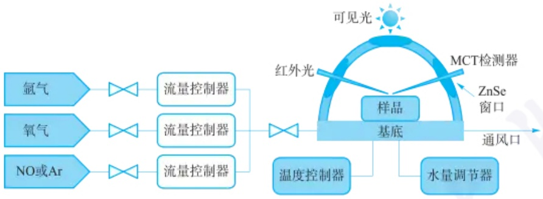

flowchart

This diagram illustrates the sensor system architecture and data flow for a sample-based measurement device. It shows how sensors input gases, air, and NOAr are processed through flow controllers to produce a base, which is then connected to an MCT detector via an external light source.

图 4.3.11 采用原位漫反射傅里叶变换红外光谱监测催化剂表面物种随时间变化的装置示意图(Catal. Sci. Technol., 2017, 7, 1324-1332)

## 2. 表面增强红外吸收光谱(SEIRSA)

在晶体表面的金属岛膜上，电子在红外光照射下被激发形成表面等离激元，后者与入射光电场耦合，产生表面等离激元共振。通过近场效应 $(< 10\mathrm{nm})$ ，金属岛表面发生选择性吸收，增强了与电磁场振动方向一致（垂直方向）的化学键振动的红外吸收峰，形成表面增强红外吸收光谱。

## 3. 光纤式衰减全反射红外监测技术(Fiber ATR-IR)

传统 IR 难以测量较大或不可移动的样品。光纤式 ATR-IR 通过将光谱仪内的光束耦合至中红外光纤，一根光纤将光导入特制的 ATR 探头，另一根光纤将测量信号传回光谱仪，从而在无须移动或损坏样品的情况下获取红外吸收光谱，并实现信号的远程传输。

## 4.3.5.3 红外光谱成像技术

## 1. 显微红外光谱 (Micro-FTIR 或  $\mu$ -FTIR)

传统光学显微镜的图像对比度主要源于样品的折射率和总光密度变化。然而，振动光谱对分子结构和成分的高灵敏度，使得化学组成变化成为红外显微光谱中的主要对比度来源。例如，在某些空间维度上分子构象不同的样品，尽管其化学成分和总体光学性质（如折射率或吸收率）相似，振动光谱却能揭示构象差异。结合光学显微镜与红外光谱，利用专用显微红外附件（如图4.3.12所示）可在观察外观形态和物理微结构的同时，测定微量样品（如高分子薄膜）特定区域的红外光谱，进行结构分析。$\mu$-FTIR适用于微小样品及固体样品微区分析，无须制样，且为无损检测手段。

## 2. 同步辐射红外光谱成像(synchrotron infrared nano-imaging)

传统红外显微光谱仪的光源亮度较低,当测试狭缝调节至小于 $10\ \mu m$ (相当于细胞大小)时,光通量显著减少,导致红外光谱质量下降,难以获得细胞级别的分辨率( $5\sim50\ \mu m$ )。同步辐射红外光源以其高亮度特性,非常适合显微光谱成像研究。

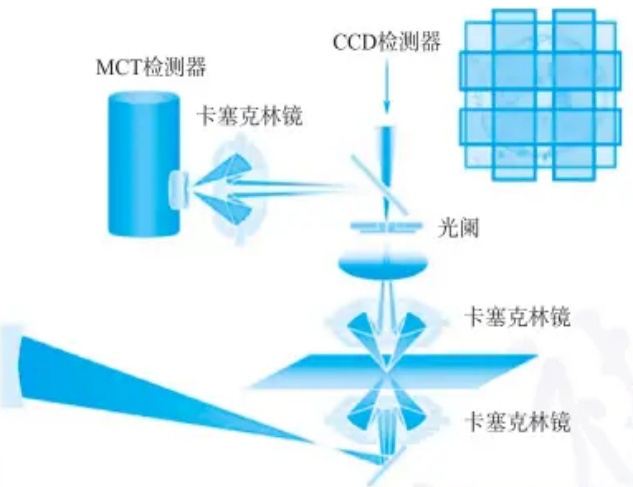

flowchart

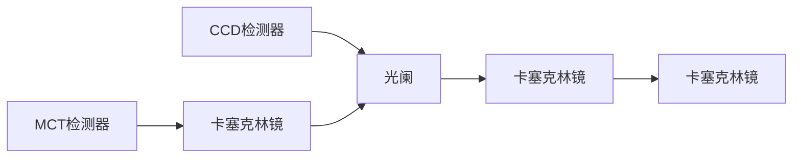

图 4.3.12 商品化的显微红外光谱仪的装置示意图

## 3. 红外遥感监测技术(IR telemetry)

红外遥感监测是一种开路光谱气体遥测技术，工作波段与石化企业重点关注的烷烃、烯烃、芳香烃等有机物及氨气等无机物的红外吸收波段高度匹配，能够快速、准确地识别并测量通过探测光路的挥发性有机物（VOCs）。IR遥感监测的响应时间较短（通常仅需几秒），显著提高了气体监测的空间和时间覆盖效率。

相比传统固定式检测,开路光谱遥测技术具备广覆盖、远距离、非接触、高效、无须预采样等优势,能够快速定位泄漏源并提供直观的动态监测,已成为石化企业气体泄漏检测的有效手段。

## 4.3.5.4 振动光学活性光谱(VCD)

VCD 可以被视为电子圆二色光谱(ECD)在红外光谱振动跃迁领域的扩展(图 4.3.13)。在 VCD 中,实验测量的是手性样品对左右圆偏振红外辐射吸收的差异。VCD 对分子构象及其变化高度敏感,构象变化指的是由于单键内旋转导致的分子结构变化,而不涉及化学键断裂或重组。大分子中常见的构象变化如肽中的  $\alpha$ -螺旋与无规卷曲之间的转变,这种变化会影响探针基团之间的二面角,如酰胺 I 振动。VCD 强度由偶极耦合产生,并形成固定的、不对称的几何图案(如螺旋),这是 VCD 对生物分子构象敏感性的主要机制。

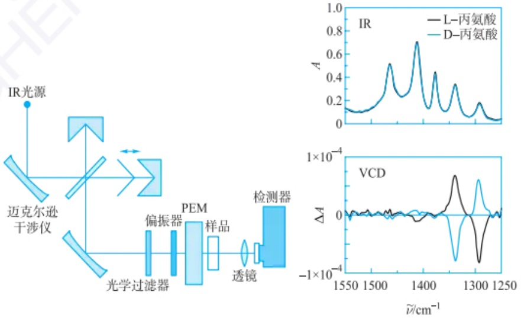

text_image

IR光源
迈克尔逊干涉仪
光学过滤器
偏振器
PEM
样品
透镜
检测器
IR
A
L-丙氨酸
D-丙氨酸
VCD
ΔA
1×10⁻⁴
1550 1500 1400 1300 1250
ν/cm⁻¹

图 4.3.13 商品化的 VCD 光学系统及 L/D-丙氨酸的红外光谱和 VCD 光谱

## 4.3.5.5 红外光谱联用技术

## 1. 质谱-红外光谱联用(MS-IR)

质谱提供相对分子质量和分子结构信息,红外光谱提供功能基团信息,二者结合可揭示更全面的结构信息,因此 MS-IR 广泛用于有机物的结构鉴定。

## 2. 热重-红外光谱联用(TG-IR)

将热失重过程中的挥发物或分解产物通过吹扫气引入红外光谱仪，进行逸出组分的结构鉴定。TG-IR常用于有机、无机材料的热稳定性和热分解机理研究。

## 3. 色谱-红外光谱联用

红外光谱适用于纯化合物，而对混合物定性分析有限。色谱-红外联用技术先分离混合物后，再进行红外定性和结构分析，结合了两者的优势，是一种高效的有机混合物结构分析手段，包括GC-FTIR、HPLC-FTIR和SFC-IR等。

## 4. 电化学-红外光谱联用

电化学原位红外光谱通过电化学工作站与红外光谱仪联用,实时监测电化学过程中电极/电解液界面物种的动态变化,利用红外光谱的表面选择性和化学键指纹特征研究电极界面变化。

## 4.3.5.6 近红外光谱分析

近红外光谱技术能够快速、无损地分析块状材料，在过去几十年备受关注。随着仪器性能的提升，尤其是化学计量学软件的发展，近红外技术已在各行各业获得了广泛普及。统计处理方法的引入进一步推动了其发展，尽管有时它被认为是一种“黑匣子”技术，即对光谱背后的振动机制了解有限。本节主要介绍近红外光谱的基本原理和特点。

## 1. 近红外光谱的产生

波长范围:一般认定为  $700 \sim 2500 \, nm$  (波数  $14286 \sim 4000 \, cm^{-1}$ )。

分子在近红外光谱区的吸收主要是由于分子内部振动状态的变化而产生的，近红外区主要对应的是能量更高的合频或倍频吸收（由于非谐性振动）。（注:一些有机或无机材料的低能量电子能级跃迁也会产生近红外区吸光现象，本节不包含此部分内容。）

信号来源: 含氢基团 X—H 伸缩振动的倍频和合频吸收。

X—H 包括: C—H(甲基、亚甲基、甲氧基、芳基等); O—H(羟基、羧基等); S—H(巯基); N—H(伯胺、仲胺、叔胺和铵盐等)等。

合频近红外吸收谱带:位于2000\~2500 nm处;

一级倍频吸收谱带:位于1400\~1800 nm处;

二级倍频吸收谱带:位于900\~1200 nm处;

三级以上倍频吸收谱带:位于780\~900 nm处。

不同基团(如甲基、亚甲基、苯环等)或同一基团在不同化学环境中的近红外吸收波长与强度都有明显差别,近红外光谱具有丰富的结构和组成信息,非常适合用于碳氢有机物质的组成与性质的分析。

## 2. 近红外光谱的测定方法

（1）透射光谱法(多指短波近红外区,波长一般在700\~1100 nm范围):将待测样品置于光源与检测器之间,检测器所检测的是透射光或与样品分子相互作用的光。
(2) 反射光谱法(多指长波近红外区, 波长一般在 1100\~2500 nm 范围): 检测

器和光源置于样品的同一侧,检测器所检测的是样品以各种方式反射回来的光。

## 3. 近红外光谱分析的特点

（1）无损分析:无需对样品进行复杂的预处理，能够实现对活体样品的无损伤分析。
（2）适用范围广:对样品形式没有限制，可直接测量液体、固体、半固体和胶状体等多种类型的样品。
（3）操作简便且经济:测试过程简单，操作要求低，成本较低，且具有良好的数据重现性。分析速度快，效率高。
（4）远程与在线分析:近红外光在普通光纤中具有优异的传输性能，方便用于远程或在线实时分析。

## 4. 近红外光谱分析的难点

测试灵敏度相对较低，待测组分含量一般要大于 $0.1\%$ ；需要用标样进行校正对比，很多情况下仅是一种间接分析技术；组分在近红外光谱中谱峰强度较弱，影响近红外测量的检测限；样品的状态、测定的方式及测定的条件都会影响测量的结果，光谱变动性大；未经预处理的复杂样品存在着复杂的高强度背景干扰信号，难以用常规方法解析图谱；由于基团振动吸收的多样性和谱峰较宽，多组分样品的近红外光谱易出现多谱峰重叠。

现代近红外光谱分析是一种间接的分析技术,需要借助化学计量学方法来实现对未知样品的定性或定量分析。结合了光谱测量技术与化学计量学的现代近红外光谱分析技术则被誉为“分析的巨人”。

## 4.3.5.7 远红外光谱分析

远红外辐射的光子能量低，对化学分子的不同构型或晶型变化、振动或转动模式、分子间作用力等均表现出较高的专属性，适合于不同类型或相似结构分子的定性鉴别。对于金属配合物，由于原子质量比较大及键力常数较小，所以金属原子与配体的伸缩振动和弯曲振动会出现在远红外区，故远红外区特别适合研究无机化合物。对于无机固体物质可提供晶格能及半导体材料的跃迁能量。对仅有轻原子组成的分子，芳香族化合物的异构体（如间、对、邻三个二甲苯的远红外光谱图彼此有明显的差异），杂环化合物和脂肪族烃类的定性能够提供指纹光谱；显示分子内部的骨架振动特性，如小分子环烷烃的环变形振动，以及有轻微受阻基团的扭转振动。由氢键形成的缔合物在远红外区会出现新的吸收峰（伸缩振动: $200\sim 50~\mathrm{cm}^{-1}$ ；弯曲振动: $50~\mathrm{cm}^{-1}$ 以下）。

在远红外区光源的辐射能量较低，远红外区谱带的摩尔吸收系数一般比中红外区小一个数量级，所以远红外区样品的用量要比中红外区用量多得多。同时，空气中的水汽分子的吸收遍布整个远红外区造成干扰。实际测定远红外光谱时，经常采用将整个光谱仪内部抽真空或吹扫干燥空气（氮气）的方法来消除水汽吸收峰的影响。

## 习题

## - 章节练习题 -

1. 下列绿色标出的键哪些预计具有红外的伸缩振动活性？

(a) $\mathrm{H}-\mathrm{C}\equiv\mathrm{C}-\mathrm{H}$

(b) $\mathrm{H}-\mathrm{C}\equiv\mathrm{C}-\mathrm{H}$

(c) $\mathrm{H}-\mathrm{C}\equiv\mathrm{C}-\mathrm{CH}_{3}$

(d) $\mathrm{H}_3\mathrm{C}-\mathrm{C}=\mathrm{C}-\mathrm{CH}_3$

(e) $\mathrm{H}_3\mathrm{C}-\mathrm{C}\equiv\mathrm{C}-\mathrm{CH}_3$

(f) $\mathrm{H}_3\mathrm{C}-\mathrm{CH}_3$

(g)

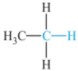

(h)

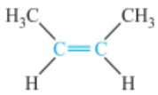

(i)

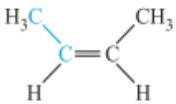

(j)

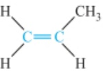

2. 由下述力常数 k 数据, 计算各化学键的振动频率(波数)。

(1) 乙烷的 C—H 键,  $k=5.1\ N\cdot cm^{-1}$ ; (2) 乙炔的 C—H 键,  $k=5.9\ N\cdot cm^{-1}$ ;
(3) 苯的 C=C 键,  $k=7.6\ N\cdot cm^{-1}$ ; (4) 甲醛的 C=O 键,  $k=12.3\ N\cdot cm^{-1}$ 。

## - 挑战性问题 -

3. 某化合物分子式为  $C_{8}H_{8}O_{2}$ ，根据下面红外光谱图，判断该化合物为苯乙酸、苯甲酸甲酯还是乙酸苯酯。

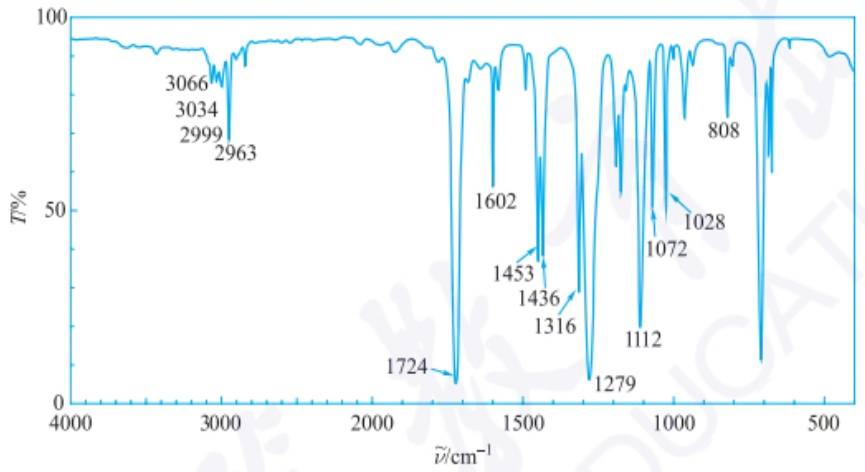

spectrogram

| Wavenumber \((cm^{-1})\) | Transmittance (%) |
| --- | --- |
| 3066 | ~95 |
| 3034 | ~95 |
| 2999 | ~95 |
| 2963 | ~95 |
| 1724 | ~5 |
| 1602 | ~85 |
| 1453 | ~40 |
| 1436 | ~40 |
| 1316 | ~35 |
| 1279 | ~5 |
| 1112 | ~25 |
| 1072 | ~45 |
| 1028 | ~50 |
| 808 | ~95 |

## -专题或报告-

4. 查阅文献,介绍原位红外监测技术在研究反应机理、反应动力学方面的应用。

## 4.4 拉曼光谱法

拉曼(Raman)光谱法是一种基于光与物质相互作用产生拉曼散射效应建立的分析方法,根据散射光与入射光的频率差及散射光的强度对物质进行定性、定量和结构分析。本节将介绍拉曼光谱法的基本原理、仪器及应用,并简要介绍拉曼光谱技术的新发展。

## 4.4.1 拉曼光谱法的基本原理

当光照射到物体表面时，会发生散射现象。如果散射光的频率与入射光不同，这表明光子与物质分子之间发生了能量交换。不仅光子的运动方向发生变化，其能量也会变化，而且这种变化与散射分子的结构有关，该种散射被称为拉曼散射(Raman scattering)。利用拉曼散射的变化来研究物质的结构、组成和含量等的方法称为拉曼光谱法。

拉曼光谱和红外吸收光谱均源自分子的振动和转动能级跃迁,属于分子振