C. V. Raman

为什么天空有不同的颜色

动-转动光谱，能够提供分子结构的直接特征信息。拉曼光谱法具有非破坏性、谱图分辨率高、多功能性、操作简便和快速等优点。待测样品可以直接使用拉曼显微探头或光纤探头进行测量，能够实现对许多样品或体系的无损、原位和时间分辨测定。此外，由于水的拉曼散射信号非常弱，拉曼光谱法特别适合水相体系的分析研究。目前，拉曼光谱已广泛应用于生物医药、材料科学、考古学、食品安全、珠宝鉴定和化学工程等领域。

## 4.4.1.1 拉曼光谱的产生

拉曼光谱是一种基于散射现象的光谱技术。当光与不均匀介质相互作用时，部分光子会偏离原来的传播方向，这种现象称为散射。根据散射过程中光的频率是否发生变化，散射可以分为两类:弹性散射和非弹性散射。当频率为 $\nu_{0}$ 的激光照射到样品时，大约 $0.1\%$ 的入射光子与样品分子发生弹性碰撞，即不发生能量交换的碰撞。在这种情况下，光子以相同的频率向各个方向散射。这种散射光的频率与入射光相同，但方向发生改变，称为瑞利散射（Rayleigh scattering）。与此同时，入射光与样品分子之间还会发生概率更低的非弹性碰撞，这一过程中的碰撞概率仅为总碰撞数的十万分之一。在非弹性碰撞中，光子与分子之间发生能量交换，导致光子的频率和方向都发生变化。这种散射光的频率与入射光不同，且方向改变的散射称为拉曼散射，对应的谱线称为拉曼散射线或拉曼线。1928年，印度物理学家C.V.Raman首次从实验上观察到了这种新的散射现象，并因此获得了1930年度的诺贝尔物理学奖。

## 4.4.1.2 拉曼光谱的产生原理

如图4.4.1所示，当分子处于基态电子能级的某一振动能级（如 $\nu = 0$ 或 $\nu = 1$），接受入射光子的能量 $h\nu_0$ 后，会跃迁到一个不稳定的受激虚态。随后，该分子将由虚态迅速（飞秒级）返回原来所在的振动能级，并以光子的形式释放出吸收的能量 $h\nu_0$，从而产生瑞利散射。如果受激分子不返回原来的振动能级，而是返回其他振动能级，例如，从基态电子能级的基态振动能级 $(\nu = 0)$ 跃迁到激发虚态后，不返回基态，而是返回至电子基态的第一振动激发态能级 $(\nu = 1)$，此时散射光子的能量为 $h\nu_0 - h\Delta \nu$。由此产生的拉曼散射线为频率低于入射光频率的斯托克斯散射线（Stokes scattering）。若处于基态电子能级第一振动激发态的分子跃迁到激发虚态后，再返回到基态振动能级，此时散射光子的能量为 $h\nu_0 + h\Delta \nu$，所产生的拉曼散射线称为反斯托克斯散射线（anti-Stokes scattering），其频率高于入射光频率。根据 Boltzmann 分布可知，常温下大部分分子处于基态，因此斯托克斯散射线远强于反斯托克斯散射线。此外，随着温度的升高，斯托克斯散射线的强度将降低，而反斯托克斯散射线的强度将升高。

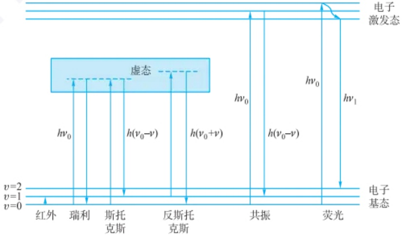

text_image

电子
激发态
虚态
hν₀
hν₀-v
h(ν₀+ν)
hν₀
hν₀-v
hν₁
红外
瑞利
斯托
克斯
反斯托
克斯
共振
荧光
v=2
v=1
v=0
电子
基态

图 4.4.1 光学过程示意图

斯托克斯线或反斯托克斯线与入射光的频率差  $\Delta\nu$  为拉曼位移（Raman shift），即  $\Delta\nu=\nu_{R}-\nu_{0}$ ，其中  $\nu_{R}$  为拉曼线频率（Raman frequency）。拉曼位移与入射光的频率（即激发波长）无关，只与分子振动能级跃迁有关。不同物质的分子具有不同的振动能级，因此，拉曼位移具有特征性，是研究分子结构的重要依据。

此外，共振拉曼散射（resonance Raman scattering）是拉曼散射的一种特殊形式，使用与分子电子能级或振动能级接近的共振激发波长的激光束，可以显著增强拉曼散射信号。在共振拉曼散射中，激光的能量与分子的本征电子或振动能级的能量差非常接近，从而引发共振效应。这种共振效应会显著增强拉曼散射信号的强度，与一般只能激发到“虚态”的常规拉曼不同，此时拉曼跃迁的概率大大增加，它可使分子的某些振动模式的拉曼散射截面增强高达 $10^{6}$ 倍，使得观察到的信号更加明显。通过观察共振拉曼散射谱线，可以得到关于分子结构、化学键性质、溶剂环境等信息。由于共振拉曼散射对于某些特定的分子结构非常敏感，因此它在分析生物分子、有机分子、无机配合物等领域具有广泛的应用价值。

## 4.4.2 拉曼光谱图与拉曼光强度

图 4.4.2 为四氯化碳( $CCl_{4}$ )的拉曼光谱图。拉曼光谱图通常以拉曼位移(以波数为单位)为横坐标, 拉曼线强度为纵坐标。由于斯托克斯线远强于反斯托克斯线, 因此, 拉曼光谱仪记录的通常为前者。对同一物质使用波长不同的激光光源, 所得各拉曼线的中心频率不同, 但其形状及各拉曼散射线之间的相对位置即拉曼位移不变。

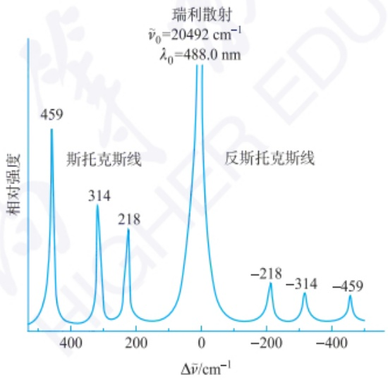

spectrogram

| Peak Label | \(\Delta\nu\)̄ \((cm^{-1})\) |
| --- | --- |
| 459 | ~350 |
| 斯托克斯线 | ~280 |
| 314 | ~260 |
| 218 | ~220 |
| 瑞利散射 | 0 |
| \(**\nu\)̃₀=20492 \(cm^{-1}\), \(\lambda_{0}=488.0 nm\) | 0 |
| -218 | ~-200 |
| -314 | ~-300 |
| -459 | ~-350 |

图 4.4.2 四氯化碳的拉曼光谱图

拉曼光强度受多种因素的影响,比如分子的极化率、激发光源的强度、活性基团的浓度等。可以大致分为以下几个方面:

（1）样品特性 不同分子的拉曼活性不同，某些分子的特定振动模式更容易产生强烈的拉曼散射；通常来说，分子极化率越高，分子中电子云相对于骨架的移动越大，拉曼散射越强。在不考虑吸收的情况下，拉曼散射强度与入射光频率的

共振增强拉曼散射示例

在分析检测中,拉曼光谱峰包含什么样丰富的信息?这些信息怎么和定性定量检测关联起来?

光电场 E 中, 分子产生诱导偶极矩  $\rho = \alpha E$ 。

$\alpha$  为分子极化率, 常见分子极化率如下表:

| 分子式 | 极化率 | 分子式 | 极化率 |
| --- | --- | --- | --- |
| He | 0.227 | HCl | 2.85 |
| Ne | 0.437 | HBr | 3.86 |
| Ar | 1.81 | HI | 5.78 |
| Kr | 2.73 | $H_2O$ | 1.61 |
| Xe | 4.45 | $H_2S$ | 4.05 |
| $H_2$ | 0.892 | CO | 2.14 |
| $O_2$ | 1.74 | $CO_2$ | 2.87 |
| $N_2$ | 1.93 | $NH_3$ | 2.39 |
| $Cl_2$ | 5.01 | $CH_4$ | 3.00 |
| $Br_2$ | 7.15 | $C_2H_6$ | 4.81 |

4 次方呈正比。此外，分子浓度越高，拉曼散射信号越强。

（2）激发光源 激光功率的增加可以提高拉曼散射信号的强度，但过高的功率可能导致样品的热损伤或荧光背景增加；不同的激光波长对拉曼散射的效率有不同的影响，选择合适的激光波长可以优化信号强度，特别是对于共振拉曼散射；激光的聚焦程度会影响光斑大小和光强分布，进而影响拉曼信号的强度。
（3）仪器参数 光谱仪的检测器灵敏度和光学系统的传输效率直接影响拉曼信号的检测；增加积分时间可以提高信噪比，从而增强拉曼信号的强度；高分辨率的光谱仪可以更好地分离重叠的拉曼峰，但可能会牺牲信号强度。
（4）环境条件 温度的变化会影响分子的振动和转动模式，进而影响拉曼信号的强度，高温下，反斯托克斯散射线的强度会增加；高压条件可能改变分子间的相互作用，影响拉曼信号的强度；溶剂的性质（如极性和黏度）会影响分子的振动模式和散射效率。
（5）共振效应 当激光波长与分子的电子能级或振动能级接近时，会产生共振效应，光吸收能力大大增强，从而显著增强拉曼信号的强度，这种效应在分析特定分子（如生物分子和有机分子）时尤为重要。
(6) 样品制备 样品的形态(如颗粒大小、晶型等)会影响光的散射和吸收,从而影响拉曼信号的强度;样品表面的平整度和清洁度会影响拉曼信号的质量,表面增强拉曼散射(SERS)利用金属纳米颗粒表面的等离激元效应,可以显著增强拉曼信号。
（7）背景信号 样品中的荧光背景会干扰拉曼信号的检测，有时需要采取措施（如选择合适的激光波长或使用荧光猝灭剂）来减少荧光背景。

通过对上述因素的调控和考察,可以用拉曼光谱实现对不同待测样品/体系的定性定量分析研究。

## 4.4.3 拉曼光谱和红外吸收光谱的对比

拉曼光谱和红外吸收光谱都是常用的分子光谱技术,用于研究分子的振动和转动模式。尽管它们都提供了关于分子结构的有价值信息,但两者在原理、应用和特点上存在一些差异。

从产生原理上来讲，拉曼光谱是由分子对入射光的散射引起的，而红外吸收光谱则是由分子对红外光的吸收产生的。拉曼光谱主要研究会引起分子极化率变化的非极性基团和对称性振动，而红外吸收光谱则主要研究会引起偶极矩变化的极性基团和非对称性振动。相同原子的非极性键 S—S, C=C, N=N, C≡C 产生强拉曼谱带；环状化合物的对称呼吸振动是强拉曼谱带；由 C≡N, C=S, S—H 伸缩振动产生的红外谱带一般较弱或强度可变，但在拉曼光谱中是强谱带；C—C 键的伸缩振动在拉曼光谱中是中强谱带；O=C=O, S=C=S, X=Y=Z 等结构的对称伸缩振动是拉曼强谱带，反对称伸缩振动是拉曼弱谱带，其红外谱带特征相反，二者存在选律不相容，提供的谱带信息又具有互补性，如图 4.4.3 所示。拉曼光谱适合研究分子骨架信息，而红外吸收光谱适合研究分子基团和取代等信息。

## 4.4.4 拉曼仪器结构与介绍

## 4.4.4.1 基本原理

普通色散型拉曼光谱仪主要由光源、样品池、单色器、检测器构成(图 4.4.4)。激发光源(一般为激光器)在计算机的控制下发出单色光。激光器发出的光可能不止单一谱线，因此一般会使用窄带滤光片以保证其单色性。激发光经过聚焦后投射在样品上（或样品中），其散射光既有瑞利散射，又有拉曼散射。拉曼光谱主要研究后者，因此光学系统收集的光首先需要过滤掉非拉曼散射光，通常使用长通滤光片将波长小于某一特定值（激光波长）的光过滤掉，再通过狭缝进入光谱仪进行分光检测，多通道探测器（CCD或者CMOS）会同时检测不同波长光线的强度，给出的数据就是拉曼光谱图。常见的拉曼光谱仪采用的激发光位于紫外-近红外区间，与紫外-可见光谱研究的范围接近，但通常是选择具有特定波长的激光作为光源。拉曼光谱仪的检测范围小于紫外-可见光谱仪，但对于谱图的分辨率和灵敏度的要求都明显高于紫外-可见光谱仪。常用的科研级别拉曼光谱仪大都是以显微镜为基础的显微拉曼光谱仪。

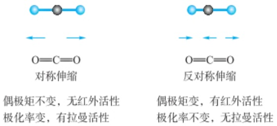

chemical

化学反应示意图，展示对称伸缩与反对称伸缩两种条件下的偶极矩变化

图 4.4.3  $CO_{2}$  分子不同振动模式的拉曼活性和红外活性对比

此外，还有一些特殊用途的科研级拉曼光谱仪，比如采用近红外光激发的傅里叶变换拉曼光谱仪等。傅里叶变换拉曼光谱仪的光路设计与傅里叶变换红外光谱仪相似，主要是干涉仪与样品池排列次序不一样。傅里叶变换拉曼光谱仪的光路由激光光源、样品池、干涉仪、滤光片组、检测器及计算机控制记录系统等组成（图4.4.5）。该光谱仪采用Nd/YAG激光器所发射的激光波长为 $1064\mathrm{nm}$，能量较低，既可有效避免大部分荧光对拉曼光谱的干扰，又可避免某些样品受激光照射而分解。

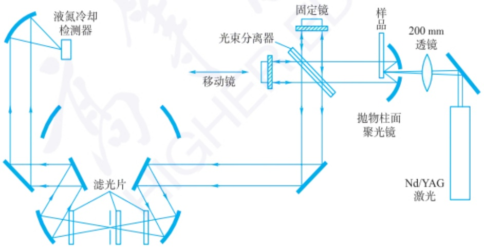

flowchart

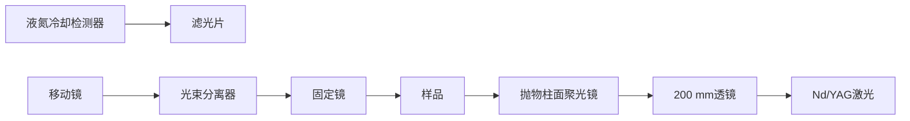

图 4.4.5 傅里叶变换拉曼光谱仪的光路示意图

此外,实用化的便携式拉曼光谱仪主体结构与科研级拉曼相似,但是部件集成化、固定化,多采用光纤传输,代替传统的自由空间结构,虽然在光通量和灵敏度方面有所损失,但是大大简化了仪器结构,提高了仪器的稳定性,降低了成本。

调研对比拉曼光谱设备和红外光谱设备的结构异同点？

拉曼光谱不同的采谱条件(例如,不同的激光波长、激光功率、采谱时间、光栅等)会对拉曼光谱的分析结果有什么影响?

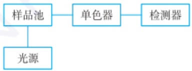

flowchart

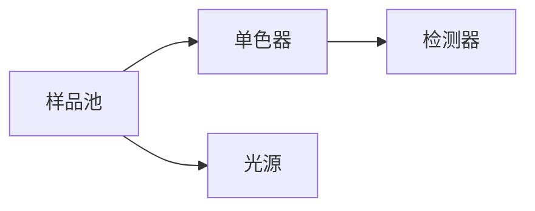

图 4.4.4 色散型拉曼光谱仪示意图

便携拉曼和显微拉曼仪器

He-Ne 激光器

常用的激光光源按照波长不同包括:$\mathrm{Ar^{+}}$ 激光器（$488.0 \mathrm{~nm}$ 和 $514.5 \mathrm{~nm}$）、$\mathrm{Kr^{+}}$ 激光器（$568.2 \mathrm{~nm}$）、$\mathrm{He}-\mathrm{Ne}$ 激光器（$632.8 \mathrm{~nm}$）、红宝石激光器（$694.0 \mathrm{~nm}$）、二极管激光器（$785 \mathrm{~nm}$ 和 $830 \mathrm{~nm}$）和 Nd/YAG 激光器（$1064 \mathrm{~nm}$）。

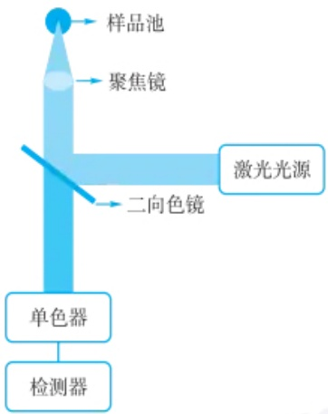

flowchart

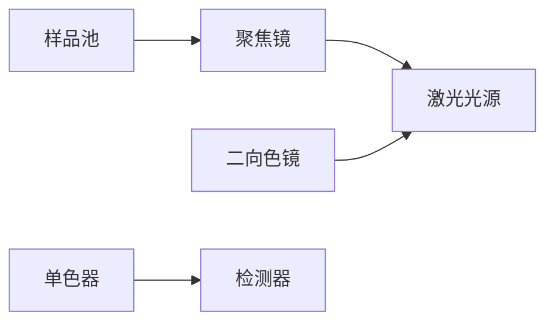

拉曼光谱仪的背散射式构型

## 4.4.4.2 拉曼光谱仪各组成部分简介

## 1. 光源

从理论上讲，拉曼光谱的激发光源应该是单色光，早期拉曼光谱仪采用高压汞灯作为光源，但其发光效率低、寿命短，存在环境污染等问题。后来发明的激光器具有体积小、功耗低、亮度高、谱线宽度窄等优势，成为拉曼光谱的理想光源。随着激光器技术的不断进步，新的激光器也逐渐应用于拉曼光谱仪中，从早期的气体激光器，到后来的固体激光器、半导体激光器，从连续激光器到脉冲激光器，拉曼光谱研究方法不断充实，拉曼光谱仪的应用领域不断扩大。气体激光器和固体激光器谱线宽度窄，光束质量高，常用于实验室科研级拉曼光谱仪。常见的气体激光器有He-Ne激光器（632.8 nm），He-Cd激光器（325 nm），$\mathrm{Ar^{+}}$离子激光器（488/514.5 nm）等。固体激光器有Nd/YAG激光器（1064 nm）。半导体激光器体积小、能耗低，几乎是便携式拉曼光谱仪的唯一选择，高质量的半导体激光也应用于科研级拉曼光谱仪。半导体激光器的波长范围可以覆盖紫外到近红外区间。

## 2. 激发与收集系统

拉曼光谱仪最常见的结构是背散射式构型，即激发和收集由同一套光学系统完成。以显微拉曼为例，物镜将激发光投射在样品上，同时将发生的拉曼散射光收集回光谱仪中。由于激发光和拉曼光是共线的，因此在物镜后侧，使用二向色镜将激发光和拉曼光进行分离。背散射式构型有两大优势，一是使仪器结构紧凑，二是带来了采样方式的便利，拉曼光谱几乎是所见即所得，不需要特别复杂的制样。

## 3. 分光系统与检测器

拉曼光谱仪的分光系统是指从入射狭缝到检测器这一段光程所包含的各部件。它是由狭缝、准直元件、色散元件（棱镜或光栅）、聚焦元件等组成。某些仪器采用平场凹面光栅作为色散元件，这种结构可以省略准直和聚焦元件。科研级的拉曼光谱仪光栅一般可以在一定角度范围内转动，而便携式光谱仪的光栅基本是固定的。现代拉曼光谱仪使用的检测器基本上都是CCD或者CMOS等多通道检测器，使用多通道检测器的优势在于，省去了复杂的机械转动结构，大大提升了检测效率。从实践角度看，大部分拉曼光谱仪已经将分光系统和检测器进行了整合，可以认为是同一个部件。

## 4. 计算机-控制和数据的记录与处理

拉曼光谱仪中可移动的机械部件，比如光栅转动、光学元件切换等需要计算机进行控制，同时电子元件，比如激光器功率、CCD检测器等也需要利用计算机进行控制。一般而言，与元件直接相连的属于下位机，下位机根据上位机的指令对元件进行控制，下位机也直接读取传感器获得的信号，以一定的格式将数据传递给上位机。拉曼光谱仪记录的数据包括光谱的位置和对应的光谱强度，有时获得的拉曼光谱需要进行一定的数据处理，比如消除宇宙射线，对谱图进行平滑处理，对谱峰进行拟合、指认等，还可以进一步将谱图与数据库进行比对，给出定性、定量结果。

## 4.4.5 表面增强拉曼光谱

拉曼散射是一种二次光子过程，分子的微分拉曼散射截面通常只有（甚至低于）$\sim 10^{-29}\mathrm{cm}^{-2}\cdot \mathrm{sr}^{-1}$，仅是红外和荧光的 $10^{-6}\sim 10^{-14}$ 倍。这从本质上决定了拉曼散射的信号强度是很弱的，一般只有瑞利散射强度的 $10^{-3}\sim 10^{-6}$ 倍。此外，由于早期所使用的激发光源的能量和质量都比较差，直接影响了拉曼光谱的采集。所以上述原因限制了早期拉曼光谱技术在分析科学和表面科学等领域的应用。但随着20世纪60年代后激光技术及各种增强拉曼光谱技术(图4.4.6)的出现，给拉曼光谱带来了新的生机，使得拉曼光谱在不同研究领域都有了快速的应用和发展。

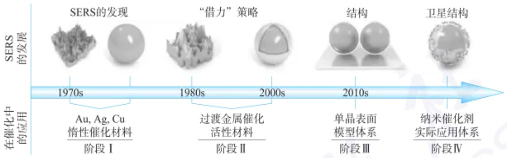

flowchart

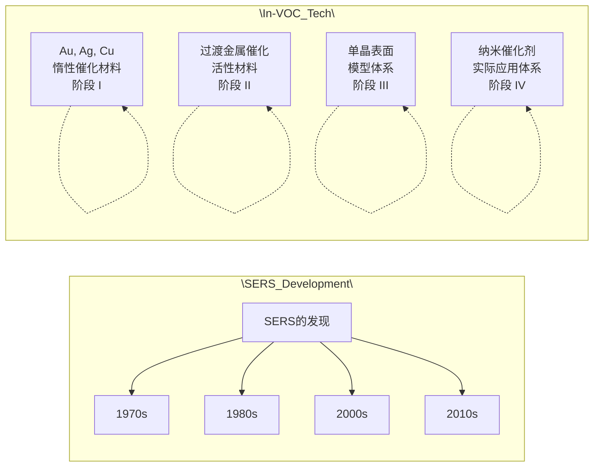

图 4.4.6 增强拉曼光谱技术的发展过程

## 4.4.5.1 传统表面增强拉曼光谱

表面增强拉曼光谱(surface-enhanced Raman spectroscopy, SERS)可提供超高灵敏度的分子指纹振动信息,其发展至今已有半个世纪的历史。1974年,英国的Martin Fleischmann等在电化学粗糙化的银电极表面获得了高质量的吡啶分子拉曼信号,这在之前常规拉曼实验中是无法获得的。随后美国的Richard P. Van Duyne等经过进一步的实验和理论分析,认为这种高质量的拉曼信号来源于一种表面增强效应的影响,并把这种效应命名为表面增强拉曼散射效应,简称为SERS效应。经过长期的探索,人们对SERS效应的增强机理进行了系统研究,比较公认的观点是SERS效应的增强机理包括两部分:电磁场增强(electromagnetic enhancement mechanism, EM)和化学增强(chemical enhancement mechanism, CM),其中又以电磁场增强对SERS效应起主要贡献作用。

SERS 的发现对分析科学和光谱学产生了很大的影响,极大提高了拉曼光谱技术的检测灵敏度,扩展了应用领域。然而,SERS 的实际应用受限于两大瓶颈。① 材料限制:仅有少数几种金属(如 Au, Ag 和 Cu)能够产生较强的 SERS 效应,难以应用于其他材料(如 Pt, Pd, Ru、Ni 等);尽管 Li、Na、K、Al 等具有自由电子的金属理论上具备产生 SERS 效应的潜力,但在实际中获得较强 SERS 信号仍面临较大挑战。② 形貌限制:SERS 效应是一种与纳米结构相关的光学现象,它的强弱不但取决于金属本身,还和纳米结构的尺寸、形状和间距有关。一般而言,SERS 产生的前提条件是具有纳米级粗糙的基底或粒径大小约为数十至数百纳米的粒子修饰的基底。不同的纳米结构所产生的 SERS 增强效应差别很大,甚至存在数量级的差别。

## 4.4.5.2 新型表面增强拉曼光谱技术

为了提高传统 SERS 技术的普适性,研究者们开发了不同的新型表面增强拉曼光谱技术。例如,人们通过在组装有各种过渡金属超薄壳层的金或银纳米结构中“借用”金或银纳米粒子的 SERS 增强能力,以增强吸附在过渡金属表面上的分子的拉曼信号。如图 4.4.7 所示,如果 Au 纳米粒子表面包裹的过渡金属 Pt 外壳超薄,则 Pt 外壳吸附物种的拉曼信号依然可以被内核 Au 纳米粒子腔的电磁场所增强。尽管如此,该种核壳纳米粒子增强拉曼光谱的应用也仍受到限制:① Au 内核与过渡金属壳层之间在一定程度上存在不可避免的应变效应和电子效应,这

对比不同增强拉曼光谱技术的异同,阐述增强拉曼光谱技术的核心技术是什么。

图 4.4.7 彩图

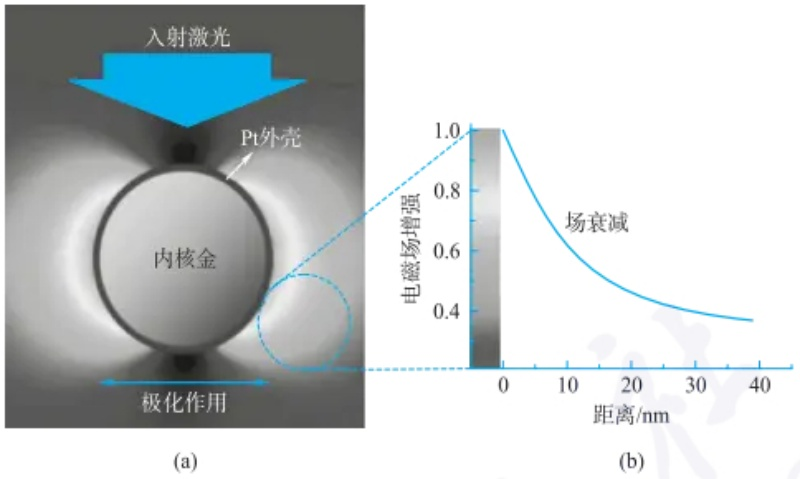

line

| Distance (nm) | Electric Field (Normalized) |
| --- | --- |
| 0 | 1.0 |
| 10 | ~0.65 |
| 20 | ~0.48 |
| 30 | ~0.42 |
| 40 | ~0.38 |

图 4.4.7 （a）激光下 Au@Pt 核壳纳米粒子周围的电磁场分布示意图；（b）图显示了电磁场强度（以 Pt 表面上的强度标准化）与距 Pt 外壳的距离的相关性

可能会对壳层性能产生一定影响；②无法实现形貌普适性:不适用于具有原子级平整的单晶表面的研究。此外，经过不断的努力，研究者们也陆续开发出其他的增强拉曼光谱技术。例如，通过在金纳米粒子表面包覆一层极薄致密且化学惰性的 $\mathrm{SiO_2}$ 材质，构筑 $\mathrm{Au@SiO_2}$ 纳米粒子:内核金纳米粒子作为拉曼信号放大器，可以增强其附近分子的拉曼信号；二氧化硅壳层可以隔绝金内核与所研究体系之间的相互作用，防止某些分子吸附在信号放大器表面，也防止内核金污染所研究的体系。该种技术也被称为壳层隔绝纳米粒子增强拉曼光谱（SHINERS）。理论上，SHINERS技术克服了SERS应用中材料和形貌的限制，适用于任何材料和任何形貌表面的研究，并在不同的表界面分析研究、生物检测、危化品识别等领域具有很多的应用。

“借用”的策略是否也可以在其他分析检测技术中得到应用？

## 4.4.6 拉曼光谱的应用

不同的分子或物质都具有其独有的特征拉曼指纹图谱，能够被用于研究确认材料种类的化学结构、组分含量及表界面微观环境等复杂信息，尤其是具有单分子检测灵敏度的表面增强拉曼光谱技术受到人们的特别关注和重视，从定性鉴别到定量检测都有非常广泛的应用。

## 4.4.6.1 表界面反应分析

作为一种高分辨率、非破坏性且对分子结构高度敏感的表界面分析技术，SERS能够实现表界面催化反应过程的原位监测。通过获取和分析不同表面区域的特征拉曼谱峰强度和频移信息，SERS可以提供关于表面结构、吸附物种和表面电荷等方面的直接光谱证据，并从分子/原子水平揭示反应机理和构效关系。例如，研究人员利用原位SERS技术，成功研究了能源领域中重要的氧还原反应（ORR）、二氧化碳还原反应 $\mathrm{(CO_2RR)}$ 及有机分子催化反应等过程。通过捕获中间物种如超氧根 $(\mathrm{O}_2^-)$ 、过氧根 $(\mathrm{O}_2^{2-})$ 等的直接光谱证据，SERS不仅揭示了这些反应的机理，还为高效能源催化材料的设计和开发提供了重要的指导和帮助。

## 4.4.6.2 生物分析

拉曼光谱在生物医学领域有广泛的应用,包括肿瘤诊断、细胞成分分析和蛋白质结构研究等。通过分析生物样品的拉曼光谱,可以了解其分子成分、代谢活性及细胞状态的变化,实现 DNA 检测、免疫测定、细菌检测、生物成像、疾病诊断与治疗等多种功能。值得一提的是，在我国天宫空间站这一特殊环境中，微重力和密封环境对仪器的正常运行和实验条件的稳定性提出了挑战。我国首次将拉曼光谱技术应用于载人航天，通过分析宇航员尿液中的代谢物，开展了在轨营养代谢组学研究，标志着该技术在太空探索中的重要突破。此外，SERS技术对周围环境非常敏感。通过在金属纳米颗粒或核壳结构的颗粒表面修饰拉曼探针分子，SERS可以作为探针用于细胞内或细胞外的检测，进一步扩展了其在生物医学领域的应用范围。

## 4.4.6.3 物理化学传感

等离激元材料已被广泛设计和制备用于各种应用，包括近场光学、光谱学、太阳能电池、化学和生物传感器。利用等离激元核-壳纳米结构作为传感探针是一个具有广泛应用前景的研究热点。金属内核可作为“信号放大器”提供拉曼信号的增强效应，功能化外壳实现对外部环境的刺激响应。因此，核-壳纳米结构可以将传感技术和表面增强拉曼光谱技术结合起来，应用于不同体系内的 $\mathrm{pH}$ 传感、温度传感、压力传感和生物传感等方面。

## 4.4.6.4 环境与食品分析检测

随着社会的发展,人类过度使用传统化石燃料带来了严重的环境污染问题。环境中污染物的检测和分析对于改善环境问题至关重要。通过采集样品的特征拉曼光谱,可以获得有关污染物种类和浓度的详细信息,有助于实现水质分析、大气污染物监测等,甚至可以用于特定的爆炸物探测、生物战剂探测和有毒化学物质的检测。在食品安全方面,通过对食品样品进行表面增强拉曼光谱测量,可以实现对食品和饮料中成分的快速分析和质量控制。表面增强拉曼光谱技术能够检测食品样品中的添加剂、污染物和营养成分,广泛应用于乳制品检测、酒精饮料检测、烟草制品检测等日常检测需求场景,确保食品的安全和质量。

## 4.4.6.5 材料检测

拉曼光谱可以提供关于物质的分子结构信息。通过分析样品的拉曼光谱图，可以确定分子中的化学键、官能团及分子的对称性（如异构体识别）等信息。此外，拉曼光谱还可以用于分析样品的化学组成，如鉴定有机化合物、药物、天然产物等样品中的成分和杂质。拉曼光谱也能用于表征二维材料（如石墨烯、过渡金属硫化物）的层数和堆叠方式，鉴定金属氧化物的氧空位、碳材料的缺陷等。由于其快速和无损的特点，拉曼光谱也是一种常用的文化遗产检测技术，可用于检测和鉴定天然或人造有机分子，如色素和染料。

了解调研拉曼光谱技术在不同领域的前沿研究进展。

拉曼光谱在在轨营养代谢组学研究中有哪些优势？在未来，拉曼光谱技术在空间站有哪些可拓展的研究方向？

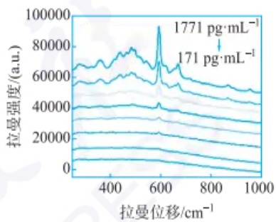

line

| Wavenumber \((cm^{-1})\) | Intensity (a.u.) |
| --- | --- |
| 171 | ~5000 |
| 172 | ~8000 |
| 173 | ~12000 |
| 174 | ~16000 |
| 175 | ~20000 |
| 176 | ~24000 |
| 177 | ~30000 |
| 178 | ~40000 |
| 179 | ~55000 |
| 180 | ~65000 |
| 181 | ~75000 |
| 182 | ~85000 |
| 183 | ~95000 |
| 184 | ~92000 |
| 185 | ~85000 |
| 186 | ~75000 |
| 187 | ~65000 |
| 188 | ~55000 |
| 189 | ~45000 |
| 190 | ~35000 |
| 191 | ~25000 |
| 192 | ~15000 |
| 193 | ~5000 |

(a)

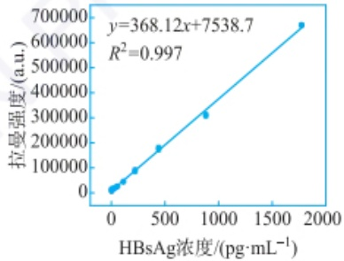

scatter

| HBsAg浓度 \((pg \cdot mL^{-1})\) | 拉曼强度 (a.u.) |
| --- | --- |
| ~20 | ~10000 |
| ~50 | ~20000 |
| ~150 | ~45000 |
| ~300 | ~85000 |
| ~450 | ~175000 |
| ~900 | ~305000 |
| ~1800 | ~665000 |

(b)

通过拉曼光谱进行乙肝病毒诊断时，在金纳米粒子的增强下，作为拉曼信号探针的尼罗蓝分子位于 $592\ cm^{-1}$ 的芳香环或氮杂环振动有关的特征峰强度随乙肝抗原浓度的增加而增加(a)，呈现出良好的线性规律(b)，可用于定量诊断分析。

## 习题

## - 章节练习题 -

1. 阐述拉曼光谱谱峰中峰强、峰位、峰宽所包含的信息, 它们受哪些因素影响?
2. 阐述不同增强拉曼光谱技术的优势和局限性。

## - 挑战性问题 -

3. 作为一种高灵敏的分析检测技术, 拉曼光谱具有非常大的优势, 并在不同研究领域有着广泛的应用。但是, 现在拉曼光谱技术依然存在一些不足, 请针对拉曼光谱技术的局限性思考未来拉曼光谱技术可能的发展方向。

分子发光现象实例

## - 专题或报告 -

4. 查阅文献,介绍不同增强拉曼光谱技术的发展现状和最前沿的应用领域,并将结果写成报告。

## 4.5 荧光与磷光光谱分析

本节主要阐述荧光和磷光光谱分析法的基本原理、仪器结构、方法特点及应用，拓展介绍光化学传感与生物分析应用。

## 4.5.1 分子发光现象及分子发光分析法

分子发光(molecular luminescence)，是指分子吸收一定能量后，电子由基态跃迁到激发态，电子在返回基态的过程中发生光辐射的现象。基于分子发光建立起来的分析方法称为分子发光分析法。分子发光的主要类型有荧光、磷光、化学发光和生物发光。根据提供能量的来源不同，分子发光可以分为光致发光和化学发光。荧光和磷光由光源提供能量，属于光致发光，基于此建立的分析方法称为荧光与磷光光谱分析法，将在本节进行讨论。化学发光与生物发光是通过外界或生物体内的化学反应提供能量，基于此建立的分析方法称为化学发光与生物发光分析法，将在下节进行讨论。目前，分子发光分析法在医药、卫生、生物、环境等领域得到了广泛应用。

## 4.5.2 荧光和磷光基本原理

## 4.5.2.1 荧光和磷光的产生

荧光(fluorescence)和磷光(phosphorescence)都是分子电子从高能级的激发态跃迁回低能级的基态过程中产生的电磁辐射。分子吸收光能后，电子由基态跃迁到激发态，激发态电子回到基态的同时会释放能量出来。释放能量的形式主要有放热和发光两种，放热和发光是相互竞争的过程，如果能量主要以放热的形式被释放，则难以观察到发光现象。荧光和磷光的产生机理可通过分子外层电子的光吸收过程和Jablonski能级图(图4.5.1)进行阐述，两者的区别主要在于从激发态回到基态经过的途径不同。

Aleksander Jablonski

由 Jablonski 能级图可知，分子具有一系列严格分立的电子能级，电子能级中又包含了一系列的振动和转动能级。分子中电子的运动状态除了电子所处的能级外，还包含有与电子自旋方向相关的多重度。电子的自旋方向有两种，一般用 +1/2 和 -1/2 表示自旋量子数，电子自旋多重度可用  $M=2S+1$  表示，其中 S 为自旋量子数的代数和（sum of all the electron spins），数值取决于未成对电子的数目和自旋方向，一般可能为 0, 1/2, 1, 3/2, …（间隔为 1/2）。图 4.5.2 为分子单重态与三重态的示意图。根据泡利不相容原理，分子中同一轨道中两个电子具有相反的自旋方向，即自旋配对，大部分分子的基态都是这种情况，电子自旋多重度为 1，处于单重态（singlet，用 S 表示）。基态分子吸收能量后，如果电子跃迁过程不发生自旋方向的变化，此时电子自旋多重度仍然是 1，分子处于激发单重态；如果电子跃迁过程中自旋方向改变，分子中则具有两个自旋不配对的电子，此时电子自旋多重度为 3，分子处于激发三重态（triplet，用 T 表示）。第一电子激发单重态和第二电子激发单重态分别用  $S_{1}$  和  $S_{2}$  表示，第一电子激发三重态和第二电子激发三重态分别用  $T_{1}$ 、 $T_{2}$  表示。根据洪德定则，处于分立轨道上的非成对电子，平行自旋比配对自旋更稳定，因此三重态能级比相应单重态的能级略低（见图4.5.1中的  $S_{1}$  和  $T_{1}$ ，图中未列出的更高能级，如  $S_{2}$  和  $T_{2}$ ， $S_{3}$  和  $T_{3}$  同样具备类似的特性）。通常单重态分子具有抗磁性，激发态平均寿命约为  $10^{-8}$  s；三重态分子具有顺磁性，平均寿命为  $10^{-4} \sim 1$  s。

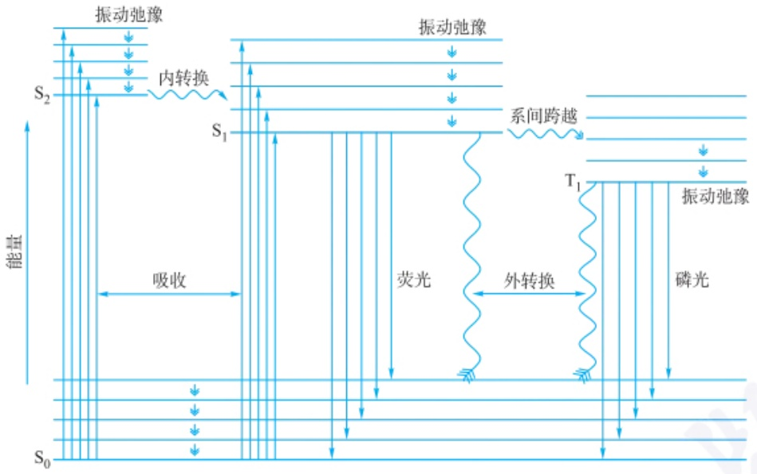

text_image

振动弛豫
内转换
S₂
S₁
吸收
S₀
振动弛豫
系间跨越
T₁
荧光
外转换
T₁
振动弛豫
磷光

图 4.5.1 荧光和磷光的产生: 分子光吸收和发射过程 Jablonski 能级图(仅列出部分能级)

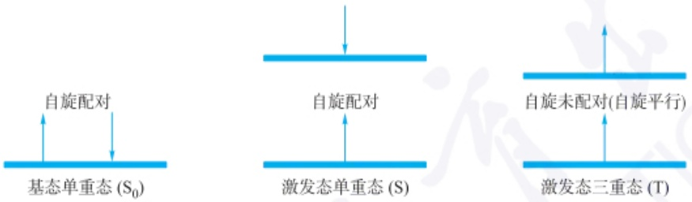

图 4.5.2 单重态与三重态示意图

由于激发态分子不稳定,通常会释放能量回到基态,完成去激发,能量的释放有辐射跃迁或非辐射跃迁等方式。分子的去激发过程主要有以下几种途径。

（1）振动弛豫(vibrational relaxation) 在同一电子能级中，电子由高振动能级转移至低振动能级，多余的能量以热的形式发出，这个过程非常迅速，时间约为 $10^{-12}$ s。
（2）内转换（internal conversion） 内转换属于电子在相同多重态的相近能级之间的跃迁，不发射光辐射。当  $S_{2}$  或  $T_{2}$  的较低能级与  $S_{1}$  或  $T_{1}$  的较高能级的能量相当或重叠时，分子可以从  $S_{2}$  或  $T_{2}$  的振动能级以热能形式过渡到  $S_{1}$  或  $T_{1}$  的能量相等的振动能级上，发生内转换。如果  $S_{1}$  和  $S_{0}$  振动能级存在重叠，电子也可能通过内转换非辐射地从  $S_{1}$  返回  $S_{0}$ 。内转换过程在  $10^{-13} \sim 10^{-11}$  s 发生，通常比在高激发态直接发射光子的速度快得多。即使分子最初处于高激发态  $S_{2}$  或  $S_{3}$，都可以通过振动弛豫和内转换过程回到最低激发单重态 ( $S_{1}$ ) 或三重态 ( $T_{1}$ ) 的最低振动能级。
（3）荧光(fluorescence) 处于不同激发态单重态 $(S_{1}, S_{2}, \cdots)$ 的分子通过振动弛豫或内转换过程到达第一激发态单重态 $(S_{1})$ 的最低振动能级后，通过发射光

## 荧光与磷光的区别

（1）发光原理:荧光是激发单重态回到基态的能级跃迁；磷光是激发三重态回到基态的能级跃迁。
（2）发光时间:荧光持续时间较短， $10^{-9}\sim10^{-7}$  s；磷光持续时间较长， $10^{-4}\sim100$  s，磷光过程属于量子力学的禁阻跃迁，非常缓慢。许多所谓“在黑暗中发光”的材料通常都是磷光性材料，如夜明珠。

## 夜明珠的磷光

我国古代传说中的夜明珠是一种稀有的宝石，主要成分是氟化钙、硫化砷等无机盐类晶体，其中含有少量的重金属杂质（激活剂），如铜、铁、锰、银、金等。夜明珠在黑夜中的发光就是一种磷光现象。夜明珠中的缺陷和杂质，在电子跃迁过程中起到了“陷阱”的作用，使得部分电子不能立即回落到低能级，而是被暂时困住在中间能级。这些被困住的电子需要更多的时间才能释放出能量。夜明珠白天吸收了阳光后，黑暗中还能持续发光数十小时。

子的方式回到基态,这个过程称为荧光发射,持续时间为  $10^{-9} \sim 10^{-7}$  s。

（4）外转换(external conversion) 激发态分子与溶剂或其他溶质分子之间发生相互作用及能量转换使荧光或磷光减弱，甚至消失的过程称为外转换，这一现象称为“熄灭”或“猝灭”。
（5）系间跨越(intersystem crossing) 又称系间窜越，是不同多重度状态间的一种无辐射跃迁过程，涉及激发态或激发过程电子自旋状态的改变。例如，$\mathrm{S}_1 \rightarrow \mathrm{T}_1$ 就是一种系间跨越。发生系间跨越时，通常电子由 $\mathrm{S}_1$ 的较低振动能级转移至 $\mathrm{T}_1$ 的较高振动能级。这种跃迁属于自旋禁阻过程，其发生概率较低。
(6) 磷光(phosphorescence) 激发单重态电子经过系间跨越到达激发三重态, 接着发生快速的振动弛豫到达激发三重态的最低振动能级, 然后由此激发态跃迁回基态时, 伴随磷光。从 $\mathrm{T}_{1} \rightarrow \mathrm{S}_{0}$ 的跃迁属于禁阻跃迁, 故磷光的寿命比较长, 范围从 $10^{-4} \mathrm{~s}$ 至数百秒。因此将激发光移走后, 这种跃迁所发射的光还可持续观察到。

表 4.5.1 对分子吸收和不同去激发过程速率进行了比较。光吸收过程非常迅速，荧光是由激发单重态最低振动能级跃迁至基态各振动能级时产生的，而磷光则是由激发三重态的最低能级至基态各振动能级之间产生的。

表 4.5.1 分子吸收和去激发过程比较

| 过程名称 | 跃迁性质 | 跃迁能级 | 时间/s |
| --- | --- | --- | --- |
| 光吸收 | 辐射(激发) | $S_0 \rightarrow S_1, S_2, S_3, \cdots$ | $10^{-15}$ |
| 振动弛豫 | 非辐射 | $S_n \rightarrow S_n$(电子能级不变,振动能级变化) | $10^{-12}$ |
| 荧光发射 | 辐射(发射) | $S_1 \rightarrow S_0$ | $10^{-9} \sim 10^{-7}$ |
| 内转换 | 非辐射 | $S_n \rightarrow S_{n-1}, n \geqslant 1$或$T_n \rightarrow T_{n-1}, n \geqslant 2$ | $10^{-13} \sim 10^{-11}$ |
| 系间跨越 | 非辐射,禁阻 | $S_1 \rightarrow T_1$ | $10^{-11} \sim 10^{-6}$ |
| 磷光发射 | 辐射(发射) | $T_1 \rightarrow S_0$ | $10^{-4} \sim 100$ |

## 荧光激发光谱与紫外-可见吸收光谱的关系

分子荧光激发光谱与紫外-可见吸收光谱的形状相似,但意义不同。紫外-可见吸收光谱反映了分子从基态到激发态的跃迁过程,而激发光谱则揭示了分子从激发态回到基态的过程中,荧光与激发波长变化的关系。

## 斯托克斯位移

1852 年 G. G. Stokes 提出了一个论断: 发射光的波长总是大于激发光的波长。激发峰和发射峰波长差是一个表示分子发光特性的重要参数, 这个参数被称为斯托克斯位移 (Stokes shift)。

## 4.5.2.2 量子产率

量子产率用  $\Phi$  表示, 是指物质吸收光能后发射的光子数与吸收的激发光光子数之比。荧光量子产率可用  $\Phi_{F}$  表示。磷光量子产率可用  $\Phi_{P}$  表示。

$$
\Phi = \frac {\mathrm{发射的光量子数}}{\mathrm{吸收的光量子数}} \tag {4-5-1}
$$

除了荧光发射外，分子从激发态回到基态的去激发过程还包含内转换、系间跨越和外转换等非辐射跃迁过程，因此荧光量子产率与发射过程及非辐射过程的速率相关，可由下式表示:

$$
\Phi_ {\mathrm{F}} = \frac {k _ {\mathrm{F}}}{k _ {\mathrm{F}} + \sum_ {i = 1} ^ {n} k _ {i}} \tag {4-5-2}
$$

式中， $k_{F}$  为荧光发射过程速率常数， $\Sigma k_{i}$  为非辐射跃迁过程速率常数的总和。通常  $k_{F}$  主要取决于分子的化学结构， $\Sigma k_{i}$  主要取决于溶剂种类和 pH 等化学环境因素，与分子结构也有一定关系。例如，荧光素在乙醇中量子产率为 0.79，而在偏碱性的水溶液中可达到 0.95。能够使荧光发射过程速率常数  $k_{F}$  值增加，以及使各类非辐射跃迁过程速率常数  $k_{i}$  值降低的因素都可以增强荧光。荧光量子产率最高为 1，大部分荧光染料的量子产率在 0.3\~0.6，不同荧光分子的量子产率差别很大。例如，荧光素的量子产率可达 0.95，而花青素（cyanine5, Cy5）的量子产率仅有

0.2,部分近红外荧光染料的量子产率低于0.1。

荧光量子产率的测定方法有直接法(绝对法)和间接法(参比法)。直接法需要将待测样本与一个没有激发光损失的全发射的标准进行比较,方法比较烦琐,容易引入误差。参比法通过将待测样品与具有已知荧光量子产率的标准物质进行比较,得到荧光量子产率。参比法具有操作简便的优势,并且可以消除标准样品与待测样品共同误差来源,提高测量准确度,因此目前荧光量子产率的测定方法多采用参比法。参比法的具体操作是在相同激发条件和相同溶剂中,分别测定待测荧光分子和已知量子产率的参比荧光标准物质两种稀溶液的积分荧光强度(校正荧光光谱所包括的面积),以及在相同激发波长的入射光波长下的吸光度,再通过以下公式计算:

$$
\frac {\Phi_ {x}}{\Phi_ {\mathrm{st}}} = \frac {F _ {x} \times A _ {\mathrm{st}}}{F _ {\mathrm{st}} \times A _ {x}} \tag {4-5-3}
$$

式中，下标 x 表示待测物质，st 表示标准物质。 $\Phi$  表示荧光量子产率。F 表示荧光强度，A 表示吸光度。常用于荧光量子产率测定的参比物质有硫酸奎宁、罗丹明 B 等。

## 4.5.2.3 激发光谱与发射光谱的关系

荧光和磷光都是由光源提供能量，使分子由基态跃迁到激发态，属于光致发光。由于不同分子的电子能级不同，分子对不同波长的光有选择性吸收。如果将荧光(磷光)的最大发射波长作为固定测量的特定波长，改变激发光波长，测量荧光(磷光)强度与激发波长之间的关系，则可以得到激发光谱。如果将激发光波长固定在某个数值，测定不同波长处的荧光(磷光)强度，即可得到发射光谱。图4.5.3为萘的激发光谱(E,excitation)、荧光发射光谱(F,fluorescence)和磷光发射光谱(P,phosphorescence)。

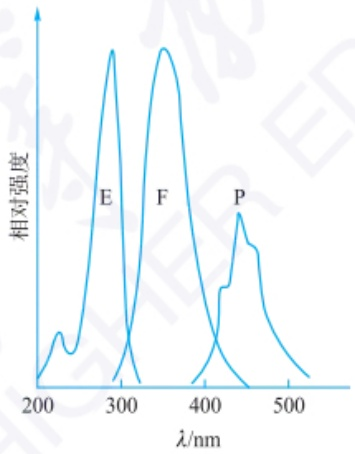

line

| Wavelength (nm) | E (Relative Intensity) | F (Relative Intensity) | P (Relative Intensity) |
| --- | --- | --- | --- |
| ~290 | Peak | — | — |
| ~350 | — | Peak | — |
| ~440 | — | — | Peak |

图 4.5.3 萘的激发光谱、荧光发射光谱和磷光发射光谱

荧光(磷光)的激发光谱和发射光谱之间存在以下关系,可通过 Jablonski 能级图进行理解。

（1）斯托克斯位移 一般而言，荧光发射光谱与对应的激发光谱相比，会产生红移，这是由于内转换、振动弛豫和溶剂效应等过程消耗了能量。最大发射波长和最大激发波长之间的差值，称为斯托克斯位移，因斯托克斯在1852年首次观察到该现象而得名。此外由于激发态三重态能量低于激发态单重态，同种物质的磷光光谱与荧光光谱相比，也会产生红移。

能量损失导致了斯托克斯位移产生,主要原因包括:激发态分子通过内转换和振动弛豫过程而迅速到达第一激发单重态的最低振动能级;荧光发射可能使激发态分子返回到基态的各个不同振动能级;激发态分子与溶剂分子的相互作用。

后来在大量的实验中,出现了很多例外。于是把发光谱线分为两类,符合上述关系的叫作斯托克斯线和斯托克斯位移;反之,称为反斯托克斯线和反斯托克斯位移。

斯托克斯位移大的荧光染料能够发射具有较长波长的荧光，能够更好地穿透生物组织，提供更准确的深层结构和功能成像，红移效应有助于减少组织和血液的自然荧光干扰，提高图像的对比度和清晰度。

## 分子结构对荧光的影响

（1）刚性平面结构和共平面效应

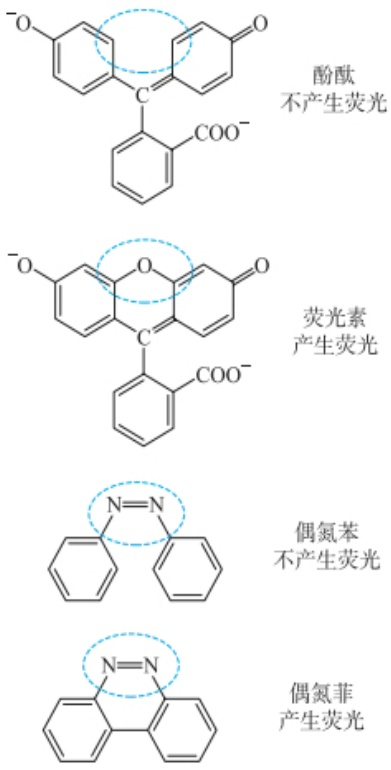

刚性平面结构的有机分子具有较强的荧光。

## 第一电子激发态吸收光谱与发射光谱镜像规则解释

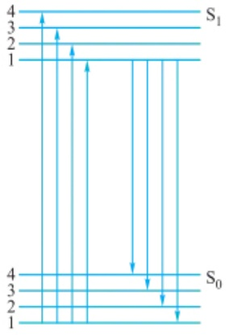

funnel

| Level | Value |
| --- | --- |
| 4 | ~3.5 |
| 3 | ~2.8 |
| 2 | ~2.0 |
| 1 | ~1.5 |
| 4 | ~4.0 |
| 3 | ~3.5 |
| 2 | ~2.5 |
| 1 | ~1.5 |

电子基态振动能级分布与第一电子激发态振动能级分布类似；基态零振动能级到第一激发态各振动能级间跃迁概率与激发态零振动能级到基态各振动能级间跃迁概率相近。

(2) pH 的影响

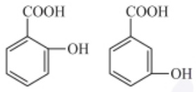

pH=5.5 时,邻羟基苯甲酸生成分子内氢键,增加了分子的刚性,具有较强的荧光,而间羟基苯甲酸无法形成分子内氢键则无荧光;

pH=12 时,邻羟基苯甲酸和间羟基苯甲酸都脱去两个质子,羧酸根离子的负电荷共轭能力增强,有利于荧光的产生,两者都具有较强荧光。

（2）发射光谱的形状与激发波长无关 荧光发射光谱的形状是由分子电子能级、振动能级和转动能级的能量状态决定的。分子吸收不同波长的能量，电子跃迁到不同激发态能级后，会通过振动弛豫和内转换等过程回到第一激发单重态的最低振动能级，再由此能级跃迁回基态各振动能级，产生荧光。因此通常情况下，荧光发射光谱的形状与激发波长无关。
（3）镜像规则 通常荧光发射光谱与它的吸收光谱(激发光谱)呈“镜像对称”关系,具体解释见副栏。

## 4.5.2.4 荧光与分子结构的关系

荧光是分子吸收光能后产生的,分子必须具有一定的化学结构才能吸收光能,因此荧光与物质的化学结构密切相关。以下内容将从四个方面讨论分子结构对荧光的影响。

（1）跃迁类型 分子电子能级跃迁类型不同，吸收激发光的摩尔吸收系数 $\varepsilon$ 有很大差别（参考紫外-可见光谱内容）。荧光很难通过 $\sigma \rightarrow \sigma^{*}$ 跃迁来激发产生，因为能量太高，容易使激发态分子发生解离，导致大多数分子的某些键发生断裂。荧光涉及的跃迁类型大多为 $\pi \rightarrow \pi^{*}$ 或者 $n \rightarrow \pi^{*}$ 激发，经历振动弛豫等去激发过程，再发生 $\pi^{*} \rightarrow \pi$ 或者 $\pi^{*} \rightarrow n$ 跃迁而发射荧光。通常由 $\pi \rightarrow \pi^{*}$ 激发产生的荧光，量子产率高于 $n \rightarrow \pi^{*}$ 跃迁激发产生的荧光。这是由于 $\pi \rightarrow \pi^{*}$ 跃迁的摩尔吸收系数是 $n \rightarrow \pi^{*}$ 跃迁的 $100 \sim 1000$ 倍，属于允许跃迁，而 $n \rightarrow \pi^{*}$ 是禁阻跃迁。$\pi \rightarrow \pi^{*}$ 跃迁的寿命（$10^{-9} \sim 10^{-7} s$）比 $n \rightarrow \pi^{*}$ 跃迁（$10^{-7} \sim 10^{-5} s$）短。此外，$\pi \rightarrow \pi^{*}$ 跃迁中，$S_{1}$ 和 $T_{1}$ 之间能级差较大，通过系间跨越到三重态的非辐射跃迁的速率常数也较小，有利于荧光发射。
（2）共轭效应 由于 $\pi \rightarrow \pi^{*}$ 跃迁有利于荧光发射，共轭效应能增加荧光物质的摩尔吸收系数，有利于产生更多激发态分子，从而有利于荧光的发生。实验结果表明，容易发生 $\pi \rightarrow \pi^{*}$ 跃迁的芳香族化合物更易于发射荧光，脂肪族化合物（除少数高度共轭体系化合物外）极少能产生荧光。体系的共轭度越大，则 $\pi$ 电子的离域性越大，荧光越容易产生，灵敏度和荧光效率也越大。一般而言，能够提高 $\pi$ 电子共轭度的结构，都能够提高荧光效率。例如，在多烯结构中，$\mathrm{Ph(CH=CH)_2Ph}$ 和 $\mathrm{Ph(CH=CH)_3Ph}$ 在苯中的荧光效率分别为0.28和0.68。
（3）刚性平面结构和共平面效应 一般而言，刚性平面结构的分子具有较强的荧光。这是由于刚性平面结构可以降低分子振动，减小分子与溶剂或其他溶质分子的相互作用，因此通过碰撞释放能量完成去活化过程的可能性较小，有利于发射荧光。例如，酚酞和荧光素的分子结构相似，但酚酞没有荧光，荧光素却有很强的荧光。这是由于荧光素分子中的氧桥使其具有刚性平面结构，因而具有很强的荧光（量子效率\~0.92）；而后者分子中没有氧桥不易保持平面构型，因此没有荧光。偶氮苯和偶氮菲之间荧光性质的不同也是由刚性平面结构决定的。
（4）取代基效应 芳香族化合物苯环上的取代基对体系共轭度的影响，导致了荧光性质的不同。如果取代基能增加分子的共轭度，则荧光增强；反之，则荧光减弱。通常，给电子基团（—OH、—NR₂、—OR、—NH₂等）与芳环之间的p-π共轭作用能增强体系π电子共轭程度，引起荧光增强。吸电子基团（—C=O、—NHCOCH₃、—NO₂、—CN、—COOH、卤素等）会降低体系共轭程度，使荧光减弱甚至猝灭。例如，苯酚和苯胺具有较强的荧光，而硝基苯没有荧光。对于卤素取代基而言，原子序数较高时，电子自旋和轨道运动之间相互作用大，使系间跨越至三重态的速率增大，导致荧光降低。因此卤素取代化合物的荧光随卤素原子序数的增大而减弱，磷光则随原子序数增大而增强。例如，氟苯、氯苯和溴苯的荧光量子产率分别为\~0.16、\~0.05和\~0.01，碘苯则没有荧光。此外，立体异构现象对荧光强度也有一定影响，例如，1,2-二苯乙烯的反式异构体具有很强荧光，而其顺式异构体没有荧光。取代基的空间位阻效应也可能对分子的平面性产生影响，导致荧光性质的变化。

## 4.5.2.5 荧光强度的环境影响因素

除分子结构因素外，分子的荧光也受到所处环境的直接影响，以下内容将从溶剂效应、温度和黏度、pH和荧光猝灭四个方面讨论荧光强度的环境影响因素。基于荧光强度的环境影响因素和选择性的认识，对实验条件进行合理选择，有利于提高荧光分析方法的灵敏度和选择性。

（1）溶剂效应 溶剂的极性、折射率和介电常数等性质，以及溶剂与荧光分子之间的化学作用都可能影响荧光强度。一般而言，溶剂极性增加，将使 $n\rightarrow\pi^{*}$ 跃迁的能量增大， $\pi\rightarrow\pi^{*}$ 跃迁的能量降低，引起荧光强度增加和波长红移。含重原子的溶剂（碘乙烷、四溴化碳等），由于轨道自旋相互作用使激发三重态形成的速率增加，导致荧光减弱、磷光增强。如果溶剂分子与荧光物质形成复合物，或者溶剂使荧光物质的电离状态发生改变，也可能导致荧光强度和光谱形状发生较大变化。
（2）温度和黏度的影响 一般而言，随着温度的降低，分子的荧光量子产率和荧光强度将增加。这是由于降低温度可以减弱激发态分子的振动弛豫和内转换过程，同时降低碰撞频率，增大荧光量子产率，并引起波长蓝移。例如，荧光素的乙醇溶液，在0℃以下每降低10℃，量子效率增加3%，当温度降到-80℃时，量子产率接近100%。因此，选择低温下检测荧光有利于提高分析灵敏度。增大介质黏度和降低温度对分子内部运动具有类似的降低作用，也有助于提高荧光量子产率。
（3）pH 的影响 含有酸性或碱性基团的化合物，由于存在酸性基团的解离和碱性基团的质子化作用，可能改变非辐射跃迁过程的性质和速率，因此 pH 的改变对于物质的荧光有很大影响。例如，邻羟基苯甲酸和间羟基苯甲酸在不同的 pH 条件下表现出不同的荧光性质。
（4）荧光猝灭 荧光分子与溶剂分子或其他溶质分子的相互作用引起荧光强度降低的现象称为荧光猝灭。这些能引起荧光强度降低的物质称为猝灭剂。引起荧光猝灭的原因很多，机理也很复杂。荧光猝灭的主要类型有动态猝灭、静态猝灭、共振能量转移、内滤作用和自猝灭。
（i）动态猝灭。猝灭过程发生于猝灭剂与发光物质激发态分子间的动态相互作用。被激发的荧光分子与猝灭剂发生碰撞，荧光分子以非辐射跃迁形式回到基态使荧光猝灭，并导致荧光寿命降低。动态猝灭与分子扩散有关，一般而言，温度升高猝灭作用增加，黏度增大猝灭作用减小。溶液中的氧是最常见的猝灭剂，这可能是由于顺磁性的氧分子与处于单重激发态的荧光物质相互作用，促使形成顺磁性的三重态荧光分子，加速荧光物质激发态分子系间跨越跃迁，导致荧光猝灭。在较严格的荧光实验中，一般需要进行除氧。
（ii）静态猝灭。猝灭过程发生于猝灭剂与发光物质基态分子间的相互作用。荧光分子与猝灭剂形成稳定的、不发荧光的基态配合物使荧光猝灭，静态猝灭只是减少荧光分子数目，不改变荧光寿命。温度升高可能引起配合物稳定常数降低，从而减小静态猝灭的程度。

发光的水母

## 紫外-可见吸收分析中吸光度和浓度成正比，荧光分析中荧光强度也是和浓度成正比，哪种方法的灵敏度更高？

在紫外-可见吸收分析中,紫外吸收的检测器与入射光是在一条直线上的,容易受到入射光的干扰。 $A=\lg(I_{0}/I_{1})$ ,当浓度很低时,吸收微弱, $I_{t}$ 和 $I_{0}$ 非常接近,检测器难以区分两个较大信号之间的微小差别。

而荧光分析中,荧光检测器与入射光成直角(如下图所示),基本不受入射光影响,噪声背景比较低,所以能够检测到更低浓度的物质。

因此，荧光分析法的灵敏度一般要比紫外-可见分析法的灵敏度高。

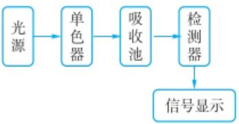

flowchart

紫外-可见分光光度计结构图

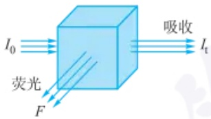

text_image

I₀
荧光
F
吸收
Iₜ

吸收光谱与荧光光谱检测光路方向示意图

## 荧光认知与仪器发展历史

1845 年, John Frederick willam Herschel 观察到奎宁溶液在太阳光下发出天蓝色光芒, 他认为是一种未被发现的新现象。进一步用棱镜对白光分光, 用不同颜色的光分别照射奎宁溶液, 发现只有在光谱的蓝端照射下才能观察到溶液的发射光, 而红端照射时没有这种现象。溶液的发射光再次用棱镜进行分光, 发现发射光有蓝色、绿色和少量的黄色光。但他没有注意到发射光的波长比入射光的波长长。

（iii）Förster共振能量转移(Förster resonance energy transfer, FRET)。最早由Theodor Förster提出，是一种基于供体与受体分子之间偶极-偶极相互作用的非辐射能量转移过程。当供体分子在光激发下进入激发态时，其能量可以通过非辐射方式高效地转移给相邻的基态受体分子。若供体和受体均为荧光团，该过程通常可称为“Fluorescence resonance energy transfer”，即荧光共振能量转移。FRET过程发生需要满足三个基本条件:(a) 供体和受体分子之间的距离在1\~10 nm范围，随着距离的增加，能量转移呈显著减弱，能量转移效率(E)与供体受体距离(R)之间的关系可用下式表示:

$$
E = \frac {1}{1 + \left(\frac {R}{R _ {0}}\right) ^ {6}} \tag {4-5-4}
$$

其中， $R_{0}$  表示 Förster 距离，为能量传递达到 50% 的距离。（b）合适的供体和受体分子:供体分子必须能够吸收激发光并发射荧光，而受体分子必须能够有效地吸收供体分子发射的荧光光子。（c）合适的供体-受体光谱重叠:供体分子的发射光谱与受体分子的吸收光谱必须有一定的重叠，以确保能量可以从供体转移到受体。由于 FRET 的有效距离与生物大分子（如蛋白质、核酸分子等）的尺寸相似，因此可以作为有效的工具来研究生物大分子之间的相互作用。随着荧光蛋白应用技术的发展，FRET 被用于观察细胞及生物体内实时的蛋白质之间的复杂的相互作用，已经成为细胞及活体中蛋白研究的重要工具和方法。例如，通过 FRET 技术可以获得单个蛋白及蛋白分子之间作用距离和方向、能量传递效率等信息，对于理解蛋白折叠、蛋白分子定位、蛋白分子聚合体、转录机制等生物学问题有着重要作用。

（iv）内滤作用。当溶液中存在能吸收荧光物质的激发光或发射光的物质时，会使体系的荧光减弱，这就是内滤作用。如果荧光物质的荧光发射光谱和吸收光谱有重叠，浓度较大时，部分基态分子将吸收体系发射的荧光，使荧光降低，这种现象称为自吸，也是一种内滤作用。
（v）浓度自猝灭。当荧光物质浓度较高时，激发态分子与基态荧光分子之间的碰撞频率增加，或由于基态分子对激发光或发射光产生自吸收，都会导致荧光猝灭，表现为荧光强度随浓度升高而降低。

## 4.5.2.6 荧光强度与物质浓度的定量关系

由光吸收定律可以推导得出,在一定浓度范围内,荧光强度与荧光物质的浓度成正比,这是荧光定量分析的基础,实际工作中常使用内标法或标准曲线法进行定量分析。这种线性关系只在稀溶液中才成立,对于较高浓度的溶液,由于自吸收和猝灭等因素的影响,荧光强度与浓度之间的关系偏离线性关系。

根据光吸收的朗伯-比尔定律,吸光度与物质的浓度成正比:

$$
A = - \lg T = - \lg \frac {I _ {\mathrm{t}}}{I _ {0}} = \varepsilon b c \tag {4-5-5}
$$

可以推导出:

$$
T = \mathrm{e} ^ {- 2. 3 0 3 g b c} \tag {4-5-6}
$$

$$
1 - \frac {I _ {\mathrm{t}}}{I _ {0}} = 1 - T = 1 - \mathrm{e} ^ {- 2. 3 0 3 \varepsilon b c} \tag {4-5-7}
$$

$$
I _ {0} - I _ {\mathrm{t}} = I _ {0} (1 - \mathrm{e} ^ {- 2. 3 0 3 e b c}) \tag {4-5-8}
$$

不考虑其他光损失的情况下,入射光减去透射光 $(I_{0}-I_{1})$ 等于物质吸收的光,由荧

光量子产率等于物质吸收光能后发射的光子数与吸收的激发光光子数之比可知:

$$
\Phi = \frac {I _ {\mathrm{F}}}{I _ {0} - I _ {\mathrm{t}}} \tag {4-5-9}
$$

将式(4-5-8)代入式(4-5-9)可得到荧光强度 $I_{F}$ 的表达式:

$$
I _ {\mathrm{F}} = \Phi (I _ {0} - I _ {\mathrm{t}}) = \Phi I _ {0} (1 - \mathrm{e} ^ {- 2. 3 0 3 \varepsilon b c}) \tag {4-5-10}
$$

将指数函数按照级数展开:

$$
\mathrm{e} ^ {x} = 1 + \frac {x}{1 !} + \frac {x ^ {2}}{2 !} + \frac {x ^ {3}}{3 !} + \frac {x ^ {4}}{4 !} + \dots + \frac {x ^ {n}}{n !} \tag {4-5-11}
$$

可进一步将荧光强度 $I_{\mathrm{F}}$ 表达为

$$
I _ {\mathrm{F}} = \Phi I _ {0} \left[ 2. 3 0 \varepsilon b c - \frac {(- 2 . 3 0 \varepsilon b c) ^ {2}}{2 !} + \frac {(- 2 . 3 0 \varepsilon b c) ^ {3}}{3 !} - \frac {(- 2 . 3 0 \varepsilon b c) ^ {4}}{4 !} + \dots \right] \tag {4-5-12}
$$

对于稀溶液, 当  $\varepsilon bc < 0.05$  时, 上式可近似表达为

$$
I _ {\mathrm{F}} = 2. 3 0 \Phi I _ {0} \varepsilon b c \tag {4-5-13}
$$

式中， $I_{F}$  表示荧光强度， $\Phi$  表示荧光量子产率， $I_{0}$  表示入射光强度， $\varepsilon$  表示物质在某个波长的摩尔吸收系数，b 表示吸收光程，c 表示物质的物质的量浓度。

## 4.5.3 荧光分析法及其应用

## 4.5.3.1 荧光分析仪器

1952年开始出现了商品化校正光谱仪器用于荧光分析，近几十年来，随着激光、微处理机等新技术的引入，荧光仪器得到迅猛发展，不断研制出了各种功能新颖的荧光分析仪器，从最初的手控式荧光分光光度计发展到自动记录式荧光分光光度计，再到由计算机控制的荧光分光光度计；从最初的未校正光谱到带可校正光谱的荧光分析仪。分析工作者只需将处理好的样品放进荧光分光光度计内，即可得到所需的谱图及数据，操作更加方便。仪器制作上的这些革新，方便了分析工作者，也促进了荧光分析法的更快发展。常用的荧光测定仪器是荧光分光光度计，一般由光源、单色器、样品池、检测器及数据记录系统组成。仪器的基本构造如图4.5.4所示。由光源发出的光经过单色器后得到所需要的激发光波长，照射到样品池上激发荧光物质产生荧光，为消除入射光及散射光的影响，荧光的测量方向通常与激发光成 $90^{\circ}$ 。荧光通过第二个单色器分光后进入检测器被检测。第二个单色器的作用是消除溶液中可能存在的其他波长光的干扰。

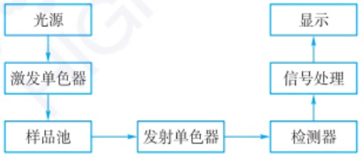

flowchart

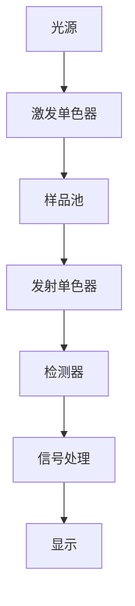

图 4.5.4 荧光分光光度计结构图

（1）光源 高压氙灯是目前荧光分光光度计中应用最为广泛的一种光源，它是一种连续光源，能在 $400\sim 800\mathrm{nm}$ 波长范围提供连续的光输出。此外，发光二极管或者激光二极管也可作为光源，这类光源轻便、所需能量较少，产生的热量很少。发光二极管属于连续光源，但限于小范围光谱区的输出，而激光二极管则属于单色光源。激光是一种能量集中、具有良好单色性的光源，能够极大提高荧光

1852 年, Stokes 用自制的分光计观察到荧光波长比激发波长稍长, 提出“荧光”这一术语, 指出荧光是光发射现象, 而不是光的漫射所引起的。

1928 年 Jette 和 West, 共同研制了世界上第一台光电荧光计。

1948 年, Studer 推出了第一台自动光谱校正装置。

1952 年出现商品化校正荧光光谱仪器。

Herschel 观察到的奎宁溶液荧光现象

## 荧光分析应用实例

维生素  $B_{2}$  也称核黄素，微溶于水，是人体必需维生素。当缺乏维生素  $B_{2}$  时，可影响机体的生物氧化，使代谢发生障碍，人就会得口角炎、唇炎、舌炎等。

维生素  $B_{2}$  分子结构中存在共轭结构给电子基团，在 430\~440 nm 蓝光的照射下，会发出绿色荧光，荧光峰在 535 nm 附近。维生素  $B_{2}$  在 pH 6\~7 的溶液中荧光强度最大。稀溶液时，其荧光强度与维生素  $B_{2}$  溶液浓度呈线性关系。因此，可以用荧光光谱法测定维生素  $B_{2}$  的含量。

临床上常利用维生素 $B_{2}$ 的荧光特性测定血液中维生素 $B_{2}$ 的含量，工业上也利用该性质测定多种复杂样品中维生素 $B_{2}$ 的含量。

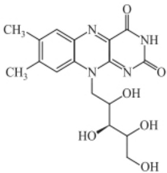

chemical

Molecular structure of a quinazoline derivative with methoxy and hydroxy substituents

维生素 $\mathrm{B}_2$ 的分子结构