## 磷光检测附件

在荧光分光光度计上配上磷光测量附件即可对磷光进行测量。在有荧光发射的同时测量磷光。磷光附件包括:

1. 液槽:为了实现在低温下测量磷光,需将样品溶液放置在盛液氮的石英杜瓦瓶内。
2. 磷光镜: 有些物质能同时产生荧光和磷光, 为了能在荧光发射的情况下测定磷光, 通常必须在激发单色器与液槽之间及在液槽和发射单色器之间各装一个磷光镜, 并由一个同步电动机带动。

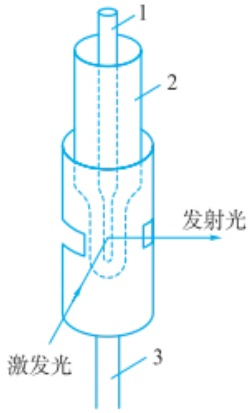

text_image

1
2
发射光
激发光
3

(a)

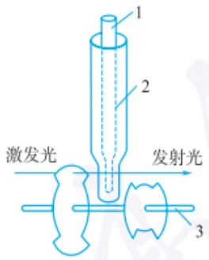

text_image

1
2
激发光
发射光
3

(b)

1—样品池；2—杜瓦瓶；3—电机轴转筒式磷光镜(a)和转盘式磷光镜(b)

测量方法:

（1）通常借助于荧光和磷光寿命的差别，采用磷光镜装置将荧光切除。室温测量时不需要杜瓦瓶。此装置只能测量寿命几毫秒以上的磷光。
（2）荧光和磷光的分辨现在多采用脉冲光源和可控检测及时间分辨技术，所测磷光寿命可以短至微秒级别，无需磷光镜装置。

检测的灵敏度。激光诱导荧光检测技术已经实现了单分子检测，从而使荧光分析具有更为广阔的应用。

（2）单色器 单色器是用于将复合光分解成单色光的光学系统，其作用是对波长进行选择，包括对激发波长和发射波长的选择。单色器的核心是色散元件，包括光栅、棱镜和滤光片等。除色散元件外，单色器的光学系统通常还包括入射狭缝、出射狭缝、准直装置和聚焦装置。
(3) 样品池 荧光检测的样品池通常采用四面透光的方形石英池。
现代荧光光谱仪广泛采用光电倍增管作为检测器。PMT的结构及工作原理详见本章4.1节及图4.1.7。
（4）数据记录系统。目前商品化的荧光光度计都由计算机控制，并配有相应的软件。

## 4.5.3.2 荧光分析方法的特点和应用

荧光分析是光化学分析中最为灵敏的分析方法之一，它比紫外-可见吸光光度法的灵敏度要高2\~4个数量级，检测下限为 $0.001\sim0.1\ \mu g\cdot mL^{-1}$ 。其主要原因在于，在紫外-可见吸光光度法中，被测定的信号为 $A=-\lg(I_{t}/I_{0})$ ，当样品浓度很低时，检测器难以区分两个较大信号（入射光 $I_{0}$ 和出射光 $I_{t}$ ）之间的微小差别，而荧光分析检测的是叠加在很小背景上的发射光强度，所以能够检测到更低浓度的物质。通过使用高灵敏的光学系统和先进的荧光探针，可以实现单分子荧光检测，对单个分子的行为进行研究。

由荧光强度的定量关系可知,对于在一定浓度范围,发射的荧光强度与物质的浓度成正比,由此可利用荧光分析法进行定量检测。对于单组分的测量,同吸光光度法一样,常采用校正曲线法。对于较少的样品,有时也采用比较法。

荧光分析法已广泛应用于无机和有机化合物及生物分子的分析中，在生物化学、药物学、临床化学等领域有着广泛的应用。若待测物质本身具有荧光，则可通过直接测量其荧光强度来测定该物质的浓度。芳香族化合物具有大的共轭结构，大多能产生荧光，可以直接进行荧光测定。大多数无机和有机化合物本身没有荧光，或发出的荧光很弱，不能直接测定，这时可采用间接法进行测定。间接测定有荧光猝灭法和荧光衍生法可供选择。荧光猝灭法是指分子本身没有荧光，但可使某荧光物质的荧光产生猝灭，通过测量该荧光物质荧光强度的降低可间接测定该分析物。例如，在硫酸介质中，亚硝酸根可以将吡咯红Y氧化，使其荧光猝灭，以此可以测定电厂废水、自来水、井水中亚硝酸根含量。荧光衍生法是指将本身没有荧光的分析物通过不同的衍生手段（化学反应、电化学反应、光化学反应）转变为有荧光的物质，再通过测量该物质的荧光强度间接测定分析物的方法。无机化合物自身产生荧光并用于测定的种类不多，利用与有机试剂形成配合物后进行荧光分析的元素已达60余种。脂肪族有机化合物分子结构比较简单，本身极少能产生荧光，只有与其他化合物作用后才能产生荧光。

## 4.5.4 磷光分析法及其应用

## 4.5.4.1 磷光分析仪器

磷光与荧光都是光致发光，因此检测仪器在结构上有较为相似的地方。磷光分析仪由光源、样品池、单色器和检测器组成。如果样品只发磷光，则可在荧光分光光度计上直接测定。如果样品发磷光的同时也存在荧光干扰，则可通过荧光与磷光寿命的不同实现区分。通常需要在荧光分光光度计上配上磷光检测附件将荧光隔开。该附件是一种机械装置，称为磷光镜，磷光镜的形式多样，但其作用原理相似，都是通过机械传动使激发光被切断，由于荧光寿命短而磷光寿命长，因此只有磷光能够被检测到。常见的有转筒式和转盘式磷光镜。

磷光的测量有低温和室温两种方式。两者的样品池具有不同的结构。低温磷光测定一般是通过液氮实现的，样品池为内径为1\~3 mm的石英细管，插入盛有液氮的杜瓦瓶。室温磷光检测固体时需要特定的样品室，通过载体将样品固定，再将载体吸附到玻璃载片上，放入样品室进行测定。

## 4.5.4.2 磷光的测定方法及其应用

磷光的产生是由激发单重态 $\left(\mathrm{S}_{1}\right)$ 经系间跨越跃迁到激发三重态 $\left(\mathrm{T}_{1}\right)$ ，然后由激发三重态回到基态 $\left(\mathrm{S}_{0}\right)$ 。从 $T_{1}\rightarrow S_{0}$ 的跃迁属于量子力学上的自旋禁阻跃迁，因此磷光容易受到其他辐射或者无辐射跃迁干扰，使得磷光减弱，甚至得不到磷光。为了得到较强磷光，需要采取一定措施增强从 $S_{0}\rightarrow T_{1}$ 的系间跨越效率和降低无辐射跃迁的概率。常用的措施如下:

（1）低温磷光 在低温下测量磷光增加样品分子的刚性，减小激发态分子与溶剂分子之间发生碰撞完成去活化的概率。液氮的沸点为-196℃（77K），可以使体系温度降到极低并保持稳定，常用作低温磷光的冷却剂。因此溶剂的选择不仅要对分析的样本具有良好的溶解能力，还要在77K的低温下具有足够的黏度以能形成透明的刚性玻璃体。可以将被测样品溶于乙醚或异戊醇中，在液氮条件下冷冻至玻璃状再进行磷光测定。二乙醚、异戊烷和乙醇按照5:5:2体积比进行混合也常用于低温荧光测量，此溶剂简称为EPA混合溶剂。
（2）室温磷光 低温磷光测定需要低温实验装置，同时对溶剂的选择也有一定限制。室温磷光法在一定程度上能解决这些问题。
(i) 固体磷光法。通过将分析物吸附在固相载体上, 可以减小分子的运动, 降低与环境分子的碰撞概率。理想的载体应该没有自发荧光背景, 同时又能将待测分子束缚在固相载体中增强磷光。常用的载体有乙酸钠、聚合物、纤维素膜、滤纸、硅胶、玻璃纤维等。
（ii）胶束溶液磷光法。利用溶液中加入表面活性剂与待测分子物形成胶束缔合物的方法，可以起到与固相载体类似的作用。形成的胶束可以改变磷光分子的微环境并增加其刚性，减小由于碰撞引起的能量损失，增加三重态的稳定性，实现室温下的磷光测定。环糊精由于具有疏水空腔结构，与空腔大小适配的分子能取代空腔中的水形成稳定的包含缔合物，也可用于胶束溶液磷光的测定。
（iii）重原子诱导系间跨越。使用含有重原子的溶剂，有利于诱导分子吸收能量跃迁到激发态单重态后，转移到激发态三重态的系间跨越 $\left(\mathrm{S}_{1}\rightarrow\mathrm{T}_{1}\right)$ ，增强磷光。重原子效应可以和胶束结合进行室温磷光分析。例如，表面活性剂十二烷基硫酸盐和铊离子 $\left(\mathrm{Tl}^{+}\right)$ 或铅离子 $\left(\mathrm{Pb}^{2+}\right)$ 等重原子离子同时使用，并通过除去溶液中的猝灭剂氧气，可用于水溶液中低浓度萘、芘和联苯的室温磷光检测，测定浓度可达到 $10^{-7}\sim10^{-6}mol\cdot L^{-1}$ 。由于铊盐和铅盐具有较高的毒性，现已不再使用，通常改用其他低毒或无毒的重原子化合物来增强磷光。
（iv）敏化磷光。敏化磷光是一种基于能量转移的磷光分析法，可用于溶液的室温磷光检测。敏化磷光产生的机理与荧光共振能量转移类似，本身无磷光的分析物(供体)被激发到单重态后，能量转移到另一种物质(受体)的激发三重态。受体分子从激发三重态跃迁回基态时，发射磷光(图4.5.5)。

磷光分析应用实例低温磷光在药物分析中的应用

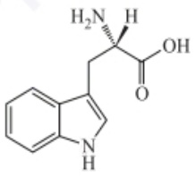

chemical

Chemical structure of a quinolinone derivative with hydroxyl and methyl substituents

色氨酸，是一种人体必需氨基酸，且不可以自身合成，需要从外界食物中获取，其代谢在情绪、免疫、生长等方面发挥关键作用，更成为多种疾病的治疗靶点。体内色氨酸含量的多少能够体现人体健康情况，如肝癌、肾功能衰竭及神经内分泌失调等，因此对血液中色氨酸成分进行分析具有重要意义。

氨基酸分子结构具有多样性，大多数氨基酸无法产生磷光。色氨酸、酪氨酸和苯丙氨酸等含有共轭双键的分子能发出磷光，特别是色氨酸，磷光强度显著且寿命较长。因此，利用磷光分析法检测色氨酸，能够有效排除生物样本中其他氨基酸及其他杂质的干扰。比如，在定性分析的过程中，可以根据化合物磷光寿命的差异，巧妙地运用磷光镜分析法进行区分。基于磷光寿命变化情况建立新型低温磷光分析法，不仅能够有效分析血液中的游离氨基酸，更能精确测定生物样品与组织中的色氨酸含量。

## 分子信标

1996 年 S.Tyaji 和 F.R.kramer 提出了“分子信标”概念。

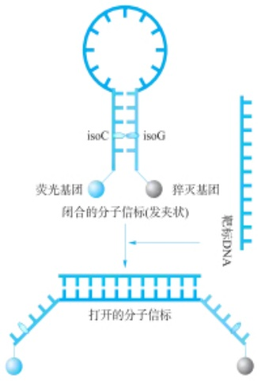

flowchart

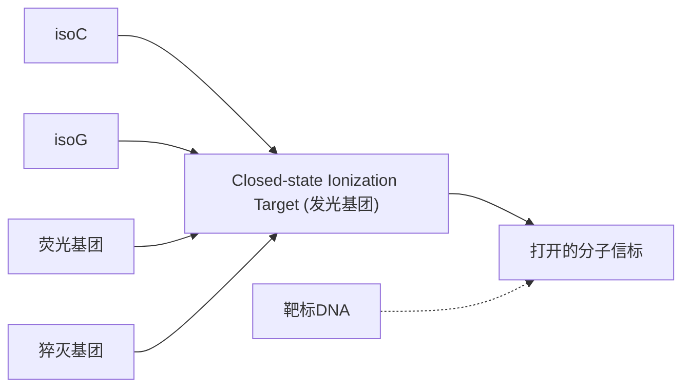

以分子信标作为识别元件,通过碱基互补配对原则识别并结合肿瘤高表达 RNA,激活荧光信号,从而达到检测肿瘤基因的目的,为癌症的早期精准诊断提供检测工具。

## 小分子荧光探针

小分子荧光探针可对特定刺激（如 pH）、特定小分子（如 NO）、金属离子（如  $Cd^{2+}$ ）或生物活性分子（如酶）产生荧光响应信号。

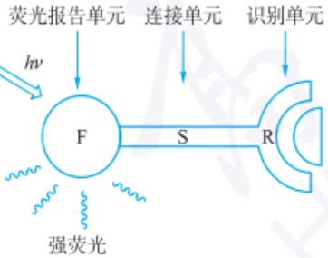

flowchart

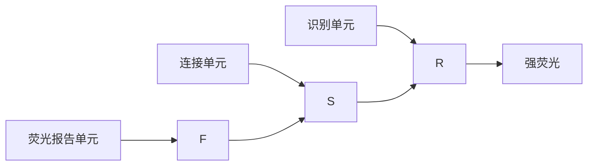

脂肪酸酰胺水解酶(FAAH)是治疗抑郁症、帕金森病、阿尔茨海默病等神经退行性疾病的重要药物靶点。因此，通过构建FAAH响应的荧光探针可用于筛选FAAH的抑制剂，作为治疗神经退行性疾病的潜在候选药物。

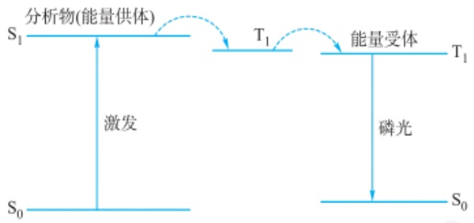

flowchart

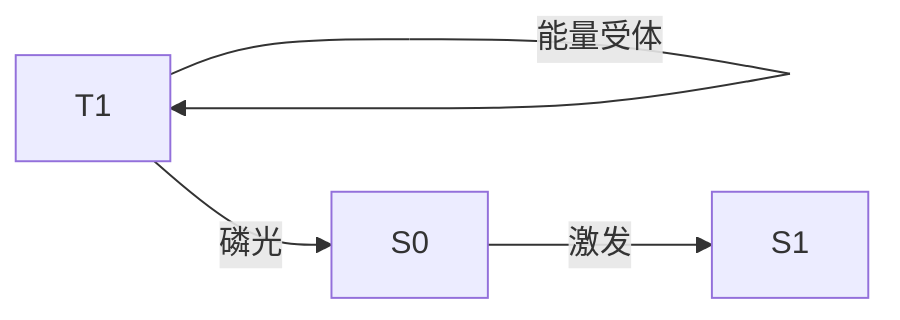

图 4.5.5 敏化磷光跃迁示意图

## 4.5.5 光学传感与生物分析应用

## 4.5.5.1 光学生物传感器

光学生物传感器利用分子识别元件与靶标相互作用产生的光学信号(荧光、磷光、颜色、折射率等)变化,实现靶标定性或定量分析。分子识别是指不同分子通过结构和化学互补性(形状、电荷、氢键及疏水作用等)实现特异性相互作用的现象,常用的分子识别元件包括酶、抗体、抗原、核酸、蛋白质等生物活性物质。光学生物传感器检测技术的工作原理如图4.5.6所示。

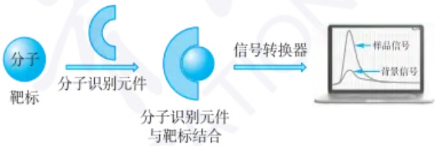

flowchart

图 4.5.6 光学生物传感器检测技术的工作原理示意图

由于光学分析法具有非破坏性和高灵敏度的特点,光学生物传感器在生物活性物质检测方面具有广泛应用。可以根据不同的光学原理构建不同类型的光化学传感器,例如,通过荧光信号变化构建荧光传感器,通过酶催化显色构建酶联免疫检测法等。

## 4.5.5.2 光学生物传感在生物分析中的应用

相比于传统的检测手段,光学生物传感器在生物分析中具有更高的灵敏度、更快的响应、更优的选择性、更低的成本等优势,有些还能在复杂体系中进行实时、原位、在线、连续监测,在疾病诊断和药物研发等生物分析领域获得了广泛的应用。

在疾病诊断方面，相比于正常组织和器官，病灶区某些生物功能分子比如核酸、酶和抗原等的表达含量和生理活性常出现异常，可作为疾病发生发展的标志物与临床诊断依据。因此，研究人员可通过构建荧光生物传感器检测疾病标志物，达到诊断疾病的目的。检测肿瘤时，在生物识别分子上标记荧光分子，并使之保持在暗态。当识别分子与肿瘤标志物相结合时，在光源激发下将产生特定的荧光信号，即荧光亮度将随着疾病标志物浓度的增加而相应地增加，以此实现早期疾病诊断。例如，分子信标是一种基于荧光共振能量转移现象设计的含有发夹型寡聚核苷酸的核酸检测探针。分子信标的两端标记有荧光团和猝灭团，二者因茎部配对杂交而相互靠近，发生荧光共振能量转移，荧光团的荧光被猝灭。当分子信标与目标序列（如特定RNA或DNA）互补配对时，发夹结构打开，荧光团与猝灭团远离，从而恢复荧光信号。这种荧光信号的变化使得分子信标成为一种高度敏感和特异性的生物传感工具。基于比色的光学生物传感器，其原理是利用被测物质与探测试剂反应后产生的颜色变化来进行检测。以检测葡萄糖为例，可以利用葡萄糖氧化酶催化葡萄糖产生过氧化氢，过氧化氢再与特定的显色剂反应生成有色物质，通过测量该有色物质的吸光度即可实现对葡萄糖浓度的检测。这种比色传感器具有操作简便、成本低等优点，适用于现场快速检测。

在药物研发方面，研究人员可以利用药物对功能酶的抑制作用，通过构建酶的荧光生物传感探针来间接实现药物筛选。这种探针的构建需要在荧光分子上连接酶的特异性底物并使其不发荧光，当探针识别酶并与其作用时，可发出强烈的荧光信号。然而，药物对酶的抑制作用会使荧光信号减弱。因此，通过这种荧光信号变化所反映的药物与特定酶的结合情况及药物的有效性，即可实现对药物的筛选。此外，通过对药物进行荧光标记，结合荧光分析技术，观察药物在活体内的吸收、分布、代谢和排泄等过程，可以研究药物的代谢动力学。研究人员还可利用荧光生物传感技术研究药物与蛋白质、DNA等分子间的相互作用，从而验证药物的作用机制和安全性等。近年来，智能手机因其便携性和强大的图像处理能力，被广泛应用于光学生物传感领域，尤其是在现场快速诊断（POCT）中。通过智能手机的颜色识别功能，可以实现对生物标志物的快速、定量检测。例如，研究人员开发了一种基于智能手机的比色生物传感器，用于检测尿液中的黄嘌呤和肌氨酸等生物标志物。该系统利用纸基酶联生物传感器，通过智能手机摄像头捕获比色变化，并通过图像处理算法进行定量分析。这种方法不仅操作简便，而且成本低廉，适合在资源有限的环境中使用。

## - 章节练习题 -

1. 简述分子发光分析法的定义及主要类型。
2. 对比说明荧光和磷光的异同点。
3. 在光致发光过程中, 不同分子去激发过程的时间尺度有何差异?

## - 挑战性问题 -

4. 荧光量子产率是评价荧光材料发光效率的重要参数。温度作为一个普适的环境因素，可显著影响荧光体的发光性能。深入理解温度对荧光量子产率的调控机制，有助于发展高效、稳定的荧光材料，拓展其在传感、显示等领域的应用。请设计实验，探究温度对某种荧光分子（如罗丹明 B）量子产率的影响，要求对实验中的关键参数进行优化，并尝试从理论上解释温度效应的机制。
5. 痕量药物分析是药学及临床医学研究中的重要课题。荧光法具有灵敏度高、选择性好、仪器简单等特点，在药物分析领域具有广阔的应用前景。请查阅文献资料，针对某种痕量药物（如抗肿瘤药物、抗生素等），设计可能的荧光检测方案，并与其他分析方法（如色谱、质谱等）的性能进行比较。

## -专题和报告-

6. 环境污染日益严重,对人类健康和生态环境构成巨大威胁。发展快速、灵敏、实用的污染物检测方法是环境监测和治理的关键。荧光光谱法具有检测限低、选择性高、操作简便等特点,在环境分析领域具有重要应用。请针对当前环境

## 化学发光发展历史

公元前384—322年Aristotle在《De Anima》一书中描述了真菌类和死鱼的发光现象。

1668 年 Robert Boyle 证实生物发光需要氧气的参与。

19 世纪 80 年代末 Raphael Dubois 提取荧光素酶和荧光素。

1877 年 Bronisław Leonard Radziszewski 发现洛芬碱在碱性介质中被过氧化氢等试剂氧化发光出绿色的光。

1888 年 Eilhard Wiedemann 首次提出了化学发光的概念。

1928年H.O.Albrecht观察到鲁米诺在碱性介质中的化学发光行为。

1935 年 Karl Gleu 和 Werner Petsch 第一次报道了光泽精与过氧化氢反应产生化学发光现象。

1977 年 Halman 将化学反应系统与免疫系统相结合创建了化学发光免疫分析法。

电致化学发光的研究进展和仪器

## 电致化学发光

电致化学发光(ECL)是一种由外加电位在电极表面的电化学反应引发的化学发光。

(1) 湮灭型 ECL

仅需要发光体 R, 给电极施加正负双向电位, 使发光体通过电化学氧化反应和电化学还原反应生成高反应活性中间体而产生 ECL 现象。反应示意如下:

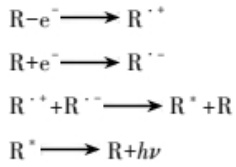

chemical

Reaction equations showing electron transfer and radical conversion to form R* and R+Hν

分析的热点问题(如持久性有机污染物、重金属、药物残留等)，调研基于荧光法的环境污染物检测方法，评述其优缺点，并对今后的发展方向提出你的看法，并与同学分享你的结果。

7. 荧光生物探针是利用荧光技术对生物体系进行示踪、成像和检测的重要工具。合理设计荧光探针，对特异性识别生物分子、揭示生命过程的机制、指导疾病诊疗具有重要意义。请总结荧光生物探针的基本类型和设计原理，并以某一具体分析对象为例（如金属离子、活性氧等），调研并归纳近年来所发展的荧光探针。

## 4.6 化学发光与生物发光分析法

本节将阐述化学发光与生物发光的基本概念和基本原理,列举多种典型的化学发光和生物发光的体系,并对其应用及最新研究进展进行了简单介绍。

## 4.6.1 化学发光和生物发光现象及相关分析法

化学发光(chemiluminescence, CL)是由特定的化学反应产生的一种发光现象。人们对于化学发光的认识来源于自然界普遍存在的生物体发光现象。古代就有关于“海火”(海洋中生物发光)的记载，后来越来越多的发光生物体如发光细菌、萤火虫和甲虫等被发现。这种生物体内发光和有酶参与的化学反应产生的发光现象称为生物发光(bioluminescence, BL)。从化学反应的本质看，生物发光属于化学发光的一种，是活生物体中产生的光和发射现象。生物发光可以在许多生物中发现，陆生生物如萤火虫，海洋生物如水母、甲壳和软体动物类海洋生物。

虽然生物发光的发现可追溯到古代，但无酶催化的化学发光研究则开始于近代。化学发光与电化学结合，产生了电致化学发光技术(electrogenerate chemiluminescence, ECL)；化学发光与特异性的免疫反应相结合，产生了目前临床广泛应用的化学发光免疫分析(chemiluminescence immunoassay)。基于化学发光和生物发光建立起来的分析检测方法，具有优异的灵敏度和选择性，已经在分析化学、环境分析、药物分析和临床检测等领域得到广泛的应用。

化学发光分析一般具有以下特点:

（1）化学发光分析法十分灵敏，检出限低，其灵敏度可达 $10^{-15}\ mol\cdot L^{-1}$ ;
(2) 线性范围宽, 可以满足较宽范围的定量测定需求;
(3) 操作简便,易于实现自动化;
(4) 反应速率快,有利于实现临床的快速检测;
（5）易与其他分析方法联合使用，包括流动注射技术、高效液相色谱、毛细管电泳及生化免疫技术等，实现多种待测物的同时检测。
(6) 应用范围广, 在环境、生物、化学和医学等领域已经得到广泛应用。

## 4.6.2 化学发光的基本原理

广义的化学发光按照反应的供能方式不同可以分为无酶催化化学发光、生物发光和电致化学发光等。化学反应、电化学反应或生物化学反应等能够在氧化还原过程释放能量，使体系中的发光底物从基态跃迁到激发态，然后激发态产物以光辐射的方式辐射跃迁回到较低能态释放出能量，从而在近紫外至近红外波长范围内产生光信号，即产生为化学发光。激发态和较低能态之能量差:

$$
\Delta E = h \nu \tag {4-6-1}
$$

式中，h 为普朗克常量， $\nu$  为光的频率。

根据化学能转换机制的不同,化学发光一般可分为直接化学发光和间接化学发光两种类型。

第一类,如图 4.6.1 所示,当物种 A 与物种 B 发生化学发光反应时,生成一部分产物和电子激发态 C $^{*}$ ,接着 C $^{*}$  以辐射跃迁的方式回到基态产物 C 并释放光子。

$$
\mathrm{A+B} \longrightarrow \mathrm {C^ {*} +产物} \tag {4-6-2}
$$

$$
\mathrm{C} ^ {*} \longrightarrow \mathrm{C} + h \nu \tag {4-6-3}
$$

第二类,如图 4.6.2 所示,激发态的中间体( $C^{*}$ )将能量转移给合适的荧光物质,荧光物质跃迁到激发态,以光辐射的方式回到基态。

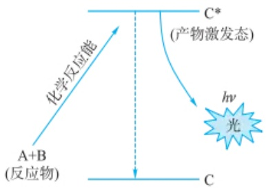

flowchart

图 4.6.1 直接化学发光示意图

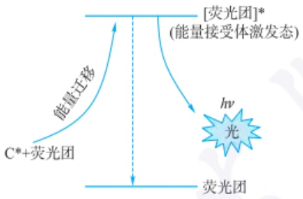

flowchart

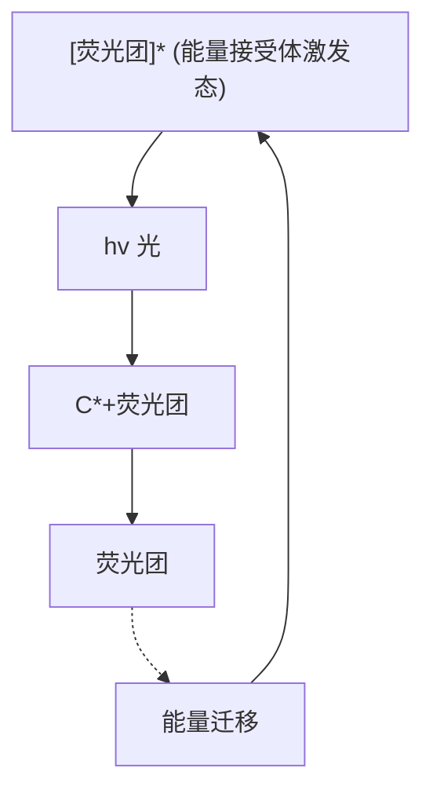

图 4.6.2 间接化学发光示意图

$$
\mathrm{A+B} \longrightarrow \mathrm{C} ^ {*} + \text {产物} \tag {4-6-4}
$$

$$
\mathrm{C} ^ {*} + \text {荧光团} \longrightarrow [ \text {荧光团} ] ^ {*} + \mathrm{C} \tag {4-6-5}
$$

$$
[ \text {荧光团} ] ^ {*} \longrightarrow \text {荧光团} + h \nu \tag {4-6-6}
$$

大部分体系化学发光强度 $(I_{\mathrm{CL}})$ 最初随着反应物浓度(c)的减小而增加，随后随着时间而降低，其典型的反应动力学如图4.6.3所示。对应某个时间的化学发光强度受到化学反应的速率 $(\mathrm{dc}/\mathrm{dt})$ 和化学发光量子产率 $(\Phi_{\mathrm{CL}})$ 的影响。化学发光量子产率 $(\Phi_{\mathrm{CL}})$ 等于体系激发量子产率 $(\Phi_{\mathrm{EX}})$ 和发射量子产率 $(\Phi_{\mathrm{EM}})$ 的乘积。在化学发光分析中，发光试剂远远过量，化学发光反应可视为一级动力学反应。化学发光强度可表示为

$$
I _ {\mathrm{CL}} = \Phi_ {\mathrm{CL}} \frac {\mathrm{d} c}{\mathrm{d} t} = \varphi_ {\mathrm{EX}} \Phi_ {\mathrm{EM}} \frac {\mathrm{d} c}{\mathrm{d} t} \tag {4-6-7}
$$

对时间进行积分可得

$$
I _ {\mathrm{CL}} = \Phi_ {\mathrm{CL}} c \tag {4-6-8}
$$

发光强度  $I_{CL}$  与反应物浓度 c 成正比。

## 4.6.3 化学发光体系

化学发光体系按照反应介质可分为气相、液相、固相和非均相化学发光体系。液相化学发光应用最为广泛，下面对常见的化学发光体系进行简单介绍。

## 4.6.3.1 鲁米诺类化学发光体系

鲁米诺(Luminol,3-氨基邻苯二甲酰肼)被归类为酰肼化合物。鲁米诺的化学发光是由Albrecht于1928年首次报道的。当含氧的鲁米诺碱性水溶液与氧化剂(如 $\mathrm{H}_2\mathrm{O}_2$ )反应时，就会产生光。鲁米诺相对于其他化学发光试剂具有较高的化学发光效率，是最为常见的化学发光试剂之一。鲁米诺与氧化剂(如过氧化氢、铁氰化钾、次氯酸钾和高锰酸钾等)在碱性条件下可以产生化学发光。反应过程中，鲁米诺在碱性物质和氧化剂的作用下生成激发态3-氨基邻苯二甲酸，激发态

(2) 共反应试剂型 ECL

在含有发光体和共反应试剂的溶液中，通过在电极上施加单向电位扫描产生的ECL现象。常用的共反应试剂包括过硫酸盐 $\left(\mathrm{S}_{2}\mathrm{O}_{8}^{2-}\right.$ ，阴极共反应试剂)和三正丙胺(TPA，阳极共反应试剂)。以 $\left[\mathrm{Ru(bpy)}_{3}\right]^{2+}/\mathrm{S}_{2}\mathrm{O}_{8}^{2-}$ 体系为例，反应示意如下:

$$
\begin{array}{l} \mathrm{Ru(bpy)} _ {3} ^ {2 +} + \mathrm{e} ^ {-} \longrightarrow \mathrm{Ru(bpy)} _ {3} ^ {+} \\ \mathrm{S} _ {2} \mathrm{O} _ {8} ^ {2 -} + \mathrm{e} ^ {-} \longrightarrow \mathrm{SO} _ {4} ^ {2 -} + \mathrm{SO} _ {4} ^ {\cdot -} \\ \begin{array}{l} \mathrm{Ru(bpy)} _ {3} ^ {2 +} + \mathrm{SO} _ {4} ^ {\cdot -} \longrightarrow \mathrm{Ru(bpy)} _ {3} ^ {2 + *} + \\ \mathrm{SO} _ {4} ^ {2 -} \end{array} \\ \mathrm{Ru(bpy)} _ {3} ^ {2 + *} \longrightarrow \mathrm{Ru(bpy)} _ {3} ^ {2 +} + h \nu \\ \end{array}
$$

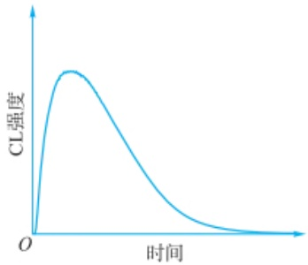

line

| 时间 | CL强度 |
| --- | --- |
| 0 | 0 |
| ~1 | Peak |
| ~2 | ~0.5 |
| ~3 | ~0.1 |

图 4.6.3 化学发光反应动力学示意图

## 气相化学发光

化学发光反应在气相中进行称为气相化学发光。主要有  $O_{3}$ 、NO 和 S 的化学发光反应。

可用于痕量氮氧化物的测定,反应如下:

$$
\mathrm{NO} + \mathrm{O} _ {3} \longrightarrow \mathrm{NO} _ {2} ^ {*} + \mathrm{O} _ {2}
$$

$$
\mathrm{NO} _ {2} ^ {*} \longrightarrow \mathrm{NO} _ {2} + h \nu
$$

发射波长范围为 600\~875 nm

可用于硫化物的测定,反应如下:

$$
\mathrm{SO} + \mathrm{O} _ {3} \longrightarrow \mathrm{SO} _ {2} ^ {*} + \mathrm{O} _ {2}
$$

$$
\mathrm{SO} _ {2} ^ {*} \longrightarrow \mathrm{SO} _ {2} + h \nu
$$

分子跃迁回到基态的过程中伴随着光的产生；鲁米诺的发光量子产率介于0.01%\~0.05%，其最大激发波长约为425 nm，具体发光机理示意图如图4.6.4所示。由于鲁米诺的化学发光效率比较低，催化剂的加入可以显著增强鲁米诺体系的化学发光强度，常见的催化剂有重金属离子、辣根过氧化物酶、血红素等。

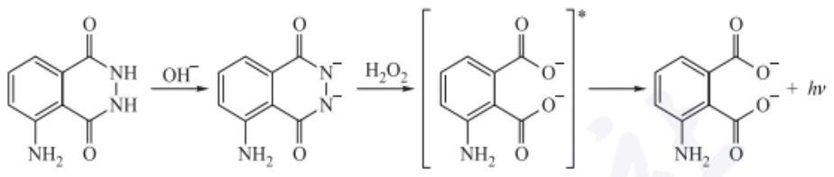

chemical

Chemical reaction pathway showing oxidation of a quinolinone derivative under hydroxyl and water conditions to form a fused heterocyclic product with H2O2 and hv addition.

图 4.6.4 鲁米诺在氧化剂的作用下的发光过程

## 4.6.3.2 光泽精化学发光体系

光泽精又称 N,N-二甲基二吖啶硝酸盐，可以与过氧化氢发生作用，在碱性条件下产生波长为 420\~500 nm 的化学发光（图 4.6.5）。在有催化剂[如 Co(Ⅱ)、Ni(Ⅱ)、Cu(Ⅱ)、Fe(Ⅱ)、Fe(Ⅲ)、Cr(Ⅲ)]存在时发光效应会有所增强。应用这

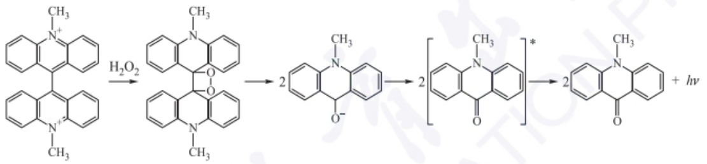

chemical

Chemical reaction pathway showing the synthesis of compound 2 from precursors and alcohols under light irradiation

图 4.6.5 光泽精在过氧化氢的作用下的发光

化学发光检测仪
按照进样方式,化学发光分析仪分为:

分立式进样化学发光仪

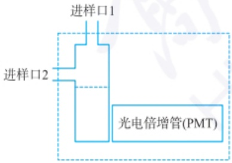

text_image

进样口1
进样口2
光电倍增管(PMT)

流动注射进样和色谱进样化学发光分析仪

一体系可定量测定某些催化剂或催化剂标记的组分、过氧化物或可转化为过氧化物的组分。此外，有溶解氧存在时光泽精还可与多种还原剂进行化学发光反应，这一反应已经用于临床上重要的还原剂的定量分析。该体系的化学发光效率较高，但是化学发光的氧化产物 $N-$ 甲基吖啶酮在水中的溶解度很小，会生成沉淀，造成体系不均匀。光泽精的分子结构包括吖啶发光基团和离去基团两个部分，离去基团有苯氧基和磺酰氨基等，为了提高量子产率，可以在其离去基团和吖啶环侧链上10位N原子取代基上修饰。

## 4.6.3.3 过氧化草酸酯类化学发光体系

过氧化草酸酯类化学发光体系是指芳香草酸酯、过氧化氢和荧光试剂组成的化学发光体系。这种体系的化学发光效率高，寿命长，而且可以通过改变荧光物质来调节发射波长。但是由于草酸酯在水中的溶解性较差，所以该体系常用于混合有机溶剂中。典型的过氧化草酸酯物质有双(2,4,6-三氯苯基)草酸酯，双(2,4,5-三氯-6-烷氧羰苯基)草酸酯和双(2,4-二硝基-6-烷氧羰苯基)草酸酯等。如图4.6.6所示，双(2,4,6-三氯苯基)草酸酯发光的反应机理是 $H_{2}O_{2}$ 亲核进攻双(2,4,6-三氯苯基)草酸酯的羰基，产生高能二氧杂环中间体，随后中间体的能量转移给体系中的荧光物质(FLR)产生化学发光(图4.6.6)。

## 4.6.3.4 生物发光体系

荧光素(fluorescein)-荧光素酶(luciferase)体系是应用最为广泛的。荧光素酶是自然界中能够产生生物荧光的酶的总称，不同生物荧光素底物和荧光素酶的结构存在显著差异。迄今已经发现十余种不同的荧光素-荧光素酶系统，最有代表性的是从甲虫中分离得到的萤火虫荧光素酶(firefly luciferase)和从海肾中分离得到的海肾荧光素酶(renilla luciferase)。

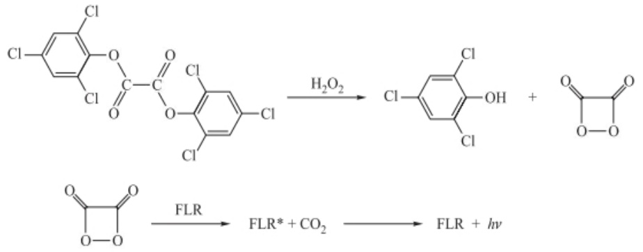

chemical

Fluorination reaction scheme of a chlorinated benzene derivative under H2O2 and FLR conditions

图 4.6.6 过氧化草酸酯类化学发光机理示意图

荧光素酶可以催化荧光素氧化成氧化荧光素，在荧光素氧化的过程中，会发出生物荧光。在众多生物发光中，萤火虫荧光素酶体系是被广泛深入研究的生物发光体系。如图4.6.7所示，在ATP、$\mathrm{Mg}^{2+}$和分子氧的条件下，萤火虫荧光素酶

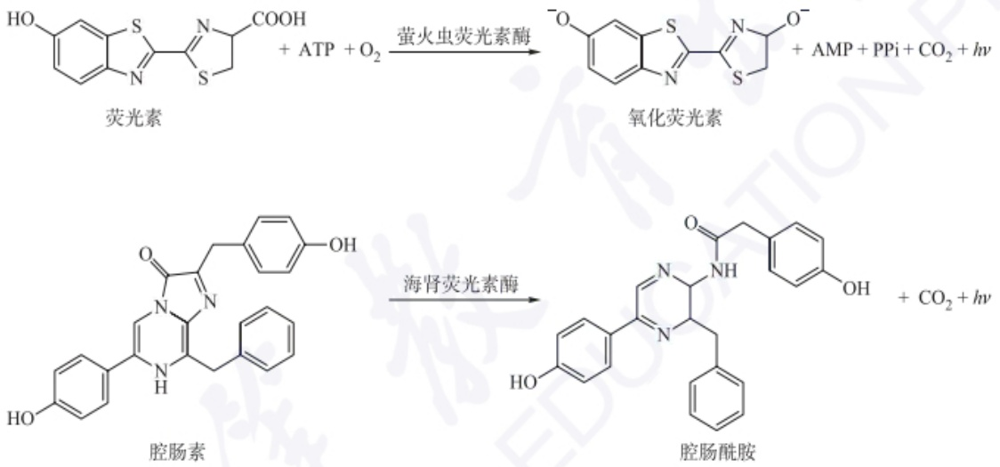

图 4.6.7 两种典型荧光素-荧光素酶化学发光机理示意图

将天然底物荧光素催化氧化，并发射出峰值在 560 nm 的黄绿色光。海肾荧光素酶发光体系相对简单，不需要 ATP、 $Mg^{2+}$ 等辅助因子，但也存在发射波长短、发光强度较弱和底物分子不稳定等缺点。科学家在研究水母中荧光素酶发光体系时，发现了对生物学界研究有重大贡献的绿色荧光蛋白（green fluorescent protein, GFP）。

另外，任何生物组织或细胞在生命活动的代谢过程中，都自发地辐射出一种极其微弱的光子流，科学家称之为生物系统的代谢超弱发光。这种发光可以用代谢发光机制解释。代谢发光机制以光生物化学为基础，把生物超微弱发光与有机体内的代谢过程联系起来，认为这种发光主要来源于氧化还原等代谢反应，如脂肪酸氧化、酚和醛的氧化、 $H_{2}O_{2}$ 的酶解、醌的氧化裂解和氨基酸的氧化等；细胞代谢过程离不开氧，生物氧化过程是细胞获得能量的过程，但是同时也产生了一些高活性的化合物——自由基；这些过氧化自由基在复合反应的过程中，生成单线态氧或激发态羰基，它们回到基态则辐射出光子。

## 化学发光在刑事侦查中的应用

1928年德国化学家H.O.Albrecht发现，在过氧化氢碱性溶液中，血液和其他物质可以增强鲁米诺的发光。1936年，Karl Gleu和Karl Pfannstiel在血液中的一种成分——血红素的存在下证实了这种增强效应。1937年，德国法医科学家Walter Specht对鲁米诺在犯罪现场血液检测中的应用进行了广泛的研究。1939年，旧金山病理学家Frederick Proescher和Frederick Proescher发现:

（1）虽然这种测试是推测性的，但可以迅速检查大面积的可疑物质。

(2) 干燥和腐烂的血液比新鲜血液的反应更强烈、更持久。
（3）如果发光消失，可以通过应用新鲜的鲁米诺-过氧化氢溶液来重现；因此，干燥的血迹可能会反复发光。

犯罪现场调查员使用鲁米诺来寻找血迹，即使有人已经清理或移走了血迹。研究者喷洒了一种鲁米诺和氧化剂的溶液。血液中的铁催化发光。引起反应所需的催化剂的量相对于鲁米诺的量是非常小的，甚至可以检测到微量的血液。蓝色辉光每次持续约30 s。探测这种光需要一个相当黑暗的房间，可以用长时间曝光的照片记录下来。

## 4.6.3.5 其他

还有一些常见的液相化学发光体系，如酸性高锰酸钾、四价铈、二氧杂环、双异喹啉镝盐、洛芬碱及其衍生物、吲哚及其衍生物和联吡啶钌类等。其中酸性高锰酸钾，其化学发光最大发射波长在610\~750 nm，显示为红光，常使用甲酸、多磷酸盐增强其发光；四价铈与亚硫酸钠、连二亚硫酸钠、硫代硫酸钠之间发生氧化还原反应产生弱化学发光信号；四二甲基氨基乙烯接触氧气或者暴露在空气中即可化学发光，常用作警示标志；双异喹啉镝盐- $H_{2}O_{2}$ 在碱性条件下可产生化学发光现象；洛芬碱和吲哚的发光也需要强碱性溶液与氧化物；联吡啶钌水溶性好、化学性能稳定且具有可逆的电子转移特性，常用于电化学发光反应中。

## 4.6.4 化学发光检测仪

化学发光检测仪的特点是简单、快捷和灵敏。一般包含进样系统、光检测器、信号放大和数据处理系统。进样系统一般包括反应池、样品室、注射器、控温装置等。若为流动分析，配备样品输送系统。光检测器把化学反应产生的光通过光电倍增管、二极管阵列和光导摄像管等转变成电信号。通过光子计数、光切系统等方式实现信号放大，最终利用数据处理系统实现信号的输出。

另外，把发光反应系统与免疫反应系统相结合，以检测抗原或抗体的仪器称为化学发光免疫分析仪。它采用微量倍增技术，敏感度、特异性好；检测的范围非常广泛，从传统蛋白质、激素、酶到药物均可检测。临床应用较多的是全自动化学发光免疫分析仪、全自动微粒子化学发光免疫分析仪和全自动电化学发光免疫分析仪。利用CCD相机的器件来捕捉和记录化学发光信号的化学发光分析系统被称为化学发光成像分析仪，具有高的检测灵敏度，可以实现对微量化合物的定性和定量检测。它对化合物的检测是通过化学发光反应、光电倍增管和CCD相机三个部分的协同作用实现的，在生物医学、环境监测和食品安全等领域都有着广泛的应用。

## 4.6.5 化学发光和生物发光分析应用

化学发光具有操作简单和灵敏度高的特点,已经成为多个领域分析检测的重要工具。

## 4.6.5.1 无机化合物化学发光分析

## 1. 无机离子检测

痕量金属离子对化学发光反应具有很好的催化作用，因而化学发光测定金属离子得到广泛的应用，已成功用于几十种金属离子的检测，如  $Cu^{2+}$ 、 $Hg^{2+}$ 、 $Mn^{2+}$ 、 $Fe^{3+}$ 、 $Fe^{2+}$ 、 $Ag^{+}$ 和  $Co^{2+}$ 等。同时也实现了对多种阴离子的检测，如  $NO_{2}^{-}$ 、 $NO_{3}^{-}$ 、 $SO_{3}^{2-}$ 和  $CN^{-}$ 等。与其他传统检测方法相比，基于化学发光的分析检测方法在无机离子检测中表现出更好的选择性、更宽的线性范围和更低的检出限。

## 2. 其他无机化合物

分子氧在正常和异常氧化还原过程中产生的产物称为活性氧物种（ROS），ROS在生物、医学和环境分析等领域具有重要作用。活性氧物种有很多种，如$\mathrm{H}_2\mathrm{O}_2$ 、·OH、${}^{1}\mathrm{O}_{2}$ 、$\mathrm{O}_2^{-}$、$\mathrm{ClO}^{-}$、$\mathrm{ONOO}^{-}$等。化学发光涉及的反应本质上是氧化还原反应，因此基于鲁米诺、过氧草酸酯及光泽精等化学发光体系对有关活性氧物种$(\mathrm{H}_2\mathrm{O}_2$ 、·OH、${}^{1}\mathrm{O}_{2}$ 和 $\mathrm{O}_2^{-}$等)的化学发光分析的报道较多。

## 4.6.5.2 有机化合物化学发光分析

## 1. 有机酸碱

在临床医学上，常利用氧化化学发光反应测定尿液中的草酸盐及游离的草酸；另外该反应还可以用来测定苯酮尿症患者尿液中苯丙酮酸的含量，其检测原理是苯丙酮酸在碱性条件下被氧化成1,2-二氧杂环丁烷类化合物，然后裂解产生化学发光。

胺类化合物第一离子化电势呈如下规律:伯胺>仲胺>叔胺,并随碳链增长,离子化电势逐渐下降,因此叔胺化合物的检测限较低。胺类化合物的分析,较多的是经柱前衍生生成荧光衍生物,分离后用过氧草酸盐化学发光体系检测,也可将其生成希夫碱或其他产物氧化而发光。有些碱如肾上腺素等可直接氧化而发光。

## 2. 生物分子和药物

常利用过氧草酸盐体系测定氨基酸；利用光泽精体系可测定一些还原性物质，如乳糖、葡萄糖、抗坏血酸和脱氢抗坏血酸等。对于氨基酸、糖类和胆固醇，一种重要方法是测定酶反应产生的 $\mathrm{H}_2\mathrm{O}_2$ ，通过测定 $\mathrm{H}_2\mathrm{O}_2$ 达到分析测定底物的目的。

至今,化学发光已经成功用于多种抗生素的检测,如 $\beta$ -内酰胺类抗生素、美罗培南、甲硝唑、四环素、土霉素、米诺环素、恩诺沙星、加替沙星和氧氟沙星等。

## 4.6.5.3 生物发光分析

## 1. 生物医学分析

生物发光在生物医学领域应用非常广泛，如疾病标志物检测、疾病诊断和药物筛选等。血液中会溶解大量的氧，能氧化血液中的脂质化合物，生成酮、醛、有机过氧化物和活泼的自由基，从而自发出微弱的光。研究者发现这种发光强度与血液中的血红素、酮、醛、有机过氧化物和自由基的含量有关，因此可以通过这种微弱化学发光的变化对疾病进行诊断。例如，人们发现肿瘤患者的血清发光一般要比正常人弱；而肺结核病会使血清化学发光增强。但是血浆和血清的自发光非常微弱，容易被背景信号淹没，很难测量，往往需要大样本统计处理，或者需要外界提供能量以增强发光提高信噪比。常见的方法有紫外线、电、热、超声、加入化学试剂（如 $\mathrm{H}_2\mathrm{O}_2$ 、 $\mathrm{Fe}^{2+}$ 和 $\mathrm{KMnO}_4$ ）等。

研究者通过探测细胞内 ATP 与荧光素作用产生的信号进行快速、实时的单细胞分析；将荧光素酶引入 DNA 测序、分子杂交等过程中，实现对 DNA 的快速分析；利用荧光素酶基因建立动物模型，用于细胞增殖的药物筛选系统等。

另外，生物发光活体成像技术因其非侵入的特点受到越来越多的关注。已被用于疾病诊断与监控、细胞迁移、细胞死亡和蛋白质的相互作用领域。

## 2. 其他

生物的生长情况与周围环境密切相关,可以利用发光生物来检测环境和食品。研究发现一种海洋发光菌对低浓度的毒性物质非常敏感,当环境毒性增强时其数量急剧减少,发光亮度降低,通过监控发光菌的发光强度可以实现对环境毒性物质的检测。另外利用生物发光可以检测食品的新鲜度和污染情况。

## 习题

## - 章节练习题 -

1. 化学发光检测的原理是什么？
2. 化学发光有哪些典型体系？
3. 化学发光和荧光的区别是什么？

## - 挑战性问题 -

4. 近年来,纳米材料催化化学发光的研究发展迅速。查阅文献,列举和总结现有的纳米催化化学发光体系和纳米催化电化学发光体系,尝试总结规律。

## - 专题或报告 -

5. 2008年诺贝尔化学奖授予美国Woods Hole海洋生物学实验室的Osamu Shimomura、哥伦比亚大学的Martin Chalfie和加州大学圣地亚哥分校的美籍华裔科学家Roger Y. Tsien, 表彰他们发现并开发了绿色荧光蛋白(GFP)的应用研究。Shimomura还确定了钙离子增强了水母素发光, 随后, 其他科学家提出可用水母素来检测钙浓度, 创造了检测钙的新方法。为进一步提高检测灵敏度, Tsien等人发展了一种生物发光能量转移(BRET)的方法用于 $\mathrm{Ca^{2+}}$ 的测定。同学们尝试查询文献, 探讨BRET的原理及其应用。

本章主要从原子光谱的角度阐述原子发射光谱法、原子吸收与原子荧光光谱法、X射线荧光光谱法的基本原理、仪器构造、光谱特点、定量分析及发展前沿。

## 5.1 原子发射光谱法

原子发射光谱法(atomic emission spectrometry, AES)，是根据处于激发态的待测元素原子回到基态时发射的特征谱线，对元素进行定性与定量分析的方法，是光谱学各个分支中最为古老的一种。

1826年W.H.Talbot提出不同波长的光线是表征某些元素的特征。1860年德国学者G.R.Kirchhoff和R.W.Bunsen利用分光光度法研究盐和盐溶液在火焰中加热时所产生的特征光谱，发现了铷 和铯两种元素，并最早研究了太阳大气的光谱。从此以后，原子发射光谱受到了人们广泛关注。原子发射光谱的测量主要包括三个核心步骤:首先，利用高能光源提供能量蒸发样品，转化为气态原子，并进一步使气态原子激发；随后，将气态原子由激发态跃迁回基态发出的复合光通过单色器分解，形成按波长顺序排列的特征线状光谱；最后，利用检测器测量各谱线的波长和强度。

## 5.1.1 基本原理

## 5.1.1.1 原子发射光谱的产生

原子核外能量最低的电子(称为基态)在激发能量(热、电、光)作用下,由基态跃迁到不同的高能级(称为激发态)。原子(或离子)的外层电子处于激发态时是不稳定的(激发态寿命约 $10^{-8}$ s),当它跃迁回到基态或较低的激发态时,就要释放出能量,若此能量以光的形式出现,即得到原子发射光谱。原子光谱涉及的相关基本概念包括:

（1）激发能/激发电位 将原子中某一外层价电子从基态激发到高能态所需的能量。
(2) 一级电离能/电离电位 原子失去一个外层电子变成离子所需要的能量。
(3) 共振线 在基态和激发态之间跃迁所产生的谱线。
（4）第一共振线 在基态与第一激发态之间跃迁所产生的谱线；其具有最小的激发能，最易产生跃迁，通常是元素最强的谱线。
（5）原子线 原子的外层电子受到激发所产生的谱线，对应于特定元素的电子从激发态跃迁回基态时释放的能量，用“I”表示。

## AES 的主要优点与不足

优点:(1) 多元素同时检出能力强,样品一经激发,样品中各元素都各自发射出其特征谱线。(2) 分析速度快,多数固体和液体样品不需经过化学处理就可直接分析,在几分钟内同时定量测定几十种元素。(3) 选择性好,光谱特征性强,能区分化学性质极相似的元素。例如,可分析铌和钽、锆和铪,以及十几种稀土元素。(4) 检出限低,一般可达 $\mu g^{-1}$ 级。如用电感耦合等离子体(ICP)作为光源,检出限可低至 $10^{-3}\sim10^{-4}\mu g^{-1}$ 量级。(5) 用ICP光源时,准确度高,标准曲线的线性范围宽,可达4\~6个数量级。(6) 样品消耗少,适于整批样品的多组分测定。

不足:(1) 影响谱线强度的因素较多,尤其是样品组分的影响较大,对标准参比的组分要求较高。(2) 当样品浓度较大时,分析准确度较差。(3) 不能进行结构和元素形态的测定。(4) 大多数非金属元素难以得到灵敏的光谱线。

## 跃迁“选择定则”

(1) 主量子数 n: 在跃迁时不受限制;
(2) 总角量子数  $L: \Delta L = 1, S, P, D, F, \cdots$  相邻；
(3) 内量子数 J:  $\Delta J = 0$  或 1, 但当 J = 0 时,  $\Delta J = 0$  的跃迁是禁阻的;
（4）总自旋量子数  $S: \Delta S = 0$ ，即不同多重性状态之间的跃迁是禁阻的。

（6）离子线 离子的外层电子受到激发所产生的谱线，对应于特定离子的电子从激发态跃迁回基态时释放的能量，用“Ⅱ”表示。

## 5.1.1.2 原子能级与光谱项

原子发射光谱是原子外层价电子从高能级回到低能级而发出的特征辐射。原子由原子核和核外电子构成，每一个电子在核外的任意运动状态可以用主量子数 $n$ 、角量子数 $l$ 、磁量子数 $m$ 和自旋量子数 $m_{s}$ 这4个量子数来描述。主量子数 $n$ 用来描述核外电子离核的远近，决定电子层数和电子的能量高低，$n$ 越大，能量越高（针对形状相同的原子轨道或电子云电子）；角量子数 $l$ 表示原子轨道和电子云的形状，同一主层中不同的分层；磁量子数 $m$ 代表原子轨道和电子云在空间的伸展方向；$m$ 的取值:$0, \pm 1, \pm 2, \dots, \pm l (2l + 1$ 个取值）；自旋量子数 $m_{s}$ 代表电子的自旋方向。原子光谱是由原子外层的价电子在不同能级间跃迁而产生的，整个原子的运动状态用量子数来描述，即光谱项[式(5-1-1)]。原子的能级通常用光谱项符号表示。

$$
^ {2 S + 1} L _ {J} \tag {5-1-1}
$$

## 5.1.1.3 原子能级图

原子的能量状态可以通过光谱项来描述，而将原子中可能的能量水平及它们之间可能发生的跃迁以图形方式展示，就可以得到能级图。这种图形通常包括一系列的水平线，代表不同的能级，以及连接这些线的箭头，表示电子在能级间的跃迁。通常纵坐标表示能量 $E$ ，基态原子的能量 $E = 0$ ，横坐标表示实际存在的光谱项。图5.1.1为钠原子的能级示意图，图中的水平线表示原子实际存在的能级，其间隔表示原子的外层电子在两个能级之间跃迁所发射或吸收的能量。能级图中的纵坐标表示能量标度，线上的数字表示能级间的能量差，用波长表示$(\times 100\mathrm{nm})$ ，代表跃迁时以电磁辐射形式释放的能量大小。不同的原子处于不同的激发态,因此发射出不同的谱线。原子从第一激发态跃迁到基态产生的谱线称为第一共振线,强度最大。

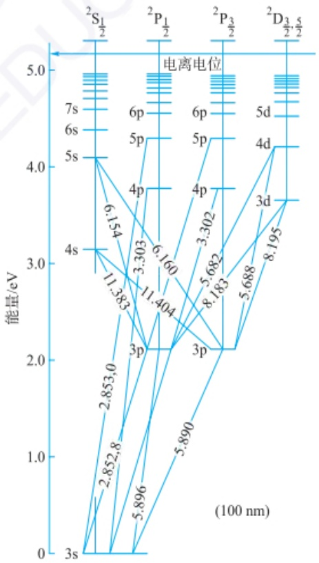

funnel

| Energy Level | Transition State |
| --- | --- |
| 3s | 2.853,0 |
| 5.896 | 2.852,8 |
| 5.890 | 2.853,0 |
| 11.383 | 4s |
| 11.404 | 3p |
| 6.154 | 6p |
| 6.160 | 6p |
| 3.303 | 5p |
| 3.302 | 5p |
| 8.183 | 4p |
| 5.682 | 4p |
| 5.688 | 4p |
| 8.195 | 3d |

图 5.1.1 钠原子的能级示意图

值得注意的是，并不是原子内所有能级之间的跃迁都是可以发生的，实际发生的跃迁是有限制的。根据量子力学的原理，电子的跃迁不能在任意两个能级之间进行，而必须遵循一定的“选择定则”（见副栏）。由于不同元素的原子具有独特的能级结构，它们在电子跃迁时产生的谱线波长特征也各不相同，这些独特的谱线特征可以用于定性分析元素。

## 5.1.1.4 谱线强度

原子发射谱线强度的公式来源于量子力学和统计物理学的原理。当原子从激发态向较低能级跃迁时，会发射出特定频率的光子，其能量等于两能级间的能量差。谱线强度与激发态原子的数量成正比，也与跃迁概率、能级统计权重、激发能及温度等因素有关。在外界能量作用下，原子的外层电子在 $i$ 和 $j$ 两能级之间跃迁产生的原子发射谱线强度可表示为

$$
I _ {i j} = N _ {i} A _ {i j} h \nu_ {i j} \tag {5-1-2}
$$

式中， $N_{i}$  为单位体积内处于高能级 i 的原子数， $A_{ij}$  为 i, j 两能级间的跃迁概率，h 为普朗克常量， $\nu_{ij}$  为发射谱线的频率。

当体系处于热力学平衡状态,分配在各激发态和基态的原子数目  $N_{i}, N_{0}$ , 应遵循统计热力学中 Maxwell-Boltzmann 分布定律, 结合相关定律可推导为

$$
I _ {i j} = \frac {g _ {i}}{g _ {0}} A _ {i j} h \nu_ {i j} N _ {0} \mathrm{e} ^ {- \frac {E _ {i}}{k _ {\mathrm{B}} T}} \tag {5-1-3}
$$

式中， $N_{0}$ 为单位体积内处于基态的原子数， $g_{i}$ 和 $g_{0}$ 为激发态和基态的统计权重，$E_{i}$ 为激发能， $k_{\mathrm{B}}$ 为Boltzmann常数， $T$ 为激发温度。因此，从原子发射谱线强度的推导公式可以看出，在一定条件下，谱线强度与基态原子数成正比，基态原子数与样品中待测元素浓度成正比，则谱线强度与待测元素浓度成正比，因此谱线强度是原子发射光谱定量分析的依据。

## 5.1.1.5 谱线的自吸与自蚀

光源内的物质在获得足够的能量后蒸发为气体，气体分子之间的相互碰撞产生大量的分子、原子、离子、电子等粒子，这种电离的气体宏观上呈中性，称为等离子体。光源中产生的等离子体弧焰中心部分温度高，激发态原子多，发射某一波长的特征辐射，必然要穿过等离子体的边缘部分再进入检测器。弧焰边缘部分温度低，原子蒸气大多处于基态，这些基态的同类原子能够吸收中心部分产生的特征辐射，从而使得检测器接收的辐射强度减弱，这种现象称为自吸。原子浓度较高时，自吸现象明显，当自吸现象非常严重时，谱线中心的辐射全部被吸收，仅呈现边缘的两条谱线，这种现象称为自蚀(图5.1.2)。

## 5.1.2 原子发射光谱仪结构与类型

原子发射光谱仪是根据样品中待测元素的原子或离子在光源中被激发而产生特征辐射，并通过测量这种特征辐射波长及其强度，以此对各元素进行定性分析和定量分析的仪器。原子发射光谱仪器主要由以下几部分组成:激发光源、进样系统、分光系统和检测系统。

## 5.1.2.1 激发光源

激发光源的主要作用是提供足够的能量,使样品蒸发、解离、原子化和激发跃迁产生辐射。激发光源应具有足够的稳定性,原子发射光谱仪的光源主要包括传

## 传统光源简介

（1）直流电弧:是两个电极在外加电压下产生持续的弧光放电。电弧点燃后，热电子流高速冲击阳极，产生高热（阳极斑），样品蒸发并原子化，电子与原子碰撞电离出正离子冲向阴极。电子、原子、离子间的相互碰撞，使原子跃迁到激发态，返回基态时发射出该原子的光谱。电极材料采用光谱纯的碳或石墨，特殊情况采用铜电极。直流电弧的特点是电极头温度高，样品易蒸发，适用于难挥发样品分析，但电极温度高样品损耗多；弧层较厚，易自吸，不适于高含量分析；弧焰温度较低，激发能力差，不利于激发电离电位高的元素；放电稳定性差，重现性差。适用于矿物和纯物质中痕量杂质等的定性、定量分析。
（2）交流电弧:采用高频高压引火装置产生的高频高压电流，不断地“击穿”电极间的气体，造成电离，维持导电。在这种情况下，低频低压交流电就能不断地流过，维持电弧的燃烧。采用高频引燃装置点燃电弧，在每一交流半周时引燃一次，保持电弧不灭。交流电弧的电极头温度比直流电弧低，不利于难挥发元素的蒸发；弧焰温度6000\~8000 K，比直流电弧高，有利于元素的激发；电弧放电温度稳定，分析结果再现性好；弧层稍厚，也易产生自吸现象。交流电弧适用于金属、合金低含量元素定性、定量分析。
（3）电火花:高压电火花使用10\~25 kV高压交流电，间歇放电，产生电火花。它的特点是弧焰瞬间温度很高，可达10000 K以上，利于激发；放电间隔长，电极头温度低（约1500 K），不利于蒸发；稳定性好，再现性好；弧层较薄，弧焰半径也较小，自吸不严重，适用于高含量元素的分析。此外，还适用于低熔点金属合金的分析，以及难激发元素的分析。

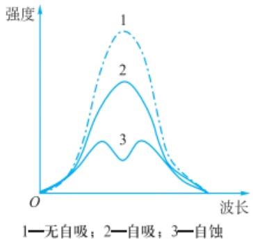

line

| Category | Intensity (Relative) |
| --- | --- |
| 1—无自吸 | High peak |
| 2—自吸 | Medium peak |
| 3—自蚀 | Low peak |

图 5.1.2 谱线的自吸现象

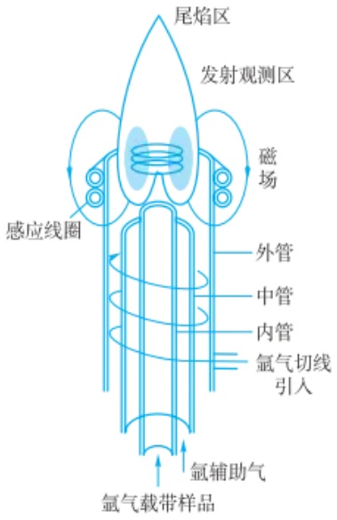

text_image

尾焰区
发射观测区
磁场
感应线圈
外管
中管
内管
氩气切线引入
氩辅助气
氩气载带样品

图5.1.3 ICP光源剖面示意图

统的直流电弧、交流电弧、电火花(详见副栏)，以及最常用的等离子体光源。此外，随着实时、在线等分析仪器的需求上涨，可用于研制便携式光谱仪的微等离子体光源也逐渐受到关注。

## 1. 等离子体光源

等离子体是一种电离度大于 $0.1\%$ 的电离气体，由电子、离子、原子和分子所组成，其中电子数目和离子数目基本相等，整体呈现中性。常用的等离子体光源有直流等离子体、微波等离子体、电感耦合等离子体（inductively coupled plasma, ICP)等。ICP外观类似火焰，是高频电能通过感应线圈耦合到等离子体形成的气体放电光源。ICP是20世纪60年代以后发展起来的性能优良的新型光源，是目前应用最广泛、最有竞争力的光源之一，常用于痕量元素分析。ICP光源由高频发生器、进样系统(包括供气系统)和等离子炬管三部分组成(图5.1.3)。

（1）ICP 组成 高频发生器和感应线圈:高频发生器的作用是产生高频磁场以供给等离子体能量。应用最广泛的是利用石英晶体压电效应产生高频振荡的发生器，其频率和功率输出稳定性高。频率多为 27\~50 MHz，最大输出功率通常是 2\~4 kW。感应线圈一般以圆铜管或方铜管绕成的 2\~5 匝水冷线圈。

炬管和供气系统:等离子炬管由三层同心石英管组成。外管通冷却气氩气（Ar），其目的是使等离子体离开外层石英管内壁，以避免它烧毁石英管。采用切向进气，其目的是利用离心作用在炬管中心产生低气压通道，以利于进样。中层石英管出口做成喇叭形，通入氩气维持等离子体。内层石英管内径为1\~2 mm，载气载带样品气溶胶由内管注入等离子体内。氩为单原子惰性气体，它不会与样品中的组分形成难以分解的稳定化合物，同时由于其分子结构简单，不会因为解离而损失能量，其自身的光谱也相对简单。

（2）ICP 工作原理 当有高频电流通过线圈时，产生轴向磁场，这时若用高频点火装置产生火花，形成的载流子（离子与电子）在电磁场作用下，与原子碰撞并使之电离，形成更多的载流子，当载流子多到足以使气体有足够的电导率时，在垂直于磁场方向的截面上就会感生出流经闭合圆形路径的涡流，强大的电流产生高热又将气体加热，瞬间使气体形成最高温度可达 10000 K 的稳定的等离子炬。感应线圈将能量耦合给等离子体，并维持等离子炬。当样品气溶胶通过等离子体时，被加热至 6000\~7000 K，并被原子化和激发产生发射光谱。
（3）ICP 焰炬分区 焰心区:白色不透明的焰心，高频电流形成的涡流区，温度最高达 10000 K，电子密度高。它发射很强的连续光谱，光谱分析应避开这个区域。样品气溶胶在此区域被预热、蒸发，又叫预热区。

内焰区: 在感应圈上 10\~20 mm 处, 淡蓝色半透明的炬焰, 温度为 6000\~8000 K。样品在此原子化、激发, 然后发射很强的原子线和离子线。这是光谱分析所利用的区域, 称为测光区。测光时在感应线圈上的高度称为观测高度。

尾焰区:内焰区上方,无色透明,温度小于6000 K,只能发射激发电位较低的谱线。

（4）ICP 的特点 ICP 焰炬外型像火焰，但不是化学燃烧火焰，是气体放电；温度高，惰性气氛，原子化条件好，有利于难熔化合物的分解和元素激发，有很高的灵敏度和稳定性；“趋肤效应”，涡电流在外表面处密度大，使表面温度高，轴心温度低，中心通道进样对等离子的稳定性影响小，有效消除自吸现象，线性范围宽，4\~6 数量级，可测高、中、低不同含量样品；ICP 中电子密度大，碱金属电离造成的影响小；Ar 气体产生的背景干扰小；无电极放电，无电极污染；但对非金属测

定的灵敏度低，仪器昂贵，操作费用高。

## 2. 微等离子体光源

微等离子体(microplasma, MP)是指尺寸范围被限制在有限空间范围内(几个微米到几个毫米)的非热平衡低温等离子体。由于MP尺寸小巧、能耗低、结构简单及能在大气压条件下运行，其在原子光谱小型化应用方面具有得天独厚的优势。目前，应用于原子发射光谱中的微等离子体主要包括大气压辉光放电微等离子体(atmospheric pressure glow discharge, APGD)、介质阻挡放电微等离子体(dielectric barrier discharge, DBD)、电容耦合微等离子体(capacitively coupled microplasma, mCCP)、电晕放电微等离子体(corona discharge, CD)和尖端放电微等离子体(point discharge, PD)等。APGD是指在大气压条件下，当施加电压达到某个阈值时产生均匀稳定、显示辉光的放电现象。DBD是将绝缘介质插入放电空间形成的一种非平衡态气体放电现象，最早由Simens于1857年报道。DBD装置有平板式和同轴式两种结构，典型结构示意图见图5.1.4。由于DBD微等离子体具有体积小、结构简单、放电温度低、解离能力强和成本低等优点，研究者们将其引入原子光谱领域。mCCP可以非常有效地利用从射频电源传输到微等离子体的能量，使放电能在较宽功率范围或载气流速下维持。Blades和Liang等人最早提出大气压下小型化平行板电容耦合微等离子体(parallel-plate capacitively coupled plasma, PP-CCP)，并将其用于原子光谱分析领域。CD是指在曲率半径很小的尖端电极附近，由于局部场强超过气体电离场强，使气体发生电离，形成CD微等离子体，属于气体介质在不均匀电场中局部自持放电。典型CD微等离子体示意图见图5.1.5，通常由两个不对称电极组成，其中一个电极曲率半径较大，另一个电极多为平板结构。目前，CD被用于生物医学、材料表面改性及被广泛用作原子发射光谱激发源。

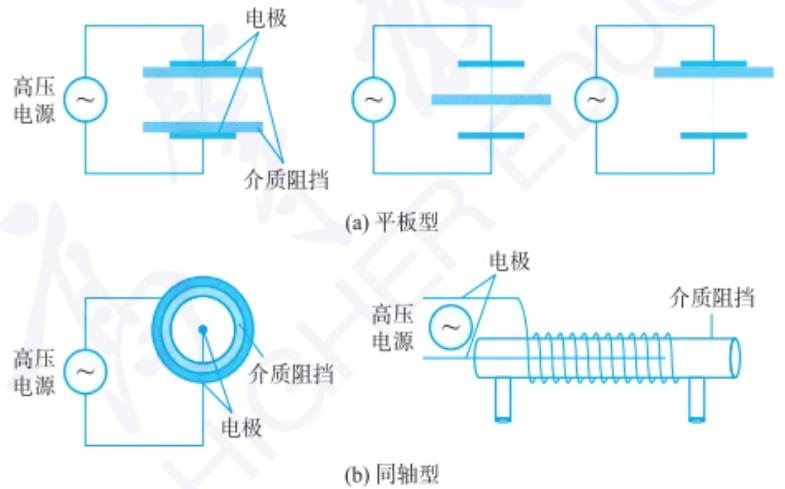

图 5.1.4 典型的介质阻挡放电微等离子体结构图

PD是指在两个尖端电极之间施加高电压，由于尖端处曲率大，电荷密集，随即形成稳定放电现象，属于电晕放电。根据施加电压大小差异，尖端放电微等离子体放电形式也会有所不同。形成电晕放电情况是:导体电荷量较小且电极尖端较尖，只在电极尖端局部区域附近进行放电；而当导体电荷量较大时，两个尖端电极之间会形成放电通道，表现为火花放电。PD装置一般用钨棒作为放电电极，其示意图如图5.1.6所示。相较于其他的微等离子体，PD微等离子体激发能力更强且能量集中，同时，装置更加简单小巧，更有利于实现装置小型化。

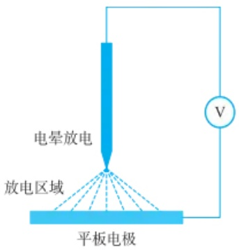

text_image

电晕放电
放电区域
平板电极
V

图 5.1.5 典型的电晕放电微等离子体结构图