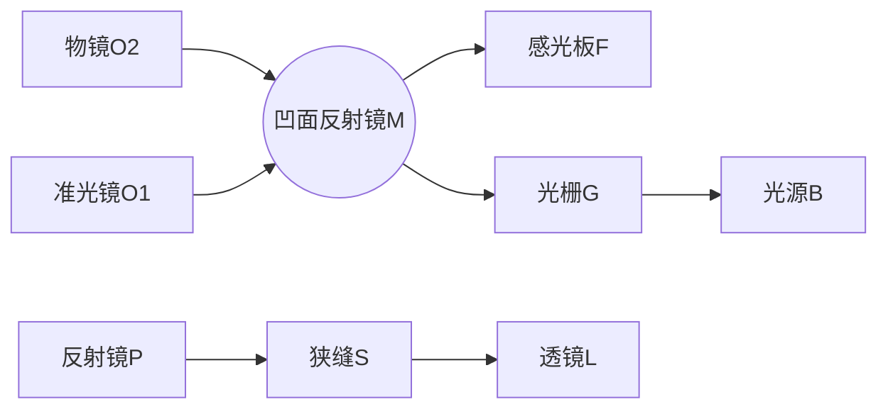
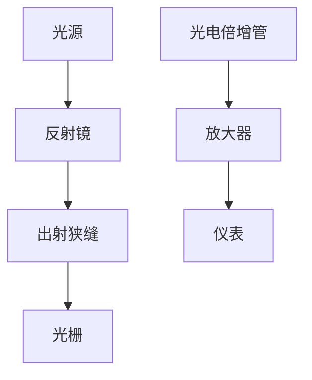
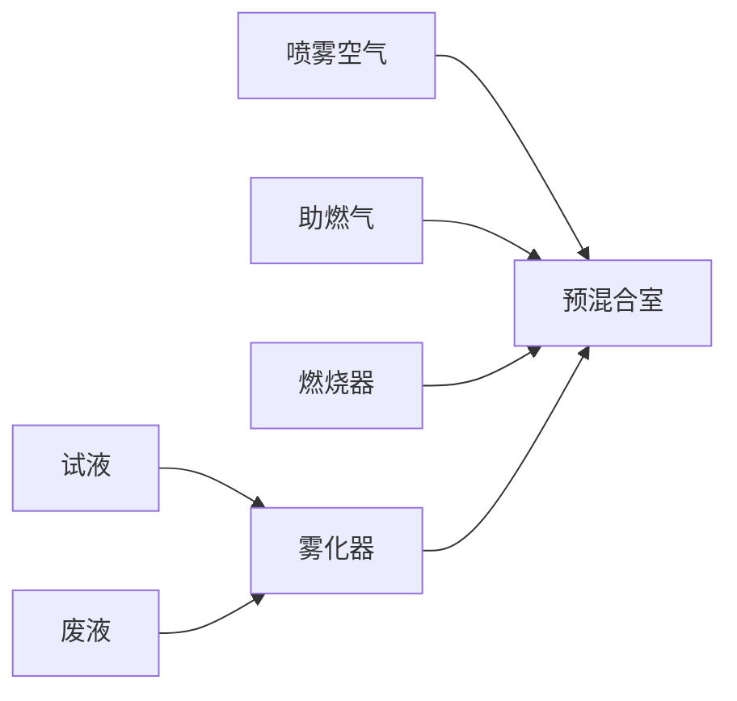
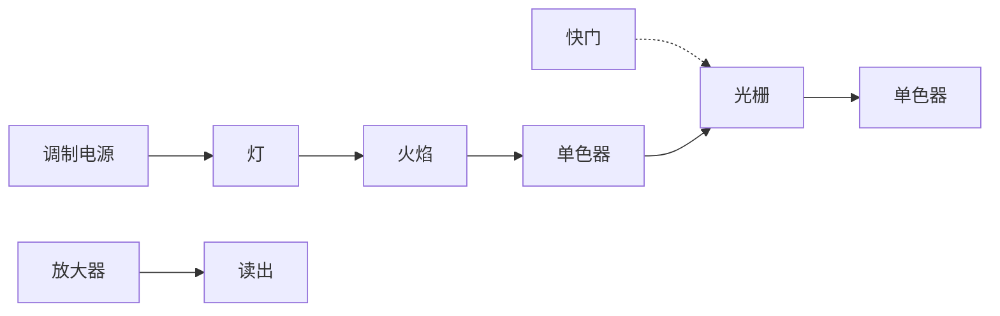
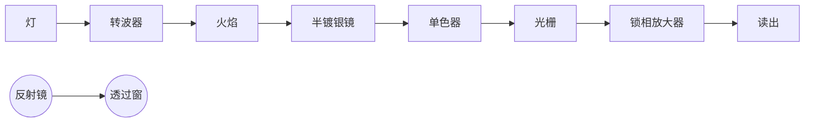

## 其他进样方式简介

（1）超声雾化法是通过超声波震动把溶液雾化成高密度的气溶胶，比气动雾化器产生的雾滴更细、更均匀，提高了雾化效率。超声雾化产生的气溶胶颗粒平均大小与超声频率相关，增大频率可以产生较细的雾滴进而提高进样效率；同时，产生气溶胶的速度不完全依赖于载气流量。但是该类装置结构较为复杂，存在较大的基体效应和记忆效应。
（2）电热蒸发法是将微量样品或者固体沉积于石墨或者金属材料表面，经过一定的加热程序使其转化为干燥气溶胶的进样方法。该进样方式样品用量少，适用于微量样品分析；可通过控制加热装置的温度使得样品的蒸发和激发过程分步进行，可有效分离基体，消除或降低基体干扰；且进样效率高，显著提高灵敏度；可用于高盐、复杂基质的样品分析，简化了样品前处理，避免处理样品时待测物潜在的污染与损失。但该方法分析速度较慢，分析元素有限。

text_image

微等离子体
电子
M*
Ar*
钨电极
钨电极

图 5.1.6 典型的尖端放电微等离子体结构图

## 5.1.2.2 进样系统

样品引入激发光源的方式对方法的分析性能影响极大。一般来说，样品引入系统应将具有代表性的样品重现、高效地转入激发光源中。是否可以达到这一目的或达到这一目的程度如何，依样品的性质而定。以下针对液体样品、气体样品和固体样品介绍几种应用较多的进样方式，其他进样方法见副栏。

## 1. 溶液进样(气动雾化法)

将液体样品雾化成气溶胶导入原子化器，装置通常由雾化器和雾化室组成。分析溶液通过进样装置产生的负压吸入雾化器，在雾化器毛细中心管出口处，载气流速很快，而试液流速较慢，两者之间产生摩擦力，液流被拉细并被气流冲击破碎形成雾滴，从而实现雾化进样。样品在前进过程中，受到气流径向和切向压力的作用进一步细化，其中较细的气溶胶被载入等离子体，未细化的凝结后作为废液排出。目前采用的雾化器结构主要包括同心雾化器及交叉雾化器（图5.1.7）。气动雾化器的缺点是雾化效率低，仅有大约 $5\%$ 的样品进入原子化器，样品进样不仅受到载气流速的影响，同时还受到溶液本身黏度、表面张力等诸多因素影响，进而限制了检测灵敏度。毛细管容易被溶液堵塞，特别是高盐分和浑浊的液体；此外，毛细管还存在较强的记忆效应。但就实际应用方面，气动雾化器装置简单、操作方便，仍然是现在市面上光谱仪器的主流进样方式。

text_image

样品溶液
高压气流

(a) 同心雾化器

flowchart

(b) 交叉雾化器

text_image

样品溶液
高压气流
排放口

(c) 烧结玻璃雾化器

flowchart

(d) Babington雾化器

图 5.1.7 几种典型的雾化器

## 2. 气体进样

气体样品可直接引入激发光源进行分析。有些元素可以转变成其相应的挥发性化合物而采用气体发生进样（又称“化学蒸气发生法”）。化学蒸气发生能将目标分析物由溶液离子状态转化为挥发性的气态化合物，其作为原子光谱分析中的样品引入技术具有以下优势:（i）进样效率远高于雾化进样方式，能有效改善分析灵敏度；（ii）目标分析物与基体能在短时间内高效分离。下面主要介绍其在原子光谱领域应用较为普遍的几种化学蒸气发生法，包括冷蒸气发生法（cold vapor generation, CVG）、氢化物发生法（hydride generation, HG）和光化学蒸气发生法(photochemical vapor generation, PVG)。

（1）冷蒸气发生法 冷蒸气发生最典型的元素是汞，主要原因是它能在室温下以原子状态存在。含汞的化合物很容易被还原剂（硼氢化物或者氯化亚锡体系）还原为汞原子，并以气态的形式挥发出来被检测。也有报道指出镉化学蒸气发生与汞相似，可以被硼氢化物还原后生成  $Cd^{0}$ 。
（2）氢化物发生法 氢化物发生法是指利用某些还原剂或者化学反应，将样品溶液中的分析元素还原为挥发性共价氢化物，然后借助气流将其导入分析系统进行测量的进样方式。1836年，Mash创立砷镜反应，利用锌和盐酸体系还原生成砷化氢来检测元素砷，称为马氏试砷法。1969年，澳大利亚Holak借助砷镜反应产生砷化氢 $\left(\mathrm{AsH}_{3}\right)$ 与原子吸收光谱联用，开创了氢化物发生-原子光谱分析技术。1972年，Braman等首次采用硼氢化钠 $\left(\mathrm{NaBH}_{4}\right)$ 代替锌作为还原剂产生 $AsH_{3}$ 、 $SbH_{3}$ ，进而利用直流辉光光谱分析法测量。目前可以实现氢化物发生的元素主要包括As、Cd、Zn、Se、Sb、Bi、Ge、Sn、Te、Pb。氢化物发生法主要发展有三类还原方法，包括金属-酸体系、硼氢化物-酸体系和电化学氢化物发生体系（详见副栏）。总的来说，氢化物发生法普遍具有高的传输效率，大幅度提升了分析方法的灵敏度。近年来，氢化物发生法的可测元素范围得到不断拓展，实现了如Ag、Au、Rh、Tl及其他贵金属和过渡金属等挥发性物质的产生。
（3）光化学蒸气发生法 利用小分子的有机酸（如甲酸、乙酸与丙酸等）在紫外光作用下产生自由基，这些自由基再与相应元素反应生成挥发性物质。光化学蒸气发生法不使用传统的还原剂，仅需少量的有机酸，降低了成本，减少了污染；具有对过渡金属抗干扰能力强等优点。该方法可检测的元素范围包括传统的冷蒸气元素（Hg）、氢化物发生元素（As、Sb、Sn、Bi、Se、Te和Pb），过渡金属元素（Cd、Fe、Co、Ni和Os）及非金属元素（Cl、Br和I）。

紫外光波段范围为 100\~400 nm，可分为 UV-A(315\~400 nm)、UV-B(280\~315 nm) 和 UV-C(100\~280 nm) 三段区域。由于 UV-C 波段具有足够高的能量，能够均裂碳-碳键及其他具有相似键能的分子键，生成氧化型自由基·OH 和还原型的·H、·R、水合电子 $\left(\mathrm{e}_{\mathrm{(aq)}}^{-}\right)$ 、CO 等。氧化型自由基将有机物氧化、分解生成二氧化碳、水等小分子。而还原型的自由基提供溶液中的高还原环境，将金属还原为挥发性的产物。过程中发生的反应如下:

$$
\begin{array}{l} \mathrm{R} - \mathrm{COOH} \xrightarrow {h \nu} \mathrm{R} \cdot + \cdot \mathrm{COOH} \longrightarrow \mathrm{RH} + \mathrm{CO} _ {2} \\ \mathrm{R-COOH} \xrightarrow {h \nu} \mathrm{RCO} \cdot + \cdot \mathrm{OH} \longrightarrow \mathrm{ROH+CO} \\ \mathrm{R} = \mathrm{C} _ {n} \mathrm{H} _ {2 n + 1}, n = 0, 1, 2 \\ \end{array}
$$

在紫外光照的作用下,各种元素发生的反应多样,生成不同种类的挥发性物质。在甲酸中,氢化物发生元素一般生成对应的氢化物,如  $\mathrm{Se(IV)}$  对应生成  $SeH_{2}$ 。在乙酸或者丙酸中, $\mathrm{Se(IV)}$  主要生成甲基硒及二甲基硒等产物。而 Ni 和 Fe 则易与甲酸分解的 CO 生成  $\mathrm{Ni(CO)_{4}}$  和  $\mathrm{Fe(CO)_{5}}$ 。

## 3. 固体进样

将固体以粉末、金属或微粒形式直接引入等离子体和火焰原子化器中测定的分析方法，具有不需加入化学试剂，省去样品溶解、分离或富集等化学处理，减少污染的来源和样品的损失，以及测定灵敏度高等特点。但固体进样技术存在取样的均匀性，基体效应严重，以及较难配制均匀、可靠的固体标样等问题，严重地影响了测定的准确度和精密度。因此，它是一种既有应用前景但目前又存在较多问

## 氢化物发生还原方法简介

（1）金属-酸体系:在强还原剂作用下使待测分析物形成共价氢化物，最常见的为 $\mathrm{Zn - HCl}$ 体系。其余使用的还原物质还包括 $\mathrm{Al / H^{+}}$ ， $\mathrm{Mg / }$ $\mathrm{Ti}^{3 + } / \mathrm{H}^{+}$ 。该反应体系的局限性在于，只有少数元素能够形成可以参与此类反应的氢化物；反应速率较慢，测量耗时较长，难以实现自动化检测；干扰也较为严重。
（2）硼氢化物-酸体系:此类反应中氢化物形成取决于两个因素，一是被测元素与氢结合的速率，另一个是硼氢化物在酸性溶液中的分解速率。该体系较第一类方法在还原能力、反应速率、自动化操作、抗干扰能力及使用范围方面均有较大的提升，但该体系仍然存在着一些局限:如硼氢化物不稳定，需要现配现用；且易受过渡金属离子如 Cu、Fe、Co、Ni 等干扰；还有一些元素，如 Pb、Sn 等反应酸度条件苛刻；价态歧视严重。
（3）电化学氢化物发生体系:氢化物由水解过程中生成的H·与电解液中的待测离子结合形成。电解池中的电解过程是由外电路中的电子迁移到阴极表面，水分子被还原产生H·，电解质中的离子通过歧化反应被还原为氢化物，电解质溶液起到迁移电荷和传输物质离子的双重作用。此类方法中，阴极的还原反应受到电极表面的电荷迁移速率和物质传输速率的制约，电解池的设计、阴极材料、电流和电解液的类型及浓度对氢化物发生起到至关重要的作用。该法对于部分元素的测定具有如下优点:试剂用量少，避免使用硼氢化物；污染小；不易受到过渡金属离子的干扰；不受分析物氧化态的影响。但由于可利用电化学氢化物法的元素比较少，使得该方法进一步的推广应用受到了限制。

## 其他检测系统简介

（1）目视法:适用于可见光波段，是用眼睛来观测谱线的强度。使用的仪器是看谱镜，主要应用于钢铁和有色金属的半定量分析。
(2) 摄谱法: 记录谱线使用的是感光板。感光板是原子发射光谱分析最早使用的检测系统, 由主要成分为卤化银的感光乳剂均匀地涂在玻璃板上制成。将感光板置于摄谱仪焦面上, 感光乳剂受到样品光谱的照射而发生分解, 经过显影、定影等处理过程后形成黑色的谱线。再用映谱仪放大后观察谱线的位置进行定性分析, 根据谱线的大致强度进行半定量分析, 用测微光度计测量谱线的黑度进行定量分析。

题的进样技术。固体进样方式主要有直接进样、电弧和火花熔融进样、电热蒸发进样、激光熔融进样等。

## 5.1.2.3 分光系统

分光系统的作用是将待测样品激发后发射的复合光分解成按照波长顺序排列的单色光，主要由入射狭缝、准直镜、色散元件、出射狭缝等组成。其中色散元件主要有棱镜和光栅两种，光栅相比棱镜色散与分辨能力更强，适用于更宽的波长范围。分光系统的详细内容请参照光分析总论部分。

## 5.1.2.4 检测系统

原子发射光谱中,样品激发后产生待测元素的特征辐射,对其波长或强度的检测方法有目视法、摄谱法(见副栏)和光电法。

光电法:利用光电效应将辐射能转换为电信号,产生的信号正比于入射光强度。检测器主要包括光电倍增管、光二极管阵列或电荷耦合阵列(具体原理及器件详见光分析总论部分)。例如,采用电荷耦合器件设计的全谱直读等离子体发射光谱仪可在1 min内完成样品中多达70种元素的测定;此外,它的动态响应范围和灵敏度均有可能达到甚至超过光电倍增管,加之其比光电倍增管更结实耐用,因此在发射光谱中有广泛的应用前景。

## 5.1.2.5 光谱仪类型

光谱仪的作用是将光源发射的电磁辐射经色散后,得到按波长顺序排列的光谱,并对不同波长的辐射进行检测与记录。原子发射光谱仪目前可分为摄谱仪和光电直读光谱仪,后者又分为单道扫描光谱仪、多道直读光谱仪和全谱直读光谱仪等。

## 1. 摄谱仪

摄谱仪是用光栅或棱镜作为色散元件,用感光板记录光谱的原子发射光谱仪器。图 5.1.8 是平面光栅摄谱仪光路示意图。光栅摄谱仪价格较便宜,测试费用也较低,并且感光板可以永久记录和长期保存光谱。

flowchart

图 5.1.8 光栅摄谱仪光路示意图

## 2. 光电直读光谱仪

光电直读光谱仪是利用光电转换元件接收光辐射，将其转换为电信号，直接测量谱线的强度。光电直读光谱仪分为多道直读光谱仪（图5.1.9）、单道扫描光谱仪（图5.1.10）和全谱直读光谱仪。前两种仪器采用光电倍增管作为检测器，后一种采用CCD检测器。

flowchart

图 5.1.9 多道直读光谱仪示意图

## 5.1.2.6 干扰及消除方法

原子发射光谱中干扰类型分为光谱干扰和非光谱干扰。

## 1. 光谱干扰

在发射光谱中最主要的光谱干扰是背景干扰，包括带状光谱（分子辐射）、连续光谱（连续辐射）及光学系统的杂散光等，光源温度越低，未解离的分子就越多，背景就越强。可通过背景校准消除干扰。校准背景的基本原则是:谱线的表观强度 $I_{1+b}$ 减去背景强度 $I_{b}$ 。常用的校准背景的方法有校准法和等效浓度法。

## 2. 非光谱干扰

非光谱干扰主要来源于样品组成对谱线强度的影响,这种影响与样品在光源中的蒸发和激发过程有关,亦被称为基体效应。激发温度受样品基体组成的影响,进而影响谱线的强度。由于标准样品与样品的基体组成差别较大。在实际工作中,常常向样品和标准样品中加入一些添加剂以减小基体效应,提高分析的准确度,这种添加剂有时也被用来提高分析的灵敏度。添加剂主要有光谱缓冲剂和光谱载体。

## 5.1.3 光谱分析方法

## 5.1.3.1 定性分析

由于各种元素的原子结构不同,在光源的激发作用下,样品中每种元素都发射自己的特征光谱。因此,光谱定性分析一般多采用摄谱法,它是进行元素定性分析的最好方法之一。

## 1. 元素的分析线、最后线和灵敏线的基本概念

分析线:复杂元素的谱线可能多至数千条,只选择其中几条特征谱线检验,称其为分析线;最后线:浓度逐渐减小,谱线强度减小,最后消失的谱线;灵敏线:最易激发的能级所产生的谱线,每种元素都有一条或几条灵敏线。最后线也是最灵敏线。例如,汞的原子发射线主要有184.95 nm、253.65 nm等。其中253.65 nm是最常用的分析线,具有较高的灵敏度和稳定性。

## 2. 元素的定性分析方法

铁光谱比较法:采用铁的光谱作为波长的标尺,来判断其他元素的谱线。该方法的特点是谱线多,在210\~660 nm范围有几千条谱线;谱线间距离都很近,在上述波长范围内谱线均匀分布,且对每一条谱线波长已精确测量。标准样品光谱比较法:用标准样品与样品在相同的条件下摄谱,比较标准样品与样品所出现的特征谱线。若样品光谱中出现标准样品所含元素的2\~3条特征谱线,就可以证实样品中含有该元素,否则不含有该元素。

flowchart

图 5.1.10 单道扫描光谱仪示意图

## 5.1.3.2 定量分析

## 1. 光谱定量分析基本关系式

从推导公式[式(5-1-3)]可以得出,当温度一定时,谱线强度I与被测元素的浓度c呈正比,即

$$
I = a c \tag {5-1-4}
$$

当考虑到谱线自吸时,有如下关系式,称赛伯(Schiebe G)和罗马金(Lomakin)经验公式:

$$
I = a c ^ {b} \tag {5-1-5}
$$

$$
\lg I = b \lg c + \lg a \tag {5-1-6}
$$

在一定的实验条件下，a 为常数；c 为被测元素的含量；b 为自吸系数，b=1，无自吸；b<1，有自吸；b 越小，自吸越大。此外，a 值受样品组成、形态及放电条件等的影响，在实验中很难保持为常数，故通常不采用谱线的绝对强度来进行光谱定量分析，而是采用“内标法”。

## 2. 内标法

在分析元素的谱线中选一条谱线，称为分析线；再在基体元素（或加入定量的其他元素）的谱线中选一条谱线，作为内标线。这两条线组成分析线对。然后根据分析线对的相对强度与被分析元素含量的关系式进行定量分析。设被测元素和内标元素含量分别为 $c$ 和 $c_{0}$，分析线和内标线强度分别为 $I$ 和 $I_{0}, b$ 和 $b_{0}$ 分别为分析线和内标线的自吸收系数，根据塞伯-罗马金公式，对分析线和内标线分别有

$$
I = a c ^ {b} \tag {5-1-7}
$$

$$
I _ {0} = a _ {0} c _ {0} ^ {b _ {0}} \tag {5-1-8}
$$

## 内标元素与内标线选择原则

(1) 内标元素含量必须适量和固定。
(2) 内标元素与被测元素化合物在光源作用下应具有相似的蒸发性质。
(3) 分析线与内标线没有自吸或自吸很小, 且不受其他谱线的干扰。
（4）用原子线组成分析线对时，要求两线的激发电位相近；若选用离子线组成分析线对，则不仅要求两线的激发电位相近，还要求内标元素与分析元素的电离电位也相近。用一条原子线与一条离子线组成分析线对是不合适的。
（5）若用照相法测量谱线强度，要求组成分析线对的两条谱线的波长尽量靠近。

分析线与内标线强度之比 R 称为相对强度:

$$
R = \frac {I}{I _ {0}} = a c ^ {b} / a _ {0} e _ {0} ^ {b _ {0}} \tag {5-1-9}
$$

式中，内标元素 $c_{0}$ 为常数，实验条件一定时，$A = a / a_0c_0^{b_0}$ 为常数，则

$$
R = \frac {I}{I _ {0}} = A c ^ {b} \tag {5-1-10}
$$

取对数得

$$
\lg R = b \lg c + \lg A \tag {5-1-11}
$$

此式为内标法光谱定量分析的基本关系式。内标法主要作用是抵消光源不稳定性的影响，内标元素与内标线的选择遵循一定的原则。

## 3. 定量分析方法

（1）校准曲线法 在确定的分析条件下，用三个或三个以上含有不同浓度被测元素的标准样品与样品在相同的条件下激发光谱，以分析线强度 I 或内标分析线对强度比 R 或  $\lg R$  对浓度 c 或  $\lg c$  作校准曲线。再由校准曲线求得样品被测元素含量。
（2）标准加入法 被测元素含量为 $C_{\mathrm{x}}$ ，几份样品中分别加入不同浓度的被测元素；在同一实验条件下，测量样品与不同加入量样品分析线对的强度比 $R$ 。在被测元素浓度低时，自吸系数 $b = 1$ ，分析线对强度 $R - c$ 图为一直线，将直线外推，与横坐标相交截距的绝对值即为样品中待测元素含量  $C_{x}$ 。

## 5.1.3.3 原子发射光谱的分析应用领域

原子发射光谱法的应用领域非常广泛，例如，金属材料分析:可以用于检测合金中的各种元素含量，包括铁、铜、铝、锌、镍等。环境监测:检测土壤、水体、大气中的重金属等污染物，评估环境质量和污染程度。食品安全:检测食品中的微量元素，如铅、汞、镉等，以及其他有害物质的残留。药品分析:包括药物中的元素含量分析及对药品中可能存在的有害元素进行检测。地质勘探:提供快速、准确的元素含量信息，用于矿物探测和资源评估。生物医学:分析体液、组织和药物中元素含量，研究疾病发生机制和药物代谢过程。工业质量控制:检测合金中的元素含量，保证产品性能和品质。

## 5.1.4 原子发射光谱法的前沿探索

近年来，人们对现场、实时、在线等分析仪器的需求大幅上涨。可用于现场快速检测的小型化仪器，具有体积小、功耗低、便携、可野外分析等优点，是节约/环保型社会的必然需求。因此，仪器小型化是原子发射光谱发展方向之一。为实现原子发射光谱的小型化，主要可从激发光源、进样系统和检测系统等方面进行探索。

## 5.1.4.1 光谱仪改进——进样系统新策略

在原子光谱分析研究中，样品的引入技术一直都是研究的重点与难点，因为进样效率的高低会直接影响方法的灵敏度、检出限等重要指标，尤其是对于微量元素的分析检测方面影响更加显著。一种理想的样品引入技术应该能够通过高效经济的方法将分析物引入原子化激发电离系统中，同时也能够防止或最小化样品基质中其他组分可能带来的干扰。由于雾化进样技术效率低，大多数分析物进入废液流中而未被检测。随着激光技术的发展，新的进样技术也逐渐发展起来，如电热蒸发、激光烧蚀等，但由于这些技术是对固体、悬浆、液体进行分析，因此存在着比较严重的基质干扰及记忆效应等问题。科学家认为对于电感耦合等离子体来说，最理想的进样形式应为气态。因此，蒸气发生进样可以增强原子化效率，从而进一步提高分析方法的灵敏度和检测能力，其与原子光谱和质谱相结合已在痕量或超痕量水平上提高了许多元素的分析性能。在分析化学领域中，蒸气发生技术通常将待分析物转化为非极性或低极性的挥发性物种。

## 5.1.4.2 光谱仪改进——集成创新

微等离子体中含有大量的高能电子，能够与周围粒子发生碰撞产生分子的裂解、激发和电离等过程，产生目标分析物信号。并且由于微等离子体消耗低、成本低、结构小巧便携，无论其作为样品引入方式或者激发源，在原子光谱小型化方面获得了广泛关注。为了解决传统原子光谱装置“从实验室走向现场，从技术限制走向开放共享”存在的问题，构建灵敏可靠、集成紧凑的便携现场分析检测器，实现对目标物的准确检测是原子发射光谱的必然发展方向。

3D打印技术具有快速简便、经济高效、一步成型等优势，能够实现装置的个性化设计和标准化制造。使用3D打印构建便携式微等离子体原子发射光谱仪可解决目前小型化仪器制造方面存在的问题。将分离富集技术和蒸气发生进样方式引入3D打印微等离子体原子发射光谱仪，提高方法分析性能，应用于复杂环境、食品等样品中目标物检测。近年来，经过科学家不断地迭代优化，3D打印的原子光谱仪器装置已经成功实现从单元素分析到多元素分析，进一

3D 打印技术以计算机辅助设计数字模型为基础，对模型扫描分层切片，再以不同的沉积或固化方式逐层叠加制造零件或实体，过程中无须模具制造或机械加工。自 1986 年 Charles Hull 推出首台立体光刻 3D 打印机以来，3D 打印技术在现代化学实验室中应用越来越普遍，为不同专业方向的科研工作者提供了设计制造多功能集成设备和实验室常用零件教具的技术支持。在分析化学方面，主要研究方向包括微流控器件、电化学传感器和生物传感器、分离科学、样品预处理、传感器和小型化检测仪器等。

参考资料

步用于多元素的形态分析。与此同时，也有科学家结合蒸气发生新方法、移动电池及3D打印新技术构建更稳定的小型化甚至芯片式蒸气发生-微等离子体原子光谱分析方法和装置，将其集成的仪器装置搭载在无人机、无人船上，用于元素的原位分析，这些研究的成功将为环境污染物的现场检测提供新策略、注入新动力。

## 5.1.4.3 学科交叉——引入机器学习实现智能分析

机器学习(machine learning)，就是让机器(计算机)也能像人类一样，通过观察大量的数据和训练，发现事物规律，获得某种分析问题、解决问题的能力。在数据急速增长的今天，人们对于数据的挖掘和运用，为发现新价值带来了新的机遇和挑战。与人工智能类似，人们在数据获取、挖掘和分析等方面又面临着更高的挑战。如何从大量数据中挖掘出隐藏的有用信息吸引了研究者的极大兴趣。现代分析化学作为一门实验科学，特别是仪器分析，其最重要的特征是以空前的速度产生出大量、类型繁多、实时性高的数据。实际上，许多化学过程中产生的数据因为被认为“无用”而并未被记录。但是，被忽略的数据通过数据挖掘技术常常能够提供额外的信息。因此，从一个已知的分析体系提取出多维度的信息能够实现快速、灵敏和高通量的分析。

发射光谱通过发射特征谱线可用于元素/分子的定性、定量分析，具有全谱直读、快速分析和多元素同时测定等优点。将机器学习运用到原子光谱数据分析中，可以很好地实现高选择性、高灵敏度的分析，通过增加分析测量的维度来增加分析能力，广泛用于环境监测、生物系统传感和食品质量分析等领域。例如，将催化裂解-尖端放电微等离子体发射光谱和机器学习相结合，可建立用于塑料升级回收催化剂快速筛选的新方法。

## 习题

## - 章节练习题 -

1. 阐述 ICP 光源的形成原理及其特点。
2. 阐述各种激发光源的优缺点。
3. 何谓元素的共振线、灵敏线、最后线、分析线？它们之间有何联系？
4. 何谓自吸收？它对光谱分析有什么影响？
5. 简述三种用于 ICP 炬的样品引入方式。
6. 光谱定性分析的基本原理是什么？进行光谱定性分析时可以有哪几种方法？说明各种方法的基本原理及适用场合。
7. 光谱定量分析的依据是什么？为什么采用内标法？简述内标法的原理。内标元素和分析线对应具备哪些条件？为什么？

8. 简述背景产生的原因及消除方法。

9. 用内标法测定试液中镁的含量。用蒸馏水溶解 $\mathrm{MgCl}_2$ 以配制标准镁溶液系列。在每一标准溶液和待测溶液中均含有 $25.0\mathrm{ng}\cdot \mathrm{mL}^{-1}$ 的钼。钼溶液用溶解钼酸铵而得。测定时吸取 $50~\mu \mathrm{L}$ 的溶液于铜电极上，溶液蒸发至干后摄谱，测量$279.8\mathrm{nm}$ 处的镁谱线强度和 $281.6\mathrm{nm}$ 处的钼谱线强度，得下列数据。试据此确定试液中镁的质量浓度。

<table><tr><td rowspan="2"> $\rho (Mg) / (ng \cdot mL^{-1})$ </td><td colspan="2">相对强度</td></tr><tr><td>279.8 nm</td><td>281.6 nm</td></tr><tr><td>1.05</td><td>0.67</td><td>1.8</td></tr><tr><td>10.5</td><td>3.4</td><td>1.6</td></tr><tr><td>100.5</td><td>18</td><td>1.5</td></tr><tr><td>1050</td><td>115</td><td>1.7</td></tr><tr><td>10500</td><td>739</td><td>1.9</td></tr><tr><td>分析样品</td><td>2.5</td><td>1.8</td></tr></table>

## - 挑战性问题 -

10. 微等离子体的电子温度和电子密度相较于 ICP 如何？前者的元素激发能和稳定性是否强于 ICP？

## - 专题和报告 -

11. 查找一篇与便携式原子发射光谱仪相关的英文文献，并指出该仪器在科学研究中所发挥的作用以及其分析性能，并阐述该策略是否有需要补充或改进的地方。

## 5.2 原子吸收与原子荧光光谱法

## 5.2.1 原子吸收光谱法

原子吸收光谱法(atomic absorption spectrometry)是基于气相中被测元素的基态原子对其共振辐射的吸收强度来测定样品中该待测元素含量的一种分析方法，可以测定70余种元素。该方法具有灵敏度高、选择性好、准确度高、分析速度快、仪器相对简单、操作方便等优势。

## 5.2.1.1 原子吸收光谱法基本原理

## 1. 原子吸收光谱的产生

通常情况下原子处于基态，当外界提供的辐射能量恰好等于原子核外层电子基态与某一激发态之间的能量差时，原子吸收特征能量的光辐射（共振辐射），核外电子由基态跃迁到相应的激发态，产生原子吸收光谱。使电子从基态跃迁至第一激发态所产生的吸收线称为第一共振吸收线，也是灵敏线。由于原子结构和外层电子排布不同，共振线各有特征，是元素的特征谱线，也是元素定性的依据。吸收程度与基态原子数成正比，是元素定量的依据。

## 2. 原子吸收光谱的轮廓及变宽因素

（1）谱线轮廓 从能级跃迁的理论上讲，原子核外价电子从基态跃迁到某一激发态，应获得单一波长(或频率)的吸收线，但实际上原子吸收线并非严格意义上的几何线，而是呈现出一定的谱线宽度。以不同频率 $\nu$ 下测得的吸收系数 $K_{\nu}$ 为纵坐标，$\nu$ 为横坐标，绘制 $K_{\nu} - \nu$ 曲线，将谱线的强度按频率分布的形状称为谱线轮廓(图5.2.1)。

曲线中  $K_{\nu}$  的极大值处称为极大吸收系数  $(K_{0})$ ，极大吸收系数一半处谱线轮廓上两点之间的频率差为半宽度  $(\Delta\nu)$ ， $K_{0}$  所对应的频率为中心频率  $(\nu_{0})$ ，其数值取决于跃迁能级的能量差。原子吸收光谱的轮廓用中心频率和半宽度来描述。

## 原子吸收光谱法发展历史

17 世纪 60 年代中期, 英国科学家 I. Newton 让太阳光通过小孔, 用三棱镜发现太阳光是由不同颜色的单色光组合而成的。

1802 年英国化学家 W. H. Wollaston 用质量更好的三棱镜，并用狭缝代替小孔，观察太阳光谱，发现几条暗线。

1814 年 J. Fraunhofer 发明光谱仪, 发现太阳光谱中的几百条暗线, 但仍无法解释暗线存在的原因, 这些暗线被称作 Fraunhofer 线。

1859 年德国物理学家 G. Kirchhoff 和化学家 R. W. Bunsen 证明太阳光谱中暗线是钠原子吸收的结果。

1955 年由澳大利亚物理学家 A. Walsh 提出原子吸收光谱法。

20世纪50年代末60年代初，Varian Techtron和Perkin-Elmer公司推出仪器。

1961年L'vov提出电热原子化法。

1965年J.B.Willis将氧化亚氮-乙炔高温火焰用于原子吸收中。

2004 年德国耶拿 (Jena) 分析仪器股份公司推出连续光源原子吸收仪。

contour

| Variable | Value |
| --- | --- |
| Peak Velocity (kv) | Kv |
| Half-maximum Rate Constant (kv/2) | Kv/2 |
| Velocity at Peak (v0) | v0 |

图 5.2.1 原子吸收光谱谱线轮廓示意图

（2）变宽因素 原子吸收谱线的宽度一方面由原子的性质决定，另一方面也受外界因素影响。

① 自然宽度。在无外界因素影响时，谱线具有的宽度称为自然宽度 $\left(\Delta\nu_{\mathrm{N}}\right)$ 。谱线的自然宽度源于海森堡不确定性原理(Heisenberg uncertainty)，根据不确定性原理，在电子跃迁时，能量和激发态寿命不能同时被精确测定，如式(5-2-1)所示。

$$
\Delta E \Delta t \geqslant h / 4 \pi \tag {5-2-1}
$$

$\Delta E$  为能量, $\Delta t$  为电子跃迁的寿命。

$$
E = h \nu , \quad \text {则} \quad \Delta \nu \Delta t \geqslant 1 / 4 \pi \tag {5-2-2}
$$

因此,谱线的自然宽度与激发态原子的平均寿命成反比。一般来说,谱线的自然宽度约为  $10^{-5}$  nm 数量级。

② 多普勒变宽。多普勒变宽(Doppler broadening)是由原子的无序热运动产生的，也称热变宽。由物理学的多普勒效应可知，无序热运动的发光原子在空间运动时，若朝向检测器，检测器接收的光频率相对于静止的原子要大，若背离检测器，接收的光频率相对于静止的原子要小。对检测器而言，接收到的是各种频率略有不同的光，表现出吸收线的变宽。多普勒变宽可由式(5-2-3)表示。

$$
\Delta \nu_ {\mathrm{D}} = 7. 1 6 \times 1 0 ^ {- 7} \nu_ {0} \sqrt {\frac {T}{A}} \tag {5-2-3}
$$

由式中可见,多普勒变宽与温度 T 和被测元素的相对原子质量 A 有关,温度升高,相对原子质量减小,都会使多普勒变宽增大。多普勒变宽一般在  $10^{-3}$  nm 数量级。

③ 压力变宽。压力变宽是由于吸光原子与周边的粒子发生碰撞而引起能量的微小变化，从而导致谱线变宽，也称碰撞变宽。主要包括洛伦兹变宽（Lorentz broadening）和赫尔兹马克变宽（Holtsmark broadening）。

洛伦兹变宽是吸光原子与其他原子、离子、分子等碰撞产生的，与外部的压力有关。洛伦兹变宽与多普勒变宽具有相同的数量级，其宽度  $\Delta\nu_{L}$  可由式(5-2-4)描述。

$$
\Delta \nu_ {\mathrm{L}} = 2 N _ {\mathrm{A}} \sigma_ {\mathrm{L}} ^ {2} p \sqrt {\frac {2}{\pi R T} \left(\frac {1}{A} + \frac {1}{M}\right)} \tag {5-2-4}
$$

其中， $N_{A}$  为阿伏伽德罗常数； $\sigma_{L}$  为碰撞有效截面积；p 为外部压力；A 为待测元素的相对原子质量；M 为外界其他原子的相对原子质量或分子的相对分子质量；R 为摩尔气体常数；T 为热力学温度。

赫尔兹马克变宽是吸光原子与同种原子之间的碰撞产生的,也称共振变宽。当待测元素的浓度较高时,共振变宽才会显现,一般可以忽略。

④ 场致变宽。在外界电场或磁场的作用下，引起核外电子能级发生分裂而使谱线变宽的现象称为场致变宽。包括由电场引起的斯塔克变宽（Stark broadening）和在磁场的作用下引起的塞曼变宽（Zeeman broadening）。原子化器中由于运动着的少量离子和电子产生的电场和磁场很微弱，因此场致变宽可以忽略。

在通常的原子吸收条件下，多普勒变宽和洛伦兹变宽是影响谱线宽度的主要因素，使原子吸收线宽度达到 $10^{-3} \sim 10^{-2} \mathrm{~nm}$ （图5.2.2）。

## 3. 原子吸收值与原子浓度之间的关系

(1) 朗伯-比尔定律 原子吸收服从朗伯-比尔定律, 即

$$
I _ {\nu} = I _ {0 \nu} \mathrm{e} ^ {- K _ {\nu} L} \tag {5-2-5}
$$

式中  $I_{0\nu}$  为光源发射谱线的强度， $I_{\nu}$  为透过光强度， $K_{\nu}$  为吸收系数，L 为光程长。 $\nu$  为某一频率。

当频率为  $\nu$  的单色光通过原子蒸气时, 原子对该频率的辐射的吸收程度用吸光度表示。

$$
A = \lg \frac {I _ {0 v}}{I _ {v}} = 0. 4 3 4 3 K _ {v} L \tag {5-2-6}
$$

由式(5-2-6)可见,在光程长一定的情况下,吸光度与吸收系数成正比。

（2）积分吸收 原子吸收线是具有一定宽度的，如果采用在紫外-可见分光光度计中常用的连续光源（氘灯或钨灯），则需要测定原子吸收的总吸收值，即吸收线的轮廓内吸收系数的积分面积，称为积分吸收（见副栏）。

$$
\int K _ {\nu} \mathrm{d} \nu = \frac {\pi e ^ {2}}{m c} f N _ {0} = k N _ {0} \tag {5-2-7}
$$

式中， $K_{v}$  为吸收系数，e 为电子电荷，m 为电子质量，c 为光速，f 为振子强度， $N_{0}$  为单位体积原子蒸气中基态原子数。

在热平衡状态下,基态原子数和激发态原子数符合玻耳兹曼分配定律,即

$$
\frac {N _ {i}}{N _ {0}} = \frac {g _ {i}}{g _ {0}} \exp \left[ - E _ {i} / (k _ {\mathrm{B}} T) \right] \tag {5-2-8}
$$

式中， $N_{i}$  为激发态原子数， $N_{0}$  为基态原子数， $g_{i}, g_{0}$  分别为激发态和基态的统计权重， $E_{i}$  为激发能，T 为热力学温度。

在原子吸收光谱的一般分析条件下,处于激发态的原子数很少,基态原子数可近似地认为等同于吸收原子数。即理论上积分吸收与吸收光辐射的基态原子数成正比。

但是要测量半宽度约为  $10^{-3}$  nm 的吸收谱线的积分吸收值, 要求单色器的分辨率达五十万(见副栏), 技术上难以实现。

（3）峰值吸收 A.Walsh 提出峰值吸收测量法，即用锐线光源代替连续光源来测定谱线的峰值吸收(图 5.2.3)。所谓锐线光源(narrow-line source)，是指其能够发射出半宽度很窄的发射线，其半宽度小于原子吸收线的半宽度，且发射线与吸收线的中心频率完全一致。在温度不太高的稳定火焰条件下，峰值吸收系数(即吸收线中心波长处的  $K_{0}$ )与火焰中待测元素的原子浓度也存在线性关系。

峰值吸收是积分吸收和吸收线半宽度的函数。

$$
\frac {K _ {0}}{2} = \frac {b}{\Delta \nu} \int K _ {\nu} \mathrm{d} \nu \tag {5-2-9}
$$

式中， $K_{0}$  为峰值吸收系数，b 为常数，与谱线变宽有关。

当只考虑多普勒变宽时，则

$$
b = \sqrt {\frac {\ln 2}{\pi}} \tag {5-2-10}
$$

将式（5-2-7）和式（5-2-10）带入式（5-2-9），则

$$
K _ {0} = \frac {2}{\Delta \nu} \sqrt {\frac {\ln 2}{\pi}} \frac {\pi e ^ {2}}{m c} f N _ {0} \tag {5-2-11}
$$

对于中心吸收,根据式(5-2-6)可得

text_image

10⁻¹ nm
b
2×10⁻¹ nm
a
λ/nm

图 5.2.2 连续光源(a)光谱通带宽度与原子吸收线(b)的宽度示意图

如图 5.2.2 所示, 当将常用的原子吸收分光光度计的狭缝设为最小值 0.1 mm 时, 光谱通带约为 0.2 nm。而原子吸收线的半宽度仅为  $10^{-1}$  nm, 若使用连续光源, 则在光谱通带内原子吸收值仅相当于入射光强的很少一部分。这一方面要求需要测定积分吸收, 另一方面由于吸收值仅占很少一部分, 使得测定灵敏度很低。

以 Na 589.0 nm 这条谱线为例，设谱线宽度为  $10^{-3}$  nm，单色器的分辨率需达到以下值:

$$
R = \frac {\lambda}{\mathrm{d} \lambda} = \frac {5 8 9 . 0 \mathrm{nm}}{1 0 ^ {- 3} \mathrm{nm}} = 5 8 9 0 0 0
$$

text_image

A
Δνₐ=0.001~0.005 nm
Δνₑ=0.0005~0.002 nm
E
v₀

E: 发射线; A: 吸收线

图 5.2.3 峰值吸收测定示意图

阴影部分为被吸收的部分发射线

$$
A = \lg \frac {I _ {0}}{I} = 0. 4 3 4 3 K _ {0} L \tag {5-2-12}
$$

将式(5-2-11)代入式(5-2-12)，得

$$
A = 0. 4 3 4 3 \frac {2}{\Delta v} \sqrt {\frac {\ln 2}{\pi}} \frac {\pi e ^ {2}}{m c} f L N _ {0} \tag {5-2-13}
$$

在实验条件一定时,式中的相关参数为常数,且样品中待测元素的浓度 c 与基态原子数  $N_{0}$  成正比,因此可得

$$
A = k c \tag {5-2-14}
$$

k 为常数。

式(5-2-14)为原子吸收光谱法定量的基本依据。

## 5.2.1.2 原子吸收光谱仪

原子吸收分光光度计基本上由光源、原子化器、分光系统及检测系统4个主要部分组成，如图5.2.4所示。下面分别对上述4个主要部分进行详细介绍。

图 5.2.4 原子吸收分光光度计基本结构示意图

## 1. 锐线光源

光源的作用是发射被测元素的特征共振辐射。对锐线光源的最基本要求是发射的共振辐射的半宽度要明显小于吸收线的半宽度。此外，还要求光源辐射强度大、稳定性好、背景低、噪声小、使用寿命长。常用的光源有空心阴极灯和无极放电灯，这里主要介绍最常用的空心阴极灯。

空心阴极灯(hollow cathode lamp)又称元素灯,由被测元素材料制成空心阴极,由钛、锆、钽或其他材料做成阳极,阴极和阳极封闭在带有光学窗口的硬质玻璃管内。管内充有几百帕低压的惰性气体氖或氩。其构造如图5.2.5所示。

text_image

阳极
空心阴极
玻璃屏蔽
Ne或Ar
石英或Pyrex
玻璃窗

图 5.2.5 空心阴极灯结构示意图

空心阴极灯放电是一种特殊形式的低压辉光放电。在两极施加几百伏电压，在高压电场下，阴极电子向阳极高速飞溅放电，并与载气原子碰撞，使之电离放出二次电子，而使场内正离子和电子增加以维持电流。载气阳离子在电场中大大加速，轰击阴极表面时可将被测元素的原子从晶格中轰击出来，即溅射。溅射出的原子大量聚集在空心阴极内，经与其他粒子碰撞而被激发，发射出相应元素的特征谱线。

一般空心阴极灯为单元素灯，其阴极由含单一金属的材料制成，因此，测不同元素时需要换不同的元素灯。为了免去换灯的麻烦，减少预热时间，降低成本，可在阴极材料中掺入几种元素，制成多元素灯。现已应用的多元素灯最多可测6\~7种元素。需要注意的是，多元素灯易产生干扰，在使用时应确定在检测波长附近是否有单色器无法分开的非待测元素的谱线。

空心阴极灯的辐射强度与工作电流有关，增大工作电流，可提高谱线强度。但是灯电流过大，则会导致溅射作用增强，原子密度增大，易产生自吸，使发射线展宽，降低灵敏度，且使灯寿命缩短。如果电流过小，则光强度减弱，且放电不稳定。因此，在实际工作中应选择合适的工作电流。

## 2. 原子化器

原子化器的作用是使各种形式的样品解离出基态原子，并使其进入光源的辐射光程。样品原子化是原子吸收光谱分析的关键过程，会影响测定的灵敏度和准确性。常用的原子化器有火焰原子化器和无火焰原子化器。

（1）火焰原子化器 火焰原子化器通常由雾化器、预混合室和燃烧器组成。其结构示意图见图5.2.6。

flowchart

图 5.2.6 预混合型火焰原子化器

① 雾化器。雾化器的作用是使样品吸喷雾化。在高压助燃气(一般为空气或氧化亚氮)高速通过进样毛细管外壁与喷口形成的间隙时,造成负压区,将样品吸入并分散成雾滴。雾化的过程与溶液的物理性质(如表面张力和黏度等)有关,也与助燃气的压力和雾化器结构有关。要求雾化器的雾化效率高、雾滴细、喷雾稳定,以保证分析的精密度和灵敏度。
② 预混合室。雾化的样品进入预混合室，与撞击球碰撞，进一步分散成细小的雾滴。同时燃气（一般为乙炔）与助燃气在预混合室中充分混合。大的雾滴作为废液由废液管排出，小的雾滴则随着燃气和助燃气进入燃烧器。
③ 燃烧器。燃烧器为单缝喷灯，缝宽一般为 0.5 mm，长度有 50 mm（氧化亚氮-乙炔火焰用）和 100 mm 两种（图 5.2.7）。燃气和助燃气在燃烧器缝口被点燃形成火焰，使待测物质脱溶剂、熔融、蒸发、解离为基态原子，有少量原子化的基态原子也可能在火焰中被激发、电离或化合。

预混合型燃烧器的火焰分为干燥区（也称预热区）、蒸发区（也称第一反应区）、原子化区（中间薄层区）和电离化合区（第二反应区）（图5.2.8）。各区域的反应温度和还原性气氛不同，原子浓度和干扰成分的浓度也不同。一般来说，实验中选取中间薄层区进行测定。

常用的火焰包括空气-丙烷火焰、空气-乙炔火焰、氧化亚氮-乙炔火焰、空气-氢火焰。其中目前广泛应用的是空气-乙炔火焰(表5.2.1)，适于30多种元素

text_image

燃烧头
燃烧头锁定环

图 5.2.7 燃烧头

text_image

MO
M⁺
MOH
X⁻
电离化合区
原子化区
蒸发区
干燥区
hv
M
X
MX
MX

图 5.2.8 预混合型燃烧器的火焰区域示意图

## 化学原子化法

化学原子化法是指利用化学反应使待测元素转化为气态原子或化合物，在较低温度下进行原子化的方法，又称低温原子化法。常用的主要有冷原子吸收法和氢化物发生法。

冷原子吸收法主要用于汞的测定，也称汞低温原子化法。在常温下，将样品中汞离子用  $SnCl_{2}$  或盐酸羟胺还原为金属汞，汞具有很高的蒸气压，因此在常温下会形成汞蒸气，用载气将汞蒸气带入吸收池进行测定。该方法具有较高的灵敏度和准确度。目前一些商品化的冷原子吸收测汞仪在痕量汞的测定中发挥了很大作用。

氢化物发生法适用于 As、Sb、Bi、Ge、Sn、Pb、Se、Te 等元素的测定。在酸性条件下，用强还原剂  $NaBH_{4}$  或  $KBH_{4}$  将这些元素还原，生成气态氢化物，如  $AsH_{3}$ 、 $SnH_{4}$  等，用载气带入石英管中，用火焰加热或电热法在 700\~900 ℃ 下即可使氢化物原子化。该方法还原效率高，因此测定灵敏度高，基体影响小。

的测定。氧化亚氮-乙炔火焰温度高，可测定70多种元素。

表 5.2.1 常用的乙炔火焰温度及燃烧速率

| 燃气 | 助燃气 | 温度/°C | 燃烧速率/(cm·s-1) |
| --- | --- | --- | --- |
| 乙炔 | 空气 | 2100~2400 | 158~266 |
| 乙炔 | 氧气 | 3050~3150 | 1100~2480 |
| 乙炔 | 氧化亚氮 | 2600~2800 | 285 |

火焰的性质与燃气和助燃气的种类有关,也与燃气和助燃气的比例有关。

中性火焰: 燃气与助燃气的比例与它们之间化学反应的计量关系接近  $(1:4)$ 。这种火焰温度高、稳定、噪声小、背景发射低，适用于多种元素的测定。

贫燃火焰:燃气与助燃气的比例小于化学计量比,燃烧充分,火焰温度相对较低,氧化性强,适于分析易电离的碱金属和碱土金属。

富燃火焰:燃气与助燃气的比例大于化学计量比,火焰燃烧不完全,具有强还原性,火焰温度高于贫燃火焰,但仍低于中性火焰,适于测定较易形成难熔氧化物的元素。

火焰原子化器结构简单、重现性好，干扰少，灵敏度高。不足之处是消耗样品体积大（毫升级），原子化效率低，吸入的样品仅有5%\~15%能到达火焰，还伴随着复杂的火焰反应。此外，气体的流速大，对样品有稀释作用，并使原子在原子吸收区停留时间短，从而限制了火焰原子吸收法的灵敏度。

（2）无火焰原子化器 无火焰原子化器最常用的是石墨炉原子化器，也称电热原子化器，是通过低压大电流(10\~25 V,250\~500 A)加热高阻值的石墨管，产生高达3000 ℃的温度，使位于其中的待测样品原子化。其结构由石墨炉电源、石墨炉体(包括电极、石英窗、保护气和水冷却系统)和石墨管组成(图5.2.9)。恒温冷却水保证原子化器在高温下不被损坏，惰性气体可以防止石墨管的氧化。

text_image

惰性气体
可拆卸窗
冷却水
样品
石墨电极
光
石墨管
冷却水

图 5.2.9 石墨炉原子化器结构示意图

石墨炉原子化采用直接进样和程序升温方式,液体或者固体样品进样后,升温程序设为干燥-灰化-原子化-净化四个阶段。

① 干燥阶段。温度一般高于溶剂的沸点，以除去样品中的溶剂，以免由于溶剂的存在而导致在后续灰化和原子化的过程中产生溅射。
② 灰化阶段。灰化的温度大致在  $100 \sim 1800 \, ^{\circ}C$ ，主要是除去有机物和易挥发

基体。

③ 原子化阶段。在 1800\~3000 ℃ 使待测元素原子化。
④ 净化阶段。在一个样品测定结束后，用高于原子化的温度加热石墨管，除去残留物，消除记忆效应。

石墨炉原子化法的优点是原子化效率高，原子蒸气在光程中的滞留时间长，绝对灵敏度高，进样量少，固体、液体样品均可直接进样，可分析元素范围宽。缺点是存在记忆效应，分析物在灰化过程中有可能丢失，由于杂散光引起的背景干扰较严重，重现性比火焰原子化法差。

## 3. 分光系统

由入射狭缝、出射狭缝、反射镜和色散元件组成，其作用是将待测元素的吸收线与其他谱线分开。目前商品化的原子吸收分光光度计普遍采用光栅作为色散元件。

## 4. 检测系统

检测系统由检测器、放大器和显示装置等组成。检测器一般采用光电倍增管将光信号转换为电信号。放大器将电信号放大，再通过对数变换器，用表头或数字显示等方式进行显示，也可以通过计算机采集和处理数据，显示结果。

对于多元素同时测定的仪器,通常使用电荷耦合检测器(CCD)和电荷注入检测器(CID)。

## 5. 原子吸收分光光度计的类型

原子吸收分光光度计可分为单光束型和双光束型两类,其结构如图 5.2.10 所示。

flowchart

(a) 单光束原子吸收光谱仪

flowchart

(b) 双光束原子吸收光谱仪

图 5.2.10 原子吸收光谱仪结构示意图

单光束原子吸收分光光度计结构简单,操作方便,价格低廉。但由于光源不稳定,会导致基线漂移。为尽量减少基线漂移,空心阴极灯需要预热一段时间才能用于分析测定。

双光束分光光度计中光源发出的光经调制后被切光器分成强度相等的两束光，其中一束样品光束通过原子化器，另一束参比光束不经过原子化器，两束光交替到达检测器，检测器读出两束光的信号比。由于两束光来自同一光源，检测器的信号是对两束光进行比较的结果，可以消除光源不稳定而带来的影响。但是参比光束不经过原子化器，无法消除火焰扰动、背景吸收等带来的影响。双光束光学系统复杂，切光器将光源的辐射分为两束，使能量减半，这也是一个缺点。

## 5.2.1.3 原子吸收光谱法的干扰

原子吸收光谱法相对来说干扰比较少,但是仍然存在不可忽视的干扰问题。主要分为物理干扰、化学干扰、电离干扰和光谱干扰。

## 1. 物理干扰

物理干扰是指样品在转移、蒸发和原子化过程中，由于样品任何物理性质（如黏度和表面张力等）的变化而引起的原子吸收强度下降的效应。在火焰原子化方法中，当试液的黏度发生变化时，样品的喷吸速率会受到影响，进而影响喷雾量和雾化效率。表面张力和黏度的变化又会影响脱溶剂效率和蒸发效率，进而影响原子化效率。样品中存在的大量基体元素在蒸发解离的过程中会消耗热量，使待测元素的蒸发和原子化受到影响。此外，样品含盐量高时，也会影响喷雾效率和雾化效率。物理干扰是非选择性干扰。

消除物理干扰的常用方法是配制与测试样具有相似组成的标准样品。在不知道样品组成或无法匹配样品时，可采用标准加入法来减少或消除物理干扰。当待测原子的浓度较高时，也可以采用稀释法来降低或消除物理干扰。

## 2. 化学干扰

化学干扰是由于待测元素的原子与共存组分之间的化学作用而产生的干扰。待测元素与干扰物质发生化学反应生成热力学更稳定的化合物，从而影响待测元素化合物的解离及原子化。化学干扰是一种选择性干扰，对各种待测元素的影响各不相同，并随着火焰类型、火焰状态及部位的不同而变化，是原子吸收光谱法的主要干扰来源。

化学干扰较为复杂,需要根据样品基质、待测元素及实验条件进行具体分析。消除化学干扰的方法主要包括以下几种。

（1）提高原子化温度 原子化温度直接影响样品的熔融、蒸发和解离过程，一些在低温火焰中存在的干扰，在高温火焰中可以得到消除。例如，在利用空气-乙炔火焰测定钙时，若有磷酸根存在，则磷酸根会与钙形成稳定的化合物，使钙的基态原子数减少。若采用氧化亚氮-乙炔高温火焰，或选择石墨炉原子化法，则可以使难解离的化合物分解，消除干扰。
（2）加入释放剂 待测元素与干扰组分形成稳定化合物，加入可以与干扰组分形成更稳定化合物的物质，将待测元素从干扰组分的化合物中释放出来，加入的物质称为释放剂。例如，磷酸根干扰钙的测定，加入氯化镧，形成比磷酸钙更稳定的化合物，将钙释放出来，则可以消除磷酸根对钙测定的干扰。
（3）加入保护剂 保护剂与待测元素形成稳定且易挥发的络合物，阻止干扰物质与待测元素形成难解离的化合物。保护剂多为有机配位剂，如 EDTA、8-羟基喹啉等。例如，磷酸根干扰钙的测定，加入 EDTA，形成稳定不易分解的 Ca-

EDTA 络合物, 消除了磷酸根的干扰。

（4）加入缓冲剂 在样品和标准溶液中均加入过量的干扰元素(缓冲剂)，使其干扰达到饱和并趋于稳定，可以抵消干扰的影响。例如，氧化亚氮-乙炔火焰原子化法测定钛时，铝会产生干扰，在样品和标准溶液中加入过量的铝，可消除铝对钛测定的影响。

在石墨炉原子吸收分析中，除了共存元素之外，高温石墨炉中的碳、气氛和基体成分与待测元素形成难解离的碳化物、氮化物、氧化物和易挥发的氯化物，从而产生干扰。可以加入基体改进剂 $\mathrm{Ni(NO_3)_2}$ 、$\mathrm{Mg(NO_3)_2}$ 、$\mathrm{PdCl_2}$ 、$\mathrm{NH_4H_2PO_4}$ 等，使其在干燥或灰化阶段与样品发生化学变化，可增加基体的挥发性或改变待测元素的挥发性，以消除干扰。也可以采用平台原子化、涂层石墨管等技术。

除了上述方法之外,也可以采用标准加入法来控制化学干扰。如果这些方法都不能有效控制化学干扰,则可以采用分离方法(如沉淀、溶剂萃取、离子交换等),将干扰组分与待测组分分离。

## 3. 电离干扰

在高温下原子电离而使基态原子数减少,引起原子吸收信号降低,这种干扰为电离干扰。电离干扰与待测元素的电离电位和原子化温度有关。

消除电离干扰最有效的方法是在试液中加入过量消电离剂，即比待测元素电离电位低的其他元素，如碱金属和碱土金属。相同条件下，消电离剂首先电离，产生大量的电子，抑制待测元素的电离。通常使用的消电离剂有CsCl、NaCl和KCl等。有时加入的消电离剂的电离电位比待测元素的电离电位高，但是由于加入的浓度大，因此仍可以抑制电离干扰。

## 4. 光谱干扰

光谱干扰包括谱线干扰和背景干扰，与光源、原子化器及共存元素有关。

## (1) 谱线干扰

① 吸收线重叠。光源在光谱通带内存在吸收线重叠而产生的影响有两种情况，一是光源发射的待测元素的吸收线与共存元素的吸收线波长十分接近，由于共存元素的吸收导致测定结果偏高。在这种情况下，可以选择待测元素的其他吸收线，或预先分离干扰元素。例如，铝的吸收线为308.215 nm，钒的吸收线为308.211 nm，在测定铝时，若选择308.215 nm谱线进行测定，样品中存在的钒会产生干扰，此时可考虑选用铝的309.27 nm谱线来测定，以避免钒的干扰。

另一种吸收线重叠而带来干扰的情况是在光谱通带内光源发射的待测元素吸收线不止一条，待测元素对这几条发射线都有吸收，由于待测元素对每条吸收线的吸收系数不同，导致工作曲线为非线性的，而且其他线的吸收系数要小于主吸收线的吸收系数，因而使测定的灵敏度降低。一般这种多重谱线的干扰在过渡金属元素的测定中较易发生，尤其是铁、钴、镍等多谱线元素。例如，锰的最灵敏吸收线279.48 nm附近还有279.83 nm和280.22 nm次灵敏线，当光谱通带为0.7 nm时，这两条线都进入光谱通带，将干扰最灵敏线吸收的测定。可以采用减小狭缝宽度来消除这种干扰。但是当波长相差很小时，通过减小狭缝宽度仍然难以消除，需要更换其他吸收线。

② 光谱通带内存在光源发射的非吸收线。空心阴极灯除了发射待测元素的共振谱线之外，也会发射待测元素的其他非共振线。另外，光源阴极材料中所含杂质或光源内充的惰性气体也有可能产生发射线。这些非吸收线会引起工作曲线弯曲，测定灵敏度下降。可以采用减小狭缝宽度、降低灯电流，或另选分析线的