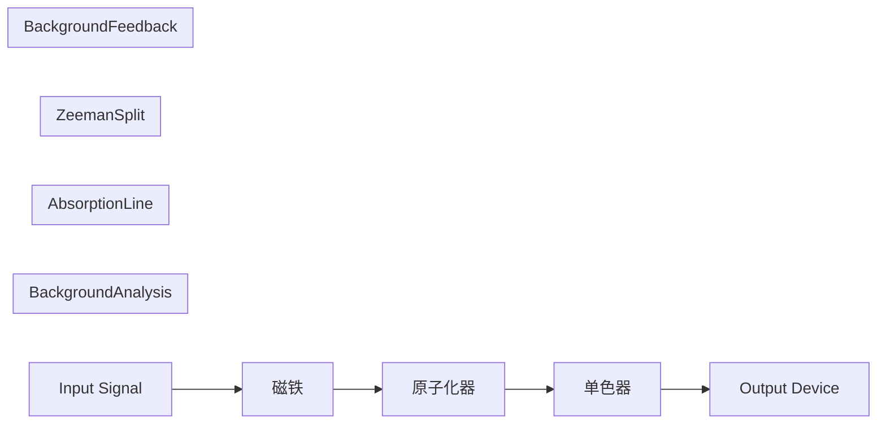
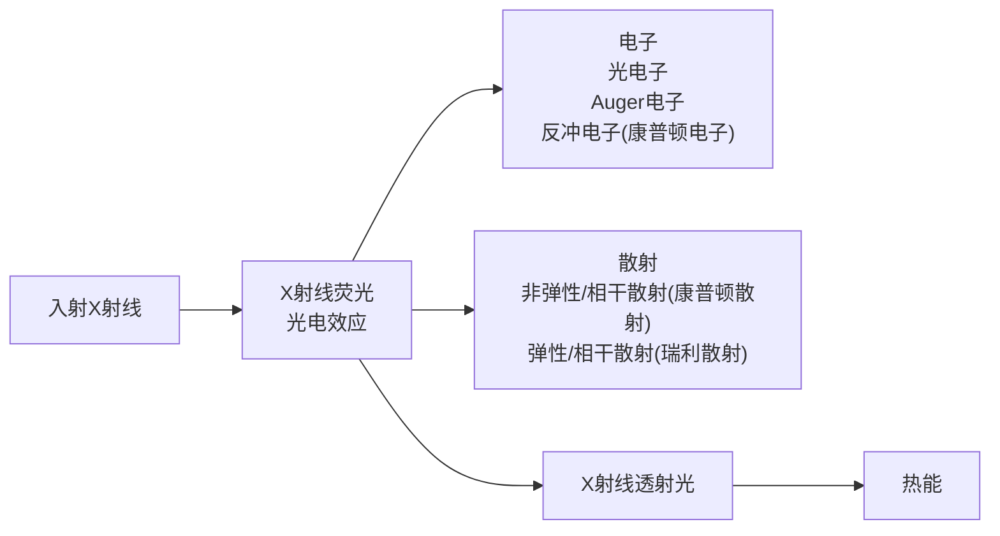
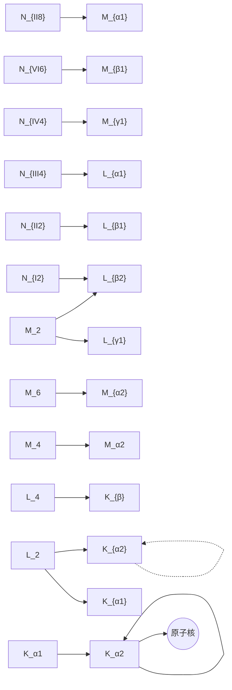
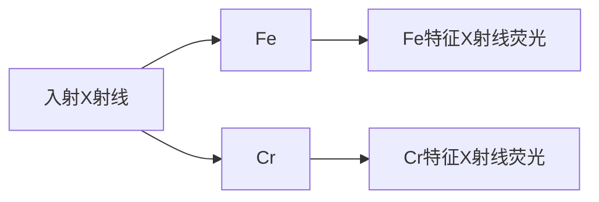
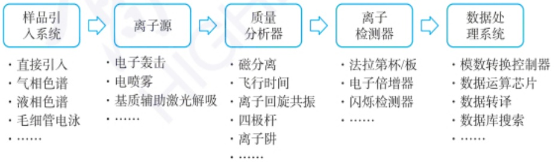
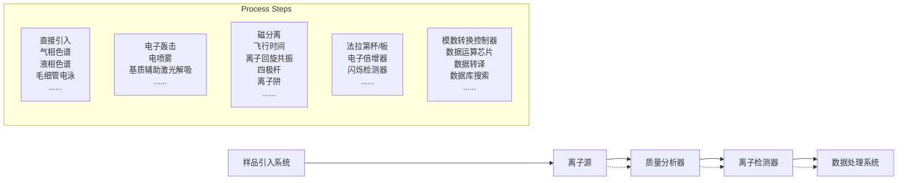

## 恒定磁场调制方式

在原子化器上施加一个垂直于光束的恒定磁场，在磁场作用下，原子吸收线被裂分为一条中心的 $\pi$ 组分及两个等间距的 $\sigma^{\pm}$ 组分。 $\pi$ 组分平行于磁场方向，波长不变； $\sigma^{\pm}$ 组分垂直于磁场方向，波长分别向长波与短波方向移动。位于原始波长处的中心 $\pi$ 组分其吸光度是每个 $\sigma$ 组分吸光度的两倍。背景吸收线不被磁场裂分。

由空心阴极灯发射的谱线经过置于光源与原子化器之间的旋转偏振器，被分解为平行于磁场方向的偏振光 $P_{1}$ 和垂直于磁场方向的偏振光 $P_{\perp}$ 。偏振器的旋转使 $P_{1}$ 和 $P_{\perp}$ 交替通过原子化器。 $P_{1}$ 通过原子化器时，平行于磁场方向的 $\pi$ 组分产生吸收，引起背景吸收的分子也会产生吸收，测得的是原子吸收和背景吸收的总吸光度。当 $P_{\perp}$ 通过原子化器时，平行于磁场方向的 $\pi$ 组分不产生吸收， $\sigma^{2}$ 组分尽管与偏振光方向一致，但波长偏离中心位置约0.01 nm，基态原子只吸收波长差在0.01 nm以下的共振线，因此不会产生原子吸收。而背景吸收对偏振光方向无选择性，且波长范围较宽，此时测得的是背景吸收。两次测量结果为扣除了背景吸收后的净原子吸收值。

方法消除光谱通带内存在的非吸收线产生的干扰。

(2) 背景干扰 背景干扰形成的主要因素为分子吸收和光散射。

① 分子吸收。指在原子化器中生成的分子对辐射的吸收，是一种宽频吸收。包括火焰成分（如 OH、CH、NH、CO 等分子或基团）的吸收、低温火焰中碱金属和碱土金属的卤化物的吸收，高温火焰中碱土金属的氧化物或氢氧化物的吸收等。

石墨炉原子化器中自由原子浓度大、基体成分浓度也大，且停留时间长，因此背景吸收较火焰原子化器高。

② 光散射。指原子化过程中产生的固体微粒对光发生散射，使被散射的光偏离光路而不为检测器所检测，产生假吸收，使测定结果偏高。

因分子吸收和光散射造成的背景吸收可以采用以下方法进行校正。

① 连续光源校正背景。原子吸收分光光度计中配有连续光源自动扣除背景的装置，利用氘灯作为连续光源，因此也称为氘灯背景校正法。利用切光器使锐线光源与氘灯连续光源交替进入原子化器，当锐线光源通过时，检测器检测到的是待测元素对共振辐射产生的吸收与背景吸收之和。当氘灯光源通过时，在同一波长下进行测定，待测元素的共振线吸收相对于背景吸收来说可以忽略，测得的是背景吸收，计算两次测定结果之差，即可扣除背景吸收。

氘灯校正背景装置简单,操作方便,但是氘灯光源的工作波段在190\~360 nm,导致氘灯背景校正具有波长局限性。另外,氘灯为连续光源,测得的背景吸收为光谱通带内的平均背景吸收,并不能代表待测元素测定波长下的实际背景吸收,因此有时会出现过度或校正不足的情况。

② 塞曼效应校正背景。塞曼效应(Zeeman effect)是指谱线在外磁场中发生裂分的现象。在强磁场中，原子的电子能级会发生裂分，引起谱线裂分。

塞曼效应校正背景法分为光源调制法和吸收线调制法。光源调制法是将磁场加在光源上，吸收线调制法是将磁场加在原子化器上，其中后者应用较多。

吸收线调制法可采用恒定磁场调制方式和可变磁场调制方式(见副栏)。

塞曼效应校正背景的原理如图 5.2.11 所示(以吸收线调制法中的恒定磁场调制方式为例)。

flowchart

图 5.2.11 塞曼效应校正背景的原理示意图

塞曼效应校正背景可在 190\~900 nm 波长范围进行背景校正, 可校正吸光度高达 1.5\~2.0 的背景, 背景校正准确度高。但是由于谱线裂分, 使灵敏度降低, 即使是可变磁场调节方式, 灵敏度仍有所下降。不同元素的塞曼效应表现不同, 对某些元素可能无法获得理想的校正结果。此外，仪器装置相对复杂，部件要求高，光路调整难。相对于火焰原子化法，塞曼效应在石墨炉原子化法中的应用效果更好。

③ 用邻近非共振线校正背景。用分析线测定待测元素的吸收及背景吸收，在分析线附近选择一条非吸收线测定背景吸收（待测元素对非吸收线没有吸收），二者之差即为扣除背景吸收后的待测元素对共振线吸收的结果。由于背景吸收随波长的变化而变化，利用非共振线的吸收扣除背景的准确度较差，仅适合分析线附近背景比较均匀的情况。

## 5.2.1.4 原子吸收光谱法的定量方法

## 1. 测量条件的选择

（1）分析线的选择 一般选用待测元素的最灵敏线(第一共振线)作为分析线,若存在其他元素干扰时,可以选用其他共振线。例如,Pb 217.0 nm 线与Sb 217.6 nm线可能重合,分析 Pb 时,一般不用 Pb 217.0 nm 线。在分析待测元素浓度较高的样品时,也可以选用次灵敏线,以避免不必要的稀释操作。
（2）空心阴极灯工作电流的选择 在商品化空心阴极灯的标签上，会标出额定灯电流，通常在保证足够强度和稳定光谱输出的情况下，尽量选用较小的灯电流，一般为额定电流的40%\~50%。若工作电流过大，灯丝发热量大，热变宽和压力变宽增加，自吸增加，辐射强度降低，导致灵敏度下降，且灯寿命会缩短。若灯电流过小，空心阴极灯放电不稳定，分析的灵敏度和精密度降低。
（3）光谱通带宽度的选择 光谱通带宽度与仪器的倒线色散率和狭缝宽度有关。

$$
\Delta \lambda = D S \tag {5-2-15}
$$

式中， $\Delta\lambda$  为光谱通带宽度，nm；D 为分光器的倒线色散率， $nm\cdot mm^{-1}$ ；S 为狭缝宽度，mm。

对于确定的仪器,其倒线色散率是确定的,因此光谱通带宽度只与狭缝宽度有关,光谱通带的调节实际上是通过改变狭缝宽度来实现的。光谱通带宽度影响进入检测器的辐射能量和波长纯度,进而影响灵敏度和工作曲线的线性范围。一般可选用0.4\~0.7 nm的光谱通带,对于谱线复杂的元素可选用0.2 nm的光谱通带。

（4）原子化条件的选择 火焰原子化法包括火焰的选择、燃烧器高度的选择、燃烧器角度的选择。

① 火焰的选择。火焰是保证原子化效率的关键因素，需要根据元素的性质选择火焰种类，容易生成难解离氧化物的元素可选择乙炔-氧化亚氮高温火焰。火焰种类确定之后，要通过实验确定选用贫燃、富燃或者中性火焰。
② 燃烧器高度的选择。火焰不同区域具有不同的温度及氧化还原性质，待测原子浓度和干扰成分浓度也会不同，可以通过实验来确定燃烧器高度，以达到最高灵敏度。
③ 燃烧器角度的选择。燃烧器角度影响光程长，通常情况燃烧器缝口与光轴方向一致，光程长最大，吸光度最大。对于高含量组分的测定，可以调整燃烧器缝口与光轴方向成一定的角度，缩小光程长，减小吸光度。

石墨炉原子化法包括原子化器位置的调节、载气种类及流量选择、冷却水系统设置、加热程序的选择及测量之后石墨管的清洗温度及时间参数设定。

原子化器位置以光经过石墨管后光强损失最小为原则。载气可使用氩气或氮气，通常使用氩气。内载气流速与待测元素有关。冷却水的水温一般控制在 $20^{\circ}C$ ，流量为 $1\sim2L\cdot min^{-1}$ 。加热程序也需要通过实验来确定。实验结束后为消

## 可变磁场调制方式

在原子化器上加一个交变磁场，置于光路中的偏振器是固定的，只允许垂直于磁场的偏振光通过。零磁场时，吸收线不发生裂分，测得的是原子吸收和背景吸收的总吸光度。有磁场时， $\pi$ 组分不吸收垂直于磁场的偏振光，测得的仅是背景吸收值。二者之差为原子吸收的净吸光度，消除了背景吸收的干扰。

## 原子吸收光谱法的特点

优点:（1）检出限低，灵敏度高。火焰原子吸收法的检出限可达到$\mathrm{ng}\cdot \mathrm{mL}^{-1}$级，石墨炉原子吸收法的检出限可达到$10^{-14}\sim 10^{-10}\mathrm{g}$。（2）精度高。火焰原子吸收法的相对误差可小于 $1\%$ ，石墨炉原子吸收法一般为 $3\% \sim 5\%$ 。（3）选择性好。由于原子结构不同，每种元素具有特征光谱，可在多种元素共存的情况下，准确地测定特定元素。（4）分析速度快。（5）应用范围广。可以测定70多种元素，除金属元素外，可以采用间接法测定非金属元素和有机化合物。（6）仪器相对简单，操作方便。

不足:(1)难以进行多元素同时测定。采用空心阴极灯光源,测定每种元素都要更换相应的元素灯,分析效率低。(2)对固体样品测定不便。固体样品需要转化为液体样品进样分析,增加了样品前处理的步骤。(3)对共振线位于真空紫外区的元素测定有困难,对某些高温元素的测定灵敏度较低。

## 参考文献

[1] 郑经国. 分析化学手册: 原子光谱分析. 3 版. 北京: 化学工业出版社, 2016.
[2] 孙汉文. 原子光谱分析. 北京: 高等教育出版社, 2002.
[3] 张新祥, 李美仙, 李娜, 等. 仪器分析教程. 3 版. 北京: 北京大学出版社, 2022.

除记忆效应,应在高于原子化温度下用  $3 \sim 5$  s 的时间除去残留的基态和待测元素。

## 2. 定量分析方法

在原子吸收光谱法中,吸光度与待测元素浓度之间的关系符合朗伯-比尔定律,即待测物质浓度与吸光度值成正比。定量分析方法主要包括标准曲线法和标准加入法。

标准曲线法是常用的定量方法,适用于大批量样品分析,仅适用于基体组成简单的样品。

标准加入法适用于样品基体复杂或待测元素含量低的样品。采用标准加入法可以消除基体干扰,但是不能消除背景吸收的干扰。

内标法亦可用于原子吸收法的定量,但仅适用于双道及多道仪器。

## 3. 分析方法评价

灵敏度和检出限是评价分析方法和仪器的两个重要指标。

(1) 灵敏度 灵敏度 S 是校正曲线的斜率。S 大, 则灵敏度高。

$$
S = \frac {\mathrm{d} A}{\mathrm{d} c} \tag {5-2-16}
$$

在原子吸收分光光度法中,灵敏度用特征浓度(characteristic concentration)来表示,即能够产生1%吸收(吸光度值为0.0044)时所对应的待测元素的浓度,也称1%吸收灵敏度或特征灵敏度。特征浓度越小,灵敏度越高。

在火焰原子化法中,特征浓度  $C_{e}$  为

$$
C _ {\mathrm{c}} = \frac {c \times 0 . 0 0 4 4}{A} \tag {5-2-17}
$$

式中， $C_{c}$  为特征浓度， $\mu g \cdot mL^{-1}$ ; c 为待测元素浓度， $\mu g \cdot mL^{-1}$ ; A 为吸光度值。

石墨炉原子化法中,特征浓度用质量表示。

$$
m _ {\mathrm{c}} = \frac {c V \times 0 . 0 0 4 4}{A} \tag {5-2-18}
$$

式中， $m_{c}$  为特征质量， $\mu g; c$  为待测元素浓度， $\mu g \cdot mL^{-1}; V$  为试液的体积，mL；A 为吸光度值。

（2）检出限 检出限是指以特定的分析方法在适当的置信水平被检出的最低浓度或最小量。在大于等于检出限时，才能准确地将待测信号与噪声信号区分开来。

待测元素的吸收信号等于噪声信号的标准偏差3倍( $3\sigma$ , 99.7%置信度)时所对应的待测元素浓度为该元素的检出限。

$$
D = \frac {c \times 3 \sigma}{A} \tag {5-2-19}
$$

式中， $D$ 为检出限， $\mu \mathrm{g}\cdot \mathrm{mL}^{-1};c$ 为待测元素浓度， $\mu \mathrm{g}\cdot \mathrm{mL}^{-1};A$ 为测定的平均吸光度； $\sigma$ 为空白溶液的测量标准偏差，是对空白溶液进行10次以上连续测定，计算标准偏差而得。

## 5.2.1.5 原子吸收光谱法的应用及发展

原子吸收光谱法已广泛应用于地质、冶金、机械、石油化工、农业、食品、轻工、生物、医药、环境保护和材料科学等诸多领域。直接原子吸收法可测定70多种元素，间接原子吸收法可用来测定阴离子和有机化合物。

随着科学技术的发展,原子吸收技术也在不断进步。传统的空心阴极灯在不断改进，发光强度和稳定性得到提高。采用高强度的稳定连续光源、高分辨率的中阶梯光栅双单色器及高性能CCD检测器的连续光源原子吸收光谱仪可以实现多元素同时测定。气相色谱-原子吸收光谱联用（GC-AAS）和液相色谱-原子吸收光谱联用（LC-AAS），可以实现对复杂样品中元素的形态分析。流动注射技术与原子吸收光谱法相结合，实现了样品的自动化进样和快速分析，提高了分析效率和准确性，减少了人为误差。微型化、便携式原子吸收光谱仪的研发，为现场快速检测提供了可能。原子吸收光谱法的应用也不断拓展，例如，在生物医学领域，原子吸收光谱法可用于测定蛋白质、核酸等生物大分子中的金属离子含量和结合位点，为生物分子的结构和功能研究提供重要信息。随着纳米技术的发展，原子吸收光谱法可用于纳米材料的元素组成、粒径分布和表面性质等方面的分析，为纳米材料的制备和应用提供重要的检测手段。在太阳能电池、锂离子电池等新能源材料的研究中，原子吸收光谱法可用于测定材料中的杂质元素和掺杂元素含量，优化材料的性能和提高电池的效率。

## 5.2.2 原子荧光光谱法

原子荧光光谱法(atomic fluorescence spectrometry, AFS)是利用原子荧光谱线的波长和强度进行物质的定性及定量分析的方法。AFS 是一种痕量组分分析技术，在光谱学研究和应用领域占有重要地位。AFS 是介于原子吸收光谱法和原子发射光谱法之间的原子光谱分析技术，具有谱线简单、干扰少、灵敏度高等优点，因而特别适用于痕量元素（锌、镉、锰等）分析及多元素的同时测定。AFS 近年来得到了快速发展，并且已有多种类型的商品原子荧光光谱仪问世，与原子吸收光谱仪、原子发射光谱仪等形成互补，在冶金、地质、环境监测、生物医学和材料科学等领域应用广泛。

## 5.2.2.1 原子荧光光谱法的基本原理

## 1. 原子荧光的类型

原子荧光是一种光致发光现象,是待测元素的原子蒸气吸收特定频率电磁辐射后由基态跃迁至激发态,然后回到较低能态或基态时发射出的一定波长的辐射。根据产生机理,原子荧光可以分为共振荧光、非共振荧光和敏化荧光三种类型,其中共振荧光的应用最多。

（1）共振荧光 基态原子核外层电子吸收共振频率的光辐射后被激发，再发射出与共振频率相同的光辐射，即为原子共振荧光。如图5.2.12(a)所示，其特征是原子的激发辐射线和荧光辐射线所涉及的高低能级都相等。如锌原子吸收$213.86\mathrm{nm}$ 的辐射光，其发射的荧光辐射的波长也为 $213.86\mathrm{nm}$ 。

text_image

A
F
1
0
2
3

(a) 共振荧光

text_image

A
F
1
2
3
0

(b) 直跃线荧光

text_image

A
F
0
1
2
3

(c) 阶跃线荧光

0—原子基态；1，2，3—原子激发态；A—吸收，F—荧光，---无辐射跃迁

图 5.2.12 原子荧光的常见类型

[4] 武汉大学. 分析化学: 下册. 6 版. 北京: 高等教育出版社, 2018.
[5] 董慧茹. 仪器分析. 4 版. 北京: 化学工业出版社, 2022.
[6] 胡坪, 王氢. 仪器分析. 5 版. 北京: 高等教育出版社, 2021.
[7] 王玉枝, 宦双燕, 张正奇. 分析化学. 4 版. 北京: 科学出版社, 2023.
[8] Skoog D A, Holler F J, Crouch S R. Principles of Instrumental Analysis. 7th ed. Boston: Cengage Learning, 2017.

原子荧光现象是原子吸收现象的逆过程，于1905年首次在氯化钠的气体火焰中观测到。直到1964年I. D. Winefordner等科学家才建立了一种火焰原子荧光的测定方法，确定原子荧光光谱可作为一种仪器分析方法测定某些元素，并推导出其定量分析的依据。原子荧光分析方法的出现推动了原子光谱法领域的新发展，相继涌现出大量的相关研究成果。

我国的分析化学工作者在原子荧光光谱法领域投入了极大热忱，使该技术在我国得到了很好的发展。我国最早研制的原子荧光光谱仪是冷原子荧光测汞仪，相继又研发了早期的火焰-非色散原子荧光光谱仪和蒸气发生-原子荧光光谱仪。这些仪器的推出和逐步完善，使得原子荧光光谱技术在我国得到了广泛的应用。截至2024年，蒸气发生-原子荧光光谱仪已推出4通道仪器，可同时测定4种元素。

（2）非共振荧光 当发射的荧光与激发光的频率不同时，即为非共振荧光。非共振荧光又分为直跃线荧光和阶跃线荧光。

① 直跃线荧光。激发态原子跃迁回至高于基态的亚稳态时所发射的荧光，如图5.2.12(b)所示。如果荧光线激发能大于荧光能，即荧光线的波长大于激发线的波长称为斯托克斯(Stokes)荧光，图5.2.12(b)左、右的直跃线荧光即为斯托克斯荧光。反斯托克斯(anti-Stokes)荧光是自由原子跃迁至某一能级，其获得的能量一部分是由光源激发能供给，另一部分是热能供给，然后返回低能级所发射的荧光。反斯托克斯荧光的荧光能大于激发能，荧光线波长小于激发线波长，如图5.2.12(b)中间部位的荧光。
② 阶跃线荧光。激发态原子先以非辐射形式去活化返回到较低能级，再以辐射形式返回到基态而发射的荧光称为阶跃线荧光。如图 5.2.12(c) 所示，阶跃线荧光中的荧光线波长都大于激发线波长。
（3）敏化荧光 激发态原子通过碰撞将其激发能转移给另一种基态原子使其激发，后者再以辐射方式去活化而发射荧光。但火焰原子化器中的原子浓度很低，主要以非辐射方式去活化，因此观察不到敏化荧光。

以上各类原子荧光中,共振荧光的谱线强度最大,最为常用。但个别元素的非共振荧光谱线灵敏度更高。

## 2. 原子荧光定量分析的基本关系式

当光源强度稳定、辐射光平行、自吸可忽略时，原子荧光强度 $I_{F}$ 与基态原子对特定频率光的吸收强度 $I_{A}$ 成正比，即

$$
I _ {\mathrm{F}} = \Phi I _ {\mathrm{A}} \tag {5-2-20}
$$

式中， $\Phi$  为荧光量子效率，其定义为

$$
\Phi = \frac {F _ {\mathrm{f}}}{F _ {\mathrm{A}}} \tag {5-2-21}
$$

式中， $F_{f}$  为单位时间发射的荧光光子数， $F_{A}$  为单位时间吸收激发光的光子数。但是受激发后的原子，可能发射共振荧光，也可能发射非共振荧光，还可能无辐射跃迁至低能级（图 5.2.12），因此在一般情况下荧光量子效率小于 1。

根据朗伯-比尔定律,可得

$$
I _ {\mathrm{F}} = \Phi I _ {0} A (1 - \mathrm{e} ^ {- \varepsilon L N}) \tag {5-2-22}
$$

式中， $I_{0}$  为原子化器单位面积上接收的光源辐射强度；A 为光源照射在检测系统的有效面积； $\varepsilon$  为峰值吸收系数；L 为吸收光程长；N 为单位体积内的基态原子数。

将式(5-2-22)的指数项按泰勒级数展开,高次项忽略,可得

$$
I _ {\mathrm{F}} = \Phi I _ {0} A \varepsilon L N \tag {5-2-23}
$$

当实验条件一定时,试液中待测元素的浓度 c 与原子蒸气中单位体积内的基态原子数 N 成正比,即

$$
N = a c \tag {5-2-24}
$$

将式(5-2-24)代入式(5-2-23)得到

$$
I _ {\mathrm{F}} = \Phi I _ {0} A \varepsilon L a c \tag {5-2-25}
$$

实验条件一定时， $\Phi$ 、A、 $I_{0}$ 、 $\varepsilon$ 、L 和 a 均可视为常数，则原子荧光强度与试液中待测元素的浓度成正比，即

$$
I _ {\mathrm{F}} = K c \tag {5-2-26}
$$

式中，K 为常数。式(5-2-26)为原子荧光光谱法定量分析的基本关系。由式(5-2-25)可知:

① 荧光强度随激发光源强度的增加而增大,因而用强光源可提高灵敏度,降低检出限;
②延长吸收光程,可提高灵敏度;
③ 式(5-2-25)只有在待测元素浓度较低时才成立,高浓度时 $I_{F}$ 与c的关系为非线性,所以原子荧光光谱法特别适用于痕量元素测定;
④ 量子效率  $\Phi$  随火焰温度和火焰组成而变化, 因此必须严格控制这些因素。

## 3. 原子荧光的猝灭

处于激发态的原子寿命是十分短暂的，当它从高能级跃迁到低能级时将发射出荧光，但也可能在原子化器中与其他粒子发生非弹性碰撞而丧失其能量。在后一种情况下，荧光将减弱或完全不产生，这种现象称为荧光猝灭。

原子荧光的猝灭有下述几种类型:

(1) 与自由原子碰撞 激发态原子  $M^{*}$  回到基态:

$$
\mathrm{M} ^ {*} + \mathrm{X} \longrightarrow \mathrm{M} + \mathrm{X}
$$

M 和 X 为中性原子。

或形成不同的激发态:

$$
\mathrm{M} ^ {*} + \mathrm{A} \longrightarrow \mathrm{M} ^ {\mathrm{x}} + \mathrm{A}
$$

$M^{*}$  和  $M^{x}$  为 M 的不同激发态。

(2) 与分子碰撞 激发态原子  $M^{*}$  回到基态:

$$
\mathrm{M} ^ {*} + \mathrm{AB} \longrightarrow \mathrm{M} + \mathrm{AB}
$$

这是形成荧光猝灭的主要原因，AB可能是火焰燃烧的主要产物。

或者形成不同的激发态:

$$
\mathrm{M} ^ {*} + \mathrm{AB} \longrightarrow \mathrm{M} ^ {\mathrm{x}} + \mathrm{AB}
$$

或者发生化学反应:

$$
\mathrm{M} ^ {*} + \mathrm{AB} \longrightarrow \mathrm{M} + \mathrm{A} + \mathrm{B}
$$

A 和 B 为火焰中存在的分子或稳定的自由基。

(3) 与电子碰撞

$$
\mathrm{M} ^ {*} + \mathrm{e} ^ {-} \longrightarrow \mathrm{M} + \mathrm{e} ^ {-}
$$

上述荧光猝灭过程将导致荧光量子效率降低,荧光强度减弱,因而严重影响原子荧光分析的灵敏度。为了减小猝灭的影响,应当尽量降低原子化器中猝灭粒子的浓度,特别是猝灭截面大的粒子的浓度。另外,还要注意减少原子蒸气中二氧化碳、氮和氧等气体的浓度。

## 5.2.2.2 原子荧光光谱分析仪器

原子荧光光谱仪的组成与原子吸收光谱仪相似，由激发光源、原子化器、分光系统及检测系统四部分组成。为了避免光源对原子荧光测定的影响，光源与原子化器后面的光学系统、检测系统一般呈 $90^{\circ}$ ，如图5.2.13所示。

（1）激发光源 在原子荧光光谱仪中，最常采用的光源是空心阴极灯和无极放电灯。为提高灵敏度和多元素同时分析的能力，也可以使用连续光源，如氙弧灯。
（2）原子化器 除采用石英炉管原子化器，原子荧光光谱仪中的原子化器的类型基本与原子吸收光谱仪中的相同。
（3）分光系统 原子荧光光谱简单，谱线干扰小，对单色器的分辨率要求不高。色散型原子荧光光谱仪中的色散原件为光栅或棱镜，非色散型原子荧光光谱仪的色散原件为滤光片。
(4) 检测系统 在色散型原子荧光光谱仪中, 目前普遍使用的检测器仍以普

flowchart

图 5.2.13 原子荧光光谱仪示意图

原子荧光光谱仪器的研制经历了长期的发展，今后这也依然是原子荧光光谱法研究的主要方向。目前，原子荧光光谱法在多个领域的广泛应用加速了相关仪器的便携化和小型化研发。适合现场测试的便携式原子荧光光谱仪器及其器件可以为一些特定元素的检测进行深度化定制设计。例如，科学工作者开发了一种可用于Se光化学蒸气发生的小型化紫外发光二极管光化学反应器，只有硬币大小，可与AFS相结合实现痕量Se的测定（J.Anal.At.Spectrom.,2018,33,1217-1223）。但便携式原子荧光光谱仪需要在分析性能和仪器体积之间进行平衡。

思考:原子荧光光谱属于吸收光谱还是发射光谱范畴?原子荧光光谱仪的仪器构成与原子发射光谱仪和原子吸收光谱仪有什么异同?

## 相关应用请参考:

Anal Chim Acta, 2017, 963, 53–60.

通的光电倍增管为主；对于非色散型光谱仪来说，为了消除日光的影响，必须采用光谱响应范围为 $160\sim 320~\mathrm{nm}$ 的日盲光电倍增管。

在各种原子荧光光谱仪中,单通道原子荧光光谱仪应用较多,也有利用两个空心阴极灯的供电脉冲之间的相位差,采用一个检测器的双通道仪器,分析效率提高。也有用于多元素分析的多通道原子荧光光谱分析仪。

## 5.2.2.3 原子荧光光谱法的应用

原子荧光光谱法定性分析的依据与原子吸收和原子发射一样,是基于不同原子的核外电子结构不同,吸收和发射谱线的波长不同而实现定性分析的。因此可以采用原子吸收和原子发射光谱法中相同的定性分析方法。

原子荧光光谱法的定量方法常采用标准曲线法和标准加入法。在低浓度时，线性范围宽，通常为3\~5个数量级，优于原子吸收光谱法，再加上极高的灵敏度、极低的检测限（如测镉、锌等元素可达 $1\ pg\cdot mL^{-1}$ ），因而原子荧光光谱法特别适合分析超纯物质、环境污染物、生物活性材料中痕量及超痕量元素。

原子荧光光谱法具体应用很多，如锌、锰、镉等多元素的分析测定，酸雨中锌的测定，盐矿中硒、碲的测定，矿石中痕量锡的测定等。尤其是稀土元素的原子/离子荧光光谱分析可克服光谱干扰，因而原子荧光光谱法已成为稀土元素分析的有效方法之一，得到了广泛应用。此外，以激光作为激发光源的原子荧光光谱法取得了令人瞩目的成果，特别是20世纪80年代中期发展起来的电热原子化器-激光激发原子荧光光谱法可以完成许多其他方法难以完成的痕量分析任务，如大气中的汞、南极冰雪样品中的铝和锌、土壤间气流中的金、海洋沉积物中金和钯的测定等。该方法也为我国的环境监测、矿产资源勘探等提供了非常有意义的信息支持。在科学前沿研究领域，我国科学工作者利用火焰原子荧光光谱仪，建立了河口和沿海水域痕量Mn自动在线预浓缩检测系统，具有高准确度、高精度、集成度高、能耗低、辅助设备简单等优点，适合现场作业。与其他常见的现场应用分子光谱仪相比，火焰原子荧光光谱法固有的高选择性和多元素适用性突出了所提出的分析系统的优越性和潜力。该系统成功应用于沿海水域溶解Mn的现场车载测定及天然水样分析。

## 习题

## - 章节练习题 -

1. 为什么原子吸收光谱分析中的谱线干扰不像发射光谱那样严重？
2. 在原子吸收光谱中, 影响吸收线宽度的因素有哪些?
3. 什么是积分吸收,什么是峰值吸收? 原子吸收分析中为什么采用峰值吸收?
4. 简述空心阴极灯的工作原理，并说明为什么空心阴极灯会发射锐线。
5. 为什么石墨炉原子化法比火焰原子化法的灵敏度高？
6. 简述原子荧光光谱、原子吸收光谱和原子发射光谱三者之间的区别。
7. 原子荧光是怎样产生的？有哪几种类型？
8. 什么是荧光猝灭？荧光猝灭有哪几种类型？如何降低荧光猝灭的影响？
9. 原子荧光光谱法的特点有哪些？与原子吸收和原子发射相比，有什么特点？

10. 原子荧光光谱法的定性和定量依据分别是什么？

## - 挑战性问题 -

11. 结合课本所学知识,并查阅相关文献,讨论回答如何提高原子荧光光谱仪的灵敏度。
12. 原子荧光涉及原子吸收和释放能量两个过程,通过查阅相关文献回答如何规避原子吸收能量过程对原子荧光测量的影响。

## -专题或报告-

13. 在利用原子吸收光谱法测定金属元素时，一般需要用该元素的空心阴极灯作为锐线光源。目前已有采用连续光源的原子吸收光谱仪，请通过查阅资料了解这种仪器，分析其设计思想可能存在的问题，并介绍其应用现状。

14. 查阅文献, 讨论回答目前原子荧光光谱仪的科学研究方向是什么。

## 5.3 X射线荧光光谱法

1908 年, 英国物理学家 C. G. Barkla 和 C. A. Sadler 发现物质中组成元素与物质受 X 射线辐照后会发出相关谱线, 也就是所谓的元素特征谱线。1913 年, Henry G. J. Moseley 研究了各种元素的特征光谱, 发现元素的特征谱线波长倒数的平方根与该元素原子序数成正比, 这就是著名的 Moseley 定律, 它奠定了 X 射线荧光光谱 (X-ray fluorescence, XRF) 分析的基础。

## 5.3.1 X射线荧光光谱法原理

X 射线与原子相互作用主要有散射和光电效应两种类型(图 5.3.1)，散射又分为康普顿散射(非弹性散射)和瑞利散射(弹性散射)。同时，还有一部分射线可能穿过样品，未与原子发生实质相互作用。在对 X 射线荧光信号分析时，以上过程都有可能对荧光信号产生影响，在具体分析中需要考虑。

flowchart

图 5.3.1 X 射线与原子相互作用过程

X射线的发现

X射线的特征性分析

（1）X射线荧光过程 具有一定能量的X射线与原子相互作用，把部分能量传递给原子内层电子，将其激发到能量较高的轨道，甚至打出原子外，使原子轨道上形成电子空穴，随后在 $10^{-24}\sim10^{-12}$ s，该原子内层电子重新配位，高能级的轨道电子可跃迁到电子空位的能级，以补充电子空位，同时释放出相当于跃迁电子初态能级与终态能级差的能量。这一能量可能以辐射的形式放出，即X射线荧光。

由此,特征 X 射线光子的能量等于能级间的能量差,即著名的 Moseley 定律,如式(5-3-1)所示:

$$
E = - R h c (Z - \sigma) ^ {2} \left(\frac {1}{n _ {\mathrm{f}} ^ {2}} - \frac {1}{n _ {\mathrm{i}} ^ {2}}\right) \tag {5-3-1}
$$

式中， $R$ 为德伯频率； $h$ 为普朗克常量； $c$ 为光速； $Z$ 为原子序数； $\sigma$ 为屏蔽常数； $n_{\mathrm{i}}$ ，$n_{\mathrm{f}}$ 为核外电子由 $n_{\mathrm{i}}$ 跃迁至 $n_{\mathrm{f}}$ 层。

轨道电子的主量子数取值 1,2,3, $\cdots$ ,n,与之对应的主壳层轨道分别以 K、L、M、N 等符号表示。在 X 射线荧光光谱中，谱线在命名时，将形成电子空穴，并通过电子跃迁被电子补位的壳层的轨道命名谱线的系列，如 K 系、L 系等。又由于高能级轨道电子的来源，以及同一主壳层内电子的能级裂分，使得元素的同一线系下包含多条谱线，如  $K_{\alpha1}$  线、 $K_{\alpha2}$  线、 $K_{\beta1}$  线等。特征 X 射线的产生及其相应的线系，可用能级图加以说明，如图 5.3.2 所示。

flowchart

图 5.3.2 X 射线能级图及特征 X 射线的产生

(2) Auger 效应 有一定能量的 X 射线与原子相互作用,使原子轨道上形成电子空穴,在电子重新配位辐射能量时,并不一定产生特征 X 射线荧光,还可能通过射出另一个合适能级轨道上的电子的形式将能量通过无辐射跃迁的形式释放掉。这个过程被称为俄歇效应(Auger effect),在 Auger 发射过程中释放的电子称为 Auger 电子。荧光发射与 Auger 电子发射是两种竞争性效应。在 X 射线荧光图谱上,Auger 电子发射效应体现为 X 射线荧光特征线的伴线,或者卫星线。Auger 发射的强度随波长增大或能量降低而增强,轻元素因而更容易产生 Auger 效应,降低轻元素的荧光产额。
（3）XRF中的光谱背景 光谱背景的主要来源:宇宙射线；环境的放射性辐射；放大器及检测器电噪声；初级辐射连续谱的非相干散射（康普顿散射）；放射性样品的辐射；分光晶体及其他光路器件的次级辐射等。其中光管初级辐射连续谱的非相干散射为背景的主要来源，其次是光谱仪光路器件的散射。瑞利散射，也称相干散射，入射光与线度小于光波长的微粒（原子内一般为电子）相互作用，光子方向改变，但能量保持不变，也被称为非变质散射。相干散射是X射线衍射的理论依据，是晶体分光的重要依据。入射X射线光子与原子中结合松弛的电子发生碰撞时，电子因受冲击而离开原子并带走部分能量，入射光子因损失部分能量而改变传播方向和波长的现象称为非相干散射或康普顿散射。非相干散射或非弹性散射是由康普顿首先发现的，我国物理学家吴有训在证实非相干散射及其规律的研究中做出了重要贡献，因此这种散射现象又称为康普顿-吴有训散射。

（4）XRF中的光谱干扰 样品中分析元素以外的组分也就是共存元素统称为基体，基体效应是X射线荧光光谱分析方法中不可避免的客观现象，样品中基体效应影响并制约着分析元素的测量准确度和分析精确度，是给X射线荧光带来误差的主要因素。基体效应包括样品的基本化学组成（吸收-增强效应）和物理-化学状态(物理-化学效应)差异对分析线强度的影响。

吸收效应包括两个部分,一是指基体元素对来自X射线管入射到样品的初级X射线的吸收(初级吸收效应),二是指基体元素对来自样品的荧光X射线的吸收(二次吸收效应)。增强效应是指分析元素的特征谱线除了受来自X射线管的一次X射线的激发外,还受基体元素特征谱线的激发,使分析线的荧光强度增强。

以简单的 Cr-Fe 二元系样品为例,说明元素间的吸收-增强效应(图 5.3.3)。

flowchart

图 5.3.3 元素间的吸收-增强效应

如果关注 Cr 元素的含量, 即可将 Cr 视为样品, 元素 Fe 视为基体。已知两种元素的最强特征线及吸收限的关系: Fe 的初级荧光 ( $FeK_{a}$ ) 能高效激发样品中的元素 Cr。因此 Cr 受激发的次数等于由光管初级辐射直接激发产生的  $CrK_{a}$  线强度与由基体元素 Fe 的初级荧光  $FeK_{a}$  激发 Cr 产生的  $CrK_{a}$  次级荧光之和。由于基体中 Fe 元素的存在, 使得 Cr 的信号得到了增强。同理, 由于基体中 Cr 元素的存在, 使得 Fe 的信号被吸收减小。

二次吸收效应对分析元素的探测的影响通常比初级吸收效应严重,但比较容易预测、校正和计算。理论上,所有分析元素都受样品基体共存元素的影响。分析元素的强度不仅取决于分析物的浓度,还和样品中其他组分有关,在分析过程中可以通过数学校正和经验校正的方法处理结果,提高分析的准确性。

颗粒度、均匀性及表面结构的差异对样品元素发射的特征 X 射线强度产生影响。样品物理状态的影响可以通过合理制样使其减少或消除。

（5）X射线的吸收 前边讲到的无论是康普顿散射、瑞利散射还是X射线荧光、俄歇效应，都强调了在光子发射侧的规律。在X射线入射一侧的光子在与物质作用后的变化规律同样可以体现出上述物理过程的发生。

一束强度为  $I_{0}$  的单色 X 射线照射厚度为 l 的均匀吸收体时, 其初始强度将衰减至出射强度 I, 其强度的衰减遵循朗伯-比尔定律:

$$
\frac {\mathrm{d} I}{I} = - \mu \rho \mathrm{d} l \tag {5-3-2}
$$

$$
I = I _ {0} \mathrm{e} ^ {- \mu \rho l} \tag {5-3-3}
$$

式中， $\mu$  为质量衰减系数； $\rho$  为样品密度。

将质量衰减系数与波长或能量的对应关系画图,会得到一个不连续的曲线。

Ni-Fe 二元体系的基体校正

基体效应的数学校正一般分经验系数法、基本参数法和理论影响系数法三类。经验系数法是采用经验性的校正方程和系数来校正元素间的吸收-增强效应的方法。基本参数法是利用一些基本参数（如质量衰减系数，吸收跃迁因子，谱线分数和荧光产额等）和标样的测量强度进行迭代求未知样的浓度的方法。理论影响系数法中的影响系数通过理论计算出来，一般不依赖标样。

line

| Feature | Description |
| --- | --- |
| X-axis | 入射光子能量 |
| Y-axis | \(衰减系数\mu\) |
| Key Points | L1, L2, L3 |
| Point K | Local minimum in decay coefficient |

图5.3.4 质量吸收系数与X射线能量关系

表 5.3.1 特征 X 射线穿透一些

材料的临界厚度 单位: $\mu m$

| 吸收材料 | $MgK_{\alpha}$ | $CrK_{\alpha}$ | $SnK_{\alpha}$ |
| --- | --- | --- | --- |
| 铅 | 0.6 | 4.0 | 50 |
| 铁 | 0.9 | 30.0 | 260 |
| $SiO_{2}$ | 7.0 | 100 | 0.8 cm |
| $LiB_{4}O_{7}$ | 12.0 | 800 | 4.1 cm |
| $H_{2}O$ | 14.0 | 900 | 4.7 cm |

波长色散型指使用晶体分光的波长色散型光谱仪，效率较低，一般采用大功率发光激发。用于高精度、高灵敏度定量分析。在 $4 < Z < 92$ （Be-U）范围所有元素的光谱均具有很高的分辨率。

这是由于原子各壳层中的电子束缚能是量子化的,因而在特定的能量下质量衰减系数会出现若干不连续的跳跃点,这些特征的吸收突变称为吸收边或吸收限。

图 5.3.4 是质量衰减系数与 X 射线能量关系的一个示例。由图可见，随着入射光子能量的增加，X 射线在物质中的穿透能力增加，吸收下降。但是当入射光子能量稍稍比吸收边大时，因为入射光子的能量恰好大于该能级的最小激发能，光子能量可以激发出原子中的光电子，产生了对应能级的光电吸收会突然上升。不同元素的原子的壳层电子的势能不同，也就具有各自的特征吸收曲线。能从给定元素原子的特定能级逐出一个轨道电子需要的最低能量或最长波长为该元素特定能级的吸收限。能够在各元素的吸收谱中找到 1 条 K 吸收边、3 条 L 吸收边、5 条 M 吸收边和 7 条 N 吸收边。

吸收边概念在二次激发中用于说明特征 X 射线的产生与激发效率十分重要。这里还需要强调，由于只有波长短于某吸收限的光子才能激发出相应的特征谱线，因此任一元素对其自身的特征谱线都具有很高的透明度。

X 射线穿透物质的最大深度称为样品的临界厚度,超过临界值的厚度称为无限厚。由朗伯-比尔定律可以计算 99% 吸收情况的透射厚度  $d(\mu\mathrm{m})$ :

$$
d = 4 6 0 0 0 / (\mu \rho)
$$

式中， $\mu$  为质量衰减系数 $\left(\mathrm{cm}^{2}\cdot\mathrm{g}^{-1}\right)$ ;  $\rho$  为样品密度 $\left(\mathrm{g}\cdot\mathrm{cm}^{-3}\right)$ 。

特征 X 射线在固体样品中的透射深度通常只有几微米到几百微米。表 5.3.1 中列出了特征 X 射线穿透一些常用材料的临界厚度。

## 5.3.2 XRF 的谱仪类型和结构

X射线荧光光谱仪通常分为两大类，波长色散X射线荧光光谱仪（WDXRF，如图5.3.5所示)和能量色散X射线荧光光谱仪(EDXRF)。XRF仪器的基础结构包括X射线光源和探测器。除此之外还需要必要的机械系统、辅助系统和数据处理系统。波长色散光谱仪主要部件包括激发源、分光晶体、测角仪、探测器等，而能量色散光谱仪则只需激发源、探测器及相关电子与控制部件。

text_image

样品
准直器
探测器
分光晶体
X射线荧光光管

图 5.3.5 波长色散 XRF 结构示意图

（1）X射线的光源 常用的X射线激发源主要是各种X射线光管，电子、质子、放射性同位素、同步辐射等也可用作激发源。

X射线光管是常规分析中首选的激发源。当用高能电子束照射物质时，入射高能电子被物质组成元素中的电子减速，这种带电粒子的负加速会产生宽带的连续X射线谱，简称为连续谱或韧致辐射。另外，化学元素受高能光子或粒子的照射，如内层电子被激发，则当外层电子跃迁时，就会放射出同样符合莫塞莱定律的特征X射线。X射线光管产生的连续谱和特征谱都可用于激发待测元素。

对于连续 X 射线,每种波长对应的连续谱强度随光管施加电压的平方而增加,还跟电流和靶材原子序数成正比(图 5.3.6)。

line

| Material | Current (mA) | Voltage (kV) | Target Material (U) |
| --- | --- | --- | --- |
| 13 Al | 10 | 10 | — |
| 24 Cr | 20 | 20 | — |
| 29 Cu | 30 | 30 | — |
| 42 Mo | 40 | 40 | — |
| 47 Ag | — | — | 47 Ag |
| 74 W | 30 | — | 74 W |
| 78 Pt | 40 | — | 78 Pt |
| 92 U | 50 | — | 92 U |

图 5.3.6 影响连续 X 射线光谱分布的若干参数

特征 X 射线的强度计算公式为

$$
I _ {\mathrm{K}} = C i (V - V _ {\mathrm{K}}) ^ {n} \tag {5-3-4}
$$

式中，C 为常数；i 为 X 射线光管的工作电流；V 为 X 射线光管的工作电流电压； $V_{K}$  为每种元素的 K 系临界激发电位； $n \approx 1.7$ 。

无论 X 射线光管激发条件如何变动,各光谱的强度分布都有一个仅与光管电压  $V(\mathrm{kV})$  有关的短波极限  $\lambda_{0}$  (最短波长), 短波极限  $\lambda_{0}$  与电流和靶材的原子序数无关:

$$
\lambda_ {0} = 1. 2 4 / V
$$

（2）探测器 将不能直接测量的 X 射线光子信号转变成可测量的电脉冲信号的装置，即 X 射线探测器。X 射线光谱分析中常用的三种探测器是充气正比计数器、闪烁计数器和半导体固体探测器。
（3）分光晶体 分光晶体又称分光器、单色器，它的作用是使二次X射线束发生色散，借此每条谱线可以单独进行测量。在波长色散X射线荧光光谱仪中，基本上可以分为晶体色散和非晶体色散两种方式。对于晶体色散来说可采用平晶(非聚焦)也可采用弯晶(聚焦)。对于LiF、KBr等晶体，应用单一的弯面晶体（约翰逊法）与平面晶体比较，其分辨率约高1倍左右，测量灵敏度则可提高3\~5倍。对于非晶体色散来说，主要是光栅和全反射镜面反射器这两类。

波长色散型谱仪是根据 X 射线衍射原理,用分光晶体为色散元件,以布拉格定律为基础,对不同波长的特征谱线进行分光,然后进行检测。波长色散型谱仪有分辨率好、灵敏度高等优点,应用比较广泛。

能量色散是X射线荧光光谱仪的另一种色散类型。探测器是能量色散分光的核心部件，它的发展主要是随着其分辨率的改善而得以全面的发展。探测器不仅起到光电转换作用，而且起能量甄别作用。和波长色散型仪器不同，能量色散X射线荧光光谱仪的探测系统因为没有晶体和测角仪，所以不需要任何的移动部件，仪器可以排布得非常紧凑。即使是功率较小的激发源，仍能满足分析需求。

XRF样品的制备:压片法与熔片法

## 5.3.3 XRF的应用

一种理想的 XRF 样品具有如下的特点: 制备的样品具有整体代表性; 样品的化学组成成分分布均匀; 样品表面平整、光滑, 检测具有可重复性; 满足所需分析各元素的无限厚度要求。适用于 X 射线荧光光谱分析的样品形态有固体、粉末、液体、固溶体及薄膜等种类。

硼酸盐熔融是一种适用于大多数固体材料的样品制备技术，该方法最早由Claisse提出，被公认为是X射线荧光光谱的一种最精确的制样方法。在经典熔融法中，常用的熔剂有无水四硼酸钠、无水四硼酸锂、无水偏硼酸锂及各种比例的混合物。样品在高温下分散在熔融的助熔剂中，降温后固化生成玻璃体，从而消除各种复杂多变的矿物效应、颗粒效应等多方面的影响。表5.3.2为XRF典型的制样方法。

表 5.3.2 XRF 典型的制样方法

<table><tr><td>样品类型</td><td>样品种类</td><td>制样方法</td><td>制样意图</td></tr><tr><td>块体</td><td>金属、合金、矿石等</td><td>切割后用沙带抛光处理</td><td>获得光洁平整表面</td></tr><tr><td>粉末</td><td>金属、有机/无机物等粉末</td><td>研磨均匀后压片</td><td>获得平整表面</td></tr><tr><td rowspan="3">液体</td><td>土壤、玻璃等氧化物粉末</td><td>加助熔剂熔融制片</td><td>消除矿物效应、颗粒效应</td></tr><tr><td>水基溶液</td><td>直接加入专用样品杯中</td><td>He环境直接测试</td></tr><tr><td>油、有机溶液</td><td>点滴滤纸、沉淀过滤等</td><td>转化为固体测量</td></tr></table>

壁画底层物质元素分布成像

利用 X 射线荧光显微成像技术观察斑马鱼

颗粒效应可忽略时,粉末样品简单快捷的制备方法是直接压制成一定均匀致密的样片,压制时可视情况添加黏结剂,制样操作非常简单、快速。

液体样品由于不存在颗粒度等物理性质影响,而几乎成为一种理想样品的类型。可以直接测量,或经富集后在滤纸等支撑膜上测量。

定性分析可以基于波长色散扫描模式利用测角仪进行角度扫描，通过晶体对X射线荧光进行分光，再解析谱图以获知样品中所含的元素。也可基于能量色散扫描模式，利用检测器对X射线能量的分辨，解析谱图获知样品中所含的元素。如测量一份黑曜石样品时，在X射线荧光光谱仪上可以扫描获得如图5.3.7所示的荧光光谱，通过特征谱线的位置识别含有哪些元素。

spectrogram

| Element | Energy (keV) |
| --- | --- |
| K | ~3.5 |
| Ti | ~6.0 |
| Fe | ~6.4 |
| Zn | ~8.6 |
| Rb | ~13.9 |
| Y | ~15.4 |
| Nb | ~17.1 |
| Zr | ~15.9 |

图 5.3.7 黑曜石样品的 XRF 光谱

半定量分析的准确度比定量分析稍差,也称为无标样定量分析,该方法一般是将大量理论和经验的参数,以及一组用于半定量分析的标准样品的测试值内置到软件中,使得在每次测试未知样品时不测量相应校正标样也能得到比较满意的定性和含量数据。

X 射线荧光光谱定量分析是采用一定的制样方法,选择合适的测量条件,获得净谱峰强度,并在此基础上,借助一定的数学方法,定量计算分析物浓度的方法。对校正标样有严格的要求,常规的定量分析最好采用相似标样,绘制标准曲线可以快速准确地实现物质的定量分析。

在进行定量、半定量分析时，需要对基体效应进行数学校正。当样品中被测物存在分析谱线重叠时，可用比例法扣除干扰。对于复杂体系，需要通过解谱或拟合来消除干扰。

XRF 定量、半定量方法在测试物质元素组成方面，具有无损、快速、准确等优点，在冶金、地质、化工、机械、石油、建筑材料等工业部门，农业和医药卫生，以及物理、化学、生物、地学、环境、天文及考古等科研部门都获得了广泛的应用。

微区 X 射线荧光光谱分析是 X 射线荧光光谱分析的一个重要分支, 是一种基于能量色散 X 射线荧光分析技术, 可实现对微米级区域样品中主量、次量及痕量元素定性和定量分析的方法, 具有原位、多维、动态和非破坏性的特征。

## 习题

## - 章节练习题 -

1. 简述 X 射线荧光发生的过程及利用 X 射线荧光进行定性定量分析的原理。
2. 举例说明 X 射线荧光的吸收-增强效应如何产生。
3. 请对波长色散型和能量色散型 X 射线荧光光谱仪进行比较。
4. 采用XRF测试固体样品时有哪些样品的前处理方法？简述不同方法在定性、定量时的优缺点。

## - 挑战性问题 -

5. 全反射 X 射线荧光光谱法是一种利用 X 射线荧光光谱原理测试微量样品中元素含量的方法。请结合文献和自己的理解，简述为了完成微量样品中的元素测量全反射 X 射线荧光光谱仪在结构设计上有哪些特点。

## - 专题和报告 -

6. 近年来,随着自动化程度的提高,多尺度的 XRF 成像技术已经成为众多领域必不可少的重要工具。请参考文献介绍一项 XRF 成像技术。

## 6.1 质谱法基本原理

质谱法(mass spectrometry, MS)是一种基于离子质荷比(mass-to-charge ratio, m/z)的差异分离离子并检测其丰度的方法，已被广泛应用于现代化学及生物学、环境科学、食品科学、药物与法医科学等研究领域。本节主要讲述现代质谱仪的典型配置、常见类型电离源及质量分析器和检测器件的工作原理、功能结构与应用方式，以及串联质谱的工作模式。

## 6.1.1 质谱法的发展历程

质谱法的发展历程是人类探索自然和追求精准测量能力的体现。19世纪末，英国物理学家J.J.Thomson开发了早期的质谱仪，开创了利用质谱仪测定元素相对原子质量的先河。此后，质谱仪的应用范围逐步从基础物理研究扩展到化学元素分析，成为现代科学研究过程中的一种重要分析工具。20世纪初，F.W.Aston在Thomson的指导下进一步发展了质谱仪，并实现了对多种元素稳定同位素相对原子质量和丰度的精确测定。进入20世纪中叶，AlfredNier对质谱仪的设计进行了改进，使其适用于更广泛的科学研究和实际应用领域，如同位素比率的精确测量及曼哈顿计划中铀同位素$^{235}\mathrm{U}$和$^{238}\mathrm{U}$的分离和纯化。第二次世界大战前后，质谱法被广泛应用于工业和军事领域，如监控战斗机用高辛烷值燃料的生产过程及分析石油原料和产品的分子特征。20世纪后半叶，质谱法被进一步拓展应用到生物学领域。Klaus Biemann等人利用质谱法系统性地实现了对部分有机小分子、肽段和蛋白质分子的化学结构测定，并通过对质谱仪的小型化使其可应用于火星探测任务。D.F.Hunt首次使用碰撞诱导解离(CID)技术将多肽离子碎裂，并利用分子特征碎片实现了对整个分子化学结构的推断，由此发展出串联质谱分析技术，极大地扩展了质谱法的应用场景。

20 世纪末,电喷雾电离(ESI)和基质辅助激光解吸电离(MALDI)等新电离技术的发展提升了质谱法对蛋白质、多糖等生物大分子的分析能力,使其在蛋白质组学、代谢组学等领域得到了广泛应用。美国化学家 John B. Fenn 和日本科学家 Koichi Tanaka 因为在上述新电离技术研究领域的贡献而共同获得了 2002 年诺贝尔化学奖。

敞开式电离技术(ambient ionization)，如直接分析实时电离技术(direct analysis in real time, DART)和电喷雾解吸电离(desorption electrospray ionization, DESI)，允许在开放环境中直接对样品进行快速、非侵入性的电离，因此显著缩短了质谱分析时间，在食品安全监测、药物筛查和法医科学等领域显示了独特的优势。

质量分析器是质谱仪的核心组件，也是常规质谱仪型号的主要命名和分类依据。质量分析器按照质荷比 $(m/z)$ 对离子进行分离，其主要类型包括磁电双聚焦、四极杆(Q)、飞行时间(TOF)、离子阱(IT，包括三维离子阱和线性离子阱)、傅里叶变换离子回旋共振(FT-ICR)和静电场轨道阱(orbitrap)等。

串联质谱(MS/MS)使用两个或多个质量分析器进行离子的选择、碎裂和检测，适用于对被测物分子的精细结构解析和定量，是现代质谱法的核心技术，被广泛应用于化学、药物、环境、生物分析等领域。

质谱成像技术(mass spectrometry imaging, MSI)进一步拓宽了质谱法的应用领域。通过结合分子识别和5\~20  $\mu$ m的高空间分辨率，使得在组织切片上进行分子分布的成像成为可能。这种技术已经被广泛应用于疾病诊断、生物标志物的定位及药物代谢动态的研究中。

非变性质谱(native mass spectrometry)利用ESI技术直接将溶液中的蛋白质复合体引入质谱仪中，同时保持其非变性状态，即蛋白质复合体的亚基在分析过程中不发生解离。由英国化学家Carol Robinson教授在20世纪90年代初期开创该领域，提供了关于蛋白质复合体亚基组成、结构配置、亲和力及动态变化的详细信息，对理解分子机制和生物功能具有重要价值。

随着现代机械加工及电子与计算机技术的进步,质谱仪逐渐得到了轻量化。小型质谱仪已在太空探索领域发挥作用,例如,美国国家宇航局(NASA)的“好奇号”火星车通过其搭载的质谱仪分析火星土壤的化学成分,寻找生命存在的迹象。

质谱法从最初的物理研究工具演变为今日在生物学、化学、材料科学、临床诊断、法医科学乃至太空探索中广泛应用的重要分析技术，在科学研究和实际应用中具有不可替代的价值和潜力。

## 6.1.2 质谱仪结构

当代的质谱仪主要是指通过电磁学方法，在高真空度环境下，对于气相离子的质荷比 $(m/z)$ 进行测量的仪器。质谱仪的种类多样，但其组成基本相同。从功能上讲，质谱仪主要由5个部分组成（图6.1.1），它们分别是样品引入系统（sample inlet）、离子源（ionization source）、质量分析器（mass analyzer）、离子检测器（ions detector）及数据处理系统（data processing and analysis system）。

flowchart

图 6.1.1 质谱仪的主要组成部分

对于纯物质或者成分较为简单的样品，通常可以通过样品接口直接引入质谱进行分析，这是一种最简单、直接的样品引入系统。然而，对于复杂样品，则通常需要经过样品预处理方能进行质谱检测，这就需要根据样品预处理的具体要求设计质谱的样品引入系统，例如，气相色谱-质谱、液相色谱-质谱及毛细管电泳-质谱等样品引入系统等。在质谱学研究领域，这些前端进样系统也被称为不同的质