谱联用技术。

样品引入质谱后，需要经过电离源(离子化源)，将其中的目标物分子转化为适合质量分析器分析的气相离子。离子化源通过各种能量与物质间的作用方式实现对目标分子的离子化。典型的离子化源包括电子电离源、电喷雾电离源、基质辅助激光解吸电离源及电感耦合等离子体电离源等，它们分别适合分析气体样品、液体样品、固体样品中的目标物和无机元素。近年来，随着人们对于原位质谱分析要求的提升，敞开式电离源也成为质谱电离源的一个重要研究方向。

气相离子进入质量分析器后，在磁场和电场的作用下，其飞行时间、轨迹、周期运动频率等运动特征和参数均可用于对 $m / z$ 的测量。根据不同的质量分析原理，质量分析器种类包括磁分离、飞行时间、离子回旋、四极杆与离子阱等，常规的质谱仪命名方式一般也基于其所用质量分析器的类型。有些时候，人们可能需要对离子进行多次、逐步质量分析，例如，可采用质量分析器选择某些特定种类的目标离子，将其与碰撞气体分子进行碰撞作用，然后进一步分析碰撞过程形成的碎片离子，以确定目标离子的化学结构，这种分析模式被称为串联质谱，取义于质量分析过程的串联。离子经过质量分析器后，需要被检测器检测，形成关于离子丰度的信号。最后，检测器测量得到的特定种类离子丰度信号经过数据处理系统处理后，被绘制成质谱图。随着串联质谱在化合物化学结构定性方面的广泛应用，各种质谱分析结果的数据库也逐渐成为质谱数据处理系统不可或缺的部分。

## 6.1.3 离子化技术

## 6.1.3.1 离子化过程的必要性

离子化(ionization)是指将中性被测物分子转变为带电粒子(正离子或负离子)的过程。

对被测物分子进行可控及高效的离子化是质谱定性和定量分析的前提。其原因在于，带电粒子在电场和磁场中分别受库仑力和洛伦兹力影响，其具体运动方式（轨迹）与电场强度、磁场强度及带电粒子本身的质量、电荷量、初速度等相关（图6.1.2），因此可通过电场与磁场对带电粒子的运动进行精确调控，进而实现对不同种类带电粒子的分离和后续检测。然而，中性粒子的运动不受外界电场和磁场的影响，故采用常规质谱法不能实现对中性粒子的定向分离和准确检测。

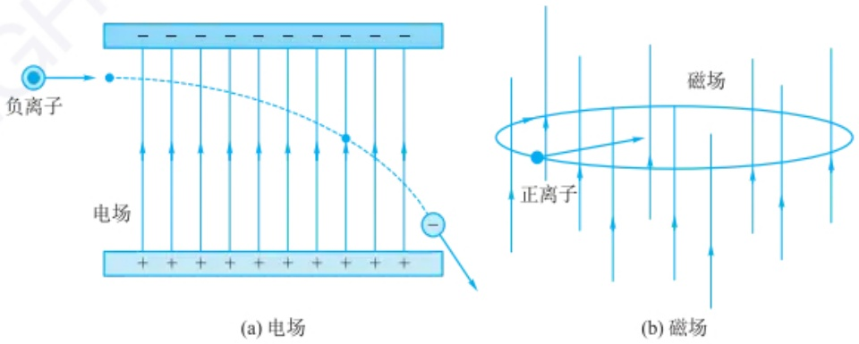

图 6.1.2 带电粒子在电场和磁场中的运动轨迹

## 6.1.3.2 硬/软离子化技术

质谱分析用离子化技术分类方法众多,按其在应用中对目标物分子的碎裂程度区别可将离子化技术分为:①使目标物分子充分碎裂并产生大量碎片离子的硬离子化和②尽可能保持目标物分子化学结构完整性并主要产生(准)分子离子的软离子化技术。

电子轰击电离源(EI, 图 6.1.3)为典型的硬离子化源, 常用于对质量数较小的有机分子的电离过程, 尤其适用于作为气相色谱-质谱联用仪的电离源。

EI源在工作时，钨或铼材质的灯丝被加热并发射出热电子。热电子被强度为 $70\mathrm{V}$ 的静电场加速后轰击气态的待测物分子，使待测物分子发生电离和碎裂。加速后的电子在磁场作用下呈螺旋线运动方式，可有效增加电子轰击到待测物分子的概率。采用 $70\mathrm{V}$ 静电场对电子进行加速的原因是动能为 $70\mathrm{eV}$ 的电子其物质波(德布罗意波)的波长[式(6-1-1)]接近常见有机分子内共价键的键长，因此该能量水平的电子对目标物分子的电离效率较高且在 $60\sim 80\mathrm{eV}$ 范围呈现平台区，即使仪器状态波动导致的电子能量产生小幅变化对实际电离效率影响也较小。此外，采用统一的 $70\mathrm{eV}$ 电子动能水平可使不同型号质谱仪器的测定结果间具有可比性，有利于建立标准谱库。

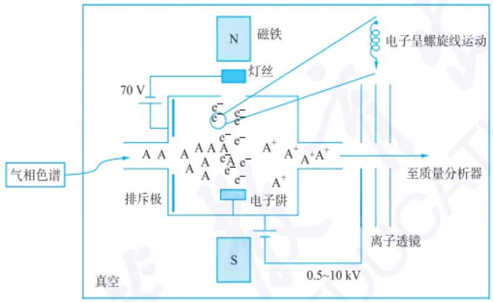

text_image

气相色谱
70 V
A A A A A A A A A A A A A A A A A A A A A A A A A A A A A A A A A A A A A A A A A A A A A A A A A A A A A A A A A A A A A A A A A A A A A A A A A A A A A A A A A A A A A A A A A A A A A A A A A A A A A
排斥极
真空
N 磁铁
灯丝
电子呈螺旋线运动
至质量分析器
离子透镜
S
0.5~10 kV

图 6.1.3 电子轰击电离源(EI)结构示意图

$$
\lambda_ {e, 7 0 \mathrm{eV}} = \frac {h}{\sqrt {2 m E}} = 0. 1 4 6 6 \mathrm{nm} \tag {6-1-1}
$$

式中，h 为普朗克常量  $6.62607015 \times 10^{-34} \, J \cdot s$ ，m 为电子质量  $9.109 \times 10^{-31} \, kg$ ，E 为电子动能  $70 \, eV \, (1 \, eV = 1.602176565 \times 10^{-19} \, J)$ 。

EI源可使目标物分子充分碎裂，有利于获得丰富的离子质量及待测物分子化学结构信息(图6.1.4)，尤其适用于对相对分子质量较小的待测物进行化学结构解析和含量分析；但对于相对分子质量较大或化学结构中重复单元较多的待测物分子，EI过程将产生大量、重复的离子碎片，不利于对目标物分子的后续化学结构识别。

电喷雾电离源(ESI, 图 6.1.5)为典型的软离子化源,适用于相对分子质量较大的有机分子和生物分子的电离过程,常用作为液相色谱-质谱联用仪的电离源。

在工作期间，待测物溶液（液相色谱流出物）被引入ESI的不锈钢毛细管，在不锈钢毛细管与质量分析器入口（距离为5\~50 mm）间施加3\~6 kV的电压，在鞘气、鞘溶剂与电压的作用下，毛细管出口端处的待测物溶液形成锥状（泰勒锥），并在泰勒锥尖端形成细密的喷雾；所得雾滴携带过量的同种电荷，电荷间的排斥作用使电荷倾向分布于液滴表面（趋肤效应）；液滴在电场作用下向质量分析器入口方向漂移；随着溶剂的蒸发，液滴逐渐变小，其表面的电荷密度增加（一般采用通入干燥的气体如 $\mathrm{N}_2$ 的方法促进溶剂蒸发），当电荷密度超过瑞利极限，即电荷间的斥力超过液滴表面张力时，液滴就发生库仑爆炸，产生更小的液滴；上述溶剂蒸发与库仑爆炸过程重复进行，最终可获得待测物的离子(图6.1.6)。

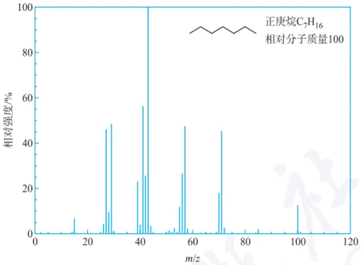

spectrogram

| m/z | Relative Intensity (%) |
| --- | --- |
| ~15 | ~7 |
| ~26 | ~46 |
| ~28 | ~49 |
| ~39 | ~23 |
| ~41 | ~56 |
| ~43 | 100 |
| ~55 | ~12 |
| ~56 | ~27 |
| ~57 | ~48 |
| ~70 | ~18 |
| ~71 | ~45 |
| ~100 | ~13 |

图 6.1.4 正庚烷的 EI-MS 谱

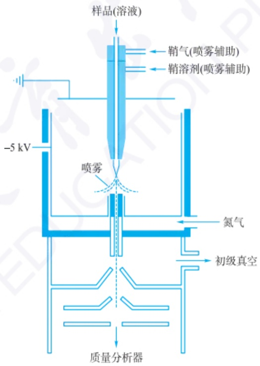

flowchart

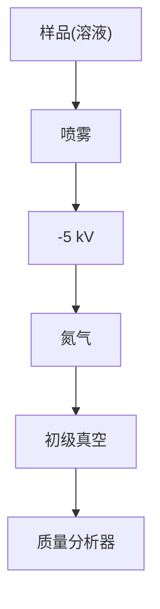

图 6.1.5 电喷雾电离源(ESI)结构示意图

目前公认的 ESI 离子产生机理有两种:

（1）适用于相对分子质量较小待测物分子的离子蒸发机理，即当液滴变得足够小时，待测物离子可直接从液相“跳入”气相中。

（2）适用于相对分子质量较大待测物分子的离子残留机理，即当溶剂被完全蒸发后可得到气相的待测物离子。

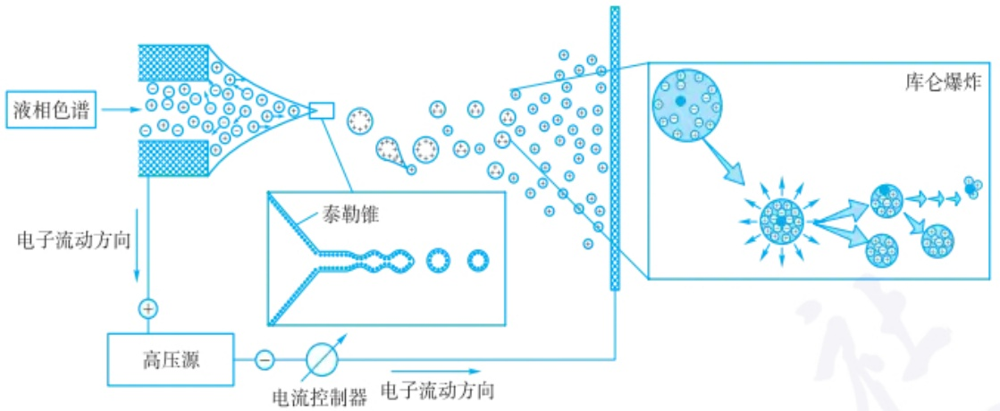

flowchart

This diagram illustrates a chemical process flow involving liquid phase spectroscopy, electron flow direction, and a thermocouple (泰勒锥), with an associated waste bin combustion experiment.

图 6.1.6 ESI 源工作原理示意图

采用 ESI 源可得到丰度较强的待测物准分子离子和多电荷离子, 待测物分子碎裂程度可控程度较高, 尤其适用于测定相对分子质量较大的目标物 (如蛋白质, 图 6.1.7)。此外, 液体进样的特点使 ESI 源适用于分析液相色谱流出组分。

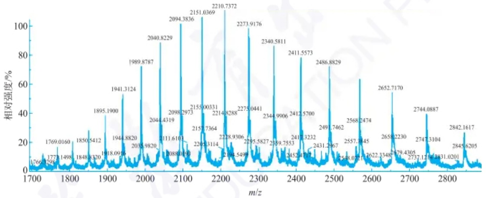

spectrogram

| m/z | Relative Intensity (%) |
| --- | --- |
| 1766 | ~5 |
| 1769.0160 | ~15 |
| 1773.1498 | ~10 |
| 1848.8320 | ~5 |
| 1850.5412 | ~25 |
| 1895.1900 | ~40 |
| 1918.0916 | ~5 |
| 1941.3124 | ~55 |
| 1944.8820 | ~10 |
| 1989.8787 | ~75 |
| 2035.9820 | ~10 |
| 2040.8229 | ~90 |
| 2044.4319 | ~35 |
| 2088.0193 | ~10 |
| 2111.6103 | ~15 |
| 2098.2973 | ~100 |
| 2155.00331 | ~45 |
| 2157.7364 | ~15 |
| 2205.3114 | ~10 |
| 2214.8288 | ~105 |
| 2210.7372 | ~110 |
| 2218.9306 | ~20 |
| 2264.5496 | ~10 |
| 2275.0441 | ~95 |
| 2295.5827 | ~20 |
| 2344.9906 | ~85 |
| 2340.5811 | ~95 |
| 2359.7553 | ~15 |
| 2417.3232 | ~20 |
| 2412.5700 | ~80 |
| 2431.2967 | ~15 |
| 2491.7462 | ~75 |
| 2496.8829 | ~75 |
| 2548.0727 | ~10 |
| 2557.3945 | ~15 |
| 2568.2474 | ~65 |
| 2622.3348 | ~10 |
| 2658.2230 | ~55 |
| 2679.4305 | ~10 |
| 2737.1214 | ~10 |
| 2747.3104 | ~40 |
| 2744.0887 | ~40 |
| 2845.6205 | ~10 |
| 2842.1617 | ~30 |

图 6.1.7 转铁蛋白的 ESI-MS 谱

## 6.1.3.3 其他常见电离源

化学电离源(CI)需要在离子源引入反应气体辅助电离,从基本原理来看,属于改进的EI源。由于反应气的量远高于待测物的量(摩尔比大于 $10^{4}$ ),CI源中的高能电子主要轰击到反应气分子,反应气分子被电离后产生的离子可与待测物分子产生电荷交换、质子转移、负氢攫取及离子加合反应(图6.1.8),进而实现对

(a) 以氦为反应气，电荷交换机理

$$
\mathrm{He} ^ {+} + \mathrm{M} \longrightarrow \mathrm{He} + \mathrm{M} ^ {+}
$$

(b)以甲烷为反应气，质子转移和负氢攫取机理

$$
\mathrm{CH} _ {5} ^ {+} + \mathrm{M} \longrightarrow \mathrm{CH} _ {4} + \mathrm{MH} ^ {+}
$$

$$
\mathrm{CH} _ {3} ^ {+} + \mathrm{MH} \longrightarrow \mathrm{CH} _ {4} + \mathrm{M} ^ {+}
$$

(c) 以水为反应气，质子转移机理

$$
\mathrm{OH} ^ {-} + \mathrm{MH} \longrightarrow \mathrm{H} _ {2} \mathrm{O} + \mathrm{M} ^ {-}
$$

(d) 以乙烷为反应气，离子加合机理

$$
\mathrm{C} _ {2} \mathrm{H} _ {5} ^ {+} + \mathrm{M} \longrightarrow \mathrm{MC} _ {2} \mathrm{H} _ {5} ^ {+}
$$

图 6.1.8 CI 源反应机理

待测物分子的离子化,可得到待测物的正、负离子。因此从对待测物分子的电离角度上看,CI源属于“软电离源”,基于CI所得的质谱图较EI源更易解读。

大气压化学电离源(APCI)的结构类似于ESI源,其特点是采用气体 $\left(\mathrm{N}_{2}\right)$ 辅助喷雾,并采用放电针尖端形成的高强电场对针尖附近的气相分子进行离子化[图6.1.9(a)],通过离子-分子间的电荷转移过程实现对液滴干燥后所得气相待测物分子的离子化。APCI的特点为离子化过程的气压较高(大气压),可得到待测物的正离子和负离子。

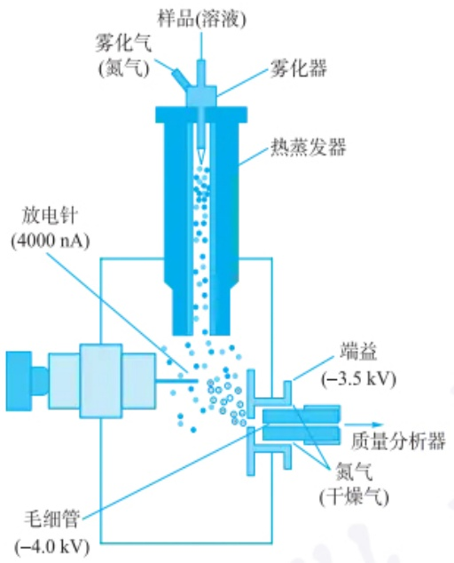

text_image

样品(溶液)
雾化气
(氮气)
雾化器
热蒸发器
放电针
(4000 nA)
端益
(-3.5 kV)
质量分析器
氮气
(干燥气)
毛细管
(-4.0 kV)

(a)

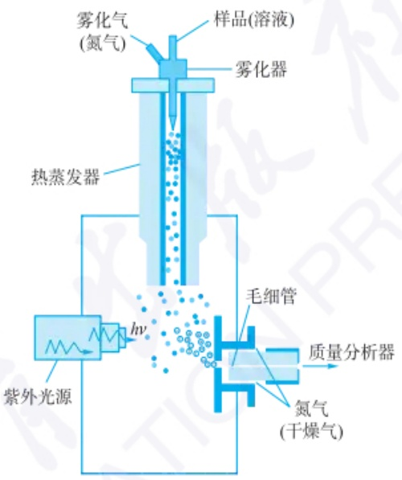

text_image

雾化气
(氮气)
样品(溶液)
雾化器
热蒸发器
紫外光源
hv
毛细管
质量分析器
氮气
(干燥气)

(b)

图 6.1.9 (a) 大气压化学电离源(APCI)与(b) 大气压光电离源(APPI)结构示意图

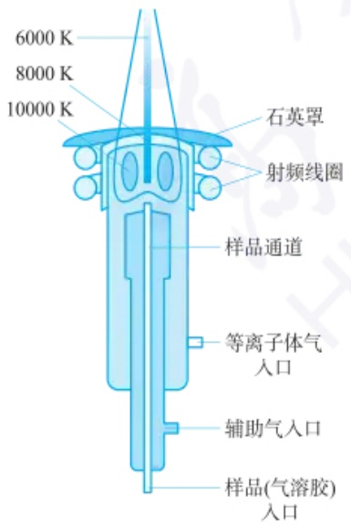

text_image

6000 K
8000 K
10000 K
石英罩
射频线圈
样品通道
等离子体气入口
辅助气入口
样品(气溶胶)
入口

图 6.1.10 电感耦合等离子体电离源(ICP)结构示意图

大气压光电离源(APPI)的结构与工作过程均与APCI源相似,其特点是采用强紫外光实现对待测物分子的离子化过程[图6.1.9(b)]。

与 ESI 源相比, APCI 及 APPI 源更适用于对弱极性和非极性待测物分子的离子化。

电感耦合等离子体电离源(ICP, 图 6.1.10)的结构与工作原理见本书原子光谱相关章节, 其特点为离子化温度高(高于 6000 K), 因此适用于无机质谱元素分析过程。

场电离源(FI)/场解吸源(FD)(图6.1.11)利用强电场实现对负载于不同器件上的待测物分子的解吸(脱附)和电离。FI/FD源属于“特别软”的电离源,其对电离过程中待测物分子的碎裂程度低,可高效产生待测物的分子离子并抑制多电荷离子的产生。

快原子轰击电离源(FAB,图6.1.12)结构与工作过程部分类似于EI源,其特点是轰击到待测物分子的高速粒子为中性气体原子(一般为Xe),以避免带电粒子轰击所导致的样品表面静电荷积累及其对后续离子化过程的影响。FAB源的工作过程包括①热电子发射和加速,②电子轰击Xe原子产生Xe离子,③Xe离子加速与聚焦,④对Xe离子进行中性化(去电荷)产生Xe原子,⑤高速运动的Xe原子轰击样品,引起待测物分子电离。采用Xe气的原因是其原子质量较大,在同样动能的条件下其动量大于Ne和Ar等气体原子。

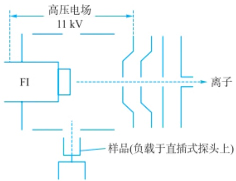

text_image

高压电场
11 kV
FI
离子
样品(负载于直插式探头上)

(a) 场电离源(FI)

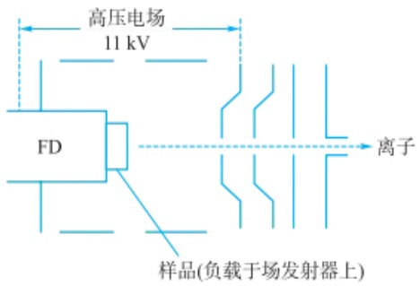

text_image

高压电场
11 kV
FD
离子
样品(负载于场发射器上)

(b) 场解吸源(FD)

图 6.1.11 场电离源(FI)和场解吸源(FD)结构示意图

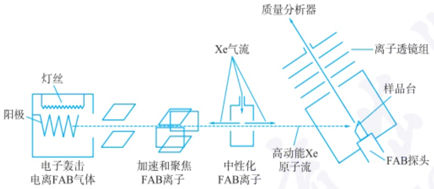

flowchart

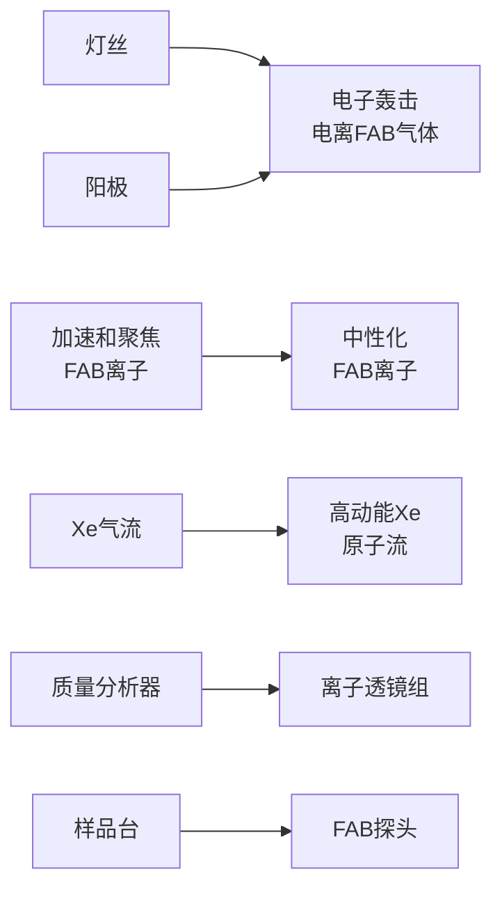

图 6.1.12 快原子轰击电离源(FAB)结构示意图

基质辅助激光解吸电离源(MALDI, 图 6.1.13)的设计思想与 CI 源有相似之处, 即采用大量的基质对待测物进行分散, 然后采用激光照射基质, 使基质分子吸收激光能量并产生解吸和电离, 此过程中部分能量被传导至待测物分子, 使待测物分子产生软电离。MALDI 被称为“最软”的电离源, 尤其适用测定易于在电离过程中发生裂解的生物大分子。

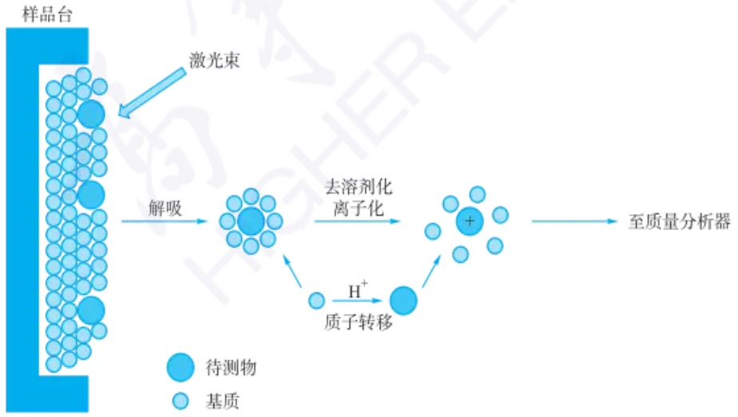

flowchart

图 6.1.13 基质辅助激光解吸电离源 (MALDI) 结构示意图

2002 年诺贝尔化学奖: 用于分析生物大分子的质谱用软解吸和离子化方法

MALDI 过程所用基质材料分子中须包含可有效吸收特定波长激光的化学结构,如用于吸收紫外和可见光的生色团及用于吸收红外光的羟基和氨基等。为保证解吸和电离效率,激光的功率密度通常设定在  $10^{6}$  W·cm $^{-2}$  以上。根据具体基质和待测物种类的不同，待测物分子的具体离子化机理有质子化（产生 $\left[M+H\right]^{+}$ ）、阳离子化（产生 $\left[M+alkali\right]^{+}$ ）、电荷传输、电子捕获、质子传输及光离子化等多种。

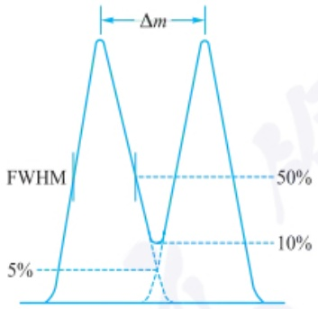

line

| Metric | Value |
| --- | --- |
| FWHM (Peak-to-Peak) | 50% |
| Lower Peak-to-Peak Ratio | 10% |
| Peak-to-Peak Ratio | 5% |

图 6.1.14 10% 谷底定义分辨率与半峰宽定义分辨率示意图

## 6.1.4 质量分析器

质量分析器是质谱仪的核心组件，用于分离和分析具有不同质荷比 $(m/z)$ 的离子。1919年，F.W.Aston首次构建了磁质谱，成功实现了稀有气体的相对分子质量的测定，并因此发现了多种同位素，获得了1922年诺贝尔化学奖。在随后的研究中，更多类型的质量分析器相继被研发出来。从质量分析原理上讲，目前质量分析器主要可分为四种类型，它们分别是:扇形磁场质量分析器、飞行时间质量分析器、离子回旋质量分析器、四极杆与离子阱质量分析器。在介绍质量分析器原理前，首先对分辨率这一概念进行讨论。

质量分析器直接测量的是离子的质荷比,而非其质量。根据牛顿第二定律:

$$
F = m a \tag {6-1-2}
$$

质量分析器本质上是通过测量离子在电场或磁场中的受力行为,对不同质荷比离子进行分离或分析。不同的质量分析器具有不同的特点及优劣势,通常依据质量范围、扫描速度、质量准确度(accuracy)和分辨率(resolution)等指标评价其性能。其中,质量分析器的分辨率是最受关注的指标之一。分辨率评价的是质量分析器区分两个质荷比相当接近的分析物离子的能力。分辨率的计算可根据以下公式:

$$
R = \frac {m}{\Delta m} = \frac {m / z}{\Delta (m / z)} \tag {6-1-3}
$$

值得注意的是,分辨率量纲为1。当分隔两个相邻峰的峰谷深度达到它们强度的10%时,认为这两个峰已经充分分离(图6.1.14),此时计算得到的分辨率称为10%谷底定义的分辨率 $(R_{10\%})$ 。由于 $R_{10\%}$ 不便于计算,通常在仪器分析研究中用半峰宽(FWHM)定义的分辨率,即

$$
R _ {\mathrm{FWHM}} = \frac {m / z}{\mathrm{FWHM}} \tag {6-1-4}
$$

对于高斯峰形(Gaussian peak shape), $R_{FWHM}/R_{10\%}=1.8$ 。以上是两种常用的质量分析器分辨率计算方法。常与分辨率混淆的概念是准确度，准确度为质量分析器测得质荷比与理论值的偏差，常用mmu(millimass units)和ppm(parts per million)衡量。

## 6.1.4.1 扇形磁场质量分析器

扇形磁场(magnetic sector)质量分析器是最早用于质谱仪器中的质量分析器。它最初仅利用单一的扇形磁场实现离子质量分析，后来发展为配备静电场模块的双聚焦设计。此类分析器基于不同质荷比离子在磁场和电场共同作用下沿不同路径运动的特性，来实现不同质荷比离子的分离。扇形磁场质量分析器具有较高的分辨率，适合于定量分析，可进行高能量碰撞解离，但扫描速度较慢。

图 6.1.15 为扇形磁场质量分析器的原理示意图。离子源产生的离子在电场的加速下通过入口狭缝进入磁场区。磁场区中提供与离子运动方向垂直且场强为 B 的磁场，不同质量的离子  $(m_{1}, m_{2})$  在磁场中受洛伦兹力的作用形成不同半径的运动轨迹，在仪器给定的电场和磁场条件下，只有特定质荷比的离子能够通过出口狭缝到达检测器。

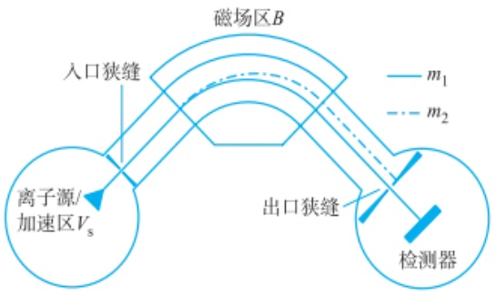

text_image

磁场区B
入口狭缝
离子源/
加速区Vs
m1
m2
出口狭缝
检测器

图 6.1.15 扇形磁场质量分析器的原理示意图

在离子源中,不同质荷比的离子在加速电压  $V_{s}$  的作用下获得的动能  $E_{k}$  与速度 v 的关系为

$$
E _ {\mathrm{k}} = \frac {m v ^ {2}}{2} = q V _ {\mathrm{s}} = z e V _ {\mathrm{s}} \tag {6-1-5}
$$

式中，q 为总电荷量，z 为电荷数，e 为元电荷。当离子进入磁场时，由于磁场方向与离子运动方向垂直，因此离子受到洛伦兹力的作用:

$$
F _ {\mathrm{L}} = q v B \tag {6-1-6}
$$

离子在匀强磁场中运动,所受洛伦兹力等于向心力,因此有

$$
\frac {m v ^ {2}}{r} = q v B \tag {6-1-7}
$$

式中，r 为离子所做圆周运动的半径。进一步对上式进行变换得

$$
r = \frac {m v}{q B} \tag {6-1-8}
$$

由此可知,扇形磁场质量分析器是一个动量选择器,即离子运动半径由离子的动量决定。综上可以得出扇形磁场质量分析器测定离子质荷比的定量描述,为

$$
\frac {m}{z} = \frac {e r ^ {2} B ^ {2}}{2 V _ {\mathrm{s}}} \tag {6-1-9}
$$

上式说明在给定的磁场强度和加速电压的条件下,特定质荷比的离子通过扇形质量分析器时会以特定的半径做圆弧运动,当离开扇形磁场后只有特定质荷比的离子能够通过出口狭缝到达检测器。

在实际的仪器设计中,通过改变扫描磁场强度和加速电压便可以使不同离子进入检测器。通常情况下采用扫描磁场模式进行分析,因为加速电压会影响离子传输、聚焦及检测器灵敏度等因素。使用扫描磁场模式能使扇形磁场质量分析器在最佳的加速电压条件下运作。

## 6.1.4.2 飞行时间质量分析器

飞行时间(time-of-flight, TOF)质量分析器最早在1946年由W. E. Stephens提出，该装置利用静电场加速离子后根据离子飞行速度的差异进行离子质荷比的分析。具体而言，离子进入飞行时间质量分析器经由静电场加速区加速后进入长度一定的无场飞行区，不同质荷比的离子具有不同速度，因此经过长度为 $L$ 的飞行管到达检测器的飞行时间 $t$ 不同，以此实现不同离子质量的测定。早期的飞行时间质量分析器主要以线形为主[图6.1.16(a)]，但由于相同质荷比离子产生时的动能及位置差异会导致飞行时间差，从而造成分辨率的下降。1973年B. A. Mamyrin提出了反射型飞行时间质量分析器[图6.1.16(b)]，在无场飞行区置入一个反射式静电场，使离子折返至另一个检测器。反射型飞行时间质量分析器有效改善了离子速度分布的问题，能让速度较快（动能较高）的离子穿透较深再折返，让速度较慢（动能较低）的离子穿透较浅即折返，最终使具有相同质荷比但初动能有差异的离子重新聚焦于检测器上，显著提升了飞行时间质量分析器的分辨率，该结构也一直沿用至今。

双聚焦质量分析器

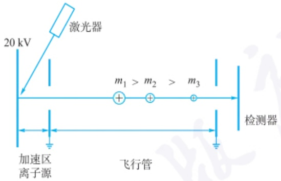

text_image

20 kV
激光器
m₁ > m₂ > m₃
加速区
离子源
飞行管
检测器

(a) 线形

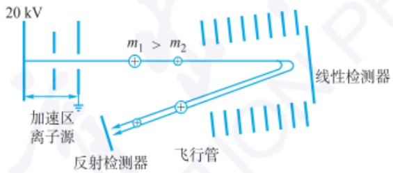

text_image

20 kV
加速区离子源
m₁ > m₂
线性检测器
反射检测器
飞行管

(b) 反射型

图 6.1.16 线形和反射型飞行时间质量分析器结构示意图

飞行时间质量分析器具有质量扫描范围宽、扫描速度快及分辨率高等优点，因此非常适合对蛋白质、DNA等大分子的分析。加速区电压采用脉冲式的施加方式，得益于近年高速电子信号处理技术、脉冲高压和数据采集技术的进步，飞行时间质量分析器能以较高采样率记录质谱数据(达300 Hz)。飞行时间质量分析器常与脉冲电离源相配合，如基质辅助激光解吸电离飞行时间质谱仪(MALDI-TOF)和飞行时间二次离子质谱(TOF-SIMS)。

飞行时间质量分析器的原理如图 6.1.16 所示。离子源产生的离子进入加速区后，离子在高压直流电场的加速下获得一定的速度。根据能量守恒定律，离子的速度与加速电极电压的关系为

$$
\frac {m v ^ {2}}{2} = q V _ {\mathrm{s}} = z e V _ {\mathrm{s}} \tag {6-1-10}
$$

其中， $m$ 为离子的质量， $V_{s}$ 为加速电极的电压， $v$ 为离子速度， $q$ 为总电荷， $z$ 为电荷数， $e$ 为元电荷。加速电极的电压通常为 $20\mathrm{kV}$ 。由式(6-1-10)整理得

$$
v = \sqrt {\frac {2 z e V _ {\mathrm{s}}}{m}} \tag {6-1-11}
$$

若无场飞行管的长度为 L，则飞行时间(t)为

$$
t = \frac {L}{v} \tag {6-1-12}
$$

将式(6-1-11)代入式(6-1-12)得

$$
\frac {m}{z} = \frac {2 e V _ {\mathrm{s}}}{L ^ {2}} t ^ {2} \tag {6-1-13}
$$

由上式可知，相对分子质量越大的离子飞行时间越长，且离子质荷比与飞行时间的平方成正比。理论上，飞行时间质量分析器的质量检测范围应无上限，但实际上检测器对于质量大、速度慢的离子灵敏度很低，因此在实际的应用中飞行时间质量检测器的质量范围仍是有限的。此外，为保证离子在无场区的飞行尽可能少受干扰，飞行时间质量检测器对真空系统有较高的要求，一般要求的真空度范围为 $(1.333\times10^{-5}\sim1.333\times10^{-4})\mathrm{Pa}$ 。

早期飞行时间质量分析器的分辨率有限,根据式(6-1-3)对分辨率的定义,对式(6-1-12)微分可得

$$
R = \frac {m}{\Delta m} = \frac {t}{2 \Delta t} = \left| \frac {L}{- 2 \Delta L} \right| \tag {6-1-14}
$$

式中，$\Delta m$ 为质量的半峰宽，$\Delta t$ 为时间的半峰宽，$\Delta L$ 为离子包的扩散距离。飞行时间质量分析器的分辨率主要受限于位置分散、速度分散和方向分散三种因素。离子从离子源产生形成一个离子包进入飞行时间质量分析器的加速区，离子包具有一定的分布体积，相同质荷比的离子具有不同的初始位置和初始速度，而这便是位置分散和速度分散的来源。离子从离子源产生时便有一定的扩散角，进入飞行管分配到飞行轴的速度分量就会产生差异，这即是方向分散的来源。要提高飞行时间质量分析器的分辨率可从仪器制造工艺上进行改进，减少各种分散因素的影响（也即减少 $\Delta t$）。另一方面可以增加飞行管的长度 $L$ 使飞行时间 $t$ 延长，但由于增加飞行管的长度会导致离子飞行扩散角的问题及灵敏度和采样速率等问题，因此飞行管的长度不能无限增加。

## 6.1.4.3 离子回旋质量分析器

傅里叶变换离子回旋共振(Fourier transform ion cyclotron resonance)质量分析器是目前分辨率最高的质量分析器。离子回旋共振质量分析器的发展可追溯至1932年E. O. Lawrence对回旋加速器的研究。Lawrence发现离子在加速器中的圆周运动角频率与半径无关，而与质荷比相关。此后，该原理开始应用于离子回旋质量分析器的研发。直至1974年，傅里叶变换离子回旋共振质量分析器技术取得突破，结合超导磁体，该质量分析器能实现超高分辨率。目前，最先进的FT-ICR质谱分辨率可以超过1000000，但为得到更高的分辨率，所需要的扫描时间更长，真空度的要求也更高。与其他类型的质量分析器不同，ICR质量分析器属于离子无损型质量分析器，检测器在时域中记录回旋离子经过时产生的电流，离子始终保持在腔内做圆周运动，再通过傅里叶变换把时域数据转换为质谱数据(m/z信号及对应的强度)。

下面讨论如何根据离子回旋的频率测定离子质荷比。在前面扇形磁场质量分析器中当离子以速度 v 射入与其速度方向垂直的匀强磁场时，离子受洛伦兹力作用做匀速圆周运动(图 6.1.17)。

由式(6-1-7)，结合 $v = \omega r$ 得，离子回旋角频率为

$$
\omega = \frac {z e B}{m} \tag {6-1-15}
$$

由式(6-1-15)可知,对于特定质荷比的离子在固定磁场下具有相同的回旋频率,且与离子的速度无关。因此测定离子回旋的频率便能确定离子精确质荷比。离子回旋频率与速度无关说明 FT-ICR 质量分析器不受离子动能分布的影响,这也是该质量分析器具备超高分辨率的关键原因之一。

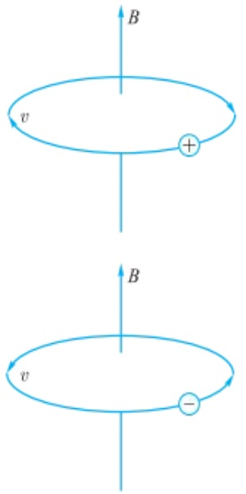

图 6.1.17 正负离子在匀强磁场的作用下进行匀速圆周运动

离子回旋质量分析器相关原理

FT-ICR 质量分析器的结构如图 6.1.18 所示, 主要包含了一对激发电极和一对检测电极。当离子从离子源产生并注入 FT-ICR 质量分析器时, 离子的动能较小, 在磁场的作用下只能做回旋半径较小的圆周运动, 检测电极无法检测到离子的信号。此时首先需要激发电极加速离子扩增其回旋半径。在激发模式下, 在激发电极上施加一个射频电压。图 6.1.18(a) 中为正离子的回旋路径, 当离子的回旋频率和射频电场的频率相同时, 则产生共振激发, 离子吸收能量以螺旋向外的方式运动。若一直施加激发射频信号, 则激发的离子最终会碰撞到电极上形成中性分子。回旋频率与射频电场频率不匹配的离子则不吸收能量维持在质量分析器的中心。

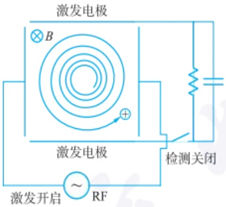

text_image

激发电极
×B
+
激发电极
RF
检测关闭
激发开启

(a) 共振激发模式示意图

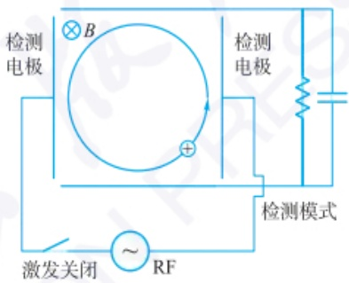

text_image

检测电极
B
检测电极
检测模式
激发关闭
~RF

(b) 检测模式示意图

图 6.1.18 傅里叶变换离子回旋共振质量分析器结构及原理示意

离子激发后撤去激发电场，离子能在匀强磁场中维持匀速圆周运动。此时打开检测电极[图6.1.18(b)]，由于离子的圆周运动会在检测电极的两个极板上产生同频的周期变化的感应电势，因此可通过测量检测电极之间的电流信号，实现离子回旋角频率的测量。其中，两个检测电极通过外电路连接形成的交变电流称为像电流。像电流的大小可以反映出产生像电流离子的数量，而像电流的频率反映离子回旋的频率。

## 6.1.4.4 四极杆与离子阱质量分析器

四极杆(quadrupole rod)与离子阱(ion trap)是两种具有相同理论框架的质量分析器。这两种质量分析器最早由Wolfgang Paul于1953年提出，他本人也因离子阱的研究获得了1989年的诺贝尔物理学奖。四极杆与离子阱的原理是让离子在严格对称的四极直流与交变复合电场中进行运动，由于不同质荷比的离子在该电场中稳定运动所需的直流电场和交变电场的电压值不同，通过调控电场电压值实现对于不同质荷比离子的区分。四极杆和离子阱质量分析器对于实现串联质谱分析具有重要意义。

四极杆和离子阱质量分析器的区别在于对离子的筛选行为。离子通过四极杆质量分析器时，在特定的交、直流电场的作用下，只有特定质荷比的离子才能通过四极杆，其他的离子因轨迹的不稳定在途中会撞击四极杆或被排出四极杆而无法通过。而对于离子阱，离子首先全部囚禁于离子阱中，通过调节交变和直流电场的电压值，可以使特定质荷比的离子进入不稳定状态从而射出离子阱，实现离子质荷比的分析和测量。

离子在四极杆和离子阱中的运动服从马蒂厄方程(Mathieu equation)。通过求解马蒂厄方程可以得到离子运动的稳定边界条件(稳定区域)。当离子处于稳定区内，离子在分析器内沿特定方向进行周期性运动；当离子处于不稳定区时，离子的运动轨迹振幅将指数增长，使其离开分析器检测区域。

四极杆质量分析器由四个平行排列的金属杆组成，通常两两相对，形成一个狭窄的通道[图6.1.19(a)]。相对的两个电极组成一组电极，施加相同的交流、直流复合电压，而相邻的电极施加电压大小相同，但是符号相反(图6.1.19)。

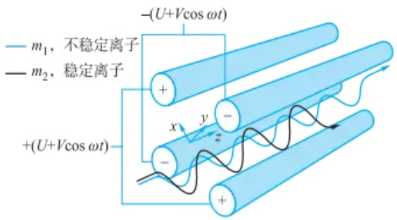

text_image

-(U+Vcos ωt)
m₁, 不稳定离子
m₂, 稳定离子
+(U+Vcos ωt)
x
y
z

(a) 四极杆结构及不同离子通过四极杆运动轨迹示意图

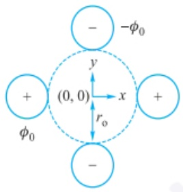

text_image

-φ₀
y
(0, 0) → x
φ₀
r₀
+ 
-

(b) 四极杆的截面图

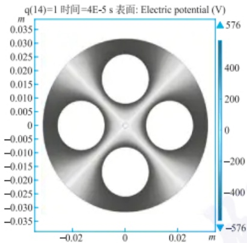

heatmap

| Potential (V) | Description |
| --- | --- |
| 0 | Center hole |
| ~200 | Intermediate region |
| ~400 | Intermediate region |
| ~576 | Maximum potential (top right) |
| -576 | Minimum potential (bottom left) |

(c) 四极杆中电势分布的模拟仿真

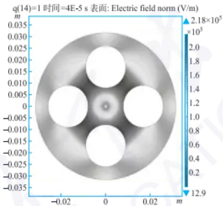

heatmap

| Region | Electric field norm (V/m) |
| --- | --- |
| Inner Circle | ~0.005 \(\times\) 10^5 |
| Middle Circle | ~0.025 \(\times\) 10^5 |
| Outer Circle 1 | ~0.025 \(\times\) 10^5 |
| Outer Circle 2 | ~0.025 \(\times\) 10^5 |
| Outer Circle 3 | ~0.025 \(\times\) 10^5 |

(d) 四极杆中电场分布的模拟仿真

图 6.1.19 四极杆质量分析器

图 6.1.19 彩图

离子阱相较于四极杆最大的不同即在 z 轴方向加了一个束缚电场，从而形成一个能够捕获离子的三维电场。离子阱通常由一个环形电极及一对端帽电极组成（图 6.1.20）。

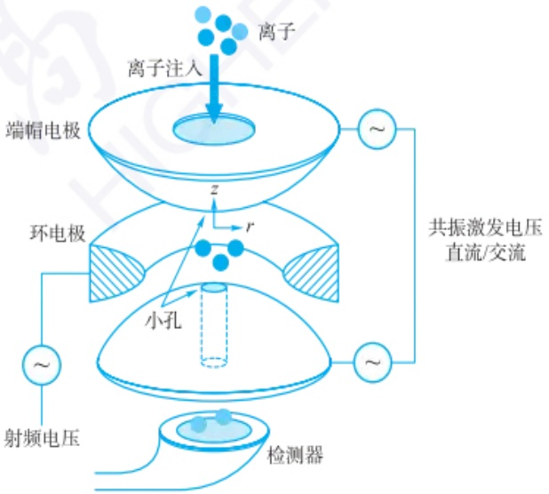

flowchart

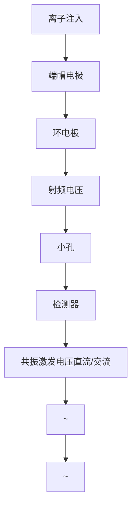

图 6.1.20 离子阱结构示意图

四极杆与离子阱质量分析器相关原理

离子阱质量分析器进行质量分析是通过将特定质荷比的离子射出离子阱完成的，出射的离子被检测器检测到后即能生成质谱图。

离子阱的一个重要特点是可以根据需要,选择特定质量的离子留在离子阱内,这样就可以通过碰撞诱导解离等方式使得目标离子在阱内产生特征碎片离子,用于目标离子的结构定性分析。这种将目标离子碎裂后再进一步分析其碎裂离子的质谱分析模式被称为串联质谱,取义于质量分析过程的二次或者多次串联。

以上仅为四极杆与离子阱质量分析原理的初步介绍。在实际的四极杆和离子阱质量分析器中通常还需要引入共振激发来提高其灵敏度和分辨率，这部分内容涉及马蒂厄方程离子共振频率的求解，感兴趣的读者可以参考专业的质谱书籍进行了解。

## 6.1.5 检测器

## 6.1.5.1 检测器的功能

根据物理学中所描述的运动粒子与物质间相互作用方式可知,轰击到靶材上的粒子其动能变化和电荷变化可对靶材部件产生电离、发光等效应,对上述过程中所产生的电荷或光子信号进行测量可评估轰击到靶材上的粒子丰度。

质谱检测器是指在质谱仪中测定经由质量分析器分离出的具体种类离子丰度信号的部件,其主要作用是将丰度信号转换为可检测的电信号。为提升信号响应灵敏度,质谱检测器通常具备信号放大功能,可实现对微弱离子丰度信号的准确测定。

常见检测器在受到离子流(包)轰击后产生响应信号的原理一般如下:

（1）检测器在中和离子电荷时会产生微弱电流，离子轰击导致的检测器表面电子溅射亦可产生微弱电流；
（2）离子在轰击到检测器表面后其动能的改变可导致检测器温度的变化，检测器对上述信号进行转换、放大和检测。

环境背景辐射及到达检测器的离子速度可能会影响检测器对离子的信号响应,因此所有类型的质谱检测器都需要在真空环境下运行,以避免环境气体分子对目标物离子运动的影响,并且采用合适的材料(金属或聚合物等)隔绝外界高能粒子对检测器的影响。

## 6.1.5.2 常用检测器

质谱检测器种类较多,本章中以常见的法拉第杯、电子倍增器、光电倍增管、微通道板及低温检测器为例介绍其工作原理、功能结构和应用方式。

法拉第杯是一种用于在真空中捕获带电粒子的装置[图6.1.21(a)]，其外壳采用不锈钢或铅材质以屏蔽各种高能辐射，采用高密度聚乙烯或聚苯乙烯屏蔽中子辐射。

运动的带电粒子(离子或电子)轰击在法拉第杯的收集极金属表面后,收集极对离子电荷的中和作用会导致微弱电流的产生[图6.1.21(b)]。该电流的大小与轰击到收集极的离子数量有关,对其进行放大和测量后可评估轰击到收集极的离子丰度。

法拉第杯对离子流的信号响应仅与离子流所携带的电荷数量有关[式(6.1.16)]，与具体离子的质量和动能无关。

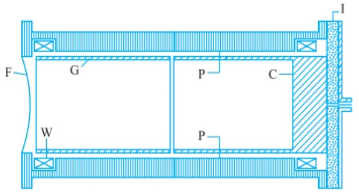

text_image

F
G
P
C
W
P
I

(a)

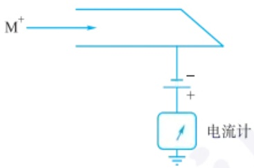

text_image

M⁺
-
+
电流计

(b)

C—收集极(黄铜);F—离子入口;G—环状隔离保护电极;W—磁场线圈;P—外壳(不锈钢);I—绝缘层(聚苯乙烯)

图 6.1.21 (a) 法拉第杯结构示意图及 (b) 信号电流产生与测量等效电路

$$
\frac {N}{t} = \frac {I}{e} \tag {6-1-16}
$$

式中，N 为离子流携带的总电荷数量（个），t 为离子流轰击收集极的总时间（s），I 为法拉第杯的电流响应信号（A），e 为电子电荷量单位（1.602176634× $10^{-19}$ C）。

法拉第杯的灵敏度较低,大概需要  $1.602176634 \times 10^{9}$  个电子轰击到收集极上才能产生  $1.0 \times 10^{-9}$  A 的电流。

电子倍增器(EM, 图 6.1.22) 的离子响应灵敏度远高于法拉第杯, 是现代质谱仪中常用的检测器。EM 的工作原理为离子轰击到转换极上产生电子, 电子数量被倍增极逐级指数放大[式(6-1-17)], 并在阳极产生电流信号。

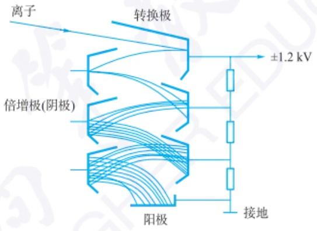

text_image

离子
转换极
倍增极(阴极)
阳极
±1.2 kV
接地

图 6.1.22 电子倍增器(EM)结构示意图

$$
G = k \delta^ {n} = k V ^ {a n} \tag {6-1-17}
$$

式中，G 为增益倍数；k 为倍增系数，与器件具体型号有关； $\delta$  为二次发射电子数目（一般为 5\~6 个），与倍增极材料及所加电压有关；n 为倍增极数目；V 为阳极与阴极间电压；a 为调整系数（一般为 0.7\~0.8）。

光电倍增管[PMT, 图 6.1.23(a)]需要与磷光屏配合适用[图 6.1.23(b)]，离子流轰击到转换极产生电子束，电子束轰击到磷光屏后产生光信号。PMT 实际检测的信号为上述光信号，其光阴极将光信号转变为电子（光电效应），后续的电子数目放大及电流响应过程与 EM 相同。

(a)

(b)

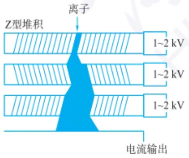

text_image

Z型堆积
离子
1~2 kV
1~2 kV
1~2 kV
电流输出

(c)

图 6.1.24 （a）单层微通道板（MCP）结构示意图，(b) 单个 MCP 通道及 (c) 多层堆叠形式工作原理

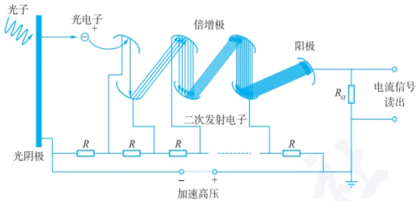

text_image

光子
光电子
倍增极
二次发射电子
阳极
Rα
电流信号
读出
R
R
R
光阴极
加速高压

(a)

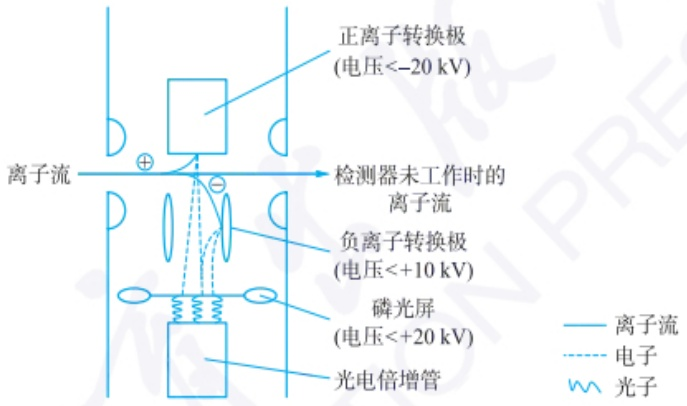

text_image

正离子转换极
(电压<-20 kV)
离子流
检测器未工作时的
离子流
负离子转换极
(电压<+10 kV)
磷光屏
(电压<+20 kV)
光电倍增管
离子流
电子
光子

(b)

图 6.1.23 （a）光电倍增管(PMT)结构与(b)应用方式示意图

微通道板(MCP)器件为盘状结构(图6.1.24)，其上布满直径为4\~25 mm且具有一定倾斜角度的孔道，孔道内表面为半导体材质，盘的上下两面电势差较大（大于1 kV）。类似于EM器件的电子倍增过程，离子或电子轰击到MCP孔道表面后可产生更多的电子，多个盘状结构亦可组合使用，使得电子数目放大倍数可高于 $10^{8}$ 。使用MCP器件测定的最终输出信号为电流信号。

低温检测器是一种检测高能粒子及射线能量的器件(图6.1.25)，通常在液氦(3K)环境下工作。在质谱检测过程中，轰击到低温检测器上的离子所携带的动能会导致检测器温度上升，检测器中的超导薄膜将热(温度)信号转变为磁化强度信号,进而转变为电流信号。低温检测器信号响应只与离子动能有关,无质量歧视,可检测大分子(准)离子。

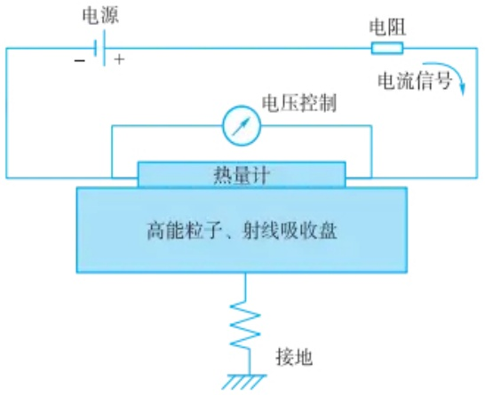

flowchart

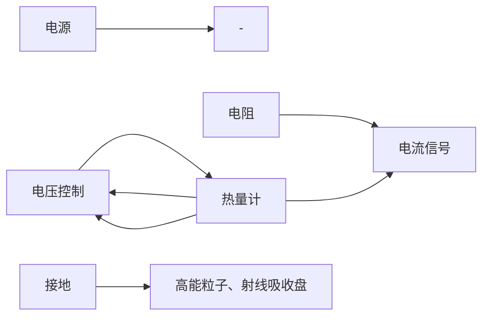

图 6.1.25 低温检测器工作原理

## 6.1.6 串联质谱

在实际分析中，样本的组成往往高度复杂，即便通过色谱手段对其进行分离后，所得流出物也可能由多种物质组成。采用软电离源只能得到目标物及共存物的相对分子质量信息，不足以实现对其化学结构进行鉴定的目的；而采用硬电离源则往往导致目标物和共存物分子在离子化过程中产生大量的碎片离子，使得质谱图异常复杂，不利于解析。串联质谱(tandem mass spectrometry, MS/MS)技术可解决上述问题。串联质谱通常是指由两个或两个以上的质谱质量分析器联结在一起所组成的分析方式。例如，将第一个质量分析器的功能设定为选择前体离子(precursor ion)，进而将分离所得的前体离子通过某些方式进行碎裂，产生子离子(product ion)，然后将子离子传送至第二个质量分析器中进行分析，以得到目标物分子与对其应碎片离子的 $m/z$ 及丰度信息，从而实现对目标物分子的化学结构鉴定和定量分析。

## 6.1.6.1 串联质谱的类型

常见的串联质谱包括三重四极杆串联质谱（triple quadrupole mass spectrometry, QqQ）、四极杆串联轨道阱质谱（quadrupole-orbitrap mass spectrometry）、四极杆串联飞行时间质谱（quadrupole time-of-flight mass spectrometry, Q-TOF）、三重四极杆复合线性离子阱质谱（triple quadrupole-linear ion trap mass spectrometer, Q-TRAP）等。需要注意的是，某些质量分析器，如离子阱，可以实现在同一个质量分析器中进行前体离子的选择、碎裂和碎片的扫描，从而用一个质量分析器实现串联质谱的功能。下面对常见的串联质谱进行介绍。

三重四极杆串联质谱（QqQ）仪由三个依次串联的四极杆质量分析器组成（图6.1.26），其中第一与第三重四极杆质量分析器具有质量分析功能。第二段四极杆作为碰撞室，主要将穿过第一个四极杆的前体离子在碰撞诱导解离（collision-induced dissociation, CID)等方式的作用下，进一步裂解为更小的离子碎片。同时，第二段四极杆仅施加射频电压，故不同质量的离子均能通过此区域，具有离子聚焦的功能。QqQ串联质谱仪在工作时可以通过四极杆的有效组合，产生不同的分析模式，满足分析需求。三重四极杆复合线性离子阱质谱（Q-TRAP）仪是一种结合了QqQ和线性离子阱优点的质谱仪。在QqQ之后，离子可以被捕获在线性离子阱中，通过改变电场释放特定 $m / z$ 的离子进行多级质谱分析 $(\mathrm{MS}^n)$ 。

串联质谱在生命分析测量中有广泛的用途。以蛋白质分析为例，通常蛋白会首先被酶解为多肽，之后经过色谱分离后用于串联质谱分析，一级质谱信息得到肽段的精确相对分子质量，二级质谱信息得到肽段的碎片离子谱图，综合一级质谱和二级质谱可以完成肽段的序列鉴定。目前蛋白质组学中质谱数据的采集模式主要有数据依赖性采集（data-dependent acquisition, DDA）和数据非依赖性采集（data-independent acquisition, DIA）。

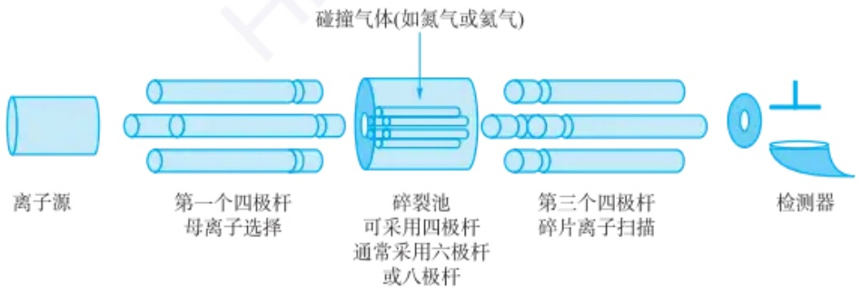

flowchart

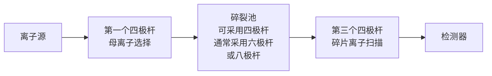

图 6.1.26 三重四极杆串联质谱仪结构示意图