DDA 是一种非靶向的采集模式，主要用于以蛋白质发现为主要目标的蛋白质组学研究。所谓“依赖”，指的是 MS2 的采集依赖于 MS1。DDA 模式的每次循环先进行一次 MS1 扫描，选择 MS1 中峰强度最高的一部分母离子，逐一进行筛选、碎裂，得到与母离子一一对应的 MS2 谱图，由 MS2 谱图可以进行肽段的鉴定。DDA 模式通常可以检测数千种蛋白质。然而，如果在一次 MS1 扫描中出现太多共洗脱的肽段，DDA 只能采集到丰度最高的肽段，没有被选中进行 MS2 碎裂的肽段离子，特别是对于一些低丰度肽段，其信息就会丢失。这种随机性的采样过程会阻碍低丰度肽段的检测，并降低分析的重现性，从而导致较多的定量缺失值，因此一般不适用于临床大队列分析。

为了克服 DDA 的局限性, 近年来出现了一系列 DIA 模式。DIA 把整个质量观测区间划分为多个隔离窗口, 依次将每个窗口中的母离子共同碎裂, 采集所有母离子的全部碎片离子的 MS2 信息。DIA 具有系统性、无偏向性采集的特点, 分析的重现性较好, 缺失值少于 DDA。此外, DIA 的 MS2 信息是连续采集的, 可以用 MS2 中碎片离子的色谱流出峰进行定量, 与 MS1 定量相比一定程度上减轻了共流出肽段的干扰影响。

四极杆串联轨道阱质谱仪是一种结合了四极杆和轨道阱质量分析器的高分辨质谱仪。离子化后产生的离子进入四极杆，四极杆可以选择性地允许特定 $m / z$ 的离子通过。这一步用于选择前体离子。选择的母离子进入碰撞池，与惰性气体（如氮气或氦气）碰撞，导致离子碎裂成碎片离子。碎片离子进入轨道阱质量分析器，在静电场中做轨道运动。通过检测离子运动的频率，轨道阱能够精确测定离子的 $m / z$ 。相比于三重四极杆质谱，四极杆串联轨道阱质谱仪可以得到高分辨的质量信息，更加有利于结构解析。

类似的，四极杆还可以与飞行时间质量分析器进行串联，得到四极杆串联飞行时间质谱(Q-TOF)仪。在Q-TOF中，四极杆依然起到了母离子筛选的作用，而TOF则用于母离子的扫描或碎片离子的扫描。相比于 $QqQ$，Q-TOF的扫描速度更快，可以在单位时间内采集更多的二级谱图信息并提供更高的质量分辨率。

## 6.1.6.2 串联质谱碎裂方式

质谱中的碎裂方式主要包括碰撞诱导解离(CID)、高能碰撞解离(high energy collisional dissociation, HCD)和电子捕获解离(electron capture dissociation, ECD)等。碰撞诱导解离(CID)中，样品离子通过与惰性气体(如氮气、氦气)碰撞，转移能量导致离子键断裂生成碎品离子。CID能量低于HCD，碎片较少但更加稳定。CID广泛应用于质谱/质谱(MS/MS)分析中，适用于各种有机小分子、药物、蛋白质和肽段的结构解析。CID的碎片谱对于数据库检索和未知物鉴定具有重要意义。高能碰撞解离(HCD)中，样品离子在高能量下与惰性气体碰撞，导致离子碎裂。HCD使用较高的碰撞能量，相比CID可以产生更多且更复杂的碎片。HCD常用于高分辨质谱仪中，由于能够提供丰富的碎片离子信息，因此有助于结构鉴定。电子捕获解离(ECD)中，带正电荷的多肽或蛋白质离子捕获低能电子(通常<0.2 eV)，导致N—Cα键断裂而产生碎片。ECD主要用于蛋白质组学研究，尤其适用于分析具有较多电荷的离子。ECD产生的碎片通常保留更多的修饰信息，如磷酸化和糖基化，适用于翻译后修饰(PTM)研究。在ECD的基础上，还发展了电子转移解离(electron transfer dissociation, ETD)。

## 6.1.6.3 三重四极杆串联质谱的扫描模式

三重四极杆串联质谱是最常用的串联质谱之一,基于分析目的不同,可以采用多种扫描模式,包括全扫描、选择反应监测、子离子扫描、母离子扫描、中性碎片丢失扫描和多反应监测等(图6.1.27)。

全扫描(full scan)检测所有通过质量分析器的离子，生成一个包含所有检测到的离子的质谱图。第一重四极杆(Q1)通过扫描允许一定 $m / z$ 范围内的所有离子碎片通过，并直接穿过第二个四极杆(Q2)和第三个四极杆(Q3)后到达检测器。全扫描可以获取样本电离后产生的所有离子质荷比信息，该模式主要用于寻找前体离子(母离子)和对未知物的初步鉴定。

产物离子扫描(product ion scan)选择特定的前体离子并扫描其产生的所有可能的碎片离子，生成碎片离子的质谱图。对Q1施加特定电压，使某一特定质荷比的前体离子通过，该前体离子进入Q2后发生碰撞诱导解离，产生子离子碎片，Q3通过扫描的方式获取所有子离子的 $m / z$ 信息。该模式主要用于判定特定 $m / z$ 的母离子可以产生哪些子离子碎片，主要用于化合物结构解析。通过产物离子扫描还可以得知对于特定母离子能够产生哪些特征性的碎片离子，用于构建选择反应监测(selected reaction monitoring, SRM)方法。

选择反应监测(SRM)在三重四极杆串联质谱分析中,选择特定的前体离子并监测其特定的碎片离子，广泛应用于定量分析和高灵敏度检测。离子源生成的离子首先进入第一个四极杆(Q1)，Q1作为质量过滤器，选择特定 $m / z$ 的前体离子。选定的前体离子进入碰撞池（通常是第二四极杆，Q2），在碰撞池中与惰性气体发生碰撞，生成碎片离子。碎片离子进入第三个四极杆(Q3)，Q3作为质量分析器，选择特定 $m / z$ 的碎片离子。选定的碎片离子被检测器检测，生成质谱信号。SRM通过两个质量过滤步骤(Q1和Q3)选择特定的前体离子和碎片离子，极大地提高了分析的选择性，减少了背景干扰。由于选择性极高，SRM模式能够检测到低浓度的目标化合物，适用于痕量分析。SRM模式广泛应用于定量分析，能够提供准确的目标化合物浓度信息。基于母离子和特征碎片离子 $m / z$ 双重信息用于定性，基于色谱流出曲线峰面积用于定量，是靶向定量金标准。当在一个色谱质谱联用分析中，基于保留时间不同对多个物质进行选择反应监测分析时，就可以实现多反应监测(multiple reaction monitoring, MRM)。

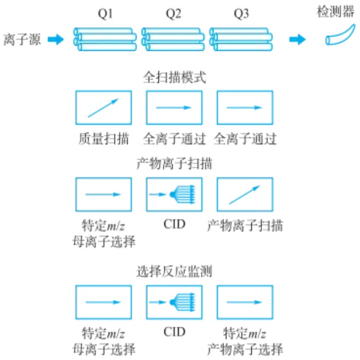

flowchart

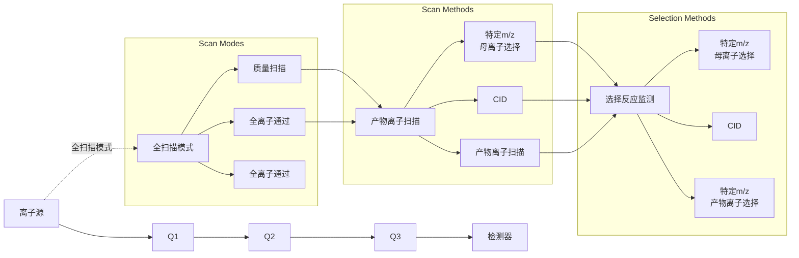

图 6.1.27 质谱扫描模式

拓展阅读文献

## 习题

## - 章节练习题 -

1. 硬、软离子化技术的最主要区别是什么？
2. 软离子化源的设计思路包括哪些？
3. 为什么在质谱分析过程中需要得到(准)分子离子信息？如何得到该类信息？
4. 为何法拉第杯检测器的信号响应灵敏度显著低于电子倍增器？
5. 电子倍增器与光电倍增管检测器的区别与联系有哪些？
6. 为什么要进行串联质谱分析？有哪些常见的串联质谱？三重四极杆串联质谱有哪些常见的扫描模式？

## - 挑战性问题 -

7. 说明为何电子轰击电离源质谱技术在炼油和石化工业中得到了广泛应用。

8. 请选择一种质谱离子化源，说明其对不同的样品形态（固、液、气）和进样方式的适应能力及可能的改进方式。
9. 软电离源对待测物分子的裂解能力有限,为何其对探究复杂生物大分子内部化学结构仍具有极其重要的意义?
10. 查阅资料,想想看三重四极杆串联质谱除了教材中给出的扫描模式,还有哪些可能的扫描模式,分别用于什么分析目的。

## - 专题或报告 -

11. 查阅相关科学文献, 综述近年来食品安全、环境保护、临床检测、刑侦勘察、蛋白质组学等研究领域中的各种质谱分析用离子化技术发展情况。
12. 三重四极杆串联质谱在违禁品筛查、检验检疫和毒物分析中具有广泛的用途。试论证，相比于其他串联质谱，三重四极杆串联质谱定量分析的优势是什么。查阅资料，调研当前三重四极杆串联质谱用于违禁品筛查等工作时是如何设计实验方案的，能用于哪些违禁品的分析。
13. 高灵敏的能谱及质谱检测器不仅是相关分析仪器的关键核心技术，其在高能物理、天文学等研究领域也具有重要的应用价值，查阅相关文献和新闻报道，综述近年来我国在上述器件制造方面的进展及应用情况。

## 6.2 有机质谱解析

本节阐述有机质谱的定性和定量分析方法,以及谱图的解析规律。

## 6.2.1 有机质谱的定性分析

## 6.2.1.1 质谱图基础

质谱图(mass spectrum)是质谱分析中用来表示离子质量和相对丰度的二维图谱。质谱图的横坐标为离子的质荷比(mass-to-charge ratio, m/z)，即离子的质量(m)与其电荷数(z)的比值；纵坐标为各个离子的相对丰度，通常以相对强度的百分比表示。如图6.2.1所示为电子轰击电离源(EI)获取的乙醇质谱图。质谱图可以帮助识别和定量分析化合物的组成和结构。通过比较不同离子的质荷比，可以推断出样品中存在的化合物及其相对含量。

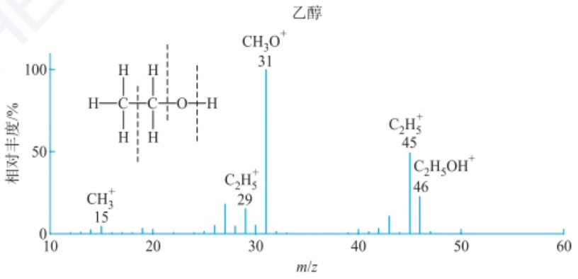

spectrogram

| Species | m/z |
| --- | --- |
| CH3+ | 15 |
| C2H5+ | 29 |
| CH3O+ | 31 |
| C2H5+ | 45 |
| C2H5OH+ | 46 |

图 6.2.1 电子轰击电离源(EI)获取的乙醇质谱图

质谱图解读过程中涉及一些关键概念，包括分子离子峰(molecular ion peak)、准分子离子峰(protonated ion peak)、同位素峰(isotopic ion peak)和碎片离子峰(fragment ion peak)等。分子离子峰指的是中性分子(M)失去一个电子 $(\mathrm{e}^{-})$ 后带正电荷所呈现的质谱峰( $M^{+}$ )。

准分子离子峰指中性分子(M)通过质子转移反应得到一个质子 $\left(\mathrm{H}^{+}\right)$ 后带正电荷所呈现的质谱峰 $\left(\left[\mathrm{M}+\mathrm{H}\right]^{+}\right)$ ;质子转移反应过程中有可能发生多个质子转移,尤其是针对生物大分子如蛋白质和多肽等,往往会得到多个(n)质子而形成多电荷离子 $\left(\left[\mathrm{M}+n\mathrm{H}\right]^{n+}\right)$ ;对于部分分析物,也可能丢失质子从而形成带负电荷的离子 $\left(\left[\mathrm{M}-n\mathrm{H}\right]^{n-}\right)$ 。

同位素峰是由于自然界中元素的同位素相对原子质量不同而产生的，形成与分子离子峰相差若干个整数单位的相邻质谱峰（$[M+1]^{+}$、$[M+2]^{+}$…）。需要注意的是，由于不同元素的同位素质量存在微小差异，如$^{13}\text{C}$和$^{12}\text{C}$的相对原子质量差值为1.00335483，而$^{15}\text{N}$和$^{14}\text{N}$的相对原子质量差值为0.9970349，因此由$^{13}\text{C}$和$^{15}\text{N}$引起的同位素峰质量会存在微小差异，在同位素峰上形成精细结构。

碎片离子峰则是分子在离子化过程中在高能电子等能量载体的作用下被活化，导致分子内部化学键发生碎裂重排等反应，生成的产物离子峰。

## 6.2.1.2 有机分子碎裂与重排

（1）电子轰击电离法引起碎裂与重排 电子轰击电离法是常用的有机分子离子化方法之一，特点是电离效率高，且有丰富的碎片离子产物。高能电子与分子碰撞时，会把能量传递给分子，使分子离子达到一定的激发状态，进而导致其内部化学键的断裂。

不同的化合物在电离后的碎裂模式各异,取决于分子的结构和化学性质。生成的碎片离子在质谱图中表现为不同的峰,每个峰对应一种特定的离子。通过分析这些峰,可以推断出原始分子的结构及其可能的化学反应路径。分子离子在裂解的同时,还可能发生某些原子或原子团的重排,经重排裂解生成比较稳定的重排离子。

电子轰击电离法通过高能电子的轰击，引起分子的电离与碎裂，形成不同的碎片离子。这一过程不仅为化合物的分析提供了丰富的信息，也为理解分子的反应机制奠定了基础。在质谱分析中，这些特征的碎片离子谱图是识别和定量分析有机化合物的重要工具。

（2）官能团对分子碎裂重排的影响及其机理 烷基、烯基、炔基等碳氢官能团的碎裂规律包括:烷烃主要发生 C—C 键断裂，产生一系列烷基碳正离子峰；直链烷烃碎裂质谱图相邻峰 m/z 之差为 14，峰强随 m/z 增大而减小，通过重排形成较稳定的碎片离子（如 m/z=43,57）；支链烷烃裂解一般发生在支链位置，生成较稳定的仲碳或叔碳正离子；芳烃分子离子峰较强，比如甲苯 m/z=91 为最强峰（基峰， $C_{6}H_{5}-CH_{2}^{+}$ ），烷基芳烃  $m/z=91+14\times n$  为基峰，当烷基 C 数  $(n)\geqslant3$ ，则 H 重排失去一个中性分子，成 m/z=92 的峰；烯烃和炔烃易发生烯丙基断裂和炔丙基断裂。

羟基、羰基、氨基等含氧氮官能团的碎裂规律包括:醇易发生 $\alpha-$ 断裂，失去水分子形成碳正离子；醛和酮易发生 $\alpha-$ 断裂，产生酰基正离子峰；若羰基化合物 $\gamma$ 位有H存在则容易进行麦氏重排；羧酸易失去羧基形成烷基正离子峰；胺易发生$\alpha-$ 断裂，产生亚胺正离子峰。

（3）分子内重排反应 常见重排机理:包括麦氏重排（McLafferty rearrangement, 图 6.2.2）和逆狄尔斯-阿尔德反应（retro-Diels-Alder reaction）等。

化合物中含有不饱和基团 C=X 或  $C \equiv X$  (X 为 O、N、S、C 等)，且相连的有  $\gamma-$  氢原子时，就容易发生麦氏重排。以正丁基苯为例，如图 6.2.2 所示， $\gamma-$  氢原子转

## 均裂、异裂和半异裂

有机化合物的碎裂方式有均裂、异裂和半异裂三种类型。均裂指碎裂  $\sigma$  键的两个电子分别在每个碎片上；异裂指碎裂  $\sigma$  键的两个电子归属于某一个碎片；半异裂指碎裂离子的  $\sigma$  键的一个电子转移。一般来说，有机化合物的 n 电子最易失去，p 电子其次，s 电子最难失去。因此有些有机化合物的分子离子的正电荷位置很易确定。如含有杂原子的分子离子的正电荷在杂原子上，不含杂原子但含双键的分子离子的正电荷在双键的一个碳原子上。

## 麦氏重排

麦氏重排由美国化学家 William McLafferty 于 1959 年首次描述，主要用于理解分子的裂解模式。在麦氏重排中，分子在高能离子化后，分子内的氢原子可能会迁移到与其相邻的双键或羰基碳原子上，形成一个中间体。这一过程通常涉及  $\beta-$  氢原子的转移。随后，中间体会发生裂解，形成具有不同质量的离子，这些离子的质量与母离子质量之间的关系可以提供重要的结构信息。麦氏重排的一个典型例子是对于酮和醛的质谱分析。在这些化合物的质谱中，麦氏重排通常会导致生成一个小于母离子质量的特征离子，该离子的形成有助于确定分子的结构特征。此外，麦氏重排也可以用于区分同分异构体。

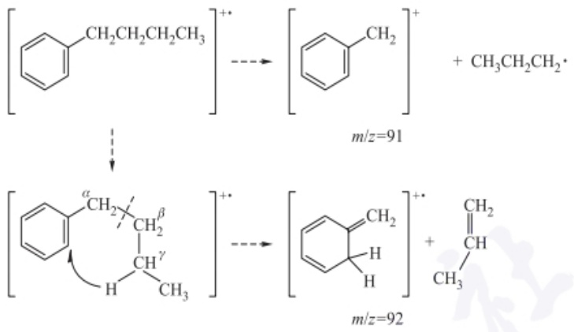

chemical

Chemical reaction mechanism showing two pathways of a benzene derivative with methyl groups, including oxidation and deprotonation steps at m/z=91 and m/z=92.

图 6.2.2 烷基芳烃的麦氏重排裂解路径

移到苯环碳原子上，同时，在  $\alpha$  和  $\beta$  键之间发生断裂，脱掉一个中性分子，形成质荷比为偶数的重排离子峰 (m/z=92)。部分羰基类化合物，如 5-壬酮、正丁酸、戊酸甲酯和正戊酰胺等均能发生麦氏重排，且重排峰均为这些化合物谱图上的基峰，有助于这类化合物的结构解析。

当分子中存在含一个  $\pi$  键的六元环时，容易发生狄尔斯-阿尔德(D-A)反应的逆过程，生成一个共轭二烯的奇电子离子和一个中性碎片，称为逆狄尔斯-阿尔德重排。另外，饱和的醇类、卤化物等也能够发生脱  $H_{2}O$  或 HX 的重排反应，酚类、醌类的芳香化合物易脱去 CO，产生 M-28 的碎片离子峰。

## 6.2.1.3 有机质谱图的解析与定性

质谱是有机化合物鉴定的最有力的工具之一,包括相对分子质量的测定,分子式的确定及分子结构鉴定。

（1）相对分子质量的测定 在电子轰击质谱的常规操作中，离子的质荷比通常与离子的质量数相等。分子离子通常是质谱中质量数最大的离子，其对应的分子离子峰位于质谱图的最高质荷比位置。使用电喷雾或化学解离等离子化方法时，可能还会生成质子化的分子离子。通过分析分子离子峰的质荷比数据，可以精确确定化合物的相对分子质量，比传统的相对分子质量测定方法更快速且准确，所需样品量更少。

然而，在判断质谱图上的分子离子峰时，还需注意以下几点:

① 由于同位素的影响，质谱图中最高质荷比的离子峰不一定是分子离子峰。有机化合物中的常见元素并非由单一同位素组成，因此分子离子在质谱图上常以同位素簇的形式出现。通过比较同位素丰度比，可以帮助判断分子离子峰簇中不同峰的相对强度，并确定其质荷比。此外，同位素峰的相对丰度还可以用于定性分析，含有氯元素的分子，往往出现较强的 $\mathrm{M} + 2$ 峰。
② 分子离子可能会失去某些合理的中性碎片（如小分子和自由基），这是确定分子离子峰的重要线索。质谱图上通常不会出现 M-3 至 M-14 及 M-20 至 M-25 范围内的碎片峰，若出现这样的峰，说明该 M 峰不可能是分子离子峰。分子离子不会失去两个以上的氢原子或比甲基更小的基团，同时有机化合物中也不含质量在 20\~25 的基团。
③ 分子离子峰的质量数需要遵循“氮律”。如果不符合氮律，就不能认为是分子离子峰。当分子中不含氮或含偶数个氮原子时，分子离子峰的 m/z 值应为偶数；当分子中含有奇数个氮原子时，m/z 值为奇数。

## 同位素比质谱与兴奋剂检测

同位素比质谱(isotope ratio mass spectrometry, IRMS)法是一种用于分析分子中稳定同位素丰度的高精度技术，广泛应用于兴奋剂检测。兴奋剂如合成类固醇和其他性能增强药物通常来源于外部。它们的碳同位素比(如 $^{13}C/^{12}C$ )与人体自然合成的内源性分子的比值有所不同。人体内的有机化合物主要来源于天然食物链，具有相对稳定的同位素组成，而外源性兴奋剂往往在合成过程中使用不同的碳源，从而导致其同位素比发生显著变化。

通过精确测量尿液或血液样本中的同位素比,研究人员可以识别出样本中是否存在外源性兴奋剂。例如,若检测到的 $^{13}C/^{12}C$ 比值低于一定阈值,可能表明样本中含有来自合成来源的物质。这一方法的灵敏度和特异性使其在运动员兴奋剂检测中极为重要,可以有效防止假阴性或假阳性结果。

④ 分子离子的稳定性与分子结构密切相关，稳定性越高，其分子离子峰的强度越大。通常，分子离子的稳定性顺序为:芳香环>共轭烯链>酯环化合物>含硫化合物>无分支直链烷烃>硫醇>酮>胺>酯>醚>酸>多分支烷烃>醇。脂肪族中相对分子质量较大的醇、胺、亚硝酸酯、硝酸酯等化合物，以及高分支的链状化合物往往没有分子离子峰。若质谱图上未能检测到分子离子峰，可以尝试降低电子轰击源的电子能量，或改变离子源，使用软电离技术，或者通过衍生物制备等方法确定相对分子质量。
⑤ 需要留意某些有机化合物可能会产生质子化的分子离子 $\left[M+H\right]^{+}$ 峰，如醚、酯、胺、酰胺、腈类化合物、氨基酸酯和胺醇等分子可能捕获质子，形成较强的 $\left[M+H\right]^{+}$ 峰。此外，某些化合物也可能产生去质子化的分子离子 $\left[M-H\right]^{-}$ 峰，如芳醛、某些醇和含氮化合物，或生成缔合离子峰。
（2）分子式的确定 通过高分辨质谱仪的测量，可以确定有机化合物的分子式。如果以 $^{12}$ C 的相对原子质量 12.000000 为基准，则 $^{1}$ H 为 1.007825， $^{14}$ N 为 14.003074， $^{16}$ O 为 15.994915。不同元素组成的分子在精确相对分子质量上不会完全一样。 $C_{10}H_{18}N_{3}O_{2}$ 和 $C_{11}H_{18}NO_{3}$ 的相对分子质量分别为 212.140902 和 212.129669，二者仅相差 0.011233。低分辨率质谱仪无法区分这种差异，而高分辨率质谱仪可以清晰地检测到。因此，通过将高分辨质谱仪测得的相对分子质量与理论相对分子质量进行比较，可以确定分子式。

在低分辨质谱上，可以使用同位素相对丰度法来推断分子式。对于相对分子质量较小且分子离子峰较为明显的化合物，可以通过质谱法测定分子离子峰M及其同位素峰 $(\mathrm{M} + 1)$ 、(M+2)的相对强度，进而计算出 $(\mathrm{M} + 1) / \mathrm{M}$ 和 $(\mathrm{M} + 2) / \mathrm{M}$ 的比值。这些比值提供了同位素的相对丰度数据，结合相对分子质量及同位素丰度值，可以查阅“质量和同位素丰度表”（Beynon表），表6.2.1为该表的节选，从而确定化合物的分子式。需要注意的是，当相对分子质量较大且需要考虑的元素组成较多时，采用同位素相对丰度法无法准确得到分子式。

表 6.2.1 质量和同位素丰度表 (节选)

<table><tr><td></td><td>M+1</td><td>M+2</td><td>相对分子质量</td></tr><tr><td colspan="4">141</td></tr><tr><td> $C_4HN_2O_4$ </td><td>5.26</td><td>0.92</td><td>140.9936</td></tr><tr><td> $C_4H_3N_3O_3$ </td><td>5.63</td><td>0.73</td><td>141.0175</td></tr><tr><td>...</td><td>...</td><td>...</td><td>...</td></tr><tr><td colspan="4">142</td></tr><tr><td> $C_4H_2N_2O_4$ </td><td>5.27</td><td>0.92</td><td>142.0014</td></tr><tr><td>...</td><td>...</td><td>...</td><td>...</td></tr><tr><td> $C_9H_6N_2$ </td><td>10.58</td><td>0.51</td><td>142.0532</td></tr><tr><td> $C_{10}H_{12}$ </td><td>11.16</td><td>0.56</td><td>142.1722</td></tr><tr><td> $C_{10}H_6O$ </td><td>10.94</td><td>0.74</td><td>142.0419</td></tr><tr><td> $C_{10}H_8N$ </td><td>11.32</td><td>0.58</td><td>142.0657</td></tr><tr><td> $C_{11}H_{10}$ </td><td>12.05</td><td>0.66</td><td>142.0783</td></tr></table>

## 标准谱图检索与谱图库

标准谱图检索定性法是质谱定性分析中常用的一种技术,主要通过将样品的质谱图与已知标准谱图进行比对,来确认样品中所含化合物。该方法依赖于数据库中存储的标准谱图,通过匹配相似的峰和相对丰度,快速识别未知化合物。这种方法不仅提高了分析的准确性,还缩短了分析时间,是现代质谱分析中的重要工具。

常用的有机质谱标准谱图数据库包括: NIST Mass Spectral Library, 由美国国家标准与技术研究院提供, 包含大量有机化合物的质谱数据; MassBank, 一个开放的质谱数据库, 涵盖多种化合物的质谱信息; METLIN, 主要用于代谢物的质谱数据, 适合代谢组学研究; HMDB, 专注于人类代谢物的质谱数据, 适用于生物医学研究; ChEBI: 化学物质数据库, 提供部分化合物的质谱信息。

## 亚稳离子

从离子源出口到检测器之间裂解产生的离子，介于稳定和不稳定的离子之间。此峰所对应的质量称为表观质量 $m^{*}, m^{*}$ 一般不为整数，在质谱图中容易被识别，如果存在，则可以表明分子断裂过程中 $\mathrm{m1}$ 和 $\mathrm{m2}$ 的“母子”关系。如苯乙酮的质谱中存在，表明 $m/z$ 为77的离子是由 $m/z$ 为120的分子离子峰裂解失去乙酰基产生的。

## 质谱与青蒿素结构鉴定

质谱在有机分子结构解析中扮演重要角色。周维善院士课题组基于质谱、核磁和红外，最终测定出青蒿素的结构，是罕见的含有过氧桥键的倍半萜内酯结构。值得注意的是，青蒿素的结构不含氮原子，这一特性打破了过去60多年来西方学者普遍认为“抗疟化学结构必须含有氮原子才能有效”的医学观念。中国研究团队的成果表明，抗疟药物的有效性并非仅依赖于氮的存在，反而可能与其他化学结构特征密切相关。这一重要发现不仅拓宽了我们对抗疟药物的理解，也为新药的设计和合成提供了新的思路，具有深远的科学意义和实际应用价值。青蒿素的成功开发，展示了中国科学家在天然产物研究与药物开发领域的卓越贡献。

（3）分子结构鉴定 在分子式确定的基础上，还需要进行分子结构鉴定。常用的鉴定方法有两种:一种是将样品质谱图与已知物质的标准质谱图进行对比，以确认分子结构；另一种则是通过分析质谱图中各类碎片离子、亚稳离子和分子离子的化学式、质荷比及相对峰高等信息，依据化合物的裂解规律，推测各碎片离子的生成过程，进而重构整个分子的结构。最终，结合其他分析方法，获得准确的结构式。需要指出的是，从谱图出发的结构解析需要富含碎片信息的高质量质谱图。质谱图中，碎片离子的 $m / z$ 值及丰度为判断化合物的官能团和类型提供了关键线索。由于碎片离子种类繁多，分析时可以从以下几个方面着手:

① 低质量端离子系列的分析。在低质量区，某一特定 $m / z$ 的离子只可能由少数几种元素或结构组成。例如，$m / z = 29$ 可能对应 $\mathrm{C}_2\mathrm{H}_5$ 或CHO。而 $m / z$ 较大的离子峰，如 $m / z = 129$ ，则可能有上百种结构。因此，研究低质量端的离子可以揭示化合物的类型。
② 高质量离子的分析。随着质荷比的增大，可能的结构组合数呈指数增长，直接分析高质量离子较为复杂。通常通过分析分子离子失去的小中性分子来推测结构。例如，M-1表示分子离子失去一个H，强烈的M-1峰可能暗示分子中存在活泼氢且缺乏其他活泼基团。类似地，M-15，M-18和M-20分别表示分子离子失去 $CH_{3}$ 、 $H_{2}O$ 和HF。
③ 特征离子的识别。虽然离子的裂解过程是多路径和多级的，可能生成大量碎片，但某些官能团引发的简单裂解和重排反应生成的离子具有特定的质量数。例如，苯基的 m/z 为 77，苄基的 m/z 为 91，苯甲酰基的 m/z 为 105，胺的 m/z 为 30，伯醇的 m/z 为 31 等。了解这些特征离子有助于确定化合物的类型和所含的官能团。
（4）质谱图解析的一般步骤 在获得化合物的质谱图后,可以按照以下步骤解析质谱数据:

① 利用分子离子峰确定准确相对分子质量,首先判断是否具有分子离子峰的特征;分子离子的质量数是奇数还是偶数,由此可了解此化合物含有偶数个氮,不含氮还是含奇数个氮;由同位素峰相对强度,可以知道是否有 Br、Cl、S 等元素;求出化合物的分子式和不饱和度。
② 根据分子离子峰与其他峰的相对强度得到化合物类型；利用分子离子峰与碎片离子峰 m/z 差值得到可能脱掉的碎片或中性分子，得到分子结构和断裂类型。
③ 列出部分结构单元: 判断有哪些结构单元; “亚稳峰” 是否指出各主要离子之间的某些关系; 根据各结构单元算出不饱和度和原子数; 除了这些结构单元之外, 其余部分可能是什么。
④ 推断结构: 将各结构单元和剩余部分结构, 按所有可能的结合方式联结起来; 用质谱或其他数据, 舍去不合理的结构式, 即得到比较合理的结构式, 最终拼出整个分子结构。

表 6.2.2 和表 6.2.3 列出了质谱中常见丢失碎片的结构及其质量数。

表 6.2.2 常见丢失碎片离子峰及其结构类型

| 离子 | 丢失碎片 | 化合物结构类型 |
| --- | --- | --- |
| M-1 | H | 醛类(一些醚或胺类) |
| M-15 | $CH_3$ | 甲基取代物 |
| M-18 | $H_2O$ | 醇类 |
| M-28 | $C_{2}H_{4}$、CO、$N_{2}$ | $C_{2}H_{4}$(麦氏重排) |
| M-29 | CHO、$C_{2}H_{5}$ | CO(从脂环酮等脱掉) |
| M-34 | $H_{2}S$ | 硫醇 |
| M-35、M-36 | Cl、HCl | 氯化物 |
| M-43 | $CH_{3}CO$、$C_{3}H_{7}$ | 甲基酮/丙基取代物 |
| M-45 | COOH | 羧酸类 |
| M-60 | $CH_{3}COOH$ | 醋酸酯类 |

表 6.2.3 常见碎片离子峰元素组成及其结构类型

| 离子质量 | 元素组成 | 化合物结构类型 |
| --- | --- | --- |
| 29 | CHO | 醛 |
| 30 | $CH_2NH_2$ | 伯胺 |
| 43 | $CH_3CO、C_3H_7$ | 甲基酮/丙基取代物 |
| 29、43、57、71等 | $C_2H_5、C_3H_7$等 | 正烷烃 |
| 39、50、51、52、65、77 | 芳香族裂解产物 | 芳环类 |
| 60 | $CH_3COOH$ | 羧酸/醋酸酯类 |
| 91 | $C_6H_5CH_2$ | 苄基 |
| 105 | $C_6H_5CO$ | 苯甲酰基 |

下面以一个例题说明如何分析未知有机化合物质谱图,并通过碎片离子的断裂规律,确定有机化合物分子的组成和结构。

»例 6.2.1 一个戊酮的异构体, 分子离子峰为 m/z 86, 并在 m/z 71 和 m/z 43 处各有一个强峰, 但在 m/z 58 处没有峰, 写出该酮的结构式。

》解: 戊酮的三种异构体结构如下。

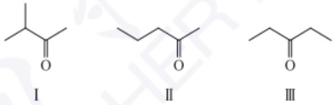

它们的分子离子峰都为 $m / z$ 86。若在 $m / z$ 71处有一个强峰，说明此峰为甲基离去碎片峰（$86 - 71 = 15, -\mathrm{CH}_3$），从以上结构来看，应该是发生了一个 $\alpha-$ 裂解失去了一个甲基自由基而得到的碎片，此碎片进而失去一分子的CO而得到 $m / z$ 43处的碎片峰。从这些结果来看，戊酮I和II都是可能的。若是戊酮II，该分子离子通过麦氏重排失去一分子的乙烯得到的碎片在 $m / z$ 58处出现碎片峰。但对于题中异构体来说，质谱图在 $m / z$ 58处没有峰。因此戊酮异构体的结构应该是I，而不是II。结构为

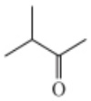

## 6.2.2 有机质谱的定量分析

## 6.2.2.1 质谱定量分析基础

质谱技术不仅可用于鉴定化合物结构,还可实现高灵敏度的定量分析。质谱定量分析的基本原理是,样品中化合物的离子信号强度与其浓度成正比关系。通过建立离子信号与标准品浓度之间的校准曲线,即可利用样品中化合物的离子信号强度定量计算其浓度。

要实现可靠的质谱定量分析,需满足以下几个前提假设:

（1）离子化效率恒定假设 假定样品中化合物的离子化效率在测定过程中保持稳定不变。如果离子化效率发生变化，将导致离子信号与浓度的非线性关系。
（2）抑制/增强效应假设 假定样品基质对化合物离子化过程不会产生显著的抑制或增强效应。基质效应会影响离子信号的重现性和准确性。
（3）均匀雾化假设 假定样品溶液在离子源内部能够均匀雾化，进入质量分析器的离子流稳定。如果雾化不均匀，将导致离子信号的波动和不可重复性。
（4）线性动态范围假设 假定分析物的离子信号响应在一定浓度范围内保持线性。超出线性范围时，离子信号与浓度的关系可能发生变化。

只有满足上述前提假设,质谱定量分析才能得到可靠的结果。在实际应用中,研究人员需要事先评估这些假设的适用性,并采取相应的措施来确保分析的准确性和精密性。

## 6.2.2.2 同位素内标法定量原理及应用

质谱内标法是一种常用的定量分析方法,基本都使用稳定同位素标记的内标物,其基本原理和步骤如下:

（1）加入内标物 在待测样品中添加已知浓度的同位素标记的内标物。内标物通常是与待测化合物同分子结构、同保留时间，但具有不同质量的同位素标记衍生物。
（2）测量样品和内标物的离子信号 在质谱分析过程中,同时记录待测化合物和内标物的离子信号强度。
（3）建立校准曲线 制备一系列不同浓度比的待测化合物/内标物混合标准溶液。测定各标准溶液的离子信号强度比，绘制校准曲线。
（4）计算样品浓度 将样品中待测化合物/内标物的离子信号强度比，代入校准曲线，即可计算出样品中待测化合物的浓度。

内标法的优势在于:① 消除基质效应,内标物与待测化合物在离子化过程中经历相同的基质效应,使用内标物校正可排除基质干扰,提高定量分析的准确性;② 提高分析精密度,内标物与待测化合物同时进入质量分析器,受到相同的系统误差影响,使用内标物校正可提高分析结果的重复性和精密度;③ 扩大线性动态范围,内标法可拓展定量分析的线性范围,增强方法的适用性。

内标法在各领域质谱定量分析中得到广泛应用。例如:①药物代谢动力学研究，采用同位素标记的药物代谢产物作为内标，定量测定生物样品中的药物浓度；②环境污染物监测，使用同位素标记的目标污染物作为内标，定量分析环境样品中的污染物浓度；③食品成分分析，采用同位素标记的食品添加剂或营养成分作为内标，定量测定食品中的相关成分；④生物标志物检测，利用同位素标记的生物标志物作为内标，定量分析生物样品中的代谢物

浓度。

## 6.2.2.3 外标法定量原理及应用

质谱外标法是另一种常用的定量分析方法,其基本原理和步骤如下:

（1）制备标准溶液 准备一系列不同浓度的标准溶液，浓度范围应覆盖待测样品的预期浓度；标准溶液的基质应尽可能与待测样品一致，以最大限度地减小基质效应。
（2）样品前处理 采用适当样品前处理方法（如提取纯化、衍生化等），使待测化合物适于质谱分析；样品预处理步骤应尽可能与标准溶液保持一致。
（3）质谱信号采集 分别测定标准溶液和样品的质谱信号强度；采用与样品分析相同的质谱条件，包括离子化模式、碰撞电压等。
（4）绘制校准曲线 以标准溶液浓度为横坐标,对应的质谱信号强度为纵坐标,绘制校准曲线;校准曲线一般采用线性回归模型拟合。
（5）测量样品浓度 分析待测样品，测定待测化合物在样品中的质谱信号强度；将样品信号强度代入校准曲线，即可计算出样品中待测化合物的浓度。

外标法的优势:① 外标法无须添加内标物,样品前处理过程较为简单。② 易于实施,外标法的实验步骤和数据处理相对较为简单,操作灵活。③ 适用于多种样品,外标法不受内标物选择的限制,可适用于更广泛的样品类型。

外标法的缺点:① 外标法存在基质效应,可能导致定量分析结果偏差。② 精密度较差,外标法无法消除仪器响应的随机误差,分析精密度通常低于内标法。③ 线性范围有限,外标法的线性动态范围相对较窄,无法扩展到更宽的浓度区间。

外标法的应用领域:①环境监测,测定水体、土壤、大气中杀虫剂、多环芳烃、重金属等污染物浓度。②食品安全,分析食品中的农药残留、食品添加剂、营养成分等。③临床检测,测定生物样品(血液、尿液等)中的药物、代谢物、生物标志物浓度。④药物研发,用于新药候选化合物的代谢、药代动力学研究。⑤兴奋剂检测,检测运动员尿液中禁用药物的使用情况。

外标法适用于基质效应较小、线性范围要求不高的定量分析场景,但在精密度和准确性方面略逊于内标法。

## 6.2.2.4 选择性反应监测技术

选择性反应监测(selected reaction monitoring, SRM)是一种基于串联质谱仪工作模式的质谱定量分析技术(图6.2.3)。在SRM模式下,四极杆串联质谱仪的具体工作过程如下:

（1）在第一个四极杆(Q1)，仅选择性地传递特定的前体离子，滤除其他杂质离子。
（2）在碰撞池（q2），前体离子发生特定的碎裂反应，产生特征性的产物离子。
(3) 在第三个四极杆 (Q3)，只检测特定的产物离子强度，忽略其他离子。

这种选择性的离子传输和检测,大幅提高了分析物的检测灵敏度和特异性,能够实现复杂样品中痕量成分的定量分析。

SRM 技术相比于全扫描模式具有以下优势: ① 灵敏度高, 只监测特定的离子, 大幅提高信噪比, 可达到  $pg \cdot mL^{-1}$  级别的检出限; ② 选择性强, 仅监测特征性的产物离子, 去除基质干扰, 提高定量分析的准确性; ③ 动态范围广, 线性动态范围可达5\~6个数量级，适用于痕量到高浓度成分的测定；④分析速度快，每个离子过渡仅需数十毫秒扫描时间，可实现快速定量分析；⑤适用于复杂基质，如生物样品、环境样品等，能够有效校正基质效应。

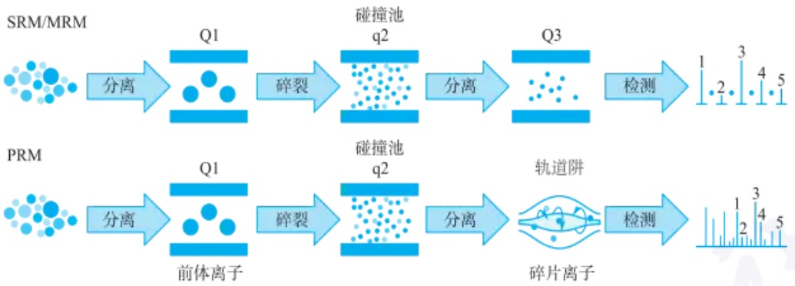

flowchart

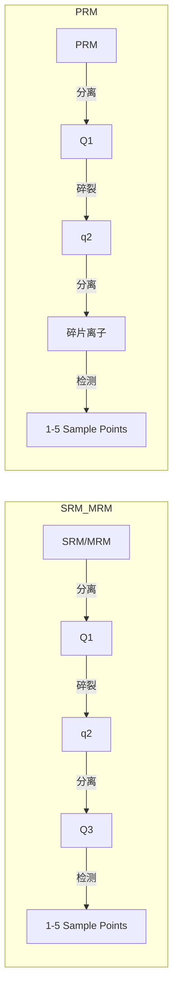

图 6.2.3 选择性反应监测技术示意图

SRM 技术在药物代谢、环境检测、食品安全等领域广泛应用, 是质谱定量分析的重要手段之一。

（1）药物代谢研究 用于测定药物及其代谢产物的浓度变化，研究药物在体内的代谢过程。可定量分析复杂生物基质（如血浆、尿液等）中痕量水平的药物成分。有助于评估药物的药代动力学特性，指导给药剂量的优化。
（2）环境污染物检测 可定量分析水体、土壤等复杂环境样品中的农药残留、多环芳烃等痕量污染物。通过选择性监测特征性的产物离子，大幅提高检测灵敏度和准确性。有助于污染源的溯源分析和污染状况的监测评估。
（3）食品安全检测 用于检测食品中农药残留、重金属、兽药等潜在污染物。克服基质效应的干扰，实现痕量成分的可靠定量分析。为食品安全风险评估和监管提供重要的分析数据支撑。
（4）临床诊断 可定量检测血液、尿液等临床样品中的生物标志物，如激素、药物代谢物等。助力疾病早期诊断、治疗效果监测和预后评估。为个体化医疗提供可靠的生化指标数据支持。
（5）蛋白质组学研究 用于定量分析复杂生物样品中痕量水平的特异性蛋白质。克服免疫学检测法的局限性，为生物标志物的发现和验证提供新思路。在疾病诊断、药物靶点发现等方面发挥重要作用。

综上所述，SRM 技术凭借其出色的灵敏度、选择性和定量能力，在众多前沿领域都有广泛应用。随着质谱技术的不断进步，相信 SRM 必将在未来发挥更加重要的作用。

## 习题

## - 章节练习题 -

1. 试列出 EI 离子化正丁醇的质谱图上可能的碎片离子峰。

## - 挑战性问题 -

2. 有机化合物  $C_{6}H_{4}N_{2}O_{4}$  和  $C_{12}H_{24}$  的精确相对分子质量分别是多少？如果需要区分这两种分子的分子离子峰，需要的质量分辨率是多少？如果没有高分辨质谱的话,采用低分辨质谱如何区分这两种分子?

3. 某化合物的分子式为  $C_{4}H_{8}O_{2}$ ，常温下为液态，质谱图如下，试推断其分子结构。

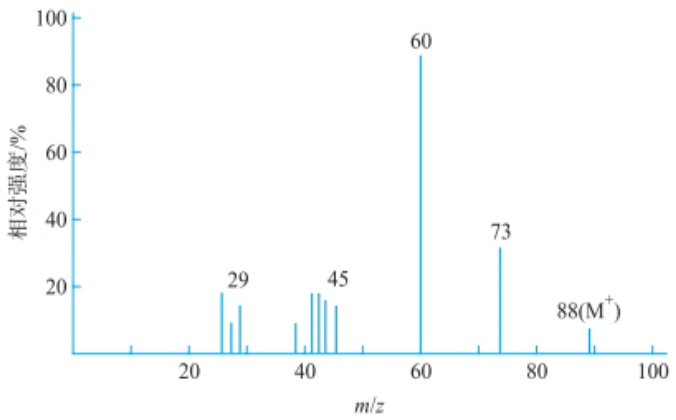

spectrogram

| m/z | Relative Intensity (%) |
| --- | --- |
| 29 | ~18 |
| 45 | ~18 |
| 60 | ~90 |
| 73 | ~32 |
| 88(M+) | ~8 |

## - 专题或报告 -

4. 查询基于大气压敞开式离子源质谱的快速定量方法及其应用相关文献，形成专题报告。

## 6.3 无机质谱分析

本节阐述无机质谱的基本原理、仪器组成、分析性能及基本应用。

## 6.3.1 无机质谱概述

## 6.3.1.1 发展起源

无机质谱技术的起源和发展与质谱技术的整体演变密切相关。早期的质谱研究可以追溯到20世纪初，Joseph John Thomson首次测量了质荷比 $(m / z)$，奠定了质谱理论基础；1918年，Arthur Jeffrey Dempster发明了第一台质谱仪；1919年，Francis William Aston改进并制造了第一台高分辨率的质谱仪，这种仪器能够精确测量原子的质量，并区分出非常接近的质量差。因“借助自己发明的质谱仪发现了大量非放射性元素的同位素，以及阐明了整数法则”，Aston被授予1922年诺贝尔化学奖。进入20世纪中期，随着离子化技术的突破，无机质谱在同位素地质年代学和化学分析领域逐渐得到广泛应用。20世纪50年代，热电离质谱（TIMS）技术诞生，用于高精度同位素比值测定。60年代，质谱技术进一步进入元素分析领域，与其他化学分析方法结合。80年代，电感耦合等离子体质谱（ICP-MS）的出现极大地推动了无机质谱的发展，具备高灵敏度、快速痕量元素检测等能力。20世纪90年代至今，无机质谱技术在离子化、检测器灵敏度和干扰消除技术方面不断取得进步，飞行时间质谱（TOF-MS）和高分辨率磁质谱（HR-MS）的出现进一步提高了分辨率和检测能力。如今，无机质谱可以用于测定金属、合金、岩石样品、半导体和其他无机材料的元素组成；定量测定样品中低浓度、微量或痕量级别的元素；定量测定样品中微量的同位素；对样品中一种或多种元素的分布进行成像；测定稳定或放射性同位素的准确质量；测定样品中元素准确的同位素组成；与分离技术联用，提供样品中不同元素形态的含量信息等，在化学、化工、环境、材料、生物、地质、能源等多个领域得到了广泛应用。

Thomson、Dempster 和 Aston

## 6.3.1.2 无机质谱的基本原理

无机质谱的基本原理是通过测量原子离子的质荷比来分析样品中的元素和同位素，主要步骤包括样品离子化、离子分离、检测和数据处理。首先，通过电感耦合等离子体（ICP）或热电离等方法将样品离子化，使其成为带电粒子；接着，利用电场或磁场根据离子的质荷比进行分离，不同质量的离子沿不同轨迹移动；随后，检测器捕捉这些离子信号并转化为数据，最终生成质谱图，用于确定样品中元素或同位素的种类和含量。

无机质谱技术的一个重要特点是其对元素特定同位素的实际质量进行精确分析。这意味着无机质谱不仅可以检测出元素的存在，还能够区分同一元素的不同同位素，进而测量其实际质量。每种同位素的质量略有差异，这使得无机质谱在同位素分析中具有不可替代的作用。表6.3.1列出了几种常见同位素的精确质量及天然丰度。

表 6.3.1 几种常见同位素的精确质量及天然丰度

<table><tr><td>元素</td><td>同位素</td><td>精确质量</td><td>天然丰度/%</td><td>元素</td><td>同位素</td><td>精确质量</td><td>天然丰度/%</td></tr><tr><td rowspan="2">H</td><td> $^1$ H</td><td>1.007825</td><td>99.98</td><td>P</td><td> $^{31}$ P</td><td>30.973763</td><td>100.00</td></tr><tr><td> $^2$ H(D)</td><td>2.014102</td><td>0.015</td><td>S</td><td> $^{32}$ S</td><td>31.972072</td><td>95.02</td></tr><tr><td rowspan="2">C</td><td> $^{12}$ C</td><td>12.000000</td><td>98.9</td><td></td><td> $^{33}$ S</td><td>32.971459</td><td>0.85</td></tr><tr><td> $^{13}$ C</td><td>13.003355</td><td>1.07</td><td></td><td> $^{34}$ S</td><td>33.967868</td><td>4.21</td></tr><tr><td rowspan="2">N</td><td> $^{14}$ N</td><td>14.003074</td><td>99.63</td><td></td><td> $^{35}$ S</td><td>35.967079</td><td>0.02</td></tr><tr><td> $^{15}$ N</td><td>15.000109</td><td>0.37</td><td>Cl</td><td> $^{35}$ Cl</td><td>34.968853</td><td>75.53</td></tr><tr><td rowspan="3">O</td><td> $^{16}$ O</td><td>15.994915</td><td>99.76</td><td></td><td> $^{37}$ Cl</td><td>36.965903</td><td>24.47</td></tr><tr><td> $^{17}$ O</td><td>16.999131</td><td>0.03</td><td>Br</td><td> $^{79}$ Br</td><td>78.918336</td><td>50.54</td></tr><tr><td> $^{18}$ O</td><td>17.999159</td><td>0.20</td><td></td><td> $^{81}$ Br</td><td>80.916290</td><td>49.96</td></tr><tr><td>F</td><td> $^{19}$ F</td><td>18.998403</td><td>100.00</td><td>I</td><td> $^{127}$ I</td><td>126.904477</td><td>100.00</td></tr></table>

## 6.3.1.3 无机质谱仪器种类

按离子源的种类，无机质谱仪器可以分为:热离子质谱、火花源质谱、辉光放电质谱、电感耦合等离子体质谱和二次离子质谱等。热电离质谱（TIMS）:通过加热样品使样品原子或分子离子化，适用于高精度同位素分析，广泛应用于地球化学和放射性同位素定年。火花源质谱（SSMS）:利用火花放电使样品离子化，主要用于分析高导电性材料（如金属和合金）的成分。辉光放电质谱（GDMS）:通过辉光放电使样品中的原子和分子离子化，适合对固体样品进行痕量和超痕量元素的分析，常用于半导体、金属和玻璃等材料的分析。电感耦合等离子体质谱（ICP-MS）:通过ICP作为离子源，适用于多元素分析，具有极高的灵敏度，广泛应用于环境监测、地球化学、材料科学等领域。二次离子质谱（SIMS）:利用离子束轰击样品表面，激发出二次离子并进行质量分析，适用于表面成分分析及微区同位素研究。这些无机质谱仪器各自具有不同的特点和优势，满足了从高精度同位素分析到痕量元素检测等多种分析需求。

## 6.3.2 电感耦合等离子体质谱

## 6.3.2.1 ICP-MS 仪器组成

ICP-MS的仪器组成包括进样系统、ICP离子源、接口、质量分析器、检测器、真空系统、供电系统、用于仪器控制和数据处理的计算机系统，见图6.3.1。进样系统负责将样品引入仪器。液体样品通常通过雾化器转化为气溶胶形式；固体样品可以通过激光烧蚀等方法直接引入等离子体。常用的进样方法包括液体进样、气体进样、固体进样等，具体方式取决于样品的物理形态。等离子体是由高频电流在氩气环境中产生的，温度高达 $6000\sim 10000\mathrm{K}$ 。这种高温等离子体可以将样品中的元素完全蒸发并离子化，使其转变为自由的原子和离子。等离子体通过一个线圈提供的电磁感应产生，因此称为电感耦合等离子体。通过等离子体离子化后的离子被传输至质谱仪。在传输过程中，采样锥（sampling cone）和截取锥(skimmer cone)用于从等离子体中提取离子，同时降低气体压力。离子传输系统的主要作用是有效引导离子进入质谱仪，并尽量减少中性粒子的干扰。质谱仪的核心部分是质量分析器，负责根据离子的质荷比对离子进行分离。常见的质量分析器有四极杆质量分析器、飞行时间质量分析器、磁扇质量分析器等。四极杆质量分析器是最常见的，用于在动态电场中稳定或不稳定地传输特定质量的离子，从而实现离子的选择性分离。被质量分析器分离的离子最终进入检测器。常用的检测器包括电子倍增器或法拉第杯，它们能够将离子信号转换为电信号，再传送到计算机进行处理。检测器具有极高的灵敏度，能够检测到极低浓度的元素。计算机系统负责采集和处理检测器产生的信号，生成质谱图。质谱图展示了样品中各元素或同位素的相对丰度及其质荷比，研究人员可根据此图进行定量或定性分析。无机质谱仪使用的质量分析器及检测器等装置与有机质谱相同，其工作原理已在6.1节中介绍。这里将展开介绍ICP-MS的ICP离子源、接口及进样技术。

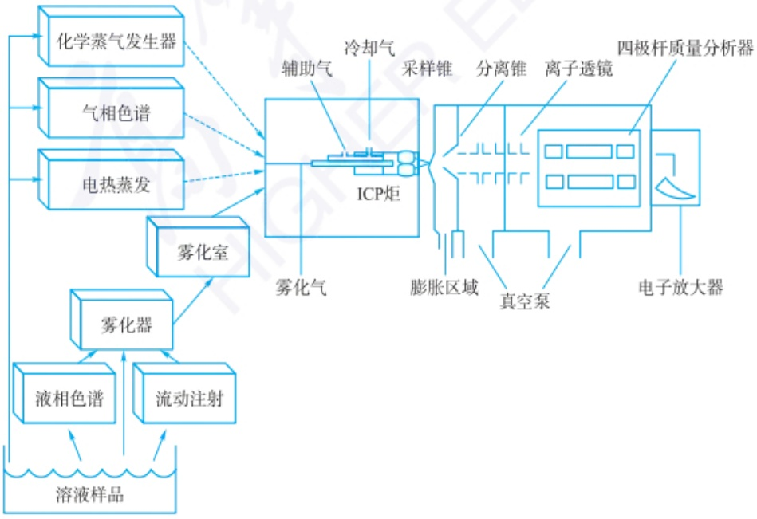

flowchart

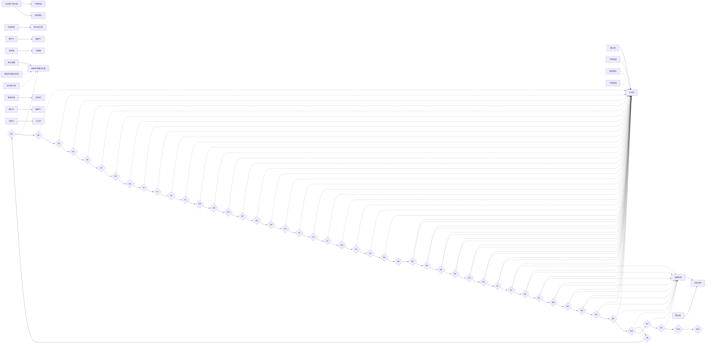

图 6.3.1 ICP-MS 组成示意图

Houk 和 ICP-MS

## 1. ICP 离子源

ICP 是一种高温电离技术,既可以作为原子发射光谱的激发光源,又能作为无机质谱的离子源。ICP 最常使用的气源是氩气,其产生原理已在第五章中进行介绍。如图 6.1.10 所示,ICP 作为质谱仪的离子源,首先氩气通入三层同轴石英矩管中,射频发生器通过将能量耦合到氩气等流体形成的环状等离子体,使气体温度升高至 $10000 \mathrm{~K}$ 。这个高温区域通过热传导将能量传递给冷气流。轴向过程中,等离子体的感应线圈控制电场分布,通常位于离炬管口 $5 \mathrm{~mm}$ 处。待测样品随着载气进入等离子体质谱,发生干燥、气化、解离、原子化、离子化等一系列过程,最终,等离子体喷出包含原子、离子、未完全分解的分子和粒子等。离开等离子体后,温度迅速下降,采样锥孔附近的气体温度降至 $6000 \mathrm{~K}$ 或更低。ICP 具有高样品解离效率,且能高效率产生单电荷离子(离子效率在 $90 \%$ 以上),具备理想的无机质谱分析离子源的条件。

## 2. ICP 与 MS 间的接口

ICP与MS间的接口包括采样锥、截取锥、离子透镜组。采样锥/截取锥的材质为Ni、Pt等金属，采样锥的锥孔约为 $1.0\mathrm{mm}$，截取锥的锥孔约为 $0.4\mathrm{mm}$，作用是将离子引进真空腔室。离子透镜组的作用包括:聚集尽可能多的要测定的离子；甩掉光子、中性物质和负离子；使离子聚焦并沿同样方向进入四极杆；减少干扰（多原子离子和物理干扰）；保持真空系统清洁。如图6.3.2所示，ICP尾焰进入采样锥，等离子气体中的离子、中性粒子及电子被采样锥后真空造成的压差吸取后迅速膨胀形成喷射流，处于中心的一小部分气体通过截取锥，进入离子透镜组的腔室中。在提取透镜中，正离子被提取并加速，中性粒子不受电场影响继续直行，在偏转透镜组中，正离子发生偏转进入质量分析器，光子和中性粒子被金属板挡住。

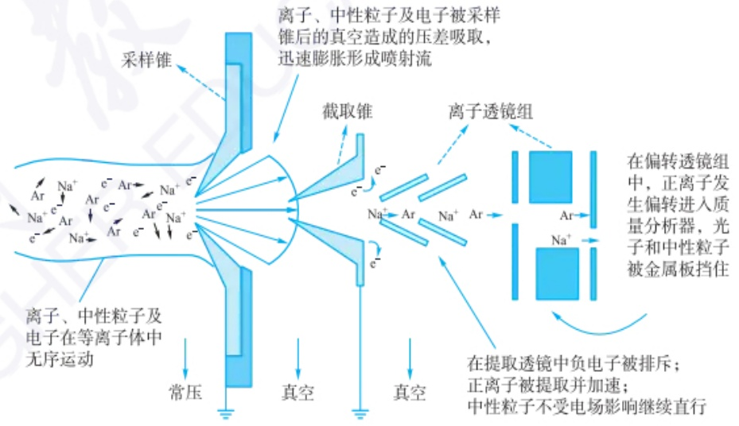

flowchart

This diagram illustrates the ion transport process in a plasma system, showing how electron and neutral particles are collected from a sample through a vacuum chamber to produce an electron-blear mixture.

图 6.3.2 ICP 与 MS 间的接口

## 3. 进样技术

（1）溶液雾化技术 样品溶液通过一细孔管连接至气动雾化器，在气流负压的作用下，于雾化器的喷嘴处产生一高分散的气溶胶。作为引入等离子体之前的湿气溶胶，其粒径大小与分布受雾化室的结构所控制。在雾化室传输的过程中，较大直径的液滴虽然可以被排除，然而，进入等离子体的分析物的比例将会显著地降低，一般仅相当于 $1\% \sim 3\%$ 的样品溶液量。常见的商品化雾化器见副栏二维码。

（2）电热蒸发技术 电热蒸发装置(ETV)经由原子吸收光谱仪中的石墨炉体改造而成。如图6.3.3所示，ETV作为ICP-MS的微量进样器，待测物在炉体中蒸发，由载气将其有效地传输至ICP中，待测物的离子化在ICP中完成。ETV具有的优势有:①高传输效率(不考虑传输损失，接近 $100\%$ )；②微分析技术，所需样品体积仅为 $\mu \mathrm{L}$ 级；③既可分析液体样品，也可分析固体或悬浮体样品；④通过升温程序的设置可以降低因溶剂或有机基体引起的多原子离子干扰；⑤通过高温化学反应，可以降低基体效应和改善难熔元素的检出限。

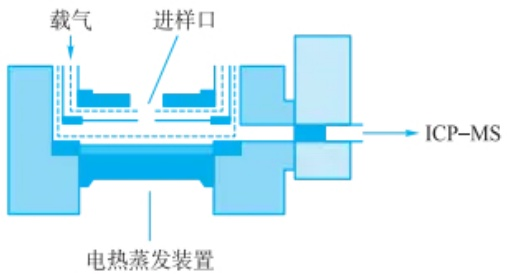

text_image

载气
进样口
ICP-MS
电热蒸发装置

图 6.3.3 电热蒸发装置示意图

（3）流动注射技术 流动注射(FI)是一种连续流动分析技术。流动注射装置包括多个流体通道、反应(萃取)装置、泵体和阀门。将其作为ICP-MS的进样技术，通过流路控制，可以实现集进样、分离、富集于一体的在线分析。固相萃取-FI-ICP-MS在线分析体系实例见副栏二维码。
（4）化学蒸气发生技术 化学蒸气发生(CV)是一种基于化学反应,并形成气体化合物的样品引入技术。CV体系的突出优点是:①待测物可以与样品中的主成分分离,从而有效地降低了由基体物质引起的光谱或非光谱干扰;②高传输效率,可使待测物全部传输至等离子体中原子化和电离;③省去了雾化系统,从而从根本上消除了分散和记忆效应的来源;④试液中的盐分不受限制,从而避免了固体质点在ICP炬管及锥孔上的沉积。
（5）激光剥蚀(LA)技术 LA 进样装置是将固体样品置于封闭的样品池中，将聚焦的高能量激光透过石英窗照射至样品表面，局部样品受热气化挥发。气化的样品通过载气(氩气或氦气)从样品管引入至 ICP-MS 的炬管中心管内。LA 的优点是可以对固体样品直接分析，具有原位、实时、快速的分析优势，可以提供元素成像信息(分辨率在微米级)。

## 6.3.2.2 ICP-MS 分析性能

ICP-MS 具有极高的灵敏度,能够检测到  $10^{-12}g \cdot mL^{-1}$  级别的痕量元素,且具备广泛的元素分析能力,几乎覆盖整个周期表的元素(包括大部分金属和部分非金属)。其线性动态范围宽广,通常达到9个数量级,能够同时分析样品中从极低到高浓度的元素。ICP-MS 具备快速多元素分析能力,每个样品的分析仅需几十秒,适合高通量分析。同时,ICP-MS 还拥有良好的精密度和准确度,通常相对标准偏差(RSD)低于2%,常用于痕量元素检测及同位素比值分析。

## 6.3.2.3 ICP-MS中的干扰及消除方法

ICP-MS中的质谱干扰主要分为五种类型:同质量类型离子干扰、多原子离子干扰、双电荷离子干扰、氧化物和氢氧化物干扰。

首先,同质量类型离子干扰是指两种不同元素的同位素具有几乎相同的质量。对于使用四极杆质量分析器的仪器来说,当两个同位素的质量差小于一个原

商品化雾化器

固相萃取-FI-ICP-MS分析

## 思考:

化学蒸气发生技术适用于哪些元素？

## 思考:

影响 LA-ICP-MS 元素成像分辨率的因素有哪些？

## 思考:

试比较 ICP-MS 与原子吸收光谱和原子发射光谱的分析性能。

## 思考:

如何区分 ICP-MS 中的质谱干扰和基体效应？