碰撞反应池技术

子质量单位时，会产生干扰。许多元素都有重叠的同位素，比如铟(In)有两个稳定同位素: $^{113}$ In $^{+}$ 和 $^{115}$ In $^{+}$ ，它们分别与 $^{113}$ Cd $^{+}$ 和 $^{115}$ Sn $^{+}$ 重叠。由于可以通过元素的天然丰度表预测这种干扰，校正通常通过计算机软件自动完成。

其次，多原子离子干扰是ICP-MS中最常见的干扰类型。这些离子一般不是在等离子体本身中形成，而是由等离子体中的组分与基体或大气中的组分相互作用产生。它们形成的多原子离子会产生背景峰，如 $^{16}\mathrm{O}^{+}$、$^{16}\mathrm{OH}^{+}$、$^{40}\mathrm{Ar}^{+}$、$^{40}\mathrm{ArH}^{+}$等，这些多原子离子可能对一些同位素的检测产生干扰。例如，$^{14}\mathrm{N}_{2}^{+}$对$^{28}\mathrm{Si}^{+}$，$^{16}\mathrm{O}_{2}^{+}$对$^{32}\mathrm{S}^{+}$，$^{40}\mathrm{Ar}$、$^{16}\mathrm{O}^{+}$对$^{56}\mathrm{Fe}^{+}$的干扰都很常见。部分干扰可以通过空白试验进行校正，另一些则需要选择不同的同位素进行分析。

在 ICP-MS 中, 虽然大多数离子为一价正离子, 但是仍然会存在带两个正电荷的离子, 如元素 Ce, 在 ICP 中存在  ${}^{140}Ce^{+}$  和  ${}^{140}Ce^{2+}$ ,  ${}^{140}Ce^{2+}$  会对  ${}^{70}Ge^{+}$  的检测造成干扰。虽然通常测定的是单电荷离子, 但在高能条件下, 双电荷离子也会出现, 影响分析结果。

氧化物和氢氧化物离子干扰也是多原子离子干扰的一种，主要由分析物、基体组分或溶剂中的成分与氧或氢结合形成。例如，钛的氧化物（如  $TiO^{+}$ ）可能干扰镍( $^{62}Ni^{+}$ )、铜( $^{63}Cu^{+}$ )、锌( $^{64}Zn^{+}$ )等元素的检测，这些氧化物干扰可能严重影响分析结果。

为了降低或消除多原子离子干扰,可以采取以下措施:选择适当的样品引入技术,减少引入ICP的水和其他溶剂;使用冷等离子体技术,降低射频功率及氩气的电离效率;采用高分辨质量分析器;利用碰撞/反应池技术,通过小分子惰性气体或反应气体来减少多原子离子的影响,碰撞/反应池技术有关内容见副栏二维码;通过优化样品前处理技术,去除复杂基质。

基体效应是指样品中除目标分析物外的其他组分对目标分析物信号的影响，通常表现为信号的抑制效应。与质谱干扰不同，基体效应主要是负效应，抑制目标分析物的信号响应。ICP-MS进行分析时，样品通常为固体含量低于1%的溶液，或质量浓度约为 $1000\ mg\cdot mL^{-1}$ 。当溶液中共存组分的质量浓度超过500\~ $1000\ mg\cdot mL^{-1}$ 时，基体效应才会变得显著。尤其是当共存物中含有低电离能元素（如碱金属、碱土金属和镧系元素）且超出一定限度时，这些元素提供大量电子，抑制包括目标分析物在内的其他元素的电离，从而影响分析结果。

此外，样品的高固体含量会干扰雾化、溶液蒸发及等离子体生成和传输的过程。若样品提升量过大或蒸发过快，会导致等离子体炬的温度下降，进一步影响目标分析物的电离并导致信号响应下降。在等离子体中，大量正离子之间的相互排斥作用也会减少进入采样锥的离子数量，进而降低分析信号。

为了降低基体效应的影响,常用的方法包括:样品稀释、基体匹配、标准加入法、同位素稀释法、引入样品前处理技术等。

## 6.3.2.4 ICP-MS 的应用

## 1. 定性和定量

ICP-MS适用于多元素分析，尤其在环境、生物样品及各类天然或人工材料中进行定性和半定量分析。与ICP-OES相比，ICP-MS的质谱图更简单，检测限更低。在混合物的半定量分析中，通常选择已知浓度的待测元素溶液，测定其峰离子电流或强度，假设离子电流与浓度成正比，从而计算样品中的分析物浓度。

ICP-MS常用的定量分析方法包括工作曲线法、内标法和标准加入法。当未知溶液中的溶解固体总量小于 $2000\mathrm{mg}\cdot \mathrm{mL}^{-1}$ 时，可使用稀酸配制工作曲线进行定量分析。对于基体元素浓度较高的样品，可以通过稀释样品或采用基体匹配的工作曲线来进行定量。内标法可用于校正仪器信号漂移、不稳定性和基体效应，选择的内标元素应与目标分析物的相对原子质量和电离能接近，同时应在样品中不存在。对于痕量稀土元素的分析，常选择铟(In)或铑(Rh)作为内标。

更精确的定量分析可通过同位素稀释质谱法(IDMS)实现。IDMS的工作流程见副栏二维码。该方法通过向样品中加入已知量的同位素稀释剂，测定添加同位素与参比同位素的信号比，进行精确的定量分析。参比同位素通常选择分析元素的最高丰度同位素，除非该同位素受到其他元素同质量干扰。IDMS具有很高的分析精度，但耗时长且使用示踪同位素的成本较高。

## 2. 最新应用进展

## (1) 元素形态分析

元素形态包括元素的同位素组成、电荷或氧化态、无机和有机存在形式及生物大分子的结合形态等。元素的毒性、生物利用性、生理代谢和迁移过程等都与其存在形态密切相关。因此，元素总量分析已经不能满足生命体中元素代谢过程研究的需求，元素形态分析日益成为科研工作者密切关注的课题。色谱质谱联用技术将强大的分离技术与高灵敏的检测技术相结合，是元素形态分析的主要手段（图6.3.4）。色谱质谱联用技术包括元素特异性的ICP-MS检测技术和结构测定的有机质谱检测技术可以实现痕量超痕量元素形态的定量分析，也可以实现未知元

同位素稀释质谱法

## 思考:

与测定元素总量相比,元素形态分析对分析方法的要求更高。请列举三条以上的理由。

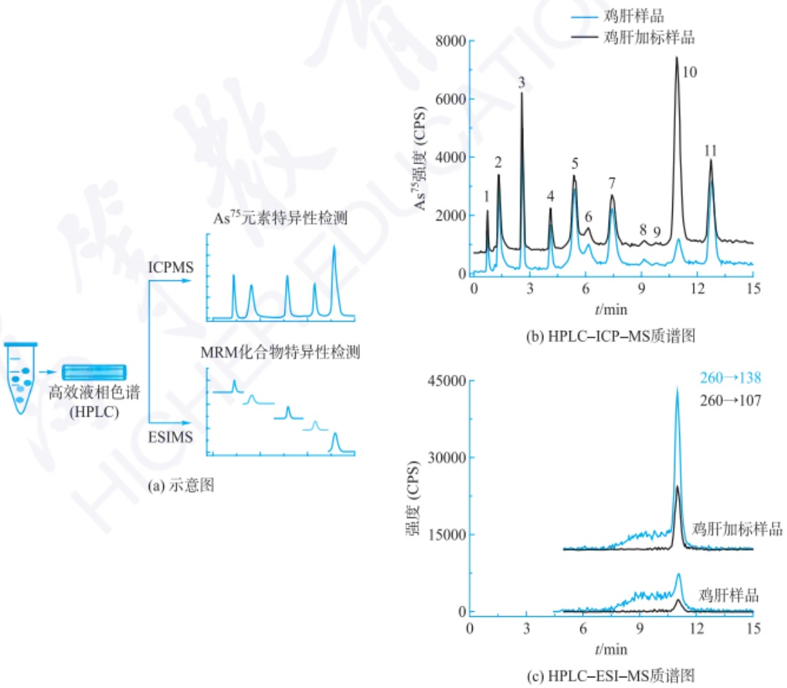

图 6.3.4 HPLC-ICP-MS/ESI-MS 平行联用技术用于鸡肝中洛克沙肿及其代谢物的形态分析(来自 Angewandte Chemie International Edition.2017, 56: 6773-6777.)

## 思考:

影响单颗粒/单细胞 ICP-MS 分析结果准确性的因素有哪些？

素形态的结构分析。通过联用技术收集到多方面的信息，再将不同仪器之间得到的信息进行共享比对，完成对元素形态的定性和定量分析。

## (2) 单颗粒/单细胞 ICP-MS 分析

时间分辨（TRA）-ICP-MS检测方法具有灵敏度高等特点，近年来已被用于单颗粒/单细胞的分析，也被称为单颗粒(SP)-ICP-MS，或单细胞(SC)-ICP-MS（图6.3.5）。其检测原理是:将纳米粒子悬浮液或者细胞样品通过气动雾化进样系统引入ICP，单个颗粒或单个细胞形成离子云并以跳峰形式与背景基线分开。因目标元素的跳峰强度与其在单个颗粒或细胞内的绝对量呈线性相关，因此可实现对单颗粒/单细胞内目标元素的定量分析。而跳峰频率则可反应样品溶液中纳米粒子的颗粒浓度或细胞密度。

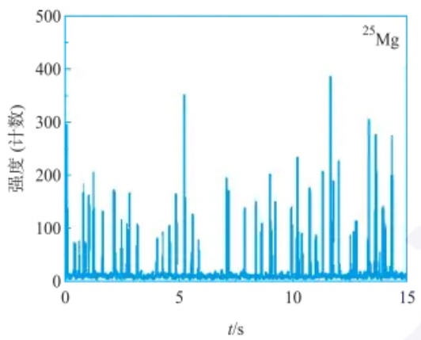

bar

| t/s | 强度 (计数) |
| --- | --- |
| ~0.2 | ~300 |
| ~0.8 | ~180 |
| ~1.2 | ~200 |
| ~1.8 | ~170 |
| ~2.2 | ~160 |
| ~2.8 | ~170 |
| ~3.2 | ~110 |
| ~4.2 | ~90 |
| ~4.8 | ~160 |
| ~5.2 | ~350 |
| ~5.8 | ~120 |
| ~6.8 | ~190 |
| ~7.2 | ~170 |
| ~8.2 | ~150 |
| ~8.8 | ~200 |
| ~9.8 | ~230 |
| ~10.2 | ~170 |
| ~10.8 | ~210 |
| ~11.2 | ~380 |
| ~11.8 | ~230 |
| ~12.8 | ~300 |
| ~13.2 | ~270 |
| ~13.8 | ~270 |

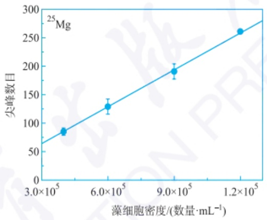

line

| 藻细胞密度/(数量 \(\cdot\) \(mL^{-1})\) | 尖峰数目 |
| --- | --- |
| ~\(3.5 \times 10^{5}\) | ~85 |
| ~\(6.0 \times 10^{5}\) | ~130 |
| ~\(9.0 \times 10^{5}\) | ~190 |
| ~\(1.2 \times 10^{5}\) | ~260 |

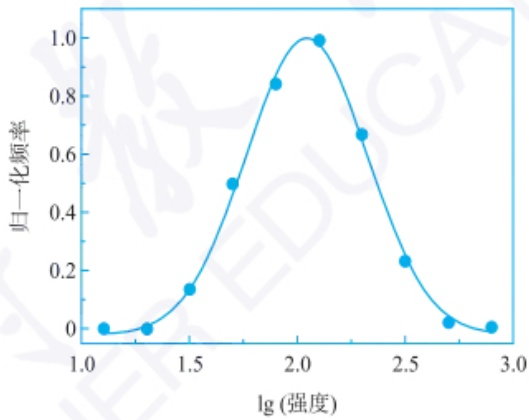

line

| lg(强度) | 归一化频率 |
| --- | --- |
| ~1.1 | 0 |
| ~1.3 | 0 |
| ~1.5 | ~0.14 |
| ~1.7 | 0.5 |
| ~1.9 | ~0.84 |
| ~2.1 | 1.0 |
| ~2.3 | ~0.67 |
| ~2.5 | ~0.23 |
| ~2.7 | ~0.03 |
| ~2.9 | 0 |

图 6.3.5 ICP-MS 测定单个小球藻中的 Mg(来自 Journal of Analytical Atomic Spectrometry. 2010, 25:1114-1122)

## 思考:

元素标记 ICP-MS 包括哪些分析过程？

## （3）基于元素标记 ICP-MS 技术的生物分析应用

元素标记 ICP-MS 技术又称基于稳定同位素标记的 ICP-MS 技术，这是一种结合元素（稳定同位素）标记策略与 ICP-MS 定量分析技术的新型定量生物分析方法（图 6.3.6）。基于元素标记 ICP-MS 技术具有如下几点显著优势:元素标签内的原子可以直接被 ICP-MS 检测，元素标签不需要具有放射性、光学、电学、电化学、磁性或其他任何特殊性质；元素标签成本低廉且非常稳定，可长时间储存，并且几乎不受温度、光照和 pH 等环境因素影响；ICP-MS 可以在高达 9 个数量级的宽动态线性范围实现对元素的高灵敏度和高准确度检测，检出限低至 pg·mL $^{-1}$ 水平（约 10 pM）；ICP-MS 检测具有低的基体效应，并且对元素检测与其存在形态无关，可以采用简单的非特殊形态的无机标准品建立标准曲线进行定量；有大量质荷比不同的元素或同位素（超过 100 种）可以用作元素标签，利用 ICP-MS 优异的质量分辨率和多元素检测能力,可以实现多目标物同时分析,而不会像光学检测方法那样受到多波长激发和发射光谱重叠的限制;ICP-MS 可以与高效液相色谱(HPLC)、气相色谱(GC)和毛细管电泳(CE)等分离技术结合,对大量目标分析物可以实现预分离操作。

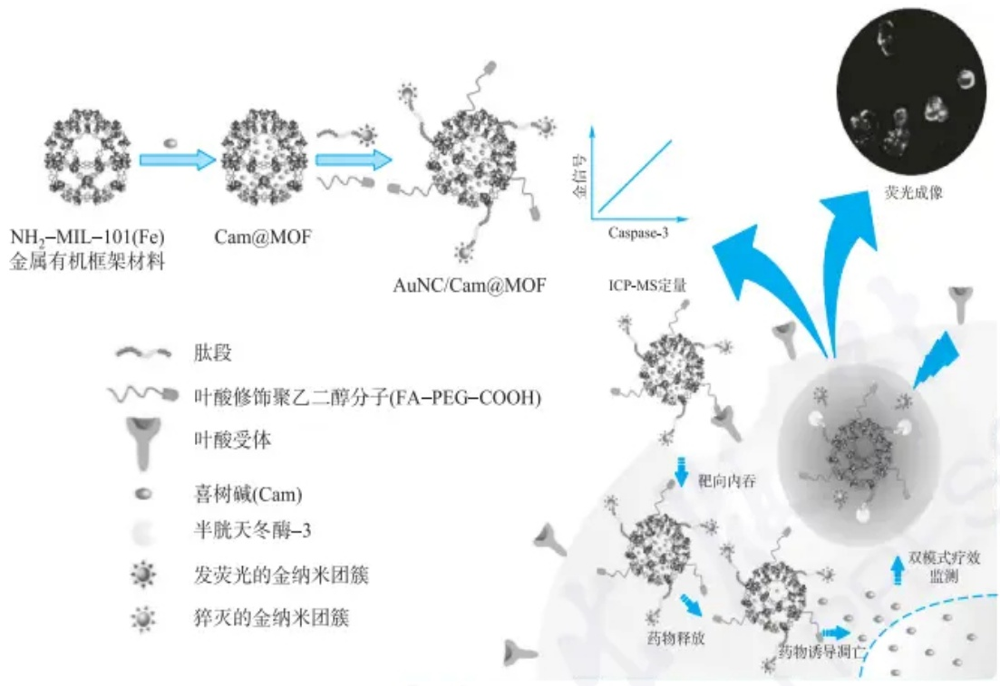

flowchart

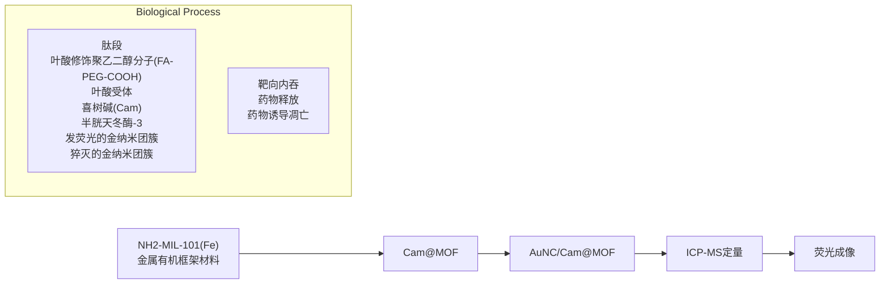

图 6.3.6 元素标记 ICP-MS 用于抗肿瘤药物的定量疗效自监测(来自 Analytical Chemistry. 2019,91:10596-10603)

## (4) LA-ICP-MS 生物元素成像分析

与传统的溶液雾化 ICP-MS 检测相比，LA-ICP-MS 具有原位、实时、快速和灵敏等特点，并且能进行微区分析，提供空间分辨和深度分辨信息（图 6.3.7）。由于 LA-ICP-MS 在元素成像分析方面的优势，其不仅在地矿等领域得到了广泛的应用，近年来也逐渐被用于生物分析。例如，通过 LA-ICP-MS 成像分析测定表面带不同电荷的纳米金（Au NPs）在小鼠肾、肝和脾中的分布差异。结果表明，在脾中带电荷（正电荷或负电荷）的 Au NPs 主要分布在红髓中，不带电荷的 Au NPs 则主要分布于白髓和边界区域；在肝中带负电荷的 Au NPs 呈现出广泛的分布，带

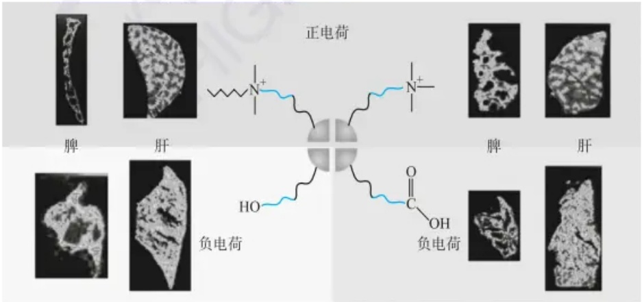

chemical

Diagram illustrating ion transport in bone and liver, showing positive and negative charge carriers with molecular structures and imaging insets.

图 6.3.7 LA-ICP-MS 用于动物组织中元素成像分析(来自 ACS Nano.2016, 10:5536-5542)

## 思考:

LA-ICP-MS 用于元素定量分析时,需要制备基质匹配的标准品,为什么?

## 思考:

试比较无机质谱中不同离子源的优缺点。

正电荷的 Au NPs 主要分布在肝细胞内, 而不带电荷的 Au NPs 则更倾向于与 Kupffer 细胞作用。

## 6.3.3 其他无机质谱技术

## 6.3.3.1 热离子质谱

热离子质谱(thermal ionization mass spectrometry, 简称 TIMS)是一种高灵敏度的质谱技术, 广泛应用于地质、地球化学、核科学等领域。热离子质谱的基本原理是利用高温使待测样品中的原子或离子获得足够的能量, 以克服其电离势, 从而释放出正离子。这些正离子经过静电加速, 进入磁场中按照其 m/z 进行分离。通过检测器记录不同质荷比离子的强度, 可以得到样品的质谱图。

热离子化(也称为表面离子化)离子源:将金属盐、金属氧化物或金属放置在铼或钨丝的表面上,在真空中加热至400\~2300℃。热离子化离子源一般由一到三个带状电离丝组件紧密组装形成,通常与单聚焦磁扇形质量分析器结合使用,最常用于同位素比率分析。

离子形成机理: 在高温下, 被吸附的元素和体相金属的费米能级可以融合成一个共同的能带, 此时弱吸附在表面的粒子的电荷状态由费米统计决定。理想状态下, 离子化程度由 Saha-Langmuir 方程决定。

$$
\alpha^ {+} = \frac {N ^ {+}}{N ^ {0}} = \frac {g ^ {+}}{g ^ {0}} \exp \left[ \frac {e (\Phi - I _ {\mathrm{E}})}{k _ {\mathrm{B}} T} \right] = \frac {g ^ {+}}{g ^ {0}} \exp \left[ 1. 1 6 \times 1 0 ^ {4} \frac {(\Phi - I _ {\mathrm{E}})}{T} \right] \tag {6-3-1}
$$

$$
\alpha^ {-} = \frac {g ^ {-}}{g ^ {0}} \exp \left[ 1. 1 6 \times 1 0 ^ {4} \frac {(E _ {\mathrm{A}} - \Phi)}{T} \right] \tag {6-3-2}
$$

$g^{+}/g^{0}$  代表离子和中性态的电子态比值； $I_{E}$  代表被吸附原子的电离能； $\Phi$  代表丝材料的逸出功；T 代表电离丝的温度； $E_{A}$  代表被吸附原子的电子亲和能。

TIMS 具有极高的灵敏度,能够测量样品中的微量元素和同位素比值,适合分析痕量样品。由于电离方式的稳定性和离子检测的精确性,TIMS 可以达到极高的同位素比值测定精度(通常达到万分之一甚至更高)。热离子源能够有效地将样品离子化,尤其是对某些高电离势的元素表现良好。由于加热电极需要一定的时间进行升温和冷却,且样品的蒸发和电离是一个缓慢过程,分析速度相对较慢。

## 6.3.3.2 火花源质谱

火花源质谱(spark source mass spectrometry, SSMS)是一种利用火花放电作为样品离子化源的质谱技术,多应用于金属材料及合金等的痕量和超痕量元素分析。

火花源质谱的工作原理基于火花放电离子化。被分析样品直接(或与石墨混压)作为离子源的电极。在真空下,施加脉冲高频电压,电极之间发生火花放电,使得电极上的样品蒸发并离子化。

火花离子源的电离效率高，对不同样品的离子化效率大致相同，但是能量分散较大，通常与双聚焦质量分析器结合。火花源质谱的检出限 $0.001\sim 0.1\mu \mathrm{g}\cdot$ $\mathrm{g}^{-1}$ ，有高的动态范围，分析速度快，适合于包括合金、矿石和类似样品中的微量元素分析，并对固体样品无须溶解即可进行分析。尽管能够实现多元素检测，火花源质谱的定量分析精度相对较低，通常用于定性或半定量分析。

## 6.3.3.3 辉光放电质谱

辉光放电质谱(glow discharge mass spectrometry, GDMS)是一种用于固体样品的元素分析技术，尤其适合金属、半导体和合金等材料。它基于辉光放电的物理现象,结合质谱分析的高分辨率和灵敏度,广泛应用于材料科学和痕量分析。

辉光放电是等离子体的一种形式。被分析样品直接(或与石墨混合)作为阳极,阴阳两极放置在低压(10\~1000 Pa)气氛中。在电极间施加电场使气体击穿,电子和正离子朝着带相反电荷的电极加速,轰击电极上的物质使其电离。辉光放电源是用于产生等离子体的核心部分。通常由一个阴极(样品)和一个阳极构成。电压通常为数百伏至千伏,使用氩气作为工作气体。

辉光放电质谱可对块状金属或半导体进行直接分析，检出限低至  $1 \, ng \cdot g^{-1}$ 。与火花源质谱相比，辉光放电质谱具有简单、价廉、精密度较高等特点。

## 6.3.3.4 二次离子质谱

二次离子质谱(secondary ion mass spectrometry, SIMS)是一种利用离子束轰击样品表面并分析产生的二次离子的方法。这种技术主要用于固体表面的元素、同位素和分子分析，具有极高的灵敏度和表面分辨率。

SIMS 的工作原理是利用气体放电或其他方法产生具有一定能量的一次离子束，轰击真空中的固体表面，使被轰击区的温度高达 10000 K，而整个靶体的温度仍保持常温，同时发生一系列物理现象，如散射、中性粒子溅射、正负二次离子溅射、X 射线荧光、二次电子等。直接引出溅射二次离子进行分析的即为二次离子质谱。

SIMS 灵敏度高(ppb 至 ppm)，可达到纳米级别的成像分辨率，适合于固体样品中目标元素的深度分析和微区分析，成为分析微区元素和同位素分布的强大工具(拓展学习二次离子质谱,请参考后文 10.3)。

## 习题

## - 章节练习题 -

1. 简述无机质谱技术的基本原理。
2. 简述 ICP-MS 的仪器组成。
3. 简述 ICP-MS 中的干扰及消除方法。
4. ICP-MS 的分析性能优于 ICP-OES, 原因是什么?
5. 试比较不同的无机质谱技术各自的性能特点。

## - 挑战性问题 -

6. 在质谱分析中, 存在质谱分馏效应。请查阅和参考相关文献后回答: 在同位素质谱分析中, 如何准确进行质量分馏校正以消除仪器的质量歧视效应?
7. 含金属纳米粒子的生物安全性备受关注,你觉得采用 ICP-MS 相关技术可以从哪些方面开展含金属纳米粒子的生物效应研究?

## - 专题或报告 -

8. ICP-MS 在生物分析领域中展现出蓬勃的生命力。请查阅相关科学文献，了解 ICP-MS 在生物分析中的应用情况，并将结果写成报告。

## 6.4 质谱联用技术

质谱技术快速发展使其正在成为定性鉴定与定量分析的有力工具。一般来说，质谱仪针对单一物质进行分析非常有效，如果样品基体复杂或有多种待测物存在，就需要合适的手段进行分离纯化后才可以有效实现分析鉴定。色谱技术包

## 拓展阅读

质谱仪工作的真空度通常在 $10^{-6}\mathrm{Torr}(1\mathrm{Torr}=133.322\mathrm{Pa})$ 甚至更高，将分析物有效引入质谱仪并不容易实现，该技术是一个不断发展的过程，从常压到真空的逐级离子导入是质谱仪设计，特别是质谱联用技术的关键，可以阅读相关技术发展的文献来进一步了解。

## 拓展

在现在常见的喷射式气体分离器接口出现之前，还有一项气相色谱与质谱接口技术得到了应用，如毛细管气相色谱出口将载气与待测物直接引入离子源中实现样品引入与离子化，这样对离子源电离过程和实时排出载气达到真空环境就有比较高的要求。

括气相色谱(GC)、液相色谱(LC)、毛细管电泳(CE)等,都是复杂物质分离的重要手段。这些色谱技术与质谱技术联用,为复杂样品分析提供了非常好的手段,在不同领域得到了广泛的应用。

气相色谱等分离技术与质谱联用需要特殊设计的接口，主要是因为气相色谱、液相色谱等分离过程中涉及高流速流动相，而质谱工作是在真空状态，需要有效从流动相中将分析物提取分离出来，经合适方式在不损失色谱分辨率的情况下导入质谱仪进行分析。

## 6.4.1 气相色谱-质谱联用技术

气相色谱-质谱联用技术(GC-MS)的关键部分之一是接口,这是将气相色谱和质谱两种仪器相连接的关键组件。接口必须确保化合物有效地传输和分析,以便实现GC-MS联用。从20世纪50年代开始,各种气相色谱与质谱的接口逐渐被开发出来,其主要作用是将气相色谱分离出来的组分有效地传输到质谱中进行检测。气相色谱分离是在高温条件下实现的,在这些接口设计中除了分离样品与载气外,还要解决因样品冷凝而不能有效进入质谱仪等问题。其中比较成功的包括毛细管接口和喷射式气体分离器接口。

毛细管接口(capillary interface)是利用毛细管将色谱柱流出物引导到质谱离子源,通常需要加热以防止样品冷凝。其优点是传输效率高,峰形保持较好。但需要精确控制毛细管的温度,对操作要求较高。

喷射式气体分离器接口(jet separator interface)如图6.4.1所示,其工作原理是通过高速喷射将色谱柱流出物中的样品气体与载气分离,样品气体进入质谱,载气被排出。如果一级气体喷射分离器不足以将载气分离,还可以考虑使用二级串联提升分离效率。这种接口的优点是可以有效减少载气进入质谱,提高样品的传输效率。其不足之处是可能造成样品的损失,对某些化合物特别是相对分子质量小的化合物的响应有所影响。

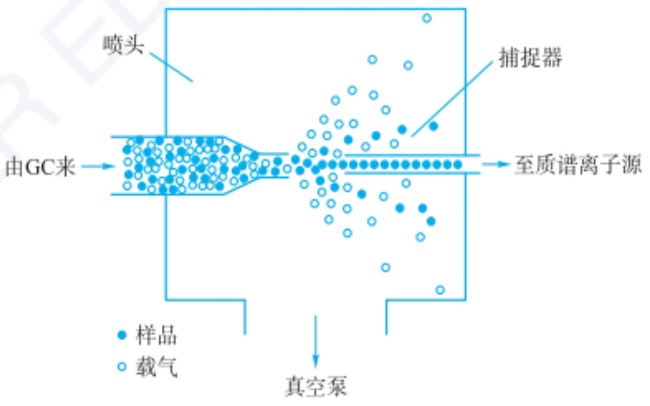

flowchart

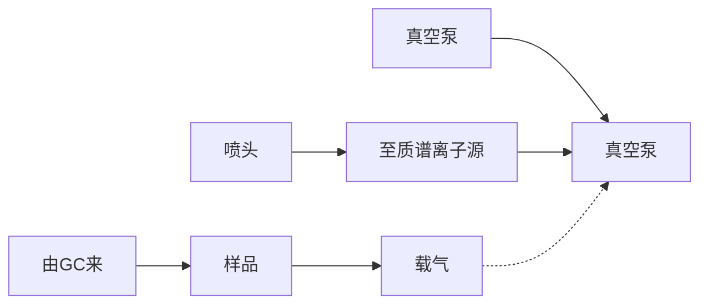

图 6.4.1 喷射式气体分离器接口

GC通常在较高的压力下工作，而MS的离子源则要求在低压或接近真空的环境下工作。接口需要解决从GC的高压环境到MS的低压环境的压力转换问题，以确保样品有效传输，减少样品损失，保持样品的浓度和色谱峰型。同时为避免分离出的样品在传输过程中可能会因为温度降低冷凝而导致的样品损失和色谱峰展宽，接口需要保持一定的温度。

总之，GC-MS接口是连接GC和MS的关键部分，其主要目的是确保样品从

GC 到 MS 的高效、稳定和可靠的传输, 从而保证分析结果的准确性和重复性。

## 6.4.2 液相色谱-质谱联用技术

液相色谱-质谱联用技术(LC-MS)的接口是关键组件。接口的设计和性能对于有效地将液相色谱分离的化合物引导到质谱仪进行质谱分析至关重要。

与 GC-MS 接口要求一样, LC-MS 接口要求能同时实现样品引入、样品喷雾与离子化、待分析物气相传输、有效导入质谱仪对应设计及质谱数据分析等相关功能。

常见的液相色谱-质谱接口是电喷雾电离和大气压化学电离接口等，由于其功能包括离子化过程，相关接口的基本构造和工作原理在本章相关离子化方法(6.1.3节)中已经有了基本介绍。

## 6.4.3 毛细管电泳-质谱联用技术

毛细管电泳是利用被分析物在充满背景电解质的毛细管内电迁移速率的差异来实现分离，随着不同分离模式的研究和发展，该方法特别适用于极性及离子型分析物的分离分析，同时也可以实现中性物质的分离，由于背景电解质迁移速率在  $nL \cdot min^{-1}$  量级，相应与质谱真空匹配比较容易实现。但与气相色谱和液相色谱技术不同，CE 分离的实现需要在毛细管两端施加一个高压直流电场，如何将电泳电场与质谱仪离子化电场有效隔离是一个需要解决的问题。CE 末端接口是影响整个检测的一个关键因素，所有 CE-MS 接口的目标都是为了获得稳定的雾流（spray-current）和高效的离子化。

由于 CE 需要较高离子强度、挥发性低的缓冲溶液，而 ESI 需要相对较低的盐浓度才能获得好的雾化及离子化。因此接口技术必须优化，使其尽可能提供好的电接触，同时尽量减少对 CE 分离效率的影响。此外，对于每一种接口应选择相应的缓冲溶液。常见的 CE-MS 接口共有三种类型:同轴液体鞘液接口（coaxial sheath liquid interface）、少鞘液接口（liquid-junction electrospray ionization interface）和无鞘液接口（sheathless electrospray ionization interface）。

## 6.4.3.1 同轴鞘液电喷雾离子化接口

同轴鞘液电喷雾离子化接口是最常见的连接 CE 与 ESI-MS 的方法,早期来自液相色谱-质谱电喷雾接口的改进。该接口是一个同心的不锈钢毛细管套在电泳毛细管末端,鞘内充有鞘液,如图 6.4.2 所示。在此不锈钢套外再套一个同心的金属套,鞘内通鞘气。鞘液与毛细管电泳缓冲溶液液体在尖端混合,同时被鞘气雾化。鞘液流量通常为每分钟纳升至数微升之间,但却显著高于 CE 流速。

由于鞘液的稀释作用,雾流稳定性得到改善。理想的鞘液缓冲溶液盐浓度应在高分离(高盐浓度)和高雾化(低盐浓度)间优化。由于鞘液在雾化过程中也完全蒸发,鞘液的稀释并不显著降低检测灵敏度。但混合液体的体积应尽可能小,以避免谱带展宽。

## 6.4.3.2 少鞘液电喷雾离子化接口

少鞘液电喷雾离子化接口为 CE 末端与一个直径 10\~20 μm 的槽垂直相连，槽内充有 CE 缓冲溶液，可以有效实现 CE 电场闭路，如图 6.4.3 所示。与 CE 末端相对的槽的另一端接上电喷雾离子化接口。此装置优点在于可通过任意调节槽内液体流速以改善电喷雾离子化效果，然而这通常是以谱带展宽和分离效能减低为代价取得的。

## 拓展

在液相色谱与质谱联用技术的实现过程中,如何有效将流动相与待测物分离是关键环节,流动相与待测物的可挥发性差异十分重要。相应的,一些在其他检测技术中可以使用的控制流动相 pH 的缓冲体系、离子对、手性拆分试剂等,在质谱联用时就不能使用,分离模式需要进行适当调整。

## 拓展阅读

与液相色谱-质谱联用技术相似，在将毛细管电泳与质谱联用时，应特别注意毛细管电泳所使用的背景电解质类型及各种用于分离修饰的难挥发成分。此外，一些特殊的电泳模式已经发展起来。例如，可通过电喷雾离子化的差异来实现待分析物与基体电解质和添加剂的分离。

有关无鞘液离子化技术的早期发展和接口工作原理可以参阅相关文献。(Anal. Chem., 2007, 79, 4241-4246; Anal. Chim. Acta, 2008, 627, 25-33)

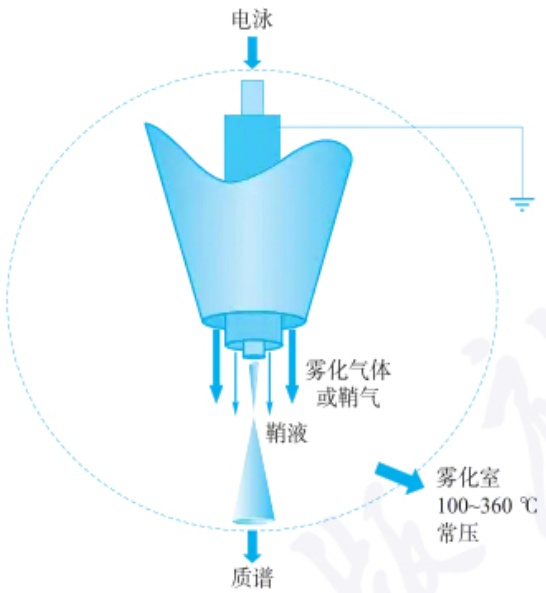

flowchart

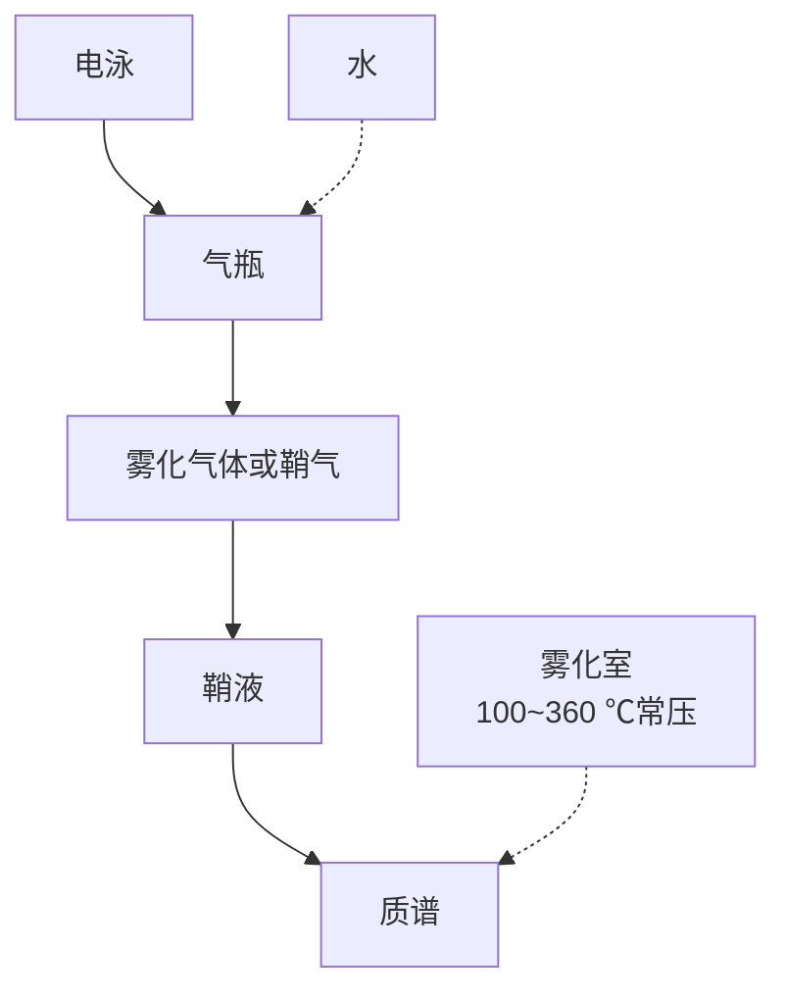

图 6.4.2 同轴鞘液电喷雾离子化接口

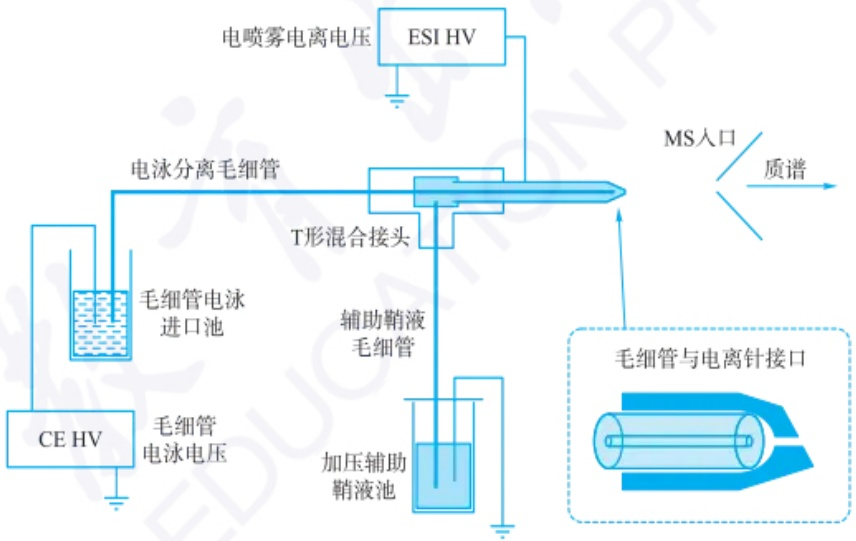

flowchart

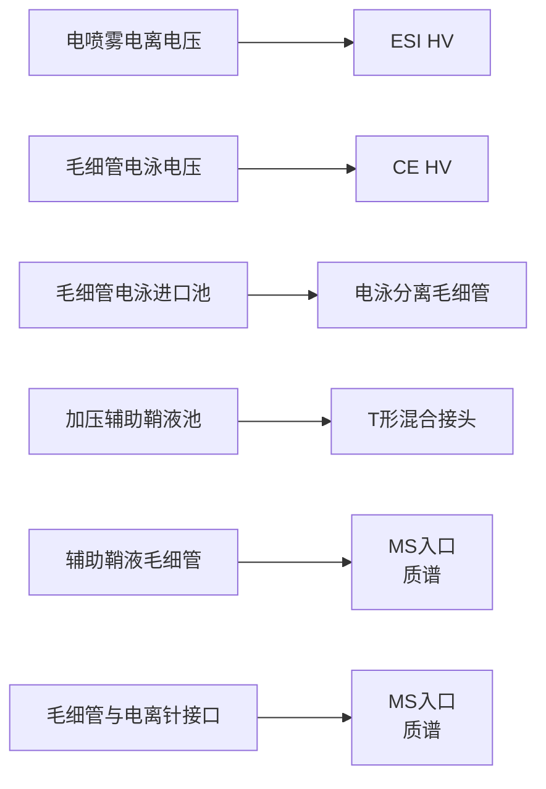

图 6.4.3 少鞘液电喷雾离子化接口

## 6.4.3.3 无鞘液多孔末端纳喷雾离子化接口

无鞘液多孔末端纳喷雾离子化接口是通过对分离用毛细管出口末端进行腐蚀加工，将出口端石英毛细管腐蚀成带有很多微孔的外壁的末端，再通过外壁的导电液实现毛细管电泳电场闭路，而多孔端的电喷雾离子化电场实现毛细管中缓冲溶液和样品的电喷雾雾化和离子化(图6.4.4)。由于毛细管电泳的流速在每分钟数十纳升量级，在喷雾电场作用下可以实现纳喷雾离子化，完成与质谱的连接。由于这一接口不存在鞘液稀释作用，灵敏度相对较高。但毛细管电泳缓冲溶液的选择有一定限制。

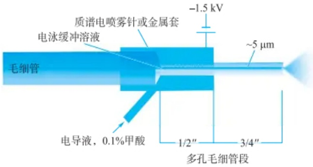

text_image

电泳缓冲溶液
质谱电喷雾针或金属套
-1.5 kV
毛细管
~5 μm
电导液，0.1%甲酸
1/2"
3/4"
多孔毛细管段

图 6.4.4 无鞘液多孔末端纳喷雾离子化接口

除上述3种分离技术可以有效与质谱联用外，其他分离技术也可能与质谱联用。通过高效分离与高性能鉴定特性的同时实现，色谱-质谱联用技术在复杂体系分析特别是环境分析、生化分析等领域都得到了很好的应用。

## 习题

## - 挑战性问题 -

1. 利用气体分离器实现 GC-MS 联用时, GC 常用的载气为氦气, 而不是氢气或氮气, 为什么?
2. 液相色谱-质谱联用常用的是 ESI(电喷雾电离技术)，也有用热喷雾后离子化技术，主要的目的是要实现待分析样品与流动相的有效分离，比较两种电离技术对样品热稳定性的要求和应用范围。
3. 液相色谱-质谱联用时,对流动相有很高的要求,流动相中表面活性剂、手性改性剂等的添加会有严格限制,如何克服这些限制扩大质谱联用对应的色谱分析方法?
4. CE-MS 联用时, 在质谱上实现负离子和正离子离子化联用检测在接口设计上有什么不同?

## - 专题或报告 -

5. 某些特定分子如糖、多糖分析是 LC-MS 和 CE-MS 分析的重要目标, 由于糖类分子离子化效率等问题, 需要进行适当的化学衍生或标记来实现联用分析, 请查阅文献总结这两种方法标记思路的异同。
6. GC-MS 在体育运动中作为各种禁用药物的检测手段非常有效,请就最近几届奥林匹克运动会出现的违反药物违规禁用规则的实例,总结分析其中应用的 GC-MS 分析方法。

## 第七章

# 电化学分析

电分析化学(electroanalytical chemistry)是仪器分析领域中的关键分支。这一类方法依赖于物质在电化学池中的电化学特性及其变化规律来进行分析，主要通过电位、电流、电荷量和电导率等电学参数与待测物质的量之间的关系来建立计量的基础。本章主要讲述电分析化学基础理论、电位分析法、伏安分析法、电导与阻抗分析法，拓展了解电分析领域的一些新兴分析技术。

## 7.1 电分析化学基础理论

## 7.1.1 电分析化学导论

## 7.1.1.1 电化学池

电化学池(electrochemical cells)通常被称作电池,是由至少一种电解质分隔开的两个电极组成的系统。在实验中,观察单个界面上的电化学行为是具有挑战性的。实际上,研究的焦点往往是电化学池中多个界面的综合特性。在电化学体系中,电极上的电荷传递是通过电子(或空穴)的移动来完成的,而在电解质相中,电荷的转移则是通过离子的迁移来实现的。这一过程涉及电化学中的一些基本理念。

化学电池是化学能与电能相互转换的装置，主要分为两种:原电池（也称为自发电池，galvanic cell）和电解池（electrolytic cell）。这两种装置呈现相反的能量转换过程。在原电池中，电极上的反应是自发进行的，它们将化学能转化为电能。典型的例子如一次电池（如 $\mathrm{Zn - MnO_2}$ 电池）、二次电池（如 $\mathrm{Pb - PbO_2}$ 蓄电池）及燃料电池（$\mathrm{H_2 - O_2}$ 电池）。相对地，电解池则依赖于外部电源驱动电池反应，将电能转换为化学反应产物的化学能，如电镀、电解和 $\mathrm{Pb - PbO_2}$ 蓄电极等。

图7.1.1(a)和(b)展示了一个典型的铜锌原电池的两种配置。在无液体接界的原电池，如图7.1.1(a)，将锌片和铜片同时浸入含有 $\mathrm{ZnSO_4}$ 和 $\mathrm{CuSO_4}$ 的混合溶液里，从而形成一个原电池；而在有液体接界的原电池，如图7.1.1(b)，锌片和铜片分别浸入 $\mathrm{ZnSO_4}$ 溶液与 $\mathrm{CuSO_4}$ 溶液中，这两个溶液通过一个盐桥（通常是含有饱和氯化钾的琼脂凝胶）来连接，形成了一个具有液体接界的原电池。两个电极之间通过一根金属导线连接，使得电流计能够检测到电流。这些电流是由原电池内部的化学反应所产生的，在两个电极上发生的化学反应具体如下:

$$
\mathrm{Zn} = \mathrm{Zn} ^ {2 +} + 2 \mathrm{e} ^ {-}
$$

$$
\mathrm{Cu} ^ {2 +} + 2 \mathrm{e} ^ {-} = \mathrm{Cu}
$$

Galvani的青蛙实验

2019年诺贝尔化学奖

电池的总反应为

$$
\mathrm{Zn} + \mathrm{Cu} ^ {2 +} = \mathrm{Zn} ^ {2 +} + \mathrm{Cu}
$$

chemical

Electrolysis setup diagram of a copper-based electrolyte with zinc electrodes and copper sulfate/ZnSO4 solution

(a) 无盐桥的原电池

chemical

Electrolysis setup diagram of zinc and copper electrodes in electrolytic KCl solution with voltmeter and salt bridge

(b) 盐桥连接的原电池

chemical

Electrolysis setup diagram of copper sulfate and hydrogen sulfate solution in a copper-ion battery

(c) 电解池

图 7.1.1 电化学池的类型

原电池是一种利用氧化还原反应生成电流的设备，它由两个电极构成:其中一个电极上发生氧化反应，称为阳极（anode）；另一个电极上发生还原反应，称为阴极（cathode）。电子的流动是从阳极经过外部电路到达阴极，因此阳极实际上是负极（negative electrode），阴极作为正极（positive electrode）。按照惯例，电流的方向被定义为与电子流动的方向相反，也就是说，电流被认为是从正极流经外部电路至负极。此时，如果将电池与一个外部电源连接，并且该外部电源的电动势高于电池的电动势时，电池吸收电能并使得反应方向逆转，电池则转变成电解池，如图7.1.1(c)所示。这时阳极作为正极，阴极作为负极。

每个电池都具有特定的电动势值,且由两个不同相界面之间的电位差产生。电池电动势被定义为右侧电极的电位与左侧电极的电位之差,即

$$
E _ {\text {电池}} = E _ {\text {右}} - E _ {\text {左}}
$$

其中，单个电极与相邻溶液的界面电位差，被称为电极电位（electrode potential）；两种溶液界面之间的电位差被称为液接电位。左侧电极发生氧化反应，右侧发生还原反应。液接电位的值通常很小，可通过使用盐桥来消除。

从图 7.1.1 中可以观察到,无论在原电池还是电解池中,阴极上都发生了相同类型的电极反应:

$$
\mathrm{Cu} ^ {2 +} + 2 \mathrm{e} ^ {-} \longrightarrow \mathrm{Cu}
$$

这类反应被称为半电池反应(half-cell reaction,或简称为半反应)。若要使铜在电极表面沉积,对于原电池而言,需要一个电位比  $Cu/Cu^{2+}$  更负的半电池来共同构成电池;对于电解池,则需要一个能够为该半反应提供电子的半电池。尽管原电池和电解池都可以用来研究相同的半反应,但它们在构成电池时的差异很大。为了研究半电池反应的特性及它们在整个电池反应中的角色,通常将电池反应分解为单独的过程进行考虑。这意味着,先研究一个半电池反应,并尽可能地减少另一个半电池反应的干扰。为了实现这一目标,通常需要将两个半电池反应隔离开,通过盐桥连接它们以形成一个电流回路,如图7.1.1(b)所示。

## 7.1.1.2 电化学池的图解表达式

## (1) 电位符号

根据 IUPAC 的规定, 半反应以还原过程为准, 即

$$
\mathrm{Ox} + n \mathrm{e} ^ {-} = \text {Red}
$$

其中  $O_{x}$  为氧化态, Red 为还原态。

本章中标准状态的标准压力为自1992年起由国际纯粹与应用化学联合会（IUPAC）重新定义的100 kPa；标准温度则为IUPAC推荐的298.15 K(25℃)。

同样,标准氢电极也遵循  $25^{\circ}$ C 及 100 kPa 的标准状态。

规定电极电位的符号应反映当该电极与标准氢电极结合形成电池时电极所带的电荷性质。例如，Cu与 $Cu^{2+}$ 构成电极，并且与标准氢电极形成电池时，如果金属Cu表现出正电荷，则其电极电位记为正值；而当Zn与 $Zn^{2+}$ 构成电极，与标准氢电极形成电池时，如果金属Zn表现出负电荷，则其电极电位记为负值。

## (2) 电池的图解表达式

以上述铜锌电池的图解表达式为例,其电池的图解表达式如下:

$$
\mathrm{Zn} \left| \mathrm{ZnSO} _ {4} (0. 1 \mathrm{mol} \cdot \mathrm{L} ^ {- 1}) \right\| \mathrm{CuSO} _ {4} (0. 1 \mathrm{mol} \cdot \mathrm{L} ^ {- 1}) \mid \mathrm{Cu}
$$

电池图解表达式的规定如下:

① 电极反应方向: 左侧电极进行氧化反应, 右侧电极进行还原反应。
② 界面表示: 电极的两相界面及不混溶的两种溶液之间的界面均使用“|”表示。当两种溶液通过盐桥连接并且已消除液接电位时, 使用双竖线“||”表示。如果同一溶液中同时存在多种组分, 则用逗号“,” 隔开。
③电解质位置:电解质位于两个电极之间。
④ 气体或均相的电极反应: 反应物质本身不应当直接用作电极, 而应当使用惰性材料(如铂、金或碳材料如石墨、玻璃碳等)作为电极, 以确保电流的良好传导。
⑤ 溶液的标注:电池中的溶液需标明浓(活)度。如涉及气体,则需注明其压力和温度。如未注明,则默认条件为  $25^{\circ}$ C 和 100 kPa(标准状态)。例如:

$$
\mathrm{Zn} \mid \mathrm{Zn} ^ {2 +} (0. 1 \mathrm{mol} \cdot \mathrm{L} ^ {- 1}) \parallel \mathrm{H} ^ {+} (0. 1 \mathrm{mol} \cdot \mathrm{L} ^ {- 1}) \mid \mathrm{H} _ {2} (1 0 0 \mathrm{kPa}), \mathrm{Pt}
$$

正极和负极的区分基于电极电位的正负程度,其中电位较正的电极为正极,电位较负的电极为负极。电池电动势的符号取决于电流的流向。当上述的铜锌电池短路时,电池内部电流从左向右流动(即电流从右侧的阴极流向左侧的阳极),其电池反应为

$$
\mathrm{Zn} + \mathrm{Cu} ^ {2 +} = \mathrm{Zn} ^ {2 +} + \mathrm{Cu}
$$

该反应是自发进行的,属于原电池,电动势为正值。

相反,如果电池改写为

$$
\mathrm{Cu} \mid \mathrm{Cu} ^ {2 +} (0. 1 \mathrm{mol} \cdot \mathrm{L} ^ {- 1}) \| \mathrm{Zn} ^ {2 +} (0. 1 \mathrm{mol} \cdot \mathrm{L} ^ {- 1}) | \mathrm{Zn}
$$

则电池反应为

$$
\mathrm{Zn} ^ {2 +} + \mathrm{Cu} = \mathrm{Zn} + \mathrm{Cu} ^ {2 +}
$$

此时电极无法自发反应,必须外加能量,为电解池,电动势为负值。

## 7.1.1.3 电极电位

## 1. 电极电位与测量

电池由至少两个电极组成,根据各自的电极电位可以计算出电池的电动势。然而,从物理学的定义来看,目前尚无法测量单个电极的绝对电位值。为此,目前人为规定下列的标准氢电极(standard hydrogen electrode, SHE)电位为零。

$$
\mathrm{Pt} \mid \mathrm{H} _ {2} (p = 1 0 0 \mathrm{kPa}) \mid \mathrm{H} ^ {+} (a = 1)
$$

当标准氢电极作为负极与待测电极连接，构成原电池的情况下，通过补偿法或在电流为零的条件下测量该电池的电动势，即可获得该待测电极的电极电位。例如，将标准氢电极与饱和甘汞电极:

$$
\mathrm{Hg} \mid \mathrm{Hg} _ {2} \mathrm{Cl} _ {2} \mid \mathrm{KCl} (\text {饱和水溶液})
$$

连接组成电池时,则

$$
\mathrm{Pt} \mid \mathrm{H} _ {2} (p = 1 0 0 \mathrm{kPa}) \mid \mathrm{H} ^ {+} (a = 1) \parallel \mathrm{Hg} \mid \mathrm{Hg} _ {2} \mathrm{Cl} _ {2} \mid \mathrm{KCl} (\text {饱和溶液})
$$

所测得的电池电动势即为饱和甘汞电极的电极电位。

各种电极的标准电极电位均可通过上述的方法进行测定，但仍有许多电极的标准电极电位不便于用此方法直接测定。在这种情况下，可以根据化学热力学的原理，通过相关反应自由能的变化进行计算，以求得电极电位。

## 2. 标准电极电位与条件电位

对于可逆电极反应  $Ox+ne^{-}\rightleftharpoons Red$ ，电极电位与反应物活度之间的关系可以用能斯特(Nernst)方程表示为

$$
E = E ^ {\ominus} + \frac {R T}{n F} \ln \frac {a _ {\mathrm{Ox}}}{a _ {\mathrm{Red}}} \tag {7-1-1}
$$

其中，当氧化态和还原态的活度均等于 $1\mathrm{mol}\cdot \mathrm{L}^{-1}$ 时，此时的电极电位即为标准电极电位 $(E^{\ominus})$ 。在 $25~^\circ C$ 时，式(7-1-1)可以写成

$$
E = E ^ {\ominus} + \frac {2 . 3 0 3 R T}{n F} \mathrm{lg} \frac {a _ {\mathrm{Ox}}}{a _ {\mathrm{Red}}} \tag {7-1-2}
$$

活度是活度系数与浓度的乘积,则式(7-1-2)变为

$$
E = E ^ {\ominus} + \frac {R T}{n F} \ln \frac {\gamma_ {\mathrm{Ox}}}{\gamma_ {\mathrm{Red}}} + \frac {R T}{n F} \ln \frac {[ \mathrm{Ox} ]}{[ \mathrm{Red} ]} \tag {7-1-3}
$$

前两项以 $E^{\ominus}$ 表示，即

$$
E ^ {\ominus \prime} = E ^ {\ominus} + \frac {R T}{n F} \ln \frac {\gamma_ {\mathrm{Ox}}}{\gamma_ {\mathrm{Red}}} \tag {7-1-4}
$$

故  $E=E^{\ominus\prime}+\frac{RT}{nF}\ln\frac{[Ox]}{[Red]}$  (7-1-5)

$E^{\ominus'}$ 是指氧化态与还原态的浓度均等于 $1\ mol\cdot L^{-1}$ 时的电极电位,称为条件电位。

显然，条件电位会因反应物的活度系数不同而有所变化，并且受到离子强度、络合效应、水解效应和 $\mathrm{pH}$ 等条件的影响。因此，条件电位是与溶液中各电解质成分相关的、以浓度表示的实际电位值。在分析化学中，溶液中除了待测离子以外，通常还存在着其他物质。这些物质虽不直接参加电极反应，但往往会显著影响电极电位。因此，条件电位比标准电极电位更具实际应用的价值。

»例 7.1.1 计算在  $H_{2}SO_{4}$  介质中  $H^{+}$ 浓度分别为  $1\ mol\cdot L^{-1}$  和  $0.1\ mol\cdot L^{-1}$  的溶液中  $VO_{2}^{+}/VO^{2+}$  电对的条件电极电位（忽略离子强度的影响）。

已知: $VO_{2}^{+}+2H^{+}+e^{-}=VO^{2+}+H_{2}O$   $\varphi^{\ominus}=1.00\ V$

》解:根据能斯特方程可得

$\varphi = \varphi^{\ominus} + (0.0592\mathrm{V})\lg \frac{[\mathrm{VO}_2^+][\mathrm{H}^+]^2}{[\mathrm{VO}^{2+}]}$ ，此时不考虑 $\mathrm{VO}_2^+$ 、 $\mathrm{VO}^{2+}$ 的副反应， $[\mathrm{VO}_2^+ ] = c_{\mathrm{VO}_2^+},[\mathrm{VO}^{2+}] = c_{\mathrm{VO}^{2+}}$ ，所以

$$
\varphi = \varphi^ {\ominus} + 2 \times (0. 0 5 9 2 \mathrm{V}) \lg [ \mathrm{H} ^ {+} ] + (0. 0 5 9 2 \mathrm{V}) \lg \frac {c _ {\mathrm{vo} _ {2} ^ {*}}}{c _ {\mathrm{vo} ^ {2 +}}}
$$

根据条件电位的定义，当 $c_{\mathrm{vo}_2} / c_{\mathrm{vo}^{2 + }} = 1$ 时其条件电位为: $\varphi^{\ominus \prime} = \varphi^{\ominus} + 2\times$ $(0.0592\mathrm{V})\lg [\mathrm{H}^{+}]$ ，所以 $[\mathrm{H}^{+}] = 1\mathrm{mol}\cdot \mathrm{L}^{-1}$ 时， $\varphi^{\ominus \prime} = \varphi^{\ominus} = 1.00\mathrm{V},[H^{+}] =$ $0.10\mathrm{mol}\cdot \mathrm{L}^{-1}$ 时， $\varphi^{\ominus \prime} = 1.00\mathrm{V} + 2\times (0.0592\mathrm{V})\lg 0.10 = 0.882\mathrm{V}$

Nernst和Faraday

电极电位也会影响电极反应的速率,其作用原理可参考文献:

大学化学,1997,(01):46-50。

## 3. 电极电位与电极反应的关系

电化学反应能否进行与电极电位密切相关。因此，通过改变电极电位，可以

费米能级是指温度在绝对零度时，固体能带中充满电子的最高能级，通常用EF表示。电子结合能是指电子所在能级与费米能级之间的能量差。

影响或改变电极反应。假设在惰性金属电极上发生了如下的电极反应:

$$
\mathrm{Ox} + n \mathrm{e} ^ {-} \rightleftharpoons \text {Red}
$$

该反应与电极电位相关。若 $\mathrm{Ox / Red}$ 电对相应的能量为 $E_{\mathrm{Ox / Red}}$ ，改变电极电位相当于改变金属电极内电子的能量，这会影响电极上最高电子占有能级，即费米能级（ $E_{\mathrm{F}}$ ）。而电子总是从这一能级移出或转入。图7.1.2表示了电极电位变化与电极/溶液界面电子传递之间的关系。在该体系中，氧化还原反应的能级 $E_{\mathrm{Ox / Red}}$ 是固定的，改变电极电位将导致电极上的 $E_{\mathrm{F}}$ 发生改变，从而改变电子的能量。

当电极电位由正向负变化时， $E_{F}$  向上移动，电子能量升高，高至一定程度时（高于  $E_{Ox/Red}$ ），就使得氧化态物质（Ox）倾向于从电极得到电子，发生还原反应，如图 7.1.2(a) 所示。相反地，当电极电位由负向正变化时， $E_{F}$  向下移动，电子能量降低，低至一定程度时（低于  $E_{Ox/Red}$ ），就使得还原态物质（Red）倾向于失去电子，发生氧化反应，如图 7.1.2(b) 所示。由此可见，电极电位的变化会改变电极反应的方向。

flowchart

(a) 电极电位由正向负方向变化

text_image

电极
溶液
e⁻
E_Ox/Red
E_F
Red → Ox + ne⁻
电位变化方向
-

(b) 电极电位由负向正方向变化

图 7.1.2 电极电位变化与电极/溶液界面电子传递的关系

## 4. 电极的极化

处在热力学平衡状态的电极体系，氧化反应与还原反应的速率实现了动态平衡，即两者速率相等且非零，但总反应速率表现为零，相应的平衡电位可用能斯特方程计算。当有电流从电极通过时，总反应速率不等于零，即原有的热力学平衡被打破，导致电极电位偏离平衡电位，这种现象称为极化。极化现象分为两类，电化学极化和浓差极化。电化学极化源于电极反应速率相对缓慢。当外部电压作用于电极，电子交换以一定速率进行，但电极反应跟不上电子交换的速率，导致电极上电荷累积，电极电位因此改变以提供反应物所需的活化能。如果电极表面电子过剩，相应的电极电位则向负方向移动，如果正电荷积聚，相应的电极电位则向正方向移动。浓差极化是由于电流通过时，电子交换反应消耗了电极表面附近的反应物，使得该区域溶液浓度低于未通电时的本体溶液浓度。根据能斯特方程，这一浓度差异导致电极电位偏离其平衡电位。当电流流经电极时，电极电位偏离平衡电位越大，极化程度就越高。若一个电极上通过无限小的电流，便引起电极电位发生显著变化，这样的电极则称为理想极化电极。通常，用过电位 $(\eta)$ 表示极化程度，即某一电流密度下电极电位（E）偏离平衡电位 $(E_{\mathrm{eq}})$ 的大小:

$$
\eta = E - E _ {\mathrm{eq}} \tag {7-1-6}
$$

对于阴极反应,称为阴极过电位;对于阳极反应,称为阳极过电位。

## 7.1.2 电极反应的基本历程

## 7.1.2.1 电极/溶液界面双电层

将电极插入电解质溶液，在电极和溶液之间会形成一个界面层。无论是原电池还是电解池，各种电化学反应都是在这一狭窄的界面层内发生的。因此，要研究这些反应，首先要了解电极和溶液间的界面层结构和性质。

在电极与电解质溶液的界面处，若金属电极带正电荷，这些正电荷都会分布于金属相的表层。在界面另一侧（与金属电极相邻的电解质溶液层），静电相互作用导致带负电荷的离子被吸引至电极表面附近，而带正电荷的离子则因排斥作用而远离，从而在界面两侧各自积累了等量但符号相反的过剩电荷，形成了类似于电容器的所谓双电层结构，如图7.1.3所示。双电层中两层电荷间距离极短，由此产生的电位差为0.1\~1 V，因而该区域的电场强度非常大。电极反应本质上是一个跨相电荷转移过程，其效率与速率深受界面电场强度的影响。基于此，通过控制电极电位可以有效地改变电极反应的速率和方向。此外，通过改变电极材料的物理性质和化学组成，也会改变双电层的结构和性质，从而影响电极反应。

图 7.1.3 电极/溶液界面的双电层结构

## 7.1.2.2 法拉第过程与非法拉第过程

在电极界面上主要有两种过程发生。一种是法拉第过程（faradaic processes），在反应中有电荷（如电子）在金属/溶液界面上转移，电子转移引起氧化或还原反应发生。这些反应遵循法拉第电解定律，其伴随的电流称为法拉第电流。另一类过程则称为非法拉第过程（nonfaradaic processes），这类过程中，尽管可能不存在直接的电荷转移反应，但会发生如吸附、脱附等界面结构的变化，这些变化受到热力学或动力学因素的驱动。电极/溶液界面的结构可以随电位或溶液组成的变化而改变。即便没有电荷直接穿越界面，但在电位波动、电极表面积变化或溶液组成调整时，仍可能暂时性地引发外部电流。在实际的电极反应中，法拉第过程与非法拉第过程往往是同时发生的。虽然在研究某个电极反应时，一般考虑的是法拉第过程，但在某些情况下，非法拉第过程的影响也不容忽视。

## 7.1.2.3 充电电流

为了深入探究电化学体系的内在现象或获取特定物质氧化还原行为的详尽信息，一种常用的策略是向该体系施加电扰动（即改变电极的电位），并观测由此引起的体系特性的变化。这种电扰动方法包括电位阶跃、线性电位扫描及脉冲技术等。

在两种不同物质的界面上，正负电荷分别排列成的面层。在溶液中，固体表面常因表面基团的解离或自溶液中选择性地吸附某种离子而带电。由于电中性的要求，带电表面附近的液体中必有与固体表面电荷数量相等但符号相反的多余的反离子。带电表面和反离子构成双电层。

胶核表面拥有一层离子,成为电位离子,电位离子层通过静电作用,把溶液中电荷相反的离子吸引到胶核周围,被吸引的离子称为反离子,它们的电荷总量与电位离子的相等而符号相反。这样,在胶核周围介质的相间界面区域就形成所谓双电层。