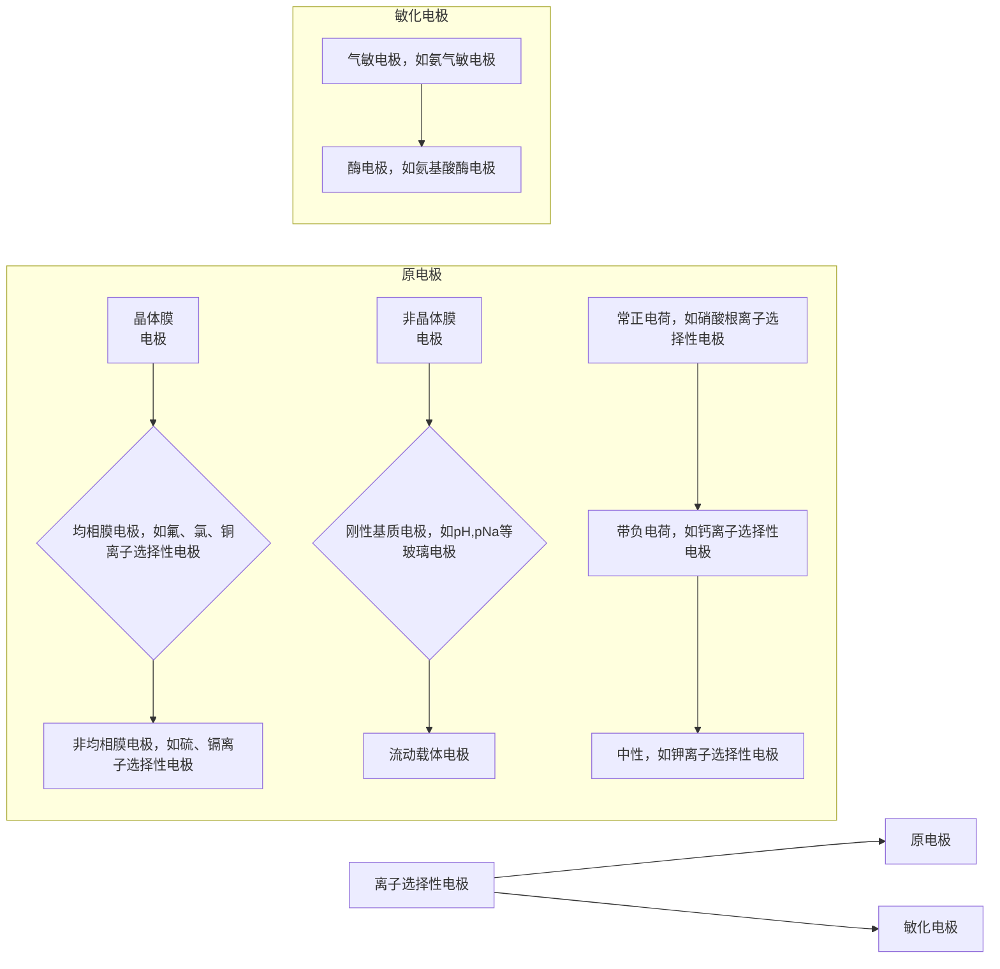
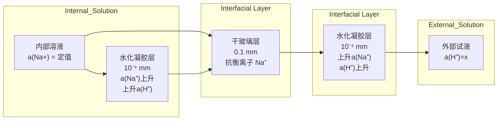

text_image

导线
电极帽
电极杆
内参比电极
内参比溶液
敏感膜

图 7.2.5 离子选择性电极示意图

## 拓展

离子选择性电极（ISE）的历史可以追溯到20世纪初，最早的ISE是pH玻璃电极，由Fritz Haber和Zygmunt Klemensiewicz在1909年发明。这一突破使得科学家能够精确测量溶液的酸碱度，推动了电化学分析的进步。随后，ISE技术迅速扩展到其他离子的检测，尤其是通过开发液膜和固态电极，大大提高了选择性和应用范围。

## 拓展

新型离子选择性电极的研究与发展趋势主要集中在提升电极的选择性、灵敏度和稳定性。近年来，纳米材料、离子液体和石墨烯等新材料的引入，使ISE的性能在复杂环境和低浓度检测中得到了显著提升。此外，微型化和智能化的发展趋势使得ISE能够应用于可穿戴设备和实时监测系统，为环境监测、生物医学诊断和食品安全提供了更便捷、准确的分析手段。

部分组成。其中，分开两种电解质溶液并能对某类物质有选择性响应的连续层称为敏感膜，它的性能决定了离子选择电极性能好坏，是离子选择性电极的关键组成部分。内参比电极常用银-氯化银电极或用银丝，内参比溶液由离子选择电极的种类决定，也有不使用内参比溶液的离子选择性电极。

## 2. 离子选择性电极的分类

通常,离子选择性电极的分类是按敏感膜材料为基本依据。根据1976年IU-PAC的推荐,离子选择性电极分为原电极和敏化电极两类。

flowchart

## 7.2.4.2 膜电位

## 1. 扩散电位

在两种不同离子或离子相同而活度不同的液-液界面或固体内部，由于离子扩散速率的不同造成的电位差，称为扩散电位。离子通过界面时，它没有强制性和选择性。离子选择性电极的膜相内部会产生扩散电位。

扩散电位可表示为

$$
E _ {\mathrm{d}} = \frac {R T}{F} \int_ {1} ^ {2} \sum \frac {t _ {i}}{n _ {i}} \mathrm{ln} a _ {i} \tag {7-2-21}
$$

式中， $n_{i}, t_{i}$  分别为离子的电荷数和迁移数。在最简单的情况下， $n_{+}=n_{-}=1, a_{+}=a_{-}=a$  时，方程可简化为

$$
E _ {\mathrm{d}} = \frac {R T}{F} (t _ {+} - t _ {-}) \ln \frac {a _ {i (2)}}{a _ {i (1)}} \tag {7-2-22}
$$

当正、负离子的迁移数相等时，扩散电位等于0。

## 2. Donnan 电位(道南电位)

当选择性渗透膜与溶液接触时,会有选择性地让某些离子通过,进而造成两相界面电荷分布的不均匀,产生电双层结构,形成电位差。这是一种具有强制性和选择性的扩散,这样形成的电位称为 Donnan 电位。在离子选择性电极中,膜与溶液两相界面上的电位具有 Donnan 电位的性质。Donnan 电位可表示为

$$
E _ {\mathrm{D}} = k \pm \frac {R T}{n F} \mathrm{ln} \frac {a _ {\mathrm{相1}}}{a _ {\mathrm{相2}}} \tag {7-2-23}
$$

通常所使用的离子选择性电极都有两个相界面，所以应包含有两个Donnan电位。

## 3. 膜电位

膜电位是膜内扩散电位和膜与电解质溶液形成的内外界面的 Donnan 电位的代数和。

$$
E _ {\mathrm{膜}} = E _ {\mathrm{D}} ^ {\mathrm{外}} + E _ {\mathrm{d}} + E _ {\mathrm{D}} ^ {\mathrm{内}} \tag {7-2-24}
$$

图7.2.6为离子选择性电极膜电位示意图。在一个电极膜中，可认为 $a_{\text{外}}^{\mathrm{m}}, a_{\text{内}}^{\mathrm{m}}, E_{\mathrm{d}}$

保持恒定不变,其膜电位方程可表示为

$$
E _ {\text {膜}} = k ^ {\prime} \pm \frac {R T}{n F} \mathrm{ln} \frac {a _ {\text {外}} ^ {1}}{a _ {\text {内}} ^ {1}} \tag {7-2-25}
$$

当 $a_{内}^{1}$ 也被固定时，式(7-2-25)可重排为式(7-2-17)的形式。

## 7.2.4.3 常见离子选择性电极的响应机制

## 1. 玻璃膜电极

玻璃电极种类多样，有对 $\mathrm{H^{+},Li^{+},K^{+},Na^{+},Ag^{+}}$ 响应的玻璃电极。这些玻璃电极的结构都包含电极腔体（玻璃管）、内参比溶液、内参比电极和敏感玻璃膜，其中敏感玻璃膜为关键组成部分。玻璃电极分为单玻璃电极和复合电极两种，如(图7.2.7)所示，复合玻璃电极集指示电极和外参比电极于一体，使用起来更方便和牢靠。

$\mathrm{pH}$ 玻璃电极是最早出现的离子选择性电极，敏感玻璃膜是 $\mathrm{pH}$ 玻璃电极对 $\mathrm{H^{+}}$ 响应的关键。玻璃管内装一定 $\mathrm{pH}$ 的缓冲溶液（如 $\mathrm{pH} = 7$），内参比电极是 $\mathrm{Ag - AgCl}$ 电极，结构如图7.2.7所示。$\mathrm{pH}$ 玻璃电极的性质受敏感玻璃膜化学组成的影响很大。其玻璃由 $\mathrm{SiO_2}$，$\mathrm{Na_2O}$ 和 $\mathrm{CaO}$ 等组成。由纯 $\mathrm{SiO_2}$ 制成的石英玻璃的结构如副栏图示所示。它没有可供离子交换的电荷点（又称定域体），所以没有响应离子的功能。当加入金属氧化物后，使部分硅-氧键断裂，生成固定的带负电荷硅-氧骨架（称载体），在骨架的网络中是活动性强的平衡离子 $\mathbf{M}^{+}$。玻璃结构是一个无限的三维网络骨架，见图7.2.8。

水化敏感玻璃球膜分层模式如下:

（1）当玻璃电极与水溶液接触时， $M^{+}$ 与 $H^{+}$ 发生交换反应，在玻璃膜表面形成一层 $\equiv SiO^{-}H^{+}(G^{-}H^{+})$ ，它称为水化凝胶层。

$$
\mathrm{G} ^ {-} \mathrm{Na} ^ {+} + \mathrm{H} ^ {+} \rightleftharpoons \mathrm{G} ^ {-} \mathrm{H} ^ {+} + \mathrm{Na} ^ {+}
$$

该反应的平衡常数大，水化凝胶层表面的钠离子位点几乎都被 $\mathrm{H^{+}}$ 占据，所以 $\mathrm{H^{+}}$ 在水化凝胶层中的扩散速率较快。即水化层中的 $\mathrm{H^{+}}$ 可以与溶液中的 $\mathrm{H^{+}}$ 交换，这种 $\mathrm{H^{+}}$ 的交换，使玻璃膜的内外相界面上形成了双电层结构，产生两个Donnan电位。在内外两个水化凝胶层与干玻璃层之间又形成两个扩散电位。

在水化凝胶层中，由于  $H_{2}O$  的存在，使  $H^{+}$  大都以  $H_{3}O^{+}$  的形式存在。表面  $\equiv SiO^{-}H^{+}$  的解离平衡是决定 Donnan 电位的重要因素。

text_image

银丝
氯化银涂层
AgCl饱和的缓冲溶液
(pH=7)
玻璃膜
外部试液
水化凝胶层
内部试液
干玻璃层
膜'溶液
界面

图 7.2.8 水化敏感玻璃膜分层示意图

根据膜电位的公式推导过程总结膜电位方程的适用条件有哪些。

text_image

测试溶液
膜相
内参比液
a¹_外
aᵐ_外
aᵐ_内
a¹_内
E⁴_D
Eᵈ
E⁴_D

图 7.2.6 离子选择电极示意图

text_image

pH计
银丝
氯化银涂层
AgCl饱和的
缓冲溶液
(pH=7)
玻璃膜

(a) 单玻璃电极

text_image

内参比
半电极
银丝
氯化银涂层
玻璃膜
pH计
外参比
半电极
AgCl饱和的
KCl水溶液
AgCl饱和的
缓冲溶液
(pH=7)

(b)复合玻璃电极

图 7.2.7 pH 玻璃电极示意图

## 拓展

玻璃膜电极的历史可以追溯到20世纪初，它最初由Fritz Haber和Zygmunt Klemensiewicz在1909年发明，用于测量溶液的pH。这一发明标志着电化学分析中的重大突破，首次实现了酸碱度的精确测定。随着时间的推移，玻璃膜电极经历了多次改进，尤其是在玻璃成分和膜结构方面的优化，使其在化学分析、环境监测和生物医学领域得到了广泛应用。玻璃膜电极的高选择性、稳定性和重复性，使其至今仍是pH测定的标准工具。

## 思考:

当内部试液的浓度不可看作固定值时,外部试液浓度的测定会受到影响吗,为什么?

text_image

Ag-AgCl
内参比电极
内充液
(NaF+NaCl)
掺EuF₂的
LaF₃单晶

图 7.2.10 氟离子单晶膜电极示意图

$$
\equiv \mathrm{SiO} ^ {-} \mathrm{H} ^ {+} + \mathrm{H} _ {2} \mathrm{O} \rightleftharpoons \equiv \mathrm{SiO} ^ {-} + \mathrm{H} _ {3} \mathrm{O} ^ {+}
$$

（2）水化凝胶层和干玻璃层之间为过渡层，$\mathrm{G}^{-}\mathrm{Na}^{+}$只部分转化为 $\mathrm{G}^{-}\mathrm{H}^{+}$。由于 $\mathrm{H}^{+}$在未水化的玻璃中的扩散系数小，故其电导率比干玻璃层高1000倍左右。

(3) 干玻璃层中的电荷传导主要由  $Na^{+}$  承担。

$\mathrm{H}_3\mathrm{O}^+$ 在溶液与水化凝胶层表面界面上进行扩散，从而在内、外两相界面上形成双电层结构，产生两个相间电位。在内外两水化凝胶层与干玻璃之间形成两个扩散电位。若玻璃膜两侧的水化凝胶层性质完全相同，则其内部形成的两个扩散电位大小相等、符号相反、互相抵消。如果不相等，就称为不对称电位，其大小与玻璃膜的形状和工艺质量有关。水化敏感玻璃膜电荷传导示意如图7.2.9所示。

flowchart

图 7.2.9 水化敏感玻璃膜电荷传导示意图

膜电位与溶液 pH 的关系

$$
E _ {\mathrm{m}} = E _ {\text {外}} - E _ {\text {内}} \tag {7-2-26}
$$

因为内部溶液组成一定,所以  $E_{内}$  的值为定值, $E_{外}$  由  $\equiv SiO^{-}H^{+}$  的解离平衡决定,它受外部试液中  $a(\mathrm{H}^{+})$  的影响。故在 25 ℃ 时 pH 玻璃电极电位可表示为

$$
E _ {\mathrm{m}} = \text {常数} - (0. 0 5 9 2 \mathrm{V}) \mathrm{pH} \tag {7-2-27}
$$

## 2. 晶体膜电极

晶体膜电极分为均相、非均相晶膜电极。均相晶膜由一种化合物的单晶或几种化合物混合均匀的多晶压片而成。非均相晶模由多晶中掺惰性物质经热压制成。

（1）氟离子单晶膜电极 氟电极的敏感膜为  $LaF_{3}$  的单晶薄片，其中掺杂有  $Eu^{2+}$  和  $Ca^{2+}$  等二价离子。二价离子的引入令氟化镧晶格缺陷增多，膜的导电性得到增强。这种敏感膜的电阻一般小于  $2 M\Omega$ 。氟离子单晶膜电极结构如图 7.2.10 所示。

该电极的工作原理是，溶液中的 $\mathrm{F}^{-}$ 能扩散进入膜相的缺陷空穴，膜相中的 $\mathrm{F}^{-}$ 也能进入溶液中，故能在两相界面上形成双电层结构，进而产生膜电位。这类敏感膜具有选择性，是因为缺陷空穴的大小、形状和电荷分布，只能容纳特定的可移动的晶格离子，把其他离子排斥在空穴之外。

氟离子选择性电极的电位可表示为

$$
E _ {\mathrm{ISE}} = k - (0. 0 5 9 2 \mathrm{V}) \lg a _ {\mathrm{F} ^ {-}} \tag {7-2-28}
$$

式中，k 为常数，与内参比电极、内参比溶液和膜的性质有关

测量时组成如下电极:

$\mathrm{Ag}\mid \mathrm{AgCl},\mathrm{Cl}^{-}(a_{\mathrm{Cl}^{-}}),\mathrm{F}^{-}(a_{\mathrm{F}^{-}})$ 试液 $(a_{\mathrm{F}^{-}} = x)\parallel \mathrm{Cl}^{-}(a_{\mathrm{Cl}^{-}}$ 饱和）， $\mathrm{Hg_2Cl_2}\mid \mathrm{Hg}$ $298~\mathrm{K}$ 时的电池电动势可表示为

$$
E _ {\mathrm{ISE}} = E _ {\text {甘汞}} - E _ {\mathrm{ISE}} = b + (0. 0 5 9 2 \mathrm{V}) \lg a _ {\mathrm{F} ^ {-}} \tag {7-2-29}
$$

氟电极对 $\mathrm{F}^{-}$ 的线性响应范围可达 $5\times 10^{-7}\sim 1\times 10^{-1}\mathrm{mol}\cdot \mathrm{L}^{-1}$，电极的选择性很高，主要的干扰是 $\mathrm{OH}^{-}$，这是由于在晶体膜表面存在下列化学反应:

$$
\mathrm{LaF} _ {3} (\mathrm{s}) + 3 \mathrm{OH} ^ {-} \rightleftharpoons \mathrm{La(OH)} _ {3} (\mathrm{s}) + 3 \mathrm{F} ^ {-} \tag {7-2-30}
$$

所释放出来的 $\mathrm{F}^{-}$ 将增高试液中 $\mathrm{F}^{-}$ 的含量使电极响应的表现 $\mathrm{F}^{-}$ 浓度增大，也可以认为 $\mathrm{OH}^{-}$ 与 $\mathrm{F}^{-}$ 有近乎相似的离子半径，因此 $\mathrm{OH}^{-}$ 可以占据晶格中 $\mathrm{F}^{-}$ 所处的位置，与 $\mathrm{F}^{-}$ 一样参与导电过程。

pH 范围为 5\~6 时, 这种电极对  $F^{-}$  有良好的选择性。如果 pH 过低, 则会形成 HF 或  $HF_{2}^{-}$ , 而使游离  $F^{-}$  浓度降低; pH 过高, 则会产生  $OH^{-}$  的干扰。在实际工作中, 通常采用醋酸-醋酸钠缓冲溶液来控制溶液的酸度。同时加入 NaCl 和柠檬酸钠, 前者用于控制溶液的离子强度, 后者能与铁、铝等离子形成配合物, 借此消除它们因与  $F^{-}$  发生配合反应而产生的干扰。

（2）硫离子选择性电极 敏感膜由  $Ag_{2}S$  粉末压片制成。硫化银的电阻较低，膜内的  $Ag^{+}$ 迁移传递电荷。硫离子选择性电极的电位可以表示为

$$
E _ {\mathrm{ISE}} = k - \frac {0 . 0 5 9 2 \mathrm{V}}{2} \mathrm{lg} a _ {\mathrm{s} ^ {2 -}} \tag {7-2-31}
$$

（3）氯、溴、碘离子选择性电极 它们的膜分别由  $Ag_{2}S-AgCl, Ag_{2}S-AgBr$  和  $Ag_{2}S-AgI$  粉末混合压片制成。膜内  $Ag^{+}$ 迁移传递电荷，卤素离子选择性电极的电位可表示为

$$
E _ {\mathrm{ISE}} = k - (0. 0 5 9 2 \mathrm{V}) \lg a _ {\mathrm{X} ^ {-}} \tag {7-2-32}
$$

（4）铜、铅、镉离子选择电极 它们的敏感膜分别由  $Ag_{2}S-CuS, Ag_{2}S-PbS$  和  $Ag_{2}S-CdS$  粉末混合压片制成，膜内  $Ag^{+}$ 迁移传递电荷。电极电位为

$$
E _ {\mathrm{ISE}} = k + \frac {0 . 0 5 9 2 \mathrm{V}}{2} \mathrm{lg} a _ {\mathrm{M} ^ {2}}, \tag {7-2-33}
$$

$\mathrm{Ag_2S}$ 和 $\mathrm{AgX(X = Cl^-,Br^-,I^-)}$ 及 $\mathrm{Ag_2S}$ 和 $\mathrm{MS(M^{2 + } = Cu^{2 + },Pb^{2 + },Cd^{2 + })}$ 制成的离子选择性电极，它们的检测下限与各自的溶度积 $K_{\mathrm{sp}}$ 有关。

## 3. 流动载体膜电极(液膜电极)

流动载体膜电极见图 7.2.11, 亦称为液膜电极, 其中可以与被测离子发生作用的活性物质(即载体)可在膜相中流动。根据载体是否带有电荷, 可被分为带

text_image

电极杆
AgCl/Ag内参比电极
隔离管
液体离子交换剂
内参比液
试液
多孔膜(载有离子交换剂)

图 7.2.11 流动载体膜电极的结构

## 局限与挑战

晶体膜电极尽管具有良好的离子选择性和稳定性，但在实际应用中也面临一些局限性与挑战。首先，晶体膜的脆性使其在某些复杂或恶劣环境下容易损坏，影响其使用寿命。其次，晶体膜电极的响应时间通常较慢，尤其是在较低浓度离子检测时，可能导致测量延迟。此外，这类电极对环境条件（如温度、pH等）较为敏感，导致在不同条件下的稳定性较差。最后，晶体膜材料的制备成本较高，限制了其在大规模应用中的普及。因此，如何提升晶体膜电极的耐用性、灵敏度及降低成本，仍是当前研究中的重要挑战。

## 液膜电极材料的选择

液膜电极的材料选择对其性能至关重要，特别是在选择性、稳定性和灵敏度方面。液膜通常由增塑剂、离子载体和膜溶剂组成。载体分子通过选择性离子交换决定电极对特定离子的响应，而增塑剂则调节膜的流动性和机械强度，使膜保持适当的物理特性。常用的载体分子包括用于钾、钠、钙等离子的冠醚、磷脂等专门设计的离子载体。选择合适的溶剂和增塑剂能够进一步提高电极的响应速度和离子选择性，确保液膜在复杂环境中具备良好的电化学性能。

## 气敏电极

text_image

指示电极
参比电极
中介溶液
气体渗透膜

气敏电极（gas-sensing electrode）可以用于检测特定气体的浓度。气敏电极通常用离子选择性电极作为指示电极与参比电极组成，待测气体可通过气体渗透膜进入电极内的电解质溶液，与溶液中的组分发生化学反应，使电极电位发生变化，根据Nemst方程，可求算出待测气体的浓度。

气敏电极有较高的选择性和灵敏度,但其对温度变化敏感,响应速率较慢。

常用的气体透气膜材料有聚氯乙烯、聚苯乙烯和聚丙烯等。

line

| Point | lg ai | E |
| --- | --- | --- |
| G | 0 | ~0.1 |
| F | ~0.2 | ~0.15 |
| D | ~0.6 | ~0.3 |
| A | Ai | Ai |

图 7.2.12 校准曲线

电荷的流动载体电极和中性载体电极。敏感膜将内充液与外部试液隔开，膜中的载体可以与被测离子结合，并在膜中迁移，此时被测离子和被排斥在膜外带相反电荷的离子在界面上形成膜电位。电极的选择性与响应离子和载体的结合常数有关，响应离子的结合常数越大，电极的选择性越好。电极的检测下限由离子在有机相和水相中的分配系数决定，分配系数越大，检测下限越低。或者说，检测下限取决于载体与离子的结合常数，即结合常数越大，检测下限越低。

流动载体膜电极还有聚氯乙烯(PVC)膜电极形式,不同于一般的流动载体电极,它有类似于固态的“固化”膜,是用载体、有机溶剂、PVC粉、增塑剂以一定比例混合,溶于四氢呋喃中,铺在玻璃板上,挥发掉四氢呋喃制成的。这种薄膜的稳定性和寿命较一般流动载体膜有很大提升。典型的例子如下。

（1）硝酸根离子电极 该电极的电活性物质是带正电荷的季铵盐，将它转换成  $NO_{3}^{-}$ 型，然后溶于邻硝基苯十二烷醚中，将此溶液与含 5% PVC 的四氢呋喃溶液混合 (1:5) 后，在平板玻璃上挥发制成透明膜，能够提供良好的电化学特性和长期稳定性。

$$
E _ {\mathrm{ISE}} = k - (0. 0 5 9 2 \mathrm{V}) \lg a _ {\mathrm{NO} _ {3} ^ {-}} \tag {7-2-34}
$$

（2）钙离子电极 它的电活性物质是带负电荷的二癸基磷酸，将它转化成$\mathrm{Ca^{2+}}$ 型，用苯基膦酸二正辛酯作溶剂，可制成带微孔敏感膜的液膜电极。

$$
E _ {\mathrm{ISE}} = k + \frac {0 . 0 5 9 2 \mathrm{V}}{2} \mathrm{lg} a _ {\mathrm{Ca} ^ {2 +}}. \tag {7-2-35}
$$

（3）中性载体电极 中性载体电极使用的膜可以和特定离子形成络合物，这些络合物能够溶于有机溶剂，在电极膜中自由移动而导电。一个典型的例子是钾离子选择性电极，使用缬氨霉素作为中性载体，缬氨霉素能与 $K^{+}$ 形成络合物，且对 $K^{+}$ 的选择性很高，该络合物在电极膜中的有机相内移动，从而产生膜电位。

## 4. 生物电极

生物电极(bioelectrode)是一种结合生物化学与电化学分析原理研制而成的新型电极。于1962年，由Clark L C提出，之后生物电极不断发展，电极类型增多。这种电极一般对生物分子和有机物的检测具有高选择性和特异性。

（1）酶电极 指示电极的敏感膜上涂抹生物酶，酶与待测物质反应产生能在该电极上响应的离子或其他物质，通过测量该物质的浓度间接测定待测物质的浓度。例如，葡萄糖氧化酶能催化葡萄糖的氧化反应:

$$
\mathrm{C} _ {6} \mathrm{H} _ {1 2} \mathrm{O} _ {6} + \mathrm{O} _ {2} + \mathrm{H} _ {2} \mathrm{O} \xrightarrow {\mathrm{GOD}} \mathrm{C} _ {6} \mathrm{H} _ {1 2} \mathrm{O} _ {7} + \mathrm{H} _ {2} \mathrm{O} _ {2}
$$

此时,可以采用氧电极检测试液中氧含量的变化来间接测定葡萄糖的含量。

（2）组织电极 利用动、植物组织内存在的某种酶，可以制成组织电极。例如，将香蕉与碳糊混合制成的组织电极，可以用于测定多巴胺的含量。基于酶的高度特异性，酶电极有较高的选择性。

## 7.2.4.4 离子选择性电极的性能参数

## 1. Nernst 响应斜率、线性范围和检测下限

离子选择性电极的电位随待测离子的活度变化的特征称为响应。若这种响应变化服从于Nernst方程，则称其为Nernst响应。以离子选择性电极的电位或电池的电动势对响应离子活度的对数作图，所得曲线称为校准曲线(图7.2.12)。当活度很低时，无法维持热力学平衡状态，被测离子的活度开始偏离Nernst方程，表现为图像逐渐弯曲。此校准曲线的直线部分(CD)所对应的离子活度范围称为离子选择性电极响应的线性范围。该直线的斜率 S 为电极的实际响应斜率，理论斜率 (298 K) 为  $\frac{59.2}{Z_{A}}$  (mV/Pa)，直线的斜率 S 也称级差。IUPAC 规定 CD 和 GF 延长线的交点 A 所对应的活度  $a_{i}$  称为检测下限。

## 2. 选择性系数

实际上,任何敏感膜不可能只响应某种特定离子,它对溶液中的其他离子也有可能存在不同程度的响应,因此,膜电极的响应应该考虑相对的选择性。选择性系数可以表示共存离子对电位(或电动势)的贡献。

当有共存离子时,膜电位与响应离子  $A^{2+}$  及共存离子  $B^{2+}$  的活度之间的关系,可以用 Nicolsky(尼柯尔斯)方程表示:

$$
E = \mathrm{常数} + \frac {R T}{n F} \mathrm{ln} (a _ {\mathrm{A}} + K _ {\mathrm{A,B}} ^ {\mathrm{pot}} a _ {\mathrm{B}} ^ {z _ {\mathrm{A}} / z _ {\mathrm{B}}}) \tag {7-2-36}
$$

式中， $K_{A,B}^{pot}$  即为电位选择性系数；a 为离子的浓度；z 为离子的电荷数；下标 A 为主响应离子，B 为干扰离子。由式(7-2-36)可推出，当有多种干扰离子  $B^{z+}, C^{z+}, \cdots$  存在时，电动势(或电位)为

$$
E = \mathrm{常数} + \frac {R T}{n F} \mathrm{ln} (  a _ {\mathrm{A}} + K _ {\mathrm{A,B}} ^ {\mathrm{pot}} a _ {\mathrm{B}} ^ {z _ {\mathrm{A}} / z _ {\mathrm{B}}} + K _ {\mathrm{A,C}} ^ {\mathrm{pot}} a _ {\mathrm{C}} ^ {z _ {\mathrm{A}} / z _ {\mathrm{C}}} + \dots  ) \tag {7-2-37}
$$

显然，选择性系数越小，电极对  $A^{z+}$  的选择性就越高。如果  $K_{A,B}^{pot}a_{B}^{z_{A}/z_{B}}$  为  $10^{-2}$ ，则表示电极对  $A^{z+}$  的敏感性为  $B^{z+}$  的 100 倍。或者，在相同的测定条件下， $A^{z+}$  和  $B^{z+}$  产生相同电位时  $A^{z+}$  的活度是  $B^{z+}$  活度的 1/100。由干扰离子引起的误差计算公式为

$$
\mathrm{误差} = (K_{\mathrm{A,B}}^{\mathrm{pot}}a_{\mathrm{B}}^{z_{\mathrm{A}} / z_{\mathrm{B}}} / a_{\mathrm{A}})\times 100\% \tag{7 - 2 - 38}
$$

选择性系数会受到被测离子活度及溶液条件的影响，并不是一个严格的热力学常数。可以从手册中查找电位选择性系数的数值，也可以通过试验测定。

## 3. 响应时间

（1）概念 IUPAC 将响应时间定义为静态响应时间: 从离子选择性电极和参比电极一起与试液接触时算起, 直至电池电动势达到稳定值 (变化在 1 mV 以内) 时为止, 在此期间所经过的时间, 称为实际响应时间。

## (2) 影响因素

① 膜的结构性质:一般晶体膜的响应时间较短,而流动载体膜的响应则涉及表面的化学反应过程而达到平衡较慢;② 响应离子的扩散速率;③ 响应离子的浓度;④ 共存离子的种类;⑤ 温度。

## 4. 内阻

离子选择性电极的实际内阻包括膜内阻、内充液和参比电极的内阻，其中主要考虑膜内阻，它与敏感膜的类型、厚度等因素有关。不同类型的离子选择性电极的内阻不同，晶体膜的内阻较低，玻璃膜的内阻较高。

## 5. 稳定性

在同一溶液中，离子选择性电极的电位值随时间向一个方向的变化，称为漂移。用 $8\mathrm{h}$ 或 $24\mathrm{h}$ 内漂移的电位值 $(\mathrm{mV})$ 来表示电极的稳定性。液膜电极的漂移较大。膜的稳定性、电极的结构和绝缘性都会影响漂移值的大小。

## 7.2.4.5 全固态电极

由离子选择性膜、内参比溶液和内参比电极及惰性腔体组成的电极，为液接离子选择性电极，如上述提到过的 $\mathrm{pH}$ 玻璃电极。液接离子选择性电极的发展相对成熟且应用广泛。但是由于包含内参比电极，内参比液的渗漏问题令液接离子

在校正曲线的直线部分 $(a_{\mathrm{A}}>a_{\mathrm{B}}$ ，不考虑B离子的干扰)的响应方程为 $E_{1}=k^{A}+S\lg a_{A}$ ；在水平线部分 $(a_{A}<a_{B}$ ，电位值完全由干扰离子决定)则 $E_{2}=k^{B}+S'\lg K_{A,B}^{\mathrm{pot}}a_{B}$ ，假定 $k^{A}=k^{B};S=S'$ 在两直线交点的M处， $E_{1}=E_{2}$ ，假定 $A^{z+}$ ， $B^{z+}$ 都为一价离子，由上两式则得 $K_{A,B}^{\mathrm{pot}}=\frac{a_{A}}{a_{B}}$ ；式中 $a_{A}$ 为交点M处对应的活度。对不同价态的离子， $K_{A,B}^{\mathrm{pot}}$ 的通式为 $K_{A,B}^{\mathrm{pot}}=\frac{a_{A}}{a^{z_{A}/z_{B}}}$

## 选择性系数的测量方法

① 分别溶液法: 分别配制活度相等的主响应离子  $A^{z+}$  和干扰离子  $B^{z+}$  的标准溶液, 然后用  $A^{z+}$  的离子选择性电极分别测量电位值, 两式做差。
② 混合溶液法——固定干扰法:先配制一系列含固定活度的干扰离子  $B^{z*}$  和不同活度的主响应离子  $A^{z*}$  的标准混合溶液，再分别测定其电位值，然后将电位值对  $pa_{A}$  作图:

line

| Point | -lgaA | E |
| --- | --- | --- |
| A | ~0.2 | ~0.1 |
| B | ~0.3 | ~0.1 |
| C | ~0.4 | ~0.2 |
| M | ~0.5 | ~0.1 |

固定干扰法图示

③ 混合溶液法——固定主响应离子法:配制一系列含固定活度的主响离子  $A^{z+}$  和不同活度的干扰离子  $B^{z+}$  的标准混合溶液，再分别测定电位值。然后将电位值 E 对  $\lg a_{B}$  作图，从图中求得  $a_{B}$ ，可算出  $K_{A,B}^{pot}$ 。这种方法可确定离子选择性电极适合的 pH 范围。

## 拓展阅读

全固态电极的微型化和可穿戴应用是当前传感器技术的前沿发展方向。由于其固态结构的高稳定性和耐用性，全固态电极非常适合集成到微型化的设备中，如便携式传感器、微流控系统和可穿戴健康监测设备中。这种电极能够实时、连续监测生理参数（如电解质浓度、pH等），在医疗诊断、运动健康监测和环境监测领域具有广泛应用。微电子技术、纳米材料和柔性电子的进步，使得全固态电极能够与智能设备结合，提供更灵敏、稳定的实时监测解决方案，并推动个性化医疗和便携式传感技术的发展。

铂丝电极

水凝胶和多孔材料示意图

## 拓展阅读

标准加入法和校准曲线法是两种常见的定量分析方法，适用于不同的实验条件和样品类型。校准曲线法通过测定一系列已知浓度标准溶液的响应信号来建立浓度与信号的关系，适合于样品基质较为单一、干扰较少的情况。然而，标准加入法则更适合于复杂基质的样品，它通过向样品中直接添加已知浓度的标准物质，并利用响应信号的变化来消除基质效应的影响。因此，标准加入法在处理复杂样品（如血液、环境样品）中具有更高的准确性，而校准曲线法则更为简便，适合常规分析。

选择性电极在痕量分析方面的准确性不高。同时由于内参比液的存在，电极微型化及储存方面也面临很多困难。基于这些弊端，研究人员将液接部分转变为固态，即全固态离子选择性电极。

1971年Cattrall等人提出全固态离子选择性电极的概念，将传统液接离子选择性电极的内参比溶液和内参比电极换成一根铂丝，也被称为覆丝电极。使用铂丝就不存在内参比液渗漏的问题了，但是覆丝电极的小面积和小电容，使得它的离子电子转换效率低，稳定性较差。除了内参比液的渗漏问题，电极电位的稳定性还受到导电基底和离子选择性膜之间的水层的影响。综合上述问题，研究人员提出一种固态转接层策略，使用一种能传导离子和电子、大电容且疏水的材料制备固态转接层，连接导电基底和离子选择性膜。固态转接层巧妙地化解了上述液接型离子选择性电极遇到的问题，是全固态离子选择性电极的关键组成部分，影响着固态离子选择性电极的稳定性、重现性和检测限等。

固态转接层的材料需要满足以下条件:①离子信号传导和电子信号传导在其中的转化可逆;②疏水性良好;③具有优良的化学稳定性;④具有较大的比电容,能够提供一个理想的不可极化界面,具有高自交换电流密度。常见的固态转接层材料有水凝胶、氧化还原聚合物、自组装单层膜和多孔碳材料等。

与传统的液接离子选择性电极相比,全固态离子选择性电极具有受压强、温度等外界环境的影响较小、使用寿命更长、检测限更低、贮存和维护更简单等优点,它的出现为离子选择性电极的研究和发展提供了新的发展契机。

## 7.2.5 定量分析方法

## 7.2.5.1 校准曲线法

校准曲线法是一种常用于定量分析的方法,通过构建一条关于测量信号(如电位)与样品浓度之间关系的曲线,来确定未知样品的浓度。校准曲线法适用于成批量样品的分析。

测量时需要在标准系列溶液和试液中加入总离子强度调节缓冲液(TISAB)或离子强度调节液(ISA)。它们的作用主要有:①保持试液与标准溶液有相同的总离子强度及活度系数;②缓冲溶液可以控制溶液的pH,保持溶液在离子选择性电极合适的pH范围内;③含有配合剂,可以掩蔽干扰离子或使被测离子释放成为可检测的游离离子。

测量时,先配制一系列含被测组分的标准溶液,并用TISAB保持溶液的离子强度相对稳定,分别测出电位值E,再作E-lgc或E-pM图。待测溶液用TISAB调节,用同一套测量装置测定电位值,从校准曲线上查出对数浓度,计算待测溶液浓度。

## 7.2.5.2 标准加入法

标准加入法又称为添加法或增量法，由于加入前后试液的组成、活度系数、pH、干扰离子、温度等基本不变，有利于控制变量，适用于待测溶液成分比较复杂的情况。

## 1. 一次标准加入法

向被测溶液中只加一次标准溶液。先测定体积为 $V_{x}$ 、浓度为 $c_{x}$ 的样品溶液的电位值 $E_{x}$ ；然后再向此已测过的样品溶液中加入体积为 $V_{s}$，浓度为 $c_{s}$ 的被测离子的标准溶液，测得电位值 $E_{1}$ 。假设待测离子为一价阳离子且离子强度一定，按响应方程关系，$E_{1}$ 与 $E_{x}$ 的差可表示为

$$
E _ {x} = K + S \lg c _ {x} \tag {7-2-39}
$$

$$
E _ {1} = K + S \lg \frac {c _ {\mathrm{s}} V _ {\mathrm{s}} + c _ {x} V _ {x}}{V _ {\mathrm{s}} + V _ {x}} \tag {7-2-40}
$$

$$
\Delta E = E _ {1} - E _ {\mathrm{x}} = \mathrm{Slg} \frac {V _ {\mathrm{x}} c _ {\mathrm{x}} + V _ {\mathrm{s}} c _ {\mathrm{s}}}{c _ {\mathrm{x}} (V _ {\mathrm{x}} + V _ {\mathrm{s}})} \tag {7-2-41}
$$

式子两边同时取反对数:

$$
1 0 ^ {\Delta E / S} = \frac {V _ {x} c _ {x} + V _ {s} c _ {s}}{c _ {x} (V _ {x} + V _ {s})} \tag {7-2-42}
$$

整理上式,得

$$
c _ {x} = \frac {V _ {\mathrm{s}} c _ {\mathrm{s}}}{(V _ {x} + V _ {\mathrm{s}}) 1 0 ^ {\Delta E / S} - V _ {x}} \tag {7-2-43}
$$

若 $V_{x} \gg V_{s}$, 则有

$$
c _ {x} = \frac {V _ {\mathrm{s}} c _ {\mathrm{s}}}{V _ {x} (1 0 ^ {\Delta E / S} - 1)} = \Delta c (1 0 ^ {\Delta E / S} - 1) ^ {- 1} \tag {7-2-44}
$$

式中， $\Delta c=\frac{V_{s}c_{s}}{V_{x}}$ 。该式为一次标准加入法公式。

样品加入法与标准加入法本质相同,仅是向一定体积已知浓度的标准溶液中加入一次一定体积的样品溶液,可推得公式如下:

$$
c _ {x} = c _ {\mathrm{s}} \frac {V _ {\mathrm{s}} + V _ {x}}{V _ {x}} \left(1 0 ^ {\Delta E / S} - \frac {V _ {\mathrm{s}}}{V _ {x} + V _ {\mathrm{s}}}\right) \tag {7-2-45}
$$

式中，S 为电极的实际响应斜率。S 的求解方法:① 可从标准曲线的斜率求出；② 使用最小二乘法算出；③ 稀释法:用空白溶液稀释已测得  $E_{x}$  的样品恰好一倍，然后测出  $E_{稀}$ ，则  $S=\frac{\left|E_{稀}-E_{x}\right|}{\lg2}=\frac{\left|\Delta E\right|}{0.30}$ 。

## 2. 连续标准加入法

在测量过程中连续多次向一杯测量溶液中加入标准溶液,根据一系列的 E 值对相应的  $V_{s}$  值作图来求得结果。该法的准确度较一次标准加入法高。

基本原理: 将式(7-2-40)重排, 得到

$$
(V _ {x} + V _ {s}) 1 0 ^ {\frac {\Delta E}{S}} = (c _ {s} V _ {s} + c _ {x} V _ {x}) 1 0 ^ {\frac {\Delta E}{S}} \tag {7-2-46}
$$

以 E 对  $V_{s}$  作图, 当  $(V_{x} + V_{s}) 10^{\Delta E/S} = 0$  时, 即直线与横坐标相交处, 可得到  $c_{s} V_{s} + c_{x} V_{x} = 0$ , 所以求得被测物质含量为

$$
c _ {x} = - \frac {c _ {\mathrm{s}} V _ {\mathrm{s}}}{V _ {x}} \tag {7-2-47}
$$

## 7.2.5.3 直接电位法

在 pH 计或离子计上直接读出试液的 pH(pM) 值:

pH 玻璃电极 | 试液 ( $a_{H^{+}} = x$ ) || 饱和甘汞电极

电池电动势:

$$
E = E _ {\text {甘汞}} - E _ {\mathrm{H}}
$$

$E_{甘汞}$ 是定值,结合式(7.2.27)得

$$
E = b + (0. 0 5 9 2 \mathrm{V}) \mathrm{pH}
$$

在实际测定未知溶液的 pH 时, 需先用 pH 标准缓冲溶液定位校准, 其电动势为

$$
E _ {\mathrm{s}} = b + (0. 0 5 9 2 \mathrm{V}) \mathrm{pH} _ {\mathrm{s}}
$$

## 拓展阅读

电位测定技术正朝着自动化、智能化和高精度方向发展。现代仪器集成了自动校准、温度补偿和液接界电位校正技术，大幅提升了测量的准确性和操作便捷性。高通量分析仪器的普及满足了环境监测、制药和工业中的快速检测需求，而便携化设备也为现场实时监测提供了便利。随着数据处理技术和人工智能的应用，未来电位测定将更加智能化，自动识别和处理数据异常，进一步提升分析效率和精度。

## 终点确定

电位滴定法的终点确定是通过监测滴定过程中电极电位的变化来实现的。当滴定接近终点时，溶液中反应物浓度迅速变化，导致电位出现明显突跃，通常通过电位-体积滴定曲线的拐点来确定终点。为了提高准确性，常使用一阶或二阶导数法来分析电位变化率，从而更加精确地定位滴定终点。该方法尤其适用于没有颜色变化、浑浊或有色溶液的滴定，是许多复杂反应体系中常用的终点判定手段。

再测定未知溶液的 pH, 其电动势

$$
E _ {x} = b + (0. 0 5 9 2 \mathrm{V}) \mathrm{pH} _ {x}
$$

合并以上两式得

$$
\mathrm{pH} _ {x} = \mathrm{pH} _ {\mathrm{s}} + \frac {E _ {x} - E _ {\mathrm{s}}}{0 . 0 5 9 2 \mathrm{V}} \tag {7-2-48}
$$

但在实际测试中，$\mathrm{pH}$ 大于10的强碱溶液或所含钠离子浓度较高的溶液和强酸溶液的 $\mathrm{pH}$ 是测不准的。对于前者，因为 $\mathrm{Na}^{+}$ 和 $\mathrm{H}^{+}$ 都参与了水化凝胶层与溶液界面的离子交换过程，此时电极电位对应的是 $\mathrm{Na}^{+}$ 浓度和 $\mathrm{H}^{+}$ 浓度的总和，故测量值 $\mathrm{H}^{+}$ 的浓度偏大，表现为 $\mathrm{pH}$ 测量值比实际值偏小，这种现象被称为碱差。对于后者，是因为在强酸溶液中，$\mathrm{H}^{+}$ 活度受到限制，以 $\mathrm{H}_3\mathrm{O}^+$ 形式传递，故 $\mathrm{H}^{+}$ 响应浓度偏小，表现为 $\mathrm{pH}$ 测量值比实际值偏大，这种现象被称为酸差。

## 7.2.6 电位滴定及相关电位分析仪器

## 7.2.6.1 电位滴定法

电位滴定法与电位法一样，以指示电极、参比电极及试液组成测量电池。所不同的是，电位法通过 Nernst 方程来确定被测物质的量，电位滴定法通过物质相互反应量的关系计算得出被测物质的量。

电位滴定法的电位变化代替了经典滴定法中对指示剂的依赖。这使得化学计量点的测定更加准确，且适用于有色和混浊溶液的分析。电位滴定终点的确定只需要注意电位值的变化，主要有作图法和微商计算法。

## 1. 作图法

滴定终点的突变可以在曲线中表现出来,如在 E-V 曲线(V 是 E 对应的加入的滴定剂体积)中,终点附近曲线的斜率较大,一般取曲线突跃范围的中点为化学计量点。当这种突变不够明显,即突跃范围过小不利于计算时,可以通过做一级微分滴定,取  $\frac{\Delta E}{\Delta V}-V$  曲线(注意:此处的 V 是 E-V 曲线中  $\Delta E$  相对应的始末两体积的平均值)的极大值为滴定终点。也可以作二级微分滴定,取  $\frac{\Delta^{2}E}{\Delta V^{2}}-V$  曲线(注意:此处的 V 是  $\frac{\Delta E}{\Delta V}-V$  曲线中  $\Delta\frac{\Delta E}{\Delta V}$  相对应的始末两体积的平均值)中  $\frac{\Delta^{2}E}{\Delta V^{2}}$  等于零的点为滴定终点。

## 2. 二级微商计算法

作图法的曲线是由各点之间的连线外推得到的，具有一定的主观性，且费时。还可以用数学中的二级微商的近似求法计算终点体积。分析 $\frac{\Delta^{2}E}{\Delta V^{2}}-V$ 曲线可知，在 $\frac{\Delta^{2}E}{\Delta V^{2}}$ 值出现相反符号时对应的两个体积 $V_{1}$ 和 $V_{2}$ 之间必有一点使 $\frac{\Delta^{2}E}{\Delta V^{2}}=0$ 。该点对应的体积就是滴定终点。此时，滴定终点的求解变为求过已知两点所作的直线与横轴交点的坐标。利用这种方法可以通过电位滴定二次微分的数据直接计算滴定终点。

## 3. 滴定反应类型及指示电极的选择

电位滴定法可以用于酸碱滴定、氧化还原滴定、沉淀滴定和配位滴定分析。滴定时，应根据不同的反应选择合适的指示电极。原则是电极指示的物质必须直

接参加或间接参加滴定反应。

（1）酸碱反应可用 pH 玻璃电极作指示电极，用饱和甘汞电极作参比电极。
（2）氧化还原反应可用零类电极作指示电极，如铂电极，用饱和甘汞电极作参比电极，化学计量点的电位可由下式表示。

$$
E _ {\mathrm{ep}} = \frac {n _ {1} E _ {1} ^ {\prime} + n _ {2} E _ {2} ^ {\prime}}{n _ {1} + n _ {2}} \tag {7-2-49}
$$

（3）沉淀滴定可根据不同的沉淀反应，选用不同的指示电极。例如，用硝酸银溶液滴定卤素离子，其中卤素离子浓度发生变化，可用银电极来指示。
（4）配位滴定常用第三类电极中的 $\mathrm{pM}$ 电极作指示电极。如用EDTA滴定某金属离子时，溶液中游离汞离子浓度受游离EDTA浓度的制约，而游离EDTA的浓度又受该被滴定离子的浓度约束，所以汞电极的电位可以间接反映被测金属离子浓度的变化。测量时，将 $\mathrm{Hg}$ 电极插入含有微量 $(1\times 10^{-6}\mathrm{mol}\cdot \mathrm{L}^{-1})$ 的$\mathrm{Hg^{2 + } - Y^{4 - }(EDTA)}$ 和被测金属离子 $\mathbf{M}^{n + }$ 溶液中，构成（ $\mathrm{Hg|HgY^{2 - },MY^{n - 4},M^{n + }}$ )电极，该电极的电极电位能反映 $\mathbf{M}^{n + }$ 的浓度。也可以选用离子选择性电极作为指示电极。

## 7.2.6.2 电位分析仪器

## 1. 酸度计(pH 计)

随着现代电子数字技术的飞速发展,电位计的类型也逐渐多元化。主要有笔式、袖珍式和台式(扫描副栏二维码查看图示)三种类型。

三种类型电位计使用的场合不同,达到的读数精度也不一样。笔式、袖珍式精度一般为0.1 pH单位,台式一般为0.01 pH单位,高精度电位计可达0.001 pH单位。

输入阻抗是电位计(酸度计)最重要的参数,要求应不小于 $10^{12}\Omega$ 。因为高输入阻抗的仪器才能与高电阻的电极相匹配。玻璃膜的电阻高达 $10^{8}\Omega$ ，如果要测量误差小于1%，仪器输入阻抗要大于 $10^{11}\Omega$ 。测量误差可按下式估算:

$$
\text{测量误差} = \frac{R_{\text{电极}}}{R_{\text{电极}} + R_{\text{输入}}} \times 100\% \tag{7 - 2 - 50}
$$

输入阻抗越高，流过测量电池回路的电流就越小。趋于等于零，就达到了测量零电流的原则。

## 2. 离子敏感场效应晶体管(ISFET)

ISFET 是一种半导体生化传感器,1970 年,由 P. Bergveld 等人提出了相关概念和器件结构。同年,S. D. Caras 和 J. Janata 也报道了利用酶修饰的 ISFET 直接检测青霉素。

ISFET 通常由敏感膜、内充溶液和内参比溶液组成。它的工作原理是将溶液中的离子浓度转变为电学信号，将 ISFET 浸入待测离子的溶液中，敏感膜与离子之间的相互作用会使膜电位发生变化，进而改变场效应晶体管的阈值电压，通过测量阈值电压的变化可以检测溶液中待测离子的浓度。

后续研究在 ISFET 理论和技术不断发展的基础上,实现了大量生物传感的应用探索,如检测酶催化反应的 ISFET,脱氧核糖核酸 (DNA) 修饰的基于 DNA 杂交检测的 ISFET,以及用于检测  $H^{+}$ 、金属离子和各类盐离子的 ISFET。

ISFET 具有高灵敏度、高通量、快速响应及可大批量制造等优势，广泛应用于基因测序、疾病诊断、废水处理、食品安全等领域。

笔式、袖珍式和台式酸度计

## 场效应晶体管（FET）

场效应晶体管的原理是基于电场控制半导体材料中的电流流动。在 FET 中，电流通过源极和漏极之间的通道传导，而栅极电压用于调节通道的导电性。通过向栅极施加电压，产生一个横向电场，改变通道中电子或空穴的浓度，进而控制源极和漏极之间的电流强度。FET 是一种电压控制器件，常见类型包括结型 FET (JFET) 和金属氧化物半导体 FET (MOSFET)，广泛应用于电子电路中，由于其低功耗和高输入阻抗，特别适合于放大和开关应用。

## 习题

## - 章节练习题 -

1. 目前的电化学方法有哪些？电流和电压分别是怎么产生的？原电池和电解池的区别是什么？

2. 电位分析用的电化学池中的两电极分别称为什么？各自的特点是什么？

3. 电位分析法可以分成哪两种类型？基于的定量原理是否相同？它们各有何特点？

4. 实验室使用的 pH 计可以测量溶液的 pH, 生活中所使用的葡萄糖传感器可以测量血液中葡萄糖的含量。在这些过程中, 溶液的电化学性质如何转化成想要的信号呢?

5. 除了利用电极电位、电流、电荷量等电化学性质作为信号来发展检测方法外, 其他电化学性质如电导、电阻怎么作为被测量参数来发展电化学方法学?

6. 盐桥在电化学池中有何作用？制作水溶液用盐桥的电解质需要满足什么条件？

7. 普通 pH 玻璃电极的 pH 工作范围是什么？何谓 pH 玻璃电极的酸差和碱差？

8. 用 pH 玻璃电极测量得到的溶液 pH 与 pH 的理论定义有何关系?

9. 离子选择性电极分为哪几类？各举一例说明并写出其离子选择性电极的Nernst方程。

10. 为什么离子选择性电极多用于低价离子的测定？

11. 何谓离子选择性电极的电位选择性系数？写出有干扰离子存在下的Nernst方程表达式。

12. 液接型离子选择性电极中内参比电极的作用是什么?

13. 使用校准曲线法和标准加入法时, 向溶液中加入总离子强度调节缓冲液 (TISAB) 或离子强度调节液 (ISA) 的作用是什么?

14. 比较校准曲线法、标准加入法、直接电位法测定未知物浓度时的适用条件及其优缺点。

## - 挑战性问题 -

15. 氟化物能够增强牙釉质,起到预防龋齿的作用。对于成人和6岁以上儿童来说,使用含氟牙膏是安全的防龋方法,每次使用量适量,漱口干净,一般不会导致氟过量摄入。但对于6岁以下的儿童,建议使用儿童的含氟牙膏,以减少氟化物的吞咽。请你设计一个实验方案测定一般含氟牙膏和儿童含氟牙膏中氟离子的含量,对比数据得出结论,与同学分享讨论。

## - 专题或报告 -

16. 有没有想过如何用科学手段测量液体中的微量金属铅离子？你能想象如果水龙头中含有超过安全限度的铅金属，该如何知道并采取措施？

17. 电位分析在实际生活中的应用还有哪些？查询相关文献，了解其原理与应用，并与同学分享你的结果。

18. 随着新型材料的发展,电极的种类也越来越多,请查阅相关文献,整理与电极相关知识,在小组内进行分享。

## 7.3 伏安分析法

伏安分析法(简称伏安法)是以测定电解过程中 I-U 曲线为基础的电化学分析方法,通过指示电极电位与通过电解池的电流之间的关系获得分析结果。因为要用电压除以电流,所以称为伏安法。

伏安法由极谱法(polarography)发展而来,极谱法通过测定电解过程中所得到的极化电极的电流-电位(或电位-时间)曲线,来确定溶液中被测物质浓度。极谱现象最初是1922年捷克斯洛伐克Jaroslav Heyrovsky以滴汞电极作工作电极时发现的,相关研究曾获诺贝尔化学奖。极谱法和伏安分析法的区别仅在于极化电极的不同。极谱法采用滴汞电极或其他表面能够周期性更新的液体电极为极化电极;伏安法是采用表面静止的液体或固体电极为极化电极。极谱法是伏安分析法的特例。

20 世纪 60 年代中期,经典伏安法得到很大改进,方法选择性和灵敏度提高,而且低成本的电子放大装置出现,伏安法开始大量用于医药、生物和环境分析中。此外伏安法与 HPLC 联用使该法更具生机。目前,该法仍广泛用于氧化还原过程和吸附过程的研究。

## 7.3.1 液相传质过程

液相传质步骤是电极过程中必不可少的环节,能保证电极过程连续地进行下去。液相传质步骤可能成为电极过程的控制步骤——决定整个电极过程的动力学特征。在其他单元步骤的速度非常快,处于准平衡态,影响可忽略的情况下,单独研究液相传质步骤可得到单纯液相传质步骤控制的动力学规律,进一步再考虑其他单元步骤对它的影响。

液相传质动力学本质是讨论电极表面物质浓度变化的速度(向电极表面传输物质的速度),虽然其与电极反应的速率也有关,但如果假定电极反应速率很快,那么这种物质浓度的变化速率主要取决于液相传质的方式及其速度,因此,要先了解液相传质的几种方式。

## 7.3.1.1 液相传质的三种方式

物质在溶液中传递依靠三种方式(如图7.3.1所示):①扩散(diffusion)传质:粒子在化学势梯度(或浓度梯度)下的运动即粒子从高浓度区向低浓度区扩散;②电迁移(migration)传质:带电粒子在电场(电势梯度)作用下的迁移运动:正电粒子顺电场方向运动,负电粒子逆电场方向运动;③对流(convection)传质:粒子随溶液的流动运动。溶液流动分为密度不同产生的自然对流与人为搅拌的强迫对流。

## 1. 扩散传质

扩散传质是由溶液中浓度梯度引起的传质形式,扩散传质速率 $J_{d,i}$ 计算方法如下:

$$
J _ {d, i} = - D _ {i} \left[ \left(\frac {\partial c _ {i}}{\partial x}\right) \hat {i} + \left(\frac {\partial c _ {i}}{\partial y}\right) \hat {j} + \left(\frac {\partial c _ {i}}{\partial z}\right) \hat {k} \right] = D _ {i} \nabla c _ {i} = - D _ {i} \mathrm{grad} c _ {i} \tag {7-3-1}
$$

式中，$\hat{i}, \hat{j}$ 和 $\hat{k}$ 分别为 $x, y, z$ 方向上的单位向量。“-”表明传质方向逆浓度增大方向。向量算符:$\nabla = \hat{i} \frac{\partial}{\partial x} + \hat{j} \frac{\partial}{\partial y} + \hat{k} \frac{\partial}{\partial z}$。grad $c_i: i$ 粒子的浓度梯度，将算符作用于非向量可转化成向量。

极谱法的装置

## 拓展思考

为什么说极谱法是伏安法的特例,它的工作原理是怎么样的?

## 扩散的方向

当溶液存在着某一组分的浓度差,即在不同区域内某一组分的浓度不同时,该组分将自发地从浓度高的区域向浓度低的区域内移动,这种液相传质运动叫作扩散。在反应过程中,扩散的方向主要是反应粒子将向电极表面方向扩散,而反应产物粒子将向远离电极表面的方向扩散。

## 扩散传质的特点

扩散传质的传输速度较慢，迁移距离较短。在绝大多数情况下，扩散传质是由溶质分子由高浓度处向低浓度处进行随机运动实现的。扩散传质受到溶质浓度差、温度、扩散系数等因素的影响。此外，扩散传质在流体闭合系统中尤为常见，如通气管道、密闭容器内等。

flowchart

This diagram illustrates the three types of electric field transfer mechanisms: temperature difference, concentration difference, and electric field transfer. It shows how these factors influence the flow of magnetic fields (B⁻) and positive/negative charges to produce specific physical states.

图 7.3.1 液相传质的三种方式

## 电化学体系中的电迁移

电化学体系主要由阴极、阳极和电解质溶液组成。当电化学体系中有电流通过时，阴极和阳极之间就会形成电场。在这个电场的作用下，电解质溶液中的阴离子就会定向地向阳极移动，而阳离子定向地向阴极移动。由于这种带电粒子的定向运动，使得电解质溶液具有导电性能。显然，由于电迁移作用也使溶液中的物质进行了传输。

## 对流传质的特点

对流传质的传输速度很快,能够较快地将物质从一处输送到另一处,在大多数情况下,对流传质是通过流体本身的流动来实现的,所以其传播速度受到流速、流态等因素的影响。此外,对流传质由于流体的不均匀分布,传输效果往往较好,且能够有效地提高溶质的浓度差,从而增加了传质效率。

## 2. 电迁移传质

当所研究粒子带电(离子)时,在电场力的作用下,将发生迁移。电迁移作用引起的传质速率为 $J_{m,i}$ 。显然,当研究对象(反应物或生成物)不带电荷时,如中性分子,则不存在电迁移。

由于液相中存在电场引起的离子向相反方向移动的现象,因此电迁移传质速率计算方法如下:

$$
J _ {\mathrm{m}, i} = \pm E u _ {i} ^ {0} c _ {i} = \pm (E _ {x} + E _ {y} + E _ {z}) u _ {i} ^ {0} c _ {i} \tag {7-3-2}
$$

式中， $u_{i}^{0}$  为带电 i 粒子的淌度，即单位电场作用下的运动速度；E 为电场向量；正、负号分别用于正离子与负离子。

若只考虑 x 方向, 上式简化为

$$
J _ {\mathrm{m}, i} = \pm E _ {x} u _ {i} ^ {0} c _ {i} \tag {7-3-3}
$$

## 3. 对流传质

当溶液中物质的粒子随流动液体运动时，液体与离子之间没有相对运动，这种传质方式叫对流。包括自然对流（以温度差、密度差等为动力）和强制对流（以搅拌为动力等）。对流可以增加单位时间内到达电极表面的粒子数目。一般采用对流通量 $J_{c,i}$ 来描述溶液中粒子的对流传质速率，计算方法如下:

$$
J _ {c, i} = v c _ {i} = (v _ {x} + v _ {y} + v _ {z}) c _ {i} \tag {7-3-4}
$$

式中，v 为流速， $v_{x}, v_{y}$  和  $v_{z}$  为三个坐标方向的速度分量。 $J_{c,i}$  和 v 均为向量且同向。

对流传质是液体各部分间存在浓度差或温度差引起密度差导致的传质。三种液相传质对比如表7.3.1所示，电极表面液层结构示意图如图7.3.2所示。

表 7.3.1 三种液相传质对比

|  | 扩散 | 电迁移 | 对流 |
| --- | --- | --- | --- |
| 推动力 | 浓度梯度(化学位梯度) | 电场力 | 重力差(自然对流)或外力(强制对流) |
| 物质性质 | 离子、分子、其他形式微粒 | 带电离子 | 溶质与溶剂(同时运动) |
| 液层 | 扩散层区:$x_{1}-x_{2}$,厚度$\delta (10^{-5} \sim 10^{-4} \text{ m})$,主要为电迁移与扩散 | 双电层区:厚度为$d$(溶液不太稀时,$10^{-9} \sim 10^{-8} \text{ m}$),液体浓度分布只受双电层电场的影响 | $x_{2}$以外区域,此区域只存在对流作用,浓度与本体一致 |

line

| Feature | Description |
| --- | --- |
| Curve | c+ |
| Horizontal Line | c^s |
| Point | c^s |
| X-axis range | \(d \leftarrow x_1 \leftarrow x_2\) |
| Y-axis range | S to S' |

图 7.3.2 电极表面附近液层结构示意图

## 传质作用区域

图 7.3.2 中, 由电极表面至  $x_{1}$  处是双电层区, d 为双电层厚度,  $\delta$  为扩散层厚度,  $c^{0}$  是溶液本体浓度,  $c^{*}$  是电极表面附近液层的浓度,  $c^{*}$  和  $c^{-}$ 分别是阳离子和阴离子的浓度,  $S-S'$  表示电极表面位置。

## 7.3.1.2 液相传质的基本方程

当有电流通过电极时，液相传质总通量为三种传质方式的通量之和。

$$
J _ {i} = J _ {\mathrm{e}, i} + J _ {\mathrm{m}, i} + J _ {\mathrm{d}, i} = \nu_ {x} c _ {i} \pm c _ {i} u _ {i} E - D _ {i} \left(\frac {\mathrm{d} c _ {i}}{\mathrm{d} x}\right) \tag {7-3-5}
$$

该式为平面电极系统的一维(x方向)“液相传质基本方程”。该式可根据如下理论进行简化:

在离电极表面较远的区域,对流速度比电迁移和扩散速度大几个数量级,故可以只考虑决速步骤——对流传质。

在电极表面附近液层对流可以忽略，仅有电迁移和扩散。当区域外（惰性）电解质浓度高时（一般为超过反应离子浓度的50倍），可以忽略电迁移，只考虑扩散（通常情况下加入支持电解质后的扩散传质会被明显加强，电迁移传质的扰动远小于扩散传质，可以忽略）。

上述两个区域的物质传递又是串联进行的，而扩散速率又远小于对流速率，进而成为整个传质过程的决速步骤。据此，式(7-3-5)可简化为

$$
J _ {i} = - D _ {i} \left(\frac {\mathrm{d} c _ {i}}{\mathrm{d} x}\right) \tag {7-3-6}
$$

## 液相传质三种方式影响

一定强度对流作用的存在,是实现稳态扩散过程的必要条件。

当电解液中无大量外部电解质添加时，电迁移作用不可被忽略。此时，电迁移对扩散过程起叠加或抵消作用。

## 7.3.2 扩散电流理论

## 7.3.2.1 稳态扩散过程与非稳态扩散过程

初始阶段——非稳态阶段或暂态阶段。初始阶段，电极表面附近液层中反应离子浓度处于不断变化之中的非稳态。

## 实现理想稳态扩散

大容器搅拌可产生强烈搅拌作用，电解质强烈对流，使分布均匀，但毛细管极小，搅拌对其内部溶液无影响，在毛细管中只有扩散传质作用，故可以把扩散区和对流区分开，如图7.3.4所示。

line

| x | c_i |
| --- | --- |
| 0 | c_i^s |
| l | c_i^0 |

图 7.3.4 理想稳态扩散过程中，电极表面附近液层中反应离子浓度分布示意图

## 理想稳态扩散的动力学规律

根据菲克第一定律,理想稳态扩散流量主要由式(7-3-8)所示。

若扩散为控制步骤,整个电极反应的速率就由扩散速率来决定,故可以用电流表示扩散速率。

## 稳态扩散的特点

$I_{d}$  的出现是稳态扩散的过程的重要特征

1.  $D_{i}$  增大导致离子运动速度增大, i 扩增大
2. $i$ 与 $c^0 - c^s$ 相关
3. $i$ 与 $l$ 成反比
4.  $c_{i}^{*}=0$  时, 出现极限扩散电流  $I_{d}$

稳态阶段——当出现浓度梯度的范围延伸到距离电极表面较远的区域时，会导致较强的对流传质过程，反应离子的传质速度已可以完全补充由于电极反应引起的消耗。此时，电极表面附近液层中的浓度梯度仍然存在，但不再发展，其浓度分布只与空间位置有关与时间无关，称为“稳态扩散阶段”。本节着重讨论稳态扩散过程。

一般由于反应离子的不断消耗,其浓度 $(c_{0})$ 将不断减小。只有当反应离子能得到不断补充或反应速率很小或反应时间不长的情况下,才可以忽略溶液中离子浓度的变化,近似为稳态扩散。

## 7.3.2.2 理想情况下的稳态扩散过程

当溶液中存在大量局部电解质时,反应粒子的电迁移流量可被忽略。但对流和扩散常常同时存在,即存在着两种过程交叠的区域,无法研究它们单个过程的规律性。

为了解决该问题,可利用如图 7.3.3 所示的设备,使扩散区(或称扩散层)与对流区分开。预期达到的理想条件是在排除电迁移影响的同时,区分扩散区和对流区,人为地创造一种单纯的扩散过程。理想稳态扩散过程中,电极表面附近液层中反应离子浓度分布如图 7.3.4 所示。

text_image

毛细管
x
L
电极片
A
+ 搅拌器

图 7.3.3 研究理想稳态扩散过程的装置

## 假设条件:

(1) A 中强烈搅拌, 各点浓度相同, 均为  $c^{0}$ ;
(2) $V_{A} \gg V_{毛细管}, S_{电极}$ 小, 且反应时间不长, 可认为 A 中浓度不变, 恒等于初始浓度 $c^{0}$;
(3) 毛细管中溶液静置, 仅存在扩散过程。

当 x=l 时, 扩散达到稳态, 毛细管中各点的浓度不随时间变化, 即

$$
\frac {\mathrm{d} c _ {i}}{\mathrm{d} x} = \frac {c _ {i} ^ {0} - c _ {i} ^ {s}}{l} = \text {常数} \tag {7-3-7}
$$

所以有

$$
J _ {\mathrm{d}, i} = - D _ {i} \left(\frac {\mathrm{d} c _ {i}}{\mathrm{d} x}\right) = - D _ {i} \left(\frac {c _ {i} ^ {0} - c _ {i} ^ {\mathrm{s}}}{l}\right) \tag {7-3-8}
$$

用 I 表示扩散电流密度,习惯上以还原电流密度为正值,则电流方向与 x 轴方向相反,有

$$
I = n F (- J _ {\mathrm{d}, i}) = - n F D _ {i} \left(\frac {c _ {i} ^ {0} - c _ {i} ^ {s}}{l}\right) \tag {7-3-9}
$$

显然，当  $c_{i}^{*}=0$  时，I 达到最大值，这时达到“完全浓差极化”，得到“稳态极限扩散电流密度  $I_{d}$ ”。

## 7.3.2.3 实际情况下的稳态扩散过程

图7.3.5所示为电极表面附近液层中反应离子浓度的实际分布状况。大多数实际情况下，电极附近液层中的传质同时受扩散和对流的影响，所以常称实际情况下的稳态扩散为“对流扩散”，电极表面附近液相中的扩散层与界面双电层示意图如图7.3.6所示。这时采用了近似的处理方法，提出了“扩散层的有效厚度”——$\delta_{\text{有效}}$。于是有

$$
I = n F D _ {i} \left(\frac {c _ {i} ^ {0} - c _ {i} ^ {s}}{\delta_ {\mathrm{有效}}}\right) \tag {7-3-10}
$$

text_image

c^i
A
c^0_i
D
L
B
c^s_i
δ
x

图 7.3.5 电极表面附近液层中反应离子浓度实际分布示意图

line

| lg(x, \(m\mu)\) | c (Solid Solution) | c_+(x) |
| --- | --- | --- |
| -1 | — | — |
| 0 | ~0.8 | ~0.2 |
| 1 | ~0.5 | ~0.5 |
| 4 | ~0.6 | ~0.6 |

图 7.3.6 电极表面附近液相中的扩散层与界面双电层

$$
I _ {d} = n F D _ {i} \left(\frac {c _ {i} ^ {0}}{\delta_ {\mathrm{有效}}}\right) \tag {7-3-11}
$$

$$
\left(\frac {d _ {c _ {i}}}{d _ {x}}\right) _ {x = 0} = \frac {c _ {i} ^ {0} - c _ {i} ^ {\mathrm{s}}}{\delta_ {\mathrm{有效}}} = \text {常数} \tag {7-3-12}
$$

$$
\delta_ {\text {有效}} = \frac {c _ {i} ^ {0} - c _ {i} ^ {s}}{\left(\frac {d _ {c _ {i}}}{d _ {x}}\right) _ {x = 0}} \tag {7-3-13}
$$

紧密层: d 厚度  $2 \sim 5 \, \text{Å} (1 \, \text{Å} = 0.1 \, \text{nm})$ ;

分散层: l 厚度可弥散至 10 \~ 100 Å;

## 扩散层的有效厚度

已知在边界层中的  $x > \delta$  处，全部靠切向对流作用实现传质过程，而在  $x < \delta$  处，即在扩散层内，主要靠扩散作用来实现传质过程，但此时层内  $u \neq 0$ ，仍有很小对流速度存在，故也存在对流传质作用，表明在真实电化学体系中，扩散层与对流层叠合在一起，很难明显分开，即使在扩散层中，距电极表面距离 x 不同的位置，对流速度也不同，因此各点的浓度梯度也不是常数，如图 7.3.5 所示。