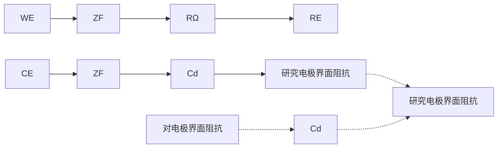
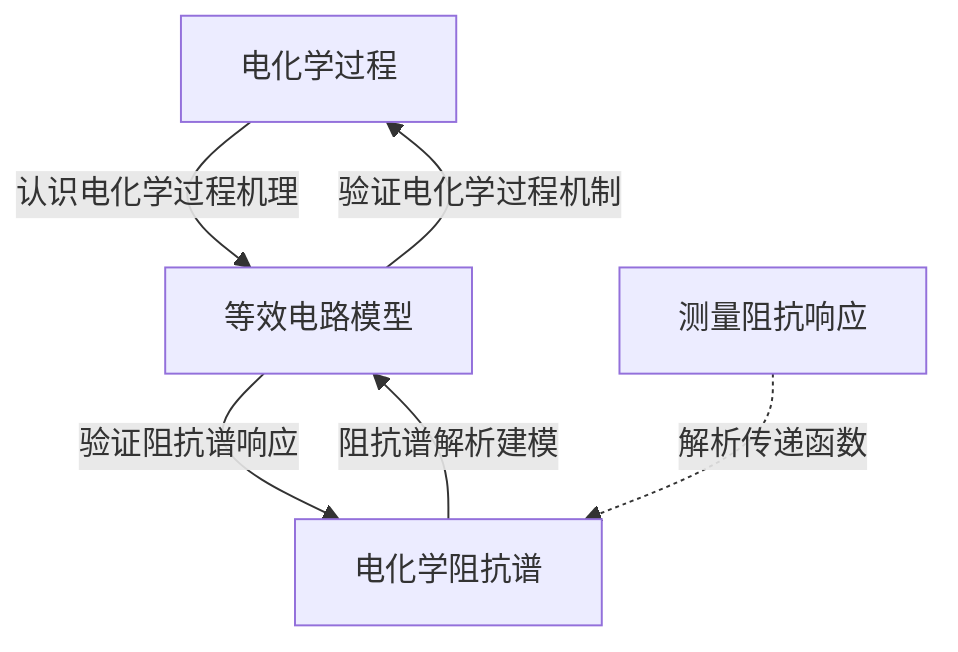
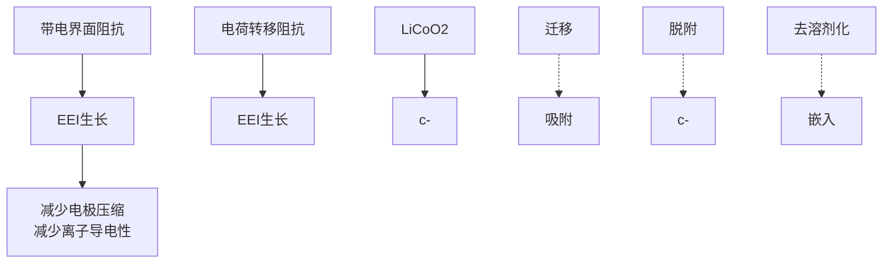

导滴定池中进行，滴定过程中化学反应会引起溶液电导的变化，通过记录溶液电导的变化来确定滴定终点。电导滴定可用于酸碱滴定、沉淀滴定、络合滴定、氧化还原滴定等。

沉淀滴定中，以  $\mathrm{Ba(OH)}_{2}$  滴定  $MgSO_{4}$  为例，随着  $\mathrm{Ba(OH)}_{2}$  的不断滴入，生成  $BaSO_{4}$  和  $\mathrm{Mg(OH)}_{2}$  沉淀，溶液中离子浓度减小，溶液电导下降。终点时到达最低点（图 7.4.3），继续滴加  $\mathrm{Ba(OH)}_{2}$ ，溶液电导增加。

酸碱滴定中，对于强酸的滴定，以 KOH 滴定 HCl 为例，随着 KOH 的滴入， $H^{+}$ 被中和生成水，虽然溶液中的离子浓度未发生变化，但由于  $\Lambda_{H^{+}} > \Lambda_{K^{+}}$ ，则溶液电导不断降低，终点之后再增加，所以电导最低点为终点（图 7.4.3）。对于弱酸的滴定，以 KOH 滴定 HAc 为例，随着 KOH 的滴入，弱酸变成盐类，溶液电导逐渐上升，超过终点后，过量的 KOH 会使得溶液的电导快速上升。因此电导突然快速增大的转折点为滴定终点（图 7.4.3）。

line

| Reaction | Initial State (Concentration) | Final State (Concentration) |
| --- | --- | --- |
| \((H^{+} +\) Ac⁻) + (K⁺ + OH⁻) → H₂O + K⁺ + Ac⁻ | O | — |
| \((Mg^{2+} + SO_{4}^{2-}) + (\)Ba²⁺ + 2OH⁻) → Mg(OH)₂ ↓ + BaSO₄ ↓ | — | O |
| \((H^{+} + Cl^{-}) + (K^{+} + OH^{-}) \to H_{2}O + K^{+} + Cl^{-}\) | O | O |

图 7.4.3 电导滴定曲线

电导法还可以测定采用指示剂法或电位法无法直接准确测定的较弱酸，如NaOH滴定硼酸。反应初期生成的硼酸根和 $\mathrm{Na^{+}}$ 逐步取代导电性弱的硼酸，溶液电导逐渐增加，到达终点后继续加入NaOH，溶液电导迅速增加。

相比于传统滴定方法,电导滴定法可以应用于带有颜色和浑浊的溶液,也适用于极稀溶液,测量大多使用电导仪,可实现自动化,比传统滴定法更加便捷。

## 7.4.3.3 纳米孔道离子电导电流法

纳米孔道离子电导电流法是利用电场或流体场对溶液中目标分子的运动进行操控，通过测定其单分子通过纳米孔道时产生的瞬态离子流的变化，对目标分子进行检测的分析方法。纳米孔道离子电导电流法具有极高的检测灵敏度，可对核酸、多肽、蛋白质、糖等多种生物分子进行实时单分子分析。纳米孔道离子电导电流法主要包括纳米孔道分析法、离子电流整流法、扫描离子电导显微镜分析等。

## 1. 纳米孔道分析法

纳米孔道分析法的检测原理是将纳米孔道置于电解质溶液中，孔道内壁与作为离子导体的电解质直接接触形成两相界面，纳米孔道界面结构可被等效为特殊的“单分子阻抗”。在电场和流体场的驱动下，电解质离子有序地通过纳米孔道，从而形成稳定的离子流(I)。当目标单分子有序地逐个通过限域空间时，会引起纳米孔道界面的变化，从而使得测量体系的电阻和电导发生改变，进而产生相应的离子流变化(图7.4.4)。

纳米孔道主要有生物纳米孔道和人造纳米孔道两类。生物纳米孔道主要以天然成孔蛋白质或DNA为基础构建，如生物蛋白 $\alpha$ -溶血素( $\alpha$ -hemolysin, $\alpha$ -HL)，单胞菌溶素(aerolysin)、耻垢分枝杆菌(MspA)、大肠杆菌细胞溶素A(ClyA)等。人造纳米孔道主要包含固体纳米孔道和玻璃纳米孔道。固体纳米孔道的成孔材料主要为氮化硅、氧化硅、氧化铝、石墨烯、二硫化钼等，通常通过聚焦离子束、聚焦电子束等微纳加工方法制备。玻璃纳米孔道主要由硅酸盐或石英玻璃毛细管通过电化学刻蚀或激光拉制制备。

text_image

纳米
孔道
电极
目标
分子
电极
A
A
I
t

图 7.4.4 纳米孔道分析法检测装置及原理图

纳米孔道分析法对电解质溶液中待测物分子的控制是通过电极在纳米孔道两侧施加一个恒定的电位实现的。如图7.4.5所示，纳米孔道检测装置中的电阻分布可以分为两个部分:入口电阻 $(R_{\mathrm{access}})$ 和孔道电阻 $(R_{\mathrm{pore}})$ 。

text_image

纳米孔道
Rpore
电极
Raccess
电极
A

图 7.4.5 纳米孔道分析法检测装置中的电阻分布

不考虑孔道带电的情况下,整个体系的总电阻为

$$
R = R _ {\text {pore}} + R _ {\text {access}} \tag {7-4-18}
$$

整个体系的电导可表示为

$$
G = \kappa \left(\frac {4 l}{\pi d ^ {2}} + \frac {1}{d}\right) ^ {- 1} \tag {7-4-19}
$$

施加电压 U 时, 孔道离子流 I 为

$$
I = \kappa U \left(\frac {4 l}{\pi d ^ {2}} + \frac {1}{d}\right) ^ {- 1} \tag {7-4-20}
$$

其中 $d$ 为孔径，$l$ 为有效孔厚。所以在检测体系一定时，$I$ 与电解质的电导率 $\kappa$ 成正比。

纳米孔道分析法的一个主要应用是分子测序。20世纪80年代提出利用纳米孔道分析法进行DNA单分子测序。目前已有基于生物纳米孔道 $\alpha$-溶血素的商业化DNA测序仪。纳米孔道分析法的另一个主要应用是构建单分子传感器，用于生物大分子分析、主-客体相互作用测量、单分子构象研究、分子间弱相互作用识别等。

## 2. 离子电流整流法

离子电流整流法是基于纳米孔道里的离子整流效应,当目标检测物作用于纳米孔时,孔道内的电荷发生改变,从而引起离子流改变,通过测量离子流的变化,可以对目标物进行定性和定量检测。

纳米孔道的离子电流整流来源于纳米孔道内的离子选择渗透性。当纳米孔道的尺寸与双电层厚度(即 Debye 长度)接近时,离子通过孔道将严重受到双电层结构的影响。由于不对称的双电层结构导致的电流-电压(I-U)曲线的不对称性称为离子电流整流。以一个表面带负电荷的锥形纳米孔道为例，由于异性相吸原理，孔道对于阳离子具有选择渗透性，而阴离子很难通过，离子电流主要来自流经孔道的阳离子。当孔道内施加负电压时，孔道末端(狭窄部分)聚集了阳离子，孔道内部的宽阔部分的平均电解质浓度增大，这两个因素都导致离子电导增强。在孔道内部施加正电压时，孔道末端附近的阳离子浓度降低，孔道内宽阔部分的平均电解质浓度降低，这两个因素都导致离子电导下降。因此，在孔道内施加不同的电压时，将出现不同的离子电流，即不对称I-U曲线(图7.4.6)。

text_image

I
U
(+)
(-)
(-)
(+)

图 7.4.6 纳米孔道内的离子电流整流现象示意图

图 7.4.7 电化学“黑箱”M 体系中的输入信号 X、输出信号 Y 及其函数表示  $G(\omega)$

离子电流整流法主要用于发展微纳尺寸的离子和生物传感器,以进行单细胞及活体(大鼠大脑皮层)中生物分子的实时、准确定量检测。

## 7.4.4 电化学阻抗分析的基本理论

电化学阻抗分析法在化学反应机理研究中扮演着重要的角色。不同于前文介绍的电导分析法，阻抗分析是一种频率域测量方法，可测定的频率范围很宽，因而比常规电化学方法得到更多的动力学信息和电极界面结构信息。通过频率的变化，阻抗分析可提供系统更精细的分析；在交流电场下，阻抗分析能够捕捉材料在动态条件下的多种电学特性，包括电荷传递、电极界面反应、离子扩散等复杂过程。

## 7.4.4.1 电化学阻抗的定义

对于一个稳定的线性系统 M, 如果使用频率为  $\omega$  的小振幅正弦波电流(或电势)信号 X 作为扰动信号, 并使电极系统产生近似线性的响应, 则系统将输出频率为  $\omega$  的正弦波电势(或电流)信号 Y:

$$
G (\omega) = Y / X \tag {7-4-21}
$$

其中，G 为频率响应函数，简称频响函数，反映系统 M 的频率响应特性，由系统的内部结构决定。该频响函数 G 就是该系统的电化学阻抗（或导纳）。

在一定频率范围内测得的一组频响函数值构成了电极系统的电化学阻抗谱，用以研究电极系统的方法称为电化学阻抗谱法（electrochemical impedance spectroscopy, EIS）。电化学交流阻抗测试将电化学体系视作一个“黑箱”，对其施加某种扰动或激发信号（如电位阶跃），在保持其他变量不变的情况下，测量某一响应信号（如电流随时间的变化）。通过已知的输入信号 $X$ 和输出信号 $Y$ ，可以求得频响函数 $G$ （如图7.4.7所示）。在不同频率下进行测量，就能得到 $G$ 随频率变化的关系。

要想满足式(7-4-21)且保证输出信号Y和输入信号X同频率,要求扰动信号与响应信号之间必须具有因果关系,即响应信号必须是扰动信号的线性函数,被测量的体系在扰动下是稳定的。基于此,阻抗分析具有三个前提条件。

（1）因果性 当对电极系统施加正弦波电位信号进行扰动时，因果性条件要求电极系统仅对该电位信号作出响应，控制电极过程的电位及其他状态变量都必须随正弦波电位的扰动同步变化。在阻抗测量中必须严格控制环境因素，排除噪声干扰，确保扰动信号与系统响应之间的唯一因果关系。
（2）线性 电极过程的动力学特性决定，电极过程的速度与状态变量的变化通常不遵循线性关系。当状态变量的变化足够小时，电极过程速度与该变量之间才满足近似线性的关系。因此，在阻抗测量中要满足线性关系就必须确保正弦波电位或正弦波电流的扰动幅值足够小，使电极过程的速度随每个变量的变化近似符合线性条件，从而确保电极系统的响应信号与扰动信号近似满足线性规律。通常扰动信号的电势正弦波幅度在 $5\mathrm{mV}$ 左右，一般不超过 $10\mathrm{mV}$ 。

（3）稳定性 对电极系统的扰动停止后，系统能够恢复到原有状态。稳定性要求扰动信号不会引起系统内部结构的变化；对于不可逆电极过程，只要电极表面变化不快，且扰动幅度较小、作用时间短，扰动停止后，系统能恢复到接近最初的状态，这样也可以近似满足稳定性条件。

由于采用小幅度的正弦电势信号对系统进行微扰,电极上交替出现阳极和阴极过程,二者作用相反,因此,即使扰动信号长时间作用于电极,也不会导致极化现象的积累性发展和电极表面状态的积累性变化。因此,EIS法是一种“准稳态方法”。

## 7.4.4.2 电化学阻抗的基本知识

当交流电作用于无源电路两端时,其电势与流经该电路的电流之比称为阻抗,用 Z 表示:

$$
Z (\omega) = \frac {\Delta E (\omega)}{\Delta I (\omega)} \tag {7-4-22}
$$

式中， $Z(\omega)$  被称为复阻抗，简称阻抗(impedance)；阻抗的倒数被称为导纳（表示为 Y, admittance），两者统称为阻纳（immittance）。

$Z(\omega)$  是一个复数, 复阻抗可表示为

$$
Z = Z _ {\mathrm{Re}} + j Z _ {\mathrm{Im}} = Z ^ {\prime} + j Z ^ {\prime \prime} \tag {7-4-23}
$$

复阻抗的辐角  $\phi$  等于电势电流的相位差, 称为阻抗角, 表示为

$$
\phi = \arctan \frac {Z ^ {\prime \prime}}{Z ^ {\prime}} \tag {7-4-24}
$$

复阻抗的模和辐角分别可以用来描述该电路的阻抗大小和电势与电流之间的相位差。复阻抗的复数平面图可表述为图7.4.8。复阻抗Z体现了电路元件对电流的阻碍作用和相位移效果，其阻碍和相位移特性如图7.4.9所示。

复阻抗也可采用三角表示法来表示。因为复数的模:

$$
\left| Z \right| = \sqrt {Z ^ {\prime 2} + Z ^ {\prime \prime 2}} = \frac {Z ^ {\prime}}{\cos \phi} = \frac {Z ^ {\prime \prime}}{\sin \phi} \tag {7-4-25}
$$

反映了电路阻抗的大小,辐角则表示电势与电流之间的相位差,因此复阻抗可以通过三角形式表示为

$$
Z = Z ^ {\prime} + j Z ^ {\prime \prime} = | Z | \cos \phi + j | Z | \sin \phi \tag {7-4-26}
$$

或

$$
Z = | Z | \mathrm{e} ^ {\mathrm{j} \phi} \tag {7-4-27}
$$

这种表示法更加简洁,尤其在相位差的计算中更加直观。

若在电阻两端加上正弦电势  $U_{R}$ ，令

$$
U _ {\mathrm{R}} = U _ {\mathrm{m}} \sin \omega t \tag {7-4-28}
$$

式中， $U_{m}$  为电势的幅值。在此电势作用下，流经电阻的电流 I 符合欧姆定律，即

$$
I = \frac {U _ {\mathrm{R}}}{R} = \frac {U _ {\mathrm{m}} \sin \omega t}{R} = I _ {\mathrm{m}} \sin \omega t \tag {7-4-29}
$$

式中， $I_{m}$  为电流的幅值。

由式(7-4-28)和式(7-4-29)可见,电阻两端的电势与流经电阻的电流在正弦交流电中具有相同的频率和相位。这是电阻元件的典型特性,与电容和电感元件不同,后者会产生电压和电流之间的相位差(详见7.4.5介绍)。

通过测定不同频率 $\omega$ 的扰动信号和相应信号的比值，得到不同频率下阻抗的实部、虚部、模值和相位角，可绘制成各种形式的电化学阻抗谱，最常用的有奈奎斯特图(Nyquist plot)和波特图(Bode plot)。奈奎斯特图是以阻抗的实部为横轴、虚部的负数为纵轴绘制的曲线（即 $Z'' - Z'$ 之间的关系曲线），也称为阻抗复数平面图(图7.4.10)，是阻抗数据中应用最广泛的形式之一。除此之外，波特图也应用很广，用来描述阻抗模值或相位角随频率的变化关系(图7.4.11)，即 $\lg |Z| - \lg \omega$ （或 $\lg |Z| - \lg f$ 和 $\phi -\lg \omega$ （或 $\phi -\lg f$ )的关系曲线。

text_image

虚部Z''
(Z', Z'')
|Z|
φ
O
实部Z'

图 7.4.8 复阻抗的复数平面图

line

| Time | \(\phi (\)Amplitude) | I (Amplitude) |
| --- | --- | --- |
| 0 | 0 | 0 |
| Peak 1 | ~Peak | ~Peak/2 |
| Trough 1 | 0 | 0 |
| Peak 2 | ~Peak | ~Peak/2 |
| Trough 2 | 0 | 0 |
| Peak 3 | ~Peak | ~Peak/2 |
| Trough 3 | 0 | 0 |
| Peak 4 | ~Peak | ~Peak/2 |
| Trough 4 | 0 | 0 |
| Peak 5 | ~Peak | ~Peak/2 |
| Trough 5 | 0 | 0 |
| Peak 6 | ~Peak | ~Peak/2 |
| Trough 6 | 0 | 0 |
| Peak 7 | ~Peak | ~Peak/2 |
| Trough 7 | 0 | 0 |
| Peak 8 | ~Peak | ~Peak/2 |
| Trough 8 | 0 | 0 |
| Peak 9 | ~Peak | ~Peak/2 |
| Trough 9 | 0 | 0 |
| Peak 10 | ~Peak | ~Peak/2 |
| Trough 10 | 0 | 0 |
| Peak 11 | ~Peak | ~Peak/2 |
| Trough 11 | 0 | 0 |
| Peak 12 | ~Peak | ~Peak/2 |
| Trough 12 | 0 | 0 |
| Peak 13 | ~Peak | ~Peak/2 |
| Trough 13 | 0 | 0 |
| Peak 14 | ~Peak | ~Peak/2 |
| Trough 14 | 0 | 0 |
| Peak 15 | ~Peak | ~Peak/2 |
| Trough 15 | 0 | 0 |
| Peak 16 | ~Peak | ~Peak/2 |
| Trough 16 | 0 | 0 |
| Peak 17 | ~Peak | ~Peak/2 |
| Trough 17 | 0 | 0 |
| Peak 18 | ~Peak | ~Peak/2 |
| Trough 18 | 0 | 0 |
| Peak 19 | ~Peak | ~Peak/2 |
| Trough 19 | 0 | 0 |
| Peak 20 | ~Peak | ~Peak/2 |
| Trough 20 | 0 | 0 |
| Peak 21 | ~Peak | ~Peak/2 |
| Trough 21 | 0 | 0 |
| Peak 22 | ~Peak | ~Peak/2 |
| Trough 22 | 0 | 0 |
| Peak 23 | ~Peak | ~Peak/2 |
| Trough 23 | 0 | 0 |
| Peak 24 | ~Peak | ~Peak/2 |
| Trough 24 | 0 | 0 |
| Peak 25 | ~Peak | ~Peak/2 |
| Trough 25 | 0 | 0 |
| Peak 26 | ~Peak | ~Peak/2 |
| Trough 26 | 0 | 0 |
| Peak 27 | ~Peak | ~Peak/2 |
| Trough 27 | 0 | 0 |
| Peak 28 | ~Peak | ~Peak/2 |
| Trough 28 | 0 | 0 |
| Peak 29 | ~Peak | ~Peak/2 |
| Trough 29 | 0 | 0 |
| Peak 30 | ~Peak | ~Peak/2 |
| Trough 30 | 0 | 0 |
| Peak 31 | ~Peak | ~Peak/2 |
| Trough 31 | 0 | 0 |
| Peak 32 | ~Peak | ~Peak/2 |
| Trough 32 | 0 | 0 |
| Peak 33 | ~Peak | ~Peak/2 |
| Trough 33 | 0 | 0 |
| Peak 34 | ~Peak | ~Peak/2 |
| Trough 34 | 0 | 0 |
| Peak 35 | ~Peak | ~Peak/2 |
| Trough 35 | 0 | 0 |
| Peak 36 | ~Peak | ~Peak/2 |
| Trough 36 | 0 | 0 |
| Peak 37 | ~Peak | ~Peak/2 |
| Trough 37 | 0 | 0 |
| Peak 38 | ~Peak | ~Peak/2 |
| Trough 38 | 0 | 0 |
| Peak 39 | ~Peak | ~Peak/2 |
| Trough 39 | 0 | 0 |
| Peak 40 | ~Peak | ~Peak/2 |
| Trough 40 | 0 | 0 |
| Peak 41 | ~Peak | ~Peak/2 |
| Trough 41 | 0 | 0 |
| Peak 42 | ~Peak | ~Peak/2 |
| Trough 42 | 0 | 0 |
| Peak 43 | ~Peak | ~Peak/2 |
| Trough 43 | 0 | 0 |
| Peak 44 | ~Peak | ~Peak/2 |
| Trough 44 | 0 | 0 |
| Peak 45 | ~Peak | ~Peak/2 |
| Trough 45 | 0 | 0 |
| Peak 46 | ~Peak | ~Peak/2 |
| Trough 46 | 0 | 0 |
| Peak 47 | ~Peak | ~Peak/2 |
| Trough 47 | 0 | 0 |
| Peak 48 | ~Peak | ~Peak/2 |
| Trough 48 | 0 | 0 |
| Peak 49 | ~Peak | ~Peak/2 |
| Trough 49 | 0 | 0 |

图 7.4.9 复阻抗的相移作用

line

| \(Z' (\Omega)\) | \(-Z'' (\Omega)\) |
| --- | --- |
| 0 | 0 |
| ~50 | ~75 |
| ~100 | ~110 |
| ~150 | ~130 |
| ~200 | ~130 |
| ~250 | ~120 |
| ~300 | ~90 |
| ~350 | ~60 |
| ~400 | ~120 |
| ~425 | ~200 |
| ~440 | ~260 |
| ~450 | ~300 |

图 7.4.10 典型奈奎斯特图

line

| Low | High | 0 |
| --- | --- | --- |
| Medium | High | ~-45 |
| High | 0 | -90 |

(a)

line

| Left edge | ~100 | 0 |
| --- | --- | --- |
| Transition point | ~95 | ~-45 |
| Right edge | ~-30 | -90 |

(b)

图 7.4.11 典型波特图

## 7.4.5 电化学阻抗谱的等效电路

## 7.4.5.1 等效电路基本元件

用一系列电学元件和特定的“电化学元件”构成一个电路，其阻抗谱同测得的电化学阻抗谱相同，则这一构建电路被称为该电化学体系的等效电路（equivalent circuit），而所用的电学元件或“电化学元件”则称为等效元件。

在电感线圈(见表7.4.3)两端加上正弦电压 $U_{L}$ ，会产生电流I。电流在线圈内部和周围产生变化磁场，磁通的变化在线圈上产生感应电动势 $e_{L}$ 。根据楞次定律，感应电动势 $e_{L}$ 与引起磁通变化的电流变化呈反向。此外，感应电动势 $e_{L}$ 与电感量L及电流I对时间的变化率成正比，即

$$
e _ {\mathrm{L}} = - L \frac {\mathrm{d} I}{\mathrm{d} t} \tag {7-4-30}
$$

设流过线圈的正弦交流电流为 I, 令

$$
I = I _ {\mathrm{m}} \sin \omega t \tag {7-4-31}
$$

代入式(7-4-30) 得

$$
\begin{array}{l} e _ {\mathrm{L}} = - L \frac {\mathrm{d} I}{\mathrm{d} t} = - L \frac {\mathrm{d}}{\mathrm{d} t} (I _ {\mathrm{m}} \sin \omega t) = - I _ {\mathrm{m}} \omega L \cos \omega t \\ = - I _ {\mathrm{m}} \omega t \sin \left(\omega t + \frac {\pi}{2}\right) \tag {7-4-32} \\ \end{array}
$$

其中  $U_{L}$  与  $e_{L}$  大小相等, 方向相反, 即  $U_{L} = -e_{L}$ , 因此线圈两端电压表示为

$$
U _ {\mathrm{L}} = - e _ {\mathrm{L}} = I _ {\mathrm{m}} \omega t \sin \left(\omega t + \frac {\pi}{2}\right) = U _ {\mathrm{m}} \sin \left(\omega t + \frac {\pi}{2}\right) \tag {7-4-33}
$$

其中， $U_{m}=I_{m}\omega L$ ，是电压 $U_{L}$ 的最大值。且

$$
I = \frac {U _ {\mathrm{L}}}{\omega L} = \frac {U _ {\mathrm{L}}}{X _ {\mathrm{L}}} \tag {7-4-34}
$$

其中， $X_{L}=\omega L=2\pi fL$ ，称为电感元件的阻抗，简称感抗。

从式(7-4-31)和式(7-4-33)可得知,电感两端的电压与流经电感元件的电流也是同频率的正弦量,但在相位上电压 $U_{L}$ 比电流I超前 $\pi/2$ 。电感元件的复阻抗为

$$
Z _ {\mathrm{L}} = j X _ {\mathrm{L}} = j \omega L \tag {7-4-35}
$$

当在电容量为 $C$ 的电容两端加上正弦电压 $U_{c}$ 时，电容器会开始充电。此时，电容器上的电荷量 $Q$ 与电容量和电压 $U_{c}$ 成正比关系，表达式为

$$
Q = C U _ {\mathrm{c}} \tag {7-4-36}
$$

由于电流 $I$ 是单位时间通过的电荷量 $Q$ ，将式(7-4-36）代入

$$
I = C \frac {\mathrm{d} U _ {c}}{\mathrm{d} t} \tag {7-4-37}
$$

设加在电容两端的电压为

$$
U _ {\mathrm{c}} = U _ {\mathrm{m}} \sin \omega t \tag {7-4-38}
$$

代入式(7-4-37) 得

$$
I = C \frac {\mathrm{d}}{\mathrm{d} t} (U _ {\mathrm{m}} \sin \omega t) = U _ {\mathrm{m}} \omega C \sin \left(\omega t + \frac {\pi}{2}\right) = I _ {\mathrm{m}} \sin \left(\omega t + \frac {\pi}{2}\right) \tag {7-4-39}
$$

式中， $I_{m}=U_{m}\omega C$ ，是流过C的电流的最大值。且

$$
U _ {\mathrm{m}} = \frac {I _ {\mathrm{m}}}{\omega C} = I _ {\mathrm{m}} X _ {\mathrm{C}} \tag {7-4-40}
$$

式中， $X_{c}=\frac{1}{\omega C}=\frac{1}{2\pi fC}$ 称为电容器的阻抗，简称容抗。

比较式(7-4-38)和式(7-4-39)可知,加在电容器两端的电压和流经的电流是同频率的正弦量,只是电流I在相位上比电压 $U_{c}$ 超前 $\pi/2$ 。电容元件的复阻抗为

$$
Z _ {\mathrm{c}} = - j X _ {\mathrm{c}} = - j \frac {1}{\omega C} \tag {7-4-41}
$$

在复数平面图上，电阻、电感和电容元件的复阻抗分别有不同的表现形式，如图7.4.12所示。需要特别指出的是，在电化学系统中，由于电容性元件非常常见，惯例上通常将复数平面中的虚轴负方向画为向上的方向，以表示电容效应。

综上所述,将电阻R、电容C和电感L的常用元件表示和复阻抗总结在表7.4.3中。

表 7.4.3 电阻 R、电容 C 和电感 L 的常用元件表示和复阻抗汇总

|  | 电阻R | 电容C | 电感L |
| --- | --- | --- | --- |
| 常用元件表示复阻抗 | $R$ | $-j\frac{1}{\omega C}$ | $j\omega L$ |

当电路由多个元件串联组成时,总的复阻抗等于各复阻抗之和。例如,当一个电阻 R 和一个电容 C 串联时,总的复阻抗即为

$$
Z = Z _ {\mathrm{R}} + Z _ {\mathrm{C}} = R - j \frac {1}{\omega C} \tag {7-4-42}
$$

结合式(7-4-23)，则实部  $Z' = R$ ，虚部  $Z'' = -1/\omega C$ 。奈奎斯特图上表现为与横轴交于 R 与纵轴平行的一条直线，如图 7.4.13 所示。

text_image

-Z"
1/ωC
O
R
Z'
ωL

图 7.4.12 电阻 R、电容 C 和电感 L 的复阻抗

为了便于表述和书写复杂电路，可以采用电路描述码（circuit description code, CDC）来表示多个元件组合成的电路。CDC 核心规则:① 串联:将元件直接依次写在一起。如 RLC 或 CLR 表示电阻 R、电感 L 和电容 C 三者串联。② 并联:将元件用括号包围。例如，(RLC) 表示电阻 R、电感 L 和电容 C 三者并联。③ 复杂电路:对于更复杂的电路结构，可以通过括号来表示优先运算顺序。括号的层次表示组合的嵌套关系。若某元件外括号的层数为奇数，则该元件的第一层运算为并联。若某元件外括号的层数为偶数，则该元件的第一层运算为串联。通过这种规则，可以有效地描述复杂电路结构，简化电路图的表述。例如，CDC 码为  $R_{1}(C_{1}R_{2}(R_{3}L(C_{2}R_{4})))$  表示的电路如下图所示。

text_image

C₁
R₁
R₂
C₂
R₃
L
R₄

CDC 码  $R_{1}(C_{1}R_{2}(R_{3}L(C_{2}R_{4})))$  对应的电路。

scatter

| \(Z' (\Omega)\) | \(-Z'' (\Omega)\) |
| --- | --- |
| 50 | ~2.0 |
| 50 | ~3.0 |
| 50 | ~4.0 |
| 50 | ~5.0 |
| 50 | ~6.0 |
| 50 | ~7.0 |
| 50 | ~8.0 |
| 50 | ~9.0 |
| 50 | ~10.0 |
| 50 | ~11.0 |
| 50 | ~12.0 |
| 50 | ~13.0 |
| 50 | ~14.0 |
| 50 | ~15.5 |

图 7.4.13 串联电路阻抗图

当电路由多个元件并联组成时，总的复阻抗的倒数等于各并联复阻抗的倒数和，即各元件导纳之和，可表示为 $Y=Y_{R}+Y_{C}+Y_{L}$ 。例如，当一个电阻R、一个电容C和一个电感L并联时，总的复阻抗的倒数即为

$$
\frac {1}{Z} = \frac {1}{Z _ {\mathrm{R}}} + \frac {1}{Z _ {\mathrm{L}}} + \frac {1}{Z _ {\mathrm{C}}} = \frac {1}{R} + \frac {1}{j \omega L} - \frac {1}{j \frac {1}{\omega C}} = \frac {1}{R} - j \left(\frac {1}{\omega L} - \omega C\right) \tag {7-4-43}
$$

## 7.4.5.2 电解池的等效电路

电解池是一个相当复杂的体系，其中进行着电荷量的转移、化学变化和组分浓度的变化等。这种体系显然不同于由简单的电学元件（如电阻、电容等组成的电路），但是当用正弦交流电通过电解池进行测量时，往往可以根据实验条件的不同把电解池简化为不同的等效电路。在交流电通过电解池的情况下，可以把双电层等效地看作电容器，把电极本身、溶液及电极反应所引起的阻力看成电阻，因此可把电解池分解为交流阻抗电路。

在暂态电流分析中，电流通常包括多种不同的电流成分。在等效电路中，可以用不同的支路来表示每种电流，这些支路彼此并联。电极的总电流是这些支路电流的总和，如图7.4.14所示。 $R_{\Omega}$ 是研究电极表面到参比电极的欧姆电阻，其阻值可以通过溶液的电阻率和电极间的距离等参数来计算，实验上也可以测得。 $C_{d}$ 是双电层电容，其数值等于电极实际表面积与单位面积的双电层电容的乘积。在图7.4.14中，各路 $Z_{j}$ 通常不只是简单的电阻或电容，而是需要用阻抗来表示。对于电极上的每个独立电化学反应，可以用一个法拉第阻抗 $Z_{F}$ 来表示。

电化学反应中，反应物逐渐被消耗，产物逐渐积累，导致电极表面的电流逐渐受到影响，因此产生浓度极化现象。这种极化现象造成了反应中电流等于电极表面处的扩散电流；界面总过电位等于电化学极化过电位和浓度极化过电位之和。因此在等效电路中，浓度极化阻抗和电化学反应的阻抗是串联关系（图7.4.15），被称为法拉第阻抗等效电路，即 $Z_{\mathrm{F}} = R_{\mathrm{r}} + Z_{\mathrm{W}}$ 。其中， $Z_{\mathrm{F}}$ 为法拉第阻抗， $R_{\mathrm{r}}$ 为电化学反应过程阻抗， $Z_{\mathrm{W}}$ 为浓度极化阻抗。

如上所述，电极流经的总电流等于法拉第电流和非法拉第电流之和。法拉第阻抗 $Z_{\mathrm{F}}$ 两端的电势是通过改变电极/溶液界面双电层的荷电状态来建立的，因此法拉第阻抗与双电层电容是并联的，其阻抗等效电路如图7.4.16所示。为了简化公式,这里暂时不考虑浓度极化阻抗  $Z_{w}$ , 根据式(7-4-43), 总的复阻抗即为

text_image

C_d
Z_1
R_Ω
Z_2
...
Z_j

图 7.4.14 电极等效电路( $R_{\Omega}$ : 溶液欧姆电阻;  $C_{d}$ : 双电层微分电容;  $Z_{1}, Z_{2}, \cdots, Z_{j}$ : 各法拉第或非法拉第阻抗)

图 7.4.15 法拉第阻抗等效电路

$$
\frac {1}{Z} = \frac {1}{Z _ {\mathrm{R}}} + \frac {1}{Z _ {\mathrm{C}}} = \frac {1}{R} + j \omega C = \frac {R}{1 + (\omega R C) ^ {2}} - j \frac {\omega R ^ {2} C}{1 + (\omega R C) ^ {2}} \tag {7-4-44}
$$

其中，实部 $Z^{\prime} = \frac{R}{1 + (\omega RC)^{2}}$ ，虚部 $Z'' = -\frac{\omega R^2C}{1 + (\omega RC)^2}$ ；消去 $\omega$ ，整理可得

$$
\left(Z ^ {\prime} - \frac {R}{2}\right) ^ {2} + Z ^ {\prime \prime 2} = \left(\frac {R}{2}\right) ^ {2} \tag {7-4-45}
$$

圆心为 $(R/2,0)$ ，半径为R/2的圆的方程。奈奎斯特图上显示为半径为R/2的半圆（图7.4.17）。

line

| Z' | -Z'' |
| --- | --- |
| 0 | 0 |
| ~2 | ~10 |
| ~3 | ~12 |
| ~4 | ~14 |
| ~5 | ~16 |
| ~6 | ~18 |
| ~7 | ~20 |
| ~10 | ~30 |
| ~20 | ~40 |
| ~30 | ~45 |
| ~40 | ~48 |
| 50 | 50 |
| ~60 | ~49 |
| ~70 | ~47 |
| ~80 | ~44 |
| ~90 | ~40 |
| ~95 | ~35 |
| ~98 | ~27 |
| ~99 | ~19 |
| 100 | 10 |
| 100 | 0 |

图 7.4.17 界面阻抗奈奎斯特图

在电化学测量中，常用的三电极体系进行电势及电流的测量和控制，其电极过程及其等效电路可以用图7.4.18来表示。图7.4.18展示了一个考虑四个步骤（双电层充电、电荷传递、扩散传质、离子导电）的简单电极过程的暂态等效电路。$R_{\Omega}$ 是离子导电过程的电阻；$C_{\mathrm{d}}$ 代表双电层充电过程的电容；$R_{\mathrm{r}}$ 对应电化学反应过程的电阻；$Z_{\mathrm{w}}$ 表示传质过程的阻抗。

在不考虑浓度极化阻抗 $Z_{\mathrm{w}}$ 的情况下，电极的等效阻抗可表示为

$$
Z = R _ {\Omega} + \frac {1}{j \omega C _ {\mathrm{d}} + \frac {1}{R _ {\mathrm{r}}}} \tag {7-4-46}
$$

而在考虑浓度极化阻抗 $Z_{\mathrm{w}}$ 的情况下，电极的等效阻抗可表示为

$$
Z = R _ {\Omega} + \frac {1}{j \omega C _ {\mathrm{d}} + \frac {1}{R _ {\mathrm{r}} + \sigma \omega^ {- \frac {1}{2}} (1 - j)}} \tag {7-4-47}
$$

两种情况下,对应的电极界面阻抗图谱分别为图7.4.19(a)和(b)。

对于典型的三电极电解池,其等效电路可以表示为图 7.4.20。图 7.4.20 通常包含更多的复杂性,因为它需要考虑三个电极(工作电极、参比电极和对电极)之间的相互作用及整个电解池的整体行为。

在等效电路中，各元件的阻抗大小表征了其对应子过程进行的难易程度。阻抗较大的过程通常成为电极总过程的速率控制步骤。尽管暂态系统的分析较为复杂，但由于暂态方法考虑了时间因素，因此可以通过各子过程对时间的不同响应，来简化或解析复杂的等效电路，从而测定等效电路中各部分的阻抗值。这种方法有助于研究各基本过程，并控制电极总过程的性能。通过暂态分析，能够更详细地了解电极系统的动态特性和各子过程的影响,从而在研究和优化电极系统时,提供更准确的参数和改进策略。

text_image

C_d
R_r
Z_w

图 7.4.16 界面阻抗等效电路

text_image

电极
双电层电容Cd 溶液电阻RΩ
法拉第阻抗ZF
Cd
Rr Zw RΩ

图 7.4.18 电极的等效电路

text_image

-Z"
ω
∞
0
RΩ
RΩ+Rf/2
RΩ+Rf
0
Z'

(a)

text_image

动力学控制
ω降低
RΩ + Rr/2
RΩ + Rr
扩散控制
Z' -Z''

(b)

图 7.4.19 常见电极反应界面分别在(a)不考虑浓差极化和(b)考虑浓差极化情况下的阻抗奈奎斯特图

flowchart

图 7.4.20 电解池等效电路

## 7.4.6 电化学阻抗谱解析

进行电化学阻抗谱测量的目的,就是要根据测量得到的 EIS 谱图,确定 EIS 的等效电路或数学模型,与其他的电化学方法相结合,推测电极系统中包含的动力学过程及其机理;另一方面,如果已经建立了一个合理的数学模型或等效电路,就需要确定数学模型中有关参数或等效电路中有关元件的参数值,从而估算有关过程的动力学参数或有关体系的物理参数(图 7.4.21)。确定阻抗谱所对应的等效电路或数学模型与估算这种等效电路或数学模型中的有关参数的值是 EIS 数据处理的两个步骤。这两个步骤是互相联系、有机地结合在一起的。

flowchart

图 7.4.21 电化学阻抗谱解析目的和思路

根据上述两种不同的情况,阻抗谱的数据处理有两种不同的途径:一种情况是已经知道阻抗谱所对应的数学模型或等效电路,或是根据阻抗谱的特征(如阻抗谱中含有的时间常数个数)和其他有关的电化学知识,有把握确定相应的数学物理模型。在这种情况下,阻抗数据处理途径是:先确定数学物理模型,然后将阻抗频谱对已确定的模型进行曲线拟合,求出数学模型中各个参数或等效电路中各等效元件的参数值。

另一种情况是，阻抗谱比较复杂，不知道对应于测得的阻抗谱频谱的等效电路是由哪些等效元件如何连接组成的。在这种情况下，阻抗谱数据处理的途径是依据数学模型逐个求解阻抗谱中各个时间常数所对应的等效元件的参数，从测得的阻抗谱求出最有可能的等效电路（物理模型），然后将整个阻抗谱所确定的物理模型进行曲线拟合确定等效电路中各等效元件的参数值。这种阻抗谱数据处理，一般叫作阻抗谱数据的解析。

另外，曲线拟合是阻抗谱数据处理的核心问题。无论采用上述两种数据处理中的哪一种，都必须解决阻纳频谱曲线拟合问题。所谓曲线拟合，就是确定数学模型中待定参数的数值，使得由此确定的模型的理论曲线最佳，更逼近实验的测量数据。由于阻纳是频率的非线性函数，一般采用非线性最小二乘法进行曲线拟合。

阻抗谱的解析目前主要还是依靠设计等效电路，然后采用计算机技术对阻抗谱进行拟合，获得等效电路中各元件的参数，进而计算各动力学参数。因此在本节不对阻纳数据的非线性最小二乘法的数学原理过多展开讨论，而重点讨论依据数学模型的阻抗谱数据解析。

IMPD1 是一个依据数学模型来处理阻抗数据的软件, 这个软件中包含有 5 种类型的模型, 即

① 电极过程含有一个时间常数(状态变量仪为电极电位);
② 电极过程含有两个时间常数(除电极电位之外, 另有一个状态变量):
③电极过程含有三个时间常数(除电极电位之外,另有两个状态变量);
④ 电极过程含有一个时间常数及受一种粒子的传质过程影响；
⑤ 电极过程含有两个时间常数并受传质过程的影响。

在大多数情况下,若电极系统的非法拉第阻抗仅为电双层电容,用这5个模型就足以处理实测到的电化学阻抗谱。经数据处理可以求得数学模型中参数的数值。这种方法操作简单,在确定阻抗谱所对应的数学模型后,便可在阻抗平面中的弧或直线上选取相应的数据点进行处理,求得参数的初始值后,再求取参数的最佳估算值。图7.4.22是一个通过理论计算得到的阻抗谱复平面图。图中可以观察到一个具有两段圆弧及一条直线的阻抗频响曲线。下面以这个阻抗谱为例,说明IMPD1软件进行数据处理的基本思路。

scatter

| \(实部/\Omega\) | \(虚部/\Omega\) |
| --- | --- |
| ~10 | ~20 |
| ~20 | ~30 |
| ~30 | ~40 |
| ~40 | ~50 |
| ~60 | ~60 |
| ~80 | ~70 |
| ~90 | ~60 |
| ~100 | ~50 |
| ~110 | ~40 |
| ~120 | ~30 |
| ~130 | ~40 |
| ~140 | ~50 |
| ~150 | ~60 |
| ~170 | ~80 |
| ~190 | ~90 |
| ~210 | ~95 |
| ~230 | ~95 |
| ~250 | ~95 |
| ~270 | ~95 |
| ~290 | ~100 |
| ~310 | ~110 |
| ~330 | ~120 |
| ~350 | ~130 |
| ~370 | ~140 |
| ~390 | ~195 |

图 7.4.22 具有两个时间常数且受扩散过程影响的电极过程的阻抗复平面图(理论计算曲线)

非线性最小二乘法由荷兰Tweate大学B.A.Boukamp提出，可选择Equivert软件、ZView、AutoLab、ZSimpWin软件等进行数据拟合处理。非线性最小二乘法的原理是基于在进行阻抗测量时，得到的测量数据是一系列不同频率下的复数阻抗。当确定了阻抗谱所对应的数学模型之后，就可以写出这一模型的阻抗表达式。对于任一频率，可以计算出数学模型确定的理论阻抗值。实测阻抗数据和理论计算阻抗数据的差值作为目标函数，阻抗数据拟合过程就是通过迭代，逐步调整并最终确定数学模型中各待定参数的最佳数值，使得目标函数为最小。

从图 7.4.22 中的阻抗频响曲线在高频与中间频率表现为两个连续的半圆。很容易看出这是一个具有两个时间常数的阻抗谱；从低频端出现直线，又可判断阻抗谱中具有浓度极化阻抗  $Z_{w}$  成分。因此，可以选用上述第⑤个模型来处理这个阻抗谱，这个模型的数学表达式为

$$
Z = R _ {\Omega} + \frac {1}{C _ {\mathrm{d}} + \frac {1}{\frac {1}{R _ {\mathrm{r}}} + \frac {B}{a + j w} + Z _ {\mathrm{w}}}} \tag {7-4-48}
$$

各项参数的意义同前面定义过的一样。

在选定了式(7-4-48)为阻抗谱所对应的模型之后,就是用分段拟合的方法来得到式中各参数的初始值。对于模型⑤,需要在3个频率段分别选取数据点。这些数据点分别在两个半圆及直线上选取。

很明显,式(7-4-48)在高频端可以近似为

$$
Z = R _ {\Omega} + \frac {1}{C _ {\mathrm{d}} + \frac {1}{R _ {\mathrm{r}}}} \tag {7-4-49}
$$

因此，通过对高频半圆的拟合，可以求得 $R_{\Omega}, R_{\mathrm{r}}, C_{\mathrm{d}}$ 等有关元件的参数值。同样，通过对第2个半圆的拟合，可以求得 $R_{\mathrm{r}}, B$ 和 $a$ 这三个参数的参数值，而通过直线拟合则可求解与 $Z_{\mathrm{W}}$ 有关的两个参数。为了提高计算精度，IMPD1软件可以自动扣除已求解的各元件的影响。在选取数据点之后，软件自动进行阻纳数据的解析，一次将解析结果全部给出。图7.4.23是软件IMPD1在对图7.4.22中的阻抗谱进行解析处理后给出的拟合结果图。从图7.4.23中可以看出，解析结果与原阻抗谱曲线大致吻合。

line

| \(实部/\Omega\) | \(虚部/\Omega\) |
| --- | --- |
| ~10 | ~20 |
| ~20 | ~30 |
| ~40 | ~40 |
| ~60 | ~50 |
| ~80 | ~50 |
| ~90 | ~40 |
| ~100 | ~30 |
| ~110 | ~20 |
| ~120 | ~30 |
| ~130 | ~40 |
| ~140 | ~50 |
| ~160 | ~70 |
| ~180 | ~80 |
| ~200 | ~85 |
| ~220 | ~85 |
| ~240 | ~85 |
| ~260 | ~85 |
| ~280 | ~90 |
| ~300 | ~100 |
| ~320 | ~110 |
| ~340 | ~120 |
| ~360 | ~140 |
| ~380 | ~160 |
| ~400 | ~190 |

图 7.4.23 阻抗数据的解析结果

数学模型方法处理阻抗数据时,确定阻抗谱所对应的数学模型要比确定一个等效电路容易得多,一个阻抗谱又与一个模型的某一组参数值有唯一对应的关系。因此,只要所选取的模型能够很好地与所处理阻抗谱数据拟合,那么这个模型的选择就是正确的。反之,在阻抗谱测量数据可靠的情况下,若所选取的模型不能很好地与阻抗数据拟合,则说明所选取的模型不当,应该重新选取模型进行拟合。

## 7.4.7 电化学阻抗分析方法的应用

电化学阻抗谱可用于研究电化学界面过程的动态特性。对于较为简单的电极过程，如包含溶液的欧姆极化、双电层的充放电及电荷传递这三个子步骤，可以通过等效电路模型进行分析。通过对阻抗谱的解析，能够得出相关的电化学参数，如电化学反应阻抗 $R_{\mathrm{r}}$ 和交换电流密度 $i^{0}$ 等。因此，电化学阻抗谱成了研究电化学反应机理及求解电化学参数的广泛应用方法。

以电化学阻抗技术研究电极在不同过电位条件下的析氢反应动力学为例。采用银电极为工作电极，在 $7\mathrm{mol}\cdot \mathrm{L}^{-1}\mathrm{KOH}$ 溶液中测试不同析氢电位（$130~\mathrm{mV}$、$190~\mathrm{mV}$、$250~\mathrm{mV}$、$310~\mathrm{mV}$）下的阻抗图如图7.4.24所示，测试频率范围为 $10\sim 0.001\mathrm{Hz}$，正弦波振幅为 $5\mathrm{mV}$。可进一步求解交换电流密度等关键电化学参数，具体过程如下:

line

| \(Z' (\Omega \cdot\)cm²) | \(-Z'' (\Omega \cdot\)cm²) :: Sample 1 | \(-Z'' (\Omega \cdot\)cm²) :: Sample 2 | \(-Z'' (\Omega \cdot\)cm²) :: Sample 3 | \(-Z'' (\Omega \cdot\)cm²) :: Sample 4 |
| --- | --- | --- | --- | --- |
| ~0.5 | ~0.5 | ~0.5 | ~0.5 | ~0.5 |
| ~1.0 | ~1.5 | ~1.5 | ~1.5 | ~1.5 |
| ~1.5 | ~3.0 | ~2.0 | ~2.0 | ~2.0 |
| ~2.0 | ~4.5 | ~2.5 | ~2.5 | ~2.5 |
| ~2.5 | ~6.0 | ~3.0 | ~3.0 | ~3.0 |
| ~3.0 | ~7.0 | ~3.5 | ~3.5 | ~3.5 |
| ~3.5 | ~8.0 | ~4.0 | ~4.0 | ~4.0 |
| ~4.0 | ~9.0 | ~4.5 | ~4.5 | ~4.5 |
| ~4.5 | ~10.0 | ~5.0 | ~5.0 | ~5.0 |
| ~5.0 | ~11.0 | ~5.5 | ~5.5 | ~5.5 |
| ~6.0 | ~12.0 | ~6.0 | — | — |
| ~7.0 | ~13.0 | ~6.5 | — | — |
| ~8.0 | ~13.5 | ~6.5 | — | — |
| ~9.0 | ~14.0 | ~6.5 | — | — |
| ~10.0 | ~14.5 | ~6.0 | — | — |
| ~11.0 | ~14.8 | ~5.5 | — | — |
| ~12.0 | ~15.0 | ~5.0 | — | — |
| ~13.0 | ~15.2 | ~4.5 | — | — |
| ~14.0 | ~15.3 | ~4.0 | — | — |
| ~15.0 | ~15.4 | ~3.5 | — | — |
| ~16.0 | ~15.4 | ~3.0 | — | — |
| ~17.0 | ~15.4 | ~2.5 | — | — |
| ~18.0 | ~15.4 | — | — | — |
| ~19.0 | ~15.4 | — | — | — |
| ~20.0 | ~15.4 | — | — | — |
| ~21.0 | ~15.4 | — | — | — |
| ~22.0 | ~15.3 | — | — | — |
| ~23.0 | ~15.2 | — | — | — |
| ~24.0 | ~15.0 | — | — | — |
| ~25.0 | ~14.8 | — | — | — |
| ~26.0 | ~14.5 | — | — | — |
| ~27.0 | ~14.2 | — | — | — |
| ~28.0 | ~13.8 | — | — | — |
| ~29.0 | ~13.2 | — | — | — |
| ~30.0 | ~12.8 | — | — | — |
| ~31.0 | ~12.2 | — | — | — |
| ~32.0 | ~11.5 | — | — | — |
| ~33.0 | ~10.8 | — | — | — |
| ~34.0 | ~9.8 | — | — | — |
| ~35.0 | ~8.8 | — | — | — |
| ~36.0 | ~7.2 | — | — | — |
| ~37.0 | ~6.2 | — | — | — |
| ~38.0 | ~3.2 | — | — | — |
| ~39.0 | 0 | — | — | — |

图 7.4.24 银电极在碱性溶液中析氢反应阻抗图（过电位:曲线 1—130 mV；曲线 2—190 mV；曲线 3—250 mV；曲线 4—310 mV）

根据 Butler-Volmer 方程:

$$
\eta = a + b \lg i \tag {7-4-50}
$$

其中， $b = 2.3\frac{RT}{\alpha nF}$ ，当 $\eta = 0$ 时， $a = -b\lg i^0$

由于 $\frac{d\eta}{di}=R_{r}$ ，以上方程可写成

$$
i = \frac {R T}{\alpha n F} \cdot \frac {1}{R _ {\mathrm{r}}} \tag {7-4-51}
$$

由上两式可以得到

$$
\eta = - b \lg i + b \lg \frac {R T}{\alpha n F} + b \lg \frac {1}{R _ {\mathrm{r}}} \tag {7-4-52}
$$

由此可见，$\eta$ 与 $\lg \frac{1}{R_{\mathrm{r}}}$ 呈线性关系。根据图7.4.24可得银电极在不同过电位下的电化学反应阻抗值。以 $\eta$ 对 $\lg \frac{1}{R_{\mathrm{r}}}$ 作图可得到直线方程，其斜率为 $b$ ，将直线外推到 $\eta = 0$ ，可得到 $R_{\mathrm{r,0}}$ ，进一步由 $R_{\mathrm{r,0}}$ 值可以求得交换电流密度为

$$
i ^ {. 0} = \frac {R T}{\alpha n F} \cdot \frac {1}{R _ {\mathrm{r,0}}} = \frac {b}{2 . 3 R _ {\mathrm{r,0}}} \tag {7-4-53}
$$

锂离子电池的充放电反应是一个多相反应，主要集中在电极/电解液界面处，因此锂离子电池的电极界面特性研究对于深入理解其电化学工作机制和性能的提升至关重要。电化学交流阻抗法是研究锂离子电池界面反应的最常用方法之一，通常研究者们从高频到低频对锂离子电池进行阻抗测量时能够在图谱上观察到两个半圆和一条直线(图7.4.25)。图7.4.25可分为四个部分:①超高频部分，阻抗曲线与横轴相交部分即为溶液电阻 $R_{\Omega}$ 。②高频区部分，这部分的半圆通常被认为主要与电极/电解液的界面膜有关。③中频区部分，这部分的半圆通常被

## 参考:

应用化学,1995,12(6):25-28.

## 参考

J. Electrochem. Soc., 2019, 166: 5090–5098.

该工作中研究者们利用三电极体系，LCO 为正极活性物质， $Li_{4}Ti_{5}O_{12}$  为网状参比电极活性物质，金属锂为负极，电解液采用来自 BASF 的 LP57 型电解液。完成组装后，采用金属锂负极对参比电极进行嵌锂实验。

text_image

不锈钢板
LiCoO₂/Al
隔膜
Li₄Ti₅O₁₂/不锈钢网
隔膜
Li金属

锂离子电池组装及其构成

text_image

-Z"
RΩ
CSEI
Cd
RSEI
Rr
Zw
0 RΩ Z' 0

图 7.4.25 常见锂离子电池阻抗谱及其等效电路模型( $R_{\Omega}$  表示电解液欧姆电阻； $R_{SEI}$  和  $C_{SEI}$  表示固态电解质界面（SEI）膜的电阻和电容； $R_{r}$  和  $C_{d}$  分别代表电荷传递电阻和电双层电容； $Z_{w}$  为锂离子在电极材料中的扩散阻抗)

认为与锂离子在电极界面处的电化学反应电荷转移阻抗有关。④低频区部分，与实轴呈 $45^{\circ}$ 的直线，一般为锂离子在电极材料中的扩散阻抗。

以 $\mathrm{LiCoO_2(LCO)}$ 电极材料的电化学交流阻抗研究为例，由图7.4.26(a)可见，LCO材料的EIS图谱主要由高频区的半圆、中频区的半圆和低频区的扩散曲线构成。当电池的电压从 $3.9\mathrm{V}$ 提高到 $4.0\mathrm{V}$ 后，电池中频区的半圆出现明显下降，随后从 $4.0\mathrm{V}$ 提高到 $4.5\mathrm{V}$，中频区的半圆又开始逐渐增长，但高频区半圆在LCO材料电压升高的过程中基本不变。图7.4.26(a)中的EIS图可以通过图7.4.26(b)的等效电路进行拟合，可进一步得到一系列电池界面的电化学反应参数，实现对锂离子电池电极界面特性的研究。根据LCO材料的EIS曲线随电压变化的特点，推测上述高频区阻抗由LCO电极内部的接触电子阻抗、电极和电解液界面接触电阻，以及锂离子在正负极表面的吸脱附阻抗构成，中频区阻抗主要反映LCO电极表面的电荷交换阻抗和电解液在LCO表面分解形成的界面膜阻抗，根据EIS谱推导的界面反应机理如图7.4.26(c)所示。

line

| Series | \(Z' (\Omega)\) | \(-Z'' (\Omega)\) |
| --- | --- | --- |
| 4.0 V_Li | ~12 | ~3 |
| 4.1 V_Li | ~18 | ~3 |
| 4.2 V_Li | ~22 | ~6 |
| 4.3 V_Li | ~27 | ~10 |
| 4.4 V_Li | ~28 | ~13 |
| 4.5 V_Li | ~30 | ~15 |

等效电路

(a)

text_image

CPE_HF
Rs
R_HF
带电界面阻抗
高频区
CPE_LF
电荷转移和EEI阻抗
R_LF
低频区

(b)

flowchart

(c)

图7.4.26（a）LCO材料电化学阻抗奈奎斯特图；(b)用于模拟阻抗图的等效电路模型；(c）根据EIS图推导出的锂离子电池界面反应机理

电化学阻抗谱由于能提供丰富的界面结构和电极过程信息，已广泛应用于多学科研究中。随着科技进步和需求增加，阻抗谱技术也在不断发展。传统阻抗谱仅反映样品的平均信息，难以满足更精细的研究需求，因此出现了局部电化学阻抗谱、扫描开尔文探针、电化学扫描探针显微镜等微区测量技术，它们能分析材料的局部特性。此外，单一阻抗技术虽能提供界面阻抗信息，但结合其他分析技术（如拉曼光谱、红外光谱、扫描电子显微镜等）将是未来趋势，通过多模态测量可更全面地解析电极表面及材料特性。此外，现有的阻抗测试方法需要长时间测量，尤其在低频时耗时更长。未来，随着算法和信号处理技术的进步，基于多频率的快速测量技术有望提高效率。同时，传统的等效电路模型在应对复杂系统时存在局限，未来基于计算模拟和多尺度建模的研究将帮助更准确地拟合数据。人工智能和机器学习也可能用于自动化数据处理。

电化学阻抗技术的应用将随着新能源、环境保护和生物医学等领域的需求不断扩大，如锂电池、燃料电池和生物传感器的开发。因此，便携化、微型化设备也将成为趋势，适用于现场测试和工业应用。总体来看，未来的阻抗技术将更加注重多维度、快速和精确测量，并结合其他技术与模型，为电化学研究提供重要支持。

## 习题

## - 章节练习题 -

1. 强电解质、中性盐及弱电解质的电导率随浓度如何变化？区别是什么？为什么？
2. 强电解质溶液的电导、电导率和摩尔电导率随电解质浓度如何变化？有什么区别？
3. 如何获得强电解质溶液和弱电解质溶液的极限摩尔电导率？
4. 电导池测量装置对电极及电源有什么要求？为什么？
5. 298 K 时, 在一电导池中加入  $0.01 \, mol \cdot L^{-1} KCl$  溶液 (电导率为  $0.1411 \, S \cdot m^{-1}$ ), 测得电阻为  $150 \, \Omega$ ; 加入  $0.01 \, mol \cdot L^{-1} HCl$  溶液时, 测得电阻为  $51.4 \, \Omega$ , 试求 HCl 溶液的电导率和摩尔电导率。
6. 如实验测得  $25^{\circ}C$  时  $1.114 \times 10^{-4} \, mol \cdot L^{-1}$  浓度的 HAc 的摩尔电导率为  $127.7 \, S \cdot m^{2} \cdot mol^{-1}$ ，试求该浓度下 HAc 的解离常数。

## - 挑战性问题 -

7. 如需对单个活细胞中的活性氧进行精确测量,请根据本章学习的内容,思考选用哪种方法进行测量。试设计实验。
8. 解释电化学阻抗谱(EIS)中的奈奎斯特图和波特图的区别和联系。
9. 给定一个电化学阻抗谱的奈奎斯特图，其中高频限的实部为  $50 \Omega$ ，半圆的直径为  $200 \Omega$ ，试计算该系统的电荷转移电阻  $(R_{\mathrm{r}})$  和双电层电容  $(C_{\mathrm{d}})$ 。
10. 如果有一个燃料电池的 EIS 数据, 其奈奎斯特图显示在低频区有一个明显的  $45^{\circ}$  斜率, 这可能代表什么物理过程?
11. 设计一个实验来测量和分析涂层钢在不同腐蚀条件下的电化学阻抗谱。
12. 如果一组 EIS 数据在高频区的信号噪声很大, 如何处理这些数据以提高信噪比并得到可靠的阻抗谱?

## 第八章

## 色谱分析

复杂混合物的分析需要结合高效的分离手段，色谱法无疑是当前最有效的分离分析技术。本章主要介绍色谱分离分析方法、应用及新进展，重点讨论色谱分析的基本原理、定性定量分析方法、气相和液相色谱分离分析和毛细管电泳分离技术，拓展了解色谱联用技术、微流控分析和分离分析新技术。

## 8.1 色谱理论基础

Tswett 对色谱的贡献

在分析过程中,绝大多数分析对象是由各种化合物组成的混合物。为了分析混合物组成,必须利用组分之间某种物理或化学行为的差异,逐一分离得到纯化合物。然后才能利用现代仪器分析方法(如质谱分析、核磁共振分析、红外吸收分析、紫外-可见吸收分析、X射线分析等)进行定性、定量或结构分析。因此,分离得到纯物质是混合物分析必不可少的前处理工作。色谱法是继萃取、精馏、结晶、吸附等分离技术之后创建的一种广泛应用的物理化学分离方法。色谱法是混合物最有效的分离、分析方法,特别是性质接近的混合组分分离分析。据估计,目前的分析任务超过一半是由色谱完成的。特别是面向极度复杂的生物体系的分析,如基因组学、蛋白质组学和代谢组学分析等,面对成百上千的待测组分,色谱是必不可少的分离分析工具。

## 8.1.1 色谱法概述

## 8.1.1.1 色谱法的发展简史

1903—1906年，俄国植物学家M.S.Tswett利用吸附原理分离植物色素而发明色谱法(chromatography)，这是分离科学技术发展中的重要里程碑。Tswett在研究植物色素的组成时，将植物提取物放入装有碳酸钙的玻璃管中，然后上部加入石油醚不断淋洗，植物提取液中的各种色素由于在碳酸钙上吸附力大小不同，向下移动速率不同，因此在玻璃管中呈现出一圈圈的连续色带，这种连续色带称为色层或色谱，色谱法由此而得名。色谱分离过程中所使用的玻璃管被称为色谱柱，管内的碳酸钙等填充材料称为固定相，石油醚淋洗液称为流动相或淋洗剂。

在Tswett提出色谱概念后的20多年里，这一伟大的发明并未引起人们重视。直到1931年德国化学家Kuhn和Lederer才重复了Tswett的某些实验，用氧化铝和碳酸钙柱色谱法，将100多年来公认为单一成分的胡萝卜素分离出 $\alpha, \beta$ 异构体，并发现多种类胡萝卜素。1940年瑞典化学家Ame Tiselius用自己设计的新电泳装置成功地分离了血清中蛋白质的4种组分，分别命名为:白蛋白，$\alpha, \beta$ 和γ球蛋白。该法迅速应用于分离和鉴定各种复杂蛋白质及其他天然物质的混合物的组成。Ame Tiselius 因对电泳分析和吸附方法的研究,特别是发现了血清蛋白的组分而获得 1948 年诺贝尔化学奖。20 世纪 40 年代至 50 年代初,先后出现了纸色谱(paper chromatography, PC)和薄层色谱法(thin-layer chromatography, TLC)。与经典柱色谱法相比,这些方法操作简单、分离时间短、样品量要求小。在色谱技术发展过程中,最重要的贡献是,1941 年,Martin 和 Synge 发明液-液分配柱色谱并提出了色谱塔板理论,为此获得 1952 年的诺贝尔化学奖。随后,James 和 Martin 发展的气相色谱分析法极大地推动了色谱分析法的发展,该方法已成为石油化工和环境监测等领域最主要的分离分析方法。20 世纪 60 年代,为了分离蛋白质、核酸等热不稳定的大分子物质,气相色谱中获得的系统理论与实践经验被应用于液相色谱研究。1966 年,耶鲁大学的 Horvath 首次提出高效液相色谱(high performance liquid chromatography, HPLC)的名称后,于 1967 年开发了世界上第一台高效液相色谱仪,开启了高效液相色谱的时代。1971 年,Kirkland 等人出版了《液相色谱的现代实践》一书,标志着高效液相色谱法建立。在此后的时间里,高效液相色谱法迅速成为生物医学、药学、食品等领域的重要分离分析技术。1981 年,Jorgenson 和 Lucacs 用内径小于 $80 \mu \mathrm{m}$ 的石英毛细管,在 $30 \mathrm{kV}$ 的高压电下进行丹酰化氨基酸样品的电泳分离,获得了超过 400000 理论塔板数/m 的高柱效,成为高效毛细管电泳划时代的里程碑。目前以气相色谱、高效液相色谱、高效毛细管电泳为代表的现代色谱分析技术已成为高效、高灵敏、应用最广的分离分析方法。近年来,色谱与其他分析检测技术的结合,特别是与质谱的结合,进一步提升了色谱技术的效能,拓宽了其应用范围,在很多领域成为不可或缺的工具。此外,新的色谱技术和性能优良的新型色谱固定相相继涌现,为色谱技术的发展不断注入新的活力。20 世纪 50 年代初我国的科技工作者开展了气相色谱的研究与应用工作,多年来在薄层色谱、气相色谱、毛细管色谱、高效液相色谱、毛细管电泳联用技术、毛细管电动色谱及智能色谱等方面都取得了很大的成就,在科学研究和国民经济建设中发挥了重要作用。

Tswett色谱分离实验的动画

## 8.1.1.2 色谱分析法的定义和分类

色谱分离的基本原理是利用不同物质的性质，如吸附、分配、离子交换、亲和力、分子尺寸等的微小差别，当不同组分在相互不溶的两相，即固定相（stationary phase）和流动相（mobile phase）之间做相对运动时，流动相中携带的混合物与固定相发生相互作用。由于混合物中各组分在性质和结构上的差异，与固定相之间产生的作用力的大小不同，随着流动相的移动，混合物在两相间经过反复多次的分配平衡，使得各组分被固定相保留的时间不同，从而按一定次序由固定相中流出，与适当的柱后检测方法结合，实现混合物中各组分的分离与分析。现在较普遍的、公认的色谱定义由Giddings提出，指由于物质的吸着程度不同，在外加流体作用下引起微小的滞留作用的差异而获得分离。色谱被定义为一种根据分子的不同迁移速度达到分离的方法。

色谱分析法的类型较多,色谱分析法根据两相状态、分离机理、固定相和动力学的不同分成若干类型,如图8.1.1所示。

## 1. 按固定相和流动相的物质状态分类

色谱中存在流动相和固定相两相，流动相为气体的称为气相色谱（gas chromatography, GC），流动相为液体的称为液相色谱（liquid chromatography, LC）。气相色谱依据固定相的不同又可分为气-固色谱（gas-solid chromatography, GSC）和气-液色谱（gas-liquid chromatography, GLC）。气-固色谱的固定相为固体吸附剂，

新的色谱技术拓展介绍

我国科研工作者研制的深海原位气相色谱仪和气相色谱-质谱联用仪具有体积小、功耗低等优点，且突破了深海高压采样技术，实现了30—4500 m深海原位采样和分析海水中挥发性无机和有机物。此外，开发的双通道气相色谱仪作为空间站环控生保分系统的重要部组件，用于太空舱内空气中微量挥发性有机物的在线监测，有力保障了神舟十二号载人飞船飞行试验任务的顺利开展。