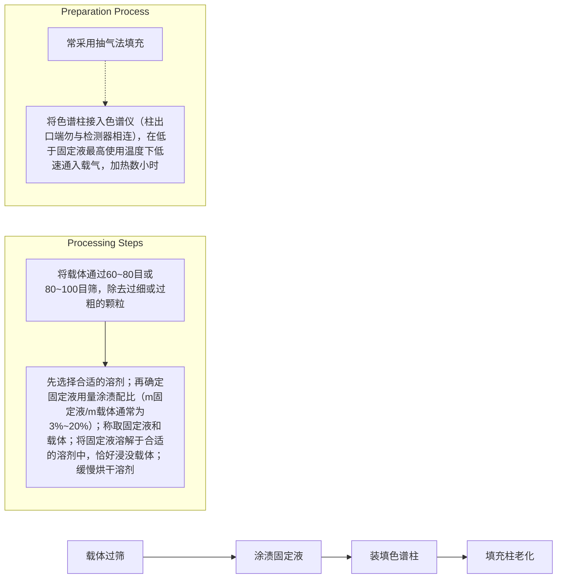
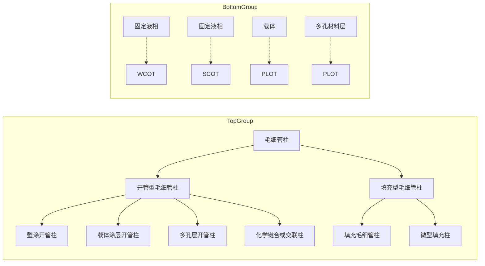

flowchart

This image displays a hierarchical classification diagram (tree structure) for chemical analysis, categorizing substances into Liquid and Solid components with their respective sub-types.

图 8.1.1 色谱分析法分类

气-液色谱的固定相为附着在惰性固体载体表面上的一薄层液体有机物。同样，液相色谱也可分为液-固色谱（liquid-solid chromatography, LSC）和液-液色谱（liquid-liquid chromatography, LLC）。此外，20世纪80年代发展起来的超临界流体色谱法（supercritical fluid chromatography, SFC）利用高于临界压力和临界温度的物质作为流动相，兼有气相色谱和液相色谱的特点。

## 2. 按色谱分离机理分类

在色谱法中，通常利用物质的吸附性能、溶解度差异等物理化学性质进行分离。利用组分在固体吸附剂上吸附能力强弱进行分离的方法称为吸附色谱。利用组分在固定液中溶解度的差异而进行分离的方法称为分配色谱。利用组分（离子型化合物）在离子交换树脂（固定相）上的亲和力的大小不同达到分离的方法称为离子交换色谱。这种色谱分析法广泛应用于无机离子、生物化学中各种核酸衍生物、氨基酸等的分离。利用组分的分子大小不同在多孔固定相中有选择渗透而达到分离的方法称为凝胶色谱或尺寸（空间）排阻色谱，这种色谱分析法主要用于聚合物、生物大分子等的分离。利用固定在载体上的固化分子对组分的专属性亲和力的不同进行分离的方法称为亲和色谱，其常用于分离蛋白质。

## 3. 按固定相的形态分类

色谱分离在柱中进行的称为柱色谱。根据柱管的大小、结构和制备方法不同，又分为填充柱、整体柱、毛细管或开管柱。固定相呈平面状称为平面色谱，它包括固定相以均匀薄层涂覆在玻璃、金属或塑料板上的薄层色谱和以滤纸作为固定相或固定相载体的纸色谱。

## 4. 按色谱动力学过程分类

（1）迎头法。以样品混合物为流动相，与固定相作用力弱的组分最先以纯物质状态流出。其后，吸附或溶解力较强的第二个组分和第一个组分的混合物流出色谱柱，其余类推。
（2）置换法。用与固定相作用力较分离组分强的物质流体作流动相，依次将组分从固定相上置换出来，与固定相作用力弱的组分先被置换洗出。
（3）淋洗法。以与固定相作用力比分离组分弱的流体为流动相，各组分按与固定相作用力、吸附力或溶解力等，从弱到强先后洗出，形成连续、区域宽度逐步展宽的高斯曲线色谱峰。淋洗法是使用最广泛的色谱分析方法。

## 8.1.1.3 色谱分析法的特点

与其他分析方法相比。色谱法具有以下显著的特点:①选择性高。利用高选择性的固定相，可实现物理、化学性质相近的组分分离，如同位素、空间异构体、

## 思考:

色谱与精馏、萃取等分离方法相比较有哪些优缺点？与光谱、质谱相比较有哪些优缺点？

同分异构体、旋光异构体等。②分离效率高，分析速度快。可在较短时间内分离复杂的多组分混合物。③灵敏度高、样品用量少。使用高灵敏度检测器，可以完成痕量样品的检测。④应用范围广。气相色谱法适用于无机气体和易挥发有机物分离分析。液相色谱适用于高沸点物质、高分子或大分子化合物、生物样品分离分析。离子色谱适用于无机离子、有机酸碱的分离分析。色谱法在石油工业、环境保护、临床化学、药物与药剂、农药、食品、卫生防疫理化检验、司法检验等领域得到广泛应用。⑤色谱的不足之处是对被分离组分的定性较为困难，但目前色谱与质谱等技术的联用已很好地解决了这一问题。

## 8.1.2 色谱参数

## 8.1.2.1 色谱分离过程和流出曲线

## 1. 色谱分离过程

以气相色谱为例描述色谱分离过程:① 当样品由载气携带进入色谱柱与固定相接触时，被固定相溶解或吸附；② 随着载气的不断通入，被溶解或吸附的组分又从固定相中挥发或脱附；③ 挥发或脱附下的组分随着载气向前移动时又再次被固定相溶解或吸附；④ 随着载气的流动，溶解、挥发，或吸附、脱附的过程反复地进行。由于各组分与固定相作用力大小的不同，各组分以不同的速度沿柱子向前移动。在移动过程中，样品各组分在流动相中的浓度和在固定相中的浓度是处于动态平衡状态。一定的温度和压力下，组分在流动相和固定相之间达到平衡时的浓度之比称为分配系数，用 K 表示，

$$
K = \frac {c _ {\mathrm{s}}}{c _ {\mathrm{m}}} \tag {8-1-1}
$$

式中， $c_{s}$  为组分在固定相中的浓度； $c_{m}$  为组分在流动相中的浓度。组分的分配系数 K 越大，在柱上移动速度越慢。当组分一定时，K 主要取决于固定相性质。不同组分在各种固定相上的分配系数 K 不同，因而选择适宜的固定相，增加组分间分配系数的差别，可显著改善分离效果。样品中的各组分具有不同的 K 值是分离的前提，对于某一固定相，如果两组分具有相同的分配系数，则无论如何改善分离条件都无法实现分离。某组分的 K=0 时，即不被固定相保留，最先流出。

## 2. 色谱流出曲线

由检测器测定流出柱体的流动相中各组分浓度，以检测器的信号强度对时间作图，获得色谱流出曲线，即色谱图。一般地说，色谱流出曲线的形状与该组分等温分配曲线的形状有关。等温分配曲线是描述在等温条件下分配系数随组分浓度变化的规律。典型的等温曲线有三种:直线型、凸线型和凹线型，见图8.1.2（a），相应的色谱流出曲线也有三种，如图8.1.2(b)所示。在线性等温曲线（直线型）的色谱体系之下，目标物质的分配系数与浓度无关，其流出曲线呈现完全对称的正常色谱峰，称为线性色谱。非对称的流出曲线称为不正常色谱峰（非线性色谱）。如果目标物质的分配系数随着样品浓度的增加而减小（凸线型），物质更加容易存在于流动相中，导致流出曲线前沿陡峭、后沿拖尾，形成拖尾峰。如果目标物质的分配系数随着样品浓度的增加而增加（凹线型），物质更加容易存在于固定相中，导致流出曲线前沿平伸、后沿陡峭，形成前伸峰。

## 8.1.2.2 色谱基本参数与流出曲线表征

下面以典型的线性色谱为例说明色谱图相关的术语。图8.1.3是两组分混合物的典型色谱图，其中一个组分是不与固定相作用，在柱内无保留值的物质。

气相色谱分离过程的动画

## 思考:

等温分配曲线如何影响色谱峰的形状？

直线型

凸线型

凹线型

(a)

正常峰

拖尾峰

前伸峰

(b)

图 8.1.2 三种等温吸附曲线和对应的色谱峰形状

line

| 参数 | 值 |
| --- | --- |
| 0.607h | — |
| \(W_{1}/_{2}\) | — |
| h/2 | — |
| \(W_b\) | — |
| t_R | — |
| t_M | — |
| t_R' = t_R - t_M | — |

图 8.1.3 色谱流出曲线及参数

（1）基线 当没有组分进入检测器时，色谱流出曲线是一条只反映仪器噪声随时间变化的曲线，称为基线。
(2) 色谱峰 有组分流出色谱柱进入检测器时产生的响应信号的曲线。
（3）峰面积 组分的流出曲线与基线所包围的面积(即峰与峰底之间的面积)，称为该组分的峰面积。常用符号 A 表示。
（4）峰底 色谱峰下面的基线延长线(即从峰的起点与终点之间连接的直线)，称为峰底。
(5) 峰高 色谱峰最高点至峰底的垂直距离,称为峰高。常用符号 h 表示。
(6) 区域宽度 用来衡量色谱峰宽度的参数,有三种表示方法:① 峰宽。沿色谱峰两侧拐点处所作的切线与峰底相交两点之间的距离,常用符号 $W_{b}$ 表示。② 半高峰宽。也称为半峰宽,即在峰高为 0.5 h 处的峰宽,常用符号 $W_{1/2}$ 或 $Y_{1/2}$ 表示。③ 标准偏差。在峰高 0.607 h 处峰宽的一半,常用符号 $\sigma$ 表示, $W_{b} = 4\sigma$ 。
（7）保留值 保留值是表示被测组分在柱中停留时间的数值,常用以下各值表示:
① 保留时间。组分从进样到出现峰最大值所需的时间,称为该组分的保留

时间,常用符号 $t_{R}$ 表示。

② 死时间。不被固定相滞留的物质(如空气等)的保留时间称为死时间,常用符号  $t_{M}$  表示。
③ 调整保留时间。组分保留时间减去死时间后的值称为该组分的调整保留时间，常用符号  $t_{R}^{\prime}$  表示。
④ 保留体积。组分从进样到出现峰最大值所需的载气或流动相体积,称为该组分的保留体积,常用符号  $V_{R}$  表示。
⑤ 死体积。不被固定相滞留的物质的保留体积称为死体积，常用符号  $V_{M}$  表示。
⑥ 调整保留体积。组分保留体积减去死体积后的值称为该组分的调整保留体积，常用符号  $V_{R}^{\prime}$  表示。
⑦ 相对保留值。在相同操作条件下,组分 2 与参比组分 1 的调整保留值之比:

$$
r _ {2 1} = \frac {t _ {\mathrm{R(2)}} ^ {\prime}}{t _ {\mathrm{R(1)}} ^ {\prime}} = \frac {V _ {\mathrm{R(2)}} ^ {\prime}}{V _ {\mathrm{R(1)}} ^ {\prime}} \tag {8-1-2}
$$

气相色谱中，相对保留值 $r_{21}$ 只与柱温和固定相性质有关，与其他色谱操作条件无关。它表示了固定相对这两种组分的选择性。相对保留值也称为分离因子 $(\alpha)$ 或选择性因子，它仅考虑了色谱分离过程中热力学因素的影响，没有考虑动力学因素的影响，故不能反映两物质的实际分离情况。

## 8.1.2.3 色谱基本关系式

色谱分析中其他相关的重要参数及关系式如下。

## 1. 分配比

在实际工作中,除分配系数外也常用分配比,也称容量因子 k,来表征组分在两相间分配平衡过程。分配比是指一定温度下,组分在固定相和流动相中的质量比:

$$
k = \frac {m _ {\mathrm{s}}}{m _ {\mathrm{m}}} \tag {8-1-3}
$$

$m_{s}$  和  $m_{m}$  分别为组分在固定相和流动相中的质量。分配比也是衡量色谱分离柱对组分保留能力的参数，其数值越大，组分的保留时间越长。分配比与分配系数的不同在于分配比不仅与组分和两相性质有关，还与两相体积有关。分配系数无法直接由实验获得，但分配比可以由实验测得组分的保留值后计算获得。

## 2. 分配比 $k$ 与分配系数 $K$ 的关系

二者的关系可用下式来表示:

$$
k = \frac {m _ {\mathrm{s}}}{m _ {\mathrm{m}}} = \frac {\frac {m _ {\mathrm{s}}}{V _ {\mathrm{s}}} V _ {\mathrm{s}}}{\frac {m _ {\mathrm{s}}}{V _ {\mathrm{m}}} V _ {\mathrm{m}}} = \frac {c _ {\mathrm{s}}}{c _ {\mathrm{m}}} \cdot \frac {V _ {\mathrm{s}}}{V _ {\mathrm{m}}} = \frac {K}{\beta} \tag {8-1-4}
$$

式中  $\beta$  为相比, 即流动相与固定相体积比。

$$
\beta = \frac {V _ {\mathrm{m}}}{V _ {\mathrm{s}}}
$$

## 3. 分配比与保留时间的关系

为了利用色谱参数求得分配比,需要建立分配比与保留时间的关系式。由滞留因子 $R_{s}$ 与流动相的流速u和组分在柱内的线速度 $u_{s}$ 可推导出分配比k与保留

组分在柱内移动的快慢可用相对于流动相在柱内移动线性速度来表示,即

$$
R _ {\mathrm{s}} = \frac {u _ {\mathrm{s}}}{u}
$$

式中，u 为流动相线速度， $u_{s}$  为组分在柱内的线速度， $R_{s}$  称为保留比。由  $u = \frac{L}{t_{M}}; u_{s} = \frac{L}{t_{R}}$  (L 为柱长) 可得

$$
R _ {\mathrm{s}} = \frac {t _ {\mathrm{M}}}{t _ {\mathrm{R}}}
$$

保留比  $R_{s}$  亦称为滞留因子, 保留比的大小反映出该组分在流动相的分配比例数。例如, 不被固定相滞留组分的  $R_{s}$  值为 1, 即该组分 100% 分配在流动相中, 用组分在流动相的分配比例数表示, 保留比可表示为

$$
R _ {\mathrm{s}} = \frac {m _ {\mathrm{m}}}{m _ {\mathrm{s}} + m _ {\mathrm{m}}} = \frac {1}{1 + k}
$$

由此可推出式(8-1-5)。

时间的关系式:

$$
k = \frac {t _ {\mathrm{R}} - t _ {\mathrm{M}}}{t _ {\mathrm{M}}} = \frac {t _ {\mathrm{R}} ^ {\prime}}{t _ {\mathrm{M}}} \tag {8-1-5}
$$

从式中可以看出容量因子越大,保留时间越长。

## 4. 分配系数与分离温度的关系

分配系数是物质的一种热力学参数,因此温度变化必然要影响到溶质在两相中的分配。对于一定的溶质、流动相和固定相,溶质的分配系数与分离温度间存在以下关系:

$$
\lg K = \frac {a}{T _ {\mathrm{c}}} + b \tag {8-1-6}
$$

式中，a, b 为常数； $T_{c}$  为分离时的热力学温度。

由上式可见,分离温度越高,分配系数越小,即溶质在流动相中的浓度越大,在色谱柱中的保留时间越短,流出色谱柱也越快。

## 8.1.3 色谱理论

色谱分析研究的是混合物的分离分析问题,因此,色谱理论一方面需要解决的问题是如何评价色谱的分离效果,即建立分离及柱效的评价指标体系及柱效与色谱参数间的关系等;另一方面则是讨论影响分离及柱效的因素,在理论的指导下寻找提高柱效的途径。色谱分离过程涉及热力学和动力学两个方面,组分保留时间受色谱分离过程中的热力学因素控制(温度及流动相和固定相的结构与性质),色谱峰变宽则受色谱分离过程中的动力学因素控制(组分在两相中的运动情况)。因此,色谱理论实际上主要研究的是这两方面的问题。色谱分析中的基本理论有塔板理论和速率理论。塔板理论是一种半经验理论,从热力学的观点解释了色谱流出曲线,给出了柱效的评价指标。速率理论从动力学的角度出发,讨论了影响分离的因素及提高柱效的途径。

## 8.1.3.1 塔板理论

色谱与精馏分离有共同的物理化学基础，即被分离组分在两相中分布常数的差别构成组分分离的基础。在平衡色谱理论的基础上，Martin 和 Synge 将色谱柱内混合物分离过程与精馏塔的精馏分离类比，将色谱柱假设分成许多类似精馏塔塔板的区域。把连续的色谱分离过程看成这许多塔板中分配平衡过程的重复，于是就产生了著名的塔板理论。

## 1. 塔板理论的假设

塔板理论把色谱柱比拟为一个蒸馏塔，每个塔板的高度为 $H$ ，称为理论塔板高度。当物质进入柱内就在两相间进行分配，并假设:① 色谱柱由一系列内径一致、填充均匀，被称为塔板的若干小段组成，其高度均相等，以 $H$ 表示，称为塔板高度。② 溶质在每个塔板上的分布常数或分配系数不变，在两相间瞬间达成分布或分配平衡，纵向分子扩散可以忽略，即属于线性理想色谱。③ 流动相流经色谱柱不是连续的，而是脉冲式的间歇过程，每次进入和从上一个塔板向下一个塔板转移的流动相体积相等，为一个塔板的流动相体积 $\Delta V_{\mathrm{m}}$ 。

## 2. 色谱流出曲线方程

根据塔板理论的假设,组分在任一塔板上的分数可由二项式展开计算,对于塔板数较少的分离过程,色谱流出曲线是一个离散型的二项分布。当塔板数足够大,流动相传质的塔板体积数足够多时,曲线趋向于对称的连续分布,并可作近似于正态分布处理。这样，流出曲线上的组分浓度与流动相体积关系可由色谱流出曲线方程表达:

$$
c = \frac {\sqrt {n} m}{\sqrt {2 \pi} V _ {\mathrm{R}}} \times \exp \left[ - \frac {n}{2} \times \left(\frac {V _ {\mathrm{R}} - V}{V _ {\mathrm{R}}}\right) ^ {2} \right] \tag {8-1-7}
$$

式中，m 为组分的进样质量；n 为塔板数；V 为柱后流出的组分浓度为 c 时，通过柱的流动相体积。上式也称为塔板理论方程。

## 3. 塔板公式

从塔板理论方程出发,可以推导出理论塔板计算公式,即理论塔板数与色谱参数之间的关系:

$$
n = 5. 5 4 \left(\frac {t _ {\mathrm{R}}}{W _ {1 / 2}}\right) ^ {2} = 1 6 \left(\frac {t _ {\mathrm{R}}}{W _ {\mathrm{b}}}\right) ^ {2} \tag {8-1-8}
$$

假设色谱柱长为 L，则塔板的高度可按下式计算:

$$
H = \frac {L}{n} \tag {8-1-9}
$$

由于保留时间 $t_{\mathrm{R}}$ 中包括了死时间 $t_{\mathrm{M}}$ ，组分在 $t_{\mathrm{M}}$ 时间内不参与柱内分配。为了扣除死时间的影响，引入以调整保留时间 $t_{\mathrm{R}}^{\prime}$ 计算的有效塔板数 $n_{\mathrm{eff}}$ 和有效塔板高度 $H_{\mathrm{eff}}$ 作为柱效指标:

$$
n _ {\mathrm{eff}} = 5. 5 4 \left(\frac {t _ {\mathrm{R}} ^ {\prime}}{W _ {1 / 2}}\right) ^ {2} = 1 6 \left(\frac {t _ {\mathrm{R}} ^ {\prime}}{W _ {\mathrm{b}}}\right) ^ {2} \tag {8-1-10}
$$

$$
H _ {\mathrm{eff}} = \frac {L}{n _ {\mathrm{eff}}} \tag {8-1-11}
$$

## 4. 塔板理论的特点和不足

（1）当色谱柱长度一定时，塔板数 n 越大（塔板高度 H 越小），被测组分在柱内被分配的次数越多，柱效能越高，所得色谱峰越窄。
（2）不同物质在同一色谱柱上的分配系数及理论塔板数不同，用塔板数和塔板高度作为衡量柱效能的指标时，应指明测定物质。
（3）柱效并不能表示被分离组分的实际分离效果，当两组分的分配系数 K 相同时，无论该色谱柱的塔板数多大，都无法分离。
（4）塔板理论无法解释同一色谱柱在不同的载气流速下柱效不同的实验结果，也无法指出影响柱效的因素及提高柱效的途径。

## 8.1.3.2 速率理论

塔板理论是从热力学角度处理色谱过程，而在色谱分离过程中热力学平衡不是瞬时的，其全过程是一个动力学过程。1956年，van Deemter等以气相色谱为对象提出速率理论，速率理论是将塔板理论中的塔板高度概念与组分在两相中的扩散和传质联系起来，认为色谱柱效受涡流扩散、分子扩散、两相间传质阻力等影响，它们是谱带展宽的主要因素。根据三个扩散过程对塔板高度 $H$ 的影响，导出速率方程即van Deemter方程:

$$
H = A + \frac {B}{u} + C \cdot u \tag {8-1-12}
$$

式中， $A$ 为涡流扩散项； $B / u$ 为分子扩散项； $C\cdot u$ 为传质阻力项； $u$ 为流动相线速度。由上式可见，减小 $A,B,C$ 可提高柱效，但这三项各与哪些因素有关是需要进一步讨论的。

色谱流出曲线表达式的推导过程

除了速率理论中表现的影响柱效因素,还有哪些影响谱带展宽的其他因素?

1. 等温分配曲线的非线性。由于等温线的非线性决定了分配系数不是常数，而是浓度的函数，使谱带的高浓度区域（中心附近）和低浓度区域（前沿和尾部）的分子的移动速率不等，造成色谱峰“拖尾”或“前伸”现象，从而使峰展宽。
2. 活性中心的影响。由于固相载体表面存在的活性中心对极性强的组分会产生吸附，使这些组分释放的速度慢于其他分子而造成拖尾。
3. 柱外效应。在色谱柱以外的某些因素，使谱带展宽，降低柱的实际分离效率的现象称为柱外效应。造成柱外效应的因素有两类:柱前后死体积和与进样有关的技术。

涡流扩散项的动画

分子扩散项的动画

由速率方程式中塔板高度对流速的一阶导数等于零可求得最佳流速 $(u_{\mathrm{opt}})$ 和最小塔板高度 $(H_{\min})$

$$
\frac {\mathrm{d} H}{\mathrm{d} u} = - \frac {B}{u ^ {2}} + C = 0
$$

$$
u _ {\mathrm{opt}} = \sqrt {\frac {B}{C}}
$$

$$
H _ {\min} = A + 2 \sqrt {B C}
$$

传质阻力项的动画

## 1. A—涡流扩散项

流动相由于受到固定相的阻碍,不断改变运动的方向和路径,发生类似“涡流”,使同一组分出柱的时间有差异,从而引起峰扩展,涡流扩散项亦称多路径项。峰扩展程度用下式表示:

$$
A = 2 \lambda d _ {\mathrm{p}} \tag {8-1-13}
$$

式中， $d_{p}$  为固定相的平均颗粒直径； $\lambda$  为固定相的填充不均匀因子。

涡流扩散项的大小与固定相的平均颗粒直径 $(d_{\mathrm{p}})$ 和填充是否均匀有关，而与流动相的流速无关。固定相颗粒越小，填充得越均匀，A项的值越小，柱效越高，表现在涡流扩散所引起的色谱峰变宽现象减轻，色谱峰较窄。涡流扩散项与组分、流动相性质和线速度无关，开管柱无此项，A=0。

## 2. B/u—分子扩散项

分子扩散项是由组分在流动中的浓差扩散所引起的。当样品以很窄的“塞子”形式进入色谱柱，并随流动相移动时，由于浓度梯度的影响，样品中的组分分子以样品带为中心向两边纵向扩散，从而导致色谱峰变宽，柱效下降。分子扩散与组分通过路径的弯曲程度和扩散系数有关，用下式表示:

$$
B = 2 \nu D _ {\mathrm{g}} \tag {8-1-14}
$$

式中， $\nu$  为因颗粒大小不规则引起流动相扩散路径弯曲的因子，简称弯曲因子；填充柱色谱， $\nu<1;D_{g}$  为样品组分分子在气相中的扩散系数 $\left(\mathrm{cm}^{2}\cdot\mathrm{s}^{-1}\right)$ 。分子扩散项与流速有关，流速越小，组分在色谱柱内滞留时间越长，扩散越严重。

组分分子在气相中的扩散系数要比在液相中的大 $10^{5} \sim 10^{6}$ 倍，故气相色谱中的分子扩散要比液相色谱中的严重。在气相色谱中，采用摩尔质量较大的载气，可使 $D_{\mathrm{g}}$ 值减小，两者之间存在如下关系:

$$
D _ {\mathrm{g}} \propto (M _ {\mathrm{载气}}) ^ {- 1 / 2} \tag {8-1-15}
$$

## 3. $C \cdot u$ —传质阻力项

色谱分离过程中，溶质在流动相和固定相之间进行质量传递。色谱过程处于连续流动状态，由于溶质分子与固定相、流动相分子间存在相互作用，有限传质速率导致溶质分子不可能在两相中瞬间建立吸附（或溶解）-解吸（或挥发）的分配平衡，而总是处于非平衡状态。有些溶质分子未能进入固定相就随流动相前进，发生分子超前；而有些溶质分子在固定相未能分布平衡并解吸进入流动相，发生分子滞后；从而造成谱带展宽。流动相流速越快，提供给平衡的时间越少，不平衡和离散越严重。因而传质对塔板高度影响与流动相流速成正比。

传质阻力包括气相传质阻力  $C_{g}$  和液相传质阻力  $C_{L}$ ，即

$$
C = C _ {\mathrm{g}} + C _ {\mathrm{L}} \tag {8-1-16}
$$

液相传质阻力大于气相传质阻力。气相传质阻力  $C_{g}$  是容量因子的一个复杂函数，正比于填料粒径  $d_{p}$  的平方，反比于溶质在气相中的扩散系数  $D_{g}$ 。

$$
C _ {\mathrm{g}} = 0. 0 1 \frac {k ^ {2}}{(1 + k) ^ {2}} \cdot \frac {d _ {\mathrm{p}} ^ {2}}{D _ {\mathrm{g}}} \tag {8-1-17}
$$

液相传质阻力  $C_{L}$  亦是容量因子的一个复杂函数，与载体上的固定液膜厚度  $d_{f}$  的平方成正比，与溶质在固定液中的扩散速度  $D_{1}$  成反比。

$$
C _ {\mathrm{L}} = \frac {2 k}{3 (1 + k) ^ {2}} \cdot \frac {d _ {\mathrm{f}} ^ {2}}{D _ {\mathrm{l}}} \tag {8-1-18}
$$

除了式子中的参数, $C_{L}$ 还与固定液的性质、组分的性质、柱温和载气流速

有关。

van Deemter 方程对选择最佳分离条件具有普遍的意义,表明了色谱柱填充的均匀程度、固定相颗粒大小、流动相的种类和线速度、固定相液膜的厚度及柱温等对柱效的影响。

速率方程式中，A项与流动相流速无关，B、C两项对理论塔板高度的贡献随流动相流速的改变而不同。流动相流速较高时，传质阻力项是影响柱效的主要因素。流速增加，传质不能快速达到平衡，柱效下降。载气流速低时样品由高浓度区向两侧纵向扩散加剧，分子扩散项成为影响柱效的主要因素，流速增加，柱效增加。由于流速对B、C两项的作用完全相反，流速对柱效的总影响使得存在一个最佳流速值，即速率方程中理论塔板高度对流速的一阶导数有一极小值。以理论塔板高度H对应流动相线速度作图得到图8.1.4，曲线最低点的流速即为最佳流速。

line

| Point | Description |
| --- | --- |
| H | Minimum value of H |
| u | Ultimate capacity at u=最佳 |
| Cu | Capacity at u=最佳 |
| A | Point on the curve below the minimum |
| B/u | Point above the dashed line at u=u |
| u | Point at u=u |

图 8.1.4 色谱柱效与载气流速关系

由以上的讨论,可以归纳出速率理论的要点:

（1）组分分子在柱内运行的多路径与涡流扩散、浓度梯度造成的分子扩散及传质阻力使气液两相间分配平衡不能瞬间达到等因素是造成色谱峰扩展、柱效下降的主要原因。
（2）通过选择适当的固定相粒度、载气种类、液膜厚度及载气流速可提高柱效。
（3）为色谱分离和操作条件选择提供了理论指导，阐明了流速对柱效及分离的影响。
（4）各种因素相互制约，如载气流速增大，分子扩散项的影响减小，使柱效提高，但同时传质阻力项的影响增大，又使柱效下降；柱温升高，有利于传质，但又加剧了分子扩散的影响，选择最佳条件，才能使柱效达到最高。

van Deemter 方程是以填充柱气相色谱为对象提出的,对于高效液相色谱和毛细管开管柱色谱,由于流动相性质和柱结构的不同,其速率方程具有不同的表达式,具体内容将放到后面的章节讨论。

## 8.1.3.3 分离度

塔板理论和速率理论都难以描述分离物质对的实际分离程度,难分离物质对的分离程度大小受色谱分离过程中两个因素的综合影响:色谱柱的选择性(分配系数、保留值之差)——色谱分离过程中的热力学因素;柱效(色谱峰区域宽度)——色谱分离过程中的动力学因素。图8.1.5说明柱效和选择性对分离度的影响。①柱效较高, $\Delta K$ （分配系数差）较大,完全分离;② $\Delta K$ 不是很大,柱效较高(峰较窄),基本上完全分离;③柱效较低, $\Delta K$ 较大,但分离得不好;④ $\Delta K$ 小,

»例 8.1.1 在一定条件下,两个组分的保留时间分别为 12.2 s 和 12.8 s,计算分离度(柱长 1 m, n=3600)。要达到完全分离,即 R=1.5,求所需要的柱长。

$\gg$ 解: $W_{\mathrm{bl}} = 4\frac{t_{\mathrm{Rl}}}{\sqrt{n}} = \frac{4\times 12.2}{\sqrt{3600}}$

$$
= 0. 8 1 3 3
$$

$$
W _ {\mathrm{h2}} = 4 \frac {t _ {\mathrm{R2}}}{\sqrt {n}} = \frac {4 \times 1 2 . 8}{\sqrt {3 6 0 0}} = 0. 8 5 3 3
$$

$$
R = \frac {2 \times (1 2 . 8 - 1 2 . 2)}{0 . 8 5 3 3 + 0 . 8 1 3 3} = 0. 7 2
$$

$$
L _ {2} = \left(\frac {R _ {2}}{R _ {1}}\right) ^ {2} \times L _ {1} = \left(\frac {1 . 5}{0 . 7 2}\right) ^ {2} \times 1 \mathrm{m} = 4. 3 4 \mathrm{m}
$$

柱效低,分离效果更差。

图 8.1.5 色谱分离中的四种情况

考虑色谱分离过程中的热力学和动力学因素,引入分离度(R)来定量描述样品中相邻两组分的实际分离程度。分离度的表达式:

$$
R = \frac {2 (t _ {\mathrm{R2}} - t _ {\mathrm{R1}})}{W _ {\mathrm{h2}} + W _ {\mathrm{h1}}} \tag {8-1-19}
$$

若相邻两峰峰底宽近似相等,则

$$
R = \frac {t _ {\mathrm{R2}} - t _ {\mathrm{R1}}}{W} = \frac {t _ {\mathrm{R2}} ^ {\prime} - t _ {\mathrm{R1}} ^ {\prime}}{W} \tag {8-1-20}
$$

## 思考:

根据分离度方程,如何优化色谱操作条件来提高分离度?

当 R=0.8，两峰的分离程度可达 89%；R=1.0，分离程度 98%；R=1.5，分离程度达 99.7%（相邻两峰完全分离的标准）。引入相对保留值  $r_{21}$ （或分离因子  $\alpha$ ），可导出有效塔板数 ( $n_{eff}$ ) 和分离度 (R) 的关系:

$$
R = \frac {r _ {2 1} - 1}{r _ {2 1}} \sqrt {\frac {n _ {\mathrm{eff}}}{1 6}} \tag {8-1-21}
$$

$$
n _ {\mathrm{eff}} = 1 6 R ^ {2} \left(\frac {r _ {2 1}}{r _ {2 1} - 1}\right) ^ {2} \tag {8-1-22}
$$

分离过程中需要考虑的其他因素有分离速度、色谱柱容量等。

上式可近似估计达到分离两组分的有效塔板数,进而计算分离两组分所需的柱长:

$$
L = 1 6 R ^ {2} \left(\frac {r _ {2 1}}{r _ {2 1} - 1}\right) ^ {2} \cdot H _ {\mathrm{eff}} \tag {8-1-23}
$$

将理论塔板数 n、分离因子  $\alpha$ 、分配比 k 引入分离度的定义式, 可得到分离方程:

$$
R = \frac {\sqrt {n}}{4} \cdot \frac {\alpha - 1}{\alpha} \cdot \frac {k _ {2}}{1 + k _ {2}} \tag {8-1-24}
$$

式中，下标2为相邻两组分中的第二组分，该方程可看出分离度受三个因素影响:柱效 $n$ ，分离因子 $\alpha$ ，容量因子 $k$ 。由分离方程可推出以下结论:①分离度与理论塔板数的平方根成正比。②分离因子 $\alpha$ 越大，柱子的选择性越好，分离效果越好。当 $\alpha$ 趋近1时，增加 $\alpha$ 对提高分离度显著。但当 $\alpha$ 趋近1.5后，$\alpha$ 的改进对分离度的影响较小。③分配比 $k$ 值较大，对 $R$ 有利。当 $k$ 值超过10时，对分离度的改进不明显，而保留时间却大大延长。

## 8.1.4 色谱定性与定量分析方法

色谱分析的目的是获得样品的组成和各组分含量等信息,但在所获得的色谱图中,并不能直接给出每个色谱峰代表何种组分及其准确含量。因此需要一定的分析方法来实现色谱定性和定量分析。

## 8.1.4.1 色谱定性鉴定方法

色谱法不能提供组分分子的结构信息,色谱法定性属于间接法,常用的有以下几种方法:

## 1. 利用标准物质定性

（1）利用保留值定性:通过对比样品中具有与标准样相同保留值的色谱峰，来确定样品中是否含有该物质。
（2）利用加入法定性:将标准样加入样品中，观察各组分色谱峰的相对变化，确定与标准样相同的组分。对于分离不完全的组分，需要在两支不同的色谱柱上进行对比。

## 2. 利用文献保留值定性

气相色谱中，相对保留值 $r_{21}$ 仅与柱温和固定液性质有关。在色谱手册中都列有各种物质在不同固定液上的保留数据，可以用来进行定性鉴定。此外，还可以利用保留指数定性。保留指数又称Kovats指数 $(I)$，是一种重现性较好的定性参数。其测定方法为:将正构烷烃作为标准，规定其保留指数为分子中碳原子个数乘以100（如正己烷的保留指数为600）。其他物质的保留指数 $(I_x)$ 是通过选定两个相邻的正构烷烃，其分别具有 $Z$ 和 $Z + 1$ 个碳原子。被测物质 $x$ 的调整保留时间应在相邻两个正构烷烃的调整保留值之间。则 $x$ 的保留指数为

$$
t _ {\mathrm{R} (Z + 1)} ^ {\prime} > t _ {\mathrm{R} (x)} ^ {\prime} > t _ {\mathrm{R} (Z)} ^ {\prime}
$$

$$
I _ {x} = 1 0 0 \left(\frac {\lg t _ {\mathrm{R(x)}} ^ {\prime} - \lg t _ {\mathrm{R(Z)}} ^ {\prime}}{\lg t _ {\mathrm{R(Z+1)}} ^ {\prime} - \lg t _ {\mathrm{R(Z)}} ^ {\prime}} + Z\right) \tag {8-1-25}
$$

将测得的 $I_{x}$ 值与文献值对照,即可做出判断。

## 3. 利用色谱与其他仪器联用定性

目前,利用色谱对混合物的高分离能力和其他结构鉴定仪器相结合发展起来的联用技术,使得色谱分析的定性问题得到很好的解决,成为当今最有效的复杂混合物成分分离、鉴定技术。相关技术将在后面的章节介绍。

## 8.1.4.2 色谱定量分析方法

利用色谱法可以确定混合样中各组分的含量。在一定的色谱分离条件下，色谱检测器的响应信号值（即色谱峰面积）与进入检测器的物质质量（或浓度）成正比，这是色谱定量分析的基础。

## 1. 峰面积的测量

常用的峰面积测量方法有峰高乘半峰宽法、峰高乘峰宽法、峰高乘保留时间法、峰高乘平均峰宽法。目前由于色谱仪与计算机相结合的色谱工作站的广泛使用，实现了自动采集数据和峰面积测量，其准确度高于手工测量。

## 2. 定量校正因子

在定量分析中，质量相同的不同物质在同一检测器上的色谱响应值不同，同一物质在不同检测器上的色谱响应值也不相同。因此，不能用峰面积等响应值来直接计算物质的含量。需要用标准物质对峰面积进行校正，用校正后峰面积计算物质的含量。样品中各组分质量与其色谱峰面积成正比，即

$$
m _ {\mathrm{i}} = f _ {\mathrm{i}} A _ {\mathrm{i}} \tag {8-1-26}
$$

比例系数 $f_{i}$ 称为绝对校正因子。

由于绝对校正因子受进样量和色谱条件影响大,难以测准和直接应用,常采用相对校正因子 $f_{i}^{\prime}$ ,即组分的绝对校正因子与标准物质的绝对校正因子之比:

## 思考:

根据色谱保留值,是否可以对未知结构的新化合物进行定性鉴定?

## 思考:

对比各种定量分析方法的优缺点,掌握如何根据需要选择合适的定量分析方法。

$$
f _ {\mathrm{i}} ^ {\prime} = \frac {f _ {\mathrm{i}}}{f _ {\mathrm{s}}} = \frac {m _ {\mathrm{i}} / A _ {\mathrm{i}}}{m _ {\mathrm{s}} / A _ {\mathrm{s}}} = \frac {m _ {\mathrm{i}} A _ {\mathrm{s}}}{m _ {\mathrm{s}} A _ {\mathrm{i}}} \tag {8-1-27}
$$

式中， $m_{i}$  和  $m_{s}$  为待测物质和标准物质的量，当  $m_{i}$ 、 $m_{s}$  以 mol 为单位时，所得相对校正因子称为相对摩尔校正因子，用  $(f_{\mathrm{M}}^{\prime})$  表示；当  $m_{i}$ 、 $m_{s}$  用质量单位时，所得相对校正因子称为相对质量校正因子，以  $(f_{\mathrm{W}}^{\prime})$  表示。

## 3. 常用的几种定量方法

（1）归一化法 当样品中有 n 个组分，各组分的量分别为  $m_{1}, m_{2}, m_{3}, \cdots, m_{n}$ ，则

$$
w_{\mathrm{i}} = \frac{m_{\mathrm{i}}}{m_1 + m_2 + \cdots + m_n}\times 100\% = \frac{f_{\mathrm{i}}^{\prime}A_{\mathrm{i}}}{f_1^{\prime}A_1 + f_2^{\prime}A_2 + \cdots + f_n^{\prime}A_n}\times 100\% \tag{8 - 1 - 28}
$$

归一化法简便、准确；进样量的准确性和操作条件的变动对测定结果影响不大；但仅适用于样品中所有组分全出峰，并已知定量校正因子的情况。

（2）外标法 外标法也称为标准曲线法。即配制一系列标准溶液进行色谱分析，在严格一致的条件下，由所测得的峰面积对应浓度作图，得到标准曲线。外标法不使用校正因子，准确性较高；操作条件变化对结果准确性影响较大；对进样量的准确性控制要求较高，适用于大批量样品的快速分析。
（3）内标法 在样品中加入能与所有组分完全分离的已知质量的内标物质，用相应的校正因子校正待测组分的峰面积值并与内标物质的峰面积值进行比较，求出待测组分的含量的方法，称为内标法。内标法中使用的内标物要符合以下要求:样品中不含有该物质；内标物最好与组分性质接近；内标物不能与样品发生化学反应；内标峰与组分峰靠近但对组分峰无影响；内标物能准确称量。准确称取一定量的样品 $m$ ，加入一定量内标物 $m_{s}$ ，则

$$
\frac {m _ {\mathrm{i}}}{m _ {\mathrm{s}}} = \frac {f _ {\mathrm{i}} ^ {\prime} A _ {\mathrm{i}}}{f _ {\mathrm{s}} ^ {\prime} A _ {\mathrm{s}}} \tag {8-1-29}
$$

$$
m _ {\mathrm{i}} = m _ {\mathrm{s}} \frac {f _ {\mathrm{i}} ^ {\prime} A _ {\mathrm{i}}}{f _ {\mathrm{s}} ^ {\prime} A _ {\mathrm{s}}} \tag {8-1-30}
$$

$$
w _ {\mathrm{i}} = \frac {m _ {\mathrm{i}}}{m} \times 100\% = \frac {m _ {\mathrm{s}} \frac {f _ {\mathrm{i}} ^ {\prime} A _ {\mathrm{i}}}{f _ {\mathrm{s}} ^ {\prime} A _ {\mathrm{s}}}}{m} \times 100\% = \frac {m _ {\mathrm{s}}}{m} \times \frac {f _ {\mathrm{i}} ^ {\prime} A _ {\mathrm{i}}}{f _ {\mathrm{s}} ^ {\prime} A _ {\mathrm{s}}} \times 100\% \tag {8-1-31}
$$

内标法的准确性较高,操作条件和进样量的稍许变动对定量结果的影响不大,但操作烦琐,每个样品的分析,都要进行两次称量,不适合大批量样品的快速分析。

## 习题

## - 章节练习题 -

1. 色谱分离过程中的热力学因素和动力学因素分别由哪两个参数表现出来？两个色谱峰的保留时间相差较大，就一定分离完全了吗？
2. 试列出影响色谱谱带展宽的各种因素。
3. 色谱定量分析为什么要引入定量校正因子？常用定量校正因子有哪几种表示方式？如何测定？
4. 在其他色谱条件不变的情况下, 若色谱柱的理论塔板数增加一倍, 则两相

邻峰的分离度将增加多少倍？

## - 挑战性问题 -

5. 色谱的分离过程是十分复杂的,教材中只讲授了较简单的线性色谱理论,对于非线性色谱的非平衡热力学分离过程,应如何用理论来描述?

## - 专题或报告 -

6. 查阅文献,介绍最新的色谱分离技术和最前沿的应用领域,并将结果写成报告。

## 8.2 气相色谱法

以气体作为流动相的色谱分析法称为气相色谱法(GC)，是色谱中最重要的分支之一。本节主要介绍填充柱和毛细管柱气相色谱法的基本原理、仪器构造、色谱衍生化及分离分析条件的选择，拓展了解气相色谱法的应用与进展。

## 8.2.1 概述

GC 主要适用于分离沸点较低(一般<400 ℃)，易挥发且热稳定性好的组分。采用特殊技术，GC 也可以用于高分子聚合物的结构鉴定和不易挥发、热稳定性差的化合物的分离分析。此外，GC 与其他分析方法联用技术的飞速发展使其应用领域得到进一步的拓展。目前约有 20% 的有机物质可用 GC 进行分析。

## 8.2.1.1 分离原理

GC 主要利用物质的沸点、极性或吸附性质的差异来实现混合物的分离。混合物中各组分在流动相与固定相之间形成分配或吸附平衡。在载气的流动下，各组分在两相之间进行多次分配或吸附/解吸，即使分配系数只有微小差异的组分也能得到很好的分离。与固定相作用较弱的组分先流出色谱柱，而与固定相作用较强的组分后流出色谱柱，这样依次送入检测器测定，达到分离、分析各组分的目的。

## 8.2.1.2 特点

（1）高分离效能 能分离组分极为复杂的混合物，如用毛细管柱可将汽油样品中一百多种烃类化合物一次分离。
(2) 高选择性能分离结构极为相似的组分。
(3) 高灵敏度 可检出极微量的组分 $(10^{-14}\sim10^{-12}g)$ 。
（4）样品用量少 一般以 ng，甚至 pg 计，因此适用于大气、水、食品等样品中痕量污染物质的测定。
（5）分析速度快 一个样品通常可在几分钟或十几分钟完成测定，且操作和数据处理均可由计算机控制和进行。
（6）应用范围较广 具有一定的挥发性且在操作温度下稳定的气、固、液体样品均可测定。

缺点:对于难挥发和热不稳定性物质难以分析。

## 8.2.1.3 一般流程

气相色谱仪器型号较多，随着计算机的广泛使用，仪器的自动化程度也越来越高，但各类仪器的组成基本上相同，均由气路系统、温控系统、进样系统、分离系统（色谱柱）、检测系统和数据处理系统构成。其中色谱柱和检测器是气相色谱仪的两个关键部件。图8.2.1给出了气相色谱仪的基本结构流程。

气相色谱的流动相为气体,称为载气,通常由高压气体钢瓶供给。高压气体

卢佩章院士对我国气相色谱研究的贡献

## 红色担体

孔径较小，表孔密集，比表面积较大，机械强度好。缺点是表面存在有活性吸附中心点，适宜涂渍非极性固定液，分离非极性或弱极性组分的样品。

## 白色担体

原料在煅烧前加入了少量助溶剂(碳酸钠)，颗粒疏松，孔径较大，比表面积较小，机械强度较差，但吸附性显著减小，适宜分离极性组分的样品。

硅藻土型担体表面存在有硅羟基及其他杂质，为了改进担体孔隙结构、屏蔽活性中心，使用前通常需要对担体进行表面处理。采取的方法通常有酸洗和碱洗、硅烷化、釉化等。

## 酸洗、碱洗法

酸洗去除载体表面大部分 Al、Fe 等无机杂质，适用于分析酸性和酯类化合物的载体；碱洗主要去除  $Al_{2}O_{3}$  等酸性杂质，适用于分析碱性化合物。

## 硅烷化法

与硅烷化试剂(如二甲基二氯硅烷等)反应生成硅烷醚,去除载体表面硅醇基团。适用于分析易形成氢键的组分,如水、醇和胺等。

## 釉化法

在载体表面产生一层玻璃状的“釉”，起到屏蔽或惰化载体表面硅醇基团的影响。

经减压阀降压后，经过净化装置，由流量调节阀调节至所需压力，再由针形阀和流量计调节保持稳定流量的载气，携带气化后的样品进入分离柱，分离的组分进入检测器，信号经过放大器记录得到色谱图。

flowchart

图 8.2.1 气相色谱仪的结构示意图

## 8.2.1.4 分类

GC 按固定相状态分类或分离机理分类: 固定相在使用温度下有两种状态, 用固体作固定相称为气-固色谱法, 其机理通常是利用固体吸附剂对不同组分吸附性能的差异进行分离, 为吸附色谱; 用液体作固定相称为气-液色谱法, 其机理通常是利用不同组分在两相间分配系数的差异进行分离, 为分配色谱。

按色谱柱分类: 填充柱气相色谱法和毛细管柱气相色谱法。

## 8.2.2 填充柱气相色谱法

填充柱是指将固定相填充在柱管内制成的色谱柱。填充柱的固定相种类很多，按照操作条件下固定相的物理状态，可分为固体固定相和液体固定相两大类。

固体固定相主要包括固体吸附剂、高分子多孔微球等。

液体固定相多为高沸点的有机化合物，在操作条件下呈液态，称为固定液。固定液不能直接装在色谱柱内，而是将其涂渍在一种颗粒状的固体表面，这种固体颗粒称为载体（或担体），也是液体固定相的重要组成部分。

填充柱按柱管直径粗细又可分为常规填充柱和填充毛细管柱。常规填充柱使用内径为4\~6 mm的柱管，长2\~4 m。填充毛细管柱使用内径为0.1\~0.5 mm的柱管，长几十甚至上百米，将在8.2.3.1中进一步介绍。

填充柱制备简单,可供选择的固定相和载体种类很多,分析工作中选择合适的固定相是色谱分析的重要任务之一。

## 8.2.2.1 气-液填充柱

## 1. 载体

载体是使固定液能够稳定、均匀地附着在表面，以方便填装到空管柱中的惰性固体颗粒，又称担体。通常有足够大的比表面积和良好的空穴结构，渗透性好；呈化学惰性，不与任何样品和固定液发生化学反应；与固定液具有很好的吸附浸润性；颗粒大小均匀，具有一定的机械强度。

担体主要有硅藻土型和非硅藻土型两大类。目前应用最广的是硅藻土型，由硅藻土煅烧而成。根据制造方法又可分为红色担体和白色担体。非硅藻土型担体，仅在分析一些特殊样品时使用。如玻璃微球、氟载体及氟氯载体（聚三氟氯乙

烯)等。

## 2. 固定液

固定液通常是高沸点、难挥发的有机化合物或聚合物。由于分析样品的多样性，固定液种类繁多，已被使用并可作为色谱固定液的化合物多达数千种。固定液决定了对被分离物质的选择性能力。针对特定的分离对象，人们总是可以从众多类别中选择出适宜的固定液，但同时也需要掌握固定液的分类方法及选择原则。

为了方便选择,需要将固定液进行分类。分类方法包括按极性分类和按化学类型分类两种。

（1）极性 极性是区分和表征固定液特性的重要参数，也是选择固定液的重要参考依据。如果被测组分与固定液分子的极性接近，其与固定液分子间的作用力强，在固定液中的溶解度大，即分配系数大，则被保留的时间将会较长。被测组分在色谱分离过程中的行为与其跟固定液分子间的相互作用力大小有直接关系。

分子间的作用力包括范德华力(定向力、诱导力和色散力)和氢键。在极性固定液上分离极性组分时，分子间的主要作用力为定向力，组分的极性越大，作用力越强。在分离极性组分和可极化组分的混合物时，可利用极性分子与极化分子之间存在的诱导力进行分离。如苯与环己烷的沸点十分接近（80.10℃和80.81℃），采用非极性固定液很难分离。利用苯比环己烷容易极化的特性，采用极性固定液，可使苯产生诱导偶极，保留时间增加，进而实现分离。在非极性固定液上分离非极性和弱极性组分时，主要依靠色散力的差异实现分离。固定液分子中含有—OH、—COOH、COOR、—NH₂、=NH基团时，对含氟、氧、氮化合物具有氢键作用，作用力越强，保留时间越长。

1959 年 Rohrschneider(罗氏)提出相对极性(P)表示色谱固定液的极性。规定非极性固定相角鲨烷(异三十烷)的相对极性为零,强极性固定相  $\beta,\beta'$ -氧二丙腈相对极性为 100。其他固定液的相对极性采用一对物质(如苯与环己烷)实验确定,即分别在角鲨烷、 $\beta,\beta'$ -氧二丙腈及待测固定液的三支色谱柱上测定对物质的调整保留值,按下式计算出待测固定液的相对极性  $P_{x}$ :

$$
P _ {x} = 1 0 0 - \frac {1 0 0 (q _ {1} - q _ {x})}{q _ {1} - q _ {2}} \tag {8-2-1}
$$

$$
q = \lg \frac {t _ {\mathrm{R}} ^ {\prime} (\text {苯})}{t _ {\mathrm{R}} ^ {\prime} (\text {环己烷})} \tag {8-2-2}
$$

式中，下标1、2及x分别表示 $\beta,\beta^{\prime}$ -氧二丙腈、角鲨烷及待测固定液。这样测得的其他各种固定液的相对极性P均在0\~100，每20为一级，分为五个等级，如图8.2.2所示。P的等级在0\~+1的固定液称为非极性固定液，+1\~+2为弱极性固定液，+2\~+3为中等极性固定液，+4\~+5为强极性固定液，非极性固定液也有用“-”表示。

显然，相对极性并不能全面反映组分与固定液之间的全部作用力。1966年罗氏提出了改进方案，采用五种性质不同的化合物作为代表物质，用其保留指数的差值来计算固定液的相对极性，称为罗氏常数。1970年McReynolds(麦氏)在罗氏常数的基础上进一步改进，用于不同种类固定相的极性和选择性评价，更有助于选择固定液。

(2) 化学类型 依据“相似相溶”原则,选择与组分性质相近的固定液。

① 烃类 包括烷烃和芳烃, 极性最弱。
② 聚硅氧烷类 目前应用最为广泛,具有热稳定好、成膜性好、适用温度范

## 罗氏常数测定

选用苯（电子给予体）、乙醇（质子给予体）、甲乙酮（定向偶极力）、硝基甲烷（电子接受体）和吡啶（质子接受体）5种物质为标准物质，在100℃柱温下分别测定它们在待测固定液和角鲨烷之间的保留指数差值 $\Delta I$ 值，将各 $\Delta I$ 值相加，得到表示某待测固定液的总极性，称为罗氏常数。

## 麦氏常数测定

选用10种化合物（苯、正丁醇、2-戊酮、1-硝基丙烷、吡啶、2-甲基-2-戊醇、碘丁烷、2-辛炔、二氧六环、顺八氢化茚），在柱温120℃分别测定它们在待测固定液和参比固定液（角鲨烷）上的保留指数差值 $\Delta I$ ，相加总和即麦氏常数。

图 8.2.2 固定液极性分级

离子液体是一类完全由阴阳离子组成并具有较低熔点或玻璃化转变温度的有机物质。在室温及更低温度下保持液态的离子液体常称为室温离子液体。离子液体具有低挥发性、低熔点、高黏度等特点，其阴阳离子结构单元可以提供多种选择性分子作用，在气相色谱固定相方面具有极大的研究价值和应用前景。

## 固定液需具有哪些基本物理化学性质？

① 挥发性小，在操作温度下具有较低的蒸气压，以免在长时间的载气流动下造成固定液流失。
② 热稳定性好，在工作温度下不发生分解，故每种固定液应给出最高使用温度。
③ 熔点不能太高，在室温下不一定为液体，但在使用温度下一定呈液体状态，以保持样品在气液两相中的分配。故每种固定液也需要给出最低使用温度。
④ 对样品中的各组分有适当的溶解能力,具有高的选择性。
⑤ 化学稳定性好,不与被测物质发生不可逆化学反应。
⑥ 有合适溶剂溶解,使固定液能均匀涂敷在担体表面,形成液膜。

围宽,能够在侧链上引入不同的基团以适应各种需要等优点。不同取代基的聚硅氧烷固定液具有不同极性:

甲基聚硅氧烷，极性较弱。

苯基聚硅氧烷，在硅原子上引入苯基，极性比甲基硅氧烷强。通常，根据引入苯基含量分为低苯基聚硅氧烷（<20%）、中苯基聚硅氧烷（20%\~50%）和高苯基聚硅氧烷（>50%）。

氟烷基聚硅氧烷，在硅原子上引入氟烷基，中等极性固定液。

腈烷基聚硅氧烷，在硅原子上引入腈烷基，极性强，选择性和热稳定性好。

③ 醇类 一种为长链脂肪醇或多元醇,对强极性组分选择性很好,另一种为聚二醇。
④ 酯类 分为酯和聚酯两种,属于中强极性。常用的有邻苯二甲酸酯和己二酸二乙二醇聚酯等。
⑤ 其他类 有机皂土、硝基苯类、聚酰胺类、杂环类，以及手性固定液等。

近年来,离子液体的出现也为传统的分离科学注入了新的活力。

## 8.2.2.2 气-固填充柱

气-固填充柱由固体固定相与金属柱管或玻璃柱管组成。

## 1. 吸附剂

常见的吸附剂有活性炭、硅胶、氧化铝和分子筛等。多用于分离永久性气体及低碳烃类。具有多孔结构，比表面积大；热稳定性好，高温下不易流失；分离机理为吸附-解吸附作用；应用范围较窄。

以分子筛为例,分子筛是硅酸铝的钠盐或钙盐,具有良好的孔穴结构和吸附性能。大于孔穴直径的分子不进入分子筛空穴,从分子筛颗粒间隙流出,先出柱;小于孔穴直径的分子可进入分子筛空穴中,晚出柱。使用注意事项:使用前必须活化,去除孔内吸附的物质;对一些气体产生不可逆吸附,不适合分离  $H_{2}O$ ,  $CO_{2}$ ,  $NO_{2}$ ,  $H_{2}S$ ,  $SO_{2}$ ,  $Cl_{2}$  等;型号不同,分离差异很大。

## 2. 高分子多孔微球(GDX)

由苯乙烯和二乙烯苯共聚而成,是一类合成的有机固定相。可通过控制聚合反应条件得到极性、孔径及比表面积不同的型号。

使用注意事项: 使用前必须活化, 除去未聚合的单体及低沸点物质; 装柱时带有静电, 可用丙酮浸润过的纱布处理; 加热时膨胀明显, 装柱时不宜太紧。

高分子多孔微球和分子筛,既可直接用作气-固色谱固定相,也可涂渍固定液后用作气-液色谱固定相。

## 3. 化学键合固定相

利用化学反应把固定液键合在担体表面。可分析低碳烷烃、烯烃、炔烃、卤代烃及含氧有机化合物、 $CO_{2}$ 等。

## 8.2.2.3 填充柱的制备与评价

## 1. 柱管材料

填充柱的柱管多采用不锈钢和玻璃。玻璃柱的惰性较好，但易碎；不锈钢柱耐用，但表面有一定活性，易引起极性化合物的吸附或降解。玻璃柱常用于极性化合物的分析，但不锈钢柱应用更广泛。

## 2. 填充柱的制备

气-固色谱柱，将处理好的固定相密实而均匀地装入柱管即可。气-液色谱柱，固定相由载体和涂覆在表面的固定液组成。尽可能筛选粒度分布均匀的载体或固定相颗粒；保证固定液均匀涂覆在载体表面；保证固定相在色谱柱内填充均匀；避免载体颗粒破碎和固定液变质。填充柱的制备尚无规范，均需几个环节，流程如图8.2.3所示。

flowchart

图 8.2.3 填充柱的制备流程

不同的色谱柱有不同的评价方法。通常性能良好的色谱柱，理论塔板数可达1500块/m或更高。

## 8.2.3 毛细管柱气相色谱法

与填充柱气相色谱法相比,毛细管柱气相色谱法使用毛细管柱,具有分离能力强、分析速度快、灵敏度高、易于实现色谱-质谱联用等特点,是目前 GC 分析最常用的方法。

1958 年, Golay 基于 van Deemter 方程, 提出毛细管柱速率方程:

$$
H = \frac {B}{u} + C u
$$

毛细管柱多为开管柱，与填充柱相比，具有以下特点:柱内为空腔，涡流扩散 $A = 0$；分子扩散项相似，但因管内无填料，弯曲因子 $\nu = 1$；毛细管柱内壁上的固定相涂层薄，传质阻力小，分析速度快；柱效高，可达5000块/m，柱长可达上百米；柱容量小；载气流量小，更易与质谱的高真空要求及检测器匹配。

## 8.2.3.1 毛细管柱的分类

毛细管柱按照制备方法分为开管型毛细管柱和填充型毛细管柱两大类,其中应用最为广泛的是开管型毛细管柱,固定相涂层在柱内壁上,如图8.2.4。

flowchart

图 8.2.4 开管型毛细管柱管壁结构示意图

Golay 与毛细管柱色谱