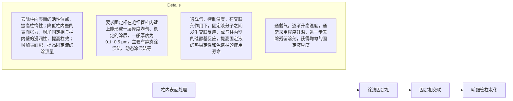
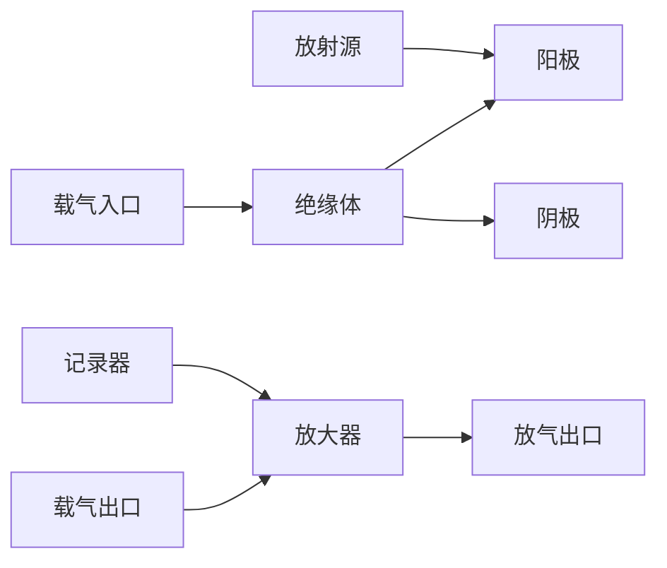

静态涂渍法: 是目前毛细管柱制备最常用的方法, 适用于表面张力大或者黏稠的固定液。取一定长度的毛细管柱, 经合适的预处理后, 将一定浓度的固定相溶液 (0.2%\~2%, 质量体积分数) 通入柱内。充满后将色谱柱一端密封, 另一端接真空泵, 在一定温度下缓慢去除溶剂, 形成固定相涂层。

优点: 重现性好, 柱效高。但是柱端封口技术要求较高, 成败关键在于溶剂与封口的截面不能留下气泡, 否则将会部分或者全部将柱内的涂渍液带出柱外。

缺点: 涂渍时间长(几十小时)。

动态涂渍法:适用于黏度低、流动性好的固定液。涂渍厚度取决于涂渍液的黏度、浓度、流动速度及溶剂的挥发速度。方法是先将固定相溶液（10%\~60%，质量体积分数）压入整个色谱柱体积的1/10\~1/5，然后用氮气在一定速度下推动固定相溶液的液柱均匀向前移动，待液柱全部离开柱后，继续通入少量的气流时溶剂挥发完全，使固定液在色谱柱内壁形成涂层。

优点: 简便、快速, 应用广泛。

缺点: 重现性差, 柱效比静态法低, 液膜厚度难以准确预测。

## 1. 开管型毛细管柱

壁涂开管柱（wall coated open tubular column, WCOT 柱）:将固定液均匀涂渍并固化在玻璃或石英毛细管内壁上制成。制备方法相对简单，不足之处在于表面具有硅醇基，导致柱效降低，可对柱表面进行粗糙化或化学改性加以改善。

载体涂层开管柱(support coated open tubular column, SCOT 柱): 将载体微粒固化在毛细管柱内壁上, 再涂渍固定液, 是目前应用最广的壁处理毛细管柱。SCOT 柱的优点是除可以涂渍各类固定液外, 最大允许进样量和柱效相对较高, 固定液膜吸附牢固, 柱寿命较长。

多孔层开管柱(porous layer open tubular column, PLOT 柱): 在毛细管柱内壁上制备(或原位生成)多孔性微粒涂层, 常用于气-固色谱分析。

化学键合或交联柱: 将固定相通过化学反应键合在毛细管柱内壁上或使固定相分子交联在一起。此类色谱柱的热稳定性高。

## 2. 填充型毛细管柱

填充毛细管柱: 将载体、吸附剂等松散地装入玻璃管中, 然后拉制成毛细管。通常柱内径不超过 1.0 mm, 填料的粒度与柱径的比值为 0.2\~0.3, 柱效为 3000\~4000 块/m。

微型填充柱:又称细径填充柱。将已拉制好的直径小于1.0 mm的毛细管,填入涂有固定液的细颗粒填料(30\~50  $\mu$ m)而成,填料的粒度与柱径比小于0.2,柱效可达4000\~6000块/m。

## 8.2.3.2 毛细管柱的制备与评价

## 1. 柱管材料

开管柱的柱管材料大多用熔融石英，即弹性石英柱。由于石英材料受外力作用易脆，拉制成型后需在柱管外壁进行涂层，以增加柱管的柔性。目前广泛使用的聚酰亚胺涂层的最高使用温度为360℃左右，能够满足常规GC要求。对于高温色谱柱，可用镀铝层取代，使用温度可达420℃，但寿命较短。

另一种高温柱材料是不锈钢管内衬石英管，既利用不锈钢的耐高温性能，又利用石英材料的良好涂渍性能，是目前应用较多的高温柱材料。

## 2. 毛细管柱的制备

毛细管柱的制备如图 8.2.5 所示。

flowchart

图 8.2.5 毛细管柱的制备

## 3. 毛细管柱的评价

由于固定相种类多、理化性质差异大，对各色谱柱的性能评价和要求也各不相同。

## (1) 评价指标

柱效:衡量色谱柱形成尖锐峰的能力,用理论塔板数或有效理论塔板数评价。

选择性和分离性能:色谱选择性是衡量固定相区分组分间性质差异的能力;分离性能是衡量区分相邻色谱峰彼此分离的能力。分别用选择性因子( $\alpha$ )和分离度(R)评价。

色谱峰分离的理想状态:R=1.5

对于组成复杂的样品,较难实现所有组分的基线分离。此时,只要目标组分的分离满足测定要求即可。

柱惰性:反映固定相和毛细管内壁存在的硅醇基或一些金属氧化物等吸附活性位点的多少。

热稳定性:测定色谱柱的流失曲线是评价色谱柱热稳定性的方法之一。

## (2) 评价方法

由于固定相种类多、理化性质各异、对各色谱柱的性能评价和要求也不尽相同。因此，很难用某种统一的方法去评价性能迥异的各种色谱柱。目前，最具代表性的是Grob方法，通过一次实验可以同时取得反映柱子性能的多个方面内容，即分离效率、吸附活性、酸碱度及固定液液膜厚度等因素。Grob方法的具体操作可扫副栏二维码。

## 8.2.4 气相色谱仪

## 8.2.4.1 气路系统

气路系统包括各种气源、净化干燥管和流量控制器。

气源提供高纯载气，纯度>99.99%。主要有高压气瓶和气体发生器两种。常用的载气有:氢气、氮气、氦气。载气的选择主要取决于检测器、色谱柱和分析测定要求。氦气、氢气的相对分子质量小，热导系数大，常用于热导检测器；氮气的相对分子质量相对较大，扩散系数小，使用安全，多数检测器采用氮气作载气。

净化干燥管内装有吸附剂、催化剂等材料,主要作用是去除气体中可能存在的水分、烃类有机物、氧气等杂质。

流量控制器包括压力表、针形阀，电子流量计等。

采用毛细管柱气相色谱法分析时,毛细管柱的末端需增加尾吹装置,以增加色谱柱末端载气的流速,缩短流出色谱柱的样品组分进入检测器所需的时间,有效地减小扩散。

## 8.2.4.2 温控系统

温控系统主要指对进样系统的气化室、柱温箱及检测器三处的温度控制。柱温变化  $1^{\circ}C$ ，保留时间变化 5% 左右，因此要求控温尽可能精确 ( $\pm0.1^{\circ}C$ )。

柱温箱的温度控制方式有恒温和程序升温两种，可通过工作站进行设定。柱温的设定需低于色谱柱的最高使用温度，检测器温度的设定需保证被分离组分到达检测器时不被冷凝，一般高于柱温20\~30℃。

通常,对于沸点范围很宽的混合物,采用程序升温方式进行分析。

## 8.2.4.3 进样系统

进样系统包括进样器和气化室。

气相色谱仪一般配有填充柱和毛细管柱两个进样口。进样口内为衬管气化室，进样后样品组分瞬间气化。

气相色谱进样可采用微量进样器和自动进样装置。自动进样装置可自动完成进样针清洗、润冲、取样、进样、换样等过程，进样盘内可放置数十个样品瓶。进

Grob 方法简介

## 思考:

载气中的杂质对分析样品会产生怎样的影响？

## PTV的操作模式

进样器温度首先保持在低于样品溶剂沸点的温度(0\~50℃)。样品注入进样口时，打开分流阀，大部分溶剂蒸气在载气吹扫下从分流阀逸出，高沸点待测物存在衬管上。然后关闭分流阀，进样器快速升温，衬管上的待测物被全部转移到色谱柱顶端。可再次打开分流阀，以除去进样器内残留的溶剂和样品基质。如果需要，还可采用多次进样或控速进样。

顶空瓶: 不同规格的带有密封隔垫瓶盖的样品瓶, 可盛适量液体或固体样品。

顶空进样装置有静态进样分析和动态进样分析之分。静态进样分析是先将液体或固体样品密封在容器内，在一定温度下放置一段时间，待两相达到平衡，取上层气相进行分析。

动态进样分析是用流动的惰性气体通入液体样品或置于固体样品表面,将样品中的挥发性成分吹扫出来,再用一个捕集器吸附吹扫出来的物质,经热解吸样品进行分析,又称吹扫-捕集进样法。

样方式有填充柱进样、分流/不分流进样、顶空进样、裂解进样、程序升温进样、阀进样等，用以完成不同进样方式的样品分流。

气化室的死体积应足够小,通常为0.2\~1 mL。

（1）分流/不分流进样器 样品经隔垫进入气化室后瞬间气化，载气将气化后的样品部分(分流)或全部(不分流)吹扫入色谱柱中。在分流模式中，大部分样品与载气通过分流口放空，分流比一般为1:50\~1:500。

毛细管柱由于柱容量较小常采用分流进样。

(2) 柱头进样器 样品不经加热直接从柱头导入色谱柱, 常用于填充柱。
（3）程序升温蒸发器(programmed temperature vaporizer, PTV) 利用快速程序升温实施大体积进样，与常规进样方式相比，进样量可提高100倍以上。结合样品特征，采用相应的操作模式(见副栏)，实现复杂样品中挥发性成分的有效分离和检测，在环境污染物分析、生化物质分析及一般有机痕量分析等领域具有广泛的应用价值。
（4）顶空进样装置 主要用于固体、半固体、液体样品基质中挥发性有机化合物的分析。如茶叶中的香气成分、水中挥发性有机化合物、高分子材料中残留单体的分析等。可有效地避免将样品中难挥发性物质引入色谱柱中，减少污染。

## 8.2.4.4 分离系统

分离系统即色谱柱,是色谱仪的核心部件。

气相色谱仪一般配有填充柱和毛细管柱两套接口，根据需要连接填充柱和毛细管柱。柱的一端连接进样口，另一端连接检测器。

填充柱一般用于组成相对简单的混合物的分离,多采用恒温分析。毛细管柱常用于分析沸程较宽的复杂混合物,可采用程序升温模式分析。

## 8.2.4.5 检测系统

样品组分经色谱柱分离后依次进入检测器,按组分浓度或质量随时间的变化转换成相应的电信号,经放大记录后给出色谱图及相关数据。

气相色谱仪可以配备多种不同类型的检测器,以满足不同检测对象的需求。应根据分析对象的结构和性质选择适宜的检测器。

常用的检测器:热导检测器、氢火焰离子化检测器、电子捕获检测器、热离子检测器、火焰光度检测器等。

## 1. 检测器的分类和性能指标

(1) 分类 根据检测器的检测原理,可分为浓度型检测器和质量型检测器。

浓度型检测器: 输出信号强度(E)与载气中组分的浓度(c)成正比。如热导检测器和电子捕获检测器等。

质量型检测器: 输出信号强度(E)与单位时间内进入检测器的组分的质量 $(\mathrm{dm}/\mathrm{dt})$ 成正比。如氢火焰离子化检测器和火焰光度检测器等。

## (2) 性能指标

噪声与漂移:噪声是指无样品通过检测器时,由仪器本身工作条件引起基线起伏的值。若无样品通过检测器时,单位时间内基线向某一方向移动,称为漂移。

灵敏度(S): 表示单位质量的物质通过检测器时产生响应信号的大小。灵敏度是评价检测器, 并与其他类型检测器进行比较的重要指标。S 越大, 则检测器越灵敏。

检测限(D):一般是指信噪比 S/N = 3 时对应的被测物质的浓度或质量。

线性范围: 检测器的响应信号强度与被测物质浓度或质量之间呈线性关系的范围。

## 2. 常用检测器

（1）热导检测器(thermal conductivity detector, TCD) 热导检测器是通过测量被测物质气流导热性能的变化，检测流出组分，为广谱型检测器。
① 基本结构。热导池基本结构如图8.2.6所示。池体一般用不锈钢制成。热敏元件常由电阻率高、电阻温度系数大的钨丝或铼钨丝制成。将两个材质和电阻相同的热敏元件装入同一个双腔的池体中，构成双臂热导池。一臂连接在进样口之前，仅允许纯载气通过，称为参考臂；另一臂连接在色谱柱出口，样品分析时由载气携带样品组分通过，称为测量臂。两臂与阻值相等的两个固定电阻 $R_{1}$ 和 $R_{2}$ 组成桥式电路，见图8.2.7。

图 8.2.6 热导池基本结构

text_image

电流调节
电源
R参
R测
R1
R2
衰减
记录仪

图 8.2.7 热导池工作原理示意图

② 检测原理。TCD 检测基于不同的气体有不同的热导系数。

进样前,热丝通电,加热与散热达到平衡后,两臂电阻值相等,此时无电压信号输出,色谱图为一条直线(基线)。由于 $R_{参}=R_{测},R_{1}=R_{2}$ ,则

$$
R _ {\text {参}} \cdot R _ {2} = R _ {\text {测}} \cdot R _ {1}
$$

进样后，载气携带样品组分流过测量臂，而这时参考臂流过的仍是纯载气，使测量臂的温度改变，引起电阻的变化，此时测量臂和参考臂的电阻值不等，产生电阻差，即 $R_{参} \neq R_{测}$ ，则:

$$
R _ {\text {参}} \cdot R _ {2} \neq R _ {\text {测}} \cdot R _ {1}
$$

这时电桥失去平衡,有电压信号输出,检测信号为组分浓度随时间变化的曲

## 思考:

与其他种类检测器相比,TCD 灵敏度怎样?请调研和分析。

## 思考:

实际工作中,载气流速如何选定?是否选择最佳流速?

线，即色谱流出曲线。

③ 影响 TCD 灵敏度的因素。

桥路电流: 检测器的响应值与桥路电流 I 的 3 次方成正比。I 增加, 钨丝温度越高, 钨丝与池体之间的温差加大, 有利于热传导, 提高检测器灵敏度。但桥路电流太高, 会影响基线的稳定性, 可能烧断钨丝。

池体温度: 池体温度与钨丝温度相差越大, 越有利于热传导, 检测器的灵敏度也就越高。但池体温度不能低于色谱柱的温度, 通常高  $20 \sim 30 \, ^{\circ}C$ , 以防样品组分在检测器内冷凝。

载气种类:载气与组分的热导系数相差越大,在检测器两臂中产生的温差和电阻差越大,检测越灵敏。氢气具有较高的热导系数,但不安全,氦气比较理想,但价格较贵。某些气体热导系数如表8.2.1所示。

表 8.2.1 常见气体热导系数

| 气体 | $\lambda \times 10^{5} (100\, ^{\circ}\text{C})$ | 气体 | $\lambda \times 10^{5} (100\, ^{\circ}\text{C})$ |
| --- | --- | --- | --- |
| 氢 | 224.3 | 甲烷 | 45.8 |
| 氦 | 175.6 | 乙烷 | 30.7 |
| 氧 | 31.9 | 丙烷 | 26.4 |
| 空气 | 31.5 | 甲醇 | 23.1 |
| 氮 | 31.5 | 乙醇 | 22.3 |
| 氩 | 21.8 | 丙酮 | 17.6 |

④ TCD 的特点和注意事项。

(i) 为浓度型检测器。进样量一定时, 峰面积与载气流速成反比, 因此用峰面积定量时, 务必保持流速恒定。
（ii）为通用型检测器。可以用于测定不同种类的组分，特别是可以测定氢火焰离子化检测器不能直接测定的无机气体。
（iii）为非破坏型检测器。可以在检测器后收集组分或再与其他仪器联用分析。
（iv）为保护电热丝，通电前一定要先开载气；关机时一定要先关电源，后关载气。
（v）载气中的氧气会缩短 TCD 使用寿命，因此应彻底除去载气中氧气。勿使用聚四氟乙烯作载气管道，因为它会透过氧气。

(vi) 灵敏度较低。

（2）氢火焰离子化检测器(flame ionization detector, FID) FID 是气相色谱分析最常用的检测器之一，为质量型检测器。对有机化合物具有很高的灵敏度，是有机物测定的通用检测器。

① 基本结构。FID 的主要部件是离子化室，如图 8.2.8 所示，由气体入口、喷嘴、发射极和收集极等组成。在发射极和收集极之间加有一定的直流电压（100\~300 V）构成一个外加电场。FID 需要用到三种气体: $N_{2}$  载气携带样品组分； $H_{2}$  为燃气；空气为助燃气。使用时需要调整三者的流速比例关系，使检测器灵敏度达到最佳。一般情况下为 1:1:10。增大空气流速，提高检测器的温度有利于有效去除组分燃烧时产生的水蒸气。

② 工作原理。当载气携带有机物  $C_{n}H_{m}$  由喷嘴喷入火焰时，在 C 层发生裂解

图 8.2.8 FID 的结构示意图

反应产生自由基:

$$
\mathrm{C} _ {n} \mathrm{H} _ {m} \longrightarrow \cdot \mathrm{CH}
$$

产生的自由基在 D 层火焰中与外面扩散进来的激发态原子氧或分子氧发生如下反应:

$$
\cdot \mathrm{CH} + \mathrm{O} \longrightarrow \mathrm{CHO} ^ {+} + \mathrm{e} ^ {-}
$$

生成的正离子  $CHO^{+}$ 与火焰中大量水分子碰撞而发生分子离子反应:

$$
\mathrm{CHO} ^ {+} + \mathrm{H} _ {2} \mathrm{O} \longrightarrow \mathrm{H} _ {3} \mathrm{O} ^ {+} + \mathrm{CO}
$$

化学电离产生的正离子和电子在外加恒定直流电场的作用下,分别向两极定向运动而产生微电流 $(10^{-14}\sim10^{-6}\mathrm{~A})$ 。

一定范围内,微电流的大小与进入离子室的被测组分质量成正比,属于质量型检测器。

组分在氢焰中的电离效率很低,大约五十万分之一的碳原子被电离。

离子电流信号输出到记录仪,得到峰面积与组分质量成正比的色谱流出曲线。

③ FID 的特点和注意事项。

(i) 结构简单, 稳定性好, 响应快速, 线性范围宽, 可达 7 个数量级。
（ii）为专属型检测器，对有机物具有很高的灵敏度，可达 $10^{-12}\mathrm{g}\cdot \mathrm{s}^{-1}$ ，比TCD高出3个数量级，但对含氢少和不含氢的物质不响应或不灵敏。
（iii）为质量型检测器。进样量一定时，峰高与载气流速成正比，因此用峰高定量时，务必保持流速恒定。
（iv）为破坏型检测器。组分进入 FID 后经高温燃烧破坏，检测后的样品不能再利用。
（v）使用时注意安全问题:测定  $H_{2}$  流量时务必关闭空气。无论任何原因导致火焰熄灭时，应立即关闭氢气阀门，排除故障后重新点火时再打开。
（3）电子捕获检测器(electron capture detector, ECD) ECD 是目前分析测定含电负性元素有机物最常用的检测器，多用于测定农副产品、食品及环境样品中农药残留。
① ECD 结构与工作原理。ECD 的结构如图 8.2.9 所示。放射源(常用 $^{63}$ Ni)产生的  $\beta$  射线使载气(通常为  $N_{2}$ )离子化，同时产生大量电子。这些电子在电场作用下向阳极(收集极)移动，形成稳定的基流( $10^{-9} \sim 10^{-8}$  A)。当含高电负性元素的组分流经检测器时，捕获电子使基流强度发生变化，信号经放大后记录得到色谱峰。

蔬果上的农药残留是一个普遍存在的问题:主要来源于施用农药直接污染农作物、农作物从污染的环境中吸收农药及农药通过食物链污染食品。常见的残留农药包括有机磷、氨基甲酸酯类、有机氯、杀菌剂等，其中有机磷是目前使用量最大的杀虫剂。

请调研农药残留有哪些检测手段？气相色谱法能够检测的农药残留的种类及相应的检测器有哪些？

flowchart

图 8.2.9 ECD 的结构示意图

② ECD 的特点和注意事项。
（i）为专属型检测器，针对含有如卤素、硫、氰基、共轭双键的有机物、过氧化物、醌类有机物等具有较高的灵敏度，且不破坏样品。
(ii) 线性范围较窄。对胺类、醇类及碳氢化合物等检测灵敏度不高。
(iii) 为浓度型检测器。
(iv) 要求高纯氮气(含氧量 $<1.0\times10^{-5}$ ), 因为氧气具有电负性, 可使基流降低。
（v）极化电压通常为  $20 \sim 50 \, V$ 。常采用脉冲电压，电子能量较小时易被捕获，灵敏度高。
(vi) 具有放射源, 使用时注意安全, 非专业人员勿触碰相关部件。
(4) 其他常用检测器

① 火焰光度检测器(flame photometric detector, FPD)。FPD 对含硫、磷的化合物具有高选择性和高灵敏度，为质量型检测器。工作原理是含硫、磷化合物在富氢火焰中燃烧生成化学发光物质，能辐射出 400 nm 和 550 nm 左右的特征光谱，可被检测。

FPD 适用于二氧化硫、硫化氢、石油精馏物的含硫量、有机硫、有机磷的农药残留物等的分析测定。也可用于其他含杂原子有机物和有机金属化合物的检测。

② 热离子检测器(thermionic detector, TID)。TID 检测器对氮、磷化合物具有高选择性和高灵敏度，为质量型检测器。其结构与 FID 类似。在 FID 的喷嘴与收集极之间加一个含硅酸铷的玻璃球，含氮、磷化合物在受热分解时，受硅酸铷作用产生大量电子，信号强。
TID 对氮、磷化合物的响应与其杂原子数成正比,也与化合物的结构有关,对易分解成氰基的化合物的响应值大,而对硝酸酯、酰胺类的响应较小。
③ 定性检测器(联用仪器)。色谱与其他分析仪器联用发展迅速,也可将所联用的仪器认为是色谱的检测器,联用仪器将在本章第5节中介绍。

## 8.2.4.6 数据处理系统

色谱数据的采集和处理由色谱工作站来完成。实现谱图显示、峰检测和基线校正、定量计算、打印报告等功能。利用色谱工作站，样品经气相色谱柱分析后即可得到色谱流出曲线。根据色谱图中组分的保留时间、色谱峰的峰面积或峰高等参数对目标组分进行定性和定量分析。

## 8.2.5 气相色谱衍生化

## 1. 衍生化的目的与意义

20世纪50年代出现的气相色谱法使挥发性、热稳定性组分的分离、分析发生了巨大变化，现已成为石油、化工、环境、医药、食品、生命等领域的一种重要的、必不可少的分析手段。而面临挥发性差、极性强及热不稳定的样品时，用气相色谱法直接进行分析有困难，可以通过对样品进行化学衍生，改善其色谱行为，进而满足气相色谱分析的要求。

化学衍生技术就是通过化学反应将样品中难以分离检测的目标物定量地转化为另一易于分析检测的化合物,通过对后者的分析检测实现对目标化合物的定性和定量分析。归纳起来,化学衍生的目的:

（1）改善样品的挥发性 将气相色谱难分离的化合物转化成适合气相色谱分离的物质。如高沸点、极性大、热不稳定的化合物，样品挥发性低，对样品进行化学衍生化，将其转化为非极性或弱极性的衍生物，降低样品的沸点，可以改善样品的挥发性。例如，氨基酸和糖，不能用气相色谱直接分析，将其转化为 N-酰基氨基酸酯和三甲基硅烷基醚后，挥发性就能满足气相色谱分析的要求。
（2）减少与色谱材料的相互作用 带有极性基团的化合物进入色谱系统后，样品中的极性基团可能与色谱柱内壁和色谱载体发生反应，造成色谱峰变宽和拖尾，影响定性、定量的准确性，对样品进行衍生化，可以降低样品与色谱材料间的相互作用，获得满意的分析结果。
（3）分离结构近似的化合物 衍生化可以改变化合物的色谱性能，改善分离度。例如，某些异构体保留时间非常接近，在色谱上很难分离，通过衍生化反应，使两个异构体生成的衍生物色谱性能产生较大差异而得到分离。对一些难分离的物质，可以选用某些衍生化反应，只使其中一种物质发生衍生化反应转化为衍生物，使两者得以分离。
（4）提高分析检测的选择性和灵敏度 对样品进行衍生化，引入适当的衍生基团，不但能改善检测器的选择性，还可以提高灵敏度。例如，电子捕获检测器(ECD)对含卤素或硝基苯基的化合物有较高的灵敏度，通过使用含卤素或硝基苯基的衍生试剂与分析目标物反应，将目标物接上卤素或硝基苯基，可以实现复杂体系中选择性地检测分析对象，提高检测灵敏度。

## 2. 衍生化方法的选择

气相色谱衍生方法主要针对样品中含有羟基、氨基、巯基、亚氨基、羧基等极性基团中活泼氢，所选择的衍生化方法应具有如下特点:

（1）反应速率快，能定量进行，至少反应的转化率要恒定，能满足定量分析的要求。
(2) 反应重复性好, 反应条件易于控制。
(3) 反应的选择性高,最好只与目标化合物反应。
(4) 衍生产物具有良好的色谱行为, 易分离纯化和检测。
(5) 衍生试剂价廉易得。

## 3. 衍生化反应

（1）酯化衍生方法 羧基一般衍生为酯，通常为甲酯，主要是甲酯挥发性好，甲酯的制备方法主要有甲醇法、重氮甲烷法和三氟乙酸酐法等。

① 甲醇法-三氟化硼催化:有机酸与甲醇在三氟化硼催化剂条件下,发生酯

## 思考:

程序升温中有哪些重要的参数，选择依据有哪些？

化反应,生成有机酸甲酯。通常将甲醇与三氟化硼预先配成试剂,衍生时,取少量上述酯化试剂加入欲分析样品中衍生化。

② 甲醇法-氯化氢或浓硫酸催化:以甲醇-氯化氢或甲醇-浓硫酸溶液作为酯化试剂与欲分析样品反应，衍生产物可进行色谱分析。
③ 重氮甲烷法:重氮甲烷可以与有机酸反应生成有机酸甲酯，放出氮气。重氮甲烷可由浓碱分解 $N-$ 甲基- $N-$ 亚硝基脲或 $N-$ 甲基- $N-$ 亚硝基对甲苯磺酰胺来制备。重氮甲烷法反应简单、快速，转化效率高，通常没有副产物。但是反应要在非水介质中进行，另外重氮甲烷毒性大，活性高，易分解甚至产生爆炸，应在使用前临时制备，并只能在 $-20^{\circ}\mathrm{C}$ 以下短时间保存，制备与使用时要特别小心。
④ 三氟乙酸酐法: 在三氟乙酸酐存在下, 有机酸和酚可以反应生成酯, 此法比较适合空间位阻较大的有机酸或酚的酯化。
⑤ 其他酯化法:有时为了提高方法的灵敏度和选择性,需要制备甲酯之外的酯,其合成方法与甲酯类似。可用重氮乙烷、重氮丙烷、重氮甲苯代替重氮甲烷以合成相应的酯,与重氮甲烷相比,这些试剂的稳定性好。使用三氟化硼、氯化氢或浓硫酸催化时,用三氟化硼的乙醇、正(异)丙醇、正(异)丁醇溶液与有机酸反应可以制备相应的乙酯、正(异)丙酯、正(异)丁酯;苄基酯一般用苯基重氮甲烷制备。在使用选择性检测器,如 ECD 时,可用含卤素的醇作衍生试剂,以提高灵敏度。
（2）酰化衍生方法 酰化用于含羟基、氨基、巯基的化合物衍生化，酰化能降低羟基、氨基、巯基的极性，提高这些化合物的挥发性，改善这些化合物的色谱性能。对选择性检测器ECD，可用卤代酰化试剂，提高检测灵敏度。常用的酰化试剂有酰卤、酸酐和反应活性的酰化合物（酰基咪唑、二酰基胺等）。以乙酸酐为乙酰化试剂曾在羟基和氨基的衍生中广泛使用。乙酰化反应可用于糖类分析。但卤代酸酐更为常用，最常用的是三氟乙酸酐，它的衍生物挥发性高，色谱峰形好，在选择性检测器ECD中响应灵敏。常用的多氟化试剂主要为全氟代酸酐或酰卤，如三氟乙酰、五氟丙酸酐、五氟丙酰、五氟代苯甲酰氯、七氟丁酸酐和七氟丁酰，以五氟代苯甲酰氯基衍生物的ECD响应最高。
（3）硅烷化衍生方法 含羟基、氨基、巯基、羧基等官能团的化合物均可进行硅烷化反应，生成极性低、挥发性高、热稳定性好的硅烷基化合物。硅烷化反应体系中不能含有水分，选用溶剂一般为己烷、苯、吡啶、四氢呋喃、二甲亚砜等非极性溶剂。硅烷化试剂种类很多，而且大多商品化，有些甚至已与溶剂和催化剂配制好。

## 8.2.6 气相色谱分离条件的选择

色谱理论为改善混合物中各组分的分离提供了理论指导,但对于形形色色的样品,要完成分析任务,仍需要正确选择操作条件。

根据分离度方程和速率理论,色谱的分离条件主要包括色谱柱固定相、固定液的涂渍量、载气的种类及流速、气化温度、柱温、色谱柱的柱长和内径、进样方式和进样量等。分离条件的选择是否合适,决定了是否能够达到分离目的。

## 1. 色谱柱固定相的选择

气相色谱分析永久性气体(如  $O_{2}$ 、 $N_{2}$ 、 $H_{2}$ 、Ar、 $\cdots$ )或气态烃类时,常采用气-固色谱法。由于吸附剂对气体吸附的差异,可得到较好的分离效果。对于组分复杂的样品,常采用气-液色谱法改善分离度。由于载体起支撑的作用,固定液的种类显得更为重要,选择时需注意固定液的极性及其最高使用温度。

固定相的选择一般按照“相似相溶”原则,综合考虑分子间作用力。

当组分为非极性物质时,一般选用非极性固定相。色散力对分离起主要作用,组分按沸点顺序流出色谱柱,沸点低的先流出。

当组分为极性物质时,选择极性固定相。组分与固定相分子间的作用力主要是定向力,组分按极性大小顺序流出色谱柱,极性小的组分先流出,极性大的后流出。

当样品中同时含有非极性和极性组分时,需根据分析目的、组分性质等具体情况,选择合适极性的固定液。非极性组分先出峰,极性组分后出峰。

当组分为氢键型物质，优先选择极性或氢键型固定相。组分按形成氢键能力强弱流出色谱柱，氢键作用弱的组分先流出，氢键作用强的组分后流出。

当组分为挥发性酸/碱有机物时,一般选用极性固定相。

当样品组分复杂时,采用单一固定相色谱柱难以实现理想分离时,可采用混合固定相色谱柱;或者采用两种不同极性的色谱柱,利用二维或全二维色谱法进行分离。

## 2. 固定液涂渍量的选择

固定液在担体上的涂渍量称为配比，一般指的是固定液与担体的质量百分比。配比通常控制在 $5\% \sim 25\%$ ，根据速率理论，配比越低，担体上所形成的液膜越薄，则传质阻力越小，柱效越高，分析速度也就越快，但配比较低时，固定相的负载量低，允许的进样量较小。分析工作中通常倾向于使用较低的配比。

## 3. 载气及其流速的选择

载气种类的选择应该从载气对柱效的影响,载气的性质及检测器对载气的要求来考虑。

根据 van Deemter 方程可以绘制塔板高度 $H$ 与载气线速率 $u$ 曲线（图 8.1.4）。在曲线的最低点，塔板高度 $H$ 最小，此时柱效最高，与最小 $H$ 相对应的流速是最佳流速 $u_{\mathrm{opt}}$。从图 8.1.4 可知，当 $u$ 较小时，分子扩散项 $B/u$ 是影响塔板高度的主要因素，此时选择相对分子质量较大的载气 $(\mathrm{N}_2, \mathrm{Ar})$ 为宜，这样使组分在载气中有较小的扩散系数，提高柱效。当 $u$ 较大时，传质阻力项 $Cu$ 起主导作用，宜选择相对分子质量较小的载气 $(\mathrm{H}_2, \mathrm{He})$，使组分有较大的扩散系数，减少传质阻力，提高柱效。另外，载气的选择还需要考虑与检测器的匹配，一般而言，ECD 和 FPD 选用 $\mathrm{N}_2$ 为载气，FID 选择用 $\mathrm{N}_2$ 或 Ar 为载气，而 TCD 选用 $\mathrm{H}_2$ 或 He 为载气。

## 4. 气化温度的选择

气化温度取决于样品的挥发性、沸点范围及进样量等因素，须保证样品瞬间气化，通常相当于样品沸点或高于沸点。选择时，一般比柱温高30～70℃，还应防止气化温度太高造成样品分解。

## 5. 柱温的选择

柱温是气相色谱的重要操作参数，直接影响色谱柱的寿命、分离效能和分析速度。柱温升高，改善组分在气相、液相的传质速率，有利于提高柱效，但增加柱温同时又加剧纵向扩散，导致柱效降低，使得低沸点组分峰产生重叠，分离度降低。反之，柱温降低，分离度增大，但保留时间增长，分析时间延长。因此，选择柱温需要兼顾分离度和分析效率。柱温选择的一般原则:以最难分离的组分能够完全分离为前提，采取较低的柱温，同时需兼顾保留时间适宜，峰形不拖尾。

柱温的选择还应考虑固定液的使用温度,柱温不能高于固定液的最高使用温度,否则固定液挥发流失,对分离不利。柱温通常选择接近或略低于组分平均沸点的温度。

对于组分复杂、沸程宽的样品，采用同一柱温往往造成低沸点组分分离效果不好，高沸点组分峰形扁平，可采用程序升温法，即在分析过程中按照一定速率提高柱温，使各组分能在最适宜的温度下得到分离。在程序升温开始时，柱温较低，低沸点的组分得到分离，中等沸点的组分移动很慢，高沸点的组分还在柱口附近；随着柱温的上升，组分由低沸点到高沸点依次分离出来（图8.2.10）。总之，程序升温改善了复杂成分样品的分离效果，使各组分都在较佳的温度下分离。

line

| Compound | Retention Time (min) |
| --- | --- |
| C9 | ~3.5 |
| C10 | ~6.5 |
| C11 | ~10.5 |
| C12 | ~17.5 |
| C13 | ~30.5 |
| C14 | ~52.5 |
| C15 | ~92.5 |

(a) 恒温150℃

line

| Peak Label | Retention Time (min) |
| --- | --- |
| C6 | ~1.5 |
| C7 | ~3.5 |
| C8 | ~4.5 |
| C9 | ~6.5 |
| C10 | ~9.5 |
| C11 | ~12.5 |
| C12 | ~14.5 |
| C13 | ~16.5 |
| C14 | ~18.5 |
| C15 | ~20.5 |
| C16 | ~22.5 |
| C17 | ~24.5 |
| C18 | ~26.5 |
| C19 | ~28.5 |
| C20 | ~32.5 |

(b) 程序升温50\~250℃，8℃/min

图 8.2.10 正构烷烃恒温分离与程序升温分离效果对比图

## 6. 柱长和柱内径的选择

色谱柱柱长的选择应考虑分离度、分析时间和色谱柱的成本。在不改变塔板高度 H 的条件下，分离度  $R^{2}$  与柱长成正比，而分析时间与柱长成正比。增加柱长可使分离度增大，对分离有利；同时，又使传质阻力增大，引起色谱峰宽加大，分析时间延长。

因此，在保证一定的分离度前提下，尽可能选用较短的色谱柱。具体方法是选择一根极性适宜、任意长度的色谱柱，测定两组分的分离度，然后根据色谱分离方程来确定柱长是否合适。

## 7. 进样时间和进样量的选择

进样速度越快越好,可以防止色谱峰变宽,甚至峰变形,不利于分离和定量的问题。在实际工作中不仅进样要快,还需控制进样量适当。

进样量应控制在柱容量的允许范围及检测器的线性检测范围之内。进样量过大，所得到的色谱峰变宽，分离度变小，峰面积或峰高与进样量不成线性，无法定量。进样量太小，又会因检测器灵敏度不够，不能检出。最大允许进样量应控制在使半峰宽不变，而峰面积或峰高与进样量呈线性关系。液体样品采用色谱微量进样器进样，规格有 $1\mu \mathrm{L},5\mu \mathrm{L},10\mu \mathrm{L}$ 等。

## 8.2.7 气相色谱应用与进展

## 1. 气相色谱的应用

气相色谱除进行一般分析外，与一些辅助方法结合还可进行一些特殊要求的分析。常见的技术有针对高分子聚合物样品的裂解气相色谱分析和适用于液体或固体样品中挥发性气体的顶空气相色谱分析。

（1）裂解气相色谱技术 裂解气相色谱(pyrolysis-gas chromatography, Py-GC)是常规气相色谱分析方法的扩展，是将热裂解和气相色谱两种技术结合的产物，适用于一些相对分子质量较大、结构复杂、难挥发、难溶解的固体物质的分析鉴定，如聚合物分析。

热裂解是在热能作用下，物质发生的化学降解过程。热裂解与气相色谱、质谱（或红外、核磁）联用技术已成为研究高分子化合物的有力工具，在高分子、生物医学、环境科学、考古学、地球化学、矿物燃料、炸药等领域有广泛应用。

（2）顶空气相色谱分析技术 顶空气相色谱分析是对液体或固体样品中的挥发性成分进行分析的最有效方法，如塑料食品包装袋中挥发性成分的分析，人在有毒环境中工作后，体液中有毒组分含量的分析等。

顶空气相色谱分析通常是将样品置于密闭的恒温系统中，当气-液（气-固）两相达到热力学平衡后，测定气相组成，可采用静态法和动态法两种方式进行。顶空气相色谱分析法的理论依据是当顶空瓶中样品上面的蒸气压相当低时，峰面积 $A_{i}$ 的大小与样品上面的气相中挥发性组分i的蒸气压 $p_{i}$ 成正比，以此来确定样品中组分的含量。

## 2. 进展

（1）新型色谱柱及固定相 高选择性色谱固定相是实现气相色谱高效分离复杂样品组分的关键。近年来，材料科学的快速发展，新型气相色谱固定相的研究和应用取得了明显进展，对于丰富色谱分离材料的种类、发现新的色谱分离机理、对难分离组分的分析测定和研究应用起到了重要的促进作用。

毛细管柱气相色谱法具有分析速度快、分离效率高、灵敏度高等特点，细内径的毛细管柱应用越来越广泛，耐高温的毛细管柱扩展了其应用范围。

新的高选择性固定液不断涌现，如手性固定液、离子液体、金属有机骨架（MOFs）、共价有机骨架（COFs）、石墨烯及其衍生物等，作为新型色谱固定相具有广阔的应用前景和发展潜力。

（2）全二维气相色谱(GC×GC) 气相色谱作为复杂混合物的分离工具，对挥发性化合物的分离分析发挥了很大的作用。在大量实际工作中，使用一根柱子，可以分析几十至几百种化合物的样品，当样品更复杂时，采用填充柱，总柱效不高，分离不好；使用毛细管柱，虽然有很高的柱效和分离能力，但存在柱容量低、进样少的缺点。为了解决大量存在的复杂样品和痕量组分的定量测定问题，许多学者进行了多维色谱的研究。多维色谱是指使用两根以上的色谱柱或两个以上检测器，通过阀门切换或改变各柱前后压力来改变载气流向的方法，使其得到比单柱系统更多的分离信息的手段。

全二维气相色谱(comprehensive two-dimensional gas chromatography, GC×GC)是多维色谱的一种，但是不同于通常的二维气相色谱(GC+GC)，在GC×GC中，经第一根色谱柱没有得到分离的样品，可通过改变载气流向的办法，使样品进入第二根色谱柱重新进行分离。GC×GC是近年来出现并飞速发展的气相色谱新技术，详见8.7.3.4。

（3）气相色谱联用技术 气相色谱是一种成熟的分析技术，具有高灵敏度、高分离效率和分析速度快的优点，是目前复杂混合物分离的常用工具，然而，气相色谱的定性能力较差。相反，像质谱（MS）、红外光谱（IR）、核磁共振波谱（NMR）等谱学方法，虽然具有很强的结构鉴定能力，却不具备分离能力，也不能直接用于复杂混合物的鉴定。将气相色谱与谱学方法结合起来，不仅能取长补

裂解气相色谱技术的基本原理和方法:

在一定条件下,高分子及非挥发性有机化合物的裂解遵循一定规律,即特定的样品能够产生特征的裂解产物及产物分布,采用气相色谱分析、鉴定裂解产物,并可据此对原样品进行表征。

将样品置于裂解器中，在严格控制的条件下，快速加热，使之迅速分解成为可挥发的小分子产物，然后直接将裂解产物送入色谱柱中进行分离，获得定性定量数据。

## 思考:

针对水样中的易挥发组分,怎样实现气相色谱法的测定?

## 生活实例1:

饮酒甚至醉驾具有重大交通安全隐患。现场酒精测试仪器测定快速，但无法保存样品，事后不能提供证据。

顶空气相色谱法可以完美解决血液中酒精含量的快速检测问题。常采用内标法进行测定。例如，采用叔丁醇为内标，顶空进样，FID 检测，用相对保留时间进行定性，用乙醇与内标物的峰面积比进行定量，实现血液样品中乙醇的定性和定量分析。

## 生活实例 2:

室内挥发性有机物（VOCs）为熔点低于室温而沸点在50\~260℃的具有一定挥发性的有机物的总称。包括苯系物（如甲苯、二甲苯等）、有机氯化物、有机酮、酸、酯、醇、醚、胺和烃化合物等。

请调研 VOCs 分析需要的色谱技术和条件。

提示: 可采用活性炭吸附、二硫化碳解析后, 用毛细管气相色谱法进行测定。

当前,太空生活对人们来说仍充满着神秘和未知。空气、辐射、营养、环境等问题依然是人类探索和利用太空所面临的挑战。

其中,空气质量是保证人类在太空生活的最基本问题。如果太空舱内空气不稳定、浑浊或污染,将会给宇航员的生活带来危险。舱内空气质量的主要指标是氧气、二氧化碳及挥发性有机物(VOCs)等,其中二氧化碳对人体健康影响最大,浓度过高会导致疲劳甚至昏迷,甚至会影响航天器的能源和系统。

## 思考:

太空舱内 VOCs 的检测如何实现？

短，而且还具有协同作用，获得两种技术单独使用时所不具备的某些功能。联用技术已成为当今仪器分析和分析仪器的一个主要发展方向。对气相色谱来说，最成功和应用最广的是与质谱和傅里叶变换红外光谱的联用（简称GC/MS和GC/FTIR）。在GC/MS和GC/FTIR联用系统中，色谱仪相当于谱学方法的分离和进样装置，质谱仪则相当于色谱的定性检测器。联用的关键是接口技术，用于协调联用的两种仪器的输出和输入问题，使两种仪器连接成一个整体。

（4）快速气相色谱技术 随着气相色谱在石油、化工、环境保护、食品安全、医药、法检、临床和超纯材料等领域的应用越来越广，要求气相色谱与其他方法一样，朝着更准确、更灵敏、专一、快速、简便的方向发展。快速和便携式气相色谱受到人们重视。例如，便携式气相色谱仪在临床上测量呼吸气中的挥发性有机物（VOCs），可精准查找与各种疾病（COVID-19、结直肠癌、肺癌等）相关的独特生物标志物，利用微型气相色谱仪可实现对一个呼吸样本进行多种疾病的同时检测。随着呼气诊断技术的发展，未来可通过体检中心、药店内的自助检测站、社区医院等利用微型气相色谱仪进行呼气检测，预防和监控疾病，为人类健康提供更多便利。

## 3. 应用示例

（1）尿液中兴奋剂的检测 刺激剂、麻醉剂、抗雌激素是竞技体育中常用的兴奋剂，属于违禁药物。采用毛细管柱气相色谱法（图8.2.11），可以不经衍生化直接测定尿液中甲基麻黄碱、哌替啶、美沙酮、他莫昔芬、芬太尼等。采用液-液萃取对样品进行前处理后，利用被测物与内标物的峰面积比进行定量分析。

line

| Peak | t (min) | pA |
| --- | --- | --- |
| 1 | ~9.9 | ~28 |
| 2 | ~13.4 | ~37 |
| 3 | ~14.4 | ~61 |
| 4 | ~16.1 | ~51 |
| 5 | ~18.5 | ~28 |
| 6 | ~18.7 | ~34 |

图 8.2.11 加标尿样的气相色谱图

(色谱,2009,27(3):364)

色谱条件:HP-5毛细管柱(30 m × 0.32 m × 0.25μm)。程序升温85℃保持1 min,以5℃·min $^{-1}$ 升至130℃,保持10 min,再以20℃·min $^{-1}$ 升至280℃,保持5 min。N $_{2}$ 为载气,流速为1.3 mL·min $^{-1}$ ;进样口温度280℃;检测器为NPD,温度为340℃;空气流速60 mL·min $^{-1}$ ,氢气流速3.0 mL·min $^{-1}$ ,尾吹气流速30 mL·min $^{-1}$ ;进样量为1 μL,不分流进样。

（2）常见食品添加剂的检测 食品添加剂是在食品加工过程中为改善食品的色香味和存放时间而添加的化学合成物质或天然物质，如山梨酸、苯甲酸、脱氢乙酸、甜蜜素、对羟基苯甲酸酯类等。采用气相色谱法可以实现对这些食品添加剂的同时检测(图8.2.12)。

line

| Compound | Retention Time (min) |
| --- | --- |
| 山梨酸 | ~4.1 |
| 苯甲酸 | ~5.0 |
| 脱氢乙酸 | ~6.8 |
| 对羟基苯甲酸甲酯 | ~7.3 |
| 对羟基苯甲酸乙酯 | ~7.8 |
| 对羟基苯甲酸丙酯 | ~8.7 |
| 对羟基苯甲酸丁酯 | ~9.5 |
| 环己醇亚硝酸酯 | ~12.1 |
| 环己醇 | ~12.3 |
| 丙酸 | ~13.4 |

图 8.2.12 分离 9 种食品添加剂色谱图

(食品安全检测学报,2021,12(14):5684)

色谱条件:HP-5毛细管柱（$30\mathrm{m}\times 0.35\mathrm{m}\times 0.25\mu \mathrm{m}$）。程序升温 $70^{\circ}\mathrm{C}$ 保持 $3\mathrm{min}$，以 $30^{\circ}\mathrm{C}\cdot \mathrm{min}^{-1}$ 升至 $190^{\circ}\mathrm{C}$，保持 $2\mathrm{min}$，再以 $30^{\circ}\mathrm{C}\cdot \mathrm{min}^{-1}$ 升至 $250^{\circ}\mathrm{C}$，保持 $4\mathrm{min}$。$\mathrm{N}_2$ 为载气，流速为 $1\mathrm{mL}\cdot \mathrm{min}^{-1}$；进样口温度 $220^{\circ}\mathrm{C}$；检测器为FID，温度为 $260^{\circ}\mathrm{C}$；空气流速 $400\mathrm{mL}\cdot \mathrm{min}^{-1}$，氢气流速 $40\mathrm{mL}\cdot \mathrm{min}^{-1}$，尾吹气流速 $30\mathrm{mL}\cdot \mathrm{min}^{-1}$；进样量为 $1\mu \mathrm{L}$，分流比为 $10:1$。

## 习题

## - 章节练习题 -

1. 试比较填充柱与毛细管柱的性能。
2. 填充柱气相色谱与毛细管柱气相色谱在仪器构造上有哪些差异？
3. 讲述气相色谱法中常用检测器的基本原理、特点及适用范围。
4. 归纳总结气相色谱柱的固定相种类和选择依据。
5. 试设计下列样品的气相色谱分析方案:

(1) 天然气成分分析
(2) 香水中的各成分分析
(3) 果蔬中农药残留分析

## - 挑战性问题 -

6. 气相色谱仪中进样器是将样品引入载气流中的装置。通常情况下，样品进样后瞬间气化，气化后的样品组分被带入色谱柱进行分离。然而由于样品的多样性和复杂性使得常规进样不能满足样品的需求，这就促使进样装置要不断地改进与创新，以扩展气相色谱法的应用范围，提高分析检测的效率，同时检测的准确度和灵敏度也得到了进一步提高。请查阅文献资料，针对填充柱进样、分流/不分流进样、程序升温蒸发器、顶空进样、裂解进样等装置，提出你对方法创新的理解，可以从哪些系统进一步实现改进和创新？
7. 兴奋剂在医学中原指能刺激人体神经系统，使人产生兴奋从而提高机能状态的药物。在竞技体育赛事中有助于提高运动员的成绩，因其严重违背体育精神而被称为禁用药物。药物在人体中的浓度为 $10^{-9}$ 数量级，需要做到准确的定性和定量，且总是先于检测手段问世。因此，兴奋剂的检测是一项难度很高，且责任重大的工作。色谱-质谱联用是一种重要的分析检测兴奋剂的手段，请查阅文献资料，了解哪些类型的兴奋剂适合气相色谱法分析，并设计可能的分析方案。

## - 专题或报告 -

8. 新型固定相材料——在气相色谱分析中，色谱柱的分离能力主要取决于固定相的色谱选择性。固定相的种类很多，目前应用较为广泛的是聚硅氧烷类、聚乙二醇类和环糊精类等。对于复杂样品分析，可采用含有两种或多种固定相混合的色谱柱进行分离分析。随着固定相种类的丰富，气相色谱技术的应用也在拓展和深入。近年来，新型的固定相材料不断涌现，如手性固定液、离子液体、金属有机骨架（MOFs）、共价有机骨架（COFs）、石墨烯及其衍生物等，气相色谱法的应用将越来越广。请总结归纳气相色谱法中的固定相种类，并调研近3年来发展的新型固定相材料。

## 8.3 液相色谱法

20 世纪 40～60 年代，早期经典液相柱色谱多采用内径 1～5 cm、长 50～100 cm 的玻璃柱，填充粒径 150～200 μm 的固定相，操作烦琐、分析时间冗长，难以满足现代分离需求。进入 60 年代，为了分离蛋白质、核酸等不易气化的大分子物质，气相色谱的理论和方法逐渐完善，并重新引入液相色谱。伴随着仪器加工技术的进步，1967 年 Kirkland、Haber、Horvath 等人研发出世界上首台以高压、高速为特征的高效液相色谱仪，开启了高效液相色谱的时代。

采用液体作为流动相进行分离分析的色谱法称为液相色谱法(LC)。使用高压推动流动相可以提高分离效率，也称高效液相色谱(high-performance liquid chromatography, HPLC)，适用于高沸点、热不稳定和大分子等化合物的分离分析。本节主要介绍液相色谱，特别是高效液相色谱的基本原理、仪器构造、固定相及衍生化技术、色谱分离模式等，拓展了解超高效液相色谱法。

## 8.3.1 液相色谱法概述

液相色谱是一种优秀的现代分离分析手段，历史已逾百年。高效液相色谱法产生于20世纪60年代，是在经典液相柱色谱法和气相色谱法的基础上迅速发展起来的一种高效、快速的分离分析新技术。20世纪80年代，亲和色谱填料研究为高效液相色谱在生命科学领域的应用奠定了坚实的基础。随着90年代生物医药研究的迅速发展，各类高通量及手性色谱柱纷纷出现，同时针对环境、化学及其他特殊分离应用的色谱柱开发使得液相色谱几乎能够应用于有机化学、生物化学、医学、药物开发与检测、化工、食品科学、环境监测、商品检验和法定检验检疫等所有领域。近年来，为满足复杂样品快速分离分析需求，采用亚 $2\mu \mathrm{m}$ 尺度粒径固定相的超高效(超高压)液相色谱仪，极大提升了分离效率。此外，各类自动化、智能化、专属化的液相色谱仪不断涌现，联用技术、多维色谱技术的普及，使高效液相色谱技术得到日新月异的发展。

与其他色谱分析方法相比,高效液相色谱具有如下显著优点:

（1）柱效相对较高 高效液相色谱所用填料粒径大多处于3\~10  $\mu$ m，比经典柱液相色谱和填充型气相色谱小，由速率理论可知，固定相粒径越小，柱效越高；液相色谱流动相的黏度比气相色谱中的气体流动相高约百倍，而物质在液体流动相中的扩散系数仅为在气体中的 $1/10^{5}\sim1/10^{4}$ ，分子扩散项非常小。上述原因使得高效液相色谱的柱效比填充型气相色谱高约百倍。
（2）分析对象广泛 高效液相色谱不仅适用于沸点高、热稳定性差的小分子化合物，同样适用于生物活性物质、高分子化合物及各类离子化合物的分离分析，相较气相色谱所适用的分析对象（仅限于气体和沸点较低的化合物）展现出极大优势。

（3）应用范围宽 高效液相色谱可通过柱内径的扩展，如微径柱、制备柱等，用于痕量样品高灵敏分析或规模化分离，并且随着联用技术的发展，可与各类新型检测器联用，满足从实验室检测到工业制备的各种需求，应用前景广阔。

## 8.3.2 液相色谱速率理论

液相色谱与气相色谱的主要区别在于流动相不同(即液体与气体的差异)。溶质在液体中的扩散系数比在气体中小, 液体密度比气体大 $10^{3}$ 倍, 液体黏度比气体大等, 这些差异对样品分子在液体中扩散和传质影响很大。Giddings 和 Snyder 等人在 van Deemter 气相色谱方程的基础上, 根据液体与气体的性质差异, 提出了液相色谱速率方程:

$$
H = H _ {\mathrm{e}} + H _ {\mathrm{d}} + H _ {\mathrm{s}} + H _ {\mathrm{m}} + H _ {\mathrm{sm}} \tag {8-3-1}
$$

其中  $H_{e}$  为涡流扩散项,  $H_{d}$  为分子扩散项, 传质阻力项包括三项: ①  $H_{s}$  为固定相传质阻力项; ②  $H_{m}$  为流动的流动相的传质阻力项; ③  $H_{sm}$  为滞留的流动相的传质阻力项。

## 8.3.2.1 影响柱效的因素

## 1. 涡流扩散项  $H_{e}$

$$
H _ {\mathrm{e}} = 2 \lambda d _ {\mathrm{p}} \tag {8-3-2}
$$

其含义与气相色谱法相同。

## 2. 分子扩散项 $H_{\mathrm{d}}$

$$
H _ {\mathrm{d}} = \frac {2 \gamma D _ {\mathrm{m}}}{u} \tag {8-3-3}
$$

进样后溶质分子在柱内存在浓度梯度,导致纵向扩散而引起峰展宽(谱带展宽)。u为流动相线速度,u越小,分子在柱内的滞留时间越长,谱带展宽越严重。 $\gamma$ 的含义与气相色谱法相同。 $D_{m}$ 为分子在流动相中的扩散系数,由于分子在液相的 $D_{m}$ 很小,因此在液相色谱中,只要流速不太低,这一项通常就可以忽略不计。

## 3. 传质阻力项

(1) 流动的流动相的传质阻力项  $H_{m}$

$$
H _ {\mathrm{m}} = \frac {\omega_ {\mathrm{m}} d _ {\mathrm{p}} ^ {2}}{D _ {\mathrm{m}}} u \tag {8-3-4}
$$

式中， $\omega_{m}$  是常数，其值取决于柱的直径、形状和固定相的颗粒结构。当流动相流过色谱柱时，靠近固定相的组分流速相对较慢，而流动相中心的流速较快，因而引起峰形展宽。这种传质阻力对塔板高度的影响与固定相颗粒直径  $d_{p}$  的平方和流速 u 成正比，与样品分子在流动相中的扩散系数  $D_{m}$  成反比。

(2) 滞留的流动相的传质阻力项  $H_{sm}$

$$
H _ {\mathrm{sm}} = \frac {\omega_ {\mathrm{sm}} d _ {\mathrm{p}} ^ {2}}{D _ {\mathrm{m}}} u \tag {8-3-5}
$$

式中， $\omega_{sm}$  为一常数，与流动相在固定相颗粒微孔中所占的体积分数及容量因子有关。如果固定相是多孔性的，则固定相颗粒内部的空穴中会充满滞留流动相（静止流动相），溶质组分在滞留流动相中的扩散会产生传质阻力。对于只扩散到孔穴中滞留流动相表层的溶质组分，只需移动很短的距离就能很快返回到流路中，而扩散到孔穴中滞留流动相较深处的溶质组分，会消耗更多的时间停留在孔穴