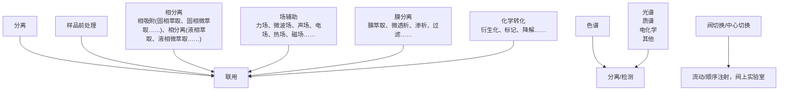
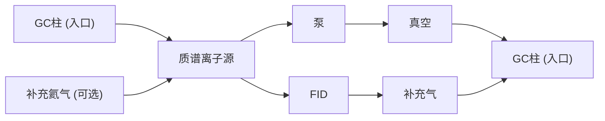
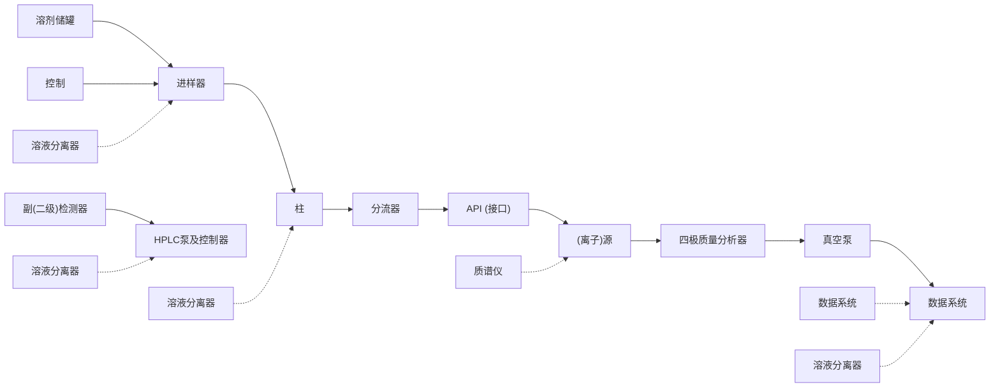
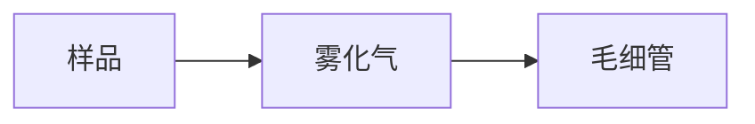
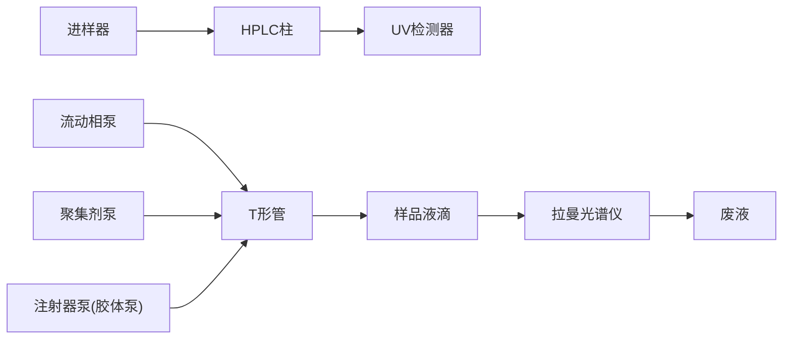
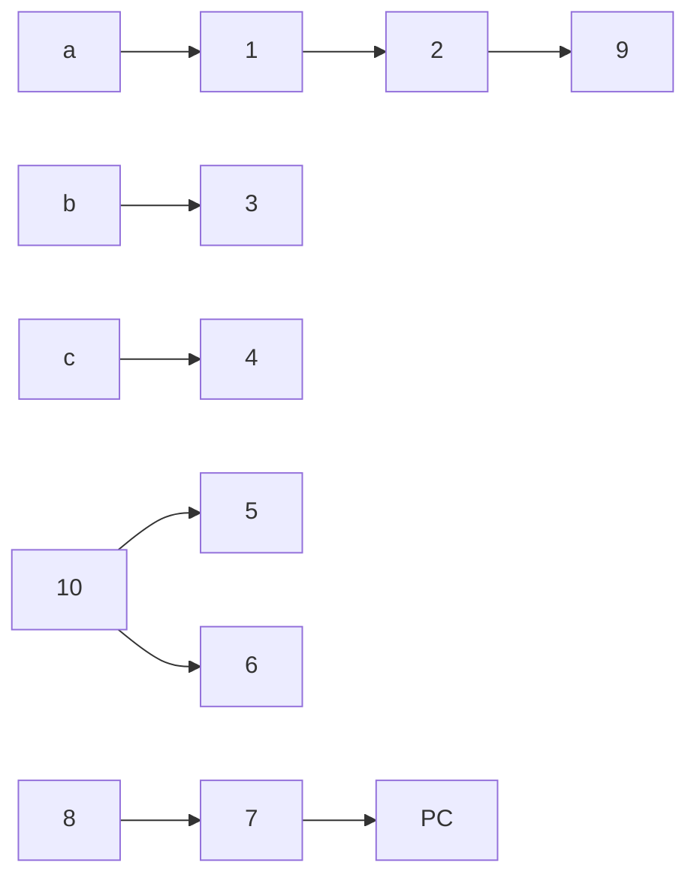

图 8.4.6 CIEF 分离示意图

## 8.4.5.5 毛细管等速电泳

## 1. 分离原理

毛细管等速电泳（capillary isotachophoresis, CITP）是一种不连续介质电泳技术，它采用两种不同的缓冲溶液系统。一种是前导电介质，充满整个毛细管柱，另一种称尾随电介质，置于一端的电泳槽中，前者的淌度高于任何样品组分，后者则低于任何样品组分，被分离的组分按其淌度不同夹在中间，以同一个速度移动，实现分离（图8.4.7）。如分离阴离子，样品离子 $A^{-}$ 、 $B^{-}$ 和 $C^{-}$ 迁移率顺序为 $A^{-}>B^{-}>C^{-}$ ，施加电场后，由于各种离子迁移率不同，向正极迁移的速度不同，使电解质溶液形成由负极到正极增加的离子浓度，而电位梯度与电导率成反比，离子浓度越大，电导率越大，因此，电位梯度由负极到正极减小。由于离子的迁移速度与电场强度成正比，迁移速度大的离子 $A^{-}$ 在较小电场强度的作用下迁移速度逐渐减慢， $C^{-}$ 则逐渐加快。随着电泳的进行， $A^{-}$ 、 $B^{-}$ 、 $C^{-}$ 三种离子必将以和前导电介质相同的速度向前移动。此时若有任何两个区带脱节，其间阻抗趋于无穷大，在恒流源的作用下电场强度迅速增加，迫使后一区带迅速赶上，保持恒定。


图 8.4.7 CITP 分离示意图

## 2. 特点

谱带以同一速度移动是 CITP 的最大特点。除此之外，等速电泳还有两个特点。一是区带锐化，在平衡状态下，如果有离子扩散进入相邻区带，由于它的速度和这一区带上主体组分离子的速度不同，迫使它立刻返回自己的区带，因此形成

## 思考:

等速电泳还可以用在哪些领域？

界面清晰的谱带；二是区带浓缩，即组分区带的浓度由前导电介质决定，一旦前导电介质浓度确定，各区带内离子的浓度即为定值。因此对于浓度较小的组分有浓缩效应，这种浓缩效应已被用于其他毛细管电泳操作模式的预浓缩手段。

## 8.4.5.6 毛细管电色谱

毛细管电色谱(capillary electrochromatography, CEC)是以内壁涂覆或管内填充色谱固定相的毛细管为分离柱，将CE的高柱效和HPLC的高选择性有机地结合在一起，兼具二者的双重分离机理，开辟了高效微分离技术的新途径。CEC由于引入了色谱机制，因此其保留机理包括两个方面:其一，如同HPLC，基于溶质在固定相和流动相的分配过程；其二，如同CE，基于溶质的电迁移过程。尽管毛细管电色谱技术的发展历史不长，但作为一种新的分离分析方法，它兼具HPLC和CE的优点。与HPLC类似，根据固定相不同性质，CEC可以在反相、离子交换、亲和、手性等不同色谱模式下分离不同类型化合物，但CEC具有比HPLC更高的柱效，因此，在分离复杂混合物时更具优势。目前，CEC在环境、生物医学、食品、石油化工产品的分析中都有应用实例。

## 8.4.5.7 其他

此外,还有亲和毛细管电泳(affinity capillary electrophoresis, ACE)等其他分离模式。其中,ACE可以应用在分子间相互作用测定、分子构型变化及核酸适配体筛选等方面。

## 8.4.6 毛细管电泳的应用及前沿进展

毛细管电泳具有分离模式多样化的特点,其分析对象包括无机和有机化合物、生物分子(氨基酸、肽、蛋白质和核酸)、手性分子,甚至单细胞、病毒等。此外,毛细管电泳法因为柱效高、分离速度快、样品用量少、分析成本低等优点,在药物分析、食品安全、临床检验、刑事侦查、环境监测、生命科学等领域中得到了广泛应用。以下列举部分 CE 在不同领域的应用。

## 8.4.6.1 粒子分析

毛细管电泳在粒子分析中展现出了卓越的性能。作为一种高效的分离分析技术，CE利用带电粒子在电场中的迁移差异实现分离与检测。以热毒宁注射液为例，该药物成分复杂，包含多种阴阳离子及小分子有机酸。通过选择适当的缓冲溶液、分离电压及检测波长，CE能够在短时间内有效分离并定量测定注射液中的 $K^{+}$ 、 $Na^{+}$ 、 $Cl^{-}$ 及L-苹果酸等关键成分，该方法不仅简化了分析流程，提高了检测灵敏度，还为药物质量控制提供了可靠依据。

## 8.4.6.2 药物分析

毛细管电泳凭借其高分离效率、快速分析、低样品消耗及广泛的适用性，已经成为药物分析研究的重要手段。中药是我国传统文化的瑰宝，中药制剂成分复杂，对生物活性成分的研究、控制已经引起全球科学家的重视。在中药研究领域，中药指纹图谱的建立可以对中药质量进行整体描述和评价，对控制中药及中药制剂的质量，促进中药现代化具有重要的意义。例如，通过优化CE的分析条件，针对芍药中的芍药内酯苷、苯甲酰芍药苷等多种单萜苷类成分通过调整分离背景溶液、添加剂种类及浓度、分离电压等条件，实现了这些成分的高效分离与准确定量。CE技术作为一种新的分离手段为中药及其复方制剂的分析、鉴定及指纹图谱建立提供了一种高效、准确的方法。随着技术的不断进步，CE技术必将推动中药现代化，在中药等药物分析领域发挥越来越重要的作用。

## 思考:

CEC与CE和HPLC技术之间有什么联系和区别？

可查阅文献了解毛细管电泳在手性分离分析中有哪些应用。


单细胞分离实例

## 8.4.6.3 蛋白质和氨基酸分析

蛋白质在生物体内具有重要的生物学功能,其结构和功能通常都是通过其酶产生的肽片段来识别的。CE技术广泛应用于多肽的检测,蛋白质的分离、定量、结构分析及活性检测等方面。例如,以溶菌酶、碳酸酐酶等多种蛋白质为样本,利用羟乙基纤维素作为筛分介质,采用脉冲毛细管电泳(PFCE)技术,通过施加脉冲电场,提高了蛋白质的分离效率,通过调节脉冲频率和调制深度,缩短迁移时间,提高分离度。通过毛细管电泳可以快速分离分析氨基酸,在精密度和准确度方面能很好地满足定量分析要求。

## 8.4.6.4 核酸分析

CE 技术在核酸检测领域具有高度的敏感性和准确性,不仅用于分离不同形态的 DNA,如超螺旋、线性及开环质粒 DNA,还能精确测定这些构象的比例,而且在核酸适配体的筛选、核酸的分离检测及核苷酸的测定等方面展现出强大的分析能力,为生物医学研究、临床诊断及药物开发提供了有力的技术支持。例如,利用 CE 结合指数富集配体系统(SELEX)技术,成功筛选出了维吉霉素 M1 的高亲和力适配体,并测定了其平衡常数。

## 8.4.6.5 手性分析

手性是自然界和生命体中普遍存在的现象，从生物分子到人类所使用的药物，大部分都具有手性。不同旋光性的化合物具有不同的生理药理活性。例如，药物 $R-$ 反应停（$R$-thalidomide）曾被用作安眠药，但其 $S$ 型对映异构体却被发现引发了胎儿畸形的问题。多巴的 D 型对映异构体可以有效治疗帕金森病，而 L-多巴无显著的药理活性，甚至会产生严重的粒细胞缺乏症。在药物开发和使用中，手性分析在确保药物安全性和有效性方面发挥重要作用。在毛细管电泳手性分析领域，可以通过使用传统的手性选择剂如环糊精、冠醚、大环抗生素等实现，也可以通过新型手性选择试剂如手性离子液体、手性功能化纳米颗粒、生物分子等发挥作用。另外，通过在毛细管柱内填充或键合手性固定相，使用毛细管电色谱（CEC）也能够实现手性化合物的分离。HPLC 和 CE 均可以对手性化合物进行手性分离分析。HPLC 作为一种成熟的手性分离技术，通过使用手性试剂或手性色谱柱进行多种手性化合物的分离和分析，但其分析时间相对较长且需要较多的样品量。与之相比，CE 的分析速度快、样品用量少、自动化程度高，使其在处理复杂样品时尤其有效。

## 8.4.6.6 单细胞分析

单细胞分析是生命科学研究领域既艰巨又具有挑战性的课题，由于CZE无固定相，直接在缓冲溶液中进行电泳，可容纳相对分子质量很大的样品，因此可用于单细胞、细菌和病毒颗粒的分析研究。在1992年，Hogan和Yeung采用直接和间接荧光检测法，分离测定体积约为蜗牛神经细胞千分之一的人单个红细胞，此项工作在单个细胞的CE分析中具有重要意义。研究人员通过光学引导的原位亚细胞毛细管微采样，利用CE直接在活体脊椎动物胚胎的单细胞中进行无标记单细胞蛋白质组学的研究。当前，毛细管电泳结合微流控芯片-质谱联用技术开展单细胞内物质的分析工作，为生命科学研究提供了有价值的数据。

## 8.4.6.7 人类基因组测序

人类基因组计划(Human genome project, HGP)旨在测定组成人类染色体中所包含的30亿个碱基对组成的核苷酸序列，从而绘制人类基因组图谱，并且辨识其基因及其序列，达到破译人类遗传信息的最终目的。由美国科学家于1985年率先提出，1990年正式启动，是由美国、英国、法国、德国、日本和中国科学家共同参与的一项规模宏大、跨国跨学科的科学探索工程。其中一项挑战性的内容是基因测序工作。起初，人类基因组计划使用Sanger测序法。该方法基于链终止法（chain termination method），其原理如下:首先将待测序的DNA样本制备成适合的片段，并使用特定的引物结合到模板DNA上。接着在反应体系中加入DNA聚合酶、四种常规去氧核糖核苷酸(dNTPs)及带有荧光标记的链终止剂(ddNTPs)。ddNTPs在与模板DNA的碱基配对时会终止DNA链的延伸。由于ddNTPs缺少3'-羟基(—OH)，因此一旦被加入DNA链中，链的合成就会停止，形成不同长度的DNA片段。这些片段随后通过毛细管电泳进行分离，根据荧光标记的不同读取每个片段的终止位置，从而确定DNA的序列。此方法在早期基因组测序中具有重要作用。

后来，随着技术的发展，毛细管阵列电泳（capillary array electrophoresis, CAE)成为一种更高效的分析方法。CAE通过在一个系统中设置多个并行的毛细管，使得多个样品可以同时进行分离和分析，显著提高了分析的速度和效率。与传统毛细管电泳相比，CAE不仅能够处理更多样品，缩短分析时间，还能提供更高的分辨率。此外，CAE系统与自动化样品处理和数据分析系统集成，进一步提高了工作效率和数据处理能力。这些改进使得大规模基因组测序和其他基因组分析变得更加快速和高效。在1998年，毛细管自动测序仪的使用极大地加快了基因测序的进度，毛细管电泳为HGP提供了强大的分离分析能力。2001年，人类基因组工作草图的发表被认为是人类基因组计划成功的里程碑。但是当时的工作仍遗漏了大约 $8\%$ 的DNA序列。遗漏的部分，主要是DNA序列高度重复的染色体中间部分的着丝粒、末端的端粒。研究人员认为，这些区域可能在进化和疾病中发挥着关键作用。2022年，Science杂志同时发表了6篇文章，并以封面形式介绍了人类基因组计划的最新成果——一份更完整的人类基因组，是人类基因组计划的全新里程碑。


Sanger 测序法与高通量毛细管阵列电泳示意图


人类基因组计划相关文献

## 习题

## - 章节练习题 -

1. 与传统电泳分离相比,高效毛细管电泳有哪些改进?
2. 为什么毛细管电泳具有非常高的分离效率？
3. 作为一种高灵敏的分析检测技术，毛细管电泳分离技术具有突出的优势，并在不同研究领域有着广泛的应用。但是现在毛细管电泳分离技术依然存在很多问题，请针对该技术的局限性思考其未来可能的发展方向。
4. 查阅文献,介绍不同毛细管电泳分离模式的发展现状和最前沿的应用领域,并将结果写成报告。

## - 挑战性问题 -

## - 专题或报告 -


拓展阅读

## 8.5 联用色谱技术

联用色谱技术是一类结合分离和检测的联用技术，已广泛应用于食品分析、

与色谱产生联用技术的起源可追溯至20世纪50年代，1957年J.C.Holmes和F.A.Morrell首次实现了气相色谱与质谱的联用。50年代末出现的色谱-红外光谱的联用，采用色谱分馏捕集技术，这是一种离线联用方式。1966年，Low等首次演示了气相色谱-傅里叶变换红外光谱联用实验。随后1967年Giddings首先提出了二维气相色谱联用的可能性。


并联检测示意图

完整的样品分析过程,大致可以分为以下4个步骤:①样品采集;②样品前处理;③分析测定;④数据处理与报告结果。样品的采集及前处理即样品进入测定仪器之前的操作环节又称为样品制备。样品制备是采用合适的方法、技术或策略,使原始样品转化为与后续分析检测过程匹配的测试样品的过程,其目的主要包括:浓缩痕量待测组分,降低检出限;除去样品中基体与其他干扰物;通过衍生化等手段使待测物转化为检测灵敏度更高的物质或与样品中干扰组分能分离的物质,提高方法的灵敏度与选择性;缩减样品质量与体积,便于运输与保存,提高测试样品的稳定性;保护分析仪器及测试系统,以免影响仪器的性能与使用寿命。


<details>
<summary>flowchart</summary>

```mermaid
graph TD
  Center(("联用策略"))
  
  subgraph Outer Ring
    A["样品前处理"]
    B["检测技术"]
    C["色谱(气相色谱、液相色谱)"]
  end
  
  subgraph Inner Ring
    D["分离"]
    E["技术"]
  end
  
  Center --> A
  Center --> B
  Center --> C
  
  A -->|"光谱"| |"质谱"||"电化学"||"检测"||"技术"||"色谱"||"检测"||"技术"||"检测"||"技术"||"检测"||"检测"||"检测"||"检测"||"检测"||"检测"||"检测"||"检测"||"检测"||"检测"||"检测"||"检测"||"检测"||"检测"||"检测"||"检测"||"检测"||"检测"||"检测"||"检测"||"检测"||"检测"||"检测"||"检测"||"检测"||"检测"||"检测"||"检测"||"检测"||"检测"||"检测"||"检测"||"检测"||"检测"))"||"检测"||"检测"||"检测"||"检测"||"检测"||"检测"||"检测"||"检测"||"检测"||"检测"||"检测"||"检测"||"检测"||"检测"||"检测"||"检测"||"检测"||"检测"||"检测"||"检测"||"检测"||"检测"||"检测"||"检测"||"检测"||"检测"||"检测"||"检测"||"检测"||"检测"||"检测"||"检测"||"检测"}}
```
</details>

图8.5.1 分离-检测联用技术示意图

环境分析、临床检测、药物分析及工业过程化学分析等领域。本节介绍了实现分离-检测联用技术的基本策略、接口装置设计原则，讨论了典型的分离-分离、分离-检测、检测-检测联用的应用实例。

## 8.5.1 分析中联用技术概述

随着科学技术的发展和科学研究的深入,研究的对象越来越复杂,研究的内容越发细致和深入,复杂样品基体中共存物会干扰目标分析物的测定;目标分析物在样品中的含量极低或分布不均匀;没有合适的标准参考物质;样品的物理化学性质不适合直接检测,这些情况都需要在分析之前采用适当的分离技术对复杂样品或未知样品进行处理。同时对目标分析物化学形态的检测和鉴定需求日益迫切,对分析方法的灵敏度、选择性和准确性提出了更高的要求。故综合运用高效的分离手段和各类检测及结构鉴定方法,实现更为高效的分离检测,成为分析技术发展的必然趋势。

联用是将两种或两种以上原理不同的技术通过合适的方法组合、集成起来，以达到优于单一技术独立运用时的效果，主要分为离线和在线两种模式。离线模式出现在联用分析技术发展初期，是一类脱机、非在线模式，这一模式存在操作费时费力、分析速度慢的问题，且样品在操作过程中易被污染或损失，影响分析结果。而在线联用是指组合的技术以联机、自动化或连续的方式进行，整个分析过程更加方便和高效，克服了离线模式的不足。联用技术是将两种技术如分离与检测，通过“接口”(interface)装置直接连接起来。协同作用、取长补短，获得两种技术单独使用时所不具备的功能。联用可以分为以下几种方式:串联、并联和一体化。在串联方式中，样品依序通过两个系统如样品前处理和色谱。串联的优点是简单、易实现，无须设计专门的器件和对检测器进行改造，只需用管线将相应的模块连接使用即可。在并联方式中，样品经分流后被分别导入下一级并列的系统中，如液相色谱的多个检测器并联，其优点是并列的不同检测器之间的相互干扰少；而且不会增加峰展宽。但是需考虑由于分流而导致进样量减少。一体化模式又称多功能模式，具体是指在有限的检测区内完成分离-检测的过程，如微流控芯片技术，需要针对所需检测特性专门设计。

分离是各种分析技术的基础,基于高效分离技术与待测物质特异性检测相结合的联用技术,是这类独特的分析方法的代表,能够在复杂基质中的痕量和超痕量水平上提供待测物质定性、定量及结构信息。分离技术与特异性检测器的在线联用如图8.5.1所示。其中分离技术主要包括样品前处理和色谱分离,用于检测的技术主要包括光谱法、质谱法和电化学检测。

在样品前处理过程中,目标分析物的分离方式均是以下4个过程的单独、同时或依次进行的过程:化学转换;两相中的分配;相的物理分离;外场作用下的迁移速度差异。样品前处理技术可以与分离技术如色谱分析联用;亦可直接与检测技术如光谱分析联用。

色谱技术是目前应用最为广泛的分离分析技术，但由于实际样品存在基体复杂的特点，采集后的样品需要经过必要的样品前处理，才能被色谱所分析。色谱分离结合高效的样品前处理技术可以大大减少手工操作产生的误差，提高分析结果的准确度与精密度。也能减少有毒溶剂的使用量，从而减少对人体和环境生态的危害。但色谱技术通常只是利用各组分的保留特性来进行定性，其定性和结构确定的能力有限，这在组分完全未知的情况下进行定性分析就更加困难。而不同的检测手段如质谱、红外光谱、紫外光谱、原子发射光谱、拉曼光谱等技术，确定一个纯组分是什么化合物，其结构如何是相对容易的事。与不同的检测技术联用能提供更多分析物的相关信息，有助于给色谱分离后的组分定性和结构确定。故色谱联用技术常分为两类:第一类是样品前处理与色谱技术联用，经过样品前处理分离富集的待测组分通过接口送入色谱仪器进行分析。接口是样品前处理-色谱联用技术中的关键装置，它必须能协调前后两种技术的矛盾，既能满足样品前处理技术对待测组分进行分离富集的要求，又不影响色谱技术对前处理后得到的样品进样和分析的要求；第二类是为弥补通用检测器在结构鉴定中的不足，以联用方式为色谱仪器增加特殊二级检测器。根据不同检测器技术的优缺点和适用范围，将不同的检测器联合使用，可以发挥各检测器的优点，得到更多、更准确的信息。如色谱-质谱联用，包括气相色谱-质谱联用、液相色谱-质谱联用和毛细管电泳-质谱联用。这类联用的本质是结合色谱的分离和质谱定性定量的优势，实现复杂混合物中各组分的分离、鉴定和定量。

## 8.5.2 样品前处理-分离/检测联用技术

大多数样品不能直接测量或直接进入分析仪器，因此在测定之前需对它们进行必要的前处理。样品前处理的选择不仅取决于待测样品和目标分析物的性质，还取决于要采用的分析技术及其能力。迄今为止，没有一种样品制备方法能适合所有样品或所有待测对象。即使同一种待测物，所处的样品与条件不同，可能所采用的前处理方法也不同。所以对于不同样品中的分析对象要进行具体分析，找出最佳方案。

针对气、液、固样品特性及目标分析物的理化性质,如极性、挥发性、溶解度等,需要考虑样品前处理技术与色谱技术的联用,应根据联用双方的特点,选择最优的流路设计。

由于需要联用的两种分离技术的工作原理、目标组分的存在状态、形态结构均存在差异，样品在在线系统中的有效传递尤为重要。而联用接口正是为了实现样品/试剂的有效传递，是在线联用关键技术，对于各式各样的样品前处理技术和后续的分离、检测技术，其联用接口形式多样，常用的包括商品化的高压切换阀、进样阀或选择阀，也可是自制接口（图8.5.2）。

## 1. 样品前处理-色谱在线联用

样品前处理-色谱联用的接口应具有以下特点:

（1）可进行有效的样品传递，通过接口尽可能将经过前处理的样品载入色谱仪器，传输过程具有高的传输效率，稳定性和重复性好，以保持整个联用方法的灵敏度和重现性。
（2）接口应满足所选用样品前处理方法的操作模式和操作条件，亦方便与色谱仪器连接，具有操作方便，便于拆卸、更换和清洗等特点。
（3）样品在通过接口时一般不发生任何化学变化，如发生化学变化，也要遵循一定规律，通过色谱仪器的分析结果，可直接得到或间接推断发生化学反应前待测物的分析结果。通常接口本身具有一定的化学惰性，不产生基体干扰，不会削弱色谱信号，对分析物或基体无吸收，残留少。
（4）接口应保证经过前处理的样品在色谱分析中产生完整的色谱峰，不使色谱峰展宽。
(5) 接口的操作应简单、方便、可靠, 尽量使用标准尺寸配件, 方便与各种品

样品前处理约占整个分析时间的2/3，并可能产生1/3以上的误差。实际的分析工作中，粗糙的手工操作也会影响分析结果的准确度和精密度。


<details>
<summary>flowchart</summary>


</details>

图 8.5.2 样品前处理-分离/检测联用技术


切换阀工作原理

牌、型号的仪器联用；样品通过接口的速度既要保证完成样品的前处理，亦不能影响甚至制约色谱分析速度。

样品前处理-色谱在线分析方法中，需要将样品前处理萃取、富集的待测组分通过接口送入色谱仪器进行分析。阀切换是色谱在线分析最主要的接口技术，其功能是实现样品在不同流路、不同压力环境的切换，较常见的有切换阀、进样阀和选择阀等。如切换阀的功能是收集一定体积的样品（或溶剂）溶液，并以高度重现的方式将其注入连续流动的在线分离检测系统中。与商用的HPLC中使用的六通进样阀结构相似，切换阀共有六个接口（进样阀其中一口为进样针口位置），中间两个接口连接共用管路，其他四个接口分别为两套流路的出入口，通过阀切换可将共用部分的溶液切换到另一个流路中。切换阀主体材料通常是Nitronic 60不锈钢，采用哈氏合金hastelloy C型材料可减少样品吸附。同时，阀旋转密封材料采用填充石墨的聚四氟乙烯valco H材料，在室温下不受任何溶剂、强酸、强碱的侵蚀。阀体驱动通常包括手动、气动和电动三种操作方式。选择阀可实现多于两个流路的切换，通常只有一个出口或入口，一次只能选择一条通路。中心切换(heart-cut)是在阀切换技术的基础上发展起来的。当目标分析物在流动注射系统的某条流路中具有较高的浓度和较小的体积时，则可通过定量环进行捕集，并通过柱切换，将定量环中的目标分析物切换到平行的另外一条流路中进一步分离分析。选择阀又称为多通道选向阀，是顺序注射分析系统的核心部分，它可与检测器、样品、试剂或清洗溶液连接，依照一定顺序从不同通道吸入溶液并带到储存管中，再反转流向将储存的溶液推至检测器。根据不同需要，多通道选向阀的通道数一般为6\~10个，分别与样品、试剂、检测器、废液及其他功能型装置如稀释管、混合管、反应器等相连。与进样阀不同的是，这类阀的操作较为烦琐，只能通过编程才可有效控制。

分离和检测的联用接口一般具有专用性。如SPME(solid-phase microextraction)与色谱联用时，当微萃取探针与GC联用时，可直接将其插入进样口进行热解吸。而与HPLC联用时，其接口设计如图8.5.3所示:三个接入口呈T字结构，分别是溶剂接入口、流出口及微萃取探针插入接口；插入接口通常用石墨锥进行密封；溶剂流动没有固有顺序，溶液可从旁侧流入，亦可从底部流入。将接口接入切换阀定量环位置,即可实现微萃取探针在液相色谱上在线溶剂解吸。


<details>
<summary>text_image</summary>

纤维入口
纤维密封装置
0.75 mm内径
HPLC三通
≈0.125 mm内径管
≥0.75 mm内径管
(解吸室)
≈0.125 mm内径管
</details>

图 8.5.3 固相微萃取探针与液相色谱联用的接口

固相萃取和固相微萃取与液相色谱和气相色谱的联用已日趋成熟。通常采用六通阀切换流路使样品和解吸液先后流经萃取介质即可完成在线萃取和解吸。在线萃取方式可分为单向流动和往复流动两种形式。单向流动萃取指样品只流经萃取介质一次即完成萃取，它适合于样品量大、目标分析物能迅速吸附在萃取相上的情况，这是最简单的在线方式，但对吸附材料要求较高，要求目标分析物在材料上的萃取/解吸速率快。往复式流动萃取方式通过流路的设计和阀的切换实现样品多次流经萃取涂层。在线解吸是指样品以在线的方式从萃取材料/组件中洗脱下，是最为简单的联用模式。SPME纤维探针、中空SPME和整体柱等均易于实现在线解吸。中空SPME和整体柱的在线解吸可用流动方式实现。SPME纤维可采用溶剂离线解吸后进样、GC在线加热解吸和HPLC在线溶剂解吸三种方法。对于易挥发目标分析物，可将纤维直接插入GC进样口进行在线解吸，无需对GC进行任何改造。而SPME-HPLC的联用是通过使用微量溶剂冲洗或浸泡萃取纤维解吸萃取物并直接进入后续的HPLC分析，它需要对商用色谱配件进行改造，研制适合纤维在线解吸的T型解吸池，通过阀切换技术来实现解吸和进样的转换。

## 2. 样品前处理-检测在线联用

样品前处理技术与检测分析技术如光谱、质谱和电化学的在线联用，结合分离与检测的优点，降低基体干扰、提高方法的灵敏度和分析速度，具有良好的发展前景。样品前处理无论与何种检测技术联用，接口的作用都是将分析物以合适的状态引入检测系统中，必须充分考虑选用的检测技术对样品的要求，采用合适的前处理方法和适配的接口实现进样。

流动分析技术可在一个连续(在线)封闭系统中处理和分析样品,它能将样品在线引入分离分析系统,提高样品通量、降低试剂和样品消耗,同时解决静态样品制备稳定性差和重现性不佳的问题。流动分析主要包括:流动注射技术

自动进样的中空管联用装置如二维码内容所示。在HPLC的自动进样阀和取样器之间放置一根涂有SPME涂层的GC石英毛细管。当处于进样位置时，进样针多次反复抽取/推送样品溶液，使之重复多次流经石英管壁的涂层上，实现往复流动萃取。萃取完成后，通过进样针在解吸溶剂瓶中吸入解吸溶剂，使解吸溶剂流经石英毛细管，进入色谱柱，进行色谱分析。


管内 SPME 与 HPLC 联用

1969 年, Holak 首次利用 Zn/HCl 还原 As 生成砷化氢 (Marsh 反应), 并利用原子吸收光谱进行了 As 检测, 建立了氢化物发生-原子光谱分析法。

(FIA)和连续流动技术。FIA具有装置易于小型化、操作简便、分析速率快、准确度和精密度高、样品和试剂消耗少、通用性强及适用于过程分析等优点，它能自动化地将样品引入分析系统，提供相对快速的提取和富集能力，又能提高分析方法的稳定性和重复性，获得了广泛关注和应用。FIA通常结合固相萃取柱，连续萃取或预富集分析物，一般使用聚四氟乙烯管连接蠕动泵、固相萃取柱、样品导入系统和检测器，蠕动泵运送试剂、洗脱液、还原剂和样品，固相萃取柱分离或富集目标分析物，样品导入系统将样品以气体或液体形式导入检测器。

化学蒸气发生(chemical vapor generation, CVG)法是利用化学反应将凝聚相中的分析元素(或其化合物)转化为挥发性物种的一类特殊的原子光谱分析进样技术。化学蒸气发生法的主要特点是:①进样效率高(甚至可接近100%),远远优于传统气动雾化进样法,气相产物的易解离特性也使原子/离子化效率大大提高,从而显著地改善了原子光谱分析法的检出限和灵敏度;②分析元素生成化学蒸气后与可能引起干扰的样品基体分离,因此可以消除或者减少来自基体的光谱/质谱干扰。CVG包括氢化物发生、光化学蒸气发生、电化学蒸气发生、等离子体诱导化学蒸气发生等方式。其实质涉及化学转化和相分离的样品前处理方法,可视为样品前处理-原子光谱联用的典型实例。

微等离子体技术是将等离子体限制在一个有限空间（至少有一个维度在毫米或亚毫米范围内），其尺寸使它们接近大多数气体Paschen曲线的最小电位，能形成非常稳定微等离子体的技术。微等离子体是原子发射光谱的激发源，可直接检测气体、液体和固体样品；亦可作为原子吸收光谱或原子荧光光谱中非热原子化器，可实现蒸气发生进样方式的原子化，以及对气相分析物具有富集功能。同时微等离子体还是常压解吸离子源，联用质谱检测，可实现深度剖面分析、元素分析及成像分析。微等离子体诱导化学反应，可实现多种元素的蒸气发生进样，以及形态转化与物质分解。

## 8.5.3 色谱-质谱联用技术

以下主要介绍气相色谱-质谱联用和液相色谱-质谱联用的技术难点和接口。

（1）气相色谱-质谱联用技术(GC-MS) 是分析仪器中较早实现联用技术的仪器。最早始于 1957 年，J.C.Holmes 和 F.A.Morrell 首次实现了气相色谱与质谱的联用，此后这一技术得到长足的发展。在所有的联用技术中，GC-MS 已成为主要的定性确认手段之一，逐渐发展成为分析复杂混合物最为有效的手段之一。其工作原理是，气相色谱将样品中的组分进行分离；联用接口负责将各组分送入质谱仪，起着配适器的作用。质谱仪对接口依次引入的各组分进行分析，成为气相色谱仪器的特色检测器；计算机系统交互地控制气相色谱、接口和质谱仪，进行数据采集和处理，是 GC-MS 的中央控制单元。GC-MS 联用技术中需要解决的两个技术问题可概括为:① 仪器接口:通常色谱柱的出口端为大气压力。而质谱仪器中样品气态分子在具有一定真空度的离子源中转化成样品气态离子，这些离子包括分子离子和其他各种碎片离子，在高真空的条件下进入质量分析器内。接口技术中需要解决气相色谱仪大气压的工作条件和质谱仪中的真空工作条件的联结和匹配。接口需要把气相色谱柱流出物中的载气尽可能多地除去，保留或浓缩待测物，使近似大气压的气流转变成适合离子化装置的真空状态，并协调色谱仪和质谱仪的工作流量。② 扫描速度:质谱仪与气相色谱仪联用后，由于气相色谱峰很窄，有的仅几秒钟。一个完整的色谱峰通常需要至少6个以上的数据点。这就要求质谱仪有较高的扫描速度，才能在很短的时间内完成多次全质量范围的质量扫描。过高的扫描速度会使色谱峰峰形歧变，导致定量分析产生较大误差。同时，联用后要求质谱仪能很快地在不同质量数之间来回切换，以满足选择离子检测的需要。GC-MS接口是解决气相色谱和质谱联用的关键组件，理想的接口是能除去全部载气，但能将待测物毫无损失的从气相色谱传输到质谱仪，其联用接口如图8.5.4所示。可通过传输产率Y、浓缩系数N、延时t和峰展宽系数H来评价接口性能。目前常用的包括直接导入型(direct coupling)、开口分流型(open-split coupling)和喷射式分离器(jet separator)。还有一些在特殊场合使用的有机薄膜分离器和钯-银管分离器等。


<details>
<summary>flowchart</summary>


</details>

图 8.5.4 GC-MS 联用接口（a）分子射流分离器（b）GC-MS 接口

GC-MS 已成为许多有机化合物常规检测工作中的一种必备工具。环境水样中浓度较低的有机污染物，如二噁英等的标准方法中就规定使用 GC-MS。GC-MS 的其他应用领域还包括:药理学和法医目的的药物及代谢物的定量分析；法医化学中对案件现场的各种残留物，如纤维、呕吐物、血迹等检验和鉴定，危险废物堆和反应产物中未知的有机化学物质的鉴别；石油、食品、化工等工业生产领域，如农药和除草剂的检测，竞技体育运动中的兴奋剂检测。

（2）液相色谱-质谱联用技术(LC-MS) 始于20世纪70年代，直到90年代才出现被广泛接受的商品接口及成套设备。LC-MS联用使热不稳定和强极性化合物在不加衍生化的情况下得以直接分析，其应用范围更广。LC-MS的联用首先需要解决的是真空的匹配问题，质谱的工作真空一般要求为 $10^{-5}\mathrm{Pa}$，要与一般在常压下工作的液质接口相匹配并维持一个动态的高真空。商品化LC-MS仪器通过提高真空泵的抽速并采用了分段、多级抽真空的方法，形成真空梯度来满足接口和质谱正常的工作要求。除真空匹配之外，流量匹配和气化问题也是必须考虑的。LC-MS联用技术的发展主要是接口技术的发展，它起着除去大量色谱流动相、浓集和气化样品及电离目标分析物的作用。LC-MS联用接口如图8.5.5所示。液相色谱-质谱联用的接口包括直接液体导入接口、热喷雾接口、粒子束接口、快原子轰击、激光解吸离子化、大气压化学离子化技术(APCI)和电喷雾电离(ESI)等多种。ESI和APCI商品接口是实用、高效的“软”离子化技术，大大推动了LC-MS技术的发展。由于LC的检测器通常为紫外检测器，故LC-MS联机也可采用“泵-分离柱-ESI接口”的串接方式，亦可在分离柱的出口处接入一个T形三通，将一端接往紫外检测器，或将紫外检测器与质谱串接，可同时获得紫外信号(UV检测器)或紫外光谱(DAD检测器)。当HPLC的流动相组成不适合ESI

传输产率  $Y:Y=(q_{\mathrm{MS}}/q_{\mathrm{GC}})\times100\%$

浓缩系数 $N: N = (Q_{\mathrm{MS}} / Q_{\mathrm{GC}})\times Y$

延时 $t: t = t_{\mathrm{MS}} - t_{\mathrm{GC}}$

峰展宽系数  $H:H=W_{MS}/W_{GC}$

$(q_{\mathrm{MS}} \text{和 } Q_{\mathrm{MS}} \text{ 分别表示从接口流出, 进入质谱仪的样品量和流量; } q_{\mathrm{GC}} \text{ 和 } Q_{\mathrm{GC}} \text{ 分别表示从色谱仪流出, 进入接口的样品量和流量; } t_{\mathrm{GC}} \text{ 和 } W_{\mathrm{GC}} \text{ 表示无接口时, 气相色谱同样条件下检测到的色谱峰保留时间和 10% 峰高处的峰宽; } t_{\mathrm{MS}} \text{ 和 } W_{\mathrm{MS}} \text{ 表示有接口时, 气相色谱同样条件下, 质谱仪检测到的色谱峰保留时间和 10% 峰高处的峰宽。})$

早期的直接液体导入接口是在真空泵的承载范围内，以细小的液流直接导入质谱。LC的柱后流出物经分流，在负压的驱动下经喷射作用进入脱溶剂室形成细小的液滴并在加热作用下脱去溶剂。其离子化过程在离子源内发生，它归于化学电离一类技术。喷射方式可以采用金属毛细管（20\~50  $\mu$ m），也可以是起“筛网”作用的带孔薄膜（2\~5  $\mu$ m），其作用都是为了得到细小、均匀的液滴。其后发展的各种接口技术中，无论采用何种技术手段都是为了获得细小液滴，这对于离子化过程都是最为基本、必要的一步。这一技术始终停留在实验室使用阶段，最终未形成商品化仪器。

的离子化条件时,也可通过在此三通处加入某些溶剂或一定量的助剂作柱后补偿或修饰。


<details>
<summary>flowchart</summary>


</details>

图 8.5.5 LC-MS 联用仪器示意图

以电喷雾为接口的 LC-MS 技术已经在药物、化工、临床医学、分子生物学等许多领域中获得了广泛的应用。对有机合成中间体、代谢产物、基因工程产品的大量分析结果为生产和科研提供了许多有价值的数据，解决了许多在此之前难以解决的分析问题。

## 8.5.4 色谱-光谱联用技术

光谱学可以广义地定义为研究电磁辐射与物质之间相互作用的学科。光谱分析是根据待测物质的光谱性质来鉴别或确定其化学组成和相对含量的方法，主要包括原子光谱与分子光谱。

## 8.5.4.1 色谱分离-原子光谱联用

色谱分离与原子光谱联用技术是较为理想的元素分析方法，色谱分离提高了原子光谱技术的元素形态分析能力，但仍需解决联用接口的技术问题。色谱分离与原子光谱的联用接口要求在不降低色谱分离性能的前提下将分离后的组分尽可能多地送入原子光谱的原子化器内，同时不降低其原子化效率。根据色谱分离类型不同和原子光谱使用原子化器不同，接口的形式也有所不同，由于大多数原子光谱的原子化器要求以溶液方式进样，这使得色谱分离与原子光谱的联用接口较为简单，容易实现。原子光谱所使用的氢化物发生器也可作为接口连接色谱和原子光谱，测定某些特定元素。

## 1. 气相色谱-原子光谱联用

由于气相色谱的流动相通常采用氮气、氢气、氦气和氩气，而且被测组分在一定温度下也呈气态，故可将气相色谱分离后的组分在一定的保温条件下与载气一同直接导入原子光谱的原子化器进行原子化，直接进行分析测定。原子光谱实际上可视为气相色谱的一个选择性检测器。

气相色谱-原子吸收联用技术(GC-AAS):与传统的气相色谱检测器相比,气相色谱与原子吸收光谱法相结合有利于高选择性、高灵敏地检测金属,适用于易挥发性金属化合物的痕量分析。早在1966年气相色谱与火焰原子吸收法(FAAS)已实现在线联用。气相色谱分离后的组分通过有加热装置的传输线( heated transfer line)直接导入火焰原子吸收光谱的火焰原子化器。传输线材质包括聚四氟乙烯管材、不锈钢管材或石英材料。根据所测样品的不同,所需保温

1966 年, Kolb 等采用原子吸收光谱仪作为 GC 检测器, 将气相色谱分离柱直接连接到原子吸收光谱仪的燃烧器上, 在线联用分析汽油中四甲基铅和四乙基铅。分析过程中液体待测样品在 GC 进样口注入, 在气化室气化后由载气带入色谱柱进行分离, 后由空气-乙炔气带入 AAS 燃烧器原子化。

的情况不同选用不同的传输线，传输线的死体积尽可能小。FAAS 的原子化效率低，待测原子在测量光路停留时间短，使其测定灵敏度低于电热原子吸收法（ETAAS）。而 GC-ETAAS 的联用则是使用一根 10 cm 长的钨管将 GC 的流出物通过一个小孔引入石墨炉。钨管的顶端靠近石墨炉内壁并固定住，GC 的流出物直接进入 1700 ℃ 高温的石墨炉。但这种联用方式中钨管不能控制温度，即使使用氘灯扣除背景，亦不能消除溶剂峰的干扰。理想的设计是将气相色谱流出物直接导入原子化器进行原子化并测定，以减少样品损失，避免峰展宽，降低死体积，提高测定灵敏度。这样简单的联用接口适合于测定相对分子质量较小、结构对称、挥发性强的有机金属化合物，而对于相对分子质量较大、挥发性较弱的有机金属化合物的分离测定，联用系统的接口必须保持一定温度使待测样品在接口中维持气化状态或原子化。

气相色谱-原子荧光联用技术(GC-AFS):与AAS相比,AFS虽然可测定的元素有限,但在灵敏度、线性范围和抗光谱干扰方面的优势明显。由于原子吸收所使用的原子化器都可用于原子荧光光谱中,故GC-AAS使用的原子化器和传输(连接)方法也适用于GC-AFS联用系统中,只需要根据所测的元素来选择原子化器的类型和传输管的材料。适用于GC-AAS的接口,如加热套管、热裂解装置等,也适用于GC-AFS的联用。对于火焰原子荧光,采用氮屏蔽的空气-乙炔火焰,原子化器的燃烧头中部有一个狭缝,GC的流出物通过一根加热的不锈钢传输管引入燃烧器中;对非火焰的原子化器,则采用带有石英炉或石墨杯的碳棒,不锈钢传输管通过其侧面的小孔进入原子化器。由于样品在加热的不锈钢传输管中可能发生沉积,尤其在高浓度时沉积现象更严重。传输管的材料需保证被分析的有机物能以较小的损失量传输到检测器。

气相色谱-等离子体原子发射联用(GC-ICP-AES):1965年McCormack等首次建立了GC-AES联用系统,随着AES技术的发展,各种类型的等离子体激发光源取代了早期的火焰、弧光放电及火花放电等技术,出现了各种等离子体激发技术和放电激发技术。ICP-AES的特点是检测动态范围宽、灵敏度和选择性好,可实现多元素同时测定,可作为高效检测器与GC联用。通过加热的传输线,气相色谱流出物连同载气一起直接被引入氩/氦等离子体中并被原子化和激发而被检测,其联用接口相对简单。原子发射谱线较窄、重叠概率和光谱干扰较少,AES几乎可以测量所有的元素,但需采用背景校正技术以消除因原子化不完全而残留的分子所产生的光谱发射带对原子发射光谱的影响。同时AES灵敏度不足以克服等离子气体对分析物的稀释、大的死体积(约4 mL)和对非金属元素的低激发电离能力,限制了GC与ICP-AES的联用。需要指出的是,GC与ICP-AES的联用接口设计与GC与ICP-MS联用相似。

气相色谱-等离子体质谱联用(GC-ICP-MS):1986年van Loon首次报道将ICP-MS作为GC检测器以来,GC-ICP-MS联用技术获得了广泛的应用。ICP-MS具有选择性高、检出限低、可多元素同时测定等优点,其独有的同位素稀释分析还能有效地提高测定的准确性和精密度。将ICP-MS作为GC的元素分析特效检测器,已成为目前复杂基体样品中有机金属化合物形态分析的理想方法。GC-ICP-MS联用技术将GC的高分辨率和高分离效率与ICP-MS的高灵敏度(检出限达1 fg),高基体耐受,同位素比(使之可以进行同位素稀释准确定量)测定能力有机地结合起来。由于引入等离子体中的样品为气态,样品从GC到等离子体中的传输效率近于100%,使检出限得到改善。由于分析物以气态形式引入ICP中,


GC-AAS联用示意图

如使用加热石英管作为 GC-AAS 的原子化器的接口, 其接口结构为从 GC 色谱柱流出的气体, 通过一个 T 形侧臂装置引入。T 形装置更有利于排除通过小孔进入原子化器中的空气, 以免空气在原子化池中对样品产生稀释。连接 GC 色谱柱和石英管炉的管路可使用不锈钢管或内衬聚四氟乙烯的铝管, 管路需要加热, 以防止被分析物在管路中冷凝。石英管炉可加热到 1000 ℃, 石英炉的旁管通有空气或氢气, 以加速原子化并燃烧除去有机溶剂。

由于气相色谱(GC)的流出物是气体,因此,简单地使用一根短的传输管连接GC的色谱柱和ICP-MS的等离子体炬管是不难实现的,早期出现的“短的传输管”就成为GC-ICP-MS联用的“接口”。对GC-ICP-MS接口的基本要求是保证分析物以气态的形式从GC传输到ICP-MS的等离子体炬管,在传输过程中不会在接口处产生冷凝,这与GC与原子光谱联用是一样的。

## 思考:

为何液相色谱与电热原子吸收光谱的在线联用难以实现？如何解决？

不需去溶剂和蒸发，分析物的电离更有效。在 GC 中不使用高盐含量的缓冲溶液，故 ICP-MS 中取样锥和分离锥的腐蚀不像 LC-ICP-MS 中那样严重。GC-ICP-MS 的接口可以简单地通过一短的传输管线连接 GC 出口端与等离子体炬管底部加以实现。接口设计的特点是:分析物在传输过程中以气态形式从 GC 柱传输到等离子体并避免在接口处冷凝。这可以通过两种方式实现:有效地加热整个传输管线和选用气溶胶载体。前者可以避免冷凝，不需雾化器和雾化室，传输管线部分插入 ICP 中心通道，加热效率有赖于分析物的性质。后者 GC 流出物在引入 ICP 之前在雾化室中与水溶液气溶胶混合。不管哪种方式的接口，都需在等离子体气中添加氧气，以降低溶剂峰和减少炭的沉积。有关 GC-ICP-MS 联用技术的接口设计，参阅 Lobinski 等发表的综述。

## 2. 超临界流体色谱-原子光谱联用

超临界流体色谱(SFC)较 LC 和 GC 的优点源于超临界流体特殊的溶剂特性。与 GC 相比，它能增加热不稳定和非挥发性分析物的溶解度，具有更小的谱带展宽；SFC 分离较 LC 快。与气相色谱-原子光谱联用相似，SFC 和原子光谱的联用通常也是将分离后组分通过一根加热的传输线直接导入原子光谱的原子化器进行分析。以 SFC 与 ICP-AES/MS 的联用为例，通过一根加热的传输线将分离后的组分直接导入等离子体炬内。与传统的 SFC 火焰电离检测器相比，ICP-AES/MS 可提高灵敏度且更易于获得元素的形态信息。

## 3. 液相色谱-原子光谱联用

由于火焰吸收光谱和等离子体发射光谱的进样过程中，样品转化成溶液后经雾化器进入原子化器，或转化成溶液后在氢化物发生器中产生的氢化物而直接进入原子化器。这样的进样方式为液相色谱与原子光谱的联用提供了方便。在线联用的关键仍是如何将液相色谱分离的样品高效转移至光谱仪中，接口装置通常包括雾化接口与冷蒸气/氢化物发生接口两大类。其中，液相色谱与原子荧光、原子吸收等的在线联用常采用冷蒸气/氢化物发生接口；而液相色谱与ICP-AES/MS的在线联用则多采用雾化和冷蒸气/氢化物发生两类接口。

液相色谱-原子吸收光谱联用(LC-AAS): 液相色谱与火焰原子吸收光谱(FAAS)之间的连接最简单的方法是用一根低扩散的蛇形管作为接口将两者连接起来。这类接口不会降低液相色谱的柱效。而电热原子吸收光谱分析液体样品时通常需要经历加热-干燥-灰化-原子化-净化等一系列过程, 不能简单地直接连续检测液相色谱分析中连续流出的流出物, 需要通过特殊的接口联接。如热化学氢化物发生器常用来测定砷化合物: 液相色谱后的流出物通过热喷雾喷嘴雾化, 在甲醇/氧火焰中热解, 热解产物与过量氢的反应生成气相氢化物(如  $AsH_{3}$ )。产生氢化物的冷扩散火焰原子化器(cool diffusion flame atomization)接到固定于原子吸收光谱仪光路的石英池上而实现砷化合物的分离分析。

液相色谱-原子荧光光谱联用(LC-AFS): 原子荧光亦需要将被分析物原子化, 与原子吸收类似, 故火焰原子化器和电热原子化器接口也可应用于原子荧光。早期的联用是将液相色谱的流出液直接引入火焰原子化器中进行分析, 但流动相的干扰大大影响分析的灵敏度和分辨率。液相色谱与原子荧光联用更常采用氢化物/冷蒸气发生的接口。以砷的形态分析为例, HPLC 的流出液与稀酸混合, 在线调节酸度后, 与还原剂反应形成氢化物或冷原子蒸气, 经气液分离后直接被送入 AFS 原子化器。对于易于产生氢化物的元素如砷、硒、锑等, 其元素形态 (如无机砷、甲基砷) 可直接柱后还原使其转化为挥发性的氢化物, 进行 AFS 检测。但某些特殊元素形态如砷糖的氢化物发生效率较差，通常需要将其氧化后再进行氢化物发生。氧化过程可通过在线混合氧化剂如  $K_{2}S_{2}O_{8}$ 、KBr-KBrO $_{3}$  等实现，亦可采用能量辅助如紫外、微波、加热的氧化方式，或者能量辅助与氧化剂相结合。

液相色谱-等离子体光谱/质谱联用（LC-ICP-AES/MS）:是解决元素化学形态分析的有效方法之一，具有同时多元素选择性检测的能力。主要有冷蒸气/氢化物发生和雾化两类接口。冷蒸气/氢化物发生接口可降低有机溶剂引入量，降低基质干扰，提高分析物的引入效率，提高检测灵敏度。以下重点介绍雾化接口。雾化接口中，色谱流出物在雾化器中雾化形成气溶胶。其中较大粒径气溶胶颗粒被分离去除，小粒径气溶胶颗粒进入ICP中。对雾化器和雾化室的要求是死体积小、进样效率高。理想的雾化器和雾化室的特点:产生平均粒径小、分布范围窄的气溶胶；传输效率高；死体积小，峰展宽小；其适用流速与色谱流动相适配。常用的雾化器有同心雾化器、交叉流雾化器、沟槽雾化器、平行流路雾化器、超声雾化器等，其中以同心雾化器使用最为广泛。常用雾化室有旋流雾化室、Scott雾化室、圆锥形雾化室等。针对小口径液相色谱，传统雾化器和雾化室的雾化与传输效率不能满足要求，死体积过大，柱后峰展宽严重，需采用低流速雾化器。低流速雾化器主要包括:微同心雾化器、高效雾化器、振荡毛细管雾化器、电喷雾雾化器等。为进一步提高样品传递效率而出现的直接注射雾化器是将喷雾口直接置于ICP焰基下的一种微同心雾化器，其设计流速 $\leqslant 100\mu \mathrm{L}\cdot \mathrm{min}^{-1}$，无须雾化室，色谱流出物可 $100\%$ 进入ICP。但操作较为复杂，易折断。而进一步发展的直接注射高效雾化器在峰宽、分辨率、峰对称性、检出限等方面性能优异。这些基于同心雾化器的结构而出现的新型雾化器具有优异的雾化性能与样品传输效率。

## 8.5.4.2 色谱分离-分子光谱联用

以下着重介绍色谱与傅里叶变换红外光谱、表面增强拉曼散射光谱和化学发光的联用。

## 1. 色谱-傅里叶变换红外光谱联用

气相色谱和液相色谱是物质分离定量的有效手段，但在未知物结构鉴定方面始终存在困难，仅靠保留指数定性未知物或未知组分通常不可靠。红外光谱能提供分子结构信息，是理想的定性鉴别工具，然而红外光谱法对分析物有严格的要求，原则上只适合纯化学物质，对混合物常常无能为力。色谱-红外光谱联用能各取所长，结合色谱技术的高效分离及定量检测能力和红外光谱独特的结构鉴别能力，用于复杂样品的分析。最早出现的联用是采用色谱分馏捕集技术，将色谱馏分低温冷凝在红外光谱仪的窗片上，或经冷阱冷凝后转移至微量吸收池中进行检测。这类非在线的联用模式，既浪费时间又容易沾污样品。与色散型仪器不同，傅里叶变换红外光谱（FTIR）具有光通量大、灵敏度高、扫描速度快、多路传输可同时获取全频域光谱信息的特点，同步跟踪扫描气相色谱馏分为GC-FTIR联用创造了条件。20世纪70年代中期汞镉碲检测器代替热释电检测器，内壁镀金硼硅玻璃光管取代早期的不锈钢管，实现了GC-FTIR在线联机检测。商品化的GC-FTIR接口有两种类型，光管接口和冷冻捕集接口。液相色谱不受样品挥发度和热稳定性的限制，特别适用于沸点高、极性强、热稳定性差、大分子样品的分离，对多数已知化合物，尤其是生化活性物质均能有效分离。由于液相色谱的流动相多为极性溶剂，这些溶剂在中红外区有较强的吸收，因此消除溶剂影响是液相色谱与FTIR联用的关键。其联用接口基本分为流动池接口和流动相去除接口两类。

在传统的液相色谱中,其流动相流速通常为  $0.5 \sim 1.5 \, mL \cdot min^{-1}$ 。这一流速与常规的 ICP-MS 样品引入流速相匹配,因此可较为方便地将色谱流出物直接连接 ICP-MS 的常规雾化器。

雾化器的设计及特点可参阅专著《原子光谱分析前沿》。


<details>
<summary>flowchart</summary>


</details>

微同心雾化器结构

GC-FTIR 联机检测基本过程:样品经气相色谱分离后各组分按保留时间顺序进入接口,与此同时,经干涉仪调制的干涉光汇聚到接口,与各组分作用后干涉信号被汞镉碲(MCT)液氮低温光电检测器检测。计算机数据系统存储采集到的干涉图信息,经快速傅里叶变换得到组分的气态红外谱图,进而可通过谱库检索得到各组分的分子结构信息。


TLC-SERS联用现场检测

## 思考:

是否存在更合理的联用方式,进一步提高灵敏度?


HPLC-SERS 联用实例

## 2. 色谱-表面增强拉曼散射光谱联用

拉曼散射光谱和红外光谱同属分子振动光谱，能反映分子的特征结构。但拉曼散射光强仅约为入射光强的 $10^{-10}$，限制了拉曼散射光谱的灵敏度。表面增强拉曼散射（surface enhanced Raman scattering, SERS）是灵敏的指纹光谱技术，但受样品基体干扰的影响，限制了其在复杂样品微痕量组分分析中的应用。色谱技术与SERS结合不仅能有效消除样品基体干扰，还能提高SERS的灵敏度。色谱与SERS联用的关键是表面增强拉曼活性粒子的增敏性能、固定化及传输方式。

薄层色谱与表面增强拉曼光谱(TLC-SERS)联用:薄层色谱(TLC)技术作为一种高通量分离技术,以薄层板为固定相,可以选择不同的展开剂进行分离。TLC技术具有分离距离短、分离速度快等优点;SERS技术具有灵敏度高、快速的特点,可以实现对单一物质组分的特异检测。TLC-SERS联用能同步完成分离和光谱检测,可实现混合物的快速现场分离和定量检测。TLC板可由固定相和金属纳米粒子(NPs)或其前体组成,分离后可直接SERS测定。复杂样品完成分离后,将NPs喷在分析物点上或整个薄层色谱板上,可获得增强拉曼信号,从而得到分析物的SERS谱图,TLC-SERS在食品科学、环境污染和生物医学等领域得到了广泛应用。

高效液相色谱-表面增强拉曼光谱(HPLC-SERS)联用:TLC难以完全分离结构或极性相似的化学物质，目标分析物的SERS信号仍然可能受到干扰。HPLC-SERS联用结合了液相色谱高效分离技能和SERS的高灵敏度。1988年，Freeman首次实现HPLC和SERS联用。这种以流动注射方式实现的联用，提高了普通拉曼光谱的灵敏度，但再现性和稳定性差。HPLC-SERS联用可通过设置2个T形混合器完成流动相/银胶体/聚集剂柱后混合，拉曼光谱仪记录从管中滴下混合物液滴的拉曼光谱(图8.5.6)。此外，另一类联用方式是通过自组装制备等离激元纳米粒子修饰的毛细管(NPMC)，并连接到HPLC出口端。分析物经高效液相色谱分离后，在毛细管中吸附在等离激元纳米粒子上，即可进行灵敏的SERS分析。需要注意的是，常见流动相如乙腈会产生背景光谱，影响目标分析物的SERS信号，故流动相宜选择甲醇，可以克服背景干扰，提高灵敏度。


<details>
<summary>flowchart</summary>


</details>

图 8.5.6 HPLC-SERS 联用的示意图

## 3. 色谱-化学发光联用

化学发光法(chemiluminescence, CL)是依据参与化学发光反应的待测物浓度与反应产生的发光强度在一定条件下呈线性定量关系的原理,通过检测化学发光强度而确定待测物含量的一种微量和痕量分析方法。CL的特点是设备简单、分析速度快及灵敏度高，在金属离子、各类无机化合物、有机化合物分析及生物检测领域有广泛的应用。但CL选择性差，应用范围受限。高灵敏的CL检测技术，结合高分辨的HPLC、毛细管电泳（CE）和微流控芯片等分离技术，成为一种理想的分离分析方法。

高效液相色谱与化学发光(HPLC-CL)联用:HPLC-CL联用系统包括输液泵、色谱柱、混合器和化学发光检测器四部分，化学发光检测器由发光流通池和光电转换装置组成。液相色谱流出液与发光试剂在发光流通池中混合发生化学发光反应，光信号由光电倍增管或者其他光电转换器件转换并放大，最后由记录仪或者数据采集装置记录(图8.5.7)。HPLC-CL联用不需要光源和复杂的光学系统，消除了光源不稳定和杂散光的干扰，保留了CL高的灵敏度，同时结合了HPLC高效的分离性能。HPLC-CL因选择性高、灵敏度高、线性范围宽等优点而备受青睐，已在临床、环境、食品和药物分析等领域得到了广泛应用。HPLC-CL联用的关键是协调高效色谱分离所需的化学环境（主要是流动相的组成）与灵敏的CL检测所需的化学环境（反应温度、pH、溶剂、CL前体、影响CL反应产率的催化剂和增强剂等）。报道的大部分化学发光体系都具有很高的灵敏度，但与色谱联用时，色谱分离使用的有机溶剂与许多化学发光反应的条件并不匹配，限制了HPLC-CL联用技术的发展。应用最多的是水相化学发光的鲁米诺体系和有机相化学发光的过氧化草酸酯体系。这两个体系互相补充，普遍地应用于有机、无机和生物样品的分析。


<details>
<summary>flowchart</summary>


</details>

a—流动相；b，c—化学发光试剂；1—高压泵；2—样品阀；3，4—恒流泵；5—负高压；6—光电倍增管；7—计算机；8—废液；9—色谱柱；10—混合器

毛细管电泳与化学发光(CE-CL)联用: CE 具有高效、快速、样品量少和试剂消耗量少等优点, 对检测的灵敏度要求更高。CE-CL 兼备了毛细管电泳分离效率高和化学发光高灵敏度高的优点, 可直接用于复杂样品中微量组分的分离与测定, 同时解决了 CL 选择性差和 CE 灵敏度低的问题。CE-CL 联用最早见于 1998 年, 在线联用需考虑两方面的问题: 毛细管电泳分离进样量少且分离过程中需要施加高压电源, 而化学发光试剂的引入需要适当的溶液传输。接口方式对于仪器操作的安全性和提高分离效率、检测灵敏度都非常重要, 也是化学发光能否成功地作为毛细管电泳检测器的关键。按照 CL 试剂的引入方式, 包括柱上、柱下和柱端接口。主要有五种接口模式: 在柱套管式、柱后套管式、在柱填充固体氧化剂、柱端液池式。随后发展的柱后旋转 CL 检测池可在 CE 后端更新试剂, 克服了 CE

图 8.5.7 HPLC-CL 联用示意图


HPLC-CL 联用实例