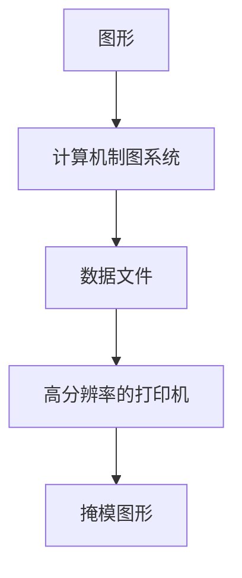
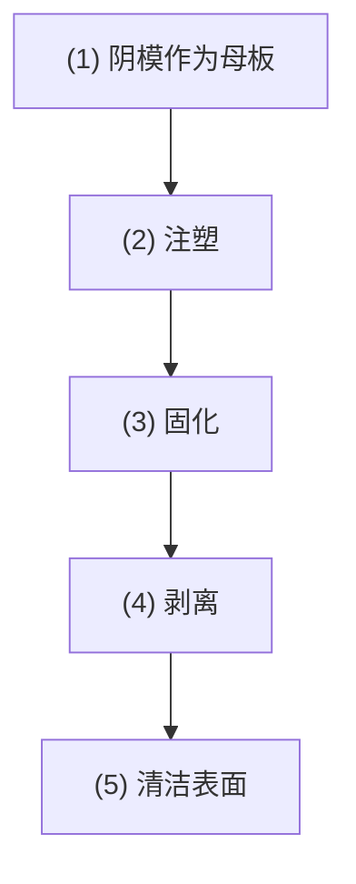
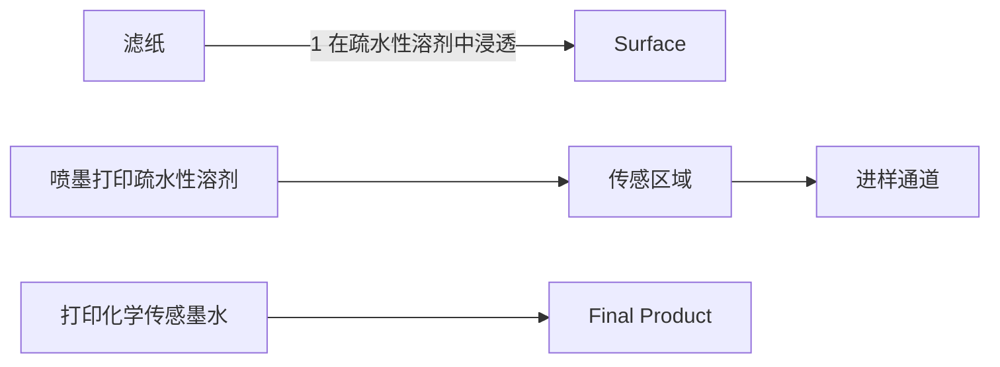
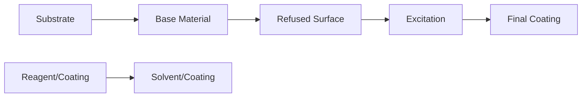

自动 SPME-GC 分析系统

动态液-液-固印迹微萃取-HPLC联用实例

分析中气泡形成和液流堵塞的问题。最常见的CE-CL体系，包括三 $(2,2^{\prime}$ -联吡啶)钌(Ⅱ)体系，鲁米诺和吖啶衍生物，过氧草酸盐或氧化剂。CE-CL联用广泛应用在临床、制药、环境和食品分析等不同领域。

## 8.5.4.3 多功能在线分析系统

多功能在线分析将萃取、解吸、分离分析集于一体，是理想的联用模式。1999年，CTC Analytics公司将固相微萃取(SPME)纤维探针和公司研发的CombiPAL自动进样器结合在一起，应用该系统可同时完成多个样品在线萃取、SPME-GC热解吸及分离。2008年，Pawliszyn等设计了高通量SPME-LC-MS/MS自动分析系统。该系统可在 $100\mathrm{min}$ 之内完成96个样品的前处理。应用该系统准确测定了人血中四种镇静药的含量。同期出现的SPME-GC顶空在线分析系统，用于检测工业废水中的卤代烷烃、卤代烯烃和卤代酮类化合物等24种污染物。

基于分子印迹萃取介质的样品前处理-色谱在线联用系统可实现复杂样品的直接分析，如动态液液固印迹微萃取-高效液相色谱多功能在线联用系统，实现了复杂样品中痕量雌激素的直接萃取、解吸、分离、分析。该方法结合了液液萃取的富集能力、分子印迹材料的选择性和液相色谱的分离分析能力，并通过在线联用方式缩短了分析时间、提高了准确度和精密度，可应用于不同来源复杂样品中痕量有机物的分析检测。

结合微球填充萃取与阀上实验室，出现了实现编程可控的多功能分析系统（图8.5.8）。阀上实验室单元是该系统核心器件，包括八孔选择阀和编程可控的蠕动泵。以蠕动泵为动力，通过选择阀实现微球活化、样品导入和流动萃取等功能；通过下游六通阀完成解吸并把解吸液送至样品环；利用六通阀和三通阀，实现GC进样和分析。应用该在线分析系统测定了固体垃圾填埋场渗滤液或环境水中多氯联苯。

图 8.5.8 彩图

text_image

ECD
PTV
GC柱
GC
废液
电磁阀
针
甲醇
LOV
空气
色谱珠
乙酸乙酯
HC
废液
洗脱液管线
IV
样品
洗脱液回路
废液
1
2
3
4
5
6
7
8
9
10
11
12
13
14
15
16
17
18
19
20
21
22
23
24
25
26
27
28
29
30
31
32
33
34
35
36
37
38
39
40
41
42
43
44
45
46
47
48
49
50
51
52
53
54
55
56
57
58
59
60
61
62
63
64
65
66
67
68
69
70
71
72
73
74
75
76
77
78
79
80
81
82
83
84
85
86
87
88
89
90
91
92
93
94
95
96
97
98
99
100
MPSP On Off S1 S2 S3 On Off SV 空气 空气 废液储液器 传输管线 不间断电源

图 8.5.8 阀上实验室-大体积进样 GC 联用系统用于在线分析固体废物滤出物中的痕量多氯联苯

随后，出现了各种在线联用分析系统，如注射器磁力搅拌辅助分散液-液微萃取/衍生化结合气相色谱-质谱法(in-syringe-MSA-DLLME-GC-MS)的在线分析方法，用于测定环境水、化妆品中广泛使用的多种紫外防晒剂。基于场辅助萃取（FAE）、微固相萃取( $\mu$ -SPE)和HPLC的全在线萃取-分析系统，对食品中多环芳烃(PAHs)和化妆品样品中四环素类抗生素(TCA)进行在线检测。盐诱导液-液萃取(SI-LLE)在线固相萃取与超高效液相色谱串联质谱(online SPE-UHPLC-MS/MS)的联用方法，实现了牛奶中蛋白质和黄曲霉毒素的自动富集、净化及分析检测。全自动管内SPME/LC-柱前衍生-MS方法，用于测定尿液中己醛和庚醛含量。自动化电场驱动膜萃取-液相色谱-质谱分析系统，在线分析河水中氯化苯氧乙酸。结合HPLC、二极管阵列检测(DAD)、MS和luminol- $H_{2}O_{2}$ CL反应，开发了在线同步检测、活性评估和抗氧化剂清除剂鉴定的分析方法，该系统分析和研究了4种淫羊藿(三枝九叶草)的质量特征，确定了包括酚酸、8-异戊烯基黄酮苷和含有邻羟基的黄酮苷在内的32种活性化合物。

随着分离科学的发展,分析化学中联用分离-检测技术的策略能有效解决单一分析技术的不足,在当前越来越繁杂的分析任务中发挥着不可替代的作用,继续推动了科研工作的快速发展。随着计算机技术和互联网的高速发展,不同分析技术的在线联用、各种功能软件的开发及谱库检索等技术在科学研究各领域将发挥更大的作用。联用分析技术已经在向商品化、实用化、微型化及高通量等方面发展,这将进一步拓宽其应用领域和范围。

HPLC-DAD-MS-CL 联用系统实例

参考文献

## 习题

## - 章节练习题 -

1. 在分析化学中,联用技术的目的是什么? 常见的联用技术分几类?
2. 不同技术联用的方式分串联、并联和一体化三类，各列举一例应用实例。
3. 请分别列举分离-分离、分离-检测和检测-检测三类联用实例。
4. 以原子吸收光谱为例,联用的样品前处理技术有哪些?请至少列举出三种联用方式,在接口装置设计中需要注意的事项有哪些?
5. 根据质谱进样的要求,哪些样品前处理方法适合与其联用,并设计与之匹配的接口装置。
6. 请列举采用一体化联用模式的应用实例, 讨论其一体化的策略如何实现。
7. 请用思维导图完成本章内容的小结。

## - 挑战性问题 -

8. 疟疾是疟原虫引起的一类传染病，根据 WHO 报道全球每年仍有 2 亿多例疟疾病例，死亡达 50 万人以上。用于预防和治疗疟疾的药物，按其结构可分为青蒿素类喹啉类和嘧啶类。青蒿素类药物对多种抗性恶性疟疾具有作用快、疗效高、安全、副作用小的优点。屠呦呦等人研究的抗疟药青蒿素，获得了我国实施新药审批办法以来的第一个新药证书，是世界公认的首创药物。查阅相关文献，请根据青蒿素药物的主要结构特征，拟定药物含量的检测方法。青蒿素类药物进入人体内，经吸收分布代谢和排泄发挥作用，体内药物代谢动力学分析监测对于它们的临床合理应用具有重要的指导意义。请为青蒿素类药物的生物样本制订合适的分析方案（含样品制备）。

flowchart

微流控通道网络设计一般流程

## - 专题或报告 -

9. 在实际检测中,真实样品(土壤样品、材料样品、生物组织等)大多比较复杂,单一检测技术通常因基质干扰等问题的影响而受到限制,将两个或多个技术联用,有可能拓展原有技术的应用范围,并显著提高其准确性、选择性和灵敏度。查阅相关文献,选取一个有关真实样品分析的主题,拟定一个完整的分析方案(样品采集、样品前处理及制备、分离分析),并与同学分享你的结果。

## 8.6 微流控分析

流体在微纳空间尺度中的特殊性质为分离分析带来了诸多优势，本节主要介绍微流控分析(microfluidic analysis)的定义、特点和芯片制作加工方法，论述微流控气相色谱、微流控液相色谱、微流控电泳等常见的微流控分离分析技术，以微流控芯片质谱联用技术为例展示了微流控分析的优势及其实际分析应用。

## 8.6.1 微流控分析概述

在面对微量样品更多组分分离分析需求时,分析仪器开始了微型化的进程。20世纪80年代兴起的微机电系统(micro-electro mechanical system, MEMS)及其加工技术,为分析仪器微型化提供了理论和技术铺垫。微流控技术应运而生,并率先在分离科学领域迅猛发展起来。

## 8.6.1.1 定义

微流控是一种以在微米尺度空间对流体进行操控为主要特征的科学技术，具有将生物、化学等实验室的基本功能微缩到一块几平方厘米芯片上的能力，因此又被称为芯片实验室（lab-on-a-chip）。微流控芯片是具有一定结构的微通道网络及相应功能的分析器件，以可控流体贯穿整个通道网络，形成集成化的流动分析系统，来实现常规化学或生物等实验室的各种功能。

## 8.6.1.2 特点

微流控芯片的基本特征和最大优势是多种单元技术在微小可控平台上灵活组合和规模集成，因此微流控芯片在分析化学应用中的特点包括:样品和试剂的消耗量小，在微尺度反应室内可以实现快速反应；集成化程度高，可以实现高通量多通道平行测试；设备微型化便携性好；芯片设计多样，可以根据功能需要设计制作不同结构的芯片；体外生物模型研究中可以实现对细胞行为和细胞培养环境的精确调控。微流控芯片的终极目标是把化学和生物学等领域中所涉及的样品制备、反应、分离、检测、细胞培养、分选、裂解等基本操作单元集成到一块很小的芯片上，实现常规化学或生物实验室的各种功能。

## 8.6.2 微流控芯片的设计与制作

## 8.6.2.1 微流控通道网络的设计

微流控芯片的结构特征是微米级的微通道系统，其设计是多种多样的。除了最基本的微通道之外，还需要其他功能单元，如微泵、微阀、检测单元、微反应单元等。具体微结构的设计由具体应用决定，如芯片电泳常用十字形或双T形结构。微结构还可以通过绘图软件辅助设计，如AutoCAD、CorelDRAW等。

## 8.6.2.2 微流控芯片的加工技术

## 1. 微流控芯片的材料

随着芯片加工技术的不断发展，用于制作微流控芯片的材料也越来越多（表8.6.1），从最初的单晶硅到玻璃、石英、金属、高分子聚合物等。高分子聚合物材料，如聚二甲基硅氧烷（PDMS）、聚甲基丙烯酸甲酯（PMMA）、聚碳酸酯（PC）等，由于品种多、价格低、加工易，具有良好的透光性和介电性，已成为除玻璃材料之外的又一类主流芯片材料，在大规模一次性芯片的加工中优势明显。近年来，纸质材料因具有多孔结构，可以实现自驱动样品运输；并且有成本低、体积小、质量轻、便于储存和运输等优势，可作为微流控芯片的一类基材。

表 8.6.1 微流控芯片材料与优缺点

<table><tr><td>材料种类</td><td>优点</td><td>缺点</td></tr><tr><td rowspan="2">单晶硅</td><td>具有化学惰性和热稳定性</td><td>易碎、价格贵</td></tr><tr><td>加工工艺成熟,可使用光刻和刻蚀等制备集成电路的成熟工艺进行加工及批量生产</td><td>不能透过紫外线电绝缘性能不够好表面化学行为较复杂</td></tr><tr><td>玻璃、石英</td><td>电渗性好、光学性质优异,可用光刻和刻蚀技术进行加工,可用化学方法进行表面改性</td><td>加工成本较高键合难度较大</td></tr><tr><td>高分子聚合物</td><td>成本低、品种多、能透过可见光与紫外光,易加工,可通过铸造成型、激光溅射等方法批量生产,可用化学方法进行表面改性</td><td>不耐高温导热系数低表面改性方法有待进一步研究</td></tr></table>

## 2. 光刻技术制作微流控芯片

光刻技术在微流控芯片的制作中具有举足轻重的地位。光刻技术通过光学原理，将设计好的微结构转移到基材上，通过物理或化学的方法在基材上面形成各种微结构。以玻璃为基片的微流控芯片的制作如图8.6.1所示。先在洁净且平滑的玻璃基片表面上镀一层金属铬，在铬层上用甩胶机均匀地涂布一层光刻胶；将具有微通道网络的光掩膜覆盖在基片上，用紫外线照射，使光刻胶按微通道网络的形状曝光；再显影除去曝光了的光刻胶，并用去铬液腐蚀清除铬层，显出微通道网络的平面二维图形，随后用湿法腐蚀制成具有微通道网络的基片；在刻蚀结束后，去除所有的光刻胶和保护铬层；最后，经打孔后的基片和平整的玻璃盖片清洗后高温键合制成玻璃芯片。

图 8.6.1 光刻技术制作微流控芯片

flowchart

图 8.6.2 模塑法 PDMS 芯片的制作流程示意图

绘图法纸芯片的制作

## 3. 高分子聚合物微流控芯片的加工方法

高分子聚合物因其价格低廉、制作方法简单、加工成本低、可一次性使用的特点已引起人们的广泛兴趣。利用高分子聚合物制作微通道的技术有模塑法、热压法、激光烧蚀和软光刻法等。

模塑法是采用玻璃阴模复制、两步注塑制作PDMS芯片的方法。注塑过程如图8.6.2所示:第一步以刻有通道的玻璃基片为阴模基础，用PDMS作为注塑材料，预聚合物以硅橡胶与固化剂以质量比 $10:1$ 的混合物浇注在玻璃基片上，$65^{\circ}\mathrm{C}$ 固化 $4\mathrm{h}$ 后剥离，制成PDMS阳模。第二步是PDMS与固化剂的混合物浇注于已固化的PDMS阳模上。固化后，阳模与PDMS基片剥离成具有微通道的基片，产生的PDMS基片与原玻璃基片有完全相同刻蚀的痕迹。PDMS基片的盖片在一培养皿中浇注制成。盖片按基片的尺寸裁片、打孔，用作样品引入口和储液池，PDMS盖片和基片对合即制成芯片。

## 4. 纸基芯片的制作方法

纸基芯片具有以下优势:① 纸基芯片以微通道形成网络,以可控流体贯穿整个系统,既具有定量、定速、流体均一等优点,又可同时检测多个样品或多个指标;② 纸基芯片的微通道最小宽度可达 $100\ \mu m$ ,仅消耗极少的试剂及样品,即可实现微量分析;③ 纸基芯片还能组装成三维结构,只需一次进样即可完成多步分离、纯化及检测。

纸基芯片的制作材料分疏水性和亲水性两种。疏水性材料如光刻胶、聚二甲基硅氧烷、蜡、聚苯乙烯、烷基烯酮二聚体等；亲水性材料则是纸基芯片的基质材料，如滤纸、硝酸纤维素膜、棉布等。目前，制作纸基芯片的方法主要有光刻法、绘图法、打印法等。

打印法有两种模式:一种是将整张纸都浸透疏水性材料,再喷墨打印上溶剂将疏水性材料溶解,在纸上暴露出亲水性的纸通道(图8.6.3);另一种是直接在纸上打印疏水性材料,构成亲水/疏水相间的区域,形成纸通道。首先将滤纸浸泡在1%聚苯乙烯甲苯溶液中,待其干燥后,将其放入喷墨打印机中。将喷墨打印机墨盒换成甲苯溶液,利用“喷墨”打印的方法将预先设计好的图案打印到滤纸上,从打印喷头处打印出来的甲苯就会溶解聚苯乙烯,露出纸的纤维,形成亲水通道。

flowchart

图 8.6.3 打印法纸基芯片的制作流程示意图

## 8.6.3 微流控分离分析技术

将色谱分析装置微缩到一块芯片上，通过微流控技术实现分离分析可以大幅度提高分离效率和速度。随着各种芯片材料及微加工技术的不断迭代发展，微流控芯片不仅能为色谱分析提供新的分离柱和分离介质及功能更完备的集成系统从而加速分离，还能作为新一代微型便携分离分析装置以满足现场检测需求。以下将分别介绍微流控气相色谱、微流控液相色谱和微流控电泳分离分析这三种常见微流控分离分析技术。

## 8.6.3.1 微流控气相色谱

将微机电系统应用于分析化学,最先实现仪器装置微型化的是微流控气相色谱技术。微流控气相色谱系统由进样单元、分离单元和检测单元等模块组成,通过微加工技术构建,并可集成在一块芯片上。

微流控气相色谱的进样单元通常由十字形微通道构成，可通过流体操控将纳升级样品引入分离单元。分离单元，即色谱柱，可采用微型化的开管柱、填充柱、半填充柱，还可通过微加工构建多通道色谱柱。开管柱与填充柱的性能与传统气相色谱柱类似；半填充柱是利用光刻和深反应离子刻蚀等加工方法在芯片孔道内构筑阵列的微柱，并对微柱表面进行涂层修饰引入色谱固定相，是芯片色谱柱所独有的柱型。多通道色谱柱使用多条平行排列的窄通道作为载体对待测物进行分离，在提高通量的同时能获得较高的柱效。检测单元可与传统气相色谱检测器耦联，常用的微流控气相色谱检测器是热导池检测器、火焰离子化检测器和质谱检测器。

作为微型化的气相色谱技术,微流控气相色谱可用于挥发性和半挥发性有机化合物的分离分析,且分离效率更高,分析速度更快,自动化程度更高。微型化的气相色谱仪器的便携性还能满足现场原位分析的需求。

## 8.6.3.2 微流控液相色谱

微流控液相色谱与纳升级液相色谱都是微型化的液相色谱。不同的是，进样单元、分离单元、检测单元及泵系统等多功能单元能在芯片上高度集成，使微流控液相色谱可以最大限度地减小系统死体积。

常见的微流控液相色谱柱分为开管柱、整体柱、填充柱和半填充柱。开管式芯片色谱柱是在芯片通道内引入固定相，可直接在通道材料上进行化学键合固定相。整体柱式芯片色谱柱是将聚合物单体与致孔剂混合后灌注到芯片通道中，通过热引发或光引发聚合反应，在芯片内原位反应形成连续、整体的柱床；由于芯片通道的尺寸与毛细管的内径在同一尺度，因此大多数毛细管整体柱的柱工艺都可以移植到芯片整体柱的制备上。填充式芯片色谱柱是将传统的填充色谱柱直接移植到微流控芯片上。半填充式或微柱阵列式芯片色谱柱中的微柱可通过微加工技术构筑，这些构型尺寸相同的微柱规则地分布在芯片通道能增加芯片色谱柱的比表面积、提高柱效。纳升级喷雾离子源检测器和质谱检测器与纳升级流量匹配，可与微流控液相色谱联用。电化学检测器和光学检测器易于微型化和集成化，也能应用于微流控液相色谱系统。

## 8.6.3.3 微流控电泳分离分析

通过微流控实现的电泳分离不仅具备微型化分离的一般优势，还采用电场力作为驱动力，更易于流体的精确操控。微流控电泳分析芯片也包括进样单元、分离单元和检测单元等。

微流控气相色谱实例

微流控液相色谱实例

微流控电泳分离实例

与毛细管电泳类似，微流控电泳的进样可通过压力进样和电动进样来实现。压力进样需要增加泵和阀系统对进样进行控制，增加仪器装置和操作的复杂性；电动进样通过控制施加在进样通道上的电场强度和时间实现，但可能存在进样歧视效应。微流控电泳的芯片有多种材质，芯片通道的内表面可通过动态涂层或静态涂层进行表面修饰，从而调控分离柱中的电渗流大小、提高电泳分离效果。微流控电泳的检测器可采用激光诱导荧光、电化学、质谱等。激光诱导荧光检测法灵敏度高、与微量样品分析匹配性好，但是多数样品需要预先衍生化反应才能被检测到。电化学检测法普适性好，并能通过微加工技术将微电极集成在芯片上。质谱检测法不仅灵敏度高，还能提供分子结构信息，通过外源或集成的电喷雾针能实现微流控电泳与质谱的联用。

除了毛细管电泳，凝胶电泳、自由流电泳、电色谱等多种电泳模式都已在芯片上实现了微型化。微流控电泳分离已成为低耗、快速、高效、灵敏的新一代分析技术。

## 8.6.3.4 微流控细胞分离

由于芯片微通道的特征长度和大多数真核细胞尺寸相近,通道中液体呈层流流动,为单细胞的精准操控提供了恰当的环境。微流控芯片的可集成性,让细胞分离捕获和内容物分离检测等各个步骤可以在一块芯片上完成,提高分析通量。

微流控细胞分离方式按照是否施加外部作用力可分为主动式细胞分离和被动式细胞分离两类。主动式细胞分离包括流场驱动法、磁场驱动法、介电泳法、声场驱动法。被动式细胞分离可通过通道微结构、惯性力辅助、亲和作用等方式实现。

## 8.6.4 微流控质谱联用

## 8.6.4.1 微流控芯片质谱仪接口

质谱分析具有较高的检测灵敏度、良好的分子结构选择性及对复杂样品处理的能力，特别适用于对有机分子、核酸、蛋白质等分子结构类型的检测与鉴定，是微流控芯片上一种重要的分析检测方法。较早报道的微流控芯片与质谱联用技术是通过刻蚀的尖端结构产生液体喷雾离子化实现质谱检测分析；另一种方法是采用芯片上嵌入毛细管，利用毛细管尖端作为电喷雾离子化源与质谱联用直接用于质谱分析检测。我国科学家率先在国际上提出Chip-MS的概念及发展思路，采用毛细管直接将微流控芯片通道和质谱离子源接口连接，同时在芯片通道内集成了固相微萃取柱用于样品除盐和净化，可持续地对分析物进行检测，使得微流控芯片质谱联用分析得到快速发展和应用。

随着近年来微流控技术的发展，微型化的微流控离子源与质谱的联用平台得到了广泛关注，并取得了巨大的进展。微流控芯片与质谱的接口是芯片-质谱技术发展过程中的重要机遇与挑战。基于ESI源的质谱接口可以直接联用到微流控芯片上，而基于MALDI源的质谱接口通常是通过芯片出口将样品沉积在MALDI靶板上或通过芯片接口直接电离获得。

## 1. ESI 接口

电喷雾离子源(ESI)是通过对液体施加高压来产生气溶胶从而产生离子。它保持了大分子的完整性,离子化时分子碎片很少,这就是所谓的软电离技术。目前,已有一些将单个电喷雾发射器与不同材料结合的方法,如包含有强化电子接触的 PDMS 通道芯片的 ESI 质谱接口，或将包含多个功能部件的集成微流控设备通过石英毛细管柱与 ESI-Q-TOF-MS 直接联用并用于生化分析，为分析化学提供了新的工具，并在多个领域开辟了新的研究方向。此外，与药物代谢或细胞分泌相关的功能，包括细胞培养、代谢生成、细胞分泌、样品预处理和检测，都可集成到微流控装置中。与传统的方法相比，该策略具有分析时间短（少于 10 min）、样品与试剂消耗量少（小于 100 μL）等优点。

微流控芯片与ESI源质谱联用的主要挑战是如何开发稳定高效的接口。ESI从原理上可以实现与微流控芯片的在线联用，通过压力驱动或电渗流将微流控芯片与电喷雾接口耦合，将液体引入接口，在接口处施加电压完成离子化。根据加工方式可以把芯片电喷雾接口归纳为以下三种制备方法（图8.6.4）:（a）芯片直接喷口；（b）芯片外接喷口；（c）芯片一体化喷口。

## 2. MALDI 接口

MALDI 技术是在 20 世纪 80 年代后期出现的一种相对较软的离子化方法，利用该方法所获得的离子大多为分子离子，碎片较少，这与 ESI 方法十分相似。不同之处在于 MALDI 利用基质吸收激光能量来帮助产生离子。MALDI 通常用于大分子，如蛋白质、多肽和其他生物分子等的分析，近年来也被应用于单细胞分析，最近，高密度微阵列芯片被直接用于 MALDI-MS 分析。MALDI-MS 具有从组织或其他样品获得数以千计的谱图的能力，这使它成为理想的高通量细胞分析和药物研究技术。MALDI-MS 的在线检测接口可通过气溶胶颗粒、毛细管或机械方法引入基质和分析物实现。

微流控芯片-MALDI联用的挑战在于样品状态不均一，芯片通常输出的是流体，而MALDI通常分析的是结晶后的固体。目前主要通过离线方式实现，主要分为靶板点样式和芯片靶板一体式接口(图8.6.5)。

图 8.6.4 微流控芯片——ESI

接口示意图

flowchart

图8.6.5 微流控芯片MALDI源接口示意图

靶板点样式接口一般预先在激光靶板上喷涂基质，在微流控芯片末端延伸出一段毛细管，通过三维移动平台控制靶板移动，经过芯片分析后的样品被涂布到靶板上，与基质共结晶，随后转移到激光器下离子化[图8.6.5(a)]，该接口适用于微反应器和液滴微流控芯片中样品的高通量分析。芯片靶板一体式接口直接将芯片本身作为靶板，预先将基质溶于缓冲溶液，在芯片上完成分离后移除盖片，将底片流道中的溶剂蒸干或冻干，使样品与基质共结晶，随后转移到激光器下离子

化[图 8.6.5(b)]。

## 8.6.4.2 ESI 的三种界面

电喷雾离子源(ESI)质谱技术是一种将溶液中的粒子转变为气相离子的离子化技术。ESI的总体过程包括液滴的形成、去溶剂化、气相离子的形成三个阶段。电喷雾质谱技术是一种相对简单的离子化技术，具有较高的效率，尤其对于检测蛋白质来说离子化效率可以近乎达到 $100\%$ 。对于电喷雾质谱技术，最显著的优点是可以提供较为精确的分子质量和结构信息。另外，电喷雾质谱技术的检测范围较为广泛，不但可以分析大相对分子质量的生物分子如蛋白质、核苷酸、多肽、酶，而且可以分析其他难以蒸发、解离的小分子物质，微流控芯片技术和电喷雾质谱技术的结合是进行细胞研究较为理想的检测手段。现有的芯片与ESI质谱接口主要有以下三种制备方法:①直接从芯片边缘喷射；②从插入芯片的熔融石英片中喷射；③在集成微流控芯片的ESI尖端喷射。

## 1. 芯片直联喷口

设计微米级别的芯片的流道，依靠注射泵的压力驱动产生的液流，施加电压产生喷雾，实现了低浓度样品的快速分析，这项研究开辟了微流控芯片与质谱联用的新领域。但由于玻璃芯片表面的亲水性及平末端出口，流出液滴容易向边缘扩散，形成较大的死体积，影响喷雾的稳定性，也适用于混合物分离，目前已很少被采用。

## 2. 一体化接口

微流控芯片外接喷雾接口:在芯片上外接一个喷雾接口以完成离子化。这种喷雾头通常由电脑数控(CNC)铣削、加热和拉伸制造而成，玻璃毛细管喷雾器的性能与商用产品相仿。样品经过毛细管金属喷嘴，在毛细管和对电极板之间施加电压，使样品溶液形成高度分散的雾状小液滴。带电荷的液滴在向质量分析器移动的过程中，溶剂不断挥发，使其表面的电荷密度不断增大，当电荷斥力足以克服表面张力时，即达到瑞利极限，液滴发生裂分。经过反复多次的溶剂挥发-裂分过程，带电荷的液滴最终形成带有单个(或多个)电荷的准分子离子。在大气压条件下形成的离子，在电位差的驱使下通过干燥的氮气帘进入质谱仪的真空区。常用是钻孔加黏合的手段把毛细管喷雾头与芯片拼接到一起。外接的喷雾接口更容易加载高压，并且具有很小的死体积，制作方法简单，成本较低。可以通过有针对性的设计，对芯片通道中特定位置的成分进行喷雾进样检测，比如通道出口、液面交汇处、鞘流通道等。这种方式目前采用比较广泛。

外接接口通过在流路末端插入毛细管或商业化喷针，并在外接装置上施加喷雾电压实现离子化。该种方式采用的喷针内径通常为5\~15  $\mu$ m，溶液消耗量少，可以实现纳喷喷雾，所需的喷雾电压低，喷雾稳定。

目前，已有将单个电喷雾发射器与不同材料结合的方法，如包含有强化电子接触的PDMS通道芯片的ESI质谱接口相连接，利用微流控芯片构建细胞培养平台，将样品收集后通过微SPE柱预处理，然后用聚四氟乙烯套管的石英毛细管连接，通入雾化气体辅助产生喷雾，雾化气体的加入有效提升了样品的离子化效率，提高了信号强度(图8.6.6)。这种包含了多个功能部件的集成微流控设备可通过石英毛细管柱与ESI-Q-TOF质谱直接联用并用于生化分析，与药物代谢或细胞分泌相关的功能部件，包括细胞培养、代谢生成或细胞分泌、样品预处理和检测，都可集成到微流控装置中。与传统方法相比，该方法具有分析时间短（少于$10\mathrm{min}$）、样品与试剂消耗量少(小于 $100~\mu \mathrm{L}$ )等优点。

text_image

注射泵
ESI离子源

图 8.6.6 PDMS 芯片聚四氟乙烯套管的石英毛细管外接接口

图8.6.7展示了一种微流控芯片-质谱联用技术的芯片。该微流控芯片上包含两个不同功能的单元结构:①用于细胞培养的圆形小室；②质谱检测前用于样品除盐和富集的固相萃取微柱。将两个不同的功能单元通过聚乙烯管相连，能将药物代谢相关的操作单元如细胞的培养、代谢物的产生、样品的预处理和检测同时集成到一个微流控设备上。为了评价该平台进行药物代谢研究的可行性，以维生素E在A549细胞内的代谢为模型进行了验证。实验中用ESI-Q-TOF质谱成功地检测到了两种代谢产物，且整个检测时间只需要 $8\mathrm{min}$ 。通过集成多个平行的微通道，能同时完成多个样品的除盐和富集，且整个样品预处理的时间仅需 $15\mathrm{min}$ 左右，所消耗的溶剂量不到 $100~\mu \mathrm{L}$ 。研究结果表明，建立的芯片与质谱联用的技术平台在新药开发过程中具有很大的应用潜力。以该六通道芯片技术为基础，我国科学家成功研发出微流控芯片-质谱联用细胞分析仪（cellentCM-MS），并由岛津公司于2019年进行生产和推广。

## 参考:

Analytical Chemistry, 2010, 82(13): 5679–5685.

（a）微流控芯片上用于细胞培养和ESI-Q-TOS质谱检测前样品预处理的一个单元结构示意图；(b）细胞培养通道的尺寸；(c）微型SPE柱的尺寸；(d）含有六个单元结构的微流控芯片显微照片，其中细胞培养室填充有红色染料

图 8.6.7 用于细胞培养和代谢物检测的微流控芯片装置

## 8.6.4.3 微流控液滴电喷雾质谱技术

## 1. 喷墨打印液滴电喷雾质谱

喷墨打印技术主要是利用外力迫使成型材料以微细液滴(或液流)的形式从喷头容腔的小孔(喷嘴)射至基板上,形成二维图形文字、点阵或三维实体。喷墨打印所产生的“液滴”的尺寸大小可精确控制至微米级别水平,其体积范围可精确控制到微升至飞升量级水平。喷墨打印系统的核心器件是喷头,喷头是指依据控制信号,将液体从喷腔中喷出到指定位置的设备。按照喷墨打印头喷射液滴的方式,可分为连续式[continuous printing (CP)或 continuous ink-jetting (CIJ)]和按需式[drop-on-demand (DOD)又称随机式或脉冲式]两类。

## 2. 纸基电喷雾质谱

纸基电喷雾质谱法是一种敞开式的质谱技术，其将样品加载在低价易处理的纸上，通过施加高电压驱动目标分子到达纸尖，随后瞬间气化形成电喷雾进入质谱。由于其可以在开放式大气压环境下对样品或样品表面的物质进行分析，具有低成本、高通量、简便、实时、快速的分析优势。可以实现纸基微流控芯片与质谱的直接联用。

## 3. 单液滴单细胞电喷雾质谱

质谱分析作为一种强大的分析技术，能够对多组分进行快速高灵敏度的同时分析，检测的分子范围广，种类涵盖小分子、脂质、肽和蛋白，非常适用于细胞组分和药物代谢物等生物分子的结构鉴定，故在生物医学研究中占据重要的地位。在液滴单细胞质谱分析中，一个关键过程是如何将液滴与质谱相结合。这主要是因为液滴处于流动相中，而流动相往往会干扰质谱检测，同时也会稀释液滴内的目标物，使其含量降低；其次，当液滴中包含有细胞时，其中的细胞培养基中含有大量盐分而不能直接用于质谱分析；再次，液滴的高通量也限制了其与质谱的联用。为了克服这些问题，研究人员首先想到的是将液滴从流动相中分离出来，以减少流动相的干扰，即先将液滴收集并储存，然后再重新注入与质谱相连的微流控芯片中。此外，还可以在芯片中构建油水两相界面，利用电场将生成的液滴从油相推入水相中，进而流入熔融石英喷管中，产生电喷雾进入质谱检测。另外一种常见方法则是直接在玻璃板上产生液滴单细胞阵列，然后将细胞萃取物吸入与质谱相连的毛细管中进行检测。

## 8.6.5 微流控技术在生命分析中的应用

## 8.6.5.1 分析仪器集成化

## 1. 微流控样品预处理功能

集成微流控芯片中样品的预处理技术已成为一个重要的研究领域。例如，在生物分析中人们感兴趣的分析物通常是低浓度的并伴有复杂的干扰，考虑到分析系统体积有限，预处理大致分为预浓缩和分离两部分。例如，为了从真实病毒裂解物中提取DNA，微流控样品预处理系统可由微流控芯片、真空管路、电磁阀、微控制器和气泵或其他流体动力设备组成。这对于提高检测的灵敏度，使得数据获取具有快速、高灵敏度和良好的重现性。

## 2. 多通道快速分离功能

微流控芯片可以在平方厘米空间中布置大量微通道并在每个独立的通道上实现对样品的快速分离。例如，多通道快速分析芯片已经被用于芯片-质谱平台上的细胞分离。将毛细管电泳(CE)与ESI-MS结合可以形成一套用于自动实时分析单细胞的微流控设备,其涉及一种在单独的自由溶液电泳通道中快速溶解单细胞的方法。在通道内,细胞成分被分离出来后,采用一个集成的电喷雾发射器进行组分的电离,然后采用质谱对洗脱液进行分析。

## 3. 高通量快速检测功能

现有临床检测大多受到通量低、操作要求高、影响因素多、缺乏自动化集成等问题的制约。微流控芯片由于可以在芯片上集成多个功能单元，在高通量快速检测方面具有独特的应用优势。随着微流控芯片的发展，系统地在微流控芯片的各通道内布置检测单元并与多种分析仪器（如显微镜、电学平台、质谱仪、核磁共振仪等）进行集成，可以为目标物的快速检测提供丰富的解决策略。

## 8.6.5.2 分析仪器微型化

## 1. 集成化智能控制

微流控芯片的一大特征在于可以利用芯片材料和微流体独特的性质集成多种功能单元，以替代传统分析方法。这些功能单元包括微泵、微阀、微通道、微流体控制单元、各种细胞培养单元及芯片离心功能单元等。这些功能单元极大程度上提升了微流控芯片对于物质分析检测的能力。通过智能化控制系统对功能单元进行自动化操作可以减少人工干预，提高实验效率。

## 2. 快速数据处理和分析功能

微流控分析可以与先进的计算机软件结合比较不同检测器的数据,设置显示数据的布局,进行色谱图的积分,校准曲线及打印数据报告等。此外,通过引入人工智能算法并进行可视化展示,可以将微流系统中的压力变化曲线、色谱及质谱图进行比较并获得定量信息。

## 8.6.5.3 微流控技术在生命分析中的应用

## 1. 单组分分析

细胞代谢物研究是分析化学和临床医学研究的热点，一些代谢产物被认为是癌症和获得性免疫缺陷综合征等主要疾病的重要指标。近年来，已经开展了一系列研究工作，将SPE微柱集成到细胞培养芯片中用以建立药物细胞检测平台，研究细胞间通信和药物代谢。通常这些装置由三部分组成:第一部分由药物和培养基注射入口组成；第二部分作为药物诱导细胞凋亡的细胞培养和观察室；第三部分由SPE微柱阵列组成，用于样品脱盐。通过对特定组分的高灵敏检测，将帮助人们深刻了解细胞代谢物的作用机制。

## 2. 多组分分析

快速、灵敏、特异性、定量和多组分基因分析的实现将会使疾病诊断重新被定义。微流控技术的来临为这一目标的实现带来了可能，在一个整体、易携的微流控芯片上可以集成各种复杂、多步的生化分析并且只需相对少量的生物样品。如离心式微流控芯片（如图8.6.8所示），可以通过离心力的驱动，将流体按特定路径，导入芯片多个反应孔，结合生化反应试剂、免疫试剂或者核酸探针等，可以有效实现样本中多组分（包括各类代谢产物、各类抗原/抗体和基因序列）的同时检测，完成疾病的全面诊断。

## 3. 细胞分析

在生物微环境中，细胞被多种生化因子包围，并对多种外界刺激产生反应。因此对于细胞的分析，包括细胞形态、内容物、信号转导和分泌过程等，在了解和掌握细胞的生命过程和生物机理中发挥了至关重要的作用。微流控芯片以其灵活多样的结构设计、低成本消耗、高通量、易于集成和自动化等优点，被认为是一种强大且极具前途的细胞分析工具。

拓展学习

text_image

加样孔
反应孔
(a)
(b)

图 8.6.8 离心式微流控芯片(a)及设备(b)用于多重基因分析

斯坦福大学 Zare 课题组设计了一种微流控装置, 可以使用单分子荧光计数来操作、裂解、标记、分离和量化单个细胞的蛋白质含量。该技术为高灵敏度地分析单个细胞中的多种目标蛋白质提供了新工具, 特别适用于研究细胞间的差异性和基因表达调控。

我国科学家采用微流控芯片技术建立的单细胞原位提取装置，可以同时实现对单细胞表面多种磷脂的检测和对单细胞的操控。研究采用聚二甲基硅氧烷（PDMS）探针从培养基中直接提取单细胞，并通过电喷雾电离四极飞行时间质谱（ESI-QTOF-MS）分析细胞中的脂质。这一方法无须标记即可基于脂质表达对单细胞进行鉴定和分类，未来有望在疾病诊断等领域应用。

## 习题

## - 章节练习题 -

1. 微流控芯片的加工方法有哪些？
2. 哪些色谱分离可以通过微流控技术实现微型化？
3. 微流控分离分析技术与传统色谱分离分析技术相比有什么优势？
4. 微流控-质谱联用的优势是什么？
5. 微流控-质谱联用主要的组成部分是什么？简述每个部分的作用。
6. 简述微流控芯片质谱仪接口种类和工作原理。

## - 挑战性问题 -

7. 微流控芯片与质谱联用时, 如何提高离子化效率?
8. 微流控芯片质谱联用研究细胞生物分子涉及哪些实验技术, 它们有哪些优点和不足?

## - 专题或报告 -

9. 研究人员采用越来越多的新材料、新概念或新技术用于加工制造微流控芯片。一种新材料、新概念或新技术的应用所面临的关键问题和因素是什么？
10. 微流控芯片用于高通量、多组分的快速检测面临哪些挑战和困难？

## 8.7 分离分析新技术

科学研究和社会经济技术的深入发展,对分析化学提出了更高的要求和挑战,在各种传统的分离分析技术基础上,基于新材料的分离介质、基于新原理的分离分析技术及基于新检测原理的仪器装置研制日新月异。本节简要介绍色谱分离、分析技术的挑战与趋势,阐述了色谱固定相和样品前处理新介质研究进展,介绍了分离分析新技术、新装置和新应用等前沿知识。

## 8.7.1 分离分析的挑战与趋势

在仪器分析方法中，色谱法因其能同时进行分离和检测的特点而区分于其他方法，尤其是在解决多组分、复杂混合体系的分析中具有明显优势。在进入21世纪后，人类面临着生命科学、材料科学、环境科学等领域快速发展的挑战，尤其是蛋白质组学、多肽组学、糖组学和代谢组学等组学分析的发展对色谱分析技术提出了更高的要求。从简单物质的分离分析、单一信号的获取到复杂的、与生命体系相关的高通量分离分析与海量数据挖掘。从分离的核心角度，色谱柱就是色谱仪器的“心脏”，色谱固定相的发展是色谱分析的关键，也是各种色谱分离模式赖以建立和发展的基础。分别从色谱动力学和热力学角度出发，色谱固定相一直围绕如何提高分离柱效和分离选择性在不断发展。另一方面，对于实际复杂样品分析，发展样品前处理新技术和新介质，最大限度地消除复杂基体中干扰物的影响，更快、高通量和更简便环保地实现样品中痕量待测组分的分离富集，发展适合于野外或现场操作、应用范围广的分离富集新技术，也越来越受到分析化学工作者的重视。超高效液相色谱、快速气相色谱、全二维色谱等分离分析新技术的发展，为提高分离柱效、分析速度和增加峰容量提供了有效的解决途径。基于微芯片和纳米通道的微纳分离技术的发展，基于分离富集和传感检测于一体的技术，则为分离分析微型化、一体化开拓了新的领域。

## 8.7.2 新型分离材料

## 8.7.2.1 色谱固定相进展

色谱固定相是决定分离选择性和效率的关键因素，对分离性能有着极其重要的影响。为了获得更好的分离效果，首先要获得更高的柱效，色谱科学的发展就是不断追求高分离柱效的过程。同时在热力学方面，由于被分离物结构和性质的千变万化，色谱分析的发展也是不断丰富分离选择性的历史。生命科学、环境分析和食品安全等应用领域的发展促使复杂体系的高分辨、高精确度和高通量分离分析技术不断进步，因而对固定相也提出了新的要求。

## 1. 气相色谱固定相进展

毛细管柱气相色谱法因分离效率高、分析速度快是气相色谱应用的主要模式，固定液主要为聚硅氧烷类和聚醚类化合物等相对分子质量大、耐热性高的化合物。气相色谱固定液的发展重点在于研究低流失、耐高温、分离选择性好的毛细管色谱柱，以及研制各领域分离分析的专用色谱柱。

室温离子液体是在常温下呈液态的离子型化合物，常由较大的有机阳离子，如烷基咪唑盐、烷基季铵盐、烷基吡啶盐、烷基季磷盐和相对较小的无机或有机阴离子构成。室温离子液体具有热稳定性好、蒸气压力低、黏度高且随温度变化波

如何通过分离新材料和分离新技术解决超复杂生物体系中蛋白质组的分离问题？

超分子化学与色谱固定相

MOFs-GC 固定相快速分离二甲苯异构体

根据 van Deemter 方程, 是否可以通过减少固定相粒径提高柱效? 对色谱固定相的设计有什么启发?

填充柱存在什么问题？根据H-u曲线，较高的柱流速往往造成H增加，如何在提高分析速度的同时不降低分离效率？

动小、种类多等特点，这正符合作为气相色谱固定相的要求，因此室温离子液体作为气相色谱固定相得到较大发展并成功商品化。1999年Armstrong研究组首次将六氟磷酸1-丁基-3-甲基咪唑及相应的氯化物用作气相色谱固定相，可成功分离多种混合物，并发现离子液体固定相具有分离极性和非极性化合物的双重性质。2008年以后Supelco公司将室温离子液体气相色谱柱成功商品化，促进了离子液体气相色谱固定相的广泛使用，特别是在对不饱和脂肪酸的分析方面显现出优越性，对顺反异构体的分离也优于以往使用的多氰基聚硅氧烷固定相。

大环化合物具有独特的环状结构，在气相色谱固定相中的应用日益广泛。大环化合物主要包括冠醚、环糊精、杯芳烃、葫芦脲、柱芳烃等主体化合物，其固有的空腔对客体分子或离子具有一定的选择性，这种主客体相互作用的本质是非共价键相互作用的加和与协同。大环化合物气相色谱固定相主要用于位置异构体或手性分离，应用最广泛的是冠醚和环糊精及其衍生物。

近年来有序多孔材料如金属有机骨架(metal organic frameworks, MOFs)、共价有机骨架(covalent organic frameworks, COFs)、多孔有机笼(porous organic cages, POCs)作为气相色谱固定相开始崭露头角。这一类材料具有高比表面积、规则的孔道结构、较高的热化学稳定性、结构和功能可调等特点，使其在气相色谱固定相领域具有良好的开发应用价值和发展前景。MOFs是基于有机多齿配体与无机过渡金属离子或者金属簇之间通过配位作用形成的一类周期性网络微孔的晶体结构材料。MOFs纳米级孔道结构均一，极适宜于辨识特定的气体或挥发性小分子，从而分离聚硅氧烷类气相色谱柱无法分开的目标化合物。例如，将MIL-101动态涂渍在毛细管内壁，不到 $2\mathrm{min}$ 即可获得二甲苯异构体的基线分离。COFs材料是由C、H、O、N、B等轻质元素通过共价键连接构成的有序多孔材料，具备高比表面积和孔隙率及规整可调的孔道结构，这些特征使得COFs作为气相色谱固定相有很大发展空间。例如，以1,3,5-三甲酰基间苯三酚-联苯胺(TpBD)制备的COFs材料，能基线分离沸点相近的环己烷与苯的混合物，相比聚硅氧烷类商品柱表现出明显的分离优势。

## 2. 高效液相色谱固定相进展

高效液相色谱法固定相可以分为正相、反相、亲水、离子交换、亲和、手性等多种类型。尽管目前市场上已有多种商品化的色谱固定相，但是研制柱效高、分离选择性好、机械强度高、使用范围宽和寿命长的新型固定相仍然是当前色谱领域的研究热点之一。

以硅胶为基质的固定相占据了HPLC分离的主要地位。为克服硅胶的 $\mathrm{pH}$ 适用范围较窄的问题，各种改性硅胶，如聚合物或金属氧化物包覆硅胶应运而生。由于硅胶为酸性氧化物，解决碱性化合物在硅胶基质色谱固定相的拖尾问题也是色谱工作者和色谱柱生产厂商一直面临的重要问题，解决途径包括更有效的封尾技术、碱性去活、齿状修饰等。将氧化锆、二氧化钛等金属氧化物直接作为HPLC填料也是重要的补充。氧化锆同时具有硅胶基质的高机械强度和聚合物基质优良的化学稳定性，特别是耐碱性能好，同时耐高温，可在较苛刻的条件下使用，拓宽了HPLC固定相的使用范围。在正相色谱分离模式中，因其对碱性化合物吸附弱，分离碱性化合物色谱峰对称，相对硅胶基质有独特的优势。但是氧化锆固定相也存在着一些问题，如与Lewis酸性化合物之间较强的作用使得这些物质的分离不理想，其表面键合技术也不如硅胶基质成熟。

为了提高色谱柱效,根据速率理论方程,减小固定相的粒径是十分有效的方法，且小颗粒固定相的柱效在高流动相流速下降幅更小（图8.7.1）。常规硅胶键合固定相的粒径是 $5\mu \mathrm{m}$，而超高效液相色谱的固定相粒径为 $1.7\sim 2.1\mu \mathrm{m}$。小颗粒硅胶固定相为色谱分离带来高柱效，在同等分离度的要求下可以采用较短的色谱柱提高分离速度。但使用的色谱固定相粒径减小，所产生的柱压自然成倍增大，故输液泵也需满足更高的压力。色谱固定相的变化引起仪器整体系统优化设计，HPLC也进入了超高效液相色谱的新时代。

line

| Particle Size | Linear Velocity (U, mm/sec) | \(HETP/\mu m\) |
| --- | --- | --- |
| 10 µm Particle (1970's) | ~0.2 | ~35 |
| 10 µm Particle (1970's) | ~0.8 | ~18 |
| 10 µm Particle (1970's) | ~2.5 | ~30 |
| 5 µm Particle (1980's) | ~0.2 | ~24 |
| 5 µm Particle (1980's) | ~0.8 | ~10 |
| 5 µm Particle (1980's) | ~2.5 | ~16 |
| 2.5 µm Particle (2000) | ~0.2 | ~9 |
| 2.5 µm Particle (2000) | ~0.8 | ~10 |
| 2.5 µm Particle (2000) | ~2.5 | ~4 |
| 1.7 µm Particle (2004) | ~4.5 | ~7 |
| 1.7 µm Particle (2004) | ~8 | ~11 |
| 2.5 µm Particle (2000) | ~4.5 | ~3 |
| 2.5 µm Particle (2000) | ~8 | ~5 |

图 8.7.1 不同粒径固定相的 H-u 曲线

另一方面，固定相介质构造差异造成色谱内流体模式和溶质传质方式的差异。高效液相色谱中，以球形全多孔硅胶颗粒为基质的填充柱占据主导地位。减小固定相的粒径虽能提升色谱柱效，却会导致柱压急剧升高。同时，填料粒径与流动相流速之间也存在难以调和的矛盾。整体柱又称连续床，是由单体、交联剂、致孔剂和引发剂的混合溶液在空的柱管内原位聚合，形成连续整体的多孔结构，具有制备简单、通透性好、柱压低的特点。不同于填充柱，整体柱的贯穿型大孔为流动相提供了通路，以对流传质取代扩散传质使传质速率大大提高，流速增加，柱压无显著变化，对柱效的影响也较小（图8.7.2）。整体柱可分为高分子聚合物基质和硅氧烷聚合物基质两大类，通过聚合条件的控制可制备得到不同孔径的整体柱。并且可以根据需要对表面进行修饰改性，以适应不同需求和分离模式。由于孔隙率高和操作压力低，可使分离对象在最短的时间内获得最佳的分离，在快速分离纯化生物大分子方面，与传统填充柱色谱固定相比较具有突出的优势。

图 8.7.2 整体柱贯穿孔示意图和柱压随流动相流速变化规律

新型色谱固定相文献