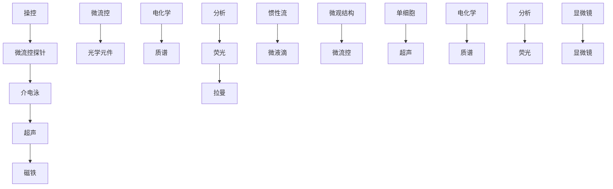
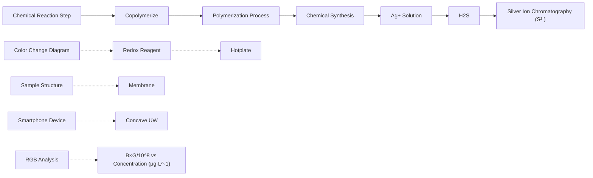
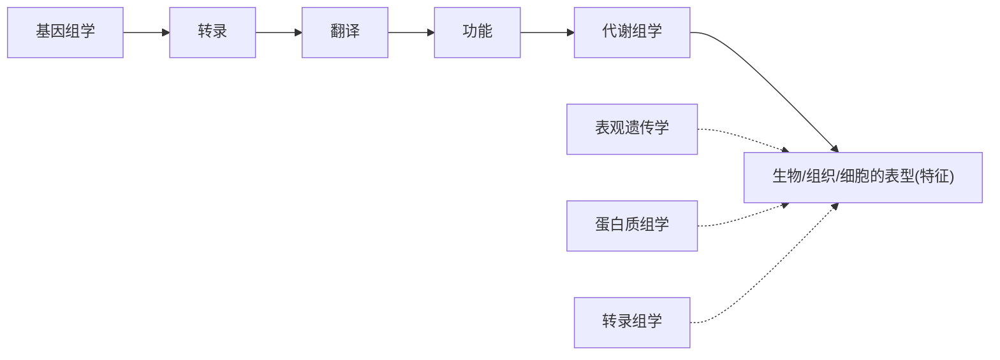
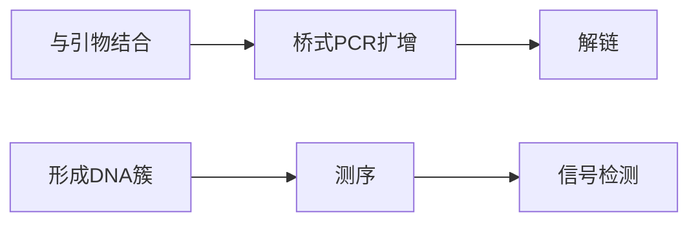
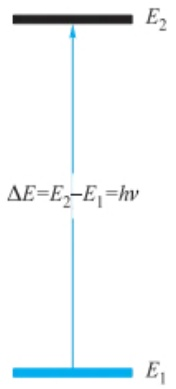
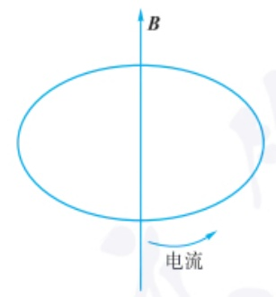
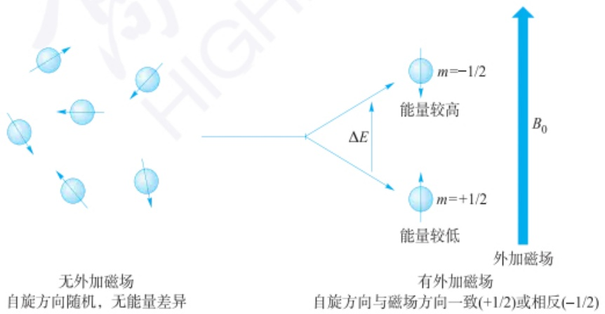
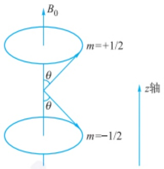
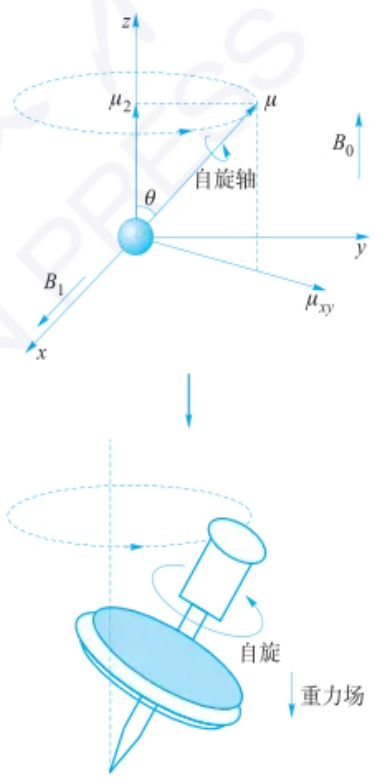
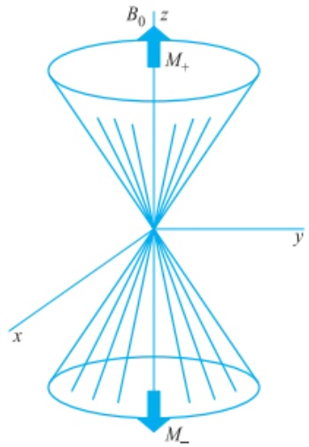

硅胶微球的表面修饰和功能化则为适应不同分离目标物的要求提供了多种选择，一些前沿的有机合成反应、聚合反应及生物分子嫁接方法为不断探索新的色谱固定相制备方法带来了启发。针对生命分析的需要，硼亲和色谱固定相解决了顺式二羟基生物分子的分离难点，为蛋白质组学、代谢组学和糖组学研究提供了有力的分离手段。硼亲和色谱固定相是将硼酸基团作为亲和配基，在较高的pH条件下，硼原子和氢氧根离子配位，再和顺式二羟基分子中邻二羟基发生酯化反应，从而形成稳定的五元环或六元环，在低pH条件下，硼原子由 $sp^{3}$ 杂化转变为 $sp^{2}$ 杂化，环状硼酸酯解离，释放出顺式二羟基分子（图8.7.3）。硼亲和技术是选择性识别顺式二羟基类化合物的独特方法，因此成为核苷、核苷酸、核酸、儿茶酚、糖蛋白和糖肽等重要生命物质分离的重要工具。


<details>
<summary>chemical</summary>

Chemical reaction scheme showing conversion of boronate species sp² and sp³ to form sp³ with specified pH conditions
</details>

图 8.7.3 硼亲和的原理


手性现象与手性色谱固定相

手性色谱固定相(chiral stationary phase, CSPs)的快速发展同样令人瞩目，商品化的HPLC手性固定相超过200余种。CSPs包括多糖类、刷型(Pirkle型)、蛋白质类、环糊精类、冠醚类、大环抗生素类、合成聚合物类等。按其拆分原理CSPs可分为独立型和协同型。独立型CSPs具有独立的手性识别能力，如刷型、环糊精、冠醚、大环抗生素类CPSs属于此类。协同型的手性识别机理比较复杂，与其超分子结构有关。在发展的众多HPLC CPSs中，多糖类CPSs目前应用最为广泛，其次是环糊精类和大环抗生素类CSPs。多糖类CSPs主要以纤维素和淀粉衍生物为手性选择剂。1984年Okamoto将纤维素衍生物涂覆于大孔硅胶，促进了多糖类CPSs的发展，随后和与之合作的Daicel公司开展了深入系统的研究，并推进其商品化生产。环糊精具有内腔疏水和端腔亲水的特点，可以与许多化合物形成包结物，未衍生的环糊精每个糖单元有5个手性中心，此双重作用使环糊精具有良好的手性识别能力。而大环抗生素是一类新型手性选择剂，分子中含有多个形状不一的环形结构和手性中心，可与溶质产生多点、复杂的作用，因而显示出广泛的手性识别能力。

## 8.7.2.2 样品前处理新介质

在分析工作中,样品的前处理是关键步骤之一,样品前处理过程实质上也是分离富集过程,直接关系到分析方法的性能。而样品前处理介质是其核心,根据分离机理的不同,物质与分离介质间发生分配或吸附作用,从而有效富集痕量待测组分,去除基体干扰成分。

有机溶剂是基于分配作用应用最广泛的分离介质,但一些新型绿色溶剂如离子液体的应用为推广环境友好型样品前处理技术开辟了新的道路。离子液体具有很多独特的物理化学性质，如液态范围宽且高温时仍具有良好的热稳定性和化学稳定性、蒸气压低、不易挥发、不易燃烧、黏度范围宽且可调、溶解性能好、毒性低并具有生物可降解性，作为一种可设计的绿色溶剂被广泛应用于液-液萃取、液相微萃取、固相微萃取和膜分离等样品前处理技术中。离子液体种类繁多，目前研究较多的为咪唑基离子液体。

以固相吸附剂作为样品前处理介质的发展则更加引人注目。为了在复杂体系中高选择性地富集分析目标物，在分子识别基础上发展具有高特异性的吸附剂，如免疫亲和吸附剂、分子印迹吸附剂、适配体修饰吸附剂发展迅速，以此为填料的固相萃取小柱部分已商品化。将抗体固定在固相载体材料上，制成免疫亲和吸附剂，利用抗原与抗体之间高亲和性、高选择性的相互作用，特异性识别并结合特定的目标抗原，从而将其与杂质分离，实现目标化合物的萃取和净化。作为免疫分析的核心试剂，抗体及其制备技术的研究经历了多克隆抗体、单克隆抗体及基因工程抗体三个阶段。免疫亲和吸附剂的载体主要是琼脂糖、纤维素和硅胶等生物惰性的材料。免疫亲和吸附剂目前存在的主要问题是抗体的种类少，尤其是低相对分子质量的抗体制备难度大、成本高，较难推广应用。

分子印迹技术是近年来发展迅速的一种类似于生物识别体系的人工抗体技术，是将要分离的目标分子与功能单体通过共价或非共价作用进行预组装，与交联剂共聚制备得到聚合物，然后用化学或物理方法将目标分子从聚合物中移去，在聚合物内部便形成具有多重作用位点的“空穴”，它们的形状及空腔内各官能团的位置都与所使用的目标分子互补，类似于“钥匙”和“锁”的关系，依靠形状、大小和化学功能基的分布对模板分子进行识别，具有高度的选择性。分子印迹聚合物(MIP)的经典制备流程如图8.7.4所示。分子印迹技术兼具生物识别体系和化学识别体系的优点，具有抗恶劣环境、选择性高、稳定性好、机械强度高、制备简单等特点，可选择性识别富集复杂样品中的目标物，因此非常适合用作固相萃取的填充剂或固相微萃取的涂层材料分离富集复杂样品中的分析物，以达到分离净化和富集的目的。分子印迹聚合物作为样品前处理介质的发展非常迅速，已经出现商品化的分子印迹固相萃取产品，选择性和富集效率大为提高。但其进一步的发展还面临一些关键问题必须解决，如吸附容量低、水相中选择性差及模板分子渗漏。针对上述问题，近年来出现了纳米分子印迹聚合物、水相识别分子印迹聚合物等新型分子印迹吸附剂，采用替代模板分子进行聚合，为模板分子渗漏带来的干扰提供了思路。


分子印迹中的锁-钥匙模型


免疫亲和样品前处理介质应用案例


<details>
<summary>flowchart</summary>


</details>

图 8.7.4 分子印迹聚合物的制备原理

分离分析新技术的发展趋势和挑战是什么？思考新技术发展的关键问题和核心内涵。

为解决生物分析中蛋白质等大分子吸附对小分子目标物测定的干扰问题，发展了限进介质固相萃取吸附剂。这类吸附剂具有特定的排阻屏障、生物兼容的外表面和吸附功能的内表面，同时兼具针对大分子的体积排阻功能和针对小分子分析物的萃取功能，通过控制吸附剂孔径和对吸附剂外表面进行亲水性修饰，使得样品中的生物大分子不能进入吸附剂的内孔，实现对小分子分析物的萃取。

另一方面，为提高痕量物质分析的灵敏度，各种纳米材料、介孔材料及有序多孔材料发展迅速，如以碳纳米管、石墨烯为代表的碳纳米材料，以金属有机骨架、共价有机骨架为代表的先进有序多孔材料，以笼型聚倍半硅氧烷（POSS）吸附剂为代表的无机-有机杂化纳米笼材料。这些样品前处理介质吸附比表面积大，能有效提高富集倍数。此外，综合利用氢键、偶极-偶极作用、疏水作用及离子交换等多种作用力的混合型吸附剂，可实现不同类型吸附剂之间的性能互补，从而有效拓展其适用范围。磁性固相吸附剂通过外部磁场的变化将吸附了分析物的磁性材料与样品基体溶液快速分离，可简化分离富集步骤，提升分离效率，成为样品前处理介质的重要分支。各种磁性材料的修饰和复合结构设计拓展了分离富集的应用范围。

## 8.7.3 分离分析新技术

随着科学技术和社会经济的不断发展,分析化学面临的样品越来越复杂,分析对象涵盖范围广、样品基体复杂、待测组分含量低且随时空变化,这为快速灵敏的样品分析技术提出了更高的要求。新的分析方法不仅要求快速(speediness)、灵敏(sensitivity)、高选择性(selectivity)、准确(accuracy)、自动化(automation)和实用(application),还需要满足实时、简便、绿色环保等要求。因此,在传统的光谱、色谱、电分析基础上,结合快速高效的样品前处理技术,发展新的分离分析技术,具有十分重要的理论意义和应用价值。

## 8.7.3.1 微纳分离分析技术

## 1. 微纳分离分析技术的研究范畴

微纳分离分析是在介观及以下尺度空间构建和获取物质组成、分布及其浓度信息的分离分析策略、方法和技术，它通过与数学、物理学和微加工技术等相关学科深入交叉合作甚至融合创新，以满足生命科学、环境科学、材料科学、医药卫生和工业技术中微痕量组分乃至单分子单细胞精准分离分析的需求。

微纳分离分析技术容易实现仪器装置微型化和微量流体的精准操控，结合不同微萃取方法，以及磁、声、激光等外场辅助流体及目标物的操控，不仅能实现微量样品制备，还能集成多个样品制备及分析检测功能单元，发展更高效、高灵敏和更简单的分析检测技术。目前，微纳分离分析技术已经在生命分析、疾病诊断等领域得到广泛研究和应用。

## 2. 微纳分离分析技术的研究方法

微纳尺度物质的分离尤其是单分子、单细胞的精准分离是当今生命分析的主流前沿。然而如何实现微纳尺度物质的无损、高效、在线分离筛选仍是亟待解决的关键科学问题和技术难点。目前，微流控技术和纳米孔技术是两种典型的微纳分离分析技术。

（1）微流控技术 微流控技术(microfluidics)也被称为芯片实验室(lab-on-a-chip)，起源于1990年Manz等人提出的微全分析系统(miniaturized total chemical analysis systems, μTAS)，它是通过制作微管道(尺寸为数十到数百$\mu m$ )或微流控芯片来操纵微小流体(体积为pL至 $\mu L$ 级别)并对微尺度物质样品组分进行分离的技术,是一种主要针对微纳尺度物质分离的有效方法。

微流控技术实现了对微纳尺度物质的精准、高通量、在线分离，可以用最少的试剂、时间和成本完成分离任务，且具有微型化、集成化、成本低廉、高通量等特征。随着微流控技术的发展，利用微纳尺度物质的不同性质，制作特殊结构的微流控芯片装置，以提高对微纳尺度物质的分离效率（图8.7.5）。微流控芯片的生物相容性提高了其在生物细胞操作和分析中的应用，同时在微流控技术方面可以使复杂分析方案合理化，显著减少样品体积和试剂成本，在处理微量样品时具有降低成本、降低危害、提高分辨率等优势。随着微流控技术对微纳尺度物质分离发展的不断增长与进步，针对细胞、颗粒物等微纳尺度物质的分离对医疗领域、生物化学领域等的发展起到了至关重要的作用。前一节已有详述。


<details>
<summary>flowchart</summary>


</details>

图 8.7.5 微流控芯片组织阵列用于高效抗肿瘤药物筛选的主要方式

（2）纳米孔传感技术 纳米孔传感技术是最近30年发展起来的一种崭新技术。纳米孔指的是孔径尺寸在纳米尺度的孔道，通常为1\~100 nm。生物体内的水通道、离子通道等均属于纳米孔。在典型的纳米孔道测量中，单个分析物分子在外加电场作用下进入纳米孔道限域空间，扰动离子流动和分布，产生与分析物尺寸、电性、序列等相关的时序电流响应变化。通过解析单分子电信号的电流幅值与波动程度、持续时间和事件频率等特征差异，纳米孔道在单分子水平上实现了包括DNA、RNA、多肽、蛋白质、小分子代谢物及其复合物在内的多种生物分子的随机传感测量和表征。

目前，基于纳米孔的传感器主要分为两类，一类是生物源的蛋白纳米孔家族，包括金黄色葡萄球菌 $\alpha-$ 溶血毒素、耻垢分枝杆菌毒素蛋白及噬菌体phi29连接器马达蛋白等；另一类是以人工材料，包括无机的硅、氮化硅、石墨烯及有机高分子薄膜等制备的固态纳米孔。作为一种简单高效的单分子分析方法，纳米孔传感技术被广泛用于DNA测序、小分子传感、疾病诊断、药物筛选、环境检测等诸多领域，推动了生命分析、化学传感和精准医疗领域的进一步发展。

微流控技术和纳米孔传感技术涉及的原理和各自的优缺点是什么？

## 思考:

一体化检测技术的研究思路是什么？

你能想到一体化检测技术在生产生活中有什么其他应用吗？

“放大”和“扩增”的策略是否也可以在其他分析检测技术中得到应用？


图 8.7.6 彩图

## 3. 微纳分离分析技术的应用和发展趋势

微纳尺度物质的分离在精准医学、材料科学和单细胞分析等研究中至关重要。精准、高效和快速的分离微纳尺度物质能够为癌症的早期诊断、生物样品检测和细胞筛选提供重要帮助。目前，微纳分离分析技术已在生命分析、疾病诊断等领域得到广泛研究和应用。微纳分离分析技术容易实现仪器装置微型化和微量流体的精准操控，结合不同微萃取方法，以及磁、声、激光等外场辅助流体及目标物的操控，不仅能实现微量样品制备，还能集成多个样品制备及分析检测功能单元，发展更高效、高灵敏和更简单的分析检测技术。

## 8.7.3.2 一体化检测技术

一体化检测技术是指将样品处理、分离、检测等步骤集成在一个系统中，实现对样品的全流程自动化分析的技术。一体化检测技术能够实现高效样品前处理技术与高灵敏分析检测技术的功能集成，从而能够在相对较短的时间内检测出待测样品中某种或某几种特定的成分或其量的信息。一体化检测技术在检测方法上更为简便、易用、可靠，在装置上更为便携、耐用和经济，因此高度契合快速检测的要求。并且，一体化检测技术能够极大地缩短样品前处理时间，避免由于滞后或不足的样品制备技术导致的漏检和假阳性等误判风险。

设计一体化检测系统时,需要考虑将样品前处理和分离技术整合在一起,以实现样品的快速预处理和分离。这涉及样品的预处理、稀释、提取、富集等步骤,需要在系统中实现自动化或半自动化操作。此外,需要与快速的检测技术联用,如免疫学方法、传感技术、荧光光谱、拉曼光谱、化学发光、紫外、可视化方法等,根据样品的性质和分析要求选择合适的检测手段,并将其整合到系统中。在此基础上,需要考虑各个部件之间的集成和控制,包括液体输送、温度控制、自动采样、数据处理等方面的优化,以确保系统的稳定性、灵敏度和可靠性。

将高效样品前处理技术和荧光、表面增强拉曼光谱等检测技术结合发展的系列快速检测方法及一体化检测装置，在食品、环境、生物等实际样品中显示出良好的分析性能。如图8.7.6所示，基于气体分离-荧光检测的一体化快检技术，可将牛奶等样品置于48通道样品板上，挥发性硫化物在加热下通过膜后与膜上的量子点材料相互作用，通过手机扫描和处理，可直接得到样品中硫化物的浓度。装置尺寸约 $10\mathrm{cm}\times 10\mathrm{cm}\times 10\mathrm{cm}$，实际样品检测时间可控制在 $20\mathrm{min}$ 内。


<details>
<summary>flowchart</summary>


</details>

图 8.7.6 集样品分离-检测于一体的可视化快检技术

## 8.7.3.3 循环分析技术

对于一般的分析检测技术,检测信号的使用往往是一次性的,这对于样品量大或信号较强的检测样品是可以满足要求的。然而,对于一些来源受限的复杂样品中各种低丰度组分,若要实现有效分析,则需要用到多种策略和方法以充分利用有限的痕量待测组分。其中高选择性和高效的样品制备技术是行之有效的解决思路;另外,也可以通过不同的循环方式来“放大”目标成分的响应或“扩增”目标成分的量,此即循环分析方法的基本原理。

循环分析方法可以通过循环提取、循环检测或循环反应等方式来实现。其中循环化学发光技术通过分析物的循环检测，可获得与复杂样品直接相关的多级数据信息，实现样品的整体分析。目前已发展出循环气相化学发光、循环液相化学发光等多种方法，在食品、石化、精细化工乃至手性药物分析等方面都已有成功应用。

以循环化学发光(cyclic chemiluminescence, CCL)新策略和新仪器为例，分别实现了复杂体系中同系物、结构异构体及手性物质的快速检测。如图8.7.7所示，循环化学发光分析系统通过泵阀控制实现载流方向的自动化、周期性改变，使未反应的物质多次进入反应室，促使发光反应反复进行。与传统的化学发光分析对比，循环化学发光的突出优点是可获得更多与化学反应特征相关的检测信号。此外，根据循环化学发光信号的指数衰减方程，能够实现反应物的定性及定量分析。

哪些技术可以实现循环分析,以及如何实现?调研循环分析技术在不同领域的前沿研究进展。


<details>
<summary>flowchart</summary>


</details>

图 8.7.7 （a）流动进样化学发光示意图（b）单次进样中流动进样化学发光的检测结果  
(c) 循环化学发光示意图 (d) 单次进样中循环化学发光的检测结果

结合气相色谱法的工作原理和系统组成,思考快速气相色谱法由哪些系统组成?

全二维色谱技术的研究思路是什么？其在香精香料质控、环境、石油化工中的应用和一般流程是怎样的？

## 8.7.3.4 色谱分析新技术

## 1. 快速气相色谱

快速气相色谱(fast gas chromatography, FGC)技术是一种改进的气相色谱(GC)技术,旨在提高分析速度和分离效果。

FGC技术采用一系列改进措施来加快色谱分离过程。首先，它使用较短的色谱柱，通常为 $0.1\sim 0.25\mathrm{mm}$ 内径和 $10\sim 60\mathrm{m}$ 长度，以减少样品保留时间和分离时间。其次，它采用高速加热和冷却系统，使色谱柱快速升温和降温，进一步缩短分析时间。此外，它还使用了高流速的气体载气和快速检测器，以提高采样速度和分辨率。

FGC 技术具有许多优点。首先，由于分析时间大幅缩短，样品处理和分析速度大大提高，适用于高通量样品分析和实时监测。其次，快速加热和冷却系统使得高效的分离可以在较短的时间内完成，提高了分析的效果。此外，FGC 技术还能够减少柱效的衰减，提高分辨率和改善峰形。因此，该方法已广泛应用于石油、化工、环保、医药等领域。

然而，FGC 技术也存在一些挑战。首先，由于采用较短的色谱柱和高速气体流动，传质过程可能会受到限制，导致分离效果降低。其次，由于快速加热和冷却系统的复杂性，设备成本较高。此外，由可采样和分析过程，样品含量的限制可能会影响该技术在一些样品类型中的应用。

## 2. 全二维色谱

全二维色谱主要解决的是传统一维色谱技术在分离复杂样品时峰容量严重不足的问题。它是把分离机理不同而又互相独立的两支色谱柱以串联方式连接，中间装有调制器，经第一根柱子分离后的所有组分在调制器内进行浓缩聚集后以周期性的脉冲形式释放到第二根柱子里进行继续分离，最后进入色谱检测器。

全二维气相色谱实现超高峰容量的途径，是通过在传统一维气相色谱的基础上，将每一小段一维柱分离出来的产物，相互独立地送到一根性质不同的二维柱上进行再分离，该过程称为调制，如图8.7.8所示。这里，相互独立的意思是指，前一小段物质在分离结束之前，后一小段物质不能进入二维柱。相互独立使得这两根不同性质的柱子产生的分离形成某种意义上的正交，其结果就是系统总的峰容量是两根柱子实际峰容量的乘积，而不是简单相加。因此，在第一维没有完全分开的组分在第二维进行进一步分离，达到了正交分离的效果。它可以极大地提高峰容量和分辨率，也提高灵敏度。这是全二维色谱和其他多柱色谱系统，如简单串联或中心切割二维色谱的本质差别。


<details>
<summary>flowchart</summary>


</details>

图 8.7.8 全二维气相色谱示意图

最新理论和实验证明，在相同的分析时间和检测限的条件下，全二维色谱的峰容量可以达到传统一维色谱的10倍；而一维色谱要获得同样的峰容量，理论上需要用到比目前长100倍的分离柱、高10倍的柱头压和1000倍的分析时间。

全二维色谱主要包括全二维气相色谱和全二维液相色谱。以全二维气相色谱为例，第二维是超快速色谱，其分离时间，即调制周期，一般只有几秒至十几秒，柱长也相应地比普通的第一维小1\~2个数量级。这是因为如果调制周期太长（相对于调制前一维柱色谱峰的峰宽而言），更多的物质会进入调制环节，造成一维分离的严重损失，从而极大地降低一维的实际峰容量。周而复始的超快速第二维色谱对调制提出了极高的要求:除了要防止后一个周期的物质在当前周期里进入二维柱，每个周期还要形成极窄的进样峰宽，这样才能保证第二维获得足够的实际峰容量。

由于一维柱色谱峰的不同部分一般会被调制到多个相邻的调制周期里，检测器端会多次出现属于同一组分的二维色谱峰，这给解读和分析色谱图带来了困难，因此全二维气相色谱要用到专门的数据处理软件，将检测器采集到的原始一维性质的信号转化为方便解读的二维或三维形式。全二维色谱图的一维是总分析时间，最小单位为一个调制周期；二维分析时间就是一个调制周期，最小单位为检测器每个数据点的采样时间。原始一维信号按调制周期折叠成二维矩阵的形式。由于相邻周期的色谱条件，如柱流量和柱温，一般不会发生急剧的变化，相邻周期属于同一组分的二维信号便在这个矩阵里聚集成一个连续的区域。在二维图里，信号的大小用等高线或不同颜色来表示，每个组分所对应的区域便表现为一个二维的“斑点”；而如果用第三维来表示信号的大小，每个组分就表现为一个立体的“山峰”，如图8.7.9所示。


图 8.7.9 全二维气相色谱图

全二维气相色谱不仅是色谱领域本身的创新，还推动了调制器、检测器等硬件领域，以及数据可视化和化学信息学等多个领域的发展。目前，全二维气相色谱在石油化工（油品分析，工艺检测，溢油分析）、环境监测（挥发性有机物，PM2.5溯源，持久性有机物）、食品药品（非法添加，农药残留，特色鉴定）、生物医疗（代谢组学，呼气检测）等领域都得到了应用和推广。

结合中心法则,思考基因组学、蛋白质组学、代谢组学研究对象的关系如何?哪一种最为复杂?

## 8.7.4 组学分析

## 8.7.4.1 概述

组学分析通过对生物体内(或各种复杂体系中)各种生物分子的全面分析,揭示生物体的整体特征和功能。组学分析的起源可以追溯到20世纪末的基因组计划。随着人类基因组测序工作的完成,人们开始研究遗传信息如何由基因经转录向功能蛋白传递,基因的功能如何由其表达的蛋白质和代谢物来体现等方面的问题。

目前，组学分析涵盖了基因组学、转录组学、蛋白质组学、表观遗传学、代谢组学等多个层面的研究(图8.7.10)。基因组学通过对基因组的测序和分析，揭示生物体的基因组结构、基因组变异和基因功能。蛋白质组学通过对生物体蛋白质组的组成、结构和功能开展全面分析，揭示生物体蛋白质的表达水平和功能特征。表观遗传学研究基因表达和遗传信息传递过程中非DNA序列相关的遗传变化，包括DNA甲基化和组蛋白修饰等，以揭示这些修饰是如何影响基因表达和细胞功能。代谢组学通过对生物体代谢产物的种类和相对丰度的全面分析，揭示生物体在不同状态下的代谢特征及代谢途径的调控机制。组学分析是一种全面而综合的研究方法，通过组学分析可以全面了解生物体的分子组成和功能特征，为揭示生物体内部的复杂生物过程提供重要的科学依据。


<details>
<summary>flowchart</summary>


</details>

图 8.7.10 各种组学技术的研究范畴及它们之间的关系

## 8.7.4.2 基因组学

基因组学(genomics)是研究生物体全基因组分子特征的一门学科,包括基因组的结构、功能、进化、定位和编辑等,以及它们对生物体的影响。人类基因组计划(HGP)的启动标志着基因组学作为生物学的一个分支学科的诞生,而它的顺利完成标志着基因组学走向独立与成熟。

DNA 测序技术是基因组学的核心技术,它能够获得生物的遗传信息。其中,第一代测序技术以化学降解法和双脱氧链终止法为主(也称 Sanger 法)(图 8.7.11)。相较于前者,双脱氧链终止法操作更简单,测定片段更长。该方法巧妙利用了 DNA 合成原理,在此基础上加入双脱氧核苷三磷酸终止 DNA 聚合,通过 $^{32}$ P 或者荧光团标记,在电泳分离的基础上进行荧光信号图像分析,确定 DNA 序列信息。但该技术存在测序通量低及成本高的缺点,无法满足大规模测序的需要。


图 8.7.11 Sanger 测序技术原理

第二代测序技术(NGS)指边合成边测序法,其中应用最广泛的是 Solexa 测序技术(图 8.7.12)。该技术通过在待测 DNA 片段两端连接接头序列,并利用 PCR 扩增获得大量模板,再在高密度芯片上进行大规模平行反应,通过监测每轮反应所产生的荧光信号,实现碱基信息的获取。第二代测序技术通量高、成本低,但由于在反应后期同一簇中不同序列间的荧光信号可能不能同步,因此存在读长较短(300 bp 以内)的局限。


<details>
<summary>flowchart</summary>


</details>


<details>
<summary>flowchart</summary>


</details>

图 8.7.12 Solexa 测序技术原理

top-down和bottom-up两种分析策略各有什么优缺点？

第三代测序技术是单分子实时 DNA 测序技术, 其技术读长可达数千至百万碱基, 包括单分子实时测序技术和纳米孔测序技术。这两种方法都无需将测序模板扩增, 可直接读取每条 DNA 分子的序列, 读长相比于第二代测序技术更长, 且在测序同时可实时检测碱基修饰, 但在准确度上有待提升。

转录组是基因组表达的最初产物,主要是指一个细胞内或者某一种细胞类群中所有 RNA 分子的总和。转录组学的研究对象包括编码 RNA 和非编码 RNA 等。目前,转录组学的研究方法与基因组学类似,主要包括基因芯片技术、第一代测序技术及第二代测序技术。

## 8.7.4.3 蛋白质组学

蛋白质组学(proteomics)是从整体角度分析细胞、组织或有机体内动态变化的蛋白质组成成分、表达水平与修饰状态，旨在研究蛋白质的表达水平、翻译后修饰、蛋白与蛋白相互作用、蛋白质构象及在不同因素诱导下蛋白质的表达差异，由此获得蛋白质水平上的关于疾病发生、细胞代谢等过程的整体认识。

质谱技术的发展与革新使得基于质谱的蛋白质组学(MS-based proteomics)分析技术成为蛋白质组学研究的主要手段。基于质谱的蛋白质组学分析方法主要有自上而下(top-down)和自下而上(bottom-up)两种策略。自上而下策略指的是直接对完整的蛋白进行质谱分析，利用质谱碎裂产生的片段进行测序鉴定；自下而上的策略则是将蛋白质混合物进行酶切，通过色谱、电泳等分离技术在肽段水平上进行分离，通过生物质质谱手段对多肽进行鉴定(图8.7.13)。


<details>
<summary>flowchart</summary>

This flowchart illustrates the process of sample preparation and analysis for a biological sample processing system, including steps from sample preparation to final data processing.
</details>

图 8.7.13 蛋白质组学 bottom-up 策略的技术路线

近年来，研究者不再满足于对复杂体系蛋白种类的鉴定，而是进一步追求对各种蛋白相对和绝对含量的测定，从而发展了一系列定量蛋白质组学技术。同位素标记相对和绝对定量技术（iTRAQ）是一种多肽体外标记技术，该技术利用4种或8种同位素标签，对不同样品的特定多肽的氨基酸进行特异性标记。在随后的串联质谱分析中，依据不同组别对应的报告离子信号强度实现样品中蛋白质的相对定量。与iTRAQ技术采用的体外标记策略不同，细胞培养条件下稳定同位素标记技术(SILAC)是细胞培养过程中引入轻、中或重型同位素标记的必需氨基酸，最终通过串联质谱分析获得蛋白定量信息。

除此之外，以蛋白磷酸化、糖基化、乙酰化、泛素化等翻译后修饰为目标的翻译后修饰蛋白质组学近年来发展迅速。由于发生翻译后修饰的蛋白在生物样本中含量低、动态范围宽，因此需要将高效的分离、富集技术与质谱分析技术相结合，以实现对更多有价值修饰位点的鉴定与定量。

## 8.7.4.4 表观遗传学

表观遗传学(epigenetics)主要研究在不改变DNA序列的前提下通过某些机制引起的可遗传基因表达或者细胞表型的变化。表观遗传学包含的这类变化能够遗传给下一代，且这种改变是可逆的，这使得通过调控表观遗传来影响生物学性状成为可能。

DNA 甲基化及组蛋白修饰是表观遗传机制的两种重要表现形式。DNA 甲基化是指在甲基转移酶的作用下，DNA 的 CpG 序列中胞嘧啶被选择性地添加甲基基团，从而影响基因的转录表达及染色质的稳定性。目前，DNA 甲基化的研究方法主要包括亚硫酸氢盐测序法、高效液相色谱法（HPLC）及液相色谱-质谱联用（LC-MS）等。组蛋白修饰是指组蛋白在相关酶的作用下发生甲基化、乙酰化、磷酸化、腺苷酸化、泛素化等修饰过程。该修饰过程能够通过影响蛋白与 DNA 双链的亲和性来发挥基因调控作用，通常和 DNA 甲基化共同发生。翻译后修饰蛋白质组学分析策略同样适用于组蛋白修饰研究。

## 8.7.4.5 代谢组学

代谢组学(metabolomics/metabonomics)的核心任务是对生物体中(或其他复杂体系中)所有内源性代谢物及其变化规律进行表征，并以差异代谢物作为核心解析揭示疾病发生发展和药效机制的生物学过程，以及环境因素对生物体的影响等。代谢组学的研究对象是参与生物体代谢、维持生物体正常功能的所有小分子代谢物。在基因组-转录组-蛋白质组-代谢组的系统框架内，代谢组学处于最下游，基因突变和蛋白质表达的微小变化会在代谢物浓度变化的层面上得到放大，有利于分析表征。

代谢组学研究的典型流程包括研究设计、样本收集、样本预处理、样本分析、数据分析和代谢通路分析等步骤(图8.7.14)。代谢组学分析的样本有血液、尿液、动植物组织和细胞的提取物等，成分极其复杂，各成分的浓度和物理化学性质相差极大，要对所有的代谢物进行无偏向性的分析，这往往是不可能实现的任务。在代谢组学研究中，通常有非靶标代谢组学(untargeted metabolomics)和靶标代谢组学(targeted metabolomics)两种研究思路。

表观遗传学一词最早由英国生物学家 Waddington 于 1942 年提出。2008 年冷泉港会议达成了对于表观遗传学的共识，即“由染色体改变所引起的稳定的可遗传的表现型，而非 DNA 序列的改变”。

## 常见的代谢组数据库

The Human Metabolome Database (HMDB)

The BiGG Database

KEGG

LipidMaps

MassBank


<details>
<summary>flowchart</summary>


</details>

图 8.7.14 代谢组学研究的典型流程

靶标代谢组学以科学假设为驱动，针对样本中特定的代谢物集合进行定量分析。这样的代谢物集合通常是某个代谢通路上的多个代谢物或者某一类代谢物，比如氨基酸、短链脂肪酸、酰基肉碱、胆固醇激素等。靶标代谢组学的特点是针对性强、灵敏度高、定量准确、数据分析简单等。该方法对色谱分离和质谱定量分析的准确度要求较高，常使用气相色谱、全二维气相色谱、高效液相色谱、多维液相色谱与三重四极杆质谱联用作为分析手段。三重四极杆质谱的多反应监测模式能够同时监测多个靶标化合物的离子对，从而提高分析的选择性，减少非靶标化合物的干扰，即使在复杂基质中也能实现极低浓度代谢物的定量分析。

非靶标代谢组学并不事先设定特定的目标分子,而是对整个代谢组进行系统、全面的分析,旨在发现和识别样本中尽可能多的代谢物,用于比较不同状态下生物体中所有小分子代谢物的动态变化。理想的代谢组学分析平台应该能够检出样本中尽可能多的代谢物，对检出的代谢物能够定量和定性，且分析通量高。气相色谱-质谱联用(GC-MS)分析灵敏度较高，有可供参考的标准谱图库，可以用于代谢物结构鉴定。但是，对挥发性较低的代谢物，GC-MS分析常常需要衍生化前处理。超高效液相色谱-质谱联用(UPLC-MS)样本前处理简单、分离效率高、线性范围宽，非常适合用于生物样本中代谢物的分析。UPLC较常规HPLC具有更高的分离效率、峰容量和灵敏度，与质谱离子化的要求更加适配。此外，核磁共振波谱也是常用的非靶标代谢组学分析技术之一。在非靶标代谢组学研究中获取的数据是多维的数据矩阵，要想从中抽提有用的信息，需通过化学计量学方法筛查出差异代谢物，研究与差异代谢物相关的代谢通路，揭示代谢物与生物学过程的关系。


参考文献

目前，代谢组学已经广泛地应用于生物医学、药物开发、农业科学、食品科学、环境暴露等方面的研究。代谢组学分析方法在色谱质谱联用技术、同位素标记技术、拟靶标分析技术、单细胞分析技术等方面取得了一系列进展，提高了代谢物的检测灵敏度、覆盖度及鉴定准确度，使代谢组学研究走向单细胞分析和大规模应用。代谢组学与其他组学数据的整合，例如肠道菌群代谢组学中转录组与代谢组数据的整合，可以提供更全面的研究视角。将代谢组学数据与个性化医疗结合，能够促进个性化治疗和预防医学的发展。此外，人工智能在代谢组学研究中的应用将变得愈发重要。

## 习题

## - 章节练习题 -

1. 阐述以硅胶为基质的色谱固定相存在哪些问题？解决途径包括哪些？
2. 阐述分子印迹聚合物的制备原理及在样品前处理中的作用。
3. 阐述微纳分离分析的设计思路和一般流程。
4. 基因组学、蛋白质组学、代谢组学分析策略中具体用到了哪些分离分析技术？请尝试举例说明。

## - 挑战性问题 -

5. 简述三代基因测序技术的原理及各自优缺点。

6. 在食品安全方面,通过对食品样品进行分析测量,可对食品/饮料中成分实现快速分析和质量控制,从而对食品样品中的添加剂、污染物、营养成分进行检测。你了解的食品安全监管中的分离分析新技术有哪些?如何针对实际需求发展新的分离分析技术,有何思路?
7. 根据非靶标代谢组学和靶标代谢组学的特点, 讨论它们对分析技术有什么要求。

## - 专题或报告 -

8. 查阅文献,介绍不同分离分析技术的发展现状和最前沿的应用领域,并将结果写成报告。
9. 查阅文献,介绍各种组学技术的发展现状和最前沿的应用领域,并将结果写成报告。

本章介绍核磁共振波谱法的基本原理；详细讨论核磁共振氢谱的化学位移、自旋耦合及自旋裂分与分子结构的关系，列举有机化合物核磁共振氢谱的解析实例；介绍核磁共振碳谱的原理，碳谱化学位移的影响因素，碳谱与结构的关系；最后简单介绍二维核磁共振技术和核磁共振波谱的最新进展。

磁矩不为零的原子核在外磁场作用下会发生自旋能级的分裂，当用无线电波照射磁场中的原子核时，自旋核会吸收特定频率的电磁辐射（与自旋能级分裂产生的能量差相等的辐射），自旋状态从较低的能级跃迁到较高能级，这一现象称为核磁共振。不同的自旋核或者自旋核处于不同的环境时，发生共振的条件不同。吸收信号的强度对共振频率（或磁场强度）作图，即为核磁共振波谱图。建立在此原理基础上的一类分析方法称为核磁共振波谱法（nuclear magnetic resonance spectroscopy, NMR）。核磁共振波谱法主要研究 $^{1}$ H、 $^{13}$ C、 $^{19}$ F、 $^{31}$ P 等原子核自旋。

核磁共振波谱法作为有机化合物、无机化合物及生物大分子结构解析和表征的四大谱(其他三个是紫外光谱、红外光谱和质谱)之一,可以提供非常丰富的结构信息。以核磁共振氢谱为例,它不仅能提供氢原子的种类、数目、所处化学环境信息,还能提供官能团的连接顺序信息。同时,核磁共振波谱既能给出原子核在分子中的精确位置和化学环境变化等微观信息,又能研究人体组织断层成像水平的宏观信息,既能对成分和结构进行定性分析,又能进行定量和动态过程研究。自核磁共振现象发现至今,该领域的相关研究已获得六次诺贝尔奖。因此,核磁共振在物理、化学、生物、医药、地球科学等领域有着广泛的应用。需要指出的是,核磁共振波谱法作为仪器分析内容的一个章节,深入的内容需要在专门的课程中学习。

## 9.1 核磁共振波谱法基本原理

本节中主要介绍核磁共振波谱法的基本原理和有关仪器发展。

## 9.1.1 概述

决定一个分子能否吸收电磁辐射的最为关键的条件在于光子的能量须等于两种能级状态之间的差值，如两种核自旋状态(NMR)、两种振动状态(IR)或两种电子状态(UV-VIS)之间的能量差值。在物理学中，当两个物体的频率相匹配时，便能够实现能量在物体之间的传递，这种情况被称为共振。在分子光谱学中，重点聚焦于光子的能量向分子进行传递的这一过程。

例如，图9.1.1中某分子有两种能量状态 $E_{1}$ 和 $E_{2}$ 。它们之间的能量差 $\Delta E = E_2 - E_1$ 。对于电子的自旋、分子的振动及原子核的自旋等运动状态，分子所处的能

## 思考:

通过基本原理的学习,体会在对微观世界的探索中,人们对原子核运动规律的科学问题是如何认识的?从核磁共振波谱仪的发展,体会科学和技术发展之间的关系。



<details>
<summary>chemical</summary>

Energy level diagram showing energy difference ΔE = E₂ - E₁ = hν between states E₁ and E₂
</details>

图9.1.1 分子的基态能级 $E_{1}$ 和激发态能级 $E_{2}$



<details>
<summary>text_image</summary>

B
电流
</details>

(a) 圆周运动的电荷


<details>
<summary>natural_image</summary>

Blue sphere with magnetic field vector B and circular motion arrows, no text or symbols present
</details>

(b) 自旋的球形原子核

图 9.1.2 自旋原子核与做圆周运动的电荷之间的相似性

级是量子化的，即具有特定的、不连续的能量值。当体系处于热力学平衡时，低能级 $E_{1}$ 的分子数量多于高能级 $E_{2}$ 的分子数量。分子从低能级被激发到高能级需要吸收 $\Delta E$ 的能量。因此，当电磁辐射轰击一个分子时，只有能量等于 $\Delta E$ 的频率才会被吸收。

核磁共振谱仪的设计核心在于探测特定原子核（如 $^{1}$ H、 $^{13}$ C）在外加磁场中发生的能级跃迁。简单来说，核磁共振仪主要由提供稳定且均匀强磁场的磁体、产生特定频率射频脉冲的射频发生器、用于放置样品的探头及信号检测器所构成。当射频辐射的频率与目标原子核的能级跃迁频率相匹配时，原子核就吸收能量并发生共振，随后释放能量时，检测器会捕捉到这一共振信号。通过改变磁场强度或射频频率，核磁共振谱仪能够区分出处于不同化学环境中原子核的信号差异。基于射频频率与共振信号强度的关系，可以绘制出谱图。该谱图由一系列具备特征化学位移的共振峰组成，能够揭示样品中原子核所处的化学环境，并为分子结构解析提供关键信息。

核磁共振波谱法基于考察原子核从较低能量的自旋态吸收能量，继而被激发至能量较高的自旋态的过程。众多元素的原子核都能够用于NMR的研究，如有机分子中常见的碳和氢这两种元素，它们分别含有同位素$^{1}\mathrm{H}$ 和$^{13}\mathrm{C}$，并能够给出富含结构信息的NMR谱图。核磁共振氢谱($^{1}\mathrm{H}$ NMR)能够提供分子中各类氢原子所处的环境信息；而核磁共振碳谱($^{13}\mathrm{C}$ NMR)则提供碳原子的结构信息。通过对氢谱和/或碳谱的解析，能够在很大程度上助力确定有机物的分子结构。

## 9.1.2 核磁共振基本原理

## 9.1.2.1 原子核的自旋

原子核有自旋现象。不同的原子核，其自旋情况不同。原子核自旋时产生自旋角动量，用矢量 P 表示，其方向依据右手螺旋法则而定。原子核是带正电荷的粒子。当原子核自旋时，正电荷绕核的自旋轴旋转，这种电荷的运动就像导线圈中的电流一样，会产生磁场（图 9.1.2）。自旋的原子核具有磁矩，用  $\mu$  表示，其大小与自旋角动量成正比，方向与自旋角动量相同。

$$
\mu = \gamma \cdot P \tag {9-1-1}
$$

式中， $\gamma$  是磁旋比， $\gamma$  值是原子核的特性参数。

自旋角动量的计算式为

$$
P = \frac {h}{2 \pi} \sqrt {I (I + 1)} \tag {9-1-2}
$$

原子核的自旋量子数 I 是量子化的, 只能取某些特定值, 如 0, 1/2, 1, 3/2 等。

当原子序数或原子质量数为奇数,或两者都同为奇数时,原子核即具有与其自旋相对应的磁性质。

按照自旋量子数的不同,可以将原子核分为以下三类:

（1）I=0，这类原子核的原子序数和质量数都是偶数，没有核自旋，磁矩  $\mu=0$ ，没有 NMR 信号，如  ${}^{12}C, {}^{16}O, {}^{28}Si, {}^{32}S$  等。
(2) $I=1,2,3,\cdots$ ，这种情况对应于原子序数是奇数，质量数是偶数的原子核，有核自旋现象，磁矩 $\mu\neq0$ ，如 $^{2}\mathrm{H}(I=1)$ 、 $^{14}\mathrm{N}(I=1)$ 、 $^{10}\mathrm{B}(I=3)$ 等。

（3） $I=n/2(n=1,3,5,7,\cdots)$ ，这种情况对应于原子序数是奇数或偶数，质量数是奇数的原子核，有核自旋现象，磁矩  $\mu\neq0$ ，如  ${}^{1}\mathrm{H}(I=1/2)$ 、 ${}^{13}\mathrm{C}(I=1/2)$ 、 ${}^{19}\mathrm{F}(I=1/2)$ 、 ${}^{31}\mathrm{P}(I=1/2)$ 、 ${}^{17}\mathrm{O}(I=5/2)$ 、 ${}^{11}\mathrm{B}(I=3/2)$ 。

由上可知,只有第(2)和(3)类原子核是 NMR 的研究对象。

## 9.1.2.2 核磁共振波谱产生的条件

氢原子 $^{1}$ H具有最简单的原子核。自旋的氢原子核产生了一个磁场（用B表示），且具有磁矩 $\mu$ 。在没有外部磁场时，原子核旋转产生的磁矩方向是随机的，原子核只有一个简并的能级。当把原子核放置在沿z轴方向的外部磁场 $B_{0}$ （磁场强度单位为T或特斯拉， $1T=10^{4}$ 高斯）中后（图9.1.3），原先简并的能级会分裂为 $2I+1$ 个能级。在外部磁场中，这种由于自旋核取向不同而产生的能级分裂称为塞曼(Zeeman)分裂。原子核在外部磁场中的自旋取向不是随机的，它可用磁量子数m表示，m值为 $I,I-1,\cdots,-I$ 。每一种自旋取向，会对应产生一个核磁矩，代表着原子核所处的某一特定能级。例如， $^{1}$ H核的m值只能为1/2和-1/2，在磁场中磁矩会呈现沿+z轴或-z轴方向的两种取向。磁矩与外部磁场 $B_{0}$ 的方向（+z轴）相同，m值为1/2，能量较低；磁矩与外部磁场 $B_{0}$ 的方向（-z轴）相同，m值为-1/2，能量较高。

需注意，在外部磁场中，氢核的磁矩方向（与自旋轴方向相同）与 $z$ 轴并不重合，二者形成一定的角度 $\theta$ 。氢核一边绕自旋轴旋转，同时又由于外部磁场与磁矩方向有夹角 $\theta$ ，在外磁场的力矩作用下，氢核的核磁矩会绕磁场方向进行圆周回旋运动，这种运动被称为拉莫尔(Larmor)进动(图9.1.4)。拉莫尔进动类似于旋转的陀螺在重力场中的运动状态。

磁矩围绕磁场 $B_{0}$ 进动的角频率 $\omega_{0}$ 又称为拉莫尔频率，其单位是弧度·秒$^{-1}$（rad·s$^{-1}$）（图9.1.5）。$\omega_{0}$ 与外部磁场强度成正比:$\omega_{0}=\gamma B_{0}$。式中 $\gamma$ 为磁旋比，$B_{0}$ 为外部磁场。在普朗克方程中，两个自旋态之间的能量差与核的进动频率 $\nu_{0}$ ($\omega_{0}=2\pi\nu_{0}$) 和角频率的关系可表示为:

$$
\Delta E = h \nu_ {0} = \hbar \omega_ {0} = \gamma \hbar B _ {0} \tag {9-1-3}
$$

由上式可推导出原子核发生核磁共振的条件是

$$
\nu_ {0} = \frac {1}{2 \pi} \gamma B _ {0} \tag {9-1-4}
$$

当用一定的能量(通常是射频,一种电磁波)照射待测样品时,电磁波的能量 $E(E=h\nu)$ 正好等于两个能级的能极差 $\left(\Delta E=h\nu_{0}\right)$ 时,原子核就可以吸收能量,由低能级跃迁至高能级,从而产生核磁共振吸收信号。也就是说,当进动频率 $\nu_{0}$ 恰好等于射频的频率 $\nu$ 时,便能发生核磁共振现象(图9.1.6)。



<details>
<summary>flowchart</summary>

```mermaid
graph LR
  subgraph n["\"无外加磁场\n自旋方向随机，无能量差异\""]
    direction TB
  A["Magnetic State: m=-1/2"] -->|"能量较高"| B["Total Energy Difference ΔE"]
  C["Magnetic State: m=+1/2"] -->|"能量较低"| B
  end
  subgraph n_1_2_1_2["\"有外加磁场\n自旋方向与磁场方向一致(+1/2)或相反(-1/2)\""]
    direction TB
  D["Total Energy Difference ΔE"] -->|"B₀"| E["External Magnetic Field"]
  end
```
</details>

图 9.1.6 在外加磁场  $B_{0}$  中  $^{1}H$  核的核磁矩取向及能级



<details>
<summary>text_image</summary>

B₀
m=+1/2
θ
θ
m=-1/2
z轴
</details>

图 9.1.3 在外部磁场中 $^{1}$ H 核的核磁矩取向



<details>
<summary>text_image</summary>

z
μ₂
μ
B₀
自旋轴
θ
y
μₓᵧ
B₁
x
→
自旋
重力场
</details>

图 9.1.4 拉莫尔进动和陀螺旋转示意图



<details>
<summary>text_image</summary>

B₀ z
M₊
y
x
M₋
</details>

图9.1.5 $I = 1 / 2$ 的原子核在外加磁场 $B_{0}$ 中沿两个圆锥面进动