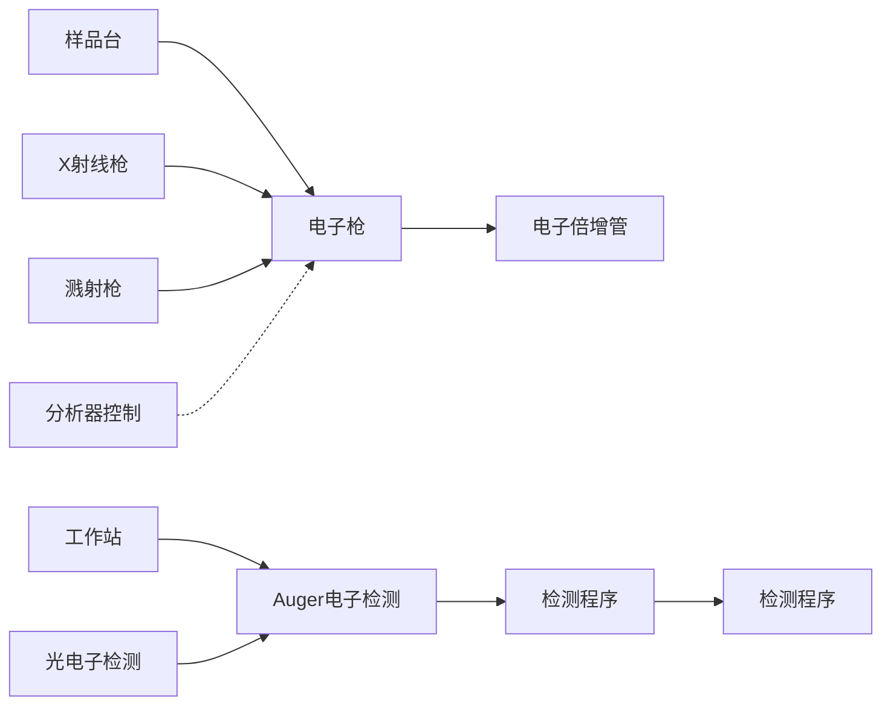

们在  $F_{1}$  和  $F_{2}$  上的投影就是各自的化学位移。第二类峰为交叉峰，也称为相关峰，交叉峰有两组，位于对角线的两侧。交叉峰显示具有相同耦合常数的不同核之间的耦合。

scatter

| Chemical Shift \((\delta)\) | Integration Value |
| --- | --- |
| ~0.5 | 0 |
| ~1.8 | 1 |
| ~2.5 | 2 |
| ~3.5 | 3 |
| ~4.0 | 4 |
| ~4.2 | 4 |
| ~4.5 | 4 |
| ~7.8 | 8 |
| ~8.2 | 8 |
| ~8.5 | 8 |
| ~9.2 | 8 |
| ~10.5 | 8 |
| ~11.2 | 8 |
| ~11.5 | 8 |
| ~11.8 | 8 |
| ~12.0 | 8 |

图 9.4.2 化合物甲硝唑的 $^{1}$ H- $^{1}$ H COSY 谱图

碳-碳同核化学相关谱即 $^{13}C-^{13}C$ COSY，由于 $^{13}C$ 天然丰度低，一般不会去做。

## 2. 异核碳氢化学位移相关谱( $^{13}C-^{1}H\cosY$ )

$^{13}$ C- $^{1}$ H COSY 谱中 $F_{1}$ 轴是 $^{1}$ H 化学位移 $\delta_{H}$, $F_{2}$ 轴是 $^{13}$ C 的化学位移 $\delta_{C}$, 得到的是直接相连的碳与氢( $^{1}J_{CH}$ )的耦合关系。从一个已知的 $^{1}$ H 信号, 按照相关关系可以找到与之相连的 $^{13}$ C 信号; 反之亦然。在谱图中只出现每一个碳直接键合氢的交叉峰, 没有对角峰(图 9.4.3)。

scatter

| Peak Label | \(\delta (\)ppm) |
| --- | --- |
| 1 | ~8.0 |
| 2 | ~8.0 |
| 3 | ~4.6 |
| 4 | ~8.0 |
| 5 | ~4.6 |
| 6 | ~4.6 |
| 7 | ~4.6 |
| 8 | ~4.0 |
| 9 | ~4.0 |
| 10 | ~2.5 |
| 11 | ~-0.5 |

图 9.4.3 化合物甲硝唑的 $^{13}$ C- $^{1}$ H COSY 谱

在 $^{13}C-^{1}H\cos\gamma$ 谱中，季碳没有信号。若一个碳上有几个位移值不同的氢，则在谱图中该碳的 $\delta_{c}$ 处（即相同 $F_{2}$ 坐标处）会出现几个信号；若一个碳上几个氢位移值相等，则只出现一个信号。

## 3.  ${}^{1}$ H 检测的异核化学位移相关谱(HMQC, HSQC, HMBC)

$^{13}$ C- $^{1}$ H COSY 对化合物结构鉴定很重要,但因为 $^{13}$ C 核灵敏度低,需要耗费较多的样品,也需要较长的累加时间。为此,人们发展了反向探头,由检测 $^{13}$ C 变为检测 $^{1}$ H,灵敏度提高了 8 倍,用样量和检测时间都大大减少了。

检测 $^{1}$ H 的异核多量子相干( $^{1}$ H detected heteronuclear multiple quantum coherence)的称为 HMQC, 检测 $^{1}$ H 的异核单量子相干( $^{1}$ H detected heteronuclear single quantum coherence)的称为 HSQC(图 9.4.4)。二者都是把 $^{1}$ H 核与其直接相连的 $^{13}$ C 核关联起来, 更有利归属解析结构。不同于一般的 $^{13}$ C- $^{1}$ H COSY, HMQC 和 HSQC 中 $F_{1}$ 域为 $^{13}$ C 化学位移, $F_{2}$ 域为 $^{1}$ H 化学位移, 二者 $F_{2}$ 域的分辨率高。HMQC 谱图和 HSQC 完全一样, 但在 $F_{1}$ 域 HSQC 比 HMQC 的分辨率高一些。

scatter

| Peak Label | Chemical Shift \((\delta)\) |
| --- | --- |
| 1 | ~7.8 |
| 2 | ~6.5 |
| 3 | ~4.5 |
| 4 | ~4.0 |
| 5 | ~3.5 |
| 6 | ~3.0 |
| 7 | ~2.5 |
| 8 | ~2.0 |
| 9 | ~1.5 |
| 10 | ~1.2 |
| 11 | ~0.2 |

图 9.4.4 化合物甲硝唑的 HSQC 谱图

图 9.4.4 是甲硝唑的 HSQC 谱图, 它们提供了  ${}^{1}J_{CH}$  耦合作用得到的 C—H 连接信息, 可以方便地对 7、8 和 10 号碳原子上的氢进行归属。例如, 7 号碳与 7 号碳上的氢形成交叉峰, 1 号碳与 1 号碳上的氢形成交叉峰。

检测 $^{1}$ H 的异核多键相关谱( $^{1}$ H detected heteronuclear multiple bond correlation)称为 HMBC（图 9.4.5），它把 $^{1}$ H 核与远程耦合的碳核关联起来，类似于远程 $^{13}$ C- $^{1}$ H COSY，也是具有灵敏度高、信息多特征。HMBC 可以高灵敏地检测到 $^{2}J_{CH}$ 、 $^{3}J_{CH}$ ，通过两三个键与季碳的耦合也有关联峰，可以得到有关碳链骨架的连接信息、有关季碳的结构信息及因杂原子存在而被隔断的耦合体系之间的结构信息。

图 9.4.5 是化合物甲硝唑的 HMBC 谱图, 分子结构中间隔两三个键的氢原子与碳原子之间的  ${}^{2}J_{CH}$  和  ${}^{3}J_{CH}$  耦合作用以交叉峰的形式呈现出来。例如, 4 号碳与 1、7 和 10 号碳上的氢产生耦合, 并分别形成交叉峰; 2 号碳分别与 1 号碳和 7 号碳上的氢形成交叉峰; 8 号碳与 7 号碳上的氢之间的  ${}^{2}J_{CH}$  形成交叉峰。

## 4. 超远程相关谱(NOESY, ROSEY)

二维 NOE 谱简称 NOSEY(nuclear overhauser effect spectroscopy)，表示的是质子之间的关系。谱图与 COSY 类似，其  $F_{1}$  和  $F_{2}$  两个轴均为质子的化学位移，有对角峰和交叉峰。NOE 是一种跨越空间的效应，它与核之间的距离有关，当质子键的空间距离小于0.4 nm时便可以观察到信号。利用NOE主要是研究分子内部质子空间的相关性，可以用于确定质子空间的距离，判断化合物的构型、构象。这种方法对研究有机物立体化学、超分子组装、蛋白质等生物大分子的结构十分有用。

scatter

| Peak Label | \(\delta (\)ppm) |
| --- | --- |
| 1 | ~8.0 |
| 2 | ~8.0 |
| 3 | ~5.4 |
| 4 | ~8.0 |
| 5 | ~3.6 |
| 6 | ~3.6 |
| 7 | ~3.6 |
| 8 | ~3.6 |
| 9 | ~3.6 |
| 10 | ~2.2 |
| 11 | ~-0.2 |
| 12 | ~-0.2 |

图 9.4.5 化合物甲硝唑的 HMBC 谱图

需要注意的是,当相对分子质量在 1000\~3000 时,NOE 的增益为零,NOESY 得不到交叉峰,此时需要旋转坐标系中的 NOESY 得到信号,这时得到的谱就称为 ROSEY 谱。

## 9.4.3 其他自旋核的核磁共振

除了核磁共振氢谱和碳谱外,其他的自旋核在药物、功能材料、生物分子的结构解析中也非常有用。主要有:①核磁共振氟谱;②核磁共振磷谱;③核磁共振硅谱;④核磁共振氮谱。

## 9.4.3.1 核磁共振氟谱

氟化合物广泛存在于医药、农药、功能聚合物、表面活性剂和特殊溶剂中，如一些重要药物百忧解（氟西汀）和帕罗西汀。氟的常见同位素是 $^{19}$ F，具有100%的天然丰度，自旋量子数为1/2，核磁矩是 $4.5533\times10^{-26}$ J/T， $^{19}$ F的相对灵敏度约为 $^{1}$ H的83.4%。因此，核磁共振氟谱 $^{19}$ F NMR具有高的灵敏度，测试时需要样品量少、时间短。另外一个特征就是化学位移范围广，有机含氟化合物的化学位移达350，很少出现信号重叠的现象。因此， $^{19}$ F NMR对于测定这些化合物的结构是一种很有价值的技术。可以使用非氘代溶剂是氟谱的另外一个特点。氟原子和邻近的氢原子发生耦合，造成多重分裂，使得氟谱信号复杂化，降低信噪比，实验中一般采用 $^{1}$ H去耦的脉冲序列得到氟谱（图9.4.6）。

含氟药物占上市药物超过了五分之一，而且还在不断扩大。因此， $^{19}$ F NMR 在药物研究中有广泛的应用，不仅可用于原料药及制剂的定性鉴别和定量分析，还可用于非法添加物的定性鉴别和定量测定。

## 9.4.3.2 核磁共振磷谱

$^{31}$ P 同位素的自然丰度几乎为 100%，具有 15 个质子和 16 个中子， $^{31}$ P 的自旋量子数为 1/2，核磁矩是  $1.96 \times 10^{-26}$  J/T，检测  $^{31}$ P 核磁共振信号的图谱就是  $^{31}$ P $\mathrm{NMR}_{\circ}^{31}\mathrm{P}$ 丰度高、核磁共振信号强度大，这为磷化学的研究提供了直接高效的信息。磷谱的化学位移范围比氢谱和碳谱要大很多，一般从 $-1000\sim +1000$ ，其零点的校正一般使用 $85\%$ 的磷酸溶液(图9.4.7）。

spectrogram

| Chemical Shift (ppm) |
| --- |
| -82.2287 |
| -115.1156 |
| -125.4685 |
| -127.0651 |

图 9.4.6 化合物 6-叠氮基-1,1,1,2,2,3,3,4,4-九氟壬烷的 $^{19}$ F NMR 谱图

spectrogram

| \(\delta\) | Intensity |
| --- | --- |
| 9.88 | High |

图 9.4.7 化合物磷酸二苯酯(DPP)的 $^{31}$ P NMR 谱图

由于磷的氧化态 $(-3\sim +5)$ 和配位数(1\~6)多变，这在磷谱上都有差异体现，因此$^{31}\mathrm{PNMR}$ 对磷化合物的化学结构包括价态、配位环境都可以提供丰富的信息。在有机磷化学(功能化合物、手性催化剂等)、生命化学特别是核酸化学(人工合成、新陈代谢、基因递送、转染表达等)、有机磷农药等的研究中具有广泛应用。

## 9.4.3.3 核磁共振硅谱

硅原子在自然界有三种同位素，分别是 $^{28}$ Si（92.23%）、 $^{29}$ Si（4.67%）和

## 自旋回波

自旋回波是磁共振现象中的一种重要信号来源。它通常发生在核磁共振(NMR)或磁共振成像(MRI)实验中，当样品受到射频(RF)脉冲的激发后，磁化向量会发生翻转并产生自由感应衰减(FID)信号。由于局部磁场不均匀、化学位移等因素，磁化向量会逐渐失相，导致FID信号强度减弱。为了重新聚焦这些失相的磁化向量，科学家会施加第二个射频脉冲，传统上是 $180^{\circ}$ 的翻转脉冲，使得不同旋进速率的自旋发生反转，跑得快的自旋在后，跑得慢的自旋在前。随着时间推移，这些自旋会逐渐重新聚焦，形成一个回波信号，即自旋回波。

## 魔角旋转

魔角旋转技术(magic angle spinning)是一种在固体核磁共振(NMR)技术中广泛应用的重要方法。在魔角旋转技术中，将样品以特定的角度（约为54.74°，即魔角）快速旋转，以及采用交叉极化等方法，来消除固体样品核磁共振波谱的多种谱线增宽现象，从而提高分辨率。通过魔角旋转，可以获得更加清晰的核磁共振信号，有助于研究人员深入了解固体材料的结构、化学组成及动力学特性等。

$^{30}$ Si(3.10%),其中 $^{29}$ Si是最常见的同位素。由于 $^{29}$ Si的核自旋量子数为1/2,核磁矩是 $0.9618\times10^{-26}$ J/T,可以产生核磁共振信号,有关的谱图就是硅核磁共振谱( $^{29}$ Si NMR)。

硅原子的核磁共振频率与其周围的化学环境密切相关，不同的化学环境会导致硅原子的核磁共振频率发生变化，从而产生不同的信号。通过对这些信号进行分析，可以得到硅化合物的结构信息和化学环境信息。 $^{29}$ Si NMR 谱的特点是灵敏度高、分辨率好，被广泛用于材料科学、化学、生物医学等领域的研究。经常是作固体样品的核磁谱图，也就是固体核磁共振谱，它对样品不破坏、不损伤。目前，固体核磁共振硅谱已经是一种非常重要的研究硅化合物结构和性质的技术，为材料科学、地球化学和生物化学等领域的研究提供了有力的工具。

## 9.4.3.4 核磁共振氮谱

氮原子在自然界有两种同位素，${}^{14}\mathrm{N}$ 的天然丰度为 $99.63\%$ ，自旋为1，四极矩为 $2.044\mathrm{fm}^2$ （相对比较大），核磁矩为 $1.93\times 10^{-26}\mathrm{J / T}$ 。 ${}^{15}\mathrm{N}$ 的天然丰度为 $0.364\%$ 自旋为 $1 / 2$ ，核磁矩为 $-1.04\times 10^{-26}\mathrm{J / T}$ 。虽然 ${}^{14}\mathrm{N}$ 丰度很高，也有自旋，但是由于具有比较大的四极矩，导致它的弛豫非常快，谱图很宽，用来做结构分析很难。当然，很多宽带探头也不支持采集共振频率很低的 ${}^{14}\mathrm{N}$ 谱。

$^{15}$ N 含量太低, 相对灵敏度也非常低, 所以除非含量非常高, $^{15}$ N 的采集是不现实的。平时作的氮核磁图谱, 一般都是特指人工标记的 $^{15}$ N 的核磁共振谱图, 应用不是很普遍。目前人们在不断努力提高氮谱的灵敏度。

## 9.4.4 核磁共振技术新进展

核磁共振技术发展日新月异,无论是从功能上还从使用上一直在发展变化。简单的介绍包括:①自旋回波技术;②固体高分辨核磁共振;③3D NMR;④便携式核磁共振谱仪;⑤磁共振成像;⑥核磁共振联用技术。

## 9.4.4.1 自旋回波技术

自旋回波(spin echo)技术是核磁共振中的一种重要实验方法。其基本原理是:在射频激发之后，热平衡态的磁化向量部分或全部被翻转到垂直主磁场的横平面上，产生了自由感应衰减(FID)这种信号。如果在经过时间 $\tau$ 之后，施加一个180°脉冲，该脉冲将横平面上的自旋向量反转180°。由于各自旋的频率保持不变，但其相位反转，因此在接下来的时间 $\tau$ 内，原来因为去相干而散开的自旋向量开始重新聚集。在时间2 $\tau$ 时，这些自旋矢量重新聚集，形成一个新的信号，称为自旋回波(spin echo)。这个信号来自射频聚焦，故应称为“射频回讯”，但因历史因素，多称为“自旋回波”。

自旋回波信号的强度受样品的 T2 衰减特性影响,因此可以用于测量 T2 弛豫时间,提供有关分子运动和相互作用的信息。由于人体组织的 T2 值不同,自旋回波序列可以用于产生不同对比度的图像。例如,在脑部成像中,白质和灰质的 T2 值不同,自旋回波技术可以清晰区分这些结构,从而为 MRI 用于临床诊断提供重要依据。

## 9.4.4.2 固体高分辨 NMR 谱

固体样品的 NMR 谱线比液体样品的 NMR 谱线宽得多。如冰的线宽为 105 Hz，而液态水的线宽仅为 0.1 Hz。这是由于固体样品中的核感受到各种“静”各向异性作用，这种作用在液体样品中可以通过分子的快速运动而平均掉。科学家经过长期研究探索，采用高功率去耦、交叉极化和魔角旋转相结合技术，可以造成真实空间或自旋空间的快速运动而消除化学位移各向异性引起的谱线变宽。

目前已有 $^{1}$ H、 $^{13}$ C 和 $^{29}$ Si 的固体高分辨核磁共振技术。它们在各种功能材料

结构表征和分析、多相催化反应等方面具有非常重要的应用。

## 9.4.4.3 三维核磁共振

3D NMR 实验是在 2D NMR 实验基础上发展起来的, 是通过预备期→发展期  $(t_{1})\rightarrow$  混合期  $(1)\rightarrow$  发展期  $(t_{2})\rightarrow$  混合期  $(2)\rightarrow$  检出期  $(t_{3})$ , 得到的信号  $(S)$  是含有三个时间变量的函数, 记作  $S(t_{1}, t_{2}, t_{3})$ 。经过三次傅里叶变换, 得到频率域的 3D NMR 谱。3D NMR 主要用于生物大分子的序列指认, 如蛋白质在溶液中的二级结构指认等。

## 9.4.4.4 便携式核磁共振谱仪

便携式核磁共振谱仪(portable magnetic resonance imaging, PMRI)是一种新型的核磁共振分析技术。类似传统的核磁共振仪，它由磁体、射频收发系统、数据采集系统、样品容器及控制和电源系统所组成，不过它是一种低场磁共振技术，各个部件尽可能小型化、智能化，它采用高灵敏度的探测器和数据采集系统，可以在短时间内获得高分辨率的核磁共振谱图或图像。相比传统的磁共振系统要轻便小巧，便于携带和移动，有助于更方便地进行样品检测与分析。在高通量化学反应和化合物快速筛选方面得到了很多应用。当然，需要注意的是，图谱的分辨率和传统的核磁共振仪还是有很大差距，不能作为标准物质的结构表征。

## 9.4.4.5 磁共振成像

磁共振成像是基于核磁共振基本原理,应用波谱技术获得有关分子的微观化学和物理信息。由于“核”容易让人们认为与放射性物质有关,为了避免这种误解,在医学上人们就把“核”字去掉,称作磁共振成像(magnetic resonance image, MRI)。1975年Ernst首先提出磁共振成像,1980年,Edelstein和他的研究小组实现了人体的成像,对于一个简单的成像仅需5 min,1996年成像时间降低至5 s。改变不同的实验方式,可获得不同的图像。如质子密度像、T1的空间分布像和T2的空间分布像,已用于医疗诊断,确定肿瘤的大小和位置(图9.4.8)。2003年的诺贝尔生理或医学奖授予了Paul Lauterbur和Peter Mansfield,以表彰他们为磁共振成像做出的杰出贡献。

磁共振成像具有很高的分辨率和清晰度，不仅能清楚地显示大脑的组织结构，而且还可以用于研究大脑的功能。如化学位移成像可无创性定域检测脑组织中生物化学物质的含量，它可检测其他物质分子的质子或其他的核（如 $^{31}$ P、 $^{19}$ F、 $^{23}$ Na、 $^{39}$ K等）的共振信号，并能在波谱图上清楚地显示出特定脑区域内一系列的化学物质及其含量。而这些化学物质及其含量与大脑的功能有关。如乳酸是葡萄糖的无氧代谢产物，正常状态时，它的含量很少，当局部脑血流不足或缺氧时，其含量会明显升高，通过磁共振成像就可很快予以诊断。

## 9.4.4.6 核磁共振联用技术

由于核磁共振波谱对结构鉴定的独特功能,近几十年来,核磁共振与其他仪器分析技术的结合联用得到了很大的发展,在材料表征和药物研发方面展示出巨大的应用潜力。常见的有液相色谱-核磁联用、质谱-核磁联用、电化学-核磁共振联用等。

natural_image

Medical brain scan image showing cross-sectional view of the human brain (no visible text or annotations)

图 9.4.8 人脑的磁共振扫描显示脑的一侧有转移性肿瘤(扫描二维码查看彩色大图)

习题

## - 章节练习题 -

1.  ${}^{1}$ H、 ${}^{13}$ C、 ${}^{12}$ C、 ${}^{19}$ F、 ${}^{18}$ O、 ${}^{28}$ Si 中，哪些原子核不具备核磁共振活性？

2. 在下列化合物的氢谱中,哪些氢可以产生自旋裂分,哪些氢是单峰?

$$
(\mathrm{CH} _ {3}) _ {2} \mathrm{CHOCH} _ {3} \quad (\mathrm{CH} _ {3}) _ {3} \mathrm{COCH} _ {3} \quad (\mathrm{CF} _ {3}) _ {2} \mathrm{CHCOCH} _ {3} \quad \mathrm{H} _ {3} \mathrm{C} - \bigcirc - \mathrm{CH} _ {3}
$$

3. 写出分子式为  $C_{4}H_{10}$  化合物所有异构体的可能结构, 以及其氢谱中  ${}^{1}H$  峰的数量。
4. 图 9.4.9 是 5-硝基水杨酸甲酯的氢谱(400 MHz, 溶剂是  $CDCl_{3}$ )。计算多重峰的耦合常数，并归属该谱图中的每一组氢峰。

spectrogram

| Chemical Shift \((\delta)\) | Integration |
| --- | --- |
| 11.4315 | 1.01 |
| 8.7930 | 0.99 |
| 8.3461 | 1.01 |
| 8.3233 | 1.01 |
| 7.1023 | 1.04 |
| 7.0794 | 1.04 |
| 4.0351 | 3.24 |

图 9.4.9 5-硝基水杨酸甲酯的氢谱

5. 比较下列化合物中  $H_{a}$  和  $H_{b}$  的化学位移大小，并解释原因。

chemical

Two organic molecular structures with labeled atoms: one with O=CH2 and H=CH2, the other with O=CH2 and Hb=CH2

6. 指出下列化合物分别在氢谱中会出现几组质子信号, 它们的碳谱中会产生多少组碳原子信号。

chemical

Three chlorinated aromatic compounds with chlorine substituents

7. 解释核磁共振氢谱中的化学位移是什么, 化学位移值是如何反映氢核的化学环境的。
8. 在芳香化合物中,为什么氢核的化学位移值通常比链状烃类化合物氢核的化学位移值要大?
9. 某化合物  $C_{9}H_{8}O$ ，根据  ${}^{13}C$  NMR 谱图（图 9.4.10）确定其结构。
10. 某化合物  $C_{8}H_{9}NO$ ，根据  ${}^{1}H$  NMR 及  ${}^{13}C$  NMR 谱图（图 9.4.11）确定其结构。
11. 查阅资料，并写出氘代二甲基亚砜 $\left(\mathrm{DMSO-d_{6}}\right)$ 、氘代甲醇 $\left(\mathrm{MeOH-d_{4}}\right)$ 、氘代丙酮 $\left(\mathrm{acetone-d_{6}}\right)$ 和氘代氯仿 $\left(\mathrm{chloroform-D},\mathrm{CDCl_{3}}\right)$ 分别在氢谱和碳谱中溶剂峰的化学位移值及其峰形。

## - 挑战性问题 -

12. 核磁共振氢谱在化合物结构解析、定性鉴别等方面得到诸多应用。核磁共振氢谱不仅可以做物质结构的鉴定，而且该方法也可用于样品的定量分析，因为称样量和峰面积有关，可实现样品的绝对定量，即核磁共振定量分析。这一技术在药物标准品质量分析中具有重要价值。请通过文献调研，对此项技术予以介绍，并指出该方法的特点。

spectrogram

| Chemical Shift \((\delta)\) | Intensity |
| --- | --- |
| 140.12 | Low |
| 128.56 | High |
| 128.38 | Medium |
| 126.65 | High |
| 128.56 | Very High |
| 126.65 | High |
| 83.70 | Low |
| 74.80 | Medium |
| 64.10 | Medium |

图 9.4.10 化合物  $C_{9}H_{8}O$  的碳谱

spectrogram

| Peak Label | Chemical Shift \((\delta)\) |
| --- | --- |
| 2(H) | ~7.8 |
| 3(H) | ~7.4 |
| 1(H) | ~7.0 |
| 3(H) | ~3.0 |
| s | ~165 |
| s | ~135 |
| d | ~125 |
| d | ~123 |
| d | ~122 |
| q | ~25 |

图 9.4.11 化合物  $C_{8}H_{9}NO$  的氢谱和碳谱

## - 专题或报告 -

13. 在核磁技术的发展中，曾经有六次诺贝尔奖授予相应的科学家，请搜集资料，以问题导向为线索，分组对每次的技术进展及其应用价值予以介绍，重点介绍科学思维在其中的体现。
14. 核磁共振波谱是化学物质结构表征的重要手段，适合于液体、固体，甚至半固体，微量样品的研究。除了结构表征外，它在石油、橡胶、建材、食品等方面应用日益广泛。请通过调研对核磁共振最新的应用予以介绍并进行展望。

## 第十章

## 表界面分析技术

随着分析化学应用领域的不断拓展,其已经深入到生命科学、材料科学、能源研究等多个前沿领域。在这些领域中,复杂体系的分析与检测、微纳材料的结构与功能表征、能源过程的动态监测等研究,往往涉及对表界面化学成分和结构的静态及动态实时分析。因此,表界面分析技术显得尤为重要。本章将重点介绍几种常见的表界面分析方法,包括电子能谱、离子散射谱、二次离子质谱、扫描电子显微镜、透射电子显微镜等,详细阐述它们的基本原理、仪器结构、谱图分析技巧及其应用发展。

## 10.1 电子能谱

电子能谱是一种重要的材料表面分析技术，用于研究固体表面的电子结构和表面化学性质。它通过研究表面上电子的能量分布，提供了关于材料表面组成、结构和相互作用的有价值的信息。电子能谱技术广泛应用于材料科学、表界面化学、催化化学及表面反应动力学等领域。

## 10.1.1 电子能谱简介

本节将对电子能谱的定义、分类、特点和电子能谱仪的基本构成进行阐述。

## 10.1.1.1 定义

电子能谱是一种用于研究材料表面电子结构的表征技术。它基于光电效应原理，通过照射样品表面并测量逸出电子的能量分布来获得信息。逸出电子的能量分布与材料的电子态密度及表面化学环境密切相关，因此能够提供关于表面组分、结构和化学状态的信息。

## 10.1.1.2 电子能谱的分类

电子能谱可以分为三大类:X射线光电子能谱（X-ray photoelectron spectroscopy, XPS）、俄歇电子能谱（Auger electron spectroscopy）和紫外光电子能谱（ultraviolet photoelectron spectroscopy, UPS）。XPS使用能量较低的X射线激发样品，由于光电效应，激发出内层轨道的电子，而这些电子带有特征性，适用于分析表面元素的化学状态和定量组成。当用特征X射线激发样品时，会激发出一个内层电子后产生空穴。外层电子为填补这个空位，跃迁到内层能级，此时会释放出一定能量，这一能量导致外层的其他电子被释放出来，成为俄歇电子，研究俄歇电子的能谱称为俄歇电子能谱。UPS则通过能量较低的紫外光激发样品，从而激发出外层轨道的电子，主要用于研究表面电子能带结构和价带特性。

## 思考:

电子能谱具有哪些特点？

## 思考:

XPS、AES、UPS 都分别用什么作为激发源？

## 思考:

为什么电子能谱仪要配备真空系统？

## 10.1.1.3 电子能谱的特点

（1）高分辨率 电子能谱技术具有很高的能量分辨率，能够分辨出不同能级的电子状态，从而提供详细的能带信息。
（2）半定量性 电子能谱可通过分析逸出电子的能量，计算出不同元素的表面浓度，并提供化学计量信息。
（3）化学信息 电子能谱技术不仅能够获得电子能带结构，还能通过分析能级分裂、束缚能等参数获得化学键性质和表面化学环境信息。
（4）非破坏性 电子能谱是非破坏性分析技术，样品在分析过程中不受损伤。

## 10.1.1.4 电子能谱仪的基本构成

如图 10.1.1 所示, 电子能谱仪主要由激发源、样品装置、电子能量分析器、检测器、显示记录系统、真空系统及计算机控制系统组成。

flowchart

图 10.1.1 电子能谱仪结构示意图

## 1. 激发源

X射线光电子能谱仪采用X射线作为激发源，X射线激发源必须是单色的，且线宽越窄越好。通常采用轻元素 $\mathrm{Mg}$ 或Al作为靶材，其产生的特征X射线为X射线源。为获得良好的单色X射线源，提高信噪比和分辨率，还装有单色器，使辐射线的线宽变窄，去掉因连续X射线所产生的连续背底。一般用球面弯曲的石英晶体制成，能够使来自X射线源的光线产生衍射和“聚焦”，从而去掉伴线和韧致辐射，并降低能量宽度，提高谱仪的分辨率。而Auger电子能谱仪常用电子枪作为激发源，紫外光电子能谱仪则通常使用He、Ne等气体放电产生的共振线为激发源。

## 2. 样品室系统和真空系统

样品室系统由样品预处理（如氢离子清洗等）、进样系统和样品室三个部分组成，其中真空系统为系统提供高度真空的环境。而超高真空系统是保证电子能谱仪正常工作所必需的。为了能达到高真空 $\left(10^{-7}\mathrm{Pa}\right)$ ，常用的真空泵有扩散泵、离子泵和涡轮分子泵等。高真空系统具有以下两个基本功能:①使样品室和分析器保持一定的真空度，以便使样品发射出来的电子的平均自由程相对于谱仪的内部尺寸足够大，减少电子在运动过程中同残留气体分子发生碰撞而损失信号强度。②降低活性残余气体的分压。因在记录谱图所必需的时间内，残留气体会吸附到样品表面上，甚至有可能和样品发生化学反应，从而影响电子从样品表面上发射并产生外来干扰谱线。

## 3. 电子能量分析器

电子能量分析器是电子能谱仪的核心部件，其功能是将样品表面激发出来的光电子按其能量的大小分别聚焦，获得光电子的能量分布。它必须在高真空条件下工作，即压强要低于 $10^{-3}\mathrm{Pa}$，以便尽量减少电子与分析器中残余气体分子碰撞的概率。由于光电子在磁场或电场的作用下能偏转聚焦，故常见的能量分析器有磁场型和电场型两种。磁场型的分辨能力强，但结构复杂，磁屏蔽要求较高，所以应用不多。目前常用的是电场型能量分布器，它具有体积小、结构紧凑、真空要求低、外磁场屏蔽简单、安装方便等优点。电场型电子能量分布器按照形状又分为半球形和筒镜型两种，其中半球型能量分析器更为常见。

## 4. 检测器

一般用电子倍增器来检测电子数目。检测器通常可以分为两种:单通道电子检测器和多通道电子检测器。单通道电子倍增器是一种采用连续倍增电极表面（管状通道内壁涂一层高阻抗材料的薄膜）的静电器件，内壁具有二次发射性能。电子进入器件后在通道内连续倍增，增益可达 $10^{9}$ 。多通道检测器是由多个微型单通道电子倍增器组合在一起而制成的一种大面积检测器，也称为位敏检测器（PSD)或多阵列检测器。

## 5. 离子枪

离子束溅射系统主要用于对样品表面进行清洁或对样品表面进行定量剥离。常用的离子源有氩离子、氧离子、铯离子、镓离子等。离子束的溅射速率不仅与离子束的能量和束流密度有关，还与溅射材料的性质有关。值得注意的是，在使用离子枪进行表面清污时，应考虑到离子剥蚀的选择性。即在溅射过程中，由于不同元素的溅射产额不同，会导致易被溅射的元素在表面瞬时贫化，而不易被溅射的元素则在表面相对富集，这种现象称为“选择性溅射”。此外，离子轰击还可能诱发氧化还原等化学反应。这两种效应都会导致样品最表层的化学成分发生变化，与真实成分产生差异。因此，需用标准样品来选择溅射参数，以避免样品表面被溅射离子还原或改变表面成分影响测量结果。

## 10.1.2 X 射线光电子能谱分析方法

本节将对 X 射线光电子能谱的原理、谱图分析和应用进行阐述。

## 10.1.2.1 X 射线光电子能谱简介

X 射线光电子能谱是根据单色 X 射线激发内层电子形成的光电子能量分布特征进行材料表面元素成分和化学态分析的一种表征方法。

光电效应的发现开始于19世纪80年代，德国物理学家Hertz观察到电气系统中的金属触点暴露于光照时，表现出增强的火花放电能力。1905年，Einstein根据Planck在1900年提出的能量量子化的概念，指出光子可以将能量直接转移给原子中的电子，使其激发出来，即光电效应，这样就可以正确地解释以上所有的观察。1918年，Planck由于提出能量量子化的概念获得了诺贝尔奖。之后，1921年，Einstein由于对光电效应的贡献获得了诺贝尔奖。1954年，瑞典K.Sieghahn用X射线激发光电子能谱，寻找研究原子轨道的有效办法。光电子能谱中有“化学位移”现象，它是原子所处的不同化学环境所致，可以为原子所处的化学环境提供依据。

X 射线光电子能谱法是一种表面分析方法, 可以提供的信息深度为 3\~5 nm, 用来表征样品表面各元素的含量与化学状态 (H 和 He 除外)。如果利用 Ar 离子枪作为剥离手段，XPS也可以实现不同深度的分析。X射线激发出来的光电子，根据光电子的能量可以标识出是从哪种元素的哪个轨道激发出来的电子，定性标记的工作可以由计算机来进行。由于各种各样的干扰因素的存在，如核电效应导致的结合能偏移、X射线激发的俄歇电子峰等，因此分析结果时需要注意。

Hertz, Einstein 和 Planck

## 10.1.2.2 X 射线光电子能谱法的基本原理

X射线光电子能谱是基于光电效应的原理,即当高能X射线光子与物质表面相互作用时,会导致光子与样品表面的原子或分子轨道上的电子发生能量转移。即单个光子把它的全部能量转给原子某壳层上一个受束缚的电子(内层电子容易吸收X射线量子,价电子容易吸收紫外光量子),其中一部分用于克服轨道结合能,剩余部分能量则作为它的动能,使分子或原子中的电子脱离原子核的束缚而成为自由电子,即光电子。而原子或分子A本身则变成一个激发态离子 $A^{+}$ ,这种现象称为光电离作用,这一过程可以表示如下:

$$
\mathrm{A} + h \nu \longrightarrow \mathrm{A} ^ {+ \cdot} + \mathrm{e} ^ {-} \tag {10-1-1}
$$

当光子与样品相互作用时，从原子中各能级发射出来的光电子数是不同的，而是有一定的概率，称为光电效应的概率，用光电效应截面 $\sigma$ 来表示。它与电子所在壳层的平均半径 $r$ 、入射光子频率 $\nu$ 和受激原子的原子序数 $Z$ 等因素有关。$\sigma$ 越大，说明该能级上的电子越容易被光激发，它的光电子峰的强度就越大。对于不同元素，同一壳层的 $\sigma$ 值随原子序数的增大而增大；而同一原子的 $\sigma$ 值反比于轨道半径的平方。所以，对于轻原子而言，1s比2s电子的激发概率要大约20倍；而对于重原子的内层电子，由于随着原子序数增大而轨道收缩，使得半径的影响并不重要；对于同一主量子数 $n, \sigma$ 值随着角量子数 $l$ 的增大而增大。

在光电离过程中,根据能量守恒,光子的能量  $h\nu$  满足 Einstein 光电效应关系式:

$$
h \nu = E _ {\mathrm{b}} + E _ {\mathrm{k}} + E _ {\mathrm{r}} \tag {10-1-2}
$$

式中， $E_{b}$  是原子能级中电子的电离能或结合能； $E_{k}$  是出射光电子的动能； $E_{r}$  是激发态原子的反冲动能，可以按照下式进行计算:

$$
E _ {\mathrm{r}} = \frac {1}{2} (M - m) v _ {\mathrm{a}} ^ {2} \tag {10-1-3}
$$

式中，m 和 M 分别表示电子和反冲原子的质量， $v_{a}$  表示激发态原子的反冲速度。在 X 射线能量不太大时，原子的反冲能量近似为

$$
E _ {\mathrm{r}} = h \nu \frac {m}{M} \tag {10-1-4}
$$

因为电子质量 m 相对于原子质量 M 一般很小, 所以  $E_{r}$  数值可以忽略。

对于气体样品,可以视为自由原子或分子,电子的结合能是以电子不受原子核吸引的真空能级为参比能级,电子能级和真空能级的能量之差就是电子的结合能 $E_{b}$ 。

而对于一般固体样品而言，选用Fermi能级 $(E_{\mathrm{F}})$ 作为计算结合能的参考点，即固体样品中某个能级电子的结合能是指它跃迁到Fermi能级所需的能量，而不是跃迁到真空能级所需的能量。所谓Fermi能级是相当于热力学零度时固体能带中充满电子的最高能级。对于一般固体而言，Fermi能级介于导带和价带之间。把固体样品中的电子由Fermi能级移到真空能级所需的能量，也可以理解为激发出来的光电子从样品内部输送到样品表面需要克服的功，称为逸出功，也称功函数 $\varphi_{\mathrm{sa}}$ ，对于不同样品而言， $\varphi_{\mathrm{sa}}$ 的大小是不同的。对于固体样品来说，X射线的能

## 思考:

简述光电效应的基本原理。

## 思考:

XPS 粉末、块体、液体或气体样品分别是如何制样的？

## 思考:

XPS 测试过程中有哪些注意事项？

XPS 的制样和注意事项

量 $h\nu$ 被固体吸收后将分配在:① 内层电子跃迁到Fermi能级所需的能量 $E_{\mathrm{b}}$；② 电子由Fermi能级进入真空能级所需能量，即逸出功 $\varphi_{\mathrm{sa}}$；③ 自由电子所具有的动能 $E_{\mathrm{k}}$。满足以下等式:

$$
h \nu = E _ {\mathrm{b}} + \varphi_ {\mathrm{sa}} + E _ {\mathrm{k}} \tag {10-1-5}
$$

式中， $E_{\mathrm{k}}$ 是光电子逸出固体样品表面时所呈现的动能，并不是能谱仪所检测出来的动能。这是因为固体样品的表面和能谱仪检测器的入口之间有一定距离，且二者之间具有一定电位差 $\Delta \varphi$ ，如果样品是导体材料时，如金属，这一电位差将导致光电子动能 $E_{\mathrm{k}}$ 变为 $E_{\mathrm{k}}^{\prime}$ 。一般来讲，导体固体样品通过样品台与仪器接触良好，且同时接地，根据固体物理的理论，它们两者的Fermi能级将处在同一水平（如图10.1.2所示）。于是，当具有动能 $E_{\mathrm{k}}$ 的电子穿过样品至能谱仪入口之间的空间时，受到能谱仪和样品之间的接触电位差 $\Delta \varphi$ 的影响，使其动能变为 $E_{\mathrm{k}}^{\prime}$，这才是能谱仪实际测量到的动能。值得注意的是，能谱仪材料也具有一定的逸出功，用 $\varphi_{\mathrm{sp}}$ 表示。对一台仪器而言，仪器条件不变时，其逸出功是固定的，一般在4eV左右。根据能量守恒定律，上述关系式也可以写成

$$
h \nu = E _ {\mathrm{b}} + \varphi_ {\mathrm{sp}} + E _ {\mathrm{k}} ^ {\prime} \tag {10-1-6}
$$

即有如下能量关系:

$$
\varphi_ {\mathrm{sa}} + E _ {\mathrm{k}} = \varphi_ {\mathrm{sp}} + E _ {\mathrm{k}} ^ {\prime} \tag {10-1-7}
$$

根据式(10-1-6)可以得出:

$$
E _ {\mathrm{b}} = h \nu - \varphi_ {\mathrm{sp}} - E _ {\mathrm{k}} ^ {\prime} \tag {10-1-8}
$$

式中， $h\nu$ 是实验时选用的X射线的能量，是已知的； $\varphi_{\mathrm{sp}}$ 是能谱仪的功函数，约为$4\mathrm{eV}$ ，只要利用能谱仪检测出光电子的动能 $E_{\mathrm{k}}^{\prime}$ ，就可以计算出样品中某一原子不同壳层电子的结合能。由于不同原子的电子结合能是一定的，因此可以进行定性分析。

text_image

能量
真空能级EL
ER
EK
Δφ
φsa
E'K
真空能级EL
φsp
导带
EF
价带
样品与仪器接触
Eb
K、L、M内层电子

图 10.1.2 固体样品 X 光电子能谱能量关系示意图

## 思考:

XPS 谱图分析中通常会遇到哪几种常见的伴峰？

## 10.1.2.3 XPS 谱图分析

首先，光电子的能量分布曲线及XPS谱图是采用特定元素某一X光谱线作为入射光，实验测定的待测元素激发出一系列具有不同结合能的电子能谱图。谱线的表示方法通常以被激发电子所在的能级来表示。例如，K层被激发出来的电子称为1s电子，L层的光电子分别标记为 $2\mathrm{s}, 2\mathrm{p}_{1/2}, 2\mathrm{p}_{3/2}$ 等。

## 1. 元素的特征峰

每种元素都有一系列结合能不同的特征能谱峰,它们的强弱与量子数有关。① 主量子数 n 小的峰较 n 大的峰强;② n 相同,角量子数 l 大的峰强;③ 对于两个自旋分裂峰,内量子数大的峰强(如图 10.1.3 所示)。

line

| Peak Label | Energy (eV) |
| --- | --- |
| Ag MNN | ~360 |
| Ag 3s | ~520 |
| Ag 3p | ~680 |
| O 1s | ~730 |
| 3/2 | ~870 |
| Ag 3d | ~890 |
| 5/2 | ~900 |
| C 1s | ~960 |
| 3d (Mg Kα3.4) | ~980 |
| Ag 4s | ~1050 |
| Ag 4p | ~1180 |
| Ag 4d | ~1240 |

图 10.1.3 Ag 片的 X 射线光电子能谱

## 2. 元素的伴峰

这些复杂现象的出现同体系的电子结构密切相关,它们在 XPS 谱图上表现为除正常光电子主峰外,还会出现若干伴峰,使得谱图变得复杂。解释谱图并由此判断各种可能的相互作用,获得体系的结构信息,这是当前推动 XPS 发展的重要方向,也是使用 XPS 经常遇到的问题。

## 10.1.2.4 XPS 谱图的应用

## 1. 元素及离子价态定性分析

各种元素都具有一定特征的电子结合能，因此在能谱图中会出现特征谱线，可以根据谱线在能谱图中的位置来鉴定周期表中除了H和He以外的所有元素。在定性分析时，一般利用XPS的宽扫描程序，在一次测定中就可以检出全部或大部分元素。在分析谱图时，首先必须考虑的是消除荷电位移。金属和半导体样品，一般不用校准，因为它们不会产生荷电效应。但对于绝缘样品则必须进行校准。因为当荷电效应较大时，会导致结合能位置有较大的偏移，引起错误判断。使用计算机自动标峰时，同样会出现这种情况。一般来说，只要该元素存在，其所有的强峰都应存在，否则就要考虑是否是其他元素。由于X射线激发源的光子具有较高的能量，可以同时激发出多个原子轨道的光电子，因此在XPS谱图上会出现多组谱峰。大部分元素都可以激发出多组光电子峰。由于相近原子序数的元素激发出的光电子的结合能有较大的差异，所以相邻元素间很少会产生干扰作用。由于光电子激发过程的复杂性，在XPS谱图上不仅出现各原子轨道的光电子特征峰，还有各种伴峰，在定性分析时必须予以注意。

元素的 XPS 谱峰的结合能位移通常分为两种: 物理位移和化学位移。物理位移是指固体的热效应与表面荷电的作用引起的谱峰位移; 化学位移是由于原子所处的化学环境不同而引起的内层电子结合能的变化, 在谱图上表现为谱峰的位移, 这一现象称为化学位移。化学位移的分析、测定, 是 XPS 分析中的一项主要内容, 是判定原子化合态的重要依据。一般来讲, 元素的化合态越高, 核外电子受到原子核的库仑力的影响, 电子结合能就越大, 从而可以进行元素或相应离子的

XPS 谱图常见的几种伴峰

## 思考:

通过 XPS 能获取样品哪些方面的信息？

图 10.1.4  $Na_{2}S_{2}O_{3}$  S 2p XPS 谱图及相应分子结构式

## 思考:

Auger 电子是如何产生的？

化合态的定性判断。

## 2. 元素的定量分析

XPS不是一种很好的定量分析方法，它给出的仅仅是半定量的分析结果，即相对含量而不是绝对含量。目前最常用的半经验相对定量方法是元素灵敏度因子法，计算公式如下:

$$
C _ {i} = \frac {I _ {i} / S _ {i}}{\sum I _ {j} / S _ {j}} \tag {10-1-9}
$$

式中， $I_{i}$  为元素 i 在一个特定的光谱峰中每秒的光电子数； $S_{i}$  为元素 i 的灵敏度因子。

在定量分析中值得注意的是，XPS 给出的相对含量与样品表面受污染程度有关。不仅各元素的灵敏度因子不同，XPS 对不同含量光电子的传输效率也是不同的，并随着样品受污染程度而改变。XPS 可以提供 3\~5 nm 厚的表面信息，其组成不能反映体相成分。样品表面的 C、O 污染及吸附物的存在也会大大影响其定量分析的可靠性。

## 3. 化学结构分析

X 射线光电子能谱通过测量原子内壳层电子的结合能的化学位移,来研究离子在化合物中的价态、化合物的化学键、电荷分布等信息,从而研究物质的化学结构。

例如，用X射线光电子能谱测定硫代硫酸钠的结构。图10.1.4是 $\mathrm{Na_2S_2O_3}$ 的$\mathrm{S}2\mathrm{p}_{1 / 2}$ 和 $\mathrm{S}2\mathrm{p}_{3 / 2}$ 的双线，这两重双线代表两种不同的化学环境下的S原子，它们的S2p电子结合能之间有 $6.04\mathrm{eV}$ 的化学位移，从而证实硫代硫酸钠的分子结构（如图10.1.4所示）。

其中氧的电负性高于硫，因此中心硫原子带正电荷，它的结合能高，配位硫原子带负电荷，结合能低，两种硫原子所处的化学环境不同而造成内壳层电子结合能的化学位移，由此可以推测出化合物的结构。

## 10.1.3 Auger 电子能谱法

1925年，法国物理学家Pierre Auger在研究光电效应时，观察到了后来被称为“Auger电子”的现象，并对这一现象提供了准确的解释。他发现当一个原子从内层电子能级失去电子后，外层电子可能会跃迁到较低的空穴所在能级，释放出多余的能量，以非辐射的方式激发出电子，形成了后来被称为Auger电子的现象。这一发现为后来Auger电子能谱法的发展奠定了基础。到了20世纪60年代，随着微电子技术和筒镜能量分析器的引入，分析技术得到了显著提升。微电子技术的发展使得探测器更加灵敏，能够捕捉到更少的电子，从而提高了分析的灵敏度。筒镜能量分析器的应用则使得电子能谱的测量变得更加精确和快速。这些技术的引入使得Auger电子能谱法得以广泛应用于材料表面成分和结构的分析。

Auger 电子能谱法(AES)是采用具有特定能量的电子束(或 X 射线)激发样品表面产生 Auger 效应,通过检测 Auger 电子的能量和强度,获得有关材料表面化学成分和结构的方法。采用电子束激发可以产生较强的 Auger 电子谱信号,因此在 AES 中通常选择电子束作为激发源。另外,不同元素的 Auger 电子峰具有独特的能量特征,因此可以利用这些特征进行样品的定性分析,即确定其表面含有哪些元素。此外,Auger 电流与被激发的原子数量近似呈正比关系,因此可以利用 Auger 电流的测量进行样品某元素相对含量的定量分析。

Auger 电子能谱法是一种迅速而又高度敏感的表面分析方法。它可以提供关于材料表面成分的定性和定量信息。这使得 AES 成为研究和控制材料表面性质的有力工具，广泛应用于材料科学、表面化学和工业领域。

## 10.1.3.1 Auger 电子能谱的基本原理

## 1. Auger 电子产生原理

当原子受到特定能量的电子束(或X射线)照射时,内部的壳层电子可以被直接电离,导致原子变为一个具有初态空位的激发态离子,内层电子轨道上出现了空位。激发态离子回到基态的去激发过程可以通过两种竞争性的途径实现:一种途径是外层电子可以跃迁到空穴所在的内层轨道,多余的能量以X射线的形式释放出来,这被称为X射线荧光,可以用于确定样品的元素组成和测量元素的含量。另一种途径是内层的空穴可以被较外层的电子填充,导致该外层电子从一个较高能级跃迁到内层轨道,同时将多余的能量以非辐射方式传递给另一个电子,并使之发射出来,就是Auger电子。Auger电子的能量是与原子的内层电子结构和能级分布有关的,因此它具有元素特征,可以用于元素识别和分析。上述两种途径具体表现如副栏图示所示,即

$$
\mathrm{A} ^ {+ \cdot} \longrightarrow \mathrm{A} ^ {+} + h \nu (\text {发射X射线荧光}) \tag {10-1-10}
$$

$$
\mathrm{A} ^ {+ \cdot} \longrightarrow \mathrm{A} ^ {2 +} + \mathrm{e} ^ {-} (\text {发射 Auger 电子}) \tag {10-1-11}
$$

Auger 电子常用 X 射线能级来表示。例如， $KL_{I}L_{II}$  Auger 电子表示最初逐出 K 能级电子，然后由  $L_{I}$  能级上电子填入 K 能级的空穴，多余能量传给  $L_{II}$  能级上的一个电子并使之发射出来（整个过程如图 10.1.5 所示）。由于 Auger 跃迁过程至少有两个能级和三个电子参与，所以第一周期的氢原子和氦原子不能产生 Auger 电子。俄歇过程根据初态空位所在的主壳层能级的不同，可分为不同的系列，如 K 系列，L 系列，M 系列等；同一系列中又可按参与过程的电子所在主壳层的不同分为不同的群，如 K 系列包含 KLL, KLM, KMM, …俄歇群，每一群又有间隔很近的若干条谱线组成，如 KLL 群包括  $KL_{1}L_{1}, KL_{1}L_{2}, KL_{1}L_{3}, KL_{2}L_{2}, KL_{2}L_{3}, \cdots$  谱线。俄歇谱由多组间隔很近的多个峰组成。

## 思考:

如何区别 X 射线光电子峰与 Auger 电子峰？

flowchart

text_image

X-ray
Work function φ
Valence
Vacuum level
EF
3d
3p
M, etc.
2p
L2,3
2s
L1
1s
Ground state
Ejected core electron
Work function φ
Valence
Transition excited state
Auger electron K.E.
Final state
Work function φ
Valence

图 10.1.5 Auger 电子产生原理图

图10.1.6的Auger电子能谱手册中给出了各种原子不同系列的Auger峰位置。每种元素的各种Auger电子的能量是识别该元素的重要依据。Auger电子的动能仅取决于电子所处的能级和仪器的功函数 $\varphi$ ，与激发源的能量无关。因此，在X射线光电子能谱中识别Auger电子峰时，可以通过改变X射线源的能量来观察X射线光电子峰的移动情况，而Auger电子峰的位置则保持不变。利用这一特