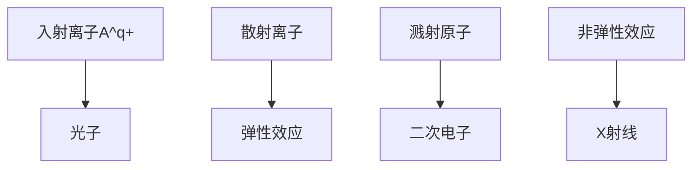
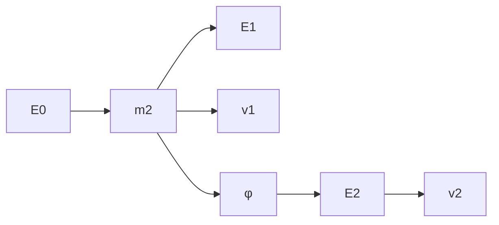

Auger 电子能谱的化学环境影响

性,可以区分 XPS 和 Auger 这两种电子峰。

scatter

| 元素 | 电子能量 (eV) | 原子序数 |
| --- | --- | --- |
| MNN | ~100 ~2400 | ~37 ~83 |
| LMM | ~100 ~2400 | ~37 ~45 |
| KLL | ~100 ~2400 | ~3 ~16 |

图 10.1.6 Auger 电子能谱手册

Auger 电子的动能可以根据 X 射线能级来估算。例如， $KL_{1}L_{II}$  Auger 电子的能量是  $E_{k}-E_{L_{1}}-E_{L_{II}}$ 。精确计算时，还应该考虑仪器的功函数及 Auger 跃迁过程中电离态的变化。与单电离原子相比，双重电离原子的  $L_{II}$  电子的电子结合能还需要考虑电子从 Fermi 能级提升到仪器的样品托架电位所需要做的功。因此，固体物质的  $KL_{1}L_{II}$  Auger 电子的能量应为

$$
E _ {\mathrm{kL} _ {\mathrm{i}} \mathrm{L} _ {\mathrm{ii}}} = E _ {\mathrm{k}} (Z) - E _ {\mathrm{L} _ {\mathrm{i}}} (Z) - E _ {\mathrm{L} _ {\mathrm{ii}}} (Z + \Delta) - \varphi \tag {10-1-12}
$$

式中，Z 为原子序数； $\varphi$  为仪器功函数； $\Delta$  为有效核电荷补偿数，一般在  $(1/2 \sim 1/3)$  eV。

Auger 电子能量的通式可写成

$$
E _ {w x y} (Z) = E _ {w} (Z) - E _ {x} (Z) - E _ {y} (Z + \Delta) - \varphi \quad (Z \geqslant 3) \tag {10-1-13}
$$

式中， $E_{w}(Z) - E_{x}(Z)$ 是 $x$ 轨道电子填充 $w$ 轨道空穴时释放出的能量； $E_{y}(Z + \Delta)$ 是 $y$ 轨道电子电离时所需的能量。

由X射线和光电子能量表查得 $Z$ 和 $Z + 1$ 原子的 $y$ 轨道电子单重电离能，便可估算出 $E_{\mathrm{wxy}}(Z)$ 。测出Auger电子能量，对照Auger电子能量表，就可确定样品表面的成分。

Auger 分析的选择遵循: 对于  $Z \leqslant 14$  的元素, 采用 KLL 俄歇电子分析;  $14 < Z < 42$  的元素, 采用 LMM 俄歇电子较合适; Z > 42 时, 以采用 MNN 和 MNO 俄歇电子为佳。Auger 电子峰常叠加在二次电子谱和散射电子谱上, 当把各种信息的电子按其能量分布绘制成电子能谱图  $N(E) - E$  时, 为了提高谱图的 Auger 信号并同时抑制本底信号, 通常将  $\mathrm{d}N(E)/\mathrm{d}E$  峰的最大负振幅处作为 Auger 电子峰的能量 (但要指出的是, 它和真正的 Auger 电子能量有区别), 它出现在第二次能量分布曲线 Auger 电子峰高能侧的拐点, 而不是该峰的顶点。图 10.1.7 是用 1 keV 的入射电子激发银靶得到的 Auger 电子峰。由图可见, 采用微分值后, 可得到明显的 Auger 电子峰。另外, 俄歇电子的激发方式虽然有多种 (如 X 射线、电子束等), 但通常主要采用一次电子激发。这是因为电子便于产生高束流, 容易聚焦和偏转。俄歇电子的能量和入射电子的能量无关, 只依赖于原子的能级结构和俄歇电子发射前它所处的能级位置。

line

| 电子能量 (eV) | dN(E)/dE | \(N(E) \times 10\) |
| --- | --- | --- |
| 0 | ~0.2 | ~0.1 |
| 200 | ~0.4 | ~0.15 |
| 400 | ~0.6 | ~0.3 |
| 600 | ~0.7 | ~0.4 |
| 800 | ~0.8 | ~0.5 |
| 1000 | >1.0 | ~0.6 |

图 10.1.7 用 1 keV 的入射电子激发银靶得到的 Auger 电子峰

## 2. Auger 电子产额

Auger 电子产额或俄歇跃迁概率决定俄歇谱峰强度，直接关系到元素的定量分析。Auger 电子产生与 X 射线荧光发射是两个互相关联和竞争的发射过程。对同一 K 层空穴，退激发过程中荧光 X 射线与俄歇电子的相对发射概率，即荧光产额  $\left(\omega_{\mathrm{K}}\right)$  和俄歇电子产额  $\left(\alpha_{\mathrm{K}}\right)$  满足: $\alpha_{K}=1-\omega_{K}$ 。由于  $\alpha_{K}$  与原子序数有关，所以 X 射线荧光产额和 Auger 电子产额均随原子序数而变化，如图 10.1.8 所示。由图可见，Auger 电子能谱法更适用于轻元素  $(Z<33)$  的分析，产额较高，原子序数在 11 以下的轻元素发射 Auger 电子的概率在 90% 以上；随着原子序数的增加，X 射线荧光产额增加，而 Auger 电子产额下降。

## 3. Auger 电子峰的强度

Auger 电子峰的强度 $(I_{\mathrm{A}})$ 取决于两个关键因素:电离截面 $(Q_{\mathrm{i}})$ 和 Auger 电子发射概率 $(P_{\mathrm{A}})$ 。电离截面表示入射粒子与靶物质相互作用导致电离的概率,而 Auger 电子发射概率则表示在特定电离事件中,产生 Auger 电子的概率。这两个因素共同决定了 Auger 电子峰的强度,从而反映了该电子能谱特征的一部分信息。

$$
I _ {\mathrm{A}} \propto Q _ {\mathrm{i}} \cdot P _ {\mathrm{A}} \tag {10-1-14}
$$

电离截面是描述入射粒子与靶物质相互作用导致电离的概率的物理量。它

## 思考:

通过 Auger 电子能谱分析能获取样品哪些方面的信息？

line

| 原子序数(Z) | Auger电子产额 | X射线荧光产额 |
| --- | --- | --- |
| 0 | 1.0 | 0 |
| 5 | 1.0 | ~0.01 |
| 10 | ~0.98 | ~0.03 |
| 15 | ~0.92 | ~0.08 |
| 20 | ~0.82 | ~0.16 |
| 25 | ~0.70 | ~0.28 |
| 30 | ~0.55 | ~0.42 |
| 35 | ~0.42 | ~0.58 |

图 10.1.8 Auger 电子产额与原子序数的关系

与被束缚电子i的能量 $(E_{\mathrm{bi}})$ 及入射电子束能量 $(E_{\mathrm{in}})$ 之间存在关系，即电离截面取决于这两个能量参数。当入射电子束能量 $(E_{\mathrm{in}})$ 接近被束缚电子i的能量 $(E_{\mathrm{bi}})$ 的3倍时，会产生较大的Auger电流。这是因为在这个能量范围内，入射电子的能量足够大，能够有效地促使Auger电子的产生。当入射电子束能量 $(E_{\mathrm{in}})$ 小于被束缚电子i的能量 $(E_{\mathrm{bi}})$ 时，入射电子的能量不足以使被束缚电子i发生电离。因此，在这种情况下，产生的Auger电子数量将为零。如果入射电子束能量 $(E_{\mathrm{in}})$ 过大，会导致入射电子与原子的相互作用时间非常短暂，不足以有效促使Auger电子的发射。这样的情况也会影响Auger电子的产生。为了增加Auger电流的产生，通常会选择较小的入射角度（一般为 $10^{\circ} \sim 30^{\circ}$）。这样做可以增大检测体积，提高被束缚电子i与入射电子的相互作用概率，从而获得较大的Auger电流信号。这对于有效地测量和分析Auger电子是非常有益的。

## 10.1.3.2 Auger 电子能谱法的特点及应用

## 1. Auger 电子能谱法的特点

（1）该方法能够分析除氢和氦以外的所有元素。它能够直接测量样品中单个能级的光电发射电子的能量分布，并直接提供电子能级结构的信息。
（2）将红外光谱的信息称为“分子指纹”，电子能谱提供的信息则称为“原子指纹”。这种方法能够提供有关化学键的信息，可以直接测量价层电子和内层电子轨道能级。此外，相邻元素的相同谱线之间的距离较大，互相之间的干扰较少，因此元素的定性标识性强。
(3) Auger 电子能谱法是一种无损的分析技术。
（4）该方法是一种高度灵敏的超微量表面分析技术，分析所需的样品数量约为  $10^{-8}$  g，绝对灵敏度可达到  $10^{-18}$  g，样品的分析深度为 1\~2 nm。

## 2. Auger 电子能谱法的应用

Auger 电子能谱法基本上适用于各种固体材料,具有高灵敏度,可以探测到表面浓度最小达到 0.1% 的单原子层。与 X 射线光电子能谱相比,它的采样深度更浅。由于其分析速度比 XPS 更快,因此可以用来追踪一些较快变化的过程。Auger 电子能谱法与 XPS 方法在许多方面具有相似之处。例如,可以用于除氢和氦之外的元素的定性、定量和状态分析等。然而,两者也存在一些不同之处。在微区分析中采用 Auger 电子能谱法时,由于电子束束斑非常小,因此具有出色的空间分辨率。这使得可以进行扫描、选点分析、线扫描分析和面分布分析等,以获得微小区域上元素的信息。但 Auger 电子能谱方法的局限性在于其使用电子作为激发源,因此在分析有机材料表面时存在一定的困难。Auger 电子能谱法的

主要应用如下:

（1）定性分析 Auger 电子的能量仅取决于原子内部的电子能级分布，而与入射电子的能量无关，这使得 Auger 电子的能量具有独特的特征。Auger 电子能谱主要适用于具有较低原子序数（Z<33）的轻元素，用于进行定性分析。通过将实验测得的 Auger 电子峰的能量与已知元素的各种 Auger 跃迁能量进行比较，可以确定样品中的元素种类。在许多情况下，Auger 电子能谱主要用于分析干净表面和受污染表面的元素组成或化学组成。此外，它还广泛应用于薄膜材料的分析领域。
（2）定量分析 Auger 电流在某种程度上与被激发的原子数量成正比，因此可以利用该特性进行元素的半定量分析。由于 Auger 电流的大小不仅与原子数量有关，还与 Auger 电子的逃逸深度、样品表面的光洁度、元素的化学状态及仪器状态等因素有关。因此，Auger 电子能谱技术通常不能提供分析元素的绝对含量。通常采用相对含量来进行定量分析，即将样品的 Auger 电子信号与标准样品的信号在相同条件下进行比较，这被称为半定量分析。
（3）表面元素的化学状态分析 Auger 电子能谱技术在分析表面元素的化学状态方面具有重要作用。与 XPS 相比，Auger 电子能谱的化学位移较大。通过结合深度分析，可以深入研究表面的化学状态。此外，Auger 电子能谱的线形变化也与元素的化学状态有关。因此，通过进行 Auger 电子能谱的线形分析，也可以有效地研究元素的化学状态。
（4）微区分析 微区分析是 Auger 电子能谱分析的重要应用，包括选点分析、线扫描分析和面扫描分析等技术，在纳米材料研究中具有关键作用。从理论上来看，Auger 电子能谱选点分析的空间分辨率可以达到束斑面积的大小。通过计算机辅助选点，可以同时对多个位置进行表面定性分析、表面成分分析、化学状态分析和深度分析。线扫描分析可以用来了解元素沿特定方向的分布情况，而面扫描分析则可以将某一元素在特定区域的分布以图像的方式呈现出来。此外，结合化学位移分析，还可以获取特定化学价态元素的化学分布信息。

## 10.1.4 紫外光电子能谱法简介

紫外光电子能谱(ultroviolet photoelectron spectroscopy, UPS)是以紫外线为激发光源的光电子能谱。UPS原理本质上与XPS相同，理论基础都是爱因斯坦光电效应定律。唯一的区别是入射光子的能量，UPS激发的光子能量较低。UPS通常使用几十电子伏特的电离辐射来诱导光电效应，而XPS则使用高于1 keV的光子。

现代UPS的开发可追溯到1960年左右，圣彼得堡的Vilesov和伦敦帝国理工学院的Turner开发了电子分析器，选择性地扫描光电子的动能，可以完整地测量电子结构并达到由激发能量决定的阈值。在接下来的几年里电子分析器的概念得到了进一步的发展。为了获得较高的电子计数率和样品表面的清洁度，人们开发了涡轮分子泵以保证样品处于超高真空环境。此外还发展了差分泵浦He等离子体源，该激发光源在 $E(\mathrm{HeI}\alpha) = 21.22\mathrm{eV}$ 处提供了高强度的发射，并且具有较小的自然线宽，可以进行高分辨率的测量。如今，He等离子体光源是UPS中使用最广泛的激发光源，而H-Lyman, Ar、Ne、Kr或Xe等离子体源，VUV激光器（通常在 $10\mathrm{eV}$ 左右）和具有可变光子能量的同步辐射光源也可作为激发光源使用。

随着时间的推移,UPS 提供了原子、分子和固体的电子结构信息,已经成为表面科学、固体物理学和化学领域较重要的技术之一。UPS 装置越来越普遍应用于

text_image

光电子(Eₖ)
紫外光(hν)

UPS 的过程示意图

## 思考:

UPS 与 XPS 在原理上有哪些异同点？

## 思考:

简述紫外光电子能谱的分析过程。

世界各地的实验室和同步辐射光源中，与UPS相关的测量技术已经在发展并不断改进，扩大了UPS的应用范围。例如，通过角分辨光电子能谱、双光子光电子能谱或飞秒分辨UPS研究能带结构，通过光电子能谱研究表面的电子结构，在自旋分辨光电子能谱中探测发射电子的自旋，或在近环境压力装置中跟踪气体暴露期间的表面相互作用等。

## 10.1.4.1 UPS 原理

UPS 的原理同样基于光电效应。当能量为  $h\nu$  的入射光子从分子中激发出一个电子以后，留下一个离子，这个离子可以振动、转动或以其他激发态存在。如果激发出的光电子的动能为  $E_{k}$ ，则

$$
E _ {\mathrm{k}} = h \nu - E _ {\mathrm{l}} - E _ {\mathrm{v}} - E _ {\mathrm{r}} \tag {10-1-15}
$$

式中， $E_{1}$  为电子的电离能， $E_{v}$  和  $E_{r}$  分别为分子的振动能和转动能。通常  $E_{v}$ （约 0.1 eV）和  $E_{r}$ （约 0.001 eV）都比  $E_{1}$  小得多，因此

$$
E _ {\mathrm{k}} = h \nu - E _ {1} \tag {10-1-16}
$$

相比于 X 射线,紫外光能量较低,线宽较窄(通常约 0.01 eV),因此只能激发价电子,且限制了其采样深度,不能深入原子的内层区域,但紫外光通常表现出更好的单色性,能分辨出分子的振动精细结构。目前已出现高分辨紫外光电子能谱仪。而由于 X 射线光电子是由原子内层电子激发出来的,其结合能比离子的振动能和转动能要大得多,而且射线的自然宽度也比紫外光大得多,因此 XPS 在分辨率上不如 UPS。

## 10.1.4.2 UPS 谱图分析

紫外光电子能谱图的形状取决于入射光子的能量和电离后离子的状态，以及具体的实验条件。图10.1.9是紫外光电子能谱仪观察到的示意图，与第一电离能 $I_{1}$ 相关的称为“第一谱带”，在谱图上它出现于高动能端；与第二电离能 $I_{2}$ 相关的称为“第二谱带”。第一谱带又包括几个峰（绝热电离能 $I_{n}:0\leftarrow0$ 跃迁，垂直电离能 $I_{v}$ ），分别对应于振动基态的分子到不同振动能级离子的跃迁。离子的振动频率记为 $\omega$ ，分子对应的振动频率记为 $\omega_{0}$ ，若成键电子被发射出来则 $\omega<\omega_{0}$ ；若发射的是反键电子，则 $\omega>\omega_{0}$ 。

spectrogram

| Feature | Description |
| --- | --- |
| Peak 1 | I2 |
| Peak 2 | I1 |
| Peak 3 | IV |
| Peak 4 | In |

图 10.1.9 紫外光电子能谱示意图

紫外光电子能谱主要涉及分子的价层电子能级，成键轨道上的电子往往属于整个分子，它们的谱峰很宽，在实验上测量化学位移很困难。但对于非键或弱键轨道中电离出来的电子，它们的谱峰很窄，其位置常常与元素的化学环境有关，这是由于分子轨道在该元素周围被局部定域。

在 UPS 谱图的分析中,人们可以根据谱图中谱带的数目,推测特定原子、双键和原子团的存在,这点与红外光谱的解释类似。具体的分析步骤如下:

（1）根据谱带的位置和形状识别谱中的峰 UPS 谱图中大致有图 10.1.10 中显示的六种典型的谱带形状。如光电子来自非键或弱键轨道，分子离子的核间距离与中性分子的几乎相同，绝热电离能和垂直电离能一致，这使谱图上出现一个尖锐的对称的峰，在峰的低动能端还会存在一个或两个小峰，如图10.1.10中I所示；若光电子从成键或反键轨道发射出来，绝热电离能和垂直电离能不一致，垂直电离能具有最大的跃迁概率，因此谱带中相应的峰最强，其他的峰较弱，如图10.1.10中Ⅱ或Ⅲ所示；从非常强的成键或反键轨道发生的电离作用往往呈现缺乏精细结构的宽谱带，缺乏精细结构的原因是振动峰的能量间距过小，如图10.1.10中Ⅳ所示；有时振动精细结构叠加在离子解离造成的连续谱上，如图10.1.10中V所示；若分子被电离以后生成的离子的振动类型不止一种，谱带呈现一种复杂的组合带，如图10.1.10中VI所示。

text_image

I
II
III
IV
V
VI
结合能增加

图 10.1.10 紫外光电子能谱示意图

（2）推测电子接受或授予原子或原子团的影响 轨道电离能与轨道环境有关，必须考虑电子接受或授予原子或原子团的影响。非键轨道通常高度定域在分子中的特定原子上，其能量很大程度上取决于该原子的电负性。根据元素电负性的不同，监视特定谱带的电离能随各种取代基的变化，有可能推测谱带的性质和起源。如果分子中有一个原子被电负性较高的原子取代，则将引起与该原子及其邻近原子有关分子轨道的电离能增加。如果原子被另一电负性较低的原子取代，则情况相反。

（3）找出轨道的相互作用 根据谱带峰的劈裂情况可以分析分子轨道的相互作用。分子内孤对电子轨道的电离作用在UPS上会呈现尖锐的谱带，孤对电子之间的相互作用可以在紫外光电子谱中观察到。如果两个孤对电子轨道足够近，并具有相同的对称性和差不多的能量，则它们可以相互作用，形成两个新的分子轨道。在这两个新的分子轨道中，有一个的能量比原来两个孤对电子轨道中能量低的轨道还要低，另一个比两个孤对电子轨道能量高的轨道还要高，这两个新的分子轨道的电离作用也将在UPS上得到反映。

根据(1)\~(3)并考虑强度和峰的重叠等因素,对谱图做出解释。

## 10.1.4.3 UPS的应用

由于光源能量较低，因此UPS一般用来分析价电子和分子轨道，或态密度(DOS)结构。虽然UPS采样深度较浅(由于发射的光电子的动能较低)，但它具有提供分子轨道信息的强大潜力，并且可以获取关于成键或反键特性的信息，如成键在分子中的位置及它对于分子几何结构的影响。在气相中，纯能量跃迁的振动线可能会产生多个发射态，因此UPS在研究气相中的分子方面有较多的应用。但UPS也越来越多地用于研究固体表面，可作为一种简便的指纹技术或通过对发射态的分析获取表面信息。UPS还被用于分析聚合物、自组装单分子层(SAM)、催化剂和半导体/电子材料。

## 习题

## - 章节练习题 -

1. 简述电子能谱分析的特点。
2. 简述电子能谱仪的主要组成部件及各部件所起到的作用。
3. 简述 X 射线光电子能谱、Auger 电子能谱和紫外光电子能谱在原理上的异同点。
4. 简述 X 射线光电子能谱、Auger 电子能谱和紫外光电子能谱的分析过程。
5. 简述 X 射线光电子能谱、Auger 电子能谱和紫外光电子能谱在表界面分析方面的应用范围, 即通过这三种分析技术能获取哪些方面的信息?

## - 挑战性问题 -

6. 在电催化领域,原位 X 射线光电子能谱为研究电催化过程中催化剂表面物质组分的演变情况提供了强大的分析手段,为了解电催化过程的反应机理和电催化剂的优化设计提供了有力的数据支撑。请查阅和参考相关文献,设计实验:如何利用原位 X 射线光电子能谱测试研究过渡金属基催化剂表面成分在电催化甲苯氧化中的演变过程。

## - 专题或报告 -

7. 电子能谱在能源电化学领域的应用越来越广泛，在二次电池电极材料的分析方面，相关研究工作主要关注于电极/电解界面的变化情况，克服影响电池稳定性的因素，从而为设计稳定性更优的电池电极材料打下基础。请查阅相关科学文献，了解关于XPS、AES、UPS等电子能谱分别在电池电极/电解界面分析中的应用情况，并将结果写成报告。

## 10.2 离子散射谱

## 10.2.1 离子散射谱的定义、作用和特点

卫星低能离子能谱仪

离子散射谱法(ion scattering spectroscopy, ISS)是一种表面检测技术, 利用指定方向上离子束在固体靶上的弹性散射, 测量散射离子能量损失的能谱, 也称为离子能谱。为避免修改靶表面, 通常使用能量很小的初级离子(200\~2000 eV), 一般为稀有气体离子( $He^{+}$ 、 $Ne^{+}$ 、 $Ar^{+}$ )或者碱金属离子( $Li^{+}$ 、 $Na^{+}$ 、 $K^{+}$ ), 因此也被称为低能离子散射(low energy ion scattering, LEIS)。

1967 年, Smith 首次将低能离子散射用于表面分析。Smith 研究了吸附在银上的 CO, 由碳峰和氧峰的相对高度分析出 CO 的吸附结构。随后, Smith 通过峰的相对高度识别出硫化镉单晶体的不同晶面。这说明, 低能离子散射不但可以用来分析化学组分, 也可以用来研究表面结构。此后, 研究人员不断完善离子散射谱仪, 包括引入筒镜分析仪, 大大提高了灵敏度; 增加气体引入装置, 分析气体环境中的样品位置; 实现同轴碰撞, 进一步分析次表面原子层, 以及仪器联用技术。ISS 方法的特点是:① 基于对固体的最上面的一个或两个原子层的特异性极端灵敏，同轴碰撞下允许检测痕量元素；② 所需的采集时间短而使样品表面损坏小；③ 允许定量表面元素组成；④ 具有非导电材料的电荷补偿能力。

## 10.2.2 离子散射谱的发展趋势

1996年，Houssiau等利用离子散射研究了 $\mathrm{Cu}_{3}\mathrm{Au}(100)$ 表面的相变过程；2004年，Draxler等通过飞行时间低能离子散射监控了纳米层的厚度和生长模式；2009年，Ter Veen等从表面散射的离子的能量来确定表面原子的质量，证明不同催化剂发生催化过程的位置；2023年，Avval等基于高灵敏度低能离子散射对熔融石英表面硅醇密度进行标记计数。综上，在固体表面上进行化学反应时，表面元素的组成和结构决定了反应的趋势，深入了解局部表面元素组成和结构十分重要。由于在ISS中使用低能离子（keV量级），影锥（在表面原子后面形成的锥形阴影，入射离子不能进入）的半径与原子半径一样大，因此可以对最外表面层进行高灵敏度的测量，广泛应用于催化、合金表面的分凝和吸附、绝缘表面的分析等领域。

## 10.2.3 离子散射谱的物理学基础

## 10.2.3.1 ISS 物理模型

低能离子(如 0.2\~2 keV)与固体表面的碰撞,可简化成两个孤立的自由粒子间的弹性碰撞模型来处理,根据散射角可计算出碰撞后的粒子能量,如图 10.2.1 所示。

按照 de Broglie 方程, 物质波的波长  $\lambda = h/P, P$  为动量, h 为普朗克常量。设入射离子相对原子质量为 A, 能量为  $E_{0}(\mathrm{eV})$ , 则  $\lambda = 0.295(AE_{0})^{-1/2}(\mathring{\mathrm{A}})$ , 而晶格常数通常为  $\mathring{\mathrm{A}}(1\mathring{\mathrm{A}} = 0.1\mathrm{nm})$  量级, 入射离子完全可看成粒子。

比较入射离子的速度 $v_{p}$ 和靶原子内的电子轨道运动速度 $v_{e}$，如 $v_{p} \geqslant v_{e}$，可看作非弹性散射为主；如 $v_{p} \ll v_{e}$ 时则看作弹性散射为主。由于原子外壳层电子的能量约为0.5 eV，电子质量为 $m_{e}$，则 $\frac{1}{3} m_{e} v_{e}^{2} = 0.5 \, eV$ 。如入射离子质量为 $m_{1}$，当 $v_{p} = v_{e}$ 时的临界能量为

$$
E _ {0} = \frac {1}{2} m _ {1} v _ {\mathrm{p}} ^ {2} = \frac {1}{2} \frac {m _ {1}}{m _ {0}} (\mathrm{eV})
$$

即  $E_{0}=\frac{1}{2}\times1840\ A\approx A\ (KeV)$  (10-2-1)

即入射离子能量小于 AKeV 时, 以弹性碰撞为主。

同时，入射离子能量应远大于原子在靶上晶格中的结合能，如此才能认为靶上的原子也是“孤立”的、“自由”的。如果靶上原子间的结合能较强，相当于其“有效质量”增加。因此，原子间结合能常又确定了入射离子能量的下限。

在室温下，已知固体原子晶格振动的能量在 $10^{-2}$ eV量级，因而有理由认为靶上的原子在受到碰撞前是“冷”的，即“静止”的。

总之，在上述条件下，可认为入射离子携带一定的能量，相当于一个刚性球同靶上的原子（也相当于一个刚性球）进行弹性碰撞。

以此为基础,根据经典力学中能量守恒和动量守恒定理,即可处理这类二元弹性碰撞问题。

低能离子散射能谱仪

## 离子与固体表面相互作用

离子与固体表面相互作用主要表现为两大类。一类为弹性散射包括低能离子散射、离子溅射等，可以用两个孤立的自由粒子间的弹性碰撞模型来描述，碰撞后，靶原子和入射离子的结构都不发生变化；另一类为非弹性散射，需要考虑到其他粒子的辐射，如X射线、电子、次级电子等。通常，两个过程同时发生。下图展示了相关的物理过程。

flowchart

离子-表面相互作用示意图

flowchart

$m_{1}$ —入射离子的质量； $E_{0}$ —碰撞前
 $m_{1}$  的动能； $E_{1}$ —碰撞后  $m_{1}$  的动能；
 $m_{2}$  —靶上原子的质量； $E_{2}$  —碰撞后
 $m_{2}$  的动能，碰撞前  $m_{2}$  的动能为零；
 $\theta—m_{1}$  的散射角； $\phi—m_{2}$  的散射角；
 $\alpha—m_{2}/m_{1}$  即质量比

图 10.2.1 弹性碰撞物理模型

## 计算机模拟

采用碰撞运动学进行离子散射分析可以得到许多有用的结果。如果多重碰撞效应很重要，而且若要进行详细的结构分析，则需要更缜密的数据分析。为了理解相关的碰撞过程和数据解释，使用合适的模型并根据实验参数计算散射离子的强度分布是非常必要的。由于系统的复杂性和数学的限制，通常不能做解析解，因此需要数值模拟。为此，已开发出各种模拟程序。根据复杂程度，这些程序可以在计算时间需求较短的计算机上运行，或者可能需要更强大的计算机设施。一般的做法是提出被研究目标的成分和结构模型，然后改变相关的参数，直到获得满意的、与实验数据一致的结果。作为一致性评估的标准，有时使用可靠性因子（R因子）。对数据的无模型评价需要更精细的数学方法，如贝叶斯统计，因此通常不适用。

## 10.2.3.2 散射过程与原理

如图 10.2.2 所示, 利用弹性散射原理, 可处理离子散射问题。

text_image

He+, Ne+, Ar+, Kr+
1~8 keV
θ
动能(eV)

图 10.2.2 离子散射过程与谱峰

可以导出, 当  $\alpha<1,\theta\leqslant\sin^{-1}\alpha$  时, 有

$$
\frac {E _ {1}}{E _ {0}} = (1 + \alpha) ^ {- 2} [ \cos \theta \pm (\alpha^ {2} - \sin^ {2} \theta) ^ {\frac {1}{2}} ] ^ {2} \tag {10-2-2}
$$

当 $\alpha\geqslant1$ 时,有

$$
\frac {E _ {1}}{E _ {0}} = (1 + \alpha) ^ {- 2} [ \cos \theta + (\alpha^ {2} - \sin^ {2} \theta) ^ {\frac {1}{2}} ] ^ {2}
$$

$$
\frac {E _ {1}}{E _ {0}} = 4 \alpha (1 + \alpha) ^ {- 2} \cos^ {2} \phi \tag {10-2-3}
$$

在 ISS 中, 通常  $m_{2} > m_{1}$ , 即  $\alpha \geqslant 1$ , 因此最常用的散射离子能量表示式为

$$
E = E _ {0} \left[ m / (m + M) \right] ^ {2} \left[ \cos \theta + (M ^ {2} / m ^ {2} - \sin^ {2} \theta) ^ {1 / 2} \right] ^ {2} \tag {10-2-4}
$$

应顺便指出，Rutherford 背散射谱学（Rutherford backscattering spectrometry, RBS）利用高能  $He^{+}$ 作原子核弹性背散射，也使用这一表示式。当散射角  $\theta=90^{\circ}$  时，上式简化为

$$
\frac {E _ {1}}{E _ {0}} = \frac {m _ {2} - m _ {1}}{m _ {2} + m _ {1}} \tag {10-2-5}
$$

或 $m_{2} = m_{1}\frac{1 + E_{1} / E_{0}}{1 - E_{1} / E_{0}}$ (10-2-6)

以上讨论表明,只要在已知散射角方向测得散射离子的能量分布,从峰值的位置 $E_{1}/E_{0}$ 即可求出相应的 $m_{2}$ ,即能量刻度可以变成靶表面原子的质量刻度。质量越大相应的能量也越高,而相应的峰高则与这种成分的含量有关。

## 10.2.3.3 相互作用势

在离子散射问题中,相互作用势  $V(r)$  不仅用于计算单次散射的截面,而且用于确定多个碰撞事件中的轨迹和最终能量。

两个原子之间或原子和离子之间的相互作用力来自原子核和电子之间的相互作用力。当距离较近时，表现为斥力，而当距离较远时，表现为吸引力。对于离子散射中使用的能量(>100 eV)，微粒距离很近，以至于可以忽略吸引力部分，完全用排斥势来描述相互作用。在碰撞期间，电子云重叠到一定程度，使得能由相对动能确定。当电子云的完全互穿，即呈现出库仑势:

$$
V (r) = \frac {1}{4 \pi \varepsilon_ {0}} \frac {Z _ {1} Z _ {2} e ^ {2}}{r} \tag {10-2-7}
$$

式中， $Z_{1}$  和  $Z_{2}$  分别是入射离子和靶原子的核电荷数，e 是元电荷。

对于 LEIS 中的能量,仅有部分是互穿的,内部电子持续屏蔽核,因此相互作用势应由具有屏蔽函数的库仑势来描述,以考虑电子-核和电子-电子相互作用。这些相互作用的效果是减少库仑排斥,使得势的一般形式变为

$$
V (r) = \frac {Z _ {1} Z _ {2} e ^ {2}}{r} \phi \left(\frac {r}{a}\right) \tag {10-2-8}
$$

式中，a 是屏蔽函数中的屏蔽参数，可以根据 Firsov 公式给出:

$$
a _ {\mathrm{F}} = \frac {0 . 8 8 5 4 a _ {0}}{\left(Z _ {1} ^ {1 / 2} + Z _ {2} ^ {1 / 2}\right) ^ {2 / 3}} \tag {10-2-9}
$$

式中， $a_0$ 是玻尔半径，为 $0.529\AA (1\AA = 0.1\mathrm{nm})$ ，数值因子是 $(9\pi^2 /128)^{1 / 3}$ 。类似的表达Lindhard也给出过:

$$
a _ {\mathrm{L}} = 0. 4 6 8 (Z _ {1} ^ {2 / 3} + Z _ {2} ^ {2 / 3}) ^ {- 1 / 2} \tag {10-2-10}
$$

莫里安势(Moliere potential)是目前离子-表面散射中应用最广泛的形式,因为它适用于大部分相关的相互作用范围。图10.2.3是相互作用势为关于He-Ni散射中原子距离的函数。

line

| r/Å | COUL (V/eV) | TFM (V/eV) |
| --- | --- | --- |
| 0 | 10^6 | 10^6 |
| 0.2 | ~4000 | ~1500 |
| 0.4 | ~2500 | ~300 |
| 0.6 | ~1800 | ~120 |
| 0.8 | ~1300 | ~60 |
| 1.0 | ~1000 | ~30 |
| 1.2 | ~800 | ~15 |

图 10.2.3 相互作用势为关于 He-Ni 散射中原子距离的函数（注:实线为库仑势，虚线为 Moliere 近似下的屏蔽势）

## 10.2.3.4 散射离子产率与散射过程中的电荷转移

## 1. 散射离子产率

在特定实验情况下离子散射的灵敏度与测量的离子产率有关,因为它表示对于特定浓度的目标物质预期的产率。

量化光谱中的峰的散射离子产率或强度必须考虑几个因素,其中显然包括横截面,但在使用惰性气体离子的典型的低能离子散射装置中,还必须考虑电荷交换现象。用于散射具有表面浓度 $N_{i}$ 的特定物质的离子产率 $I_{i}$ 可以表示为(仅在物体 $N_{i}$ 不被其他物品遮蔽的情况下有效):

$$
I _ {i} = I _ {0} N _ {i} A \frac {\mathrm{d} \sigma_ {i}}{\mathrm{d} \Omega} \Delta \Omega T P _ {i} \tag {10-2-11}
$$

式中， $I_{0}$ 是面积 A 上的初级离子电流 ( $A \cdot cm^{-2}$ ); A 是轰击面积与分析仪采样面积之间的重叠 ( $cm^{2}$ );  $\frac{d\sigma_{i}}{d\Omega}$ 是散射到单位实体角的微分截面 ( $cm^{2} \cdot sr^{-1}$ );  $\Delta\Omega$ 是分析器的接收角 (sr); T 是能量分析仪和探测器的总透射系数;  $P_{i}$ 是粒子在电离状态下逃逸的概率, 有时称为  $(1-P_{N})$ , 其中  $P_{N}$ 是中和概率。

## ISS原理简图

text_image

检测器
能量分析器
θ
一次离子
靶
If
E/E0

ISS 原理示意图

是否 ISS 也存在一定局限性呢?请查阅相关资料,了解 ISS 的局限性。

要计算莫里安屏蔽势下的散射截面，首先要考虑相互作用力对其运动轨迹的作用，可以观察其公式的具体形式，莫里安势其实是在电磁相互作用上加上屏蔽项。计算物体在势场中的运动时，可以采用哈密顿运动方程的方法，由广义坐标、广义动量构成一个微分方程组，求解这个微分方程组，就可以得到位置和动量相关信息。求解微分方程组时，可以采用变步长龙格-库塔方法，可以提高运算效率，保证运算精度。

line

| 散射角 \(({}^{\circ})\) | d\(\sigma/d\Omega\) (4.8 keV) | \(d\sigma/d\Omega\) (15.1 keV) |
| --- | --- | --- |
| 0 | ~100 | ~100 |
| 20 | ~10 | ~30 |
| 40 | ~1 | ~10 |
| 60 | ~0.5 | ~3 |
| 80 | ~0.3 | ~1 |
| 100 | ~0.2 | ~0.5 |
| 120 | ~0.15 | ~0.3 |
| 140 | ~0.12 | ~0.25 |
| 160 | ~0.11 | ~0.22 |
| 180 | ~0.11 | ~0.21 |

图 10.2.4 4.8 keV 和 15.1 keV  $Ne^{+}$ 或 Ni 散射的微分截面作为(实验室)散射角的函数

text_image

W
E_F
RI
RN
QRN

共振跃迁过程的示意图

共振跃迁和 Auger 跃迁的区别是什么？请查找相关资料了解共振跃迁和俄歇跃迁的定义及产生条件。

text_image

E
0
R₀
E_vdc
R
A(R)
I(R)
W
E_f

图 10.2.5 入射离子的电离能级与亲和能级随着与金属表面距离的变化关系

对于给定的实验系统,除了  $d\sigma/d\Omega$  和  $P_{i}$  之外,等式中的所有参数都可以精确地指定,并且如果不是这些,则离子产率可以直接与表面浓度相关,因此允许定量地确定表面组成。

第二个未知数，离子逃逸概率 $P_{i}$ 或更确切地说是中和概率 $P_{N}$，代表许多不同电荷交换过程的整体效应，这些过程可能发生在离子与表面的相互作用期间，并且最终导致以中性状态射弹离开表面。$P_{N}$ 可高达 $99.9\%$，但理论上不易定量。散射和中和可以很好地近似地被认为是独立的，因此可以分开处理。在文献中已经导出并报道了横截面的合适的近似表达式，例如，菲尔索夫势（Firsov potential）和玻恩-迈尔势（Born-Mayer potential），并由 Robinson 对各种势进行了列表说明。使用该工作的数据，Eckstein 等人绘制的横截面为 $4.8 \mathrm{keV}$ 和 $15.1 \mathrm{keV} \mathrm{Ne}^{+}$散射镍，作为散射角的函数。这些曲线如图 10.2.4 所示，用于说明横截面的一般特性。

## 2. 散射过程中的电荷转移

当离子接近金属表面时,其附近的电子将因其导带效应而受到干扰,这一现象可被称为“镜像电荷”。由于有镜像电荷,入射离子的能级可能会改变。

当入射离子与金属表面的距离大于一定值时，离子的能级变化量 $\Delta E$ 可以近似用 $(2Z - 1) / 4R$ 来表示。对于正离子 $(Z\geqslant 2)$ 和中性原子 $(Z = 1)$ 来说，其能级变化量是增加的。然而，对于负离子 $(Z\approx 0)$ 而言能级的变化值是负的，所以亲和能级是减小的。图10.2.5表示了电离能级和亲和能级的变化，其中 $E_{\mathrm{f}}$ 和 $W$ 分别表示金属的Fermi能级和功函， $R_0$ 是像平面的位置。从图中可以看出，在一定距离时，Fermi能级与电离能级相重叠，共振跃迁发生。对于负离子而言，亲和能级高于Fermi能级时会发生共振电离；相反，电子会从金属跃迁到入射离子上。

在研究电荷转移过程中,共振跃迁是很重要的一种电荷转移机制。共振跃迁一般分为两过程:①共振中性化(RN),即入射离子从靶上获得电子,变成中性原子;②共振电离(RI),即入射离子失去电子到靶上而被电离。此外还有一种情况,靶电子通过隧穿效应穿过势垒落到入射离子上,称为准共振中性化(QRN)。

当一个离子距离靶表面很远时，它的能级是离散的，但当它靠近靶表面时，由于离子与靶表面的电子态相互作用，离子能级将会展宽。并且在像势的作用下，离子亲和能级将会下移（电离能级将会上移）。如果入射离子进一步靠近靶表面，亲和能级可能会低于金属表面的Fermi能级，因此金属表面价带能级上的电子会跃迁到入射离子亲和能级上，形成负离子。在负离子离开金属表面时，负离子的亲和能级又高于Fermi能级，这时负离子通过共振电离又变成中性原子。

Auger 跃迁是另一种电荷交换机制, 它涉及双电子过程。主要有两种过程: ① 俄歇中性化(AN), 即靶表面导带上的一个电子跃迁到入射离子较低的能级上, 跃迁过程中释放的能量不是以 X 射线的形式发射出来, 而是将导带上另一个电子激发出来或使其成为激子(plasmon); ② 俄歇退激(AD), 即导带的一个电子被俘获到入射离子的亚稳态, 随后亚稳态电子退激到基态的过程中发射出另一个电子。Auger 跃迁的发生需要一定的条件, 入射离子的能量与 Fermi 能级之差大于表面功函的两倍。Auger 电子跃迁过程如图 10.2.6 所示。

## 10.2.4 离子能谱仪基本构造

低能离子散射(LEIS)允许以仅最高原子层的灵敏度分析材料表面。在LEIS实验中，能量为几千电子伏的稀有气体离子从样品表面散射。离子在散射过程中的能量损失取决于散射伙伴的质量，因此通过记录反向散射离子的能量损失谱可以获得样品表面的定量元素组成。由于散射在更深原子层中的离子被有效地中和，并通过核和电子停止损失额外的能量，来自第一原子层的散射可以与亚表面散射区分开来。这种表面灵敏度水平是LEIS独有的，并为各种样品系统提供了有价值的信息。

## 10.2.4.1 离子源

最常见的离子源为使用惰性气体特别是氦、氩、氖气体的离子枪。通过高能电子束对气体轰击产生离子，离子经加速电极加速，并被聚焦到样品表面，不同的仪器根据不同的实验要求，加速电压可从数百伏到数百万伏。经过加速的离子，能量和质量均非单一，因此需要对其进行选择。常用的手段是使用磁或电偏转装置，可以获得单一能量单一质量的离子源，这些离子被汇聚到反应室内的样品上，用于样品的激发。离子枪可以将离子束的束斑直径控制在 $100\mu \mathrm{m}\sim 1\mathrm{mm}$ ，并可以控制电子束密度。

除了惰性气体外，还可以使用碱金属离子进行激发，相应的技术称为碱金属离子散射光谱(alkali ion scattering spectroscopy, AISS)。相较于其他离子，碱金属离子的稳定性高，从而可以提高离子的存活概率，在相同的离子束流量下具有较高的检测灵敏度。或在保持相同灵敏度的条件下可以使用更低的初级离子密度，从而减小对样品的破坏，以获得近似无损检测。碱金属离子散射方法的缺陷是与惰性气体相比，可能导致碱金属离子在样品表面的吸附或沉积，造成样品的污染。

离子源常用热阴极电子轰击型或双等离子体型。后者能量分散较大，要加能量过滤器。电子冲击离子源用惰性气体离子是最方便的，对于能量大约为 $1\mathrm{keV}$ 的离子源，很容易提供 $10\sim 30\mathrm{nA}$ 的恒定离子电流，其足够用于表面分析，且由于溅射造成的表面刻蚀非常有限。对束斑直径为 $1\sim 2\mathrm{mm}$，需要约为每平方厘米$10^{13}$ 个 $\mathrm{He^{+}}$ 的总通量，以在整个二次能量范围内记录能量谱。使用典型的 $\mathrm{He^{+}}$ 溅射率约为平均每个离子溅射 $10^{-1}$ 个原子，在一组谱中，只有约 $10^{-3}$ 的单层原子被从表面去除。然而，对轻元素的吸附，溅射率有可能会更高，吸附层必须在短的撞击间隔后恢复。对碱金属离子和中性粒子检测，较低的离子通量是必要的。另外，若要清洁获得近表面深度分布，则需要通过离子轰击进行表面刻蚀，一般可以施加较高的电流密度。对电子撞击惰性气体离子源来说，质量分离不是绝对必要的，但对等离子体离子源和固态供应源是必要的，因为它们产生的离子种类繁多，也发出活性的中性气体粒子。碱金属离子源可从商业上购得，它们包含适当的矿物，在温度升高时会释放 $\mathrm{Li^{+}}$、$\mathrm{Na^{+}}$ 或 $\mathrm{K^{+}}$ 离子。

入射离子束典型参数: $He^{+}, E_{0}$  为  $0.2 \sim 2 \, keV, \Delta E_{0}$  为几个电子伏（现可小于  $1 \, eV$ ），角分散小于  $\pm 1^{\circ}$ ，束斑直径  $1 \, mm$ （现可达  $100 \, \mum$ ），离子流为微安到毫安级。

## 10.2.4.2 样品室

样品室中包含样品台,用于放置样品,使一次离子束可以投射到样品上,同时还使得发出的离子束能够进入后续的检测装置。

## 离子中和

在低能散射时离子中和是一个重要问题。能量低于5 keV时静电分析器收集的散射离子只是总产额的一小部分。因此，散射产物的利用率很低。而且中和效率 $P_{N}$ 很可能与许多参数有关（如离子能量、基质材料、吸附的靶原子种类等），所以在定量解释上相当复杂。另一方面，低能离子散射最突出的特点是表面灵敏度极高，这也是由于中和效应之故。因为离子穿透到表面一、两个原子层以下比从表面散射受到的中和更为完全。低能离子散射谱有许多尖锐的峰，这与高能时的情况有显著区别。

图10.2.6 Auger电子转移示意图

用低能离子散射进行表面分析其基本方法非常简单。用能量为0.1\~10 keV单能平行离子束打在靶面上，然后和某一特定角度上测量散射离子的能量分布即得到能谱。

入射离子的质量越轻，碰撞后运动状态的改变越大。因此，最常选用的离子是  $He^{+}$ ，但它不易分辨重元素。例如，要区分  ${}^{98}Mo$  和  ${}^{100}Mo$ ，用  ${}^{4}He^{+}$ 作入射离子时，在  $\theta = 90^{\circ}$  时，要求仪器的能量分辨率为 0.2%。而用  ${}^{20}Ne^{+}$ 或  ${}^{40}Ar^{+}$ 时，只要求分辨率为 0.6% 或 0.9%。

TOF-LEIS装置示意图

典型 ISS 装置示意图

## 10.2.4.3 能量分析器

使特定角度的散射离子进入能量分析器获得分离，不同能量的离子到达检测器分别获得检测。在不同表面上对气体离子的散射不同，具有重原子的表面对重气体离子（如Ar)轰击的响应就要比轻气体离子(He)好。当轰击离子与目标离子差距增大时，获得的质量分辨率降低。离子散射光谱的空间分辨率在 $100\mu \mathrm{m}$ 左右，低于其他探针技术。对于低能散射，可以使用带有法拉第杯的静电分析器，其装置与电子能谱中类似，只不过由于检测的是带正电荷的离子而非带负电荷的电子，使用的静电检测器其极性与电子能谱中正好相反，其分辨率 $(E / \Delta E)$ 在$200\sim 2000$ 范围。对于较高能量的散射离子（如 $>100\mathrm{keV}$ )，一般采用固态半导体检测器，如带有金窗口的硅检测器，最小分辨率在 $5\mathrm{keV}$ 到几十千电子伏特。

对于散射离子的能量分析，扇形静电场是非常方便和最普遍应用的。它们的相对能量分辨率  $\Delta E/E$  是由孔径宽度与中心轨道半径的比值给定的，即  $\Delta E/E = s/r$ 。对于 ISS 来说，1%\~2% 的分辨率就足够了。它遵循这种关系:静电分析器的能量窗口按检测到的能量比例增加，对绝对测量必须进行修正。ISS 通常不会报告使用恒定通能进行操作的可能性。球形扇形分析仪（90°扇形角度）可以安装在超高真空机械手系统，这样散射角从 0° 到 160° 或更大角度是可变的。对入射光束的方向、能量及角度和能量宽度的实验测定，这是非常有用的。散射角的变化对峰的指认常常是有用的，大的散射角对结构分析已变得非常重要。

柱面镜分析器(CMA)有大接受角度和随之而来的较高的散射信号(相比球形扇形分析器因子最高达30的优势。这种高强度和由于大散射角(137°)带来的较好质量分辨率使柱面镜分析器在标准表面成分分析方面非常有用。由于散射几何是固定的,因此它们一般不适合于结构测定。为了获得很高的检测效率,已开发出用螺旋状位错探测器同时记录角度和能量分布的特殊系统。能量色散环形棱镜也已成功地用于在多通道模式下测量能量和角度分布。

## 10.2.4.4 真空系统

由于 ISS 的表面灵敏度非常高,所以分析室的真空度要求十分高,以避免污染样品,造成测试困难,以致接收不到所要测试的表面真实数据及识谱的困难,真空室的真空度通常应高于  $1.33 \times 10^{-7}$  Pa。低能离子散射研究的对象是表面现象,一般仅限于表层一到两层原子。因此在测定的过程中,高度的真空非常重要,一般需要保持  $1.33 \times 10^{-8}$  Pa 甚至更低。从真空度的要求看,低能散射要求良好的真空条件,其真空度要优于高能散射时的最低要求。

## 10.2.4.5 离子流检测系统

离子流检测器使用电子倍增器，通道型或 Cu-Be 合金打拿极型均可，它处于超高真空室内应耐烘烤。这方面的问题与其他表面分析技术类似。其中，入射到电子倍增器的离子需加速至 3 keV 以增加灵敏度。前置放大器，脉冲计数等信号处理系统与 AES、XPS 等相同，主要进行大量复杂的数据的采集、储存、分析和处理。在 ISS 中经常会遇到离子轰击引起的靶面溅射而产生的本底噪声，影响 ISS 的正常分析。

由于ISS对表面极敏感，所以必须要有清洁表面的附件，如加热、氧化、还原等，还可以和XPS、AES、低能电子衍射(low-energy electron diffraction, LEED)等组合使用。实际上，在配有清洁样品用的扫描离子枪的XPS或AES仪器中，在电子透镜和能量分析器的电源中，加一个极性转换开关，就可以接收ISS。所以ISS仪器结构简单，常作为XPS或AES仪器的附件。

## 10.2.5 离子能谱分析

## 10.2.5.1 元素分析

传统的 LEIS 测量涉及从固体表面散射能量 $(E_{0})$  为 0.5\~10 keV 的稀有气体离子束 $\left(\mathrm{He}^{+},\mathrm{Ne}^{+},\mathrm{Ar}^{+}\text{或}\mathrm{Kr}^{+}\right)$ 。入射离子束以相对于表面法线的角度  $\alpha(<60^{\circ})$  到达，并以一定的固定角度 $(\theta)$  分析反向散射离子的动能。来自表面原子的散射离子几乎完全来自二元碰撞，原子和离子的总动量守恒。当最初的“静止”表面原子后退时，散射离子会损失一些动能，损失的能量取决于原子和离子的相对质量，从而产生具有能量的反向散射离子:

$$
E _ {\mathrm{f}} = k \cdot E _ {0} \tag {10-2-12}
$$

其中 k 是由式(10-2-13)给出的运动学因子(k<1)。

$$
k = \left(\frac {\cos \theta \pm \sqrt {\left(\frac {m _ {2}}{m _ {1}}\right) ^ {2} - \sin^ {2} \theta}}{1 + \frac {m _ {2}}{m _ {1}}}\right) ^ {2} \tag {10-2-13}
$$

因此，弹性二元碰撞的运动学因子仅取决于散射角  $\theta$  及入射离子  $(m_{1})$  和固体表面原子  $(m_{2})$  的质量。根据经典力学原理，固体表面的每个元素在与入射离子和表面原子之间的动量传递有关的不同动能下产生一个独特的散射峰。因此，LEIS 允许通过测量从表面散射的离子的动能来确定固体表面元素的质量。固体最外层表面的元素分析的这一方面使 LEIS 成为可用的最具表面敏感性的表征技术之一。

$E/E_{0}$  随表面原子的质量 $(m_{2})$  和初级离子的性质 $(m_{1})$  而变化。初级离子通常由惰性气体组成，因为它们可以避免或最大限度地减少固体表面的污染。对于给定的入射  $m_{1}$  气体，可以检测到的表面原子是那些质量比初级离子大的原子，如式(10-2-12)和式(10-2-13)所示。因此， $^{4}He$  提供了最宽的质量范围，而氢 $(^{1}\mathrm{H},^{2}\mathrm{H}$  和 $^{3}\mathrm{H})$  是唯一无法检测到的元素。固体表面质量 $(m_{2})$  的分离随着质量的增加而迅速降低，但分辨率随着较重的初级离子 $(m_{1})$  而增加。因此，尽可能重但仍比目标原子 $(m_{2})$  轻的稀有气体离子 $(m_{1})$  将实现更好的质量分辨率。例如， $^{106}Pd$  和  ${}^{140}Ce$  的动能峰用  ${}^{4}He^{+}$ 很难分辨，但用  ${}^{20}Ne^{+}$ 很容易分辨。事实上，LEIS 提供了足够的质量分辨率来区分同位素（例如， ${}^{63}Cu$  和  ${}^{65}Cu$ ，使用  $Ar^{+}$ ）。一般来讲，4个  $He^{+}$ 的 LEIS 光谱将为较轻的表面原子，特别是 12\~60 amu 范围内的元素，提供质量分辨率和灵敏度方面的最佳信息。如果不需要更高的质量分辨率，那么用  ${}^{4}He^{+}$ 也可以测量具有更高质量的表面元素。

## 10.2.5.2 深度分析

和大多数表面分析技术一样，LEIS 可以用于动态(溅射)深度剖面。LEIS 具有表面表征方法中最好的本征深度分辨率，因为它是最灵敏的表面技术（-0.3 nm）。此外，LEIS 还可以提供无损的深度信息，产生如下所述的所谓“静态”样本深度剖面。“低能尾”是由入射离子产生的，这些离子通过穿过亚表面区域进行中和，然后在离开表面时再电离。中和的惰性气体原子在穿过亚表面区域时损失了一些能量，导致在较深的原子中出现能量略低的峰值。如果散射原子存在于连续层中，则在 LEIS 峰的低能量侧将出现连续的尾部。尾部的形状提供了有关所研究元素在深层次表层中的分布的信息。

背景的强度与这种中和再电离过程中涉及的离子数量成比例,而损失的能量

## 薄膜的化学计量比

如何利用 ISS 技术计算薄膜的化学计量比呢？请同学们查阅相关资料，对样品表面薄膜的近似比进行评估。

## 拓展:

直接反冲谱(DRS):DRS 是一种与离子散射技术密切相关的技术(在高能 RBS 方式中,通常称为“弹性反冲检测”,简称 ERD 或 ERDA)。在该方法中,检测因与入射离子的一次碰撞而从表面去除原子或离子。阴影锥概念也可以应用于 DRS。

line

| Surface | Element | Peak Position (E1/E0) |
| --- | --- | --- |
| 清洁表面 | Ni | ~0.29 |
| 清洁表面 | Cu | ~0.33 |
| 吸附表面 | Ni | ~0.29 |
| 吸附表面 | Cu | ~0.33 |

CO 在 Cu-Ni 合金上吸附前后的 ISS 谱

## 思考:

为什么做成分分析时存在一些难认的谱峰呢？

做成分分析时,ISS 可能遇到的困难是有一些难指认的谱峰,有观点认为这可能是由于离子除了同表面单个原子碰撞外,还同表面原子及其近邻原子一起碰撞而产生的。

国外教材（John C V, Ian S G. Surface Analysis – The Principal Techniques. 2nd ed. Chichester: Wiley, 2009）也对碰撞离子散射谱（impact collision ion scattering spectroscopy, ICISS）技术有简单介绍:

A parallel flux of ions is incident along a chain of surface atoms with constant distance d. For small angles of incidence each chain atom is in the shadow of the preceding one and therefore cannot contribute to scattering. By increasing the angle of incidence, a critical angle c is reached at which the edge of the shadow cone (with its high ion flux) exactly hits the neighbouring atom. This results in a high backscattered intensity that, upon further increasing, falls to the average value of the primary flux.

是路径长度(与散射原子的深度有关)的函数。因此,LEIS光谱中的能量尺度可以转换为深度尺度,从而产生特定元素的定性浓度分布。与动态深度剖面相比,这种静态深度剖面具有两个优点。它不会受到溅射伪影的影响(例如,离子束混合或优先溅射),而且记录LEIS光谱的速度要快得多,通常为1\~3 min。在平坦的表面上,可以获得10 nm深度的信息。对于负载型催化剂或其他高度分散的样品,在这种静态深度分析中有用的信息稍微少一些。这是由于样品的拓扑结构,其中在几个纳米的深度处,成分将等于本体成分。然而,该信息有助于确定活性催化组分在催化剂表面上的分散。

## 10.2.5.3 影响谱峰的因素

## 1. 影响谱峰的条件

（1）入射离子及其能量选择 入射离子有两类，(a)常用的是惰性气体离子:$\mathrm{He}^{+}$、$\mathrm{Ne}^{+}$、$\mathrm{Ar}^{+}$等，具有中和概率高的特点。为了得到合适的信号，必须有较大的入射束流:$10^{13} \sim 10^{14}$ 离子/$\mathrm{cm}^{2}$，常用几十纳安每平方厘米（$\mathrm{nA} \cdot \mathrm{cm}^{-2}$）至微安每平方厘米（$\mu\mathrm{A} \cdot \mathrm{cm}^{-2}$），能量为几百电子伏至几千电子伏。(b)碱金属离子（如$\mathrm{Na}^{+}$、$\mathrm{K}^{+}$等）中和概率低，易发生多重散射。与惰性气体离子相比，束流可大大减小（小3\~4个量级），可减小表面损伤。在降低入射能量（约250 eV）时，也可用于检测表面单层。

（2）入射角度选择 主要考虑表面原子对其他原子的遮蔽(或阴影)。每个原子后面都有一个入射离子无法进入的区域(遮蔽锥)，在遮蔽锥边沿处，会对入射束起聚焦增强作用，或称遮蔽锥聚焦作用。入射角(入射束与样品表面法线夹角)越大，遮蔽锥越大。利用遮蔽效应，可研究表面原子结构。

(3) 质量分辨率 如式(10-2-6)可得

$$
\frac {m _ {2}}{\Delta m} = \frac {E}{\Delta E} \left(\frac {2 A}{A + 1}\right) \frac {\left[ A + \sin^ {2} \theta - \cos^ {2} \theta (A ^ {2} - \sin^ {2} \theta) \right] ^ {\frac {1}{2}}}{\left[ A - \sin^ {2} \theta - \cos^ {2} \theta (A ^ {2} - \sin^ {2} \theta) \right] ^ {\frac {1}{2}}} (A <   1) \tag {10-2-14}
$$

从上式可知, $\theta$ 增大,提高质量分辨率,当 $\theta\rightarrow180^{\circ}$ 时,有最大质量分辨率。但随 $\theta$ 增大,散射截面减小,因而信号也减小。

## 2. 影响谱峰的效应

（1）不存在基体效应 ISS 对不同元素灵敏度变化范围为 3\~10。定量不确定度为 10%，检测限约为 0.1 原子%。

灵敏度: $I_{i} = N_{x}I_{0}\frac{\mathrm{d}\sigma_{x}}{\mathrm{d}\Omega}(1 - \rho_{x})\cdot T\cdot \Delta \Omega$ (10-2-15)

式中， $I_{i}$ ——检测器接收的散射离子流；

$N_{x}$ ——x 元素的表面密度, 原子数  $\cdot cm^{-2}$ ;

$I_{0}$ ——入射束强度；

$\frac{\mathrm{d}\sigma_x}{\mathrm{d}\Omega}$ ——元素 $x$ 单位立体角上的微分散射截面 $(\mathrm{m}^2\cdot \mathrm{sr}^{-1})$；

$P_{x}$ ——x 元素的中和化概率；

T——能量分析器传输率；

$\Delta\Omega$ ——接收立体角。

$(1-\rho_{x})\sim10^{-2}$ ，一般规律是离子速度越低，中和概率越大。

（2）多重散射 入射离子入射到表面后，有些经历多重散射。实验表明，有时多重散射的表观总散射角和一次散射角相似，但不能用一次散射关系式表示。

此时应把多重散射分解成若干个单次散射，且每次单散射都符合单散射公式。这时总的能量损失:

$$
\Delta E = \sum_ {i = 1} ^ {n} \Delta E _ {i} \tag {10-2-16}
$$

比起散射角与其表观一样的单次散射计算要小,反映在 ISS 谱中,多重散射表现在主峰高动能侧有肩峰。

（3）沟道效应 单晶中原子规则排列，会使入射离子沿一些特定方向入射时，可能遇到敞开的沟道（在密排的壁间），而穿透进入晶格较深处。这种现象称为沟道效应。
（4）荷电效应及其处理 ISS 中，对绝缘样品必须考虑荷电效应引起的实验结果的偏差。常使用中和电子枪，以消除积累的表面电荷。另外，可将粉末样品均匀地抹压在柔软金属（如 In、Pb 等）上或直接抹压在金属样品台上，也能有效地消除荷电。
（5）低能高本底 ISS 中，常可观察到较强的低能区离子信号，它们来自电离的反冲原子（或称溅射原子）。这对低能散射谱的解析不利。此时，就应选择合适的入射离子，使 ISS 主峰远离低能区。

## 10.2.6 离子能谱的应用

ISS 作为表面灵敏的一种手段,既可用于确定表面化学组分,又可推断一些几何结构如原子晶格排列等,一定条件下还可进行半定量的分析工作。探测的极限也在 0.1% 单原子层左右。目前,ISS 已广泛应用于表面吸附、离子诱导解吸、化合物的表面成分和催化、合金表面成分及电子轰击引起的表面过程的研究中。

## 10.2.6.1 成分结构分析

因为 ISS 具有只检测最外层原子的表面灵敏度, 所以特别适用于研究合金表面的分凝及吸附等现象。例如, 通过清洁表面和吸附表面的谱图对比, Ni 峰比 Cu 峰的比例发生了明显的变化, 说明 CO 优先吸附在 Ni 原子上。

## 10.2.6.2 表面结构分析

低能离子散射的突出优点之一是可以在实空间中获得关于晶体最顶层表面的质量选择性结构信息。这意味着可以测量选定结晶方向上相邻原子之间的距离。为了确定表面的几何形状，这些距离与通常从LEED结果推导出的结构模型结合使用。衍射研究在倒易空间中产生数据，从中推导出表面晶格的对称性，但是表面原子的精确位置，特别是对于多组分晶体，需要大量的计算工作。

用于结构确定的 ISS 的具体特征是在锥形边缘具有峰值离子通量的阴影锥，每个原子后面都有一个入射离子无法进入的区域（阴影锥），在阴影锥边沿处，会对入射束起聚焦增强作用，或称阴影锥聚焦作用。入射角（入射束与样品表面法线夹角）越大，阴影锥越大（图 10.2.7）。利用遮蔽效应，可研究表面原子结构。

ICISS技术迄今已很成功地用于与表面重构相关的结构测定（清洁表面和吸附诱导重构），用于定位吸附物质的位置，用于确定有序合金表面上组分的位置（与表面偏析相关）和确定表面原子的热振幅。一个紧密相关的技术是直接反冲谱(DRS)，其中直接反冲表面原子可以通过它们的能量来识别。这种技术对于难以通过散射检测的光吸附物(如氢同位素)特别有用。

## 10.2.6.3 表面成分定性定量分析

从关系式(10-2-14)可测知表面元素(即 $m_{2}$ )。从关系式(10-2-15)可进行

参考教材

text_image

αc
R
r

(a)

text_image

R'
r'
A
B
α′c

(b)

图 10.2.7 入射离子轨迹示意图: 显示了当入射离子以临界角  $\alpha$  撞击时的聚焦碰撞 (a) 入射离子束与样品表面法线夹角较大; (b) 夹角较小

## 发射原理

与用电子束入射的情形类似，用离子束入射时也能引起四种类型的粒子发射:离子散射和二次离子发射；中性粒子溅射；电子发射和光子发射。这些发射原理已构成多种表面的研究方法。

入射粒子 出射粒子 方法

text_image

离子
离子
离子散射能谱(ISS)
二次离子质谱(SIMS)
中性粒子 溅射
电子 离子中能谱(INS)
光子 离子探针X射线
分析(IMXA)

离子束入射固体表面时引起的粒子发射和相应建立的分析方法