定量分析。实际上，用 ISS 测定表面元素的组成和定量分析，远非 XPS 和 AES 甚至二次离子质谱(SIMS)等方法简捷。但是由于它极高的表面灵敏度，常用 ISS 监视样品表面最顶层原子组成和结构变化。

$$
\frac {E _ {1}}{E _ {0}} = \frac {\left[ \cos \theta \pm (A ^ {2} - \sin^ {2} \theta) ^ {\frac {1}{2}} \right] ^ {2}}{(1 + A) ^ {2}} \tag {10-2-17}
$$

式中， $A = m_{2} / m_{1}$ ，当 $A > 1$ 时，取+号，当 $A\leqslant 1$ 时，取-号。 $\theta$ 为散射角。

在 ISS 实验中， $m_{1}$ 、 $E_{0}$ 已知， $E_{1}$ 可测得，求得 $m_{2}$，进而确定靶表面组成。

然而,表面成分分析只有在对该方法固有的某些限制内是正确的:

（1）没有明确定义的“技术”表面一般有富含H的表面污染层(烃类、水)，轻的H原子不会造成很多常见条件下的散射信号。有用的能谱只有在用分析离子束溅射去除污染层后才可获得。
（2）较重的元素的质量分辨率及质量识别受到碰撞运动学的限制，因此不能保证在没有任何预知识的情况下对较重质量的明确确定。

ISS 对不同元素灵敏度变化范围在 3\~10 倍, 分析时对表面损伤很小。但是, 定量分析有一定的困难, 谱峰较宽, 质量分辨本领不高, 常有一定的本底, 检测灵敏度为 $10^{-3}$ 量级。它常与 AES、SIMS 等仪器组合使用。在各种分析方法中, 它是一种很有特色的研究表层状态的分析手段。尽管 LEIS 对催化材料的表面分析有应用潜力, 但由于学界对 LEIS 缺乏了解, 相比于 XPS 光谱仪, LEIS 仪器的普及程度有限, 因此对 LEIS 这一表面表征技术的重视程度还有待加强。

分析过程中，部分离子束中的离子会与表面相互作用并在表面沉积下来，因此LEIS更多地被视作一种破坏性的分析方法。LEIS对于表面原子非常灵敏，可以获得表层的组成与结构信息，获取原子间距和关于吸附位点的信息，所获得的信息与样品的内层基质无关，该特点使得该方法在研究表面特征时具有独特的优势，因此在一些表面效应的研究中应用广泛，如热处理、溅射、吸附等处理后的表面。从光谱中可以获得不同元素的相对信号强度，可以给出有关吸附分子的排列信息。离子散射光谱可以检测所有比轰击离子原子序数高的元素，既可以用于定性分析，也可用于定量分析，检测灵敏度在 $1\%$ 左右。

中能和高能离子散射这两种方法很大程度上相似，它们能够给出元素组成及深度分布的信息。在进行深度分析时，其分析范围可以从数十原子层到数十微米量级，范围较广，分辨率在数十纳米量级。对于一些多层或整体的无机物，通过分析可以给出各成分在深度上的分布结果。该方法同样适用于生物样品。与LEIS不同，这两种方法激发离子并不会对样品产生破坏。对元素检测，随着原子序数的升高， $m/\Delta m$ 差异变小，引起相应的散射离子能量差异的降低，使得对元素分辨能力下降。同时，如果要对高原子序数元素进行定量，由于相对应的散射离子截面积小，检测灵敏度也下降。

该法是目前唯一对单原子层有选择性而不考虑下层原子种类的表面分析法。

仪器分析的方法众多,而且各种方法相对独立,可自成体系。常用的仪器分析方法有光学分析法、电化学分析法、色谱分析法、热分析法和质谱分析法等。

## 10.2.7 离子作为探束的其他能谱

## 10.2.7.1 高能离子散射谱

通过将一束确定能量的高能离子束(通常是质子或  $\alpha$  粒子, 能量在 25 keV 到几兆电子伏)打到待分析材料上, 检测背向反射的离子的能量, 即可确定靶原子的种类、浓度和深度分布，称为卢瑟福背散射谱学（Rutherford backscattering spectrometry, RBS），也被称为高能离子散射谱学（high-energy ion scattering, HEIS）。当初，Rutherford曾使用这种散射探知了原子核的存在。

现今,应用这些年累积的散射原理与技术,RBS能够侦测半导体内的重金属杂质。实际上,该技术也是第一个在月球使用的实地分析技术。在勘察者探测器降落于月球表面后,RBS实验被用来收集地质资料。

## 10.2.7.2 离子激发 X 射线谱

观察激发离子发射的X射线，沿着Auger电子能谱，作为一种可行的手段来测量各种激发概率及离子-原子碰撞产生的能量和跃迁速率，这种手段称为离子激发X射线谱（ion-induced x-ray spectroscopy）。多用于观测空间环境，如太阳耀斑、中子星自旋等。

## 10.2.7.3 离子中和谱

离子中和谱(ion neutralizing spectrum, INS)是研究固体表面电子能谱的新方法。当缓慢运动的离子或激发原子通过或碰撞固体表面时，吸引表面电子而中和，同时导致固体表面电子的共振型或Ruger型跃迁过程，在固体的填满价带中的两个电子相互作用——交换能量和动量。离子中和谱仪的数据处理是比较复杂的，目前仅限于少数实验室使用。

## 本节思考

还有哪些表面分析技术？列举几种，并简单概括它们与离子散射谱的异同点。

## 习题

## - 章节练习题 -

1. 什么是低能离子散射谱？
2. 低能离子散射谱有什么特点？
3. ISS 是基于什么物理模型？它的基本原理是什么？
4. 在离子散射问题中, 相互作用势的基本作用是什么?
5. 离子产率对 ISS 有什么影响？量化光谱中，影响离子产率的因素有什么？
6. 什么是“镜像电荷”？电荷转移机制有几种？并简单介绍每种电荷转移的过程。
7. ISS 一般采用哪些离子源？有何特点？
8. ISS 仪器的结构包括哪些?
9. 在用 ISS 进行元素分析时, 为获得更好分辨率, 怎样选择入射离子?
10. 简述 ISS“低能尾”的产生过程。
11. 影响 ISS 谱峰的因素都有什么？
12. 为什么 ISS 进行成分结构分析时有一些难认的谱峰？
13. 简述 ISS 表面结构分析的原理。
14. 在 ISS 研究中用离子束入射时能引起哪四种类型的粒子发射？与之相应的分析方法有哪些？
15. 除了 ISS, 还有哪些离子作为探束的其他能谱? 请简单介绍。

## - 挑战性问题 -

16. 假设入射离子能量未知。能量约为 $1\mathrm{keV}$ 的 $\mathrm{He^{+}}$ 与金基体散射，在$877~\mathrm{eV}$ 动能处观察到的强峰属于金。已知 $m_{1} = 4,m_{2} = 197,\theta = 130^{\circ}$，请计算出$E_0$ 值。

## - 专题或报告 -

17. 表面单原子层的表征对于催化机理的阐述有着重要作用,表面单原子层的分析能够辅助沉积效果的评价,作为表面分析手段之一,离子能谱在催化领域的应用越来越广泛。查阅关于离子能谱在催化领域应用的相关科学文献,并将结果写成报告。
18. 在实际检测中,面对的实际样品大多比较复杂,单一离子能谱对散射截面和中和概率这两个因素的准确测量还比较难,与多种其他分析设备集成,有可能拓展原有技术的应用范围,并显著提高其准确性、选择性和灵敏度。查阅相关科学文献,列举出1\~2种联用技术,了解其原理与应用,并与同学分享你的结果。

## 10.3 二次离子质谱

早在20世纪30年代，Arnot等人就研究了二次离子发射现象。1949年，Herzog和Viehböck首先把二次离子发射与质谱分析结合起来。60年代，先后发展了离子探针和直接成像质量分析器。70年代又提出和发展了静态二次离子质谱仪。这些二次离子质谱仪的性能不断改进，使之成为一种重要的、有特色的表面分析手段。现如今二次离子质谱已逐步发展为一种重要的材料分析手段，在材料科学、光电子领域及生物领域有着重要的应用。

## 10.3.1 二次离子质谱仪

二次离子质谱(secondary ion mass spectrometry, SIMS)是通过检测一次离子(主要包括  $Cs^{+}$ 、 $Ga^{+}$ 、 $O^{-}$ 、 $O_{2}^{+}$ 、 $Ar^{+}$ 等离子束)入射靶面后,溅射产生的二次离子而获取材料表面信息的质谱分析方法。
二次离子质谱仪主要包括真空系统、样品架及进样系统、离子枪系统、二次离子质量分析器及离子检测器和数据处理系统五部分，如图 10.3.1 所示。

SIMS 开拓者查良镇教授

## 思考:

查阅相关文献,了解目前二次离子质谱仪在不同领域具体有哪些应用。

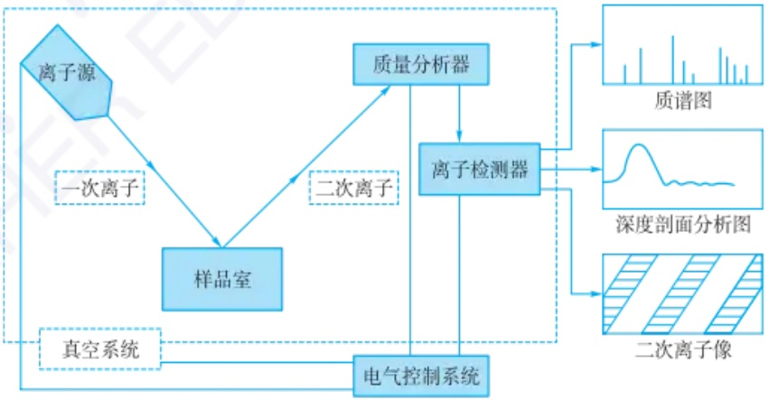

flowchart

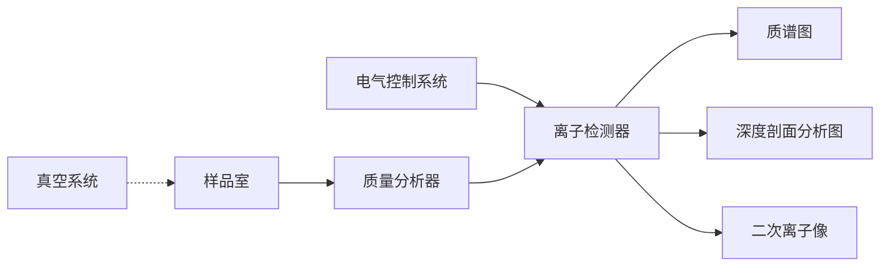

图 10.3.1 二次离子质谱仪组成示意图

## 10.3.1.1 二次离子质谱仪的工作原理

如图10.3.2所示，二次离子质谱的工作原理是通过质谱法分析入射离子（一次离子）轰击样品表面溅射产生的带有正、负电荷的二次离子，利用质量分析器接收分析二次离子，测量离子的质荷比和强度并得到二次离子质谱，获取材料表面信息。

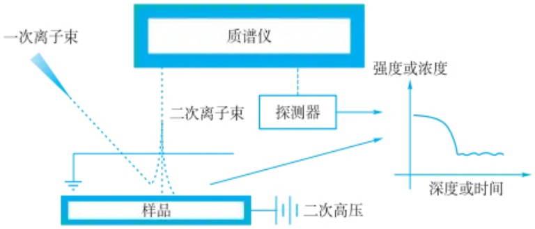

flowchart

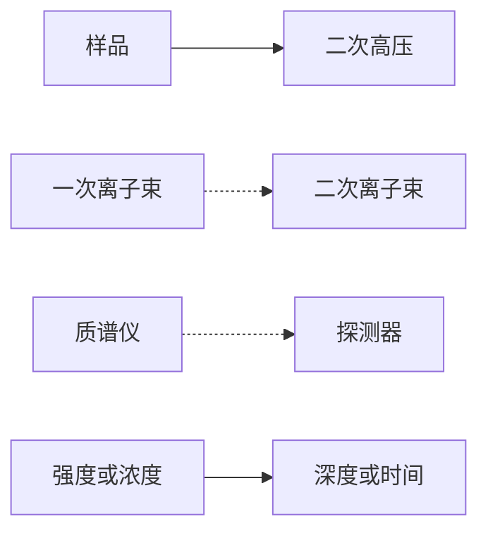

图 10.3.2 二次离子质谱工作原理图

在二次离子质谱分析过程中，离子枪发射的一次离子束轰击样品表面，一次离子在与样品相互作用时，可能穿透样品表面，进入样品的原子层，在这个过程中会发生一系列弹性和非弹性碰撞。入射的一次离子与样品晶格原子发生能量传递，促使样品部分晶格原子产生向表面的运动，并把能量的一部分传递给样品的表面粒子，表面的粒子接受能量并发射，这种过程称为粒子溅射。发生溅射一系列过程可以看成单个入射离子和样品的组成原子之间碰撞，荷能离子与表面的相互作用包括的一系列基本过程，如图10.3.3所示。

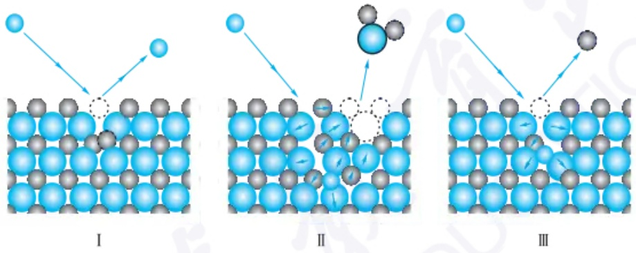

图 10.3.3 离子与固体表面相互作用引起的重离子发射过程

当入射离子与样品表面接触发生弹性或非弹性碰撞后，改变其运动方向朝真空端飞回，这种情况称为一次离子的背散射；同时与之接触的样品表面原子也受到弹性或非弹性碰撞影响，可能产生振动、移位等现象，被打入样品内部（称反弹注入），如图10.3.3中I所示。

一次离子还可进入样品表面，并在样品晶格中产生一系列级联碰撞，将其能量消耗在周围晶格，最后注入一定的深度（多种情况下为几个原子层），即离子注入。晶格内原子受到入射离子的碰撞，部分原子获得能量，当获得的能量高于一定阈值时就会发生晶格内移位，与周围其他原子发生碰撞。连续的碰撞部分扩展到样品表面粒子，当表面粒子获得足以使其离开样品表面所需的能量与方向，则会产生二次发射，这种现象称为溅射（如图10.3.3中Ⅱ所示）。溅射出的二次粒子包含原子、分子或原子团，其中中性粒子占大部分，其次是一些带正负电荷的二次离子。

还有一部分一次离子在和表面原子碰撞时，将其大部分能量传递给样品表面原子，样品表面原子可以获得很高的能量并发射出去（称为反弹溅射）；而耗散能量后的一次离子继续注入样品晶格内部，见图10.3.3中的Ⅲ。此外入射离子在与样品表面相互作用时与表面发生电荷交换，导致中和、电离及二次电子发射等，这种情况可以在样品表面内较深的区域、表面区及体外发生。

## 溅射产额

溅射产额是描述溅射现象的主要参量之一,它表示单个入射离子作用于样品表面溅射出的平均粒子数量。在一定条件下,溅射产额与入射离子的原子序数、能量、入射角度均有一定的关系,同时也受样品表面组分、结构等多种因素影响。

## 二次离子产额

一次离子束照射样品表面时引起的粒子溅射，二次离子只占其中的一小部分。二次离子产额指的是一个入射离子轰击样品表面所产生的二次离子数。同样二次离子产额也受入射离子束、样品性质及化学环境的影响。

入射离子与样品相互作用动画演示

## 知识拓展

1. 当带有一定能量的一次粒子（如电子、离子、中性粒子及光子）轰击物体表面时，物体表面会发射出二次粒子，二次粒子包括电子、原子、离子及分子等多种粒子。
2. 基体效应: 由于其他成分的存在, 同一元素的二次离子产额会发生变化。
3. 二次离子质谱测试样品一般要求:

① 种类一般包括金属和合金、半导体、绝缘体、有机物及生物膜等。
② 样品形态一般为晶态或非晶态固体,或是具有沉积薄膜及镀层的基底,样品表面需平坦而光滑。
③ 粉末样品必须将其压入软金属箔(如铜)中或压制成小块。

## 思考:

在实际应用中,一次离子束的束流强度、束斑大小和束能量对样品的分析结果与损伤均有影响,思考不同密度和束斑大小的离子束分别适合进行什么类型的分析?

## 思考:

划分二次离子质谱两种分析模式的主要标准是什么？

## 10.3.1.2 离子源

离子源是二次离子质谱仪的关键部件，用于发射一次离子，其基本组成包含离子枪和电磁透镜。通常采用几百伏特的电子束轰击气体分子（如惰性气体氦、氖、氩等），使气体分子电离，产生一次离子。产生的一次离子在电压的作用下从离子枪内射出，再经过电磁透镜使离子束聚焦，照射在样品表面上激发二次离子。

常见的离子源类型包括热阴极电离型离子源、双等离子体离子源和液态金属场离子源。

热阴极电离型离子源由金属表面直接加热离子源提供  $Cs^{+}$ 。其特点是级联碰撞效应小，纵向分析时深度分辨率高，但发射区域大，聚束困难、能量分散和角度分散较大。

双等离子体离子源提供  $O_{2}^{+}$ 、 $O^{-}$ 、 $Ar^{+}$  和  $Xe^{+}$ 。其亮度高，束斑可达  $1 \sim 2 \mu m$ ，可用于离子探针和成像分析。

液态金属场离子源提供  $Ga^{+}$ 。其束斑可聚焦很小，可以得到束斑为 20\~200 nm，束流为 0.5 nA 的离子束，另外液态金属场离子源空间分辨率较高。

## 10.3.1.3 二次离子质量分析系统

二次离子质量分析系统是二次离子质谱仪的核心部分，通常包括加速极、质量分析器和离子收集、放大等部分，通常还包括能量分析器。质量分析系统用以分离并检测从样品表面溅射而来的具有不同质荷比的二次离子，主离子束直径范围为0.3\~5 mm。在分析过程中，质量分析器不但可以提供对应于每一时刻的新鲜表面的多元素分析数据，而且还可以提供表面某一元素分布的二次离子图像。

目前常见的二次离子质谱仪中应用的质量分析器主要包含三种类型,即根据质量分析器不同,分为三种类型的二次离子质谱仪,分别是双聚焦磁偏转质谱仪、四极杆质谱仪和飞行时间质谱仪。

双聚焦磁偏转质谱仪利用不同动量的离子在磁场中偏转半径不同，将不同质荷比的离子分开。采用具有扇形静电场和扇形磁场的双聚焦分析器可以提高质谱仪的质量分辨本领。尽管双聚焦磁偏转二次离子质谱仪质量分辨率高，质量范围也较宽，但成本往往很高，且体积庞大，质量扫描速度慢。

四极杆质谱仪通过射频与直流电场使特定质荷比的离子以稳定轨迹穿过四极场，而质量较大或较小的离子由于轨迹不稳定偏转到四极杆上，从而达到质量分析目的。其价格低廉，操作方便，但其元素检测灵敏度不高。

飞行时间质谱仪利用具有相同能量不同质荷比的离子飞行速度不同,用负脉冲将二次离子引出,然后通过高压使离子加速,经过一段飞行它们分别在不同时间到达检测器,从而得到质谱。飞行时间质谱仪流通率很高,接近100%,同时具有较高的分辨率,分析速度快,质量范围原则上不受限,且样品的利用率最高。

## 10.3.1.4 二次离子质谱的分析模式

SIMS 的分析模式基本上分为两类,包括静态 SIMS 和动态 SIMS。静态 SIMS 用于表面亚单层的元素分析,动态 SIMS 用于获取表面下深度的位置信息。

静态 SIMS 要求分析室的真空度优于  $10^{-7}$  Pa，从而使分析时表面不会被真空环境干扰。初级离子束的能量低于 5 keV，束流密度降到纳安每平方厘米 (nA·cm $^{-2}$ ) 量级，使表面单层的寿命从几分之一秒延长到几个小时。在静态 SIMS 中，溅射非常缓慢，因此对样品的消耗基本上可以忽略不计。

动态 SIMS 一般使用流强较大的初级离子束, 将样品原子逐层剥离进行 SIMS 分析, 从而实现深层原子浓度的测量, 得到各种成分的深度分布信息。分析过程中对样品表面产生动态破坏,产生二次离子的比率高,常用于深度剖析、成像和微区分析。

## 10.3.2 二次离子质谱的特点

二次离子质谱作为一种成熟的表面分析技术,已经应用于多个领域。其主要的优点如下:

（1）在高真空的测试条件下，可以得到样品表面的真实信息；
(2) 能分析氢在内的全部元素,并可监测同位素;
（3）可以对化合物进行测试分析并给出原子团、分子性离子、碎片离子等多方面信息；
(4) 信息深度为几个原子层,甚至单层(最表面原子打出);
（5）能够同步对样品进行深度剖析，可进行微区成分分析，还可得到一定程度的晶格信息；
（6）空间分辨率高，检测灵敏度高，对许多成分检测灵敏度很高，检测极限达 $10^{-6}$ ，甚至 $10^{-9}$ 量级；

同时二次离子质谱也存在一定的局限性,例如:

（1）测试过程中对样品表层或表层内部有一定破坏性；
(2) 分析结果受样品表面组成均一性及基体效应影响;
(3) 二次离子强度受化学和物理环境影响,造成定量分析困难;
(4) 溅射出的样品物质容易在周围零件沉积产生记忆效应。

## 10.3.3 二次离子质谱的应用

## 10.3.3.1 定性分析

二次离子质谱通过对获取的二次离子进行分析得到二次离子质量谱图，可以正确地对样品进行定性分析。但一般样品在受离子照射时，除一价离子外，还产生多价离子、原子团离子、一次离子与基体生成的分子离子等。这些离子会与其他谱相互干涉而影响质谱的正确分析。所以在分析时，应经常考虑到谱的干涉或干扰。同时应考虑同位素效应，一般地说，二次离子质谱中同位素的比例接近于天然丰度。SIMS在定性分析上具有较高的灵敏度，可达 $10^{-6}\sim10^{-5}$ 。

## 10.3.3.2 定量分析

目前二次离子质谱的定量分析能力依然有限。在 SIMS 中获得的分析信号取决于多个因素，包括一次离子的种类、材料的表面特性及其表面同位素丰度等。实际测试过程中，常采用标样物质对测试进行校准。同时由于元素与元素之间的灵敏度存在差异，定量分析也变得复杂。

## 10.3.3.3 微量元素分析

SIMS 具有的高灵敏度,对于微量元素分析很有优势,可用于定量测定固体中痕量元素的深度剖面。这些微量元素可能是来自样品本身,也可能是人工特意掺杂的微量元素。SIMS 的微量元素分析在半导体、电子器件及集成电路工业中有着重要应用。一方面可以分析材料中微量添加剂,另外还能够通过谱图分析器件的质量,优化制造工艺,提高产品质量。

## 10.3.3.4 深度剖面分析

通过动态 SIMS 可对样品进行深度剖面分析。动态 SIMS 测得的深度剖面分布与样品中真实浓度分布的关系可用深度分辨率来描述,通过校准曲线将二次离

## 拓展思考:

电子探针是微区成分分析时的常用分析工具,试了解电子探针工作原理,并思考与电子探针相比,二次离子质谱在微区分析中的优势是什么?

## 拓展思考:

查阅利用二次离子质谱对半导体材料进行微量元素分析时的应用实例。思考进行微量元素测定时，应注意哪些因素？

子信号强度转变为元素含量,可以得到样品中真实浓度分布。通常情况下,受入射离子的类型影响,界面严重的基体效应会对深度剖析曲线产生影响,同时一次离子束的束流密度分布与总束流的稳定性,入射离子与靶的相互作用,二次离子的平均逸出深度,二次离子的入射角及晶格效应等都对深度分辨有一定的影响。

## 10.3.3.5 元素面分布分析

在二次离子质谱分析过程中,当利用一次离子束作用在样品上时,通过二次电子或吸收电子像可以获取样品表面的形貌,通过质量分离的二次离子像可以获取材料表面分布的信息。成像质量的一个重要指标是横向分辨率(lateral resolution),目前液态金属离子枪系统可以得到最好的横向分辨。随着电子技术的不断发展和分析技术的提升,二次离子质谱的空间分辨率已可以达到亚微米量级。

## 10.3.3.6 有机物分析

静态 SIMS 是一种软电离分析技术, 近年来在对不蒸发、热不稳定有机物分析方面的应用迅速发展。根据质子-分子离子  $(M+H)^{+}$  质量数, 可确定有机物的分子质量, 通过碎片还可以确定有机物的分子结构。目前在有机物分析机理中, “预形成” 模型受到广泛认可并被采用, 即有机分子在载体表面先分离为  $(M+1)$  和  $(M-1)$  离子, 一次离子入射后。将其能量和动量传递给表面和点阵, 最后使预形成的离子发射出去。关于二次离子质谱分析有机物的机理研究还在不断地深入中。

## 习题

二次离子质谱应用相关文献

## - 章节练习题 -

1. 简述二次离子质谱仪的工作原理。
2. 二次离子质谱仪常见的离子源包括哪几种类型？
3. 二次离子质谱包括哪几种分析模式？
4. 简述二次离子质谱的特点。

## - 挑战性问题 -

5. 查阅相关科学文献, 设计实验: 选取一种材料, 考虑如何制备成为适合进行二次离子质谱测试的样品, 并考虑如何使用二次离子质谱仪对材料进行分析, 预测从测试结果中可以得到关于材料的哪些信息?

## - 专题或报告 -

6. 作为一种相对成熟的表面分析技术,二次离子质谱在很多领域的研究工作中发挥关键作用。查阅一篇相关科学文献,了解其主要的研究内容并简述二次离子质谱在该文献所报道的工作中发挥的作用。

## 10.4 扫描电子显微镜

## 10.4.1 扫描电子显微镜的发展历史

扫描电子显微镜(scanning electron microscope, SEM)是一种分辨率介于透射电子显微镜和光学显微镜之间的用于微观形貌，尤其是表面形貌观察的电子仪器。第二次世界大战结束后，英国剑桥大学工程系的 Charles Oatley 和他的学生

McMullan在英格兰建造了第一台扫描电子显微镜，加装了扫描线圈、扫描显示屏、二次电子探测器、电子信号放大器，1952年实现了 $50~\mathrm{nm}$ 的分辨率。此后，扫描电子显微镜具备的潜能开始受到商业界的重视。1959年CharlesOatley的另一个学生OliverWells首先使用立体对技术拍摄了可以进行样品景深信息测量的扫描电子显微镜显微图像，1960年T.E.Everhart和R.F.M.Thornley发展改善了二次电子探测器，Everhart-Thornley型二次电子探测器目前仍是扫描电子显微镜主流探测器。同样是CharlesOatley学生的KennethC.A.Smith使用磁透镜来聚焦，加装了消像散器和可倾转样品台，CharlesOatley又和Smith一起，将电子信号改成光信号放大探测，成功获得背散射电子像，Stewart也成功将聚焦离子束技术耦合到扫描电子显微镜中，成为当前微小样品制备、失效分析等众多领域应用最为广泛的双束电子显微镜技术。1965年CharlesOatley率领团队发明了第一台商用扫描电子显微镜并命名为Steroscan，这一命名正是体现了扫描电子显微镜立体成像特征，将扫描电子显微镜的分辨率提升至 $10~\mathrm{nm}$ 。

## 10.4.1.1 场发射扫描电子显微镜

20 世纪 80 年代,采用场发射枪(field emission gun, FEG)的场发射扫描电子显微镜(field emission scanning electron microscope, FESEM)投入商业使用。在该类扫描电子显微镜中,采用新型场发射枪使电子探针的直径减小到约 0.5 nm,极大提升了扫描电子显微镜的分辨本领。此外,FESEM 还能在极低的加速电压 (<1 kV) 下对样品进行高分辨率成像,不牺牲传统的高电压和高电流(分析)性能。FESEM 在低加速电压下的特点为表面表征方面的应用开辟了新的途径。

## 10.4.1.2 环境/可变气压扫描电子显微镜

20世纪80年代末，Electroscan公司制造了第一台商业环境扫描电子显微镜（environment scanning electron microscope, ESEM），是在电子显微镜仪器方面迈出的重要一步，具有举足轻重的作用。可变气压（variable pressure）/环境扫描电子显微镜（VP/ESEM）采用了特殊的真空设计，同时采用气体二次电子探头，样品台也采用具有制冷功能的特殊样品台，允许在约 $10\sim 10^{3}\mathrm{Pa}$ 的低真空下进行二次电子成像。此外，VP/ESEM还可在低真空条件下对绝缘体样品进行成像，最大限度避免了荷电效应的影响。

经过40多年的不断改进，扫描电子显微镜的分辨率已经提高到现在的 $1\mathrm{nm}$ 扫描透射电子显微的分辨率更是达到了 $0.01\mathrm{nm}$ 以下。由于扫描电子显微镜较大的样品室空间，可以较好地耦合X射线能量色散谱仪（EDX）、波谱仪（WDX）、背散射电子(EBSD)探头等硬件设备，对样品进行局部元素分析和晶体学表征。扫描电子显微镜已经发展成可全面对材料表界面微观分析的多功能电子显微仪器，广泛应用于各种材料的形态结构、界面状况、损伤机制及材料性能预测等方面的研究。

## 10.4.2 扫描电子显微镜的工作原理

## 10.4.2.1 扫描电子显微镜成像原理

扫描电子显微镜以电子枪发射的电子束作为照明源，经栅极聚焦后，在加速电压的作用下，经由2\~3个电磁透镜构成的电子光学系统，将初始电子束汇聚为细的电子束聚焦于样品表面。末级透镜上方或者内部装有扫描线圈，在扫描线圈的驱动下，电子束发生偏转，在样品表面逐行扫描。高能电子束与样品相互作用会产生多种信号，如二次电子、背散射电子、吸收电子、X射线、俄歇电子、阴极荧

Charles Oatley

## 思考:

为什么电子显微镜可以具有更高的分辨率？影响显微镜分辨率的因素有哪些？

环境扫描电子显微镜

不同种类电子枪灯丝

## 思考:

在扫描电子显微镜中利用了哪些信号源进行成像？在分辨率、分析方法、成像模式上有何区别？

商业化能谱仪和阴极荧光光谱仪

光和透射电子等，成像主要是二次电子和背散射电子。上述信号被相应的接收器接收，经放大后送到显像管的栅极上，调制显像管的亮度，最终形成一幅与扫描区域一一对应的扫描电子显微图像。

## 10.4.2.2 扫描电子显微镜的结构

扫描电子显微镜主要由以下几部分构成。① 电子光学系统:包含电子枪、电磁透镜；② 扫描系统:包含扫描信号发生器、扫描放大控制器、扫描偏转线圈；③ 信号探测放大系统:包含各种类型信号探测器（如二次电子探测器、背散射电子探测器等）和信号放大器；④ 图像显示和记录系统；⑤ 真空系统:包含机械泵、扩散泵和涡轮分子泵等；⑥ 电源系统。整体扫描电子显微镜结构如图10.4.1所示。

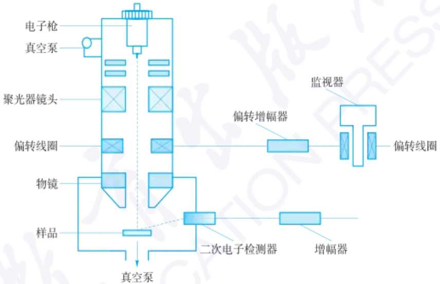

flowchart

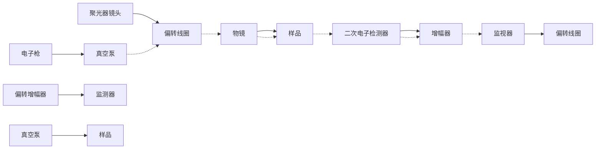

图 10.4.1 扫描电子显微镜结构示意图

## 10.4.2.3 扫描电子显微镜的优势

与光学显微镜相比,扫描电子显微镜具有很多独特的优势,汇总如下:

（1）SEM 仪器分辨本领较高。二次电子像分辨本领可达 1.0 nm（场发射），3.0 nm（钨灯丝）；仪器放大倍数变化范围大（从几倍到几十万倍），且连续可调。
（2）图像景深大，富有立体感。可直接观察起伏较大的粗糙表面（如金属和陶瓷的断口等）。
（3）样品制备简单。样品无论是块状还是粉末状，导电还是不导电，无须处理或稍加处理，就可直接放到SEM中进行观察。一般来说，比透射电子显微镜（TEM)的制样简单，且可使图像更近于样品的真实状态。
（4）可做综合分析。SEM 装上波长色散 X 射线谱仪 (WDX, 简称波谱仪) 或能量色散 X 射线谱仪 (EDX, 简称能谱仪) 后，在观察扫描形貌图像的同时，可对样品微区进行元素分析。
（5）装上半导体样品座附件，可以直接观察晶体管或集成电路的 p-n 结及器件失效部位的情况。
（6）装上不同类型的原位过程样品台和检测器，可以直接观察处于不同环境（加热、冷却、拉伸等）中的样品显微结构形态的动态变化过程（动态观察）。

## 10.4.3 扫描电子显微镜成像信号源及成像模式

## 10.4.3.1 电子束与样品的相互作用

在 SEM 中, 电子枪产生的电子束经过电磁透镜聚焦, 扫描线圈控制电子束对样品进行扫描, 与样品相互作用会产生多种物理信号。在扫描电镜中, 用来成像的信号主要是二次电子, 其次是背散射电子和吸收电子。用于分析成分的信号主要是 X 射线和背散射电子, 阴极发光和俄歇电子也有一定的用处。探测器将产生的物理信号转换成图像信息, 最终实现对样品表面形貌的观察和表征。主要的信号源有以下几种:

（1）二次电子 二次电子是指被入射电子轰击出来的样品的核外电子。二次电子的能量较低，小于50 eV。由于只有样品表面5\~50 nm深度范围产生的二次电子能够离开样品表面被收集，因此，二次电子可以有效显示样品的表面形貌。
（2）背散射电子 背散射电子是指被固体样品中的原子核反弹回来的一部分入射电子。该电子信号能量高，分布范围宽，一般为数十电子伏到数千电子伏。产额随样品原子序数增大而增多，不仅能用作形貌分析（分辨率不如二次电子），而且可以用来显示原子序数衬度，定性用作成分分析。

（3）特征 X 射线 原子内层电子被轰出后，外层电子向内层跃迁产生特征 X 射线。可以用特征 X 射线判定微区中存在的元素。

（4）Auger 电子 在入射电子激发样品的特征 X 射线过程中，如果在原子内层电子能级跃迁过程中释放出来的能量并不以 X 射线的形式发射出去，而是用这部分能量把空位层内的另一个电子发射出去（或使空位层的外层电子发射出去），这个被电离的电子称为 Auger 电子，Auger 电子特别适用于表面成分分析。

（5）阴极荧光是指氧化物或半导体材料被阴极射线管管内的热电子轰击后，价电子被激发到高能级或能带中产生弛豫发光的现象。其波长在紫外、可见或红外光区域，可以被用来检测矿物、半导体和生物样品中痕量元素的分布。

## 10.4.3.2 扫描电子显微镜样品的制备

SEM 经常观察的样品有块体样品、粉末样品、生物样品等。对于块体样品而言，其应该尽量小，一定不能超过电镜样品台尺寸。用导电胶把样品黏结在样品台上，对于不导电或者导电性差的样品，需要进行镀膜处理后再放入扫描电镜中观察；对于粉末样品而言，需要先将导电胶带粘在样品台上，然后将粉末样品均匀地撒在导电胶上面，随后用压缩空气（或者洗耳球）吹去没有黏住的样品；对于生物样品而言，由于生物样品性质较为特殊，一般都具有含水量高、质地柔软、导电性差、对热和电子束敏感等特性，因此生物样品的制样过程较为复杂，主要包括取样、清洗、固定、脱水、干燥、粘样、导电处理几个步骤。

## 10.4.3.3 扫描电子显微镜成像模式

## 1. 二次电子像

二次电子成像模式的信号源为二次电子，其发射率主要取决于样品表面，与原子序数的变化相关性不大。二次电子分辨率高、景深大，立体感较强，因此二次电子像是最主要的成像方式，主要用于观察样品表面形貌，金属、陶瓷等材料的断口形貌，甚至在微纳尺度动态观察样品形变过程，广泛应用于材料科学、生物领域等。

由于二次电子的能量较小,在应用 E-T 型探测器收集信号时,需要在栅网上加几百伏的正偏压,不仅可以吸引大部分的二次电子进行信号收集,还可以避免

## 思考:

要获得良好分辨率的扫描电镜照片,需要如何对样品进行处理?

二次电子探测器

## 思考:

对于点分析、线扫描分析以及面扫描分析,我们应该如何选择?

背散射电子衍射谱仪和成像图示

二次电子像的阴影效应。传统的 E-T 型二次电子探测器主要由三部分组成:闪烁体、光导管及光电倍增管，如图 10.4.2 所示。

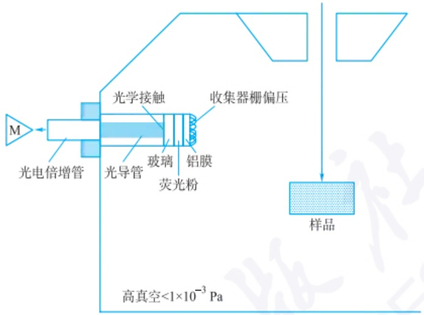

text_image

M
光电倍增管
光导管
光学接触
玻璃
荧光粉
收集器栅偏压
样品
高真空<1×10⁻³ Pa

图 10.4.2 传统的 E-T 型二次电子探测器示意图

## 2. 背散射电子像

背散射电子像是以背散射电子为信号源，大部分背散射电子的能量为原入射电子能量的0.7\~0.9倍，其对原子序数比较敏感，分辨能力仅次于二次电子像。目前，场发射扫描电子显微镜的背散射电子像的几何分辨率可以达到2.5 nm，原子序数分辨率可以达到0.1 Z。一般情况下，高角度(>30°)的背散射电子像更容易表现出原子序数衬度，低角度(<30°)的背散射电子像则更适合显示样品的几何形貌。

由于扫描电子显微镜的型号不同，背散射电子探测器(SED)的结构布局和探测模式存在一定的差异，常见的SED结构布局和探测模式有以下几种（如图10.4.3所示）:①将样品向E-T二次电子探测器方向倾斜，并将探测器栅偏压调控至 $\leqslant 50\mathrm{V}$ 实现对背散射电子的间接采集；②于样品上方安装环形钇铝石榴石(YAG)闪烁体探测器或半导体背散射电子探测器(SS-BSED)；③采用广角鲁滨孙背散射电子探测器进行检测；④在样品上方对称布置4个小型圆柱形半导体探测器。

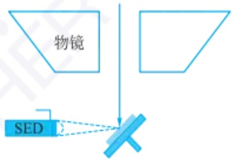

text_image

物镜
SED

(a) E-T SED检测背散射电子

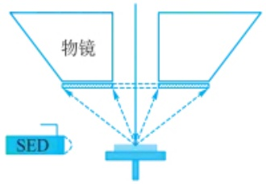

text_image

物镜
SED

(b) 环形YAG或SS-BSED检测背散射电子

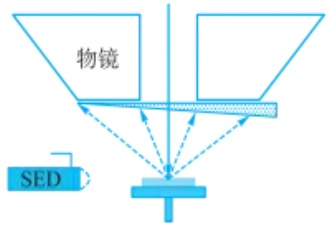

text_image

物镜
SED

(c) 鲁滨孙探测器检测背散射电子

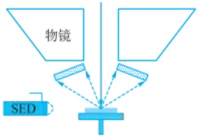

text_image

物镜
SED

(d) 4个小圆柱形半导体探测器检测背散射电子

图 10.4.3 常见的 SED 结构布局和探测模式示意图

## 3. 元素成分分析

EDX能谱仪是一种用来分析物质元素的设备，其信号源为特征X射线。当特征X射线的光子被探测器收集后，会在 $\mathrm{Si(Li)}$ 晶体内激发出一定数目的电子空穴对，入射X射线的能量越高，电子空穴对的数目越多，经过前置放大器转换成电流脉冲，并进入多道脉冲高度分析器，利用脉冲高度分析器按高度把脉冲分类进行计数，最终获得按能量分布的图谱。能谱仪的 $\mathrm{Si(Li)}$ 探测器内部结构如图10.4.4所示。

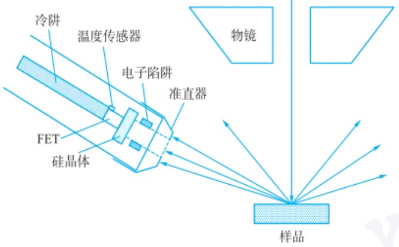

text_image

冷阱
温度传感器
电子陷阱
准直器
FET
硅晶体
物镜
样品

图 10.4.4 能谱仪的 Si(Li) 探测器内部结构示意图

EDX 能谱仪的分析方法一般分为三种。① 点分析: 将电子束探针固定在样品指定位置进行定量或定性分析, 一般对于低含量元素的定量分析只能采用点分析; ② 线扫描分析: 将电子束沿一条分析线进行扫描, 可获得具有元素含量变化的线分布曲线, 将线分布曲线与二次电子像形貌对照分析, 能直观地获得元素在不同相或区域内的分布; ③ 面扫描分析: 将电子束在样品表面进行扫描, 则样品表面的元素分布以彩色呈现从而进行定量分布, 亮度越高, 说明元素的含量越高, 一般材料中的相分布、元素偏析等常用面扫描分析, 并与形貌像进行对照分析。

## 4. 其他成像模式

除了上述常用的成像模式外，还有其他配置在扫描电子显微镜中的成像系统，如阴极荧光成像、扫描透射成像等。其中，阴极荧光成像可以实现纳米级空间分辨率，一般情况可接收的信号范围为200\~800 nm，更宽范围可以到200\~1600 nm，在材料的位错缺陷、载流子动力学、界面衬度分析、应力应变分析等方面的研究具有重要作用。在扫描电子显微镜上配置透射附件，应用透射模式可得到物质的内部结构信息。相比于透射电子显微镜而言，其加速电压较低，可以显著减少电子束对样品的损伤，特别适合于有机高分子、生物软材料等样品的透射分析。

## 10.4.4 扫描电子显微镜在材料表界面分析中的应用

## 10.4.4.1 表界面结构静态表征

SEM腔室内一般处于高真空状态，压强范围在 $10^{-4} \sim 10^{-2} \mathrm{~Pa}$，这种模式为高真空模式，但对于生物样品而言在这种模式下是不利于观察的。除此之外，SEM还有一种环境扫描电子显微镜模式（ESEM），其压强可以在 $10 \sim 4000 \mathrm{~Pa}$ 范围调节，并且腔室内存在一个气体环境，任何状态的样品（湿的或干的，导电的或绝缘的）都可以直接测试，而无须进行表面预处理，因此更适用于观察生物样品或含有挥发性成分的样品。例如，利用SEM对隐士蜘蛛的蛛丝进行观察分析（如图

EDX成像图示

SEM 中的透射电子成像装置

SEM 图像示例

10.4.5 所示）。从图中可以看出，隐士蜘蛛的蜘蛛丝纤维由直径约 20 nm、长度大于 1 μm 的蛋白纳米纤维复合构成。

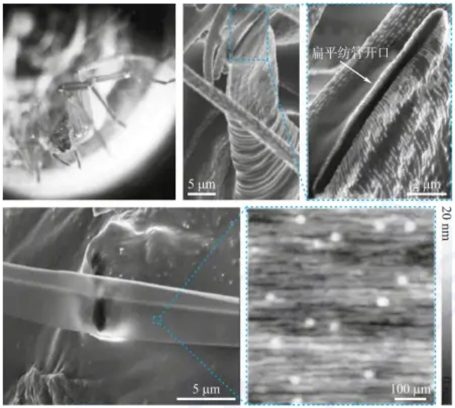

图 10.4.5 隐士蜘蛛及其蛛丝纤维形貌

SEM 表征手段对材料的开发与制备至关重要。在样品合成调控过程中,需要借助 SEM 技术手段对样品的表面形貌进行观察,进而反馈调控工艺。例如,通过 SEM 观察木质素的微观形貌(如图 10.4.6 所示)可以发现烤箱干燥的木质素看起来像不规则的土块。进一步放大后,可以看到木质素块的表面是平坦的。同样,

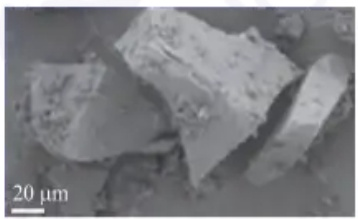

natural_image

Microscopic view of irregularly shaped particles with a 20 μm scale bar (no text or symbols beyond scale indicator)

(a)烘干木质素

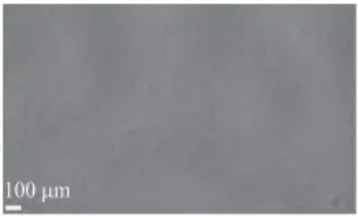

natural_image

Microscopic grayscale image with 100 μm scale bar, no visible text or symbols

(b)烘干木质素表面

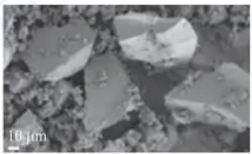

natural_image

Microscopic view of irregularly shaped particles with a 10 μm scale bar (no text or symbols beyond scale indicator)

(c) 真空干燥木质素

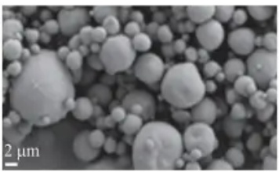

natural_image

Microscopic view of spherical particles with a 2 μm scale bar (no text or symbols)

(d) 喷雾干燥木质素

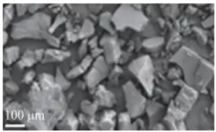

natural_image

Microscopic view of granular material with 100 μm scale bar (no text or symbols beyond scale indicator)

(e)冻干木质素

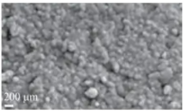

natural_image

Microscopic view of granular material with 200 μm scale bar (no text or symbols beyond scale indicator)

(f)冻干木质素表面

图 10.4.6 以不同的方式干燥木质素的微观形貌

SEM 结果显示真空干燥的样品与烤箱干燥的结果相同。喷雾干燥的木质素形成直径从数百纳米到数十微米不等的圆形颗粒。在低放大倍率下，冻干木质素与烘箱和真空干燥木质素没有明显区别，但进一步放大的图像表明冻干样品的表面有很大不同，可以明显观察到大量的木质素颗粒。冷冻干燥后应保持酸性沉淀木质素的小颗粒是合理的，但出乎意料的是，颗粒紧密聚集并形成大块形状物。

SEM在金属材料的表界面分析中占据重要地位。通过SEM观察断口表面，可以判断金属材料的断裂方式。图10.4.7展示了AA1050铝合金/低碳钢摩擦搅拌焊接接头钢侧断裂面SEM形貌及EDX分析结果。研究表明，钢侧断裂表面成分均为钢母材，不存在金属间化合物，且钢侧断裂表面较为平坦，存在撕裂脊，说明接头在 $\mathrm{Fe_2Al_5(\eta)}$ 金属件化合物-钢母材界面发生了伪脆性断裂。

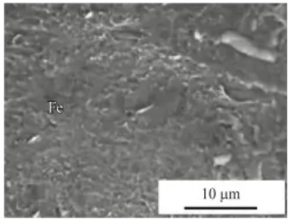

text_image

Fe
10 µm

(a)

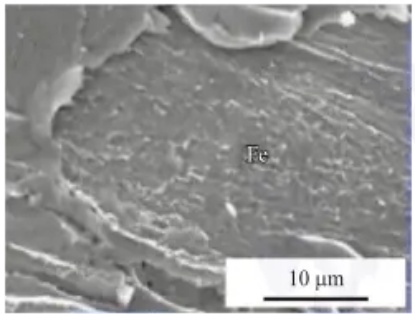

natural_image

Microscopic surface texture image showing Fe (metal) inclusions, scale bar indicates 10 μm (no text or symbols beyond label)

(b)

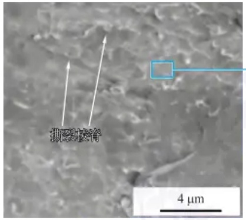

text_image

微形致密
4 µm

(c)

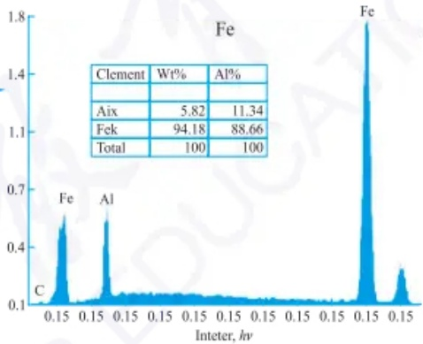

spectrogram

| Element | Wt% | Al% |
| --- | --- | --- |
| Aix | 5.82 | 11.34 |
| Fek | 94.18 | 88.66 |
| Total | 100 | 100 |

(d)

图 10.4.7 （a）\~（c）在不同的放大倍数和位置拍摄的接头钢侧断裂表面的 SEM 图像，(d) 标记区域 EDS 分析

EBSD 已广泛地成为金属材料工作者、陶瓷和地质矿物学家分析显微结构及织构的强有力的工具。例如，图 10.4.8 展示了锂金属的 EBSD 分析结果。每个像素的颜色表示该点相对于样品法线的晶格方向，通过计算可以得到 Kikuchi 衍射图，方向显示在反极图中。这种制备方法可能对锂的其他研究有用，如制备 AFM 样品或非原位固体电解质间相的形成和表征。

原子内层电子被轰出后,外层电子向内层跃迁产生特征 X 射线,可以利用特征 X 射线进行元素分析。图 10.4.9 展示了单壁碳纳米管的 SEM 和 EDX 图像。

## 10.4.4.2 表界面结构动态表征

单纯的静态表征材料的形貌、界面等微观结构已经不足以满足人们对材料特性的探索。因此，近年来发展了多种基于SEM的原位技术，这类技术可以通过原位观察材料表界面动态变化过程，揭示材料的内在机制。

在扫描电子显微镜中,通过原位拉伸设备可以探究不同拉伸取向下金属材料的拉伸变形行为。如图 10.4.10 所示, 原位过程显示了 [001] 取向下二代镍基单晶高温合金在室温下的拉伸变形断裂行为和微观结构演变之间的关系。

原位拉伸样品台

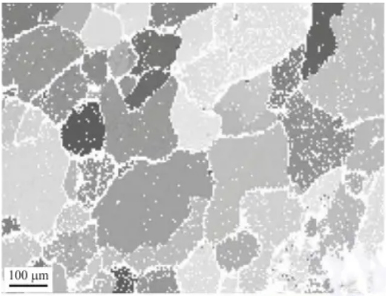

natural_image

Microscopic view of a material's grain structure with 100 μm scale bar (no text or symbols beyond scale indicator)

(a)锂合金的大等轴晶粒

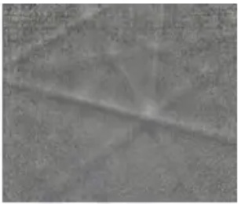

natural_image

Grayscale abstract texture with a faint diagonal line and speckled texture (no text or symbols)

(b)菊池花样

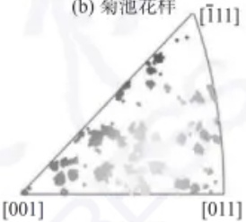

scatter

| Category | X-axis (range) | Y-axis (range) |
| --- | --- | --- |
| [001] | 0~[011] | 0~[001] |
| [011] | 0~[011] | 0~[001] |
| [111] | 0~[011] | 0~[001] |

(c) 反极图

图 10.4.8 锂金属的 EBSD

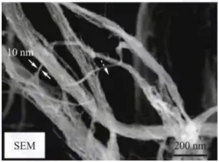

natural_image

Microscopic image of fibrous structures with scale bars (10 nm and 200 nm), no textual annotations or symbols present.

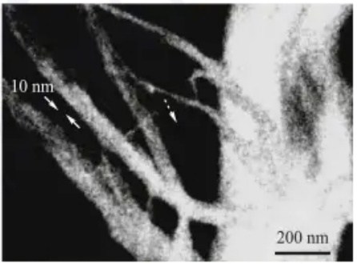

natural_image

Microscopic image showing nanoscale structures with scale bars (10 nm and 200 nm), no readable text or symbols beyond annotations

图 10.4.9 单壁碳纳米管的 SEM 和 EDX 图像

## 思考:

除了原位力学、原位电化学之外,还有哪些扫描的原位设备可以应用?

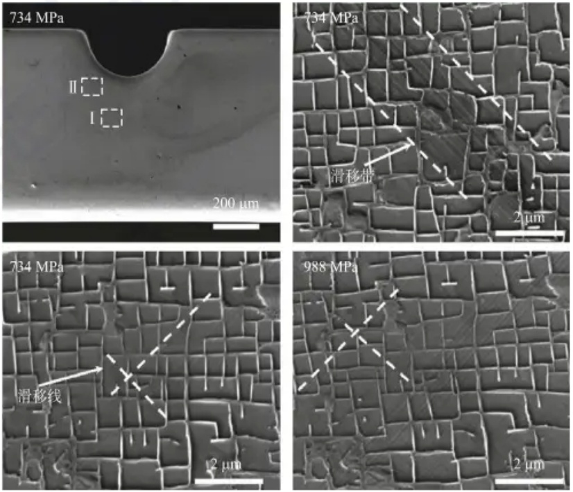

图 10.4.10 [001] 取向样品不同应力状态下的 SEM 图像

随着新能源技术的广泛应用，开发高能量密度、高安全性及长寿命的电池具有重要意义。扫描电子显微镜原位电化学技术的发展，为进一步探究电池中锂离子输运及锂枝晶生长动力学提供了机会，使扫描电子显微镜在新能源技术发展领域大放光彩。如图10.4.11所示，研究人员以 $\mathrm{LiPON(Li_{3.3}PO_{3.8}N_{0.22})}$ 作为固态电解质，以铜作为集流体，实现对金属锂在 $\mathrm{Cu|LiPON}$ 界面上电化学沉积和溶出过程的原位SEM观测。通过原位SEM动态观察表明:在电流密度为 $50~\mu \mathrm{A}\cdot \mathrm{cm}^{-2}$ 的沉积过程中，初始锂生长位点稀疏分布于 $\mathrm{LiPON|Cu}$ 界面上；随后，局部区域内的锂从预沉积位点沿 $\mathrm{Cu}$ 膜生长；最终，多数沉积锂会生长为微米级锂枝晶。

原位电化学测试系统

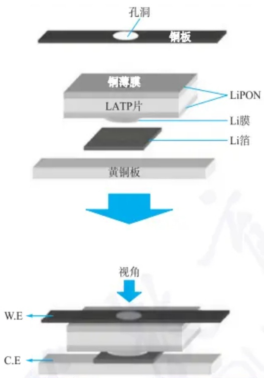

flowchart

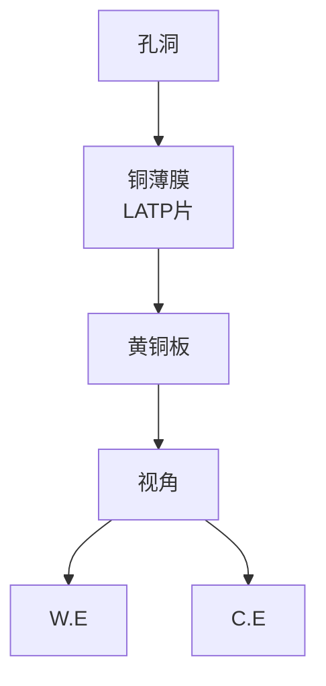

(a)

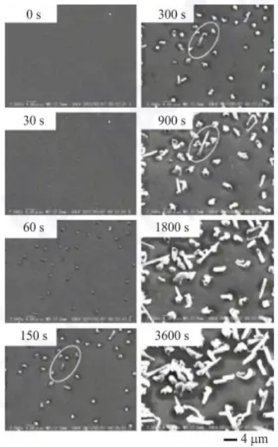

(b)

图 10.4.11 （a）原位实验示意图；（b）锂成核生长过程

## 10.4.5 扫描电子显微镜在表界面表征中的应用展望

扫描电子显微镜在材料科学、生命科学、环境科学等领域发挥着重要作用。尤其是近年来，随着扫描电子显微镜原位技术的发展，人们对于扫描电子显微镜的应用已经由原来的静态观察逐步过渡到动态表征，并研究出多种原位设备，如原位力学设备、原位电化学设备等。借助扫描电子显微镜实时动态揭示材料的物理化学性质已成为该领域重要的发展趋势，扫描电子显微镜的静态与动态表征相结合的方式将在表界面研究中具有广阔的发展前景，对于相关学科的发展具有重要意义。

习题

## - 章节练习题 -

1. 请解释扫描电子显微镜与光学显微镜的主要区别和优势。
2. SEM 是如何产生高分辨率图像的？请描述其工作原理。