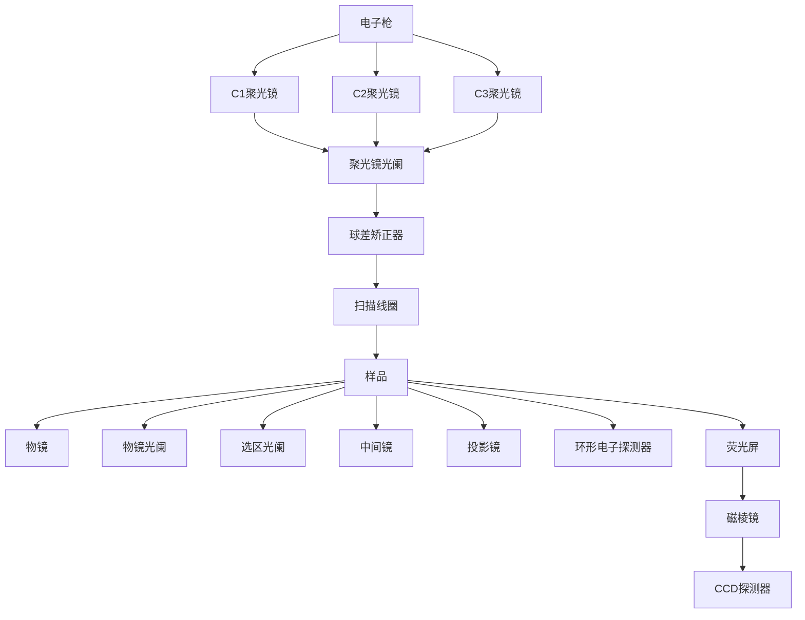
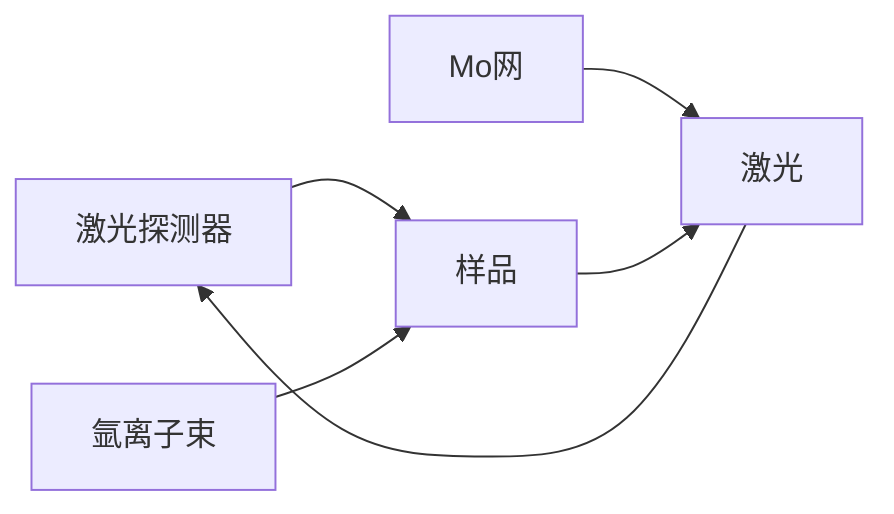

显微成像发展史中的历史人物

3. SEM 在材料科学、生物学和其他领域中的应用有哪些？请列举一些具体的应用案例。
4. 高真空环境对SEM操作的必要性是什么？如何确保SEM系统的高真空状态稳定并避免污染？

## - 挑战性问题 -

5. 在 SEM 成像中准确表征样品的化学成分和结构信息通常需要结合其他技术手段, 研究人员可以在 SEM 成像中更准确地表征样品的化学成分和结构信息, 从而深入理解材料的性质和行为。随着技术的不断发展和完善, SEM 在材料科学领域的应用前景将会更加广阔。SEM 成像中如何准确表征样品的化学成分和结构信息? 有哪些先进的技术可以实现元素成分分析和三维成像?

## - 专题或报告 -

6. 扫描电子显微镜的样品制备是非常重要的, 因为样品的制备直接影响到 SEM 成像的质量和结果的准确性。例如, 样品制备过程中需要确保样品表面的平整度, 避免凹凸不平或颗粒堆积等情况, 以确保 SEM 成像时能够获得清晰的图像。请查阅相关科学文献, 了解扫描电子显微镜样品制备的常见方法和技术, 并将结果写成报告。

## 10.5 透射电子显微镜

## 10.5.1 透射电子显微镜的发展历史

## 10.5.1.1 电子光学理论的建立

早期，人们在利用常规光学系统进行观测的过程中逐步发现了光学系统的分辨率存在极限的问题。1834年George Biddell Airy在用天文望远镜观察天体时，发现了由于光的波动性而引起的衍射现象，从而在1835年他提出艾里这种光学衍射极限对分辨率限制的概念。到1878年，Cleveland Abb指出光学显微镜分辨本领受到光波衍射的限制，给出了表示显微镜分辨本领极限的公式，指出显微镜的分辨能力受光的波长限制。为了突破光学显微镜的极限，研究人员在寻找高分辨率显微镜的过程中逐渐把注意力转移到真空中高速运动的电子上。

1907 年, Stommel 发表了一篇关于极光的论文, 这篇文章实际上已得出了旋转对称磁场中电子轨迹的普遍方程。从 1921 年 Biji 为解决在示波器用的电子束管中得到细电子束这样一个实际问题开始, 便诞生了电子光学。1926 年, 德国科学家 H. Busch 发表了磁透镜方面的理论研究论文, 人们才意识到利用电子射线制造基于新原理的显微镜的可能性。布什在实践中也制成了第一只高真空磁聚焦电子束管, 证明了旋转对称磁场可以使电子束折射、聚焦, 如同光学透镜对光线的作用, 为电子光学的发展准备了条件。随后, 德国的 W. Glacer、O. Scherze 等发表了一系列电子光学理论性论文, 从而奠定了电子光学的理论基础。

## 10.5.1.2 早期电子显微镜的发展

Hans Busch 提出的高速运行的电子束能被轴对称的电场或磁场折射而聚焦，并在理论上证明了利用电场或磁场能做成电子透镜。Hans Busch 的工作对柏林大学高压研究室的 Max Knoll 和 Ernst Ruska 产生了巨大的影响。Ernst Ruska 从 1929 年开始研究单磁透镜的光学作用，于 1931 年用阴极射线示波器改装成的没有聚光镜的二级磁透镜系统，获得了放大 13 倍的铂金网像。1933 年底至 1934 年初，Ernst Ruska 在配备一个聚光镜和用短焦距的极靴式磁透镜代替空心线圈后，又获得了放大 12000 倍的铝箔与纤维的像，分辨率比光学显微镜提高了 4 倍。然而在一段时期内，由于电子显微镜真空度不高的缺陷及样品在高速电子轰击下易受到损伤，使人们怀疑电子显微镜是否能起到实际的作用。直到 1939 年，Ernst Ruska 在德国的西门子(Siemens)公司制成了分辨率优于 10 nm 的商品电子显微镜，在其投放市场后，世界各国才广泛地开展了对电子显微镜的研制。

例如，荷兰的飞利浦(Philip)公司，美国的无线电(RCA)公司，日本的日立(Hitachi)公司、明石(Bright stone)公司等实验室和公司大力推进电子显微镜的研制过程。电子显微镜的发明人Ernst Ruska因为对电子显微镜的巨大贡献于1986年获得诺贝尔物理学奖。

## 10.5.1.3 透射电子显微镜的进一步发展

早期透射电子显微镜的发展是从阴极发射式电子显微镜开始的。1932年Brucher和Yahasso设计了用于观测阴极且只具有一级放大的电子显微镜。在这种电子显微镜中，发射电子的阴极是被研究的对象，其发射的电子通过一定的几何光学系统后给出阴极的像。像的明暗取决于物面上的发射电子分布，了解发射电子分布就能了解物面的结构情况。但人们要研究的物体绝大多数都不能发射电子，因此阴极发射式电子显微镜的应用受到很大的限制。于是人们想到可以让电子束通过被研究的物体来研究物体的结构，这就是透射电子显微镜。

1947 年, Heller 和 Lambert 将消像散器应用于电子显微镜, 将电子显微镜分辨率提高到 1 nm。但要使电子束穿过被研究的物体, 不仅要求电子束具有足够大的能量, 同时还要求物体具有极小的厚度。历史上由于样品制备上的困难, 物理学家和金属材料学家较晚才开始运用透射电子显微镜技术。1955 年以前, 电子显微镜的基本功能还只限于显微放大。它在固体材料上的应用也局限于用表面复型技术观测材料的表面, 这种方法只能间接了解固体的表面状况。1956 年 Hersch 等成功地制出 100\~200 nm 的薄样品, 先后在不锈钢和铝中看到了位错。从此, 透射电子显微学引起了人们极大的兴趣, 迅速发展成直接观察样本缺陷的有力工具, 从复型技术到透射技术的转变是电子显微学发展史上一个重要的转折点。1956 年, Menter 发明多束电子成像技术, 开创了高分辨率电子显微术, 可以观察到 1.2 nm 的条纹。1971 年, 日本、法国先后建成了超高压电子显微镜, 最高加速电压可达 3000 kV, 分辨率为 2 nm。

1990年，Otto Scherzer的学生Harald Rose在理论上证明了双六极球差校正器（double-hexapole Cs corrector）的可行性。1991年，Harald Rose与Maximilian Haider和Knut Urban开始合作研发球差校正光学元件，并于1998年成功研制出世界上第一台TEM球差校正器。该原型球差校正器搭载于Philips CM200，将其点分辨率由 $0.24\mathrm{nm}$ 提升至 $0.13\mathrm{nm}$，正式将透射电子显微镜业带入原子级分辨的崭新时代。球差校正技术的突破不仅重构了材料微观结构的研究范式，更持续推动材料科学、凝聚态物理及生命科学等领域表征能力的革新，是当今科学研究不可或缺的工具之一。

## 10.5.2 透射电子显微镜的基本构造和成像原理

## 10.5.2.1 透射电子显微镜的基本构造

透射电子显微镜(transmission electron microscope, TEM)是以电子束为光源，用电磁透镜聚焦成像的电子光学仪器。其放大倍数可达到100万倍以上。透射

国产电子显微镜

flowchart

图 10.5.1 透射电子显微镜组成结构

透射电子显微镜实物图

## 思考:

查阅相关文献,了解选区电子衍射技术的具体应用领域。

text_image

入射电子束
样品
衍射平面
物镜
透射束
衍射束
物镜光阑

明场像

电子显微镜由真空部分、电子光学部分和电源电器控制部分组成。真空部分的主要部件有真空泵、真空阀和显示仪表，为电子束稳定工作提供高真空、超高真空环境，保证电子自由程，避免灯丝、样品的损伤。透射电子显微镜工作期间，整个电子通道处于真空状态。电子枪、镜筒和照相室之间各装有真空阀，各部分可单独抽真空。可以在不破坏其他部分真空状态的情况下进行灯丝更换、样品更换、光阑清洗和电子显微镜维护。电源电器控制部分为整个电子显微镜和各个控制单元提供电源。其中电子光学部分是透射电子显微镜的核心部分，真空部分和电源电器控制部分是辅助系统。电子光学部分主要包含照明系统、成像系统、观察-记录系统，分别发挥提供光源、成像与衍射、观察-照相的功能。透射电子显微镜组成结构如图10.5.1所示。

除了上述系统,透射电子显微镜还装备样品杆、电子束倾斜和平移装置、消像散器等部件。

样品杆是装载样品放入电子显微镜的基本部件，通过样品杆将样品送进电子显微镜中观察。由于样品需要进行多种观察，对样品杆提出了很高的要求，因此设计开发出具有不同功能的样品杆，例如，单倾杆、双倾杆、多功能样品杆及可以进行原位实验的力学杆、加热杆、冷却杆、气相杆、液相杆等。

## 10.5.2.2 透射电子显微镜成像原理

由电子枪发射出来的电子束，在真空通道中沿着镜体光轴穿越聚光镜，经聚光镜会聚成一束尖细、明亮而又均匀的光斑，照射在样品室内的样品上；透过样品后的电子束携带有样品内部的结构信息，样品内致密处透过的电子量少，稀疏处透过的电子量多；经过物镜的会聚调焦和初级放大后，电子束进入下级的中间透镜和第1、第2投影镜进行综合放大成像，被放大了的电子影像投射在观察室内的荧光屏板上；最终通过荧光屏将电子影像转化为可见光影像以供使用者观察。

## 10.5.2.3 选区电子衍射基本原理

借助安装在物镜像平面的选区光阑，可以对产生衍射的样品区域进行选择，并对选区范围的大小加以限制，从而实现形貌观察和电子衍射的微观对应。选区光阑用于挡住光阑孔以外的电子束，只允许光阑孔以内视场所对应的样品微区的成像电子束通过。荧光屏上观察到的电子衍射花样，仅来自选区范围内样品的贡献。

## 10.5.2.4 高分辨成像技术基本原理

高分辨率透射电子显微术(high-resolution transmission electron microscopy, HRTEM)是一种基于透射电子显微镜的高分辨率成像技术。通过利用透射电子束与样品相互作用的原理，HRTEM可以获得非常高的空间和能量分辨率，从而实现对材料微观结构的观察和分析。

## 10.5.3 透射电子显微镜成像模式及定量化分析技术

## 10.5.3.1 透射电子显微镜的成像模式

透射电子显微镜的成像模式主要包括以下四种:

（1）明暗场衬度图像 这是 TEM 中最基本的成像模式, 包括明场成像和暗场成像。
（2）晶体学衬度图像 这种模式主要用于观察晶体材料的晶面间距、原子排布等结构信息。

（3）相衬图像 这种模式通过改变照明光束和样品之间的相位差来观察样品的不均匀性，常用于生物组织等生物样品的研究。

（4）能量过滤图像 这种模式通过选择性地阻挡不同能量的电子来观察不同元素或不同化学键的样品区域。

## 10.5.3.2 扫描透射电子显微镜基本原理

扫描透射电子显微术(scanning transmission electron microscopy, STEM)是一种高分辨率的电子显微镜技术，它能够在纳米尺度下观察样品的结构和化学成分。STEM成像的原理基于电子的波动性和干涉效应。首先，STEM使用的是电子束而非光束，因为电子的波长比光的波长短得多，能够克服光学显微镜的分辨率限制。在STEM中，使用的透射电子束被聚焦成非常细的探针，然后样品与电子束相互作用，透射的电子被收集并在探测器上形成图像。

## 10.5.3.3 能谱仪成分分析技术、电子能量损失谱及四维扫描透射电子显微术

## 1. 能谱仪成分分析技术基本原理

能谱仪(energy dispersive spectrometer, EDS)是一种分析物质元素的表征手段，常与扫描电子显微镜或者透射电子显微镜联用。其工作原理基于电子束-物质相互作用机制:在真空环境下，聚焦电子束轰击样品表面激发出特征X射线，通过探测器接收不同能量的特征X射线信号，对元素周期表中硼至铀元素的定性或半定量分析。EDS可实现样品表面特定区域的点分析（单点成分）、线扫描（成分分布）及面分布成像（元素面分布）。

## 2. 电子能量损失谱基本原理

电子能量损失谱(electron energy loss spectroscopy, EELS)是一种基于电子非弹性散射过程解析材料中元素组成和化学键合的表征手段。具有已知动能的电子束入射待测材料后，部分电子与原子相互作用发生非弹性散射，损失部分能量并且路径发生随机的小偏转，这个过程中能量损失的大小经电子能谱仪测量并得以分析解释。通过研究非弹性散射电子的能量损失分布，可以得到原子中电子的空间环境信息，从而研究样品的多种物理和化学性质。

## 3. 四维扫描透射电子显微术

四维扫描透射电子显微术（four-dimensional STEM, 4D-STEM）是指在 STEM 模式下，采用会聚电子束对样品进行二维实空间逐点扫描的同时，通过像素化的直接电子探测器同步记录每个扫描点对应的二维动量空间衍射图样，构建包含实空间坐标和动量空间衍射信息的四维数据集。基于采集的四维数据集，研究人员可在后处理阶段通过虚拟探测器重构和机器学习算法等数字处理手段，获得多维度的样品信息。与传统 STEM 相比，4D-STEM 完整保留了电子束与样品相互作用产生的全部散射信息，同时包含样品在实空间的结构特征与动量空间的衍射特征，这种信息完备性为材料多尺度表征提供了前所未有的可能性。

## 10.5.3.4 透射电子显微镜样品制备和操作步骤

透射电子显微镜是采用波长很短的电子束透过样品成像，由于电子束的穿透能力较弱，因此，对于TEM样品的厚度有一定的要求，而且通过TEM观察的区域一定要代表所研究的材料。理想的TEM样品要求均匀分散或均匀减薄，具有良好的导电性，同时耐电子束轰击。TEM样品制备的方法有很多种，材料的类型不同，选取的制样方法就会有所不同。适合的制样方法对透射电子显微镜的观察效果有着重要的影响。

## 1. 粉末样品

针对粉末样品,选择高质量的微栅网(直径3 mm),这是关系到能否拍摄出高质量高分辨电镜照片的第一步;用镊子小心取出微栅网,将膜面朝上,轻轻平放在

## 思考:

扫描透射电子显微镜与扫描电子显微镜的异同点。

## 思考:

微栅网的种类有哪些？

## 思考:

双喷电解减薄法中的电解液种类有哪些？

## 思考:

了解离子减薄法的优缺点。

## 思考:

查阅相关文献,了解聚焦离子束技术在原子探针层析技术(APT)中的具体应用。

flowchart

图 10.5.3 离子减薄法示意图

flowchart

图10.5.4 FIB-SEM双束系统示意图

白色滤纸上；取适量的粉末和乙醇分别加入小烧杯，进行超声振荡10\~30 min，静置3\~5 min，用玻璃毛细管吸取粉末和乙醇的均匀混合液，然后滴2\~3滴该混合液体到微栅网上。等15 min以上，以便乙醇尽量挥发完毕。

## 2. 块状样品

（1）双喷电解减薄法 双喷电解抛光法主要用于制备金属和合金薄膜样品。在双喷电解抛光之前，样品一般要进行预减薄，其操作流程如下:用精密切割机或复式线锯将块体样品切成 $0.3\mathrm{mm}$ 左右的均匀薄片。接着用砂纸将薄片机械研磨至 $100~{\mu\mathrm{m}}$ 左右的厚度。随后机械抛光或使用化学抛光液将薄片减薄至 $40~{\mu\mathrm{m}}$ 左右，最后用冲孔机冲下直径 $3\mathrm{mm}$ 的圆片以备终减薄使用，其原理如图10.5.2所示。

flowchart

图 10.5.2 双喷电解减薄法示意图

（2）离子减薄法 离子减薄法可用于陶瓷材料、合金、复合材料、多相半导体及截面样品的TEM样品制备。使用离子减薄法制备TEM样品之前，同样需要对样品进行预减薄，一般采用机械研磨的方法或金刚石切割器将样品减薄为$100\mu \mathrm{m}$ 厚度的薄片，随后用冲孔机冲下直径 $3\mathrm{mm}$ 的圆片，对于陶瓷等脆性材料，需要用直径 $3\mathrm{mm}$ 的金属环补强。再用凹坑机在圆片中央部位磨出一个凹坑以备离子减薄使用。离子减薄主要是利用高能惰性气体离子（通常使用的是Ar离子)轰击样品表面，使表面的原子溅射出来，其原理如图10.5.3所示。
（3）聚焦离子束技术 聚焦离子束(focused ion beam, FIB)技术，由聚焦离子束扫描电子显微镜(FIB-SEM)双束系统来完成，其工作原理如图10.5.4所示。电子束垂直安装，离子束与电子束成一定的夹角安装，通常称电子束和离子束焦平面的交点为共心高度位置，在使用过程中样品处于共心高度的位置即可同时实现离子束加工和电子束成像，并可以通过样品台的倾转使样品表面与电子束或离子束垂直。

## 3. 透射电子显微镜的操作步骤

装载样品: 使用镊子将样品小心地转移到样品杆上, 并确保样品与样品杆接触良好。

插入样品杆: 将样品杆插入样品室, 关闭显微镜的样品室门, 并启动抽真空系统。

拍摄原子像: 打开电子枪电源, 调节聚光镜的焦距和孔径, 使用显微镜的对焦机构, 将样品对焦到清晰的图像。调整到合适的放大倍数拍摄样品的原子像。

拔出样品杆:实验结束,关闭电子枪阀门,点击“holder”使样品杆中的样品回归到初始位置,拔出样品杆。

卸载样品、样品放回样品盒:将样品从样品夹持器上取下，并妥善存放于样品盒中，等待下次实验使用。

## 10.5.4 透射电子显微镜在材料表界面分析中的应用

## 10.5.4.1 表界面结构静态表征

透射电子显微镜是以波长很短的电子束作为照明源，用电磁透镜聚焦成像的一种具有高分辨率、高放大倍数的电子光学仪器，该电子显微镜具有操作简单、性能可靠的特点，可观察低倍50倍至高倍60万倍图像。

透射电子显微镜作为材料表征的重要手段在不同研究领域大放异彩，不仅可以用衍射模式来研究晶体的结构，还可以在成像模式下得到实空间的高分辨像，即对材料中的原子进行直接成像，直接观察材料的微观结构。

## 1. 金属合金领域

由于合金在制备过程中，不同层之间的偏析、扩散等现象会导致界面产生多余应变，改变宏观晶体生长质量，可以通过透射电子显微镜，探究微观的应变、元素扩散与材料能带结构、电荷分布及宏观性能之间的关系。我国科学家发现在$\mathrm{AlCoCrFeTi_{0.5}}$ 高熵合金中添加Ni元素，可以获得体心立方（BCC）/面心立方(FCC)双相结构，并实现最有希望的强度和塑性的组合。通过透射电子显微镜等表征技术发现随着Ni添加量从物质的量之比为0增加到3，初始有序的BCC(B2相)结构首先转换为双工BCC(A2+B2)结构，然后转换为FCC(L12)/BCC(A2+B2)双相结构，如图10.5.5所示。

text_image

枝晶
A2+B2
枝晶间
L1₂
枝晶
A2+B2
枝晶
A2+B2
500 nm

(a)

(b)

(d)

(c)

(e)

text_image

B2
(110)
(000) (010)
(110)
z=[001]
1/5 nm

(g)

text_image

B2基质
A2纳米颗粒
2 nm

(f)

text_image

A2
(110)
(000)
(110)
z=[001] 1/5 nm

(h)

材料表界面的 TEM 图像示例

图 10.5.5 由枝晶和枝晶间区域组成的 Ni2.5 HEA 的典型 TEM 图像

## 2. 化学领域

透射电子显微镜可以在极高的放大倍数下直接观察纳米颗粒的形貌和晶体结构，是纳米材料最常用的表征手段之一。我国科学家采用扫描电子显微镜对一种碳包覆磷酸铁锂材料进行观察，发现材料呈现均匀的球形颗粒结构；而透射电子显微镜则可以测量颗粒的粒径大小，在高分辨模式下还能看到磷酸铁锂材料的晶格排布，如图10.5.6所示。同时由于包覆的碳层有明显的晶格缺陷，其晶体排布呈短程有序，长程无序的特征明显区别于磷酸铁锂材料，由此就可通过透射电子显微镜照片测量出碳包覆的厚度。我国科学家研究三元材料在不同存储条件下的反应时，采用扫描电子显微镜可以看出不同储存条件下材料表面会生成不同的杂质；而采用透射电子显微镜可以进一步探究杂质分布情况，结果显示空气存储条件下三元材料表面完全被杂质覆盖，而干燥 $\mathrm{CO}_{2}$ 条件下杂质包覆并不明显。

natural_image

Microscopic image showing dark irregular structures with a 0.2 μm scale bar (no text or symbols beyond label)

text_image

(4)
c
h
2 1/nm

(a)

natural_image

Microscopic view of spherical particles with no visible text or symbols

natural_image

Microscopic image showing a textured surface with a 2 nm scale marker and an inset diffraction pattern (no text or symbols)

(b)

(c)

图 10.5.6 透射电子显微镜在锂离子电池中的应用[(a),(b)磷酸铁锂材料 LPF;(c)三元镍钴锰酸锂材料 NCM]

## 思考:

查阅相关文献,了解原位透射电子显微镜技术的发展历程。

## 3. 生物学领域

我国科学家利用透射电子显微镜研究了甘露醇酯类化合物(MELS)对革兰氏阳性蜡样芽孢杆菌营养细胞和芽孢的抑菌作用及其机制，如图10.5.7所示。实验观察到通过MELS处理后的细菌细胞出现了明显的形态和超微结构变化，证实了细胞膜的破坏和细胞环境的失衡。此外，MELS还显示出良好的抑制蜡样芽孢杆菌孢子萌发的能力。这些结果表明，MELS的抗菌作用主要是通过破坏细胞膜实现的，这表明它在食品加工中替代抗菌剂和防腐剂的应用潜力。

natural_image

Microscopic view of a rod-shaped bacterial cell (no text or labels visible)

(a) 对照

natural_image

Microscopic view of a rod-shaped bacterial cell (no text or labels visible)

(b) 用MIC水平的MEL处理的蜡样细胞

图 10.5.7 蜡状芽孢杆菌的形态

## 10.5.4.2 表界面结构动态表征

原位透射电子显微术(in-situ transmission electron microscopy, in-situ TEM)通过集成多功能原位样品杆，使研究人员能够在多物理场(力、热、电、磁)耦合环境或化学反应进程中，对材料进行原子尺度的实时观察和原位操控，直接观察相变、位错滑移、晶体生长等微观演化过程，如图10.5.8所示。

## 1. 原位力学研究

使用 in-situ TEM 完成最多的工作是在形变和相变领域: 微观组织形变, 熔化和结晶, 晶体结构之间的转变, 以及由温度、电压或机械应变驱动的固态扩散。

我国科学家通过结合先进的原位电镜技术和分子动力学模拟，经过精巧的实验设计和独特的原位力学实验方法，制备出含有各种类型晶界的金属纳米材料结构。通过精确控制原位样品杆的移动端，成功做到了稳定原位剪切加载，并使用高速相机实时捕捉材料变形时的晶界结构动态演化，从原子尺度揭示了剪切应力作用下不同结构的晶界通过失配位错形核、滑移和交互作用实现往复迁移的一般机制，并在一系列实验中验证了该迁移机制的普适性，完善了目前对晶界变形行为的认识，如图10.5.9所示。

纳米孪晶金刚石复合材料的原位拉伸 TEM 实验

(a) Wildfire原位加热样品杆

(b) Lighting原位电学样品杆

(c) Climate原位气体样品杆

(d) Stream原位液体样品杆

图 10.5.8 DENSsolutions

原位透射样品杆

text_image

Triple junction
GB1
TB
GB2
Shear
0 s

(a)

natural_image

Close-up of a textured surface with a small circular feature labeled '1' and a time marker '0.4 s' (no other text or symbols)

(b)

text_image

GB migration
1
1.2 s

(c)

text_image

2
1
1.6 s

(d)

text_image

4 3 2
2.4 s

(e)

text_image

7 6 5
3.2 s

(f)

图 10.5.9 （a）纳米晶体中的三叉晶界结构；（b）和（c）失配位错1从三叉晶界处形核并在GB2上滑移，导致相应的晶界迁移；（d）\~（f）多个失配位错连续从三叉晶界处形核，并在GB2上滑移，导致GB2的大幅度迁移

原子分辨高温力学测试系统

## 2. 原位热学研究

国内外科学家基于透射电子显微镜的原位加热技术，在催化剂/纳米线界面上观察到 InAs 纳米线从纤锌矿结构向闪锌矿结构的转变，通过详细的结构和动力学分析，发现每一层 In 的成核位置和催化剂表面能对闪锌矿结构的生长起着决定性的作用，如图 10.5.10 所示。

text_image

25 ℃
10 nm
膜晶体面

(a)

natural_image

Microscopic image of a nanoscale structure with 10 nm scale bar and 310 °C annotation (no readable text or symbols beyond labels)

(b)

text_image

320 °C
8s
10 nm

(c)

text_image

320 °C
46s
10 nm

(d)

图 10.5.10 原位加热过程的高分辨率透射电子显微镜

(a)  $25^{\circ}C$  (b)  $310^{\circ}C$  的图像；(c)(d) 加热温度为  $320^{\circ}C, 8s$  和  $46s$  的图像

用于 TEM 内电池材料操作表征的原位液体微电池构造

text_image

B
C
0 s D
147 s E
215 s F
347 s G
487 s H
625 s I
747 s J
823 s K
920 s L
1013 s M
1119 s N
1860 s O
ILE

图 10.5.11 SnO₂ 纳米线在充电过程中的锂化过程及其结构变化

## 3. 原位电学研究

通过原位样品电学杆对样品进行原位电学激励及测量。由于样品是被静态固定到了芯片的电极上，因此该方式下的样品在原位实验中较稳定，较易实现原子级的图像拍摄。

在锂电池中，充放电过程中的微结构变化对电池的性能与可靠性有极大影响，然而普通的静态电镜研究无法对其动态过程进行有效观察。我国科学家利用探针式原位电学样品杆构造的纳米电化学器件，成功地对  $SnO_{2}$  纳米线阳极在充电中的锂化过程进行了实时的电子显微镜观察，如图 10.5.11 所示。实验观察到反应前端区域沿着纳米线持续传播，导致纳米线膨胀、伸长和卷曲，且该反应前端区域包含了大密度的移动位错，表明其表面有很大的错配应力，是电化学驱动的固态非晶化的前驱体。这些发现为设计新型先进电池提供了重要的机械方面的新理解。

## 4. 原位磁场研究

由于 TEM 中的样品总是处在强磁场中,大多数磁性样品在这样的强磁场下会失去原本的磁结构,所以与磁相关的原位 TEM 研究较为困难,也相对较少,一般借助电子全息术和具有洛伦兹透镜的电子显微镜来研究相关材料的磁性结构。TEM 电子全息术是一种记录电子波在样品中传播时相对相移的技术,由于这种相移与样品平面内的磁感应成比例,因此可以在接近纳米尺度的高空间分辨率下进行定量评估。

我国科学家利用电子全息观察和计算机模拟的方法对非晶态软磁材料 FeSi 磁涡旋的三维自旋结构进行研究。涡旋中心附近的磁化分布由全息观察获得的相位分布估计，如图 10.5.12 所示。利用样品倾斜实验揭示这种磁化分布，当样品相对于电子束方向倾斜时，相位图像中心沿着倾斜轴移动。顺时针和逆时针倾斜样品，测量相位图像中心的位移。利用有限元计算模拟，在无样品倾斜条件下的实验磁化分布记录样品倾斜时相位图像中心的偏移量，并利用实验获得的无倾斜条件下的磁化分布数据来模拟这些位移量，结果发现，相位图像中心的模拟位移与样品倾斜实验中的相位图像中心的位移吻合得很好从而证实了电子全息观测得到的涡旋中心附近的磁化分布。

## 思考:

查阅相关文献,了解原位透射电子显微镜技术在研究金属形变机理的应用。

natural_image

Microscopic view of a circular patterned structure with concentric rings and labeled axes (x, y, z), no readable text or symbols present.

(a)

natural_image

Microscopic image showing concentric circular patterns with a 100 nm scale bar (no text or symbols beyond labels)

(b)

natural_image

Microscopic view of a circular biological structure with concentric rings and a 45° angle label (no other text or symbols)

(c)

line

| 相移 (nm) | 转动角度 \(({}^{\circ})\) |
| --- | --- |
| -100 | ~120 |
| 0 | ~142 |
| 500 | 0 |
| 600 | 0 |

(d)

line

| Displacement (nm) | Rotation angle \(({}^{\circ})\) (Black line) | Rotation angle \(({}^{\circ})\) (Blue line) |
| --- | --- | --- |
| -30 | ~137.2 | ~134.0 |
| -10 | ~141.8 | ~140.8 |
| 0 | ~143.2 | ~139.2 |
| 10 | ~142.0 | ~139.8 |
| 30 | ~137.8 | ~137.2 |

(e)

图 10.5.12 样品转动角度与相移

(a)(b)(c)以y轴为旋转轴，样品分别转动 $-45^{\circ},0^{\circ},45^{\circ}$ 的示意图；(d)沿(a)\~(c)中直线对应的相移；(e)是(d)方框区域的放大图

## 10.5.5 透射电子显微镜在表界面表征中的应用展望

进行原位实验已成为目前 TEM 研究的重要方向之一,这是在纳米乃至皮米尺度上研究物质在不同场环境中的结构变化,探寻材料在使用条件下性能的结构根源,进而进行源头创新不可或缺的工具,在物理、材料、化学、生物和机械等基础研究与技术研发领域都有着极广泛的应用。尤其是在电子技术不断发展的今天,微电子器件尺度已经达到了几纳米,原位电子显微镜以其原子分辨的成像能力,必将成为电子技术研究领域极为重要的研究手段。

## 习题

## - 章节练习题 -

1. 简述透射电子显微镜的特点。
2. 简述透射电子显微镜主要组成部件及各部件所起到的作用。
3. 简述透射电子显微镜的基本原理。
4. 了解并掌握透射电子显微镜对于不同种类样品的制备方法。

## - 挑战性问题 -

5. 不同研究领域中，科研人员更想通过实时观测样品中微观结构的变化，以此来建立结构-性能之间的联系。原位透射电子显微技术应运而生，该项技术允许研究人员在实时观察和操控样品的条件下进行高分辨率成像和表征。并能够实现直接从原子层次观察样品在力、热、电、磁作用下及在化学反应过程中研究材料的结构和行为，并直接观察相变、位错运动、晶体生长等动态过程。通过原位透射电子显微技术，研究人员可以更深入地了解材料的性能、相互作用和响应机制，一度成为材料研究最为热门的工具。请查阅和参考相关文献，了解什么是原位透射电子显微镜技术，了解其在材料科学领域中的应用情况。

## - 专题或报告 -

6. 透射电子显微镜在能源电化学、材料科学、纳米科学及生物科学领域的应用越来越广泛。例如，在材料力学领域，通过透射电子显微镜观测金属样品在拉伸前后的微观组织变化情况，厘清影响金属材料强韧性的因素。请查阅相关科学文献，了解关于透射电子显微镜在材料力学分析中的应用情况，并将结果写成报告。

显微成像技术可以提供高分辨率的图像，帮助研究人员深入了解样本的微观结构和性质，如新材料表面结构和成分研究、细胞和活体成像分析等，有效推动科学研究从宏观走向微观，从结构成像逐步走向分子水平的化学成像。本章主要介绍扫描隧道显微成像、原子力显微成像、电化学显微成像、光学显微成像、激光扫描共聚焦显微成像和超分辨成像，了解各类微区分析技术的基本原理、仪器构造、工作模式和应用发展。

## 11.1 扫描隧道显微成像

本节阐述扫描隧道显微成像技术的原理、仪器构造、工作模式和相关应用。

## 11.1.1 扫描隧道显微成像发展历史及原理

## 11.1.1.1 发展历史

1982 年, IBM 瑞士苏黎世实验室的物理学家 Gerd Binnig 和 Heinrich Rohrer 研制出世界上第一台扫描隧道显微镜 (scanning tunneling microscope, STM), 并于 1986 年获得诺贝尔物理学奖。扫描隧道显微镜的诞生使得人类首次实现了在单个原子尺度上实时无损地观察物质表面的原子排列状态和电子行为, 被国际科学界公认为 20 世纪 80 年代世界十大科技成就之一。

## 11.1.1.2 量子隧穿效应

量子隧穿效应(quantum tunneling effect)是指当势垒高度大于粒子总能量时，微观粒子(电子、中子或质子)直接穿透高能量势垒的量子行为(如图11.1.1所示)。根据海森堡不确定性原理，由于微观粒子具有不确定性，即粒子能量低于势垒能量时，也有一定的概率出现在势垒之外。该现象也可以通过微观粒子的波动性来解释，在使用波函数描述粒子位置和动量的概率分布时，即使在势垒区域外也不完全为零，而是会有一个非零的“隧穿尾巴”延伸到势垒之外。粒子的能量越大，则发生隧穿的概率越大。该理论属于量子力学的研究领域，已广泛应用于半导体、超导体器件、核反应等方向，其中最典型的例子是扫描隧道显微成像技术。由于量子隧穿效应的存在，电子较易穿过厚度小于 $1\mathrm{nm}$ 的绝缘层或晶体管，因此在一定程度上限制了微电子器件的尺寸。

在经典力学中,粒子的能量大于势垒时才可以越过势垒,能量小于势垒的粒子绝对不可能越过势垒,即透射系数等于零,粒子将完全被弹回。在量子力学中,由于微观粒子具有波粒二象性,可用波函数描述粒子的可能位置及动量分布。当粒子发生量子隧穿过程时,波函数不会立刻变为零,而是发生指数衰减,其波峰及

世界上第一台扫描隧道显微镜的研制

## 经典力学和量子力学中， 穿过能量势垒的不同方式

在经典力学中，当一个运动中的粒子遇到势垒时，能量低于势垒的粒子绝对不可能从势垒的一边移动到另一边，需要一定的能量来翻越该势垒；在量子力学中，由于粒子具有不确定性，即使能量低于势垒的粒子也具有一定的概率可以穿越该势垒，并且粒子的能量越大，穿越势垒的概率越高，这就是量子隧穿效应。量子隧穿效应发生的厚度一般约为1 nm以下，由于微观粒子具有波粒二象性，因此可用波函数来表述粒子的状态。

图 11.1.2 扫描隧道显微成像技术中, 探针针尖与样品表面的隧穿电流示意图(上)以及隧穿电流和针尖和样品间距之间的关系(下)

波谷位置在这一过程中均会发生一定的位移,代表了量子动量的改变。

量子隧穿效应是由于粒子的波动性而引起的, 只有在一定的条件下, 该效应才会显著。经计算, 透射系数 T 可表示为

$$
T \approx \frac {1 6 E (V - E)}{V ^ {2}} e ^ {- \frac {2 a}{h} \sqrt {2 m (V _ {0} - E)}} \tag {11-1-1}
$$

式中，T 与势垒厚(宽)度 a，粒子初始能量  $V_{0}$ ，势垒与粒子能量差 (V-E) 及粒子的质量 m 有着很敏感的关系。随着势垒厚(宽)度 a 的增加，T 将呈指数衰减，因此在宏观体系中，几乎无法观察到粒子隧穿势垒的现象。在实际应用中，当两个薄金属层之间存在一个小于 1 nm 的绝缘层时，微粒的部分动能 E 可能小于两端金属之间的势垒 V，从而穿透绝缘层从一侧金属到达另一侧金属。

text_image

经典力学
势垒
量子力学
势垒
量子隧穿效应
E
E<V
V
势垒
E<V

图 11.1.1 经典力学和量子力学中, 穿过能量势垒的不同方式

## 11.1.1.3 扫描隧道显微成像原理

扫描隧道显微成像是通过量子隧穿效应来探测物质表面结构的原子级分辨率的成像技术。该技术利用电子在针尖和物质表面原子间的量子隧穿效应，将物质表面原子的排列转换为图像信息，直接获得物质表面局域电子态密度，从而实现原子定位和操纵原子等。

该技术以金属针尖为一电极，物质表面作为另一电极。金属针尖往往采用钨丝或铂铱丝，其尖端只有几个原子的大小。当物质表面的原子与导电针尖之间的距离缩小至原子尺寸数量级（小于1 nm）时，两者之间的势垒变得非常薄，从而产生量子隧穿效应。金属中的自由电子以一定的概率穿透势垒，从一个电极到达另一个电极，两个导体及之间的亚纳米级绝缘层构成了金属-绝缘体-金属的隧道结。如果在两电极之间加上较小的偏置电压（通常为2 mV至2 V），便可以测得隧穿电流。隧穿电流与两个电极的有效间隙呈指数关系（如图11.1.2所示），因此当针尖和样品之间的距离每减少0.1 nm时，隧穿电流增大约一个数量级，其公式如下:

$$
I = V _ {\mathrm{b}} \exp (- A d \sqrt {\varphi}) \tag {11-1-2}
$$

式中，$I$ 为隧穿电流，$V_{\mathrm{b}}$ 为针尖和样品之间施加的偏置电压，常数 $A$ 在真空条件下约为 $1, d$ 为针尖与样品之间的距离。$\varphi$ 为针尖和样品表面的平均功函数，$\varphi = \frac{1}{2} (\varphi_1 + \varphi_2)$，其中 $\varphi_1$ 与 $\varphi_2$ 分别代表针尖和样品表面的功函数。该技术将空间距离的变化转化为电流信号，从而获取样品表面的形貌图像，横向空间分辨率可达 $0.1 \mathrm{~nm}$，纵向空间分辨率优于 $0.01 \mathrm{~nm}$。此外，该技术还可以实时获得物质表面的三维空间图像、电子态密度、表面势垒的变化等。当样品表面的原子高低不平时，探针与样品表面距离的动态变化引起隧穿电流的改变，从而转化为样品表面原子级空间分布。

扫描隧道显微成像技术与其他表面分析技术相比,具有以下成像特征:

（1）可实现原子级高空间分辨率。该技术在平行于样品表面方向上的空间分辨率可达 $0.1\mathrm{nm}$，即可以分辨单个原子。
（2）可获取样品表面真实空间三维图像。可进行周期性或非周期性表面结构动态变化的实时研究。

（3）可获取单原子层局域信息。单原子层局域信息的获取可实现表面重构、表面吸附、表面扩散等动态过程的直接观察，以获取吸附物的形态和位置的实时变化。

（4）可进行无损探测，工作范围较广。该技术可在真空、大气、溶液、常温、低温等不同环境下工作，适用温度范围可达0\~1100 K，无须特殊的制样过程，且整个探测过程针尖与样品并没有发生实际的接触，因此对样品没有损伤。可进行电极表面电化学过程、多相催化过程等内在反应机理的研究。

（5）可在低温下进行单原子或单分子的精准操控。探针针尖可在4 K的低温下对样品表面的单原子或单分子进行精准地移动或操纵，构造所需要的纳米结构。

（6）可与扫描隧道谱联用，实现样品表面逐点局域电子态密度、能隙结构、掺杂原子分布和电离等信息的测量。

## 11.1.2 扫描隧道显微成像装置

## 11.1.2.1 扫描隧道显微镜构造

## 1. 机械传动系统

机械传动系统包含了扫描隧道显微镜探针和扫描头。探针采用硬度较大且导电的钨丝或者铂铱丝，避免高速扫描导致的针尖晃动从而降低成像质量。为了达到原子级分辨率，目前主要有机械剪切和电化学蚀刻这两种方法来制备单个或数个原子尺度的探针针尖。扫描头用于固定探针并精确调控探针的三维空间位置，通常由压电陶瓷制成。通过施加适当的电压，扫描头中的压电陶瓷管可以伸长和扭转，进而驱动探针针尖在水平方向和垂直方向做三维运动。探针针尖一般安装在三条边互呈 $90^{\circ}$ 的悬臂顶角上，支架的每一条边都为压电陶瓷制作而成。压电陶瓷伸长或缩短的变化值与所施加的电压呈线性相关，可将 $1\mathrm{mV} - 1000\mathrm{V}$ 的电压信号转换为亚纳米到微米级别的空间位移。压电陶瓷目前多采用钛酸钡等多晶陶瓷材料。一般来说，机械传动部分具有粗调节器和压电驱动器两个调节系统，第一级采用粗调节器来控制针尖与样品之间百纳米及以上的相对位置变化，第二级则采用压电驱动器来控制探针针尖与样品的相对位置小于 $1\mathrm{nm}$ 。

扫描隧道显微镜针尖结构的优化是扫描隧道显微技术要解决的主要问题之一。针尖的大小、形状和化学同一性不仅影响着扫描隧道显微镜图像的分辨率和图像的形状，而且也影响着测定的电子态。钨针尖的硬度好，熔点较高，可进行高温处理，制备常用电化学蚀刻法，该过程较为复杂且耗时。电化学蚀刻法主要是通过将金属线浸泡于碱性溶液中并施加电压，使得金属线在溶液凹液面处发生蚀刻。控制交流电或直流电可产生不同形貌的针尖以满足不同的测量需求。刻蚀好的针尖在使用前一般要进行高温处理，来除去针尖的绝缘氧化层和污染物。

扫描隧道显微成像技术存在的不足

## 针尖的影响

针尖的宏观结构应使得针尖具有高的弯曲共振频率，从而可以减少相位滞后，提高采集速度。如果针尖的尖端只有一个稳定的原子而不是有多个原子，那么隧道电流就会很稳定，而且能够获得原子级分辨的图像。当扫描隧道显微镜探针针尖的化学纯度很高时，就不会涉及系列势垒。例如，针尖表面若有氧化层，则其电阻可能会高于隧道间隙的阻值，从而导致针尖和样品间产生隧道电流之前，二者就发生碰撞。

不同方法制备的针尖

## 计算机控制系统离线数据分析 常见功能

1. 傅里叶变换: 对获得的图像进行快速傅里叶变换来研究原子级空间图像的周期性;
2. 平滑: 将图像像素与邻近的像素进行加权平均, 使获得的原子级图像数据的高度变化趋于平缓, 消除点突变的情况;
3. 滤波: 消除测量过程中, 由于外在条件扰动带来的毛刺;
4. 高斯拟合: 对获得的图像数据进行统计及高斯拟合处理, 并得到高度的峰值。

图 11.1.3 扫描隧道显微成像恒电流模式和恒高度模式示意图

铂-铱合金针尖抗氧化性强，但硬度低，熔点低，多采用机械剪切法制备，一般直接用剪刀剪切而成。针尖表面往往覆盖着氧化层或吸附杂质，这经常是造成隧道电流不稳、噪声大和扫描隧道显微镜图像质量差的原因。因此，每次实验前需要采用化学法清洗针尖，去除表面的氧化层及杂质，保证针尖具有良好的导电性。在进行超导材料或磁性材料的性质研究时，可采用特殊的功能探针针尖，如铌制备的超导针尖或镍/铬的磁性针尖等。

## 2. 电子学系统

电子学系统主体为电流反馈回路。针尖与样品之间的隧穿电流经过前置放大器和对数放大器进行线性化处理，接着通过数模转换器来控制扫描头的压电陶瓷，从而实现针尖与样品之间距离的精确调节。该纳米级随动系统可在恒电流工作模式中，将实时测量的隧穿电流值与预设的电流值进行比较，并通过反馈回路来控制探针针尖的上下位置，从而保持隧穿电流的稳定不变。该系统还可以实现机械传动系统中各种预设的操作功能，如探针针尖的连续扫描、单步进针、退针等过程。

## 3. 计算机控制系统

计算机控制系统主要包含在线扫描控制和离线数据分析两部分。前者可实现实验参数的设定和调节，以及扫描数据的采集；后者则对记录的实验数据进行分析和处理，如傅里叶变换、平滑、滤波、高斯拟合等，从而获得样品表面形貌及电子态信息的原子级别三维图像。扫描隧道显微镜的常用参数有隧穿电流、针尖高度、偏置电压、扫描范围、扫描速度等。

## 4. 减震系统

减震系统通常采用阻尼材料、金属弹簧和磁性涡流阻尼装置，来减少外界振动引起的噪声。同时，实验过程中探针和样品部分可用金属罩隔绝外界的电磁扰动，提高检测的准确性。根据隧穿电流公式可知，隧穿电流随着针尖-样品的间距的减小呈指数增长，且扫描隧道显微镜探针针尖与样品之间的工作距离一般在1 nm以下，因此任何微小的振动都会影响仪器的精确度。建筑物的振动、人员走动、气流引起的环境振动的振动频率一般在1\~100 Hz，因此可以通过提高扫描隧道显微镜装置的固有振动频率，同时使用阻尼系统来降低环境振动的影响。扫描隧道显微镜装置目前常用金属弹簧悬吊的方式来进行减振处理。一般来说，扫描隧道显微镜系统由于振动引起的垂直方向高度变化需要控制在0.001 nm以下，以满足测量的准确性要求。

## 11.1.2.2 扫描隧道显微成像的工作模式

扫描隧道显微镜通常有三个重要的工作参数:针尖相对于样品的偏压,针尖高度和隧穿电流。通过选择性地调控这三个参数,可以实现不同工作模式之间的切换。其中,最常见的两种扫描成像工作模式是恒电流模式与恒高度模式(如图11.1.3所示)。

恒电流模式是指在扫描过程中始终保持隧穿电流的数值固定不变。当施加恒定的偏压时，扫描隧道显微镜的反馈回路控制探针，使其根据被测物质表面形貌的起伏上下移动来保持隧穿电流的恒定不变，记录针尖高度随样品表面局域结构的变化，从而获得样品表面的形貌及电学信息。由于反馈回路的存在，针尖的高度可根据样品形貌的变化进行实时调整。恒电流模式是目前扫描隧道显微成像主流的工作模式。反馈回路的存在使得恒电流模式下的扫描速度受到反馈时间的限制。当反馈时间过长时，探针的扫描速度较慢，此时扫描隧道显微成像系统中的机械热力学漂移较大；当反馈时间过短时，探针的扫描速度较快，使得反馈回路来不及精确调节探针与样品之间的间距,此时获得的图像并不是严格意义上的恒电流模式下的测量结果。

恒高度模式是指在扫描过程中始终保持探针高度恒定不变。当施加恒定的偏压时，关闭反馈回路，探针针尖在样品表面上方固定的高度进行扫描，同时记录对应的隧穿电流值。通过分析样品与针尖之间的距离与隧穿电流的关系，可获得样品表面结构的相关信息。由于在恒高度模式中，探针的扫描信号无须通过反馈回路，可获得较快的扫描速度，能够减少噪声和热飘移对于信号的影响。但是，反馈回路的关闭使得针尖与样品的距离无法根据样品表面形貌的变化进行实时调整，容易发生探针接触到样品进而损毁探针或样品的情况。因此，恒高度模式一般适用于研究表面相对平整且组成成分单一的样品。

当样品表面不同区域分布的原子或分子种类不同时，其不同区域的功函数和电子态密度不同，此时扫描隧道显微镜获得的图像不仅仅取决于样品表面高低起伏的差异，而是样品表面高低起伏和电子态密度差异共同作用的结果。由于扫描隧道显微镜无法精确区分上述两种作用，因此可通过联用扫描隧道谱来进行进一步解析。

## 11.1.3 扫描隧道显微成像技术的应用

扫描隧道显微成像技术具有原子级空间分辨率,可直接观测到样品实时的三维空间形貌特征及表面局域电子结构信息。该技术的工作范围较为广泛,可在真空、大气及液体环境下对样品进行无损测量,温度可高可低,已应用于表面化学、材料科学、生物学等领域。

## 11.1.3.1 表面结构特征及电子态的高分辨成像研究

扫描隧道显微成像技术可得到单原子层表面的局部结构特征，直接观测到表面重构、表面缺陷及表面吸附的形貌和三维空间位置，还可以对表面反应、扩散等动态过程进行实时成像分析。该技术可对 Ag(111) 基底上的单个偶极分子定向旋转过程进行实时成像分析。含有氧原子的单个偶极分子与 Ag(111) 基底间存在特殊的相互作用，这一作用位点可在电场诱导下发生分子定向旋转。运用扫描隧道显微成像技术，能够以表面吸附的单个 CO 分子作为参照，捕获偶极分子顺时针旋转的动态过程（图 11.1.4）。

## 11.1.3.2 单原子及单分子操控

利用扫描隧道显微镜观察样品表面时,为了避免损坏样品的形貌特征,往往在针尖和样品之间采用较弱的相互作用力。扫描隧道显微镜可控制针尖对样品表面的单个原子或分子施加一定的强相互作用力(吸引或排斥),实现单原子或单分子的空间位移,最终构建特定的纳米结构。

STM 技术中通常有以下两种单原子或单分子操纵方式:

（1）利用 STM 针尖与吸附在材料表面的分子或原子之间的吸引或排斥作用，使吸附分子在材料表面发生横向移动，具体又分为“牵引”“滑动”“推动”三种方式。主要操作分为三步:首先确定目标分子或原子的空间位置并加大隧穿电流，针尖通过强相互作用来移动目标分子或者原子达到特定位置，随后逐渐减小隧穿电流使得针尖慢慢远离吸附的分子或原子。
（2）通过某些外界作用将吸附分子或原子转移到针尖上，然后移动到新的位置，再将分子或原子沉积在材料表面；或是通过外加一电场，改变分子的形状，但却不破坏它的化学键。

单原子操控示例