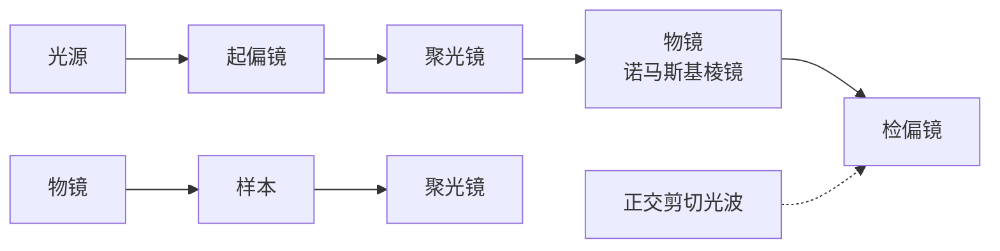
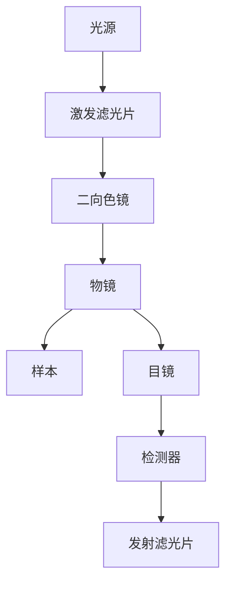
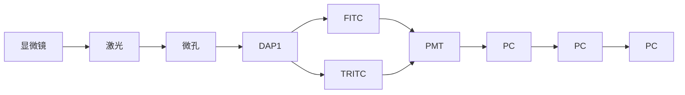

对单个异质金-铂双金属纳米颗粒表面的电化学反应进行实时电化学发光成像，可以研究纳米颗粒的催化行为。相比单一金属构成的纳米颗粒，金-铂双金属纳米颗粒的电化学发光强度更强，稳定性更高，证明双金属异质结构具有更好的催化效率及稳定性。使用电化学发光成像对金纳米片的电化学反应活性位点进行成像，可以得到不同位置处反应动力学常数及平衡电势的差异。进一步进行时序电化学发光测量，揭示了金纳米片不同位点的反应活性与其结构演化密切相关。

电化学发光免疫分析是最常用的商品化免疫分析方法之一。电化学发光免疫分析通常以磁微球为载体，在微球表面修饰捕获抗体，并将其与待测样品、$\mathrm{Ru(bpy)}_{3}^{2+}$ 标记的检测抗体共孵育，捕获抗体-抗原-检测抗体三者在磁微球表面形成“三明治”夹心结构。待测样品中抗原的浓度与磁微球的电化学发光强度正相关，以此实现抗原定量。电化学发光成像分析能够有效提高检测通量，实现多种标志物的同时检测，满足临床中精准诊断的需求。例如，在微球内掺杂不同波长的荧光分子，并在其表面修饰不同抗体，捕获对应抗原。根据荧光颜色识别抗原种类，电化学发光图像强度对抗原进行定量，可以实现同一样本中多种抗原的同时检测。此外，以导电金微球作为触发电化学发光反应的微电极和免疫反应的固相载体，通过微粒尺寸辨识抗原种类、图像中电化学发光强度定量抗原浓度，可以进一步提高生物标志物的检测通量。

电化学发光成像无须激发光，避免了细胞自体荧光干扰，特别适用于单细胞分析。自2015年单个细胞的电化学发光成像工作被报道以来，多种电化学发光单细胞分析体系被建立起来，完成了单个细胞内活性小分子、蛋白质、核酸和细胞器等物质和结构的成像分析。例如，使用佛波酯刺激细胞产生过氧化氢，增强L012（一种鲁米诺类似物）的电化学发光。比较刺激物加入前后电化学发光图像的差异，可以获取单细胞水平细胞释放过氧化氢异质性的信息。在细胞培养皿中加入胆固醇氧化酶，后者能够催化细胞膜表面胆固醇氧化产生 $H_{2}O_{2}$ ，由此可实现细胞表面胆固醇含量的分析。将细胞孵育在电极表面时，细胞将与胞外基质之间形成细胞-基质黏着。细胞-基质黏着是一种致密的蛋白结构，能够抑制电极表面电化学发光的产生，并且阻碍溶液中的发光分子扩散至黏着处。这样，细胞-基质黏着在电化学发光图像中呈现为暗斑，而无黏着处电化学发光正常发生，实现细胞-基质黏着的反相成像。此外，低丰度生物分子的高灵敏检测是电化学发光成像分析的挑战之一。将电化学发光分子或纳米颗粒标记于细胞，研究者实现了细胞膜、蛋白质等的电化学发光成像。

## 11.3.2.5 展望

作为一种超灵敏的成像分析技术，电化学发光显微镜已经实现了从单个分子和颗粒到细胞、组织的多维度成像。聚集诱导增强电化学发光、电化学发光波导、电化学发光电容显微镜等新概念的提出，进一步拓展了电化学发光显微镜的应用范围。量子点、聚合物点和金属纳米团簇等新型电化学发光体的发现，也为电化学发光显微镜超灵敏分析技术的发展提供了新机遇。此外，作为一种光学和电化学结合的成像方法，电化学发光成像的空间分辨率也受到光学衍射极限的限制。近期，电化学发光超分辨成像技术逐渐发展起来，成为电化学发光显微镜研究的新热点。

## 习题

## - 章节练习题 -

1. 请简述正反馈和负反馈成像模式工作原理及分别适合应用于哪些场景。
2. 细胞进行呼吸作用时会消耗细胞周围溶液中的氧气,因此可以通过 SECM 技术可以探测细胞周围的氧气从而研究细胞活性。请简述其中原理及探针电极可能收集到的电流。

## - 挑战性问题 -

3. 查阅相关文献资料, SECM 还能有哪些应用? 是否有替代技术?
4. 简述鲁米诺和三联吡啶钌电化学发光成像体系的成像原理和适用场景。
5. 请比较电化学发光成像与荧光成像的异同点及两种方法的优缺点。
6. 根据本章内容并查阅文献,设计合适的电化学发光成像分析方法,对细胞表面或细胞内的以下物质进行成像:(1)葡萄糖;(2)鸟嘌呤;(3)磷脂酰丝氨酸。

## -专题或报告-

7. 以“电化学发光指纹成像分析”为关键词查询文献, 总结该领域的研究背景和进展, 以文献汇报的形式交流分享。

## 11.4 光学显微成像

光学显微镜(optical microscope)以其实时成像、操作便捷和非侵入性的优势，广泛应用于生物学、医学等学科的研究。特别是在研究活细胞的动态生命活动时，光学显微镜发挥着不可替代的作用。随着光学显微镜的发展，光学显微技术也逐渐成为一种强大的工具，如可以无损检测化学成分，用于环境样品的精确分析，为分析化学研究提供了精准而动态的成像能力。

人类用眼睛去感受宏观世界，而要看到更加微观的世界，则需要借助工具。光学显微技术是人类探索肉眼感知能力以外领域的利器。它的起源可以追溯到400年前，当时镜片工匠们开始制作简单的透镜，在此基础上创造了最原始的显微镜。17世纪60年代，英国的Robert Hooke在显微镜中加入调焦机构、照明系统和工作台，这是现代显微镜的雏形。同期，荷兰的Antonie van Leeuwenhoek制成单组元放大镜式的高倍显微镜并首次发现微生物。19世纪70年代，德国学者Ernst Abbe通过确立光学显微镜成像原理，并开发了油浸物镜，使得光学显微镜的分辨率达到理论极限。这一技术进步极大地推动了显微镜在科学研究中的应用，奠定了现代光学显微成像的基础。

## 11.4.1 光学显微镜的基本概念

## 11.4.1.1 显微成像基本原理

光学显微镜利用凸透镜的放大成像原理,将微小物体放大到人眼能够分辨的尺寸。近代的光学显微镜通常采用两级放大,分别由焦距很短的物镜和焦距较长的目镜完成。为了减少像差,显微镜的目镜和物镜都是由透镜组构成的复杂光学系统。如图11.4.1所示,物体AB位于物镜的前焦点外靠近焦点的位置,经物镜成

德国学者 Ernst Abbe

明视距离:物理学里,人眼看太远和太近的物体时,眼球都要进行调节,也就是改变眼球的突起程度,但有一个距离恰能使眼睛不用调节就能看清楚,这个距离就叫明视距离。也就是说眼睛看明视距离处的物体是感觉最舒服的、最适合正常人眼观察近处较小物体的距离,约为250 mm。

放大倒立的实像  $A^{\prime}B^{\prime}$ 。 $A^{\prime}B^{\prime}$  位于目镜的物方焦距内侧但靠近焦点的位置上，作为目镜的物体。目镜将物镜放大的实像再放大成虚像  $A^{\prime\prime}B^{\prime\prime}$ ，该虚像位于明视距离处（距离人眼 D=250 mm 处），供眼睛观察。显微镜的总放大倍率等于物镜放大倍率和目镜放大倍率的乘积。

text_image

D=250 mm
A"
f物
L
A'
B
F1
F2
物镜
B'
B"
f目
目镜
人眼

图 11.4.1 显微镜成像基本原理。 $f_{物}$ 是物镜的焦距， $f_{目}$ 是目镜的焦距， $F_{1}$ 是物镜的后焦平面， $F_{2}$ 是目镜的前焦平面

透镜在成像过程中,由于其本身物理条件的限制,会导致成像产生变形或者模糊不清的现象,这种现象被称为光学系统的像差。根据产生原因,像差可以分为两类:一类是多色光成像时,由于介质折射率随光的波长不同而引起的像差,即色差;另一类是单色光成像时的像差,即单色像差,包括球差、彗差、像散、场曲和畸变。各种像差会从不同方面影响显微镜的成像质量,在设计中可以尽量减小,但不能完全消除。

## 1. 色差

光学材料对于不同波长的光折射率不同。当光轴上的物点发出的多色光经单透镜成像时，将得到一系列与各色光对应的不重合的像点，导致成像模糊，这种现象称为色差。造成色差的原因是普通光学材料对于紫光的折射率比红光大，因此当以相同的入射角透过透镜时，折射出的紫光比红光有更大的偏折角。色差分为轴向色差和垂轴色差。轴向色差是指各色光的成像位置沿轴向分布不同，而垂轴色差是由于对各色光的放大率不同而导致成像大小不同，也称放大率色差。垂轴色差会使白光成像边缘出现彩色。借助组合光学系统中各组元焦距与介质色散参数的恰当组合，可校正色差。

## 2. 球差

由光轴上某一物点发出的单色光束经光学系统后，若不同孔径角的各光线交汇于光轴不同位置，从而使轴上像点被一弥散光斑所代替，则称光学系统对该物点的成像有球差。球差的产生是由于通过光轴附近的光线的折射角较小，而通过透镜边缘的折射角较大而造成的。通过使用不同材料的凸凹透镜组合，可以校正球差。此外，在使用显微镜时，可以调节孔径光阑，控制入射光束的粗细，使细光束通过透镜中心部位，从而将球差降至最低限度。然而，这种操作会减小孔径角，进而使分辨率降低。

## 3.彗差

彗差是由位于轴外的某一点，向光学系统发出的单色圆锥形光束，经该光学系统折射后，并不会聚一点，而是结成拖着明亮尾巴的彗星形光斑。与球差一样，彗差的存在严重影响成像的清晰度。彗差与透镜的形状有关,可以通过采用轴向平行光、改变透镜形状和采取组合透镜来减小或者消除。

## 4. 像散

像散也是影响清晰度的轴外点单色像差。当视场很大时，边缘上的物点离光轴远，光束倾斜大，经透镜后则引起像散。像散使原来的物点在成像后变成两个分离并且相互垂直的短线，在理想像平面上综合后，形成一个椭圆形的斑点。像散可通过复杂的透镜组合来消除。

## 5. 场曲

场曲也被称为“像场弯曲”。当透镜存在场曲时，整个光束的交点与理想像点不重合。虽然在每个特定点都能得到清晰的像点，但整个像平面却是一个曲面。这样在镜检时无法同时清晰地观察整个像面，给观察和照相带来了困难。因此，研究用显微镜的物镜一般都是平场物镜，这种物镜已经矫正了场曲。

## 6. 畸变

畸变是指影响物体几何相似性的像差。由于光束的倾斜度较大，导致透镜近轴部分的放大率与边缘部分的放大率不一致，从而在形状上造成失真。畸变并不影响成像的清晰程度，因此通常影响不大。

## 11.4.1.2 光学显微镜的基本构造

光学显微镜主要由两个部分组成:机械部分和光学部分。机械部分的功能是将各光学部件固定在保证成像光路的最精确位置上,可以调节聚焦改变物像的清晰度。光学显微镜的基本组成包括镜筒、目镜、物镜、物镜转换器、镜臂、载物台、粗准焦螺旋、细准焦螺旋、聚光镜、光阑、反光镜、镜脚(镜座)等(图11.4.2)。其中镜筒、目镜、物镜转换器、载物台、聚光镜全部悬挂在镜臂上,调焦螺旋、聚光器调节螺旋等所有光路调节系统只与镜臂相关联。镜座主要起稳定作用,与镜臂通过倾斜关节连接以适应光源的入射方向。

19世纪80年代，光学显微镜的机械部件基本结构已经定型。现在，小型生物研究显微镜基本上保持了该显微镜的原始设计。现代光学显微镜的机械部件和布局发生了很大变化，趋向于模块化和集成化，用户可以根据需要选择相应的部件进行安装。与传统显微镜不同，现代光学显微镜的镜座演变为多功能的机台，上面安装了光源系统、滤光系统、调焦系统、聚光系统及其他光路转换装置。镜臂和镜座整合为一体化机件，调焦动作不再通过镜臂的升降来实现，而是通过载物台的升降。现代光学显微镜的结构越来越复杂，功能也越来越多，可以安装各种镜筒头、照相机、摄像机、光电倍增器和落射光系统的连接口。调焦螺旋和载物台移动螺旋实现了同轴化。现代光学显微镜的光路系统中包括了目镜、物镜、聚光镜、光阑、光栅、照明装置和分光装置等多种部件。这些部件的种类、性能和用途变得越来越复杂。下面将对一些重要的光学部件进行介绍。

## 1. 目镜

目镜是安装在镜筒上端的一种透镜，靠近观察者的眼睛，因此也称为接目镜。通常由上下两组透镜组成，上面的透镜叫作接目透镜，起放大作用；下面的透镜叫作会聚透镜或场镜，使成像亮度均匀。上下透镜之间或场镜下面装有一个光阑，其大小决定了视场的大小。标本正好在光阑面上成像，可在其上面放置目镜测微尺，用来测量所观察标本的大小。目镜的功能是放大物镜所得的物像。目镜的放大倍数与焦距成反比，因此目镜越短，放大倍数越大。常用目镜的放大倍数为5\~16倍。

text_image

目镜
镜筒
物镜转换器
物镜
载物台
聚光镜
反光镜
镜座
粗准焦螺旋
细准焦螺旋
镜臂
镜柱

图 11.4.2 19 世纪 80 年代的 Zeiss 显微镜

## 2. 物镜

物镜是决定显微镜性能的关键部件，安装在物镜转换器上，靠近被观察的物体，因此也称为接物镜。它由若干个透镜组合而成，旨在克服单个透镜的成像缺陷，提高物镜的光学质量。物镜的作用是将标本进行第一次放大。物镜质量直接影响显微镜成像质量，是决定分辨率和清晰度的主要部件。物镜的种类很多，根据浸法特征分为非浸式（干式）和浸式（包括油浸、水浸、甘油浸等）物镜；根据数值孔径和放大倍数，可分为低倍、中倍和高倍物镜；根据像差校正情况不同可分为消色差、半复消色差、复消色差、平场消色差、平场复消色差物镜等。

## 3. 聚光镜

聚光镜又名聚光器，安装在载物台下方，主要由聚光镜和可变光阑组成。小型显微镜通常不配备聚光镜，但使用数值孔径0.40以上的物镜时，必须配备聚光镜。聚光镜不仅可以弥补光量的不足，适当改变来自光源的光线特性，还可以将光线聚焦于被检物体上，以获得最佳的照明效果。聚光镜由多块透镜组成，有多种结构，如阿贝聚光镜、消色差聚光镜、摇出式聚光镜等。

## 4. 光阑

光阑，从广义角度上，一切限制入射光束界面的框孔都可认为是光阑，如聚光镜、物镜、目镜等。但是在显微技术中，只把那些专门限制和调节入射光束截面、光通量的可变光阑或者限制视野范围及在视野范围内的固定框孔叫作光阑。在普通显微镜的聚光镜的下方，装有可变光阑，也称为光圈，由多张金属薄片组成，中心部分形成圆孔。它的作用是调节光强度，并使聚光镜的数值孔径与物镜的数值孔径相适应。当可变光阑打开得越大时，有效数值孔径越大。

## 5. 照明装置

显微镜的照明可以使用自然光源或人工光源。常用的人工光源包括显微镜灯、日光灯等。现代大型显微镜的照明装置由多个部件组成，包括发光灯管、灯罩或者灯室、会聚透镜、防热线滤光片、光束切断装置、散热片等。根据照明光束的形成方式，显微镜的照明方法可分为“透射式”和“落射式”两大类。前者适用于透明或半透明的被检物体，大多数生物显微镜属于此类；后者适用于非透明的被检物体，光源来自上方，也称为“反射式照明”，主要应用于金相显微镜或荧光显微镜。

## 11.4.1.3 显微镜的性能

显微镜的性能主要由分辨率、放大倍数和数值孔径等物理参数决定，这些参数与显微镜的分辨能力密切相关。

## 1. 数值孔径

数值孔径,又称为镜口率,简写为 NA,是物镜和聚光器的主要参数之一,与显微镜的分辨力成正比。数值孔径反映了物镜的聚光能力,是物镜的重要性质之一(图 11.4.3)。从几何光学的角度来解释,物镜的数值孔径是指从物体反射或者折射出来的光束,能够进入物镜框口的张角,或者立体角的正弦函数值与物镜前透镜同物体间所处的介质折射率的乘积,公式表达为

$$
\mathrm{NA} = n \cdot \sin \frac {u}{2} \tag {11-4-1}
$$

NA 为物镜的数值孔径, n 为介质的折射率, u 为从物体进入物镜前透镜框口的光束的立体角(也叫镜口角或者孔径角)。物镜的框口给定的条件下, 标本距物镜越远, 进入物镜框口的光束的立体角越小。反之, 距离越近, 进入框口的光束的

以放大率为100、工作距离为$0.11\mathrm{mm}$ 、物镜前透镜直径（框口）为$0.7\mathrm{mm}$ 、镜口角为 $140^{\circ}$ 的物镜为例，用空气作介质时，数值孔径为0.940，用香柏油为介质时，数值孔径为1.424。由此可见，折射率高的介质能显著提高物镜的数值孔径。常见的干式物镜的数值孔径为 $0.05\sim 0.95$ ，一般用于低倍物镜。油浸物镜的数值孔径可达 $1.30\sim 1.50$ ，适用于高倍物镜。物镜的数值孔径通常标在物镜的镜体上。

立体角越大。但物体和物镜前透镜之间的距离是有限的，即使标本贴近物镜前透镜，进入框口光束的立体角也绝对不会达到 $180^{\circ}$，因此物镜的镜口角是有极限的。

text_image

空气
u

低数值孔径干物镜

text_image

空气
u

较高数值孔径干物镜

text_image

油
u

最高数值孔径油浸物镜

图 11.4.3 物镜的数值孔径

从数值孔径的公式中可以看出，镜口角是重要的决定因素。物镜的框口不变，物镜与标本之间的距离即工作距离不变的情况下，介质的折射率也是影响数值孔径的重要因素。干物镜与标本之间的介质通常是空气，其折射率约为1；水浸物镜的介质是水，其折射率为1.33；油浸物镜的介质是香柏油，其折射率为1.515。介质的折射率越大，越能把具有更大立体角的光束纳进物镜。

## 2. 分辨率

显微镜的分辨率,又称为解像本领、分辨力或者分辨本领,是指显微镜能够帮助人眼看清相互靠近两个质点的最短距离。分辨率的大小用分辨距离的数值来表示,即所能分辨开两个物点间的最小距离。在明视距离(250 mm)处,正常人眼能看清相距0.073 mm的两个物点,这个数值即为正常人眼的分辨距离。显微镜的分辨距离越小,表示它的分辨力越高,性能越好。

根据显微镜的凸透镜成像原理，凸透镜能将入射光聚焦到它的焦点上，但由于透镜口径有一定大小，光线透过时会发生衍射，无法将光线汇聚成无限小的焦点，而是形成一定能量分布的光斑，称为艾里斑（Airy disk）。艾里斑是在衍射限制的系统中由圆形孔径形成的聚焦光点，中央是明亮的圆斑，周围有一组较弱的明暗相间的同心环状条纹。每一个发光的物点，经过有限直径的透镜后，都会在像平面形成一个艾里斑。对于非常接近的两个点，成像后艾里斑会过于接近，以至于无法分辨。若两个等光强的非相干点像之间的间隔等于艾里斑的半径，即一个艾里斑中心与另一个艾里斑边缘正好重合时，这两个物点刚好能被人眼或光学仪器所分辨（图11.4.4）。物镜所能分辨的最小距离可以用如下公式表示。

$$
r _ {0} = \frac {0 . 6 1 \lambda}{\mathrm{NA}} \tag {11-4-2}
$$

式中， $r_0$ 表示艾里斑的半径，也是物镜的最小分辨距离， $\lambda$ 为入射光波长，NA为数值孔径。式(11-4-2)表示的是两个非相干的自身发光点的分辨率。根据以上公式，可以采用更短波长的光源，或者提高物镜的数值孔径，来提高显微镜的分辨率。一般物镜的数值孔径小于1，油浸系物镜可以做到1以上，若采用数值孔径较大的物镜，如数值孔径为1.4的物镜，物镜能够分辨的最小间距大约是0.44倍光源波长。在可见光波段，光源多采用波长为500多纳米的可见光，一般认为光学显微镜分辨率的极限在 $200\mathrm{nm}$ 左右。

不同规格的物镜

在显微镜中,对于自身不能发光的点,照明条件不同,分辨率也不同。研究表明,当被观察物体不发光,而被其他光源照明时,只需要修正上式中的因子,该式仍然有效。一般地,该因子在0.57\~0.83范围变化,当物体在斜射光照明下,该因子为0.5。

图11.4.4

物镜的基本参数、工作距离和视场直径

## 3. 放大倍数

放大倍数,又称放大率,是指被检验物体经物镜放大再经目镜放大后,人眼所看到的最终图像的大小对原物体大小的比值,是物镜和目镜放大倍数的乘积。放大率是显微镜的重要参数,但不能盲目认为放大率越高越好,选择时应首先考虑物镜的数值孔径。

物镜的放大倍数,是指物镜在线长度上放大实物倍数的能力指标。放大倍数有两种表示方法,一种是直接在物镜上刻度出如 $4\times$ 、 $10\times$ 、 $20\times$ 、 $40\times$ 、 $60\times$ 、 $100\times$ 等;另一种则是在物镜上刻度出该物镜的焦距f,焦距越短,放大倍数越高。物镜的放大倍数公式为

$$
M _ {\text {物}} = - L / f _ {\text {物}} \tag {11-4-3}
$$

L 是光学镜筒长度, 镜筒长度是指物镜底面到目镜顶面的距离, 机械镜筒长度多为 160 mm、170 mm、190 mm。 $f_{物}$  为物镜的焦距, 负号表示所成的像是倒立的。

同理,目镜的放大率为

$$
M _ {\text {目}} = D / f _ {\text {目}} \tag {11-4-4}
$$

D 为人眼的明视距离, $f_{目}$ 为目镜的焦距。显微镜的总放大率等于物镜和目镜的放大率的乘积,即

$$
M = - \frac {L D}{f _ {\mathrm{物}} f _ {\mathrm{目}}} \tag {11-4-5}
$$

## 4. 工作距离

工作距离也叫物距,是指当所观察的标本最清晰时物镜的前端透镜下表面到标本的盖玻片上表面的距离。物镜的工作距离与物镜的数值孔径有关,物镜倍率越高,数值孔径越大,其工作距离越小。

## 5. 焦点深度

在显微镜的光轴上有一段距离范围内物体被看得清晰,超出这段距离的物体就模糊不清,这段距离位于显微镜焦点的上下很小的范围之内,这段距离的上下限叫作焦点深度,简称焦深。焦点深度的大小决定了在显微镜中能够清晰观察到的物体的范围。焦深大,可以看到被检物体的全层,焦深小,只能看到被检物体的一个薄层。显微镜的总放大率越大,焦点深度越小,工作距离也越短。物镜的焦点深度与物镜的数值孔径、总放大率关系如下:

$$
T = \frac {n K}{\mathrm{NA} \cdot M} \tag {11-4-6}
$$

T 为焦点深度, NA 为物镜的数值孔径, M 为总放大率, K 为一常数 0.24, n 为介质的折射率。焦深与总放大倍数及物镜的数值孔径成反比, 焦深增大, 分辨率将降低。

## 6. 视场直径

视场直径也称视场宽度或视场范围,是指在显微镜下看到的圆形视场内所能容纳被检物体的实际范围。视场直径越大,越便于观察。视场直径符合以下公式:

$$
F = \frac {\mathrm{FN}}{M _ {\mathrm{obj}}} \tag {11-4-7}
$$

式中，F 为视场直径，FN 为视场数，是目镜的固定参数，标刻在目镜的镜筒外侧， $M_{obj}$  为物镜放大率。

## 11.4.2 光学显微成像的模式

## 11.4.2.1 明场显微成像

明场显微镜，也称复合光学显微镜，是最简单的光学显微镜之一，以样本的颜色及透射率为基础，利用光线在明亮背景上产生具有对比度的图像。当样品放置在明场显微镜的载物台上并从下方照射时，光线会通过聚光镜聚焦到样品上，透射或反射的光由物镜收集，经物镜和目镜放大成像。

明场显微成像广泛应用于生物、病理检验。标本常用染料进行染色，增强图像的对比度，方便观察。

## 11.4.2.2 暗场显微成像

与明场显微成像不同，暗场显微成像并不直接观察到照明光线，而是观察到被观测物体散射的光线。在暗场观测中，视场是黑暗的背景，而被观测的物体则呈现出比较明亮的像。为了进行暗场观测，需要安装特殊的附件——暗场聚光镜。这种聚光镜中包含一个“暗场环”，暗场环中间存在一个挡片，这个挡片的作用是阻挡垂直入射的光线，使光线以一定角度斜射向样品。利用样品表面散射的光形成明亮的图像，从而达到在黑暗的背景下可看到标本的外部形态的效果（图11.4.5）。

暗场显微镜特别适用于胶体化学中观察原虫、细菌的鞭毛、伪足运动；在医学检验学领域，适用于观察人体体液中螺旋体、尿管形、结晶或各种粒子。

## 11.4.2.3 相衬显微成像

人眼对于光波的区分主要依赖于对颜色(波长)和亮度(振幅)的感知。相衬显微镜利用光的干涉现象,将人眼不可分辨的相位差变为可分辨的振幅差,因此无色透明的样品,也能够通过相衬显微镜变得清晰可见。

相衬显微成像是通过在光路中加装环状光阑和相位板来实现（图11.4.6）。环状光阑装在聚光镜的下方，与聚光镜组合为一体，组成相衬聚光镜。环状光阑实际上是一个窄缝，用于产生相干光源。相位板安装在物镜的后焦面上，即物镜体内透镜组中间位置。相位板是一片玻璃上喷涂环形吸光物质的平板，与环状光阑构成共轭面。相位板上除环形吸光物质以外的部分称为补偿面。在相衬成像中通过聚光镜前环形光阑形成的环形光被聚光镜聚焦在样品上，部分环形光被样品的光学致密结构衍射，经历约 $1 / 4\lambda$ 的相移。这些直射光和衍射光经过物镜后焦平面上的相位板时被相位板分离，在中间像平面上聚焦，形成目镜中观察到的最终相衬图像。衍射光在相位板的补偿面上再经历约 $1 / 4\lambda$ 的相移，若直射光和衍射光的波峰和波谷相遇，则合成波的振幅减小，导致通过样品的光强衰减得多，相衬显微镜下标本细节的反差加大，样品比背景暗得多，这种反差叫暗反差，也叫正反差。若在相位板的共轭面上再涂一层吸光物质，使直射光的相位与通过补偿面的衍射光的相位相一致，两光束的波峰相遇，其合成波的振幅等于两光束振幅之和，光强比直射光增强了4倍，样品比背景明亮得多，这叫作明反差，也叫负反差。相衬成像主要适用于活细胞、微生物、薄组织切片等未被染色的半透明样本。

flowchart

图 11.4.6 相衬显微成像基本原理

text_image

物镜
载物台
聚光镜
光源
暗场环

图 11.4.5 暗场显微成像基本原理

图11.4.6、图11.4.7和图11.4.8彩图

flowchart

图 11.4.7 微分干涉显微成像基本原理

flowchart

图 11.4.8 荧光显微成像的基本原理

## 11.4.2.4 微分干涉显微成像

微分干涉显微镜是利用偏振光来进行成像。光源发出的入射光经过起偏器和诺马斯基棱镜后被分解成两束偏振方向不同的光线，然后经过聚光镜变成平行光。这两束光在穿过样品前是相位一致的，但在穿过样品后由于样品厚度和折射率的不同而产生光程差。随后，光束穿过第二个诺马斯基棱镜和偏振装置（即检偏器），将两束垂直的光波组合成具有相同偏振面的光束，从而发生干涉。在成像的灰色背景上，会出现明暗相间的条纹，图像呈现出立体的三维效果（图11.4.7）。微分干涉显微镜的附件包括起偏器、检偏器、诺马斯基分光棱镜、诺马斯基聚光棱镜、四分之一波长棱镜（简称1/4波晶片）、半波片等。

微分干涉显微成像与折射率的变化、样品的厚度有较大的关系，所成影像具有较强的立体感、较高的分辨率，它常被用来观察活的未染色的细胞。

## 11.4.2.5 荧光显微成像

荧光显微成像技术是利用荧光物质的激发和发射来进行成像的一种方法。根据照明方式，荧光显微镜分为透射式和落射式两种。透射式荧光显微镜和普通光学显微镜类似，光源经过聚光镜到达样品，激发荧光后通过物镜，最后到达目镜。而落射式荧光显微镜的入射光是通过物镜到达样品，激发荧光后再发射回物镜，最后到达目镜，这样可以减少激发光的损失，提高荧光效率。目前，市场上常见的荧光显微镜多为落射式，光路图如图11.4.8所示，光源发出的入射光经过激发滤光片，选择性地透过可使样本产生荧光的特定短波，再经二向色镜反射，到达物镜。物镜收集入射光并将其汇聚，照射到样本上，激发样本内的荧光物质发射出荧光。通过物镜收集发射光再次到达二向色镜，由二向色镜反射入射光并允许波长较长的发射光通过，经过发射滤光片，阻挡没有被标本吸收的激发光，选择性地透过特定波长的荧光，进而成像。落射荧光显微镜也分为正置荧光显微镜和倒置荧光显微镜。

## 11.4.3 荧光显微镜的基本构造

根据落射式荧光显微镜的成像原理,它的基本构造主要包括光源、滤色系统、物镜和摄像系统。

## 1. 光源

在大多数荧光显微镜应用中，到达眼睛或检测器的光子数量通常很低。为了产生足够的激发光强度，需要功率较高的光源，通常使用的光源为氙弧灯、汞蒸气灯、超连续光源及大功率LED照明器。目前，多采用 $200\mathrm{W}$ 的超高压汞灯作为光源，它可以发射很强的紫外和蓝紫光，激发各类荧光物质，被荧光显微镜普遍采用。

此外，激光器的应用越来越广泛，如氩离子激光器、氩-氪离子激光器和固体激光器等。它们具有光源尺寸小、散度低、单色性好、平均亮度高等优点，在扫描共聚焦显微镜中已成为必不可少的光源。

## 2. 滤色系统

滤色系统是荧光显微镜的重要部位，由激发滤光片、发射滤光片和二向色分光镜组成。激发滤光片的主要作用是选择性地传递激发波长的光线；发射滤光片主要用来选择性地传递发射波长的荧光光线，使观察者能够看到样品所发射的荧光，同时保护观察者的眼睛免受紫外线损伤。二向色分光镜能够将激发光反射，同时又能透射荧光到目镜(图11.4.9)。

## 3. 物镜

理想的荧光显微镜物镜具有较高的数值孔径(NA)。相同放大倍数下，NA值越大，物镜的分辨能力越高，物镜可以收集到的光子数量就越多。油浸物镜可减少由于盖玻片的反射和折射而造成的光损失，提高激发和收集效率，被广泛应用于荧光显微镜。此外，消色差物镜的自体荧光极微且透光性能(波长范围)适合于荧光，因此应用广泛。

## 4. 摄像系统

摄像系统有助于以高分辨率记录标本的图像。系统中经常使用电子探测器，如互补金属氧化物半导体(CMOS)或电荷耦合器件(CCD)相机，将光学信号转变为数字图像信号，该信号可传输到计算机。这些图像可以被外部保存，以便查看或者通过传统分析手段对面积、颗粒大小和分布进行分析。

## 11.4.4 光学显微成像的应用

光学显微成像技术在分析化学领域中的应用随着技术的进步经历了重要的发展阶段。每个阶段的技术革新都极大地推动了化学分析研究的深度和广度。

在光学显微镜发明的初期,传统光学显微镜主要用于观察和分析微小的化学晶体和矿物。通过显微镜,化学家能够仔细观察和研究物质的微观结构和形态学特征,从而在化学分析中进行定性分析和分类。传统光学显微镜作为一种基础的显微技术,凭借其操作简便、样本兼容性广及高分辨率等优势,广泛用于基础研究。

荧光显微镜相较于传统光学显微镜，具有其独特的优势和应用领域。传统光学显微镜因其衍射极限的限制，通常只能实现有限的分辨率，难以清晰观察微小的细胞结构。荧光显微镜凭借其灵敏的荧光标记技术，能够特异性地标记并观察细胞内特定分子或结构，不仅可以实现定性成像，也可完成定量分析。其独特的优势在于通过荧光染料或荧光蛋白，能够进行高对比度、高灵敏度的成像，尤其适用于实时观察生物分子的动态行为和相互作用。此外，荧光显微镜还能够通过多重荧光标记技术实现多种分子的同时观察，这对于复杂生物系统的研究尤为重要。它的应用范围涵盖了细胞生物学、分子生物学及药物开发等领域，特别是在研究细胞内部机制、疾病标志物检测及活细胞成像中展现了其强大的功能。

text_image

发射滤光片
光学模块
激发滤光片
固定器
二向色分光镜

line

| Wavelength (nm) | Excitation (%) | Emission (%) |
| --- | --- | --- |
| 350 | ~12 | ~12 |
| 450 | ~35 | ~35 |
| 460 | ~75 | ~0 |
| 500 | ~75 | ~0 |
| 520 | ~88 | ~80 |
| 550 | ~88 | ~80 |
| 650 | ~88 | ~80 |
| 750 | ~70 | ~70 |

图 11.4.9 滤色系统的基本结构

图11.4.9彩图

## 荧光蛋白

20 世纪 90 年代, 生物荧光成像正式迈入了基因编码荧光蛋白的生物标记技术的时代, 其中以绿色荧光蛋白 (GFP) 最为经典。目前, 各种荧光蛋白在分子生物学和细胞生物学等研究领域内被广泛使用。它们可作为报告基因的产物用于分析基因表达的时空特异性、监测信号传导和基因转移效率, 可作为融合标签内源性标记蛋白, 用于观察细胞的形态、运动、分化、增殖和凋亡等过程, 也可作为蛋白质相互作用的转换子 (如 fluorescence resonance energy transfer, FRET 等), 进而去分析蛋白质的结构、功能、定位、修饰等特性。

荧光染料、荧光蛋白及荧光成像分析

## 习题

参考文献

## - 章节练习题 -

1. 显微镜的像差有哪几种？如何校正？
2. 在光学系统中, 什么是数值孔径?
3. 影响光学显微镜分辨率的因素有哪些？
4. 说明明场显微成像和暗场显微成像的原理，并说明二者的优缺点。
5. 荧光显微镜中滤色系统主要结构及其作用是什么？

## - 挑战性问题 -

6. 请动手查阅文献,概括总结前沿新兴的光学显微技术特点及原理。

7. 假设你正在设计一款新型显微镜,需要在分辨率和成像深度之间做出权衡。你将如何选择合适的光学元件和设计参数来优化系统性能?
8. 荧光显微镜根据特定荧光分子吸收了激发光后，能发射不同波长的光，通过测定样本发射的荧光强度，可以获取关于样品成分的定量信息。比率型荧光探针是一类特殊的荧光探针，可以在两个不同的波长下发射荧光，从而实现对生物分子或细胞环境的定量分析。常见的比率型荧光探针有 Fura-2、pHrodo、DiBAC4(3)等。请动手查阅文献，说明 Fura-2 可以检测的金属离子种类和浓度区间。

## - 专题或报告 -

9. 荧光显微成像在生命分析领域的应用越来越广泛，在亚细胞器成像、细胞微环境动态变化分析方面具有重要应用，相关研究工作主要关注疾病病程中亚细胞器及细胞微环境中重要标志物的分布和形态变化。查阅相关科学文献，并将结果写成报告。
10. 请分别以“optical microscopy”“STED”为关键词检索文献数据库进行相关下载与学习，并总结相关专题。[STED: stimulated emission depletion, 可参考 Optics Letters, 1994, 19(5): 780-782.]

## 11.5 激光扫描共聚焦显微成像

## 11.5.1 激光扫描共聚焦成像的光路与特点

## 激光扫描共聚焦显微镜发展历史

1957 年 Marvin Minsky 提出共聚焦显微镜技术的基本原理。
1967 年 Egger 和 Petran 应用共聚焦显微镜产生了光学横断面。
1984 年 Bio-Rad 推出世界第一台商品化的共聚焦显微镜。
1987 年 White 和 Amos 在 Nature 发文,标志着激光扫描共聚焦显微镜成为科学研究的重要工具。

激光扫描共聚焦显微镜(laser scanning confocal microscopy, LSCM)是以激光作为光源，在传统宽场荧光显微成像基础上，采用共轭聚焦原理和激光扫描装置，并利用计算机对所观察的对象进行数字图像处理的一套观察、输出和分析系统。与传统荧光成像技术相比，激光扫描共聚焦显微成像的光学成像分辨率提高了30%\~40%。该技术使用紫外或可见光激发荧光探针，从而得到细胞或生物组织内部微细结构的荧光图像，在亚细胞水平上观察生理信号及细胞形态的变化，成为分析化学、分子生物学、细胞生物学等领域中新一代的研究工具。

如图 11.5.1 所示,传统宽场荧光显微镜的成像光路为:从汞灯或激光器发出的激发光源,经过二向色镜时因波长较短被反射进入物镜照射到标本上,激发标本中的荧光标记物产生荧光。这些发射光再穿透物镜和二向色镜被检测器收集从而实现荧光成像。

图 11.5.1 宽场荧光显微镜与激光扫描共聚焦显微镜的光路示意图

从激光扫描共聚焦显微镜的光路示意图可以看出，激光扫描共聚焦显微镜与传统宽场荧光显微镜最大的区别在于其成像光路中存在两个处于共轭平面的针孔，即光源针孔和检测针孔。光源针孔位于光源后端，它所在的位置是在物镜的前焦点上，从光源发出的激发光经过光源针孔可认为是从物镜的焦点上发出，经过二向色镜的反射，最终在样本的某一处聚焦，激发标本中的荧光标记物并产生荧光，再经过物镜和二向色镜后聚焦于检测器前检测针孔所在的平面。而检测针孔可以将发射光中所包含的非焦平面信号过滤，只让焦平面上的光线透过，并被检测器收集。检测针孔所处的位置正好与物镜的后焦点重合，其与光源针孔形成共轭聚焦，可消除非焦面信号的干扰，使共聚焦成像更为清晰。由于光源针孔和检测针孔处于物镜的前后焦点所在的两个共轭平面，故而得名共聚焦。最后，利用扫描系统依次对标本不同位置的标记物进行扫描激发，收集不同位置的荧光信号后，借助图像重构等数据处理技术获得标本平面或立体的图像信息。

对比宽场荧光显微镜和激光扫描共聚焦显微镜的成像原理,可以发现激光扫描共聚焦显微镜存在两大特点:

特点之一:针孔滤波(pinhole)。在荧光进入探测器(如光电倍增管PMT)前,存在一个微小的检测针孔光阑,其直径尺寸在10\~100  $\mu$ m范围内可调。检测针孔可起到空间滤波的功能,使仅有在物镜焦平面上的光才能在针孔处汇聚并通过针孔,从而被探测器接收;而非焦平面上的光在针孔上产生的是弥散光斑,其直径大于针孔直径,因而绝大多数的光被针孔滤掉,对焦平面的标本信号影响很小,而且离焦平面越远,所产生的弥散斑就越大,滤波效果就越好。由于针孔的作用,该成像技术仅对焦平面上的样品成像,有效地抑制了衍射光和杂散光的干扰,从而能够获得远高于宽场荧光成像的清晰度和信噪比。由于具有沿光轴方向的分辨能力,该技术具有对较厚样品的光学层切能力,因而也被称作光学“CT”(computed tomography)。这是激光扫描共聚焦显微镜不同于其他传统宽场荧光显微镜的最重要特点。如果去除针孔作用,则与传统荧光显微镜类似。

经过光源针孔的光线,理论上只能聚焦在物镜焦点处的标本上,因此激光共聚焦只收集物镜焦点处的标本图像,这就是激光扫描共聚焦显微镜的点扫描成像技术。如果需要获取一整幅图,就需要变换物镜和标本之间的相互位置,逐点扫描,并

## 共聚焦显微镜对

## 普通光学显微镜的改进

（1）采用激光作为照明光源，由于激光的单色性非常好，光源波束的波长相同，基本消除了色差对成像的干扰。
（2）采用共聚焦技术，在物镜的焦平面上放置了针孔光阑，将焦平面以外的杂散光挡住，基本消除了球差，且有助于进一步消除色差。
（3）采用点扫描技术，将样品分解成二维或三维空间上的无数点，用极其细小的激光束（即点光源）逐点逐行扫描成像，再通过计算机组合成一个整体平面的或立体的像。
（4）利用光电倍增管进行信号转换和放大，并使用计算机完成信号的采集和处理。

通过软件后期合成。如果要获得样品的全局信息，可将样品分解成二维或三维空间上的无数点，用十分细小的激光束(点光源)逐点逐行扫描成像，通过计算机软件组合、三维重构等技术，最后得到一个整体平面的或立体的图像(图11.5.2)。

激发光对焦点平面进行平面扫描示意图

## 激光扫描共聚焦显微镜相关术语

二向色镜:又称双色镜,是一种基于光的干涉原理实现短波辐射选择性反射、长波辐射选择性穿透的光学元件。

滤光片:选择性透过特定波段辐射的光学元件。

焦点: 平行光线经过透镜或透镜组折射后在光轴上的汇聚点。

焦平面: 沿不同入射方向的平行光线经过透镜或透镜组折射后的汇聚点所构成的平面。

共轭焦平面:在光学系统中当光线从样本所在的平面经过光学元件(如透镜、镜面及其组合)聚焦后,会形成一个与物体形状相似的像。物体与像所在的两个平面即为共轭焦平面。

图 11.5.3 彩图

natural_image

Grayscale abstract image with a bright central oval shape, resembling a glowing oval or ring (no text or symbols)

(a)宽场荧光成像

natural_image

Abstract grayscale shape resembling a teardrop or crescent, with no visible text or symbols

(b) 共聚焦成像

图 11.5.2 宽场荧光显微镜与激光扫描共聚焦显微镜的成像差异

特点之二:扫描成像。由于激光扫描共聚焦成像技术是对物镜焦点处的样品局部激发和探测,要完成对整个样品的成像需要改变焦点和样品的相对位置,使焦点扫描整个被探测样品区域。扫描装置(如扫描振镜、压电位移平台等)能够提供三个维度的相对位移,通过计算机自动控制,并与探测器同步逐点记录扫描区域的荧光信号。首先在某一特定深度获得该深度时的二维图像,继而改变深度获得一系列的二维图像,再通过图像处理中的三维重建技术,把这些二维图像重建,最终获得样品三维图像。此外,扫描方式还有线扫描与阵列扫描等。这种通过扫描成像并获取三维图像的方式,是激光扫描共聚焦光学显微成像的一大特点。

## 11.5.2 激光扫描共聚焦显微镜的结构模块

激光扫描共聚焦显微镜主要包括激光光源、荧光显微镜系统、扫描装置、图像存储与处理系统等模块(图 11.5.3)。此外,还包括其他辅助设备,如风冷/水冷等冷却系统、气浮型隔振光学平台等。

text_image

激光光源
扫描装置
荧光显微镜系统
图像存储与处理系统

图 11.5.3 激光扫描共聚焦显微镜的结构模块

## 1. 激光光源

激光扫描共聚焦显微镜使用的激光光源通常有单激光和多激光系统。早期，激光扫描共聚焦显微镜常用的激光器包括多谱线 Ar 离子激光器（氩离子激光器），He-Ne 激光器（氦氖激光器），UV 激光器（紫外激光器）。目前，发射波长覆盖可见至近红外区的固体激光器凭借光束质量高、使用寿命长等优点，已成为商品化激光扫描共聚焦显微镜光源的首选。

## 2. 荧光显微镜系统

激光扫描共聚焦显微镜所用的荧光显微镜系统与常规倒置荧光显微镜大致相同。但又有其特点:需与扫描装置连接，使激光能进入显微镜物镜照射样品，并使样品发射的荧光到达检测器；需有光路转换装置，即汞灯与激光转换，同时光线强度可调。

## 3. 扫描装置

扫描装置通过计算机自动控制，逐点扫描位于物镜焦平面的样品，并实现样品中荧光标记物的逐点激发。扫描装置主要由针孔光阑（控制光学切片的厚度）、二向色镜（可反射短波和透过长波）、滤光片（选择一定波长范围的发射光进行检测）、检测器（光电倍增管或雪崩光电二极管）组成。

## 4. 图像存储与处理系统

控制硬件的软件功能,比如控制电动显微镜;选择激光波长,调节激光强度;拍摄二到五维图像;选择光谱拍摄范围、分辨率和滤光片等信息。

## 11.5.3 激光扫描共聚焦显微镜的功能与应用

凭借出色的断层扫描成像能力和极高的成像信噪比,激光扫描共聚焦显微镜被广泛应用于分析化学、生命科学和生物医学等研究领域。随着应用研究的拓展深入,激光扫描共聚焦显微镜的功能也得到了不断的开发。一般来说,激光扫描共聚焦显微镜的功能和应用主要包括以下几个方面:

## 1. 组织光学切片成像

激光扫描共聚焦成像技术利用照明点与探测点的共轭特性,可有效抑制同一焦平面上非测量点的杂散荧光及来自样品中非焦平面的荧光,从而获得普通荧光显微镜无法达到的信噪比,以及特有的深度识别率和纵向分辨率。利用扫描控制系统,可以逐层获得高反差、高分辨率、高灵敏度的二维光学横断面图像,从而对活的或固定的细胞及组织进行无损伤的系列“光学切片”,得到各个层面的信息。

## 2. 多通道序列扫描成像

普通荧光显微镜每次只能观测一种荧光，要观测多种荧光标记的样品需要多次观测，因而难以实现多通道同时成像，且易造成样品光损伤。激光共聚焦显微镜支持多激光多通道同时扫描，可实现多通道同时探测。由于激光扫描共聚焦显微镜往往包含荧光成像光路与透射光成像光路（明场、微分干涉相差成像等），并配备有多个不同波长的独立固体激光器，在进行不同的荧光通道扫描成像时，还可进行多通道荧光图像即时叠加（图11.5.4），荧光图像与明场图像即时叠加。此外，采用激光扫描共聚焦成像还可以对样本进行多维信息扫描，如xyz三维立体扫描、xyt二维时间扫描、xyλ二维光谱波长扫描，从而获取标本多维度信息。

荧光共定位成像

flowchart

图 11.5.4 激光共聚焦多通道扫描成像

图11.5.4和图11.5.5彩图

## 3. 三维图像重建

激光扫描共聚焦显微镜具有薄层光学切片功能，可通过三维立体扫描方式采集标本三维信息，借助计算机图像处理和三维重建软件，沿 $x, y$ 和 $z$ 轴或其他任意角度来观察标本的外形及剖面，最后得到标本的三维立体结构。利用激光扫描共聚焦显微镜可在亚细胞器分辨率上对标本的立体结构与形态信息进行灵活、直观的观察，再结合图像重构和图像增强技术揭示亚细胞结构的空间关系及其随时间的变化等信息。如图11.5.5所示，利用激光扫描共聚焦显微镜光学切片功能进行 $z$ 轴扫描成像和三维图像重建，可对胚胎的立体结构进行精细分析。

natural_image

Grid of 20 circular microscopic or medical images showing cellular or tissue structures, no visible text or symbols

(a) 胚胎结构z轴扫描成像图

natural_image

Microscopic view of a porous, honeycomb-like structure with no visible text or symbols

(b)三维结构重建图

图 11.5.5 z 轴扫描成像和三维图像重建

## 4. 光操控功能

随着激光技术与光操控技术的发展，多种基于激光扫描共聚焦显微镜的光操控功能被开发出来，使得激光扫描共聚焦显微镜逐渐成为具有强大光操控功能的新工具。比如光激活技术，基于激光扫描共聚焦显微镜的逐点扫描功能，结合标本中的光响应标记，通过控制激发光的波长、辐射时间及照射区域，可以在可控的时间、空间尺度上实现标本中多种生物活性分子的激活，从而调控其生物学功能。利用该技术，可以实现活细胞内多种重要生物活性分子（如神经递质、细胞内第二信使cAMP、核苷酸、$\mathrm{Ca^{2+}}$ 及某些荧光素等）在细胞增殖、分化等生物过程中的功能调控。比如荧光光漂白恢复(FRAP)技术，借助于高强度脉冲式激光照射细胞的某一区域，从而造成该区域荧光分子的光猝灭，其周围的非猝灭荧光分子将以一定速率向受照区域扩散，通过监测分子扩散，研究细胞骨架构成、核膜结构和大分子组装等过程，揭示细胞结构和细胞动态变化机制。

由上述介绍可见,激光扫描共聚焦显微镜凭借强大的功能已成为分析化学、化学生物学与生命科学研究领域强有力的分析工具。结合其他分析技术,激光扫描共聚焦成像技术有望在进一步揭示微观尺度上生命活动与生命现象的分子机制研究中发挥更大的作用。随着精密光学仪器与分子标记技术的不断革新与进步,激光扫描共聚焦显微镜有望实现更广泛的生化物质的定性与定量检测。

## 习题

## - 章节练习题 -

1. 简述激光扫描共聚焦显微镜的工作原理。
2. 简述激光扫描共聚焦显微镜与宽场荧光显微镜的差别。它有哪些优缺点？
3. 简述激光扫描共聚焦显微镜的功能与应用。

## - 挑战性问题 -

4. 激光扫描共聚焦显微镜可对单标记或双标记细胞及组织标本的荧光信号进行定量分析，并显示荧光沿 z 轴的强度变化；同时还可自动将荧光图像与相差图像重叠，并显示荧光标记物在细胞内的定位与分布。查阅和参考相关科学文献，设计实验:如何使用激光共聚焦显微镜成像并分析荧光药物（比如阿霉素）在细胞内的分布情况。

## - 专题或报告 -

5. 激光扫描共聚焦显微镜可以基于荧光能量共振转移(Förster resonance energy transfer, FRET)技术研究生物分子相互作用。FRET是将激发的供体(donor)荧光染料的能量非辐射转移到受体(acceptor)荧光染料的现象。FRET现象的发生和能量传递效率主要取决于以下几个方面:①两个荧光染料分子之间的距离(<10 nm)；②供体的发射光谱与受体的激发光谱的重叠区域；③供体的量子产率；④供体的荧光寿命；⑤供体和受体分子的相对偏振方向。利用激光共聚焦扫描显微成像技术开展FRET分析可以实现将多种生物学过程中生物分子相互作用过程与机制的可视化研究。查阅关于激光共聚焦荧光能量共振转移在DNA构象分析中的应用相关科学文献，并将结果写成报告。
6. 在实际激光共聚焦成像中，一般都需要对于样品进行荧光标记或者染色。采用一定的标记物，使样品中待测物质具有特定的荧光特征，这种标记物被称为荧光探针。这种给样品赋予特征荧光的操作称为荧光标记。查阅相关科学文献，了解荧光标记相关原理与应用，并与同学分享你的结果。

FRET 相关文献

## 11.6 超分辨成像

## 11.6.1 超分辨成像简介

在光学显微镜问世之初，人们认为只要提高放大倍率，就可以观察到趋近于无穷小的物体。但是随着研究的不断深入，研究者发现当物体小于某个极限时，无论如何提高物镜倍数，都无法清晰地观察和分辨它们。1835年，G.Airy提出艾里斑这一概念，同时可以通过瑞利判据来评估光学显微镜的空间分辨率。由11.4