## 艾里斑

艾里斑是点光源通过衍射受限透镜成像时，由于衍射而在焦点处形成的光斑。中央是明亮的圆斑，周围有一组较弱的明暗相间的同心环状条纹，把其中以第一暗环为界限的中央亮斑称为艾里斑。

艾里斑图像

2014年诺贝尔化学奖

超分辨显微成像发展历程

小节可知，光学成像的分辨率与光斑的强度分布有关，采用点扩散函数(point spread function, PSF)能够对光斑进行建模。而对PSF进行工程化改造，能够有效提高光学成像分辨率（缩短两个光斑间恰能分辨的距离）。根据瑞利判据公式，常规的方法包括采用更大数值孔径的物镜，以及采用折射率更高的介质，如油相或水相代替空气相等。在可见光波长(400\~700 nm)和常用的物镜数值孔径(NA不超过1.49)范围内，光学显微镜的分辨率一般为横向200 nm，轴向600 nm左右。

为了进一步突破衍射极限，对亚微米及更小尺度的体系进行研究，超分辨成像应运而生。W.E.Moerner首次实现单个分子检测并发现单个绿色荧光蛋白光转化效应，Eric Betzig在此基础上基于特殊荧光蛋白设计出光激活定位显微技术（photoactivated localization microscopy, PALM), Stefan W. Hell基于PSF调制设计出受激发射损耗显微镜(stimulated emission depletion, STED)，两者均大幅突破衍射极限，同时开启了超分辨显微成像发展的两个方向。他们三位也因此共同获得了2014年的诺贝尔化学奖。除此之外，还有多位超分辨显微成像的先驱，如Samuel T. Hess提出了荧光激活定位显微镜(fluorescence photoactivated localization microscopy, FPALM)，华裔科学家庄小威教授提出了基于荧光染料分子的随机光学重建显微镜(stochastic optical reconstruction microscopy, STORM), Mats Gustafsson提出了结构光照明显微镜(structured illumination microscopy, SIM)，通过求解图案中的高频信息获得样品的纳米分辨图像。

超分辨成像打破了传统光学显微镜的分辨率限制，一方面使得人们能够研究更细小、更复杂的结构和过程，帮助研究者更直观地探索微观世界中的亚细胞结构及纳米级别的相互作用。例如，在生物学领域，超分辨成像技术能够实现对细胞器、蛋白质分布和动态过程的高分辨率成像，从而深入了解细胞的组织结构和功能；在物理化学反应中，实现对于微观超快变化过程的直接成像，获得更加精准的活性位点及反应动力学信息。另一方面，新兴研究领域的不断涌现，将超分辨成像技术与飞秒激光超快时间分辨探测技术结合的超时空分辨技术可以实现对于极小时空尺度下新的科学现象和规律的探索，进一步推动相关光电材料/器件与产业的发展。

## 11.6.2 超分辨成像原理和仪器构造

艾里斑的相互重叠使光学成像分辨率受到限制，因此只要避免这一情况就能够打破衍射极限，由此发展了两种超分辨成像策略:基于单分子定位的超分辨成像技术通过控制衍射极限范围内的荧光探针在不同时间发光，代表性技术包括STORM、PLAM和FPALM等；通过光源调制激发特定区域的荧光分子减少周围荧光分子的信号，如STED。

超分辨成像的仪器构造与常规白光成像类似，具有照明模块和成像模块。区别在于超分辨成像照明采用激光作为光源而非白光，同时引入特殊模块，例如，全内反射照明，以及空间光调制器、涡旋相位板等光源调制器件；成像模块则结合高质量滤光片滤除激光和杂散光，采用高灵敏度的相机收集荧光信号。以下将详细介绍各种超分辨成像原理和仪器构造。

## 11.6.2.1 基于单分子点扩散成像的超分辨技术

连续发光点的 PSF 重叠会导致图像分辨率受光学衍射限制,那么如果让发光点离散分布,就有可能突破衍射极限,得到更高的分辨率。单分子定位显微技术 (single-molecule localization microscopy, SMLM) 的实现正是基于该思想。使相机采集的每一幅图像中荧光分子的PSF不发生重合，就可以采用多种方法（质心定位、高斯拟合和极大似然估计法等)确定分子在图像中的精确位置，得到一幅定位图像。图11.6.1展示了对单个荧光分子的定位过程:图11.6.1(a)模拟了相机中采集到的单个分子荧光信号，十字代表分子的真实位置；图11.6.1(c)模拟了用于定位的高斯函数，点代表单分子定位得到的位置；图11.6.1(b)和图11.6.1(d)为相应的强度直方图。当采集足够多的荧光闪烁图像，并对每一幅都进行分子定位后，再将所有定位图像重叠，就可以得到基于单分子定位的超分辨重构图像。分子定位的精度可以通过下式得到:

$$
\sigma_ {\mathrm{loc}} = \sqrt {\frac {\sigma_ {0} ^ {2}}{N} + \frac {a ^ {2}}{1 2 N} + \frac {8 \pi b ^ {2} \sigma_ {0} ^ {4}}{a ^ {2} N ^ {2}}} \tag {11-6-1}
$$

式中，$\sigma_0$ 表示PSF的标准差，$N$ 是单幅图像收集到的光子数，$a$ 是相机单个像素的尺寸，$b$ 是背景噪声，可以看出信噪比越高，荧光背景越低，则定位精度越高，实验条件下定位精度一般在 $10\sim 20~\mathrm{nm}$，如图11.6.1(e)所示，蓝点代表同一分子在多幅图像中的定位结果，圆圈代表其标准差，即定位精度。图11.6.1(f)展示了单个分子定位的概率分布。

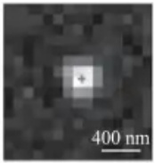

(a)

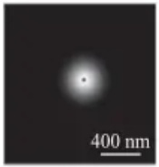

(c)

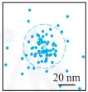

(e)

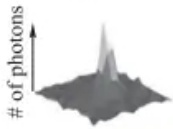

(b)

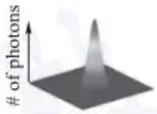

(d)

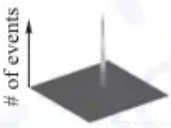

(f)

图11.6.1 单个荧光分子的质心定位及定位精度计算:(a) 模拟单个荧光分子的衍射极限图像，十字标记为分子的实际位置；(b) 为(a)图对应的光子计数直方图；(c) 为(a)中图像的2D高斯函数拟合结果，点为预估的质心位置；(d) 为(c)图对应的强度直方图；(e) 同一个荧光分子的不同成像图的预估位置（蓝点），浅蓝十字代表这些蓝点的平均位置，蓝色圆圈表示其标准偏差，深蓝十字代表分子的实际位置；(f) 单个定位的概率分布

如何使发光点在空间中离散分布是单分子定位显微技术的核心问题，PALM和STORM率先实现了这一想法。PALM使用光激活荧光蛋白标记样品，这种蛋白只有经过激活光照射后才能被激发出荧光。实验中采用低能脉冲激活光随机激活少量荧光蛋白，随后切换为激发光连续照射。只有被激活的荧光蛋白才能够发射荧光用于定位，直至被漂白后进入下一轮激活过程，被漂白的分子在之后的循环中不会再被激活。而STORM使用荧光染料标记样品，先利用高强度激发光照射直至所有荧光分子漂白，再使用低强度激活光照射，随机使少量分子转变为“点亮态”，能够再次被激发直至漂白。该STORM过程也可采用不同波长的激光来实现。通过交替使用激活光和激发光照射样品，使荧光染料在“点亮/熄灭”状态间不断转换（如图11.6.2所示）。以达到单幅图像中荧光分子的PSF不发生重合的目的，从而实现超分辨成像。

由于需要比较低的背景,单分子定位显微技术的激发方式可采取全内反射照明技术(total internal reflection fluorescence microscopy, TIRFM)。当光线从高折

传统的光学显微镜凭借其非接触、无损伤等优点，长期以来是生物医学研究的重要工具。但是，光学显微镜的分辨率极限约为200 nm，无法用于清晰观察生物结构。超分辨光学成像是21世纪光学显微成像领域最重大的突破，打破了光学显微镜的分辨率极限，为生命科学研究提供了前所未有的工具。

以 STORM 为例, 其成像序列使用一种假设的六聚体对象, 这些对象标记有红色荧光团, 可以通过红色激光和绿色激光分别切换到荧光状态和暗态。所有荧光团首先通过强红色激光脉冲切换到暗态。在每个成像周期中, 使用绿色激光脉冲激活少量荧光团, 从而得到一个光学上可分辨的激活荧光团集合。然后, 在红色激光照明下, 这些分子会发射荧光, 直到它们被漂白, 而它们的位置能够被高精度确定(白色十字)。再次重复上述激活-漂白过程, 从多个成像周期获得的荧光团位置重建整体图像。

STORM 成像过程

## 全内反射显微成像技术

利用光线全反射后在介质另一面产生衰逝波的特性,激发荧光分子以观察荧光标定样品的极薄区域,观测的动态范围通常在200 nm以下。因为激发光随穿透深度呈指数衰减的特性,只有极靠近全反射面的样本区域会产生荧光反射,大大降低了背景光噪声干扰。

全内反射原理图

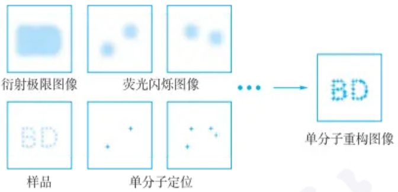

flowchart

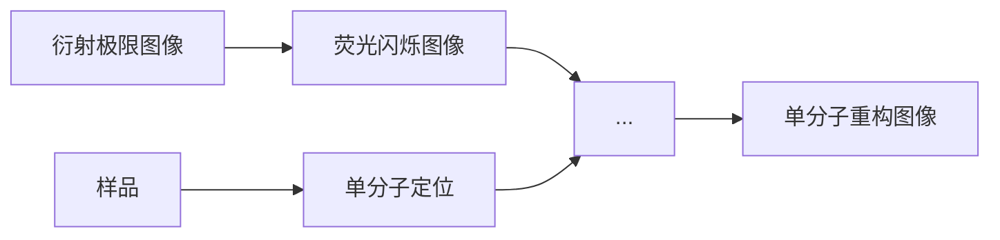

图 11.6.2 基于单分子定位成像的超分辨图像重构过程

射率的介质进入低折射率的介质时 $(n_{2}>n_{1})$ ，折射角大于入射角，因此当入射角增大至超过某一角度时，折射角会大于 $90^{\circ}$ ，激发光全部被反射而不发生折射，称为全反射，此时的入射角为临界角 $\theta_{e}$ 。发生全反射时，虽然激发光被全部反射，但它的部分能量仍然会穿过界面，平行于界面传播，称为消逝波。消逝波也能够激发荧光分子，其强度随着z（与界面的垂直距离）的增加呈指数级减小，激发深度随入射角变化，可在几十至三百纳米范围内调节。由于利用消逝波激发样品，激发深度较小，处于消逝波区域外的荧光分子不会被激发，可以很大程度降低背景。

单分子定位显微技术多用于生物研究中观察亚细胞结构，它的超分辨原理也被应用到化学领域中，以研究催化反应的动态性质。此时不再使用荧光标记的样品，而是在流动池中使用非荧光或弱荧光分子作为底物，流经固体表面并发生催化反应后，底物分子生成强荧光分子或荧光波长发生改变，将产生荧光信号变化的位置作为催化剂表面的活性位点。将反应物的浓度控制在一个很低的范围，使每一幅图像上的荧光信号不发生重叠，再对荧光分子发出的信号进行定位，得到单个分子转化事件在时间和空间上的分布，该技术称为单分子化学成像技术（single-molecule chemical imaging, SMCI）。通过单分子化学成像实验能够得到催化剂活性位的超分辨重构图像、反应动力学参数和分子扩散系数等信息。

单分子定位显微成像相比于其他超分辨方法具有以下优点:其一,具有比其他方法更高的定位精度,一般为10\~20 nm;其二,为宽场成像,能够同时获得百微米范围内样品的图像;其三,仪器较为简单,关键模块仅为全内反射照明模块。但该方法也有它的局限性:其一,成像需要不断漂白和激活荧光分子,成像耗时长,开展动态成像需要进一步改进方法;其二,反复的成像循环可能会导致荧光团的光漂白,从而降低定位精度。

## 11.6.2.2 受激发射损耗显微技术

受激发射损耗显微技术(stimulated emission depletion, STED)是一种远场超分辨成像方法，通过对光源的调制来打破光学衍射极限。该方法利用了分子的受激发射特性，荧光产生的过程是分子从基态 $S_{0}$ 被激发至激发单重态 $S_{1}$，再回落到基态 $S_{0}$ 的各个振动能级时所辐射的光子，而这一过程能在特定波长的光（被称为损耗光）照射下被抑制。当处于 $S_{1}$ 最低振动能级的电子受到特定波长的损耗光照射时，会受激发射跃迁回低能级较高的振动态，并释放出同频率的光子。若损耗光的功率足够高，就会使分子几乎被抑制在基态，从而不产生荧光。

诺奖得主 Stefan Hell 及其团队基于此率先提出了 STED 超分辨成像方法, 其原理是采用两束光进行照明, 一束光作为激发光照射分子产生荧光, 另一束光作为损耗光(也称 STED 光), 用来抑制部分区域荧光的产生。例如, 通过螺旋相位板调制，改变损耗光的相位，获得形如甜甜圈的光束，其中心位置的激光强度为零，两束光叠加使荧光的发射区域被抑制在中心，经过滤光片滤除损耗光后得到小于衍射极限的荧光光斑（如图11.6.3所示）。

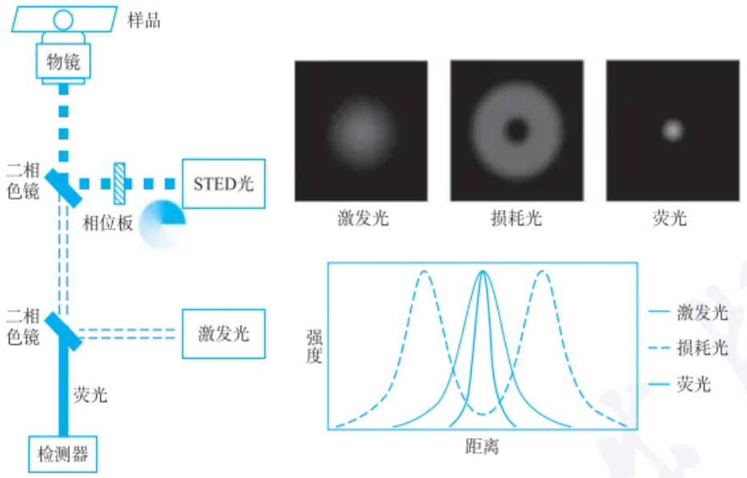

flowchart

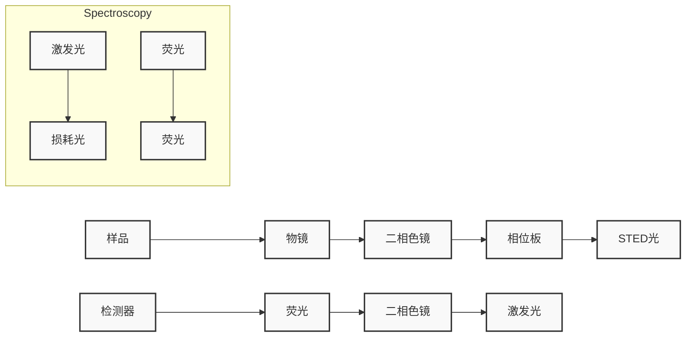

图 11.6.3 STED 的仪器原理图及两束照明光束的形状

STED 的空间分辨率取决于损耗光和荧光分子的强度, 满足以下公式:

$$
d = \frac {\lambda}{2 \mathrm{NA} \sqrt {1 + \frac {I _ {\max}}{I _ {\mathrm{sat}}}}} \tag {11-6-2}
$$

式中， $I_{max}$  表示损耗光的最大强度， $I_{sat}$  为荧光的饱和光强，因此增加损耗光的强度能够有效提高 STED 分辨率。理论上 STED 的分辨率能够达到无穷小，而实际测量过程中耗损光的强度过大可能会导致样品破坏、光漂白、多光子吸收等情况，因此常规 STED 的分辨率一般在 30\~80 nm。该分辨率可以实现生物体系中的亚细胞结构的观察，例如，利用荧光蛋白作为探针进行标记，可对神经元突触小泡、内质网、病毒等进行超分辨成像。由于 STED 采用的是单点成像，因此需要进行扫描才可对一定区域进行成像，其成像速度与区域大小有关，可在秒级到分钟级不等。

STED 成像相比于其他超分辨方法具有以下优点: 其一, 对于感兴趣的区域可即时成像, 无须图像处理; 其二, 作为一种远场成像方法, 探测深度更高, 可达数十微米。但 STED 也具有局限性: 它的损耗光强度较高, 容易引起光损伤; 而且仪器较为复杂, 需要考虑两束光的高精度合束和同步扫描等要求, 成本较高。

## 11.6.2.3 结构光照明显微技术

从频域角度看,光学系统的衍射作用过滤了样品的高频信息,导致成像丢失细节。结构光照明让特定位置的荧光分子发光,发光部分对应频谱由样品频谱重组得到,重组的方式与结构光的强度分布有关。一般将样品频谱高频区域的信息移动至发光部分频谱的低频区域,从而避免衍射影响(如图11.6.4所示)。SIM技术通常使用强度正弦变化的结构光,所采集图像的频谱同时包含样品的高低频信息,使用合适的算法将高低频信息解耦合,根据补全高频信息的样品频谱就能重构出超分辨图像。

受激发射的能级示意图

## 空间域与频域

信号分析的两种角度,空间域上描述信号在不同位置的强度(即图像),而频域上描述信号的不同频率分量的幅值和相位(即频谱)。对图像进行傅里叶变换能够得到它的频谱。

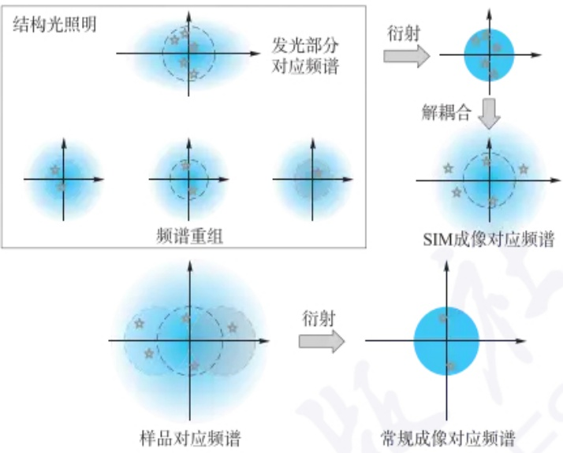

flowchart

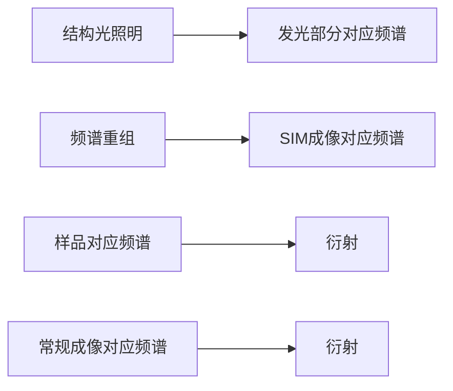

图 11.6.4 结构光照明分辨率提升原理(其中虚线圆圈直径相同)

相较于其他超分辨技术, SIM 技术采集少量图像即可重构出分辨率 80\~100 nm 的超分辨图像, 成像速度更快。并且, 该技术可以适用低强度激光, 细胞毒性更低, 能够保持长时间的生物过程动态成像。

使用特定图案的激发光激发样品是结构光照明显微镜的核心，图案调制通过正弦光栅或空间光调制器实现(图11.6.5)。激光经过正弦光栅和透镜后，在焦平面汇聚成三个衍射光斑，使用小孔滤去中间的衍射光斑，剩余两个光斑在样品平面发生干涉，产生明暗相间的正弦分布的条纹。旋转和移动正弦光栅，条纹也随着旋转和平移。空间光调制器与正弦光栅作用相同，但可调节性更好，能够自由设计照明图案，缺点是晶元有间隙，图案质量不如光栅。

## 思考:

考虑到超分辨率显微镜技术在揭示细胞内部结构方面的突破性进展,如何进一步优化 STORM 等技术以提高成像速度和降低光毒性,从而更好地适用于活细胞成像?

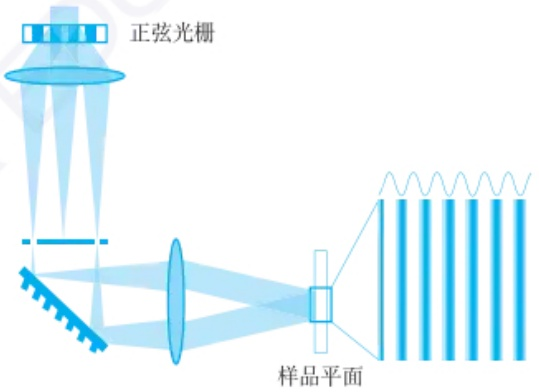

text_image

正弦光栅
样品平面

图 11.6.5 结构光照明示意图

伪影是 SIM 成像普遍存在的问题, 图案参数的估计误差和系统噪声会显著影响图像重构质量。高信噪比时, 维纳解卷积 (Wiener deconvolution) 方法能够较好地抑制噪声, 但是这会牺牲时间分辨率并提升光毒性。而添加物理约束, 或者连续性、稀疏性假设等先验信息的深度学习算法, 能够增强图像重构过程在低信噪比时的抗噪声能力, 抑制伪影并提高空间分辨率。

## 11.6.3 超分辨成像应用

## 11.6.3.1 生物成像分析

由于超分辨技术对时间和空间分辨率的改进，在生物领域，超分辨显微镜的应用广泛而重要。超分辨显微镜在细胞成像方面发挥着关键作用。传统显微镜受到衍射极限的限制，无法观察到细胞内的亚细胞结构。然而，通过利用超分辨技术能够实现对细胞器、蛋白质分布和动态过程的高分辨率成像，从而深入了解细胞的组织结构和功能，例如，哺乳动物细胞中的微管的精细结构。同时，超分辨显微镜在神经科学研究中具有重要意义。例如，利用STED显微技术呈现了活细胞中树突棘的结构特征和活体海马组织切片中突触顶端的结构特征。此外，超分辨显微镜技术在分子生物学和组织工程等领域也得到广泛应用。它使研究者能够更准确地观察和分析分子之间的相互作用、细胞内复杂的生物化学过程及细胞和基质的三维结构。

总而言之，超分辨显微镜在生物领域的应用为科学家提供了强大的工具，使他们能够更深入、更准确地观察和理解生命的机制。通过超越传统光学限制，能够在细胞和分子水平上探索更多的细节，从而推动生物学研究的进展，并为治疗疾病和改善人类健康提供新的机会。

## 11.6.3.2 化学成像分析

基于超分辨成像技术的单分子化学成像已被应用于研究催化剂个体之间及单个固体催化剂表面不同结构特征造成的活性不均一性。在空间维度，单分子化学成像中重构的单个分子的静态位置不仅可以用于揭示局域结构特征（如晶面、缺陷等）的性质和催化剂的调控（如尺寸、电场等）对活性的影响。在时间维度，不同时刻下单个分子的位置分布和密度可以用于研究催化剂的稳定性和催化性能的开关行为。利用荧光反应，单分子化学成像还可以通过计数荧光产物的生成来监测反应动力学信息（如吸附平衡常数、转化速率常数、脱附速率等）。

## 11.6.4 超分辨成像展望

近年来，基于上述四种典型的超分辨成像技术，还发展出可逆饱和光学荧光跃迁显微术（reversible saturable optical fluorescence transition microscopy, RESOLFT）、饱和结构光照明显微术（saturated structured illumination microscopy, SSIM）等超分辨成像技术。超分辨成像技术给生物和化学研究提供了超高时空分辨率的分析范式，为研究生物过程的分子机制和化学反应的空间异质性带来了空前的帮助。随着体系的深入，更多维度的信息，如光谱分布、三维空间位置、偏振态、分子角度取向等，也被获取用来增强人类对化学和生物过程的理解。成像技术对系统观测的精细程度由时空分辨率决定，追求更高的时空分辨率是目前成像技术的重要方向。2014年，诺贝尔化学奖颁发给了研究超分辨成像的三位科学家，鼓励他们在突破传统光学分辨极限方面所做出的重要贡献。时至今日，深度学习和统计分析方法的引入，正在把荧光显微技术的成像分辨率推向新的高峰，即将突破分子尺度，为研究微观世界带来技术革新。

超分辨成像在生物成像分析中的应用

超分辨成像在化学成像分析中的应用

## PAINT 技术的原理基于荧光分子的短暂结合和解离

（1）荧光探针与样品相互作用:使用短荧光标记的寡核苷酸链作为探针。这些探针与样品表面相互作用，可以通过碰撞后脱离或永久结合后漂白发出荧光信号。
（2）多次采集记录:通过多次采集记录自由扩散在溶液中的荧光探针与样品相互作用的荧光信号，获得每个荧光分子的精准定位信息。
（3）图像叠加:将数万张含有荧光分子精准定位信息的图像叠加，最终重建出一张纳米级别的超分辨图像。

## 习题

## - 章节练习题 -

1. 对于单分子定位显微技术,哪些因素会影响单分子的定位精度?
2. 是否可以调节损耗光的形状和大小使得成像的分辨率无限小？

## - 挑战性问题 -

3. 与传统成像技术相比, 超分辨成像技术有何优势和局限性?

## - 专题或报告 -

4. 超分辨率成像技术能否与现有的其他成像模式(如电子显微镜)结合,以获得细胞结构和功能的更全面理解?查阅关于基于超分辨成像的多模态表征在生物成像分析中应用的科学文献,并将结果写成报告。
5. 超分辨率显微镜技术的进步如何促进生物学、物理学、材料科学和计算机科学等不同学科之间的合作？查阅相关科学文献，了解研究现状，并与同学分享你的结果。

## 附录A

## 主要参考书

[1] 彭崇慧，冯建章，张锡瑜.定量化学分析简明教程[M].4版.李娜，张新祥，修订.北京:北京大学出版社，2020.
[2] 邵利民. 分析化学 [M]. 2 版. 北京: 科学技术出版社, 2020.
[3] 陈兴国, 何疆, 陈宏丽, 等. 分析化学 [M]. 2 版. 北京: 高等教育出版社, 2021.
[4] 武汉大学. 分析化学: 上册 [M]. 6 版. 北京: 高等教育出版社, 2016.
[5] Kolthoff I M, Sandell E B, Meehan E J, et al. Quantitative Chemical Analysis [M]. 4th ed. Toronto: The Macmillan Company, 1969.
[6] Harvey D. Modern Analytical Chemistry (International Edition) [M]. Boston: The McGraw-Hill Companies, Inc, 2000.
[7] Daniel C H. Quantitative Chemical Analysis [M]. 9th ed. New York: W, H, Freeman & Company, 2015.
[8] Harris D C. Fundamentals of Analytical Chemistry (International Edition) [M]. 8th ed. New York: W. H. Freeman & Company, 2009.
[9] Christian G D, Dasgupta P, Schug K. Analytical Chemistry [M]. 7th ed. New York: John Wiley & Sons Inc, 2014.
[10] Skoog D A, West D M, Holler F J, et al. Fundamentals of Analytical Chemistry [M]. 10th ed. KY: Cengage Learning, 2022.
[11] 李攻科，汪正范，胡玉玲，等. 样品制备方法及应用 [M]. 北京:化学工业出版社，2022.
[12] 武汉大学. 分析化学: 下册 [M]. 6 版. 北京: 高等教育出版社, 2018.
[13] 王玉枝，宦双燕，张正奇. 分析化学[M]. 4版. 北京: 科学出版社, 2023.
[14] 张新祥, 李美仙, 李娜, 等. 仪器分析教程 [M]. 3 版. 北京: 北京大学出版社, 2022.
[15] Kellner R, Mermet J-M, Otto M, et al. 李克安, 金钦汉, 译. 分析化学 [M]. 北京: 北京大学出版社, 2001.
[16] 侯贤灯. 原子光谱分析前沿 [M]. 北京: 科学出版社, 2022.
[17] 江桂斌, 郑明辉, 孙红文, 等. 环境化学前沿(第二辑)[M]. 北京: 科学出版社, 2019.
[18] 郑经国. 分析化学手册(分子光谱分析.3A)[M]. 3版. 北京: 化学工业出版社, 2016.
[19] 孙汉文. 原子光谱分析 [M]. 北京: 高等教育出版社, 2002.
[20] 董慧茹. 仪器分析 [M]. 4 版. 北京: 化学工业出版社, 2022.
[21] 胡坪, 王氢. 仪器分析 [M]. 5 版. 北京: 高等教育出版社, 2021.
[22] Skoog D A, Holler F J, Crouch S R. Principles of Instrumental Analysis[M]. 7th ed. KY: Cengage Learning, 2018.
[23] Lyubchenko Y L. Nanoscale Imaging, methods and protocols[M]. New York: Humana New York, 2018.
[24] Harris D C. Quantitative Chemical Analysis[M]. 9th ed. New York: W H Freeman & Company, 2016.
[25] 宦双燕, 蒋健晖, 李攻科, 等. 分析化学动态电子教案 [M]. 北京: 高等教育出版社, 高等教育电子音像出版社, 2024.
[26] 王敏. 分析化学手册(化学分析)[M]. 3版. 北京: 化学工业出版社, 2016.

## 附录B

# 常用试剂和指示剂

## B.1 常用酸碱指示剂

B.1-1 单一指示剂

<table><tr><td rowspan="2">指示剂</td><td colspan="3">颜色</td><td rowspan="2">pK(HIn)</td><td rowspan="2">pT</td><td rowspan="2">变色pH范围</td><td rowspan="2">每10mL被滴定溶液中指示剂用量</td></tr><tr><td>酸色</td><td>过渡</td><td>碱色</td></tr><tr><td>百里酚蓝(第一步解离)</td><td>红</td><td>橙</td><td>黄</td><td>1.7</td><td>2.6</td><td>1.2~2.8</td><td>1~2滴0.1%水溶液*</td></tr><tr><td>甲基黄</td><td>红</td><td>橙黄</td><td>黄</td><td>3.3</td><td>3.9</td><td>2.9~4.0</td><td>1滴0.1%乙醇溶液</td></tr><tr><td>溴酚蓝</td><td>黄</td><td></td><td>紫</td><td>4.1</td><td>4.0</td><td>3.0~4.4</td><td>1滴0.1%水溶液*</td></tr><tr><td>甲基橙</td><td>红</td><td>橙</td><td>黄</td><td>3.4</td><td>4.4</td><td>3.1~4.4</td><td>1滴0.1%水溶液*</td></tr><tr><td>溴甲酚绿</td><td>黄</td><td>绿</td><td>蓝</td><td>4.9</td><td>4.0</td><td>3.8~5.4</td><td>1滴0.1%水溶液*</td></tr><tr><td>甲基红</td><td>红</td><td>橙</td><td>黄</td><td>5.0</td><td>5.0</td><td>4.4~6.2</td><td>1滴0.1%水溶液*</td></tr><tr><td>溴甲酚紫</td><td>黄</td><td></td><td>紫</td><td></td><td>6.0</td><td>5.2~6.8</td><td>1滴0.1%水溶液*</td></tr><tr><td>溴百里酚蓝</td><td>黄</td><td>绿</td><td>蓝</td><td>7.3</td><td>7.0</td><td>6.0~7.6</td><td>1滴0.1%水溶液*</td></tr><tr><td>酚红</td><td>黄</td><td>橙</td><td>红</td><td>8.0</td><td>7.0</td><td>6.4~8.0</td><td>1滴0.1%水溶液*</td></tr><tr><td>百里酚蓝(第二步解离)</td><td>黄</td><td></td><td>蓝</td><td>8.9</td><td>9.0</td><td>8.0~9.6</td><td>1~5滴0.1%水溶液*</td></tr><tr><td>酚酞</td><td>无色</td><td>粉红</td><td>红</td><td>9.1</td><td></td><td>8.0~9.8</td><td>1~2滴0.1%乙醇溶液</td></tr><tr><td>百里酚酞</td><td>无色</td><td>淡蓝</td><td>蓝</td><td>10.0</td><td>10.0</td><td>9.4~10.6</td><td>1滴0.1%乙醇溶液</td></tr></table>

a: 指示剂是钠盐。

B.1-2 混合指示剂

<table><tr><td colspan="2" rowspan="2">指示剂溶液的组成</td><td rowspan="2">变色点 pH</td><td colspan="2">颜色</td><td rowspan="2">备注</td></tr><tr><td>酸色</td><td>碱色</td></tr><tr><td>0.1%甲基橙水溶液+0.25%靛蓝磺酸钠水溶液</td><td>(1:1)</td><td>4.1</td><td>紫</td><td>黄绿</td><td>pH=4.1,灰色</td></tr><tr><td>0.1%溴甲酚绿乙醇溶液+0.2%甲基红乙醇溶液</td><td>(3:1)</td><td>5.1</td><td>酒红</td><td>绿</td><td>pH=5.1,灰色</td></tr><tr><td>0.1%溴甲酚绿钠盐水溶液+0.1%氯酚红钠盐水溶液</td><td>(1:1)</td><td>6.1</td><td>蓝绿</td><td>蓝紫</td><td>pH=5.4,蓝绿pH=5.8,蓝pH=6.0,蓝带紫pH=6.2,蓝紫</td></tr><tr><td>0.1%中性红乙醇溶液+0.1%亚甲基蓝乙醇溶液</td><td>(1:1)</td><td>7.0</td><td>蓝紫</td><td>绿</td><td></td></tr><tr><td>0.1%甲酚红水溶液+</td><td>(1:3)</td><td>8.3</td><td>黄</td><td>紫</td><td>pH=8.2,粉色</td></tr><tr><td>0.1%百里酚蓝水溶液</td><td></td><td></td><td></td><td></td><td>pH=8.4,清晰的紫色</td></tr><tr><td>0.1%百里酚蓝的50%乙醇溶液+</td><td>(1:3)</td><td>9.0</td><td>黄</td><td>紫</td><td>黄→绿→紫</td></tr><tr><td>0.1%酚酞的50%乙醇溶液</td><td></td><td></td><td></td><td></td><td></td></tr></table>

B.2 常用金属指示剂

<table><tr><td>指示剂</td><td>解离常数</td><td>滴定元素</td><td>颜色变化</td><td>配制方法</td></tr><tr><td rowspan="3">酸性铬蓝K</td><td> $\mathrm{p}K_{\mathrm{a}_{1}} = 6.7$ </td><td>Mg(pH=10)</td><td>红~蓝</td><td>0.1%乙醇溶液</td></tr><tr><td> $\mathrm{p}K_{\mathrm{a}_{2}} = 10.2$ </td><td>Ca(pH=12)</td><td></td><td></td></tr><tr><td> $\mathrm{p}K_{\mathrm{a}_{3}} = 14.6$ </td><td></td><td></td><td></td></tr><tr><td rowspan="3">钙指示剂</td><td> $\mathrm{p}K_{\mathrm{a}_{2}} = 3.8$ </td><td>Ca(pH=12~13)</td><td>酒红~蓝</td><td>与NaCl按1:100的质量比混合</td></tr><tr><td> $\mathrm{p}K_{\mathrm{a}_{3}} = 9.4$ </td><td></td><td></td><td></td></tr><tr><td> $\mathrm{p}K_{\mathrm{a}_{4}} = 13 \sim 14$ </td><td></td><td></td><td></td></tr><tr><td rowspan="4">铬黑T</td><td> $\mathrm{p}K_{\mathrm{a}_{1}} = 3.9$ </td><td>Ca(pH=10,加入EDTA-Mg)</td><td>红~蓝</td><td>与NaCl按1:100的质量比混合</td></tr><tr><td> $\mathrm{p}K_{\mathrm{a}_{2}} = 6.4$ </td><td>Mg(pH=10)</td><td>红~蓝</td><td></td></tr><tr><td> $\mathrm{p}K_{\mathrm{a}_{3}} = 11.5$ </td><td>Pb(pH=10,加入酒石酸钾)</td><td>红~蓝</td><td></td></tr><tr><td></td><td>Zn(pH=6.8~10)</td><td>红~蓝</td><td></td></tr><tr><td rowspan="5">紫脲酸铵</td><td> $\mathrm{p}K_{\mathrm{a}_{1}} = 1.6$ </td><td>Ca(pH&gt;10,25%乙醇)</td><td>红~紫</td><td>与NaCl按1:100的质量比混合</td></tr><tr><td> $\mathrm{p}K_{\mathrm{a}_{2}} = 8.7$ </td><td>Cu(pH 7~8)</td><td>黄~紫</td><td></td></tr><tr><td> $\mathrm{p}K_{\mathrm{a}_{3}} = 10.3$ </td><td>Ni(pH=8.5~11.5)</td><td>黄~紫红</td><td></td></tr><tr><td> $\mathrm{p}K_{\mathrm{a}_{4}} = 13.5$ </td><td></td><td></td><td></td></tr><tr><td> $\mathrm{p}K_{\mathrm{a}_{5}} = 14 \sim 14.5$ </td><td></td><td></td><td></td></tr><tr><td rowspan="2">o-PAN</td><td> $\mathrm{p}K_{\mathrm{a}_{1}} = 2.9$ </td><td>Cu(pH=6)</td><td>红~黄</td><td>0.1%乙醇溶液</td></tr><tr><td> $\mathrm{p}K_{\mathrm{a}_{2}} = 11.2$ </td><td>Zn(pH=5~7)</td><td>粉红~黄</td><td></td></tr><tr><td rowspan="2">磺基水杨酸</td><td> $\mathrm{p}K_{\mathrm{a}_{1}} = 2.6$ </td><td>Fe(III)(pH=1.5~3)</td><td>红紫~黄</td><td>1%~2%水溶液</td></tr><tr><td> $\mathrm{p}K_{\mathrm{a}_{2}} = 11.7$ </td><td></td><td></td><td></td></tr><tr><td rowspan="5">二甲酚橙</td><td> $\mathrm{p}K_{\mathrm{a}_{2}} = 2.6$ </td><td>Bi(pH=1~2)</td><td>红~黄</td><td>0.5%乙醇溶液</td></tr><tr><td> $\mathrm{p}K_{\mathrm{a}_{3}} = 3.2$ </td><td>La(pH=5~6)</td><td></td><td></td></tr><tr><td> $\mathrm{p}K_{\mathrm{a}_{4}} = 6.4$ </td><td>Pb(pH=5~6)</td><td></td><td></td></tr><tr><td> $\mathrm{p}K_{\mathrm{a}_{5}} = 10.4$ </td><td>Zn(pH=5~6)</td><td></td><td></td></tr><tr><td> $\mathrm{p}K_{\mathrm{a}_{6}} = 12.3$ </td><td></td><td></td><td></td></tr></table>

B.3 常用氧化还原指示剂

<table><tr><td rowspan="2">指示剂</td><td colspan="3">颜色变化</td><td rowspan="2">配制方法</td></tr><tr><td> $\varphi_{\text{in}}^{\prime}/\text{V}$  $[\text{H}^{+}] = 1$ </td><td>还原态</td><td>氧化态</td></tr><tr><td>亚甲基蓝</td><td>+0.52</td><td>无</td><td>蓝</td><td>0.05%水溶液</td></tr><tr><td>二苯胺磺酸钠</td><td>+0.85</td><td>无</td><td>紫红</td><td>0.8 g指示剂,2 g  $\text{Na}_{2}\text{CO}_{3}$ ,加水稀释至100 mL</td></tr><tr><td>邻苯氨基苯甲酸</td><td>+0.89</td><td>无</td><td>紫红</td><td>0.11 g指示剂溶于20 mL 5%  $\text{Na}_{2}\text{CO}_{3}$ 溶液中,加水稀释至100 mL</td></tr><tr><td>邻二氮菲亚铁</td><td>+1.06</td><td>红</td><td>浅蓝</td><td>1.485 g邻二氮菲,0.695 g  $\text{FeSO}_{4} \cdot 7\text{H}_{2}\text{O}$ ,加水稀释至100 mL</td></tr></table>

B.4 常用预氧化剂与预还原剂

| 氧化剂 | 反应条件 | 主要用途 | 过量试剂除去方法 |
| --- | --- | --- | --- |
| $(NH_4)_2S_2O_8$ | 酸性,银催化 | $Mn^{2+} \rightarrow MnO_4^-$$Cr^{3+} \rightarrow Cr_2O_7^{2-}$$Ce^{3+} \rightarrow Ce^{4+}$$VO^{2+} \rightarrow VO_3^-$ | 煮沸分解 |
| $NaBiO_3$ | 酸性 | 同上 | 过滤除去 |
| $KMnO_4$ | 酸性 | $VO^{2+} \rightarrow VO_3^-$ | 加 $NaNO_3$ 和尿素 |
| $H_2O_2$ | 碱性 | $Cr^{3+} \rightarrow CrO_4^{2-}$ | 煮沸分解($Ni^{2+}$ 催化) |
| $Cl_2$、$Br_2$ | 酸性或中性 | $I^- \rightarrow IO_3^-$ | 煮沸除去,或加苯酚除溴 |
| 还原剂 | 反应条件 | 主要用途 | 过量试剂除去方法 |
| 锌汞齐还原柱(Jones 还原器) | 酸性 | $Fe^{3+} \rightarrow Fe^{2+}$$Ti(IV) \rightarrow Ti(III)$$VO_2^- \rightarrow V^{2+}$$Sn(IV) \rightarrow Sn(II)$$Cr^{3+} \rightarrow Cr^{2+}$ | 注:由于氢在汞上有很大的超电位,因此在酸性溶液中使用锌汞齐不致产生 $H_2$ |
| 银还原器 | HCl 介质 | $Fe^{3+} \rightarrow Fe^{2+}$$U(VI) \rightarrow U(IV)$ | 注:$Cr^{3+}$、$Ti(IV)$ 不被还原,在用 $K_2Cr_2O_7$ 滴定 $Fe^{3+}$ 时不产生干扰 |
| Zn、Al | 酸性 | $Sn(IV) \rightarrow Sn(II)$$Ti(IV) \rightarrow Ti(III)$ | 过滤或加酸溶解 |
| $SnCl_2$ | 酸性加热 | $Fe^{3+} \rightarrow Fe^{2+}$$As(V) \rightarrow As(III)$$Mo(VI) \rightarrow Mo(V)$ | 加 $HgCl_2$ 氧化 |
| $TiCl_3$ | 酸性 | $Fe^{3+} \rightarrow Fe^{2+}$ | 水稀释,$Cu^{2+}$ 催化空气氧化 |
| $SO_2$ | 中性或弱酸性 | $Fe^{3+} \rightarrow Fe^{2+}$$As(V) \rightarrow As(III)$$Sb(V) \rightarrow Sb(III)$ | 煮沸,或通 $CO_2$ 气流 |

## 化学平衡常数等各类物理化学数据

C.1 一些离子的离子体积参数( $\mathring{a}$ )和活度系数( $\gamma$ )

<table><tr><td rowspan="2">离子</td><td rowspan="2"> $\mathrm{d}/\mathrm{{nm}}$ </td><td colspan="4"> $\gamma$ </td></tr><tr><td> $I=0.005$ </td><td> $I=0.01$ </td><td> $I=0.05$ </td><td> $I=0.1$ </td></tr><tr><td> ${\mathrm{H}}^{ + }$ </td><td>0.9</td><td>0.934</td><td>0.914</td><td>0.854</td><td>0.826</td></tr><tr><td> ${\mathrm{{Li}}}^{ + },{\mathrm{C}}_{6}{\mathrm{H}}_{5}{\mathrm{{COO}}}^{ - }$ </td><td>0.6</td><td>0.930</td><td>0.907</td><td>0.834</td><td>0.796</td></tr><tr><td> ${\mathrm{{Na}}}^{ + },{\mathrm{{HCO}}}_{3}^{ - },{\mathrm{{IO}}}_{3}^{ - },{\mathrm{H}}_{2}{\mathrm{{PO}}}_{4}^{ - },{\mathrm{{Ac}}}^{ - }$ </td><td>0.4</td><td>0.927</td><td>0.902</td><td>0.817</td><td>0.770</td></tr><tr><td> ${\mathrm{{HCOO}}}^{ - },{\mathrm{{ClO}}}_{3}^{ - },{\mathrm{{ClO}}}_{4}^{ - },{\mathrm{F}}^{ - },{\mathrm{{MnO}}}_{4}^{ - },{\mathrm{{OH}}}^{ - },{\mathrm{{SH}}}^{ - }$ </td><td>0.35</td><td>0.926</td><td>0.900</td><td>0.812</td><td>0.762</td></tr><tr><td> ${\mathrm{K}}^{ + },{\mathrm{{Br}}}^{ - },{\mathrm{{CN}}}^{ - },{\mathrm{{Cl}}}^{ - },{\mathrm{I}}^{ - },{\mathrm{{NO}}}_{3}^{ - },{\mathrm{{NO}}}_{2}^{ - }$ </td><td>0.3</td><td>0.925</td><td>0.899</td><td>0.807</td><td>0.754</td></tr><tr><td> ${\mathrm{{Ag}}}^{ + },{\mathrm{{Cs}}}^{ + },{\mathrm{{NH}}}_{4}^{ + },{\mathrm{{Rb}}}^{ + },{\mathrm{{Tl}}}^{ + }$ </td><td>0.25</td><td>0.925</td><td>0.897</td><td>0.802</td><td>0.745</td></tr><tr><td> ${\mathrm{{Be}}}^{2 + },{\mathrm{{Mg}}}^{2 + }$ </td><td>0.8</td><td>0.756</td><td>0.690</td><td>0.517</td><td>0.446</td></tr><tr><td> ${\mathrm{{Ca}}}^{2 + },{\mathrm{{Cu}}}^{2 + },{\mathrm{{Zn}}}^{2 + },{\mathrm{{Fe}}}^{2 + },{\mathrm{C}}_{6}{\mathrm{H}}_{4}{\left( \mathrm{{COO}}\right) }_{2}^{2 - }$ </td><td>0.6</td><td>0.748</td><td>0.676</td><td>0.484</td><td>0.402</td></tr><tr><td> ${\mathrm{{Ba}}}^{2 + },{\mathrm{{Cd}}}^{2 + },{\mathrm{{Hg}}}^{2 + },{\mathrm{{Pb}}}^{2 + },{\mathrm{S}}^{2 - },{\mathrm{C}}_{2}{\mathrm{O}}_{4}^{2 - }$ </td><td>0.5</td><td>0.743</td><td>0.669</td><td>0.465</td><td>0.377</td></tr><tr><td> ${\mathrm{{Hg}}}^{2 + },{\mathrm{{CO}}}_{3}^{2 - },{\mathrm{{CrO}}}_{4}^{2 - },{\mathrm{{HPO}}}_{4}^{2 - },{\mathrm{{SO}}}_{3}^{2 - },{\mathrm{{SO}}}_{4}^{2 - }$ </td><td>0.4</td><td>0.738</td><td>0.661</td><td>0.445</td><td>0.351</td></tr><tr><td> ${\mathrm{{Al}}}^{3 + },{\mathrm{{Cr}}}^{3 + },{\mathrm{{Fe}}}^{3 + },{\mathrm{{La}}}^{3 + }$ </td><td>0.9</td><td>0.540</td><td>0.443</td><td>0.242</td><td>0.179</td></tr><tr><td> ${\mathrm{{Cit}}}^{3 - }$ (柠檬酸根)</td><td>0.5</td><td>0.513</td><td>0.404</td><td>0.179</td><td>0.112</td></tr><tr><td> $\mathrm{{Fe}}{\left( \mathrm{{CN}}\right) }_{6}^{3 - },{\mathrm{{PO}}}_{4}^{3 - }$ </td><td>0.4</td><td>0.505</td><td>0.394</td><td>0.162</td><td>0.095</td></tr><tr><td> ${\mathrm{{Ce}}}^{4 + },{\mathrm{{Th}}}^{4 + },{\mathrm{{Zr}}}^{4 + }$ </td><td>1.1</td><td>0.348</td><td>0.253</td><td>0.099</td><td>0.063</td></tr><tr><td> $\mathrm{{Fe}}{\left( \mathrm{{CN}}\right) }_{6}^{4 - }$ </td><td>0.5</td><td>0.305</td><td>0.200</td><td>0.047</td><td>0.020</td></tr></table>

## C.2 弱酸及弱碱在水溶液中的解离常数(25℃)

C.2-1 弱酸

<table><tr><td rowspan="2">酸</td><td rowspan="2">化学式</td><td rowspan="2">分级解离</td><td colspan="2"> $I=0$ </td><td colspan="2"> $I=0.1$ </td></tr><tr><td> $K_a$ </td><td> $pK_a$ </td><td> $K_a^M$ </td><td> $pK_a^M$ </td></tr><tr><td rowspan="3">砷酸</td><td rowspan="3"> $H_3AsO_4$ </td><td> $K_{a_1}$ </td><td> $5.8×10^{-3}$ </td><td>2.24</td><td> $8×10^{-3}$ </td><td>2.1</td></tr><tr><td> $K_{a_2}$ </td><td> $1.10×10^{-7}$ </td><td>6.96</td><td> $2×10^{-7}$ </td><td>6.7</td></tr><tr><td> $K_{a_3}$ </td><td> $3.2×10^{-12}$ </td><td>11.50</td><td> $6×10^{-12}$ </td><td>11.2</td></tr><tr><td>亚砷酸</td><td> $H_3AsO_3$ </td><td> $K_{a_1}$ </td><td> $5.1×10^{-10}$ </td><td>9.29</td><td> $8×10^{-10}$ </td><td>9.1</td></tr><tr><td>硼酸</td><td> $H_3BO_3$ </td><td> $K_{a_1}$ </td><td> $5.79×10^{-10}$ </td><td>9.237</td><td></td><td></td></tr><tr><td rowspan="2">碳酸</td><td rowspan="2"> $H_2CO_3(H_2O+CO_2)$ </td><td> $K_{a_1}$ </td><td> $4.46×10^{-7}$ </td><td>6.351</td><td> $5×10^{-7}$ </td><td>6.3</td></tr><tr><td> $K_{a_2}$ </td><td> $4.69×10^{-11}$ </td><td>10.329</td><td> $8×10^{-11}$ </td><td>10.1</td></tr><tr><td>铬酸</td><td>H2CrO4</td><td>Ka2</td><td>3.2x10-7</td><td>6.50</td><td></td><td></td></tr><tr><td>氢氰酸</td><td>HCN</td><td></td><td>6.2x10-10</td><td>9.21</td><td>6x10-10</td><td>9.2</td></tr><tr><td>氢氟酸</td><td>HF</td><td></td><td>6.8x10-4</td><td>3.17</td><td>8.9x10-4</td><td>3.1</td></tr><tr><td rowspan="2">氢硫酸</td><td rowspan="2">H2S</td><td>Ka1</td><td>9.5x10-8</td><td>7.02</td><td>1.3x10-7</td><td>6.9</td></tr><tr><td>Ka2</td><td>1.0x10-14</td><td>14.0</td><td>3x10-13</td><td>12.5</td></tr><tr><td rowspan="3">磷酸</td><td rowspan="3">H3PO4</td><td>Ka1</td><td>7.11x10-3</td><td>2.148</td><td>1x10-2</td><td>2.0</td></tr><tr><td>Ka2</td><td>6.34x10-8</td><td>7.198</td><td>1.3x10-7</td><td>6.9</td></tr><tr><td>Ka1</td><td>4.22x10-13</td><td>12.38</td><td>2x10-12</td><td>11.7</td></tr><tr><td rowspan="2">硅酸</td><td rowspan="2">H2SiO3</td><td>Ka1</td><td>1.7x10-10</td><td>9.77</td><td>3x10-10</td><td>9.5</td></tr><tr><td>Ka2</td><td>1.6x10-12</td><td>11.80</td><td>2x10-13</td><td>12.7</td></tr><tr><td>硫酸</td><td>H2SO4</td><td>Ka2</td><td>1.03x10-2</td><td>1.987</td><td>1.6x10-2</td><td>1.8</td></tr><tr><td rowspan="2">亚硫酸</td><td rowspan="2">H2SO3(H2O+SO2)</td><td>Ka1</td><td>1.39x10-2</td><td>1.857</td><td>1.6x10-2</td><td>1.8</td></tr><tr><td>Ka2</td><td>6.73x10-8</td><td>7.172</td><td>1.6x10-7</td><td>6.8</td></tr><tr><td>甲酸</td><td>HCOOH</td><td></td><td>1.80x10-4</td><td>3.744</td><td>2.2x10-4</td><td>3.65</td></tr><tr><td>乙酸</td><td>CH3COOH</td><td></td><td>1.75x10-5</td><td>4.756</td><td>2.2x10-5</td><td>4.65</td></tr><tr><td>丙酸</td><td>C2H5COOH</td><td></td><td>1.34x10-5</td><td>4.874</td><td></td><td></td></tr><tr><td>氯乙酸</td><td>ClCH2COOH</td><td></td><td>1.36x10-3</td><td>2.865</td><td>2x10-3</td><td>2.7</td></tr><tr><td>二氯乙酸</td><td>Cl2CHCOOH</td><td></td><td>4.5x10-2</td><td>1.35</td><td>8x10-2</td><td>1.1</td></tr><tr><td rowspan="2">氨基乙酸</td><td>NH3*CH2COOH</td><td>Ka1</td><td>4.47x10-3</td><td>2.350</td><td>3x10-3</td><td>2.5</td></tr><tr><td>NH3*CH2COO-</td><td>Ka2</td><td>1.67x10-10</td><td>9.778</td><td>2x10-10</td><td>9.7</td></tr><tr><td>苯甲酸</td><td>C6H5COOH</td><td></td><td>6.28x10-5</td><td>4.202</td><td>8x10-5</td><td>4.1</td></tr><tr><td rowspan="2">草酸</td><td rowspan="2">H2C2O4</td><td>Ka1</td><td>5.62x10-2</td><td>1.250</td><td>8x10-2</td><td>1.1</td></tr><tr><td>Ka2</td><td>5.42x10-5</td><td>4.266</td><td>1x10-4</td><td>4.0</td></tr><tr><td>苯酚</td><td>C6H5OH</td><td></td><td>1.01x10-10</td><td>10.00</td><td>1.6x10-10</td><td>9.8</td></tr><tr><td>乙酰丙酮</td><td>CH3COCH2COCH3</td><td></td><td>1x10-9</td><td>9.0</td><td>1.3x10-9</td><td>8.9</td></tr><tr><td rowspan="2">α-酒石酸</td><td rowspan="2">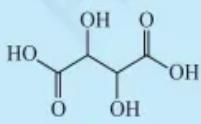</td><td>Ka1</td><td>9.20x10-4</td><td>3.036</td><td>1.3x10-3</td><td>2.9</td></tr><tr><td>Ka2</td><td>4.31x10-5</td><td>4.366</td><td>8x10-5</td><td>4.1</td></tr><tr><td rowspan="2">琥珀酸</td><td rowspan="2">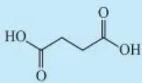</td><td>Ka1</td><td>6.21x10-5</td><td>4.207</td><td>1.0x10-4</td><td>4.00</td></tr><tr><td>Ka2</td><td>2.31x10-6</td><td>5.636</td><td>5.2x10-6</td><td>5.28</td></tr><tr><td rowspan="2">邻苯二甲酸</td><td rowspan="2">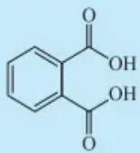</td><td> $K_{a_1}$ </td><td> $1.12\times 10^{-3}$ </td><td>2.950</td><td> $1.6\times 10^{-3}$ </td><td>2.8</td></tr><tr><td> $K_{a_2}$ </td><td> $3.90\times 10^{-6}$ </td><td>5.408</td><td> $8\times 10^{-6}$ </td><td>5.1</td></tr><tr><td rowspan="3">柠檬酸</td><td rowspan="3">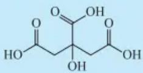</td><td> $K_{a_1}$ </td><td> $7.44\times 10^{-4}$ </td><td>3.128</td><td> $1\times 10^{-3}$ </td><td>3.0</td></tr><tr><td> $K_{a_2}$ </td><td> $1.73\times 10^{-5}$ </td><td>4.761</td><td> $4\times 10^{-5}$ </td><td>4.4</td></tr><tr><td> $K_{a_3}$ </td><td> $4.02\times 10^{-7}$ </td><td>6.396</td><td> $8\times 10^{-7}$ </td><td>6.1</td></tr><tr><td rowspan="6">二乙胺四乙酸</td><td rowspan="6">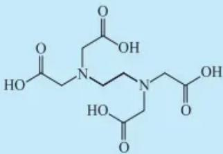</td><td> $K_{a_1}$ </td><td></td><td></td><td> $1.3\times 10^{-1}$ </td><td>0.9</td></tr><tr><td> $K_{a_2}$ </td><td></td><td></td><td> $3\times 10^{-2}$ </td><td>1.6</td></tr><tr><td> $K_{a_3}$ </td><td></td><td></td><td> $8.5\times 10^{-3}$ </td><td>2.07</td></tr><tr><td> $K_{a_4}$ </td><td></td><td></td><td> $1.8\times 10^{-3}$ </td><td>2.75</td></tr><tr><td> $K_{a_5}$ </td><td> $5.3\times 10^{-7}$ </td><td>6.28</td><td> $5.8\times 10^{-7}$ </td><td>6.24</td></tr><tr><td> $K_{a_6}$ </td><td> $1.13\times 10^{-11}$ </td><td>10.948</td><td> $4.6\times 10^{-11}$ </td><td>10.34</td></tr><tr><td rowspan="2">8-羟基喹啉</td><td rowspan="2">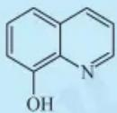</td><td> $K_{a_1}$ </td><td> $1.15\times 10^{-5}$ </td><td>4.94</td><td> $1\times 10^{-5}$ </td><td>5.0</td></tr><tr><td> $K_{a_2}$ </td><td> $1.51\times 10^{-10}$ </td><td>9.82</td><td> $1.3\times 10^{-10}$ </td><td>9.9</td></tr><tr><td rowspan="2">苹果酸</td><td rowspan="2">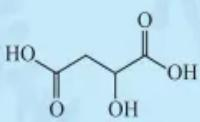</td><td> $K_{a_1}$ </td><td> $4.0\times 10^{-4}$ </td><td>3.40</td><td> $5.2\times 10^{-4}$ </td><td>3.28</td></tr><tr><td> $K_{a_2}$ </td><td> $8.9\times 10^{-6}$ </td><td>5.05</td><td> $1.9\times 10^{-5}$ </td><td>4.72</td></tr><tr><td rowspan="2">水杨酸</td><td rowspan="2">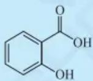</td><td> $K_{a_1}$ </td><td> $1.07\times 10^{-3}$ </td><td>2.972</td><td> $1.3\times 10^{-3}$ </td><td>2.9</td></tr><tr><td> $K_{a_2}$ </td><td> $2\times 10^{-14}$ </td><td>13.7</td><td> $8\times 10^{-14}$ </td><td>13.1</td></tr><tr><td rowspan="2">磺基水杨酸</td><td rowspan="2">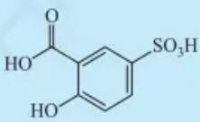</td><td> $K_{a_1}$ </td><td></td><td>2.49</td><td> $3\times 10^{-3}$ </td><td>2.6</td></tr><tr><td> $K_{a_2}$ </td><td></td><td>12.00</td><td> $3\times 10^{-12}$ </td><td>11.6</td></tr><tr><td rowspan="2">顺丁烯二酸</td><td rowspan="2">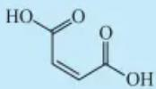</td><td> $K_{a_1}$ </td><td> $1.20\times 10^{-2}$ </td><td>1.921</td><td></td><td></td></tr><tr><td> $K_{a_2}$ </td><td> $5.37\times 10^{-7}$ </td><td>6.270</td><td></td><td></td></tr></table>

C.2-2 弱碱

<table><tr><td rowspan="2">碱</td><td rowspan="2">化学式</td><td rowspan="2"></td><td colspan="2"> $I=0$ </td><td colspan="2"> $I=0.1$ </td></tr><tr><td> $K_{\text{b}}$ </td><td> $\text{p}K_{\text{b}}$ </td><td> $K_{\text{b}}^{\text{M}}$ </td><td> $\text{p}K_{\text{b}}^{\text{M}}$ </td></tr><tr><td>氨</td><td> $NH_3$ </td><td></td><td> $1.8\times 10^{-5}$ </td><td>4.75</td><td> $2.3\times 10^{-5}$ </td><td>4.63</td></tr><tr><td rowspan="2">联氨</td><td rowspan="2"> $H_2N-NH_2$ </td><td> $K_{b_1}$ </td><td> $9.8\times 10^{-7}$ </td><td>6.01</td><td> $1.3\times 10^{-6}$ </td><td>5.9</td></tr><tr><td> $K_{b_2}$ </td><td> $1.32\times 10^{-15}$ </td><td>14.88</td><td></td><td></td></tr><tr><td>羟氨</td><td> $NH_2OH$ </td><td></td><td> $9.1\times 10^{-9}$ </td><td>8.04</td><td> $1.6\times 10^{-8}$ </td><td>7.8</td></tr><tr><td>甲胺</td><td> $CH_3NH_2$ </td><td></td><td> $4.2\times 10^{-4}$ </td><td>3.38</td><td></td><td></td></tr><tr><td>乙胺</td><td> $C_2H_5NH_2$ </td><td></td><td> $4.3\times 10^{-4}$ </td><td>3.37</td><td></td><td></td></tr><tr><td>苯胺</td><td> $C_6H_5NH_2$ </td><td></td><td> $4.2\times 10^{-10}$ </td><td>9.38</td><td> $5\times 10^{-10}$ </td><td>9.3</td></tr><tr><td rowspan="2">乙二胺</td><td rowspan="2"> $H_2NCH_2CH_2NH_2$ </td><td> $K_{b_1}$ </td><td> $8.5\times 10^{-5}$ </td><td>4.07</td><td></td><td></td></tr><tr><td> $K_{b_2}$ </td><td> $7.1\times 10^{-8}$ </td><td>7.15</td><td></td><td></td></tr><tr><td>三乙醇胺</td><td> $N(CH_2CH_2OH)_3$ </td><td></td><td> $5.8\times 10^{-7}$ </td><td>6.24</td><td> $1.3\times 10^{-8}$ </td><td>7.9</td></tr><tr><td>六亚甲基四胺</td><td> $(CH_2)_6N_4$ </td><td></td><td> $1.35\times 10^{-9}$ </td><td>8.87</td><td> $1.8\times 10^{-9}$ </td><td>8.74</td></tr><tr><td>吡啶</td><td> $C_5H_5N$ </td><td></td><td> $1.8\times 10^{-9}$ </td><td>8.74</td><td> $1.6\times 10^{-9}$ </td><td>8.79( $I=0.5$ )</td></tr><tr><td>邻二氮菲</td><td>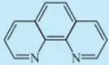</td><td></td><td> $6.9\times 10^{-10}$ </td><td>9.16</td><td> $8.9\times 10^{-10}$ </td><td>9.05</td></tr></table>

C.3 金属络合物的稳定常数

<table><tr><td>金属离子</td><td>离子强度</td><td>n</td><td> $\lg {\beta }_{n}$ </td></tr><tr><td colspan="4">氨络合物</td></tr><tr><td> $Ag^{+}$ </td><td>0.1</td><td>1,2</td><td>3.40,7.40</td></tr><tr><td> $Cd^{2+}$ </td><td>0.1</td><td>1,...,6</td><td>2.60,4.65,6.04,6.92,6.6,4.9</td></tr><tr><td> $Co^{2+}$ </td><td>0.1</td><td>1,...,6</td><td>2.05,3.62,4.61,5.31,5.43,4.75</td></tr><tr><td> $Cu^{2+}$ </td><td>2</td><td>1,...,4</td><td>4.13,7.61,10.48,12.59</td></tr><tr><td> $Ni^{2+}$ </td><td>0.1</td><td>1,...,6</td><td>2.75,4.95,6.64,7.79,8.50,8.49</td></tr><tr><td> $Zn^{2+}$ </td><td>0.1</td><td>1,...,4</td><td>2.27,4.61,7.01,9.06</td></tr><tr><td colspan="4">羟基络合物</td></tr><tr><td> $Ag^{+}$ </td><td>0</td><td>1,2,3</td><td>2.3,3.6,4.8</td></tr><tr><td> $Al^{3+}$ </td><td>2</td><td>4</td><td>33.3</td></tr><tr><td> $Bi^{3+}$ </td><td>3</td><td>1</td><td>12.4</td></tr><tr><td> $Cd^{2+}$ </td><td>3</td><td>1,...,4</td><td>4.3,7.7,10.3,12.0</td></tr><tr><td> $Cu^{2+}$ </td><td>0</td><td>1</td><td>6.0</td></tr><tr><td> $Fe^{2+}$ </td><td>1</td><td>1</td><td>4.5</td></tr><tr><td> $Fe^{3+}$ </td><td>3</td><td>1,2</td><td>11.0,21.7</td></tr><tr><td> $Mg^{2+}$ </td><td>0</td><td>1</td><td>2.6</td></tr><tr><td> $Ni^{2+}$ </td><td>0.1</td><td>1</td><td>4.6</td></tr><tr><td> $Pb^{2+}$ </td><td>0.3</td><td>1, ..., 3</td><td>6.2, 10.3, 13.3</td></tr><tr><td> $Zn^{2+}$ </td><td>0</td><td>1, ..., 4</td><td>4.4, —, 14.4, 15.5</td></tr><tr><td> $Zr^{4+}$ </td><td>4</td><td>1, ..., 4</td><td>13.8, 27.2, 40.2, 53</td></tr><tr><td colspan="4">氟络合物</td></tr><tr><td> $Al^{3+}$ </td><td>0.53</td><td>1, ..., 6</td><td>6.1, 11.15, 15.0, 17.7, 19.4, 19.7</td></tr><tr><td> $Fe^{3+}$ </td><td>0.5</td><td>1, 2, 3</td><td>5.2, 9.2, 11.9</td></tr><tr><td> $Th^{4+}$ </td><td>0.5</td><td>1, 2, 3</td><td>7.7, 13.5, 18.0</td></tr><tr><td> $TiO^{2+}$ </td><td>3</td><td>1, ..., 4</td><td>5.4, 9.8, 13.7, 17.4</td></tr><tr><td> $Sn^{4+}$ </td><td>*</td><td>6</td><td>25</td></tr><tr><td> $Zr^{4+}$ </td><td>2</td><td>1, 2, 3</td><td>8.8, 16.1, 21.9</td></tr><tr><td colspan="4">氯络合物</td></tr><tr><td> $Ag^{+}$ </td><td>0.2</td><td>1, ..., 4</td><td>2.9, 4.7, 5.0, 5.9</td></tr><tr><td> $Hg^{2+}$ </td><td>0.5</td><td>1, ..., 4</td><td>6.7, 13.2, 14.1, 15.1</td></tr><tr><td colspan="4">碘络合物</td></tr><tr><td> $Cd^{2+}$ </td><td>*</td><td>1, ..., 4</td><td>2.4, 3.4, 5.0, 6.15</td></tr><tr><td> $Hg^{2+}$ </td><td>0.5</td><td>1, ..., 4</td><td>12.9, 23.8, 27.6, 29.8</td></tr><tr><td colspan="4">氰络合物</td></tr><tr><td> $Ag^{+}$ </td><td>0~0.3</td><td>1, ..., 4</td><td>—, 21.1, 21.8, 20.7</td></tr><tr><td> $Cd^{2+}$ </td><td>3</td><td>1, ..., 4</td><td>—, 24.0, 28.6, 30.3</td></tr><tr><td> $Cu^{+}$ </td><td>0</td><td>1, ..., 4</td><td>5.5, 10.6, 15.3, 18.9</td></tr><tr><td> $Fe^{2+}$ </td><td>0</td><td>6</td><td>35.4</td></tr><tr><td> $Fe^{3+}$ </td><td>0</td><td>6</td><td>43.6</td></tr><tr><td> $Hg^{2+}$ </td><td>0.1</td><td>1, ..., 4</td><td>18.0, 34.7, 38.5, 41.5</td></tr><tr><td> $Ni^{2+}$ </td><td>0.1</td><td>4</td><td>31.3</td></tr><tr><td> $Zn^{2+}$ </td><td>0.1</td><td>4</td><td>16.7</td></tr><tr><td colspan="4">硫氰酸络合物</td></tr><tr><td> $Fe^{3+}$ </td><td>*</td><td>1, ..., 5</td><td>2.3, 4.2, 5.6, 6.4, 6.4</td></tr><tr><td> $Hg^{2+}$ </td><td>1</td><td>1, ..., 4</td><td>—, 16.1, 19.0, 20.9</td></tr><tr><td colspan="4">硫代硫酸络合物</td></tr><tr><td> $Ag^{+}$ </td><td>0</td><td>1, 2</td><td>8.82, 13.5</td></tr><tr><td> $Hg^{2+}$ </td><td>0</td><td>1, 2</td><td>29.86, 32.26</td></tr><tr><td colspan="4">柠檬酸络合物</td></tr><tr><td> $Al^{3+}$ </td><td>0.5</td><td>1</td><td>20.0</td></tr><tr><td> $Cu^{2+}$ </td><td>0.5</td><td>1</td><td>18</td></tr><tr><td> $Fe^{3+}$ </td><td>0.5</td><td>1</td><td>25</td></tr><tr><td> $Ni^{2+}$ </td><td>0.5</td><td>1</td><td>14.3</td></tr><tr><td> $Pb^{2+}$ </td><td>0.5</td><td>1</td><td>12.3</td></tr><tr><td> $Zn^{2+}$ </td><td>0.5</td><td>1</td><td>11.4</td></tr></table>