# 第四章合成生物系统

原始 PDF 第 96–143 页。

第 四 章

# 合成生物系统

## 第一节 底盘细胞的选择和合成生物系统的构建

## 一、底盘细胞的选择

设计和创建一个合成生物系统以利用简单碳源合成特定化学品、药用小分子及各类生物燃料分子等是一个复杂的系统工程，涉及特定代谢产物合成途径的设计和合成、宿主（底盘细胞）的选择与改造、代谢途径的优化与改造、人工调控等许多方面。由于生物系统的复杂性，目前还无法对合成生物系统进行全面精确的设计和改造，需要通过“设计-构建-测试-学习”（DBTL）循环对已合成生物系统进行优化和改造。

在设计人工生物系统的最初，需要根据目标产物的特性结合合成途径酶的特征，选择一个性状优良的底盘细胞。底盘细胞选择的优劣将直接影响合成生物系统设计的成败。

一个好的底盘细胞首先需要具有良好的遗传操作性和稳定性。底盘细胞往往需要进行很多的遗传改造才能成为高效的细胞工厂，因此需要有成熟的遗传改造工具、技术，以及合成生物学的各种元件和代谢工程模块。

为了减少生产成本，一个好的底盘细胞还需尽可能具备如下特征:①能够在含有廉价碳源的基础培养基中生长，比如可同时利用六碳糖和五碳糖，这样就可以利用木质纤维生物质中的所有糖类成分；②生长周期短，能够在短时间内实现生物体的快速增殖和目标产物的生产；③代谢率高，快速、高效的代谢是高生产速率和高转化率的关键；④发酵过程简单，以降低操作成本；⑤具有强大的环境适应性，如今可能耐受高温和低 pH 等不利条件和生物质预处理中的抑制剂；⑥耐受高浓度底物和产物。

常用的底盘细胞有细菌和真菌，如表 4-1 所示。

---

第四章 合成生物系统

87

表 4-1 常用的底盘细胞

<table><tr><td>名称</td><td>特征</td></tr><tr><td colspan="2">细菌</td></tr><tr><td>大肠杆菌 Escherichia coli</td><td>革兰氏阴性菌,具有遗传可操作性、有利的生长条件、良好的生物化学和生理学特征,以及通用的遗传操作工具的可用性</td></tr><tr><td>谷氨酸棒杆菌 Corynebacterium glutamicum</td><td>革兰氏阳性菌,GRAS,具有低致病性、高抗逆性,生长快速,无孢子产生,具有良好的基因编辑技术、合成生物学元件和代谢工程调控工具</td></tr><tr><td>枯草芽孢杆菌 Bacillus subtilis</td><td>革兰氏阳性菌的模式菌株,具有高安全性(GRAS),生理生化特征清晰,遗传操作简单,分泌表达能力强</td></tr><tr><td>链霉菌 Streptomyces spp.</td><td>革兰氏阳性好氧细菌。具有较为复杂的生活史,形成基质菌丝体、气生菌丝和孢子,线性基因组较大,G+C含量高,代谢多样性,是微生物药物和工业酶的重要来源</td></tr><tr><td>恶臭假单胞菌 Pseudomonas putida</td><td rowspan="2">革兰氏阴性菌,基因组信息完备,遗传操作手段及工具丰富,营养需求简单,繁殖速度快,内源代谢多样且能合成多种次生代谢产物,能耐受恶劣的环境条件和物理化学的压力,可高效降解多种芳香化合物和生物修复能力,无致病性,为环境底盘微生物革兰氏阴性光合细菌,在生物固碳、氧气进化和生物固氮方面具有重要作用,具有卓越的光合作用和生物质生产能力。Synechocystis sp. PCC 6803、Synechococcus elongatus PCC 7492 和 Synechococcus sp. PCC 7002 是其中主要的蓝细菌,并用作生物燃料的底盘细胞</td></tr><tr><td>蓝细菌 cyanobacteria</td></tr><tr><td>盐单胞菌 Halomonas spp.</td><td>革兰氏阴性菌,能在嗜盐环境中生长,可在广泛温度范围(最高可在50°C)和pH高于10的碱性条件下生存,可作为下一代工业生物技术的底盘细胞</td></tr><tr><td colspan="2">真菌</td></tr><tr><td>酿酒酵母 Saccharomyces cerevisiae</td><td>具有培养条件简单、生长繁殖快、GRAS、遗传操作工具多样及遗传背景清晰等优势,是第一个基因组被完全测序的真核生物及广泛使用的真核模式生物之一</td></tr><tr><td>毕赤酵母 Pichia pastoris</td><td>GRAS,具有非常强的转录调控系统,且在遗传操作、翻译后修饰、分泌表达、高密度培养及产物纯化回收等方面均展现了诸多优势,适合用于大规模的工业化生产。而且毕赤酵母可利用廉价甲醇</td></tr><tr><td>解脂耶氏酵母 Yarrowia lipolytica</td><td>非常规的油脂酵母,GRAS,具有独特的乙酰辅酶A/丙二酰辅酶A的供应模式及多功能的碳利用途径,是高价值次生代谢产物尤其是脂肪酸衍生物生物制造的优良宿主</td></tr><tr><td>马克斯克鲁维酵母 Kluyveromyces marxianus</td><td>是食品安全级酵母,为生长最快的真核生物,其比生长速率是酿酒酵母的2.16倍、毕赤酵母的4.44倍;生长温度高,可在37~52°C条件下生长,比酿酒酵母高10~20°C;能利用六碳糖和五碳糖;具有高蛋白质分泌能力</td></tr><tr><td>工业丝状真菌</td><td>黑曲霉和米曲霉等丝状真菌是多细胞真核微生物,代谢具有多样性,蛋白质分泌效率高,翻译后修饰能力强等</td></tr></table>

注:GRAS. generally recognized as safe，一般认为是安全的

大肠杆菌菌株易于培养，倍增时间短，可在多种生长条件下茁壮成长。最重要的是，大肠杆菌可以很容易地进行遗传操作，增强了人们研究其生理学和设计新表型的能力。人们使用大肠杆菌开发了大量的分子克隆技术和遗传工具。这些导致大肠杆菌已成为代谢工程和合成生物学的最佳底盘细胞之一。常用的大肠杆菌菌株一般被认为是无害的。如 K-12，因缺乏 O型抗原、毒力因素、定植因素及与成年人的疾病有关而被归类为风险组 1。K-12 菌是应用最多的代谢工程菌株，已被广泛用于药品、食品、化学品和燃料的生产。

谷氨酸棒杆菌由于具有生物安全（被美国 FDA 认定为 GRAS）、生长速度快、营养需求低、底物谱广等优势，被认为是生物制造的理想微生物底盘，尤其是在氨基酸工业中。新型的基因组编辑、基因表达调控、适应性进化、生物传感器等代谢工程和合成生物学使能技术的快速发展，显著加快了谷氨酸棒杆菌细胞工厂的构建和优化。谷氨酸棒杆菌缺失碳分解代谢抑制调控系统，因此能同时利用多种碳源，而且对芳香化合物具有更高的耐受性。基于此，谷氨酸棒杆菌已被改造用于氨基酸、有机酸、醇类、植物天然产物、蛋白质等 70 余种产品的生物制造，产值超过千亿元。

枯草芽孢杆菌是革兰氏阳性菌，通常认为是安全的（GRAS），具有强大的蛋白质表达系

---

88

合成生物学

统，生理生化特征清晰，遗传操作技术成熟，具备良好的基因编辑技术和工具。

酿酒酵母具有培养条件简单、生长繁殖快、通常认为是安全的（GRAS）、遗传操作工具多样及遗传背景清晰等优势。

毕赤酵母具有非常强的转录调控系统，且在遗传操作、翻译后修饰、分泌表达、高密度培养及产物纯化回收等方面均展现了诸多优势，适合用于大规模的工业化生产。而且毕赤酵母可利用廉价甲醇，使其有望成为一碳化合物生物转化的优势底盘细胞。

解脂耶氏酵母是一种非常规油脂酵母，具有高 TCA 循环和乙酰辅酶 A 通量，以及高水平游离脂肪酸和三酰基甘油。它可以利用各种疏水性和亲水性碳源生长，如糖、木质纤维素、脂肪酸、脂肪、粗甘油和乙酸盐等，其中一些是价格低廉和可再生的。解脂耶氏酵母能够在低 pH 和广泛的盐度条件下生长良好。解脂耶氏酵母的系统生物学、代谢工程和合成生物学的发展，使其成为高价值次生代谢产物尤其是脂肪酸衍生物生物制造的优良宿主。

马克斯克鲁维酵母是食品安全级酵母，已被美国 FDA 和欧盟认定、被我国列为新食品原料和可食用微生物；是生长最快的真核生物，其比生长速率是酿酒酵母的 2.16 倍、毕赤酵母的 4.44 倍；生长温度高，可在 37～52℃条件下生长，比酿酒酵母高 10～20℃；能利用六碳糖和五碳糖；具有高蛋白质分泌能力。

粗糙脉孢菌（Neurospora crassa）和构巢曲霉（Aspergillus nidulans）等模式真菌主要用于研究遗传、发育和细胞生物学基础问题。里氏木霉（Trichoderma reesei）、黑曲霉（Aspergillus niger）、土曲霉（Aspergillus terreus）、米曲霉（Aspergillus oryzae）、青霉属（Penicillium）和嗜热毁丝霉（Myceliophthora thermophila）等工业丝状真菌因其代谢多样性、蛋白质分泌效率高、翻译后修饰能力强等特点，被广泛用作生产有机酸、工业酶制剂、抗生素等大宗发酵产品的细胞工厂，尤其是近年来丝状真菌合成生物学技术、工具和基因编辑技术有较快的发展。

除上述之外，一些重要的非模式微生物也已成功作为底盘细胞用于合成化学品，如需钠弧菌（Vibrio natriegens）、运动发酵单胞菌（Zymomonas mobilis）、乳酸菌、盐单胞菌（Halomonas spp.）、 一碳利用非模式菌株杨氏梭菌（Clostridium ljungdahlii）和产乙醇梭菌（Clostridium autoethanogenum）等。

随着遗传操作技术的发展，植物如烟草、拟南芥及单细胞微藻也开始逐渐作为底盘细胞用于特定产物的生产。

## 二、合成生物系统的构建

一旦途径合成成功后，就需要将其引入到底盘细胞中构建合成生物系统，以验证其生物合成效率，并通过 DBTL 循环逐步优化，从而构建高效细胞工厂。

合成途径通常通过表达质粒、基因整合或基因置换和转座技术被引入到底盘细胞中，从而构建合成生物系统。

质粒表达系统是一种最简单的表达外源途径的手段，但质粒的不稳定性导致质粒易丢失，从而降低生产性能，而且质粒上的抗性基因的存在导致培养过程需要使用抗生素，引起抗生素环境污染问题，因此在工业生产中质粒表达系统是不允许使用的。

随着成簇的规律间隔短回文重复序列（clustered regularly interspaced short palindromic repeats，CRISPR）基因编辑技术的发展，通过同源重组技术很容易将外源途径整合到染色体的特定位点上，从而避免质粒表达的上述缺陷。大肠杆菌的 IS7、IS10、SS9、IS8 和 IS6 通常

---

第四章 合成生物系统

89

可作为途径的整合位点[1]。但需要注意整合基因的表达水平与染色体整合位置有关。

但这些特定位点整合往往只能得到一个拷贝，导致基因的拷贝数无法像质粒表达系统一样，从而引起基因表达水平因拷贝数不足而无法满足生产需求。为此，杨晟团队发展了基于CRISPR 转座酶（CAST）的多拷贝染色体整合（MUCICAT）技术，可将外源基因一次性整合在多个位点，从而增加其拷贝数[2]。大肠杆菌 K-12 衍生菌 MG1655 基因组中有 8 个拷贝的IS1、5 个拷贝的 IS3 和 3 个拷贝的 IS186，可作为整合位点。其后他们又发展了多拷贝正交MUCICAT 技术，可以将不同基因多拷贝地整合到不同位点上[3]。

## 第二节 高效细胞工厂的创制

在合成途径设计合成、定向进化及途径优化后，引入合适的底盘细胞，还需对其进行人工调控使合成途径的生物学功能充分发挥出来，经过 DBTL 循环逐步优化，创建高效的人工细胞工厂。本节将介绍从基因组层面调控适配机制的主要策略。

## 一、外源途径与宿主间的适配

## （一）表型的反馈调控进化

Chou 和 Keasling 研发了一种根据代谢物浓度反馈控制基因组突变速率的方法，以提高外源途径与基因组的适配性，该方法称为表型的反馈调控进化（feedback regulated evolution of phenotype，FREP）[4]。FREP 通过代谢物生物传感器控制突变子 mutD5 和报告基因的表达。当菌株内代谢物浓度低时，驱动突变子 mutD5 的表达，使基因组进行突变；而当菌株的代谢物浓度高时，基因组突变减速，同时报告基因表达水平也降低，这样便可挑选报告基因表达水平低的菌株作为正突变菌株。他们将突变质粒分别转化到产生酪氨酸（图 4-1A）和番茄红素（图 4-1B）的大肠杆菌中进行传代进化，快速地选育出酪氨酸和番茄红素产量分别提高了5 倍和 3 倍的突变菌。

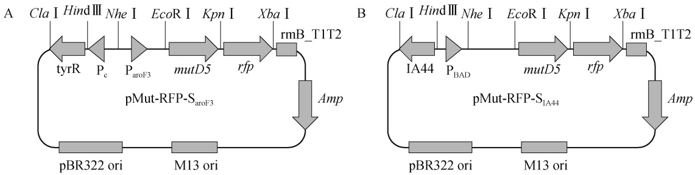

图 4-1 表型的反馈调控进化用质粒

## （二）辅因子工程

辅因子参与了细胞中大多数酶促反应，各类辅因子的平衡有助于维持细胞的正常代谢，并且会影响代谢网络和物质运输。同时，辅因子具有调节能量代谢、细胞内氧化还原状态，控制碳通量，改善线粒体功能和活性，调节细胞生命周期和微生物胞内毒性等一系列生理功能。

---

90

合成生物学

辅因子是维持细胞氧化还原平衡并驱动细胞进行合成和分解反应的关键化学物质。它们几乎参与了活细胞中发生的所有酶的活动。辅因子是酶履行其催化功能所必需的，它们与原酶结合生成整个酶，然后履行酶的正常生理职责。当这些辅因子被细胞代谢产生和消耗时，它们的氧化还原状态被破坏，导致细胞生长迟缓和生物合成减少等。在代谢产物的生物合成中，辅因子的供应量通常决定了产物的合成效率。调节辅因子的浓度和形式可以改变物质代谢通量的分布，将代谢推向最大目标产物，加速糖酵解，并保存复杂的细胞内结构。修改内源性或外源性辅因子代谢途径、辅因子之间的转换、转录因子的微调等策略可以有效地维持细胞内的氧化还原平衡，辅因子工程已经成为提高生产能力的有力工具。细胞内氧化还原状态与辅因子密切相关，通过辅因子的再生影响细胞代谢、信号转导和物质运输，从而影响细胞的生理功能。辅因子也是生物氧化还原反应的载体和能量传递的重要因素。根据化学结构和在酶催化反应中的作用，辅因子可分为三大类:①催化型辅因子，它存在于酶的活性中心，共同催化反应；②载体辅因子，经常被用作电子和原子的载体；③底物辅因子，作为合成某些特定生物小分子化合物的原料，随着反应的进行而减少。

常见的辅因子包括乙酰辅酶 A、氧化还原辅因子对［NAD(P)H/NAD(P)］和 ATP 等。乙酰辅酶 A 合成途径连接着细胞质、细胞核和线粒体中发生的各种代谢反应。它也是合成异戊二烯、脂肪酸及其衍生物、萜类化合物、黄酮类化合物及聚酮类化合物等的前体。目前乙酰辅酶 A 最常见的调控策略是对乙酸途径的调控。在大肠杆菌中过量表达乙酰辅酶 A 合成酶（ACS）不仅能降低乙酸的积累，还能提高乙酰辅酶 A 到目标代谢产物的代谢通量。过量表达ACS 以提高乙酰辅酶 A 的可用性，导致 α-酮戊二酸产量提高到 28.54g/L[5]。IclR 可抑制乙醛酸循环的表达。敲除 iclR 基因激活了乙醛酸循环，增强了乙酰辅酶 A 合成代谢通量，导致以乙酸辅酶 A 为前体的 3-羟基丙酸的产率提高了 1.9 倍[6]。

氧化还原辅因子对［NAD(P)H/NAD(P)］是重要的氧化还原偶联物，可促进许多生物合成和分解反应的电子转移。在 KEGG 数据库中，大约 25%的代谢反应是氧化还原反应，需要氧化还原辅因子参与。一般来说，NAD+/NADH 辅因子对参与分解代谢和合成代谢中的氧化反应，而 NADP+/NADPH 则需要用于合成代谢中的还原反应。细胞内[NAD+]/[NADH]和[NADP+]/[NADPH]值反映了它们各自的作用，因为[NAD+]/[NADH]值通常很高，而[NADP+]/[NADPH]值很低，尽管这些比率可以根据生长状态、环境压力和营养物质的可用性而变化很大，但总的来说，细胞内[NAD+]/[NADH]氧化还原辅因子对的浓度和比例高在热力学上有利于底物的氧化。相反，[NADP+]/[NADPH]的比例反映了它在为细胞生长和维持所需的合成代谢反应提供还原力方面的作用。细胞内 NADH 主要来自糖酵解（EMP）途径（3-磷酸甘油醛脱氢酶）、三羧酸循环（α-酮戊二酸脱氢酶、苹果酸脱氢酶）及丙酮酸脱羧反应（丙酮酸脱氢酶复合物）。NADPH 主要来自磷酸戊糖（HMP）途径（6-磷酸葡萄糖脱氢酶、6-磷酸葡糖酸脱氢酶）、TCA 循环（异柠檬酸脱氢酶）和转氢反应（PntAB），如方程（4-1）所示。其中糖酵解是合成 NADH 的主要代谢途径，HMP 途径是合成 NADPH 的主要途径。在大肠杆菌中，35%～45%的 NADPH 来自转氢酶 PntAB 催化的转氢反应，35%～45%的 NADPH 来自HMP 途径，20%～25%的 NADPH 来自 TCA 循环。由于生物合成途径往往涉及多个氧化还原反应，需要消耗 NADPH，因此提高 NADPH 供给已成为一个重要的代谢工程手段，目前主要的策略包括以下 7 种。

1）敲除或抑制竞争性途径。合成 S-腺苷甲硫氨酸需要消耗 NADPH。利用合成可溶性核糖核酸（sRNA）抑制脱氢莽草酸还原酶、N-乙酰-g-谷氨酰磷酸酯还原酶、g-谷氨酰磷酸酯还

---

第四章 合成生物系统

91

原酶、酮酸还原异构酶和吡咯啉-5-甲酸酯还原酶等 NADPH 竞争性酶使 S-腺苷甲硫氨酸产量提高了 70%[7]。

2）引入辅因子再生系统。图 4-2 总结了一些常用的辅因子再生系统。甲酸脱氢酶、磷酸盐脱氢酶、NAD 氧化酶、木糖醇脱氢酶、乳酸脱氢酶、乙醛脱氢酶和乙醇脱氢酶等已被成功用于 NADH 的再生与平衡中[8]。
3）NAD 与 NADP 间的转换。许多代谢产物的生物合成都有 NADPH 依赖型脱氢酶参与，需要消耗 NADPH。因此，提高 NADPH 的供给是一种常见的代谢工程策略。应用最广的提高NADPH 供给的策略是通过强化表达 6-磷酸葡萄糖脱氢酶（G6PD）或 6-磷酸葡糖酸脱氢酶（6PGD）来提高 HMP 途径的碳通量。有些学者也聚焦于 Entner-Doudoroff（ED）途径和 TCA循环的苹果酸酶（ME）和异柠檬酸脱氢酶（IDH）[8]。此外，还有一些学者聚焦于 NAD 和 NADP间的直接转化以实现氧化还原工程。大肠杆菌含有两种转氢酶:膜结合转氢酶 PntAB 和可溶性转氢酶 UdhA。PntAB 催化从 NADH 到 NADP+的还原力的能量依赖性转移，而 UdhA 催化反向的、与能量无关的反应，反应方程如下:

$$
\mathrm{NADH} + \mathrm{NADP} ^ {+} \longrightarrow \mathrm{NADPH} + \mathrm{NAD} ^ {+} \tag {4-1}
$$

NAD 激酶催化 NAD 的磷酸化生成 NADP。它同样成为 NADPH 再生的一个改造靶基因。在谷氨酸棒杆菌中，合成 1mol L-鸟氨酸需要 2mol NADPH。刘建忠团队在产鸟氨酸的谷氨酸棒杆菌中强化表达内源 NAD 激酶基因（ppnK）、大肠杆菌转氢酶基因（pntAB），使鸟氨酸产量分别提高了 8.5%和 23.9%[9]。在大肠杆菌中引入酿酒酵母 NAD 激酶（Pos5p）和内源 NAD激酶（YfjB）同样是一个有效的 NADPH 再生系统，提高了工程菌的合成效率[8]。

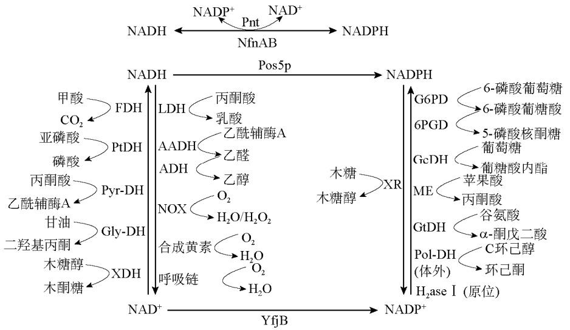

flowchart

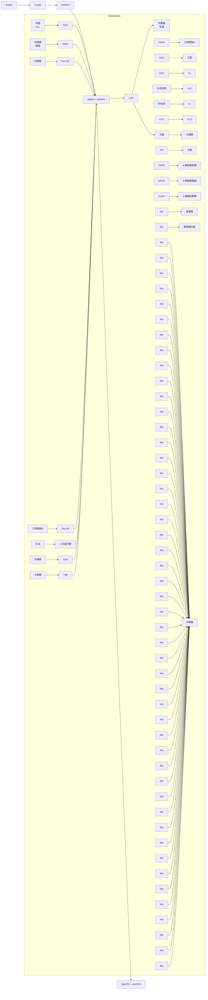

图 4-2 辅因子工程策略

Pnt. 能量依赖型或质子转移型脱氢酶；NfnAB. NADH 依赖型还原性铁氧还原蛋白-NADP+氧化还原酶；FDH. 甲酸脱氢酶；PtDH. 施氏假单胞菌亚磷酸脱氢酶；Pyr-DH. 丙酮酸脱氢酶；Gly-DH. 甘油脱氢酶；XDH. 木糖醇脱氢酶；LDH. 乳酸脱氢酶；AADH. 乙醛脱氢酶；ADH. 乙醇脱氢酶；NOX. NAD 氧化酶；XR. 木糖还原酶；G6PD. 6-磷酸葡萄糖脱氢酶；6PGD. 6-磷酸葡糖酸脱氢酶；GcDH. 葡萄糖脱氢酶；ME. 苹果酸酶；GtDH. 谷氨酸脱氢酶；Pos5p. 酿酒酵母 NAD激酶；YfjB. 大肠杆菌 NAD 激酶；Pol-DH. 多元醇脱氢酶；H2aseⅠ. 氢化酶Ⅰ

4）改变酶的辅因子依赖性。前述几个策略需要改变中心代谢，这些遗传改造可能导致意

---

92

合成生物学

外的细胞生长缺陷。氧化还原平衡同样可以通过改变辅酶的辅因子依赖性来实现。例如，利用 $\mathrm { N A D P ^ { + } }$ 依赖性酶置换 $\mathrm { N A D ^ { + } }$ 依赖性酶。刘建忠团队在产鸟氨酸的谷氨酸棒杆菌的染色体中表达 $\mathrm { N A D P ^ { + } }$ 依赖型的丙酮丁醇梭菌 3-磷酸甘油醛脱氢酶 gapC 基因 $\mathrm { N A D ^ { + } }$ 依赖型枯草芽孢杆菌谷氨酸脱氢酶 rocG 基因，从而提供更多的 NADPH 供鸟氨酸的合成，使鸟氨酸产量分别提高了 9.2%和 22.4%[10]。表 4-2 为辅因子依赖性改变的代表性酶。

表 4-2 酶的辅因子偏好性修饰[8]

<table><tr><td>酶</td><td>登录号</td><td>突变</td><td>功能</td></tr><tr><td>乙醇脱氢酶</td><td>Ca_ADHAGY74782.1</td><td>Y218A/G198D/S199V/P201E</td><td>由NADPH依赖性转变为NADH依赖性</td></tr><tr><td>乙醇脱氢酶</td><td>Ec_YjgB/AdhZ3: NP_418690.4</td><td>S199N, S200N, N201D</td><td>由NADPH依赖性转变为NADH依赖性</td></tr><tr><td rowspan="7">酮酸还原异构酶(KARI)</td><td>Ec_IlvC: NP_418222</td><td>A71S, R76D, S78D, Q110V</td><td>由NADPH依赖性转变为NADH依赖性</td></tr><tr><td>Se_KARI: D0WGK0</td><td>S61D, S63D, I95V</td><td>由NADPH依赖性转变为NADH依赖性</td></tr><tr><td>Sh_KARI: A0KS29</td><td>R76D, S78D</td><td>由NADPH依赖性转变为NADH依赖性</td></tr><tr><td>Ma_KARI: A6UW80</td><td>G50D, S52D</td><td>由NADPH依赖性转变为NADH依赖性</td></tr><tr><td></td><td rowspan="2">V48L, R49P, K52L, S53D, E59K, T182S, E320K</td><td></td></tr><tr><td>Li_KARI: Q02138</td><td>由NADPH依赖性转变为NADH依赖性</td></tr><tr><td>Aa_KARI: C8WR67</td><td>R48P, S51L, S52D, R84A</td><td>由NADPH依赖性转变为NADH依赖性</td></tr><tr><td>木糖还原酶</td><td>Ps_XR</td><td>K270R, K270M</td><td>由NADPH依赖性转变为NADH依赖性</td></tr><tr><td>木糖还原酶</td><td>Ct_XR</td><td>K274R, N276D</td><td>由NADPH依赖性转变为NADH依赖性</td></tr><tr><td>乙醛脱氢酶</td><td>Bc_ALDH</td><td>E194S, E194T</td><td>由NADH依赖性转变为NADPH依赖性</td></tr><tr><td>NADH氧化酶</td><td>Sm_NOX2</td><td>D192A, V193R, V194H, A199R</td><td>由NADH依赖性转变为NADPH依赖性</td></tr><tr><td>甲酸脱氢酶</td><td>Mv_FDH</td><td>C145S, A198G, D221Q, C225V</td><td>由 $NAD^{+}$ 依赖性转变为 $NADP^{+}$ 依赖性</td></tr><tr><td>甲酸脱氢酶</td><td>Cm_FDH</td><td>D195S</td><td>由 $NAD^{+}$ 依赖性转变为 $NADP^{+}$ 依赖性</td></tr><tr><td>D-乳酸脱氢酶</td><td>Ld_D-LDH</td><td>D176S, I177R, F178T</td><td>由NADH依赖性转变为NADPH依赖性</td></tr><tr><td>3-磷酸甘油醛脱氢酶</td><td>Cg_GAPDH</td><td>D35G, L36T, T37K</td><td>由 $NAD^{+}$ 依赖性转变为 $NADP^{+}$ 依赖性</td></tr></table>

5）提高 NAD+的合成。改善 NAD+ 的合成为调控 NADH/NAD+的稳定性提供了一种有效的策略。NAD+通过以下两条路线合成（图 4-3）:一是烟酸在烟酸磷酸核苷转移酶（PncB）作用下生成烟酸单核苷酸（NaMN），然后在 NaMN 酰基转移酶（NadD）作用下进行腺苷化生成 NaAD，最后经 NAD+ 合成酶的酰胺化生成 NAD+。另一个路径是在 NadD 作用下，烟酰胺单核苷酸直接酰胺化生成 NAD+。为了降低 NADH/NAD+值，在琥珀酸产生菌大肠杆菌NZN111 中过量表达 PncB 以促进 NAD+的合成，使琥珀酸产量、时空产率和产率分别增加了57.8%、58.4%和 58.7%[11]。
6）调控氧化还原相关转录因子。活性氧（ROS）往往会使胞内 NADPH 耗尽，导致 DNA损伤并抑制微生物的生长。NADPH 和 NADH 对大肠杆菌 ROS 的耐受性具有重要作用。经研究发现了一些与辅因子有关的转录因子，能调控胞内氧化还原平衡。Reynolds 等提出了通过增强大肠杆菌对 ROS 耐受性以提高 NADPH 供给的策略[12]。他们利用基于 CRISPR 的可追踪基因组工程（CREATE）技术对大肠杆菌基因组进行改造，选育对 ROS 的耐受菌，提高了 NADPH 的供给，最终使 3-羟基丙酸产量提高了 1 倍。而且他们经重测序发现菌株

---

第四章 合成生物系统

93

的 ROS 耐受性提高与转录因子 hdfR 的突变（E40K）有关，敲除 hdfR 同样可以增加 NADPH的供给。

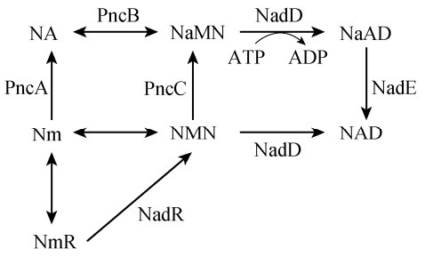

flowchart

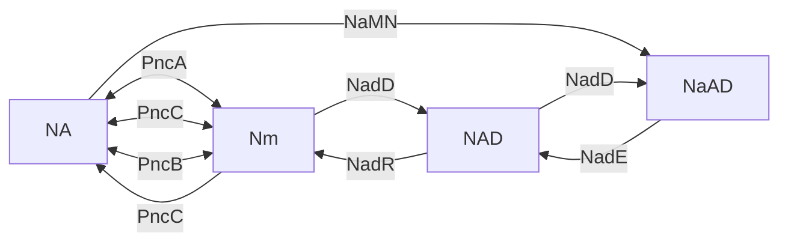

图 4-3 NAD 的合成途经

NA. 烟酸；NaMN. 烟酸单核苷酸；NaAD. 烟酸腺嘌呤二核苷酸；Nm. 烟酰胺；NMN. 烟酰胺单核苷酸；NAD. 烟酰胺腺嘌呤二核苷酸；NmR. 烟酰胺核糖核苷酸；PncA. 烟酰胺酶；PncB. 烟酸磷酸核苷转移酶；PncC. NMN 氨基水解酶；

NadD. NaMN 酰基转移酶；NadE. NAD 合成酶；NadR. 烟酰胺核糖激酶

7）CRISPR 干扰（CRISPRi）内源 NADPH 消耗相关基因的表达。大肠杆菌中有 80 个与NADPH 消耗有关的基因。如果能对这些基因进行干扰表达，便能在不影响中心代谢的前提下，提供更多的 NADPH 供产物合成使用。刘建忠团队提出了一个基于 CRISPRi 筛选的辅因子工程技术，称为 CECRiS[13]。他们应用 CECRiS 技术对大肠杆菌所有 80 个与 NADPH 消耗有关的基因进行 CRISPRi 抑制，发现对 yahK、yqjH、queF、dusA、gdhA 和 curA 进行抑制，可分别使大肠杆菌合成对羟基苯乙酸的产量提高 67.1%、45.6%、11.9%、10.0%、6.8%和 5.3%。

底物磷酸化是产生 ATP 的一个重要途径，特别是在氧化磷酸化受到限制时。在 3-磷酸甘油酸激酶和丙酮酸激酶催化的糖酵解途径中，每摩尔葡萄糖可产生 2mol ATP。由底物和氧化磷酸化产生的辅因子 ATP/ADP 可以以底物、产物、激活剂和抑制剂等多种形式进入微生物的代谢网络，控制细胞的生理功能，促进细胞骨架系统的形成。ATP 可以为几乎所有的细胞提供动力，必须创造足够的 ATP 以使细胞及其生物合成维持正常。ATP 可以调节细胞代谢的速度。糖酵解的速率由细胞总 ATP 的需求决定，而不是由糖酵解相关酶的表达水平决定。三羧酸循环中必需酶的活性在 ATP 浓度过高时会受到抑制。ATP 主要来自 EMP 途径（2mol ATP）、TCA 循环（琥珀酸 CoA 合成酶）。大肠杆菌中含有 400 个与 ATP 消耗有关的基因。如果能对这些基因进行干扰表达，便能在不影响中心代谢的前提下，提供更多的 ATP 供产物合成之用。刘建忠团队应用 CECRiS 技术对大肠杆菌所有 400 个与 ATP 消耗有关的基因进行 CRISPRi抑制，发现对 purC、araH、yeaG、sucC、dppD、artP、fecE、artM、argB、mgtA、aas、sapF、nanK、phnN、pfkA、ssuC、atpG、copA 和 hisP 进行抑制，使大肠杆菌合成对羟基苯乙酸的产量提高了 9%～38%[13]。

## （三）氧化应激工程

细胞生命活动过程中会产生大量的 ROS，ROS 与胞内抗氧化间的不平衡将形成氧化压力，引起 DNA 损伤而抑制细胞的生长。为了避免细胞的这种氧化应激损伤，将诱导合成更多的氧化型代谢产物。据此，刘建忠团队提出了一种氧化应激策略来提高氧化型目标产物的合成[14]。他们应用 CRISPRi 技术对大肠杆菌内源的氧化应激蛋白和抗氧化酶基因进行抑制，发

---

94

合成生物学

现抑制 uspE、yggE、fadH、oxyR、tpx、ychF、yqhD、btuE、gshA、gshB、sodA、katE 和 katG能明显地增加大肠杆菌合成虾青素的产量。为了避免使用 CRISPRi 的质粒，对氧化应激有关基因进行敲除，虽然能提高虾青素产量，但会抑制细胞生长。为此，他们又利用温敏型质粒，在 uspE、yggE 基因敲除菌中表达这两个基因；在发酵初期回补表达这两个基因使生长得到了恢复，在后期升温去除质粒，最终使虾青素产量提高了 25.2%。

## 二、基因组改组

2002 年，美国 Maxgen 公司的 Stemmer 和 del Cardayré 及其同事在 DNA 改组技术的基础上，提出了基因组改组（genome shuffling）技术[15]。它把传统的诱变与细胞融合技术相结合。具体来说，基因组改组首先需要通过诱变育种得到目的性状改变的正突变菌株，以构成所需的基因组文库；随后通过原生质体融合将这些正突变菌株的全基因组进行随机重组，并筛选目的性状得到进一步改进的菌株来进行下一轮基因组改组，这样通过多亲株的递推式融合（recursive fusion）可以快速、高效地选育出表型得到较大改进的杂交菌种。基因组改组的关键:一是创建各种不同正突变的基因组文库，二是高通量筛选。邢新会团队开发了一个常压室温等离子体（ARTP）装备，它是一种快速、有效和环境友好的诱变仪，能够产生突变率和生物多样性高的微生物突变菌株库[16]。利用 ARTP 诱变将快速、高效地创建基因组改组的正突变基因组文库。近年来随着合成生物学的发展，越来越多的代谢产物生物传感器创建成功，这为基因组改组的高通量筛选提供了可能，推动了基因组改组在人工微生物创建中的应用。刘建忠团队提出了 ARTP 诱变与生物传感器介导的基因组工程育种策略[17]。他们首先通过ARTP 诱变和实验室适应性进化提高大肠杆菌对 4-羟基苯乙酸的耐受性，然后经过两轮的基因组改组，借助 4-羟基苯乙酸传感器的高通量筛选，使细胞生长速率和 4-羟基苯乙酸的产量分别提高了 25%和 127%。

## 三、基于易错 PCR 的全基因组改组

为了解决传统基因组改组需要多个亲株用于递推式融合的问题，吴金川团队提出了一种基于易错 PCR 的全基因组改组（ep-whole genome shuffling，epWGS）策略[18]。其具体过程是利用多对随机引物对出发菌基因组进行易错 PCR，然后将各种 epPCR 产物混合，并在重组酶作用下与宿主菌进行同源重组，筛选目的性状得以改进的改组菌。刘建忠团队利用 ARTP 诱变与生物传感器介导的基因组工程育种策略选育了高产莽草酸的大肠杆菌[19]。他们首先利用ARTP 诱变结合莽草酸生物传感器选育出 8 株正突变菌株进行基因组改组，获得一株正突变改组菌进行易错 PCR 的全基因组改组，最后获得一株进化菌，其生长速率和莽草酸产量分别提高了 2.0 倍和 2.7 倍[19]。

## 四、多重自动基因组工程

哈佛医学院 Wang 等在 2009 年 8 月的 Nature 杂志上发表了多重自动化基因组工程（multiplex automated genome engineering，MAGE）技术[20]。它是基于 λ 噬菌体 Red（λ-Red）

---

第四章 合成生物系统

95

同源重组系统的基因组工程技术，可对细胞染色体上的多个基因或位点进行修饰，方式多样，可以是插入、错配或缺失，产生多种多样的基因突变菌株。完整的 MAGE 循环如图 4-4 所示。首先培养大肠杆菌至对数期中期，升温至 42℃，诱导 λ-Red 重组酶的表达；离心收集菌体制备电击感受态细胞；加入人工合成的单链 DNA（ssDNA）进行电击转化；复苏进入下一轮循环。

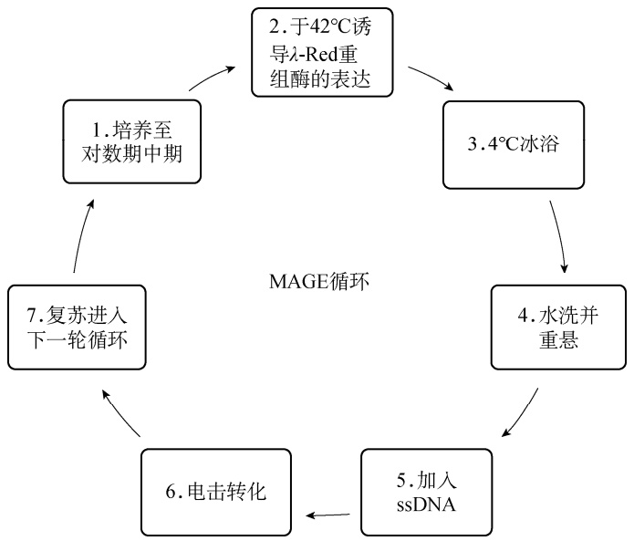

flowchart

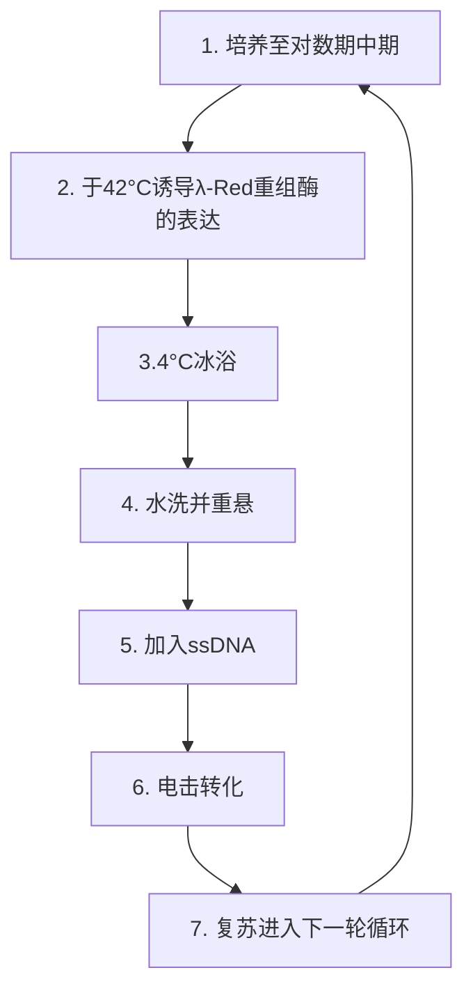

图 4-4 MAGE 循环

随后 Gallagher 等在 Nature Protocol 上介绍了 MAGE 的手动执行详细步骤[21]。MAGE 循环涉及 ssDNA 的电穿孔转化，然后是生长，其间噬菌体 λ-Red 同源重组蛋白介导 ssDNA 与其基因组目标的退火；通过反复引入针对多个位点的突变 ssDNA 库，实现细胞染色体上的多个基因或位点修饰。MAGE 利用噬菌体同源重组蛋白对细菌染色体上的多个基因组位点进行定向、快速、无痕的修饰。其核心是 ssDNA 的设计。其被设计成具有 5′和 3′端同源臂，与基因组中目标序列互补。5′和 3′端同源臂侧翼对应于指定突变的序列。在该区域中，合成的 ssDNA可以相对于靶区域跳过碱基、错配或添加碱基，从而分别引起缺失、错配或插入。ssDNA 的设计原则是:①总长 90nt。②具有 5′和 3′端同源臂，与基因组中目标序列互补。③5′端 2 个碱基进行硫代磷酸修饰。④当突变基因在复制弧（replichore）1（+）链或复制弧 2（−）链时，ssDNA 序列应与靶基因反向互补；当突变基因在复制弧 1（−）链或复制弧 2（+）链时，ssDNA序列应与靶基因相同，如图 4-5 所示。⑤可通过突变 RBS 序列调控基因的表达水平，如采用简并 RBS 序列（DDRRRRRDDDD；D = A，G，T；R= A，G）。⑥在编码区引入 2 个终止密码子使所编码的酶失活。

魏韬等选择 L-DOPA 合成途径的 23 个靶基因进行了 30 个循环的 MAGE，使 L-DOPA 产量提高了 34%[22]。

---

96

合成生物学

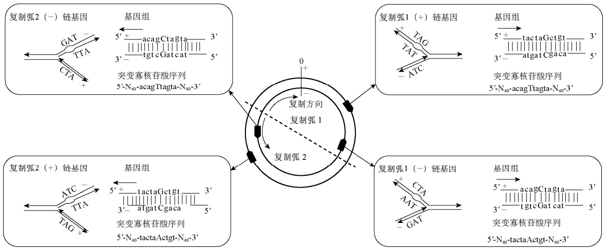

flowchart

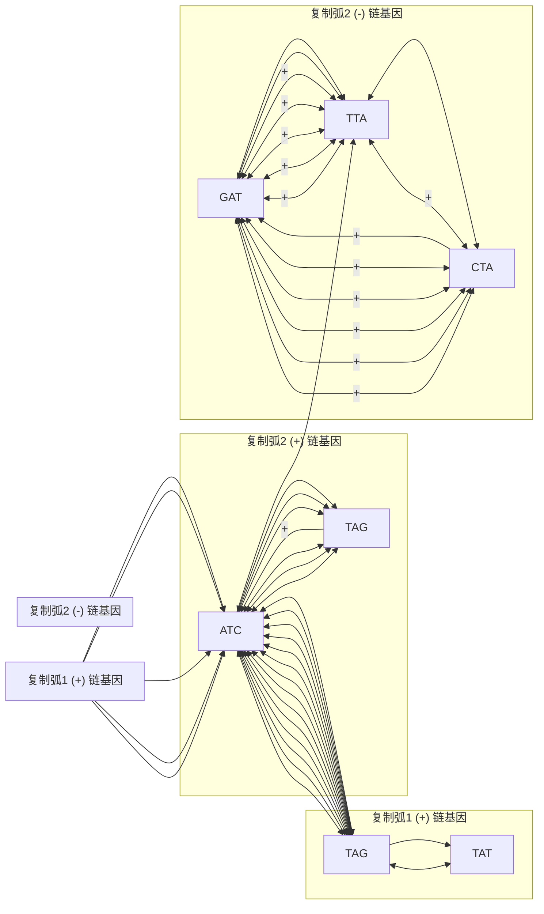

图 4-5 ssDNA 的设计[21]

大写字母表示突变碱基

## 五、化学诱导染色体进化

质粒表达系统是最常用的引入合成基因线路构建人工生物系统的一种方式。但是质粒表达系统往往存在质粒不稳定、质粒上的抗生素抗性基因引起的需使用抗生素及所引起的抗生素污染问题，因此这种质粒表达系统禁止在工业生产中应用。为了克服质粒表达系统的这种缺陷，往往将人工合成基因线路整合到宿主菌的染色体上。但是这种染色体整合只能得到单拷贝的基因剂量，往往无法满足高效合成的目的。为此，Tyo 等于 2009 年在 Nature Biotechnology 上报道了一种化学诱导染色体进化（chemical inducible chromosomal evolution，CIChE）技术[23]。CIChE 是一种用于大肠杆菌的无质粒、高拷贝的表达系统。它使用大肠杆菌的 recA 同源重组来进化染色体以获得多拷贝途径，当达到所需途径拷贝数后，敲除 recA 基因而稳定拷贝数。所构建的工程菌不需要使用选择性压力（抗生素）、不受质粒不稳定的影响。

CIChE 流程如图 4-6 所示。CIChE 的 DNA 盒包括目标基因（黑色）和选择性标记基因（蓝色）及两侧相同的 1kb 的同源区（红色，非编码的外源片段，而且与大肠杆菌基因组的同源性很低）。CIChE 的 DNA 盒按常规方法整合到大肠杆菌的染色体上。在基因组复制过程中，在 RecA 的作用下，发生同源交叉重组，即一条 DNA 链的前导同源区与另一条 DNA 链的后导同源区进行交叉重组，其结果是一个子细胞含有 2 个拷贝的 DNA 盒。这个过程将重复进行直至 recA 敲除。为此，在这个复制过程中，可以通过逐步提高抗生素的选择性压力而增加基因的拷贝数。随着抗生素选择性压力的增加，只有更高拷贝数的细胞才能存活。在染色体进化到所需拷贝数后，敲除 recA 基因，阻止 CIChE 的 DNA 盒的继续进化。

Tyo 等起初的 CIChE 采用的选择性标记基因是氯霉素抗性基因。虽然在工程菌发酵培养过程中不需要使用抗生素，但发酵废菌体仍然含有抗生素抗性基因，排放后仍然会引起环境的抗生素污染，增加出现超级细菌的风险。为此，刘建忠团队利用三氯生抗性基因 fabI 取代Tyo 等的 CIChE 的氯霉素选择性标记基因，建立了三氯生诱导染色体进化技术，所构建的工程菌不仅实现了高表达，而且培养过程不需要使用抗生素，菌体细胞也不含抗生素抗性基因，不会引起抗生素的环境污染。他们应用三氯生诱导染色体进化技术构建了无质粒、无抗生素

---

第四章 合成生物系统

97

抗性标记遗传稳定的产番茄红素[24]和莽草酸[25]的工程化大肠杆菌。

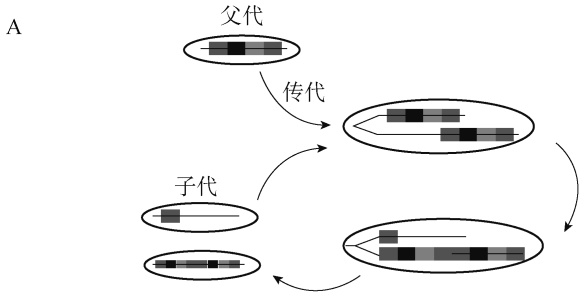

flowchart

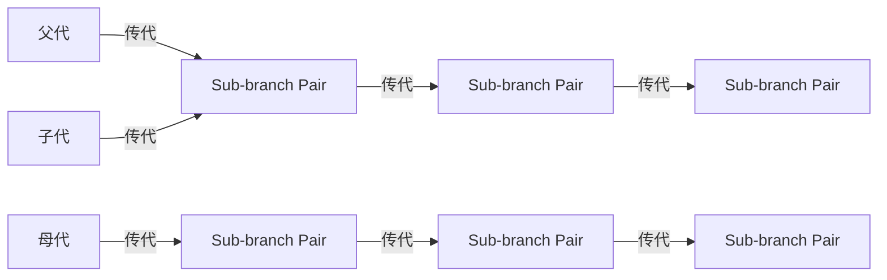

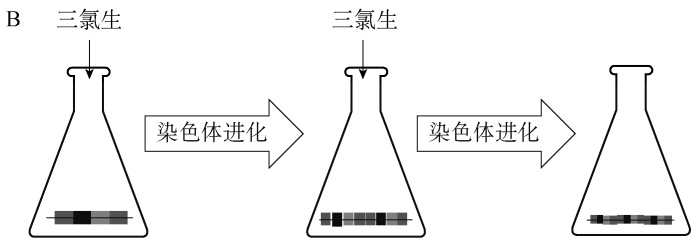

flowchart

图 4-6 化学诱导染色体进化

彩图

A. 细胞分裂；B. 三氯生诱导染色体进化过程

## 六、基于 CRISPR 的可追踪基因组工程

虽然 MAGE 可以对多个基因组位点进行定向、快速、无痕的修饰，但是其编辑效率低（低于 30%）、无法对广泛目标进行突变，以及难以追踪组合基因型，从而限制了其更广泛的应用。为此，科罗拉大学博尔德分校的 Gill 团队于 2017 年在 Nature Biotechnology 上报道了基于CRISPR 的可追踪基因组工程（CRISPR-enabled trackable genome engineering，CREATE），它是一种结合了 CRISPR 编辑和 DNA 条形码的技术，从而实现对大肠杆菌基因组的大规模多重和可追踪编辑[26]。随后，他们又提出了迭代基于 CRISPR 的可追踪基因组工程（iCREATE），以方便像 MAGE 一样进行多轮的基因组编辑[27]。

CREATE 方法涉及 λ-Red 蛋白的同源重组、化脓性链球菌 Cas9 蛋白和 CREAT 质粒编辑盒。CREATE 的独特之处在于其向导 RNA 和编辑盒中的编辑模板，这导致在基因组的任何位置都能进行有效的编辑，并包含一个可追踪的条形码，这使得在编辑群体中的所有突变体能同时被映射出来。iCREATE 允许以递归的方式使用 CREATE。

CREATE 盒包括一个向导 RNA 和一个同源臂，作为基因组切割位点进行同源重组的模板，在染色体位点引入突变。gRNA 引导 Cas9 在 PAM 位点切割基因组。为了消除 Cas9 对同源臂及同源修复后在编辑位点的切割，需对同源臂的 PAM 序列进行同义突变。具体来说，CREATE 盒包括 18bp 引物序列（P1）、100bp 同源臂、4nt 间隔序列（如 GATC）、35nt 的 J23119组成型启动子、20nt 靶向互补序列和 24nt 的化脓性链球菌标准 gRNA 的 5′端序列，如图 4-7所示。他们开发出了一个在线工具用以 CREATE 盒的设计。

---

98

合成生物学

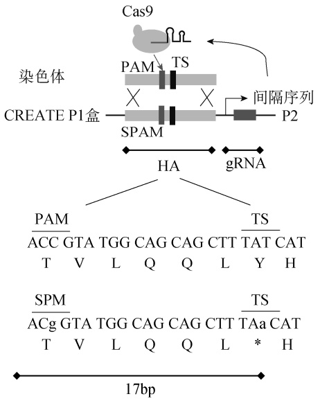

text_image

Cas9
染色体
CREATE P1盒
PAM TS
X X
SPAM
间隔序列
P2
HA gRNA
PAM TS
ACC GTA TGG CAG CAG CTT TAT CAT
T V L Q Q L Y H
SPM TS
ACg GTA TGG CAG CAG CTT TAa CAT
T V L Q Q L * H
17bp

图 4-7 CREATE 盒

小写字母表示突变碱基

他们通过对多个基因靶点的敲除、RBS 工程的表达水平改造和基因组水平的位点饱和诱变等 13 轮 iCREATE 组合改造，使大肠杆菌合成 3-羟基丙酸产量提高了 60 倍[27]。

## 七、进化工程

将外源途径引入异源宿主后，合成的目标产物往往对异源宿主具有很高的毒性，从而抑制细胞的生长。进化工程一直是模仿自然进化过程，但以更高的速度和效率改善菌株或生物成分（如蛋白质）表型的常用方法。进化工程包括定向进化和适应性实验室进化（ALE）。这两种技术的原理都是从随机产生的突变体中选择具有所需表型或特征的菌株或蛋白质。定向进化主要涉及蛋白质，而 ALE 则适用于细胞。进化工程的关键是大规模的基因多样化，然后对生成的库进行快速筛选。ALE 是进化工程一个强有力的方法（图 4-8）。自动连续培养也可以在较小的多微孔板或试管中进行，实现大规模的平行实验。由于进化工程的成功取决于突变产生的群体异质性，前面介绍的各种基因组工程方法已被应用于增加突变文库的遗传多样性。近年来发展起来的微流控进化是一种全自动的进化系统，省却了人工操作，可以快速、自动化地获得突变文库。进化工程成功的另一个关键是从突变文库中快速筛选获得所需要的表型。因为通过 ALE 获得的耐受菌并不一定是高产菌。随着合成生物学的发展，人们创建了许多代谢产物的生物传感器，应用这些生物传感器便能通过深孔板培养、酶标仪高通量地从突变文库中筛选得到产量提高的进化菌。最近发展起来的基于液滴微流控技术开发成功的液滴微流控细胞分选（droplet entrapping microfluidic cell sorting）和单细胞拉曼分选技术，结合生物传感器将有力推动进化工程的发展。

---

第四章 合成生物系统

99

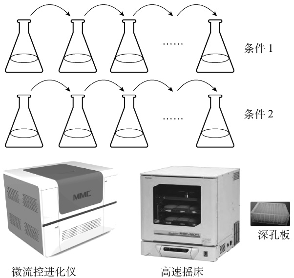

flowchart

图 4-8 适应性实验室进化

刘建忠团队在生物传感器介导的基因组工程育种过程中，通过 ARTP 诱变和实验室适应性进化提高了大肠杆菌对 4-羟基苯乙酸的耐受性，借助 4-羟基苯乙酸传感器的高通量筛选，获得了 8 株耐受 35g/L 4-羟基苯乙酸且产量得以提高的正突变菌株，作为基因组改组的亲本[17]；最后经过两轮的基因组改组，使细胞生长速率和 4-羟基苯乙酸的产量分别提高了25%和 127%。

## 八、动态调控

将外源途径引入异源宿主后，与宿主生长竞争各种代谢资源，产生代谢负担和毒性产物，这些都将抑制细胞的生长，限制产物的合成。工程代谢途径通常采用组成型或诱导型启动子控制。外源途径对宿主细胞的这些影响往往是静止、恒定的。如果能根据细胞生长状态对代谢途径进行动态调控，便可根据细胞新陈代谢状态控制代谢途径的表达，从而最大限度地减轻代谢途径对异源宿主的影响，促进目标产物的合成。

图 4-9 为目前主要的动态调控策略。主要包括[28]:①代谢波动开关，在生长初期碳代谢流向生长途径支持细胞的生长；生长到一定时间后，添加诱导剂驱使代谢流转向产物合成途径，合成产物（图 4-9A）。②温度控制，在 $3 0   \mathrm { ^ \circ C }$ 培养时， $C 1 8 5 7 _ { \mathrm { t s } }$ 蛋白与 $\mathrm { P _ { R } / P _ { L } }$ 启动子结合，阻遏下游合成途径的表达；在获得足够生物量后，将培养温度升高至 42℃，此时 $\mathrm { C I 8 5 7 _ { t s } }$ 蛋白与 $\mathrm { P _ { R } / P _ { L } }$解离，驱使下游合成途径的表达，合成目标产物（图 4-9B）。③光控制（图 $4 - 9 C ) _ { \circ }$ 。④酸碱控制，在培养初期，控制 pH 大于 5.0，使 $\mathbf { P _ { g a s } }$ 启动子失活，阻遏下游合成途径的表达；在获得足够生物量后，将 pH 控制在低于 5.0，此时驱使下游合成途径的表达，合成目标产物（图 4- $9 \mathrm { D } \; ) _ { \circ }$ ⑤群体感应，随着细胞生长，esaI 合成的群体信号分子 AHL 逐渐增多，当其达到阈值时，AHL 与 esaR 结合，使其从 $\mathrm { P _ { e s a S } }$ 解离，驱动下游基因的表达（图 4-9E）。⑥代谢物生物传感器控制（图 4-9F）。⑦CRISPRi 控制系统，在诱导剂诱导后，sgRNA-A1 NT 表达，与 $\mathbf { d } \mathbf { C } \mathbf { a } \mathbf { s } 9$结合，抑制 $\mathbf { P } _ { \mathrm { A 1 } }$ 启动子使 sgRNA-A2 NT 不表达，导致合成途径表达、合成产物，同时表达sgRNA-A3 NT，抑制竞争途径。图 4-9A～D 为两阶段动态调控，将细胞生长与产物合成分成

---

100

合成生物学

两个阶段进行动态调控；图 4-9E～G 为连续动态调控，根据细胞生长自动进行动态调控。

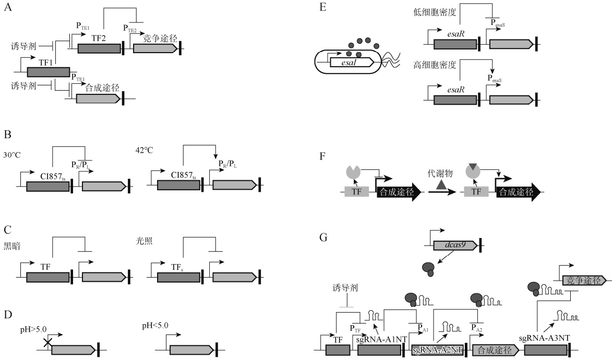

图 4-9 动态调控策略

A～D. 两阶段动态调控；E～G. 连续动态调控

刘建忠团队构建了同时具有激活和抑制功能的群体感应系统，利用群体感应激活系统调控 4-羟基苯乙酸合成功能途径以减轻 4-羟基苯乙酸对大肠杆菌的毒性，用群体感应抑制系统调控生长必需基因的表达以避免基因敲除引起的营养缺陷，从而构建了具有双重功能的群体感应系统，使工程菌对 4-羟基苯乙酸的产量达到了 28.57g/L[13,17]。

## 第三节 无细胞生物合成系统

## 一、概论

随着代谢工程和合成生物学的发展，微生物作为细胞工厂已能合成许多天然产物，有些实现了规模化生产。但是一些天然产物及代谢中间产物对微生物细胞的高毒性、传质限制、生长与产物合成竞争生物资源，这些都将是导致产率低、无法实现工业化规模生产的原因。为了解决这些细胞体内的问题，最近发展的无细胞生物合成系统，正在成为下一代生物制造强大的系统。

无细胞生物合成系统是不需要活细胞的合成生物学手段，通过体外实现并控制基因转录和蛋白质翻译，从而人工设计出新的具有生物学功能的产品或体系。简单来说，就是在体外实现生物学中心法则，利用转录和翻译所需要的成分，添加外源 DNA 模板，在体外进行转录、翻译，从而合成蛋白质或小分子物质。

---

第四章 合成生物系统

101

它的基本操作流程是:先获取细胞中转录和翻译所需要的基本组分，然后在体外添加DNA 模板以维持基因转录、蛋白质翻译或代谢过程运转，从而合成目标产品（蛋白质、小分子物质等），如图 4-10 所示。无细胞合成系统是没有细胞膜的开放体系，没有复杂的激活作用，也无须保持 DNA 遗传的能力。该系统的特点是可以将目的基因在体外快速转录、翻译为目的蛋白，并且只专注于目标代谢网络，清除物理障碍（允许简单的基质添加、产物移除和快速取样）。它的这种简单性、开放性和易放大性的特性，减少了生产生物制品过程中对细胞的依赖，拥有了更大的自由度，可与其他学科和技术手段任意融合。

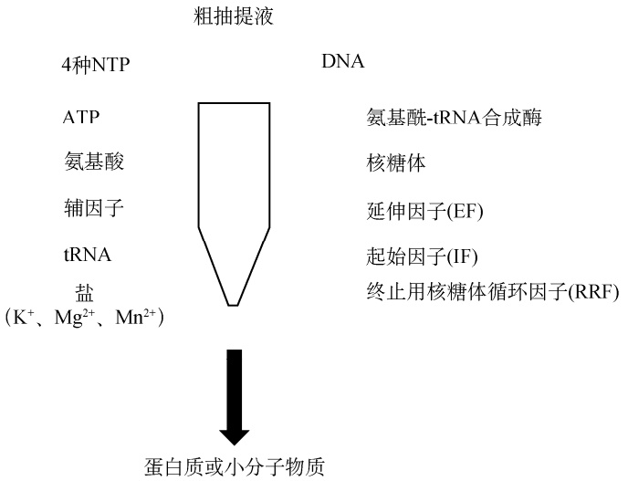

flowchart

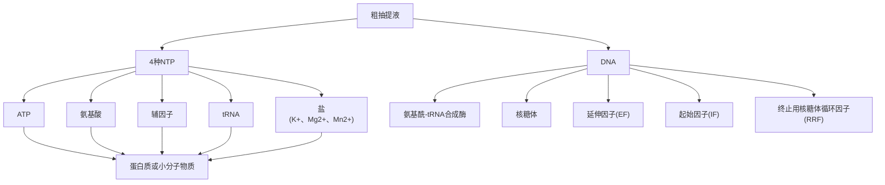

图 4-10 无细胞合成系统

无细胞合成系统的典型特点如下。

1）除去细胞膜，可以直接调控细胞内部的生物活动。
2）除去天然基因组 DNA，消除了不需要的基因调控，也消除了细胞生长的相关需求，避免了细胞生长和细胞产物之间的竞争，使合成效率和效益最大化。
3）具有开放的操作系统，易于添加底物、去除产品，可快速地对系统进行检测和快速取样分析。

无细胞合成系统包括无细胞蛋白质合成系统和无细胞生物合成系统两大类。

无细胞蛋白质合成系统已成功用于医药蛋白（疫苗、抗体、抗菌肽等）和酶的合成。其中膜蛋白合成是无细胞合成系统的主要应用领域之一。膜蛋白占所有潜在药物靶标的 3/4，然而由于其复杂的结构，在细胞内进行过量表达时，会存在构象折叠等问题，容易形成包涵体。在无细胞体系中可直接控制膜蛋白的合成和折叠，通过直接添加分子伴侣、表面活性剂或脂质体，防止膜蛋白多肽的聚集，从而辅助结构折叠且保持完整性；通过直接调节氧化还原环境，以形成正确的二硫键。因而，无细胞合成已成为膜蛋白合成非常有效的技术手段。另外，因为具有不涉及细胞生长和易控制蛋白质构象折叠的优势，无细胞合成系统特别适用于高量表达对细胞有毒性的蛋白质和复合蛋白质的合成。

无细胞蛋白质合成系统目前另一大关注点是非天然氨基酸的嵌入。通过将带有丰富侧链的非天然氨基酸在蛋白质中的嵌入及翻译后修饰，为新型结构和功能蛋白质的应用科学研究拓展给予了新的契机。目前常用的嵌入手段是在细胞体系中，采取全局抑制（global

---

102

合成生物学

suppression）、正交翻译体系（orthogonal translation system）等策略。而在细胞体系中，很多因素限制了非天然氨基酸的高效嵌入，使得在产业化方面发展不甚理想，主要问题包括:复杂代谢造成低的嵌入效率；大基团非天然氨基酸因为低的细胞膜渗透性，无法进入细胞内部；高浓度非天然翻译元件引起细胞毒性等。而面对这些问题，利用无细胞合成系统的优势，包括无复杂代谢，只专注于目标产品合成；无细胞膜；高细胞毒性忍耐性等，可以更容易克服细胞体系存在的问题。

无细胞生物合成系统用于合成小分子，正在成为下一代生物制造强大的系统。无细胞生物合成系统通常将产物合成与细胞生长（生物催化剂的合成）分割开。与含细胞的生物合成系统相比，具有如下优势:①即插即用，采用混合-配对策略很容易筛选途径酶，对途径进行优化；②因没有细胞膜而不存在传质的限制；③因没有细胞而不存在毒性前体、中间物和产物的毒性约束；④反应条件开放、简单，只需满足产物合成条件即可，不必考虑生长条件，如严格无菌要求；⑤高转化率和产率，由于没有竞争性途径存在，原料只能在途径酶的催化作用下生成单一产物，导致转化率和产率高；⑥没有微生物引起的环境污染问题。

## 二、无细胞蛋白质合成

无细胞蛋白质合成（cell-free protein synthesis，CFPS）是利用转录和翻译所需要的基本组分、DNA 模板、氨基酸等，在体外进行转录、翻译，合成蛋白质的过程。

无细胞蛋白质合成需要转录和翻译所需要的各种组分、DNA 模板和氨基酸等，包括蛋白质、核糖体和小分子化合物三大类。其中蛋白质主要用于转录、翻译和能源再生，包括延伸因子、起始因子和各种氨基酰-tRNA 合成酶等 36 种蛋白质。小分子化合物包括盐、缓冲液、4 种 NTP、磷酸肌酸和亚叶酸。

根据无细胞系统中蛋白质来源不同，无细胞蛋白质合成分为纯无细胞合成系统和粗抽提液无细胞合成系统。所谓的纯系统（“PURE”system）就是利用各种事先纯化好的蛋白质进行体外蛋白质合成的系统。大肠杆菌纯无细胞系统包括 36 种蛋白质，如 3 个翻译起始因子（IF1、IF2 和 IF3）、3 个翻译延伸因子（EF-G、EF-Tu 和 EFT）、3 个翻译释放因子（RF1、RF2 和 RF3）、终止因子（RRF）、20 个氨基酰-tRNA 合成酶（ARS）、甲硫氨酰 tRNA 转甲酰基酶（MTF）、T7 RNA 聚合酶和核糖体。除此之外，系统还包括 tRNA、NTP、磷酸肌酸、10-甲酰基-5,6,7,8-四氢叶酸二钠盐、20 种氨基酸、肌酸激酶、肌激酶、核苷二磷酸激酶和焦磷酸酶。

## （一）纯系统

2001 年，Shimizu 等首先在 Nature Biotechnology 上报道了纯系统进行无细胞蛋白质合成，即利用纯化的重组元件构建无细胞蛋白质合成系统[29]。目前纯系统已由 NEB 公司商业化生产。随着对系统的逐步优化，经历了 PUREx-press、TraMOS PURE、PUREfrex kit，到最近的OnePot PURE，成本也已由起初的 1.36 美元/mL 降到 0.09 美元/mL。

OnePot PURE 具体操作[30,31]:①一锅法表达蛋白质纯化，所有 36 种蛋白质培养表达后，混合、离心收集菌体、细胞破碎、纯化，从而制备纯化蛋白质；整个过程耗时 3 天。②制备核糖体，可分别采用 His-标签纯化和无标签纯化技术；耗时 3 天。③按浓度要求配制能量溶液。④将上述所有组分与模板 DNA 混合在一起，在 37℃条件下反应 20h，进行无细胞蛋白质合成。

---

第四章 合成生物系统

103

## （二）基于细胞抽提液无细胞系统

虽然纯系统成本已大幅降低，但酶的纯化及需要添加各种辅因子仍然限制了其应用。为此，美国西北大学的 Jewett 等提出了基于细胞抽提液无细胞系统。基于细胞抽提液无细胞系统具有如下三个优点:一是与纯系统相比，不须纯化，使制备成本较低；二是抽提液存在辅因子再生系统；三是抽提液存在天然的代谢活性。

细胞抽提液无细胞蛋白质合成的基本流程如图 4-11 所示。首先进行细胞的大量培养；然后在低温条件下离心收集菌体；接着进行预处理提高细胞破碎效果；其后将菌体重悬在裂解液中进行细胞破碎，进行后处理去除细胞碎片；最后加入到无细胞蛋白质合成反应液中进行无细胞蛋白质合成。

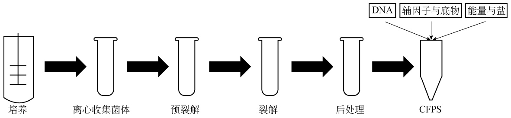

flowchart

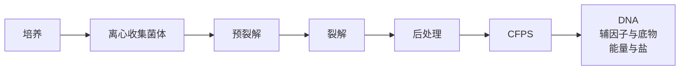

图 4-11 细胞抽提液无细胞蛋白质合成的基本流程

目前已成功开发了许多生物抽提液系统，如大肠杆菌、恶臭假单胞菌、链霉菌、巨大芽孢杆菌、枯草芽孢杆菌、古细菌、酿酒酵母、毕赤酵母、烟草细胞、小麦胚芽、昆虫、中国仓鼠细胞（CHO）、HeLa 细胞和兔网织红细胞等。这些系统存在各自的优缺点，可根据目的蛋白类型选择合适的抽提物。一些非模式细胞的抽提物无细胞系统虽然还没开发或广泛应用，但未来极有可能成为无细胞系统快速创新单位源泉。

大肠杆菌因其生长速度快、易于培养、具有清楚的遗传背景等原因，已成为构筑应用最为广泛的 CFPS 系统。大肠杆菌抽提液无细胞蛋白质合成系统由 33%（V/V）大肠杆菌抽提液和 66%（V/V）含营养物质的反应缓冲液组成。大肠杆菌抽提液无细胞蛋白质合成系统已越来越成熟，该系统菌株培养周期短，裂解液制备简单，能够高通量地表达蛋白质，目前分批培养时蛋白质表达水平已达 4g/L[32]。

美国西北大学 Jewett 团队建立了用于代谢工程的高活性大肠杆菌抽提液的制备方法，详见Methods in Enzymology [33]。简单来说，培养诱导表达目标途径酶、离心收集菌体并用冷 S30 缓冲液［10mmol/L Tis-乙酸（pH 8.2）、14mmol/L 乙酸镁、60mmol/L 谷氨酸钾、2mmol/L 二硫苏糖醇］洗涤 2～3 次，按每克湿菌体 1mL S30 缓冲液的比例重悬菌体，超声破碎，于 12 000×g、4℃条件下离心去除细胞碎片，按每管 100～200mL 分装于 1.5mL 离心管中，液氮速冻并于−80℃保藏。抽提液可在−80℃保存一年，而且至少可以进行 5 次的反复冻融而不会受损。

随后，Jewett 团队建立了基于大肠杆菌抽提液的 CFPS 系统。该系统利用磷酸烯醇式丙酮酸（PEP）为能源物质，其 CFPS 反应液包括 1.2mmol/L ATP、0.850mmol/L GTP、0.850mmol/L UTP、0.850mmol/L CTP、31.50µg/mL 叶酸、170.60µg/mL tRNA、0.40mmol/L NAD、0.27mmol/L CoA、4.00mmol/L 草酸、1.00mmol/L 丁二胺、1.50mmol/L 亚精胺、57.33mmol/L HEPES 缓冲液、10mmol/L 谷氨酸镁、10mmol/L 谷氨酸氨、130mmol/L 谷氨酸钾、每种天然氨基酸浓度为2mmol/L 的混合液、0.03mol/L 磷酸烯醇式丙酮酸、33.3%（V/V）大肠杆菌抽提液。详细步骤

---

104

合成生物学

参见 Levine 等发表在 Journal of Visualized Experiments 上的文献[34]。

美国加州理工大学又提出了基于 3-磷酸甘油醛（3-PGA）的大肠杆菌抽提液的 CFPS 系统，其 CFPS 反应液包括蛋白质浓度为 8.9～9.9mg/mL 的抽提液、4.5～10.5mmol/L 谷氨酸镁、40～160mmol/L 谷氨酸钾、1mmol/L 二硫苏糖醇、1.5mmol/L 天然氨基酸、1.25mmol/L 亮氨酸、50mmol/L HEPES、1.5mmol/L ATP 和 GTP、0.9mmol/L CTP 和 UTP、0.2mg/mL tRNA、0.26mmol/L CoA、0.33mmol/L NAD、0.75mmol/L cAMP、0.068mmol/L 叶酸、1mmol/L 亚精胺、30mmol/L 3-磷酸甘油醛、2% PEG-8000。详细步骤参见 Sun 等发表在 Journal of Visualized Experiments 上的文献[35]。随后，他们在反应体系中增加 60mmol/L 麦芽糊精和 30mmol/L D-核糖作为能量物质，建立了 3.0 版本的 CFPS 系统，使分批培养时 CFPS 的蛋白质表达水平达 4g/L[32]。

然而，大肠杆菌抽提液 CFPS 系统缺乏翻译后修饰系统、内源膜结构和有效的分子伴侣，使其合成真核蛋白具有局限性，因此需要开发其他的提取物系统。

酿酒酵母作为重要的模式生物和微生物细胞工厂，已广泛应用于代谢工程和合成生物学研究中。酿酒酵母抽提物因制备简单，能够实现翻译后糖基化修饰和正确折叠，是真核 CFPS系统的重要底盘细胞。酿酒酵母抽提物制备的基本流程为:将酿酒酵母通过离心使细胞沉淀，用甘露醇缓冲液洗涤培养；之后再用甘露醇缓冲液洗涤 3 次，去除多余的培养基，将细胞沉淀、重悬至裂解液中，然后用玻璃珠搅拌或均质器进行细胞裂解；随后裂解物通过透析或快速蛋白质液相层析（fast protein liquid chromatography，FPLC）进行纯化，在液氮环境中快速冷冻，并置于−80℃条件下保存。酿酒酵母抽提物系统的优点是抽提液的制备和翻译后修饰简单、快速，可以实现如糖基化的翻译后修饰，能合成难以在体外合成的病毒样颗粒和医药蛋白质，但不能实现哺乳动物内复杂的翻译后修饰，且蛋白质产量低。

## 三、无细胞生物合成

无细胞生物合成（cell-free biosynthesis，CFBS）又称无细胞代谢工程，是将生物合成途径中的各种酶加入到无细胞合成系统中进行生物合成小分子的过程。根据酶的形式可分为纯酶系统和抽提液系统，抽提液系统又包括全部为抽提液的纯抽提液系统和含有部分 CFPS 或纯化酶的抽提液系统（图 4-12）。

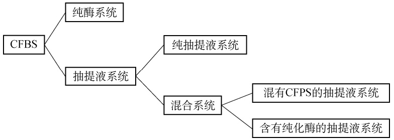

flowchart

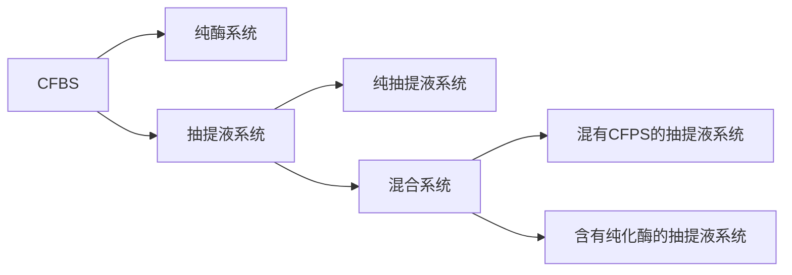

图 4-12 无细胞生物合成

与微生物发酵相比，无细胞生物合成系统具有如下优势。

1）产率高。由于消除了中间产物的副途径竞争和微生物发酵过程中维持细胞存活所需的资源损失，因此可以获得较高的产品产量。
2）反应速率快。由于没有限制传质的细胞膜，而且在无细胞生物合成系统中增加酶载量

---

第四章 合成生物系统

105

或底物载量也很容易，因此无细胞生物合成系统的反应速率总是比微生物发酵系统快。

3）可耐受有毒的环境。由于酶通常比微生物更能耐受有毒化合物和产物，许多无细胞生物合成系统可以在微生物无法生存的有毒环境中工作。
4）工程改造灵活。与微生物发酵系统的复杂性相比，无细胞生物合成系统可以很容易地进行改造或工程设计，以提高系统性能。
5）可以实现微生物发酵无法完成的生物转化。

## （一）纯酶系统

纯酶系统就是利用纯酶进行无细胞生物合成，也称为体外合成酶生物系统（in vitro synthetic enzymatic biosystem）。

纯酶无细胞生物合成往往被分为两步生物转化:首先通过发酵生产、纯化制备纯酶；然后以一锅法进行体外多酶生物催化合成产物。需重点关注的问题包括原料成本、酶和辅因子成本、产品滴度和生产率等，其中关键因素是酶的生产、纯化、稳定性及辅因子成本。因此，虽然纯酶无细胞生物合成系统具有接近理论产品产量、更快的反应速度、减少有毒化合物的干扰及前所未有的工程化水平等优势，但酶和辅因子的成本限制了其工业化应用。

构建纯酶无细胞生物合成的策略是“路线设计-元件招募-系统测试-系统优化”循环:①根据初始底物和目标产物，设计反应路线，从热力学角度对反应路线进行可行性分析；②寻找合适的酶元件的来源，对酶进行制备和表征；③进行实验验证，检测产物的生成；④系统优化反应条件，研究反应系统的适配问题，以确认反应系统的物质流瓶颈。

合成途径的设计是体外无细胞生物合成的核心。合成途径设计的核心是:①途径设计；②酶的选择；③辅酶的设计与再生。原子经济性是合成途径设计的准则，可以考虑以下几点以满足原子经济性的需要:①选择与产物结构类似的起始原料，以提高原料的利用率；②设计理论转化率高的合成途径，以提高原料的转化率；③选用合适的酶元件，以提高反应的催化效率。经过上亿年的进化，生物体内进化出一系列特异性强、转化率高的代谢合成路线，因此，现有的自然代谢途径是设计体外合成途径线路的首选。在没有现成路线的情况下，设计目标分子的合成途径是一个挑战，此时可借鉴有机化学合成中的逆合成手段，从目标化合物分子开始，推导其前体和中间物。目前已成功开发出一些计算工具，如 RetroPath。由于辅酶昂贵且不稳定，在设计合成途径路线时，最好是设计无辅酶或辅酶平衡的途径路线。

整个生物合成的效率取决于每个酶元件。酶元件既要有高催化活性和更好的稳定性，又需要保持较强的底物特异性以避免交叉反应和副产物的产生，还需要在宿主细胞中高可溶性表达，以降低制备酶的成本。热稳定酶是构建无细胞生物合成系统的又一个关键所在，选择热稳定酶有利于降低无细胞生物合成的生产成本、增加生产效率。一般来说，可以采用三种策略来选择热稳定酶:从（超）嗜热微生物中挖掘和发现酶、蛋白质工程和酶固定化。最好和最简单的是从嗜热微生物中挖掘热稳定酶。当酶学数据库和文献中无法找到热稳定酶时，理性、半理性或定向进化策略可用以增强酶的稳定性。酶的固定化是提高酶稳定性的经典方法，酶固定化不仅可以提高酶的稳定性，还可以促进酶/产物分离和酶的回收再利用。此外，低生产污染和低过敏性也是固定化酶的优势，尤其对多酶系统进行多酶共固定化是一种有发展前景的策略。此时，多酶共固定化的稳定性取决于最不稳定的酶，多酶的比例决定了共固定化多酶系统的效率。由此可看出，微胶囊（microcapsule）是多酶共固定化的最佳选择，可以不用考虑酶的大小、固定化率和固定化多个酶的比例，直接将多酶按比例包覆在胶囊中。仿生矿化微胶囊因生物相容、亲水、机械强度高、制备条件温和，是一种较好的多酶共固定化材

---

106

合成生物学

料。为了降低生产成本，体外无细胞生物合成系统对酶的纯度要求不高，可以采用纯度相对较低的酶。因此，可采用低成本的酶纯化技术，如硫酸铵沉淀、镍柱亲和纯化或热稳定酶的热沉淀，而不必使用昂贵的色谱分离法。

在设计合成途径路线无法避免辅酶时，因辅酶价格昂贵，就必须利用辅酶再生系统来平衡辅酶。常见的辅酶有 NADH、NADPH、ATP、硫胺素、吡哆醛及其衍生物、泛酸和叶酸等。烟酰胺类辅酶和 ATP 再生系统的应用最为广泛。烟酰胺类辅酶主要包括氧化型辅酶 NAD(P)+及还原型辅酶 NAD(P)H 四种。再生系统又分为还原型辅酶再生系统（图 4-13A）和氧化型辅酶再生系统（图 4-13B）。常用的还原型辅酶 NAD(P)H 再生的酶主要有醇脱氢酶（alcohol dehydrogenase，ADH）、葡萄糖脱氢酶（glucose dehydrogenase，GDH）、甲酸脱氢酶（formate dehydrogenase，FDH）、亚磷酸脱氢酶（phosphite dehydrogenase，PDH）和氢酶（hydrogenase）等。常用的氧化型辅酶 NAD(P)+再生的酶有乳酸脱氢酶（lactate dehydrogenase，LDH）、NAD(P)H 氧化酶［NAD(P)H oxidase，NOX］、谷氨酸脱氢酶（glutamate dehydrogenase，GluDH）、羰基还原酶（carbonyl reductase）。相对于 NADP，NAD 价格较低且相对稳定。因此，将天然的 NADP 依赖性酶改变成 NAD 依赖性酶，有助于提高纯酶无细胞生物合成系统的稳定性。张以恒团队成功地将极端嗜热的海栖热袍菌（Thermotoga maritima）的磷酸戊糖途径的 6-磷酸葡萄糖脱氢酶（ glucose 6-phosphate dehydrogenase ， G6PDH ） 和 6- 葡 糖 酸 脱 氢 酶 （ 6-phosphogluconate dehydrogenase，6PGDH）的 NADP+依赖性转变为 NAD+依赖性，分别得到突变体 mG6PDH（S33E/R65M/T66S）和 m6PGDH（N32E/R33I/T34I）[36,37]。开发价格低廉的人工辅酶并对相应酶进行辅酶偏好性改造是降低纯酶系统成本的另一种策略。目前已报道了多个人工辅酶及其相应的酶元件，如氟代胞嘧啶二核苷酸（nicotinamide flucytosine dinucleotide，NFDC）的苹果酸脱氢酶（malate dehydrogenase）或苹果酸酶（malate enzyme），烟酰胺胞嘧啶二核苷酸（nicotinamide cytosine dinucleotide，NCD）的亚磷酸脱氢酶，烟酰胺单核苷酸（nicotinamide mononucleotide，NMN）的醇脱氢酶等[38]。在构建无细胞合成途径的过程中，有时难以通过简单的途径设计使辅酶消耗与再生实现平衡。为此，Bowie 团队提出了净化阀（purge valve）模块使 $\mathrm { N A D P ^ { + } }$ 与 NADPH实现平衡（图 4-14）[39]。该模块包含 3 种酶元件，分别为依赖 $\mathrm { N A D P ^ { + } }$ 的突变型丙酮酸脱氢酶PDH，依赖 NAD+的野生型 PDH，以及仅能消耗 NADH 的 NADH 氧化酶（NADH oxidase，NoxE）。当系统中 NADPH/NADP+值较低时，控制阀处于关闭状态，利用 NADP+依赖型 PDH 生成乙酰辅酶 A，同时产生 NADPH；当系统中 NADPH/NADP+值升高时，控制阀被打开，NADPH依赖型 PDH 的活性受到高浓度 NADPH 的抑制，利用 NADH 依赖型 PDH 合成乙酰辅酶 A，而NoxE 消耗了所产生的 NADH，既保证了系统中 NAD+的再生，又避免了无用的 NADH 的积累。

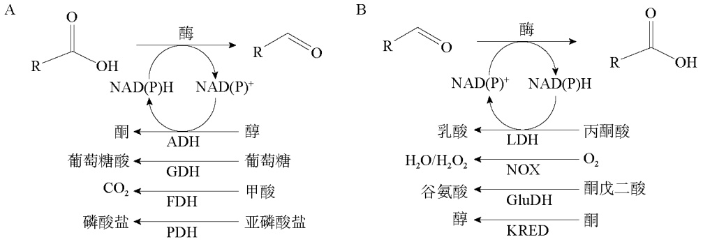

图 4-13 烟酰胺辅酶再生系统

A. 还原型；B. 氧化型；KRED. 羟基还原酶

---

第四章 合成生物系统

107

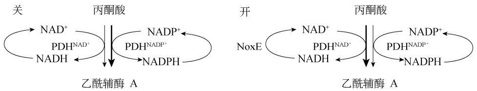

图 4-14 净化阀控制 NADPH

三磷酸腺苷（ATP）是一种高能磷酸化合物，通过与二磷酸腺苷（ADP）的相互转化实现能量的贮存和释放，为生物体提供能量。在设计体外合成途径时，最好被设计成不需要 ATP或尽可能少使用 $\mathrm { A T P } _ { \circ }$ 由于 ATP 价格昂贵，在需要 ATP 参与的体外合成系统中，需要构建 ATP再生系统。目前用于 ATP 再生的激酶主要有多磷酸激酶（polyphosphate kinase，PPK）、乙酸激酶（acetate kinase，AK）、腺苷酸激酶（adenylate kinase，ADK）、3-磷酸甘油酸激酶（3-phosphoglycerate kinase，PGK）、丙酮酸激酶（pyruvate kinase，PK）、肌酸激酶（creatine kinase，CK）和氨基甲酸激酶（carbamate kinase，CBK）等（图 4-15）。其中以 PPK 和 ADP的再生系统应用最为广泛。PPK 的稳定性好，再生系统所需辅底物多聚磷酸盐成本低、来源广泛。PPK 主要分为 PPK1 和 PPK2 两大类，PPK1 合成 ATP 方向的平衡常数 $K _ { \mathrm { e q } }$ 低，但其热稳定性好，如大肠杆菌和细长热合胞球菌（Thermosynechococcus elongatus）的 PPK1 已成功用于体外 ATP 再生。PPK2 合成 ATP 方向的平衡常数 $K _ { \mathrm { e q } }$ 高、催化效率高及分子量小，应用更为广泛。PPK2 又分为三小类[40]:①PPK2-Ⅰ，底物是 ADP，如来源于浑球红假单胞菌（Rhodobacter sphaeroides）的 PPK2-Ⅰ；②PPK2-Ⅱ，底物是 AMP，必须与腺苷酸激酶或其他PPK 一起工作以实现 ATP 再生，如来自约氏不动杆菌（Acinetobacter johnsonii）的 PPK2-Ⅱ；③PPK2-Ⅲ，底物既可以是 ADP，也可以是 AMP，如来自溶蛋白芽球菌（Deinococcus proteolyticus）的 PPK2-Ⅲ。乙酸激酶由于具有辅底物价格低和稳定性高的优点，也是一种常用的 ATP 再生策略。腺苷酸激酶的辅底物是 ADP，不需要其他辅底物，也常用于 ATP 再生，且 常 和 多 磷 酸 激 酶 （ PPK2- Ⅱ ） 或 多 磷 酸 AMP 磷 酸 转 移 酶 （ polyphosphate AMP phosphotransferase，PPT）进行级联用于 ADP/AMP 循环。虽然经过精心设计，可以使辅酶的消耗与再生实现化学计量的平衡，但是 ATP 的自发水解，以及难以完全去除的 ATP 水解酶对ATP 的消耗等，导致 ATP 的实际消耗大于理论值。因此，在体外生物合成系统长时间运转后，往往会出现体系中辅酶浓度逐渐降低的状况，影响了反应效率。针对 ATP 降解问题，Bowie团队等提出了一个 ATP 变阻器模块（图 4-16）[41]。该模块包括磷酸化的嗜热脂肪地芽孢杆菌（ Geobacillus stearothermophilus ） 的 3- 磷 酸 甘 油 醛 脱 氢 酶 （ WP\_033015082 ） 突 变 体mGapDHD32A/L33R/T34K、非磷酸化的变形链球菌（Streptococcus mutans）的 3-磷酸甘油醛脱氢酶（NP\_721104）和嗜热脂肪地芽孢杆菌的磷酸甘油激酶（WP\_033015089）。体系中磷浓度将决定变阻器模块的运行模式。当磷浓度低时，运行非磷酸化磷酸甘油醛脱氢酶（GapN）支路，3-磷酸甘油醛经非磷酸化脱氢合成 3-磷酸甘油酸和 NADPH，此时无 ATP 合成；当 ATP 经副反应水解导致磷浓度高时，mGapDHD32A/L33R/T34K 发挥作用，3-磷酸甘油醛经磷酸化脱氢生成1,3-二磷酸甘油酸，然后在磷酸甘油酸激酶的作用下生成 3-磷酸甘油酸和 ATP，产生额外的ATP 以弥补损耗，从而使体系中 ATP 浓度维持在一个稳定水平。

---

108

合成生物学

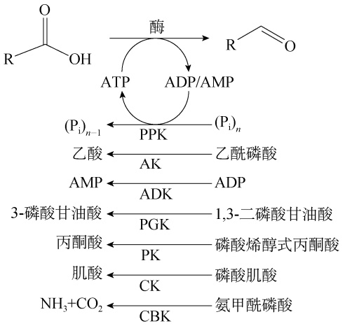

flowchart

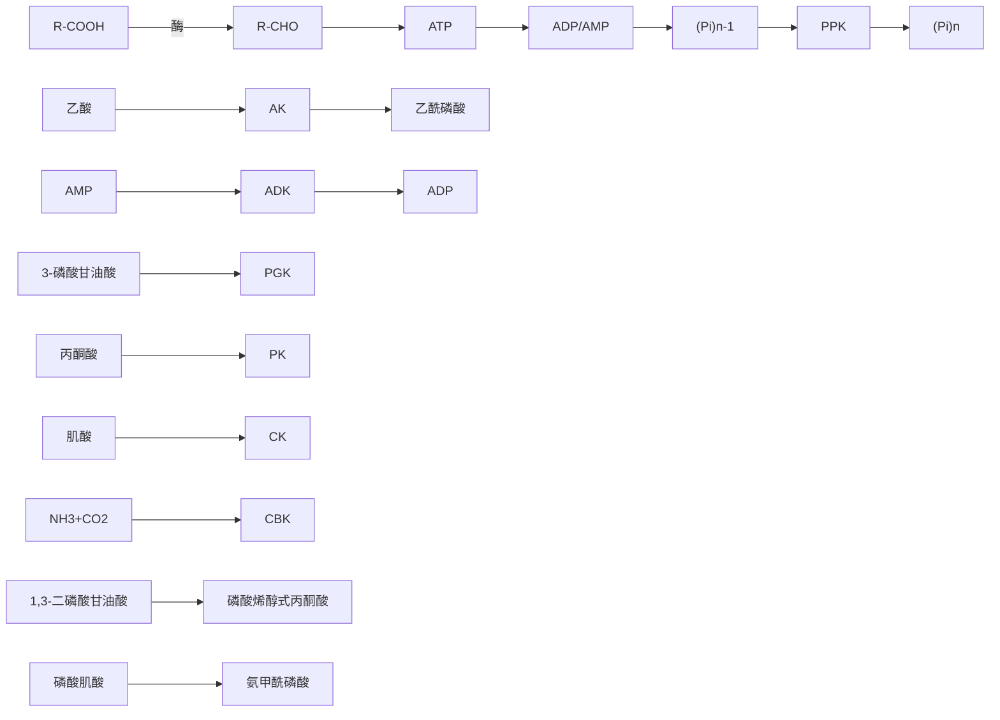

图 4-15 ATP 再生系统

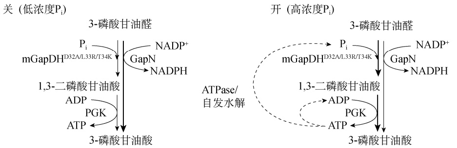

flowchart

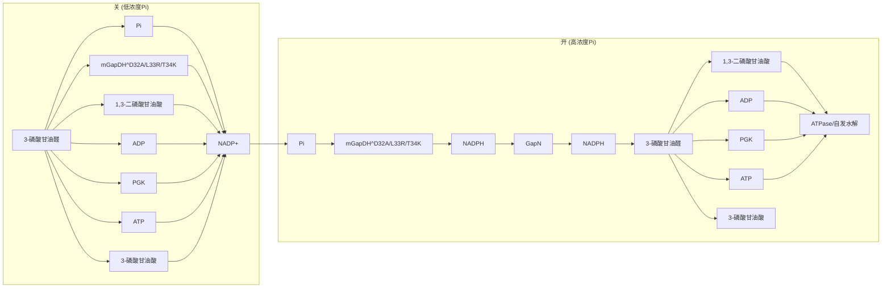

图 4-16 ATP 变阻器

众所周知，生物体内的代谢过程由多酶协同完成，胞内蛋白质浓度高，胞内酶高度有序地聚集在一起形成多酶复合体，其催化反应高度有序，从而提高其催化效率。而体外生物合成系统中，酶浓度低、高度分散。因此，借鉴天然宿主的这种特性，在体外合成系统中，对多酶进行空间组织，构建人工多酶复合体，产生底物通道效应，减少中间产物的扩散，从而提高整体反应效率，避免副反应，消除中间产物的抑制等。目前比较常见的多酶空间组织技术，包括连接肽、蛋白质支架、DNA 支架和相分离区室化等[42]。

张以恒团队创建了一个非天然合成酶途径，成功地将预处理后的生物质酶解后转化为淀粉，该途径包括枯草芽孢杆菌（Bacillus subtilis）内切葡聚糖酶（BsCel5A）、木霉（Trichoderma spp.）纤维二糖酶（TrCel7A）、嗜热梭菌（Clostridium thermocellum）纤维二糖磷酸化酶和马铃薯 α-糖苷磷酸化酶[43]。Bowie 团队构建了含有 26 个酶反应的无细胞系统，可将 92%的地高辛酸转化成大麻酚酸，大麻酚酸产量达到 1.74g/L[44]。马延和团队采用了类似“搭积木”的方式，从头设计、构建了包括 11 步反应的非天然固碳与淀粉合成途径[45]。具体来说，首先根据碳原子个数将该途径分为 4 个不同的模块（C1、C3、C6 和 Cn 模块）；随后在计算途径设计软件/网站的指导下，通过选择和组装来自 31 个生物体的 62 种酶来构成 10 个核心酶催化反应；接着对瓶颈酶进行定向进化；最后结合化学催化 $\mathrm { C O } _ { 2 }$ 生成甲醇，使淀粉的最终产率达到410mg/（L·h），为传统农业生产玉米淀粉的 8.5 倍。他们团队基于碳素缩合、异构、脱磷等酶促反应，建立了化学-酶级联转化二氧化碳合成己糖的人工合成途径，通过酶分子改造技术提

---

第四章 合成生物系统

109

升了天然酶活性、底物特异性等催化性能，构建了 C1-C3-C6 三个功能模块，在体外实现了精准控制合成不同结构与功能的己糖[46]。

## （二）抽提液系统

为了降低酶制备和纯化的成本，细胞抽提液也已成功用于无细胞生物合成。所有的途径酶都可以利用抽提液从而构建纯抽提液的无细胞生物合成系统，也称为无细胞代谢工程（cell-free metabolic engineering，CFME）。途径酶可以通过构建代谢工程菌在一个宿主菌中表达，制备抽提液；也可单独分开在不同菌中进行表达，分别制备抽提液。Jewett 团队提出了一个每个基因单独表达、制备各自的抽提液，然后混合在一起添加到无细胞合成反应液中，进行无细胞生物合成的方案（图 4-17）。在优化底盘细胞及反应系统后，20h 可合成甲羟戊酸 17.6g/L，时空产率达到 0.88g/（L·h）[47]。这种每个基因单独表达制备抽提液的 CFME，可充分利用无细胞的混合-配对（mix and match）功能，对途径酶原型化、筛选和优化。为此，他们又对该方法进行了总结和修正，成果发表在 Methods in Enzymology 上[33]。

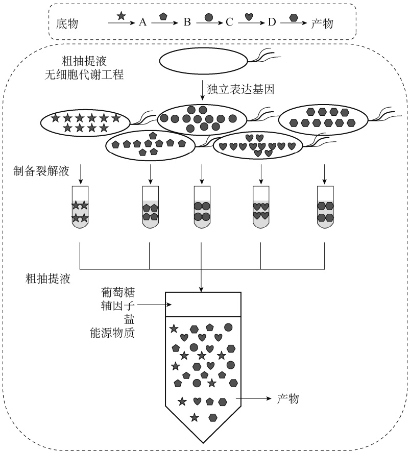

flowchart

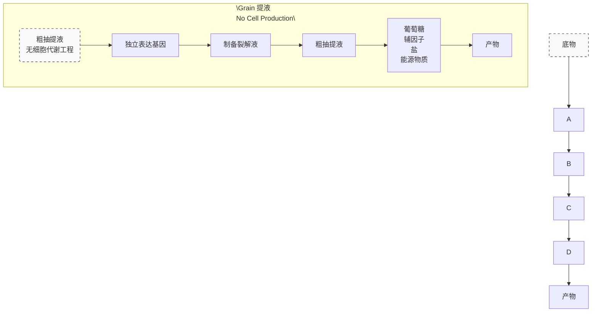

图 4-17 纯抽提液无细胞代谢工程

表达每个基因的重组菌抽提液浓度有限，导致在反应体系中每个基因编码的蛋白质浓度受限，从而影响生物合成效率。为此，Jewett 团队又提出了一个含有部分 CFPS 的混合系统（CFPS-CFME）[48]。该系统利用表达途径中部分基因重组菌的抽提液进行剩余基因的 CFPS，

---

110

合成生物学

然后添加底物、NAD+和 CoA，进行 CFME，从而实现目标产物的合成。他们经研究发现，在CFPS 中目的蛋白浓度将超过 100mg/L，从而使以葡萄糖为原料合成 1-丁醇的产量由 CFME的 1.43g/L 增加到 CFPS-CFME 的 1.71g/L。

随后，中山大学刘建忠团队为了提高目的蛋白在反应体系中的浓度，利用 Spy 环化能使酶耐受，从而可以采用热处理纯化的特性，提出了一种基于底盘细胞抽提液与 Spy 环化纯酶混合液的无细胞合成系统（CFBS-mixture），并将其应用于绿原酸的合成[49]，如图 4-18 所示。CFBS-mixture 由底盘细胞抽提液和 Spy 环化纯酶组成。前者（底盘细胞抽提液）用于合成前体、辅因子和能量。后者（Spy 环化纯酶）将底盘细胞抽提液合成的前体被热处理纯化的 Spy环化酶催化转化成产物。应用该系统的绿原酸产量是采用传统粗抽提液系统的 22.4 倍。优化后，绿原酸产量提高到（711.26±15.63）mg/L。

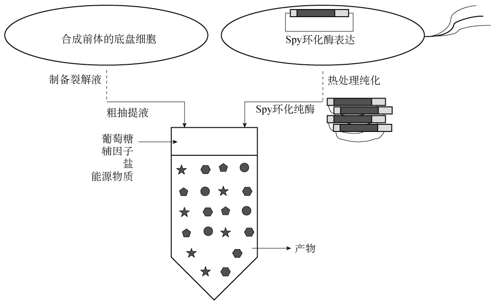

flowchart

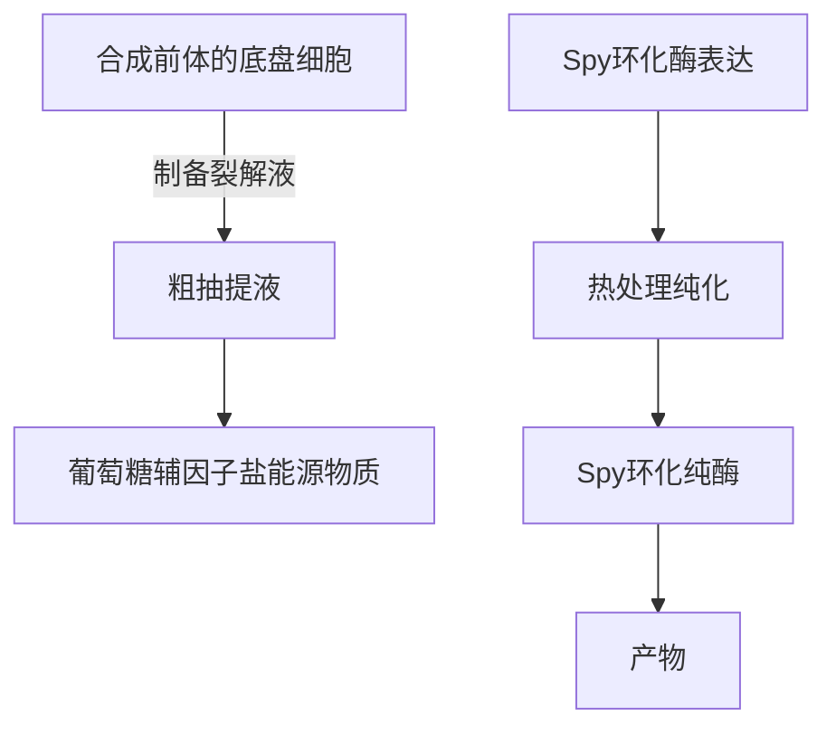

图 4-18 基于底盘细胞抽提液与 Spy 环化纯酶混合液的无细胞合成系统

## 第四节 基因组缩减

## 一、概论

基因组缩减是合成生物学中一个具有前景的研究方向，旨在通过精简细胞的基因组，提高细胞的生产效率、可控性和稳定性。了解以下核心概念有助于人们更好地理解基因组缩减的重要性，以及它如何为合成生物学开辟了新的研究和应用前景。

## 1. 底盘细胞

在合成生物学应用中，底盘细胞被选为工作模型细胞，它们作为基因工程和其他合成

---

第四章 合成生物系统

111

生物学技术的目标。这些细胞需能为合成的生物部件提供稳定和可预测的环境，确保这些部件能够有效地运行。例如，大肠杆菌（Escherichia coli）由于能快速生长、易于操作和具有丰富的分子生物学工具而成为一个常用的底盘细胞[50]。此外，在需要生产大分子或需要真核细胞生物合成途径的应用中，酿酒酵母（Saccharomyces cerevisiae）也是一个常见的选择[51]。

## 2. 基因冗余性

生物体的基因组通常存在基因冗余性。这指的是基因组中某些基因有多个副本，它们的功能可能是相似或重叠的。这样有助于生物体在面临环境压力时保持稳定。例如，细胞体内存在不同的酶可催化相同的反应，尽管它们在不同环境条件下的效率可能会有所不同[52]。因此即使其中一个酶的基因被敲除，另一个酶仍然能够继续执行其功能，从而确保细胞正常运行。

## 3. 必需基因与非必需基因

基因可根据其对细胞在特定环境中的生存和繁殖的重要性进行分类，分为必需基因和非必需基因。必需基因对细胞的生存和繁殖至关重要，如在大肠杆菌中存在的 DnaA 基因，它在 DNA 复制中起到关键作用，如果被敲除则细胞无法复制其染色体，进而无法繁殖。而非必需基因在某些环境中可能并不是关键的，但在其他环境中可能很重要。比如，某些细菌的非必需基因在营养充足的环境中可有可无，但在营养受限或受到压力时，它们的表达则对生存至关重要。例如，细胞的耐受基因在正常环境中可能不是必需的，但在暴露于抗生素或有毒物质时，它们变得非常关键。敲除非必需基因有利于基因组简化，避免不必要的能量和物质浪费。

## 4. 最小基因组

最小基因组是指一个细胞在最适宜的生长条件下，维持其生长和繁殖所需的最小基因集合。这个概念对于合成生物学尤其重要，因为它提供了一个目标，指导研究者如何通过去除非必需基因来简化一个生物体的基因组。J. Craig Venter 研究所在 2016 年合成了只含有 473 个基因的支原体（Mycoplasma mycoides），称为 JCVI-syn3.0[53]，这是能实现细胞活性的最小基因组。

## 5. 基因组缩减策略

基因组缩减的目标是系统地减少基因组中的基因数目，同时确保细胞仍能在特定条件下正常生存和发挥功能。通常遵循以下两个主要的策略方向。

自上而下策略:从复杂的生物体开始，逐步敲除非必需基因，直至得到一个最小的、能够维持生命活动的基因集合。这要求对细胞的生理和代谢有深入了解，并需精确的基因敲除技术。

自下而上策略:从零开始，根据对生命必需过程的了解，合成并组装基因，构建一个全新的、简化的生命形式。这种方法更为理论化，需要对生命基本过程有透彻的理解，以及高精确度的基因合成和组装技术（图 4-19）。

---

112

合成生物学

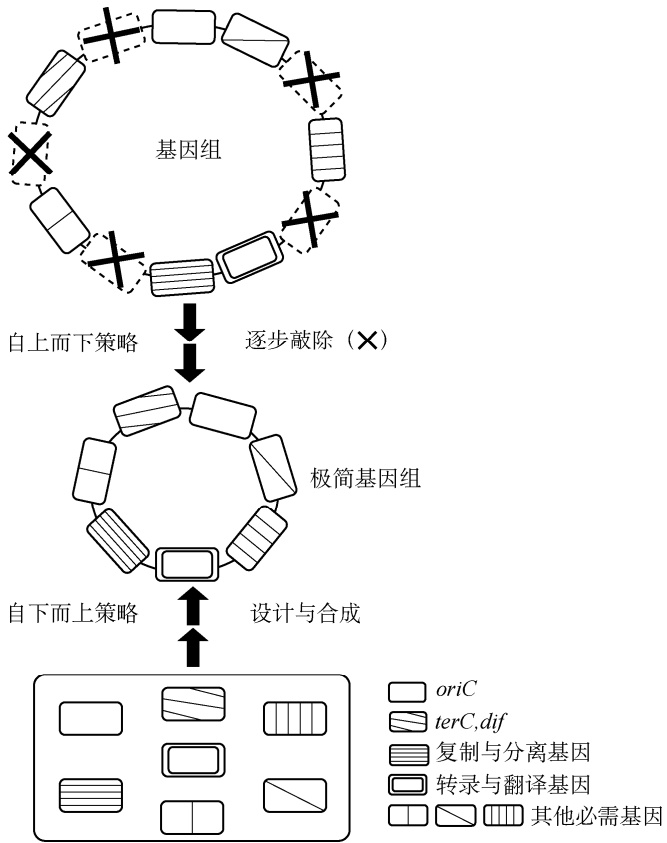

flowchart

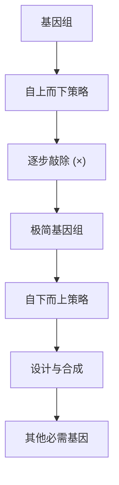

图 4-19 自上而下和自下而上缩减基因组的策略对比（改自 https://2010.igem.org/Team:CBNU-Korea/Project）

## 二、典型微生物的基因组缩减（精简）

基因组缩减（精简）是合成生物学中的一种策略，旨在通过减少生物体基因组中的非必需基因来简化其遗传信息。这种简化可以使生物体在特定应用中变得更加高效，并有助于更深入地了解生命的基本原理。

为了实现基因组缩减，研究者首先需要确定哪些基因是必需的，哪些是冗余或非必需的。一旦确定，就可以使用多种基因编辑技术，如同源重组技术或 CRISPR-Cas9 技术[54]，以敲除选定的非必需基因。因此，基因组缩减涉及两个核心步骤:基因组的缩减设计和基因的敲除。

基因组的缩减设计是基因组缩减过程中的首要挑战。关键在于确定那些必需基因，这些基因对生物体的生存和繁殖至关重要。为了识别这些基因，研究者可使用多种技术和方法:比较基因组学是通过比较不同生物种类的基因组，确定那些在多个物种中都存在并且在进化过程中高度保守的基因；大规模失活实验是通过系统性地敲除细胞中的每一个基因，观察每次敲除后细胞的生长和繁殖能力，从而确定必需基因；基于代谢网络的预测方法则利用计算机模拟和数据分析，研究细胞代谢过程中各个基因的角色和重要性。

确定了要敲除的基因后，研究者使用多种方法进行基因敲除。同源重组法使用与目标基因序列相似的 DNA 片段，通过 DNA 的自然修复机制替换或删除目标基因。基于位点的特异重组酶法利用特定的重组酶，精确地在基因组的特定位置插入、删除或替换基因。转座子法

---

第四章 合成生物系统

113

则使用一个可以在基因组中移动的 DNA 序列—转座子，随机或特异地插入基因，从而破坏其功能。CRISPR 法则利用 CRISPR-Cas9 蛋白和 RNA 分子的组合，精确地定位并切割目标基因，从而将其失活。

以下是基因组缩减的常规工作流程:①对目标微生物的全基因组进行测序，并与已知的相关微生物基因组进行比较。此外，还可通过查阅文献来收集有关目标微生物基因功能的信息。②对天然基因进行分类，通过功能注释和比对，将基因分类为不同的功能类别，如代谢途径、应激反应、细胞周期控制等。③确认非必需基因、未知基因、有害基因。使用基因敲除或敲降实验，以及表型分析，确定哪些基因是非必需的、未知功能的或者可能有害的（如致病基因）。④进行基因簇的敲除。⑤确认非必需基因簇。在敲除了某一基因簇后，需要进行表型分析和生长曲线实验等，以确认这些基因簇的非必需性，并评估其对微生物生长和代谢的影响。⑥基因簇的组合敲除。在确认多个非必需基因簇后，可以尝试进行组合敲除，以实现更大范围的基因组缩减。⑦通过多轮的基因敲除和筛选，获得一个基因组显著缩减的菌株，即基因组缩减菌。随后，对基因组缩减菌进行全面的生物学和生理学特性分析，以确认其潜在的应用价值。这样的工作流程需要多学科的合作，包括基因组学、代谢组学、生物信息学和工程生物学等，以取得最优化的基因组缩减效果。

总体而言，基因组缩减不仅为人们提供了关于生命起源、复杂性和最基本功能的见解，还通过提高生物生产过程的效率，为生物技术和医学应用开辟了新的可能性。

## （一）大肠杆菌基因组的缩减

大肠杆菌由于其丰富的遗传信息、清晰的代谢途径和成熟的生物技术工具，成为合成生物学和基因组研究中的理想模型。尽管大肠杆菌的基因组相对较小和简洁，但仍然存在许多非必需基因。对这些基因进行敲除或缩减可以使其成为更加有效的生物生产平台，并有助于揭示其生命活动的基本原理。过去的研究已经对大肠杆菌基因组进行了较为详细的功能注释，鉴定出了大量的必需基因和非必需基因，这为其基因组缩减提供了基础。借助于如同源重组、CRISPR-Cas9 等基因编辑技术，研究者能够针对性地敲除或组合敲除一系列非必需基因，从而实现基因组的缩减。

但是大肠杆菌基因组缩减的过程并不简单。尽管某些非必需基因可以单独敲除而不影响细胞的正常生长，但当多个非必需基因组合敲除时，可能会导致生长速率减慢或代谢紊乱，这突显出基因之间的复杂交互关系和网络效应。因此，进行基因组缩减时必须权衡细胞的功能和其生产能力，再理解基于何种原则对基因进行选择并决定进行敲除。以下是构建一些大肠杆菌的基因组缩减菌时，采用的策略和设计原则。

1）MDS12 与 MDS42:由匈牙利的 Posfai 和美国的 Blattner 团队合作进行的研究[54]。该策略的核心是对于被认为与基本生命过程无关的特定基因区域进行敲除。基因组缩减菌MDS12 的构建策略涉及敲除 12 个被称为“K-islands”的基因区域，而菌株 MDS42 则进一步敲除了插入序列（insertion sequence，IS）。这些插入序列是转座元件，可以在基因组中移动，增加了遗传不稳定性。通过消除这些插入序列，可以增加细胞稳定性并减少基因重复。
2）△16:由日本的 Kato 团队开发构建[55]。他们基于文献中的报道，将大肠杆菌的基因分为三类:必需基因、非必需基因和未知基因。基于基因分类信息，采用无标记染色体缺失突变法，对 75 个长基因片段进行了单独的敲除，并成功地获得了同时敲除了 16 个片段（长1.38Mb，占基因组的 29.7%）的精简型大肠杆菌。
3）MS56:这项研究主要探讨了大肠杆菌基因组中的插入序列在生产重组蛋白时所带来

---

114

合成生物学

的挑战[56]。插入序列会促使基因发生重排，从而导致基因组和重组质粒不稳定，不利于重组蛋白的生产。Kim 及其团队通过敲除插入序列、K-islands，以及与鞭毛、纤毛和脂多糖生产有关的基因，将 23%的基因组去除，得到一株无插入序列的基因组简化大肠杆菌 MS56。在 MS56菌株中未观察到在野生型 MG1655 中出现插入序列移动破坏重组蛋白编码序列的现象，表明菌株中不含插入序列增强了基因的稳定性，更适于表达生产重组蛋白。

4）MGF-01/DGF-298:2001 年，在日本启动了一个名为“最小基因组细胞工厂”（minimum genome factory，MGF）的项目[57]。研究人员将大肠杆菌与其有共同祖先的昆虫共生菌 Buchnera sp. APS 进行比较基因组分析，选定大肠杆菌中独有的基因作为候选基因进行敲除。此外，大肠杆菌在基础培养基中生长所需的必需基因和明显所需基因则被确定为不可或缺的。如果不可或缺基因之间的染色体区域包含超过 10 个基因，该区域被选为删除的候选区域。在最初的最小基因组设计中，选择了总长度为 1.8Mb 的 95 个区域进行删除。可独立地删除的候选区域被组合叠加，最终基因组大小减少了 22%（1.03Mb），并将该菌株命名为 MGF-01[58]。DGF-298则在 MGF-01 的基础上进一步精简基因组[59]，敲除的基因主要包括功能未知基因、有害基因（如插入序列、前噬菌体和毒素-抗毒素系统），以及与致病性大肠杆菌相比在 W3110 中特有的基因[60]。最终缩减后的基因组大小为 2.98Mb。

以上在构建基因组缩减菌（图 4-20）时采取的策略都突显了一个核心思想，那就是通过比较基因组学、功能性研究和现有的生物学知识，来确定并敲除那些非生存所必需的或对生产过程造成干扰的基因。这不仅有助于提高生产效率，还能更好地理解大肠杆菌中那些真正关键的基因和它们的功能。

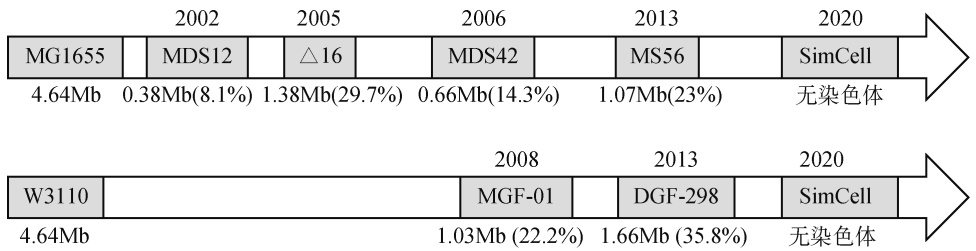

text_image

2002
2005
2006
2013
2020
MG1655
MDS12
△16
MDS42
MS56
SimCell
4.64Mb
0.38Mb(8.1%)
1.38Mb(29.7%)
0.66Mb(14.3%)
1.07Mb(23%)
无染色体
W3110
2008
2013
2020
MGF-01
DGF-298
SimCell
4.64Mb
1.03Mb (22.2%)
1.66Mb (35.8%)
无染色体

图 4-20 基因组缩减菌的基因组缩减程度

下面以“只干活不增殖”的无染色体大肠杆菌为例进行介绍具体应用。

Fan 等以全新视角探究细胞工程技术，通过移除细胞的染色体，创建了一种全新、高度可编程的无染色体细胞，称为“简单细胞”（simple cell，SimCell）[61]。这些 SimCell（图 4-21）不仅可作为生物合成平台，而且具有广泛的应用潜力。研究团队成功地运用异源的 I-CeuI 内切酶进行双链 DNA 断裂，以及内源核酸酶的降解活性，从大肠杆菌、假单胞菌（Pseudomonas putida）和真氧产碱杆菌（Ralstonia eutropha）中去除了其原生染色体。实验数据显示，这些无染色体的 SimCell 不仅高度可编程，还能处理定制的基因线路，表达特定目标基因，并且能够合成多种蛋白质和代谢产物。

该研究不仅加深了对自然生命系统的理解，还为合成生物学未来的发展奠定了坚实基础。SimCell 由于无法自我复制（缺少染色体 DNA），降低了与工程微生物相关的生物安全风险，为合成生物学在多个敏感领域（如医疗、生物制造、农业和环境保护等）开拓了新的应用前景[61]。例如，它们可作为安全的微生物治疗剂，有效合成和递送具有针对肺癌、脑癌和软组织癌细胞抑制作用的强效抗癌药物，如酚类（catechol）。经实验发现，SimCell 能够持续表达

---

第四章 合成生物系统

115

合成基因线路长达 10 天，这主要得益于糖酵解途径（glycolysis pathway），该途径通过再生ATP 和 NADH/NADPH 来维持细胞活性。此外，SimCell 还可作为一种优化的生物合成底盘，用于安全地生产和递送产物，避免受到宿主基因组的影响。但需要注意的是，其有限的生命周期可能会影响持续生产或长期应用的效率。

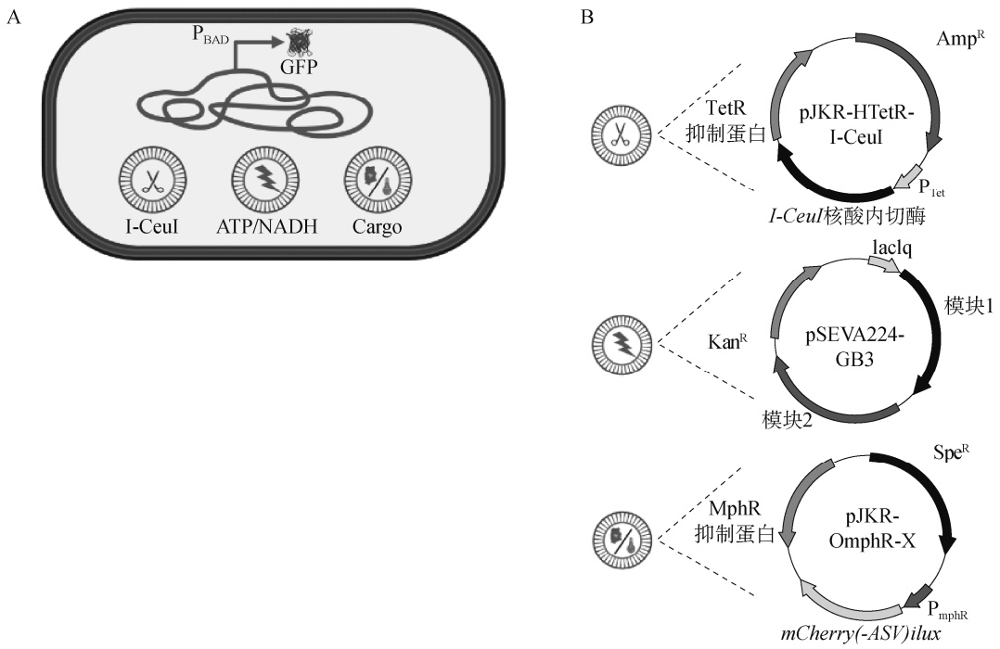

图 4-21 SimCell 的构建特征[61]

GFP. 绿色荧光蛋白； $\mathtt { A m p ^ { R } } .$ 氨苄青霉素抗性标记； $\mathrm { K a n ^ { R } }$ 卡那霉素抗性标记； ${ \mathrm { S } } { \mathrm { p } } { \mathrm { e } } ^ { \mathrm { R } } .$ 壮观霉素抗性标记

## （二）其他微生物基因组的缩减

## 1. 谷氨酸棒杆菌

在一项研究中，Unthan 等采用自上而下策略，以谷氨酸棒杆菌（Corynebacterium glutamicum）ATCC 13032 为出发菌，构建一个适用于合成生物学应用的底盘细胞[62]。首先，基于 RNA 和 DNA 的测序数据及参考文献，研究团队详细分析了该菌株基因组内的所有基因。经分析识别出三类核心基因组，分别是物种核心、亚群核心和属核心。基于这些基因组分类，更精确地确定了基因的保守性。在 435 个已经被实验确认为必需或非必需的基因中，近半数（44%）的严格保守基因被鉴定为必需。这些信息为确定哪些基因可能是必需或非必需提供了重要参考，从而有助于精确选择目标基因簇进行删除。

基于这些分析，研究团队找到了 41 个长度在 3.7～49.7kb 的目标基因簇用于删除，其中36 个基因簇被成功删除。观察到其中 10 株基因组缩减菌（genome-reduced strain，GRS）在生物学适应性评估时表现出明显较慢的生长速率 $(   \mu _ { \mathrm { m a x } }   )$ ，尤其是在 CGXII 培养基中。经过进一步的分析发现有 5 株生长较慢的 GRS 的生物量得率（ $\left( \; Y _ { \mathrm { X / S } } \; \right)$ 也更低，表明至少一个或多个基因在该培养基的菌株生长中发挥了一定的作用。然而，其他 26 株 GRS 的生长速率与野生型基本相同，表明这些基因簇与这些培养基中菌株的生长无关。在讨论底盘细胞与最小细胞的概念时，研究强调了底盘细胞应该保留更多的基因，以维持其在特定条件下（如在已

---

116

合成生物学

知成分培养基上）的生物适应性（biological fitness）。因此，理论上通过组合删除这 26 个与生物适应性无关的基因簇，有望将 C. glutamicum 的基因组大小减少约 22%（722kb），降至 2561kb。

该研究成功地构建了 C. glutamicum 的基因组蓝图，并展示了如何通过针对性的基因删除来构建一个底盘细胞，为未来在合成生物学中的应用提供有力的工具和实践路径。但由于研究主要集中在 ATCC 13032 这一菌株上，一些现象和结论可能不适用于其他 C. glutamicum 菌株。可进一步探究这一菌株在不同环境和应用场景下的性能，以便为未来的工程应用提供更多的可行方案[62]。

## 2. 枯草芽孢杆菌

1997 年，枯草芽孢杆菌（Bacillus subtilis）的完整基因组 DNA 序列（4.2Mb）完成测序，共鉴定出 4100 个基因[63]。Ara 等研究人员基于枯草芽孢杆菌基因组的信息，对其基因组及生物调控系统进行简化[64]。首先，对枯草芽孢杆菌中大约 3000 个基因（排除了 271 个必需基因）进行了单独敲除，以识别在蛋白质（酶和抗生素等）生产中的非必需基因。在这一系列研究的基础上，研究人员连续删除了 17 个被认为是非必需的基因区域，成功地创建了一个名为MG1M 的新菌株，其基因组大小减少了大约 1Mb。MG1M 菌株在产酶培养基中的生长速率略有下降，但其形态没有明显变化。更重要的是，MG1M 菌株在纤维素酶和蛋白酶的生产能力上与原始菌株 B. subtilis 168 几乎持平。这一结果不仅证明了基因组减小并没有对酶生产能力产生负面影响，反而可能有助于更高效地生产蛋白质。

Stülke 团队及合作者成功创造出基因组更为精简的枯草芽孢杆菌新菌株，名为 PG10 和PS38 菌株[65]。新菌株的基因组相较于原始菌株减少了约 36%；PG10 仅含 2700 个基因，PS38仅含 2648 个基因。这两株菌缺少了 8 个主要的分泌型枯草芽孢杆菌蛋白酶基因，这些蛋白酶基因之前被认为是异源蛋白生产的主要瓶颈。该研究还通过强化一个用于提高遗传能力转录因子 ComK 的表达，克服了基因组精简可能导致的遗传能力下降问题。通过删减了多余和非必要的基因，“迷你枯草芽孢杆菌”（mini Bacillus）PG10 不仅能更高效地生产蛋白质，还能解决与蛋白质分泌和稳定性有关的瓶颈问题。尤其在生产那些容易受到蛋白酶破坏和难以通过一般的枯草芽孢杆菌菌株分泌出来的“难表达蛋白”方面具有潜在的应用价值[66]。

## 3. 阿维链霉菌

Komatsu 等选用工业微生物阿维链霉菌（Streptomyces avermitilis）作为出发菌株，系统地删除了其基因组中的非必需基因，以期构建一个用于异源表达次级代谢物基因的多功能模式菌株[67]。通过从 9.02Mb 线性染色体上逐步删除超过 1.4Mb 的区域，研究人员成功得到了一系列的突变体（图 4-22）。这些突变体所含基因组为原始基因组的 81.46%～83.20%，并且不生成亲本菌株中的主要内源性次级代谢产物。阿维链霉菌因其在主要代谢途径和生物化学能量供应方面的优化，被认为是异源生产次级代谢物的合适宿主。通过异源表达三个不同来源[灰色链霉菌（Streptomyces griseus）、带小棒链霉菌（S. clavuligerus）和扁平链霉菌（S. platensis）]的外源生物合成基因簇，证明了这些突变体适用于作为外源代谢物高效生产的菌株。其中，异源表达链霉素（streptomycin）和头孢霉素 C（cephamycin C）基因簇的单个转化体合成这两种化合物的能力，均高于相应的原生产菌种。由于大规模的基因组缩减消除了 78%的潜在转座酶基因，进一步提高了这些突变体的基因稳定性，使其成为合成内源性产物和表达异源途径合成次级代谢产物的理想菌株。该研究突显了工程化精简基因组的阿维链霉菌作为异源表达模式菌株的高效及灵活性。

---

第四章 合成生物系统

117

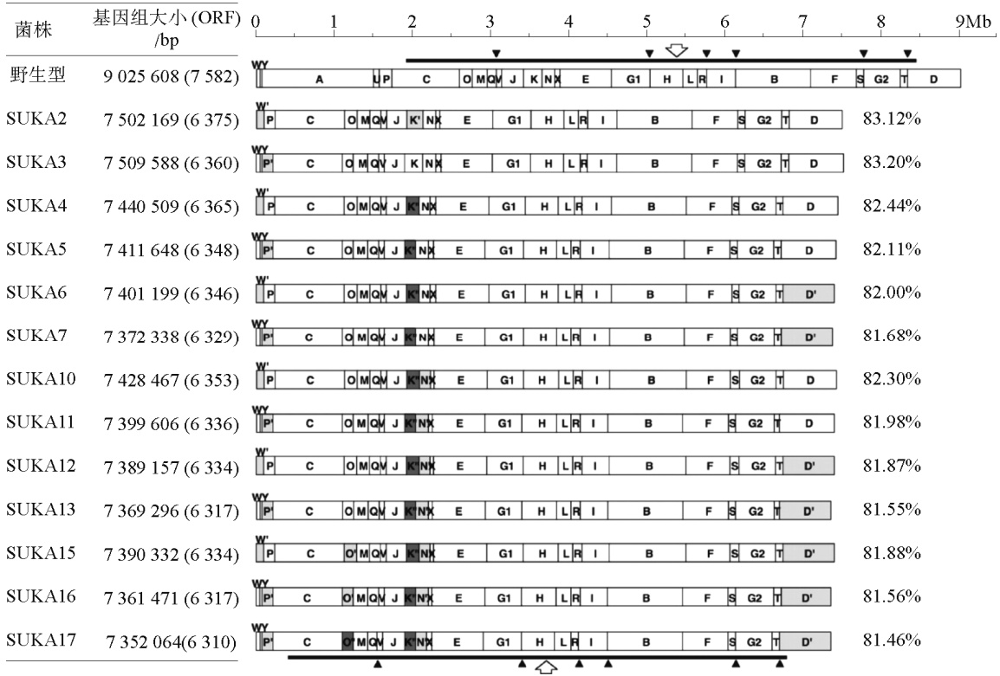

other

| 菌株 | 基因组大小 (ORF) /bp | A | B | C | D | E | F | G1 | H | I | J | K | L | M | N | O | P | Q | R | S | T | U | V |
| --- | --- | --- | --- | --- | --- | --- | --- | --- | --- | --- | --- | --- | --- | --- | --- | --- | --- | --- | --- | --- | --- | --- | --- |
| 野生型 | 9025608 (7582) | A | L | P | C | O | M | Q | V | J | K | N | X | E | G1 | H | L | R | I | B | F | S | G2 |
| SUKA2 | 7502169 (6375) | W' | P | C | O | M | Q | V | J | K' | N | X | E | G1 | H | L | R | I | B | F | S | G2 | T |
| SUKA3 | 7509588 (6360) | WY | P' | C | O | M | Q | V | J | K | N | X | E | G1 | H | L | R | I | B | F | S | G2 | T |
| SUKA4 | 7440509 (6365) | W' | P | C | O | M | Q | V | J | K' | N | X | E | G1 | H | L | R | I | B | F | S | G2 | T |

图 4-22 阿维链霉菌野生型及其大片段删除突变体的基因组经限制性内切酶 AseⅠ处理的物理图谱[67]

## 4. 裂殖酵母

裂殖酵母（Schizosaccharomyces pombe）的基因组在真核生物中属于最小的基因组之一。Sasaki 等采用了一种称为 Latour 系统（latency to universal rescue system）的方法（图 4-23）进一步进行大规模基因删减来识别实验室条件下裂殖酵母生长所需的最小基因集[68]。在经过基因组缩减的裂殖酵母中，共有 4 个删除区域，这些删除区域大小分别为 168.4kb、155.4kb、211.7kb 和 121.6kb，位于染色体Ⅰ和Ⅱ的左臂和右臂，合计删减了 657.3kb ①和 223 个基因。

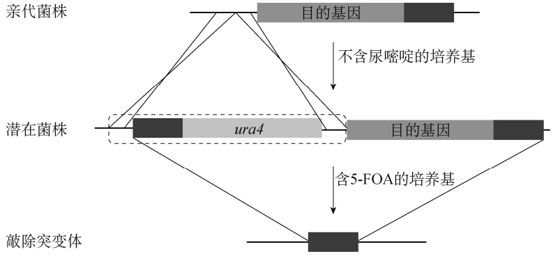

flowchart

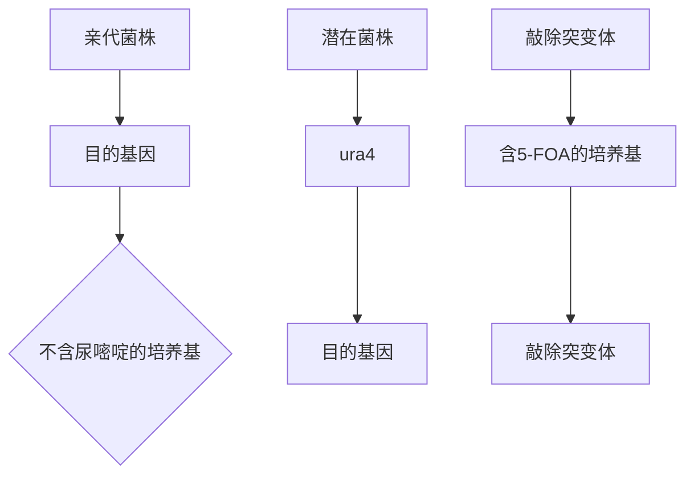

图 4-23 Latour 系统[69]

5-FOA. 5-氟乳清酸

<small>① 657.3kb 是引用原文献中的数据；不确定是原文作者的加和有误，还是在进行 4 个数据加和时，使用的是原始数据而非保留小数点后 1 位有效数字的数据，如果是原始数据加和，则结果会偏大，所以本书与原文献数据保持一致</small>

---

118

合成生物学

与亲本株相比，该基因组缩减菌的葡萄糖和某些氨基酸的摄取能力有所下降；但胞内的 ATP浓度增加了 2.7 倍，增加的 ATP 可能有助于氨基酸生物合成反应的激活，但具体机制尚未明确。它在表达异源的增强型绿色荧光蛋白和分泌型人生长激素的水平分别增加了 1.7 倍和 1.8倍。这表明基因组缩减菌在基因组和基因数量减少的同时，仍能维持生长速率。该研究为进一步研究最小生命体系统及生物制造提供了有用信息。

# 第五节 基因组合成

## 一、总概

在基因组合成领域的早期发展阶段，特别是在 20 世纪 70 年代到 80 年代，研究主要集中在单一基因的合成和表达上。1972 年，Har Gobind Khorana 团队的突破性成果—首次合成一个完整的功能性基因，为后续更复杂的基因合成实验铺平了道路[70]。随着技术的发展，科学家开始能够合成更长的 DNA 片段，进一步扩大了基因组合成的可能性。20 世纪 90 年代，聚合酶链反应（polymerase chain reaction，PCR）等技术和工具的广泛应用，尤其是该技术在1993 年获得诺贝尔化学奖后，使得基因复制和合成变得更加高效和精确。这一时期也标志着研究人员从关注单一基因转向对整体生物系统的理解和改造。随着测序技术的飞速发展，大型基因组测序项目如人类基因组计划为基因组合成提供了丰富的“原材料”和理论参考。因此，20 世纪 70 年代至 90 年代，可被视为基因组合成从基础研究到成熟应用的过渡期，这期间的技术和理念进步为 21 世纪的突破性研究奠定了坚实的基础。

在 21 世纪初，基因组合成领域达成了许多重要的里程碑。Eckard Wimmer 的研究团队在2002 年成功地合成了脊髓灰质炎病毒的基因组[71]。此项成果不仅揭示了从零开始合成基因组的潜能，也激起了深入的社会与伦理思考，尤其是关于人类具备合成可能带来危险的病毒的能力这一议题。2003 年，J. Craig Venter 团队成功地合成了 ΦX174 噬菌体的基因组[72]，并用其成功感染了细菌，标志着基因组合成进入了一个新的阶段。然而，即使成功合成了噬菌体基因组，合成更大、更复杂的生物体基因组仍面临许多挑战，但这些挑战在科研人员的努力下都已逐一被克服。2008 年，J. Craig Venter 团队通过化学合成、体外重组连接和体内克隆组装的方式，合成了生殖支原体（Mycoplasma genitalium）共 582.97kb 的基因组；这个合成基因组被命名为 M. genitalium JCVI-1.0，它包含了野生型 M. genitalium G37 中除 MG408 基因外的所有基因[73]。2010 年，J. Craig Venter 团队成功地创建了第一个完全由人工合成的基因组驱动的生命体—丝状支原体（Mycoplasma mycoides）JCVI-syn1.0[74]。这一成就不仅再次吸引了全球的关注，也引发了一系列关于生命本质、伦理和法律问题的讨论。此外，2001～2010 年也见证了合成生物学作为一个独立学科的崛起。这一新兴领域不仅包括基因和基因组的合成，还涉及生物系统设计、模拟和构建。科学家现在不仅可以解读生物体的基因信息，还可以进行编辑和从头构建，这无疑扩大了生物科学的研究范围和可能性。

2011～2020 年，基因组合成领域实现了一系列重大突破，极大地推动了生物科学和工程的发展。首先，2011 年和 2014 年，由 Jef Boeke 领导的团队成功合成了酵母染色体Ⅸ右臂（约90kb）和染色体Ⅲ（约 273kb）[75,76]，这不仅是对自然酵母染色体功能的复制，还引入了可编程和可定制的特性，标志着合成生物学由操作单一基因向设计和合成更为复杂的生物结构转

---

第四章 合成生物系统

119

变。紧接着，在 2016 年，研究人员成功合成了一个密码子数仅为 57 个的全新大肠杆菌[77]，展示了通过“密码子去冗余”简化微生物基因组的巨大潜力；同年，J. Craig Venter 团队发布了 M. mycoides 简化基因组 JCVI-syn3.0，其仅含 473 个基因，该基因组小于任何自然界中能自我复制的基因组[53]。2017 年，合成酿酒酵母染色体的进展为生物生产、药物开发和疾病治疗开拓了新的途径，因为通过编辑、合成染色体，可更灵活地调控酵母的代谢途径。2018 年，我国科学家实现了将所有酿酒酵母染色体合并为一个单一长染色体的重大突破[78]，有助于人们更好地理解染色体结构与功能的复杂关系。这些进展不仅深化了人们对生命科学的认识，而且为医药、生物技术和环境工程领域的实际应用提供了重要的技术手段，为未来更多杰出的科学贡献奠定了坚实基础。

## 二、合成酿酒酵母 Sc2.0 计划

国际酵母基因组合成计划（The International Synthetic Yeast Genome Project，Sc2.0 计划）是一个代表性的合成生物学项目，该计划由全球范围内多个研究机构之间合作开展，主要目标是合成一个完整的、功能性的酿酒酵母基因组。2011 年，来自美国、中国、英国、新加坡和澳大利亚的研究机构共同启动 Sc2.0 计划，我国的华大基因、清华大学和天津大学参与其中（图 4-24）。这些参与单位集结了各自不同的专长和研究方向，形成了一个全面而高效的研究网络，从基因设计、合成到功能验证，再到系统生物学的深入研究，共同推动合成生物学进入一个全新的发展阶段。

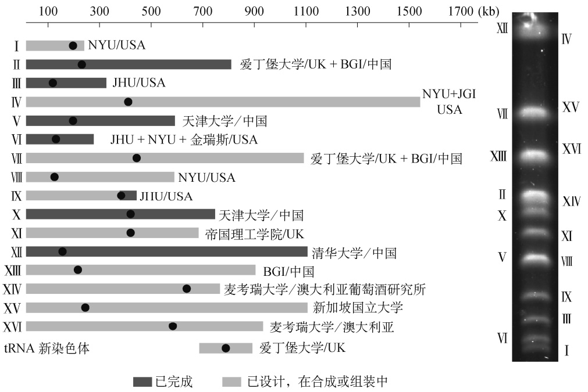

bar

| Institution | Status | Development Year |
| :--- | :--- | :--- |
| I | 已完成 | NYU/USA |
| II | 已完成 | 爱丁堡大学/UK + BGI/中国 |
| III | 已完成 | JHU/USA |
| IV | 已完成 | NYU+JGI USA |
| V | 已完成 | 天津大学/中国 |
| VI | 已完成 | JHU + NYU + 金瑞斯/USA |
| VII | 已完成 | 爱丁堡大学/UK + BGI/中国 |
| VIII | 已完成 | NYU/USA |
| IX | 已完成 | JIIU/USA |
| X | 已完成 | 天津大学/中国 |
| XI | 已完成 | 帝国理工学院/UK |
| XII | 已完成 | 清华大学/中国 |
| XIII | 已完成 | BGI/中国 |
| XIV | 已完成 | 麦考瑞大学/澳大利亚葡萄酒研究所 |
| XV | 已完成 | 新加坡国立大学 |
| XVI | 已完成 | 麦考瑞大学/澳大利亚 |
| tRNA 新染色体 | 已设计, 在合成或组装中 | 爱丁堡大学/UK |

图 4-24 染色体合成机构分工及完成情况（截至 2017 年 3 月）[79]

NYU. 纽约大学；JHU. 约翰霍普金斯大学；BGI. 华大基因；JGI. 美国能源部联合基因组研究中心

至今，Sc2.0 计划已经取得了一系列令人瞩目的成果，包括成功合成了多条酵母染色体[79]，并对其进行了详细的功能和结构分析，它是迄今为止最为复杂、最大规模的合成基因组项目

---

120

合成生物学

之一。这一创新性工作不仅为生物科学研究提供了新的工具和平台，科学家可以更加深入地理解基因表达、染色体结构、复制和细胞分裂等基础生物过程；也有助于开发具有特殊功能或具有产业应用价值的微生物，为工业生产、药物开发和可持续能源等多个领域带来新机遇。

## （一）人工设计基因组原则

Sc2.0 计划不仅仅是复制酿酒酵母的基因组，也对其进行了一系列创新和改良。在实际操作中，Sc2.0 计划主要采用了分步骤、模块化的策略。首先，通过先进的基因合成和组装技术，每一条酵母染色体都被重新设计和合成（图 4-25）。这一过程通常涉及几个主要步骤，包括删除非必需或冗余的基因、引入新的功能基因，以及重编码已有的基因。合成完成的染色体片段通过酵母人工染色体（yeast artificial chromosome，YAC）构建和修饰或其他方法被引入到酵母细胞中，用以替换其自然存在的染色体（图 4-26）。以下是项目在基因组设计方面采用的一些核心原则。

1）删除与移位:项目中删除了一些非必需或冗余的序列元素，以提高基因组的稳定性和功能性。例如，逆转录转座子、端粒重复部分、重复序列和内含子等被删除。特别值得一提的是针对 tRNA 的处理:由于 tRNA 基因在酿酒酵母基因组中高度冗余（共 275 个），项目组仅保留了 47 个，并将它们从各个染色体上删除，转而集中放置在一个新的染色体上。
2）替换:Sc2.0 计划采用了多种替换策略以优化基因表达和调控。TAG 终止密码子被替换为 TAA，以减少终止密码子的种类。此外，项目组还构建了一种新型的 tRNA，以适应这一改变。PCRTag 被用于标识特定基因或基因簇，以便于后续的追踪和研究。部分同义密码子也被替换，旨在提高密码子偏好性和去除某些酶的识别位点。
3）引入新序列:在非必需基因的前后，项目组加入了 loxP 位点，从而建立了 Cre-loxP 重组酶系统，实现基因组的“打散-重组”（SCRaMbLE）功能。当 Cre（cyclization recombination）酶在含有 loxP 位点的合成酵母细胞中被诱导时，它会促进 DNA 重组，导致基因的删除、插入或倒位。

|  | 野生型染色体大小 | 合成型染色体大小 | 更换终止密码子的数目 | 添加 loxP 位点的数目 | PCR Tag 重编码碱基对数 | 限制性酶切位点重编码的碱基对数 | 删除的 tRNA 数目 | 删除的 tRNA 碱基对数 | 删除的重复序列碱基对数 |
| --- | --- | --- | --- | --- | --- | --- | --- | --- | --- |
| Chr01 | 230 208 | 181 030 | 19 | 62 | 3 535 | 210 | 4 | 372 | 3 987 |
| Chr02 | 813 184 | 770 035 | 93 | 271 | 13 651 | 1 215 | 13 | 993 | 7 030 |
| Chr03 | 316 617 | 272 195 | 44 | 100 | 5 272 | 250 | 10 | 794 | 7 358 |
| Chr04 | 1 531 933 | 1 454 671 | 183 | 479 | 25 398 | 2 298 | 28 | 2 261 | 11 674 |
| Chr05 | 576 874 | 536 024 | 61 | 174 | 8 760 | 813 | 20 | 1 471 | 11 181 |
| Chr06 | 270 148 | 242 745 | 30 | 69 | 4 553 | 369 | 10 | 835 | 9 297 |
| Chr07 | 1 090 940 | 1 028 952 | 126 | 380 | 17 910 | 1 572 | 36 | 2 887 | 13 284 |
| Chr08 | 562 643 | 506 705 | 61 | 86 | 9 980 | 714 | 11 | 878 | 19 019 |
| Chr09 | 439 885 | 405 513 | 54 | 142 | 7 943 | 436 | 10 | 736 | 11 632 |
| Chr10 | 745 751 | 707 459 | 85 | 249 | 12 582 | 1 102 | 24 | 1 853 | 7 523 |
| Chr11 | 656 816 | 659 617 | 68 | 199 | 11 769 | 1 017 | 15 | 1 243 | 4 214 |
| Chr12 | 1 078 177 | 999 406 | 122 | 291 | 15 129 | 1 539 | 19 | 1 646 | 10 843 |
| Chr13 | 924 431 | 883 749 | 100 | 337 | 15 911 | 0 | 21 | 1 691 | 7 673 |
| Chr14 | 784 333 | 753 096 | 96 | 260 | 13 329 | 1 113 | 14 | 1 152 | 5 115 |
| Chr15 | 1 091 291 | 1 048 343 | 147 | 399 | 18 015 | 2 058 | 20 | 1 612 | 9 542 |
| Chr16 | 948 066 | 902 994 | 127 | 334 | 15 493 | 1 374 | 17 | 1 338 | 10 048 |
| 总计 | 12 071 297 | 11 352 534 | 1 416 | 3 932 | 199 230 | 16 080 | 272 | 21 762 | 149 420 |

图 4-25 Sc2.0 计划设计原则的汇总统计数据[79]

---

第四章 合成生物系统

121

4）SCRaMbLE（synthetic chromosome rearrangement and modification by loxP-mediated evolution）:这是一个用于加速基因组演化和多样性生成的创新性技术。通过利用已经插入的loxP 位点，SCRaMbLE 可以在基因组内触发一系列有序或随机的重组事件，从而在相对短的时间内生成大量基因组变异，产生具有多样性和新功能的酿酒酵母菌株。

这些设计原则不仅体现了合成生物学中的最新技术和思想，而且为未来基因组设计和人工生命研究提供了宝贵的经验和方法。

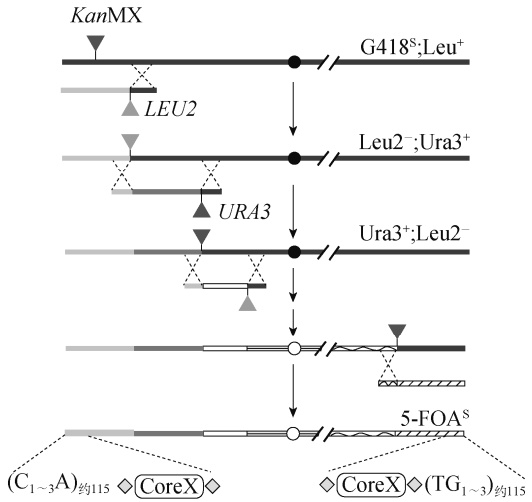

flowchart

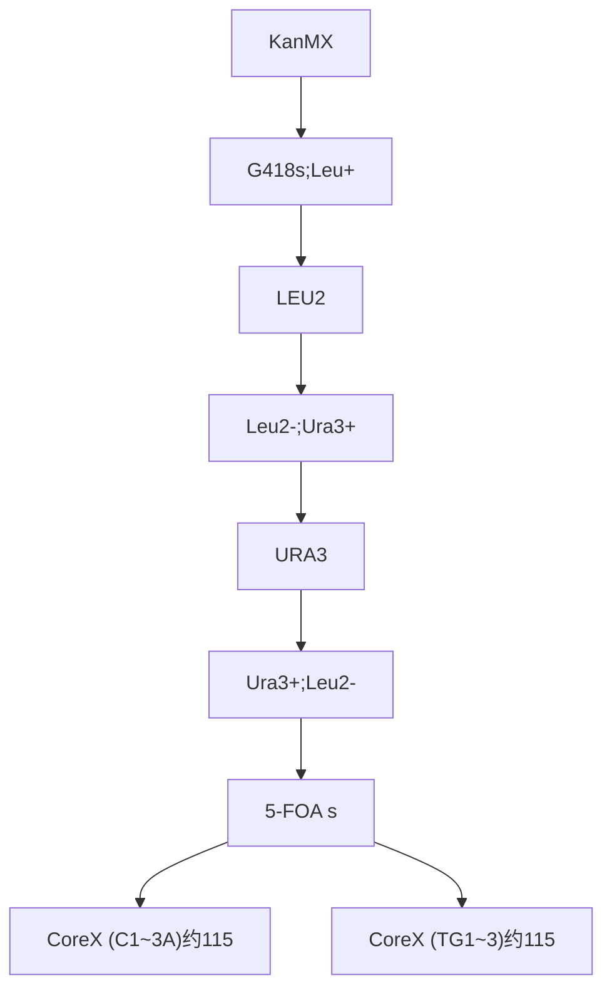

图 4-26 片段组装替换示意图[79]

合成流程:在 Sc2.0 计划中，基因合成采用了一套综合而多层次的策略。首先，项目团队运用了分层组装方法，这是一种自下而上的逐步构建方式。在这个过程中，小的 DNA 片段（约750bp）首先会被合成并组装成更大的 DNA 片段，然后这些更大的片段会进一步组装、替换成完整的新染色体。项目团队利用了重叠扩展聚合酶链反应（OE-PCR）技术，该技术不仅可以扩增目标 DNA 片段，还能在扩增过程中将两个或多个 DNA 片段进行拼接。为了实现较大片段的拼接，项目团队借助了酿酒酵母的同源重组机制，这是一种非常高效和可靠的方式，特别是对于复杂基因组结构的组装。

除组装策略外，该项目还实施了严格的验证机制。每一组装阶段完毕后，均会进行细致的克隆验证，通常包括测序和其他生物化学技术，旨在确保新合成的 DNA 片段与设计方案一致。组装完成后，进一步开展了一系列的功能性实验，如生长测试和代谢分析，以确保新的基因组不仅结构精确，而且功能正常。值得强调的是，Sc2.0 计划采纳了迭代的设计与合成方法。这意味着在初步的功能检验后，如有必要，可以进行基因组的进一步优化与调整。

最后，项目团队还开发了 SCRaMbLE 系统，这是一种创新的技术，允许研究人员在实验室条件下快速地进行基因组进化。通过使用 SCRaMbLE，研究人员能够迅速地筛选和测试具有特定功能或优点的酵母菌株。通过这一系列的综合策略和技术，Sc2.0 计划不仅成功地实现了高度精确和可控的基因组合成，还为合成生物学和基因组科学提供了一个全新的实验平台。

## （二）SCRaMbLE 原理

Sc2.0 计划也包括一个 SCRaMbLE 系统[75,80]，这是一种创新的基因重组和进化平台。通过 SCRaMbLE，研究人员可以在细胞内迅速、随机地进行大规模的染色体重排、删除和插入，

---

122

合成生物学

进而实现染色体结构和功能的快速优化。

Cre-loxP 重组酶系统是一种被广泛用于基因工程和功能基因组学研究的分子工具。该系统由两个主要组件组成:Cre 酶和 loxP 位点。Cre 酶是一种能够识别特定 DNA 序列（loxP 位点）的酶，于 1981 年从 P1 噬菌体中发现，基因编码区序列全长 1029bp[81]。loxP 是一个由34 bp 组成的 DNA 序列，包括两段 13bp 的反向重复序列及其间的 8bp 序列（表 4-3）。这两段13bp 的部分是 Cre 酶的结合区域。在 Cre-loxP 系统中，Cre 酶能够辨识两个 loxP 位点，并促成它们之间 DNA 的切割及重新连接（图 4-27）。Cre-loxP 系统具有很高的精确性和效率，研究人员能够精确地对特定 DNA 片段进行增加、移除或位移操作。该系统的精准控制性赋予了其在众多领域的广泛应用，如基因的敲除、转基因动物模型的建立及基因表达的时空调控。进一步地，通过调整 loxP 位点的方向或采用不同种类的 Cre 酶（如 CreERT2，一个可受药物控制的 Cre 酶[82]），研究人员可执行更为精细、复杂和多样化的基因操作。

表 4-3 不同 loxP 位点序列

| 位点名称 | 13bp 识别区域 | 8bp 间隔区域 | 13bp 识别区域 |
| --- | --- | --- | --- |
| 野生型 | ATA ACT TCG TAT A | ATG TAT GC | TAT ACG AAG TTA T |
| lox 511 | ATA ACT TCG TAT A | ATG TAT AC | TAT ACG AAG TTA T |
| lox 5171 | ATA ACT TCG TAT A | ATG TGT AC | TAT ACG AAG TTA T |
| lox 2272 | ATA ACT TCG TAT A | AAG TAT CC | TAT ACG AAG TTA T |
| M2 | ATA ACT TCG TAT A | AGA AAC CA | TAT ACG AAG TTA T |
| M3 | ATA ACT TCG TAT A | TAA TAC CA | TAT ACG AAG TTA T |
| M7 | ATA ACT TCG TAT A | AGA TAG AA | TAT ACG AAG TTA T |
| M11 | ATA ACT TCG TAT A | AGA TAG AA | TAT ACG AAG TTA T |
| lox 71 | TAC CGT TCG TAT A | NNN TAN NN (GCA TAC AT) | TAT ACG AAG TTA T |
| lox 66 | ATA ACT TCG TAT A | NNN TAN NN (GCA TAC AT) | TAT ACG AAC GGT A |

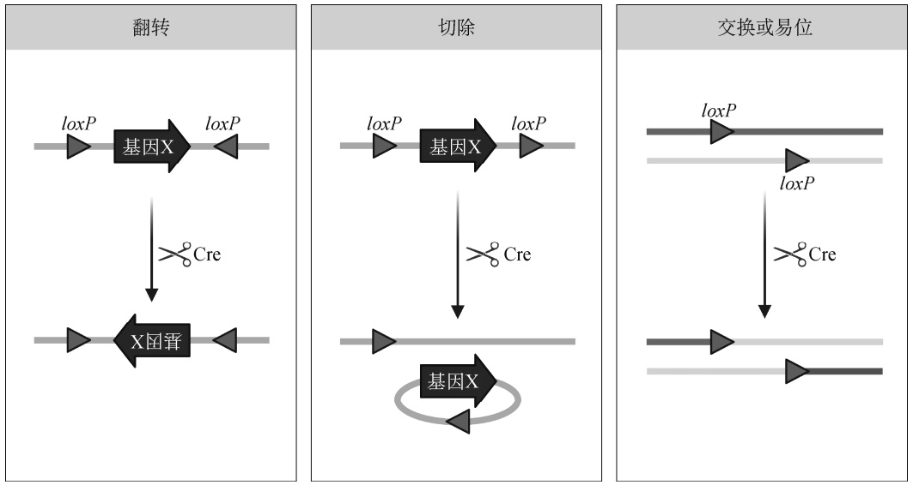

图 4-27 Cre-loxP 重组系统工作示意图

切除:两个 loxP 位点位于一条 DNA 链上，且方向相同，Cre 酶能有效切除两个 loxP 位点间的序列。翻转:两个 loxP 位点位于一条 DNA 链上，但方向相反，Cre 酶能导致两个 loxP 位点间的序列翻转。交换或易位:如果两个 loxP 位点分别位于两条不同的 DNA 链或染色体上，Cre 酶能介导两条 DNA 链的交换或染色体易位

---

第四章 合成生物系统

123

在 Sc2.0 计划中，Cre-loxP 系统用于实现 SCRaMbLE。通过在酵母人工染色体的特定区域插入 loxP 位点，并在适当的时候诱导 Cre 酶的活性，研究人员可以随机地重排或修改这些染色体，从而快速地生成具有不同性状的酵母菌株。这一技术加速了合成基因组的优化过程，并提供了一种有效手段来研究基因组结构和功能之间的复杂相互作用。

## （三）体外 SCRaMbLE 实例

随着 DNA 合成和组装技术的日益进步，研究人员越来越多地使用合成 DNA 来设计与构建异源生物途径及合成基因组。然而，此过程的高度复杂性也为实验设计、执行和调试带来了考验。利用体外 SCRaMbLE（in vitro DNA SCRaMbLE）[83]，可以为合成生物学带来的这些复杂设计与调试问题提供解决方案。体外 SCRaMbLE 系统采用 Cre 酶和编码多个对称间隔区（loxPsym）位点的纯化 DNA，在试管中进行混合，从而高效地完成基因组或生物合成路径的重新排列。体外 SCRaMbLE 有两种策略可供使用，分别是自上而下法和自下而上法。

## 1. 自上而下的体外 SCRaMbLE

在自上而下的体外 SCRaMbLE（top-down in vitro SCRaMbLE）研究中，使用纯化的 Cre酶对编码多个 loxPsym 位点的 DNA 构建体进行了基于重组的优化。这些 loxPsym 位点紧挨着被称为“转录单元”（transcription unit，TU）的序列，这是该系统中需要进行随机重组的单元。当 Cre 酶存在时，通过 Cre/loxPsym 反应，这些转录单元会被随机地删除、翻转或复制。该研究中首先在一个 5kb 长的 DNA 片段上均匀分布了 10 个 loxPsym 位点，并通过重叠 PCR 将其组装成一个质粒（pYW0261）。加入 Cre 酶孵育 1h 后，这个 DNA 库被转化到大肠杆菌中，以便观察生成的产物（图 4-28）。

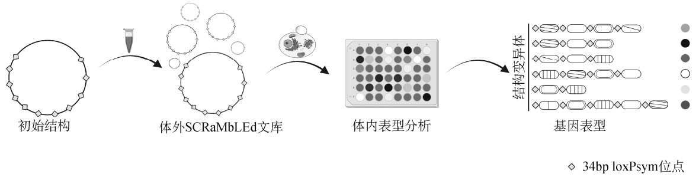

flowchart

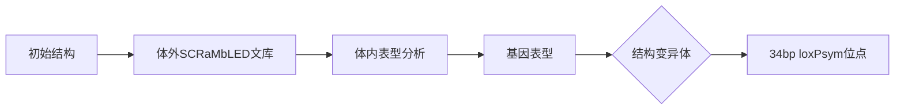

图 4-28 自上而下的体外 SCRaMbLE 策略[83]

SCRaMbLEd. 两侧含 loxPsym 的 TU 单元

为了深入探究该系统在生物学领域的应用潜力，该研究团队展开了一个体外 SCRaMbLE实验，该实验涉及一个酵母/大肠杆菌的穿梭载体 pLM495，其编码了 4 个 β-胡萝卜素生物合成途径的转录单元，这些转录单元两侧均有 loxPsym 位点，合计 5 个 loxPsym 位点。这些转录单元分别是来自产生类胡萝卜素的真菌红法夫酵母（Xanthophyllomyces dendrorhous）的三个关键基因（crtE、crtI、crtYB），以及来源于酿酒酵母的截短型 HMG1 基因。经过对纯化的质粒使用 Cre 酶处理 1h 后，所得产物被转化至大肠杆菌中，进行了基因型鉴定。数据显示，基因的删除和翻转出现频率大致均衡，分别为 27%与 28%。进一步地，团队采用单分子实时测序技术，对经过 SCRaMbLE 处理的质粒库进行深入分析，最终识别出 94 种独特的构建体。质粒随后被转入酿酒酵母中，测定其 β-胡萝卜素产量。其中一株酵母的 β-胡萝卜素产量是对

---

124

合成生物学

照组的 5.1 倍。与传统的随机突变方法（如易错 PCR 和室温等离子体诱变）相比，研究中的体外 SCRaMbLE 展示出更好的性能，能够从 DNA 结构层面进行优化，而不仅仅是在碱基对水平上。这为快速、高效地编辑和优化复杂的基因网络和代谢途径，特别是在需要大规模 DNA编辑的商业和研究应用中，提供了一种极具潜力和灵活性的新方法。

## 2. 自下而上的体外 SCRaMbLE

自下而上的体外 SCRaMbLE（bottom-up in vitro SCRaMbLE）策略用于评估一系列候选基因（以“供体片段”形式存在）在提高核心生物合成途径产量方面的作用。该策略采用两种方法（图 4-29），其中第一种方法（图 4-29A）使用具有两个 loxPsym 位点的受体载体，并且每个供体片段编码一个 URA3 基因作为选择标记。供体片段由一种基于 E. coli 的通用质粒获取，该质粒适用于酵母 Golden Gate 组装和大肠杆菌菌落颜色筛选（红/白）。第二种方法（图 4-29B）采用了仅含一个 loxPsym 位点的受体载体，并且通过体外重组反应进行反向筛选。

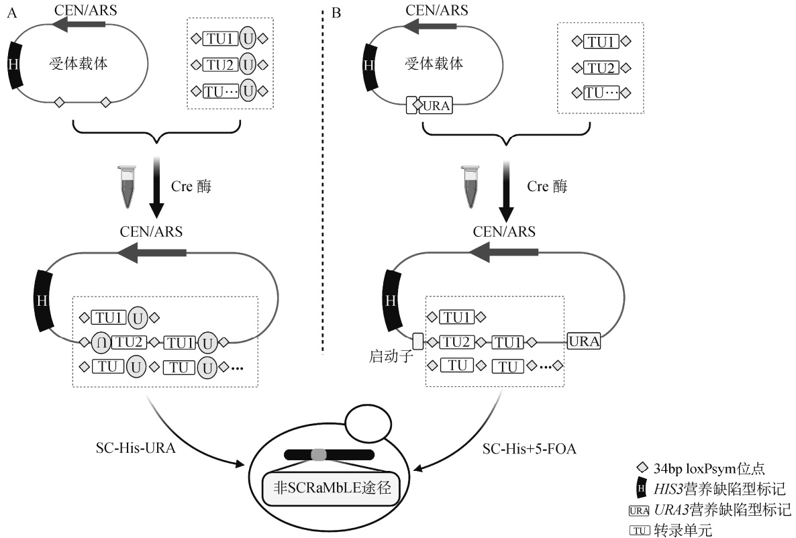

图 4-29 自下而上的体外 SCRaMbLE 策略[83]

CEN/ARS. 着丝粒/复制子；5-FOA. 5-氟乳清酸

以 β-胡萝卜素合成途径为例，研究人员发现只有添加了来源于外源途径的供体片段后，菌落的颜色才会发生显著变化。具体而言，当引入额外的 crtI 基因拷贝时，菌落会出现深橙色并伴随着 β-胡萝卜素产量的上升。当供体片段与受体载体比例增加 10 倍时，发生两个或更多插入事件的比例从 12%增加到约 20%。基于该策略，在单次实验中便可组装完成完整的四基因 β-胡萝卜素合成途径。然而，研究人员也发现第一种方法存在稳定性问题，特别是构建包含多个转录单元（TU）的结构时。为解决这一问题，研究中的第二种方法（图 4-29B）被设计为生成不含直接重复序列的重组产物，并进行反向筛选以剔除未经组装的受体载体。连续

---

第四章 合成生物系统

125

传代培养的稳定性实验结果表明，第二种方法更加稳定，从而提高了该体系在生产中应用的实用性。

与体内 SCRaMbLE 系统相比，体外 SCRaMbLE 系统展现出了几项明显的优势。首先，体外 SCRaMbLE 系统的操作更为可控，因为反应可以通过热处理来终止，而体内的 Cre 酶可能会导致生物合成途径和基因组的不稳定性。其次，此技术使得表型与基因型的分析更为简洁且直观，因其能有效降低宿主菌的基因组背景噪声。再者，体外 SCRaMbLE 的反应达到平衡的时间较短且稳定性好，为实验操作带来了灵活性。

体外 SCRaMbLE 系统作为一种高效、可控且灵活的技术，能够生成重新排列并优化后的遗传结构，特别适宜于复杂的生物合成途径和基因组学研究。此技术不仅为合成生物学和功能基因组学领域提供了创新工具，也为遗传网络与基因间交互作用的研究带来了新的视角，还为更广范围内的生物技术应用开辟了新的路径。

## （四）酿酒酵母全基因组新染色体的构建

Sc2.0 计划代表了真核基因组工程的第一步，并提供了设计和构建下一代工业微生物的框架。然而，目前使用的实验室菌株 S288c 的基因组缺乏许多为工业和环境菌株所需的多样性基因。为弥补这一缺陷，Kutyna 等研究人员设计并构建了一条兼容 Sc2.0 的新染色体[84]，其中包含了这些多样的全基因组元素，旨在增强 Sc2.0 酵母菌株的表型适应性。这样的设计策略，使得合成染色体进一步拓展了 Sc2.0 酵母菌株对不同碳源的利用范围。

研究团队从 200 多个多样的酵母菌株中筛选出 17 个独特的全基因组序列，作为新合成染色体的构建块。通过生物信息学进行设计拼接，这些序列被有机地组合为一个长达 211 409bp的 DNA 分子，包含 75 个预测的开放阅读框（ORF）。该分子经过了系列全局系统性改变，使其符合 Sc2.0 计划的设计准则。经设计分子被分割成 21 个大约 10kb 长的片段，以完成 DNA合成和后续的体内组装。为了进一步验证该新染色体的功能性，研究中还进行了一系列实验，观察合成染色体对菌株适应性和生长速度的潜在影响。这一合成染色体在经过 SCRaMbLE 技术处理后，能产生显著的适应性增益。经此处理后，合成染色体显示出一系列的表型改进，尤其是在提高对特定碳源（如蜜二糖）的利用效率方面。

该项研究不仅成功地增强了 Sc2.0 酵母菌株的表型多样性，扩展了 Sc2.0 计划的应用范围和潜力，更为合成生物学提供了一个有力的工具和框架，帮助这一代工业微生物更好地从实验室走向实际工业应用。这一进展可有助于推动合成生物学和工业微生物学的发展，特别是在为特定的工业和环境应用量身定制工程菌方面。

## （五）Sc2.0 计划的最新进展

Sc2.0 计划的国际研究团队经过多年的密切合作，于 2023 年 11 月在 Cell 出版社旗下的Cell、Molecular Cell 和 Cell Genomics 期刊上发表了多篇论文，报道了多条酵母染色体和一条特殊设计的 tRNA 全新染色体的人工设计与合成。至此，酿酒酵母全部 16 条染色体的人工合成均已完成[85]。

纽 约 大 学 的 Jef Boeke 领 导 的 研究 团 队 运 用 了 内 源 性 复 制 杂 交 (endoreduplication intercross)和 tRNA 表达盒技术，成功地将多条合成染色体合并至同一酵母细胞内，使得超过50%的基因组由人工设计的合成染色体组成[86]。团队还开发了基于 CRISPR 介导的双等位基因 URA3 辅助基因组扫描技术（CRISPR directed biallelic URA3-assisted genome scan，CRISPR

---

126

合成生物学

D-BUGS），用于揭示由特定设计修改引起的表型变异（称为“漏洞”）。利用此技术，他们精准定位了合成染色体Ⅱ（synⅡ）中的一个漏洞，并发现了与合成染色体Ⅲ（synⅢ）和合成染色体Ⅹ（synⅩ）相关的组合效应，揭示了非预期的遗传相互作用，这与转录调控、肌醇代谢及 $\mathrm { t R N A _ { S e r } ^ { C G A } }$ 丰度等密切相关。此外，该研究还提出了第二代染色体跨细胞转移替换技术（chromosome substitution），加速了多条合成染色体整合到同一细胞的过程。

曼彻斯特大学的蔡毅之团队主导的研究报道了酿酒酵母中一种 tRNA 全新染色体的设计、构建和特性分析。这条新染色体长度约为 190kb，包含了全部 275 个重新定位的核 tRNA 基因[87]。为增强其稳定性，设计中引入了来自非酿酒酵母的正交遗传元件。新染色体中的 283个 rox 重组位点，使其能实现独立的 tRNA SCRaMbLE 随机重组系统。在酵母中构建完成后，研究人员观察到了自发的染色体倍增现象。研究人员通过 tRNA 测序、转录组学、蛋白质组学、核小体定位、复制分析、荧光原位杂交（FISH）和高通量染色体构象捕获技术（Hi-C）等多种方法，对 tRNA 新染色体的行为和功能进行了深入探究。其构建不仅展示了酿酒酵母模型的可追溯性，还为与这些必需非编码 RNA 相关的假设验证提供了可能性。然而，需要注意的是，该 tRNA 全新染色体是在野生型酿酒酵母中构建完成的，其是否能补偿/替代最终Sc2.0 酵母菌株中的 tRNA 基因，仍需进一步验证。

Jef Boeke 联合中国科学院深圳先进技术研究院的戴俊彪和东京工业大学的 Yasunori Aizawa 等研究团队，共同报道了迄今为止最大的真核生物合成染色体——酿酒酵母的合成染色体Ⅳ（synⅣ）的从头合成[88]。研究团队采用了大片段组装与分级整合策略，显著提高了合成染色体构建的准确性和灵活性，完成了长约 1454kb 的 synⅣ合成。尽管融合了数千个设计特征，synⅣ与原生 chrⅣ在三维结构上仍然非常相似。此外，通过分子内着丝粒重定位技术，对 synⅣ的三维结构进行操纵，改变了其在细胞核内的三维结构，使其与其他 15 条野生型染色体相比，发生了臂的方向转位，进而探索空间基因调控。与原始 synⅣ相比，操纵 synⅣ的三维结构后，基因表达变化极少，说明核质内的定位在酵母基因调控中起次要作用。通过将 synⅣ的数百个 loxPsym 位点锚定到核内膜，实现了在不改变 DNA 序列的情况下对整个合成染色体的转录抑制。该工作推进了合成真核生物染色体构建的上限，并展示出首个通过设计实现改变三维构型的合成染色体。

这一系列标志性成果展示了 Sc2.0 计划的显著突破，是合成基因组学领域的里程碑，为后续实现酿酒酵母基因组乃至其他真核生物基因组的 100%人工合成奠定了扎实的基础。

## 三、合成单条染色体酿酒酵母

近些年，合成生物学领域经历了飞速的发展，从最初的成功构建化学全合成染色体的原核生物，到如今所涉及的复杂真核生物，这种进展证明了其巨大的潜力。2010 年，美国科学家 J. Craig Venter 率先探索这一领域，并在《科学》杂志上成功发表了首篇关于含有全合成染色体的原核生物的研究文献[74]，这一成果为后来的研究奠定了基础。

继此之后，中国科学院分子植物科学卓越创新中心/上海生命科学研究院植物生理生态研究所的覃重军研究团队进一步在这一领域取得了重要突破。2018 年 8 月，该团队在《自然》杂志上发表了一项创新性研究成果:他们成功地将酿酒酵母的 16 条染色体合并（图 4-30），形成了一个具有完整功能的单一染色体[78]。该研究成果“世界首例单条染色体真核细胞”被评选为 2018 年中国十大科技进展之一。

---

第四章 合成生物系统

127

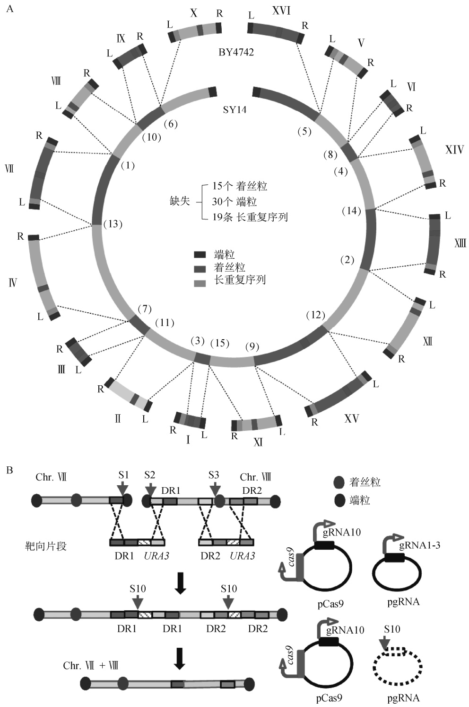

图 4-30 创建单条染色体酿酒酵母[78]

A. 野生型酿酒酵母 BY4742 的 16 条原生染色体（Ⅰ～ⅩⅥ）在外环中对齐；位于内环的酿酒酵母 SY14 的单条染色体经历了 15 轮染色体的末端融合，用虚线表示。B. 基于 $CRISPR-Case9$ 介导的染色体Ⅶ和Ⅷ的融合。在 gRNA1-3 的引导下，Cas9 核酸酶在端粒（S1 和 S2）和着丝粒（S3）位点进行切割。断裂的染色体与 DNA 靶向片段供体发生同源重组后得以修复。在半乳糖诱导下，同时消除 URA3 标记和向导 RNA 表达质粒；Chr. 染色体

---

128

合成生物学

研究人员采用了一系列先进的技术手段进行实验设计与操作。他们选用 CRISPR-Cas9 切割系统结合酵母自身的同源重组活性，实现了染色体的精确融合。每完成一轮染色体融合，包括删除一个着丝粒和两个端粒，都会对其进行严格的遗传稳定性测试，确保所产生的融合染色体在遗传上具有稳定性。在融合过程中，一个着丝粒被保留在大致的中间位置，旨在确保融合后的染色体两臂长度平衡。此外，实验预先确定了各种随机选定的染色体对是否能够成功融合，证明酵母细胞能够容忍随机的染色体融合。而为避免非预期的同源重组，研究人员还特意删减了端粒附近的长重复序列。最后，研究者通过多种方法如 PCR 测序、脉冲场凝胶电泳和 Southern 印迹进行了严格的验证。在整个过程中，还采用了 Hi-C 实验以分析融合后染色体的三维结构。

经过 15 轮染色体融合，研究人员成功创建了一个名为 SY14 的酵母菌株（图 4-31）。尽管酵母菌株 SY14 的染色体三维结构发生了显著改变，但其仍保持正常细胞功能。这一结果重新审视了染色体三维结构与基因表达之间的关系，揭示真核生物在极度简化的染色体结构下，仍能正常生存。

此研究为生物学领域带来了深远影响，它可能促进对原核生物与真核生物分类的重新定义，并为医学研究提供新的途径。由于酿酒酵母与人类拥有高度同源的基因，酵母 SY14 为研究与染色体端粒、细胞衰老和癌症相关问题提供了理想的模型。这一创新性研究将合成生物学推向新的高度，尤其是在探索生命的基础结构、功能及其在医学研究中的应用方面。此项里程碑式的成果再次彰显了中国学者在生命科学领域的核心问题上的出色贡献，是继人工合成牛胰岛素和 tRNA 后的又一重大突破，充分体现了中国科学家在探索生命科学基础问题上的领先能力。

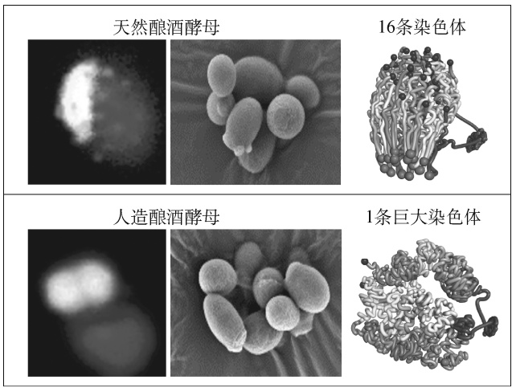

text_image

天然酿酒酵母
16条染色体
人造酿酒酵母
1条巨大染色体

图 4-31 人造单条染色体酿酒酵母（引自 http://www.sippe.ac.cn/xwdt/2019n/201901/t20190103\_5224804.html）

## 思 考 题

1. 创制高效细胞工厂的主要方法有哪些？
2. 请简述 NADPH/NADH 供给的主要策略。
3. 氧化应激工程促进细胞工厂合成效率的原理是什么？
4. 简述基因组改组和易错 PCR 全基因组改组的流程。

---

第四章 合成生物系统

129

5. 简述 MAGE 设计的原则和过程。
6. 何谓无细胞生物合成系统？其特点和种类有哪些？
7. 简述无细胞蛋白质合成的种类和其主要成分。
8. 简述无细胞代谢工程的种类及其各自特点。
9. 简述纯酶无细胞代谢工程的设计原则、ATP 变阻器和分子净化阀模块。
10. 简述粗抽提物无细胞代谢工程的分类和特点。融合 CFPS 的 CFME 有何优点？
11. 什么是必需基因与非必需基因？
12. 基因组缩减有何意义？简述基因组缩减的常规工作流程。
13. 为什么大肠杆菌是适于基因组缩减的研究对象？
14. 什么是“SCRaMbLE”系统？介绍一下它的应用。
15. 单条染色体酿酒酵母是如何构建的？有何意义？

## 参考文献

［1］Bassalo MC，Garst AD，Halweg-Edwards AL，et al. Rapid and efficient one-step metabolic pathway integration in E. coli. ACS Synth Biol，2016，5（7）:561-568
［2］Zhang YW，Sun XM，Wang QZ，et al. Multicopy chromosomal integration using CRISPR-associated transposases. ACS Synth Biol，2020，9（8）:1998-2008
［3］Yang SQ，Zhang YW，Xu JQ，et al. Orthogonal CRISPR-associated transposases for parallel and multiplexed chromosomal integration. Nucleic Acids Res，2021，49（17）:10192-10202
［4］Chou HH，Keasling JD. Programming adaptive control to evolve increased metabolite production. Nat Commun，2013，4:2595
［5］Chen X，Dong X，Liu J，et al. Pathway engineering of Escherichia coli for alpha-ketoglutaric acid production. Biotechnol Bioeng，2020，117（9）:2791-2801
［6］Liu M，Ding YM，Chen HL，et al. Improving the production of acetyl-CoA-derived chemicals in Escherichia coli BL21（DE3）through iclR and arcA deletion. BMC Microbiol，2017，17:10
［7］Chen YW，Xu DB，Fan LH，et al. Manipulating multi-system of NADPH regulation in Escherichia coli for enhanced S-adenosylmethionine production. Rsc Adv，2015，5（51）:41103-41111
［8］Liu JH，Li HL，Zhao GR，et al. Redox cofactor engineering in industrial microorganisms:strategies，recent applications and future directions. J Ind Microbiol Biot，2018，45（5）:313-327
［9］Jiang LY，Chen SG，Zhang YY，et al. Metabolic evolution of Corynebacterium glutamicum for increased production of L-ornithine. BMC Biotechnol，2013，13:47
［10］Jiang LY，Zhang YY，Li Z，et al. Metabolic engineering of Corynebacterium glutamicum for increasing the production of L-ornithine by increasing NADPH availability. J Ind Microbiol Biot，2013，40（10）:1143-1151
［11］Liang LY，Liu RM，Wang GM，et al. Regulation of NAD(H) pool and NADH/NAD(+) ratio by overexpression of nicotinic acid phosphoribosyltransferase for succinic acid production in Escherichia coli NZN111. Enzyme Microb Tech，2012，51（5）:286-293
［12］Reynolds TS，Courtney CM，Erickson KE，et al. ROS mediated selection for increased NADPH availability in Escherichia coli. Biotechnol Bioeng，2017，114（11）:2685-2689
［13］Shen YP，Liao YL，Lu Q，et al. ATP and NADPH engineering of Escherichia coli to improve the production

---

130

合成生物学

of 4-hydroxyphenylacetic acid using CRISPRi. Biotechnol Biofuels，2021，14（1）:100
［14］Lu Q，Liu JZ. Enhanced Astaxanthin production in Escherichia coli via morphology and oxidative stress engineering. J Agr Food Chem，2019，67（42）:11703-11709
［15］Zhang YX，Perry K，Vinci VA，et al. Genome shuffling leads to rapid phenotypic improvement in bacteria. Nature，2002，415（6872）:644-646
［16］Zhang X，Zhang XF，Li HP，et al. Atmospheric and room temperature plasma(ARTP) as a new powerful mutagenesis tool. Appl Microbiol Biot，2014，98（12）:5387-5396
［17］Shen YP，Pan Y，Niu FX，et al. Biosensor-assisted evolution for high-level production of 4-hydroxyphenylacetic acid in Escherichia coli. Metab Eng，2022，70:1-11
［18］Luhe AL，Tan L，Wu JC，et al. Increase of ethanol tolerance of Saccharomyces cerevisiae by error-prone whole genome amplification. Biotechnol Lett，2011，33（5）:1007-1011
［19］Niu FX，He X，Huang YB，et al. Biosensor-guided atmospheric and room-temperature plasma mutagenesis and shuffling for high-level production of shikimic acid from sucrose in Escherichia coli. J Agr Food Chem，2020，68（42）:11765-11773
［20］Wang HH，Isaacs FJ，Carr PA，et al. Programming cells by multiplex genome engineering and accelerated evolution. Nature，2009，460（7257）:894-898
［21］Gallagher RR，Li Z，Lewis AO，et al. Rapid editing and evolution of bacterial genomes using libraries of synthetic DNA. Nat Protoc，2014，9（10）:2301-2316
［22］Wei T，Cheng BY，Liu JZ. Genome engineering Escherichia coli for L-DOPA overproduction from glucose. Sci Rep-Uk，2016，6:30080
［23］Tyo KEJ，Ajikumar PK，Stephanopoulos G. Stabilized gene duplication enables long-term selection-free heterologous pathway expression. Nat Biotechnol，2009，27（8）:760-765
［24］Chen YY，Shen HJ，Cui YY，et al. Chromosomal evolution of Escherichia coli for the efficient production of lycopene. BMC Biotechnol，2013，13:6
［25］Cui YY，Ling C，Zhang YY，et al. Production of shikimic acid from Escherichia coli through chemically inducible chromosomal evolution and cofactor metabolic engineering. Microb Cell Fact，2014，13:21
［26］Garst AD，Bassalo MC，Pines G，et al. Genome-wide mapping of mutations at single-nucleotide resolution for protein，metabolic and genome engineering. Nat Biotechnol，2017，35（1）:48-55
［27］Liu RM，Liang LY，Choudhury A，et al. Iterative genome editing of Escherichia coli for 3-hydroxypropionic acid production. Metab Eng，2018，47:303-313
［28］Hartline CJ，Schmitz AC，Han YC，et al. Dynamic control in metabolic engineering:Theories，tools，and applications. Metab Eng，2021，63:126-140
［29］Shimizu Y，Inoue A，Tomari Y，et al. Cell-free translation reconstituted with purified components. Nat Biotechnol，2001，19（8）:751-755
［30］Lavickova B，Maerkl SJ. A simple，robust，and low-cost method to produce the PURE cell free system. ACS Synth Biol，2019，8（2）:455-462
［31］Grasemann L，Lavickova B，Elizondo-Cantu MC，et al. OnePot PURE cell-free system. Jove-J Vis Exp，2021，（172）:e62625
［32］Garenne D，Thompson S，Brisson A，et al. The all-E. coli TXTL toolbox 3.0:new capabilities of a cell-free synthetic biology platform. Syn Biol，2021，6（1）:1-8

---

第四章 合成生物系统

131

［33］Karim AS，Jewett MC. Cell-free synthetic biology for pathway prototyping. Method Enzymol，2018，608:31-57
［34］Levine MZ，Gregorio NE，Jewett MC，et al. Escherichia coli-based cell-free protein synthesis:Protocols for a robust，flexible，and accessible platform technology. J Vis Exp，2019，（144）:e58882
［35］Sun ZZ，Hayes CA，Shin J，et al. Protocols for implementing an Escherichia coli based TX-TL cell-free expression system for synthetic biology. J Vis Exp，2013，（79）:e50762
［36］Kim EJ，Kim JE，Zhang YHPJ. Ultra-rapid rates of water splitting for biohydrogen gas production through in vitro artificial enzymatic pathways. Energ Environ Sci，2018，11（8）:2064-2072
［37］Chen H，Zhu ZG，Huang R，et al. Coenzyme engineering of a hyperthermophilic 6-phosphogluconate dehydrogenase from NADP(+) to NAD(+) with its application to biobatteries. Sci Rep-Uk，2016，6:36311
［38］Zachos I，Nowak C，Sieber V. Biomimetic cofactors and methods for their recycling. Curr Opin Chem Biol，2019，49:59-66
［39］Opgenorth PH，Korman TP，Bowie JU. A synthetic biochemistry molecular purge valve module that maintains redox balance. Nat Commun，2014，5:4113
［40］李举谋，石焜，张志钧，等. 多酶级联反应的构建及其在双功能团功能化学品合成中的应用. 生物工程学报，2023，39（6）:2158-2189
［41］Opgenorth PH，Korman TP，Iancu L，et al. A molecular rheostat maintains ATP levels to drive a synthetic biochemistry system. Nat Chem Biol，2017，13（9）:938-942
［42］魏欣蕾，游淳. 体外多酶分子机器的现状和最新进展. 生物工程学报，2019，35（10）:1870-1888
［43］You C，Chen HG，Myung S，et al. Enzymatic transformation of nonfood biomass to starch. P Natl Acad Sci USA，2013，110（18）:7182-7187
［44］Valliere MA，Korman TP，Woodall NB，et al. A cell-free platform for the prenylation of natural products and application to cannabinoid production. Nat Commun，2019，10:565
［45］Cai T，Sun H，Qiao J，et al. Cell-free chemoenzymatic starch synthesis from carbon dioxide. Science，2021，373（6562）:1523-1527
［46］Yang J，Song W，Cai T，et al. De novo artificial synthesis of hexoses from carbon dioxide. Sci Bull（Beijing），2023，68（20）:2370-2381
［47］Dudley QM，Anderson KC，Jewett MC. Cell-free mixing of Escherichia coli crude extracts to prototype and rationally engineer high-titer mevalonate synthesis. ACS Synth Biol，2016，5（12）:1578-1588
［48］Karim AS，Jewett MC. A cell-free framework for rapid biosynthetic pathway prototyping and enzyme discovery. Metab Eng，2016，36:116-126
［49］Niu FX，Yan ZB，Huang YB，et al. Cell-free biosynthesis of chlorogenic acid using a mixture of chassis cell extracts and purified spy-cyclized enzymes. J Agric Food Chem，2021，69（28）:7938-7947
［50］Ziegler M，Zieringer J，Döring CL，et al. Engineering of a robust Escherichia coli chassis and exploitation for large-scale production processes. Metab Eng，2021，67:75-87
［51］Hong KK，Nielsen J. Metabolic engineering of Saccharomyces cerevisiae:A key cell factory platform for future biorefineries. Cell Mol Life Sci，2012，69（16）:2671-2690
［52］Costenoble R，Picotti P，Reiter L，et al. Comprehensive quantitative analysis of central carbon and aminoacid metabolism in Saccharomyces cerevisiae under multiple conditions by targeted proteomics. Mol Syst Biol，2011，7:464

---

132

合成生物学

［53］Hutchison CA，Chuang RY，Noskov VN，et al. Design and synthesis of a minimal bacterial genome. Science，2016，351（6280）:aad6253
［54］Jinek M，Chylinski K，Fonfara I，et al. A programmable dual-RNA-guided DNA endonuclease in adaptive bacterial immunity. Science，2012，337（6096）:816-821
［55］Hashimoto M，Ichimura T，Mizoguchi H，et al. Cell size and nucleoid organization of engineered Escherichia coli cells with a reduced genome. Mol Microbiol，2005，55（1）:137-149
［56］Park MK，Lee SH，Yang KS，et al. Enhancing recombinant protein production with an Escherichia coli host strain lacking insertion sequences. Appl Microbiol Biot，2014，98（15）:6701-6713
［57］Mizoguchi H，Mori H，Fujio T. Minimum genome factory. Biotechnol Appl Bioc，2007，46:157-167
［58］Mizoguchi H，Sawano Y，Kato J，et al. Superpositioning of deletions promotes growth of Escherichia coli with a reduced genome. DNA Res，2008，15（5）:277-284
［59］Hirokawa Y，Kawano H，Tanaka-Masuda K，et al. Genetic manipulations restored the growth fitness of reducedgenome Escherichia coli. J Biosci Bioeng，2013，116（1）:52-58
［60］Kurokawa M，Ying BW. Experimental challenges for reduced genomes:The cell model Escherichia coli. Microorganisms，2020，8（1）:3
［61］Fan C，Davison PA，Habgood R，et al. Chromosome-free bacterial cells are safe and programmable platforms for synthetic biology. Proc Natl Acad Sci USA，2020，117:6752-6761
［62］Unthan S，Baumgart M，Radek A，et al. Chassis organism from Corynebacterium glutamicum—a top-down approach to identify and delete irrelevant gene clusters. Biotechnol J，2015，10（2）:290-301
［63］Kunst F，Ogasawara N，Moszer I，et al. The complete genome sequence of the gram-positive bacterium Bacillus subtilis. Nature，1997，390（6657）:249-256
［64］Ara K，Ozaki K，Nakamura K，et al. Bacillus minimum genome factory:effective utilization of microbial genome information. Biotechnol Appl Bioc，2007，46:169-178
［65］Reuss DR，Altenbuchner J，Mäder U，et al. Large-scale reduction of the Bacillus subtilis genome:consequences for the transcriptional network，resource allocation，and metabolism. Genome Res，2017，27（2）:289-299
［66］Suárez RA，Stülke J，van Dijl JM. Less is more:toward a genome-reduced Bacillus cell factory for “difficult proteins”. Acs Synth Biol，2019，8（1）:99-108
［67］Komatsu M，Uchiyama T，Omura S，et al. Genome-minimized Streptomyces host for the heterologous expression of secondary metabolism. P Natl Acad Sci USA，2010，107（6）:2646-2651
［68］Sasaki M，Kumagai H，Takegawa K，et al. Characterization of genome-reduced fission yeast strains. Nucleic Acids Res，2013，41（10）:5382-5399
［69］Hirashima K, Iwaki T，Takegawa K, et al. A simple and effective chromosome modification method for largescale deletion of genome sequences and identification of essential genes in fission yeast. Nucleic Acids Research，2006，34（2）:e11
［70］Sakmar TP. Har gobind khorana（1922—2011）:Pioneering spirit obituary. Plos Biol，2012，10（2）:e1001273
［71］Cello J，Paul AV，Wimmer E. Chemical synthesis of poliovirus cdna:Generation of infectious virus in the absence of natural template. Science，2002，297（5583）:1016-1018
［72］Smith HO，Hutchison CA，Pfannkoch C，et al. Generating a synthetic genome by whole genome assembly:ΦX174 bacteriophage from synthetic oligonucleotides. P Natl Acad Sci USA，2003，100（26）:15440-15445
［73］Gibson DG，Benders GA，Andrews-Pfannkoch C，et al. Complete chemical synthesis，assembly，and cloning

---

第四章 合成生物系统

133

of a Mycoplasma genitalium genome. Science，2008，319（5867）:1215-1220
［74］Gibson DG，Glass JI，Lartigue C，et al. Creation of a bacterial cell controlled by a chemically synthesized genome. Science，2010，329（5987）:52-56
［75］Dymond JS，Richardson SM，Coombes CE，et al. Synthetic chromosome arms function in yeast and generate phenotypic diversity by design. Nature，2011，477（7365）:471-476
［76］Annaluru N，Muller H，Mitchell LA，et al. Total synthesis of a functional designer eukaryotic chromosome. Science，2014，344（6179）:55-58
［77］Ostrov N，Landon M，Guell M，et al. Design，synthesis，and testing toward a 57-codon genome. Science，2016，353（6301）:819-822
［78］Shao YY，Lu N，Wu ZF，et al. Creating a functional single-chromosome yeast. Nature，2018，560（7718）:331-335
［79］Richardson SM，Mitchell LA，Stracquadanio G，et al. Design of a synthetic yeast genome. Science，2017，355（6329）:1040-1044
［80］Dymond J，Boeke J. The Saccharomyces cerevisiae SCRaMbLE system and genome minimization. Bioeng Bugs，2012，3:168-171
［81］Sternberg N，Hamilton D. Bacteriophage P1 site-specific recombination:Ⅰ. Recombination between loxP sites. J Mol Biol，1981，150:467-486
［82］Indra AK，Warot X，Brocard J，et al. Temporally-controlled site-specific mutagenesis in the basal layer of the epidermis : comparison of the recombinase activity of the tamoxifen-inducible Cre-ERT and Cre-ERT2 recombinases. Nucleic Acids Res，1999，27（22）:4324-4327
［83］Wu Y，Zhu RY，Mitchell LA，et al. In vitro DNA SCRaMbLE. Nat Commun，2018，9:1935
［84］Kutyna DR，Onetto CA，Williams TC，et al. Construction of a synthetic Saccharomyces cerevisiae pan-genome neo-chromosome. Nat Commun，2022，13（1）:3628
［85］Dai J，Yang H，Pretorius IS，et al. A spotlight on global collaboration in the Sc2.0 yeast consortium. Cell Genom，2023，3（11）:100441
［86］Zhao Y，Coelho C，Hughes AL，et al. Debugging and consolidating multiple synthetic chromosomes reveals combinatorial genetic interactions. Cell，2023，186（24）:5220-5236
［87］Schindler D，Walker RSK，Jiang S，et al. Design，construction，and functional characterization of a tRNA neochromosome in yeast. Cell，2023，186（24）:5237-5253
［88］Zhang W，Lazar-Stefanita L，Yamashita H，et al. Manipulating the 3d organization of the largest synthetic yeast chromosome. Mol Cell，2023，83（23）:4424-4437
