# 第七章酵母合成生物学

原始 PDF 第 199–232 页。

第 七 章

# 酵母合成生物学

## 第一节 概 论

## 一、酿酒酵母合成生物学的背景与重要性

## 1. 酿酒酵母合成生物学的发展历史

在 20 世纪 70 年代初期，Cohen 等在一篇研究论文中详细介绍了重组 DNA 技术的创新应用<sup>[1]</sup>。通过在体外连接不同来源的 DNA 片段来构建载体，并成功地将其导入大肠杆菌中，实现了跨物种的基因传递。这一开创性的实验不仅标志着基因工程领域的诞生，也为随后涉及大量 DNA编辑操作的生物技术研究和应用打下了坚实的基础。在 20 世纪 80 年代，随着分子克隆技术的进步，科学家已经能够对酿酒酵母（Saccharomyces cerevisiae）的基因进行操控和研究。此期间的研究焦点主要集中在对酿酒酵母的遗传调控上。通过使用质粒，研究人员可实现基因的精确导入和表达调节<sup>[2]</sup>。此外，这一时期还揭示了许多酿酒酵母特有的生理机制和过程。进入 20 世纪 90 年代，伴随着 PCR 技术和基因测序技术的发展，酿酒酵母基因组学开始兴起。在这个时期，完成了酿酒酵母的全基因组测序<sup>[3]</sup>，为后来的酿酒酵母合成生物学研究提供了基础。同时，这也让我们对酿酒酵母基因与表型的关系，以及酿酒酵母对环境变化的生理应答有了更深入的理解。

2001～2010 年见证了合成生物学概念的诞生，这时的酿酒酵母开始被广泛用于合成新的生物分子和代谢途径组装。代谢工程和系统生物学与合成生物学的融合，带来了设计-构建-测试-学习（DBTL）这一研究范式（图 7-1），这使研究人员能够更有效地利用酿酒酵母进行生物生产<sup>[4]</sup>。2011～2020 年，伴随着基因合成技术的进步及基因组编辑工具的发展，尤其是CRISPR-Cas9 技术的出现，其以高效、精准的特性，极大地提高了酿酒酵母基因工程的效率和精度，使得大规模的基因编辑成为可能。在这一时期，全基因组合成开始大放异彩。酿酒酵母作为最早进行全基因组合成的真核生物之一，引领了这个领域的发展。国际酵母基因组

---

190

合成生物学

合成 Sc2.0 计划<sup>[5]</sup>，是一个国际合作项目，旨在合成一个具有全新设计的酿酒酵母基因组。这个项目将人工设计的基因组引入酿酒酵母中，以此探究生命的本质和合成生物学的潜力。

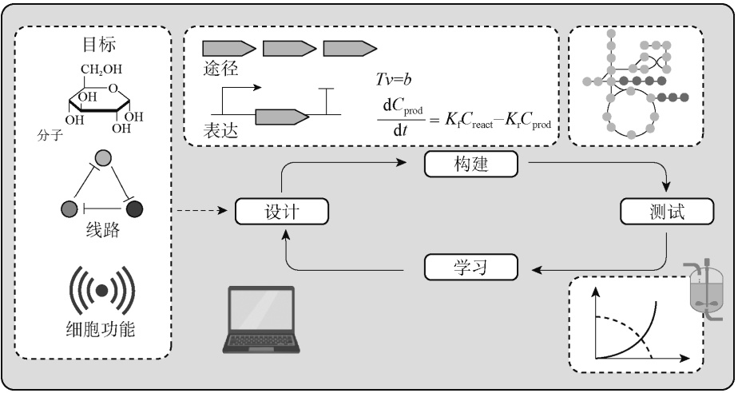

<details>
<summary>flowchart</summary>

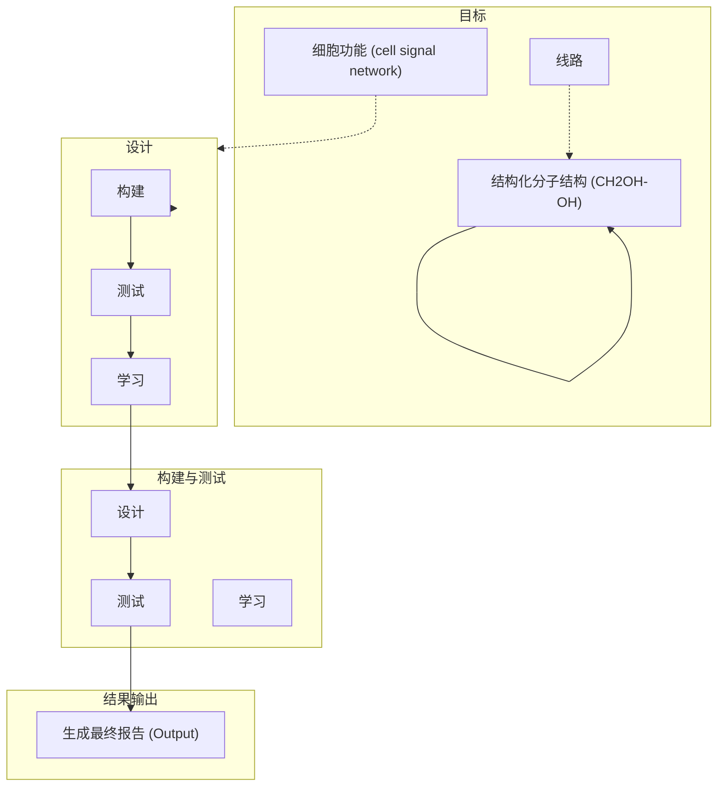
</details>

图 7-1 设计-构建-测试-学习（DBTL）的研究范式<sup>[4]</sup>

Tv 为时间常数（time constant）与某个变量（variable）v 的关系；b 为比例常数或理想值； $\mathrm { d } C _ { \mathrm { p r o d } } / \mathrm { d } t$ 为微分表达式，代表产物浓度 $( C _ { \mathrm { p r o d } } )$ 随时间（t）的变化率； $K _ { \mathrm { f } } C _ { \mathrm { r e a c t } }$ 为正向反应速率常数 $\left( \; K _ { \mathrm { f } } \; \right)$ 乘以反应物浓度 $( \; C _ { \mathrm { r e a c t } } \; )$ ，即正向反应的速

率； $K _ { \mathrm { r } }   C _ { \mathrm { p r o d } }$ 为反向反应速率常数 $\left( \; K _ { \mathrm { r } } \; \right)$ 乘以产物浓度 $( C _ { \mathrm { p r o d } } )$ ，即反向反应的速率

至此，可以看到在酿酒酵母合成生物学发展的过程中，人类不仅积累了丰富的酿酒酵母遗传资源和方法论，也对酿酒酵母基因组有了深入的认识。这为酿酒酵母合成生物学未来的发展奠定了坚实的基础。

## 2. 酿酒酵母在合成生物学中的独特地位

酿酒酵母的生物学特性、基因组特点、代谢途径优势及其在疾病研究中的应用等多方面因素塑造出其在生物学领域的重要地位，也反映出其在合成生物学研究及应用中的价值。

首先是酿酒酵母的生物学特性。酿酒酵母是一种生命周期较短、培养方式简单的真核单细胞微生物，在实验中的使用极为方便。酿酒酵母的单细胞特性及具有的高效同源重组机制使得研究人员可以方便地对其进行基因操作，包括基因插入、敲除和替换等。特别是在需要处理大量样本的高通量筛选实验中，这种特性更显得尤为宝贵。此外，酿酒酵母所具备的丰富基因注释和众多的遗传工具为研究人员提供了便利，能够更为精准地设计和搭建基因网络，进而深入理解和精确控制生物系统。

其次是酿酒酵母的基因组特点。酿酒酵母的基因组结构相对简单，保守性高，这使得酿酒酵母成为研究基因功能的理想模型。在过去的研究中，研究人员已经对酿酒酵母的各种生理过程进行了深入探索，包括基因表达、蛋白质合成、细胞周期控制等。这奠定了一个良好的基础，能在此基础平台上设计和构建复杂的生物系统。此外，酿酒酵母中发现的众多基因和信号途径在更复杂的生物体系中也存在，这为人类疾病的研究提供了可能。

再次是酿酒酵母在疾病研究中的应用。由于酿酒酵母的许多生物化学过程与人类相似，酿酒酵母被广泛用作疾病模型，用于药物筛选和疾病机制研究。特别是对于一些复杂的人类疾病，通过在酿酒酵母中模拟其病理过程，研究人员可以更好地理解疾病的机制，并寻找可能的治疗方法或药物<sup>[6]</sup>。

---

第七章 酵母合成生物学

191

最后是酿酒酵母的代谢途径优势。酿酒酵母具有一系列复杂的代谢途径，能够生产出大量的有机物。同时，这些代谢途径相对简单，易于进行修改和调控。科学家可以通过调整酵母的内源途径，或引入外源基因和途径，使酿酒酵母生产出许多有用的化合物，如药物、生物燃料、高价值化工产品等<sup>[7]</sup>。这一特性使得酿酒酵母在生物制造领域具有巨大的应用潜力。

总的来说，无论是在基因研究、疾病研究还是在生物制造方面，酿酒酵母都展示出其在合成生物学中的重要地位。其生物学特性、基因组优势及代谢途径优势，都为科学家提供了强大的工具，帮助他们在基础研究和应用中取得了更多的突破。

## 3. 酿酒酵母合成生物学的主要应用领域

酿酒酵母合成生物学的应用涵盖了许多领域，包括药物生产、生物燃料生产、食品和饮料工业、环境保护，以及基础生物学研究。

在药物生产领域，科学家通过优化酿酒酵母的代谢路径，成功合成了多种药物。例如，抗疟疾药物青蒿素和抗癌药物紫杉醇就是在酿酒酵母中生产的。酿酒酵母的这种合成能力为药物制造提供了一个有效且可靠的平台。在生物燃料生产中，酿酒酵母已经证明了其作为生物乙醇主要生产微生物的重要地位。此外，通过进一步的代谢工程优化，酿酒酵母现在也能够生产出异戊醇和长链烷烃等更高能量的液体燃料，这些研究成果为实施可持续和环保的能源解决方案提供了可能性。在食品和饮料工业中，酿酒酵母的使用历史悠久，尤其在酿酒、烘焙等领域。利用合成生物学技术，我们可以优化酿酒酵母的代谢途径，使其生产新的风味物质或提高生产效率<sup>[8]</sup>，进一步提升产品的品质和口感。在环境保护中，工程化的酿酒酵母被用于处理废水和有机废弃物<sup>[9]</sup>。例如，它们可以用来吸附含有重金属的废水中的有害物质，或者分解有机废弃物。这种利用生物技术处理废物的方法，既有利于环境保护，也为资源的循环利用提供了新的思路。在基础生物学研究方面，酿酒酵母作为一个模式生物，被广泛用于揭示生命的运作机制。通过构建和优化酿酒酵母的代谢网络，科学家可以深入研究基因的功能和代谢途径的调控机制。这有助于理解生命的本质，也为新的治疗方法提供了理论基础。

借助合成生物学技术，酿酒酵母在多个领域都将进一步展现其广泛的应用价值和关键作用。无论是药物生产、生物燃料、食品工业、环境保护还是基础科学研究，酿酒酵母都展现出其独特的价值和潜力。

## 二、酿酒酵母的生物学基础

## 1. 酵母的分类和特性

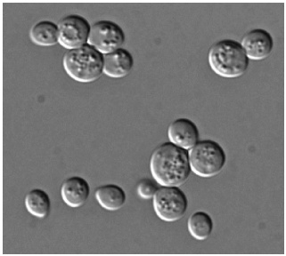

<details>
<summary>natural_image</summary>

Microscopic view of spherical particles or bubbles on a uniform background (no text or symbols visible)
</details>

图 7-2 显微镜下的酿酒酵母

酵母属于真菌界，是一类在生物学和工业应用中都具有重要地位的单细胞微生物。在自然环境中，酵母可以栖息在多样化的生境中，如水体、土壤、植物表面及动物的消化道中。至今已发现的酵母种类超过 1500 种，这些酵母在形态、生理生化特性及遗传背景等方面都有着显著的差异<sup>[10]</sup>。因此，对酵母的分类研究需要基于多个维度的信息，如形态特征、生化特性、分子序列等。

在所有的酵母中，酿酒酵母可能是最为人们所熟知的种类（图 7-2）。在历史悠久的食品工业中，酿酒酵母通过发酵产生二

---

192

合成生物学

氧化碳和乙醇，促使面团膨胀并生成风味物质，从而在面包烘焙和酿酒工业中发挥重要作用<sup>[11]</sup>。同时，由于其生长速度快、基因操作方便等特性，酿酒酵母在生物学研究中也是最重要的模式生物之一，为人们提供了深入理解生命过程的窗口。

## 2. 酿酒酵母的基因组结构

酿酒酵母的基因组结构具有独特的优点:有 16 条染色体（图 7-3），基因组大小为 12～ 13Mb，包含 6000 多个基因，涵盖了所有基本的生命过程，多数基因功能也已被注释，并可以通过 SGD（Saccharomyces Genome Database，http://www.yeastgenome.org）进行检索<sup>[12]</sup>。其基因密度较高，基因之间的间隔小，同时重复序列和非编码序列的比例也较低。这使得酿酒酵母基因组具有较高的实用性，为基因编辑提供了便利，并能在全基因组层面上展开研究。许多酿酒酵母基因与人类基因有着高度的同源性，这使得酿酒酵母可以作为研究人类基因功能的模型。酿酒酵母基因组中还包含了许多只在真菌中出现的特异性基因，如某些糖酵解途径的基因、细胞壁生物合成的特异性基因等，这些基因为酿酒酵母的生物学研究及应用开发提供了独特的资源。

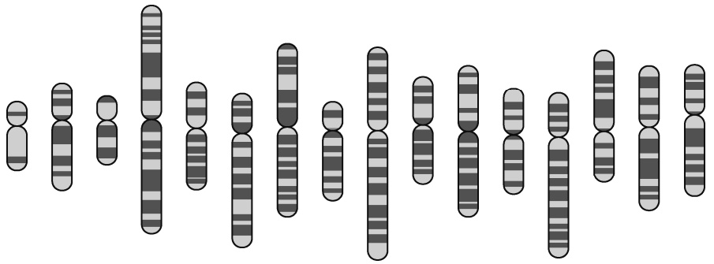

<details>
<summary>natural_image</summary>

Illustration of human chromosomes with no text or labels
</details>

图 7-3 酿酒酵母的 16 条染色体

## 3. 酵母与人类及其他生物的关联

人类与酵母交流互动的历史源远流长，不仅在食品工业中广泛利用酵母进行发酵生产，也在科学研究中利用酿酒酵母作为模式生物探索生命的奥秘。酵母在基因表达调控、信号转导及细胞周期控制等基础生物学研究中，为科学家提供了宝贵的研究工具。利用酿酒酵母进行的研究，使科学家鉴定出了与人类健康息息相关的许多基因和蛋白质。例如，RAS 蛋白最初在酵母中被识别，而其在人类中的同源蛋白与多种癌症的发生有着紧密的联系<sup>[13]</sup>。

酵母在自然生态系统中也扮演着重要角色。在土壤和水体中，酵母通过发酵和呼吸作用，参与有机物质的分解和能量的流动<sup>[14]</sup>。酵母可以协助植物抵御病原微生物的侵害，帮助植物获取营养物质。在动物的消化道中，酵母参与食物的分解和营养的吸收，会对宿主的健康产生影响。

## 三、酿酒酵母合成生物学的挑战与前景

## 1. 酿酒酵母合成生物学面临的科学和技术挑战

人们在酿酒酵母合成生物学方面尽管已经取得了重要的突破，仍然面临着一系列的科学和技术挑战。首要的挑战来自于基因编辑技术的局限性。尽管通过 CRISPR 等技术，人们已经

---

第七章 酵母合成生物学

193

可以方便地进行基因编辑，但对于大规模、多位点的基因编辑，如何提高编辑的效率和准确性仍然存在挑战性。其次，酵母的代谢网络及其调控机制非常复杂，尽管酵母基因组相对高等生物较小，但对其生理过程的理解仍未达到可以精确预测和控制的程度。在合成生物学中，我们希望能通过改造生物的代谢路径来生产有用的物质，如生物燃料、药物等。然而，如何设计、改造和优化复杂的代谢网络，使其达到我们期望的目标，依然是一个极大的挑战。而在酿酒酵母中构建人类疾病模型也面临着挑战。许多疾病，如癌症、阿尔茨海默病等，都是由多个基因的相互作用导致的。如何在酵母中准确地模拟这种复杂性，以便提供更好的疾病模型，需要进一步探索。

## 2. 酿酒酵母合成生物学的伦理和社会考虑

伴随着合成生物学的发展，一些新的伦理和社会问题也浮现出来。改造生物的行为可能会对环境和生态系统产生哪些影响？当经过大规模基因改造的酵母进入自然环境时，是否会对生物多样性产生影响。因此，在进行基因改造的同时，也需充分考虑其可能带来的生态风险，并进行风险评估。与此同时，酿酒酵母合成生物学所带来的知识产权问题如何处理？当使用合成生物学技术改造天然的基因序列，创造出新的酵母菌株时，知识产权的界定及对创新的保护是否得当？这将触发一系列的法律和伦理问题，需要跨领域的专家共同合作，以探讨和解决技术发展带来的法规问题。公众对合成生物学的接受度也是一个不容忽视的社会问题。作为基因工程的深化应用，合成生物学可能引发公众的担忧和恐惧，如对技术被滥用的担忧，以及对未知风险的恐惧等。因此，需要积极进行科普教育，帮助公众正确理解和接受合成生物学。

## 3. 酿酒酵母合成生物学的未来趋势和可能的影响

酿酒酵母合成生物学的进展预示着一系列深远的影响。在科学技术层面，这一领域有望推动更高效和更精确的基因编辑技术的诞生。同时，随着代谢网络设计和优化方法的完善，人类将越发靠近全基因组设计和系统生物学的前沿探索。在社会和伦理层面，将建立更完善的风险评估和监管机制，解决知识产权的问题，以及增加公众的科学素养和接受度，促进合成生物学的安全、公平和公众接受的应用。在应用层面，酵母合成生物学会对许多领域产生影响。例如，通过优化酵母的代谢网络生产更高效的化学品、燃料、蛋白质等，以应对日益增长的市场需求。通过建立更好的人类疾病模型，我们可以加快新药的发现和疾病的治疗。在食品和饮料工业中，通过合成生物学技术定制酵母，不仅可以提高生产效率，还能创造出前所未有的风味和消费体验。在未来的太空探索中，通过酿酒酵母合成生物学，人们可以为宇航员生产满足多种感官和营养需求的食物，为长期的太空旅行和居住提供可持续性<sup>[15]</sup>。

## 第二节

## 酵母合成生物学的工具与方法

## 一、酵母的基因表达与调控

基因表达，作为生物学的核心概念，描述了从 DNA 到 RNA，再到蛋白质的信息流动过

---

194

合成生物学

程。这一过程不仅是生命活动的基石，而且在细胞功能和特性中起到了决定性的作用。酿酒酵母作为一种单细胞真核生物，因其与包括人类在内的高等真核生物的基因表达机制的相似性，被视为模式生物进行研究。在酿酒酵母中，基因表达的调控涉及多个层次，其中，基因表达基本单元的构成尤为关键。一个基本的基因表达单元（或称基因表达盒）主要由启动子、基因编码区和终止子组成（图 7-4）。启动子作为转录的调控区域，决定了基因的转录起始；基因编码区则携带编码蛋白质或特定 RNA 的遗传信息；而终止子标志着转录过程的终止。三者共同确保了基因能得到恰当的表达。值得注意的是，酵母的基因表达系统因其特有的多功能性和灵活性，已被广泛应用于多种微生物的基因研究中，如那些实验室环境中难以操作或分析的微生物<sup>[16]</sup>。此外，酿酒酵母基因表达的研究揭示了许多与人类健康相关的基因和蛋白质，提供了理解生命过程的窗口，为生物技术和医学领域来了深远影响的同时，也带来了无数的机会和挑战。

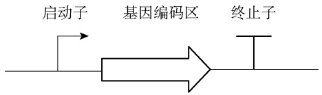

<details>
<summary>flowchart</summary>


</details>

图 7-4 基因表达单元

## （一）启动子

酿酒酵母是目前最重要的基因表达系统之一。得益于简洁、安全、无害的特点，其已经被广泛用作生产高值代谢产物的理想细胞工厂。启动子作为基因转录的核心元素，可调节转录的启动和强度，在控制基因表达和优化代谢途径中起着重要的作用。不同强度和特性的启动子在很大程度上决定了基因的表达效能，进而直接决定了工程生物体系的性能和质量。

酿酒酵母的启动子可大致分为两个部分:调节区域和核心区域（core promoter）。调节区域决定转录的强度，核心区域决定转录的方向和起始位点（图 7-5）。酿酒酵母的启动子调节区域具有上游激活序列（UAS）或上游抑制序列（URS），大致位于启动子核心区域上游的 100～ 1400bp 处，包含一个或多个转录因子结合位点，这些位点通过结合特定的转录因子来激活或抑制转录。

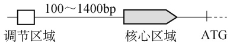

图 7-5 启动子示意图

在合成生物学领域，天然的酿酒酵母内源启动子作为关键元件，被广泛应用于调控基因表达，以满足特定的科研和应用需要。过去的几十年中，已经鉴定和利用了许多酵母的内源启动子<sup>[17]</sup>。例如，从糖酵解途径衍生出的启动子，如 $\mathrm{P}_{\mathrm{TDH}3} 、 \mathrm{P}_{\mathrm{PGK}1} 、 \mathrm{P}_{\mathrm{ADH}1}$ 和 $\mathrm { P _ { P D C 1 } }$ ，尤为常见。其他常用的启动子包括细胞色素 c 同源异构体启动子 $\mathrm { P } _ { \mathrm { C Y C 1 } }$ 和转录延伸因子启动子 $\mathrm { P _ { T E F 1 } }$ 。不同的启动子具有不同的强度，直接影响基因表达的效果。因此，为了确保基因的最佳功能表达，选择合适的启动子是至关重要的。这些内源启动子可以进一步划分为组成型和诱导型两大类。组成型启动子无须额外添加物质，便可启动基因的表达。它们可持续介导基因的表达，在代谢工程和合成生物学中备受青睐。诱导型启动子则可以响应特定的信号，使基因表达强度得到增强或减弱。通过调节培养基中的某些成分，改变特定信号的强弱，可以调控特定蛋

---

第七章 酵母合成生物学

195

白质的表达，或将细胞的生长与产物合成阶段区分开，避免异源有毒蛋白或产物合成带来的损害。需注意的是，诱导型启动子的强度不一定优于组成型启动子。在选择使用组成型还是诱导型启动子时，应当理性考虑，权衡启动子的诱导剂、基础活性及诱导因子的特性。一些常见的诱导型启动子包括由半乳糖诱导的启动子，如 $\mathrm { P _ { G A L 1 } }$ $\mathrm { P } _ { \mathrm { G A L } 2 }$ 和 $\mathrm { P } _ { \mathrm { G A L } 7 }$ ，还有其他如 $\mathrm { P } _ { \mathrm { A D H } 2 }$ 和$\mathrm { P _ { C U P 1 } }$ 等启动子。半乳糖诱导表达系统的工作原理是，在高葡萄糖浓度下，Snf1-Mig1 途径抑制GAL4 的表达，从而抑制 $\mathrm { P _ { G A L } }$ 启动子的活性。在缺乏半乳糖的情况下，调节因子 Gal80 结合到转录激活因子 Gal4 上，从而阻止 $\mathrm { P _ { G A L } }$ 转录的启动。然而，在无葡萄糖并存在半乳糖的条件下，Gal3 结合到 Gal80 上，诱导构象变化，释放 Gal4，随后激活 $\mathrm { P _ { G A L } }$ 启动子的转录<sup>[18]</sup>。

基因表达系统的调控和优化对于合成生物学的应用至关重要。启动子作为基因表达的关键调节元件，是这一调控策略的核心。近年来，由于内源性启动子无法满足全场景的需求，因此启动子工程和改造已经成为一个热门研究领域<sup>[19]</sup>，旨在提高基因的表达效率和特异性。一项研究表明，通过对酵母启动子 $\mathrm { P _ { G P D 1 } }$ 进行截短，可以在某些工程菌株中减少甘油的形成并提高乙醇的发酵效率，为基因表达提供了全新的调控机制。此外，借助合成生物学技术可构建出杂合型启动子；这些启动子糅合了不同启动子的特性，以实现特定的表达模式。例如，通过将新日柄杆菌（Caulobacter crescentus）的木糖依赖型 DNA 结合抑制因子（XylR）与棉阿舒囊霉（Ashbya gossypii）的 TEF 启动子进行组合，构建的杂合型启动子能在酿酒酵母中实现木糖诱导的基因表达，为基因调控提供了新的工具<sup>[20]</sup>。合成的 GAL1 核心启动子为在酿酒酵母中构建 AND 门动态控制器提供了一个便利的平台，为精确控制基因表达开启了新的可能性<sup>[21]</sup>。随着研究的深入，发现某些特定的合成启动子如 $\mathbf { P } _ { 3 \mathrm { x C - T E F 1 } }$ ，在各种环境条件下都展现出高强度与稳定的表达效果。为了更好地利用启动子，调控基因表达，Yuan 等构建了酿酒酵母的全基因组启动子库<sup>[22]</sup>，这为研究人员在特定条件下，快速鉴定与选择合适的启动子提供了便利。然而，酿酒酵母启动子长度通常在数百 bp，相对较长，在一定程度上限制了酵母在大规模合成生物学研究中的应用。Redden 和 Alper 构建出包含 1500 万个候选对象的元件库，经过深入分析及鲁棒性测试，成功筛选出 9 个鲁棒性强的最小启动子核心元件<sup>[23]</sup>。这些元件与特定的上游激活序列组合，可创建出长度小于 120bp、效率与传统启动子相当但长度缩短高达80%的高效启动 $子。$ 此项研究不仅实现了酵母启动子的高效缩减，还为酵母及其他真菌的合成生物学研究带来了宝贵的新工具。综上所述，酿酒酵母中的启动子工程和改造为合成生物学与代谢工程提供了强大的工具，使得基因的表达可以被精确地调控。这为高效的基因表达和代谢产物的生产提供了有力支撑，预示着其在未来科学研究和工业应用中具有广阔前景。

## （二）终止子

基因正确表达过程离不开终止子这一个关键元件。终止子负责标记转录的终止位置并确保 mRNA 得到正确的加工和成熟。尽管大部分基因表达的研究焦点集中在启动子的活性上，使得终止子相对较少受到关注，但其在基因表达调控中的重要性不容忽视。近年的研究表明，终止子不仅影响基因的转录效率，还可以调节 mRNA 的半衰期和稳定性。有研究指出，使用具有增强表达的终止子可以延长 mRNA 的半衰期，进而提高基因的表达水平<sup>[24]</sup>。为深入探索终止子的功能和特性，“Terminatome”这一工具箱应运而生，它汇聚了酿酒酵母全基因组的终止子区域，为研究人员提供了宝贵的信息<sup>[25]</sup>。有趣的是，一些终止子还具有双向性的特征。这意味着某些终止子可以在两个方向上终止转录，有效地阻止隐性转录进入邻近的基因<sup>[26]</sup>。Wei 等进行了一项系统性的研究，他们在 $\mathrm { P _ { T Y S 1 } }$ 介导表达的增强型绿色荧光蛋白（eGFP）报告

---

196

合成生物学

基因下游插入了 100 种不同的酵母终止子，并测量了相应的 eGFP 荧光强度，从而对这些终止子的功能特性进行了评估<sup>[27]</sup>。在所评估的终止子中，45 个被确定为强终止子，31 个为中等终止子，24 个为弱终止子。当以 $\mathrm { T _ { P G K 1 } }$ 作为基准终止子进行比较时，这些终止子的功能强度为0.0613～1.8002，平均相对荧光强度为 0.9945。实验也揭示出终止子内部效率元件与其功能强度之间存在显著的关联。此外，终止子的选择也会直接影响基因的表达:当强终止子与诱导型启动子或组成型强启动子匹配时，其对基因表达的影响较小；但与弱启动子匹配时，基因表达会有显著的增强。研究还进一步指出，在不同的酵母生长条件下，虽然碳源对强和中等终止子的影响并不显著，但果糖和蔗糖可显著增强弱终止子的强度。此项研究为人们深入理解酵母终止子的功能提供了重要的视角。随着对终止子功能和调控机制的进一步探索，可以期待在基因表达调控中发现更多的应用方式和优化策略。

通过对基因表达的精细调控，可以实现生物合成途径和生物生产过程优化等多方面的应用。在酿酒酵母中，通过多样化的启动子和终止子来达到基因表达的精细调控是合成生物学和基因工程领域的重要手段。通过选择和设计适当的启动子与终止子，研究人员能够在多个层面（如转录启动、转录效率、转录终止和 mRNA 的稳定性等）调控基因的表达，从而精确地控制基因的表达水平和表达模式。这对于基因功能的研究、代谢途径的构建和优化，以及合成生物系统的设计和应用具有重要意义<sup>[28]</sup>。

启动子和终止子进行组合为研究人员提供了多样化的选择，也对如何设计、挑选合适的特定启动子-终止子应用于研究提出了挑战。为了加速设计过程，Roehner 等开发了一个名为“Double Dutch”的计算辅助工具，可用于生物系统元件的组合设计<sup>[29]</sup>。该工具包括一种模拟退火算法，可以在考虑表达强度、部分重复使用和合成成本的情况下选择合适的组合（图 7-6）。2017 年，Burén 等将来自模式固氮细菌维涅兰德固氮菌（Azotobacter vinelandii）的含 9 个

表征DNA组件库

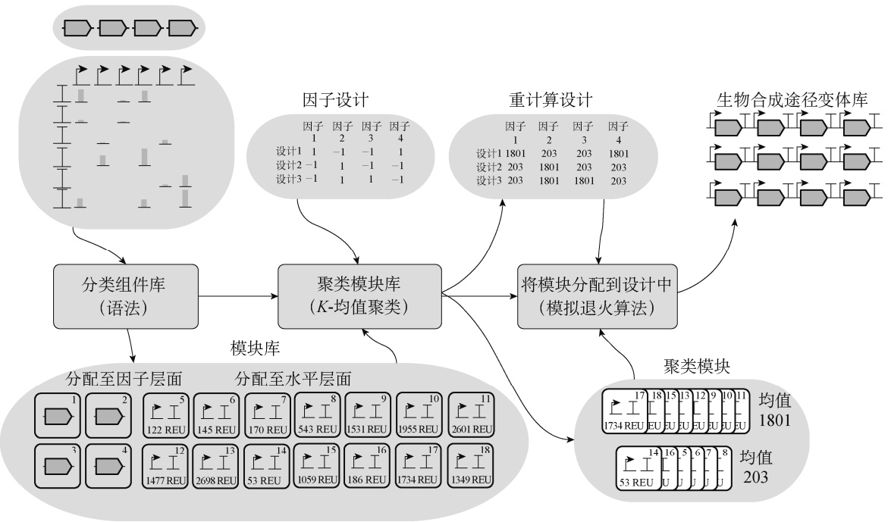

<details>
<summary>flowchart</summary>

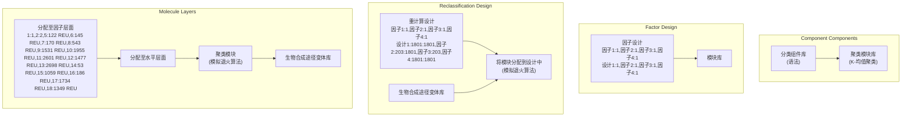
</details>

图 7-6 在 Double Dutch 中设计生物合成途径库的工作流程及此工作流程涉及的数据<sup>[29]</sup>

---

第七章 酵母合成生物学

197

固氮酶基因的基因簇（nifHDKUSMBEN）整合至酵母染色体上，以期验证固氮酶在真核细胞中的表达情况，为未来开发固氮作物奠定基础<sup>[30]</sup>。在这项研究中，他们的核心目标是优化固氮酶的表达并确保其在线粒体中正确定位。为此，研究人员运用了前述工具，利用了 29 个启动子和 18 个终止子进行组合，以优化调控这些基因的表达水平，并最终成功实现了 NifDK 四聚体的组装。在一项关于酿酒酵母用于生物合成衣康酸的研究中，研究人员利用一组表达强度差达 174 倍的启动子-终止子组合来实现对基因表达水平的精细调控；通过迭代平衡通路表达，最优菌株产生了 815mg/L 的衣康酸，比出发菌株提高了 4 倍<sup>[31]</sup>。

这些研究表明，通过优化启动子和终止子的选择与组合，可以实现生物合成途径中关键酶的高效表达和协同调控，进而提高生物合成途径的效率和产物产量。通过合成生物学的方法，还可以进一步扩展启动子和终止子的多样性与功能，为基因表达的精细调控提供更多的可能性和选择，从而推动合成生物学和基因工程领域的发展与创新。

## （三）筛选标记

在酿酒酵母的基因操作如基因敲除、基因片段替换、整合或质粒的转化等步骤中，需使用筛选标记来选择正确的转化子。根据功能和应用的特性，筛选标记被划分为多种类型。最初用于酵母转化的筛选标记基因是内源的营养型隐性标记，后来又增加了显性标记（如药物抗性）。这些标记基因的选择和使用取决于特定的应用和菌株背景。如果菌株缺乏合适的营养缺陷基因型而无法使用隐性标记，则须选择使用显性标记。这种情况在野生型或工业菌株中较为常见。

原养型营养标记在筛选标记中占有重要地位。这类标记主要源于氨基酸或核苷酸的生物合成途径，它们在具有相应基因失活或缺失的营养缺陷型酵母菌株中发挥作用（表 7-1）<sup>[32]</sup>。

表 7-1 常见营养型标记<sup>[32]</sup>

<table><tr><td>基因名称</td><td>基因产物</td><td>筛选条件a</td></tr><tr><td colspan="3">内源基因</td></tr><tr><td>ADE1</td><td>N-琥珀酰-5-氨基咪唑-4-甲酰胺核糖核苷酸合成酶,参与嘌呤的生物合成</td><td>缺乏腺嘌呤</td></tr><tr><td>ADE2</td><td>磷酸核糖基氨基咪唑羧化酶,参与嘌呤的生物合成</td><td>缺乏腺嘌呤</td></tr><tr><td>ADE8</td><td>磷酸核糖-甘氨酰胺转甲酰酶,参与嘌呤的生物合成</td><td>缺乏腺嘌呤</td></tr><tr><td>ECM31</td><td>酮泛酸羟甲基转移酶,参与泛酸的生物合成</td><td>缺乏泛酸</td></tr><tr><td>HIS2</td><td>组氨醇磷酸酶,参与组氨酸的生物合成</td><td>缺乏组氨酸</td></tr><tr><td>HIS3</td><td>咪唑甘油-磷酸脱水酶,参与组氨酸的生物合成</td><td>缺乏组氨酸</td></tr><tr><td>LEU2</td><td>β-异丙基苹果酸脱氢酶,参与亮氨酸的生物合成</td><td>缺乏亮氨酸</td></tr><tr><td>LYS2</td><td>α-氨基己二酸还原酶,参与赖氨酸的生物合成</td><td>缺乏赖氨酸</td></tr><tr><td>MET15</td><td>O-乙酰高丝氨酸-O-乙酰丝氨酸硫化氢酶,参与含硫氨基酸的生物合成</td><td>缺乏甲硫氨酸、半胱氨酸</td></tr><tr><td>TRP1</td><td>磷酸核糖基邻氨基苯甲酸异构酶,参与色氨酸的生物合成</td><td>缺乏色氨酸</td></tr><tr><td>URA3</td><td>乳清酸核苷-5&#x27;-磷酸脱羧酶,参与嘧啶的生物合成</td><td>缺乏尿嘧啶</td></tr><tr><td colspan="3">异源基因</td></tr><tr><td>AURA3</td><td>源自Arxula adeninivorans的乳清酸核苷-5&#x27;-磷酸脱羧酶</td><td>缺乏尿嘧啶</td></tr><tr><td>CaLYS5</td><td>源自白假丝酵母的磷酸泛酰巯基乙胺基转移酶</td><td>缺乏赖氨酸</td></tr><tr><td>CaURA3</td><td>源自白假丝酵母的乳清酸核苷-5&#x27;-磷酸脱羧酶</td><td>缺乏尿嘧啶</td></tr><tr><td>KILEU2</td><td>源自乳酸克鲁维酵母的β-异丙基苹果酸脱氢酶</td><td>缺乏亮氨酸</td></tr></table>

---

198

合成生物学

续表

<table><tr><td>基因名称</td><td>基因产物</td><td>筛选条件a</td></tr><tr><td colspan="3">异源基因</td></tr><tr><td>KIURA3</td><td>源自乳酸克鲁维酵母的乳清酸核苷-5&#x27;-磷酸脱羧酶</td><td>缺乏尿嘧啶</td></tr><tr><td>MET2-CA</td><td>源自卡尔斯伯酵母的L-高丝氨酸-O-乙酰基转移酶,参与甲硫氨酸的生物合成</td><td>缺乏甲硫氨酸</td></tr><tr><td> $Sp\ his5^{+}$ </td><td>源自粟酒裂殖酵母的咪唑甘油-磷酸脱水酶</td><td>缺乏组氨酸</td></tr><tr><td> $Sp\ ura4^{+}$ </td><td>源自粟酒裂殖酵母的乳清酸核苷-5&#x27;-磷酸脱羧酶</td><td>缺乏尿嘧啶</td></tr></table>

a 不含相应成分的培养基

以酿酒酵母的 URA3 基因为例，该基因编码鸟嘌呤脱氢酶，是尿嘧啶生物合成途径中的关键酶，负责将鸟嘌呤转化为尿嘧啶，在整个途径中扮演着关键角色。酿酒酵母细胞在 URA3基因缺失或失活的情况下，无法合成尿嘧啶，因此表现为尿嘧啶营养缺陷型。当研究人员需要将外源 DNA（如质粒）引入这些酿酒酵母细胞时，URA3 基因可以作为筛选标记；只有成功转化质粒并表达 URA3 基因的细胞才能在缺乏尿嘧啶的培养基上生长（图 7-7）。此外，URA3基因还具有反向筛选的功能。具体而言，携带 URA3 基因的酿酒酵母细胞在含有 5-氟乳清酸（5-FOA）的培养基中无法生存。这是因为 5-FOA 是尿嘧啶的结构类似物，当 URA3 在酿酒酵母中被表达时，5-FOA 会被转化为有毒的 5-氟尿嘧啶，从而抑制细胞的生长。因此，当需要从酵母细胞中去除带有 URA3 基因的质粒或其他 DNA 片段时，5-FOA 可以作为反向筛选试剂，只有丢失了 URA3 基因的酿酒酵母细胞可在含有 5-FOA 的培养基上生长。这种特性使URA3 基因成为酿酒酵母分子生物学和合成生物学中的宝贵工具，为研究人员提供了筛选和分析酿酒酵母基因编辑的有效手段<sup>[32]</sup>。此外，某些原养型营养标记还可以基于菌落的颜色进行基因型筛选。例如，携带失活的 ade1 或 ade2 等位基因的酿酒酵母菌株会因嘌呤生物合成途径前体在液泡中积累而呈红色，而腺苷原养型菌株则为白色。除了使用酿酒酵母的内源性营养基因，还可以利用异源基因来补偿酿酒酵母的营养缺陷，进而作为筛选标记。

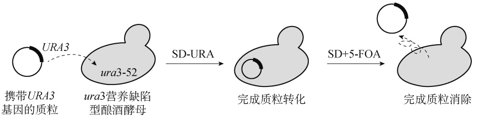

<details>
<summary>flowchart</summary>


</details>

图 7-7 URA3 可作为筛选及反向筛选标记进行应用

SD-URA. 缺尿嘧啶的培养基；SD+5-FOA. 含 5-FOA 的培养基

在酿酒酵母的合成生物学相关研究中，除了营养筛选标记，抗性标记也起到了关键作用。这些标记为研究人员提供了筛选成功转化或已完成基因敲除的酿酒酵母细胞的有效工具。kan抗性标记赋予酿酒酵母对遗传霉素（geneticin，G418）的抗性，这是一种氨基甘露醇类抗生素，对多种真菌和细菌都有抗性效果。含有 kan 抗性标记的酿酒酵母能够在含有 G418 的培养基中生存<sup>[33]</sup>。而 cat 抗性标记提供了对氯霉素（chloramphenicol）的抗性，这是一种广谱抗生素，主要用于抑制细胞的蛋白质合成。ble 抗性标记则使酿酒酵母对腐草霉素（phleomycin，属于博来霉素家族）具有抗性。这些抗性标记为缺乏合适营养缺陷型背景的酿酒酵母菌株中的遗传工程提供了快速、简便和可靠的筛选手段。随着新的抗性标记和筛选方法的不断开发，

---

第七章 酵母合成生物学

199

预期未来的酿酒酵母合成生物学相关研究有望实现更高的转化效率与稳定性。

## （四）转录因子与动态调控

基因表达是一个多阶段且高度复杂的过程，其从 DNA 转录到 RNA，再由 RNA 翻译为蛋白质。为确保特定的基因在恰当的时间和环境中得到准确的表达，这些步骤受到多种分子机制的调控。其中，转录因子在基因表达调控中起到了重要的作用。转录因子是一类特殊的蛋白质，能够与 DNA 上的特定序列结合，从而增强或抑制某个或多个目标基因的转录活性。在酿酒酵母中，转录因子根据其 DNA 结合模式、特定的 DNA 结合序列及其在转录过程中的角色（如激活或抑制）被分类。它们在酿酒酵母的多种生理过程如细胞周期调控、应激响应和代谢途径的调节中都不可或缺。转录因子通常结合到基因启动子区域的特定 DNA 序列上，这些序列被称为转录因子结合位点（TFB），它们的存在和位置决定了基因是否及何时被转录。需要强调的是，转录因子的活性和表达水平也是受到严格调控的。例如，某些转录因子可能仅在特定的环境条件下被激活，或者需要与其他蛋白质或小分子结合后才能发挥作用。高通量测序技术的应用为人们识别并详细描述了酵母中的众多转录因子，揭示了其结合位点、调控网络和功能，提供了一个全面的视图，帮助人们了解酵母细胞如何通过复杂的转录调控网络来响应环境变化和调控其生理过程<sup>[34]</sup>。随着合成生物学的发展，酵母中的转录因子被广泛应用于调控基因表达水平，以及构建基因回路、生物传感器和其他工具中。

在利用微生物进行化合物生产时，经常需要对其固有代谢过程进行全面的重编程。这通常涉及对多个基因的表达进行同步调整，而传统的方法在这方面可能显得力不从心。利用全局转录机制工程技术（global transcription machinery engineering，gTME）可以实现对整体转录组的调整，从而引发多个基因的转录变化，并赋予细胞新的特性。尽管该技术在原核细胞中已得到验证，但由于真核细胞中具有多种不同功能的 RNA 聚合酶，其转录机制更为复杂，这对于应用该技术来说是一个挑战。Alper 等通过对转录因子 Spt15 进行突变和筛选，得到了能够增强乙醇耐受性和提高葡萄糖转化为乙醇效率的正向突变。SPT15 基因中三个独立突变的联合效应产生了这种预期表型，具体为苯丙氨酸被丝氨酸所替代（Phe177Ser）、酪氨酸被组氨酸所替代（Tyr195His），以及赖氨酸被精氨酸所替代（Lys218Arg），研究展现出 gTME 技术在实现传统方法难以触及的复杂表型改造方面的潜力<sup>[35]</sup>。Huang 等对几株具有不同蛋白质分泌能力的酿酒酵母突变株进行了全基因组水平的转录响应变化分析（图 7-8）<sup>[36]</sup>。研究表明，为了支撑蛋白质的高效分泌，酵母细胞中的许多生理过程都发生了相应调整，尤其是其能量代谢发生改变，表现为呼吸效应减弱和发酵特征增强。同时，氨基酸的生物合成平衡与硫胺素的生物合成降低也有积极影响。继而他们采用一种名为转录因子报告分析（transcription factor reporter analysis）的技术，识别出了在突变株中与蛋白质分泌高度相关的关键转录因子。通过调节这些转录因子的表达水平（如过表达或敲除），成功提高了蛋白质的分泌量。例如，当过表达 Mbp1、Mss11 和 Sut1，或敲除 Tup1、Bas1、Hap2 和 Hap4 等转录因子时，酵母细胞分泌蛋白质的能力得到增强。

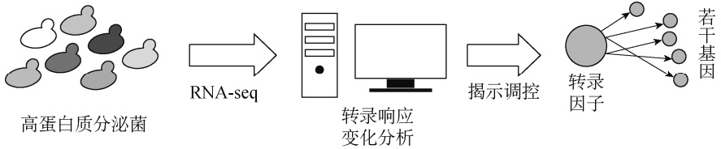

<details>
<summary>flowchart</summary>


</details>

图 7-8 酵母全基因组水平的转录响应变化分析

---

200

合成生物学

基于转录因子对启动子的调节作用，可以构建用于监测细胞状态或动态调控代谢网络的生物传感器系统。此传感器系统通常由三个模块组成:信号输入（signal input）、信号感应（signal sensing）和信号输出（signal output）（图 7-9）。转录因子的配体结合结构域（ligand-binding domain，LBD）感知输入信号，如代谢产物和化学诱导剂等，并导致其 DNA 结合结构域（DNA-binding domain，DBD）发生构象改变。随后，这些发生构象变化的转录因子会结合到启动子的转录因子结合位点，进而触发转录输出信号。基于转录因子的生物传感器技术已逐渐成为合成生物学与代谢工程领域中的重要工具。它们被广泛应用于多种场景，如异源途径优化、高通量筛选及菌株评估等<sup>[37]</sup>。

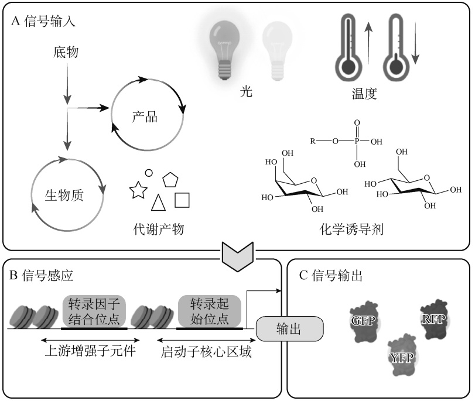

<details>
<summary>flowchart</summary>

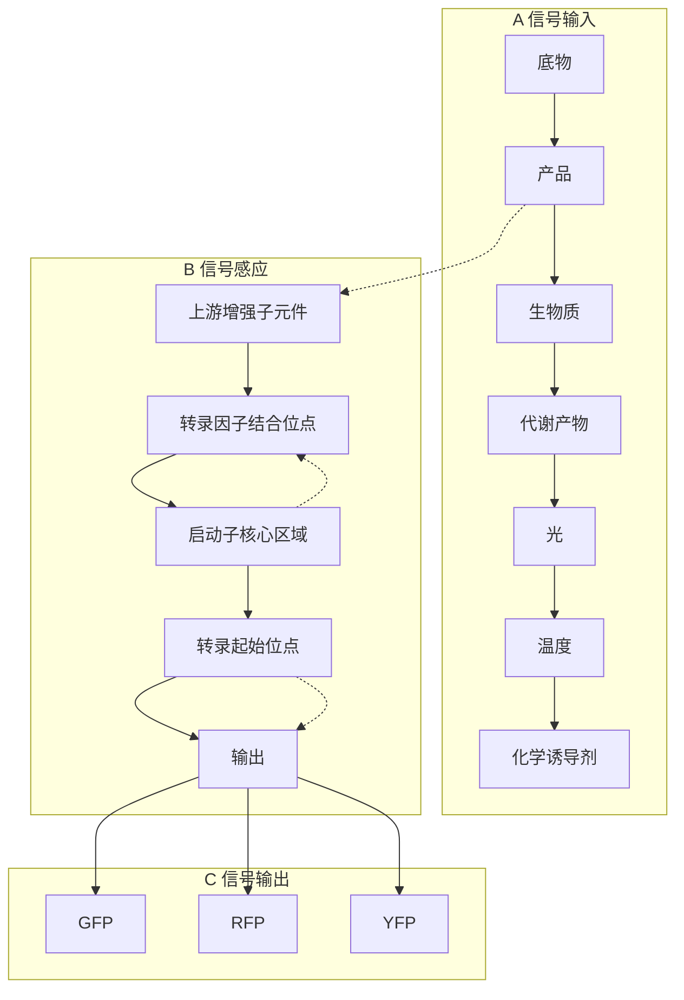
</details>

图 7-9 基于响应型转录因子-启动子的生物传感器系统<sup>[37]</sup>

GFP. 绿色荧光蛋白；RFP. 红色荧光蛋白；YFP. 黄色荧光蛋白

动态调节是平衡细胞生长和产品合成两个阶段的有效策略。当细胞生物量积累达到一定的阈值需切换到产物的生物合成时，可以通过添加化学诱导剂来增加生物合成途径的代谢通量，从而在细胞生长和产品合成之间达成平衡<sup>[38]</sup>。

碳源、营养物和离子等都可作为化学诱导信号。基于这类物质的浓度变化，可对目标基因进行转录调节，实现基因的上调或下调。Bian 等在酿酒酵母中开发了一个双信号分层动态调控系统，该系统可同时感应葡萄糖浓度和培养温度变化<sup>[39]</sup>。其中，δ-胡萝卜素的合成基因由响应葡萄糖变化的启动子 $\mathrm { P } _ { \mathrm { A D H } 2 }$ 控制，而将 δ-胡萝卜素转化为叶黄素的基因则由温度响应型的 GAL 启动子控制。该系统将叶黄素生物合成分为三个阶段:第一阶段（高葡萄糖水平，30℃）是酵母细胞的生长阶段，第二阶段（低葡萄糖水平， $3 0   \mathrm { ^ \circ C }$ ）是 δ-胡萝卜素的合成阶段，第三阶段（低葡萄糖水平， $2 4   \mathrm { ^ { \circ } C }   )$ ）是 δ-胡萝卜素转化为叶黄素阶段。这种策略有效地解决了细胞生长和产物合成之间的冲突，并降低了细胞途径的内部竞争，工程化酵母菌株 YLutein-3S-6的叶黄素合成水平最终达到了 19.92mg/L，是当时报道的叶黄素异源生产系统中的最高水平。Teixeira 等使用铜离子响应启动 $子  \; \mathbf{P}_{ CUP 1}$ 来精确调控脂肪酰基辅酶 A 合酶 Faa1 的表达，从而

---

第七章 酵母合成生物学

201

高效地调节游离脂肪酸向脂肪酰基辅酶 A 的转化过程<sup>[40]</sup>。这种方法规避了直接敲除 Faa1 和Faa4 时可能引发的游离脂肪酸过量释放和前体物质的不必要浪费问题。Zhou 等则结合了天然GAL 系统和铜离子响应启动子的各自特点，巧妙地将 Gal4 和 Gal80 分别置于铜诱导启动子$\mathrm { P _ { C U P 1 } }$ 和铜抑制启动子 $\mathrm { P } _ { \mathrm { C T R } 3 }$ 的控制下，从而构建出新的铜诱导 GAL 调控系统—CuIGR。他们进一步引入了基于 N 端降解子（N-degron）的蛋白质降解技术，将一个特定的降解标签（Ndegron tag，K15）与 Gal80 的 N 端进行融合，减少了 Gal80 的浓度，成功降低了系统的本底表达水平，从而实现了更广泛的动态调控范围。这一新的铜诱导 GAL 调控系统被命名为CuIGR4。在 CuIGR4 系统中，受启动子 $\mathrm { P _ { G A L 1 } }$ $\mathrm { P } _ { \mathrm { G A L } 2 }$ $\mathrm { P } _ { \mathrm { G A L } 7 }$ 和 $\mathbf { P } _ { \mathrm { G A L 1 0 } }$ 驱动的基因表达显示出了高度的调控精确性。相较于天然的铜离子诱导启动子 $\mathrm { P _ { C U P 1 } }$ ，CuIGR4 系统对铜离子的响应强度提升了 2.7 倍；当加入微量的铜离子进行诱导后，报告荧光蛋白 EGFP 的表达水平和番茄红素的产量分别提升了 72 倍和 33 倍<sup>[41]</sup>。

虽然采用化学物质进行诱导较为常用，但是一些化学诱导剂价格较高，并有干扰细胞代谢途径的潜在风险。此外，应用化学诱导剂时，其诱导效果可能难以完全逆转。鉴于这些挑战，研究人员探索了其他诱导方法，如光和温度，作为潜在的替代方案。

采用光进行基因的诱导表达具有多种优势:成本较低，对细胞干扰小，可在空间和时间上进行精确调控，以及具有可逆特性。光遗传学是一个新兴的领域，专注于使用光来调控细胞内的各种生理过程。光遗传学系统的一个特点是能够响应不同波长的光。近年来的研究表明，当结合多种光响应系统时，可以通过减少它们之间的相互干扰，实现“正交调控”，从而使基因表达的调控更为精确和稳定<sup>[37]</sup>。光受体蛋白是一种在受到特定波长光的照射后会发生构象变化，并进而形成寡聚体或聚合体的特殊蛋白。光遗传学系统主要基于光诱导转录因子来工作，该转录因子由两个主要部分组成:DNA 结合结构域（DBD）和光响应域（VVD）。当受到蓝光的照射时，这些转录因子会发生二聚化，进而结合至基因上游序列，直接激活或抑制基因的转录。基于光遗传学工具，研究人员可以通过简单地调整光的强度和照射时间，以精确地调控关键基因的表达水平和持续时间。Xu 等构建了一个名为 yLightOn 的单组分光遗传学系统，用于调节酿酒酵母细胞中的基因表达<sup>[42]</sup>。该系统包括一个 LexA-VVD 光开关转录因子，与 Gal4 激活域（LVAD）融合，可控制红色荧光蛋白（mCherry）对光信号的响应。yLightOn 系统中的抑制蛋白 LexA 源于大肠杆菌的 SOS 响应系统，与酿酒酵母细胞的遗传分子元件保持正交，从而避免与酿酒酵母细胞成分发生串扰所导致的泄露表达。yLightOn 系统不仅设计精简，其调控也十分严格，其开启与关闭的表达比例高达 500 倍。此外，该系统通过采用基于 ssrA 蛋白降解标签的策略，实现了在酵母细胞中对蛋白质的稳定时空调控。Zhao等成功构建了两种光遗传学线路:OptoEXP 与 OptoINVRT。其中，OptoEXP 是光诱导型遗传线路，而 OptoINVRT 则为光抑制型遗传线路。这两种线路可用于调控酿酒酵母细胞生长并提升高值产品的产量<sup>[43]</sup>。在验证实验中，异丁醇和 2-甲基-1-丁醇的产量分别达到 8.49g/L 和2.38g/L。然而，在大规模发酵过程中，由于生物反应器内的光穿透能力有限，使用这些光诱导调控系统会面临挑战。为了解决这一问题，研究人员在 OptoEXP 光遗传学线路与 GAL 调控系统的基础上，进一步研发了蓝光激活的 OptoAMP 线路，旨在增强其对光的转录响应。OptoAMP 系统通过光控实现三阶段发酵（生长、诱导和生产阶段），成功提高了乳酸、异丁醇和柚皮素等产品的产量<sup>[44]</sup>。但 OptoAMP 与 OptoINVRT 都基于 GAL 调控系统，这意味着当需要同时激活和抑制基因时，其功能受到限制。为了拓宽应用范围，Lalwani 等引入了来自粗糙脉孢菌（Neurospora crassa）的 Q 系统，据此构建了新型的光诱导线路（OptoQ-AMP）和光抑

---

202

合成生物学

制线路（OptoQ-INVRT）。鉴于 Q 系统和 GAL 调控系统的正交性，新的光遗传学工具（OptoQ-AMP 和 OptoQ-INVRT）与既有系统可以协同工作，实现在光控制下对不同基因的同步激活和抑制。采用这两个正交的光遗传学线路调控乙偶姻合成途径中的多个基因，可实现乙偶姻产量的显著提升，达到 35g/L<sup>[45]</sup>。

在微生物培养中，温度作为关键的控制参数，会显著影响发酵过程。事实上，即使在细胞生长的后期，也可通过改变温度来实现对基因表达的控制。这种温度调控机制通过调节温度来调控温度敏感蛋白与启动子之间的相互作用，从而得到控制基因表达的效果<sup>[37]</sup>。在酿酒酵母中，已有文献报道了若干种温度诱导表达的元件或系统，包括温度敏感的酸性磷酸酶启动子，受温度敏感蛋白 Sir3 抑制的 MATα 系统，以及基于 Gal4 转录因子温度敏感型突变体的GAL 系统等。

GAL 系统操作简便，能有效地诱导异源基因高效表达。但是，由于 GAL 系统中对葡萄糖响应的中间代谢物的负调控，可能会在低葡萄糖浓度下产生对基因表达的不严谨控制，从而出现基因的表达泄漏。为解决此问题，Zhou 等研究者通过敲除 Gal80 并引入具有温度敏感性的 Gal4 突变体 Gal4M9，构建了一个温度响应型 GAL 系统。经过对其温度诱导特性的验证，该系统已被成功应用于调控番茄红素的生物合成中，细胞生物量和番茄红素分别增加了 44%和 177%，取得了较好的应用效果<sup>[46]</sup>。Gal4M9 的温度响应系统也被应用于解耦虾青素的生产与细胞生长中，在两阶段高密度发酵中产生了 235mg/L 的虾青素，实现了较高水平的生产<sup>[47]</sup>。此外，利用温度响应的调控机制，研究人员可深入探究代谢途径中关键酶的温度偏好性。例如，合成藏红花素的前体—玉米黄质，能在 $3 0 ^ { \circ } \mathbf { C }$ 条件下有效生成并在细胞膜中稳定存储。但位于细胞质中的 Ccd2 酶在此温度下活性受限，影响了藏红花素的产量。通过 Gal4M9 温度调控系统，实现了在 25°C 条件下的同步生物合成和转化，大幅提高了玉米黄质向藏红花素的转化效率。这些研究成果充分展现了温度调控在微生物合成领域的巨大潜力，特别是为高价值化合物的生产提供了一种有效的优化策略。

在基因表达调控中，除了通过人工改变外部环境因素以影响基因表达，也可以根据细胞内部的生理状态进行动态调整。这种策略主要是通过感知细胞内部的代谢状态，以此来调节相应的代谢路径，确保系统处于平衡状态。如此，能够规避由代谢流量过大或不足引起的代谢失衡，从而提高生产效率。细胞密度、胞内代谢物及胞内生理压力等都是能够触发此类动态调节的关键因子。

细胞间通信是一种在生物界中广泛存在的现象，对单一细胞功能及细胞群体内的细胞间互动都具有重要意义。但由于受到内外部环境噪声的影响，确保相同基因型的细胞群体行为的协同性成为一大挑战。研究自然界中的细胞间通信机制，并通过合成生物学方法构建人工细胞间通信系统，已被证实能够显著增强细胞群体的协同性<sup>[48]</sup>。这种通信的核心机制在于，随着细胞密度的增加，细胞所分泌的自诱导物浓度也会相应提升。一旦这些自诱导物的浓度超过特定阈值，它们会与调控蛋白形成复合体，从而触发并激活下游基因的表达，无须人为额外添加诱导物，实现了细胞生长与基因表达间的自然关联。

酿酒酵母细胞自身便具备一套原生的细胞间通信系统。其单倍体细胞可被分为“a”型或“α”型，并能够通过释放特异性的小肽信息素来识别邻近的不同交配型细胞。当特异性小肽信息素浓度达到一定水平并与膜受体 Ste2 结合时，会激活 MAPK（mitogen-activated protein kinase）信号通路，并通过 Far1 使细胞停滞在细胞周期的 G<sub>1</sub> 阶段。此外，大约有 200 个基因通过转录激活因子 Ste12 与其启动子上游的 5′-（A/T）GAAACA-3′信息素响应元件结合，从

---

第七章 酵母合成生物学

203

而得以启动表达<sup>[49]</sup>。利用这一原理，Williams 等在 a 型单倍体酿酒酵母细胞中构建了一个群体感应（quorum sensing，QS）系统（图 7-10）<sup>[50]</sup>。通过响应型启动子 $\mathrm { P _ { F U S 1 } }$ 控制 α 信息素和GFP 的表达，设计出一个正反馈回路。随着细胞密度的上升，α 信息素浓度增加，从而促进GFP 和 α 信息素的表达增加。当 α 信息素受到响应芳香族氨基酸启动子 $\mathrm { P } _ { \mathrm { A R O } 9 }$ 的调控时，研究人员可以通过调节芳香族氨基酸的种类及浓度来控制信息素响应途径。这种方法不仅为基于细胞密度和环境因子变化的基因表达调控提供了更高的灵活性，而且有助于优化生物生产过程。

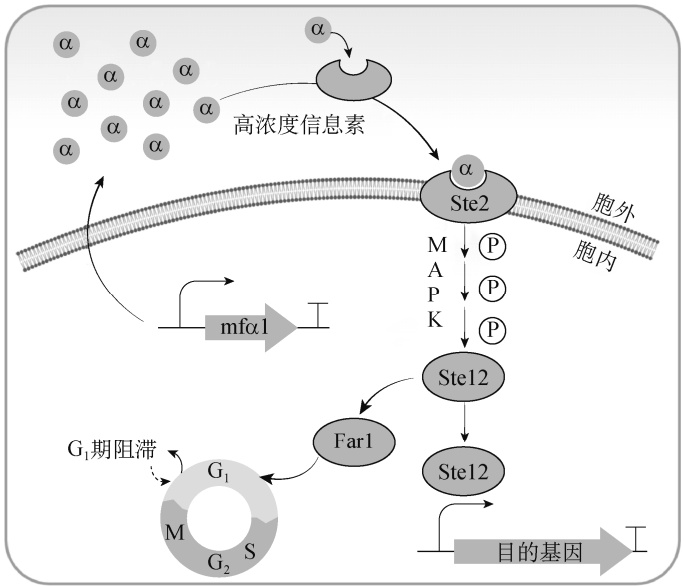

<details>
<summary>flowchart</summary>

This diagram illustrates the molecular signaling pathway of Ste2 and Ste12 proteins, showing how alpha-hydrogenase activity leads to intracellular signaling via mfa1, followed by G1 release and subsequent gene expression.
</details>

图 7-10 基于酿酒酵母 α 信息素的群体感应调控系统（改自文献[37]）

研究人员已经在拟南芥（Arabidopsis thaliana）中鉴定出群体感应系统并将其迁移至酿酒酵母中。通过将拟南芥的细胞因子异戊烯腺苷（IP）引入酿酒酵母细胞进行分泌表达，释放到胞外环境中的 IP 能被附近的细胞所感知。随着酵母细胞密度的上升，累积的 IP 与细胞因子受体 AtCRE1 结合，进而激活内源性的 Ypd1-Skn7 信号通路，并驱动能响应 SKN7 的合成启动子 $\mathrm { P _ { S S R E } }$ 转录表达<sup>[51]</sup>。Yang 等通过引入植物激素诱导降解技术来提升拟南芥群体感应系统在酵母中的应用效果，实现了对关键角鲨烯合成酶 Erg9 的动态降解，将 α-法尼烯的产量提高了80%。这是首次成功利用群体感应介导的动态蛋白质降解技术来调控酿酒酵母的代谢途径<sup>[52]</sup>。

近年来，基于代谢物的生物传感器在动态调控代谢路径中的关键基因表达上发挥了重要作用。这些传感器能够实时监测细胞内代谢物的浓度，从而根据菌株的代谢状态对基因表达进行精确调节。代谢路径中的关键节点可以通过响应关键代谢物浓度变化的生物传感器来调控。通过精细化调控这些节点，可以提高从上游前体到下游产物的转换效率，既提高了目标产物的产量，同时也降低了细胞的代谢压力。这种方法增强了对细胞生长和代谢流向的控制，优化了生产过程。在酿酒酵母的代谢过程中，乙酰辅酶 A 和丙酰辅酶 A 是关键的中间代谢物，并且也是合成许多化学物质的关键前体。以 3-羟基丙酸（3-hydroxypropionic acid，3HP）为例，David 等通过使用高浓度葡萄糖诱导型启动子 $\mathrm { P _ { H X T I } }$ 和 fapO/FapR 系统的双阶段策略实现了对 3HP 合成的动态调控<sup>[53]</sup>。该系统能够感知并响应细胞内丙酰辅酶 A 的浓度变化，从而有效地调节碳代谢流。在发酵过程中，由于葡萄糖的持续消耗，浓度不断降低， $\mathrm { P _ { H X T 1 } }$ 介导的脂肪

---

204

合成生物学

酸合成酶基因 FAS1 表达强度减弱，进而减少了脂肪酸的合成。而不断积累的乙酰辅酶 A 通过与 FapR 结合解除了转录抑制，促使乙酰辅酶 A 还原酶 MCRCα 被动态激活，使 3HP 的产量增加近 10 倍，达到 1g/L。

## （五）RNA 干扰和表达沉默

RNA 干扰（RNA interference，RNAi）是在众多真核生物中所发现的基因沉默机制，涉及小干扰 RNA（siRNA）或微小 RNA（miRNA）分子。在许多生物学过程中，尤其是基因表达的调控中，RNAi 发挥了重要的作用。这些小 RNA 分子与 RNA 诱导沉默复合物（RNA-induced silencing complex，RISC）结合，导向特定的 mRNA 分子，并导致其降解或翻译的抑制<sup>[54]</sup>。

近年的研究显示，虽然酿酒酵母中不存在天然的 RNAi 系统/机制，但通过遗传工程手段可在其细胞内重建 RNAi 系统，推进了 RNAi 的研究和应用。Catala 等在 2004 年的研究中指出，酿酒酵母虽然不具备 RNAi 系统，但其 RNaseⅢ的同源基因（Rnt1p）对细胞周期和核分裂过程却是至关重要的<sup>[55]</sup>。这暗示了与 RNAi 相关的某些分子机制在酿酒酵母中可能扮演了不同的生物学角色。尽管最初科学界认为，包括酿酒酵母在内的所有芽殖酵母（budding yeast）都不具备 RNAi 机制，Drinnenberg 等却在某些芽殖酵母种类，如芽殖酵母（Saccharomyces castellii）和白色念珠菌（Candida albicans）中发现了 RNAi 系统<sup>[56]</sup>。其作用机制为，RNaseⅢ末端核酸酶 Dicer 能将双链 RNA（dsRNA）连续切割为 siRNA，这些 siRNA 随后与效应蛋白Argonaute 结合，发挥对目标转录分子的切割作用。他们经进一步研究发现，只需引入 S. castellii 的两种 RNAi 相关蛋白 Ago1 和 Dcr1，便可在酿酒酵母中构建 RNAi 系统。此外，Suk等尝试将人类 RNAi 系统中相关的三种蛋白质 Ago2、Dicer 和 TRBP 引入酿酒酵母，并使用GAL 启动子调控这三种蛋白质的表达。同时，选用 GFP 作为报告基因来研究人源 RNAi 系统在酿酒酵母中的效果。结果表明，仅需引入人源的 Ago2、Dicer 和 TRBP，酿酒酵母内即可生成 GFP siRNA 并实现对报告基因的表达沉默。这些发现表明，在酿酒酵母中可以通过引入人源的 Ago2、Dicer 和 TRBP 重建人类 RNAi 系统，使酿酒酵母成为深入研究人类 RNAi 系统的遗传模式生物。研究人员还观察到，缺乏 Ago2 或 TRBP 的菌株仍能生成 GFP siRNA，但缺乏 Dicer 的菌株则不能，说明 Dicer 对于 siRNA 的生物合成必不可少，而 Ago2 和 TRBP则是非必需的。

酵母细胞的互作网络具有高度复杂性，仅仅通过对选定的或随机选取的基因进行过表达或敲除，难以完全探明基因功能与目标产物合成之间的联系。而适度的基因抑制表达为提高产物合成效率开辟了更多的可能性，也有助于识别具有潜在益处的下调目标基因。基于这一背景，RNAi 为酿酒酵母的合成生物学应用提供了更为灵活的基因表达调控手段，尤其适用于那些不能直接被敲除的必需基因的表达水平调节，或研究基因剂量效应对目标表型的影响，进而挖掘有益的调控靶点。Wang 等利用 S. castellii 的 Ago1 和 Dcr1 在酿酒酵母中重构了RNAi 系统，旨在挖掘能够提升酵母蛋白质分泌能力的基因靶点<sup>[57]</sup>。通过微流控高通量筛选技术，他们对约 $2 . 4 3   \times   1 0 ^ { 5 }$ 个基于 RNAi 抑制基因表达水平的酵母细胞进行了评估，采用模式蛋白 α-淀粉酶作为指标来分析细胞分泌蛋白质的能力。研究结果显示，多个与细胞代谢、蛋白质修饰、运输和降解相关的基因如 YDC1、AAD4、ADE8、SDH1、VPS73、KTR2、CNL1、SSA1和 CDC39 等在被抑制表达后，均对蛋白质分泌水平产生了显著影响。这进一步证实，利用RNAi 系统可更全面地调控基因表达，为深入研究基因功能并制定新的细胞改造策略提供了坚

---

第七章 酵母合成生物学

205

实的基础。深化对这些机制的认识，有助于人们更有效地构建高效细胞工厂，以满足对特定目标产物的合成需求。

## （六）蛋白质亚细胞定位

酿酒酵母属于单细胞真核生物，其细胞内部复杂，拥有各种亚细胞器。为了确保蛋白质能够在适当的细胞位置发挥其功能，合成后的蛋白质需要被准确地运输定位。这种定位过程对于蛋白质功能的发挥至关重要<sup>[58]</sup>。蛋白质定位信号是一种由特定的氨基酸序列构成的分子标签，它可以被细胞内部的运输系统识别。当这些标签被识别时，它们会引导蛋白质借由细胞的运输系统（如内质网、高尔基体和囊泡等）定位到其功能所需的特定亚细胞区域，如细胞质、细胞核、线粒体、内质网、胞外等。蛋白质定位信号的类型多样，包括核定位信号、核输出信号、线粒体定位信号和膜定位信号等。以核定位信号为例，它通常包含正电荷的氨基酸（如精氨酸和赖氨酸），这使其能够与细胞核孔复合体的负电荷区域相互作用，从而引导蛋白质进入细胞核。线粒体定位信号通常位于蛋白质的 N 端，并含有疏水氨基酸和带电氨基酸，这些特性使其能与转运通道相互作用，进而促使蛋白质进入线粒体。

在合成生物学的研究领域，蛋白质定位信号具有重要的应用价值。这些信号使得研究人员能够精确地控制合成蛋白质在细胞空间的位置，从而实现预期的生物学功能和生物技术应用。例如，通过将特定的蛋白质定位信号与目的蛋白融合，可将目的蛋白定位到细胞的特定区域，实现信号转导、代谢工程和细胞行为控制等目的。Xue 等则利用预测工具 SignalP，在酿酒酵母全基因组水平上分析并识别出潜在的信号肽，并测试挑选出高效信号肽用于介导异源蛋白的分泌表达<sup>[59]</sup>。在代谢工程中，通过将催化酶定位到细胞的特定区域，可创建具有特定亚细胞区域活性的代谢途径合成系统，从而提高产物的合成效率和产量。

在微生物的生物合成领域中，研究人员经常面临挑战:细胞底盘中存在与目标生物合成途径相竞争的代谢途径，或前体供应不足，从而使得构建高效的生物合成途径变得困难。然而，酿酒酵母细胞中的亚细胞器为相关研究提供了解决方案:它们能为合成途径提供独立于竞争途径的微环境，从而在细胞中形成一个优化的、隔离的合成区域。过氧化物酶体是细胞的一个重要细胞器，脂肪酸可在其中被降解，但在常规发酵条件下，这种降解会受到抑制。与细胞质相比，过氧化物酶体中并不富含那些选择脂肪醛作为首选催化底物的醛还原酶/醇脱氢酶（aldehyde reductase/alcohol dehydrogenase，ALR/ADH）。此外，其内部的紧凑空间有助于提高底物在催化过程中的流通效率，同时还存在 NADP 依赖的异柠檬酸脱氢酶同工酶Idp3，它能为酰基辅酶 A 或脂肪酸的还原提供必要的 NADPH。基于上述优势，Zhou 等在 2016年的研究中指出，过氧化物酶体可能是生产脂肪酸衍生物的理想场所<sup>[60]</sup>。他们利用过氧化物酶体定位信号 per2（GGGSAAVKLSQAKSKL）将脂肪酸衍生物合成途径中的关键酶—脂肪酰基辅酶 A 还原酶（fatty acyl-CoA reductase，FaCoAR）定位到过氧化物酶体中，结果显示脂肪酸衍生物（如脂肪醇、烷烃和烯烃）的产量得到了显著提升。值得注意的是，此策略还有效降低了由酶活性竞争所导致的副产品积累。为了进一步优化此策略，研究团队对与过氧化物酶体生成相关的基因进行了调控，通过敲除 PEX31、 PEX32 并过表达 PEX34，他们成功增加了过氧化物酶体的数量，从而实现了最多 3 倍的产物增产。此研究表明，通过蛋白质定位信号将生物合成途径特异性地定位到过氧化物酶体是提高脂肪酸衍生化学品产量的有效策略（图 7-11）。

---

206

合成生物学

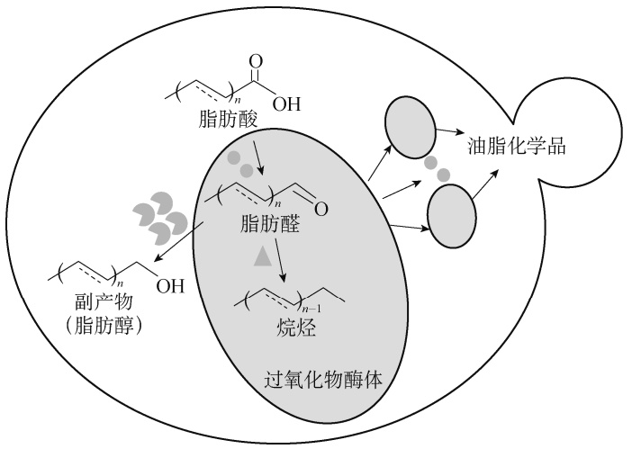

<details>
<summary>flowchart</summary>

This diagram illustrates the chemical process of oxidation to a lipid compound, showing the conversion of fatty acids and alcohols into a glycerol intermediate and finally to lipid products.
</details>

图 7-11 脂肪酸衍生物合成途径定位至过氧化物酶体可提升产物合成效率（改自文献[60]）

## 二、片段组装技术

在合成生物学领域，酿酒酵母重组系统已被认定为一种独特而高效的手段，尤其是在DNA 组装和基因工程方面展现了其独到的优势。其背后的机制，即高效的同源重组机制，为酿酒酵母提供了特殊的特性。通过这一机制，具有同源序列的片段或基因可以发生重组，无论是单个基因的组装还是大规模的合成基因组的构建，酿酒酵母重组技术均能发挥其独特作用。相较于传统的基因工程方法，如酶切-连接法，酿酒酵母重组技术简化了实验步骤，降低了错误率，提升了 DNA 组装的效率。因此，能够实现 DNA 片段的快速精确组装，无须依赖外源性酶如连接酶或其他辅助物质。

进一步追溯历史，在 20 世纪 80 年代，酿酒酵母重组技术便得到了显著的发展。当时，Orr-Weaver 等采用酿酒酵母作为模式生物，开展了一系列实验，探讨了环形和线性 DNA 分子与染色体之间的重组互作机制，深入研究了 DNA 分子是如何通过同源重组整合到酵母染色体上的<sup>[61]</sup>。他们的研究结果表明，DNA 的末端在同源重组中起到了关键作用。当目标片段与酵母染色体同源的区域经过限制性内切酶消化后，整合效率会显著提高。有趣的是，当对同一同源序列进行两次限制性内切酶切割以移除 DNA 的内部片段时，这些被删减的线性分子仍能保持高效的转化能力。此外，这些带有缺口的线性分子在整合时，其缺失片段会被染色体的同源片段所替代，使得其最终的结构与环形分子整合后的结构一致。同时，该过程中的 Rad52蛋白起着核心的作用。在携带 rad52-1 突变的酵母中，线性 DNA 分子的整合受到抑制，而环形 DNA 分子不受影响。这些结果凸显了 Rad52 蛋白在 DNA 修复过程中的关键作用，它可能涉及 DNA 修复合成，这对于线性质粒的整合和修复、双链断裂的修复及基因转化至关重要。这些研究不仅增进了人们对酵母 DNA 修复和重组机制的理解，还展示了这些成果的潜在应用价值。多年的研究表明，酿酒酵母中的同源重组效率远高于细菌和其他高等真核生物。这种天然的重组机制为人们提供了一种高效、精确的 DNA 片段组装方法，逐步被开发为基因克隆、特异性突变、质粒构建及目标基因的中断和敲除中的重要工具。

Shao 等报道了一种基于酿酒酵母同源重组系统的途径组装方法，称为 DNA assembler（DNA 组装）<sup>[62]</sup>。与传统的途径克隆技术相比，DNA assembler 利用了酵母中现有的同源重组

---

第七章 酵母合成生物学

207

机制，避免了多步克隆的重复周期，不依赖于限制性内切酶消化和体外连接，仅需 1～2 周就可以将多个 DNA 片段组装到酵母的质粒或染色体上（图 7-12）。

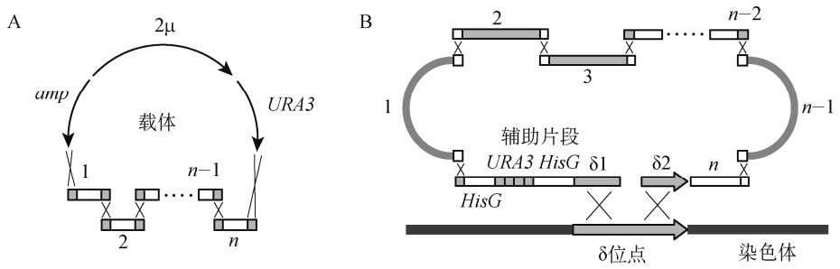

图 7-12 利用酿酒酵母体内同源重组系统完成生物合成途径的一步法组装和整合<sup>[62]</sup>

A. 组装于载体上；B. 组装及整合至酵母染色体的 δ 位点

研究人员借助 DNA assembler 成功地组装了具有功能的 D-木糖利用途径（3 个基因，长度约 9kb）、玉米黄素生物合成途径（5 个基因，长度约 11kb），以及结合 D-木糖利用和玉米黄素生物合成的途径（8 个基因，长度约 19kb）。对于较短的途径（3～5 个基因，约 10kb），使用约 50bp 的重叠区域已可获得高达 80%～100%的组装效率；而对于较长的途径（8 个基因，约 19kb），使用稍长的重叠区域（125～430bp）仍能达到相对高的组装效率（40%～70%）（表7-2）。此外，通过调整插入片段与载体骨架之间的比例，长途径的组装效率可得到进一步提升。例如，在 8 基因途径中，使用含约 50bp 重叠区域的片段进行组装时，将插入片段的数量翻倍，而线性化载体的数量保持不变，结果显示在 SC-URA 筛选平板上出现的菌落数量增加，并获得了 70%的组装效率，这一效率明显高于使用较低量插入片段时的 20%。DNA assembler是首次利用酵母体内同源重组系统实现多基因生物合成途径的体内一步组装技术。这种方法仅需要简单的 DNA 制备和一步酵母转化，因此它已经成为合成生物学、代谢工程和功能基因组学研究中构建生化途径的重要工具。

表 7-2 DNA assembler 一步法进行途径组装时的效率<sup>[62]</sup>

<table><tr><td rowspan="2">途径类型</td><td colspan="3">重叠区长度</td></tr><tr><td>约50bp</td><td>约125bp</td><td>270~430bp</td></tr><tr><td>3基因途径</td><td></td><td></td><td></td></tr><tr><td>基于质粒/%</td><td>100</td><td>90</td><td>80</td></tr><tr><td>基于染色体/%</td><td>80</td><td>80</td><td>100</td></tr><tr><td>5基因途径</td><td></td><td></td><td></td></tr><tr><td>基于质粒/%</td><td>80</td><td>60</td><td>80</td></tr><tr><td>基于染色体/%</td><td>80</td><td>70</td><td>80</td></tr><tr><td>8基因途径</td><td></td><td></td><td></td></tr><tr><td>基于质粒/%</td><td>20</td><td>50</td><td>40</td></tr><tr><td>基于染色体/%</td><td>10</td><td>60</td><td>70</td></tr></table>

使用含重叠序列的 DNA 片段进行体内重组组装展现出巨大的潜力，这不仅适用于小规模实验室的途径工程，还可应用于自动化的高通量菌株构建。尽管如此，体内组装法所达到的正确组装率仍有提升空间，同时组装部件的标准化在实验室的常规应用中尚未得到深入探讨。Kuijpers 等对此进行了优化，并提出了一种更具通用性的高效 DNA 片段组装法用于质粒的构

---

208

合成生物学

建<sup>[63]</sup>。为了尽量减少错误组装的质粒和提高组装平台的多功能性，他们主要做了两个关键的改进:①对载体框架的基本元件（复制子和筛选标记）进行拆分；②在每个组装片段的侧翼加入了一个长为 60bp、与酵母基因组非同源的标准化合成重组序列。这些改进使得假阳性转化子的数量仅为之前方法的 1/100 。通过采用 60bp 合成重组序列作为组装策略，研究者可以更加灵活地设计复杂的表达途径，并利用 PCR 技术快速并方便地制备所需的组装片段。基于此策略，他们成功地将 9 个带有末端重叠序列的片段组装成了一个包含 6 个糖酵解基因、长达 21kb 的质粒，组装正确率达到了 95%。而在之前的研究中，较大（超过 15kb）的 DNA 构建体（DNA construct）正确组装的效率往往不超过 70%。更深入的分析揭示，所组装的质粒与其预期设计高度吻合，同时这些质粒所携带的糖酵解基因均被证明可正常发挥功能。

随着合成生物学相关产业的快速发展，对工程化菌株在生产效率和稳定性上的要求越来越高。为满足这些要求，菌株需要能够同时高效表达大量的内源和外源基因。与质粒表达相比，染色体整合表达具有更高的遗传稳定性。因此，开发能够在染色体上快速、高效地构建更长、更复杂的合成路径的遗传工具变得至关重要。尽管通过单次转化，可以实现将一个包含 10 个片段的 22kb DNA 结构成功整合到酵母的某个染色体位点，但效率较低，转化子中仅有 5%含有组装正确的结构。为了解决这一问题，Kuijpers 等开发出原位组装与靶向染色体整合技术（combined in vivo assembly and targeted chromosomal integration，CATI），应用于长序列复杂 DNA 结构的染色体整合<sup>[64]</sup>。这种技术的独特之处在于，它使用了归巢核酸内切酶（meganuclease）Ⅰ-SceⅠ来引入 DNA 的双链断裂，从而显著提高染色体整合效率。利用这种方法，他们成功地将总长 22kb 的 DNA 结构整合到酵母的单个染色体位点，整合效率高达95%。归巢核酸内切酶Ⅰ-SceⅠ在这一过程中发挥了至关重要的作用，其高度的特异性确保了DNA 靶点在预期位置被精准地切开，从而增加了多基因片段的整合效率（图 7-13）。由于该包含多个基因的长序列途径被整合到了染色体上，它的表达稳定性得到更好的保障，这对于大规模工业应用尤为重要。与传统的 δ 位点整合方法相比，使用归巢核酸内切酶Ⅰ-SceⅠ介导的染色体整合法更为精准。总体而言，归巢核酸内切酶Ⅰ-SceⅠ辅助的 CATI 方法为酵母菌株的工程化改造带来了显著进步，为酿酒酵母在大规模代谢工程领域中的应用提供了新的手段。

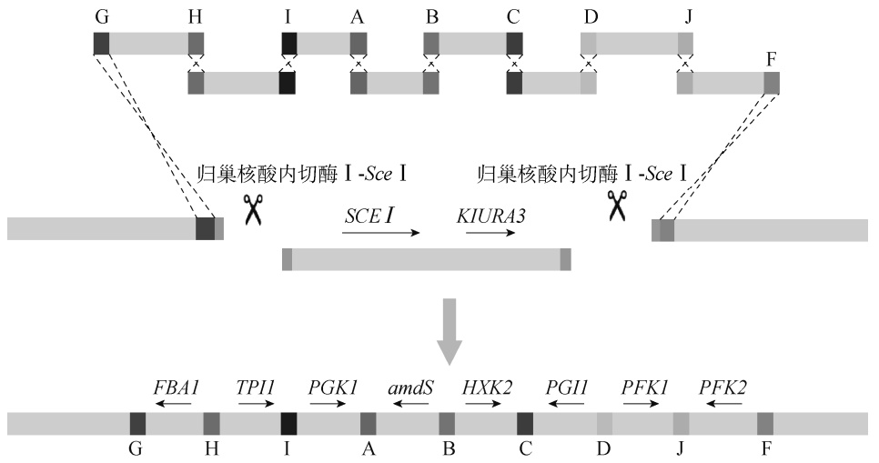

<details>
<summary>flowchart</summary>

This diagram illustrates the regulatory mechanism of a gene expression pathway, showing how genes are regulated by various enzymes (SCE I and KIURA3) to regulate specific genes such as FBA1, TPI1, PGK1, amdS, HXK2, PGI1, PFK1, and PFK2.
</details>

图 7-13 利用归巢核酸内切酶Ⅰ-SceⅠ辅助多基因片段的染色体位点特异整合<sup>[64]</sup>

---

第七章 酵母合成生物学

209

## 三、基因编辑技术

酿酒酵母作为模式真核生物，占据着基因功能和代谢机制研究的重要位置。对酿酒酵母进行基因编辑，有助于深入探究其复杂代谢和生物学特性，得以明确基因与细胞生理及其代谢之间的微妙关联。在合成生物学领域，研究人员致力于通过调控酿酒酵母的代谢途径，设计并构建新的生物系统，以达到将底物高效转化为各种高附加值产品的目的。利用基因编辑技术，现在能够对酵母的代谢网络进行更加精准的调整，因此对菌株进行工程化改良的工作更加系统化、效率更高，从而在提高菌株性能的过程中具有卓越的效率和精确性。相较于依赖于传统的、效率相对较低的菌株随机突变和筛选方法，基因编辑技术建立了一个更为理性且系统化的生物改造流程。因此，基因编辑技术的应用为科学家带来了强大的研究工具，它不仅深化了人们对酿酒酵母生物学属性的洞察，而且开发了其在生物技术及工业生产领域的广泛应用潜力。

## （一）传统基因编辑技术

基于酿酒酵母的天然内源重组机制，研究人员可以利用外源 DNA 片段与其基因组上的同源序列进行重组，实现基因敲除、插入、替换等基因编辑操作。这种策略通常需要构建一个带有筛选标记（如抗生素抗性基因）的线性 DNA 片段，该片段的两端与目标基因的上下游序列同源。当这个线性 DNA 片段被转化到酵母细胞中时，它会通过同源重组与染色体上的目标基因或位点进行交换，从而敲除或替换掉目标基因<sup>[65]</sup>。为了在酿酒酵母中重复利用筛选标记进行多次的基因编辑，Güldener 等结合了外源 kan 抗性标记基因与 Cre-loxP 重组系统的特点，设计了在抗性标记基因两侧带有 loxP 位点的 loxP-kanMX-loxP 片段用于基因敲除，并进一步将其构建在质粒pUG6 上<sup>[66]</sup>。通过从 pUG6 质粒 PCR 扩增出带有目标位点同源序列的 loxP-kanMX-loxP 片段，并将其转化至酿酒酵母后，可以实现对目标位点的高效整合和替换。随后，将携带 Cre 酶基因的辅助质粒 pSH47 转化到酵母细胞中，并诱导 Cre 酶的表达。Cre 酶会识别并作用于 loxP 位点，触发 loxP 位点间的重组，从而去除两个 loxP 位点之间的 kanMX 片段，只保留 1 个 loxP 位点。这样，loxP-kanMX-loxP 片段就可以被重新利用于下一轮的基因编辑过程中。Cre-loxP 重组系统的使用尽管较为便利，但每次使用后都会在染色体上留下 1 个 loxP 位点。因此，研究人员期待能够在进行基因编辑时不留下非必要的多余序列，仅产生预期的序列改动，实现无痕基因编辑。

无痕基因编辑可以基于酿酒酵母的重组机制，结合使用具有反筛特性的筛选标记如URA3、amdSYM 来实现。以 amdSYM 为例，它是 Solis-Escalante 等开发的一种新型筛选标记，也是酿酒酵母中第一个具有反筛特性的显性筛选标记<sup>[67]</sup>。amdSYM 筛选标记由棉阿舒囊霉（Ashbya gossypii）的 TEF2 启动子和终止子，以及一个密码子优化的乙酰胺酶基因[amdS， 该基因源自构巢曲霉（Aspergillus nidulans）]组成。amdSYM 使酿酒酵母细胞能够以乙酰胺（acetamide）为唯一氮源生长，但这些携带 amdSYM 片段的酿酒酵母在含有氟乙酰胺（fluoroacetamide）的培养基中无法存活。以无痕基因敲除为例，含有 amdSYM 标记的片段具有以下组分:①一段 50～55bp 的序列，与待敲除目标基因的上游部分（包括起始密码子）同源，以及一段与目标基因下游部分（包括终止密码子）同源的 50～55bp 序列，这两段序列用于与目标基因发生同源重组；②amdSYM 筛选标记；③一个 40bp 的序列，与目标基因上游区域同源，在整合后在酿酒酵母染色体的目标位点引入同向重复序列，用于筛选标记的无痕移除（图 7-14）。将这样的打靶片段转化至酿酒酵母中，可在以乙酰胺为唯一氮源的组成型培养基（synthetic medium）中筛选阳性克隆。随后将筛选得到并确认基因敲除成功的菌株在 YPD

---

210

合成生物学

培养基中培养；由于染色体上存在直接的重复序列，可能会发生重组交换，从而将其间的amdSYM 移除。接着，在含有氟乙酰胺的组成型培养基中进行反向筛选，因为仍携带 amdSYM片段的酵母细胞在该培养基中无法存活，只有那些已发生二次重组交换丢失了 amdSYM 片段的细胞可以生长，从而实现了对目标基因的无痕敲除。Huang 等利用 amdSYM 筛选标记对酿酒酵母中与蛋白质分泌相关的基因进行了多轮编辑，基因编辑后的菌株不仅在蛋白质分泌能力上显著提高，也具备较好的遗传稳定性。在批次补料发酵条件下，菌株的重组蛋白分泌量达 2.5g/L<sup>[68]</sup>。

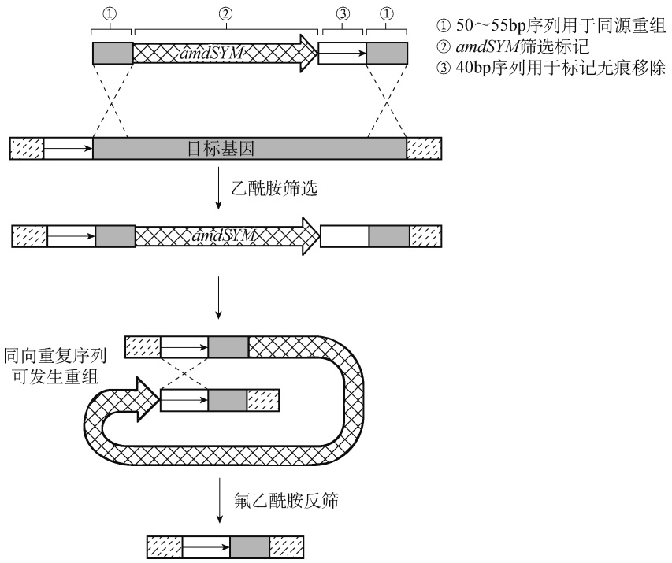

<details>
<summary>flowchart</summary>

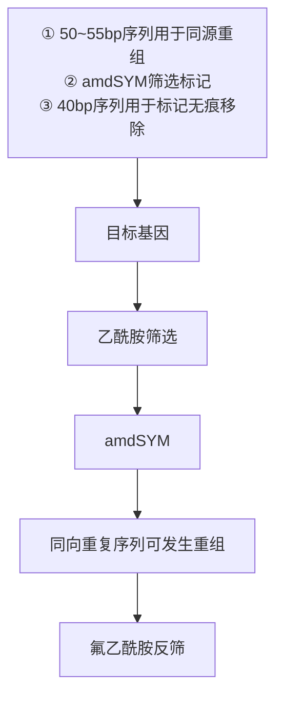
</details>

图 7-14 基于 amdSYM 标记用于无痕基因敲除的片段组成及敲除示意图（改自文献[67]）

## （二）新型基因编辑技术

传统的酿酒酵母基因操作方法，如同源重组技术，尽管已经相对成熟，但由于其效率受到所需同源臂长度的限制，因此在某些特殊应用中，其效率仍然不高，无法满足实际的使用需求。CRISPR 技术，即成簇的规律间隔短回文重复序列（clustered regularly interspaced short palindromic repeats）技术，是近年来在生物技术领域涌现出的一项革命性技术。CRISPR-Cas系统是一种源于细菌和古菌的防御外部入侵核酸的适应性免疫机制。该技术的核心在于 Cas9蛋白与特定的向导 RNA 结合，从而精确地定位并切割目标 DNA 序列。其操作过程简洁高效，只需设计特定的 sgRNA，便可以对选定的基因位点进行精确编辑。其最大的优势在于编辑效率极高，使得研究者能在短时间内获得改造后的酿酒酵母菌株。

2013 年，DiCarlo 等首次在酿酒酵母中应用了 CRISPR-Cas9 技术<sup>[69]</sup>。在这项研究中，研究人员采用了Ⅱ型细菌的 CRISPR-Cas 系统，对酿酒酵母基因组进行编辑。他们引入的CRISPR-Cas 系统主要由两部分组成:Cas9 基因及能够靶向基因组的 CRISPR 向导 RNA（gRNA）。该系统在酿酒酵母中展现出专一性且高效的靶向基因组目标位点的 RNA 引导内切酶切割活性。研究人员采用组成型表达 Cas9 蛋白和瞬时表达 gRNA 的方式，展示了利用

---

第七章 酵母合成生物学

211

CRISPR-Cas 系统靶向目标位点产生双链断裂，可以极大地提高基于单链和双链核苷酸供体修复片段的同源重组率，分别增加了 5 倍和 130 倍。此外，当将表达 gRNA 的质粒和供体 DNA分子共转化到持续表达 Cas9 蛋白的酿酒酵母细胞中时，供体 DNA 分子与酵母基因组目标位点发生重组的频率高达近 100%。这项创新性的研究为后续领域的相关研究奠定了坚实的基础。随后，许多研究团队纷纷采用 CRISPR-Cas9 技术进行酵母的多基因编辑、基因组规模的突变筛选及高通量的功能基因组学分析。

尽管已经开发了多种用于酿酒酵母菌株改造的技术，进行多基因编辑的菌株构建仍是一个耗时过程。Mans 等报道了基于 CRISPR-Cas9 的新方法，该方法可用于酿酒酵母菌株的快速构建，展示了其同时引入多重基因编辑的潜力<sup>[70]</sup>。在先前的研究中，将 CRISPR 系统引入酿酒酵母时，Cas9 蛋白的编码基因主要是通过质粒进行表达的<sup>[69]</sup>。考虑到多轮转化需要在每轮后移除质粒，将 cas9 基因整合到染色体上显得更为理想。因此，Mans 等将 cas9 基因整合到了具有不同遗传背景的酿酒酵母中，从而得到了一系列供后续使用的工程菌株。例如，工程菌株 IMX672（遗传背景为:MATa ura3-52trp1-289leu2-3，112his3can1::cas9-natNT2）是通过将 cas9 基因整合替换了菌株 CEN.PK2-1C 的 CAN1 基因构建得到的。这些工程菌株可以通过 EUROSCARF（European Saccharomyces cerevisiae Archve for Functional Analysis）获取（http://www.euroscarf.de）。为了扩展 CRISPR 系统在不同遗传背景菌株中的使用，Mans 等基于先前的研究<sup>[69]</sup>，以质粒 p426- SNR52p-gRNA.CAN1.Y-SUP4t 为基础，通过 Gibson 组装技术替换了 URA3 筛选标记，从而构建了一系列带有不同筛选标记的单 gRNA 表达质粒（pMEL10～pMEL17，图 7-15A）。得益于酿酒酵母的高效重组系统，这些单 gRNA 表达质粒的使用可被简化。可以将单 gRNA 表达质粒的框架、PCR 扩增的 gRNA 序列及相应的靶点修复片段一同转化到酵母菌株中，从而一次性完成对目标靶点的编辑，无须预先在体外构建 gRNA 表达质粒，质粒的组装和靶点编辑都在胞内进行。为了进一步提高多位点编辑的效率，他们还构建了一系列的双 gRNA 表达质粒（pROS10～ pROS17，图 7-15B）。通过使用一个双 gRNA 表达质粒，可以实现两个目标靶点的同步编辑。该系列的双 gRNA 表达质粒带有不同的筛选标记，允许同时转化多个质粒。他们将两个分别带有KlURA3 和 TRP1 筛选标记的质粒，以及三个分别带有 KlURA3、TRP1 和 HIS3 筛选标记的质粒共转化到酵母菌株 IMX672 中，成功实现了 4 个基因和 6 个基因的同时敲除，敲除效率分别达到了70%和 65%。这是首次报道通过单次转化实现酿酒酵母 6 个基因的敲除。此外，在这项研究中，研究人员也展示了基于 CRISPR 系统完成的多基因的组合整合、基因点突变等实验，证明了CRISPR-Cas9 在酿酒酵母菌株改造中的灵活性及多样性。

CRISPR 系统已经极大地提升了菌株改造的能力，但在多靶点编辑的应用中，其仍受限于gRNA 的处理效率及通量。Zhang 等采用了一种基于内源 RNA 加工的机制<sup>[71]</sup>，通过 tRNA 将串联的 gRNA 元件间隔开，从而构建出 gRNA-tRNA 阵列；通过一个启动子，便可完成多个gRNA 的有效转录，并将此技术应用于 CRISPR 系统中（图 7-16），称之为 GTR-CRISPR（a gRNA-tRNA array for CRISPR-Cas9）。该方法相较于传统的“1 个启动子-1 个 gRNA-1 个终止子”的基本转录单元，能实现更高效率的多基因敲除。在对 5 个基因同时敲除时，GTR-CRISPR系统的效率可达 88.9%；而基于传统转录单元串联的方法，5 个基因敲除的效率仅为 6.7%。他们通过提高启动子的表达强度并采用双启动子驱动 gRNA 的表达，使得 8 个基因的同时敲除效率达到了 86.7%。为了进一步简化操作，他们采用 Golden Gate 片段组装法来构建辅助质粒，从而省略了在大肠杆菌中的克隆步骤。在 Golden Gate 反应完成后，直接将混合液转化至酵母细胞中，便可实现基因编辑。这一升级版的系统被称为快捷 GTR-CRISPR（lightning GTR-CRISPR）。利用优化后的快捷 GTR-CRISPR 系统对酿酒酵母进行基因编辑时，4 个基因同时

---

212

合成生物学

敲除的效率达到了 95.6%。此系统还能在 3 天内完成对 6 个基因的同时敲除，效率达到 60%。利用这一系统，酿酒酵母的工程改造速度得到了极大的提升，仅用 10 天便完成了两轮共 8 个与脂肪酸合成相关的基因编辑，大幅提高了游离脂肪酸的产量，摇瓶中的产量达到了559.52mg/L 的水平，相较于改造前提升了 30 倍。

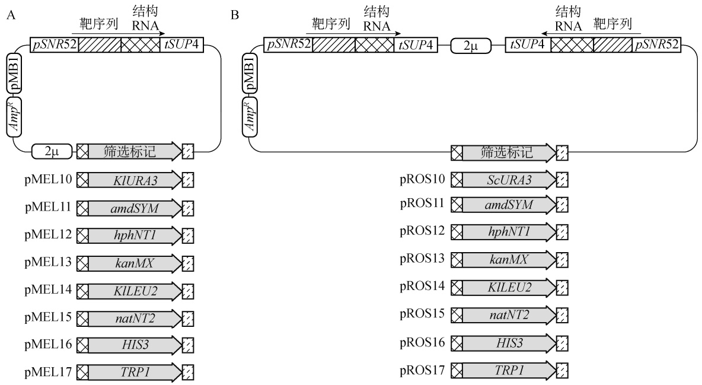

图 7-15 含不同筛选标记的 gRNA 表达质粒<sup>[70]</sup>

A. 单 gRNA 位点；B. 双 gRNA 位点

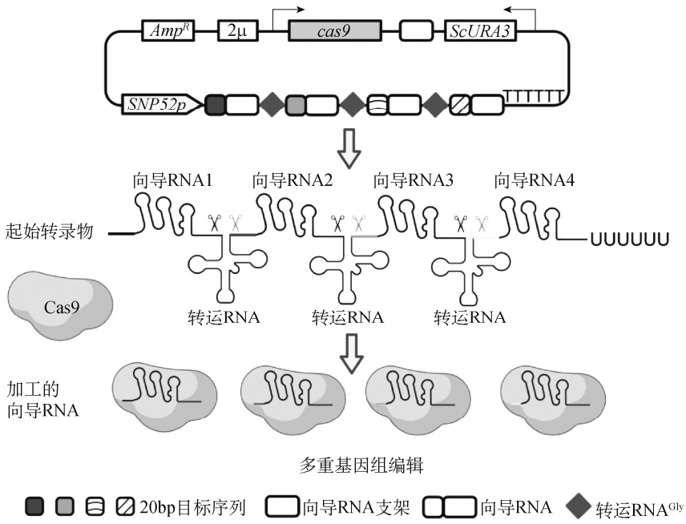

<details>
<summary>flowchart</summary>

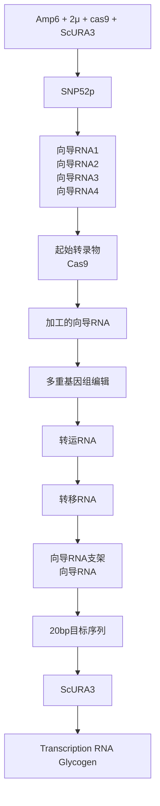
</details>

图 7-16 GTR-CRISPR 系统示意图<sup>[71]</sup>

---

第七章 酵母合成生物学

213

随着对 CRISPR 系统的深入开发，其已不局限于用在直接的基因编辑中；在合成生物学和代谢工程领域中的应用，被进一步扩展。Lian 等报道了一种正交三功能 CRISPR 系统（CRISPR-AID）的组合代谢工程技术<sup>[72]</sup>，该技术可在酿酒酵母中实现转录激活、转录抑制和基因敲除的功能。为构建这样一个正交三功能的 CRISPR 系统，至少需要三种能在酿酒酵母中正常发挥作用的 CRISPR 蛋白。因此，研究人员对以下两类（Cas9 和 Cpf1）共 6 种 CRISPR 蛋白进行了性能验证:SpCas9[源自酿脓链球菌（Streptococcus pyogenes）]、NmCas9[源自脑膜炎奈瑟球菌（Neisseria meningitides）]、St1Cas9[源自嗜热链球菌（Streptococcus thermophiles）]、SaCas9[源自金黄色葡萄球菌（Staphylococcus aureus）]、LbCpf1[源自毛螺菌科细菌（Lachnospiraceae bacterium）ND2006]和 AsCpf1[源自氨基酸球菌属（Acidaminococcus sp.）BV3L6]。在测试后，选取了去除核酸剪切酶活性的 LbCpf1（dLbCpf1）与转录激活模块 VP 融合，得到了 dLbCpf1- VP，用于基因的转录激活（transcriptional activation，CRISPRa）；选取了去除核酸剪切酶活性的SpCas9（dSpCas9）与转录抑制模块 RD11-RD5-RD2 融合，得到了 dSpCas9-RD1152，用于基因的转录抑制（transcriptional interference，CRISPRi）；选取功能完整的 SaCas9 用于基因敲除（gene deletion，CRISPRd）。这样就成功构建出了正交三功能的 CRISPR-AID 系统（图 7-17）。为了验证该系统的工作性能，研究人员利用红色荧光蛋白基因 mCheery、黄色荧光蛋白基因 mVenus 和内源基因 ADE2 进行了实验。实验结果显示，mCheery 的表达强度提升了 5 倍（转录激活），mVenus 的表达强度下降为原来的 1/5（转录抑制），ADE2 基因的敲除效率达到了 95%，表明该系统具有很好的工作性能。随后，将该系统用于酿酒酵母的代谢工程改造中。通过同步转录激活 HMG1 基因、转录抑制 ERG9 基因和敲除 ROX1 基因，将 β-胡萝卜素产量提升了 3 倍。在进一步的代谢工程组合改造实验中，研究人员以提升酿酒酵母菌株表面展示重组蛋白（里氏木霉葡聚糖内切酶Ⅱ，EGⅡ）效率为目标，选择了 14 个转录激活靶点、17 个转录抑制靶点及 5 个敲除靶点进行实验；其中大多数靶点在单独测试中均可提升 EGⅡ的表面展示效率。基于CRISPR-AID 系统，他们创建了一个包含所有同步转录激活、转录抑制和敲除的组合库，经过筛选，挑选出的最优组合可将 EGⅡ的表面展示效率提升 2.5 倍。

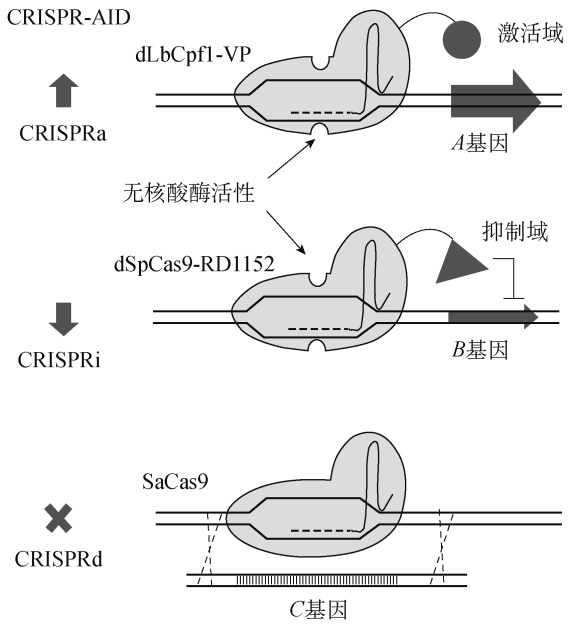

<details>
<summary>flowchart</summary>

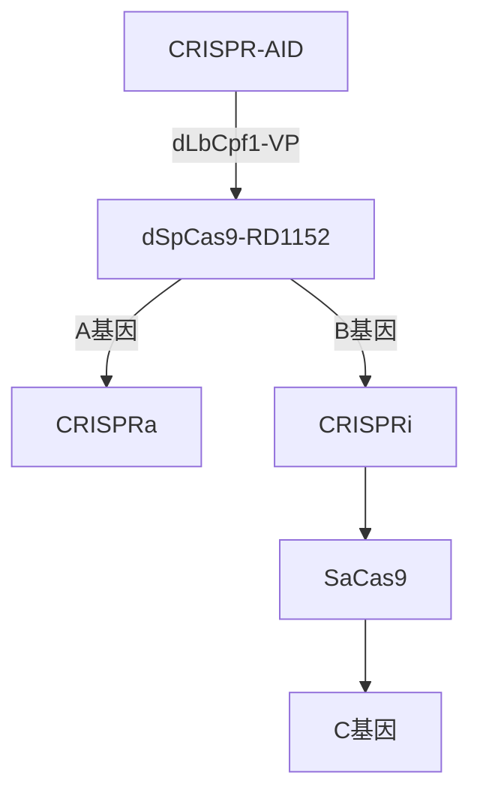
</details>

图 7-17 正交三功能的 CRISPR-AID 系统<sup>[72]</sup>

---

214

合成生物学

## 第三节 酵母合成生物学案例

在生物技术的飞速发展中，合成生物学作为一种新兴的、跨学科的研究领域，通过设计和构建新的生物系统与生物部件，以实现特定的、可预测的功能。利用酿酒酵母，研究人员能够探讨生物系统的基本原理，并开展多种生物技术应用的研发。酿酒酵母合成生物学的应用涵盖了基因电路设计、生物合成途径的构建与优化等多个方面。为了实现目标化合物的高效生产，研究人员利用酿酒酵母开发了多种基因调节元件和信号转导通路，以实现基因表达的精细调控和动态平衡。同时，利用基因编辑技术如 CRISPR-Cas 系统，为基因的精确修改和途径优化提供了强有力的工具。通过合成基因组的设计和构建，研究人员也在探索全新的生物系统设计和生物合成能力的开发。

酿酒酵母的合成生物学应用已经拓展到实际的生物技术领域，包括药物发现和生产、生物燃料和化学品生产等。例如，通过优化酵母的代谢途径和基因表达系统，研究人员成功地提高了生物合成产品的产量和效率，使实现可持续生产和绿色生产成为可能。这些应用案例展现了酿酒酵母合成生物学的多方面潜力和实用价值。随着合成生物学和基因工程技术的不断进步，酿酒酵母的应用将更为广泛，其在生物技术和工业生产中的重要性也将随之增加。通过不断探索和优化，酿酒酵母合成生物学将为解决人类面临的多种挑战提供强有力的支持。本节将通过详细的案例介绍，展现酿酒酵母合成生物学在不同领域中的应用和实现，以及它如何为生物科学和生物工程的发展做出贡献。

## 一、改造酿酒酵母用于生物合成青蒿素前体

青蒿素是从黄花蒿中提取的抗疟疾药物。鉴于其自然提取产量有限并且价格昂贵，研究人员尝试利用合成生物学方法在微生物细胞中生产青蒿素。2003 年，Keasling 团队通过将紫穗 槐 -4,11-二 烯 合 酶 （amorpha-4,11-diene synthase， ADS） 及 酿 酒 酵 母的 甲 羟 戊 酸途 径（mevalonate pathway）引入大肠杆菌，实现了青蒿素关键前体紫穗槐-4,11-二烯的合成<sup>[73]</sup>。这是最早的合成生物学应用示范之一，是合成生物学领域的一个重要里程碑。随后，该研究团队采用了多种策略对菌株进行优化，如调整基因间区域、将酵母来源的 3-羟基-3-甲基戊二酸单酰辅酶 A 合成酶（3‑hydroxy-3‑methyl-glutaryl coenzyme A synthase，HMGS）和 3-羟基-3-甲基戊二酸单酰辅酶 A 还原酶（3-hydroxy-3-methyl glutaryl coenzyme A reductase，HMGR）替换为金黄色葡萄球菌来源的 HMGS 和 HMGR，并开发了一种限氮限碳的新型发酵技术，这些措施使紫穗槐-4，11-二烯的产量提升至超过 25g/L<sup>[74]</sup>。

尽管在大肠杆菌中已成功高效地产生紫穗槐-4，11-二烯，但为了得到更适合转化为青蒿素的晚期前体—青蒿酸，还需细胞色素 P450 酶的参与。由于大肠杆菌对于 P450 酶的表达不够理想，研究团队尝试将合成体系转移到酿酒酵母中。在酵母体系中，研究人员不仅优化了法尼基焦磷酸（FPP）生物合成途径以增强 FPP 的生成并减少其用于合成甾醇的消耗，还引入了 ADS、细胞色素 P450 单氧化酶（cytochrome P450 monooxygenase，CYP71AV1）和细胞色素 P450 还原酶 1（CPR1），成功构建出第一个能够生产青蒿酸的工程化酿酒酵母菌株<sup>[75]</sup>。

---

第七章 酵母合成生物学

215

进一步地，通过在酵母中联合表达黄花蒿来源的细胞色素 b5（cytochrome b<sub>5</sub>，CYB5）、醇脱氢酶 1（alcohol dehydrogenase1，ADH1）和青蒿醛脱氢酶 1（artemisinic aldehyde dehydrogenase1，ALDH1）（图 7-18），青蒿酸的产量得到了显著提升，最终在优化发酵条件下达到了 25g/L<sup>[76]</sup>。得到的青蒿酸可以经过化学法进一步转化为青蒿素。


<details>
<summary>flowchart</summary>


</details>

图 7-18 经过三步催化反应可将紫穗槐-4，11-二烯转化为青蒿酸

将青蒿素的生产从植物转移到微生物生产平台，如酿酒酵母，使得青蒿素的生产不再依赖于宝贵的植物资源，又实现了更高效、可控的生产方式，为其商业化生产打开了新的大门。这一系列研究展示了通过合成生物学技术，特别是利用酿酒酵母作为生产宿主，可以实现药物生产的创新和优化。从早期的基因工程尝试，到成功设计和优化了能够生产青蒿素前体的酵母菌株，为后续利用合成生物学技术生产其他重要药物提供了宝贵的经验和启示，展现了合成生物学在现代药物生产中的巨大潜力和应用价值。

## 二、改造酿酒酵母用于生物合成抗癌药物长春碱前体

在 2019～2021 年，由于制造癌症化疗药物长春碱（vinblastine）和长春新碱（vincristine）所需的马达加斯加长春花干叶供应不足，这两种药物面临严重短缺。为了获取 1g 长春碱或长春新碱，需要分别从 500kg 和 2000kg 的植物干叶中进行提取。

2022 年 8 月，由 Keasling 领衔来自丹麦技术大学和加利福尼亚大学伯克利分校的研究人员在 Nature 期刊上发表了一项创新研究，介绍了使用模块化工程技术改造酿酒酵母来生产这两种抗癌药物的方法<sup>[77]</sup>。他们成功地在酿酒酵母中生产了长春碱的前体物质文多灵（vindoline）和长春质碱（catharanthine），并进一步通过体外化学合成制造了长春碱。长春碱的生物合成涉及超过 30 个酶促反应，研究将整个合成路径分为三个模块来进行:第一个模块的产物为异胡豆苷（strictosidine）；第二个模块的产物为长春质碱和水甘草碱（tabersonine）；第三个模块的产物为文多灵。该工程化酿酒酵母改造共进行了 56 次基因编辑，包括异源表达来自植物的 34 个外源基因，以及对酿酒酵母内源基因的敲除、敲低和过表达，从而提高前体物质的供应，实现了目标产物的合成。此外，第一个模块的产物异胡豆苷产量被提高了超过1000 倍，达到 25.2mg/L。由于异胡豆苷是所有单萜吲哚生物碱的关键前体，这为生产各种有医疗价值的化合物如拓扑替康和伊立替康的前体喜树碱（camptothecin）提供了可能性。这个新构建的平台不仅能够生成天然的药物分子，还可以用于合成非天然的衍生物，进一步优化药物的疗效和安全性。该研究生产目标物质不受天气、植物病害和物流问题的影响，可使用简单的再生原料进行生产，为未来的抗癌药物供应提供了一个可持续和稳定的方法。这是目前已知的利用微生物生产植物天然产物的最长生物合成路径（图 7-19）。

---

216

合成生物学


<details>
<summary>flowchart</summary>

```mermaid
graph TD
  A["麦角固醇的生物合成"] --> B["ERG9"]
  B --> C["MEA"]
  D["EGES"] --> E["FPP"]
  E --> F["ERG20"]
  F --> G["GPP(1)"]
  G --> H["ERG20FRE,H144W"]
  H --> I["TPPS9144W"]
  I --> J["DMAPP"]
  J --> K["tHMG1"]
  K --> L["MVA\n途径"]
  L --> M["莽草酸途径"]
  M --> N["色氨酸(2)"]
  N --> O["TDC"]
  O --> P["色胺(13)"]
  
  subgraph Substrate_1 [Substrate_1]
  Q["香叶醇(3)"] --> R["8-羟基香叶醇(4)"]
  R --> S["BHGO"]
  T["8-氧化香叶醛(5)"] --> U["ISY"]
  U --> V["荆芥醇(6)"]
  V --> W["7-脱氧马钱次苷醇(7)"]
  W --> X["CYP"]
  X --> Y["ADH"]
  Y --> Z["7-脱氧马钱次苷酸(8)"]
  Z --> AA["7DLGT"]
  AA --> AB["7-脱氧马钱苷酸(9)"]
  AB --> AC["7DLH"]
  AC --> AD["马钱苷酸(10)"]
  AD --> AE["LAMT"]
  end
  
  subgraph Substrate_2 [Substrate_2] [Substrate_2]
  AF["ATF1"] --> AG["OYE2\n支路产物"]
  AG --> AH["ARI1\n支路产物"]
  AH --> AI["ADH6\n支路产物"]
  AI --> AJ["OYE2\n支路产物"]
  AJ --> AK["OYE2\n支路产物"]
  end
  
  subgraph Substrate_3 [Substrate_3] [Substrate_3] [Substrate_3]
  BH["花冠木碱(17)"] --> AI["SAT"]
  AI --> AJ
  AJ --> AK
  AK --> AL["缝籽木榛(16)"]
  AL --> AM["异胡豆苷苷元(15)"]
  AM --> AN["SGD"]
  AN --> AO["异胡豆苷(14)"]
  AO --> AP["裂环马钱子苷(12)"]
  AP --> AQ["色胺(13)"]
  AQ --> AR["SLS\nCPR\nCYB5"]
  AR --> AS["马钱苷(11)"]
  end
  
  subgraph Substrate_4 [Substrate_4] [Substrate_4] [Substrate_4] [Substrate_4]
  AT["花冠木碱乙酸盐(18)"] --> AU["PAS"]
  AU --> AV["前康狄卡品乙酸盐(开环)(19)"]
  AV --> AW["DPAS"]
  AW --> AX["二氢前康狄卡品乙酸盐(20)"]
  AX --> AY["TS"]
  AY --> AZ["水甘草碱(21)"]
  AZ --> BA["T16OH\nCPR\nCYB5"]
  BA --> BB["16OMT"]
  BB --> BC["16-羟基水甘草碱(23)"]
  BC --> BD["16-甲氧基水甘草碱(24)"]
  BD --> BE["T3O"]
  BE --> BF["T3R"]
  end
  
  subgraph Substrate_5 [Substrate_5] [Substrate_5] [Substrate_5] [Substrate_5]
  CS["长春质碱(22)"] --> CS
  CS --> CS
  CS --> PRX1["PRX1\n化学偶联的半合成"]
    
    subgraph Substrate_6 [Substrate_6] [Substrate_6] [Substrate_6]
      CSN["文多灵(28)"] <--> DAT["去乙酰文多灵(27)"]
      DAT <--> D4II["去乙酰氧基文多灵(26)"]
      D4II <--> DNMTN["NMT"]
      DNMTN <--> NMRN["3-羟基-16-甲氧基-2,3-二氢水甘草碱(25)"]
      NMRN <--> NMRN
      NMRN <--> NMRN
      NMRN <--> NMRN
      NMRN <--> NMRN
      NMRN <--> NMRN
      NMRN <--> NMRN
      NMRN <--> NMRN
      NMRN <--> NMRN
      NMRN <--> NMRN
      NMRN <--> NMRN
      NMRN <--> NMRN
```
</details>

图 7-19 在酵母中生产长春碱的完整生物合成途径<sup>[77]</sup>

FPP. 法尼基焦磷酸；GPP. 香叶基焦磷酸；IPP. 异戊烯焦磷酸；DMAPP. 二甲基烯丙基焦磷酸；MVA. 甲羟戊酸；GPPS. 香叶基焦磷酸合酶；FPS<sup>N144W</sup>. 法尼基焦磷酸合酶的 N144W 突变体；CPR. 细胞色素 P450 还原酶；CYB5. 细胞色素 b5；GES. 香叶醇合酶；G8H. 香叶醇 8-羟化酶；8HGO. 8-羟基香叶醇氧化还原酶；ISY. 环烯醚萜合酶；IO. 环烯醚萜氧化酶；CYP. 细胞色素P450；ADH. 醇脱氢酶；7DLGT. 7-脱氧马钱苷酸葡萄糖转移酶；7DLH. 7-脱氧马钱苷酸羟化酶；LAMT. 马钱苷酸-O-甲基转移酶；TDC. 色氨酸脱羧酶；GS. 缝籽木榛合酶；GO. 缝籽木榛氧化酶；Redox1. 蛋白质氧化还原 1；Redox2. 蛋白质氧化还原2；SAT. 花冠木碱-O-酰基转移酶；CS. 长春质碱合酶；TS. 水甘草碱合酶；T16H. 水甘草碱 16-羟化酶；16OMT. 水甘草碱合酶 16-O-甲基转移酶；T3O. 水甘草碱-3-氧化酶；T3R. 16-甲氧基-2, 3-二氢-3-羟基水甘草碱合酶；NMT. 16-甲氧基-2, 3-二氢-3-羟基水甘草碱-N-甲基转移酶；D4H. 去乙酰氧基文多灵羟化酶；DAT. 去乙酰文多灵-4-O-乙酰转移酶；PRX1. Ⅲ型过氧化物酶

2023 年 1 月，浙江大学的连佳长团队报道了在巴斯德毕赤酵母中实现了长春质碱的合成<sup>[78]</sup>。至该研究报道发表时，这是在非模式生物中异源合成的最复杂的分子。值得注意的是，这项研究采用甲醇作为碳源，成功地将甲醇直接转化为长春碱前体，表明通过合成生物学技术，毕赤酵母有潜力将甲醇转变为具有高附加值的化合物。

## 三、酿酒酵母生物合成脂肪酸

石化资源的使用推动了人类社会的飞速进展，但随着人口和经济的持续增长，我们需要

---

第七章 酵母合成生物学

217

找到更为可持续的生产方式。工程化的微生物在生产燃料和化学品上提供了一个解决方案，可以有效减少碳足迹，辅助或替代传统的生产方式。尤其是，微生物生产的脂肪酸在近年成为焦点，是因为其在制造多种产品如油脂化学品、洗涤剂、润滑油、化妆品和药品中有巨大的应用潜力。然而，胞内的代谢网络调控严谨。对细胞进行改造以引导底物代谢流向目标产物，并确保产量和效率满足商业化需求，这无疑是一个巨大的挑战。

2018 年，瑞典查尔莫斯理工大学的 Jens Nielsen 及其团队在Cell 期刊上发布了一项研究，报道了如何利用酿酒酵母来进行游离脂肪酸的生产。众所周知，酿酒酵母通常通过乙醇发酵进行代谢。但通过一系列代谢工程的改造，研究团队成功地将酿酒酵母的代谢从乙醇发酵转变为脂肪酸生产。

具体来说，从葡萄糖到脂肪酸的转换可以分为三个模块:葡萄糖到丙酮酸的上游模块，丙酮酸到乙酰辅酶 A 的中间模块，以及乙酰辅酶 A 到脂肪酸的下游模块。研究团队先前已构建了一种工程酵母菌株，其能生产 7g/L 的脂肪酸<sup>[79]</sup>。在这项研究中，他们进一步优化了菌株YJZ45，提高了乙酰辅酶 A 的供应，从而使得新工程菌株 Y&Z019 的脂肪酸产量相比 YJZ45增加了 $4 6 \% { _ \mathrm { c } }$ 随后，研究人员微调了糖酵解和 PPP 途径，以增加辅因子 NADPH 的供应。他们也重新设计了异柠檬酸脱氢酶节点，以优化碳通量的分配。结合限制氮的供应并使用 HXT1启动子动态地控制关键基因的表达，将脂肪酸生成与细胞生长分开，从而有效地提高了脂肪酸产量。通过在葡萄糖和氮受限的条件下进行分批培养，最佳菌株 Y&Z036 脂肪酸产量比出发菌株提高了 4 倍，达 33.4g/L，这是当时报道的最高水平。

接下来，研究团队经深入研究，成功地在工程菌株中敲除了三个丙酮酸脱羧酶基因PDC1、PDC5 和 PDC6，从而阻断了乙醇的生成。为了弥补这种基因敲除后在葡萄糖中导致的生长缺陷，他们使用了适应性定向进化技术，获取了生长恢复的进化菌株，建立了一个稳定的重编程胞内代谢网络。这一系列步骤消除了“葡萄糖到乙醇”代谢模式，成功构建了从乙醇发酵到纯脂肪酸合成的酵母菌株产油酵母（synthetic oil yeast）（图 7-20）<sup>[80]</sup>。


<details>
<summary>flowchart</summary>

This diagram illustrates the process of converting glucose into fatty acids via fermentation and production, including feedback loops for fermentation, fermentation, and fermentation.
</details>

图 7-20 代谢途径重编程及定向进化构建脂肪酸合成酵母<sup>[80]</sup>

---

218

合成生物学

此外，值得关注的是，通过基因组测序和代谢特性鉴定，研究人员发现进化菌株中的丙酮酸激酶突变在平衡糖酵解和细胞生长、缓解 Crabtree 效应中起到了关键作用。这一发现揭示了酿酒酵母经过数百万年的进化之后，其代谢机制依然具有极高的可塑性。这一研究为未来基于生物的燃料和化学品生产奠定了坚实的基础，突显了酿酒酵母在合成生物学研究中拥有的巨大潜能。

## 思 考 题

1. 为什么酿酒酵母在合成生物学中具有重要地位？
2. 酿酒酵母在合成生物学中有哪些应用？
3. 酿酒酵母基因组大小是多少？有什么特点？
4. 酿酒酵母中基本的基因表达单元由什么组成？如何通过启动子调控基因表达？
5. 列举 1～2 个酿酒酵母的筛选标记，以及简述如何应用该筛选标记。
6. 转录因子的作用是什么？
7. 什么是酿酒酵母代谢途径的动态调控？有何意义？
8. RNA 干扰如何发挥沉默基因表达的作用？
9. 请介绍一下酿酒酵母的体内片段组装技术。
10. CRISPR 技术在酿酒酵母中有哪些应用？

## 参考文献

［1］Cohen SN，Chang AC，Boyer HW，et al. Construction of biologically functional bacterial plasmids in vitro. Proc Natl Acad Sci USA，1973，70（11）:3240-3244
［2］Sikorski RS，Hieter P. A system of shuttle vectors and yeast host strains designed for efficient manipulation of DNA in Saccharomyces cerevisiae. Genetics，1989，122（1）:19-27
［3］Goffeau A，Barrell BG，Bussey H，et al. Life with 6000 genes. Science，1996，274（5287）:546，563-567
［4］Nielsen J，Keasling J D. Engineering cellular metabolism. Cell，2016，164（6）:1185-1197
［5］Richardson SM，Mitchell LA，Stracquadanio G，et al. Design of a synthetic yeast genome. Science，2017，355（6329）:1040-1044
［6］Khurana V，Lindquist S. Modelling neurodegeneration in Saccharomyces cerevisiae:Why cook with baker’s yeast? Nat Rev Neurosci，2010，11（6）:436-449
［7］Hong KK，Nielsen J. Metabolic engineering of Saccharomyces cerevisiae:A key cell factory platform for future biorefineries. Cellular and Molecular Life Sciences，2012，69（16）:2671-2690
［8］van Wyk N，Kroukamp H，Pretorius IS. The smell of synthetic biology:Engineering strategies for aroma compound production in yeast. Fermentation，2018，4（3）:54
［9］Massoud R，Khosravi-Darani K，Sharifan A，et al. Lead bioremoval from milk by Saccharomyces cerevisiae. Biocatalysis and Agricultural Biotechnology，2019，22:101437
［10］Kurtzman C，Fell JW，Boekhout T. The Yeasts:A Taxonomic Study. New York:Elsevier，2011
［11］Mortimer RK. Evolution and variation of the yeast（Saccharomyces）genome. Genome Res，2000，10（4）:

---

第七章 酵母合成生物学

219

403-409
［12］Cherry JM，Hong EL，Amundsen C，et al. Saccharomyces genome database:The genomics resource of budding yeast. Nucleic Acids Res，2012，40（Database issue）:D700-D705
［13］Cazzanelli G，Pereira F，Alves S，et al. The yeast Saccharomyces cerevisiae as a model for understanding ras proteins and their role in human tumorigenesis. Cell，2018，7（2）:14
［14］Yurkov AM，Rohl O，Pontes A，et al. Local climatic conditions constrain soil yeast diversity patterns in mediterranean forests，woodlands and scrub biome. Fems Yeast Res，2016，16（1）:fov103
［15］Llorente B，Williams TC，Goold HD，et al. Harnessing bioengineered microbes as a versatile platform for space nutrition. Nat Commun，2022，13（1）:6177
［16］Sisko JL，Spaeth K，Kumar Y，et al. Multifunctional analysis of chlamydia-specific genes in a yeast expression system. Mol Microbiol，2006，60（1）:51-66
［17］Zhu J，Zhang MQ. Scpd:A promoter database of the yeast Saccharomyces cerevisiae. Bioinformatics，1999，15（7-8）:607-611
［18］Xie W，Ye L，Lv X，et al. Sequential control of biosynthetic pathways for balanced utilization of metabolic intermediates in Saccharomyces cerevisiae. Metab Eng，2015，28:8-18
［19］Alper H，Fischer C，Nevoigt E，et al. Tuning genetic control through promoter engineering. Proceedings of the National Academy of Sciences，2005，102（36）:12678-12683
［20］Hector RE，Mertens JA. A synthetic hybrid promoter for xylose-regulated control of gene expression in Saccharomyces yeasts. Mol Biotechnol，2017，59（1）:24-33
［21］Teo WS，Chang MW. Development and characterization of and-gate dynamic controllers with a modular synthetic gal1 core promoter in Saccharomyces cerevisiae. Biotechnol Bioeng，2014，111（1）:144-151
［22］Yuan T，Guo Y，Dong J，et al. Construction，characterization and application of a genome-wide promoter library in Saccharomyces cerevisiae. Frontiers of Chemical Science and Engineering，2017，11（1）:107-116
［23］Redden H，Alper HS. The development and characterization of synthetic minimal yeast promoters. Nat Commun，2015，6:7810
［24］Curran KA，Karim AS，Gupta A，et al. Use of expression-enhancing terminators in Saccharomyces cerevisiae to increase mrna half-life and improve gene expression control for metabolic engineering applications. Metab Eng，2013，19:88-97
［25］Yamanishi M，Ito Y，Kintaka R，et al. A genome-wide activity assessment of terminator regions in Saccharomyces cerevisiae provides a“Terminatome”toolbox. ACS Synth Biol，2013，2（6）:337-347
［26］Uwimana N，Collin P，Jeronimo C，et al. Bidirectional terminators in Saccharomyces cerevisiae prevent cryptic transcription from invading neighboring genes. Nucleic Acids Res，2017，45（11）:6417-6426
［27］Wei L，Wang Z，Zhang G，et al. Characterization of terminators in Saccharomyces cerevisiae and an exploration of factors affecting their strength. Chembiochem，2017，18（24）:2422-2427
［28］Deaner M，Alper HS. Promoter and terminator discovery and engineering. Synthetic Biology-Metabolic Engineering，2018，162:21-44
［29］Roehner N，Young EM，Voigt CA，et al. Double dutch:A tool for designing combinatorial libraries of biological systems. ACS Synth Biol，2016，5（6）:507-517
［30］Burén S，Young EM，Sweeny EA，et al. Formation of nitrogenase NifDK tetramers in the mitochondria of Saccharomyces cerevisiae. ACS Synth Biol，2017，6（6）:1043-1055

---

220

合成生物学

［31］Young EM，Zhao Z，Gielesen BEM，et al. Iterative algorithm-guided design of massive strain libraries，applied to itaconic acid production in yeast. Metab Eng，2018，48:33-43
［32］Siewers V. An overview on selection marker genes for transformation of Saccharomyces cerevisiae. In:Mapelli V. Yeast Metabolic Engineering:Methods and Protocols. New York:Springer New York:3-15
［33］Goldstein AL，McCusker JH. Three new dominant drug resistance cassettes for gene disruption in Saccharomyces cerevisiae. Yeast，1999，15（14）:1541-1553
［34］Hahn S，Young ET. Transcriptional regulation in Saccharomyces cerevisiae:Transcription factor regulation and function，mechanisms of initiation，and roles of activators and coactivators. Genetics，2011，189（3）:705-736
［35］Alper H，Moxley J，Nevoigt E，et al. Engineering yeast transcription machinery for improved ethanol tolerance and production. Science，2006，314（5805）:1565-1568
［36］Huang M，Bao J，Hallstrom BM，et al. Efficient protein production by yeast requires global tuning of metabolism. Nat Commun，2017，8:1131
［37］Xiao C，Pan Y，Huang M. Advances in the dynamic control of metabolic pathways in Saccharomyces cerevisiae. Engineering Microbiology，2023，3（4）:100103
［38］Hartline CJ，Schmitz AC，Han Y，et al. Dynamic control in metabolic engineering:Theories，tools，and applications. Metab Eng，2021，63:126-140
［39］Bian Q，Jiao X，Chen Y，et al. Hierarchical dynamic regulation of Saccharomyces cerevisiae for enhanced lutein biosynthesis. Biotechnol Bioeng，2023，120（2）:536-552
［40］Teixeira PG，Ferreira R，Zhou YJ，et al. Dynamic regulation of fatty acid pools for improved production of fatty alcohols in Saccharomyces cerevisiae. Microb Cell Fact，2017，16（1）:45
［41］Zhou P，Fang X，Xu N，et al. Development of a highly efficient copper-inducible gal regulation system (CuIGR) in Saccharomyces cerevisiae. ACS Synth Biol，2021，10（12）:3435-3444
［42］Xu X，Du Z，Liu R，et al. A single-component optogenetic system allows stringent switch of gene expression in yeast cells. ACS Synth Biol，2018，7（9）:2045-2053
［43］Zhao EM，Zhang Y，Mehl J，et al. Optogenetic regulation of engineered cellular metabolism for microbial chemical production. Nature，2018，555（7698）:683-687
［44］Zhao EM，Lalwani MA，Chen JM，et al. Optogenetic amplification circuits for light-induced metabolic control. ACS Synth Biol，2021，10（5）:1143-1154
［45］Lalwani MA，Zhao EM，Wegner SA，et al. The Neurospora crassa inducible q system enables simultaneous optogenetic amplification and inversion in Saccharomyces cerevisiae for bidirectional control of gene expression. ACS Synth Biol，2021，10（8）:2060-2075
［46］Zhou P，Xie W，Yao Z，et al. Development of a temperature-responsive yeast cell factory using engineered gal4 as a protein switch. Biotechnol Bioeng，2018，115（5）:1321-1330
［47］Zhou P，Li M，Shen B，et al. Directed coevolution of beta-carotene ketolase and hydroxylase and its application in temperature-regulated biosynthesis of astaxanthin. J Agric Food Chem，2019，67（4）:1072-1080
［48］Ge C，Yu Z，Sheng H，et al. Redesigning regulatory components of quorum-sensing system for diverse metabolic control. Nat Commun，2022，13（1）:2182
［49］Bardwell L. A walk-through of the yeast mating pheromone response pathway. Peptides，2005，26（2）:339-350

---

第七章 酵母合成生物学

221

［50］Williams TC，Nielsen LK，Vickers CE. Engineered quorum sensing using pheromone-mediated cell-to-cell communication in Saccharomyces cerevisiae. ACS Synth Biol，2013，2（3）:136-149
［51］Chen MT，Weiss R. Artificial cell-cell communication in yeast Saccharomyces cerevisiae using signaling elements from Arabidopsis thaliana. Nat Biotechnol，2005，23（12）:1551-1555
［52］Yang X，Liu J，Zhang J，et al. Quorum sensing-mediated protein degradation for dynamic metabolic pathway control in Saccharomyces cerevisiae. Metab Eng，2021，64:85-94
［53］David F，Nielsen J，Siewers V. Flux control at the malonyl-coa node through hierarchical dynamic pathway regulation in Saccharomyces cerevisiae. ACS Synth Biol，2016，5（3）:224-233
［54］Hannon GJ. RNA interference. Nature，2002，418（6894）:244-251
［55］Catala M，Lamontagne B，Larose S，et al. Cell cycle-dependent nuclear localization of yeast rnase iii is required for efficient cell division. Mol Biol Cell，2004，15（7）:3015-3030
［56］Drinnenberg IA，Weinberg DE，Xie KT，et al. RNAi in budding yeast. Science，2009，326（5952）:544-550
［57］Wang G，Björk SM，Huang M，et al. RNAi expression tuning，microfluidic screening，and genome recombineering for improved protein production in Saccharomyces cerevisiae. Proc Natl Acad Sci USA，2019，116（19）:9324-9332
［58］Huh WK，Falvo JV，Gerke LC，et al. Global analysis of protein localization in budding yeast. Nature，2003，425（6959）:686-691
［59］Xue S，Liu X，Pan Y，et al. Comprehensive analysis of signal peptides in Saccharomyces cerevisiae reveals features for efficient secretion. Advanced Science，2023，10:2203433
［60］Zhou YJ，Buijs NA，Zhu ZW，et al. Harnessing yeast peroxisomes for biosynthesis of fatty-acid-derived biofuels and chemicals with relieved side-pathway competition. J Am Chem Soc，2016，138（47）:15368-15377
［61］Orr-Weaver TL，Szostak JW，Rothstein RJ. Yeast transformation:A model system for the study of recombination. Proc Natl Acad Sci USA，1981，78（10）:6354-6358
［62］Shao Z，Zhao H，Zhao H. DNA assembler，an in vivo genetic method for rapid construction of biochemical pathways. Nucleic Acids Res，2009，37（2）:e16
［63］Kuijpers NG，Solis-Escalante D，Bosman L，et al. A versatile，efficient strategy for assembly of multi-fragment expression vectors in saccharomyces cerevisiae using 60bp synthetic recombination sequences. Microb Cell Fact，2013，12:47
［64］Kuijpers NG，Chroumpi S，Vos T，et al. One-step assembly and targeted integration of multigene constructs assisted by the Ⅰ-SceⅠ meganuclease in Saccharomyces cerevisiae. Fems Yeast Res，2013，13（8）:769-781
［65］Wach A，Brachat A，Pohlmann R，et al. New heterologous modules for classical or PCR-based gene disruptions in Saccharomyces cerevisiae. Yeast，1994，10（13）:1793-1808
［66］Güldener U，Heck S，Fielder T，et al. A new efficient gene disruption cassette for repeated use in budding yeast. Nucleic Acids Res，1996，24（13）:2519-2524
［67］Solis-Escalante D，Kuijpers NG，Bongaerts N，et al. amd SYM，a new dominant recyclable marker cassette for Saccharomyces cerevisiae. Fems Yeast Res，2013，13（1）:126-139
［68］Huang M，Wang G，Qin J，et al. Engineering the protein secretory pathway of Saccharomyces cerevisiae enables improved protein production. Proc Natl Acad Sci USA，2018，115（47）:E11025-E11032

---

222

合成生物学

［69］DiCarlo JE，Norville JE，Mali P，et al. Genome engineering in Saccharomyces cerevisiae using CRISPR-Cas systems. Nucleic Acids Res，2013，41（7）:4336-4343
［70］Mans R，van Rossum HM，Wijsman M，et al. CRISPR/Cas9:A molecular Swiss army knife for simultaneous introduction of multiple genetic modifications in Saccharomyces cerevisiae. Fems Yeast Res，2015，15（2）:fov004
［71］Zhang Y，Wang J，Wang Z，et al. A gRNA-tRNAarray for CRISPR-Cas9 based rapid multiplexed genome editingin Saccharomyces cerevisiae. Nat Commun，2019，10:1053
［72］Lian J，HamediRad M，Hu S，et al. Combinatorial metabolic engineering using anorthogonal tri-functional CRISPR system. Nat Commun，2017，8:1688
［73］Martin VJ，Pitera DJ，Withers ST，et al. Engineering a mevalonate pathway in Escherichia coli for production of terpenoids. Nat Biotechnol，2003，21（7）:796-802
［74］Paddon CJ，Keasling JD. Semi-synthetic artemisinin:A model for the use of synthetic biology in pharmaceutical development. Nat Rev Microbiol，2014，12（5）:355-367
［75］Ro DK，Paradise EM，Ouellet M，et al. Production of the antimalarial drug precursor artemisinic acid in engineered yeast. Nature，2006，440（7086）:940-943
［76］Paddon CJ，Westfall PJ，Pitera DJ，et al. High-level semi-synthetic production of the potent antimalarial artemisinin. Nature，2013，496（7446）:528-532
［77］Zhang J，Hansen LG，Gudich O，et al. A microbial supply chain for production of the anti-cancer drug vinblastine. Nature，2022，609（7926）:341-347
［78］Gao J，Zuo Y，Xiao F，et al. Biosynthesis of catharanthine in engineered Pichia pastoris. Nature Synthesis，2023，2（3）:231-242
［79］Zhou YJ，Buijs NA，Zhu Z，et al. Production of fatty acid-derived oleochemicals and biofuels by synthetic yeast cell factories. Nat Commun，2016，7:11709
［80］Yu T，Zhou YJ，Huang M，et al. Reprogramming yeast metabolism from alcoholic fermentation to lipogenesis. Cell，2018，174（6）:1549-1558
