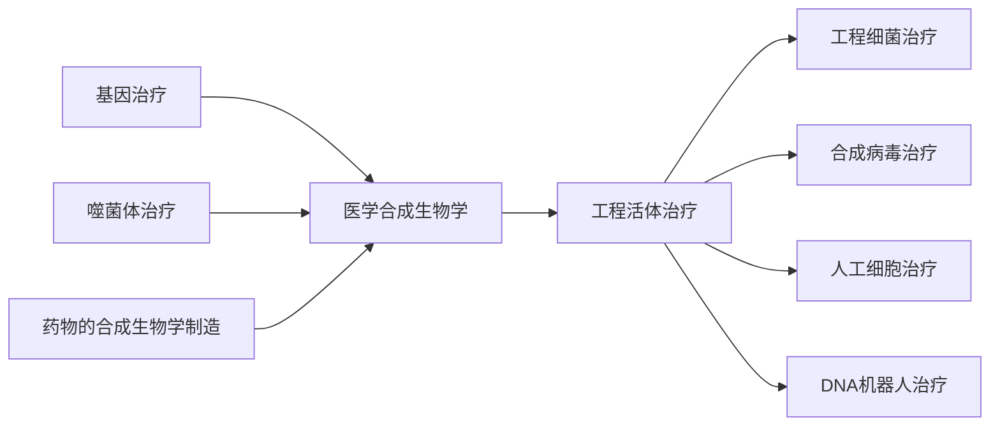
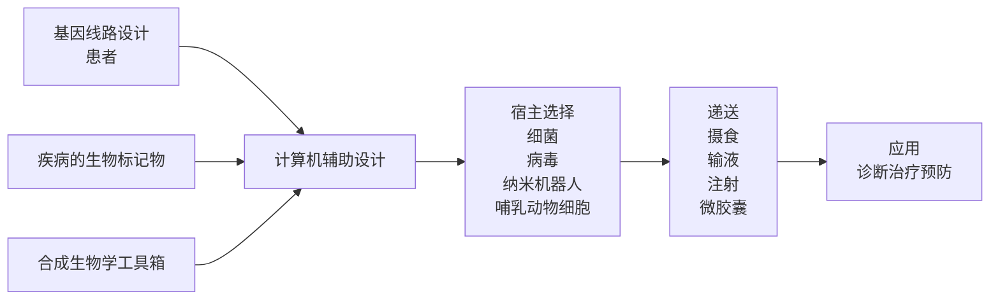

# 第八章医学合成生物学

原始 PDF 第 233–259 页。

第 八 章

# 医学合成生物学

## 第一节 概 论

现代医学依然面临着许多复杂的挑战，如慢性疾病的日趋普遍、癌症发病率和死亡率的持续攀升、人口老龄化催生的健康需求及抗生素耐药带来的严重威胁等。现有的治疗手段往往难以有效地解决这些问题。随着现代生物技术和基因工程的快速发展，合成生物学为解决这些健康问题提供了新的可能性。

合成生物学是一门生物学、信息学和工程学相结合的新兴交叉学科，它应用工程学原理对生物系统进行模块化设计和构建，以获得对生命活动的高度可控性，实现对生命体的精确编程、改造和优化。合成生物学的核心理念是将生命体视为可以像机械电路一样进行标准化设计和模块化组装的工程系统，综合运用基因合成、基因编辑和基因电路等技术实现对生命体的高精度操控和重新设计。合成生物学的最终目的是定制设计人工生命体，用于改善健康、能源、农业、环境等领域。在医学领域，人们可以应用合成生物学原理，通过对微生物（病毒、细菌等）、细胞、组织和其他生命体的人工再造，开发创新型医学工具，用于疾病诊断、治疗和预防。

在 20 世纪 80 年代和 90 年代，随着 DNA 测序和基因合成技术的迅速发展，遗传工程和基因编辑的能力成为现实，合成生物学随之兴起。不久之后，科学家开始将合成生物学应用于医学领域。医学合成生物学的起源可以追溯到 21 世纪初，研究人员构建了能够特异性靶向肿瘤的细菌和病毒，并改造了噬菌体用于治疗细菌感染，这些概念验证研究展示了合成生物学在医学方面的潜力。随后，多个研究小组工程化了益生大肠杆菌，用于检测和消灭假单胞菌等病原体，为合成生物疗法针对微生物组的发展奠定了基础。研究人员还利用工程化酵母大规模生产抗疟药物青蒿素的前体青蒿酸，使得低成本生产这种救命药物成为可能。

---

224

合成生物学

自 2010 年起，合成生物学快速发展，高效便捷的工具如 CRISPR-Cas9 基因编辑、大规模DNA 合成和单细胞组学等相继出现，使定制化和靶向遗传操作成为可能。利用这些技术，可以对植物或动物的细胞、器官乃至生物系统进行工程设计，并将其应用于疾病诊断、再生医学、基因治疗、疫苗制备和药物开发等领域。在短短数十年间，合成生物学技术已从简单的微生物扩展到复杂的哺乳动物细胞和组织，合成生物学在医学领域的应用也日益广泛。

医学合成生物学主要的研究内容包括药物的合成生物学制造、工程活体治疗、基因治疗和噬菌体治疗等（图 8-1）。

flowchart

图 8-1 医学合成生物学

合成生物学家利用设计的活体细胞、细菌、病毒颗粒或 DNA 构建的纳米机器人（nanorobot）将基因线路输送到体内预定部位，在这些部位，运载药荷可以诊断和治疗早期疾病（图 8-2）。首先根据疾病的相关标记物和合适的治疗输出设计基因线路，或借助计算机辅助设计基因线路。接着，选择合适的宿主如细菌、病毒、哺乳动物细胞或纳米机器人等来表达基因线路。随后，根据不同宿主选择合适的递送方式输送到人体预定位点，细菌和哺乳动物细胞封装后，分别通过摄食和注射递送到人体；而病毒和 DNA 纳米机器人可通过输液递送到人体。基因线路一旦进入人体预定位点，即可发挥诊断、治疗或预防疾病的作用。

flowchart

图 8-2 工程活体治疗的原理

---

第八章 医学合成生物学

225

## 一、工程细菌

1）工程化益生菌:通过基因工程改造大肠杆菌和乳酸杆菌等细菌，使其能够感知疾病信号，并产生治疗性蛋白质或多肽，用于治疗胃肠道紊乱、炎症、细菌感染等疾病。
2）癌症治疗:通过对沙门氏菌、李斯特菌和梭状芽孢杆菌等细菌的工程化，使其能够特异性地感染肿瘤细胞，并在其中复制，而不影响正常细胞。上述细菌可用于癌症诊断或递送抗癌药物。
3）细菌生物合成:通过改造细菌，使其能够合成治疗性蛋白质、代谢物或化合物，旨在开发高效、绿色和可再生的生物制造过程。

## 二、合成病毒

1）溶瘤病毒:利用合成生物学技术，研究人员对腺病毒、单纯疱疹病毒、痘苗病毒等常见的低致病性病毒进行工程改造，去除了致病性基因，使它们能够特异性感染和消灭肿瘤细胞，而不影响正常细胞；同时，他们还在病毒中嵌入了治疗基因电路，使得治疗基因能够在肿瘤部位特异性地表达。目前，已有数十种溶瘤病毒用于癌症治疗。
2）基因治疗载体:腺相关病毒具有高度的安全性和组织选择性，因而作为基因递送载体被广泛用于基因治疗领域。工程化的腺相关病毒能够传递功能性基因，用于治疗遗传性疾病，如地中海贫血、血友病、神经系统疾患等。目前，人工智能技术也被应用于腺相关病毒衣壳蛋白的定向进化，使其具有更强的靶向性和感染活性。
3）疫苗:由于减毒疫苗和灭活疫苗未能满足临床需求，研究人员通过对病毒进行工程化改造，使其能够感染细胞并大量产生抗原，但不能自我复制，从而既能强力刺激免疫反应，又能保证安全性。相关的病毒载体疫苗已被开发用于预防 COVID-19 等多种感染性疾病。

## 三、人工细胞

1）嵌合抗原受体（chimeric antigen receptor，CAR）细胞:利用合成生物学技术，人们可以改造 T 细胞、自然杀伤细胞（NK）、巨噬细胞（macrophage）等免疫细胞，使它们通过 CAR能够更有效地识别肿瘤细胞表面的抗原并对肿瘤细胞发起攻击。目前，CAR-T 细胞疗法在血液肿瘤领域已经取得了巨大成功，对包括多发性骨髓瘤在内的多种血液肿瘤的整体反应率（overall response rate，ORR）超过 90%。
2）调节性 T 细胞（regulatory T cell，Treg）:Treg 是人体内重要的免疫调节细胞，其生理功能是控制过度免疫反应造成的机体损伤。人们通过改造 Treg 使它们能更持久地发挥免疫调节作用，并将其应用于治疗自身免疫性疾病和移植排斥反应。
3）诱导多能干细胞（induced pluripotent stem cell，iPSC）:iPSC 技术是通过表达多种转录因子（如 Oct4、Sox2、c-Myc、Klf4 等）使在终末分化的体细胞恢复多向分化潜能的过程。目前，研究人员可以将 iPSC 定向分化为能够分泌胰岛素的胰岛 B 细胞，用于治疗 2 型糖尿病。

## 四、工程化生物系统应用于临床治疗的挑战

虽然医学合成生物学正在飞速发展并已展现出巨大潜力，但是将工程化生物系统从概念

---

226

合成生物学

验证研究转化为可行的临床治疗依然面临着许多挑战，这些挑战包括以下三个方面。

1）安全性:人工微生物具有免疫原性、脱靶效应、失控增殖等风险，基因递送可能导致插入突变从而破坏宿主基因组，而 iPSC 则具有潜在的成瘤性风险等。必须充分研究这些潜在的风险，建立有效的预防和控制手段，以确保临床使用的安全性。
2）有效性:与高度受控的实验室环境相比，人体内的环境更为复杂多变，因此人工微生物或人工细胞在其中的治疗效果可能受到限制。人工合成生物系统的稳定性和持久性是另一核心挑战，如何避免基因电路和人工生物系统随时间的推移而失活是关键问题。
3）可控性:传统治疗药物通常是小分子化合物或大分子抗体等，其大规模生产制备、存储、运输等工艺都已日趋成熟。而医学合成生物学所使用的人工合成生物系统是“活”的药物，因此需要保证其感染、复制、递送的能力。优化生产工艺，建立规模化和标准化的生产流程及相应的质量控制和检测体系，以制备满足临床规模需求的人工合成微生物、细胞和生物分子，仍然是一个巨大的挑战。

过去几十年间，合成生物学已从设想逐渐成为现实，并对疾病诊断、治疗和预防等医学领域产生了深远的影响，工程化微生物和人工细胞为人们打开了实现精准医学和个性化治疗的大门。尽管在安全性、有效性和可控性等方向上仍面临系列挑战，但医学科学界已在这些方面取得重大进展。随着基础研究的不断深入和转化医学的蓬勃发展，合成生物学将与材料科学、人工智能、纳米技术和生物医学等领域紧密结合，在人类健康领域取得了重大进展。我们有理由相信，医学合成生物学这个崭新的领域必将在不久的将来可以改善和拯救无数的生命，最终实现人类健康的全面提升。

## 第二节 药物的合成生物学制造

目前药物生产通常采用天然提取或化学合成的方法，但这些工艺难以应对某些复杂化合物的生产需求。这些化合物在自然界中含量极低，且难以人工合成和纯化，如抗癌药紫杉醇、抗疟药青蒿素和镇痛药吗啡等重要药物，它们的生产规模和可持续性均受到限制。生物合成为解决这一问题提供了一个理想的替代方案。利用合成生物学技术，人们可以设计并构建能够高效生产复杂天然产物或新型药物衍生物的微生物菌株，其产量远超自然水平。微生物发酵还具有可再生性，有利于可持续生产。此外，微生物产生的目标化合物通常会分泌到培养基中，与从植物中提取相比，后续的分离和纯化工艺也大为简化。除了人工微生物菌株，无细胞系统也被开发用于药物的生物合成。无细胞系统是指在无活细胞的情况下进行体外生物活动（如转录和翻译）的系统。由于其具备开放性、易于控制、灵活性和对细胞毒性高度耐受等优势，该系统已被用于合成在细胞中难以表达或有毒的蛋白质类药物。无细胞系统还非常适合高通量筛选。近年来，生物合成在可持续和经济高效的药物生产方面展现出了巨大的潜力。

## 一、萜类药物的生物合成

萜类化合物是由五碳化合物异戊二烯衍生的化合物，也是植物次生代谢产物中最大的一类，约占已鉴定的天然产物的 60%。许多萜类化合物含有具生物活性的药用成分，如青蒿素、紫杉醇和人参皂苷等。

---

第八章 医学合成生物学

227

1）青蒿素:一种从植物青蒿中提取的含有内过氧桥的倍半萜内酯，具有抗疟疾作用[1]。然而，它在植物青蒿中的含量极低（仅为 0.01%～1%），远远不能满足实际的医疗需求[2]。由于青蒿素分子具有多个手性中心，其化学合成途径困难且低效。利用微生物合成青蒿素的前体可提高药物生产效率，降低药物生产成本。倍半萜烯的生物合成是合成生物学的一个里程碑。重组大肠杆菌最初合成丁香烯的产量只有 24mg/L。经过不断的优化，工程酵母成功合成了另一种青蒿素前体青蒿酸，其产量达到了 $2 5 \mathrm { g } / \mathrm { L } ^ { [ 3 ] }$ 。青蒿酸的生物合成是合成生物学的一个成功范例。
2）紫杉醇:一种从太平洋红豆杉树中提取的二萜类化合物，具有抗癌作用。目前，紫杉醇的生产主要依赖于植物细胞培养技术，虽然比天然红豆杉树皮的含量提高了 10 倍，但仍面临费时且效率较低的问题。Ajikumar 等改造了大肠杆菌细胞，使其能够生产紫杉醇的前体紫杉二烯，其产量达到了 1g/L[4]。
3）人参皂苷:一种从人参属植物中提取的三萜皂苷，具有预防癌症和抗衰老的作用。利用酵母细胞工厂，可以合成各种人参皂苷，如人参皂苷 Rh2 和人参皂苷 CK 等，它们的产量分别达到了 $2 \mathrm { g } / \mathrm { L } ^ { [ 5 ] }$ 和 $\mathsf { S g / L ^ { [ 6 ] } }$ 。微生物方法的应用有效缓解了人参皂苷在临床应用中的短缺情况。

## 二、生物碱药物的生物合成

生物碱是一类至少含有一个氮原子的有机化合物，广泛存在于自然界中。由于生物碱具有多种药理活性，它们常被用于治疗疼痛、焦虑、癌症等疾病。然而，从植物中提取生物碱的过程既费时又费力，而且存在法律和伦理问题。因此，利用微生物通过生物合成技术生产生物碱具有重要的意义。生物合成不仅可以避免种植违禁植物，还可以提高生物碱的纯度和选择性。以下将介绍两类重要的生物碱药物—阿片类药物和大麻素的生物合成进展。

1）阿片类药物:一类从罂粟未成熟浆果中分离的生物碱，具有强效的镇痛作用。目前，阿片类药物主要通过化学合成或半合成的方式制备，但这些方法存在低效、高成本和环境污染等问题。为了解决这些问题，近年来，许多研究者尝试利用代谢工程技术在微生物中实现阿片类药物的生物合成。Galanie 等首先在工程酵母细胞中表达了 21 个基因（用于合成蒂巴因）或 23 个基因（用于合成羟考酮），分别得到了 $6.6 × 10^{-5} g/L$ 和 $3   \times   1 0 ^ { - 7 } \mathrm { g / L }$ 的产量[7]。随后，Nakagawa 等改进了这一过程，使用大肠杆菌作为底盘细胞，使蒂巴因和羟考酮的产量分别提高到 $2 . 1 { \times } 1 0 ^ { - 3 } \mathrm { g / L }$ 和 $4.0 \times 10^{-5}  g/L$ [8]。此外，其他阿片类药物如可待因等也已经在微生物中成功合成，并且产量达到了毫克级别。然而，与市场需求相比，这些产量仍然很低，因此未来的研究应该继续优化微生物的代谢途径和调控机制，以提高生物合成阿片类药物的效率和稳定性。

2）大麻素:一类从大麻中提取的天然产物，具有镇痛和抗焦虑作用。由于大麻在许多国家和地区被视为非法植物，大麻素的供应受到了严格的限制。此外，大麻素的化学结构复杂，难以通过化学合成或半合成的方式大量制备。因此，利用微生物通过生物合成技术生产大麻素也具有重要的意义。延胡索乙素和大麻萜酚酸是两种难以从植物中提取的著名大麻素。Hafner等利用酵母作为底盘细胞，实现了延胡索乙素的生物合成，其产量达到了 $3.6 × 10^{-6} g / L ^{[9]} 。$ Luo 等则建立了一条完整的大麻萜酚酸的生物合成途径，他们利用工程化酵母细胞使大麻萜酚酸的产量达到了 $0 . 1 \mathrm { g / L ^ { [ 1 0 ] } }$ 。这些都是利用合成生物学技术高效生产复杂大麻素的成功案例。

---

228

合成生物学

## 三、氨基酸衍生物药物的生物合成

氨基酸是构成生物体的基本单元之一，它们及其衍生物在维持人类健康方面发挥着重要作用。由于这类化合物含有多个手性中心，因此它们通常采用生物合成的方式而非化学合成的方式来制备。相比于生物碱和萜类化合物，氨基酸衍生物的结构更为简单，但却具有更高的多样性。

1）赛洛西宾:一种由 L-色氨酸衍生而来的化合物，具有治疗药物成瘾、抑郁症和创伤后应激障碍的潜力。通过基因工程技术，大肠杆菌或酿酒酵母可以异源表达赛洛西宾生物合成途径的相关基因，使其产量分别达到了 1.2g/L[11]和 0.6g/L[12]。
2）三七素:一种最初从家山黧豆种子中提取出来的植物次级代谢产物，能够诱导人体血小板聚集，是中药云南白药的主要活性成分之一。研究人员通过优化大肠杆菌中三七素的代谢流，使其最终产量提高到了 1.29g/L[13]。

## 四、不对称合成的生物催化

不对称合成是一种制备手性分子的有机合成方法。手性分子具有两种镜像对称的构型，但它们不能叠合在一起。不同构型的手性分子可能具有不同的生物或物理效应，因此不对称合成的目标是选择性地得到其中一种构型的手性分子。不对称合成通常需要使用一种手性的催化剂，它能够区分并优先产生一种手性分子。目前常用的催化剂有金属类的催化剂，但它们存在低效和金属污染的问题。生物催化可大大提高不对称合成的效率，为高效获得手性分子提供帮助。

例如，西格列汀是一种治疗糖尿病的药物，它能够竞争性地抑制二肽基肽酶-4（DPP-4），从而减少 GLP-1 的降解，增加胰岛素的分泌。西格列汀的市场规模在 2021 年达到了 14 亿美元。然而，西格列汀的化学合成过程中，需要通过铑为基础的手性催化剂转移手性胺，这样会导致立体选择性低和铑污染。为了解决这个问题，科学家从一种具有催化上述化学反应的分子机制但对前西格列汀酮没有活性的转氨酶开始，采用底物步移、同源建模和饱和诱变的方法，开发了一种具有一定催化活性的转氨酶突变体；随后通过定向进化的进一步改造，最终得到一种全新的具有广泛适用性的生物催化剂，用于高效合成手性胺，显著提高了西格列汀的合成效率和纯度[14]。这个案例展现了利用合成生物学手段开发的新型生物催化剂在高效和可持续制药过程中的应用潜力。

## 五、利用无细胞系统合成治疗性蛋白

蛋白质类药物（如抗体和重组蛋白）在全球药物市场中占据了越来越重要的地位。例如，阿达木单克隆抗体（adalimumab）和帕博利珠单克隆抗体（pembrolizumab）分别居 2022 年全球药物销售额的第二位和第三位。无细胞蛋白质合成（cell-free protein synthesis，CFPS）为解决蛋白质毒性问题和筛选胞内蛋白质提供了解决方案。此外，冻干技术使无细胞系统在保存一年后仍能保持高活性。

目前常用的 CFPS 系统有两种，分别是细胞裂解液系统和纯化成分系统[15]。最常见的细

---

第八章 医学合成生物学

229

胞裂解液来自大肠杆菌、小麦胚芽和酵母[16]。大肠杆菌裂解液常用于合成蛋白质，小麦胚芽裂解液用于构建蛋白质阵列，酵母裂解液则用于合成糖蛋白。Shimizu 等利用 36 种转录/翻译相关酶和高度纯化的核糖体开发了一种无细胞系统[17]。然而，纯化成分的成本极高，阻碍了其推广应用。因此，细胞裂解液系统是目前 CFPS 系统的首选。

CFPS 系统为快速生产疫苗提供了平台。Kanter 等开发了一种无细胞系统，用于高效生产由抗体单链可变区片段（scFv）与粒细胞-巨噬细胞集落刺激因子（GM-CSF）组成的融合蛋白，这是一种 B 细胞淋巴瘤疫苗[18]。Lu 等描述了一种表达 H1N1 流感病毒结构域的 CFPS 系统，用于生产潜在的、具有广泛保护作用的流感疫苗[19]。Tsuboi 等在基于酵母裂解液的无细胞系统中成功表达了三种疟疾蛋白，而这在重组细胞中很难生产[20]。

CFPS 系统也常用于合成抗体。Jaroentomeechai 等利用 CFPS 系统在大肠杆菌无细胞系统（补充糖基化酶体系）中合成了具有 N-糖基化修饰的 scFv，对维持蛋白质药物（包括某些抗体）的半衰期和活性非常重要[21]。总体而言，无细胞系统具有快速、便捷和可按需定制等优点，正逐渐成为重组表达系统的有益补充。

## 第三节 工程细菌的诊疗

细菌是地球上分布范围最广、种类和数量最多的生物之一，与人们的日常生活息息相关。细菌也是人体表面和内部最常见的外源生物，与机体的稳态维持和疾病发生有密切关联。以大肠杆菌等模式微生物为代表，人类对细菌的研究已有上百年的历史，逐渐认识到细菌具有快速繁殖适合培养、基因组简单易于操作、长期与人体共存安全性良好等诸多关键特征，使其成为开发人工生物系统用于疾病诊疗的理想的底盘生物。第一，细菌生长迅速，能够规模化生产，易于实现低成本的生产。它们快速的复制也使得人工设计的基因电路能够在细菌体内快速迭代，在短时间内获得优化的基因模块。第二，细菌拥有小型的基因组，可以使用像CRISPR 这样的成熟工具进行高效的遗传操作，使得插入合成回路和重编程等操作变得简单直接。第三，细菌拥有灵活多样的代谢能力，可以产生种类繁多的生物分子。这种代谢多样性使得工程细菌能够合成小分子、酶、抗体和其他治疗分子。第四，目前已鉴定出多种非致病性的细菌种类和菌株，如大肠杆菌 Nissle 1917 和双歧杆菌，可以作为安全的底盘。此外，致病性菌株也可以通过敲除或替换毒性基因实现减毒。这些经过临床验证的菌株确保了工程细菌的安全性。第五，部分非致病性细菌无须改造即可定植于肠道和肿瘤等组织，实现靶向性局部给药。第六，细菌感染可以激活免疫系统，从而增强对抗疾病的免疫反应。

近年来，合成生物学家设计并构建了能感知和转导疾病生物标志物信号的基因电路，并将其植入工程细菌中，使工程细菌具备根据信号通路进行诊断和治疗的能力，从而实现了对治疗时空和剂量的精准控制。利用细菌活性进行疾病诊疗是一种集灵活性、可持续性和可预测性于一体的强大新策略，目前正处于迅速发展阶段，有望为人类疾病提供更多新的治愈途径。

## 一、工程细菌应用于癌症诊疗

早在 19 世纪早期，医学界就已经开始观察到细菌感染有时能够减缓甚至治愈肿瘤的现象。1893 年，美国医生 William Coley 成功将细菌灭活，制备成了“科利毒素”（Coley’s toxin），

---

230

合成生物学

并最终成功治疗了近千名肿瘤患者[22]。随着对细菌的深入研究，人们逐渐认识到细菌疗法具有出色的靶向性、较低的毒副作用及卓越的免疫激活效应。虽然细菌肿瘤治疗的作用机制尚未被完全认识，但主要的可能机制是:①肿瘤靶向性，在肿瘤的缺氧和酸性环境中免疫监视能力弱，导致细菌能在肿瘤微环境中定植和增殖，而在正常组织中因其严格的免疫机制，细菌将被快速清除而无法定植；而且厌氧菌也不会在与肿瘤无关的缺氧性或炎症性病变中定植。②细菌在肿瘤内部与癌细胞竞争营养。③细菌具有内在抗肿瘤活性。④细菌的免疫原性会激活宿主局部的免疫系统，从而杀死肿瘤细胞。

目前已报道许多细菌可用于肿瘤治疗，包括:①益生菌， 如乳酸杆菌（Lactobacillus spp.）、大肠杆菌（Escherichia coli）Nissle 1917、链球菌（Streptococcus spp.）、乳酸乳球菌（Lactococcus lactis）、干酪乳杆菌（Lactobacillus casei）、长双歧杆菌（Bifidobacterium longum）、丁酸梭菌（clostridium butyricum）和拟杆菌（Bacteroides spp.）等；②一般毒性细菌，如结核分枝杆菌（Mycobacterium tuberculosis）、鼠伤寒沙门氏菌（Salmonella typhimurium）和单核细胞增生性李斯特菌（Listeria monocytogenes）；③致病性细菌，如副溶血性弧菌（Vibrio parahaemolyticus）、绿脓杆菌（Pseudomonas aeruginosa）等[23]。益生菌对肿瘤的靶向性强，但没有溶瘤作用；而致病菌的天然毒性过强，会杀伤正常组织细胞。在这些细菌中，沙门氏菌因其卓越的靶向性、溶瘤活性及易于改造等特点，被认为是理想的肿瘤治疗载体。

但是天然细菌无法根除实体瘤，而借助合成生物学技术，细菌工程化改造为肿瘤治疗开辟了崭新的途径。目前利用合成生物学技术，细菌的合成生物学改造主要聚焦在提高细菌的安全性、肿瘤靶向性和利用基因线路表达抗肿瘤效应分子等三个方面[24]。敲除毒力基因和构建营养缺陷菌株是提高细菌安全性和靶向性的主要手段，如敲除 purI 和 msbB 基因的伤寒沙门氏减毒株 VNP20009、敲除 aroA 基因的芳香族氨基酸营养缺陷伤寒沙门氏减毒菌株SL3261。然而单靠减毒细菌往往无法根除实体瘤。20 世纪 90 年代中期，在首次描述了通过肿瘤靶向细菌传递治疗有效载荷可以增强疗效后，人们探索了用工程细菌作为载体来表达各种抗肿瘤药效应分子[24,25]，包括细胞因子（cytokine）、细胞毒性剂（cytotoxic agent）、前药物转化酶（prodrug-converting enzyme）、调节因子（regulatory factor）、肿瘤相关抗原/抗体（turmorassociated antigen/antibody）和小干扰 RNA（siRNA），如表 8-1 所示。

表 8-1 抗肿瘤效应分子

| 种类 | 效应分子 |
| --- | --- |
| 细胞因子 | IL-2、IL-4、IL-12、IL-18、TNFSF14、CCL21、INF-γ、TNF-α、GM-CSF |
| 细胞毒性剂 | 溶细胞素A、Noxa、TRAIL、FasL、CD40L、白喉毒素、凋亡素 |
| 前药物转化酶 | 胸苷激酶、胞嘧啶脱氨酶、硝基还原酶、嘌呤核苷酸酶、羧肽酶G2、酪酸盐还原酶YieF、HSV-TK和PNR |
| 调节因子 | 天冬氨酸酶、内皮抑素、血小板反应蛋白、RBM5、4-1BBL |
| 肿瘤相关抗原/抗体 | CEA-scFv、RGD、CD20-特异抗体、TGF-α、NY-ESO-1、HPV16-E7、存活素、PCSA、AFP |
| siRNA | 靶向STAT3、Bcl-2、PLK1、Sox2、IDO和MDR1 |

注:IL. 白细胞介素；TNFSF14. 肿瘤坏死因子超家族 14；CCL21. 趋化因子配体 21；IFN-γ.干扰素 γ；TNF-α.肿瘤坏死因子 α；GM-CSF. 粒细胞巨噬细胞集落刺激因子；Noxa. 促凋亡蛋白；TRAIL. 肿瘤坏死因子相关凋亡诱导配体；FasL. Fas 配体； CD40L. CD40 配体；HSV-TK.单纯疱疹病毒胸苷激酶；PNR. 硝基还原酶；4-1BBL. 4-1BB 配体；CEA-scFv. 抗癌胚抗原单链可变区片段；RGD. 精氨酸-甘氨酸-天冬氨酸肽；TGF-α. 转化生长因子 α； NY-ESO-1.肿瘤抗原； HPV16- E7. 抗原；PCSA. 前列腺干细胞抗原；AFP. 甲胎蛋白；STAT3. 信号转导及转录激活蛋白 3；Bcl-2. 凋亡抑制蛋白；PLK1.丝氨酸/苏氨酸蛋白激酶 1；Sox2. 干性维持转录因子 2；IDO. 吲哚胺-2, 3-双加氧酶；MDR1. 多药耐药蛋白 1

---

第八章 医学合成生物学

231

许多基因线路已成功用于抗肿瘤效应分子的表达，以提高细菌的肿瘤治疗效果，如自杀开关、群体感应基因线路、逻辑振荡器、小分子（如水杨酸）诱导线路、环境（如缺氧）诱导线路、光诱导线路、逻辑门基因线路等。

下面介绍一些工程细菌在癌症诊断和治疗中的代表性应用。

首先，工程细菌在癌症诊断中具备潜力。麻省理工学院与加利福尼亚大学圣地亚哥分校的研究团队将 LacZ 报告基因植入大肠杆菌中，该基因在细菌与肿瘤细胞接触时被启动表达，导致大量 LacZ 酶的产生。随后，研究人员向小鼠体内注射一种化学发光底物，该底物在 LacZ酶的作用下会释放化学发光信号，并在小鼠尿液中富集，使尿液变为红色。通过监测尿液颜色的变化，研究人员可以初步推测小鼠是否患有肿瘤及肿瘤的状态。研究人员发现，这一方法比传统显微镜检测更加敏感，可以检测出直径小于 1cm 的肿瘤[26]。

在癌症治疗领域，Royo 等研究人员设计了一个水杨酸诱导的电路，用于改造经过减毒处理的沙门氏菌，以将 5-氟胞嘧啶转化为细胞毒性产物，从而选择性地杀伤肿瘤细胞[27]。沙门氏菌经注射后会定位到肿瘤组织，随着水杨酸（诱导剂）和 5-氟胞嘧啶（底物）的注射，细菌细胞内开始生成 5-氟尿嘧啶，并将其释放到肿瘤环境中，从而实现对肿瘤细胞的毒性作用。

加利福尼亚大学圣地亚哥分校的研究团队设计了基于群体感应的基因线路，让细菌在肿瘤环境内生长达到一定阈值后自行裂解，并同步释放出抗癌药物。在大量裂解后，少数存活下来的细菌重新增殖并进行下一轮裂解和释放抗癌药物，因此形成脉冲式的递送周期。这一方法在实现细菌药物递送的前提下，最大限度地减少了细菌在体内的定殖数量，从而降低了对周围组织的损伤和毒副作用[28]。

为了提高抗癌细菌疗法的安全性和有效性，研究人员正致力于增强细菌对肿瘤的精确靶向性。尽管一些细菌天然具有在实体瘤内的厌氧环境中定向生长的趋向性，如大肠杆菌、霍乱弧菌、沙门氏菌和李斯特菌等，但通常情况下，这种亲和力尚不足以实现精确的靶向治疗，因为细菌仍然会在体内广泛分散[29]。为增强细菌对肿瘤的特异性，策略之一是通过定向进化的方式培养细菌，使其在肿瘤内生长并产生适应性突变，以筛选出更适合在肿瘤内生长的细菌变种。此外，研究人员还可以设计细菌，使其在外膜上表达肿瘤靶向分子，如黏附肽。例如，一种减毒沙门氏菌菌株通过将精氨酸-甘氨酸-天冬氨酸（RGD）肽与细菌外膜蛋白 A（OmpA）融合，使细菌表面展示出 RGD 肽。RGD 肽能够与肿瘤细胞上广泛高表达的αvβ3 整合素结合，从而提高了细菌对肿瘤细胞的黏附性。改善细菌对肿瘤趋向性的另一种方法是利用遗传回路，将细菌的生长与肿瘤特征如高浓度乳酸盐、低氧和低 pH 等相结合。在这些感应回路中，细菌生长所需的基因转录受细菌启动子的控制，以响应这些环境线索，从而限制细菌向肿瘤生长。鉴于其他组织中可能也存在某些信号，通过“AND”逻辑门将感应回路组合在一起，可进一步提高肿瘤特异性，减少细菌突变逃逸的情况，从而实现更长期的生物封闭。这些策略的研究和发展为抗癌细菌疗法的改进提供了关键的方向，有望为患者提供更加安全和有效的治疗选择。

我国研究人员在抗癌细菌疗法的开发领域取得了显著的进展。我国自主研发的 SGN1 注射液是全球首个在中国和美国均进入临床试验阶段的细菌载体基因工程生物制品，具有精确靶向和快速溶解肿瘤的能力。SGN1 采用减毒沙门氏菌载体携带甲硫氨酸水解酶，能够降解肿瘤生长所必需的甲硫氨酸，从而杀伤肿瘤。这种溶瘤产品具有高效杀伤肿瘤的特性，且适用于多种实体肿瘤。此外，中国科学院深圳先进技术研究院的团队致力于采用合成生物学方法，以降低细菌毒性、增强细菌靶向性，并赋予细菌多样化功能，旨在将细菌改造成更为特异、

---

232

合成生物学

智能和高效的抗肿瘤工具。

综上所述，工程细菌能特异性富集在肿瘤部位，诱导直接溶瘤作用，并在肿瘤微环境中产生强大的免疫调节作用，唤醒被肿瘤抑制的宿主免疫系统，还可用作药物或细胞因子的递送载体，从而增强抗肿瘤效果。

## 二、工程细菌应用于糖尿病诊疗

细菌已被设计用于检测尿液中的葡萄糖浓度。Courbet 等描述了一种检测人尿液样本中异常葡萄糖浓度的方法，他们将细菌传感器封装在水凝胶微珠中，尿液中的葡萄糖会在微珠中变为红色。体外细菌血糖仪的检测灵敏度比尿试纸高一个数量级[30]。

工程细菌还可进一步用于糖尿病的治疗。例如，在工程肠道细菌中合成用于治疗糖尿病的蛋白质和多肽。利用经改造的益生菌格氏乳杆菌（Lactobacillus gasseri）ATCC 33323 合成了胰高糖素样肽-1（glucagon-like peptide-1，GLP-1）的多肽，口服细菌治疗糖尿病大鼠后，血糖水平下降了 33% [31]。同样，经改造的 Lactococcus lactis FI5876 也能在高浓度葡萄糖条件下生物合成 GLP-1，以刺激胰岛 B 细胞分泌胰岛素[32]；经改造的益生菌副干酪乳酸菌（Lactobacillus paracasei）ATCC 27092 能分泌血管紧张素（1-7）[Ang-（1-7）]（一种抗炎、抗血管扩张和血管生成的肽类药物），口服该细菌后，糖尿病小鼠体内的 Ang-（1-7）浓度升高，且胰岛素敏感性增加，因而减少了糖尿病小鼠的视网膜和肾损伤。此外，口服合成穿透素（一种细胞穿膜肽，具有增强胰岛素输送的能力）和 GLP-1 融合蛋白的工程长杆菌 HB15 还能增强结肠直肠中 GLP-1 的产生[33]。通过将 GLP-1 与肽聚糖锚定蛋白 PrtP 融合，研究人员也成功设计出了能在细菌膜上展示 GLP-1 类似物的 L. paracasei BL23，这种工程菌改善了糖尿病大鼠的血糖控制情况[34]。除 GLP-1 外，工程乳杆菌 MG1363 还同时表达了免疫调节细胞因子 IL-10 和人胰岛素前体等蛋白，与小剂量的全身抗 CD3 联合治疗，可逆转非肥胖糖尿病小鼠因不受控的自身免疫而引发的糖尿病[35]。这种设计可能对人类 1 型糖尿病患者也有治疗作用。

## 三、工程细菌应用于代谢疾病诊疗

工程化肠道微生物已被开发用于治疗代谢性疾病[36]。例如，被改造的大肠杆菌可以合成N-酰基磷脂酰乙醇胺（NAPE），其代谢物具有厌食效应，可用于治疗高脂肪饮食引起的小鼠肥胖症[37]。代谢性疾病的患者会代谢障碍而导致有毒化合物在体内堆积，造成中毒。例如，小肠是毒性物质氨的主要来源，将肠道产生的氨转化为精氨酸可以治疗高氨血症。为此，Kurtz等改造了一种肠道常驻菌—大肠杆菌 Nissle 1917 菌株，口服给药即可在小鼠和猴子模型中成功将小肠的氨转化为 L-精氨酸，并减少了肝脏疾病导致的高氨血症。该菌株在健康受试者的Ⅰ期临床试验中表现出良好的安全性，具有进一步临床开发的潜力[38]。此外，Isabella 等将大肠杆菌 Nissle 1917 重新编程为过表达苯丙氨酸降解通路基因的工程菌，以降解苯丙酮尿症（PKU）患者体内过量的苯丙氨酸。在 Pahenu2/enu2 PKU 小鼠模型中，口服给予工程菌治疗能显著降低血苯丙氨酸的浓度，降幅达 38%[39]。

酒精性肝病是肝脏疾病的主要种类之一[40]。工程化的枯草芽孢杆菌和乳酸乳杆菌可用于表达乙醇降解通路的乙醇脱氢酶和乙醛脱氢酶，以加速乙醇的代谢并减轻乙醇过度摄入造成

---

第八章 医学合成生物学

233

的肝损伤[41]。此外，在慢性乙醇暴露期间，抗革兰氏阳性细菌的 REG3G 蛋白在胃肠道中异常低表达，增加了感染风险。罗伊氏乳杆菌经改造后能表达白细胞介素-22（IL-22），提高了酒精性肝病小鼠肠道中 REG3G 的丰度，从而减少了肝感染导致的炎症和损伤[42]。

## 四、工程细菌应用于胃肠道疾病诊疗

益生菌可用于治疗炎症性肠病（inflammatory bowel disease，IBD）[43]。IBD 是消化道组织的慢性炎症，主要包括溃疡性结肠炎和克罗恩病。IBD 患者常患有腹泻、疼痛和体重减轻等症状。肠道中常驻着大量细菌，研究人员通过合成生物学的方法使肠道细菌拥有治疗胃肠道疾病的能力。Praveschotinunt 等改造了大肠杆菌 Nissle 1917，使它能表达 Curli 纤维蛋白与三叶因子（TFF，胃黏膜保护肽家族）融合蛋白，产生细胞外纤维基质，促进小肠上皮的完整性，以增强肠道黏膜的愈合能力，从而缓解小鼠的 $\mathrm { I B D } _ { \circ }$ 结果表明，工程化的大肠杆菌显著抑制了促炎细胞因子的产生，缓解了小鼠的体重减轻，保持了结肠长度，在葡聚糖硫酸钠（DSS）诱导的急性结肠炎小鼠模型中表现出抗炎能力。该设计有望作为通用模式扩展到其他针对IBD 的益生菌活体疗法中[44]。

工程细菌还可以通过清除病原体来治疗胃肠道感染性疾病。铜绿假单胞菌是一种常见的多药耐药病原菌，会严重危害患者的健康。工程化大肠杆菌 Nissle 1917 已被开发用于检测、预防和治疗铜绿假单胞菌的肠道感染[45]。改造的大肠杆菌能感知铜绿假单胞菌产生的信号分子 N-酰基高丝氨酸内酯，并通过自溶释放分散素（生物膜降解酶）和细菌素（抗菌肽）以清除肠道中的病原体。重编程的细菌不仅对铜绿假单胞菌有杀灭作用，还显示出对该菌的长期预防能力（超过 15 天）。

3-羟基丁酸（3-hydroxybutyrate，3HB）是人体内酮体的一种成分，已被证明对结肠炎具有治疗作用。Yan 等构建了过表达 3HB 生物合成通路的大肠杆菌 Nissle 1917。与野生型大肠杆菌相比，工程细菌在肠炎模型中对小鼠体重、结肠长度、潜血水平、肠道髓过氧化物酶活性及促炎细胞因子浓度等指标均显示出更好的疗效[46]。

然而，这些研究都仅在小鼠中获得初步结果，它们尚未进入临床试验阶段，后期仍需要进一步开展系统的非临床研究并评估它们在人体中的应用潜力。

## 五、工程细菌应用于抗疟原虫

由于耐药性的出现，疟疾在发展中国家仍然造成了巨大的负担，因而迫切需要开发新方法来对抗这种致命疾病。疟原虫是导致疟疾的病原体，它们以雌性按蚊为传播媒介感染人类。因此，切断按蚊传播途径被认为是预防疟疾的关键手段。中国科学院上海生命科学研究院植物生理生态研究所的研究人员巧妙地利用了按蚊体内的共生细菌来控制疟疾传播。研究人员首先从雌性按蚊的卵巢中分离出沙雷氏菌属（Serratia）的新菌株 AS1，发现该菌株可以在蚊子体内的中肠和卵巢等器官定植，并可以通过交配传给后代，且对蚊子的生存和繁殖没有明显的负面影响。随后，AS1 菌被改造成可以同时分泌 5 种抗疟原虫蛋白的工程细菌。蚊子摄入这些工程菌后，疟原虫在蚊子体内的发育受到了显著的抑制，疟原虫卵囊减少 90%以上。由于 AS1 菌可以在蚊子群体中迅速传播，使蚊群失去传播疟疾的能力，因而可以从源头上阻断疟疾的传播。与改造蚊子基因组相比，这种方法操作更为简便，也避免了转基因蚊子的生

---

234

合成生物学

物安全问题[47]。

综上所述，通过合成生物学方法可以设计并构建工程细菌用于活体生物疗法。随着对细菌了解的深入和电路设计的发展，研究人员可以构建具有精确感知、诱导激活和持久作用的新一代细菌疗法。然而，在减弱细菌毒性并提高体内可控性等方面，我们仍需做更多努力。

## 第四节 合成病毒的诊疗

长期以来，人们都将病毒视为病原体，研究人员对其感染过程及在宿主细胞内的复制机制展开了深入研究，以期找到抗病毒的策略。然而，随着人们对病毒生物学的深入了解，以及合成生物学的迅速发展，研究人员开始将病毒工程化，使其成为强大的医疗工具。合成病毒用于医学领域具有以下优势:第一，每种病毒都有明确的宿主细胞特异性，可以利用这种选择性来靶向感染特定细胞进行治疗；第二，与细胞和细菌相比，病毒结构简单，更容易进行工程化改造以携带治疗基因；第三，病毒具有高效转导细胞的能力，可作为基因治疗载体来传递健康基因治疗遗传病；第四，病毒能激活宿主的先天和获得性免疫应答，这一特性可应用于疫苗和抗肿瘤免疫治疗开发中。目前，病毒的天然特性正在以创新方式应用于合成生物学，为开发新型诊疗策略提供了思路和手段。但是，病毒工程化也会带来生物安全隐患，需要谨慎评估风险。

## 一、合成病毒应用于癌症治疗

在 20 世纪早期，临床医生观察到一些感染病毒或注射疫苗后肿瘤消退的个案，从而提出了病毒可以治疗肿瘤的猜想。到了 20 世纪中叶，研究人员开始使用野生病毒或减毒毒株进行肿瘤治疗，虽然看到了一些疗效，但受限于野生病毒的毒性，以上临床研究未获成功。直到20 世纪 90 年代，随着基因工程技术的进步，研究人员才可以通过改造病毒基因组，从而提高其肿瘤选择性和杀瘤活性。此后，利用病毒治疗肿瘤的疗法步入了发展的快车道[48]。

研究人员将可以选择性感染并杀伤肿瘤细胞而不影响正常细胞的可复制病毒称为溶瘤病毒。它们既可以是天然存在的，也可以是经基因工程改造的病毒。溶瘤病毒能通过多种机制发挥抗肿瘤效应:首先，病毒选择性地在肿瘤细胞中大量复制，介导了直接溶瘤效应；其次，病毒的感染和复制会招募并激活大量免疫细胞，从而克服肿瘤的免疫抑制微环境，促进抗肿瘤免疫；最后，经基因工程改造的病毒可以高效递送治疗基因。因此，溶瘤病毒是靶向治疗、免疫治疗和基因治疗相结合的新型抗癌药物[49]。

Talimogene laherparepvec（T-Vec）是美国 FDA 首个批准上市的溶瘤病毒药物。它以感染人类的Ⅰ型单纯疱疹病毒（HSV-1）为骨架，敲除了病毒编码的毒性基因 ICP34.5 和 ICP47 以减少病毒在正常细胞的复制，提高其肿瘤选择性；插入了编码粒细胞-巨噬细胞集落刺激因子（GM-CSF）以招募树突状细胞（DC），从而增强抗肿瘤免疫应答。在临床应用中，单用 T-Vec可使部分患者产生持久应答；与免疫检查点抑制剂联用可增强其抗肿瘤效应[50]。

John 等利用化学遗传开关系统控制溶瘤痘苗病毒的复制和（或）基因表达，从而提高其安全性和有效性。研究者首先通过核糖体定量分析病毒启动子的强度，然后将不同药物的诱

---

第八章 医学合成生物学

235

导系统与病毒启动子进行融合以构建合成启动子，实现了强效的可诱导表达而基线不渗漏表达。研究者还构建了嵌合合成启动子，以增强治疗基因表达水平的精准调控[51]。

近年来，我国学者在溶瘤病毒领域取得了显著的进展。上海三维生物技术有限公司的安科瑞已获批上市，武汉滨会生物科技股份有限公司的 OH2、深圳亦诺微医药科技有限公司的T3011、广州威溶特医药科技有限公司的 M1 等溶瘤病毒均已进入临床试验阶段。清华大学研究团队通过使用合成基因线路来控制腺病毒的复制和免疫效应因子的释放，从而提高了腺病毒针对特定肿瘤细胞的靶向性和疗效。他们构建了一个感知开关电路，可以整合多个肿瘤特异性启动子和 miRNA 输入来控制 E1A 基因的表达，进而选择性地启动腺病毒在肝癌细胞中的复制。结果表明，感知开关电路可以选择性地启动腺病毒在多种肝癌细胞中的复制，但不影响正常细胞。进一步通过数学模型对腺病毒治疗系统进行定量分析，发现编码免疫效应因子的腺病毒疗效优于外源给药的组合疗法[52]。他们研发的基于合成基因线路的溶瘤病毒产品SynOV1.1 于 2020 年 11 月获得美国 FDA 临床试验许可。

## 二、合成病毒应用于基因治疗

病毒载体是将遗传物质受控地导入细胞进行基因治疗的常用工具，目前最常用的病毒载体包括腺相关病毒（AAV）、腺病毒（Ad）和慢病毒。病毒载体具有高转导效率的优势，可将基因递送到分裂和非分裂细胞。通过选择不同血清型的毒株或改变病毒的表面蛋白，还可以使病毒载体靶向特定细胞类型。由于慢病毒可以将遗传物质整合到宿主细胞的 DNA 中，因而可以实现持续的基因表达。经历了 40 多年的发展，病毒载体研究领域积累了不少成功和失败的经验，近年来进入了临床应用的快速增长期[53]。

目前，全球范围内已有 3 款基于 AAV 的基因治疗药物获批上市，分别是递送脂蛋白脂酶（lipoprotein lipase，LPL）编码基因的 alipogene tiparvovec，用于治疗 LPL 缺乏症[54]；携带维甲酸异构水解酶（retinoid isomerohydrolase，RPE65）编码基因的 voretigene neparvovec-rzyl，用于治疗遗传性视网膜疾病[55]；表达运动神经元生存蛋白（survival motor neuron，SMN1）编码基因的 onasemnogene abeparvovec，用于治疗脊髓性肌萎缩[56]。此外，还有超过 200 个临床试验正在进行中，适应证包括老年性黄斑病变、肌营养不良、血友病和 X 连锁肌管肌病等。AAV 载体基因疗法面临的主要挑战是免疫原性问题，包括对载体衣壳蛋白和外源基因的适应性免疫反应。目前的解决方法包括合理设计载体（如使用组织特异性启动子、miRNA 下调基因表达等）和优化给药途径。AAV 载体疗法在人体应用中总体上安全性良好，但仍需要持续评估其短期和长期的安全性。

Ad 载体具有很强的免疫原性[57]，适用于疫苗开发和肿瘤治疗[58,59]。慢病毒载体则在 CAR-T 细胞的制备过程中有广泛的应用[60]。

然而，病毒载体也存在一些关键的局限性。例如，它们的载荷容量有限，无法携带大片段基因序列；病毒蛋白也可能引起不利于疗效和安全性的免疫反应；病毒基因组的整合可能会破坏正常基因，产生遗传毒性。

总体而言，病毒载体是基因疗法中不可或缺的工具。虽然其安全问题仍然存在，但研究人员会继续对病毒载体进行工程化改造，以增强其特异性、最小化毒性和提高其转导效率。随着持续创新，病毒载体技术在治疗各种遗传性疾病方面将具有光明的前景。

---

236

合成生物学

## 三、合成病毒应用于疫苗开发

疫苗是预防传染性疾病最有效的方法。目前，已有 6 种病毒载体基因疗法产品获批上市或授权紧急使用，用于预防埃博拉病毒感染和 COVID-19。所有获批产品均基于重组复制缺陷病毒载体，病毒基因组携带了目标病毒的表面蛋白基因。使用复制缺陷病毒载体可降低载体病毒本身的安全风险。这些产品的作用机制包括:①病毒载体高效进入注射部位的细胞并将基因构建体转入感染细胞；②所转入的基因指导细胞过表达目标病毒的表面蛋白，刺激免疫系统产生细胞免疫和体液免疫应答，以抗病毒感染[61]。

将威胁生命的致病病毒转化为具有感染活性但无害的减毒疫苗一直是疫苗研发的重点方向。北京大学的研究团队利用合成生物学方法在甲型流感病毒基因组中引入过早终止密码子（premature termination codon，PTC），使其在感染人体细胞后不能进行完整的蛋白质翻译。这些含有 PTC 的病毒虽然保留完整的感染能力，但在常规细胞中不能复制。通过在基因组不同位置引入多个 PTC，研究者获得了在转基因细胞中能大量复制且遗传稳定的子代病毒。在小鼠、豚鼠和貂模型中，接种 PTC 病毒不仅能诱导对抗原性不同的流感病毒的强大体液、黏膜和 T 细胞免疫应答，发挥预防性作用；甚至还能中和已存在的感染病毒株，发挥治疗性效应。这一发现颠覆了传统病毒疫苗的概念，成为活病毒疫苗的重大突破。与依赖少数几个氨基酸突变的传统减毒活病毒相比，合成病毒的减毒效果来源于几百处的 PTC 所产生的累积效应，因此产生回复突变的可能性极低，其安全性显著提高。此外，通过这一方法获得减毒株所需的时间短，明显缩短了疫苗的研发周期[62]。这种利用合成生物学方法构建减毒活疫苗的策略被称为合成减毒病毒工程技术，可能成为一种将活病毒转化为疫苗的通用技术，适用于大多数病毒。

类似地，中国科学院武汉病毒研究所的团队采用“密码子去优化”策略对寨卡病毒（ZIKV）的关键基因 E 和（或）NS1 进行大量同义突变，从而获得了减毒毒株。与亲本 ZIKV 相比，密码子去优化的 ZIKV 对哺乳动物的毒性减弱，而偏向于在昆虫细胞中复制。在众多合成病毒中，Min E+NS1 毒株可诱导产生强大的中和抗体，完全保护小鼠免受致命感染和孕期垂直传播。更重要的是，大量同义突变使突变体几乎不可能重获野生毒力。此外，研究人员证明密码子去优化的策略可开发包括 ZIKV、日本脑炎病毒和西尼罗病毒在内的多种减毒活疫苗，具有广谱适用性[63]。

## 四、噬菌体治疗

噬菌体是专一感染细菌、古菌和藻类等微生物的病毒，是地球上多样性最高和最丰富的生物体，是合成生物学研究中重要的模式生物。随着超级耐药菌威胁的日益严重，噬菌体治疗是一种有发展前景的方式。噬菌体疗法的主要优点在于:①具有很强的感染特异性，不会对宿主正常菌群有作用。②高效性，噬菌体的增殖能力强，能迅速、有效地清除感染细菌。③低毒性和不易产生耐药性。④多样性，噬菌体广泛存在，易分离、开发。⑤噬菌体个体微小，可渗透到普通药物分子无法穿透的区域，如血脑屏障。给药后，能遍布全身，迅速到达感染部位。⑥可个性化治疗，根据不同细菌的特点选择合适的病毒进行治疗。⑦具有宿主菌依赖性，随着宿主菌的清除而死亡，不会残留在体内。2014 年，噬菌体疗法被美国国家过敏和

---

第八章 医学合成生物学

237

传染病研究所列为应对抗生素抗性的重要武器之一。目前，噬菌体疗法在临床治疗中已经取得了一些显著的成果。例如，噬菌体被用于治疗感染性疾病，如皮肤感染、呼吸道感染等。近年来，噬菌体疗法在治疗癌症、神经退行性疾病、痤疮等方面也开始崭露头角。然而噬菌体疗法临床上的大规模应用受到各种因素的制约，如高度特异性引起的宿主谱窄；噬菌体作用后，大量细菌的裂解可能导致内毒素和超抗原的释放，从而引起炎症等反应，出现严重的副作用；噬菌体可能会被免疫系统视为入侵者，使其难以维持有效浓度。因此，噬菌体的合成生物学改造为突破这些制约因素提供了无限可能。通过对噬菌体基因组进行编辑，乃至重新设计、合成噬菌体基因组，获得具有新功能的噬菌体，是当前噬菌体合成生物学研究的重要内容。目前利用合成生物学技术改造的噬菌体已成功提高了噬菌体侵染效率，拓宽了噬菌体宿主范围，降低了噬菌体毒性和免疫原性等[64]。

近年来国内也有多个噬菌体治疗的报道。上海噬菌体与耐药研究所采用抗生素-噬菌体联合治疗方案成功治愈了多重耐药肺炎克雷伯菌尿路感染患者。中国科学院深圳先进技术研究院、深圳市人民医院和深圳市呼吸病研究所采取抗生素-针对耐药鲍曼不动杆菌的专一噬菌体联合雾化给药方式，经过连续两周的治疗，成功清除了患者肺部感染的耐药鲍曼不动杆菌[64]。

## 第五节 人工细胞的诊疗

细胞是人体结构和功能的基本单元，人体由数量庞大的细胞构成。据估计，成年男性约有 36 万亿个细胞，成年女性约有 28 万亿个细胞，儿童约有 17 万亿个细胞[65]。细胞对人体的健康状况起决定性作用，细胞功能异常或死亡会导致疾病发生。外源性回输正常细胞或经人工改造的“优化”细胞以替代功能异常或死亡的细胞，是一种新兴的治疗策略，称为细胞疗法。

随着合成生物学的迅速发展，研究人员可以根据信号网络对活底盘细胞（如哺乳动物细胞）进行合理的重新设计，创造出各种新型疗法，以实现对疾病的诊断和治疗。在体外细胞模型和动物模型中，经基因线路改造的人工细胞在恶性肿瘤、代谢性疾病和再生医学等的治疗和干预等方面已取得重大突破，为进一步开展临床应用奠定了坚实的基础。目前，多种细胞疗法已经通过严格的新药审批和监管流程进入商业化使用，如改造 T 细胞治疗淋巴瘤，以及使用患者自体干细胞修复损伤的角膜上皮等。与生物制品和基因疗法相比，细胞疗法具有天然的定向能力，可以高度智能地感知和响应疾病状态。然而，细胞疗法依然面临一些共性的转化障碍，如安全性问题和高昂的制造成本。要实现细胞疗法的全面开发，研究人员仍需解决诸多难题，如增加细胞来源、提高存活率、定义治疗效能、阐明可复制药物的药代动力学属性、确保安全性、实现大规模制造等。利用合成生物学方法可以重编程天然细胞的功能以解决这些难题，使细胞疗法的临床应用更为广泛。

## 一、人工细胞应用于癌症治疗

T 细胞是人体重要的免疫细胞，可通过 T 细胞受体（TCR）识别被病原体感染的细胞或癌症细胞并将它们清除，因而在识别和抵御感染与异常细胞方面起着关键作用。然而，肿瘤细

---

238

合成生物学

胞可以通过下调人类白细胞抗原（HLA）分子逃避 TCR 的识别，并通过多种方式抑制 T 细胞的激活。CAR 是包含抗原结合域和 T 细胞激活域的工程化受体。CAR-T 细胞疗法是从患者体内获取 T 细胞，通过基因工程使其表达识别肿瘤抗原的特异性 CAR，然后再输回到患者体内，以杀伤表面表达目标抗原的肿瘤细胞[66]。CAR-T 细胞疗法起源于 21 世纪初，使用抗体的 scFv靶向 B 细胞特异的表面抗原 CD19，以治疗 B 细胞淋巴瘤[67]。人工 CAR 的开发分为三代，第一代 CAR 仅包含 CD3ζ细胞内信号域，第二代 CAR 增加了共刺激信号域如 4-1BB 或 CD28，当前还在研究含有多个共刺激信号域的第三代 CAR [68]。CAR 中的 scFv 可识别肿瘤表面蛋白，因此 CAR-T 细胞的杀伤作用不依赖抗原的处理和呈递，也不受 HLA 表达下调的限制[68]。相较 TCR，CAR 可利用抗体的高亲和力特异性识别肿瘤相关抗原，且可靶向 TCR 难以识别的糖脂、异常糖基化蛋白及构象变异抗原。临床试验结果显示，CAR-T 细胞疗法可产生强大的抗肿瘤效应，美国 FDA 已批准靶向 CD19 的 CAR-T 细胞疗法用于急性淋巴细胞白血病和大 B 细胞淋巴瘤的治疗。

CAR-T 细胞疗法已经步入商业化阶段。第一个被批准上市的 CAR-T 细胞疗法是 Novartis和宾夕法尼亚大学开发的用于治疗弥漫性大 B 细胞淋巴瘤（DLBCL）的靶向 CD19 的Kymriah。DLBCL 是非霍奇金淋巴瘤（NHL）的一种典型形式，占 NHL 的 40%。2017 年，美国 FDA 也批准了 Yescarta 用于治疗 DLBCL[69]。在临床研究中，使用靶向 CD19 的 CAR-T 细胞治疗 DLBCL 患者，有 25%的患者部分反应，50%以上完全反应。观察到 2 年以上的持续反应，说明 CAR-T 细胞的疗效显著[70]。然而，在 Yescarta 治疗的患者中观察到细胞因子风暴（13%），过度释放促炎细胞因子，说明安全性还有待进一步提高[71]。

CAR-T 细胞疗法中的目标抗原选择对安全性和有效性都至关重要[72]。如果 CAR-T 细胞可以识别非恶性细胞表达的胞膜蛋白，则可能会发生严重的细胞毒性作用—脱靶效应[73]。理想的目标抗原应高度且稳定地表达于癌细胞表面，但不表达于正常细胞表面[74]。多发性骨髓瘤难以通过传统的化疗或干细胞移植治疗，CAR-T 细胞疗法在多发性骨髓瘤的临床研究中显示出治疗潜力。目前使用的抗原中，肿瘤坏死因子超家族成员 B 细胞成熟抗原（BCMA）是多发性骨髓瘤 CAR-T 细胞疗法最有希望的候选靶点。BCMA 主要表达于癌细胞，在正常细胞中的表达仅限于浆细胞和部分 B 细胞[75]。BCMA 是第一个用于 CAR-T 细胞疗法的多发性骨髓瘤靶点抗原，可以在患者体内引起系统性治疗反应。在 BCMA CAR-T 细胞的首个剂量爬坡临床试验中，12 名患者接受治疗，其中 2 名患者获得了较好的缓解，但治疗中存在与细胞因子风暴相关的毒性[76]。当前有多项关于 BCMA CAR-T 细胞安全性和疗效的临床试验正在进行或已完成，展现出良好的治疗潜力[77]。

尽管 CAR-T 细胞疗法在治疗血液肿瘤方面取得了前景乐观的治疗结果，但在绝大多数的实体瘤治疗中疗效则非常有限。与血液瘤相比，实体瘤对 CAR-T 细胞疗法提出了独特的挑战:首先，实体瘤中高度的抗原异质性为其提供了逃避 CAR-T 细胞治疗的有效机制，而 CAR-T 细胞疗法通常针对单一抗原，无法识别肿瘤中的所有癌细胞。其次，实体瘤周围常存在物理屏障，如胶原蛋白等，这有效阻止了 T 细胞的浸润。此外，T 细胞还面对高度免疫抑制的实体瘤肿瘤微环境，这最终导致 T 细胞耗竭和功能失调。到目前为止，CAR-T 细胞疗法还没有很好地克服实体瘤的这些障碍[78]。

---

第八章 医学合成生物学

239

## 二、人工细胞应用于感染性疾病治疗

鉴于 CAR-T 细胞治疗血液肿瘤的成功，研究人员试图将其应用于其他疾病。由于 T 细胞在抗病毒感染中发挥着重要作用，CAR-T 细胞被考虑用于治疗艾滋病毒、乙型肝炎病毒、丙型肝炎病毒、人类巨细胞病毒、EB 病毒和 SARS-CoV-2 等病毒性传染病，其中大多数临床试验是针对艾滋病病毒的。

尽管联合抗逆转录病毒疗法已经显著提高了 HIV 感染者的生活质量[79]，但由于潜伏感染的记忆 CD4+T 细胞仍存在，尚不能根治 HIV 感染，而且 HIV 在潜伏状态下长期存活[80,81]。因此，克服 HIV 潜伏状态成为病毒消除的主要挑战。研究人员提出了使用 CAR-T 细胞疗法来解决这一问题的可能性。CAR-T 细胞不依赖于主要组织相容性复合体（MHC）发挥功能，因此可以克服 HIV 感染细胞下调 MHC-Ⅰ表达的逃避机制[82]。此外，CAR-T 细胞可以产生功能性记忆 T 细胞，从而在感染再次发生时迅速作出反应[83]。经过进一步研究还发现 CAR-T 细胞在脑脊液中也能检测到，这是 HIV 潜伏感染的重要部位之一，提示 CAR-T 细胞可能在 HIV 潜伏库中发挥作用[84]。然而，早期的 HIV 特异性 CAR-T 细胞设计以 CD4 受体为基础，并未取得成功。目前，主要用于将抗 HIV CAR 的结构设计成广谱中和抗体（bNAb）。广谱中和抗体通过靶向 HIV 包膜糖蛋白（Env）来抑制大多数循环的 HIV 毒株，因此设计 bNAb-CAR 对 HIV治疗似乎是有益的[85]。

综上所述，CAR-T 细胞疗法在解决 HIV 潜伏感染问题方面具有潜在的应用价值，特别是通过使用 bNAb-CAR 来靶向 HIV 感染细胞。这一领域的研究为寻找根治 HIV 的新方法提供了有希望的方向。

## 三、人工细胞应用于代谢性疾病治疗

人工设计的细胞能够感知代谢性疾病的特异信号，触发特异性表达报告分子或释放治疗药物的开关，从而实现对人体生理代谢状态的监测，以及对代谢性疾病的诊断与治疗。

胰岛 B 细胞能够合成和分泌胰岛素[86]。作为哺乳动物唯一的胰岛素合成部位，胰岛 B 细胞可以通过糖酵解和刺激-感应-分泌耦合过程等信号转导途径感知血糖浓度[87,88]。胰岛素的分泌过程包括以下步骤:血糖通过细胞膜运输进入胰岛 B 细胞内并在细胞内经过糖酵解代谢，导致细胞膜去极化、能量生成和 K+ATP 通道的关闭，这将激活钙通道 Cav1.3 诱导钙内流并促使胰岛素颗粒的分泌。1 型糖尿病患者的胰岛 B 细胞胰岛素合成功能缺陷，2 型糖尿病患者的体细胞胰岛素敏感性降低，都会导致血糖浓度过高。Xie 等利用合成生物学多重筛选方法，将人胚肾细胞系 HEK-293 工程化为能够感知血糖浓度并分泌胰岛素的细胞。研究者证明 Cav1.3的过表达使细胞具备胰岛 B 细胞样葡萄糖传感功能。Cav1.3 控制的钙与合成的 $\mathbf { C a } ^ { 2 + }$ 诱导启动子的组合实现了通过调节的体内转录响应并监测葡萄糖水平。在成功构建 HEK-293-B 细胞后，研究者通过将细胞植入小鼠体内，发现这种葡萄糖响应胰岛素产生的 HEK-293-B 细胞系能维持小鼠血糖稳态超过 3 周，并在 3 天内自动纠正 1 型糖尿病小鼠的高血糖[89]。HEK-293- B 细胞的优势是显而易见的。与灵长类动物的胰岛相比，HEK-293-B 细胞在稳定 1 型糖尿病小鼠餐后血糖方面表现更为突出。此外，HEK-293-B 细胞更容易在体外大量培养，可实现规模化生产，具有良好的产品纯度、稳定性和质量。

---

240

合成生物学

我国科研团队设计并构建了一个由人胰岛素受体和 MAPK 信号转导通路组成的合成传感器，可以检测血液中的胰岛素水平。将这个传感器与合成的 TetR-ELK1 转录因子连接，当检测到高胰岛素时启动下游基因的表达，实现了高胰岛素自动触发脂联素的表达。该电路的治疗效果在瘦素缺乏、瘦素受体缺乏和饮食诱导等三种胰岛素抵抗小鼠模型中得到验证。植入携带电路的微囊化细胞后，小鼠血液中的脂联素浓度升高，胰岛素水平、血脂和胰岛素抵抗指数降低。植入稳定表达电路的 HEK-293 细胞系 $\mathrm{HEK}_{\mathrm{IR-Adipo}}$ 后也观察到类似的治疗效果。该自调节电路可以自动检测高胰岛素并释放适量的脂联素，避免治疗剂量过高的副作用[90]。该团队还设计了一个齐墩果酸（oleanolic acid，OA）诱导型、多西环素（doxycycline，Dox）抑制型的基因表达模块，通过 OA 诱导短效 GLP-1 的表达来治疗肝源性糖尿病。在体内和体外实验中证明了该基因表达模块可以准确调控药物的表达。仅 OA 诱导短效 GLP-1 的表达可以同时缓解肝源性糖尿病小鼠的多种症状。这种将植物提取物控制蛋白质药物表达的策略，可以最大限度地利用生物系统的治疗潜力，为合成生物学在分子医学中的转化应用提供了新思路[91]。

## 四、人工诱导多能干细胞在医学中的应用

干细胞具有自我更新和分化能力，是替代损伤细胞的理想来源。然而，人体内绝大多数细胞是终末分化的细胞，干细胞数量极少。利用合成生物学方法可以通过过表达一系列去分化相关基因来生成人类干细胞，其中的一个应用是诱导多能干细胞（iPSC）[92]。iPSC 是从体细胞生成的多能干细胞，由日本科学家山中伸弥的实验室发现，通过引入 Oct3/4、Sox2、c-Myc和 Klf4 这 4 个转录因子可以将成纤维细胞转变为类似胚胎干细胞的细胞[93]，这些细胞可以再分化为血细胞、骨细胞或神经细胞，用于治疗各种组织和器官的损伤。与胚胎干细胞不同，iPSC 的生成不需要使用人类胚胎，避免了伦理方面的争议。此外，自体体细胞分化的 iPSC 还可以避免免疫排斥[94]。

iPSC 具有自我更新和连续传代的能力，因此将患者的体细胞样本诱导生成 iPSC 可以用于医学研究。目前，国外已经建立了唐氏综合征和多囊肾病的 iPSC 细胞系医学研究资源库。一项由牛津大学牵头的名为 StemBANCC 的跨国合作项目建立了 1500 株患者来源的 iPSC 细胞系以进行药物筛选，助力新药研发[95]。多个以 iPSC 为研究模型的高通量药物筛选和分析研究正在全球范围内广泛开展[96]。

iPSC 还被广泛应用于组织再生和治疗的开发中。为了满足输血的需求，研究人员成功地从 iPSC 中获得了红细胞[97]和血小板[98]。当在癌症患者的免疫治疗中需要大量的自然杀伤细胞时，可以利用 iPSC 来获得这些细胞，以克服它们在体外复制能力差的缺陷[99]。在小鼠研究中，研究人员观察到 iPSC 具有抗衰老的效应[100]。此外，化学诱导 iPSC 分化为心肌细胞已被广泛使用。这些 iPSC 来源的心肌细胞携带患者本身的遗传信息，可以建立长 QT 综合征和缺血性心脏病等疾病模型[101]。脐血细胞可以被诱导为 iPSC，用于治疗小鼠视网膜功能障碍[102]。再分化的 iPSC 还可以用于治疗脑部损伤，治疗后大鼠和猴子的运动功能得以恢复[103]。

器官移植技术迅速发展而器官供体长期紧缺。通过 iPSC 实现器官再生是目前的研究热点之一。运用山中伸弥的方法，可以通过体外培育 iPSC 并将其诱导成为心肌细胞，使小鼠胎儿期心脏再生为正常心脏[104]。此外，研究人员还通过 iPSC、内皮干细胞和间充质干细胞三种细胞共培养，生成了三维血管化的、具有生物学功能的人类肝脏。这种仿生过程使肝芽能自行

---

第八章 医学合成生物学

241

包装成一个复杂的器官，并成功移植到啮齿动物体内。移植后的“肝脏”能够表达肝脏特异的蛋白质并具有药物代谢功能，还可救治药物诱导的致命肝功能衰竭[105]。由此可见，iPSC 在器官再生方面展现出了巨大的应用潜力。

可喜的是，部分 iPSC 技术已经进入了临床试验阶段。例如，大阪大学的一个研究组利用iPSC 分化生成“心肌薄片”，将其移植到重度心力衰竭患者体内，该临床研究计划已在日本获得批准，正在招募 92 名患者[106]。一个正在进行的Ⅰ期临床试验利用从 6 名患者皮肤细胞重编程的视网膜上皮细胞（RPC）替代病变的 RPC，已表现出良好的安全性，其有效性有待进一步的临床研究[107]。类似地，利用自体 iPSC 分化的造血干细胞治疗地中海贫血的Ⅰ期临床试验也正在进行中，正在招募患者[108]。然而，到目前为止，还没有基于 iPSC 的疗法进入Ⅲ期临床研究，主要担忧 iPSC 的安全性问题，存在致癌可能:在注入 iPSC 的小鼠体内观察到了畸胎瘤。此外，诱导效率低、基因组重编程不完全、免疫原性及载体基因组整合也都是令业界担忧的问题。因此，iPSC 的大规模临床应用仍需更多努力。

## 五、人工细胞在组织工程中的应用

组织工程是利用细胞培养技术在体外人工控制细胞增殖、分化并生长成需要的组织，使之工程化批量产出，用于修复由意外损伤等引起的功能丧失的组织，以满足临床需要。合成生物学可以通过设计细胞的信号网络来控制和指导细胞功能，从而实现定制化的组织工程，为医学研究开辟新的可能性。

通过过表达功能基因或转录因子使干细胞分化生成特定的组织细胞，这是组织工程中一种简单常见的方法[109]。然而，基因过表达缺乏反馈控制机制，无法避免过度表达导致的细胞毒性。例如，抗凋亡因子 Bcl-2 的过量表达可能导致肿瘤发生风险[110]。使用 CRISPR/dCas9 生物开关或合成 mRNA 可以实现基因在时间和空间上的特异性表达，从而解决这个问题[111,112]。此外，引入基因转录检测小分子或细胞表面蛋白也有较多研究，如 Tet 调控系统。Gersbach 等设计了一个 Tet-off 系统来控制 Runx2 因子的表达，以调节体内成骨过程[113]。Jo 等采用 Tet-on系统在工程化大鼠软骨细胞中特异性表达维持软骨细胞活力的关键转录因子 Sox9，从而激活Ⅱ型胶原和软骨蛋白的表达。在植入的细胞支架中注射 Tet 系统诱导剂多西霉素（Dox）后，软骨细胞降解受到抑制[114]。Tet-on 系统也用于过表达白细胞介素-1 受体拮抗剂（IL-1Ra）的基因，以调节软骨发生过程中的炎症反应[115]。Tet 开关系统帮助人们实现了组织工程中基因表达的时间可控性。

光遗传学激活系统可在组织工程中实现细胞行为的时空可控性。光感应蛋白能响应紫外线和远红外线的激发，使光感应成为一种可行的激活方式[116]。通过构建光遗传学回路，使光敏感蛋白与转录因子连接构成光遗传学激活系统，已成功应用于调控细胞排列[117]。Sakar 等在骨骼肌母细胞中表达了光敏钾离子通道，使其响应蓝光脉冲的刺激而收缩。多个表达该通道的成熟骨骼肌可以被精确协调激活。此外，研究者使用了一种高通量“肌肉芯片”设备，将人工肌母细胞制成了成熟、有功能的三维肌肉微组织。该设备不仅为肌母细胞提供了肌肉排列、融合和成熟所需的受控应力，还可测量微组织产生的力和表征肌管的形态[118]。在组织工程中利用光控制工程化的骨骼肌细胞，可通过对光敏感离子通道和下游元件的激发实现远程激活或抑制基因。总的来说，光遗传学为组织工程提供了在空间和时间上精确控制细胞行为的能力，是组织工程一个有前景的方向。

---

242

合成生物学

利用合成生物学方法还可以设计人工受体，如 G 蛋白偶联受体（GPCR）[119]和 synNotch受体[120]，以控制细胞的迁移和自组装。研究人员成功设计了可以感应氯氮平-N-氧化物浓度的人工 GPCR—DREADD（designer receptor exclusively activated by designer drug），并利用浓度梯度引导细胞迁移[121]，这种技术可用于创伤愈合和组织再生。另外，利用 synNotch 方法也可以编程细胞之间的黏附信号，从而引导成纤维细胞组装成多层结构并极化[122]。这些研究展示了利用合成生物学构建人工细胞，实现对其迁移和自组装的精确控制，在组织工程等领域具有重要的应用前景。

总体来说，生物电路的表达可以实现细胞的功能化，以应用于组织工程中。在这个领域已开发了多种合成生物学的设计思路，如时间和空间依赖的基因表达及感应和自体调控系统等。尽管从合成组织到临床应用还面临着许多障碍，但这些设计思路和基础研究都为将来的研究奠定了基础。

## 思 考 题

1. 请简述合成生物学在医学中的主要应用。
3. 请举例说明合成生物学在药物合成中的主要应用。
4. 请简述工程细菌应用于癌症诊疗的优点和注意事项。
5. 简述细菌肿瘤治疗的可能机制及其发展方向。
6. 试设计一个基因线路表达抗肿瘤效应分子。
7. 请举例说明合成病毒在基因治疗中的主要应用。
8. 在医学领域中使用的工程细胞主要有哪些？

2. 医学合成生物学的主要研究内容有哪些？请简述工程活体治疗的原理。

## 参考文献

［1］Liu CZ，Zhou HY，Zhao Y. An effective method for fast determination of artemisinin in Artemisia annua L. by high performance liquid chromatography with evaporative light scattering detection. Analytica Chimica Acta，2007，581（2）:298-302
［2］Hong GJ，Hu WL，Li JX，et al. Increased accumulation of artemisinin and anthocyanins in Artemisia annua expressing the arabidopsis blue light receptor cry1. Plant Molecular Biology Reporter，2009，27（3）:334-341
［3］Ro DK，Paradise EM，Ouellet M，et al. Production of the antimalarial drug precursor artemisinic acid in engineered yeast. Nature，2006，440（7086）:940-943
［4］Ajikumar PK，Xiao WH，Tyo KE，et al. Isoprenoid pathway optimization for taxol precursor overproduction in Escherichia coli. Science，2010，330（6000）:70-74
［5］Wang P，Wei W，Ye W，et al. Synthesizing ginsenoside rh2 in Saccharomyces cerevisiae cell factory at highefficiency. Cell Discovery，2019，5:5
［6］Shi Y，Wang D，Li R，et al. Engineering yeast subcellular compartments for increased production of the lipophilic natural products ginsenosides. Metabolic Engineering，2021，67:104-111
［7］Galanie S，Thodey K，Trenchard IJ，et al. Complete biosynthesis of opioids in yeast. Science，2015，349（6252）:1095-1100

---

第八章 医学合成生物学

243

［8］Nakagawa A，Matsumura E，Koyanagi T，et al. Total biosynthesis of opiates by stepwise fermentation using engineered Escherichia coli. Nat Commun，2016，7:10390
［9］Hafner J，Payne J，MohammadiPeyhani H，et al. A computational workflow for the expansion of heterologous biosynthetic pathways to natural product derivatives. Nat Commun，2021，12（1）:1760
［10］Luo X，Reiter MA，d’Espaux L，et al. Complete biosynthesis of cannabinoids and their unnatural analogues in yeast. Nature，2019，567（7746）:123-126
［11］Adams AM，Kaplan NA，Wei Z，et al. In vivo production of psilocybin in E. coli. Metabolic Engineering，2019，56:111-119
［12］Milne N，Thomsen P，Mølgaard Knudsen N，et al. Metabolic engineering of Saccharomyces cerevisiae for the de novo production of psilocybin and related tryptamine derivatives. Metabolic Engineering，2020，60:25-36
［13］Li W，Zhou Z，Li X，et al. Biosynthesis of plant hemostatic dencichine in Escherichia coli. Nat Commun，2022，13（1）:5492
［14］Savile CK，Janey JM，Mundorff EC，et al. Biocatalytic asymmetric synthesis of chiral amines from ketones applied to sitagliptin manufacture. Science，2010，329（5989）:305-309
［15］Hong SH，Kwon YC，Jewett MC. Non-standard amino acid incorporation into proteins using Escherichia coli cell-free protein synthesis. Frontiers in Chemistry，2014，2:34
［16］Gan R，Jewett MC. A combined cell-free transcription-translation system from Saccharomyces cerevisiae for rapid and robust protein synthe. Biotechnology Journal，2014，9（5）:641-651
［17］Shimizu Y，Inoue A，Tomari Y，et al. Cell-free translation reconstituted with purified components. Nature Biotechnology，2001，19（8）:751-755
［18］Kanter G，Yang J，Voloshin A，et al. Cell-free production of scFv fusion proteins:An efficient approach for personalized lymphoma vaccines. Blood，2007，109（8）:3393-3399
［19］Lu Y，Welsh JP，Swartz JR. Production and stabilization of the trimeric influenza hemagglutinin stem domain for potentially broadly protective influenza vaccines. Proc Natl Acad Sci USA，2014，111（1）:125-130
［20］Tsuboi T，Takeo S，Iriko H，et al. Wheat germ cell-free system-based production of malaria proteins for discovery of novel vaccine candidates. Infect Immun，2008，76（4）:1702-1708
［21］Jaroentomeechai T，Stark JC，Natarajan A，et al. Single-pot glycoprotein biosynthesis using a cell-free transcription-translation system enriched with glycosylation machinery. Nat Commun，2018，9（1）:2686
［22］Richardson MA，Ramirez T，Russell NC，et al. Coley toxins immunotherapy:A retrospective review. Alternative Therapies in Health and Medicine，1999，5（3）:42-47
［23］Wei XY，Du M，Chen ZY，et al. Recent advances in bacteria-based cancer treatment. Cancers，2022，14（19）:4945
［24］Zhou SB，Gravekamp C，Bermudes D，et al. Tumour-targeting bacteria engineered to fight cancer. Nat Rev Cancer，2018，18（12）:727-743
［25］Liang K，Liu Q，Li P，et al. Genetically engineered Salmonella typhimurium:Recent advances in cancer therapy. Cancer Lett，2019，448:168-181
［26］Danino T，Prindle A，Kwong GA，et al. Programmable probiotics for detection of cancer in urine. Science Translational Medicine，2015，7（289）:289ra284
［27］Royo JL，Becker PD，Camacho EM，et al. In vivo gene regulation in Salmonella spp. by a salicylate-dependent

---

244

合成生物学

control circuit. Nat Methods，2007，4（11）:937-942
［28］Din MO，Danino T，Prindle A，et al. Synchronized cycles of bacterial lysis for in vivo delivery. Nature，2016，536（7614）:81-85
［29］Yu YA，Shabahang S，Timiryasova TM，et al. Visualization of tumors and metastases in live animals with bacteria and vaccinia virus encoding light-emitting proteins. Nature Biotechnology，2004，22（3）:313-320
［30］Courbet A，Endy D，Renard E，et al. Detection of pathological biomarkers in human clinical samples via amplifying genetic switches and logic gates. Science Translational Medicine，2015，7（289）:289ra283
［31］Duan FF，Liu JH，March JC. Engineered commensal bacteria reprogram intestinal cells into glucose-responsive insulin-secreting cells for the treatment of diabetes. Diabetes，2015，64（5）:1794-1803
［32］Arora T，Wegmann U，Bobhate A，et al. Microbially produced glucagon-like peptide 1 improves glucose tolerance in mice. Molecular Metabolism，2016，5（8）:725-730
［33］Verma A，Zhu P，Xu K，et al. Angiotensin-（1-7）expressed from lactobacillus bacteria protect diabetic retina in mice. Translational Vision Sience & Technology，2020，9（13）:20
［34］Lin Y，Krogh-Andersen K，Pelletier J，et al. Oral delivery of pentameric glucagon-like peptide-1 by recombinant lactobacillus in diabetic rats. PLoS ONE，2016，11（9）:e0162733
［35］Takiishi T，Korf H，van Belle TL，et al. Reversal of autoimmune diabetes by restoration of antigen-specific tolerance using genetically modified lactococcus lactis in mice. J Clin Invest，2012，122（5）:1717-1725
［36］He M，Shi B. Gut microbiota as a potential target of metabolic syndrome:The role of probiotics and prebiotics. Cell & Bioscience，2017，7（1）:54
［37］Chen Z，Guo L，Zhang Y，et al. Incorporation of therapeutically modified bacteria into gut microbiota inhibits obesity. J Clin Invest，2014，124（8）:3391-3406
［38］Kurtz CB，Millet YA，Puurunen MK，et al. An engineered E. coli Nissle improves hyperammonemia and survival in mice and shows dose-dependent exposure in healthy humans. Science Translational Medicine，2019，11（475）:eaau7975
［39］Isabella VM，Ha BN，Castillo MJ，et al. Development of a synthetic live bacterial therapeutic for the human metabolic disease phenylketonuria. Nature biotechnology，2018，36（9）:857-864
［40］Cusi K，Isaacs S，Barb D，et al. American association of clinical endocrinology clinical practice guideline for the diagnosis and management of nonalcoholic fatty liver disease in primary care and endocrinology clinical settings:Co-sponsored by the american association for the study of liver diseases（AASLD）. Endocrine Practice:Official Journal of the American College of Endocrinology and the American Association of Clinical Endocrinologists，2022，28（5）:528-562
［41］Lu J，Zhu X，Zhang C，et al. Co-expression of alcohol dehydrogenase and aldehyde dehydrogenase in bacillus subtilis for alcohol detoxification. Food and Chemical Toxicology:An International Journal Published for the British Industrial Biological Research Association，2020，135:110890
［42］Hendrikx T，Duan Y，Wang Y，et al. Bacteria engineered to produce IL-22 in intestine induce expression of reg3g to reduce ethanol-induced liver disease in mice. Gut，2019，68（8）:1504-1515
［43］Jakubczyk D，Leszczyńska K，Górska S. The effectiveness of probiotics in the treatment of inflammatory bowel disease（IBD）—a critical review. Nutrients，2020，12（7）:1973
［44］Praveschotinunt P，Duraj-Thatte AM，Gelfat I，et al. Engineered E. coli Nissle 1917 for the delivery of matrixtethered therapeutic domains to the gut. Nat Commun，2019，10（1）:5580

---

第八章 医学合成生物学

245

［45］Hwang IY，Koh E，Wong A，et al. Engineered probiotic Escherichia coli can eliminate and prevent pseudomonas aeruginosa gut infection in animal models. Nat Commun，2017，8:15028
［46］Yan X，Liu XY，Zhang D，et al. Construction of a sustainable 3-hydroxybutyrate-producing probiotic Escherichia coli for treatment of colitis. Cellular & Molecular Immunology，2021，18（10）:2344-2357
［47］Wang S，Dos-Santos ALA，Huang W，et al. Driving mosquito refractoriness to plasmodium falciparum with engineered symbiotic bacteria. Science，2017，357（6358）:1399-1402
［48］Shalhout SZ，Miller DM，Emerick KS，et al. Therapy with oncolytic viruses:Progress and challenges. Nature Reviews Clinical Oncology，2023，20（3）:160-177
［49］Harrington K，Freeman DJ，Kelly B，et al. Optimizing oncolytic virotherapy in cancer treatment. Nature Reviews Drug Discovery，2019，18（9）:689-706
［50］Soliman H，Hogue D，Han H，et al. Oncolytic T-Vec virotherapy plus neoadjuvant chemotherapy in nonmetastatic triple-negative breast cancer:A phase 2 trial. Nature Medicine，2023，29（2）:450-457
［51］Azad T，Rezaei R，Singaravelu R，et al. Synthetic virology approaches to improve the safety and efficacy of oncolytic virus therapies. Nat Commun，2023，14（1）:3035
［52］Huang H，Liu Y，Liao W，et al. Oncolytic adenovirus programmed by synthetic gene circuit for cancer immunotherapy. Nat Commun，2019，10（1）:4801
［53］Bulcha JT，Wang Y，Ma H，et al. Viral vector platforms within the gene therapy landscape. Signal Transduct Target Ther，2021，6（1）:53
［54］Burnett JR，Hooper AJ. Alipogene tiparvovec，an adeno-associated virus encoding the Ser（447）X variant of the human lipoprotein lipase gene for the treatment of patients with lipoprotein lipase deficiency. Current Opinion in Molecular Therapeutics，2009，11（6）:681-691
［55］Russell S，Bennett J，Wellman JA，et al. Efficacy and safety of voretigene neparvovec（AAV2-hRPE65v2）in patients with RPE65-mediated inherited retinal dystrophy:A randomised，controlled，open-label，phase 3 trial. Lancet（London，England），2017，390（10097）:849-860
［56］Mendell JR，Al-Zaidy S，Shell R，et al. Single-dose gene-replacement therapy for spinal muscular atrophy. The New England Journal of Medicine，2017，377（18）:1713-1722
［57］Muruve DA. The innate immune response to adenovirus vectors. Human Gene Therapy，2004，15（12）:1157-1166
［58］Peng Z. Current status of gendicine in china:Recombinant human ad-p53 agent for treatment of cancers. Human Gene Therapy，2005，16（9）:1016-1027
［59］Heise C，Sampson-Johannes A，Williams A，et al. ONYX-015，an E1B gene-attenuated adenovirus，causes tumor-specific cytolysis and antitumoral efficacy that can be augmented by standard chemotherapeutic agents. Nature Medicine，1997，3（6）:639-645
［60］Maude SL，Frey N，Shaw PA，et al. Chimeric antigen receptor t cells for sustained remissions in leukemia. The New England Journal of Medicine，2014，371（16）:1507-1517
［61］Zhao Z，Anselmo AC，Mitragotri S. Viral vector-based gene therapies in the clinic. Bioengineering & Translational Medicine，2022，7（1）:e10258
［62］Si L，Xu H，Zhou X，et al. Generation of influenza a viruses as live but replication-incompetent virus vaccines. Science，2016，354（6316）:1170-1173
［63］Li P，Ke X，Wang T，et al. Zika virus attenuation by codon pair deoptimization induces sterilizing immunity

---

246

合成生物学

in mouse models. Journal of Virology，2018，92（17）:E00701-E00718
［64］袁盛建，马迎飞. 噬菌体合成生物学研究进展和应用. 合成生物学，2020，1:635-655
［65］Hatton IA，Galbraith ED，Merleau NSC，et al. The human cell count and size distribution. Proc Natl Acad Sci USA，2023，120（39）:e2303077120
［66］Feins S，Kong W，Williams EF，et al. An introduction to chimeric antigen receptor（CAR）T-cell immunotherapy for human cancer. American Journal of Hematology，2019，94（S1）:S3-S9
［67］Sadelain M，Rivière I，Brentjens R. Targeting tumours with genetically enhanced T lymphocytes. Nature Reviews Cancer，2003，3（1）:35-45
［68］Sadelain M，Brentjens R，Rivière I. The basic principles of chimeric antigen receptor design. Cancer Discovery，2013，3（4）:388-398
［69］Locke FL，Ghobadi A，Jacobson CA，et al. Long-term safety and activity of axicabtagene ciloleucel in refractory large B-cell lymphoma（ZUMA-1）:A single-arm，multicentre，phase 1-2 trial. The Lancet Oncology，2019，20（1）:31-42
［70］Haslauer T，Greil R，Zaborsky N，et al. CAR T-cell therapy in hematological malignancies. International Journal of Molecular Sciences，2021，22（16）:8996
［71］Shimabukuro-Vornhagen A，Gödel P，Subklewe M，et al. Cytokine release syndrome. J Immunother Cancer，2018，6（1）:56
［72］Sadelain M，Rivière I，Riddell S. Therapeutic T cell engineering. Nature，2017，545（7655）:423-431
［73］Brudno JN，Kochenderfer JN. Recent advances in CAR T-cell toxicity:Mechanisms，manifestations and management. Blood Reviews，2019，34:45-55
［74］Carpenter RO，Evbuomwan MO，Pittaluga S，et al. B-cell maturation antigen is a promising target for adoptive T-cell therapy of multiple myeloma. Clinical Cancer Research:An Official Journal of the American Association for Cancer Research，2013，19（8）:2048-2060
［75］Novak AJ，Darce JR，Arendt BK，et al. Expression of BCMA，TACI，and BAFF-R in multiple myeloma:A mechanism for growth and survival. Blood，2004，103（2）:689-694
［76］Ali SA，Shi V，Maric I，et al. T cells expressing an anti-b-cell maturation antigen chimeric antigen receptor cause remissions of multiple myeloma. Blood，2016，128（13）:1688-1700
［77］Raje N，Berdeja J，Lin Y，et al. Anti-BCMA CAR T-cell therapy BB2121 in relapsed or refractory multiple myeloma. The New England Journal of Medicine，2019，380（18）:1726-1737
［78］Hou AJ，Chen LC，Chen YY. Navigating CAR-T cells through the solid-tumour microenvironment. Nature Reviews Drug Discovery，2021，20（7）:531-550
［79］Murphy EL，Collier AC，Kalish LA，et al. Highly active antiretroviral therapy decreases mortality and morbidity in patients with advanced HIV disease. Annals of Internal Medicine，2001，135（1）:17-26
［80］Sadowski I，Hashemi FB. Strategies to eradicate HIV from infected patients:Elimination of latent provirus reservoirs. Cellular and Molecular Life Sciences:CMLS，2019，76（18）:3583-3600
［81］Finzi D，Hermankova M，Pierson T，et al. Identification of a reservoir for HIV-1 in patients on highly active antiretroviral therapy. Science，1997，278（5341）:1295-1300
［82］Schwartz O，Maréchal V，le Gall S，et al. Endocytosis of major histocompatibility complex class I molecules is induced by the HIV-1 nef protein. Nature Medicine，1996，2（3）:338-342
［83］Scholler J，Brady TL，Binder-Scholl G，et al. Decade-long safety and function of retroviral-modified chimeric

---

第八章 医学合成生物学

247

antigen receptor T cells. Science Translational Medicine, 2012, 4 (132): 132ra153
[84] Grupp SA, Kalos M, Barrett D, et al. Chimeric antigen receptor-modified T cells for acute lymphoid leukemia. The New England Journal of Medicine, 2013, 368 (16): 1509-1518
[85] Hale M, Mesojednik T, Romano Ibarra GS, et al. Engineering HIV-resistant, anti-HIV chimeric antigen receptor T cells. Molecular Therapy: The Journal of The American Society of Gene Therapy, 2017, 25 (3): 570-579
[86] Ren J, Jin P, Wang E, et al. Pancreatic islet cell therapy for type i diabetes: Understanding the effects of glucose stimulation on islets in order to produce better islets for transplantation. Journal of Translational Medicine, 2007, 5: 1
[87] Ashcroft FM, Rorsman P. K (ATP) channels and islet hormone secretion: New insights and controversies. Nature Reviews Endocrinology, 2013, 9 (11): 660-669
[88] Hashimoto N, Kido Y, Uchida T, et al. Ablation of PDK1 in pancreatic beta cells induces diabetes as a result of loss of beta cell mass. Nat Genet, 2006, 38 (5): 589-593
[89] Xie M, Ye H, Wang H, et al. B-cell-mimetic designer cells provide closed-loop glycemic control. Science, 2016, 354 (6317): 1296-1301
[90] Ye H, Xie M, Xue S, et al. Self-adjusting synthetic gene circuit for correcting insulin resistance. Nature Biomedical Engineering, 2017, 1 (1): 0005
[91] Xue S, Yin J, Shao J, et al. A synthetic-biology-inspired therapeutic strategy for targeting and treating hepatogenous diabetes. Molecular Therapy: The Journal of the American Society of Gene Therapy, 2017, 25(2): 443-455
[92] Soldner F, Jaenisch R. Stem cells, genome editing, and the path to translational medicine. Cell, 2018, 175(3): 615-632
[93] Takahashi K, Yamanaka S. Induction of pluripotent stem cells from mouse embryonic and adult fibroblast cultures by defined factors. Cell, 2006, 126 (4): 663-676
[94] Araki R, Uda M, Hoki Y, et al. Negligible immunogenicity of terminally differentiated cells derived from induced pluripotent or embryonic stem cells. Nature, 2013, 494 (7435): 100-104
[95] Morrison M, Klein C, Clemann N, et al. StemBANCC: Governing access to material and data in a large stem cell research consortium. Stem Cell Reviews and Reports, 2015, 11 (5): 681-687
[96] Sharma A, Burridge PW, McKeithan WL, et al. High-throughput screening of tyrosine kinase inhibitor cardiotoxicity with human induced pluripotent stem cells. Science Translational Medicine, 2017, 9 (377): eaaf2584
[97] Yang CT, Ma R, Axton RA, et al. Activation of KLF1 enhances the differentiation and maturation of red blood cells from human pluripotent stem cells. Stem Cells (Dayton, Ohio), 2017, 35(4): 886-897
[98] Sugimoto N, Eto K. Platelet production from induced pluripotent stem cells. Journal of Thrombosis and Haemostasis: JTH, 2017, 15(9): 1717-1727
[99] Cichocki F, Bjordahl R, Gaidarova S, et al. iPSC-derived NK cells maintain high cytotoxicity and enhance in vivo tumor control in concert with t cells and anti-PD-1 therapy. Science Translational Medicine, 2020, 12(568): eaaz5618
[100] Sarkar TJ, Quarta M, Mukherjee S, et al. Transient non-integrative expression of nuclear reprogramming factors promotes multifaceted amelioration of aging in human cells. Nat Commun, 2020, 11(1): 1545
[101] Thomas D, Cunningham NJ, Shenoy S, et al. Human-induced pluripotent stem cells in cardiovascular research:

---

248

合成生物学

Current approaches in cardiac differentiation, maturation strategies, and scalable production. Cardiovascular Research, 2022, 118 (1): 20-36
[102] Park TS, Bhutto I, Zimmerlin L, et al. Vascular progenitors from cord blood-derived induced pluripotent stem cells possess augmented capacity for regenerating ischemic retinal vasculature. Circulation, 2014, 129(3): 359-372
[103] Tang H, Sha H, Sun H, et al. Tracking induced pluripotent stem cells-derived neural stem cells in the central nervous system of rats and monkeys. Cellular Reprogramming, 2013, 15 (5): 435-442
[104] Chen Y, Lüttmann FF, Schoger E, et al. Reversible reprogramming of cardiomyocytes to a fetal state drives heart regeneration in mice. Science, 2021, 373 (6562): 1537-1540
[105] Takebe T, Sekine K, Enomura M, et al. Vascularized and functional human liver from an iPSC-derived organ bud transplant. Nature, 2013, 499 (7459): 481-484
[106] Guo R, Morimatsu M, Feng T, et al. Stem cell-derived cell sheet transplantation for heart tissue repair in myocardial infarction. Stem Cell Research & Therapy, 2020, 11(1): 19
[107] Maeda T, Mandai M, Sugita S, et al. Strategies of pluripotent stem cell-based therapy for retinal degeneration: Update and challenges. Trends in Molecular Medicine, 2022, 28 (5): 388-404
[108] Deinsberger J, Reisinger D, Weber B. Global trends in clinical trials involving pluripotent stem cells: A systematic multi-database analysis. NPJ Regenerative Medicine, 2020, 5: 15
[109] Hodgkinson CP, Gomez JA, Mirotsou M, et al. Genetic engineering of mesenchymal stem cells and its application in human disease therapy. Human Gene Therapy, 2010, 21 (11): 1513-1526
[110] Reed JC, Cuddy M, Slabiak T, et al. Oncogenic potential of Bcl-2 demonstrated by gene transfer. Nature, 1988, 336 (6196): 259-261
[111] Cheng AW, Wang H, Yang H, et al. Multiplexed activation of endogenous genes by CRISPR-on, an RNA-guided transcriptional activator system. Cell Research, 2013, 23 (10): 1163-1171
[112] Warren L, Manos PD, Ahfeldt T, et al. Highly efficient reprogramming to pluripotency and directed differentiation of human cells with synthetic modified mrna. Cell Stem Cell, 2010, 7 (5): 618-630
[113] Gersbach CA, le Doux JM, Guldberg RE, et al. Inducible regulation of RUNX2-stimulated osteogenesis. Gene Therapy, 2006, 13 (11): 873-882
[114] Jo A, Denduluri S, Zhang B, et al. The versatile functions of SOX9 in development, stem cells, and human diseases. Genes & Diseases, 2014, 1 (2): 149-161
[115] Glass KA, Link JM, Brunger JM, et al. Tissue-engineered cartilage with inducible and tunable immunomodulatory properties. Biomaterials, 2014, 35 (22): 5921-5931
[116] Mansouri M, Strittmatter T, Fussenegger M. Light-controlled mammalian cells and their therapeutic applications in synthetic biology. Advanced Science (Weinheim, Baden-Wurttemberg, Germany), 2019, 6(1): 1800952
[117] Sauers DJ, Temburni MK, Biggins JB, et al. Light-activated gene expression directs segregation of co-cultured cells in vitro. ACS Chemical Biology, 2010, 5 (3): 313-320
[118] Sakar MS, Neal D, Boudou T, et al. Formation and optogenetic control of engineered 3D skeletal muscle bioactuators. Lab on a Chip, 2012, 12 (23): 4976-4985
[119] Conklin BR, Hsiao EC, Claeysen S, et al. Engineering GPCR signaling pathways with RASSLs. Nat Methods, 2008, 5 (8): 673-678
[120] Zhu I, Liu R, Garcia JM, et al. Modular design of synthetic receptors for programmed gene regulation in

---

第八章 医学合成生物学

249

cell therapies. Cell, 2022, 185 (8): 1431-1443, e1416
[121] Park JS, Rhau B, Hermann A, et al. Synthetic control of mammalian-cell motility by engineering chemotaxis to an orthogonal bioinert chemical signal. Proc Natl Acad Sci USA, 2014, 111 (16): 5896-5901
[122] Gilbert C, Ellis T. Biological engineered living materials: Growing functional materials with genetically programmable properties. ACS Synthetic Biology, 2019, 8(1): 1-15
