RNA 和纳米抗体，成为肿瘤治疗的一种新方式<sup>[19,22]</sup>。虽然使用基因线路的疗法大都处于临床前研发阶段，但也有多个工程化细菌已批准进行Ⅰ期或Ⅱ期临床试验<sup>[23,24]</sup>，表 1-1 为美国临床试验网站上的一些进行细菌治疗临床试验的代表性案例。例如，表达白介素-2（IL-2）的鼠伤寒沙门氏菌进入了治疗转移性胰腺癌的 Ⅱ 期临床试验（NCT04589234）；表达胞嘧啶脱氨酶的长双歧杆菌（Bifidobacterium longum）进入了治疗晚期/转移性实体瘤Ⅰ/Ⅱ 期临床试验（NCT01562626）；合成干扰素基因刺激蛋白（STING）激动剂的大肠杆菌 Nissle 进入了治疗转移性实体瘤/淋巴瘤的Ⅰ期临床试验（NCT04167137）。

表 1-1 进入临床试验的工程细菌

| 细菌 | 临床阶段 | 临床试验号 | 疾病 |
| --- | --- | --- | --- |
| 鼠伤寒沙门氏菌 VNP2009 | I期 | NCT00004988 | 癌症 |
| 鼠伤寒沙门氏菌 VNP2009 | I期 | NCT00006254 | 晚期实体瘤 |
| 鼠伤寒沙门氏菌 VNP2009 | I期 | NCT00004216 | 先前治疗无效的晚期或转移性实体瘤 |
| 表达 IL-2 的鼠伤寒沙门氏菌 | I期 | NCT01099631 | 癌症 |
| 表达 IL-2 的鼠伤寒沙门氏菌 | II期 | NCT04589234 | 转移性胰腺癌 |
| 表达胞嘧啶脱氨酶的长双歧杆菌 | I/II期 | NCT01562626 | 晚期/转移性实体瘤 |
| 合成干扰素基因刺激蛋白(STING)激动剂的大肠杆菌 Nissle | I期 | NCT04167137 | 转移性实体瘤/淋巴瘤 |
| 表达甲硫氨酸酶的鼠伤寒沙门氏菌 SGN1 | I期 | NCT05038150 | 晚期实体瘤 |
| 表达甲硫氨酸酶的鼠伤寒沙门氏菌 SGN1 | I期 | NCT05103345 | 晚期实体瘤(瘤内注射) |

\*摘自美国临床试验网站（https://clinicaltrials.gov/）

越来越多的证据表明细菌能定殖于肿瘤微环境，合成生物学工具正被用来工程化细菌作为肿瘤特异性传递系统，将合成基因线路递送到特定靶位。除了容易进行遗传改造，细菌的另一有利特性是胞内和细胞表面容易被功能化修饰，带来多重协同癌症治疗作用。纳米材料可以通过封装或附着等多种方式，帮助基因线路跨越多重生理屏障有效到达靶位置。细菌表面的功能化纳米修饰可以改善细菌的靶向性并增强其生物相容性，同时减轻了细菌的免疫原性和毒性，从而降低免疫系统的清除率。纳米元件和工程化细菌的定向精准组装，可构建结构和功能可控的“工程化细菌-纳米”杂合系统，发挥双重疗效<sup>[25]</sup>。

## 2. 细胞治疗

合成基因线路除了通过细菌递送到特定靶位实现疾病治疗，还可以导入到哺乳动物细胞进行人工定制细胞，实现疾病的诊疗<sup>[26]</sup>。近年来，一些安全的小分子化合物调控的基因线路陆续开发出来，创制人工哺乳动物细胞并将其应用于疾病的治疗。叶海峰团队构建了一个绿茶调控的基因线路以表达胰岛素或胰高血糖素样肽-Ⅰ，用于糖尿病的治疗<sup>[27]</sup>。

嵌合抗原受体 T 细胞疗法（CAR-T 细胞疗法）是一种非常有前景的，能够精准、快速、高效，且有可能治愈癌症的新型肿瘤免疫治疗方法。CAR-T 细胞疗法在血液癌症治疗方面取得了令人瞩目的成绩，许多产品完成了临床试验，已成功上市。合成生物学增加了 CAR-T 细胞疗法的可控性和有效性。一些逻辑门嵌合抗原受体（CAR）已开发成功，其可使 CAR-T 细胞变得聪明以实现智能血液癌症治疗<sup>[26,28]</sup>。最新成果证明合成生物学将使利用 CAR-T 细胞疗法实现实体瘤治疗成为可能<sup>[29,30]</sup>。

## 3. 病毒治疗

病毒是最简单的、必须在活细胞宿主内寄生并以复制方式增殖的非细胞型生物。它只含一种核酸（DNA 或 RNA），由一个核酸长链和蛋白质外壳构成。合成生物学为研究病毒及开发诊疗策略提供了新的思路和手段。

减毒灭活疫苗是指病原体经处理后毒性减弱但仍保留其免疫原性的一类疫苗。随着合成生物学的发展，一些合成减毒病毒工程技术被成功研发出来，其推动了减毒活疫苗的发展。2016 年，北京大学周德敏团队利用琥珀密码子（终止密码子）可以识别非天然氨基酸的原理，通过将病毒复制基因的某个或部分编码密码子突变成琥珀密码子（终止密码子），使其在感染人体细胞后，不能进行完整的蛋白质翻译，从而获得了活病毒疫苗<sup>[31]</sup>。进一步突变 3 个以上三联密码子，使病毒由预防性疫苗变为治疗病毒感染的药物，而且其药效随着三联密码子数目的增加而增强。中国科学院武汉病毒研究所王汉中团队研发出另一种合成减毒病毒的工程技术，又称为密码对去优化技术。在不改变氨基酸种类及尽可能不影响 RNA 空间结构的情况下，提高病毒基因组中罕见的密码对所占的比例，从而降低病毒的复制翻译效率，使病毒致病性减弱<sup>[32]</sup>。利用该技术将寨卡病毒（ZIKV）基因组的密码子对去优化，合成出弱毒性活病毒疫苗。用其单次免疫后就可以刺激小鼠产生高滴度中和抗体，诱导产生清除性的免疫，获得完全的攻毒保护，并且可以阻止 ZIKV 通过母体垂直传播给子代。由于基因组中含有 2568 个同义突变，回复突变的风险极低。

噬菌体是专一感染细菌、古菌和藻类等微生物的病毒，是地球上多样性最高和最丰富的生物体，是合成生物学研究中重要的模式生物。随着超级耐药菌威胁的日益严重，亟须新的预防与治疗细菌感染的策略和手段，噬菌体治疗是一种有发展前景的方式。2014 年，噬菌体疗法被美国国家过敏与传染病研究所列为应对抗生素抗性的重要武器之一。近年来，国内也报道了多个成功治疗案例。复旦大学附属公共卫生临床中心与中国科学院深圳先进技术研究院马迎飞合作，成功治愈了一例泌尿系统感染超级细菌克雷伯菌的患者<sup>[33]</sup>。利用合成生物学技术，对噬菌体进行遗传改造，甚至合成新的噬菌体，必将推动噬菌体治疗的发展<sup>[33]</sup>。Venter 团队合成的第一个人工生命体就是噬菌体。他们利用合成的核酸进行基因组组装，成功组装了 φX174 噬菌体<sup>[34]</sup>。

溶瘤病毒是指能通过不同调控机制在肿瘤细胞内复制进而裂解肿瘤细胞，但不影响正常细胞生长的一类病毒。其在裂解肿瘤细胞的过程中会释放肿瘤特异性抗原，进而激活机体特异性免疫反应。因此，溶瘤病毒可以通过裂解和免疫作用两种方式杀伤肿瘤细胞。另外，还可以在肿瘤微环境中表达外源效应基因，从而增强机体对肿瘤的免疫杀伤作用。利用合成生物学技术，可以对溶瘤病毒进行精准、严谨的改造，增强肿瘤病毒的免疫杀伤力，开发出更加安全、特效的溶瘤病毒类抗肿瘤药物。目前已有多种溶瘤病毒抗肿瘤药物进行了临床试验<sup>[35]</sup>。2019 年，清华大学谢震团队构建了模块化的合成基因线路，调控溶瘤腺病毒在肿瘤细胞中选择性复制，从而特异性杀伤肿瘤细胞，刺激抗肿瘤免疫<sup>[36]</sup>。他们研发的基于合成基因线路的溶瘤病毒产品 SynOV1.1 于 2020 年 11 月获得美国食品药品监督管理局（FDA） 临床试验许可。

## 4. 干细胞治疗

干细胞治疗是将体外健康的干细胞或干细胞外泌体移植到患者体内从而发挥作用。干细胞疗法在各种病症中显示出极高的疗效，是一种非常安全、有效的治疗方法。应用合成生物学技术工程化干细胞以表达抗肿瘤蛋白，将增强干细胞的抗肿瘤活性。工程化人骨髓源间充质干细胞表达肿瘤坏死因子 β（ IFN-β），明显提高了抗颅内胶质瘤活性<sup>[37]</sup>。

## 四、合成生物学技术在农业中的应用:农业合成生物学

合成生物学技术将为世界性农业生产难题提供革命性解决方案，有望突破传统农业瓶颈和资源的刚性约束，将开创光合作用、生物固氮、微生物制剂和未来食品等的新纪元。合成生物学在农业方面的应用按照作用对象可以分为对作物本身的改造（如作物驯化和育种，光合作用和固氮）和利用微生物辅助作物提高产量（如生物肥料、生物农药、土壤改造）<sup>[38]</sup>。

作物育种包括三个过程:读取（read）、理解（interpret）及书写（write）。植物基因组书写技术包括基因组编辑和基因组设计。而合成生物学正是书写植物基因组的关键技术之一。在基因编辑方面，中国科学院遗传与发育生物学研究所的李家洋教授构建了异源四倍体野生稻的快速从头驯化策略，最终产生了高质量的基因组组装，可以显著提高粮食产量，以及作物对环境变化的适应性，为作物育种开辟了新的方向<sup>[39]</sup>。中国农业科学院深圳农业基因组研究所的黄三文教授及其合作者利用基因组设计方法培育杂交马铃薯，开发出了含有有益等位基因的近交系，以及最终活力 $\mathrm { F } _ { 1 }$ 杂交种<sup>[40]</sup>。

农业产量主要受限于光捕获效率、生物量积累效率（光合作用效率）和收获指数等。目前植物的光捕获效率已接近最大理论值，且大幅度提高收获指数已无可能；但是光合作用效率，也即植物将光能转化为生物量的效率仅达到理论值的 20%左右，还有很大的提升空间。合成生物学为提高植物光合作用效率提供了无限的可能。光合作用合成生物学的研究主要在于利用合成生物学技术提高光合固碳效率，如提高 Rubisco 活性、引入碳浓缩机制和减少碳损耗，以及提高光能利用效率等方面<sup>[41]</sup>。CBB 循环与农作物产量密切相关，但 Rubisco 的固碳效率极低，是光合作用的关键限速酶，因此大量研究者想通过改造 Rubisco 的活性以提高固碳效率。例如，Prins 等比较了小麦族 25 种基因型的 Rubisco 后，发现将普通小麦野生近缘种的Rubisco 替代进农用小麦后，可以将碳吸收率提高 20%<sup>[42]</sup>。但是，无论如何提高 Rubisco 的活性，作物整体固碳效率也仍然受到天然途径本身的限制，因此，有必要设计固碳效率更高的新途径。2016 年，Tobias Erb 团队在 Science 上报道了第一个人工固碳合成途径:巴豆酰辅酶 A（CoA）/乙基丙二酰辅酶 A/羟基丁酰辅酶 A（CETCH）循环<sup>[43]</sup>。随后他们使用微流体将CETCH 循环封装在细胞大小的液滴中，以模拟叶绿体创建人工光合作用系统<sup>[44]</sup>。这种“合成叶绿体”将有可能超越自然光合作用。

改造生物固氮途径，提高作物对氮源的利用率，是合成生物学在农业中应用的重要领域。例如，将细菌的固氮基因簇 nif 引入到植物中，或者改造植物中本来的固氮基因，或者将豆科植物的固氮基因簇引入到非豆科植物中<sup>[38]</sup>。

与改造作物本身的固氮能力相比，合成根际微生物组可以更加有效地提高作物对氮、磷等化肥的利用率。合成生物学的发展使得农业微生物固氮由单一微生物转向微生物组，从而大大提高了植物的固氮效率。根瘤菌可以定植于植物根部，但不能将固定的氮运输到植物中。美国 Pivot Bio 公司和北京绿氮生物科技有限公司利用合成生物学技术将固氮酶基因转入到根瘤菌中，使其固定于植物根部进行固氮。有研究人员通过引入重构的植酸酶基因到根际细菌中，使植酸成为磷酸盐来源，从而降低磷肥的用量。

生物农药的合成生物学制造是合成生物学在农业中应用的一个非常重要的领域。利用合成生物学技术，可以将农药活性成分的合成途径引入到微生物中，利用微生物发酵技术进行绿色生物制造。合成生物学的发展提高了许多农用抗生素（如阿维菌素、多杀霉素和井冈霉素等）的技术水平，增强了产品的竞争力。另外，一些生防制剂也打通了合成生物学制造路线。例如，驱虫剂（+）-诺卡酮已成功在解脂耶氏酵母中实现了异源生物合成<sup>[45]</sup>。草铵膦是重要的除草剂。但是目前市售的草铵膦是 L-草铵膦有效体和 D-草铵膦无效体的消旋混合物，意味着全球每年有大量 D-草铵膦浪费和污染。华东理工大学魏东芝团队研发了多酶级联生物催化技术，国际上首次通过生物催化技术，实现将草铵膦外消旋体近 100%效率转化为有活性的精草铵膦（L-草铵膦），创建了国际首条年产 5000t L-草铵膦生产线。多个植物源生物农药的合成生物学制造路线已打通，实现了微生物异源合成，如蔬菜作物驱虫剂苦皮藤素、植物激素菜油甾醇等<sup>[5]</sup>。在大肠杆菌中表达酿酒酵母的氨基转移酶基因 ARO8、脱羧酶基因 KDC 和内源乙醛脱氢酶基因 aldH，实现了常用植物生长激素吲哚-3-乙酸（IAA）的大肠杆菌从头合成<sup>[46]</sup>。

中国农业科学院林敏和姚斌指出，开发新一代生物农药、饲料用抗生素替代品、重组酶制剂和蛋白质、新型基因工程疫苗等重大产品，是我国农业合成生物学的重点发展领域<sup>[47]</sup>。

## 第三节 合成生物学的发展历程

合成生物学发展至今，大致经历了 4 个阶段（图 1-2）。第一阶段，创建时期（2000～2003年）:产生了许多具备领域特征的研究手段和理论，特别是基因线路工程的建立及其在代谢工程中的成功运用。第二阶段，扩张和发展期（2004～2007 年）:这一阶段的特征是领域有扩大趋势，但工程技术进步比较缓慢。第三阶段，快速创新和应用转化期（2008～2013 年）:这一阶段涌现出的新技术和工程手段使合成生物学研究与应用领域大为拓展，特别是人工合成基因组的能力提升到了接近 Mb（染色体长度）的水平，而基因组编辑技术出现前所未有的突破。第四阶段，全面蓬勃发展阶段（2014 年至今）:合成生物学在动植物和微生物各个物种，工、农、医各个行业得到了应用，取得了令人瞩目的成果。

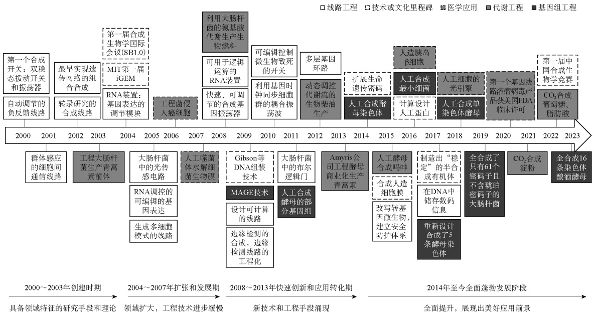

<details>
<summary>flowchart</summary>

```mermaid
graph LR
  subgraph Top_Engagement["Top Section: Engineering & Technology"]
  A1["第一个合成开关：双稳态拨动开关和振荡器<br/>自动调节的负反馈线路"] --> B1["最早实现遗传网络的组合合成"]
  B1 --> C1["第一届合成生物学国际会议(SB1.0)"]
  C1 --> D1["MIT第一届iGEM"]
  D1 --> E1["RNA装置：基因表达的调节模块"]
  E1 --> F1["工程菌侵入癌细胞"]
  F1 --> G1["利用大肠杆菌的氨基酸代谢生产生物燃料"]
  G1 --> H1["可用于逻辑运算的RNA装置"]
  H1 --> I1["快速、可调节的合成基因振荡器"]
  I1 --> J1["可编辑控制微生物致死的开关"]
  J1 --> K1["利用基因时钟同步细胞群的耦合振荡波"]
  K1 --> L1["多层基因环路"]
  L1 --> M1["动态调控代谢流的生物柴油生产"]
  M1 --> N1["扩展生命遗传密码"]
  N1 --> O1["人工合成酵母染色体"]
  O1 --> P1["人工合成最小细菌"]
  P1 --> Q1["人造胰岛β细胞"]
  Q1 --> R1["计算设计人工蛋白"]
  R1 --> S1["人工细胞的光引擎"]
  S1 --> T1["制造出“稳定”的半合成有机体<br/>在DNA中储存数码信息"]
  T1 --> U1["全合成了只有61个密码子且不含琥珀密码子的大肠杆菌"]
  U1 --> V1["第一基因线路溶瘤病毒产品获美国FDA临床许可"]
  V1 --> W1["第一届中国合成生物学竞赛"]
  W1 --> X1["CO2合成葡萄糖、脂肪酸"]
  end

  subgraph Bottom_Engagement["Bottom Section: Biological Process"]
  Y1["群体感应的细胞间通信线路"] --> Z1["工程大肠杆菌生产青蒿素前体"]
  Z1 --> AA1["大肠杆菌中的光传感电路"]
  AA1 --> AB1["RNA调控的可编辑的基因表达<br/>生成多细胞模式的线路"]
  AB1 --> AC1["人工噬菌体水解细菌生物膜"]
  AC1 --> AD1["Gibson等DNA组装技术"]
  AD1 --> AE1["设计可计算的线路"]
  AE1 --> AF1["边缘检测的合成，边缘检测线路的工程化"]
  AF1 --> AG1["人工合成酵母的部分基因组"]
  AG1 --> AH1["Amyris公司工程酵母商业化生产青蒿素"]
  AH1 --> AI1["改写转基因微生物，建立安全防护体系"]
  AI1 --> AJ1["合成人造细胞膜"]
  AJ1 --> AK1["合成人造细胞膜"]
  AK1 --> AL1["制造出‘稳定’的半合成有机体<br/>在DNA中储存数码信息"]
  AL1 --> AM1["重新设计合成了5条酵母染色体"]
  AM1 --> AN1["全合成了只有61个密码子且不含琥珀密码子的大肠杆菌"]
  AN1 --> AO1["CO2合成淀粉"]
  AO1 --> AP1["全合成16条染色体酿酒酵母"]
  end

  Bottom_Engagement -.-> Timeline_Side{"Timeline Period"}
  Timeline_Side -- "具备领域特征的研究手段和理论" --> Timeline_Side
  Timeline_Side -- "领域扩大，工程技术进步缓慢" --> Timeline_Side
  Timeline_Side -- "新技术和工程手段涌现" --> Timeline_Side
  Timeline_Side -- "全面提升，展现出美好应用前景" --> Timeline_Side
```
</details>

图 1-2 合成生物学发展历程

iGEM. 国际遗传工程机器大赛；MAGE. 多重自动化基因组工程

## 思 题

1. 什么是合成生物学？
2. 合成生物学的主要内容包括哪些？其核心的特征是什么？
3. 请简述合成生物学在医学中的主要应用。
4. 请列举几个合成生物学的里程碑技术或事件，从而阐明为什么说合成生物学是能改变世界的前沿颠覆性学科。

## 参考文献

［1］Gardner TS，Cantor CR，Collins JJ. Construction of a genetic toggle switch in Escherichia coli. Nature，2000，403（6767）:339-342
［2］Elowitz MB，Leibler S. A synthetic oscillatory network of transcriptional regulators. Nature，2000，403:335-338
［3］Gibson DG，Glass JI，Lartigue C，et al. Creation of a bacterial cell controlled by a chemically synthesized genome. Science，2010，329（5987）:52-56
［4］赵国屏. 合成生物学:开启生命科学“汇聚”研究新时代. 中国科学院院刊，2018，33:1135-1149
［5］张先恩. 中国合成生物学发展回顾与展望. 中国科学:生命科学，2019，49:1543-1572
［6］赵国屏. 合成生物学:从“造物致用”到产业转化. 生物工程学报，2022，38:4001-4011
［7］Pelletier JF，Sun LJ，Wise KS，et al. Genetic requirements for cell division in a genomically minimal cell. Cell，2021，184（9）:2430-2440
［8］Ro DK，Paradise EM，Ouellet M，et al. Production of the antimalarial drug precursor artemisinic acid in engineered yeast. Nature，2006，440（7086）:940-943
［9］Paddon CJ，Westfall PJ，Pitera DJ，et al. High-level semi-synthetic production of the potent antimalarial artemisinin. Nature，2013，496（7446）:528-532
［10］Ajikumar PK，Xiao WH，Tyo KEJ，et al. Isoprenoid pathway optimization for taxol precursor overproduction in Escherichia coli. Science，2010，330（6000）:70-74
［11］欧阳平凯. 我国工业生物技术发展回顾及展望. 生物工程学报，2022，38:3391-4000
［12］Zhu XN，Tan ZG，Xu HT，et al. Metabolic evolution of two reducing equivalent-conserving pathways for high-yield succinate production in Escherichia coli. Metab Eng，2014，24:87-96
［13］李金根，刘倩，刘德飞，等. 秸秆真菌降解转化与可再生化工. 生物工程学报，2022，38:4283-4310
［14］Cai T，Sun HB，Qiao J，et al. Cell-free chemoenzymatic starch synthesis from carbon dioxide. Science，2021，373（6562）:1523-1527
［15］Zheng TT，Zhang ML，Wu LH，et al. Upcycling CO2 into energy-rich long-chain compounds via electrochemical and metabolic engineering. Nat Catal，2022，5（5）:388-396
［16］Gleizer S，Ben-Nissan R，Bar-On YM，et al. Conversion of Escherichia coli to generate all biomass carbon from CO2. Cell，2019，179（6）:1255-1263
［17］Gassler T，Sauer M，Gasser B，et al. The industrial yeast Pichia pastoris is converted from a heterotroph into an autotroph capable of growth on CO2. Nat Biotechnol，2020，38（2）:210-216
［18］Alexandroff AB，Jackson AM，O’Donnell MA，et al. BCG immunotherapy of bladder cancer:20 years on.
Lancet，1999，353（9165）:1689-1694
［19］董宇轩，曾正阳，夏霖，等. 肿瘤细菌疗法迎来合成生物学时代. 生命科学，2019，31:332-342
［20］Cunningham C，Nemunaitis J. A phaseⅠtrial of genetically modified Salmonella typhimurium expressing cytosine deaminase（TAPET-CD，VNP20029）administered by intratumoral injection in combination with 5- fluorocytosine for patients with advanced or metastatic cancer. Hum Gene Ther，2001，12（12）:1594-1596
［21］Yu B，Yang M，Shi L，et al. Explicit hypoxia targeting with tumor suppression by creating an“obligate” anaerobic Salmonella typhimurium strain. Sci Rep-Uk，2012，2:436
［22］Gurbatri CR，Arpaia N，Danino T. Engineering bacteria as interactive cancer therapies. Science，2022，378（6622）:858-863
［23］McNerney MP，Doiron KE，Ng TL，et al. Theranostic cells:emerging clinical applications of synthetic biology. Nat Rev Genet，2021，22（11）:730-746
［24］Wei XY，Du M，Chen ZY，et al. Recent advances in bacteria-based cancer treatment. Cancers，2022，14（19）:4945
［25］Liang SY，Wang C，Shao YC，et al. Recent advances in bacteria-mediated cancer therapy. Front Bioeng Biotech，2022，10:1026248
［26］管宁子，尹剑丽，王义丹，等. 合成生物学在慢病防治领域的应用与展望. 生命科学，2021，12:1520-1531
［27］Yin JL，Yang LF，Mou LS，et al. A green tea-triggered genetic control system for treating diabetes in mice and monkeys. Sci Transl Med，2019，11（515）:eaav8826
［28］Mirkhani N，Gwisai T，Schuerle S. Engineering cell-based systems for smart cancer therapy. Adv Intell Syst-Ger，2022，4（1）:2100134
［29］Li HS，Israni DV，Gagnon KA，et al. Multidimensional control of therapeutic human cell function with synthetic gene circuits. Science，2022，378（6625）:1231-1234
［30］Allen GM，Frankel NW，Reddy NR，et al. Synthetic cytokine circuits that drive T cells into immune-excluded tumors. Science，2022，378（6625）:eaba1624
［31］Si LL，Xu H，Zhou XY，et al. Generation of influenza A viruses as live but replication-incompetent virus vaccines. Science，2016，354（6316）:1170-1173
［32］Li PH，Ke XL，Wang T，et al. Zika virus attenuation by codon pair deoptimization induces sterilizing immunity in mouse models. J Virol，2018，92（17）:e00701-e00718
［33］袁盛建，马迎飞. 噬菌体合成生物学研究进展和应用. 合成生物学，2020，1:635-655
［34］Smith HO，Hutchison CA，Pfannkoch C，et al. Generating a synthetic genome by whole genome assembly:phi X174 bacteriophage from synthetic oligonucleotides. P Natl Acad Sci USA，2003，100（26）:15440-15445
［35］黄慧雅，陆荫英，谢震. 溶瘤病毒在肿瘤治疗中的研究进展. 传染病信息，2019，32:30-36
［36］Huang HY，Liu YQ，Liao WX，et al. Oncolytic adenovirus programmed by synthetic gene circuit for cancer immunotherapy. Nat Commun，2019，10:4801
［37］Nakamizo A，Marini F，Amano T，et al. Human bone marrow-derived mesenchymal stem cells in the treatment of gliomas. Cancer Res，2005，65（8）:3307-3318
［38］Wang LT，Zang X，Zhou JH. Synthetic biology:A powerful booster for future agriculture. Advanced Agrochem，2022，1:7-11
［39］Yu H，Lin T，Meng XB，et al. A route to de novo domestication of wild allotetraploid rice. Cell，2021，184
（5）:1156-1170
［40］Zhang CZ，Yang ZM，Tang D，et al. Genome design of hybrid potato. Cell，2021，184（15）:3873-3883
［41］吴杰，赵乔. 合成生物学在现代农业中的应用与前景. 植物生理学报，2020，56:2308-2316
［42］Prins A，Orr DJ，Andralojc PJ，et al. Rubisco catalytic properties of wild and domesticated relatives provide scope for improving wheat photosynthesis. J Exp Bot，2016，67（6）:1827-1838
［43］Schwander T，von Borzyskowski LS，Burgener S，et al. A synthetic pathway for the fixation of carbon dioxide in vitro. Science，2016，354（6314）:900-904
［44］Miller TE，Beneyton T，Schwander T，et al. Light-powered CO（2）fixation in a chloroplast mimic with natural and synthetic parts. Science，2020，368（6491）:649-654
［45］Guo XY，Sun J，Li DS，et al. Heterologous biosynthesis of（+）-nootkatone in unconventional yeast Yarrowia lipolytica. Biochem Eng J，2018，137:125-131
［46］Guo DY，Kong SJ，Chu X，et al. De novo biosynthesis of indole-3-acetic acid in engineered Escherichia coli. J Agr Food Chem，2019，67（29）:8186-8190
［47］林敏，姚斌. 加强合成生物技术创新，引领现代农业跨越发展. 生物技术进展，2022，12（3）:321-324

## 第 二 章

# 元件、装置和途径的合成

## 第一节 概 论

合成生物学的工程学内涵就是，在人工设计的指导下，采用“自下而上”的正向工程学的策略，对生物元件进行标准化，建立通用型模块或装置，在简约的“细胞”或“系统”底盘细胞上，通过学习、抽象和设计，构建人工生物系统，即沿着元件到模块或装置，再到生物系统的路线，创建人工生命体。

## 一、概念

生物元件（biological part）是指具有特定功能的核酸或氨基酸序列，是遗传系统中最简单、最基本的生物积块。它是在合成生物学中用来组装生物系统和分子机器的遗传元件，能够通过标准化组装方法与其他元件组装成具有复杂功能的模块。按功能可将生物元件分为启动子、核糖体结合序列（RBS）、蛋白质编码基因、终止子、报告基因、操纵子、引物组件、标签组件、蛋白质发生组件、转换器等。

生物元件按一定的逻辑拓扑结构构建稍微复杂的生物装置（biodevice）。生物装置包含了一系列转录、翻译、蛋白质磷酸化、变构调节、配体/受体结合、酶反应等生化反应。不同的生物装置具有各自的优势和限制。尽管生化反应的多样性使得生物装置的设计存在一定的困难，但是生物装置是构建具有丰富功能的复杂系统的基础。利用 iGEM Registry 提供的标准化系统量化方法，可以将生物装置进行标准化抽提，分成转换器（接收到信号时停止下游基因的转录）、信号转导装置、蛋白质生成装置、逻辑门各种基因线路、生物传感器等。

生物装置按串联、反馈或者前馈等形式连接组成更加复杂的级联线路或者调控网络，即所谓的生物系统。自然生物系统中调控级联线路是非常普遍的，如转录调控网络、蛋白质信号通路和代谢网络等。

## 二、元件的组装技术

常规的基因操作包含烦琐的酶切、连接、转化、筛选等过程。为了从这些烦琐的操作中解脱出来，更加灵活、高效、方便地应用生物元件，合成生物学家创造性地提出了生物积块（BioBrick）的概念，并构建了相应的 DNA 元件库—iGEM Registry。

经过标准化处理、具有标准的酶切位点的生物模块，都可以称为生物积块。生物积块不仅包括基因模块，还包括亚细胞模块、生物合成的基因网络、代谢途径和信号转导通路、转运机制等。像建筑行业和信息技术（IT）行业的零件一样，生物积块可大可小，生物积块通常是具有一定功能的 DNA 片段，如生物元件；稍大些的可以是几个生物元件组成的基因调控线路，如生物装置；更大的是由基因调控线路组成的级联线路、调控网络，甚至是生物系统。

生物积块的一大特点是标准化，核心元件具有普适性和通用性。iGEM Registry 中生物积块的标准化主要体现在:除了本身的功能序列，它们都具有相同的前缀和后缀。图 2-1 为 iGEM Registry 生物积块的物理结构示意图。每一个生物积块前缀包括 EcoRⅠ 和 XbaⅠ 两个酶切位点，后缀包括 SpeⅠ 和 PstⅠ两个酶切位点，元件插入在 XbaⅠ和 SpeⅠ两个同尾酶之间。

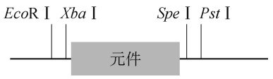

<details>
<summary>text_image</summary>

EcoR I Xba I Spe I Pst I
元件
</details>

图 2-1 iGEM Registry 生物积块的物理结构示意图

为了将各个生物积块组装成复杂的装置，合成生物学家开发了多种组装技术，概括起来包括以下三大类（图 2-2）:一是酶切连接组装技术；二是同源重组组装技术；三是桥连寡核苷酸组装技术。下面将详细介绍各种组装技术。

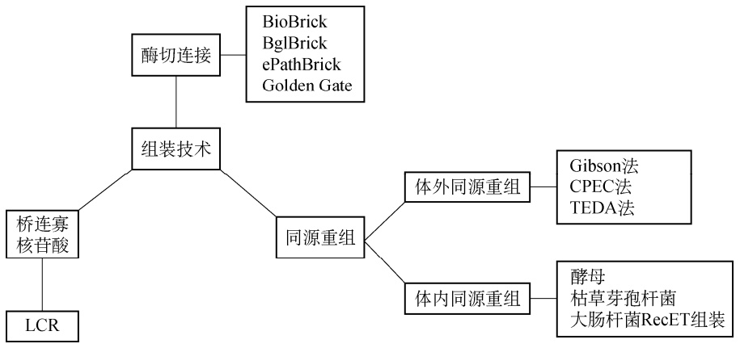

<details>
<summary>flowchart</summary>

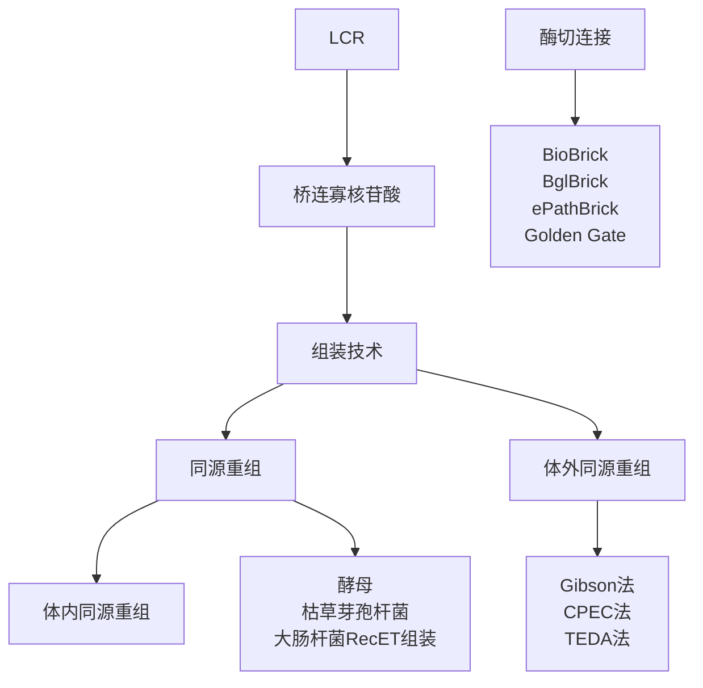
</details>

图 2-2 组装技术

CPEC. 环形聚合酶延伸克隆；LCR. 连接酶循环反应；TEDA. T5 核酸外切酶 DNA 组装

## （一）酶切连接组装技术

## 1. BioBrick 标准组装技术

iGEM Registry 中生物积块的元件都具有相同的前缀和后缀，前缀包括 EcoRⅠ和 XbaⅠ两个酶切位点，后缀包括 SpeⅠ和 PstⅠ两个酶切位点，元件经过点突变以确保其编码序列中不含有这 4 个酶切位点，然后插入在 XbaⅠ和 SpeⅠ两个同尾酶之间。整个生物积块被克隆在

iGEM 组委会提供的质粒载体上。

不同元件可按图 2-3 所示流程进行组装。用 EcoRⅠ和 SpeⅠ酶切元件 A 积块质粒，凝胶回收元件 A 积块，然后连接到元件 B 积块质粒的 EcoRⅠ和 XbaⅠ之间，即可得到含有元件 A和 B 的生物积块。按同样的方法可将更多的元件组装在一起。

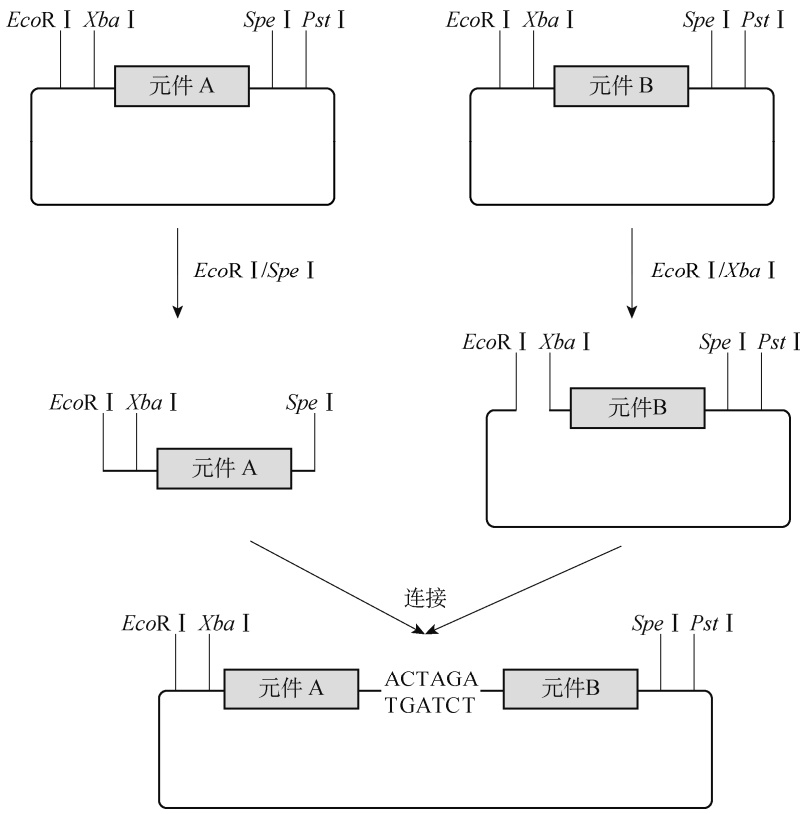

<details>
<summary>flowchart</summary>

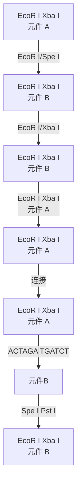
</details>

图 2-3 BioBrick 标准组装流程

## 2. BglBrick 组装技术

BioBrick 标准组装技术将产生 ACTAGA 连接疤。但是 ACT 是大肠杆菌中精氨酸的稀有密码子，而且 XbaⅠ容易被 dam 甲基化。为了克服 BioBrick 标准组装技术的这些缺陷，Anderson 等研发了一种 BglBrick 组装技术<sup>[1]</sup>。该技术是根据 BglⅡ与 BamHⅠ同尾酶而设计的。前缀包括 EcoRⅠ和 BglⅡ两个酶切位点，后缀包括 BamHⅠ和 XhoⅠ两个酶切位点，经去除酶切位点标准化的元件插入在 BglⅡ和 BamHⅠ两个同尾酶之间。它的优点主要有:①生成GGATCT 连接疤，编码甘氨酸-丝氨酸，可用于大肠杆菌、酵母和人类等多种宿主中蛋白质的融合表达；②切割效率高；③不受 dam 或 dcm 甲基化的影响。BglBrick 组装流程见图 2-4。

## 3. ePathBrick 组装技术

美国伦斯勒理工学院 Koffas 团队研发了一种可用于途径组装的 ePathBrick 技术<sup>[2]</sup>。它的主要特征是含有 AvrⅡ、XbaⅠ、SpeⅠ 和 NheⅠ同尾酶。利用 ePathBrick 组装技术，分别可以得到操纵子（图 2-5A，所有基因在同一个启动子和终止子控制下一起转录调控）、假操纵子（图 2-5B，每个基因在各自独立的启动子控制下进行转录，但共用同一个终止子完成转录终止）、单顺反子（图 2-5C，每个基因都由单独的启动子和终止子控制）等不同结构，从而进行途径的模块优化。他们应用 ePathBrick 组装技术比较了对香豆酸合成柚皮素途径的组装结构，发现 3 个基因按假操纵子结构组装在一起时大肠杆菌合成柚皮素的产量最高，而表达操纵子结构的途径时柚皮素的产量最低。

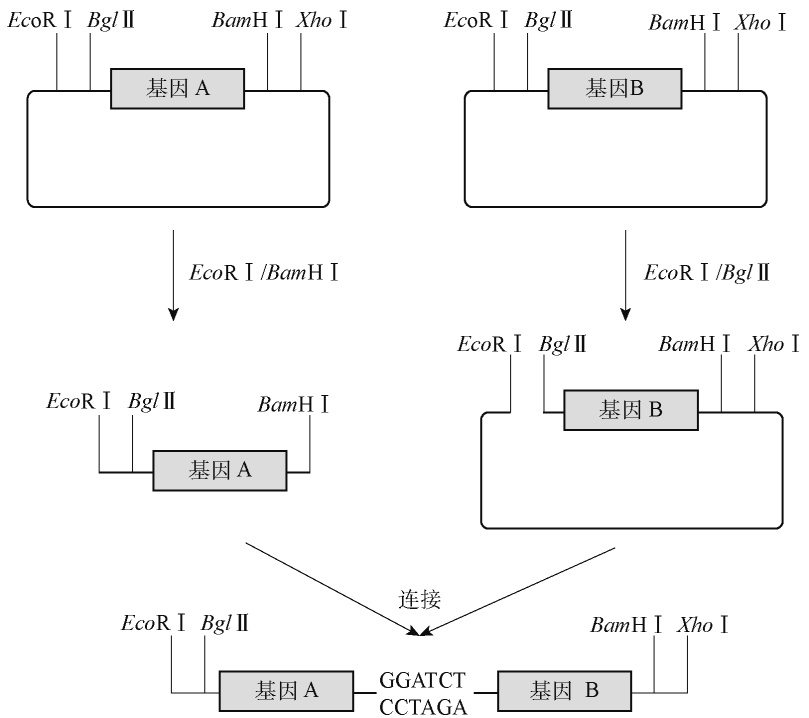

<details>
<summary>flowchart</summary>


</details>

图 2-4 BglBrick 组装流程

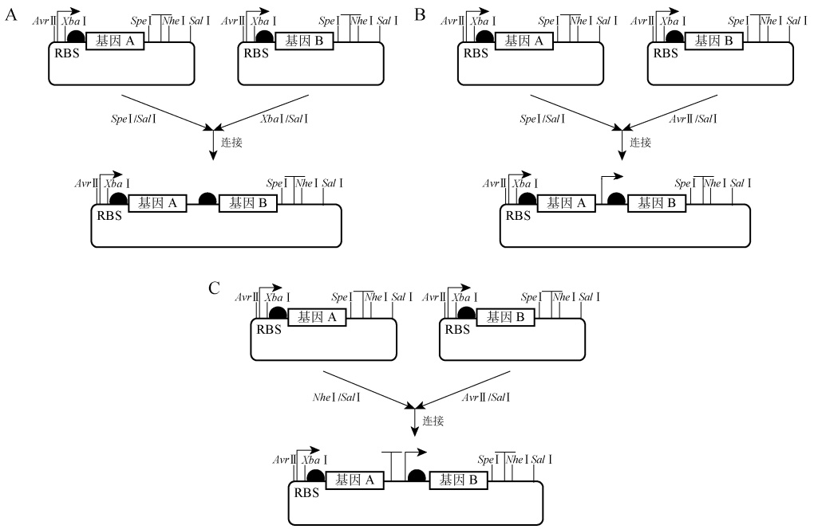

图 2-5 ePathBrick 组装流程

. 启动子； . 终止子

上述 BioBrick、BglBrick 和 ePathBrick 组装技术都需要事先将元件进行点突变去酶切位点的标准化处理，从而限制了其适用性。为此，我们构建了 pZ 系列载体，它们含有 BglⅡ/ BamHⅠ、AvrⅡ/XbaⅠ/SpeⅠ/NheⅠ 两套同尾酶<sup>[3]</sup>。这样可以简化点突变去酶切位点标准化处理的操作。当元件内没有 EcoRⅠ、BglⅡ、BamHⅠ和 SalⅠ酶切位点时，采用 BglBrick 组装技术构建单顺反子结构的途径；当元件内没有 EcoRⅠ、AvrⅡ、XbaⅠ和 SalⅠ酶切位点时，采用 ePathBrick 组装技术构建单顺反子结构的途径（图 2-6）。

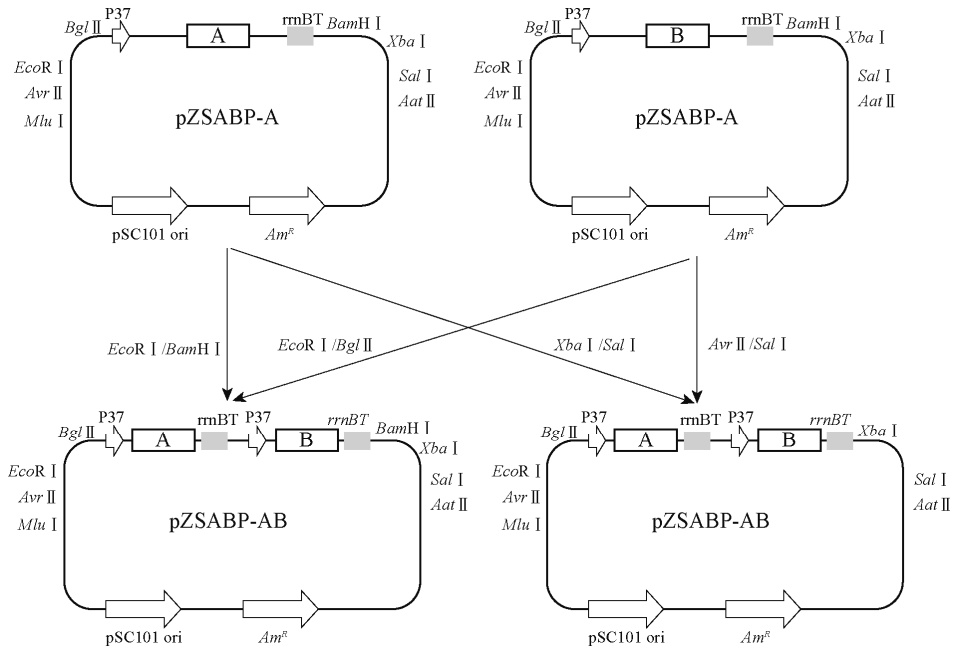

图 2-6 pZ 系列载体及其组装流程

rrnBT. 终止子；pSC101 ori. 复制子；Am<sup>R</sup>. 氨苄青霉素抗性基因

## 4. Golden Gate 组装技术

前面几种 Brick 组装技术利用的是Ⅱ型内切酶。除了这种常见的Ⅱ型内切酶，还有一种ⅡS 型内切酶。它的切割位点在内切酶的识别序列之外，其特点:一是酶切后一个片段仍保留完整的识别序列，而另一个片段则失去了识别序列；二是酶切位点与识别位点的距离是酶依赖的，一旦酶与其识别位点结合，将剪切适当距离的任意 DNA 序列。该酶切机制的结果是特定的ⅡS 型内切酶剪切的两个不同 DNA 片段所形成的突出末端不配对——除非两个片段是经过特意设计的。常用的有 BsaⅠ（GGTCTC 1/5<sup>①</sup>）、BsmBⅠ（CGTCTC 1/5）和 BbsI（GAAGAC 2/6）。它们都将产生 4 碱基黏性末端，也称为悬挂序列。

根据ⅡS 型内切酶的上述特点，Engler 等研发了一种称为 Golden Gate 的组装技术<sup>[4]</sup>。具体流程见图 2-7。首先通过 PCR 扩增片段及载体，使其 5′端和 3′端加上 BsaⅠ 或其他 ⅡS 型内切酶识别序列和酶切序列；然后用 BsaⅠ或相应ⅡS 型内切酶酶切片段和载体，再连接进行组装。Golden Gate 组装的主要优点是:①酶切和连接可同时在同一个反应管中进行，不需要进行凝胶纯化及分步的酶切、连接反应，大大缩短了实验时间；②不会引入多余序列，可实现无缝克隆；③使用正确的互补末端可同时组装多个片段，利用 New England Biolabs（NEB）公司的在线免费工具 Golden Gate Assembly 可以完成 52 个片段的组装，效率达到 50%。

<small><span class="docvortex-page-footnote" data-block-type="page_footnote" style="color:#6b7280">① ⅡS 型内切酶的切割位点</span></small>

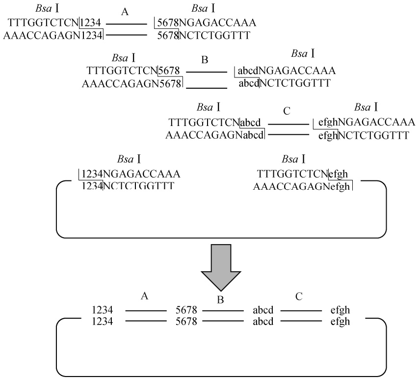

<details>
<summary>flowchart</summary>

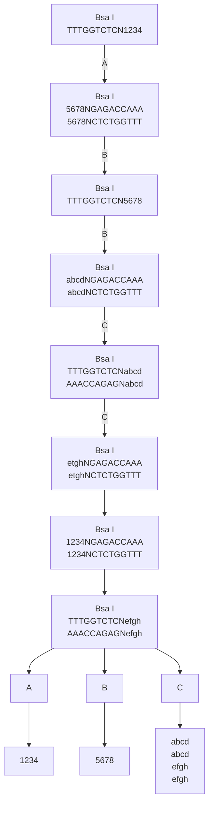
</details>

图 2-7 BsaⅠ Golden Gate 组装流程

①PCR 扩增插入片段和载体，使其两端加上 BsaⅠ识别序列和酶切序列；②BsaⅠ酶切、连接进行组装

常用的 BsaⅠ、BsmBⅠ和 BbsⅠ将产生 4 碱基黏性末端，共有 256 种碱基排列方式，其中回文序列有 16 种。为了防止黏性末端自连而降低克隆效率，设计时应选用其他 240 种非回文序列。Golden Gate 组装的关键是黏性末端的设计。黏性末端的设计原则是既要考虑克隆的效率，也要考虑相邻片段黏性末端必须互补，前一片段的 3′端黏性末端要与后一片段的 5′端黏性末端互补。可利用 NEB 公司的在线免费工具 Golden Gate Assembly 进行设计（https://goldengate.neb.com）<sup>[5]</sup>。

## （二）同源重组组装技术

## 1. 体外同源重组组装技术

（1）Gibson 法 2009 年，Gibson 及其同事提出了一种等温、单反应组装技术，称为 Gibson组装技术<sup>[6]</sup>。Gibson 组装技术既能轻易组装多个线性片段，也可以将一个目的片段插入到载体中完成基本克隆。

Gibson 组装技术的基本原理是，首先在 T5 核酸外切酶作用下，切割具有同源臂的 DNA双链的 5′端，形成 5′端切口；其后在 50℃条件下退火、重叠区结合；接着在 Phusion 高保真DNA 聚合酶作用下进行 3′端延伸；最后在 Taq 酶作用下连接补平。详见图 2-8。

Gibson 组装步骤如下:①设计引物，使相邻片段带上同源臂，同源臂的长度为 15～25bp、解链温度 $T_{\mathrm{m}} \geqslant 48   ^\circ \mathrm{C}$ 。NEB 公司和 Snapgene 公司都有引物设计工具，可帮助设计含同源区域的引物。②PCR 扩增片段。③连接反应:将 PCR 扩增片段、线性化载体和 Gibson 组装反应液混合，50℃孵育 1h 后，将连接产物转化到感受态细胞中。

Gibson 组装的优点在于:①可一步连接多达 6 个片段；②无痕连接，可利用较长的重复区以确保连接顺序。

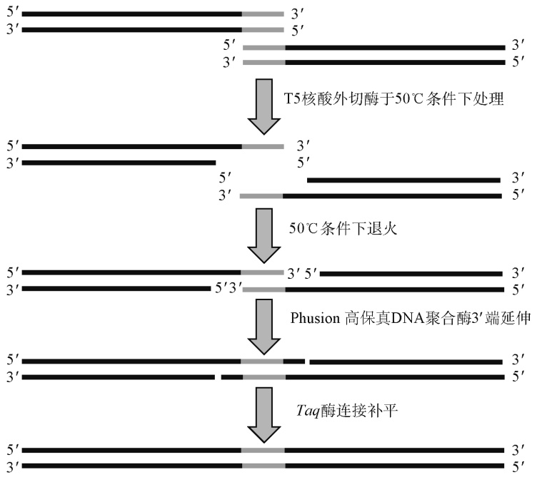

<details>
<summary>flowchart</summary>

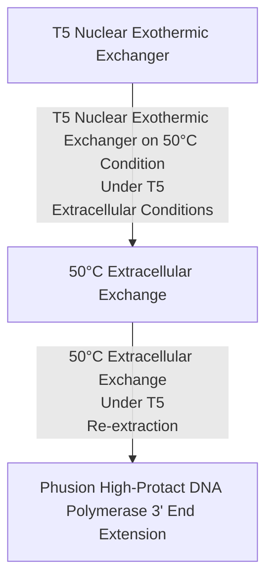
</details>

图 2-8 Gibson 组装流程

（2）环形聚合酶延伸克隆（CPEC）法 2009 年，杜克大学的 Quan 和 Tian 报道了一种CPEC 组装方法，该法利用一种聚合酶将多片段组装和克隆到任何载体上<sup>[7,8]</sup>。它是利用聚合酶延伸机制连接重叠 DNA 片段，以生成环形质粒。它首先热变性使双链 DNA 变成单链，接着退火、重叠区结合在一起；然后利用聚合酶进行多个循环的延伸生成环形质粒，将产物转化到感受态细胞中。详见图 2-9。

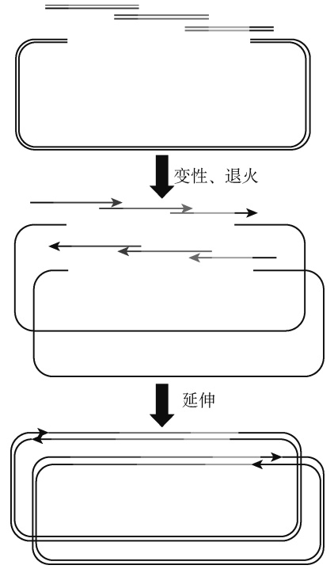

<details>
<summary>flowchart</summary>

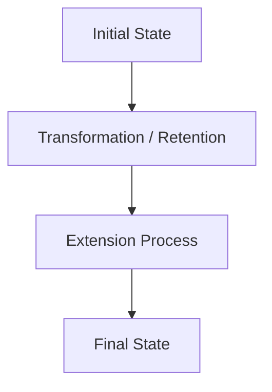
</details>

图 2-9 环形聚合酶延伸克隆组装流程

CPEC 法的关键是重叠区同源臂的设计，要求所有重叠区 $T _ { \mathrm { m } }$ 值相似且尽可能高，其值为60～70℃；每个重叠区 $T _ { \mathrm { m } }$ 值的差值为±（2～3℃）；重叠区的长度一般为 15～35bp。

（3）T5 核酸外切酶 DNA 组装（TEDA）法 Gibson 法需要利用 T5 核酸外切酶、Phusion DNA 聚合酶和 DNA 连接酶。山东大学谷立川和荀鲁盈团队对 Gibson 法的各种组分测试优化后，建立了仅利用含 T5 核酸外切酶和 PEG8000 的简单缓冲液体系的简单易行的低成本 DNA组装方法，称为 TEDA 法<sup>[9]</sup>。该方法只需要利用 T5 核酸外切酶。TEDA 法的具体步骤包括:首先是 T5 核酸外切酶处理具有短同源臂（15～20bp）的 DNA 片段，产生 5′切口；然后是退火、黏性同源片段相互结合，形成含有切口的环形质粒；最后将含有切口的环形质粒转化到感受态大肠杆菌中，在体内补平切口以产生克隆（图 2-10）。

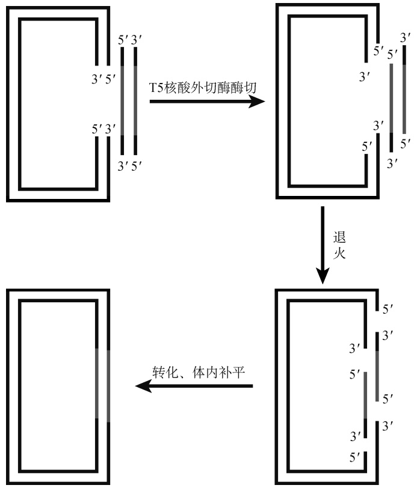

<details>
<summary>flowchart</summary>


</details>

图 2-10 T5 核酸外切酶 DNA 组装流程

TEDA 法组装的反应条件如下:4mL 5×TEDA 反应液与 16mL DNA 溶液混合，于 $3 0   \mathrm { ^ \circ C }$条件下反应 40min，置于冰浴中终止反应，随后取 5mL TEDA 反应液转化到感受态大肠杆菌中。每毫升 5×TEDA 反应液包括 0.5mol/L Tris-HCl（pH7.5）缓冲液、50mmol/L MgCl<sub>2</sub>、50mmol/L二硫苏糖醇（DTT）、0.25g PEG8000 和 1mL 10U/mL T5 核酸外切酶。DNA 溶液包括线性化载体和插入片段；两者的物质的量之比为 1∶（1～4）。线性化载体质量为 100～200ng。

TEDA 法比 Gibson 法具有更高的效率和更便宜的优点。商业化的 Gibson 单次组装成本为80 元/反应，自己购买原料配的 Gibson 体系成本也要高于 20 元/反应，而 TEDA 成本则仅需0.03 元/反应。

## 2. 体内同源重组组装技术

酵母具有很强的同源重组效率。赵惠民团队开发出了一种称为“DNA 组装器”的方法。

该法利用酿酒酵母的体内同源重组机制，一步快速构建大型生化途径<sup>[10]</sup>。DNA 组装器的设计原则如下:第一个元件的 5′端与酵母载体重叠，其 3′端与第二个元件的 5′端重叠，相邻元件互相重叠，最后一个元件的 3′端与酵母载体重叠。这样设计 PCR 扩增得到的所有元件与线性化酵母载体一起电转化到酿酒酵母中，挑选克隆，如图 2-11 所示。重叠区的长度一般为 50bp，但当组装元件数大于 5 个时，可适当增加重叠区的长度。DNA 组装器除了可用来构建载体，也可以直接将元件组装整合到酵母染色体上。他们应用该技术成功组装了含 3 个基因约 9kb的 D-木糖利用途径，5 个基因约 11kb 的玉米黄素合成途径，以及 8 个基因约 19kb 的同时含有 D-木糖利用和玉米黄素合成的途径。

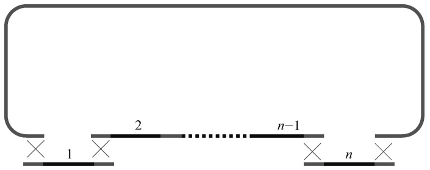

<details>
<summary>text_image</summary>

2
n-1
1
n
</details>

图 2-11 DNA 组装器

大肠杆菌 Rac 前噬菌体 recE、recT 基因编码的重组酶能高效介导线状 DNA 间发生同源重组，因此被用于在大肠杆菌细胞内进行 DNA 组装<sup>[11,12]</sup>。RecE 蛋白具有 5′→3′核酸外切酶活性，能够消化线性双链 DNA 片段形成 3′突出末端；RecT 蛋白具有单链 DNA 退火功能，能够结合到经由 RecE 蛋白消化形成的 3′突出末端单链 DNA 上，不仅能保护单链 DNA 以免被核酸酶降解，而且能促进同源 DNA 之间的退火。最后在细菌细胞内 DNA 修复系统的作用下修补 DNA 缺口形成重组 DNA 分子（图 2-12）。RecET 体内组装技术只需要 40bp 的同源臂便可

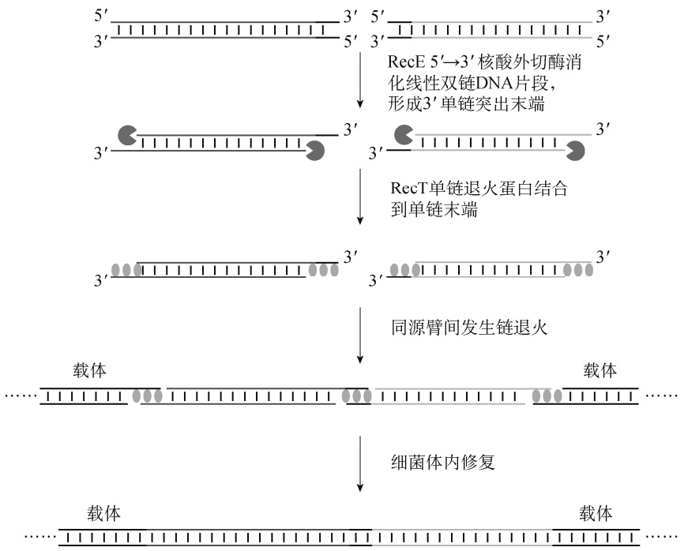

<details>
<summary>flowchart</summary>

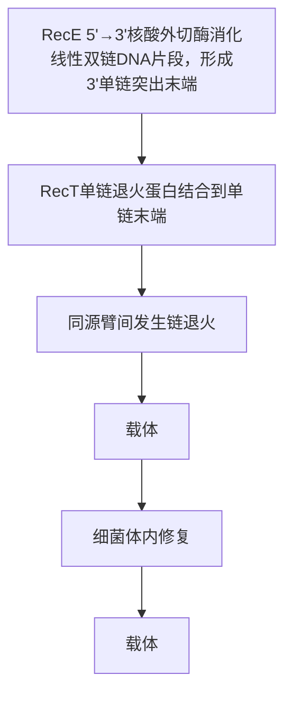
</details>

图 2-12 RecET 组装原理示意图