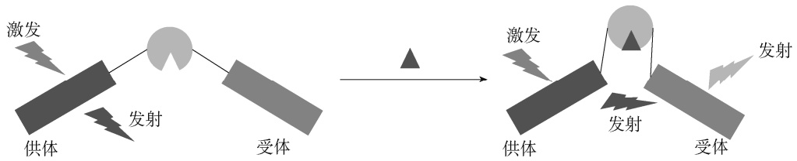

flowchart

图 2-19 基于 FRET 的遗传编码生物传感器

表 2-8 为 FRET 生物传感器的代表性例子。FRET 生物传感器已被成功用于检测乳酸、赖氨酸、亮氨酸、丙酮酸、6-磷酸海藻糖、氨和氧化还原等[37]。

表 2-8 基于 FRET 的生物传感器

| 靶标 | 代谢物结合蛋白(BMP) | 宿主 | 文献 |
| --- | --- | --- | --- |
| 乳酸 | LldR | 星形胶质细胞 (astrocyte),HEK 细胞,T98G 神经胶质瘤 细胞(glioma cells) | PLoS One 8(2013)e57712 |
| 6-磷酸海藻糖 | TreR | 大肠杆菌(E. coli),酿酒酵母(S. cerevisiae) | Anal Biochem 474(2015)1-7 |
| 丙酮酸 | PdhR | HEK293 细胞 | PLoS One 9(2014)e85780 |
| 甲硫氨酸 | MetN | E. coli,S. cerevisiae | Biosens Bioelectron 59(2014)358-364 |
| 亮氨酸 | Livk | E. coli,S. cerevisiae | Biosens Bioelectron 50(2013)72-77 |
| 亮氨酸 | 亮氨酸结合周质蛋白 | E. coli | Org Biomol Chem 15(2017)8827 |
| 赖氨酸 | 赖氨酸结合周质蛋白 | E. coli,S. cerevisiae | J Nanobiotechnol 14(2016)49 |
| 赖氨酸 | LAO-BP | C. glutamicum | Sensors 16(2016)1604 |
| 氨 | AmTrac,MepTrac | S. cerevisiae | eLife 2(2013)e00800 |
| 氧化还原 | Yap1 | S. cerevisiae | FEBS Lett 587(2013)793-798 |

## 二、基于核酸的体内生物传感器

与基于蛋白质的体内生物传感器相比，基于核酸的体内生物传感器具有更短的响应时间和代谢负担小的优点。基于核酸的体内生物传感器包括基于 DNA 和 RNA 的生物传感器两大类。

## （一）基于 DNA 的生物传感器

DNA 可用来检测体内物质。在自然界中，细胞被进化成使用响应型启动子以感知压力或代谢物。与其他传感器一样，基于 DNA 的生物传感器包括传感元件（即响应代谢物启动子）和报告基因。表 2-9 是一些基于 DNA 的生物传感器的代表性例 $子。$

表 2-9 基于 DNA 的生物传感器

| 靶标 | 启动子 | 宿主 | 文献 |
| --- | --- | --- | --- |
| 细胞密度 | $P_{FUS1P}$ | 酿酒酵母(S. cerevisiae) | Metab Eng 29(2015)124-134 |
| 法尼基焦磷酸 | $P_{gadE}, P_{rstA}$ | 大肠杆菌(E. coli) | Nat Biotechnol 13(2013)1039-1046 |
| 麦角甾醇 | $P_{ERG1}, P_{ERG2}, P_{ERG3}, P_{ERG11}$ | S. cerevisiae | Microb Cell Fact 14(2015)38 |
| 葡萄糖 | $P_{HXT1}$ | S. cerevisiae | Metab Eng 28(2015)8-18 |
| pH | $P_{gas}$ | 黑曲霉(A. niger) | Appl Environ Microbiol 83(2017)e03216-e03222 |
| 蔗糖 | $P_{SUC2}$ | S. cerevisiae | Microb Cell Fact 14(2015)43 |
| 赖氨酸 | pA 启动子 | E. coli | Nucleic Acids Res 44(2016)e139 |
| 低 pH | $P_{YGP1}$ | S. cerevisiae | Nucleic Acids Res 44(2016)e136 |
| 苏氨酸 | $P_{cysj}P_{cysH}$ | E. coli | Microb Cell Fact 14(2015)121 |
| 苯丙氨酸 | $P_{mtr}$ | E. coli | Appl Microbiol Biotechnol 100(2016)6739-6753 |
| 铜 | $P_{cusC}, P_{pcoE}$ | E. coli | Trans Biomed Circuits Syst 10(2016)593-601 |
| 1-丁醇 | $P_{YDL167C-T3}$或$P_{YIL104C-T4}$ | S. cerevisiae | Bioresour Technol 245(2017)1343-1351 |
| 镉 | CdMT 启动子 | 嗜热四膜虫(Tetrahymena thermophila) | Biometals 27(2014)195 |
| 1,4-丁二醇 | $P_{yhjX}$ | E. coli | Chem Eng Sci 103(2013)68-73 |

挖掘响应代谢物的启动子是构建基于 DNA 的生物传感器的关键。比较组学是挖掘响应代谢物启动子常用的策略。孙际宾团队研究了培养在不同浓度苏氨酸中的大肠杆菌 MG1655 的比较蛋白质组学，发现培养在高浓度苏氨酸中的大肠杆菌的 L-半胱氨酸合成途径基因 cysD、cysN、cysJ、cysI、cysH 等的表达水平明显上调，从而挖掘出苏氨酸启动子 $\mathbf { P } _ { \mathrm { c y s J } }$ ，并应用该启动子选育出高产苏氨酸的工程化大肠杆菌[47]。对积累和不积累中间代谢产物法尼基焦磷酸（FPP）的大肠杆菌进行比较转录组学分析，发现 $\mathrm { P _ { g a d E } }$ 启动子的活性随着 FPP 浓度的增大而减弱， $\mathrm { P _ { \mathrm { { r s t A } } } }$ 启动子的活性随着 FPP 浓度的增大而增强[48]。

## （二）基于 RNA 的生物传感器

RNA 核糖开关（riboswitch）是指 mRNA 一些非翻译区的序列，它将折叠成一定构象。它可以选择性地与特定代谢物结合并改变自身结构，从而调控基因的表达。RNA 核糖开关主要由两部分组成，分别是感受外界配体的适配体域（aptamer domain，AD）和调控基因表达的结构域，也称为表达平台（expression platform，EP）。当配体与适配体域特异性结合后，引起适配体域构象的变化，从而影响到表达平台构象的变化，进而调控基因的表达（图 2-20）。RNA 核糖开关已被成功用于构建一些目标分子的生物传感器，表 2-10 为 RNA 核糖开关传感器的代表性例子，如赖氨酸、茶碱、柚皮素、多巴胺、黄素单核苷酸、N-乙酰神经氨酸、氨基葡萄糖-6-磷酸盐、硫胺素-5′-焦磷酸盐和 S-腺苷-L-高半胱氨酸（SAM）核糖开关[37]。

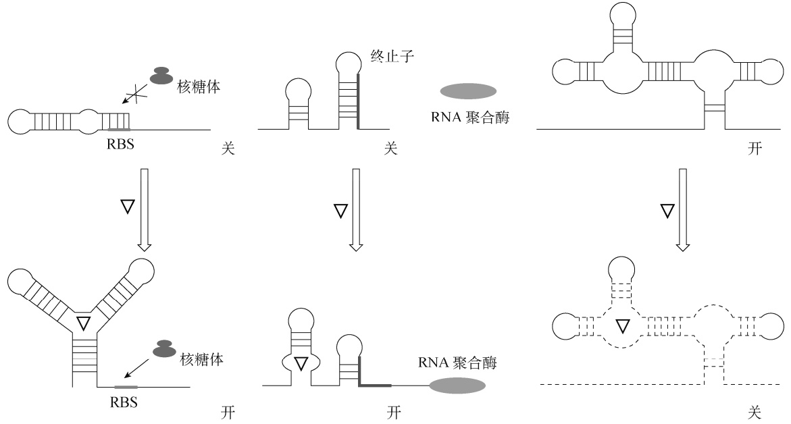

flowchart

This flowchart illustrates the process of RNA polymerization and aggregation in a biological system involving RBS, nuclear ribosome (核糖体), and RNA polymerase enzymes.

图 2-20 RNA 核糖开关调控基因

表 2-10 RNA 核糖开关生物传感器

<table><tr><td>靶标</td><td>核糖开关</td><td>宿主</td><td>文献</td></tr><tr><td></td><td></td><td rowspan="2">谷氨酸棒杆菌(Corynebacterium glutamicum)</td><td></td></tr><tr><td>赖氨酸</td><td>赖氨酸核糖开关</td><td>ACS Synth Biol 4(2015)729-734</td></tr><tr><td>赖氨酸</td><td>赖氨酸核糖开关</td><td>C. glutamicum</td><td>ACS Synth Biol 4(2015)1335-1340</td></tr><tr><td>赖氨酸</td><td>赖氨酸核糖开关</td><td>大肠杆菌(E. coli)</td><td>Nat Commun 4(2013)1413</td></tr><tr><td>赖氨酸</td><td>赖氨酸核糖开关</td><td>E. coli</td><td>Appl Microbiol Biotechnol 99(2015)8527-8536</td></tr><tr><td>柚皮素</td><td>柚皮素核糖开关</td><td>E. coli</td><td>Biotechnol Bioeng 114(2017)2235-2244</td></tr><tr><td>柚皮素</td><td>柚皮素核糖开关</td><td>E. coli</td><td>ACS Synth. Biol. 6(2017)2077-2085</td></tr><tr><td>茶碱</td><td>茶碱核糖开关</td><td>E. coli</td><td>PLoS One 10(2015)e0118322</td></tr><tr><td></td><td></td><td>细长聚球藻(Synechococcus elongatus)PCC 7942</td><td></td></tr><tr><td>茶碱</td><td>茶碱核糖开关</td><td>集胞藻属Synechocystissp. PCC 6803</td><td>Appl Environ Microbiol 80(2014)6704-6713</td></tr><tr><td>茶碱</td><td>茶碱核糖开关</td><td>E. coli</td><td>J Gen Appl Microbiol 62(2016)154-159</td></tr><tr><td>茶碱</td><td>茶碱核糖开关</td><td>E. coli</td><td>Nucleic Acids Res 41(2013)2541-2551</td></tr><tr><td>四甲基罗萨明</td><td>四甲基罗萨明核糖开关</td><td>E. coli</td><td>Nucleic Acids Res 44(2016)1-13</td></tr><tr><td>氟化物</td><td>氟化物核糖开关</td><td>E. coli</td><td>Nucleic Acids Res 44(2016)1-13</td></tr><tr><td>多巴胺</td><td>多巴胺核糖开关</td><td>E. coli</td><td>Nucleic Acids Res 44(2016)1-13</td></tr><tr><td>甲状腺素</td><td>甲状腺素核糖开关</td><td>E. coli</td><td>Nucleic Acids Res 44(2016)1-13</td></tr><tr><td>2,4-二硝基甲苯</td><td>2,4-二硝基甲苯核糖开关</td><td>E. coli</td><td>Nucleic Acids Res 44(2016)1-13</td></tr><tr><td>二价镍/钴</td><td>镍/钴核糖开关</td><td>闪烁梭菌(Clostridium scindens)</td><td>Mol Cell 57(2015)1088-1098</td></tr><tr><td>双酚A</td><td>双酚A核糖开关</td><td>E. coli</td><td>FASEB J 30(2016)3</td></tr><tr><td>N-乙酰神经氨酸</td><td>N-乙酰神经氨酸核糖开关</td><td>E. coli</td><td>Metab Eng 43(2017)21-28</td></tr><tr><td>黄素单核苷酸</td><td>黄素单核苷酸核糖开关</td><td>枯草芽孢杆菌(B. subtilis)</td><td>Nat Chem 7(2015)673</td></tr><tr><td>氨基葡萄糖-6-磷酸盐</td><td>氨基葡萄糖-6-磷酸盐核糖开关</td><td>酿酒酵母(S. cerevisiae)</td><td>Metab Eng 28(2015)143-150</td></tr><tr><td>钴</td><td>钴核糖开关</td><td>E. coli</td><td>Food Chem 175(2015)523-528</td></tr><tr><td>硫胺素-5&#x27;-焦磷酸盐</td><td>硫胺素-5&#x27;-焦磷酸盐糖开关</td><td>E. coli</td><td>PNAS 112(2015)E2756-E2765</td></tr><tr><td>S-腺苷-L-高半胱氨酸(SAM)</td><td>S-腺苷-L-高半胱氨酸(SAM)核糖开关</td><td>E. coli</td><td>J Am Chem Soc 138(2016)7040-704</td></tr><tr><td>新霉素</td><td>合成新霉素适配体</td><td>S. cerevisiae</td><td>ACS Synth Biol 4(2015)516-525</td></tr><tr><td>环二鸟苷酸、环磷腺苷/环磷鸟苷</td><td>GEMM-I核糖开关</td><td></td><td>J Am Chem Soc 135(2013)4906Nucleic Acids Res 44(2016)e139</td></tr><tr><td>环磷腺苷/环磷鸟苷</td><td>GEMM-II核糖开关</td><td></td><td>Cell Chem Biol 23(2016)1539-1549</td></tr></table>

适配体（aptamer）是核糖开关装置的关键元件。靶向感兴趣小分子的代谢物结合的 RNA适配体可从天然代谢物调控系统中挖掘。代谢物结合的 RNA 适配体也可以通过筛选合成的适配体库来获得。目前可用于构建生物传感器的 RNA 适配体数量是有限的。目前一些团队开发了一些计算工具用于核糖开关的理性设计。Salis 及其同事开发了一种统计热力学模型来预测翻译调节核糖开关的序列-结构-功能关系[49]，利用该模型，使用 6 种不同的 RNA 适配体对62 种合成核糖开关进行了自动计算设计，以感知不同的化合物（如茶碱、四甲基罗萨明、氟化物、多巴胺、甲状腺素和 2,4-二硝基甲苯），并激活基因表达达 383 倍。

## 三、体内生物传感器的应用

体内生物传感器已被成功用于菌株改良与选育、关键酶的定向进化、途径的动态调控和目标化合物的检测等方面。下面介绍一些代表性例子。

## （一）菌株改良与选育

人工调控是合成人工生命体的两大科学问题之一。为了提高底盘细胞与合成装置间的适配性，以便让合成装置的生物学功能充分地发挥出来，学者研发了许多基因组工程技术，如常压室温等离子体（ARTP）诱变、实验室适应性进化、基因组改组（genome shuffling）、多重自动化基因组工程（MAGE）、可追踪的多重重组（TRMR）、酵母寡核苷酸介导的基因组工程、可遗传重组及 RNAi 辅助的基因组进化等。利用这些方法创造遗传多样性文库后，如何从文库中筛选获得表型优越的人工生命体就成了关键。生物传感器为其提供了一种非常有效的手段。刘建忠团队提出了一种传感器介导的基因组工程技术，用其成功选育出高产莽草酸[50]和对羟基苯乙酸[51]的人工大肠杆菌。应用莽草酸生物传感器，依次对 ARTP 诱变、基因组改组和基于易错的全基因组改组（ep-WGS）的文库进行筛选，获得了莽草酸产量提高了 1.74 倍的大肠杆菌[50]。应用对羟基苯乙酸生物传感器，依次对 ARTP 诱变和 2 轮基因组改组的文库进行筛选，获得了对羟基苯乙酸产量提高了 1.2 倍的大肠杆菌[51]。

## （二）关键酶的定向进化

酶在异源宿主中的催化活性往往低于其在天然宿主中的活性，需要通过定向进化手段来提高其催化性能。此时，生物传感器便能从定向进化文库中高通量地筛选出正突变体。唐双焱团队应用莽草酸传感器对通过易错 PCR 构建的 AroGL175D 随机突变文库进行筛选，获得了对 D-赤藓糖-4-磷酸（E4P）有更高催化效率的突变体 AroGL175D/K237R，使莽草酸产量提高了 2.6倍[41]。刘建忠团队利用白藜芦醇传感器分别对通过易错 PCR 构建的芪合成酶（STS）和白藜芦醇甲基转移酶（ROMT）随机文库进行筛选，获得了催化性能大幅度提高的突变酶，使大肠杆菌合成紫檀芪的产量得到大幅度提高[52]。

## （三）途径的动态调控

随着合成生物学与代谢工程的发展，通过外源途径的引入创建了人工微生物，合成出许多人类需要的化学品。通常这些外源途径的控制都是依赖于诱导型或组成型启动子的静态调控，无法对生长和环境变化做出反应。同时，宿主对这些异源途径没有精确的调控机制，导致异源途径将产生对细胞有毒的中间产物。而对途径进行动态调控，使其适应生长和环境的变化，这样就可以防止有毒代谢物的积累。一个动态调控系统包括一个传感元件，它可以检测感兴趣的代谢物或生理状态；一个调节元件，它将传感信号转换为转录信号，调控外源途径的表达。生物传感器便能实现此功能，构建相应的调控基因线路。

焦磷酸异戊烯（IPP）和法尼基焦磷酸（FPP）是 类化合物的合成前体，它们的积累对大肠杆菌有毒性。为了解决这个问题，Keasling 团队应用受 FPP 抑制的启动子 $\mathrm { P _ { g a d E } }$ 调控甲羟戊酸途径合成 FPP、受 FPP 激活的启动子 $\mathbf { P _ { \mathrm { r s t A } } }$ 调控阿莫烯合成酶以消耗 FPP 合成阿莫烯，使大肠杆菌合成阿莫烯的产量提高了 1 倍[48]。刘建忠团队应用受 FPP 抑制的启动子 $\mathrm { P _ { g a d E } }$ 调控甲羟戊酸途径合成 FPP，使大肠杆菌合成玉米黄素的产量提高了 1 倍[53]。

# 第四节 途径的合成与优化

## 一、途径的合成

代谢工程的发展使生物合成化学品取得了重大进展。目前通过 DNA 重组技术合理设计细胞代谢途径并对其进行遗传修饰，进而利用微生物生产化学品、燃料等。基因组学的发展，使越来越多的生物合成途径被解析出来。近年来合成生物学的兴起加速了代谢工程的发展，相对于传统代谢工程而言，合成代谢途径强调“非天然生物系统”和“自然界不存在的功能”。合成生物学家合成了许多合成途径，并将其引入到微生物细胞中，创建人工微生物以合成微生物原来不能合成的产物。合成代谢途径是以“标准化、模块化”的基因、酶或代谢途径为元件，设计乃至从头构建新的代谢装置，生产所需要的化学品。因此，合成途径就是一种代谢装置。

在设计和构建合成代谢途径时，必须综合考虑如下几个方面:①起始原料是什么及其成本与可用性；②通过哪个代谢途径及哪些基因编码的酶来生产所需产品；③适宜的微生物宿主是什么；④合成代谢途径与宿主之间的适配性及合成代谢途径的调控；⑤如何最大限度地提高合成代谢途径的产量和生产能力。

实际上，这几个因素是相互关联的。如果基因不能表达，也就不可能有酶催化功能了；对某个宿主无毒的产物或代谢中间物可能对其他宿主具有毒性；不同宿主的遗传背景不同；不同宿主的培养条件及生产过程也是不同的，如生长速率、终产物与副产物的分离纯化手段等。

合成代谢途径最简单易行的方法是将来自不同生物体的基因整合在一起，以设计和构建代谢途径。图 2-21 是构建合成途径的一般过程。应用生物信息学技术从有关数据库和文献预测与挖掘相应酶，重组酶并进行体外表征，获得催化整个途径的每个酶；然后通过一定的组装技术组装成合成途径；最后引入宿主细胞中，与宿主细胞中内源途径一起，构成从头合成途径，实现化学品的生物合成。

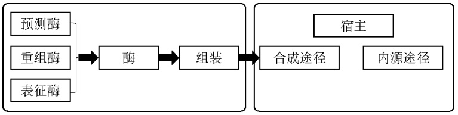

flowchart

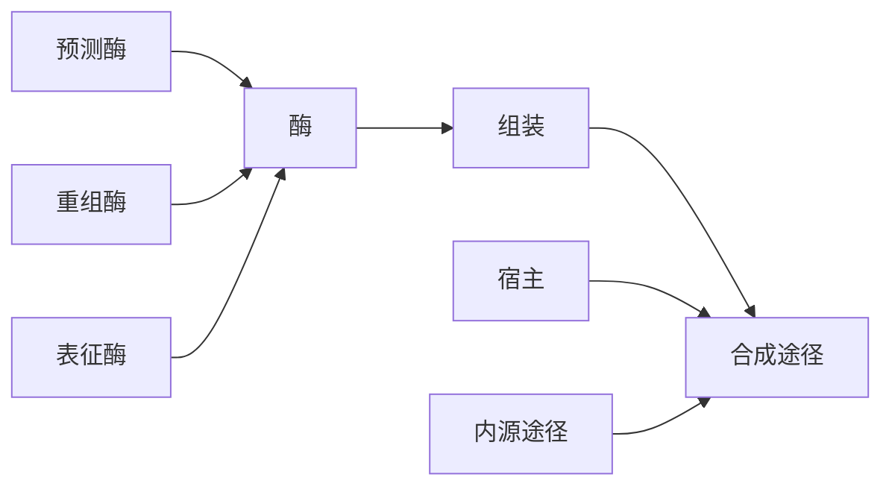

图 2-21 构建合成途径的一般过程

合成代谢途径的设计主要包括图 2-22 所示的三种形式，一是改造宿主菌现有的代谢途径来高效合成产物，这属于代谢工程领域，往往通过基因的强化表达和基因敲除等代谢工程手段来实现；二是合成宿主菌天然不存在的异源途径并引入宿主，利用宿主的中间代谢产物合成新的化合物；三是从头设计合成途径合成新的化合物。后面两种策略能合成宿主原来不能合成的化合物。

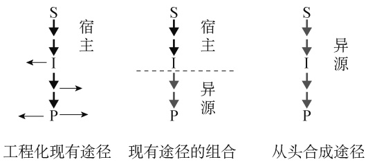

flowchart

This diagram illustrates the process of engineering and joint completion paths, showing how existing paths are combined with a proposed path from head to the final result.

图 2-22 合成代谢途径的策略

S 为底物，I 为中间代谢产物，P 为产物

目前代谢途径的设计主要有两种方法:一种是基于知识的人工途径设计。这种方法高度依赖人类的智慧和研究者的丰富经验，目前已出现几个成功的例子。例如，为了避免从糖酵解途径合成乙酰辅酶 A 过程中碳的损失，Bogorad 等提出了一条非氧化糖酵解途径以便在没有碳损失条件下以糖为原料合成乙酰辅酶 A[54]。Chatzivasileiou 等提出了一条用异戊醇合成焦磷酸异戊烯的途径[55]。

尽管基于知识的人工途径设计已经取得了巨大的成功，但这种方法可能存在着两个潜在的缺陷。首先，研究人员本身必须拥有广泛的知识，对生化反应机制有深刻的理解，同时在发现或设计催化酶和代谢途径方面有丰富的经验。其次，尽管有效，但人工设计不能保证产生所有的可能性和候选路径，因此不能筛选出最有前途的路径。在某些情况下，由于存在许多非自然反应，人工设计的途径效果并不好，也不容易可行。因此，一些学者又提出了另一种基于人工智能的计算机途径设计，并在合理性和全面性方面显示出独特的优势。除了提供新的途径，这些预测工具还可以根据一组物理化学特性，如热力学可行性、动力学功效、资源消耗、毒性和中间产物的疏水性，来比较不同的候选途径，从而筛选出最有效的途径。所有这些工具都是利用生化反应数据库和相关的酶来产生潜在的候选途径，从而将输入化合物和输出产品联系起来。表 2-11 为目前主要的途径设计计算工具。

表 2-11 途径设计计算工具

| 名称 | 数据库 | 途径排序规则 | 网站 |
| --- | --- | --- | --- |
| BNICE | KEGG,ATLAS | 热力学、途径长度等 | http://lcsb-databases.epfl.ch/pathways/atlas/ |
| PathPred | KEGG | 化合物相似性和途径打分 | https://www.genome.jp/tools-bin/pathpred/pathpred.cgi |
| ReactionMiner | KEGG | 排序功能方程 | https://github.com/RamanLab/ReactionMiner |
| BioSynther |  | 定制的生物合成潜力探索器 | http://www.rxnfinder.org/biosynther/ |
| RetroPath 2.0 | MetaCyc,BioCyc | 酶的混杂性 | https://www.myexperiment.org/workflows/4987.html |
| XTMS | MetaCyc,BioCyc,KEGG,BioModels | 基因得分、毒性、产率和吉布斯能量相应项的加权总和 | http://xtms.issb.genopole.fr |
| FMM |  | 重建从不同物种的一个代谢物到另一个代谢物的代谢途径 | http://fmm.mbc.nctu.edu.tw |
| NovoPathFinder | Rhea,BiGG,KEGG,ChEBI | 热力学、酶混杂性、化合物、途径长度、转化率和产率 | http://design.rxnfinder.org/novopathfinder/ |

通常途径设计计算工具依据是否与宿主有关可分为两大类。

第一类是与宿主无关的，从许多现有反应中提取反应规则，从而设计代谢途径。这种方法可以设计出生物体内不存在的新反应，可以将这些新反应整合到目标化合物的合成途径中，如依赖生化反应规则的 BNICE（Biochemical Network Integrated Computational Explorer）、PathPred、ReactionMiner 和 RetroPath 2.0 等。BNICE 是一个计算框架，可以从给定的酶反应规则中分析每个可能的生化反应，并将这些反应组成新的合成代谢途径。不过，BNICE 并非在线工具，它包括 250 种通用酶反应和 4300 多种特定酶功能。它要求必须定义前体化合物和既定规则，终止条件对应于步长的上限或目标产物的合成。PathPred 使用 RDM（反应中心及其不同区域和匹配区域）模式和 KEGG 的化学结构数据来设计更合理的代谢途径，包括 853个异源生物降解途径和 1126 个次级生物合成途径；此外，预测的反应质量并不保守。RetroPath 2.0 是一种自动开源工作流程，可通过高效且良好控制的协议进行逆合成。

第二类是在特定宿主内设计特定合成途径，如 XTMS、FMM 和 NovoPathFinder 等。XTMS是一个基于网络的途径分析平台，通过应用扩展代谢空间模型框架构建合成途径。XTMS 可根据产率或毒性等信息对目标化合物的合成途径进行排序，使研究人员能够探索和选择最合适的途径。其局限性在于，XTMS 的反应数据库是有限的，由于它基于 6078 个反应，并利用反应规则进行扩展，最终产生 27 743 个反应，因此可合成的化合物数量是受限的。当使用XTMS 时，用户输入查询化合物，然后使用 RetroPath 2.0 搜索途径；选择所需直径后，对途径和构建体进行排名，并提供有关反应和代谢物的信息。XTMS 可以提供有关途径排名、总分、基因评分、步骤、剂量、毒性、产量、吉布斯，以及与吉布斯、无吉布斯反应列表和酶相关的吉布斯-无能反应列表和酶的 EC 编号的信息。FMM 可以重建从一种代谢物到另一种代谢物的代谢途径。此外，通过 FMM 的比较分析，还可以比较多个物种的代谢途径。使用 FMM，用户需要使用 KEGG 化合物编号（ID）来输入起始化合物和目标化合物。随后，FMM 会呈现出一系列途径和每个途径的大小，并且它提供了 KEGG 途径图或 Vertial 图以可视化每个途径。NovoPathFinder 是一种用户友好的 web 版预测新途径工具。该工具不仅能根据输入设计新的输出通路，还能在不提供输入的情况下，为大肠杆菌或酵母底盘细胞提供异源新通路。

## 二、途径的优化

在建立了人工途径后，下一步就是挖掘合适的酶来进行产物的合成。目前 UniProtKB、BRENDA 酶库和 GenBank 等数据库中存储有大量蛋白质、酶基因的信息。发现新酶最常用的方法之一是基于主序列的 BLAST（Basic Local Alignment Search Tool）技术。另外，多数酶对异源宿主的非天然底物的催化活性往往很低，必须进行改造才能满足合成途径的需要。有时甚至无法找到合适的天然酶来完成理论上可行的反应，同样需要对酶进行改造，甚至半理性或理性设计。这些合成生物学中酶元件相关内容将在第三章中详细介绍。

一旦途径酶确定后，途径酶的表达就成了首先需要解决的问题，但是途径酶的过度表达又会给宿主细胞带来极大的代谢负担，对细胞的生长和产物的合成都是不利的。另外，基因间表达不协调，将引起代谢途径中的中间产物积累，对宿主细胞产生毒性，甚至损害途径的效率。为了协调基因间的表达，将可调基因间隔区序列（TIGR）文库插入到两个基因间，从而协调上下游基因的表达，可调基因间隔区序列文库为在两个 mRNA 发夹结构间插入一个RNase 位点[56]。应用 TIGR 对甲羟戊酸上游途径进行协调表达，使甲羟戊酸产量提高了 7 倍。

将 4 个寡核苷酸库组装成 TIGR 文库，每个寡核苷酸包括含两个 15nt 的同源序列。用含酶切位点的末端特异性引物进行 PCR 扩增全长 TIGR，并将其插入到两个基因之间构建 TIGR 文库。4 个寡核苷酸库按如下原则进行设计，1 和 2 形成 5′发夹；2 和 3 形成 RNase E 位点的单链；3 和 4 形成 3′发夹。将 TIGR 序列设计成在两个发夹二级结构中包含 RNase E 切割位点。这样，转录时 TIGR 形成的各种发夹结构，经 RNase E 切割，使上游基因 3′端带上发夹结构，下游基因 5′端带上发夹结构，从而调控上下游基因的表达。因为 TIGR 是一个文库，需要有高通量的筛选技术筛选合适的 TIGR 序列。

生物体内天然途径酶往往高度有序地聚集在一起形成多酶复合体，产生底物通道（substrate channeling）效应，减少反应中间产物的扩散，提高催化效率。基于接头构建融合酶是一种最常见的人工多酶复合体。Guo 等在拟南芥对香基辅酶 A 连接酶（4CL）与虎杖白藜芦醇合成酶（STS）的融合酶对白藜芦醇合成影响的研究中发现，融合酶的活性随着接头 GSG或 GGGGS 数量的增加而降低，最佳的接头是 GSG 或 GGGGS[57]。

在实践中，将合成途径的酶空间组织成多蛋白复合体和全合成途径的区室化是实现底物通道的两种常用方法。目前，空间组织可以使用 Spy 系统将不同的酶形成复合体。牛津大学Howarth 团队经研究发现酿脓链球菌（Streptcoccus pyogenes）纤连蛋白 FbaB 中的 CnaB2 结构域中 SpyTag、SpyCatcher 两个短肽，在体内及体外都可以自发地生成稳定的异肽共价键[58]。SpyTag 中的 Asp 与 SpyCatcher 上的 Lys 自发生成异生肽键。由于 SpyTag、SpyCatcher 分别是只有 16 个和 116 个氨基酸的短肽，容易与外源蛋白进行融合表达。这样便可利用SpyTag/SpyCatcher 通过异生肽键将不同酶自组装成多酶复合体，从而提高催化效率。也可以将酶通过 SpyTag/SpyCatcher 固定在能自组装的纳米蛋白质支架上。美国明尼苏达大学Schmidt-Dannert 团队利用 SpyTag/SpyCatcher 将乙醇脱氢酶和氨脱氢酶共固定在乙醇胺利用微室蛋白 EutM 形成的纤丝状纳米支架上，大幅度提高了催化（S）-2-己醇合成（R）-2-氨基己烷的效率[59]。SnoopTag/SnoopCatcher 是与 SpyTag/SpyCatcher 正交的 Spy 系统的另一个成员。这样利用两套异生肽键的正交性，可将更多的酶组装成多酶复合体。

利用域-域或适配体-适配体的相互作用，同样可以形成多酶复合体，如 RIAD-RIDD、聚酮酶对接域等。RIAD-RIDD 是一个像插销一样的系统。RIDD 是一个来源于 cAMP 依赖的蛋白激酶 A 的含 44 个氨基酸的多肽，RIAD 则是一个来源于激酶 A 锚定蛋白的仅有 18 个氨基酸的两亲性多肽。RIDD 会自发形成生理条件下稳定的二聚体，RIAD 则会进一步与 RIDD 二聚体结合，形成稳定的 1∶2 的三聚结构。通过在目的蛋白上分别融合表达这一对多肽卯榫，就能实现两个酶体外和体内的组装，而且通过调节 RIAD 和（或）RIDD 的数量，可以形成不同比例的多酶复合体。

区室化可以通过将途径酶共同定位到亚细胞器或将其封装在蛋白壳内来实现。病毒样颗粒（virus-like particle，VLP）蛋白和液-液相分离聚集体是典型的区室化手段。病毒衣壳蛋白具有自组装性能，能自组装成纳米级的囊泡，称为病毒样颗粒囊泡。VLP 囊泡是没有病毒基因组的病毒空心蛋白颗粒，具有天然病毒的相似或相同的三维结构，却没有感染性、不能复制。其因固有的结构完美、稳定性、均一性、自组装性、低毒性等特点而被应用于多种场合，P9、P22 和 MS2 噬菌体 VLP 囊泡已成功用于包覆生物合成途径，促进了产物的合成。最近研究表明，酶还可富集在相分离凝聚体（phase-separated condensate）中。相分离凝聚体也称为无膜细胞器，是一种利用液-液相分离（liquid-liquid phase separation，LLPS）机制形成的聚集体。相分离导致相分离聚集体中蛋白质浓度比未相分离聚集体的高数百倍。

多个基因通常组装在一起构成途径模块。模块之间的不适配同样会积累有毒中间产物，是不可取的。Ajikumar 等在优化紫杉醇前体紫杉二烯合成途径时，提出了模块工程策略以优化异源途径与天然途径间的适配性，使大肠杆菌合成紫杉二烯产量提高了 15 000 倍，达到克水平[60]。随后许多学者提出了多种模块工程的策略。Xu 等将大肠杆菌合成脂肪酸途径分成乙酰辅酶 A 合成的糖酵解、乙酰辅酶 A 激活和脂肪酸合成三个模块，利用不同拷贝数的质粒对这三个模块的适配性进行了系统优化，大幅度提高了脂肪酸的合成[61]。张学礼团队系统研究了启动子库、mRNA 稳定区库和 RBS 文库对大肠杆菌基因表达的影响，构建了不同强度的调控模块，其表达水平是 LacZ 天然启动子的 0.1～8.6 倍，随后他们应用这些调控模块分别对大肠杆菌合成 β-胡萝卜素途径的 2-C-甲基-D-赤藓糖醇-4-磷酸酯（MEP）、β-胡萝卜素合成和 TCA 循环模块进行了优化调控，大幅度提高了大肠杆菌合成 β-胡萝卜素的产量[62]。刘建忠团队利用不同强度的 tac 串联启动子对甲羟戊酸上下游途径进行了优化，使大肠杆菌合成番茄红素的产量得到了明显的提高[63]。从本章第三节的内容中同样可以看到，生物传感器可用于调控不同模块的途径[48,53]。Zhang 等创建了基于转录因子 FadR 和 LacI 的脂肪酸/ 酰基辅酶 A生物传感器，并应用该传感器对生物柴油合成途径中的乙醇合成途径和油脂合成途径进行动态调控，使工程化大肠杆菌合成生物柴油的产量提高了 3 倍，达到理论值的 28%[64]。

## 第五节 模块共培养

## 一、概述

虽然学者报道了许多模块调控的策略以优化途径之间的适配性，但受限于有限的调控工具，无法对众多的途径同时进行调控。而且，这些微生物合成都是以单菌培养为主。单菌培养时，引入复杂的外源途径将造成沉重的代谢负担和代谢压力，可能会打破宿主原有的物质能量平衡，出现途径间的相互干扰等问题。实际上，自然界中 99%以上的微生物无法通过传统的技术进行分离培养；天然微生物菌群通过在不同细胞间进行劳动分工，完成复杂工作而生存。受此自然界中共生现象的启发，研究者开发了模块共培养技术。与传统混合培养不同，它将一条完整的复杂途径划分为独立的序列模块，并选用相应的宿主来适应各个模块，从而实现整条途径的生物合成。

与单菌培养相比，模块共培养具有如下优点。

1）减轻对宿主细胞的代谢负担。一个长而复杂的代谢途径通常涉及大量的基因，这些基因的过度表达必将消耗细胞资源并导致代谢负担。模块共培养采用多个菌株来分担整个代谢途径的代谢负担。这样每个菌株的代谢负担减轻，细胞的适应性相应提高，从而有利于生物合成。
2）针对代谢途径的特性可以选择最佳的宿主菌来表达。合成途径往往包含不同的酶，而且这些酶可能来自不同生物，其生物化学性质和对有效表达的要求可能有很大程度的不同。一个单一菌株只能提供一种细胞环境，并不适合所有途径基因的表达。相比之下，多种菌株则提供了所需的多种细胞环境，以满足不同途径酶的需要。例如，当生物合成途径由原核酶和真核酶组成时，细菌和酵母作为宿主的组合将比单独使用任一宿主进行生物合成更有利。

3）减小不同途径模块的相互干扰。事实上，一个途径模块的某些产物可能影响其他途径模块的活性。如果将这些途径模块置于不同菌株进行空间隔离，便可大大减少甚至消除它们之间的不利影响。
4）能方便地通过调节菌株与菌株之间的接种比例来调控途径模块的适配性。单菌培养通常通过改变基因拷贝数、启动子强度、生物传感器等来调控不同途径模块的适配性。但往往受限于调控工具的数量，难以对众多途径进行协调。而模块共培养提供了另一种直接的手段，通过改变接种比例来调控它们之间的适配性。例如，可以通过增加上游或下游菌株的相对数量，以分别解决一个途径中间物的供应不足或过度积累的问题。
5）能高效利用各种复杂材料底物。模块共培养能够智能分配适当的底物来支持不同的生物合成途径模块。例如，一个共培养菌株通过糖酵解途径从葡萄糖合成中间产物，另一个共培养菌株通过磷酸戊糖途径将木糖转化为其他需要的中间产物。这样便可依据目标合成途径的需要，适当地利用不同底物。此外，模块共培养还可在不同组合下灵活地利用各种底物。
6）具有即插即用的特性。可根据合成目标产物的需要，组合不同的途径模块，构建完整的合成途径。通过简单地更换下游模块，可以从同一上游模块生产出不同产品。这种即插即用的内在优势很好地体现了合成生物学模块化的概念。

## 二、模块共培养的设计及其应用

模块共培养设计的关键是选择连接不同途径模块的合适的中间代谢产物。这个连接分子必须能高效地从上游菌通过发酵培养液进入下游菌中，在细胞间高效地传递。例如，初级代谢产物一般可以高效地在细胞间传递，可作为连接分子。而辅酶 A 和磷酸化化合物穿越细胞膜的能力比较弱，不适合作为连接分子。异戊二烯类化合物也能穿越细胞膜，可作为连接分子。Zhou 等以异戊二烯类化合物为连接分子，构建了大肠杆菌-酿酒酵母的共培养体系，以大肠杆菌合成异戊烯类化合物，然后用酿酒酵母对其进行加氧，成功合成了异戊二烯氧化物[65]。

目前模块共培养一般有如图 2-23 所示的三种模式。第一种是线形的，将线形长途径分割成上下游途径，引入到不同宿主菌中进行表达，从而构成模块共培养系统。第二种是 Y 形的，将两个不同途径汇聚成一个共同途径以合成目标产物。例如，为了利用木质纤维素，Zhao 等建立了一个以葡萄糖为原料的丁醇产生菌与以木糖为原料的丁醇产生菌组成的 Y 形共培养系统，丁醇产量达到 21g/L，产率为 0.35g/g[66]。第三种是菱形的，Sinumvayo 等创建了一个菱形共培养系统—一锅法合成丁酸丁酯[67]。将产丁酸工程化大肠杆菌与产丁醇工程化大肠杆菌共培养合成丁酸、丁醇，同时在脂肪酶的催化下原位酯化合成丁酸丁酯，产量达到 7.2g/L，产率为 0.12g/g。

依据所使用物种来分，模块共培养有同物种之间和不同物种之间的共培养。依据所使用物种数量又可分为两个物种和三个或三个以上多物种的共培养。以咖啡酸为连接分子，将迷迭香酸合成途径划分成上下游两部分，上游途径合成咖啡酸，下游途径合成丹参素并与咖啡酸缩合合成迷迭香酸（图 2-24A）；构建的双菌共培养系统使迷迭香酸产量由单菌的 4.5mg/L 增加到 60mg/L[68]。随后，他们又以咖啡酸和丹参素为连接分子创建了三菌共培养系统—咖啡酸合成菌-丹参素合成菌-迷迭香酸合成菌（图 2-24B），三菌共培养进一步将迷迭香酸的产量提高到 98mg/L。

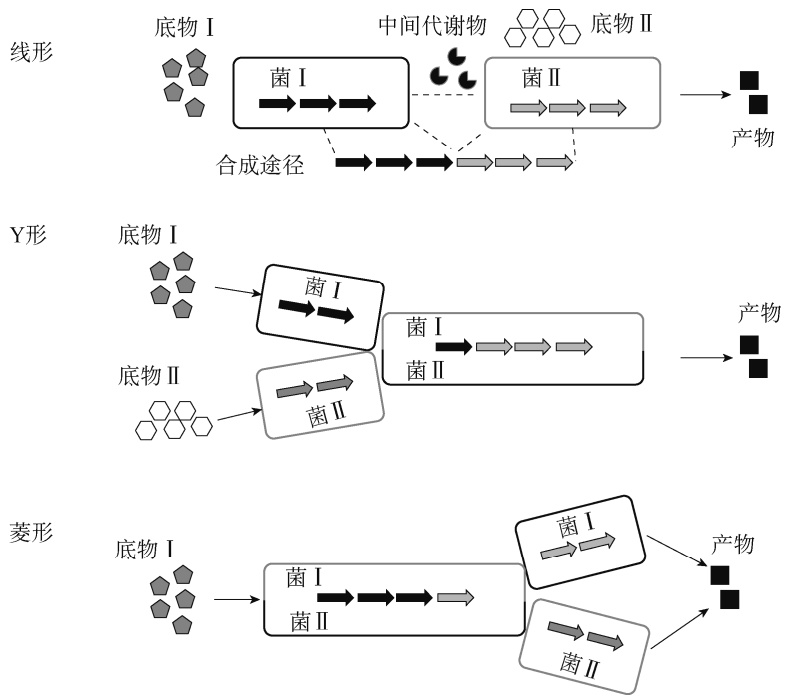

图 2-23 模块共培养的模式

A

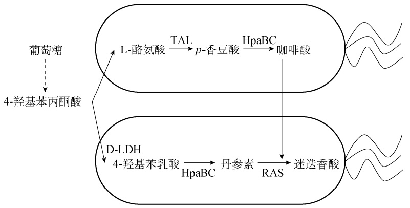

flowchart

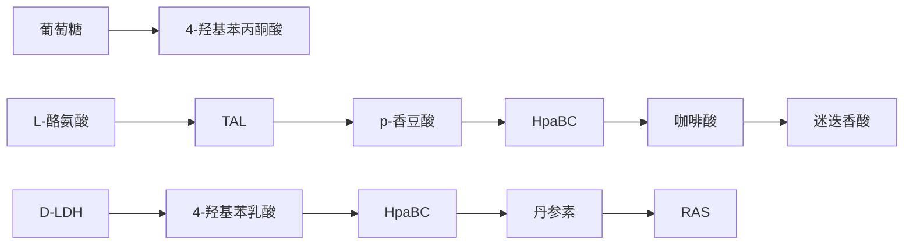

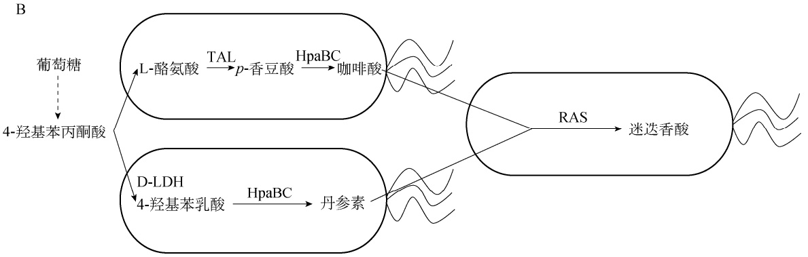

flowchart

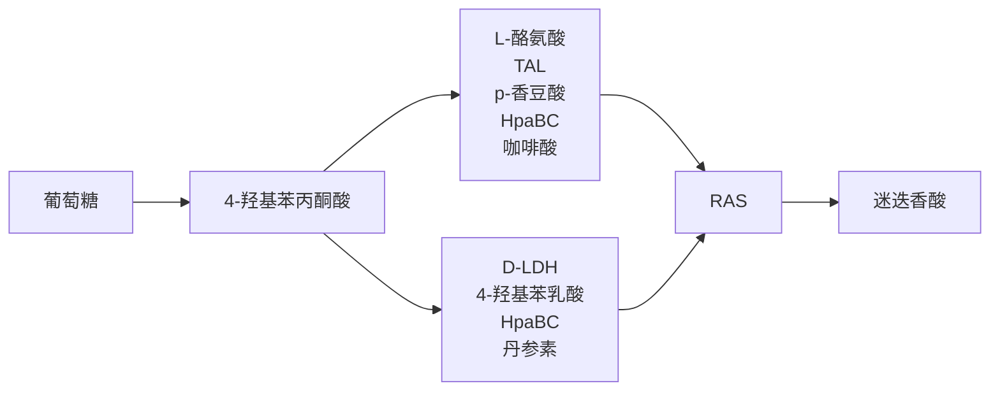

图 2-24 两菌（A）和三菌（B）共培养合成迷迭香酸[68]

HpaBC. 4-羟基苯乙酸-3-羟化酶；D-LDH. D-乳酸脱氢酶；RAS. 迷迭香酸合成酶；TAL. 酪氨酸氨裂解酶

理论上，多物种共存时，不同物种可以利用每个物种的优势，有利于共培养。但是，它们的缺点是，因为不同物种的生长速率不同，整个发酵过程中种群比例难以保持一致。因此，建立稳定的共培养系统，保证整个培养过程种群比例一致是模块共培养的另一个关键问题。目前已有人通过控制接种比、控制碳源比例、建立互生/共生系统和群体感应系统及利用共生/互利共生等方式来控制种群比例，如图 2-25 所示。

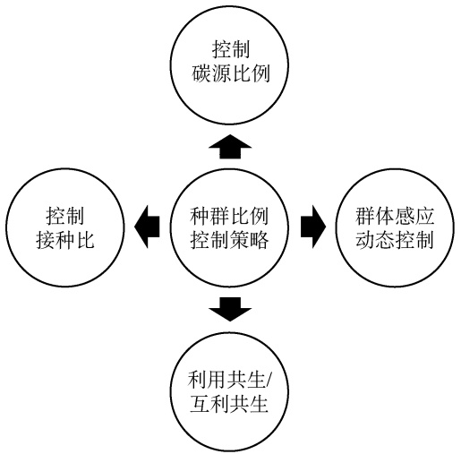

flowchart

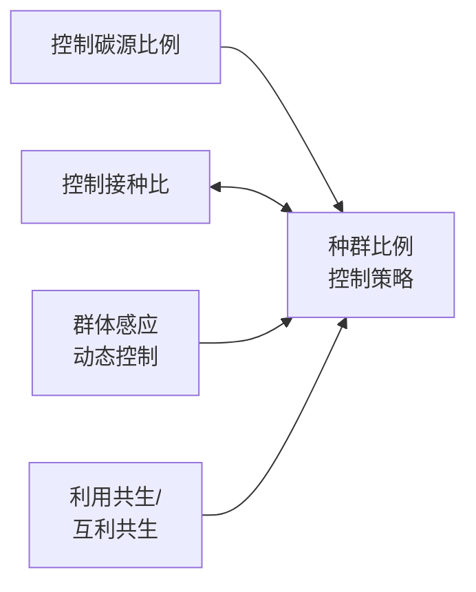

图 2-25 模块共培养中种群比例控制策略

接种比是控制共培养系统的种群比例中最常见的一种策略，但是由于不同模块菌的遗传背景不一样，其生长速率也不一样，无法保证整个培养过程中种群比例保持不变。生长快的模块菌往往会成为优势菌，但这样并不一定是对产物合成有利的。为此，一旦建立了模块共培养体系，保持种群合适比例便成了共培养的关键。研究者在其所构建的咖啡酸合成菌-丹参素合成菌-迷迭香酸合成菌三菌共培养系统中，发现丹参素合成菌在培养过程中生长处于弱势[68]。为了减少模块菌对碳源的相互竞争，他们将模块菌设计为在不同碳源上生长:咖啡酸合成菌和迷迭香酸合成菌设计为利用木糖为唯一碳源的菌株，丹参素合成菌为利用葡萄糖的菌株；通过调节木糖与葡萄糖的比例，使新的三菌共培养系统的迷迭香酸产量进一步提高到 165mg/L，是以葡萄糖为唯一碳源的三菌共培养体系的 1.7 倍。利用不同碳源进行共培养避免了菌株之间的底物竞争，但是需要考察模块菌利用不同碳源的生长速率、合成能力等。

虽然通过控制接种和碳源比例可以在一定程度上保持合适的相对种群密度，但因其缺乏灵活性，难以进行更为精细的调节。通过群体感应系统可以动态地调控共培养系统的种群比例。Dinh 等开发了一个基于群体感应系统的生长调节线路，用来调控共培养系统中种群的比例[69]。通过 $\mathrm { L u x R / P _ { l u x } }$ 群体感应激活系统控制降解标签 sspB 的表达，使带有降解标签的磷酸果糖激酶 PfkA 发生降解，而 PfkA 是糖酵解途径的关键酶，它的降解导致糖酵解通量降低，菌体生长受到抑制。他们应用这种群体感应的生长调节线路，构建了柚皮素共培养体系:上游香豆酸合成菌在群体感应的生长调节线路大肠杆菌中表达酪氨酸裂解酶（TAL），催化酪氨酸生成对香豆酸，下游柚皮素合成菌表达香豆酰辅酶 A 连接酶（4CL）、查耳酮合酶（CHS）和查耳酮异构酶（CHI），催化对香豆酸生成柚皮素。在这种共培养系统中，上游菌在共培养前期大量存在，为柚皮素合成提供大量的中间体对香豆酸。在生长调节线路的作用下，随着上游菌的细胞密度不断增加，其生长逐渐受到抑制；而下游菌的比例逐渐增加，则可以利用上游菌合成的对香豆酸生产柚皮素。

构建共生或互利共生人工生态系统可以有效地实现种群密度的自我调节。首先构建的是单代谢物交叉喂养共生系统。赵广荣团队构建了一个交叉喂养苯丙氨酸和酪氨酸的大肠杆菌-大肠杆菌共培养体系，以合成红景天苷[70]。苯丙氨酸缺陷型大肠杆菌以木糖为原料合成酪醇，酪氨酸缺陷型大肠杆菌以葡萄糖为原料合成鸟苷二磷酸葡萄糖和红景天苷。共培养系统中种群比例随着碳源的消耗和生长期而变化。在发酵前期，共生菌几乎以相同速率消耗木糖和葡萄糖，两个菌的比例保持最初的接种比不变；当木糖消耗完毕，只有葡萄糖供生长之用时，导致指数期以葡萄糖为碳源的下游菌的比例增加；到稳定期两个菌的比例恒定。但是，单一代谢物系统在培养条件变化时难以保持系统的稳定性。为此，袁其朋团队又构建了多代谢物的交叉喂养互利共生系统:缺失 TCA 循环的甘油利用菌和谷氨酸缺陷型葡萄糖利用菌[71]。如图 2-26A 所示，两株菌相互提供氨基酸和 TCA 循环。在这个互利共生系统中，菌群比例及细胞密度将逐渐趋于稳定，且与起始接种比无关。以酪氨酸为连接分子，他们应用该互利共生系统合成红景天苷，使其产量比中性和普通共生系统分别提高了 127%和 22%。他们又将互利共生系统结合咖啡酸生物传感器（图 2-26B），应用于合成松柏醇。缺失 TCA 循环的甘油利用菌表达咖啡酸合成途径以合成咖啡酸，咖啡酸生物传感器控制的谷氨酸缺陷型葡萄糖利用菌表达松柏醇合成途径以合成松柏醇。联合应用咖啡酸生物传感器的互利共生系统使发酵后期下游菌的比例由没有传感器的互利共生系统的 16.5%提高到 52%，导致松柏醇产量从 95mg/L 提高到 258mg/L。

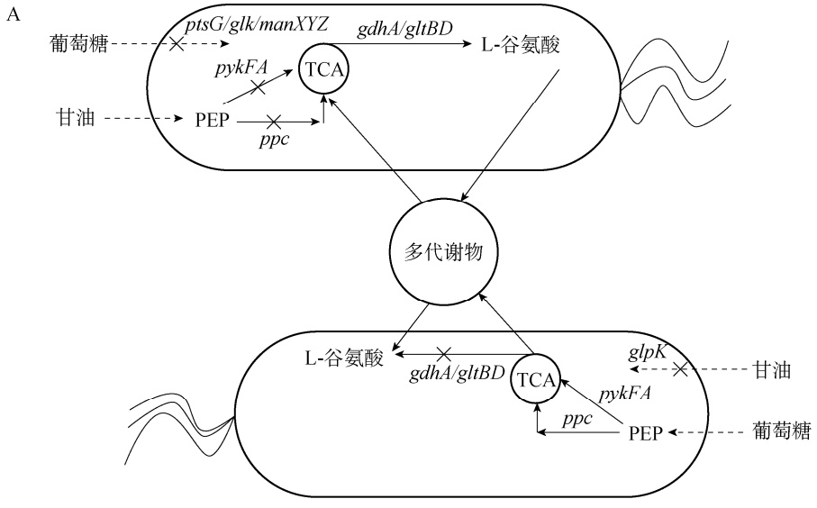

flowchart

B

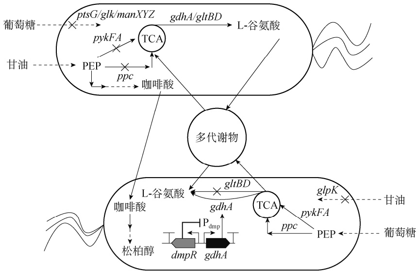

flowchart

This diagram illustrates the metabolic pathways of glucose and olive in a fermentation process, showing how various sugars (Glycine, Ethanol) are converted into L-谷氨酸, which is then mediated by multiple intermediates like TCA and lactate.

图 2-26 多代谢物交叉喂养的互利共生系统（A）及其应用（B）

PEP. 磷酸烯醇式丙酮酸

## 思 考 题

1. 什么是生物元件、装置和生物系统？
2. 元件为何要进行标准化组装？主要的组装技术有哪些？
3. 请简述各种常见组装技术的原理及其核心。
4. 请列举常见的生物元件及其主要特性，如启动子、终止子、RBS。
5. 何谓生物传感器？常见的生物传感器包括哪些？在细胞工厂创建领域，生物传感器的主要用途有哪些？
6. 简述构建合成途径的原则及其方法。
7. 简述常见的合成途径的优化方法及其核心技术。
8. 何谓模块共培养？其优点有哪些？
9. 如何设计模块共培养？其关键核心是什么？

## 参考文献

［1］Anderson JC，Dueber JE，Leguia M，et al. BglBricks:A flexible standard for biological part assembly. J Biol Eng，2010，4（1）:1
［2］Xu P，Vansiri A，Bhan N，et al. ePathBrick:A synthetic biology platform for engineering metabolic pathways in E. coli. ACS Synth Biol，2012，1（7）:256-266
［3］Li XR，Tian GQ，Shen HJ，et al. Metabolic engineering of Escherichia coli to produce zeaxanthin. J Ind Microbiol Biot，2015，42（4）:627-636
［4］Engler C，Kandzia R，Marillonnet S. A one pot，one step，precision cloning method with high throughput capability. PLoS ONE，2008，3（11）:e3647
［5］NEBridgeTM Golden Gate Assembly Tool. https://goldengate.neb.com
［6］Gibson DG，Young L，Chuang RY，et al. Enzymatic assembly of DNA molecules up to several hundred kilobases. Nat Methods，2009，6（5）:343-345
［7］Quan JY，Tian JD. Circular polymerase extension cloning of complex gene libraries and pathways. PLoS ONE，2009，4（7）:e6441
［8］Quan J，Tian J. Circular polymerase extension cloning for high-throughput cloning of complex and combinatorial DNA libraries. Nat Protoc，2011，6（2）:242-251
［9］Xia YZ，Li K，Li JJ，et al. T5 exonuclease-dependent assembly offers a low-cost method for efficient cloning and site-directed mutagenesis. Nucleic Acids Res，2019，47（3）:e15
［10］Shao ZY，Zhao H，Zhao HM. DNA assembler，an in vivo genetic method for rapid construction of biochemical pathways. Nucleic Acids Res，2009，37（2）:e16
［11］Fu J，Bian XY，Hu SB，et al. Full-length RecE enhances linear-linear homologous recombination and facilitates direct cloning for bioprospecting. Nat Biotechnol，2012，30（5）:440-446
［12］Wang HL，Li Z，Jia RN，et al. RecET direct cloning and Red alpha beta recombineering of biosynthetic gene clusters，large operons or single genes for heterologous expression. Nat Protoc，2016，11（7）:1175-1190
［13］Baker O，Gupta A，Obst M，et al. RAC-tagging:Recombineering and Cas9-assisted targeting for protein tagging and conditional analyses. Sci Rep-Uk，2016，6:25529
［14］Zhang WL，Fu J，Liu J，et al. An engineered virus library as a resource for the spectrum-wide exploration of virus and vector diversity. Cell Rep，2017，19（8）:1698-1709
［15］Wang HL，Li Z，Jia RN，et al. ExoCET:exonuclease in vitro assembly combined with RecET recombination for highly efficient direct DNA cloning from complex genomes. Nucleic Acids Res，2018，46（5）:e28
［16］Song CY，Luan J，Cui QW，et al. Enhanced heterologous spinosad production from a 79-kb synthetic multioperon assembly. ACS Synth Biol，2019，8（1）:137-147
［17］Itaya M，Fujita K，Kuroki A，et al. Bottom-up genome assembly using the genome vector. Nat Methods，2008，5（1）:41-43
［18］de Kok S，Stanton LH，Slaby T，et al. Rapid and reliable DNA assembly via ligase cycling reaction. Acs Synth Biol，2014，3（2）:97-106
［19］de Mey M，Maertens J，Lequeux GJ，et al. Construction and model-based analysis of a promoter library for E. coli:an indispensable tool for metabolic engineering. BMC Biotechnol，2007，7:34
［20］Wang Y，Liu QT，Weng HJ，et al. Construction of synthetic promoters by assembling the sigma factor binding −35 and −10 boxes. Biotechnol J，2019，14（1）:1800298
［21］Lu J，Tang JL，Liu Y，et al. Combinatorial modulation of galP and glk gene expression for improved alternative glucose utilization. Appl Microbiol Biot，2012，93（6）:2455-2462
［22］Chen J，Zhu XN，Tan ZG，et al. Activating C-4-dicarboxylate transporters DcuB and DcuC for improving succinate production. Appl Microbiol Biot，2014，98（5）:2197-2205
［23］Li MJ，Wang JS，Geng YP，et al. A strategy of gene overexpression based on tandem repetitive promoters in Escherichia coli. Microb Cell Fact，2012，11:19
［24］Yang S，Liu QT，Zhang YF，et al. Construction and characterization of broad-spectrum promoters for synthetic biology. ACS Synth Biol，2018，7（1）:287-291
［25］Zhao M，Yuan ZQ，Wu LT，et al. Precise prediction of promoter strength based on a de novo synthetic promoter library coupled with machine learning. ACS Synth Biol，2022，11（1）:92-102
［26］Chen YJ，Liu P，Nielsen AAK，et al. Characterization of 582 natural and synthetic terminators and quantification of their design constraints. Nat Methods，2013，10（7）:659-664
［27］Salis HM，Mirsky EA，Voigt CA. Automated design of synthetic ribosome binding sites to control protein expression. Nat Biotechnol，2009，27（10）:946-950
［28］RBS calculator and RBS library calculator. https://salislab.net/software/predict\_rbs\_calculator
［29］Seo SW，Yang JS，Kim I，et al. Predictive design of mRNA translation initiation region to control prokaryotic translation efficiency. Metab Eng，2013，15:67-74
［30］Chou HH，Keasling JD. Programming adaptive control to evolve increased metabolite production. Nat Commun，2013，4:2595
［31］Gao JS，Du MH，Zhao JH，et al. Design of a genetically encoded biosensor to establish a high-throughput screening platform for L-cysteine overproduction. Metab Eng，2022，73:144-157
［32］Liu SD，Wu YN，Wang TM，et al. Maltose utilization as a novel selection strategy for continuous evolution of microbes with enhanced metabolite production. ACS Synth Biol，2017，6（12）:2326-2338
［33］Mahr R，Gatgens C，Gatgens J，et al. Biosensor-driven adaptive laboratory evolution of L-valine production in Corynebacterium glutamicum. Metab Eng，2015，32:184-194
［34］Zhang X，Zhang XM，Xu GQ，et al. Integration of ARTP mutagenesis with biosensor-mediated high-throughput screening to improve L-serine yield in Corynebacterium glutamicum. Appl Microbiol Biot，2018，102（14）:5939-5951
［35］Siedler S，Schendzielorz G，Binder S，et al. SoxR as a single-cell biosensor for NADPH-consuming enzymes in Escherichia coli. ACS Synth Biol，2014，3（1）:41-47
［36］Zhang J，Sonnenschein N，Pihl TPB，et al. Engineering an NADPH/NADP（+）redox biosensor in yeast. ACS Synth Biol，2016，5（12）:1546-1556
［37］Shi SB，Ang EL，Zhao HM. In vivo biosensors:mechanisms，development，and applications. J Ind Microbiol Biot，2018，45（7）:491-516
［38］Umeyama T，Okada S，Ito T. Synthetic gene circuit-mediated monitoring of endogenous metabolites:identification of Gal11 as a novel multicopy enhancer of S-adenosylmethionine level in yeast. ACS Synth Biol，2013，2（8）:425-430
［39］Tang SY，Qian S，Akinterinwa O，et al. Screening for enhanced triacetic acid lactone production by recombinant Escherichia coli expressing a designed triacetic acid lactone reporter. J Am Chem Soc，2013，135（27）:10099-10103
［40］Chen W，Zhang S，Jiang PX，et al. Design of an ectoine-responsive AraC mutant and its application in metabolic engineering of ectoine biosynthesis. Metab Eng，2015，30:149-155
［41］Li H，Liang CN，Chen W，et al. Monitoring in vivo metabolic flux with a designed whole-cell metabolite biosensor of shikimic acid. Biosens Bioelectron，2017，98:457-465
［42］Zhou GJ，Zhang FZ. Applications and tuning strategies for transcription factor-based metabolite biosensors. Biosensors-Basel，2023，13（4）:428
［43］Sun SW，Peng KL，Sun S，et al. Engineering modular and highly sensitive cell-based biosensors for aromatic contaminant monitoring and high-throughput enzyme screening. ACS Synth Biol，2023，12（3）:877-891
［44］DeLoache WC，Russ ZN，Narcross L，et al. An enzyme-coupled biosensor enables（S）-reticuline production in yeast from glucose. Nat Chem Biol，2015，11（7）:465-471