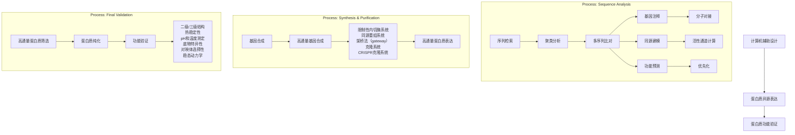
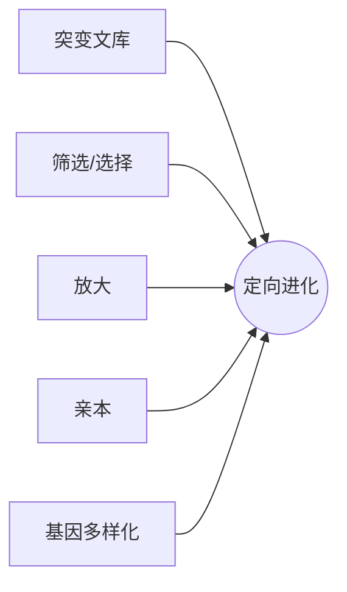
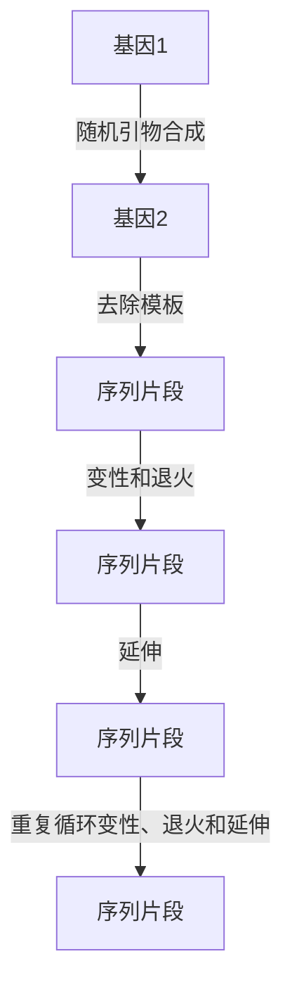
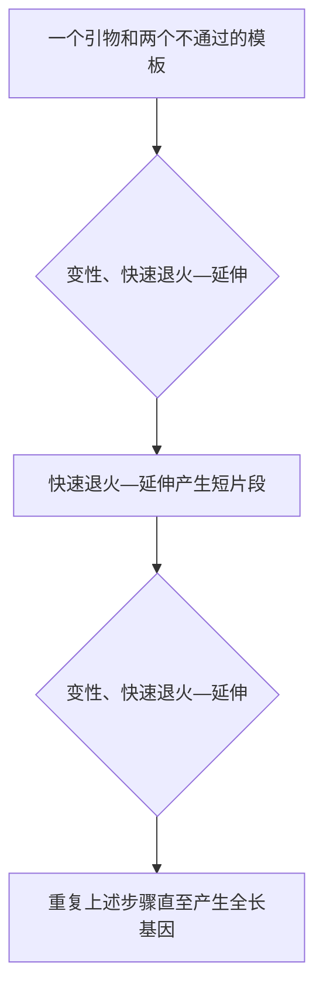
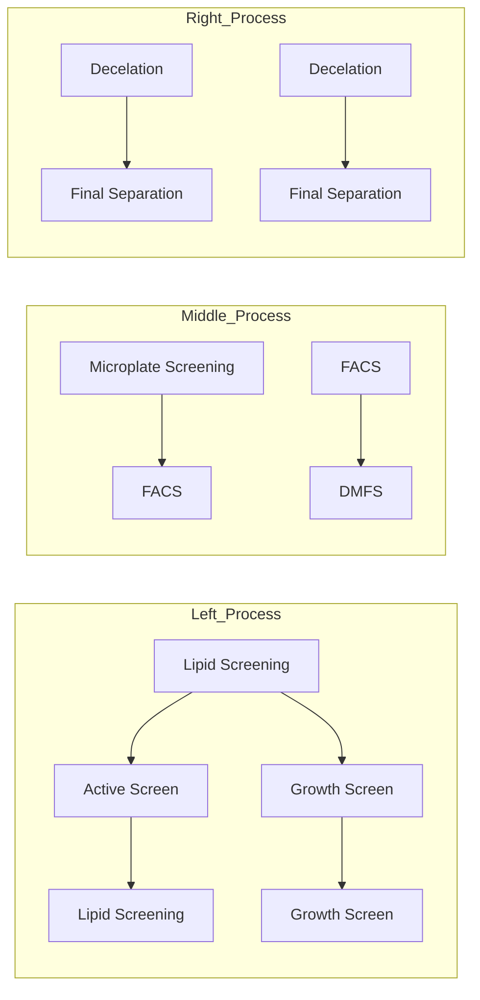

［45］Yan D，Kim WJ，Yoo SM，et al. Repurposing type Ⅲ polyketide synthase as a malonyl-CoA biosensor for metabolic engineering in bacteria. P Natl Acad Sci USA，2018，115（40）:9835-9844
［46］Rogers JK，Church GM. Genetically encoded sensors enable real-time observation of metabolite production. P Natl Acad Sci USA，2016，113（9）:2388-2393
［47］Liu YN，Li QG，Zheng P，et al. Developing a high-throughput screening method for threonine overproduction based on an artificial promoter. Microb Cell Fact，2015，14:121
［48］Dahl RH，Zhang F，Alonso-Gutierrez J，et al. Engineering dynamic pathway regulation using stress-response promoters. Nat Biotechnol，2013，31（11）:1039-1046
［49］Borujeni AE，Mishler DM，Wang JZ，et al. Automated physics-based design of synthetic riboswitches from diverse RNA aptamers. Nucleic Acids Res，2016，44（1）:1-13
［50］Niu FX，He X，Huang YB，et al. Biosensor-guided atmospheric and room-temperature plasma mutagenesis and shuffling for high-level production of shikimic acid from sucrose in Escherichia coli. J Agr Food Chem，2020，68（42）:11765-11773
［51］Shen YP，Pan Y，Niu FX，et al. Biosensor-assisted evolution for high-level production of 4-hydroxyphenylacetic acid in Escherichia coli. Metab Eng，2022，70:1-11
［52］Yan ZB，Liang JL，Niu FX，et al. Enhanced production of pterostilbene in Escherichia coli through directed evolution and host strain engineering. Front Microbiol，2021，12:710405
［53］Shen HJ，Cheng BY，Zhang YM，et al. Dynamic control of the mevalonate pathway expression for improved zeaxanthin production in Escherichia coli and comparative proteome analysis. Metab Eng，2016，38:180-190
［54］Bogorad IW，Lin TS，Liao JC. Synthetic non-oxidative glycolysis enables complete carbon conservation. Nature，2013，502（7473）:693-697
［55］Chatzivasileiou AO，Ward V，Edgar SM，et al. Two-step pathway for isoprenoid synthesis. P Natl Acad Sci USA，2019，116（2）:506-511
［56］Pfleger BF，Pitera DJ，Smolke CD，et al. Combinatorial engineering of intergenic regions in operons tunes expression of multiple genes. Nat Biotechnol，2006，24（8）:1027-1032
［57］Guo H，Yang Y，Xue F，et al. Effect of flexible linker length on the activity of fusion protein 4-coumaroyl-CoA ligase::stilbene synthase. Mol Biosyst，2017，13（3）:598-606
［58］Zakeri B，Fierer JO，Celik E，et al. Peptide tag forming a rapid covalent bond to a protein，through engineering a bacterial adhesin. P Natl Acad Sci USA，2012，109（12）:E690-E697
［59］Zhang GQ，Quin MB，Schmidt-Dannert C. Self-assembling protein scaffold system for easy in vitro coimmobilization of biocatalytic cascade enzymes. ACS Catal，2018，8（6）:5611-5620
［60］Ajikumar PK，Xiao WH，Tyo KEJ，et al. Isoprenoid pathway optimization for taxol precursor overproduction in Escherichia coli. Science，2010，330（6000）:70-74
［61］Xu P，Gu Q，Wang WY，et al. Modular optimization of multi-gene pathways for fatty acids production in E. coli. Nat Commun，2013，4:1409
［62］Zhao J，Li QY，Sun T，et al. Engineering central metabolic modules of Escherichia coli for improving betacarotene production. Metab Eng，2013，17:42-50
［63］Shen HJ，Hu JJ，Li XR，et al. Engineering of Escherichia coli for lycopene production through promoter engineering. Curr Pharm Biotechno，2015，16（12）:1094-1103
［64］Zhang FZ，Carothers JM，Keasling JD. Design of a dynamic sensor-regulator system for production of chemicals
and fuels derived from fatty acids. Nat Biotechnol，2012，30（4）:354-359
［65］Zhou K，Qiao KJ，Edgar S，et al. Distributing a metabolic pathway among a microbial consortium enhances production of natural products. Nat Biotechnol，2015，33（4）:377-383
［66］Zhao CH，Sinumvayo JP，Zhang YP，et al. Design and development of a“Y-shaped”microbial consortium capable of simultaneously utilizing biomass sugars for efficient production of butanol. Metab Eng，2019，55:111-119
［67］Sinumvayo JP，Zhao CH，Liu GX，et al. One-pot production of butyl butyrate from glucose using a cognate “diamond-shaped”E. coli consortium. Bioresour Bioprocess，2021，8（1）:18
［68］Li ZH，Wang XN，Zhang HR. Balancing the non-linear rosmarinic acid biosynthetic pathway by modular co-culture engineering. Metab Eng，2019，54:1-11
［69］Dinh CV，Chen XY，Prather KLJ. Development of a quorum-sensing based circuit for control o coculture population composition in a naringenin production system. ACS Synth Biol，2020，9（3）:590-597
［70］Liu X，Li XB，Jiang JL，et al. Convergent engineering of syntrophic Escherichia coli coculture for efficient production of glycosides. Metab Eng，2018，47:243-253
［71］Li XL，Zhou Z，Li WN，et al. Design of stable and self-regulated microbial consortia for chemical synthesis. Nat Commun，2022，13（1）:1554

# 合 成 酶 学

## 第一节 酶 的 选 择

酶是合成生物学最通用的元件，途径酶或酶系统构成生物体的合成代谢网络。合成生物学的各种元件有助于合成途径的形成，各种途径可以看成是由酶催化反应的元件组成的代谢装置。设计合成途径首先需要选择各种酶元件，获取合成途径所需的各种酶及其催化的反应等信息，然后由酶元件组装代谢途径。大自然为人们提供了成千上万种酶，但由于缺乏准确预测序列-功能关系的方法，需要利用合成生物学工程化的思想和手段从自然界中大规模挖掘新的酶元件。因此，合成生物学与分子酶学工程的交叉整合催生了合成酶学这一新的研究领域[1]。

传统酶资源筛选一般采用菌种选育和功能宏基因组等技术。酶资源的菌种选育往往以催化活性为导向，首先对天然微生物进行培养与筛选，进而克隆与鉴定相关基因，或者对微生物蛋白质组进行提取、分离与组学分析，鉴定活性酶蛋白。功能宏基因组方法基于酶活性或基因序列同源性，对表达宏基因组的 DNA 片段进行克隆筛选，常常用于挖掘未培养微生物的基因资源。这两类方法都依赖实体样品，研发周期长，成本高，且有不确定性[2]。

合成生物学的快速发展为酶蛋白的规模化研究提供了新的思路。基于工程学理念，合成生物学通过有目标的“设计-构建-测试-学习”，获得具有特定功能的人工生命系统。就酶催化系统而言，合成生物学采用“自下而上”的组装策略，首先针对目标生化反应，从数据库中获取酶蛋白的氨基酸序列；接着根据底盘细胞适配原则，设计并合成酶元件、调节元件的 DNA序列，利用标准化 DNA 组装方法构建蛋白质表达模块或合成代谢通路；最后在底盘细胞中进行转化、表达与功能表征。基于合成生物学进行酶蛋白挖掘具有诸多优点，如:不受生物实体的限制，即可以利用生物信息学方法针对性确定研究对象，提高新型元件的开发效率；可以对 DNA 序列进行工程化改造，从密码子偏好、亚细胞定位等方面提高酶元件与底盘的适配性；基于标准化底盘、流程和实验条件开展研究，有利于积累优质元件与数据，为基于人工智能的酶元件挖掘等研究奠定基础[2]。

利用合成生物学对酶蛋白进行工程化挖掘，需要开发高通量的计算和实验方法。由于缺乏从序列准确预测功能的方法，往往需要筛选大量的候选序列，才能够识别自然界中催化目标生化反应的酶蛋白；同时，天然酶元件往往需要进行工程改造才能达到特定指标，如催化效率、专一性、底盘细胞适配性等。因此，需要基于合成生物学理念开发工程化、标准化的技术和流程，从海量序列数据中识别、合成、表征天然酶元件。针对酶元件的识别，传统方法基于同源序列比对、结构域比对等进行酶功能注释。但是，序列相似性与功能之间并不总是完全对应的。例如，序列同源性达到 98%的蛋白质可能具有不同的生化功能，而序列同源性很低的蛋白质也可能具有相同的生化功能[3]。因此，需要开发新的生物信息方法，对酶蛋白从序列、三维结构、进化关系和蛋白质互作等多个层面进行综合性分析，根据实验目的将功能验证的候选蛋白优先化排序。此外，不同来源酶蛋白在底盘细胞中进行异源表达时，可能存在密码子偏好不同、不能正确折叠、稳定性差、辅酶因子等问题，需要进行工程化实验设计对DNA 序列、调节元件、DNA 组装方法、表达条件等因素进行系统性探索和优化。通常需要对上百个候选序列的功能表征和对实验条件的系统性优化，这对研究平台的操作通量和自动化水平提出了新的需求。

## 一、计算机辅助设计用于高通量酶元件选择

高通量筛选酶元件的一般流程如图 3-1 所示[4]。随着测序技术的飞速发展，人们得到了大量的（宏）基因组和转录组数据，通过解析这些数据可以获取大量酶蛋白序列。将其与蛋白质结构域数据库进行同源比对，可以实现酶功能的初步注释[5]。同时，代谢多样性提供了丰富的生物催化剂资源，对各类初级和次生代谢产物合成途径的预测与分析也会为酶元件的挖掘提供帮助。但是，目前还很难从酶蛋白序列出发准确预测其催化活性、底物选择性、可溶性表达等重要性质，因此需要开发新的算法对候选蛋白进行优先化排序，从而提高功能筛选的成功率，利用最少的实验资源探索相似酶蛋白的功能多样性。下面从酶的聚类分析（clustering）和实验验证的优先化排序两个方面进行介绍。

flowchart

图 3-1 酶蛋白资源高通量筛选流程图[4]

CRISPR. 成簇的规律间隔短回文重复序列

## 二、酶蛋白聚类分析

各种类型的蛋白质资源数据库为酶元件的高通量筛选提供了宝贵的材料，如表 3-1 所示。蛋白质资源数据库 UniProt 储存了大量的蛋白质序列，其中大部分功能注释是通过与 CDD（Conserved Domain Database）、Pfam、CATH（Class，Architecture，Topology，Homologous Superfamily）和 FIGfams 等数据库中蛋白质的结构域序列进行同源性比对获得的；此外，估计至少 50%的注释不够精确或甚至是错误的[6]。因此，需要整合不同层次的功能注释工具和实验数据，帮助科研人员从序列、结构、进化和蛋白质互作等多个层面对候选酶元件进行综合分析。酶蛋白聚类分析可以最大限度地利用文献报道的实验数据对未知蛋白质进行多个维度的功能注释[7]。下面将重点介绍用于酶蛋白聚类分析的两个方法:序列相似性网络（sequence similarity network，SSN）分析工具[8]，以及侧重蛋白质结构比对的 CATH 分析工具[9]。

表 3-1 酶元件资源数据库及其基本信息[2]

| 数据库名称 | 基本信息 |
| --- | --- |
| UniProt | 信息最丰富、资源最广的蛋白质数据库,由Swiss-Prot、TrEMBL和PIR-PSD三大数据库组合而成 |
| CDD | 蛋白质保守结构域数据库,是关于蛋白质功能单元注释的资源 |
| Protein | 包含GenBank、RefSeq、TPA、Swiss-Prot、PIR、PDB等数据库中的序列 |
| Protein Clusters | 包含完整的原核生物基因组和叶绿体基因组编码的RefSeq蛋白质序列 |
| Structure | 数据来源于PDB的蛋白质结构数据库,并将结构数据链接到书目信息、序列数据和NCBI的Taxonomy中,运用3D结构浏览器和Cn3D,可以从Entrez获得分子间相互作用的图像 |
| PDB | 生物大分子(如蛋白质和核酸)数据库,包括由全世界生物学家和生物化学家上传的蛋白质或核酸的X射线晶体衍射或者核磁共振(NMR)结构数据 |
| InterPro | 整合了CATH、CDD、PRINTS、Pfam等多个数据库,并去掉冗余数据,对蛋白质家族预测、结构域和结合位点预测进行注释 |
| Brenda | 包括酶促反应、特异性、动力学参数、结构和稳定性等蛋白质功能数据及基因组序列信息 |
| BKMS-react | 包含酶促反应、动力学参数、实验条件和代谢途径等信息 |
| EzCatDb | 包括酶促反应、辅因子、中间代谢产物、催化活性结构域和结构等信息 |
| M-CSA | 对催化残基、辅因子和反应机制的注释 |
| FireProt | 包括序列突变后导致的热稳定性变化数据 |
| ProTherm | 包括序列突变后导致的热稳定性变化数据 |
| eSOL | 基于蛋白质翻译和离心条件推测蛋白质溶解度 |
| SoluProMut | 包括序列突变后导致的溶解性变化数据 |
| TargetTrack | 蛋白质溶解性数据库 |
| ProtaBank | 包括各种突变后的蛋白质序列信息 |
| hPDB | 可动态展示生物大分子立体结构 |
| KEGG | 整合基因组、化学和系统功能信息的数据库。把从已经完成测序的基因组中得到的基因目录与更高级别的细胞、物种和生态系统水平的系统功能关联起来 |
| PMD | 蛋白质突变数据库 |
| Pfam | 蛋白质家族数据库,蛋白质家族以多序列比对和隐马尔可夫模型的形式表示 |
| FIGFAMs | 基于人工注释的来源于不同细菌、古细菌等生物的蛋白质序列,同功能蛋白质组合为相应的集合 |
| PRINTS | 蛋白质模体指纹数据库 |
| CATH | 以蛋白质结构域层次组织的包含类型(C)、架构(A)、拓扑学(T)和同源超家族(H)的数据库 |
| SCOP | 蛋白质结构分类数据库 |
| CCDC | 剑桥晶体中心数据库 |
| Swiss-3DImage | 提供蛋白质及其他生物分子的三维图像 |
| BioMagResBank | 蛋白质、氨基酸和核苷酸的核磁共振数据库 |
| Swiss-MODEL Repository | 自动产生蛋白质模型的数据库 |
| PROTOMAP | Swiss-Prot 蛋白质自动分类系统 |
| iProClass | 蛋白质分类数据库 |
| TIGRFAM | 蛋白质家族数据库 |
| OWL | 非冗余蛋白质序列数据库,由 Swiss-Prot、PIR、GenBank(由其编码序列翻译而成的氨基酸序列)和 NRL-3D 一级序列数据库集合而成 |
| 3DID | 包括 3D 结构已知的蛋白质的互作信息 |
| DOMINE | 蛋白质结构域互作数据库 |
| PiSite | 以 PDB 为基础,可在蛋白质序列中搜寻互作位点 |
| Binding MOAD | 提供蛋白质-配体晶体结构数据信息 |
| Phospho.ELM | 蛋白质磷酸化位点数据库 |
| STITCH | 蛋白质-化合物作用网数据库 |
| Reactome | 人体生命活动路径和过程数据库,提供生化过程网络图,并对参与其中的蛋白质分子有详细注解,与其他数据库如 UniPort、KEGG、OMIM 等建立了广泛的交叉应用 |
| CAZy | 碳水化合物活性酶数据库,包括能够合成或者分解复杂碳水化合物的酶类 |
| LED | 脂肪酶工程数据库,整合了脂肪酶的结构域序列信息 |
| PROSPER | 基于序列预测 24 个不同蛋白酶家族的催化底物和切割位点 |
| SABIO-RK | 包括生化反应动力学参数的数据库 |

注:TrEMBL. Translated European Molecular Biology Laboratory；PIR-PSD. Protein Information Resource-International Protein Sequence Database；TPA. Third Party Annotation；PDB. Protein Data Bank；NCBI. National Center for Biotechnology Information；OMIM. Online Mendelian Inheritance in Man

SSN 是一种可显示两两同源蛋白质之间序列相似性的多维网络[10]。网络中每个节点（node）表示一个蛋白质；如果两个蛋白质间的序列相似性（BLAST E-value）超过特定阈值，则代表这两个蛋白质的节点通过一条边（edge）连接；每个簇（cluster）中的节点至少有一条边与簇中的其他节点相连。选择合适的阈值是成功构建 SSN 的关键。SSN 中的“节点属性”包含每个节点的各种信息，比如系统分类，TrEMBL/Swiss-Prot、PDB 和 GO（Gene Ontology）等数据库信息的链接。这些信息有助于用户对 SSN 进行分析，通过设定合适的阈值将不同节点聚类。与多序列比对和系统进化树（phylogenetic tree）方法相比，SSN 能够快速地分析更大的蛋白质序列集，并能同时评估正交信息。例如，有助于对酶家族中有显著序列相似性的子群如何关联进行推测。SSN 分析也可揭示序列相似性较低但具有相似结构或功能的远同源蛋白质之间的关系，从而指导研究者优先探索序列空间内的未知区域。最初，Barber 和 Babbitt利用 Python 语言编写了用于生成 SSN 的工具 Pythoscape[11]。但其需要基于服务器集群在Unix 环境中执行命令行脚本，因此未被广泛应用。后来，为了推广 SSN 的应用，研究者开发了用户友好的 EFI-EST （Enzyme Function Initiative Tools-Enzyme Similarity Tool）网络工具，可以通过浏览器访问（https://efi.igb.illinois.edu/efi-est/），用户不需要编程即可生成 SSN，其结果可以在开源的 Cytoscape 软件中进行可视化分析。

CATH 工具可以揭示蛋白质结构域间的进化关系。基于空间结构的相似性，CATH 识别wwPDB 数据库（Worldwide Protein Data Bank）中的蛋白质结构域，并将其聚类形成结构域超家族（domain superfamily）。到目前为止，仅有 10 万余种蛋白质具有经实验测定的三维空间结构信息。CATH-Gene3D 工具将具有代表性的结构域转换成隐马尔可夫模型，形成基于一级序列的“指纹图谱”库；利用这一方法，共预测得到 43 万个蛋白质结构域，构成 6000 余个结构域超家族。CATH 进一步按照 class（二级结构的组成）、architecture（二级结构形成的形状）和 topology（二级结构连接的顺序）三个层次，分析结构域超家族间的进化关系[12]。另外，FunTree 数据库进一步将酶蛋白的功能信息，如生化反应物的结构、酶催化动力学数据等，与CATH 结构域超家族分类进行整合，从而综合分析序列、结构、功能和进化的关系。该数据库目前已包含 2340 个结构域超家族、7 万个结构域和 40 万个蛋白质序列[13]。

## 三、优先化实验验证

聚类分析对海量蛋白质数据库进行初步筛选之后，仍存在大量候选序列，远远超出实验可验证的能力。因此，需要探索优先化标准与算法对候选酶进行排序，以提高功能验证实验的效率[14]。

酶蛋白的可溶性表达和底物杂泛性是优先化排序的重要标准。可溶性表达是对酶进行功能表征的前提，目前已有一些基于能量计算、机器学习和进化分析的算法对这一性质进行预测[15]。例如，Wilkinson-Harrison 溶解度模型可以预测蛋白质序列在大肠杆菌中可溶性表达的概率[16]。Vanacek 等对脱卤酶家族进行生物信息学分析及优先化选择之后，筛选得到 20 个候选蛋白质序列进行表达，最终有 12 个蛋白质在大肠杆菌中实现了可溶性表达，与模型的预测理论值一致[4]。另外，需要根据实验目的，选择具有不同底物杂泛性的酶。体外生物催化体系通常使用单一底物，使用具有高底物杂泛性的酶不影响反应专一性，并且有利于将同一种酶应用于不同反应体系，可缩短研发周期和成本。与此相反，高底物杂泛性的酶可能会在复杂的体内环境中产生副反应，从而消耗能量、辅酶、关键前体等细胞资源，或者导致毒性代谢物的积累，因此构建细胞合成代谢途径需要优先选择专一性好的酶[17]。目前，研究者已开发了一系列算法用来预测酶的底物杂泛性，如基于酶学分类对新型化学结构和反应预测的 BNICE（biochemical network integrated computational explorer）[18]，基于理化性、分子量、等电点、氨基酸序列信息的 SVM（support vector machine）[19]，基于分子电性参数、立体参数、疏水参数、取代基等参数的 QSAR（quantitative structure activity relationships）[20]和基于蛋白质三维结构信息的 BioGPS（global positioning system in biological space）[21]等算法。目前还没有比较各类预测算法的效率、准确度等性能的系统性研究，预计未来酶蛋白的规模化挖掘实验可以为算法评估提供数据支持。

构建生物合成途径时还应考虑其他因素。例如，大部分算法都倾向于选择具最少反应步骤的代谢途径，以减少参与酶的数量；通过预测每一步催化反应的吉布斯自由能变∆G 来评估整个合成途径的热力学可行性；避免毒性中间代谢物的产生及维持代谢流的平衡等。目前，

研究者已经开发出多种算法用于构建合成途径中酶的优先化选择。例如，GEM-Path 可以预测在不同溶氧和生长条件下目的产物的产量；RetroPath 则是将合成途径中每一步催化反应所需候选酶的数量和酶的底物杂泛性等因素作为计算参数，从而指导每一步催化反应所需酶的挖掘；Lin 等使用 SimPheny Biopathway Predictor 预测得到了 10 000 个不同的、包含 4～6 个基因的 1,4-丁二醇合成途径，并结合酶催化反应步骤数、热力学可行性和产量等标准进行优先化排序，以缩减实验量，最终得到了具有工业化价值的菌株[22]。

## 第二节 酶的定向进化

## 一、酶定向进化的概念

进化论是达尔文于 1859 年在《物种起源》中提出的一个重要概念。在此之前，人类利用自然进化的力量，通过选择性育种和驯化，创造出具有所需特征的目标生物，但对潜在的进化原理和过程一无所知。在 20 世纪 60 年代末和 70 年代初，Kacian 和同事在不同的选择压力下进行了一系列体外 RNA 复制实验，以探索基本的进化原理[23]。1985 年，Smith 开发了噬菌体展示方法，以丰富具有结合特性的多肽。目前，该方法已在抗体工程中得到了大量应用[24]。在同一时期，Eigen 和 Gardiner 正式提出了通过诱变和筛选来进化蛋白质的“进化机器”的概念[25]。Liao 等进行快速形成耐热性酶突变体的实验为酶定向进化奠定了基础[26]。尽管定向进化这个概念被用于描述适应性进化实验已经几十年了，但直到 1993 年，Arnold 和她的同事才正式提出定向进化的概念并用于实践，这标志着定向进化领域的开端。

定向进化在试管中模仿了达尔文自然进化，包括产生遗传多样性的迭代循环，然后是筛选和选择。与以生存和繁殖为目标的自然进化不同，定向进化以更高的突变和重组率发生，进行更高效的筛选。

## 二、酶的定向进化策略及方法

定向进化的一般过程包括两个主要步骤:①通过随机突变和（或）基因重组实现基因多样化，以产生多样性的突变文库；②筛选和选择具有改良表型的突变体（图 3-2）。除了酶，定向进化还扩展到了改造结合蛋白和核酸，并扩展到进化遗传回路、生化途径，甚至整个基因组，被广泛应用于生物技术的开发和生物医学研究中。

基因可以通过完全随机或针对性的方式实现其多样化。考虑到每个氨基酸可以被其他 19 种天然氨基酸替代，因此构建一个综合文库来覆盖一个蛋白质的全部突变是不切实际的。随机突变可以对序列进行最佳稀疏采样[27]，以识别与所需蛋白质特性在很大程度上相关的“热点”，而不需要详细的结构或功能信息。聚焦突变对决定蛋白质功能的位置进行最大化采样，只有在序列和功能相关性明确的情况下，才能从更小的重点突变文库中识别出性能提升的突变体。体外突变是可控且有效的基因多样化的最常见策略。然而，由于基因编辑工具的快速发展，体内突变变得越来越流行，并且具有在不需要人工干预的情况下连续进行编辑的巨大潜力。可采样序列的大小直接决定了定向进化实验的成功率。为了最小化采样的序列空间并加快进化过程，可使用计算建模和机器学习来预测有益突变，以帮助研究人员创建更小、更高效的突变文库。

flowchart

图 3-2 定向进化原理

基于聚合酶链反应（PCR）的技术如易错 PCR（error-prone PCR，epPCR）、位点饱和诱变（SSM）和基于重组的 DNA 改组等技术，是使用最广泛的亲本基因突变工具。epPCR 最早是由Goeddel 和他的同事在 1989 年开发出来的，目前仍然是最常用的体外随机突变方法[28]。epPCR通过在复制目标基因时引入具有更高突变率 $\mathrm { ~ ( ~ } 1 0 ^ { - 4 } / \mathrm { b p }$ ）的随机突变来模拟自然发生的 DNA 复制过程 $\mathrm { ~ ( ~ } 1 0 ^ { - 1 0 } / \mathrm { b p }$ ）。它可以在不了解蛋白质结构与功能关系的情况下快速改造目的蛋白。当目的蛋白的结构信息可以获得时，可以对选定的残基进行聚焦突变，这有助于强化酶的稳定性、活性和选择性，从而创建一个更小但更高效的文库，以方便选择和增加获得改进变异的可能性。

体外突变也是实现基因多样化的强大手段之一，但基因多样性、转染、筛选和分离的迭代循环会耗费大量的人力和时间。因此，体外突变通常被用于探索单个基因的部分序列空间。在完整的活细胞中进行突变可以避免重复的克隆和转化/转染步骤，并可以同时突变多个目标氨基酸残基。如果所需的表型可以与细胞生长关联起来或以高通量的方式进行筛选，那么体内突变理论上可以在实验室中恢复和加速自然进化。

## 三、突变文库的构建

## 1. 易错 PCR

易错 PCR 是最常用的创建随机突变文库的方法，它模仿自然进化来强化酶的功能。易错PCR 的基本原理是在非标准条件下，利用低保真 DNA 聚合酶进行 PCR 扩增。提高 DNA 错配的方法，包括在有 $\mathrm { M n C l } _ { 2 }$ 的情况下增大镁离子浓度、浓度不等的 4 种 dNTP 或延长聚合酶链反应周期等，都会降低碱基配对的保真度，也可以使用突变核苷酸类似物进一步提高突变率。该技术的主要优点是操作简单，理论上目的蛋白的所有氨基酸位点都有同样被替换为其他 19种氨基酸的可能性，但实际上，由于遗传密码的简并性、中性突变及相邻碱基同时发生突变的概率较低，因此易错 PCR 很难做到理想化的随机突变，而且对于产生的大量突变体，筛选工作十分费时费力[29]。

## 2. 位点饱和诱变

位点饱和诱变（site-saturation mutagenesis）是通过对目的蛋白的编码基因进行改造，在短时间内获取靶位点氨基酸分别被其他 19 种天然氨基酸所替代的突变体。它不是定点突变技术的简单延伸，而是蛋白质设计理念的全面升华，被广泛地应用于蛋白质改造及结构-功能关系研究中，并取得了一系列令人瞩目的成绩。例如，利用位点饱和诱变技术鉴定蛋白质功能位点，提高酶活力，改善酶热稳定性、底物选择性及立体选择性等多方面性质。此技术不仅是蛋白质定向改造的强有力工具，而且是蛋白质结构-功能关系研究的重要手段[30]。

## 3. DNA 改组

DNA 改组是体外进化靶基因的重组方法，利用脱氧核糖核酸酶Ⅰ（deoxyribonucleaseⅠ，DNaseⅠ）将双链 DNA 切断，这些片段在无引物的 PCR 过程中随机重组成全长基因，导致模板切换和重组，用标准聚合酶链反应扩增嵌合基因文库，并克隆到载体上进行进一步分析[31]。根据序列特点，可以将其分为同源依赖型和非同源依赖型。同源依赖型是将具有同源区片段的多个亲本基因用 DNaseⅠ消化成许多短小片段，再通过无引物 PCR 将片段延伸成完整的基因长度，该方法利用同源区片段在退火过程中的互补配对结合。由于主要的交叉发生在序列同源性较高的区域，这种同源依赖型 DNA 改组存在严重的亲本基因重组倾向、嵌合库多样性低等局限性。然而许多具有相似三维结构的蛋白质可能表现出较低的序列相似性，DNA 改组也不总是带来蛋白质功能的改善。为了进一步扩大 DNA 改组技术在蛋白质工程中的应用，研究人员开发了一套非同源依赖的 DNA 重组方法，通过增加基因截断文库和连接两个序列相似性较低的基因创建融合库，允许多样性的功能融合，包括在非同源位置具有融合点的嵌合体。

## 4. 体外随机重组

体外随机重组（random-priming in vitro recombination，RPR）是利用随机引物对基因的不同位置进行扩增得到 DNA 短片段，进而互为引物进行聚合酶链反应延伸得到基因全长的体外突变重组方法。体外随机重组包括以下步骤:①ssDNA 短片段合成，将六碱基的随机引物退火到模板上，用大肠杆菌 DNA 聚合酶Ⅰ扩增、补平片段，得到不同大小的随机扩展产物；②模板去除，用 Microcon-100 超滤管离心去除寡核苷酸和模板；③无引物 PCR 组装，同源片段以一个类似 PCR 的过程重新组装成全长嵌合基因；④有引物 PCR 扩增，全长基因将通过标准的 PCR 扩增并亚克隆到合适的载体上[32]（图 3-3）。

## 5. 交错延伸法

交错延伸法（staggered extension process，StEP）是在一个 PCR 体系中，以两个以上相关的 DNA 片段为模板进行 PCR 反应。它实际上是两次 PCR 过程，第一次 PCR 中只有变性、快速退火—延伸两个阶段，而且快速退火—延伸时间非常短，只有 5～15s，以获得短片段；第二次 PCR 中设置标准 PCR 程序以扩增全长基因。为简便起见，图 3-4 只展示了两个基因中的一条引物和单链。在扩增过程中，寡核苷酸引物在退火温度下与变性后的模板结合，经过短暂的延伸得到短片段。重复上述过程，片段切换模板并进一步扩展，最终产生全长嵌合基因。最后，该全长重组产物可在标准 PCR 中扩增[33]。

flowchart

图 3-3 体外随机重组过程

flowchart

图 3-4 交错延伸法过程

## 6. 靶向人工 DNA 复制体法

靶向人工 DNA 复制体法（targeted artificial DNA replisome，TADR）是一种体内进化技术，避免了前面介绍的体外进化连接和转化无法保证得到 100%突变文库的问题[34]。其主要步骤为:①pTADR-Target-X 的构建，用 PCR 扩增目标基因并采用 Gibson 法连接到 pTADR-Target上，使其 N 端、C 端分别连有 30bp 的起始序列（IS）和终止序列（TS）；②宿主菌，将 pTADRhelper 和传感器质粒（有必要的话）共转化到 TADR 宿主菌 E. coli TADR 中，并将其涂布于含氨苄青霉素（50ng/mL）和传感器质粒抗性的 LB 培养基上，于 $3 0   \mathrm { ^ \circ C } _ { 1 }$ 培养过夜；③共转化与进化，将 pTADR-Target-X 电击转化到上一步得到的含 pTADR-helper 和传感器质粒的 TADR宿主菌 E. coli TADR 中，并接种到含氨苄青霉素（50ng/mL）、氯霉素（15ng/mL）和传感器质粒抗性（有必要的话）的培养基中，于 $3 0   \mathrm { ^ \circ C }$ 培养 24h 进行进化；④制备单克隆，移取少量菌液接种至添加葡萄糖的 LB 固体培养基上，划线培养（37℃）得到单菌落（注意，从这步开始所有培养基需添加葡萄糖以停止进化）；⑤筛选，挑选单克隆于含培养基（以葡萄糖为碳源）的深孔板中培养、筛选，培养结束时吸取少量菌制备甘油管来保存菌种。

## 四、文库筛选与高通量定向筛选技术

随着生物技术的快速发展，酶越来越多地被应用于食品、化工、环境、能源等各个行业，推动了工业与能源的可持续发展。一般天然酶和细胞的催化性能难以满足工业化应用需求，需要通过定向改造对其催化性能进行改进，如提高酶的活性、立体选择性、稳定性、底物特异性等。

定向改造是在实验室里模拟自然进化过程[35]。其关键步骤包括:①突变文库的构建，通过不同方法人为地引入大量突变，构建目的酶基因或全细胞基因组突变文库；②突变文库的筛选，通过合适的筛选方法快速地从突变文库中筛选出符合要求的突变体；③突变体性能表征与分析，回收和鉴定突变体，并选择优势突变体作为下一轮进化的起点，如此循环迭代，以快速提高酶的性能。在定向改造过程中，突变文库的多样性和可靠的高通量筛选方法是决定其成败的两个关键因素。目前，已经开发了许多突变文库构建方法，如易错 PCR、基因重组、CASTing、序列饱和诱变（sequence saturation mutagenesis，SeSaM）、基因编辑、常压室温等离子体诱变等，能够在较短的时间内构建容量> $\mathrm { { \textperthousand { } } 1 0 ^ { 7 } }$ 的突变文库。然而，灵敏、可靠的高通量筛选方法 $(   >   1 0 ^ { 6 }   )$ 仍然是一个瓶颈，制约着酶的高效进化[36]。

图 3-5 比较了不同的筛选方法。传统筛选方法，如琼脂平板筛选法和微孔板筛选法，是目前应用最广泛的两种筛选技术。琼脂平板筛选法操作简单，但难以准确定量，基于透明圈、颜色圈的琼脂平板活性筛选，或者基于营养缺陷型或抗性的琼脂平板生长选择可作为简单易行的初筛方法，用于排除大量无活性和极低活性的突变体。由于难以准确定量，并不是所有的改造目标都能建立琼脂平板筛选法，该方法主要用于突变文库的初筛。微孔板筛选法能够精准定量，可以准确评价突变体的性能，但通量较低。自动化液体处理设备的应用使得微孔板筛选法的通量有所提升，但仍无法满足快速定向改造中筛选的需求。随着仪器设备的改进和生物技术的快速发展，基于流式细胞仪的荧光激活细胞分选（fluorescence-activated cell sorting，FACS）与基于微流控芯片和分选设备的液滴微流控细胞分选（droplet entrapping microfluidic cell sorting，DMFS）技术大幅度提高了筛选通量[37,38]。FACS 是一种发展较成熟的技术，比较适合用于细胞内或细胞膜上目标产物的筛选，而液滴微流控细胞分选方法则可弥补 FACS 的不足，可用于胞外酶和代谢产物的筛选[39]。高通量筛选获得的突变体一般需要通过高效液相色谱、气相色谱等进行产物的进一步验证。

flowchart

图 3-5 不同高通量筛选方法的比较

合适的信号检测策略是筛选方法建立的核心，目前突变文库筛选中常用的检测主要基于荧光信号。近年来吸光度和拉曼光谱等开始被应用于液滴微流控细胞分选体系中。通过荧光检测目标产物可以比较灵敏、可靠地进行定量分析[40]，由于其超敏性、高速响应能力及拥有较成熟的检测器，荧光成为高通量筛选方法中最常用的检测信号[41]。近年来发展的基于吸光光度值、拉曼光谱和质谱的检测方法开始被应用于高通量筛选中，但这些技术仍不成熟，需要进一步地发展，以提高其灵敏度、操作性能、筛选通量等。

目前，FACS 和 DMFS 等高通量筛选方法的研究和应用已取得巨大进展，已在定向进化实验中发挥了不可替代的作用。与传统筛选方法相比，FACS 和 DMFS 技术不仅可以对大容量样本进行高通量的分析和筛选，而且能够对样品的多项指标同时进行定量分析，因此具有显著的优势。FACS 较高的仪器成本和难以对胞外产物进行筛选等缺点制约了其应用范围。DMFS 虽在筛选通量上比 FACS 低一个数量级，但由于其可以保持胞外分泌产物与基因型的一致性，成为研究胞外分泌产物及其工程菌株实验室改造的强有力的高通量筛选平台。然而，目前微流控与液滴分选设备刚进入商业化阶段，随着微流控芯片及分选设备的广泛商业化及更灵活的检测系统的开发，相信其将进一步推动酶快速开发[42]。

此外，FACS 和 DMFS 主要依赖荧光信号进行检测，虽然基于吸光度和拉曼光谱的 DMFS已有报道，但技术不成熟，灵敏度和通量均较低，仍需要进一步地优化与设计以提高其灵敏度和筛选通量。随着技术的不断发展，基于其他高精度的检测方法，如荧光共振能量转移、荧光偏振、红外光谱或质谱的高通量技术会不断涌现并日趋成熟，将进一步推动合成酶学的快速发展。

## 1. 氧化还原酶的高通量检测方法

氧化还原酶的高通量筛选方法已被开发，其中大多数需要辅因子 NAD(P)+和 NAD(P)H。然而，由于来自细胞裂解物的背景信号，340nm 处 NAD(P)H 的吸光度通常不能可靠地用于监测其形成或随时间消耗的情况。因此，氧化还原反应需要与显色反应结合，已经开发了各种类型的显色反应。例如，在 P450 催化的线性烷烃末端氧化羟基化的情况下，与对硝基苯醚反应产生黄色对硝基苯酯的替代底物，以便平板阅读器直接监测。一种新报道的基于比色法检测 $\mathrm { H } _ { 2 } \mathrm { O } _ { 2 }$ 消耗的高通量筛选方法可以监测 P450 脂肪酸脱羧酶类的活性。其他例子包括用于分析环化反应中萜烯合成酶活性的高通量彩色筛选系统，以及用于实时筛选醛缩酶的微孔板检测方法。

此外，羰基的高通量筛选的新趋势最近已被报道。酮或醛中的羰基基团可与特定的分子探针形成显色产物。利用这一优势，开发了以氨基苯甲脒肟（ABAO）为探针测定羧酸还原酶活性的高通量显色筛选系统，以及利用 2,4-二硝基苯肼（DNPH）或对甲氧基-2-氨基苯甲脒肟（PMA）测定酮还原酶活性的高通量筛选系统[43]。

## 2. 对映选择性酶转化高通量筛选系统

通常采用气相色谱法（GC）或基于手性柱或核磁共振谱的高效液相色谱法（HPLC）对非对映体衍生物进行分析，但这些传统的分析手段每天只能处理几十个样品，因此需要开发高通量的测定对映体过剩值（ee 值）的方法[44]。

（1）基于紫外/可见光谱（UV/Vis）的分析 第一个用于酶的对映选择性定向进化的高通量方法是基于 UV/Vis 的[45]，但是这仅局限于脂肪酶或酯酶催化手性对硝基酚酯的水解动力学拆分。

为了评价来自铜绿假单胞菌的数千种脂肪酶变体作为手性酯水解动力学拆分的潜在生物催化剂，以（S）-（R）-对硝基苯酚酯为模型底物，其在缓冲介质中水解生成的对硝基酚酯，在 405nm 处有强烈的 UV/Vis 吸收。因此，该反应可以在微量滴定板上进行，以测量吸收值随时间的变化函数（通常在反应前 8min 内）。然而，由于外消旋体只提供有关综合反应速率的信息，因此分别制备了（S）-底物和（R）-底物并在 96 孔微量滴定板上进行研究。选择吸收-时间曲线的斜率差异很大的对映选择性脂肪酶突变体，然后使用传统的手性气相色谱研究实验室规模的反应。利用 epPCR、饱和诱变和 DNA 改组，在模型反应中产生并筛选了 40 000 个脂肪酶突变体。最终获得了数个对映选择性脂肪酶突变体，其中最佳突变体的对映选择率 E值>51[46]，而野生型脂肪酶的 E 值仅为 1.1。这种检测方法的缺点在于需要固定的发色团（对硝基苯酚）。此外，由于（S）-底物和（R）-底物是分开成对测试的，酶不会竞争这两种底物，使得测定相对烦琐。

另一种基于 UV/Vis 筛选对映选择性水解酶的比色法是基于酯水解会导致酸度的变化，如脂肪酶水解或酯酶催化的动力学分解，因此可以通过使用适当的 pH 指示来量化[47]。如果缓冲液[如 N,N-双（2-羟乙基）-2-（氨基乙基磺酸）]和 pH 指示剂（如对硝基苯酚）具有相同的 pKa值，酸的产生量与指示剂的质子化程度之间存在线性关系。该体系的优势在于不需要使用对硝基苯酚酯，即可以使用甲酯等“普通”底物。在这个方法中，也需要在微量滴定板上分别使用（S）-底物和（R）-底物，然后使用酶标仪甚至肉眼观察，因此每天可以处理数十个（或更多）微量滴定板（96 孔或 384 孔）。但是因为（S）-底物和（R）-底物是分开测试的，在手性酯的动力学拆分中没有提供真实的 ee 值。相对初始速率提供了对映选择性的估计值，后续可以使用标准分析工具（如手性 GC 或 HPLC）进行进一步研究。然而，有时会出现严重的差异，因此一些相关的比色法使用了更敏感的指示剂（溴百里酚蓝）[48]。最后要说明的是，这种方法的精度仅为±（10%～20%），适合在定向进化的早期使用。

（2）基于荧光的分析 荧光法具有灵敏度高的优点。然而，在酶催化的对映选择性转化中，如果荧光活性探针附着在底物上，定向进化的过程将导致产生针对这种（复杂的）底物的特异性酶，不太可能在工业上应用。另外一种方法是使用一种分子传感器，它在形成某种产物时发出荧光，如在酰基化反应中。该技术有可能被应用于脂肪酶催化的手性醇的动力学拆分中。还有一种可能有用的基于荧光的 ee 测定方法是利用 DNA 微阵列，这种类型的技术以前被用于通过测量荧光报告的比例来确定在全基因组基础上的相对基因表达水平。应用在 $e e$ 测定中时，手性氨基酸被用作模型化合物。第一步是对外消旋氨基酸的混合物的氨基官能团进行酰基化，形成受 N-叔丁氧羰基（N-Boc）保护的衍生物，然后以空间排列的方式将样品共价连接到氨基功能化玻片上。第二步是将未耦合的表面功能化氨基完全酰基化。第三步是彻底地去保护，以提供氨基酸的游离氨基酸功能。第四步是将两个伪对映体荧光探针连接到阵列表面的自由氨基上。在酰胺耦合过程中具有相当程度的动力学分辨率是成功测定 $e e$ 值的必要条件（Horeau 原理）[49]。在本例中，可通过测量相关荧光强度的比值来获得 $e e$ 值。每天可测定约 8000 个样品，精度达实际值的 $\pm 1 0 \% _ { \circ }$ 。虽然没有明确证明这种测定 $e e$ 值的方法可以用于评价酶（如蛋白酶），但实际上这应该是可能的。

（3）质谱（mass spectrometry，MS）分析 由于对映异构体具有相同的质谱，给定样本中（R）-构型和（S）-构型的相对含量（即 ee 值）不能用传统的质谱技术测量。然而，如果混合物中加入了质量标记的手性衍生化剂且在衍生化过程中发生了显著程度的动力学分解，那么就会造成分子量的差异（Horeau 原理）。质量标记的非对映体的相对数量可以用质谱的峰积分来测量， $e e$ 值的测量误差为± $1 0 \% _ { \odot }$ 但是此方法尚未在高通量筛选中应用。
另一种不需要任何衍生化反应的 MS 方法已被成功应用于对映选择性酶的定向进化中。它通常使用氘、 $^ { 1 3 } \mathbf { C }$ 或 $^ 1 5 \mathrm { N }$ 同位素标记伪对映异构体或伪介观化合物，可用于外消旋体的动力学拆分或含活性对映体基团的前手性化合物的去对称性研究。这一概念应用于对映选择性脂肪酶和环氧化物水解酶的定向进化，在优化的系统中，每天可进行多达 $1 0 ^ { 4 }$ 个 $e e$ 的测定[50]。
（4）基于核磁共振（NMR）波谱的分析 虽然 NMR 通常被认为是一个缓慢的过程，但最近在流动单元设计方面的进展已经允许该方法应用于组合化学中[51]。此后，这些技术被应用于开发两种不同的基于 NMR 的高通量 $e e$ 分析方法，其中一种使用手性试剂或 NMR 位移剂的经典衍生化，每天大约可以进行 1400 次 $e e$ 值测量，精度为±5%。另一种方法的原理与MS 的原理相似，即标记手性或介观底物，以产生伪对映异构体或伪介观化合物，然后用于实际的筛选。因此，应用仅限于外消旋体的动力学拆分和前手性化合物的活性对映体基团的去对称性。
这种测定方法最实用的形式是利用 $^ { 1 } \mathrm { H N M R }$ 波谱， $^ { 1 3 } \mathbf { C } \cdot$ 标签被用来区分所研究的手性化合物的（R）-形式和（S）-形式。实际上，任何感兴趣的化合物中的碳原子都可以被标记，但甲基的 $^ 1 \mathrm { H }$ 信号不会被 $^ 1 \mathrm { H }$ 分裂，1H 耦合是首选的，因为相关的被整合峰是一个对映体的 $\mathrm { C H } _ { 3 ^ { - } }$基团产生的单峰和另一个对映体的 $^ { 1 3 } \mathrm { C H } _ { 3 } \cdot$ 基团产生的双峰。
（5）基于毛细管阵列的分析电泳或气相色谱 使用手性固定相的传统色谱法每天只能处理几十次 $e e$ 测定。然而，在人类基因组计划中使用的毛细管阵列电泳（CAE）可适应每天高达 $2   \times   1 0 ^ { 4 }$ 次 $e e$ 的测定，如手性胺或手性醇的测定[52]。在产生此类产物的酶促反应之后，必须使用荧光活性试剂进行衍生化。然而对于成千上万的样本，这需要机器人来完成。由于荧光检测灵敏度高，误差在±3%，因此这是一种很好的 $e e$ 分析方法。在某些情况下，GC 每天可以进行大约 700 次 $e e$ 值和 E 值的精确测定。这种中等通量在某些应用中可能足够了。
（6）基于圆二色（CD）的检测方法 手性 GC 或 HPLC 的另一种替代方法是使用常规色谱柱简单地从对映体产物中分离起始物质，然后用 CD 光谱法测定对映体混合物中的 $e e$值。近年来，该方法可用于组合制备的对映选择性过渡金属催化剂的筛选[53]。该方法使用高效液相色谱灵敏检测器，以平行方式测定样品在流动系统中固定波长的圆二色谱（ $\Delta \varepsilon   )$ 和 UV吸收 $(  { s } )$ 。CD 信号只取决于手性产物的对映体组成，而吸收则与它们的浓度有关。因此，只需要较短的 HPLC 色谱柱。将 CD 值与吸收进行归一化，得到各向异性因子 $g _ { \circ }$

$$
g = \frac {\Delta \varepsilon}{\varepsilon}
$$

因此，不需要复杂的校准就可以确定混合物的 $e e$ 值。事实上，只有当 $g$ 因子与浓度无关，且与 $e e$ 值成线性时，该方法才在理论上有效。然而，需要指出的是，如果手性化合物形成二聚体或聚集体，这些条件可能不成立，因为这些对映体或非对映体物种会产生它们自己特定的 CD 效应。

（7）基于红外热像仪的分析 光电红外相机配备焦平面阵列探测器提供了一个二维热图像作为图像中所有物体的温度和发射率分布的空间地图。通常用不同的颜色表示探测到的红外辐射的不同光子强度，即红色区域表示“热点”，蓝色区域表示“冷点”。

最近开发出了含大量多相催化剂库的发射率校正红外热成像技术，该技术只需要非常少量的催化剂 $(<200\mu g)$ [54]。该研究的主要目的是可视化仅由催化剂催化活性引起的温差，这是通过对探测器响应应用线性校正并在反应开始前减去库的红外图像来实现的，即在催化实验期间在图像中作为背景（偏移）。这意味着局部发射率差异不再可见，然后可以可靠地检测微量滴定板上催化反应的热演化。

## 五、酶的定向进化在合成生物学中的应用

在本小节中，我们将重点关注定向进化在合成生物学中的应用。定向进化已被广泛用于工程酶，以提高其催化活性，并微调其化学、立体和对映体选择性。通过使用定向进化，许多酶已经被设计用于生产生物燃料、生物材料、精细化学品和医药中间体。定向进化的早期应用集中在提高酶对有机溶剂的耐受性方面，这对于提高底物溶解度以用于大规模制造是必要的。除了提高酶的稳定性、选择性和催化活性，定向进化还被广泛用于利用酶的混杂性来设计具有新反应性的酶。酶催化的反应数量远低于化学催化剂催化的反应数量，这限制了酶在化学工业中的广泛应用。酶混杂性是指酶除了催化初级反应，还具有催化与不同底物或通过不同机制的副反应的能力。与主要活性相比，混杂的催化活性通常较慢，但它们对于在自然或人工选择下进化新的酶至关重要。2007 年，Fox 等对农杆菌中放射杆菌的卤醇脱卤酶（HHDH）进行了定向进化，用于大规模合成乙基（R）-4-氰基-3-羟基丁酸，这是阿托伐他汀的手性合成子，在底物投料量 130g/L 时，产物 $e e$ 值大于 99.9%，生产效率提高了 4000 倍[55]。

整个代谢途径的定向进化比单个蛋白质或核酸的定向进化面临更大的挑战，因为需要在一个途径中进化多种酶，如果进行同时进化，这无疑增加了文库创建和文库分析的复杂性。此外，与通路相关的调控因子和遗传元件可能需要优化，这进一步扩大了有待探索的潜在序列空间。因此，定制的方法通常被用于整个代谢途径的定向进化。遗传多样化和代谢途径筛选/选择的最佳方法与环境有关，可能因其作为同化或生物合成途径使用的目标和可用的筛选/选择方法的不同而有所不同。同化途径特别适合于定向进化，因为细胞生长和途径效率是密切相关的。与同化途径的定向进化相比，如果这些途径的功能通常可以直接与目标生物体的生长或与生长相关的产品的生产联系起来，那么由于需要对目标产品进行筛选，生物合成途径的定向进化可能会面临很大的困难。预先编程的反应和复杂的行为可以在工程化生物中使用遗传电路实现，但微调电路功能可能是由于广泛的因素，连接输入信号和期望的电路响应，微调电路功能可能是一项巨大的任务。虽然设计和实现一个新的遗传电路是一个固有的