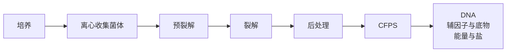
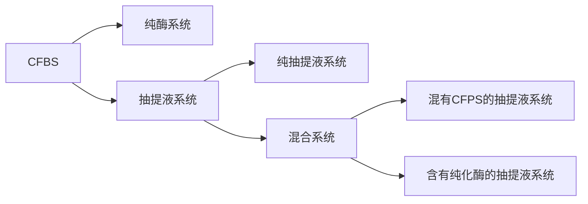
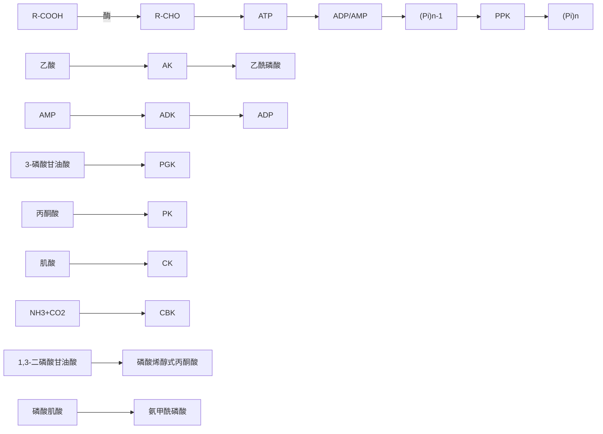
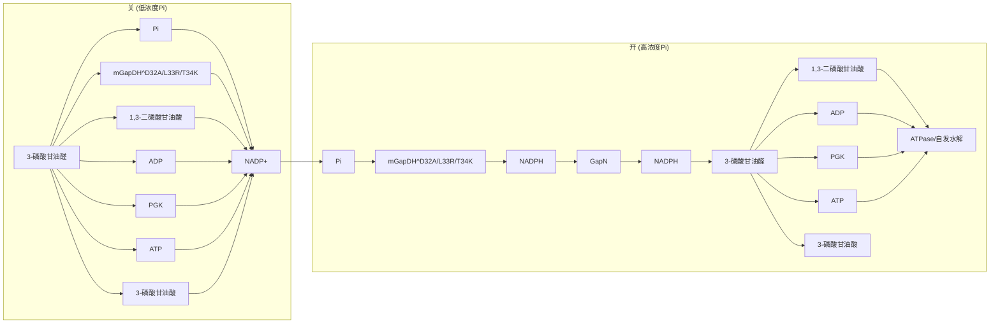
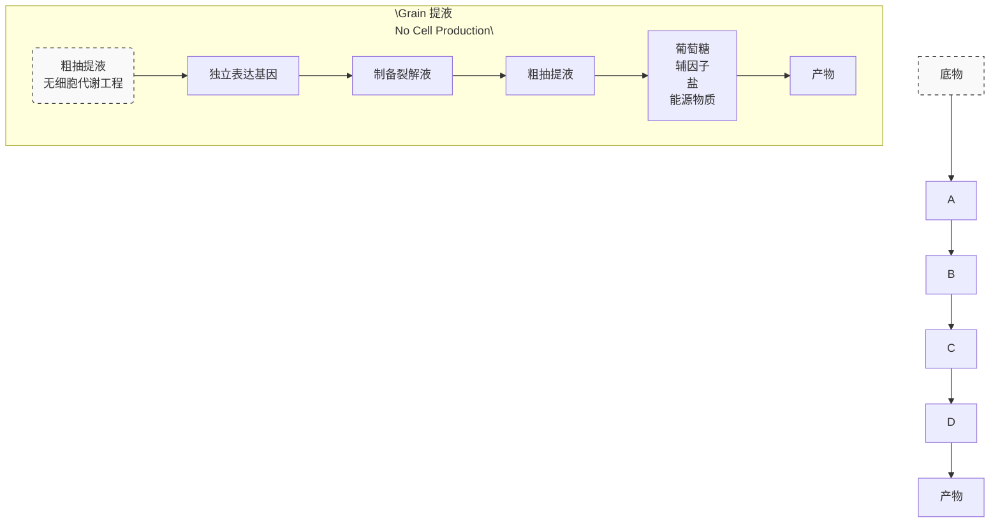
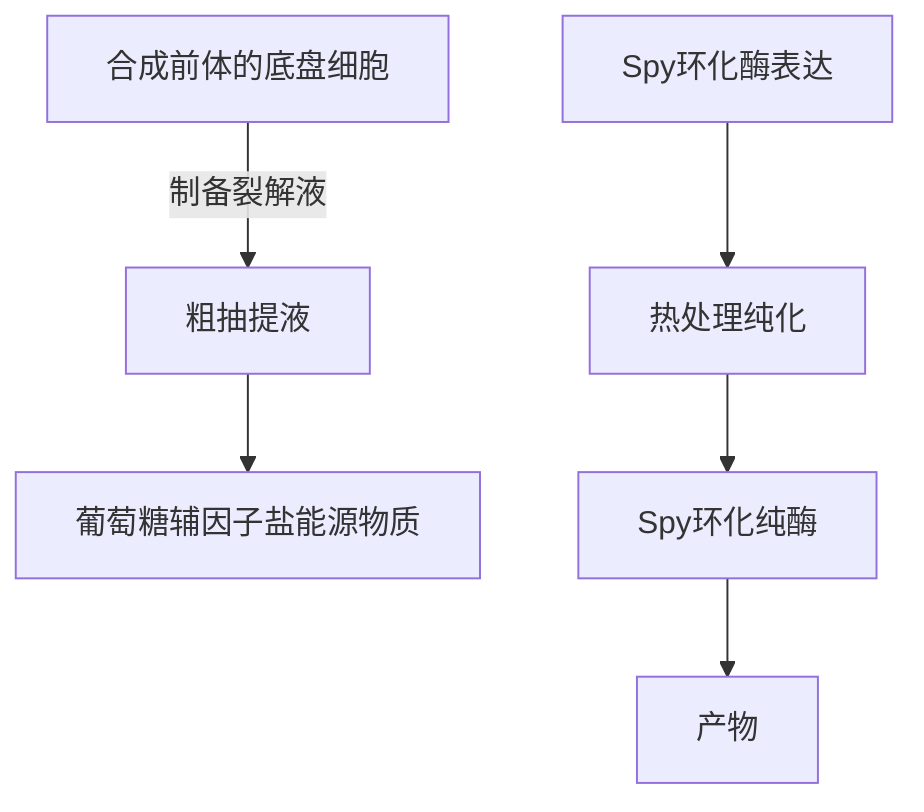
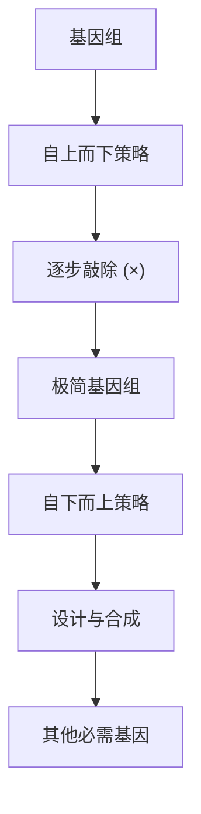
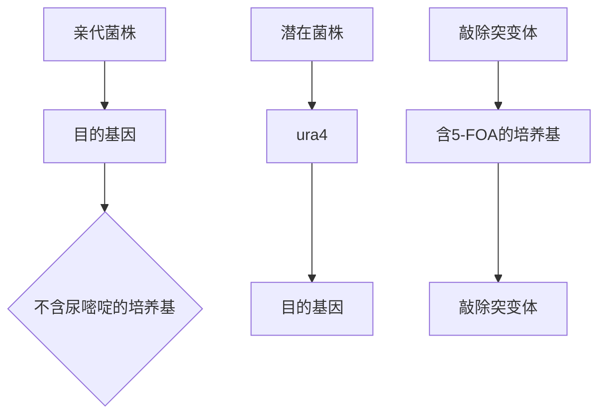

## （二）基于细胞抽提液无细胞系统

虽然纯系统成本已大幅降低，但酶的纯化及需要添加各种辅因子仍然限制了其应用。为此，美国西北大学的 Jewett 等提出了基于细胞抽提液无细胞系统。基于细胞抽提液无细胞系统具有如下三个优点:一是与纯系统相比，不须纯化，使制备成本较低；二是抽提液存在辅因子再生系统；三是抽提液存在天然的代谢活性。

细胞抽提液无细胞蛋白质合成的基本流程如图 4-11 所示。首先进行细胞的大量培养；然后在低温条件下离心收集菌体；接着进行预处理提高细胞破碎效果；其后将菌体重悬在裂解液中进行细胞破碎，进行后处理去除细胞碎片；最后加入到无细胞蛋白质合成反应液中进行无细胞蛋白质合成。

flowchart

图 4-11 细胞抽提液无细胞蛋白质合成的基本流程

目前已成功开发了许多生物抽提液系统，如大肠杆菌、恶臭假单胞菌、链霉菌、巨大芽孢杆菌、枯草芽孢杆菌、古细菌、酿酒酵母、毕赤酵母、烟草细胞、小麦胚芽、昆虫、中国仓鼠细胞（CHO）、HeLa 细胞和兔网织红细胞等。这些系统存在各自的优缺点，可根据目的蛋白类型选择合适的抽提物。一些非模式细胞的抽提物无细胞系统虽然还没开发或广泛应用，但未来极有可能成为无细胞系统快速创新单位源泉。

大肠杆菌因其生长速度快、易于培养、具有清楚的遗传背景等原因，已成为构筑应用最为广泛的 CFPS 系统。大肠杆菌抽提液无细胞蛋白质合成系统由 33%（V/V）大肠杆菌抽提液和 66%（V/V）含营养物质的反应缓冲液组成。大肠杆菌抽提液无细胞蛋白质合成系统已越来越成熟，该系统菌株培养周期短，裂解液制备简单，能够高通量地表达蛋白质，目前分批培养时蛋白质表达水平已达 4g/L[32]。

美国西北大学 Jewett 团队建立了用于代谢工程的高活性大肠杆菌抽提液的制备方法，详见Methods in Enzymology [33]。简单来说，培养诱导表达目标途径酶、离心收集菌体并用冷 S30 缓冲液［10mmol/L Tis-乙酸（pH 8.2）、14mmol/L 乙酸镁、60mmol/L 谷氨酸钾、2mmol/L 二硫苏糖醇］洗涤 2～3 次，按每克湿菌体 1mL S30 缓冲液的比例重悬菌体，超声破碎，于 12 000×g、4℃条件下离心去除细胞碎片，按每管 100～200mL 分装于 1.5mL 离心管中，液氮速冻并于−80℃保藏。抽提液可在−80℃保存一年，而且至少可以进行 5 次的反复冻融而不会受损。

随后，Jewett 团队建立了基于大肠杆菌抽提液的 CFPS 系统。该系统利用磷酸烯醇式丙酮酸（PEP）为能源物质，其 CFPS 反应液包括 1.2mmol/L ATP、0.850mmol/L GTP、0.850mmol/L UTP、0.850mmol/L CTP、31.50µg/mL 叶酸、170.60µg/mL tRNA、0.40mmol/L NAD、0.27mmol/L CoA、4.00mmol/L 草酸、1.00mmol/L 丁二胺、1.50mmol/L 亚精胺、57.33mmol/L HEPES 缓冲液、10mmol/L 谷氨酸镁、10mmol/L 谷氨酸氨、130mmol/L 谷氨酸钾、每种天然氨基酸浓度为2mmol/L 的混合液、0.03mol/L 磷酸烯醇式丙酮酸、33.3%（V/V）大肠杆菌抽提液。详细步骤参见 Levine 等发表在 Journal of Visualized Experiments 上的文献[34]。

美国加州理工大学又提出了基于 3-磷酸甘油醛（3-PGA）的大肠杆菌抽提液的 CFPS 系统，其 CFPS 反应液包括蛋白质浓度为 8.9～9.9mg/mL 的抽提液、4.5～10.5mmol/L 谷氨酸镁、40～160mmol/L 谷氨酸钾、1mmol/L 二硫苏糖醇、1.5mmol/L 天然氨基酸、1.25mmol/L 亮氨酸、50mmol/L HEPES、1.5mmol/L ATP 和 GTP、0.9mmol/L CTP 和 UTP、0.2mg/mL tRNA、0.26mmol/L CoA、0.33mmol/L NAD、0.75mmol/L cAMP、0.068mmol/L 叶酸、1mmol/L 亚精胺、30mmol/L 3-磷酸甘油醛、2% PEG-8000。详细步骤参见 Sun 等发表在 Journal of Visualized Experiments 上的文献[35]。随后，他们在反应体系中增加 60mmol/L 麦芽糊精和 30mmol/L D-核糖作为能量物质，建立了 3.0 版本的 CFPS 系统，使分批培养时 CFPS 的蛋白质表达水平达 4g/L[32]。

然而，大肠杆菌抽提液 CFPS 系统缺乏翻译后修饰系统、内源膜结构和有效的分子伴侣，使其合成真核蛋白具有局限性，因此需要开发其他的提取物系统。

酿酒酵母作为重要的模式生物和微生物细胞工厂，已广泛应用于代谢工程和合成生物学研究中。酿酒酵母抽提物因制备简单，能够实现翻译后糖基化修饰和正确折叠，是真核 CFPS系统的重要底盘细胞。酿酒酵母抽提物制备的基本流程为:将酿酒酵母通过离心使细胞沉淀，用甘露醇缓冲液洗涤培养；之后再用甘露醇缓冲液洗涤 3 次，去除多余的培养基，将细胞沉淀、重悬至裂解液中，然后用玻璃珠搅拌或均质器进行细胞裂解；随后裂解物通过透析或快速蛋白质液相层析（fast protein liquid chromatography，FPLC）进行纯化，在液氮环境中快速冷冻，并置于−80℃条件下保存。酿酒酵母抽提物系统的优点是抽提液的制备和翻译后修饰简单、快速，可以实现如糖基化的翻译后修饰，能合成难以在体外合成的病毒样颗粒和医药蛋白质，但不能实现哺乳动物内复杂的翻译后修饰，且蛋白质产量低。

## 三、无细胞生物合成

无细胞生物合成（cell-free biosynthesis，CFBS）又称无细胞代谢工程，是将生物合成途径中的各种酶加入到无细胞合成系统中进行生物合成小分子的过程。根据酶的形式可分为纯酶系统和抽提液系统，抽提液系统又包括全部为抽提液的纯抽提液系统和含有部分 CFPS 或纯化酶的抽提液系统（图 4-12）。

flowchart

图 4-12 无细胞生物合成

与微生物发酵相比，无细胞生物合成系统具有如下优势。

1）产率高。由于消除了中间产物的副途径竞争和微生物发酵过程中维持细胞存活所需的资源损失，因此可以获得较高的产品产量。
2）反应速率快。由于没有限制传质的细胞膜，而且在无细胞生物合成系统中增加酶载量

或底物载量也很容易，因此无细胞生物合成系统的反应速率总是比微生物发酵系统快。

3）可耐受有毒的环境。由于酶通常比微生物更能耐受有毒化合物和产物，许多无细胞生物合成系统可以在微生物无法生存的有毒环境中工作。
4）工程改造灵活。与微生物发酵系统的复杂性相比，无细胞生物合成系统可以很容易地进行改造或工程设计，以提高系统性能。
5）可以实现微生物发酵无法完成的生物转化。

## （一）纯酶系统

纯酶系统就是利用纯酶进行无细胞生物合成，也称为体外合成酶生物系统（in vitro synthetic enzymatic biosystem）。

纯酶无细胞生物合成往往被分为两步生物转化:首先通过发酵生产、纯化制备纯酶；然后以一锅法进行体外多酶生物催化合成产物。需重点关注的问题包括原料成本、酶和辅因子成本、产品滴度和生产率等，其中关键因素是酶的生产、纯化、稳定性及辅因子成本。因此，虽然纯酶无细胞生物合成系统具有接近理论产品产量、更快的反应速度、减少有毒化合物的干扰及前所未有的工程化水平等优势，但酶和辅因子的成本限制了其工业化应用。

构建纯酶无细胞生物合成的策略是“路线设计-元件招募-系统测试-系统优化”循环:①根据初始底物和目标产物，设计反应路线，从热力学角度对反应路线进行可行性分析；②寻找合适的酶元件的来源，对酶进行制备和表征；③进行实验验证，检测产物的生成；④系统优化反应条件，研究反应系统的适配问题，以确认反应系统的物质流瓶颈。

合成途径的设计是体外无细胞生物合成的核心。合成途径设计的核心是:①途径设计；②酶的选择；③辅酶的设计与再生。原子经济性是合成途径设计的准则，可以考虑以下几点以满足原子经济性的需要:①选择与产物结构类似的起始原料，以提高原料的利用率；②设计理论转化率高的合成途径，以提高原料的转化率；③选用合适的酶元件，以提高反应的催化效率。经过上亿年的进化，生物体内进化出一系列特异性强、转化率高的代谢合成路线，因此，现有的自然代谢途径是设计体外合成途径线路的首选。在没有现成路线的情况下，设计目标分子的合成途径是一个挑战，此时可借鉴有机化学合成中的逆合成手段，从目标化合物分子开始，推导其前体和中间物。目前已成功开发出一些计算工具，如 RetroPath。由于辅酶昂贵且不稳定，在设计合成途径路线时，最好是设计无辅酶或辅酶平衡的途径路线。

整个生物合成的效率取决于每个酶元件。酶元件既要有高催化活性和更好的稳定性，又需要保持较强的底物特异性以避免交叉反应和副产物的产生，还需要在宿主细胞中高可溶性表达，以降低制备酶的成本。热稳定酶是构建无细胞生物合成系统的又一个关键所在，选择热稳定酶有利于降低无细胞生物合成的生产成本、增加生产效率。一般来说，可以采用三种策略来选择热稳定酶:从（超）嗜热微生物中挖掘和发现酶、蛋白质工程和酶固定化。最好和最简单的是从嗜热微生物中挖掘热稳定酶。当酶学数据库和文献中无法找到热稳定酶时，理性、半理性或定向进化策略可用以增强酶的稳定性。酶的固定化是提高酶稳定性的经典方法，酶固定化不仅可以提高酶的稳定性，还可以促进酶/产物分离和酶的回收再利用。此外，低生产污染和低过敏性也是固定化酶的优势，尤其对多酶系统进行多酶共固定化是一种有发展前景的策略。此时，多酶共固定化的稳定性取决于最不稳定的酶，多酶的比例决定了共固定化多酶系统的效率。由此可看出，微胶囊（microcapsule）是多酶共固定化的最佳选择，可以不用考虑酶的大小、固定化率和固定化多个酶的比例，直接将多酶按比例包覆在胶囊中。仿生矿化微胶囊因生物相容、亲水、机械强度高、制备条件温和，是一种较好的多酶共固定化材料。为了降低生产成本，体外无细胞生物合成系统对酶的纯度要求不高，可以采用纯度相对较低的酶。因此，可采用低成本的酶纯化技术，如硫酸铵沉淀、镍柱亲和纯化或热稳定酶的热沉淀，而不必使用昂贵的色谱分离法。

在设计合成途径路线无法避免辅酶时，因辅酶价格昂贵，就必须利用辅酶再生系统来平衡辅酶。常见的辅酶有 NADH、NADPH、ATP、硫胺素、吡哆醛及其衍生物、泛酸和叶酸等。烟酰胺类辅酶和 ATP 再生系统的应用最为广泛。烟酰胺类辅酶主要包括氧化型辅酶 NAD(P)+及还原型辅酶 NAD(P)H 四种。再生系统又分为还原型辅酶再生系统（图 4-13A）和氧化型辅酶再生系统（图 4-13B）。常用的还原型辅酶 NAD(P)H 再生的酶主要有醇脱氢酶（alcohol dehydrogenase，ADH）、葡萄糖脱氢酶（glucose dehydrogenase，GDH）、甲酸脱氢酶（formate dehydrogenase，FDH）、亚磷酸脱氢酶（phosphite dehydrogenase，PDH）和氢酶（hydrogenase）等。常用的氧化型辅酶 NAD(P)+再生的酶有乳酸脱氢酶（lactate dehydrogenase，LDH）、NAD(P)H 氧化酶［NAD(P)H oxidase，NOX］、谷氨酸脱氢酶（glutamate dehydrogenase，GluDH）、羰基还原酶（carbonyl reductase）。相对于 NADP，NAD 价格较低且相对稳定。因此，将天然的 NADP 依赖性酶改变成 NAD 依赖性酶，有助于提高纯酶无细胞生物合成系统的稳定性。张以恒团队成功地将极端嗜热的海栖热袍菌（Thermotoga maritima）的磷酸戊糖途径的 6-磷酸葡萄糖脱氢酶（ glucose 6-phosphate dehydrogenase ， G6PDH ） 和 6- 葡 糖 酸 脱 氢 酶 （ 6-phosphogluconate dehydrogenase，6PGDH）的 NADP+依赖性转变为 NAD+依赖性，分别得到突变体 mG6PDH（S33E/R65M/T66S）和 m6PGDH（N32E/R33I/T34I）[36,37]。开发价格低廉的人工辅酶并对相应酶进行辅酶偏好性改造是降低纯酶系统成本的另一种策略。目前已报道了多个人工辅酶及其相应的酶元件，如氟代胞嘧啶二核苷酸（nicotinamide flucytosine dinucleotide，NFDC）的苹果酸脱氢酶（malate dehydrogenase）或苹果酸酶（malate enzyme），烟酰胺胞嘧啶二核苷酸（nicotinamide cytosine dinucleotide，NCD）的亚磷酸脱氢酶，烟酰胺单核苷酸（nicotinamide mononucleotide，NMN）的醇脱氢酶等[38]。在构建无细胞合成途径的过程中，有时难以通过简单的途径设计使辅酶消耗与再生实现平衡。为此，Bowie 团队提出了净化阀（purge valve）模块使 $\mathrm { N A D P ^ { + } }$ 与 NADPH实现平衡（图 4-14）[39]。该模块包含 3 种酶元件，分别为依赖 $\mathrm { N A D P ^ { + } }$ 的突变型丙酮酸脱氢酶PDH，依赖 NAD+的野生型 PDH，以及仅能消耗 NADH 的 NADH 氧化酶（NADH oxidase，NoxE）。当系统中 NADPH/NADP+值较低时，控制阀处于关闭状态，利用 NADP+依赖型 PDH 生成乙酰辅酶 A，同时产生 NADPH；当系统中 NADPH/NADP+值升高时，控制阀被打开，NADPH依赖型 PDH 的活性受到高浓度 NADPH 的抑制，利用 NADH 依赖型 PDH 合成乙酰辅酶 A，而NoxE 消耗了所产生的 NADH，既保证了系统中 NAD+的再生，又避免了无用的 NADH 的积累。

图 4-13 烟酰胺辅酶再生系统

A. 还原型；B. 氧化型；KRED. 羟基还原酶

图 4-14 净化阀控制 NADPH

三磷酸腺苷（ATP）是一种高能磷酸化合物，通过与二磷酸腺苷（ADP）的相互转化实现能量的贮存和释放，为生物体提供能量。在设计体外合成途径时，最好被设计成不需要 ATP或尽可能少使用 $\mathrm { A T P } _ { \circ }$ 由于 ATP 价格昂贵，在需要 ATP 参与的体外合成系统中，需要构建 ATP再生系统。目前用于 ATP 再生的激酶主要有多磷酸激酶（polyphosphate kinase，PPK）、乙酸激酶（acetate kinase，AK）、腺苷酸激酶（adenylate kinase，ADK）、3-磷酸甘油酸激酶（3-phosphoglycerate kinase，PGK）、丙酮酸激酶（pyruvate kinase，PK）、肌酸激酶（creatine kinase，CK）和氨基甲酸激酶（carbamate kinase，CBK）等（图 4-15）。其中以 PPK 和 ADP的再生系统应用最为广泛。PPK 的稳定性好，再生系统所需辅底物多聚磷酸盐成本低、来源广泛。PPK 主要分为 PPK1 和 PPK2 两大类，PPK1 合成 ATP 方向的平衡常数 $K _ { \mathrm { e q } }$ 低，但其热稳定性好，如大肠杆菌和细长热合胞球菌（Thermosynechococcus elongatus）的 PPK1 已成功用于体外 ATP 再生。PPK2 合成 ATP 方向的平衡常数 $K _ { \mathrm { e q } }$ 高、催化效率高及分子量小，应用更为广泛。PPK2 又分为三小类[40]:①PPK2-Ⅰ，底物是 ADP，如来源于浑球红假单胞菌（Rhodobacter sphaeroides）的 PPK2-Ⅰ；②PPK2-Ⅱ，底物是 AMP，必须与腺苷酸激酶或其他PPK 一起工作以实现 ATP 再生，如来自约氏不动杆菌（Acinetobacter johnsonii）的 PPK2-Ⅱ；③PPK2-Ⅲ，底物既可以是 ADP，也可以是 AMP，如来自溶蛋白芽球菌（Deinococcus proteolyticus）的 PPK2-Ⅲ。乙酸激酶由于具有辅底物价格低和稳定性高的优点，也是一种常用的 ATP 再生策略。腺苷酸激酶的辅底物是 ADP，不需要其他辅底物，也常用于 ATP 再生，且 常 和 多 磷 酸 激 酶 （ PPK2- Ⅱ ） 或 多 磷 酸 AMP 磷 酸 转 移 酶 （ polyphosphate AMP phosphotransferase，PPT）进行级联用于 ADP/AMP 循环。虽然经过精心设计，可以使辅酶的消耗与再生实现化学计量的平衡，但是 ATP 的自发水解，以及难以完全去除的 ATP 水解酶对ATP 的消耗等，导致 ATP 的实际消耗大于理论值。因此，在体外生物合成系统长时间运转后，往往会出现体系中辅酶浓度逐渐降低的状况，影响了反应效率。针对 ATP 降解问题，Bowie团队等提出了一个 ATP 变阻器模块（图 4-16）[41]。该模块包括磷酸化的嗜热脂肪地芽孢杆菌（ Geobacillus stearothermophilus ） 的 3- 磷 酸 甘 油 醛 脱 氢 酶 （ WP\_033015082 ） 突 变 体mGapDHD32A/L33R/T34K、非磷酸化的变形链球菌（Streptococcus mutans）的 3-磷酸甘油醛脱氢酶（NP\_721104）和嗜热脂肪地芽孢杆菌的磷酸甘油激酶（WP\_033015089）。体系中磷浓度将决定变阻器模块的运行模式。当磷浓度低时，运行非磷酸化磷酸甘油醛脱氢酶（GapN）支路，3-磷酸甘油醛经非磷酸化脱氢合成 3-磷酸甘油酸和 NADPH，此时无 ATP 合成；当 ATP 经副反应水解导致磷浓度高时，mGapDHD32A/L33R/T34K 发挥作用，3-磷酸甘油醛经磷酸化脱氢生成1,3-二磷酸甘油酸，然后在磷酸甘油酸激酶的作用下生成 3-磷酸甘油酸和 ATP，产生额外的ATP 以弥补损耗，从而使体系中 ATP 浓度维持在一个稳定水平。

flowchart

图 4-15 ATP 再生系统

flowchart

图 4-16 ATP 变阻器

众所周知，生物体内的代谢过程由多酶协同完成，胞内蛋白质浓度高，胞内酶高度有序地聚集在一起形成多酶复合体，其催化反应高度有序，从而提高其催化效率。而体外生物合成系统中，酶浓度低、高度分散。因此，借鉴天然宿主的这种特性，在体外合成系统中，对多酶进行空间组织，构建人工多酶复合体，产生底物通道效应，减少中间产物的扩散，从而提高整体反应效率，避免副反应，消除中间产物的抑制等。目前比较常见的多酶空间组织技术，包括连接肽、蛋白质支架、DNA 支架和相分离区室化等[42]。

张以恒团队创建了一个非天然合成酶途径，成功地将预处理后的生物质酶解后转化为淀粉，该途径包括枯草芽孢杆菌（Bacillus subtilis）内切葡聚糖酶（BsCel5A）、木霉（Trichoderma spp.）纤维二糖酶（TrCel7A）、嗜热梭菌（Clostridium thermocellum）纤维二糖磷酸化酶和马铃薯 α-糖苷磷酸化酶[43]。Bowie 团队构建了含有 26 个酶反应的无细胞系统，可将 92%的地高辛酸转化成大麻酚酸，大麻酚酸产量达到 1.74g/L[44]。马延和团队采用了类似“搭积木”的方式，从头设计、构建了包括 11 步反应的非天然固碳与淀粉合成途径[45]。具体来说，首先根据碳原子个数将该途径分为 4 个不同的模块（C1、C3、C6 和 Cn 模块）；随后在计算途径设计软件/网站的指导下，通过选择和组装来自 31 个生物体的 62 种酶来构成 10 个核心酶催化反应；接着对瓶颈酶进行定向进化；最后结合化学催化 $\mathrm { C O } _ { 2 }$ 生成甲醇，使淀粉的最终产率达到410mg/（L·h），为传统农业生产玉米淀粉的 8.5 倍。他们团队基于碳素缩合、异构、脱磷等酶促反应，建立了化学-酶级联转化二氧化碳合成己糖的人工合成途径，通过酶分子改造技术提升了天然酶活性、底物特异性等催化性能，构建了 C1-C3-C6 三个功能模块，在体外实现了精准控制合成不同结构与功能的己糖[46]。

## （二）抽提液系统

为了降低酶制备和纯化的成本，细胞抽提液也已成功用于无细胞生物合成。所有的途径酶都可以利用抽提液从而构建纯抽提液的无细胞生物合成系统，也称为无细胞代谢工程（cell-free metabolic engineering，CFME）。途径酶可以通过构建代谢工程菌在一个宿主菌中表达，制备抽提液；也可单独分开在不同菌中进行表达，分别制备抽提液。Jewett 团队提出了一个每个基因单独表达、制备各自的抽提液，然后混合在一起添加到无细胞合成反应液中，进行无细胞生物合成的方案（图 4-17）。在优化底盘细胞及反应系统后，20h 可合成甲羟戊酸 17.6g/L，时空产率达到 0.88g/（L·h）[47]。这种每个基因单独表达制备抽提液的 CFME，可充分利用无细胞的混合-配对（mix and match）功能，对途径酶原型化、筛选和优化。为此，他们又对该方法进行了总结和修正，成果发表在 Methods in Enzymology 上[33]。

flowchart

图 4-17 纯抽提液无细胞代谢工程

表达每个基因的重组菌抽提液浓度有限，导致在反应体系中每个基因编码的蛋白质浓度受限，从而影响生物合成效率。为此，Jewett 团队又提出了一个含有部分 CFPS 的混合系统（CFPS-CFME）[48]。该系统利用表达途径中部分基因重组菌的抽提液进行剩余基因的 CFPS，然后添加底物、NAD+和 CoA，进行 CFME，从而实现目标产物的合成。他们经研究发现，在CFPS 中目的蛋白浓度将超过 100mg/L，从而使以葡萄糖为原料合成 1-丁醇的产量由 CFME的 1.43g/L 增加到 CFPS-CFME 的 1.71g/L。

随后，中山大学刘建忠团队为了提高目的蛋白在反应体系中的浓度，利用 Spy 环化能使酶耐受，从而可以采用热处理纯化的特性，提出了一种基于底盘细胞抽提液与 Spy 环化纯酶混合液的无细胞合成系统（CFBS-mixture），并将其应用于绿原酸的合成[49]，如图 4-18 所示。CFBS-mixture 由底盘细胞抽提液和 Spy 环化纯酶组成。前者（底盘细胞抽提液）用于合成前体、辅因子和能量。后者（Spy 环化纯酶）将底盘细胞抽提液合成的前体被热处理纯化的 Spy环化酶催化转化成产物。应用该系统的绿原酸产量是采用传统粗抽提液系统的 22.4 倍。优化后，绿原酸产量提高到（711.26±15.63）mg/L。

flowchart

图 4-18 基于底盘细胞抽提液与 Spy 环化纯酶混合液的无细胞合成系统

## 第四节 基因组缩减

## 一、概论

基因组缩减是合成生物学中一个具有前景的研究方向，旨在通过精简细胞的基因组，提高细胞的生产效率、可控性和稳定性。了解以下核心概念有助于人们更好地理解基因组缩减的重要性，以及它如何为合成生物学开辟了新的研究和应用前景。

## 1. 底盘细胞

在合成生物学应用中，底盘细胞被选为工作模型细胞，它们作为基因工程和其他合成生物学技术的目标。这些细胞需能为合成的生物部件提供稳定和可预测的环境，确保这些部件能够有效地运行。例如，大肠杆菌（Escherichia coli）由于能快速生长、易于操作和具有丰富的分子生物学工具而成为一个常用的底盘细胞[50]。此外，在需要生产大分子或需要真核细胞生物合成途径的应用中，酿酒酵母（Saccharomyces cerevisiae）也是一个常见的选择[51]。

## 2. 基因冗余性

生物体的基因组通常存在基因冗余性。这指的是基因组中某些基因有多个副本，它们的功能可能是相似或重叠的。这样有助于生物体在面临环境压力时保持稳定。例如，细胞体内存在不同的酶可催化相同的反应，尽管它们在不同环境条件下的效率可能会有所不同[52]。因此即使其中一个酶的基因被敲除，另一个酶仍然能够继续执行其功能，从而确保细胞正常运行。

## 3. 必需基因与非必需基因

基因可根据其对细胞在特定环境中的生存和繁殖的重要性进行分类，分为必需基因和非必需基因。必需基因对细胞的生存和繁殖至关重要，如在大肠杆菌中存在的 DnaA 基因，它在 DNA 复制中起到关键作用，如果被敲除则细胞无法复制其染色体，进而无法繁殖。而非必需基因在某些环境中可能并不是关键的，但在其他环境中可能很重要。比如，某些细菌的非必需基因在营养充足的环境中可有可无，但在营养受限或受到压力时，它们的表达则对生存至关重要。例如，细胞的耐受基因在正常环境中可能不是必需的，但在暴露于抗生素或有毒物质时，它们变得非常关键。敲除非必需基因有利于基因组简化，避免不必要的能量和物质浪费。

## 4. 最小基因组

最小基因组是指一个细胞在最适宜的生长条件下，维持其生长和繁殖所需的最小基因集合。这个概念对于合成生物学尤其重要，因为它提供了一个目标，指导研究者如何通过去除非必需基因来简化一个生物体的基因组。J. Craig Venter 研究所在 2016 年合成了只含有 473 个基因的支原体（Mycoplasma mycoides），称为 JCVI-syn3.0[53]，这是能实现细胞活性的最小基因组。

## 5. 基因组缩减策略

基因组缩减的目标是系统地减少基因组中的基因数目，同时确保细胞仍能在特定条件下正常生存和发挥功能。通常遵循以下两个主要的策略方向。

自上而下策略:从复杂的生物体开始，逐步敲除非必需基因，直至得到一个最小的、能够维持生命活动的基因集合。这要求对细胞的生理和代谢有深入了解，并需精确的基因敲除技术。

自下而上策略:从零开始，根据对生命必需过程的了解，合成并组装基因，构建一个全新的、简化的生命形式。这种方法更为理论化，需要对生命基本过程有透彻的理解，以及高精确度的基因合成和组装技术（图 4-19）。

flowchart

图 4-19 自上而下和自下而上缩减基因组的策略对比（改自 https://2010.igem.org/Team:CBNU-Korea/Project）

## 二、典型微生物的基因组缩减（精简）

基因组缩减（精简）是合成生物学中的一种策略，旨在通过减少生物体基因组中的非必需基因来简化其遗传信息。这种简化可以使生物体在特定应用中变得更加高效，并有助于更深入地了解生命的基本原理。

为了实现基因组缩减，研究者首先需要确定哪些基因是必需的，哪些是冗余或非必需的。一旦确定，就可以使用多种基因编辑技术，如同源重组技术或 CRISPR-Cas9 技术[54]，以敲除选定的非必需基因。因此，基因组缩减涉及两个核心步骤:基因组的缩减设计和基因的敲除。

基因组的缩减设计是基因组缩减过程中的首要挑战。关键在于确定那些必需基因，这些基因对生物体的生存和繁殖至关重要。为了识别这些基因，研究者可使用多种技术和方法:比较基因组学是通过比较不同生物种类的基因组，确定那些在多个物种中都存在并且在进化过程中高度保守的基因；大规模失活实验是通过系统性地敲除细胞中的每一个基因，观察每次敲除后细胞的生长和繁殖能力，从而确定必需基因；基于代谢网络的预测方法则利用计算机模拟和数据分析，研究细胞代谢过程中各个基因的角色和重要性。

确定了要敲除的基因后，研究者使用多种方法进行基因敲除。同源重组法使用与目标基因序列相似的 DNA 片段，通过 DNA 的自然修复机制替换或删除目标基因。基于位点的特异重组酶法利用特定的重组酶，精确地在基因组的特定位置插入、删除或替换基因。转座子法则使用一个可以在基因组中移动的 DNA 序列—转座子，随机或特异地插入基因，从而破坏其功能。CRISPR 法则利用 CRISPR-Cas9 蛋白和 RNA 分子的组合，精确地定位并切割目标基因，从而将其失活。

以下是基因组缩减的常规工作流程:①对目标微生物的全基因组进行测序，并与已知的相关微生物基因组进行比较。此外，还可通过查阅文献来收集有关目标微生物基因功能的信息。②对天然基因进行分类，通过功能注释和比对，将基因分类为不同的功能类别，如代谢途径、应激反应、细胞周期控制等。③确认非必需基因、未知基因、有害基因。使用基因敲除或敲降实验，以及表型分析，确定哪些基因是非必需的、未知功能的或者可能有害的（如致病基因）。④进行基因簇的敲除。⑤确认非必需基因簇。在敲除了某一基因簇后，需要进行表型分析和生长曲线实验等，以确认这些基因簇的非必需性，并评估其对微生物生长和代谢的影响。⑥基因簇的组合敲除。在确认多个非必需基因簇后，可以尝试进行组合敲除，以实现更大范围的基因组缩减。⑦通过多轮的基因敲除和筛选，获得一个基因组显著缩减的菌株，即基因组缩减菌。随后，对基因组缩减菌进行全面的生物学和生理学特性分析，以确认其潜在的应用价值。这样的工作流程需要多学科的合作，包括基因组学、代谢组学、生物信息学和工程生物学等，以取得最优化的基因组缩减效果。

总体而言，基因组缩减不仅为人们提供了关于生命起源、复杂性和最基本功能的见解，还通过提高生物生产过程的效率，为生物技术和医学应用开辟了新的可能性。

## （一）大肠杆菌基因组的缩减

大肠杆菌由于其丰富的遗传信息、清晰的代谢途径和成熟的生物技术工具，成为合成生物学和基因组研究中的理想模型。尽管大肠杆菌的基因组相对较小和简洁，但仍然存在许多非必需基因。对这些基因进行敲除或缩减可以使其成为更加有效的生物生产平台，并有助于揭示其生命活动的基本原理。过去的研究已经对大肠杆菌基因组进行了较为详细的功能注释，鉴定出了大量的必需基因和非必需基因，这为其基因组缩减提供了基础。借助于如同源重组、CRISPR-Cas9 等基因编辑技术，研究者能够针对性地敲除或组合敲除一系列非必需基因，从而实现基因组的缩减。

但是大肠杆菌基因组缩减的过程并不简单。尽管某些非必需基因可以单独敲除而不影响细胞的正常生长，但当多个非必需基因组合敲除时，可能会导致生长速率减慢或代谢紊乱，这突显出基因之间的复杂交互关系和网络效应。因此，进行基因组缩减时必须权衡细胞的功能和其生产能力，再理解基于何种原则对基因进行选择并决定进行敲除。以下是构建一些大肠杆菌的基因组缩减菌时，采用的策略和设计原则。

1）MDS12 与 MDS42:由匈牙利的 Posfai 和美国的 Blattner 团队合作进行的研究[54]。该策略的核心是对于被认为与基本生命过程无关的特定基因区域进行敲除。基因组缩减菌MDS12 的构建策略涉及敲除 12 个被称为“K-islands”的基因区域，而菌株 MDS42 则进一步敲除了插入序列（insertion sequence，IS）。这些插入序列是转座元件，可以在基因组中移动，增加了遗传不稳定性。通过消除这些插入序列，可以增加细胞稳定性并减少基因重复。
2）△16:由日本的 Kato 团队开发构建[55]。他们基于文献中的报道，将大肠杆菌的基因分为三类:必需基因、非必需基因和未知基因。基于基因分类信息，采用无标记染色体缺失突变法，对 75 个长基因片段进行了单独的敲除，并成功地获得了同时敲除了 16 个片段（长1.38Mb，占基因组的 29.7%）的精简型大肠杆菌。
3）MS56:这项研究主要探讨了大肠杆菌基因组中的插入序列在生产重组蛋白时所带来的挑战[56]。插入序列会促使基因发生重排，从而导致基因组和重组质粒不稳定，不利于重组蛋白的生产。Kim 及其团队通过敲除插入序列、K-islands，以及与鞭毛、纤毛和脂多糖生产有关的基因，将 23%的基因组去除，得到一株无插入序列的基因组简化大肠杆菌 MS56。在 MS56菌株中未观察到在野生型 MG1655 中出现插入序列移动破坏重组蛋白编码序列的现象，表明菌株中不含插入序列增强了基因的稳定性，更适于表达生产重组蛋白。

4）MGF-01/DGF-298:2001 年，在日本启动了一个名为“最小基因组细胞工厂”（minimum genome factory，MGF）的项目[57]。研究人员将大肠杆菌与其有共同祖先的昆虫共生菌 Buchnera sp. APS 进行比较基因组分析，选定大肠杆菌中独有的基因作为候选基因进行敲除。此外，大肠杆菌在基础培养基中生长所需的必需基因和明显所需基因则被确定为不可或缺的。如果不可或缺基因之间的染色体区域包含超过 10 个基因，该区域被选为删除的候选区域。在最初的最小基因组设计中，选择了总长度为 1.8Mb 的 95 个区域进行删除。可独立地删除的候选区域被组合叠加，最终基因组大小减少了 22%（1.03Mb），并将该菌株命名为 MGF-01[58]。DGF-298则在 MGF-01 的基础上进一步精简基因组[59]，敲除的基因主要包括功能未知基因、有害基因（如插入序列、前噬菌体和毒素-抗毒素系统），以及与致病性大肠杆菌相比在 W3110 中特有的基因[60]。最终缩减后的基因组大小为 2.98Mb。

以上在构建基因组缩减菌（图 4-20）时采取的策略都突显了一个核心思想，那就是通过比较基因组学、功能性研究和现有的生物学知识，来确定并敲除那些非生存所必需的或对生产过程造成干扰的基因。这不仅有助于提高生产效率，还能更好地理解大肠杆菌中那些真正关键的基因和它们的功能。

text_image

2002
2005
2006
2013
2020
MG1655
MDS12
△16
MDS42
MS56
SimCell
4.64Mb
0.38Mb(8.1%)
1.38Mb(29.7%)
0.66Mb(14.3%)
1.07Mb(23%)
无染色体
W3110
2008
2013
2020
MGF-01
DGF-298
SimCell
4.64Mb
1.03Mb (22.2%)
1.66Mb (35.8%)
无染色体

图 4-20 基因组缩减菌的基因组缩减程度

下面以“只干活不增殖”的无染色体大肠杆菌为例进行介绍具体应用。

Fan 等以全新视角探究细胞工程技术，通过移除细胞的染色体，创建了一种全新、高度可编程的无染色体细胞，称为“简单细胞”（simple cell，SimCell）[61]。这些 SimCell（图 4-21）不仅可作为生物合成平台，而且具有广泛的应用潜力。研究团队成功地运用异源的 I-CeuI 内切酶进行双链 DNA 断裂，以及内源核酸酶的降解活性，从大肠杆菌、假单胞菌（Pseudomonas putida）和真氧产碱杆菌（Ralstonia eutropha）中去除了其原生染色体。实验数据显示，这些无染色体的 SimCell 不仅高度可编程，还能处理定制的基因线路，表达特定目标基因，并且能够合成多种蛋白质和代谢产物。

该研究不仅加深了对自然生命系统的理解，还为合成生物学未来的发展奠定了坚实基础。SimCell 由于无法自我复制（缺少染色体 DNA），降低了与工程微生物相关的生物安全风险，为合成生物学在多个敏感领域（如医疗、生物制造、农业和环境保护等）开拓了新的应用前景[61]。例如，它们可作为安全的微生物治疗剂，有效合成和递送具有针对肺癌、脑癌和软组织癌细胞抑制作用的强效抗癌药物，如酚类（catechol）。经实验发现，SimCell 能够持续表达合成基因线路长达 10 天，这主要得益于糖酵解途径（glycolysis pathway），该途径通过再生ATP 和 NADH/NADPH 来维持细胞活性。此外，SimCell 还可作为一种优化的生物合成底盘，用于安全地生产和递送产物，避免受到宿主基因组的影响。但需要注意的是，其有限的生命周期可能会影响持续生产或长期应用的效率。

图 4-21 SimCell 的构建特征[61]

GFP. 绿色荧光蛋白； $\mathtt { A m p ^ { R } } .$ 氨苄青霉素抗性标记； $\mathrm { K a n ^ { R } }$ 卡那霉素抗性标记； ${ \mathrm { S } } { \mathrm { p } } { \mathrm { e } } ^ { \mathrm { R } } .$ 壮观霉素抗性标记

## （二）其他微生物基因组的缩减

## 1. 谷氨酸棒杆菌

在一项研究中，Unthan 等采用自上而下策略，以谷氨酸棒杆菌（Corynebacterium glutamicum）ATCC 13032 为出发菌，构建一个适用于合成生物学应用的底盘细胞[62]。首先，基于 RNA 和 DNA 的测序数据及参考文献，研究团队详细分析了该菌株基因组内的所有基因。经分析识别出三类核心基因组，分别是物种核心、亚群核心和属核心。基于这些基因组分类，更精确地确定了基因的保守性。在 435 个已经被实验确认为必需或非必需的基因中，近半数（44%）的严格保守基因被鉴定为必需。这些信息为确定哪些基因可能是必需或非必需提供了重要参考，从而有助于精确选择目标基因簇进行删除。

基于这些分析，研究团队找到了 41 个长度在 3.7～49.7kb 的目标基因簇用于删除，其中36 个基因簇被成功删除。观察到其中 10 株基因组缩减菌（genome-reduced strain，GRS）在生物学适应性评估时表现出明显较慢的生长速率 $(   \mu _ { \mathrm { m a x } }   )$ ，尤其是在 CGXII 培养基中。经过进一步的分析发现有 5 株生长较慢的 GRS 的生物量得率（ $\left( \; Y _ { \mathrm { X / S } } \; \right)$ 也更低，表明至少一个或多个基因在该培养基的菌株生长中发挥了一定的作用。然而，其他 26 株 GRS 的生长速率与野生型基本相同，表明这些基因簇与这些培养基中菌株的生长无关。在讨论底盘细胞与最小细胞的概念时，研究强调了底盘细胞应该保留更多的基因，以维持其在特定条件下（如在已知成分培养基上）的生物适应性（biological fitness）。因此，理论上通过组合删除这 26 个与生物适应性无关的基因簇，有望将 C. glutamicum 的基因组大小减少约 22%（722kb），降至 2561kb。

该研究成功地构建了 C. glutamicum 的基因组蓝图，并展示了如何通过针对性的基因删除来构建一个底盘细胞，为未来在合成生物学中的应用提供有力的工具和实践路径。但由于研究主要集中在 ATCC 13032 这一菌株上，一些现象和结论可能不适用于其他 C. glutamicum 菌株。可进一步探究这一菌株在不同环境和应用场景下的性能，以便为未来的工程应用提供更多的可行方案[62]。

## 2. 枯草芽孢杆菌

1997 年，枯草芽孢杆菌（Bacillus subtilis）的完整基因组 DNA 序列（4.2Mb）完成测序，共鉴定出 4100 个基因[63]。Ara 等研究人员基于枯草芽孢杆菌基因组的信息，对其基因组及生物调控系统进行简化[64]。首先，对枯草芽孢杆菌中大约 3000 个基因（排除了 271 个必需基因）进行了单独敲除，以识别在蛋白质（酶和抗生素等）生产中的非必需基因。在这一系列研究的基础上，研究人员连续删除了 17 个被认为是非必需的基因区域，成功地创建了一个名为MG1M 的新菌株，其基因组大小减少了大约 1Mb。MG1M 菌株在产酶培养基中的生长速率略有下降，但其形态没有明显变化。更重要的是，MG1M 菌株在纤维素酶和蛋白酶的生产能力上与原始菌株 B. subtilis 168 几乎持平。这一结果不仅证明了基因组减小并没有对酶生产能力产生负面影响，反而可能有助于更高效地生产蛋白质。

Stülke 团队及合作者成功创造出基因组更为精简的枯草芽孢杆菌新菌株，名为 PG10 和PS38 菌株[65]。新菌株的基因组相较于原始菌株减少了约 36%；PG10 仅含 2700 个基因，PS38仅含 2648 个基因。这两株菌缺少了 8 个主要的分泌型枯草芽孢杆菌蛋白酶基因，这些蛋白酶基因之前被认为是异源蛋白生产的主要瓶颈。该研究还通过强化一个用于提高遗传能力转录因子 ComK 的表达，克服了基因组精简可能导致的遗传能力下降问题。通过删减了多余和非必要的基因，“迷你枯草芽孢杆菌”（mini Bacillus）PG10 不仅能更高效地生产蛋白质，还能解决与蛋白质分泌和稳定性有关的瓶颈问题。尤其在生产那些容易受到蛋白酶破坏和难以通过一般的枯草芽孢杆菌菌株分泌出来的“难表达蛋白”方面具有潜在的应用价值[66]。

## 3. 阿维链霉菌

Komatsu 等选用工业微生物阿维链霉菌（Streptomyces avermitilis）作为出发菌株，系统地删除了其基因组中的非必需基因，以期构建一个用于异源表达次级代谢物基因的多功能模式菌株[67]。通过从 9.02Mb 线性染色体上逐步删除超过 1.4Mb 的区域，研究人员成功得到了一系列的突变体（图 4-22）。这些突变体所含基因组为原始基因组的 81.46%～83.20%，并且不生成亲本菌株中的主要内源性次级代谢产物。阿维链霉菌因其在主要代谢途径和生物化学能量供应方面的优化，被认为是异源生产次级代谢物的合适宿主。通过异源表达三个不同来源[灰色链霉菌（Streptomyces griseus）、带小棒链霉菌（S. clavuligerus）和扁平链霉菌（S. platensis）]的外源生物合成基因簇，证明了这些突变体适用于作为外源代谢物高效生产的菌株。其中，异源表达链霉素（streptomycin）和头孢霉素 C（cephamycin C）基因簇的单个转化体合成这两种化合物的能力，均高于相应的原生产菌种。由于大规模的基因组缩减消除了 78%的潜在转座酶基因，进一步提高了这些突变体的基因稳定性，使其成为合成内源性产物和表达异源途径合成次级代谢产物的理想菌株。该研究突显了工程化精简基因组的阿维链霉菌作为异源表达模式菌株的高效及灵活性。

other

| 菌株 | 基因组大小 (ORF) /bp | A | B | C | D | E | F | G1 | H | I | J | K | L | M | N | O | P | Q | R | S | T | U | V |
| --- | --- | --- | --- | --- | --- | --- | --- | --- | --- | --- | --- | --- | --- | --- | --- | --- | --- | --- | --- | --- | --- | --- | --- |
| 野生型 | 9025608 (7582) | A | L | P | C | O | M | Q | V | J | K | N | X | E | G1 | H | L | R | I | B | F | S | G2 |
| SUKA2 | 7502169 (6375) | W' | P | C | O | M | Q | V | J | K' | N | X | E | G1 | H | L | R | I | B | F | S | G2 | T |
| SUKA3 | 7509588 (6360) | WY | P' | C | O | M | Q | V | J | K | N | X | E | G1 | H | L | R | I | B | F | S | G2 | T |
| SUKA4 | 7440509 (6365) | W' | P | C | O | M | Q | V | J | K' | N | X | E | G1 | H | L | R | I | B | F | S | G2 | T |

图 4-22 阿维链霉菌野生型及其大片段删除突变体的基因组经限制性内切酶 AseⅠ处理的物理图谱[67]

## 4. 裂殖酵母

裂殖酵母（Schizosaccharomyces pombe）的基因组在真核生物中属于最小的基因组之一。Sasaki 等采用了一种称为 Latour 系统（latency to universal rescue system）的方法（图 4-23）进一步进行大规模基因删减来识别实验室条件下裂殖酵母生长所需的最小基因集[68]。在经过基因组缩减的裂殖酵母中，共有 4 个删除区域，这些删除区域大小分别为 168.4kb、155.4kb、211.7kb 和 121.6kb，位于染色体Ⅰ和Ⅱ的左臂和右臂，合计删减了 657.3kb ①和 223 个基因。

flowchart

图 4-23 Latour 系统[69]

5-FOA. 5-氟乳清酸

<small>① 657.3kb 是引用原文献中的数据；不确定是原文作者的加和有误，还是在进行 4 个数据加和时，使用的是原始数据而非保留小数点后 1 位有效数字的数据，如果是原始数据加和，则结果会偏大，所以本书与原文献数据保持一致</small>

与亲本株相比，该基因组缩减菌的葡萄糖和某些氨基酸的摄取能力有所下降；但胞内的 ATP浓度增加了 2.7 倍，增加的 ATP 可能有助于氨基酸生物合成反应的激活，但具体机制尚未明确。它在表达异源的增强型绿色荧光蛋白和分泌型人生长激素的水平分别增加了 1.7 倍和 1.8倍。这表明基因组缩减菌在基因组和基因数量减少的同时，仍能维持生长速率。该研究为进一步研究最小生命体系统及生物制造提供了有用信息。

# 第五节 基因组合成

## 一、总概

在基因组合成领域的早期发展阶段，特别是在 20 世纪 70 年代到 80 年代，研究主要集中在单一基因的合成和表达上。1972 年，Har Gobind Khorana 团队的突破性成果—首次合成一个完整的功能性基因，为后续更复杂的基因合成实验铺平了道路[70]。随着技术的发展，科学家开始能够合成更长的 DNA 片段，进一步扩大了基因组合成的可能性。20 世纪 90 年代，聚合酶链反应（polymerase chain reaction，PCR）等技术和工具的广泛应用，尤其是该技术在1993 年获得诺贝尔化学奖后，使得基因复制和合成变得更加高效和精确。这一时期也标志着研究人员从关注单一基因转向对整体生物系统的理解和改造。随着测序技术的飞速发展，大型基因组测序项目如人类基因组计划为基因组合成提供了丰富的“原材料”和理论参考。因此，20 世纪 70 年代至 90 年代，可被视为基因组合成从基础研究到成熟应用的过渡期，这期间的技术和理念进步为 21 世纪的突破性研究奠定了坚实的基础。

在 21 世纪初，基因组合成领域达成了许多重要的里程碑。Eckard Wimmer 的研究团队在2002 年成功地合成了脊髓灰质炎病毒的基因组[71]。此项成果不仅揭示了从零开始合成基因组的潜能，也激起了深入的社会与伦理思考，尤其是关于人类具备合成可能带来危险的病毒的能力这一议题。2003 年，J. Craig Venter 团队成功地合成了 ΦX174 噬菌体的基因组[72]，并用其成功感染了细菌，标志着基因组合成进入了一个新的阶段。然而，即使成功合成了噬菌体基因组，合成更大、更复杂的生物体基因组仍面临许多挑战，但这些挑战在科研人员的努力下都已逐一被克服。2008 年，J. Craig Venter 团队通过化学合成、体外重组连接和体内克隆组装的方式，合成了生殖支原体（Mycoplasma genitalium）共 582.97kb 的基因组；这个合成基因组被命名为 M. genitalium JCVI-1.0，它包含了野生型 M. genitalium G37 中除 MG408 基因外的所有基因[73]。2010 年，J. Craig Venter 团队成功地创建了第一个完全由人工合成的基因组驱动的生命体—丝状支原体（Mycoplasma mycoides）JCVI-syn1.0[74]。这一成就不仅再次吸引了全球的关注，也引发了一系列关于生命本质、伦理和法律问题的讨论。此外，2001～2010 年也见证了合成生物学作为一个独立学科的崛起。这一新兴领域不仅包括基因和基因组的合成，还涉及生物系统设计、模拟和构建。科学家现在不仅可以解读生物体的基因信息，还可以进行编辑和从头构建，这无疑扩大了生物科学的研究范围和可能性。

2011～2020 年，基因组合成领域实现了一系列重大突破，极大地推动了生物科学和工程的发展。首先，2011 年和 2014 年，由 Jef Boeke 领导的团队成功合成了酵母染色体Ⅸ右臂（约90kb）和染色体Ⅲ（约 273kb）[75,76]，这不仅是对自然酵母染色体功能的复制，还引入了可编程和可定制的特性，标志着合成生物学由操作单一基因向设计和合成更为复杂的生物结构转