by quorum sensing. Proc Natl Acad Sci USA，2004，101（30）:10955-10960
［65］Park SH，Kim HU，Kim TY，et al. Metabolic engineering of Corynebacterium glutamicum for L-arginine production. Nat Commun，2014，5:4618
［66］Zhu Y，Li Y，Xu Y，et al. Development of bifunctional biosensors for sensing and dynamic control of glycolysis flux in metabolic engineering. Metab Eng，2021，68:142-151
［67］David F，Nielsen J，Siewers V. Flux control at the malonyl-coa node through hierarchical dynamic pathway regulation in. Acs Synthetic Biology，2016，5（3）:224-233
［68］Cui S，Lv X，Xu X，et al. Multilayer genetic circuits for dynamic regulation of metabolic pathways. ACS Synth Biol，2021，10（7）:1587-1597
［69］Ge C，Yu Z，Sheng H，et al. Redesigning regulatory components of quorum-sensing system for diverse metabolic control. Nat Commun，2022，13（1）:2182
［70］Yang X，Liu J，Zhang J，et al. Quorum sensing-mediated protein degradation for dynamic metabolic pathway control in Saccharomyces cerevisiae. Metab Eng，2021，64:85-94
［71］Nozzi NE，Case AE，Carroll AL，et al. Systematic approaches to efficiently produce 2,3-butanediol in a marine Cyanobacterium. ACS Synth Biol，2017，6（11）:2136-2144
［72］He X，Chen Y，Liang Q，et al. Autoinduced and gate controls metabolic pathway dynamically in response to microbial communities and cell physiological state. ACS Synth Biol，2017，6（3）:463-470
［73］Dinh CV，Prather KL. Layered and multi-input autonomous dynamic control strategies for metabolic engineering. Curr Opin Biotechnol，2020，65:156-162
［74］Doong SJ，Gupta A，Prather KLJ. Layered dynamic regulation for improving metabolic pathway productivity in Escherichia coli. Proc Natl Acad Sci USA，2018，115（12）:2964-2969

# 放线菌合成生物学

## 第一节 概 论

## 一、放线菌的研究背景与重要性

## 1. 放线菌的多样性

放线菌（actinobacteria）因其在固体培养基表面的菌落呈放射状而得名（图 6-1）。放线菌存在于土壤、湖泊、海洋、极地和动植物体等各种生境中，种类繁多，是细菌中最大的分类类群之一，目前已知 4208 个种，分属于放线菌门的 6 纲、34 目、75 科和 461 属<sup>[1]</sup>，其中包括链霉菌属（Streptomyces）、小单孢菌属（Micromonospora）、游动放线菌属（Actinoplanes）、拟无枝酸菌属（Amycolatopsis）、糖多孢菌属（Saccharopolyspora）、双歧杆菌属（Bifidobacterium）等。链霉菌属是放线菌中最大的属，约占 70%，其中包括天蓝色链霉菌（Streptomyces coelicolor，模式菌株）、灰色链霉菌（S. griseus，产生抗结核病的链霉素）、除虫链霉菌（S. avermitilis，产生防治农业害虫的阿维菌素）、恰塔努加链霉菌（S. chattanoogensis，产生食品防腐剂的纳他霉素）等。

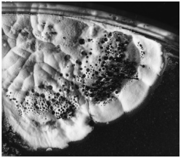

<details>
<summary>natural_image</summary>

Close-up of a textured, organic surface with circular and granular features (no visible text or symbols)
</details>

图 6-1 天蓝色链霉菌的放射状菌落

放线菌是好氧的腐生微生物，能够分解各种生物质作为营养，这也是其分布广泛的原因之一。放线菌的生长温度一般为 25～30℃，少数嗜热放线菌可以在 50～60℃条件下生长。放线菌喜好中性 pH，可以在 pH 6～9 环境中生长，pH 低于 6 则很难生长，因此在制备培养基时需要将 pH 调到中性。因为放线菌是好氧微生物，大规模发酵过程中需要加压通入无菌空气并通过搅拌提升氧气的传递和利用。

## 2. 放线菌是主要的微生物药物来源

放线菌能够产生小分子代谢物、酶（如食品加工用谷氨酰胺转氨酶）等多种产物，其中最为人们所熟知的是抗生素等次级代谢产物（图 6-2），被广泛地用于临床疾病治疗和农业病虫害防治中。目前已知的 5000 多种生物活性代谢产物中，有三分之二是由放线菌所产生的<sup>[2]</sup>。根据化学结构并参考其生物合成机制进行分类，这些生物活性物质主要分为聚酮类、肽类、氨基糖苷类、核苷类等，其中聚酮类主要包括Ⅰ型聚酮（阿维菌素、红霉素等）和Ⅱ型聚酮（放线紫红素、表阿霉素等），肽类主要包括非核糖体肽（万古霉素等）、核糖体肽（纳西肽等）、β-内酰胺类（头霉素等）。根据生物活性进行分类，这些代谢产物又可被分为抗细菌（红霉素、万古霉素等）、抗真菌（井冈霉素、那他霉素等）、抗虫（阿维菌素、多氧霉素）、抗肿瘤（表阿霉素、安丝菌素等）、免疫抑制（他克莫司等）、抗糖尿病（如阿卡波糖等）等种类。

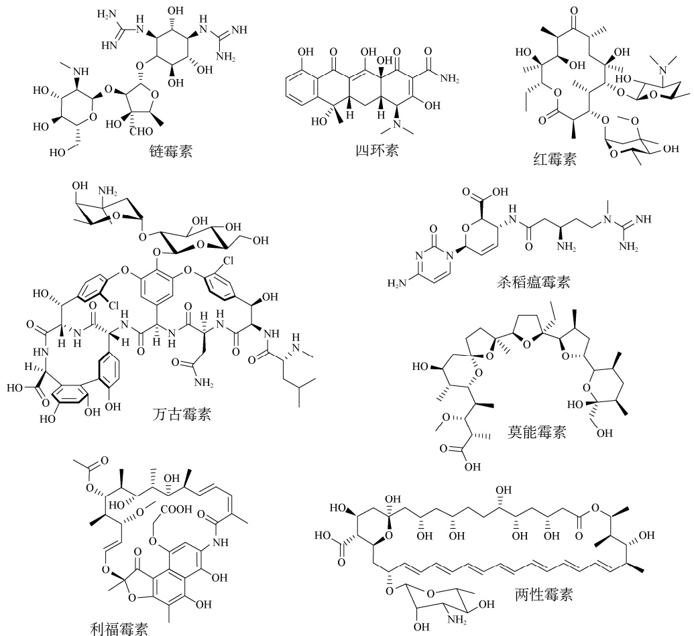

图 6-2 结构多样的放线菌次级代谢产物

## 二、放线菌的生物学特征

## 1. 放线菌的形态与分化

放线菌是能够形成分枝的多细胞原核生物，具有比较复杂的形态分化循环，依次形成基质菌丝（substrate mycelium，也称营养菌丝）、气生菌丝（arial mycelium）和孢子丝（spore chain）。在合适的营养条件下，放线菌的孢子萌发，然后通过顶端延伸和产生分枝，在固体营养基质中形成多细胞的基质菌丝，吸收和利用环境中的营养物质；当面临营养匮乏等不利条件时，基质菌丝分化成为直立的气生菌丝，这往往也是抗生素等次级代谢产物开始产生的时刻；当产生足够的气生菌丝后，气生菌丝生长停止，开始形成孢子丝和成熟的孢子（图 6-3）<sup>[3]</sup>。在实验室的固体培养基上，以上的整个生活周期为 7～10 天。在液体培养基中，放线菌以营养菌丝的形式存在，并形成菌丝团，只有少数菌种能够产生孢子。此外，放线菌的细胞壁具有厚约 35nm 的肽聚糖层，横向由 N-乙酰葡糖胺和 N-乙酰胞壁酸借助 β-1,4-糖苷键形成链状结构，链之间再由胞壁酸上的四肽侧链之间的交联形成立体网格分子，这也是其革兰氏染色（Gram stain）呈现阳性的根本原因。

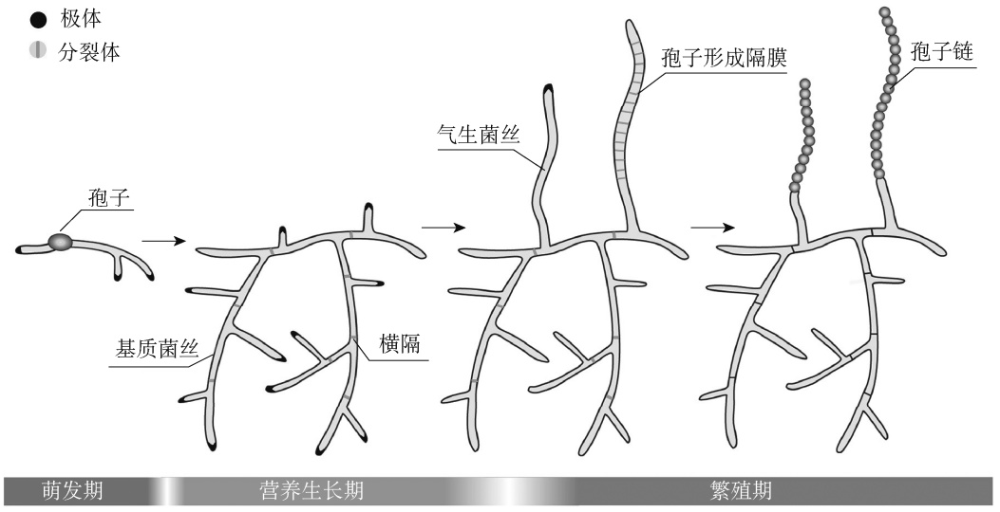

<details>
<summary>flowchart</summary>


</details>

图 6-3 放线菌复杂的形态分化和发育过程

放线菌的基质菌丝会产生蓝色、紫色、红色、黑色等多种不同颜色的色素，可溶性色素会扩散到培养基之中，不可溶性色素则保留在菌丝之中。有些抗生素也具有颜色，如天蓝色链霉菌所产生的天蓝色的放线紫红素（ actinorhodin ）、红色的十一烷基灵菌红素（undecylprodigiosin）。放线菌的孢子丝也呈现不同的颜色，包括白色、绿色、灰色、黑色、青色等。这些色素和孢子丝的颜色也是放线菌分类学的指标之一。

## 2. 放线菌复杂的基因组特征

放线菌基因组的 GC 含量高，为 55%～75%，因此在 PCR 扩增时需要的变性温度较高（96℃ 或 97℃），同时连续多个 G 的存在会导致扩增后的产物发生移码突变，DNA 序列测定时也可能导致漏读。目前天蓝色链霉菌、除虫链霉菌、红霉素糖多孢菌等数十种放线菌的基因组都已经被测定，并在此基础上开展了深入的功能分析和高产等发酵性能的改造，为放线菌底盘细胞的构建奠定了基础。

放线菌的基因组在原核生物中属于比较大的，为 8～10Mb。链霉菌属的染色体一般是线性的，其染色体末端共价结合蛋白，而糖多孢菌属、地中海无支酸菌属等稀有放线菌的染色体是环形的。天蓝色链霉菌是第一个全基因组测序的链霉菌，其染色体长度为 8.67Mb，GC 含量为 72%，预测到的 ORF 有 7825 个。其中与调控相关的基因有 965 个，暗示了链霉菌表达调控的复杂性；转运相关蛋白 614 个，可能与胞外各种营养物质的内运和胞内产物的外排有关；819 个分泌蛋白，与环境中营养物质的分解和利用有关；22 个次级代谢合成基因簇，解释了链霉菌作为微生物药物主要来源的遗传物质基础；此外，还存在大量未知功能的 ORF（图 6-4）。链霉菌的染色体分为以复制子为中心的核心区（core region），是看家基因的主要存在区域，以及富含多个次级代谢产物生物合成基因簇的非核心区（non-core region），也叫臂区（arm region）<sup>[4]</sup>。

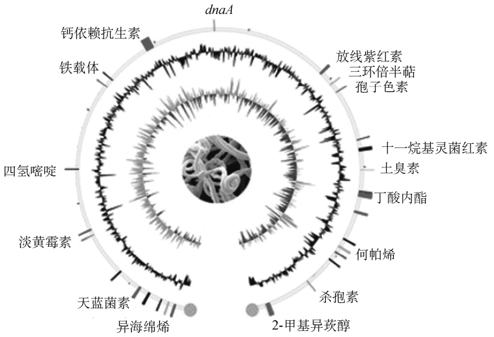

<details>
<summary>text_image</summary>

dnaA
钙依赖抗生素
铁载体
四氢嘧啶
淡黄霉素
天蓝菌素
异海绵烯
放线紫红素
三环倍半萜
孢子色素
十一烷基灵菌红素
土臭素
丁酸内酯
何帕烯
杀孢素
2-甲基异莰醇
</details>

图 6-4 天蓝色链霉菌的线性染色体基因组dnaA. DNA 复制蛋白编码基因

## 3. 放线菌次级代谢产物的生物合成特征

与其他细菌类似，放线菌的次级代谢产物的生物合成相关基因一般都成簇排列，位于染色体上的特定区域，因此也被称为生物合成基因簇（biosynthetic gene cluster）（图 6-5）。放线菌生物合成基因簇一般包含 10～50 个基因，长度从几十 kb 到 100kb 以上，使得完整基因簇的克隆仍然难度很大。这些相关基因包括与催化有关的结构基因（structure gene）、与基因表达有关的调控基因（regulatory gene）、与产物外排有关的转运基因（transporter gene）、与宿主抵抗产物胁迫有关的抗性基因（resistance gene）等。放线紫红素生物合成基因簇是第一个被完整克隆的基因簇，长度为 22kb，包含 23 个基因。结构基因 act Ⅰ、actⅢ、actⅤ、actⅦ等的编码蛋白负责芳香聚酮链的延伸和释放，调控基因 act-ORF4 编码的蛋白质负责调控结构基因、转运基因和抗性基因的表达，转运基因 actⅡ编码的蛋白质负责底物的内运或者产物的外排，而抗性基因 actⅣ编码的蛋白质赋予宿主对产物的耐受能力（图 6-5）<sup>[5]</sup>。


彩图

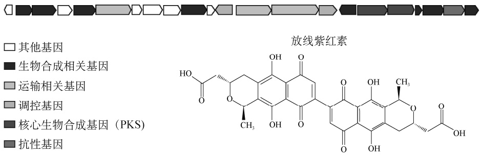

<details>
<summary>chemical</summary>

放线紫红素分子结构图，标注了核心生物合成基因（PKS）及其各功能基因
</details>

图 6-5 放线紫红素生物合成基因簇

## 4. 放线菌复杂的级联调控与调控网络

放线菌通过复杂的调控系统随着细胞内外环境的变化发生相应调整，调控其他调节基因、次级代谢产物结构基因、抗性基因和转运基因的转录。放线菌的调控系统分为全局性调控因子（global regulator）和途径专一性调控因子（pathway-specific regulator）。全局性调控因子能够同时调节形态分化和化学分化，或同时调节几种次级代谢产物的产生，有时也被称为多效性调控因子（pleiotropic regulator），如 AdpA、GlnR、PhoR（图 6-6）等。途径专一性调控因子指特定的调节某一种抗生素合成的调控因子，也称为基因簇内调控因子（cluster-situated regulator），如天蓝色链霉菌中放线紫红素生物合成的正调控因子 ActⅡ-ORF4<sup>[6]</sup>。无论是全局性调控因子还是途径专一性调控因子，都分为正调控基因和负调控基因。正调控基因的存在促进其他相关基因的转录，缺少时会降低甚至终止其他相关基因的转录和次生代谢产物的产生；负调控基因的效应与正调控基因相反，存在时会降低或阻遏其他相关基因的转录和次生代谢产物的产生，缺少时则可能使次生代谢产物的产量提高或产生提前。因此，对提高次级代谢产物的产量，调节基因的改造往往比结构基因的改造效果更为明显。

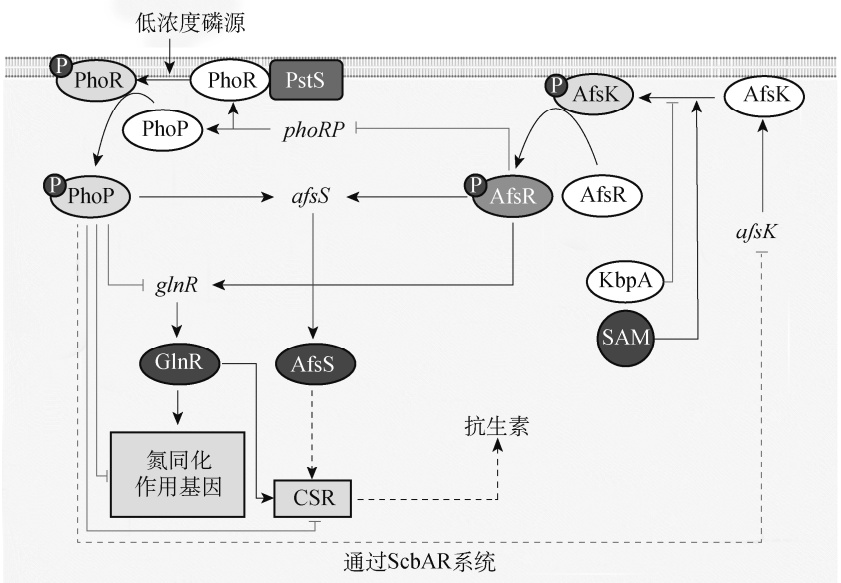

<details>
<summary>flowchart</summary>

```mermaid
graph TD
  A["低浓度磷源"] --> B["PhoR"]
  B --> C["PstS"]
  D["PhoR"] <--> E["PhoR"]
  F["PhoR"] <--> G["PhoP"]
  H["phoRP"] <--> I["PhoP"]
  J["AfsR"] <--> K["AfsK"]
  L["AfsR"] <--> M["AfsR"]
  N["GlnR"] <--> O["GlnR"]
  P["AfsS"] <--> Q["AfsS"]
  R["KbpA"] <--> S["SAM"]
  T["AFsK"] <--> U["AFsK"]
  V["抗生素"] -.-> W["CSR"]
  X["氮同化作用基因"] -.-> Y["GlnR"]
  Z["通过ScbAR系统"] -.-> AA["afsS"]
  AB["glnR"] -.-> AC["GlnR"]
  AD["phoRP"] -.-> AE["PhoR"]
  AF["phoRP"] -.-> AG["PhoP"]
  AH["phoRP"] -.-> AI["phoRP"]
  AJ["phoRP"] -.-> AK["phoRP"]
  AL["phoRP"] -.-> AM["phoRP"]
  AN["phoRP"] -.-> AO["phoRP"]
  AP["phoRP"] -.-> AQ["phoRP"]
  AR["phoRP"] -.-> AS["phoRP"]
  AT["phoRP"] -.-> AU["phoRP"]
  AV["phoRP"] -.-> AW["phoRP"]
  AX["phoRP"] -.-> AZ["phoRP"]
  BA["phoRP"] -.-> BZ["phoRP"]
  BB["phoRP"] -.-> BC["phoRP"]
  BD["phoRP"] -.-> BE["phoRP"]
  BF["phoRP"] -.-> BG["phoRP"]
  BH["phoRP"] -.-> BI["phoRP"]
  BJ["phoRP"] -.-> BK["phoRP"]
  BL["phoRP"] -.-> BM["phoRP"]
  BN["phoRP"] -.-> BO["phoRP"]
  BP["phoRP"] -.-> BR["phoRP"]
  BC["phoRP"] -.-> BD["phoRP"]
  BEB["phoRP"] -.-> BF["phoRP"]
  BG["phoRP"] -.-> BH["phoRP"]
  BIIB["phoRP"] -.-> BJIB["phoRP"]
  BKIB["phoRP"] -.-> BLIB["phoRP"]
  BMIB["phoRP"] -.-> BNIB["phoRP"]
  BZIB["phoRP"] -.-> BFIB["phoRP"]
  BGIB["phoRP"] -.-> BHIBIB["phoRP"]
  BIIBIB["phoRP"] -.-> BZIBIB["phoRP"]
  BFIBIB["phoRP"] -.-> BGIBIB["phoRP"]
  BHIBIBIB["phoRP"] -.-> BZIBIBIBIBIBIBIBIBIBIBIBIBIBIBIBIBIBIBIBIBIBIBIBIBIBIBIBIBIBIBIBIBIBIBIBIBIBIBIBIBIBIBIBIBIBIBIBIBIBIBIBIBIBIBIBIBIBIBIBIBIBIBIBIBIBIBIBIBIBIBIBIBIBIBIBIBIBIBIBIBIBIBIBIBIBIBIBIBIBIBIBIBIBIBIBIBIBIBIBIBIIBIBIBIBIBIIBIIBIIBIIBIIBIIBIIBIIBIIBIIBIIBIIBIIBIIBIIBIIBIIBIIBIIBIIBIIBIIBIIBIIBIIBIIBIIBIIBIIBIIBIIBIIBIIBIIBIIBIIBIIBIIBIIBIIBIIBIIBIIBIIBIIBIAB<nl>  A --> B
  B --> C
  C --> D
  D --> E
  E --> F
  F --> G
  G --> H
  H --> I
  I --> J
  J --> K
  K --> L
  L --> M
  M --> N
  N --> O
  O --> P
  P --> Q
  Q --> R
  R --> S
  S --> T
  T --> U
  U --> V
  V --> W
  W --> X
  X --> Y
  Y --> Z
```
</details>

图 6-6 放线菌复杂的级联调控与调控网络

SAM. 硫腺苷甲硫氨酸；CSR. 途径特异性调控因子

# 第二节 放线菌合成生物学的工具与方法

## 一、放线菌遗传操作常用质粒与底盘细胞

在自然环境中，放线菌之间的遗传交换相当频繁，这主要是由存在于其中的各种环形或线性质粒介导的。同时与其他微生物类似，放线菌也能够被许多噬菌体感染或溶源化。现今使用的多种放线菌载体就是在上述质粒和噬菌体的基础上改造而来的<sup>[7]</sup>。许多放线菌还含有长度不等的线性质粒，如最小的是分离于娄彻氏链霉菌中的 12kb 的 pSLA2，最大的是分离于龟裂链霉菌中的 1Mb 的 pPZG103。线性质粒不但具有和线性染色体相似的结构与末端蛋白，在进化过程中还很可能同染色体进行同源交换。

## 1. 高拷贝质粒 pIJ101 及其衍生质粒

分离自变铅青链霉菌 ISP5434 的环形质粒 pIJ101 大小为 8.83kb，拷贝数高达 300，包含复制区（rep、 ori）、转移区（tra）、扩散区（spd）等，宿主范围较广。pIJ101 的全序列已经测定，在 GenBank 的检索号码为 NC-001387。为了多种研究目的，pIJ101 被改造成为具有不同特性的质粒（图 6-7）。其中 pIJ702 的应用最为广泛，它是含有硫链丝菌素抗性基因（tsr）和黑色素合成基因（mel）的链霉菌质粒，其中 tsr 作为筛选标记，而外源片段在 mel 基因内的插入会导致白色菌落的出现，即重组子的获得。pIJ702 的拷贝数与 pIJ101 相似，而且稳定性较好，在非选择压力下也能稳定遗传几代。

pHZ1358 是大肠杆菌-链霉菌双功能 pIJ101 衍生载体，该质粒具有如下特点:一是含有 λ 噬菌体的 cos 位点，所以可以用作基因组黏粒文库的载体；二是含有转移起始位点 oriT，可以在大肠杆菌 RP4/RK2 衍生质粒的辅助下转移到放线菌；三是含有 tsr，其可作为在放线菌中的筛选标记；四是它在多数放线菌中的复制是不稳定的，从而有利于二次交换突变株的获得，已经在变铅青链霉菌、吸水链霉菌、链霉菌 FR-008、南昌链霉菌等多种放线菌菌株中得到应用。

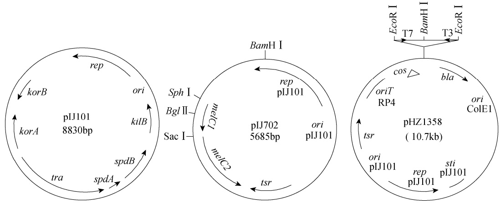

<details>
<summary>flowchart</summary>

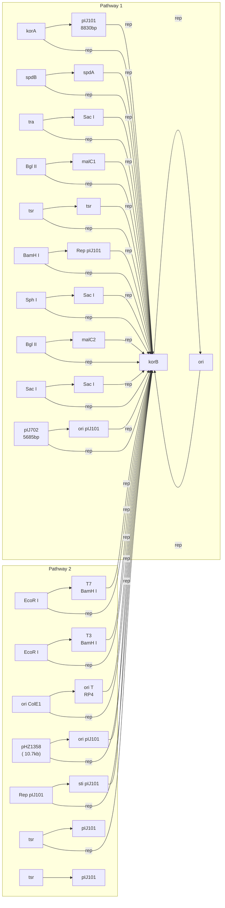
</details>

图 6-7 pIJ101 及其衍生质粒

## 2. 温度敏感型质粒 pSG5 及其衍生质粒

pSG5 是一个全长为 12.2kb 的温度敏感型质粒，并通过滚环方式复制，宿主范围广，拷贝数为 20～50。pSG5 的全序列已知，在 GenBank 的检索号码为 X80774。当培养温度高于 34℃时，pSG5 的复制停止，从而导致细胞分裂过程中的质粒逐渐丢失。pSG5 由于具有与转移有关的基因 traB、traR 和 A 片段，因而可以在变铅青链霉菌等放线菌之间以较低的频率转移。pSG5 复制子的温度敏感特性对于基因中断及置换实验是非常有利的（图 6-8）。

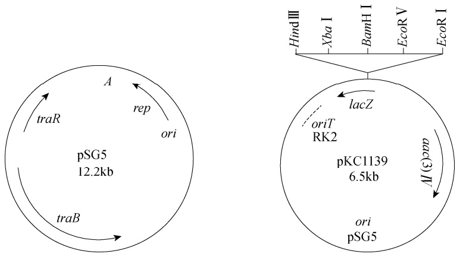

<details>
<summary>flowchart</summary>

```mermaid
graph LR
  subgraph Left(("pSG5"))
  A["A"] -->|traR| A
  A -->|rep| A
  A -->|ori| A
  A -->|traB| A
  A -->|traB| A
  end

  subgraph Right(("pKC1139"))
  B["Hind III"] --> C["Xba I"]
  B --> D["BamH I"]
  B --> E["EcoR V"]
  B --> F["EcoR I"]
  CDEF["C & D & E & F"] --> G["lacZ"]
  G --> H["oriT\nRK2"]
  H --> I["pKC1139\n6.5kb"]
  I --> J["ori\npSG5"]
  J --> K["I(3)"]
  K --> L["lacZ"]
  L --> M["oriT\nRK2"]
  end
```
</details>

图 6-8 pSG5 及其衍生质粒 pKC1139

ori. 复制起点；rep. 复制蛋白编码基因

pKC1139、pHZ132 等 pSG5 衍生质粒仅保留了它的复制区。pKC1139 还具有诱导接合转移所必需的 oriT，可同时在大肠杆菌和放线菌中作为筛选标记的阿泊拉霉素抗性基因 aac(3)Ⅳ，以及可用于蓝白斑筛选的 lacZ 基因。

## 3. 位点特异性整合型质粒

在放线菌中研究最为透彻、使用最为广泛的位点特异性整合载体主要衍生于噬菌体 ФC31和质粒 pSAM2，二者都含有不同的特异性整合位点（attP）和整合酶基因（int），可以整合到染色体的特定位置。此外，近年来，还陆续发展了具有不同整合位点和整合酶系统的 TG1、ФBT1、SV1 等位点特异性整合型质粒，丰富了放线菌的遗传操作工具<sup>[8]</sup>。

在形态学和遗传学方面，链霉菌温和型噬菌体 ФC31 和大肠杆菌 λ 噬菌体极其相似，能够形成噬菌斑并能使约 2/3 的链霉菌中形成溶源菌。原噬菌体可以通过噬菌体的 attP 和染色体上的相应同源序列 attB 之间的位点特异性整合插入宿主基因组中。尽管可以利用 ФC31 转染原生质体的特性进行遗传操作，但是由于其包装容量小、需要制备原生质体等，这方面的应用还是很局限的。更多的应用广泛的 ФC31 衍生载体仅含有 attP 和 int。例如，衍生质粒pSET152 除了含有 attP 和 int，还具有诱导接合转移所必需的 oriT，大肠杆菌质粒 pUC18 复制子，可同时在大肠杆菌和放线菌中作为筛选标记的阿泊拉霉素抗性基因 aac(3)Ⅳ，以及可用于蓝白斑筛选的 lacZ 基因。pSET152 被广泛地用于基因互补、异源表达和合成生物学研究中。

8.82kb 的 pSAM2 是从自生链霉菌 JI3212 中分离的共价闭合环状质粒，attP 的长度为360bp，能够通过在脯氨酸 tRNA 基因的整合插入到包括分枝杆菌在内的多种放线菌的染色体上。相比较而言，ФC31 的衍生载体的转化频率比 pSAM2 的衍生载体要高得多（图 6-9）。

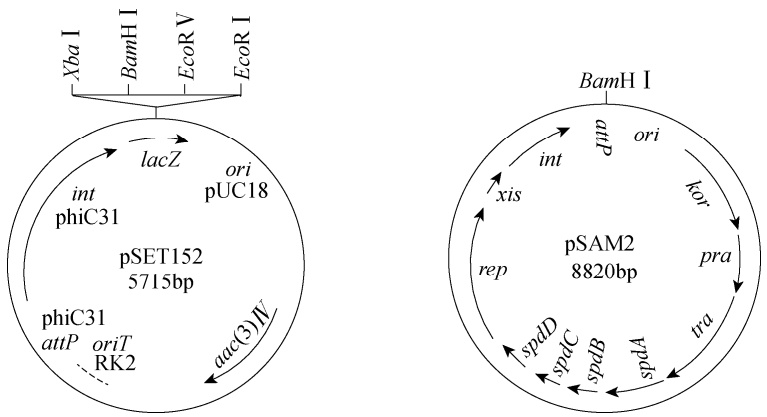

图 6-9 位点特异性整合型质粒 pSET152 和 pSAM2

## 4. 常用的放线菌底盘细胞

天蓝色链霉菌（Streptomyces coelicolor）A3（2）及其衍生菌株:天蓝色链霉菌 A3（2）是最早用于遗传学研究的放线菌，它因为产生天蓝色的放线紫红素（actinorhodin）而得名，同时还产生红色的灵菌红素（prodigiosin）等三种主要抗生素，其中包括由 350kb 的巨大线性质粒 SCP1 编码的次甲霉素；在长期研究其抗生素生物合成和形态分化的过程中，一系列的载体系统、衍生菌株和遗传操作方法得以建立和完善，如第一个低拷贝的共价闭合环状质粒SCP2 和缺失聚酮次级代谢产物的衍生菌株 CH999；其基因组全序列测定的完成使它的遗传背景更为清晰，成为放线菌遗传操作和异源表达的通用宿主。天蓝色链霉菌衍生菌株 CH999 是为研究聚酮的组合生物合成而特意改造的。McDaniel 等用红霉素的抗性基因替换了天蓝色链霉菌 A3（2）染色体上负责芳香族聚酮放线紫红素合成的 22 个基因，从而部分解除了内源聚酮生物合成基因对外源聚酮生物合成基因表达的影响。

变铅青链霉菌（Streptomyces lividans）66 及其衍生菌株:变铅青链霉菌是天蓝色链霉菌的近缘种，在遗传上则更为接近，许多共有的基因同源性高达 95% 以上，这表明它们可能来源于共同的祖先。常用的链霉菌高拷贝质粒 pIJ101 就是从变铅青链霉菌中分离的，而且放线菌染色体的线性结构也是首先在该菌株中发现的。变铅青链霉菌作为通用宿主比天蓝色链霉菌的应用更为广泛，这主要是因为以下几个优点:一是变铅青链霉菌对甲基化的外源 DNA 几乎没有限制性，可以将来自普通大肠杆菌的质粒 DNA 通过原生质体转化直接导入，而天蓝色链霉菌对甲基化的 DNA 具有很强的限制性，只能接受非甲基化的外源 DNA；二是质粒在变铅青链霉菌 JT46 及其衍生菌株中相互之间的重组频率极低；三是衍生菌株 ZX1 的获得，从以往的变铅青链霉菌中分离的质粒和染色体 DNA 在普通水平电泳过程中会有降解，而在 ZX1菌株中因为缺失了相应的基因簇，从而消除了降解现象。正是由于变铅青链霉菌有益于操作的特点，Ziermann 和 Betlach 模仿天蓝色链霉菌衍生菌株 CH999 的构建方式，用红霉素抗性基因替换了变铅青链霉菌中的放线紫红素生物合成基因簇，获得了背景清晰的衍生菌株K4-114。

白色链霉菌（Streptomyces albus）J1074:白色链霉菌 J1074 被广泛用于生物活性天然产物的异源合成中，包括多杀菌素、盐霉素、默诺霉素、弗德利卡霉素（fredericamycin）等数十种。该菌株的遗传背景清晰，生长迅速，而且缺失了 SalⅠ限制修饰系统，因此遗传操作简单、方便。白色链霉菌 J1074 的基因组较小，只有 6.84Mb，但是含有 7 套 rRNA 操纵子（一般的放线菌含有 5～6 套），这可能是其生长迅速的原因之一。其基因组上有两套 ФC31 的 attB 位点，这会导致两个拷贝异源生物合成基因簇的插入和编码产物的高产<sup>[9]</sup>。

## 二、放线菌常用的启动子

放线菌中含有组成型启动子（即在细胞生长过程中都启动转录的启动子）和诱导型启动子（即在特定诱导物存在时或特定的细胞生长阶段诱导启动转录的启动子）。常用的组成型启动子有来自红霉素糖多孢菌的红霉素抗性基因（ermE）的启动子、来自天蓝色链霉菌 SARP家族转录因子基因（kasO）的启动子等<sup>[10]</sup>。

## 1. ermEp 及其衍生启动子

ermE 的启动子区域包含两个启动子，即 ermEp1 和 ermEp2，分别从相距起始密码子的1bp 和 72bp 处开始转录。ermEp1 和 $e r m E p 2$ 的−10 区序列与细菌启动子的保守序列相似，而−35 区序列的保守性很低。ermEp1 的−35 区内删除 TGG 三个碱基后，启动子活性增强了大约 5 倍。突变后的启动子被命名为 $e r m E p ^ { * }$ ，也成了放线菌中应用最为广泛的启动子。

## 2. kasOp\*及其衍生启动子

kasO 基因编码天蓝色链霉菌天蓝菌素（coelimycin）生物合成基因簇中的 SARP 家族转录因子。kasO 基因的核心启动子区域与持家 σ 因子 HrdB 识别的保守启动子序列相似。kasO 基因的启动子区域受 γ-丁内酯受体 ScbR 和类 γ-丁内酯受体 ScbR2 的严格调控，分别含有转录因子结合区域 OA 和 OB 位点。首先通过截短启动子区域的 5′端，删除了 ScbR2 结合的 OB 位点，产生的启动子 kasOp3 转录强度比原始启动子强度提高了 40 倍。ScbR 结合位点 OA 与启动子的 10 区和 35 区重叠，为了消除 OA 位点，基于 OA 位点序列构建随机突变启动子库。突变文库中 kasOp361 活性远高于 kasOp3、 $e r m E p ^ { * }$ ，将其命名为 $k a s O p ^ { * }$ 。启动子 kasOp\* 在链霉菌异源表达中应用广泛<sup>[11]</sup>。

## 3. 硫肽类抗生素诱导的 tipAp 启动子

TipAL 蛋白属于 MerR 家族转录因子，其 N 端 HTH 结构域可以与启动子 tipAp 的回文序列结合，C 端效应物识别结构域可以共价结合硫链丝菌素。tipAp 是放线菌中应用最为广泛的诱导型启动子，来自变铅青链霉菌的硫链丝菌素诱导蛋白（Tip）基因的启动子区域。当 TipAL蛋白存在时，硫链丝菌素和 TipAL 的不可逆接合产物会同 $t i p A p$ 结合，从而启动 $t i p A p$ 控制下的基因转录。由于 TipA 蛋白并不是在所有的放线菌中都有，因此在不同放线菌中尝试使用tipAp 时一定要考察该基因是否存在及其表达情况或同时引入外源 TipA 蛋白基因。用 $t i p A p$ 表达的优点是，通过在培养基中加入低浓度的硫链丝菌素便能很容易地诱导基因表达，这样基因表达可以不受生理上的控制。但是启动子 $t i p A p$ 的渗透表达比较高，硫链丝菌素对宿主的生长也有负面影响，因此需要在质粒上同时插入硫链丝菌素抗性基因 ${ t s r } _ { \odot }$

此外，还有四环素诱导的启动子 tcp830p、甘油诱导的启动 $子 \ gylPlp$ 和 $g y l P 2 p$ 、氧四环素诱导的启动子 otrBp 等。

## 三、放线菌基因编辑技术

自 20 世纪 70 年代以来，在以天蓝色链霉菌和变铅青链霉菌为模式菌株的放线菌遗传学研究过程中，以英国 John Innes 研究所链霉菌研究室为主的各国研究人员不断创造和优化放线菌的遗传操作，加速了放线菌分子生物学的研究和放线菌工业化应用的进程。外源基因向放线菌的引入方法主要有原生质体的制备与转化、大肠杆菌和放线菌属间接合转移、电穿孔等。近年来，CRISPR-Cas 基因编辑系统的引入和发展，特别是内源 CRISPR 系统的有效利用，显著提高了遗传改造的效率，降低了实验成本，缩短了发酵周期。

## 1. 放线菌的遗传操作方法

1）原生质体的制备与转化（protoplast preparation and transformation）:原生质体转化是放线菌遗传操作最传统的方法。放线菌具有很厚的肽聚糖层，通过溶菌酶的作用可以从丝状菌丝体释放出球形原生质体。原生质体还可用于融合及噬菌体 DNA 转染等。原生质体转化的成败取决于原生质体的质量，主要是指原生质体在等渗培养基上的再生能力和对外源 DNA 的吸收能力。
2）大肠杆菌和放线菌属间接合（conjugation）转移:接合转移是指通过细菌细胞之间的直接接触，DNA 从一个细胞转移至另一个细胞的过程。这个过程是由接合型质粒（如大肠杆菌质粒 RP4 及其衍生质粒）完成的，它通常具有促进供体细胞与受体细胞有效接触的接合功能及诱导 DNA 分子传递的转移功能，两者均由接合型质粒上的有关基因编码。在 DNA 重组中常用的绝大多数载体质粒缺少接合功能区，因此不能直接通过细胞接合方法转化受体细胞，然而如果该质粒上含有接合转移起始区 oriT，并在一个含有接合功能区域的辅助质粒的反式作用下，就可以有效地转移至受体细胞。对放线菌的遗传操作而言，接合转移系统具有以下几个优点:一是过程简单，并不需要原生质体转化中的原生质体制备和再生等步骤；二是接合转移过程中 DNA 以单链形式进入受体菌，可以大大减小甚至避开受体菌的限制系统；三是拥有众多的含有 oriT 的载体，可以用于位点特异性整合或同源重组等目的；四是因为这些载体都可以在大肠杆菌中复制，因而质粒的构建相当方便。
3）电穿孔（electroporation）:电穿孔是一种电场介导的细胞膜可渗透化处理技术。受体细胞在一定的电场脉冲的作用下，细胞膜上形成一些微孔通道，使得 DNA 分子直接与裸露的细胞膜脂双层结构接触，并引发吸收过程。大肠杆菌的电穿孔方法已经十分完善，而且效率很高。电穿孔的主要优点是不需要进行原生质体制备与再生等烦琐步骤。尽管早在 1987 年就有通过电穿孔将质粒转入变铅青链霉菌的报道，但是并没有在放线菌中得到广泛应用。迄今为止，已经在地中海无枝酸菌、变铅青链霉菌、耻垢分枝杆菌、马红球菌、小小链霉菌、委内瑞拉链霉菌、龟裂链霉菌等进行过电穿孔的尝试，条件差异大。

## 2. 传统基因编辑技术

放线菌中的基因失活突变株构建有两种方式，一种是基因中断（gene disruption），另一种是基因置换（gene replacement）。

基因中断是先将基因内部一段 DNA 片段插入载体中，然后整个质粒通过该片段发生同源单交换（single homologous crossover），从而整合到染色体上。整合的质粒两侧是两个突变基因，一个缺失了 3′端，另一个缺失了 5′端，两个突变基因都必须丧失了功能（图 6-10）。由于单一片段的克隆和单交换后就能获得突变株，因此单交换突变株的获得非常迅速，有利于表型的快速鉴定。但是，在没有外源添加抗生素的选择压力下，这类突变株很容易通过第二次单交换回复成野生型。

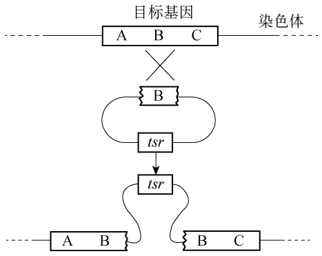

<details>
<summary>flowchart</summary>

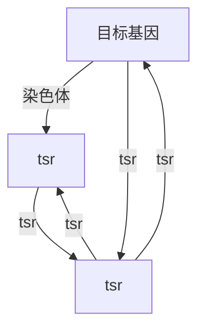
</details>

图 6-10 基于同源单交换的基因插入失活

tsr. 硫链丝菌素抗性基因

基因置换是在质粒上将抗生素抗性基因等选择标记插入到目标基因中，或者替换含有该目标基因的 DNA 片段。将构建好的质粒引入放线菌宿主中，并与染色体同源区域发生双交换（double homologous crossovers），导致选择性标记替换目标基因，形成不能回复成野生型的稳定突变株。当两侧每个同源片段很长时（>5kb），有时双交换会同时发生，从而直接得到突变株；但当同源片段较短时（< 5kb 而>1kb），一般会在任意一侧发生单交换，质粒整合到染色体上，此时的突变株具有两种抗性。之后，在只有选择性标记对应的抗生素的存在下进行生长或产孢，才能够最终获得通过第二次交换而丢失了质粒的突变株，该突变株仅具有选择性标记抗性（图 6-11）。因为从获得单交换突变株到筛选得到双交换突变株需要 2～3 轮的产孢培养，整个突变株构建过程冗长，需 3～4 周。

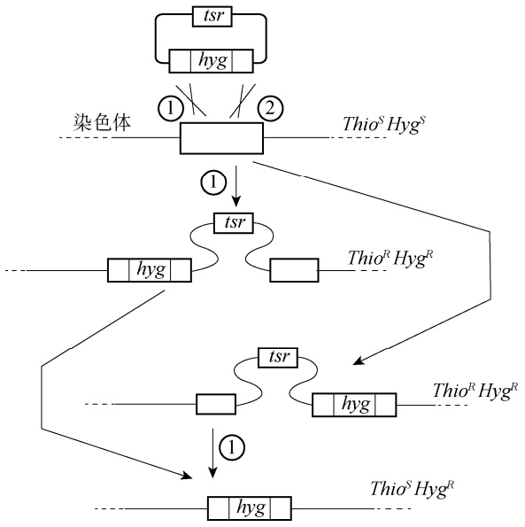

<details>
<summary>flowchart</summary>

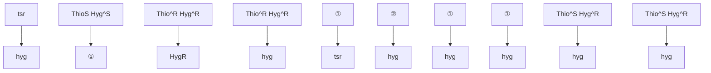
</details>

图 6-11 基于同源双交换的基因置换失活

tsr. 硫链丝菌素抗性基因；hyg. 潮霉素抗性基因； $T h i o ^ { S }$ . 硫链丝菌素敏感基因； $\boldsymbol { H y g } ^ { S }$ 潮霉素敏感基因；

硫链丝菌素抗性基因； 潮霉素抗性基因

## 3. 基于 CRISPR-Cas 系统的新型基因编辑技术

随着 CRISPR 的发现，基于 CRISPR-Cas 系统的高效基因编辑技术在链霉菌、分枝杆菌、游动放线菌等多种放线菌种属中得到了发展和应用，相继产生了 pCRISPomyces-2、pCRISPR-Cas9、pKCCas9dO 和 CRISPR-Cas9-CodA（sm）基因编辑系统。它们的共通之处在于在一个质粒上组装了 Sp（d）Cas9 基因、sgRNA（s）和编辑模板。此外，该质粒衍生于温度敏感型质粒 pSG5，每编辑一轮即可通过升高温度去除质粒，下一轮再引入含有新的 sgRNA（s）和编辑模板的质粒，从而实现多轮基因编辑。CRISPR-Cas 系统产生的双链断裂和放线菌的同源重组修复能力相结合，可以敲除掉一段特定 DNA 片段，也可以引入启动子等元件。当放线菌中引入非同源末端连接（NHEJ）所必需的 ScaligD 基因时，也可以通过 NHEJ 方式引入缺失和移码突变。利用核酸酶活性失活的 Cas9（dCas）的 CRISPRi 技术在放线菌中也得到了应用，通过对启动子区域或者编码区进行结合，可以不同程度地降低目标基因的转录水平。此外，针对放线菌的 sgRNA 设计，研究者还发展了 CRISPy-web（https://crispy.secondarymetabolites.org）在线分析软件（图 6-12）<sup>[12]</sup>。

Cas9 蛋白的表达会给放线菌带来一定的毒性，导致较低的转化率。为了解决这个问题，一方面可以通过使用诱导型启动子（如 tipAp）来诱导 Cas9 的表达，另一方面可以使用识别富含 T 的 PAM 序列（5′-TTV-3′）的 Cas12a（也称 Cpf1）。无论是 Cas9 还是 Cas12a，都会引起DNA 双链断裂，从而会导致具有线性染色体的链霉菌的基因组不稳定。最近，基于 CRISPR的碱基编辑系统（CRISPR-BEST）利用胞嘧啶脱氨酶和腺嘌呤脱氨酶，可以分别实现 A-G（CRISPR-aBEST）和 C-T（CRISPR-cBEST）的单碱基转换，从而在不产生 DNA 双链断裂的情况下引入终止密码子或氨基酸突变（图 6-12）<sup>[13]</sup>。

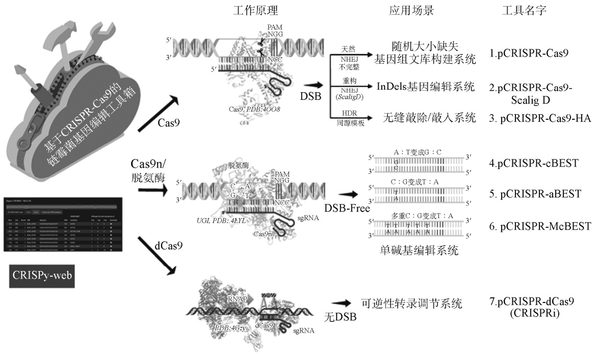

<details>
<summary>flowchart</summary>

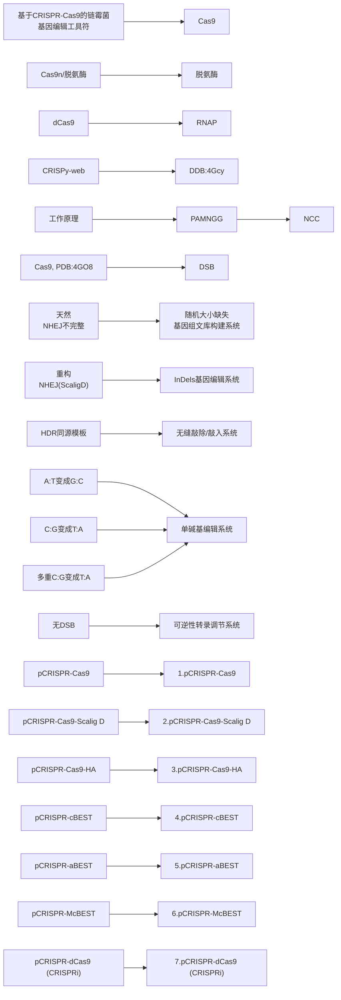
</details>

图 6-12 放线菌 CRISPR-Cas 基因编辑系统

Scalig D. 肉色链霉菌连接酶 D

## 第三节 放线菌合成生物学案例

放线菌是微生物药物的主要生产菌，其主要产物类型为聚酮、非核糖体肽、氨基糖苷等。国内外有关工业放线菌的选育和代谢过程优化等研究颇有斩获，但未能有效解决“菌种稳定性差、发酵水平低、同系物杂质多”等技术问题。其主要原因是对放线菌代谢-调控规律缺乏深刻认知，传统随机突变技术的准确性差、效率低，因此放线菌制药技术亟待升级。近年来，合成生物学快速发展，包括基因组重塑、合成途径定向改造和调控通路重构等，为放线菌药物生产菌的高产改造奠定了理论与技术基础，并初步改变了传统技术随机突变准确性差、育种效率低的现状。

除了核心的生物合成途径，放线菌药物的生产还受到基因和酶表达，底物、前体、辅因子供给，产物外排、自抗性，以及菌丝体形态的显著影响，对各个相关因素的改造都在一定程度上提高了放线菌药物的产量，从而发展了多种高产策略（图 6-13）<sup>[14]</sup>。基于基因组和转录组分析，对 adpA、wblA、glnR 等全局性调控因子的改造提高了井冈霉素、柔红霉素、阿维菌素等的产量；许多放线菌药物需要特殊的合成前体，如通过提高烯丙基丙二酸单酰 CoA 延伸单元的合成显著提高了免疫抑制剂 FK506 的产量，通过提高甲氧基丙二酸单酰-ACP 特殊延伸单元的供给有效提升了抗肿瘤安丝菌素的产量；由于放线菌基因组中存在多个次级代谢产物生物合成基因簇，因此对合成前体存在着竞争性，敲除多个竞争性基因簇可以为目标代谢产物的合成提供更多的前体，从而提高其产量；产物的有效外排可以降低产物对细胞的胁迫甚至毒性，在纳他霉素生物合成基因簇中和簇外都发现了与纳他霉素外排相关的基因，这些基因的过表达增强了纳他霉素的外排，并相应提高了纳他霉素的产量；此外，液体发酵过程中菌丝体的形态与溶氧和营养物质的传递、次级代谢生物合成基因的表达密切相关，过表达形态相关基因，减小菌丝团，可以有效提升次级代谢产物的产量。在此以阿维菌素和多杀菌素的高产改造为例，展现合成生物学改造在放线菌药物高产中的巨大推动力。

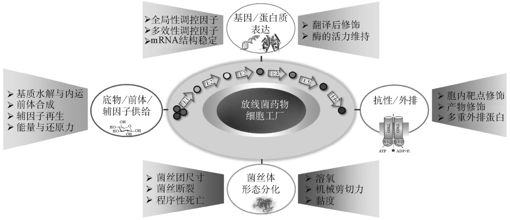

<details>
<summary>flowchart</summary>

This flowchart illustrates the process of generating a comprehensive biological culture system for bacteriophages, centered around a cell factory. It outlines steps from gene expression and structural analysis to final product formation.
</details>

图 6-13 放线菌天然产物的高产策略

## 一、阿维菌素高产与新结构衍生物改造

阿维菌素（avermectin）是由阿维链霉菌（Streptomyces avermitilis）发酵生产的高效低毒生物杀虫剂，在粮食安全、农产品安全、畜牧业和医药健康等领域具有重大意义。其衍生物伊维菌素（ivermectin）可有效治疗河盲症，帮助超过 2 亿非洲人幸免于失明。阿维菌素的产生菌最早是在 1974 年由日本北里研究所的大村智从静冈县的一个土壤样品中分离得到的。阿维菌素自 20 世纪 80 年代由美国 Merck 公司投放市场以来，目前已成为全球用量最大、使用技术最成熟的绿色生物农药。随着遗传学、代谢工程和合成生物学等新技术与方法的发展和应用，我国阿维菌素产业化竞争能力不断提升，生产成本不断降低，并成为世界上阿维菌素的主要生产国，年产量超过 3500t。

## 1. 阿维菌素的化学结构与生物合成途径

阿维菌素是 16 元大环内酯类抗生素，由 8 种组分组成，分别是 A1a、A1b、A2a、A2b、B1a、B1b、B2a 和 B2b（图 6-14），其中 B1 组分（由 80%～90%的 B1a 和 10%～20%的 B1b组成）具有最强的抗线虫和节肢动物类寄生虫活性及最低的毒性，被广泛应用于农业和畜牧业中。

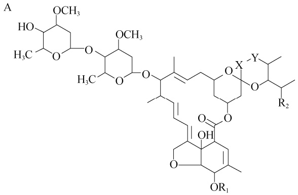

<details>
<summary>chemical</summary>

Complex organic molecule structure with multiple functional groups including ester, ether, and aldehyde moieties
</details>

| 阿维菌素 | $R_1$ | $R_2$ | X-Y |
| --- | --- | --- | --- |
| A1a | $-CH_3$ | $-C_2H_5$ | -CH=CH- |
| A1b | $-CH_3$ | $-CH_3$ | -CH=CH- |
| A2a | $-CH_3$ | $-C_2H_5$ | $-CH_2-CH(OH)-$ |
| A2b | $-CH_3$ | $-CH_3$ | $-CH_2-CH(OH)-$ |
| B1a | -H | $-C_2H_5$ | -CH=CH- |
| B1b | -H | $-CH_3$ | -CH=CH- |
| B2a | -H | $-C_2H_5$ | $-CH_2-CH(OH)-$ |
| B2b | -H | $-CH_3$ | $-CH_2-CH(OH)-$ |

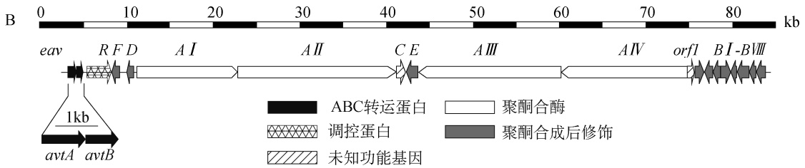

<details>
<summary>text_image</summary>

B
0	10	20	30	40	50	60	70	80 kb
eav	RFD	A	I	AII	CE	AIII	AIV-orf1	BI-BVIII
1kb
avtA	avtB
ABC转运蛋白	聚酮合酶	调控蛋白	聚酮合成后修饰
</details>

图 6-14 多种阿维菌素组分结构（A）与阿维菌素生物合成基因簇（B）

阿维菌素的生物合成可分为三个阶段。首先，由聚酮衍生而来的起始糖苷配基（6,8a-闭联-6,8a-脱氧-5-氧-阿维菌素糖苷配基）的形成；其次，起始糖苷配基经一系列合成后修饰产生阿维菌素糖苷配基；最后，阿维菌素糖苷配基经糖基转移酶 AveBⅠ 糖基化形成阿维菌素。其中，合成后修饰过程主要包括以下几步:细胞色素 P450 单加氧酶 AveE 负责催化 C6-C8a 位呋喃环的闭合；酮基还原酶 AveF 负责 C5 位的酮基还原；O-甲基转移酶 AveD 催化 C5 位羟基的甲基化（图 6-15）<sup>[15]</sup>。

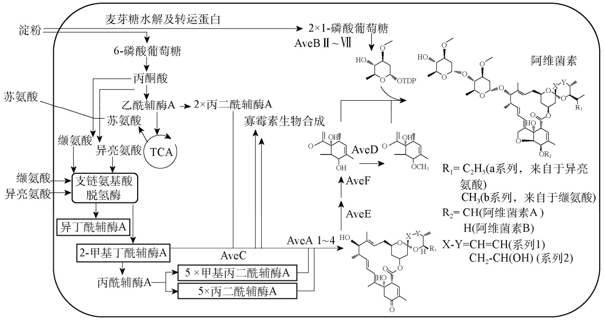

<details>
<summary>flowchart</summary>

This flowchart illustrates the biochemical synthesis pathway of a flavonoid derivative, showing the conversion of sugar and amino acids to various intermediates (TCA, glucose derivatives), followed by the formation of antiviral compounds.
</details>

图 6-15 阿维菌素的生物合成机制<sup>[15]</sup>

TDP. 胸苷二磷酸

## 2. 阿维菌素的高产改造策略

阿维菌素发酵生产的最佳碳源是淀粉，它先在淀粉酶的作用下转变为麦芽糖和麦芽糊精再被菌体利用，过表达麦芽糖转运系统 malEFG 可促进淀粉的利用，从而提高阿维菌素产量。metK 是 S-腺苷甲硫氨酸（SAM）合成酶基因，过表达 metK 可提高 SAM 的浓度和阿维菌素产量。通过比较代谢组学分析添加 SAM 导致高产的原因，揭示了阿维菌素合成的关键前体代谢物，合理添加这些代谢物可显著提高产量。avtAB 位于阿维菌素合成基因簇上游，编码阿维菌素的外排泵，过表达 avtAB 可减少阿维菌素的反馈抑制从而提高其产量。TetR 家族调控因子 AveT 正调控阿维菌素合成，其重要的靶基因 aveM 编码一个未知外排泵，对阿维菌素合成具有抑制作用，过表达 aveT 或缺失 aveM 都能显著提高野生型菌株和工业生产菌株中阿维菌素的产量。

张立新团队发现阿维菌素高产菌株中基因簇内正调控基因 aveR 的表达水平显著提高，由于体外转录实验证实 σ<sup>HrdB</sup> 可识别 aveR 的启动子，因此利用体外定向进化构建了 hrdB 基因的突变文库，进一步通过高通量筛选获得了高产重组菌株 A56，在 180L 发酵罐中阿维菌素 B1a产量提高了 53% [15]。

## 3. 阿维菌素的结构改造策略

作为第二代阿维菌素类药物的伊维菌素，由于使用更安全而主要用于兽药和医药中，目前其生产主要采用化学法从阿维菌素 B1 还原而来，该过程需要昂贵的氯化铑作催化剂。用雷帕霉素 PKS 模块 13 上的 DH-ER-KR（脱水酶-烯基还原酶-酮基还原酶）结构域取代野生型阿维链霉菌中阿维菌素 PKS 模块 2 上的 DH-KR 结构域（aveDH2-KR2），获得的重组菌株具有直接合成伊维菌素的能力。将 aveDH2-KR2 分别用来自苦霉素 PKS 模块 4 和寡霉素 PKS 模块3 上的 DH-ER-KR 所置换，也可以得到产伊维菌素的工程菌。米尔贝霉素是与阿维菌素结构类似的杀虫药物，其 C22 和 C23 之间为饱和键，与伊维菌素相同。在阿维菌素高产菌株中用