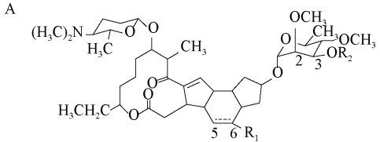
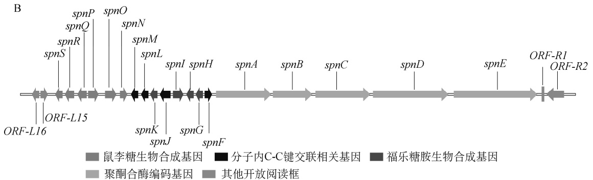
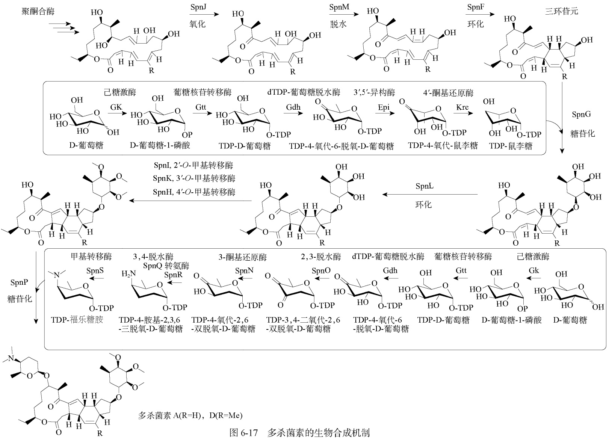
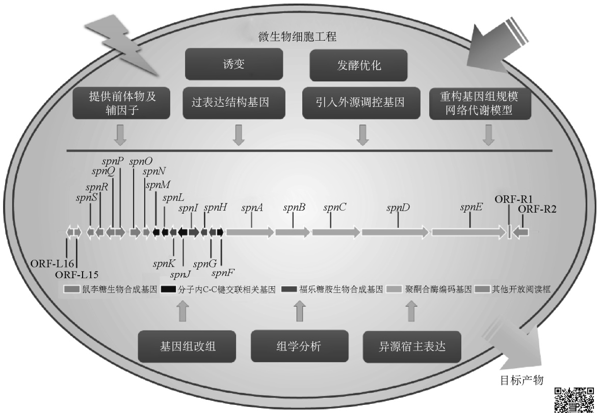
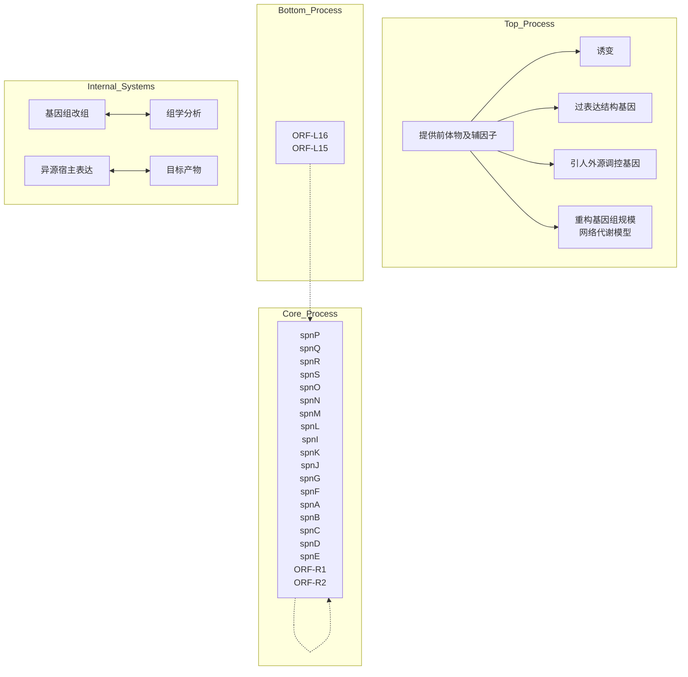
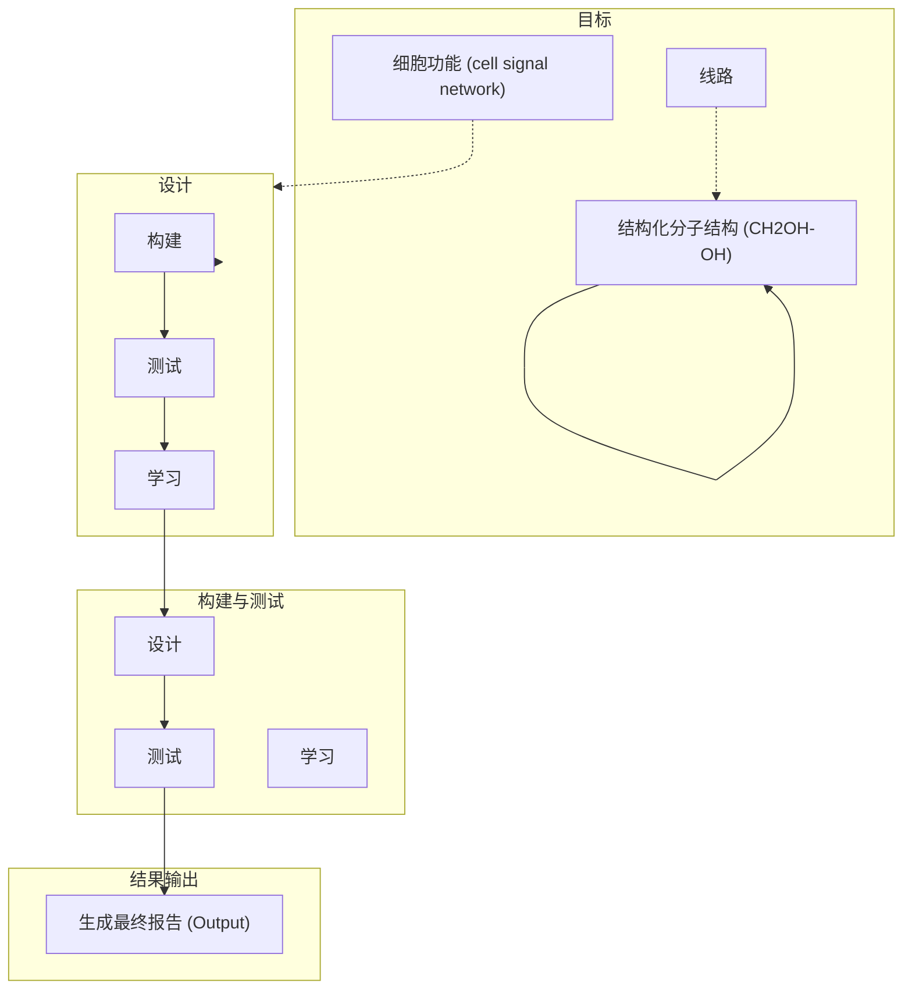
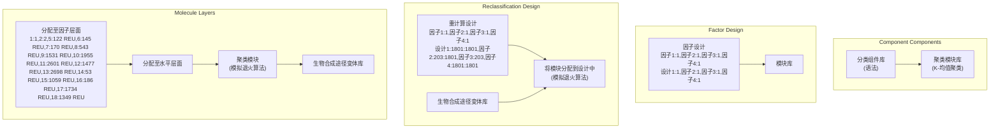

来自冰城链霉菌米尔贝霉素 PKS 模块 2 的 DH-ER-KR 替换 aveDH2-KR2，获得的工程菌伊维菌素 B1a 产量达到 3.45g/L，可用于工业化生产。

多拉菌素是 20 世纪 90 年代由美国辉瑞公司研发的阿维菌素第三代衍生物，比伊维菌素的杀虫效果更好，其结构为阿维菌素 B1 的 C25 位被环己烷基所取代。将山丘链霉菌中的环己酰 CoA（CHC-CoA）合成基因转入阿维菌素的前体合成阻断突变株（支链 α-酮酸脱氢酶缺陷，不能合成起始单元 2-甲基丁酸和异丁酸）中，突变株获得了合成多拉菌素的能力。将阿维菌素 PKS 的起始模块替换为可加载环己烷羧酸（CHC）的磷内酯霉素 PKS 起始模块，同时转入CHC-CoA 合成基因，也可以构建出产多拉菌素的工程菌。

## 二、生物杀虫剂多杀菌素的高产改造

多杀菌素（spinosyn）是由土壤微生物刺糖多孢菌（Saccharopolyspora spinosa）产生的大环内酯类次级代谢产物，以多杀菌素A和多杀菌素 D 为主。多杀菌素能够直接作用于昆虫的烟碱乙酰胆碱受体和 γ-氨基丁酸受体，可通过刺激运动神经元和引起不自主的肌肉收缩而破坏神经元的活动。与传统化学农药相比，多杀菌素具有降解速度快、选择性强和环境安全等优势，因此由多杀菌素 A 和 D 的混合物开发成多杀霉素（spinosad）杀虫剂等。另外，由刺糖多孢菌突变株发酵产生的多杀菌素 J 和 L，经过化学修饰可变成新型杀虫剂乙基多杀菌素，比第一代多杀菌素更广、对有益昆虫的影响更小、单位面积用量更低、环境中残留期更短。作为农用抗生素的杰出代表，多杀菌素有望成为我国生物农药产业一个新的经济增长点。目前国内外已报道的相关研究中已经对刺糖多孢菌的基因组、遗传背景、杀虫机制及多杀菌素生物合成代谢调控的关键基因有了初步的研究。

## 1. 多杀菌素的生物合成基因簇及其生物合成途径

多杀菌素是一种大环内酯类化合物，是具有四环体系的聚酮类化合物，核心结构由与十二元大环内酯环连接的 5,6,5-顺-反-反-三环系统组成；此外，在聚酮环的 C9 位、C17 位的羟基上分别连接 1 分子氨基糖（D-福乐糖胺）和 1 分子中性糖（L-鼠李糖）。该复合物中含量占第二位的成分为 D 组分，与 A 组分的差别在于 C6 位上多一个 $\mathrm { C H } _ { 3 }$ 基团。而乙基多杀菌素（spinetoram）则是研究人员在明确多杀菌素生物合成的中间体和生物合成途径后，应用人工神经网络（ANN）对其生物活性进行定量–构效关系分析，将多杀菌素 J 的 C5-C6 双键氢化还原与鼠李糖 3′-O-乙基化后获得的一种半合成大环内酯杀虫剂。

已知的多杀菌素生物合成的相关基因有 23 个，包括 5 个聚酮合酶基因（spnA、spnB、spnC、spnD、spnE）、4 个大环内酯修饰基因（spnJ、spnM、spnF、spnL）、5 个鼠李糖合成及转移相关基因（gtt、gdh、epi、kre、spnG）、3 个鼠李糖甲基化相关基因（spnH、spnI、spnK），以及6 个福乐糖胺合成及转移相关基因（spnO、spnN、spnQ、spnR、spnS、spnP）。其中 19 个基因都成簇排列在 74kb 的基因簇上，并用 spn 来命名（spnA～spnS）。4 个参与鼠李糖生物合成的关键基因（gtt、gdh、epi 和 kre）则位于多杀菌素生物合成基因簇之外（图 6-16）[16]。多杀菌素基因簇除了上述基因，还有几个开放阅读框（open reading frame，ORF），包括 ORF-L15、ORF-L16、ORF-R1、ORF-R2 等。其对多杀菌素合成的作用正在被揭示。

彩图

chemical

Complex organic molecule structure with multiple rings, ester groups, and functional groups labeled (H3C)2N, OCH3, OR2, R1, and numbered positions 2-6

| 多杀菌素 | $R_1$ | $R_2$ | $C_5-C_6$键 | 作用 |
| --- | --- | --- | --- | --- |
| 多杀菌素A | H | $CH_3$ | 双键 | 多杀菌素主要组分 |
| 多杀菌素D | $CH_3$ | $CH_3$ | 双键 | 多杀菌素次要组分 |
| 多杀菌素J | H | H | 双键 | 乙基多杀菌素前体物 |
| 多杀菌素L | $CH_3$ | H | 双键 | 乙基多杀菌素前体物 |
| 3'-O-乙基-5,6-二氢多杀菌素J | H | $CH_2CH_3$ | 单键 | 乙基多杀菌素主要组分 |
| 3'-O-乙基-多杀菌素L | $CH_3$ | $CH_2CH_3$ | 双键 | 乙基多杀菌素次要组分 |

text_image

B
ORF-L16 ORF-L15
spnS spnR spnP spnQ spnO spnN spnM spnL spnI spnH spnK spnJ spnG spnF spnA spnB spnC spnD spnE ORF-R1 ORF-R2
鼠李糖生物合成基因 分子内C-C键交联相关基因 福乐糖胺生物合成基因 聚酮合酶编码基因 其他开放阅读框

图 6-16 多杀菌素系列化合物及其生物合成

A. 多杀菌素系列化合物的结构；B. 多杀菌素生物合成基因簇

聚酮链形成和释放之后，会经过一系列的后修饰反应，从而得到大环内酯糖苷配基。首先在 SpnJ 的催化下在 C15 位发生脱氢反应使羟基变为酮基，随后 SpnM 催化的 1,4-脱氢反应使 C11 和 C17 位脱氢，最后在 SpnF 的催化下发生跨环[（4+2）-环化加成反应形成糖苷配基。SpnL 催化 C3 和 C14 之间形成第二个闭合五元环。葡萄糖-1-磷酸在 Gtt、Gdh、Epi 与 Kre 蛋白共同作用下转化为 TDP-鼠李糖，由 SpnG 催化与聚酮骨架相连。随后，经 SpnI、SpnK、SpnH依次催化甲基化后形成假糖苷配基]。福乐糖胺生物合成的前三步与 TDP-鼠李糖合成的前三步相同，之后 SpnO、SpnN、SpnQ、SpnR 和 SpnS 将 TDP-4-氧代-6-脱氧-D-葡萄糖转化为 TPD-福乐糖胺。福乐糖胺的 N-甲基化是由 SpnS 连续催化的。最终 SpnP 将福乐糖胺转移到假糖苷配基上形成多杀菌素（图 6-17）[17]。

## 2. 多杀菌素的高产改造策略

目前，研究人员对多杀菌素发酵的高产改造策略主要集中在以下几个方面:对刺糖多孢菌进行传统诱变，发酵过程的优化，利用基因工程手段构建多杀菌素的高产工程菌；利用代谢工程策略构建多杀菌素高产工程菌；基于转录组和蛋白质组学的工程改造；异源表达多杀菌素生物合成基因簇，实现多杀菌素异源高产等（图 6-18）[18]。

flowchart

图 6-18 多杀菌素的多种高产策略

彩图

研究表明，培养基中的碳源浓度高于 58.5g/L 时，会抑制刺糖多孢菌中多杀菌素的生物合成及菌体的正常生长。另外，溶氧率是影响菌株发酵高产的重要环境因素。将透明颤菌中促进氧吸收的血红蛋白基因（vgb）整合到刺糖多孢菌中，在普通溶氧的培养条件下，工程菌株的多杀菌素产量为 466.6mg/L，显著高于原始菌株的 251.1mg/L；研究人员将刺糖多孢菌置于高溶氧环境中（含 $\mathrm{H}_{2}\mathrm{O}_{2}$ ）培养，使得多杀菌素和拟糖苷配基的产量增加 3.11 倍，并发现NADH/NAD+的值降低。

β-氧化途径可能是多杀菌素生物合成的重要基础，在发酵培养基中添加草莓籽油和山茶油，多杀菌素产量显著增加，且油的添加会提高脂肪酸代谢、前体供应及与氧化应激相关基因的表达。在此基础上引入来自天然色链霉菌（Streptomyces coelicolor）的 β-氧化相关基因fadD1 和 fadE，获得的基因工程菌株在含有山茶油的培养基中多杀菌素产量继续提高，达到784.72mg/L。

在多杀菌素产生菌刺糖多孢菌中，负责鼠李糖合成的 gtt、gdh 和 kre 基因不仅负责多杀菌素中鼠李糖模块的合成，同时也负责多杀菌素中福乐糖胺和细胞壁中鼠李糖单元的合成，成为多杀菌素生物合成途径中的限速步骤。因此对 gtt、gdh 和 kre 基因进行加倍，使得多杀菌素的产量从出发菌株的 82mg/L 增加到 405mg/L。为增强代谢途径中 SAM 循环等前体物供给，将来源于波赛链霉菌（Streptomyces peucetius）的正调控基因 metK、rmbA 和 rmbB 在刺糖多孢菌 MUV 进行过表达，使多杀菌素 A 和 D 的产量较野生型菌株分别提高了 7.44 倍和 8.03 倍，达到 372mg/L 和 217mg/L。

Huang 等经比较刺糖多孢菌高产突变株 SS-168 及野生型 SS-WT 间的转录组学差异，发现了高低产菌株中多种生物过程和信号通路存在显著差异，其中包括甘氨酸/丝氨酸/苏氨酸代谢通路等，其或将成为进一步高产改造的靶点。另外，随着生物信息学的发展，Zhou 等通过利用人工神经网络技术及遗传建模的方法对培养基进行优化，提高了刺糖多孢菌中多杀菌素的产量。

## 思 考 题

1. 放线菌在生物技术领域的主要应用是什么？
2. 放线菌的基因组有何特征？
3. 放线菌次级代谢产物生物合成与初级代谢的关系如何，其基因簇有何特点？
4. 什么是全局性或多效性调控因子和途径专一性调控因子？
5. 各列举 1 个放线菌中的组成型和诱导型启动子。
6. 简述常用的放线菌底盘细胞及其特点。
7. 简述放线菌中基因置换的质粒构建和突变株获得过程。
8. 接合转移过程的优点有哪些？
9. 放线菌次级代谢产物高产的合成生物学策略有哪些？
10. 放线菌中目前有哪些基于 CRISPR 的遗传操作工具？

## 参考文献

［1］李文均，冯楚莹，曹理想，等.“微生物学”教学内容须与时俱进:对放线菌的认知演变及研究进展. 微生物学通报，2023，50（8）:3703-3712
［2］Katz L，Baltz RH. Natural product discovery:past，present，and future. J Ind Microbiol Biotechnol，2016，43（2-3）:155-176
［3］Schlimpert S，Elliot MA. The best of both worlds-Streptomyces coelicolor and Streptomyces venezuelae as model species for studying antibiotic production and bacterial multicellular development. J Bacteriol，2023，205（7）:e0015323
［4］Bentley SD，Chater KF，Cerdeño-Tárraga AM，et al. Complete genome sequence of the model actinomycete Streptomyces coelicolor A3（2）. Nature，2002，417（6885）:141-147
［5］Okamoto S，Taguchi T，Ochi K，et al. Biosynthesis of actinorhodin and related antibiotics:discovery of alternative routes for quinone formation encoded in the act gene cluster. Chem Biol，2009，16（2）:226-236
［6］van der Heul HU，Bilyk BL，McDowall KJ，et al. Regulation of antibiotic production in Actinobacteria:new perspectives from the post-genomic era. Nat Prod Rep，2018，35（6）:575-604
［7］Kieser T，Bibb MJ，Buttner MJ，et al. Practical Streptomyces genetics. Norwich:The John Innes Foundation，2000
［8］Gao H，Smith MCM. Use of orthogonal serine integrases to multiplex plasmid conjugation and integration from E. coli into Streptomyces. Access Microbiol，2021，3（12）:000291
［9］Nepal KK，Wang G. Streptomycetes:Surrogate hosts for the genetic manipulation of biosynthetic gene clusters and production of natural products. Biotechnol Adv，2019，37（1）:1-20
［10］Myronovskyi M，Luzhetskyy A. Native and engineered promoters in natural product discovery. Nat Prod Rep，
2016，33（8）:1006-1019
［11］Wang W，Li X，Wang J，et al. An engineered strong promoter for Streptomycetes. Appl Environ Microbiol，2013，79（14）:4484-4492
［12］Tong Y，Charusanti P，Zhang L，et al. CRISPR-Cas9 based engineering of Actinomycetal genomes. ACS Synth Biol，2015，4（9）:1020-1029
［13］Tong Y，Whitford CM，Blin K，et al. CRISPR-Cas9，CRISPRi and CRISPR-BEST-mediated genetic manipulation in streptomycetes. Nat Protoc，2020，15（8）:2470-2502
［14］Choi SS，Katsuyama Y，Bai L，et al. Genome engineering for microbial natural product discovery. Curr Opin Microbiol，2018，45:53-60
［15］Zhuo Y，Zhang T，Wang Q，et al. Synthetic biology of avermectin for production improvement and structure diversification. Biotechnol J，2014，9（3）:316-325
［16］Madduri K，Waldron C，Matsushima P，et al. Genes for the biosynthesis of spinosyns:applications for yield improvement in Saccharopolyspora spinosa. J Ind Microbiol Biotechnol，2001，27（6）:399-402
［17］Galm U，Sparks TC. Natural product derived insecticides:discovery and development of spinetoram. J Ind Microbiol Biotechnol，2016，43（2-3）:185-193
［18］Tao H，Zhang Y，Deng Z，et al. Strategies for enhancing the yield of the potent insecticide spinosad in Actinomycetes. Biotechnol J，2019，14（1）:e1700769

# 酵母合成生物学

## 第一节 概 论

## 一、酿酒酵母合成生物学的背景与重要性

## 1. 酿酒酵母合成生物学的发展历史

在 20 世纪 70 年代初期，Cohen 等在一篇研究论文中详细介绍了重组 DNA 技术的创新应用[1]。通过在体外连接不同来源的 DNA 片段来构建载体，并成功地将其导入大肠杆菌中，实现了跨物种的基因传递。这一开创性的实验不仅标志着基因工程领域的诞生，也为随后涉及大量 DNA编辑操作的生物技术研究和应用打下了坚实的基础。在 20 世纪 80 年代，随着分子克隆技术的进步，科学家已经能够对酿酒酵母（Saccharomyces cerevisiae）的基因进行操控和研究。此期间的研究焦点主要集中在对酿酒酵母的遗传调控上。通过使用质粒，研究人员可实现基因的精确导入和表达调节[2]。此外，这一时期还揭示了许多酿酒酵母特有的生理机制和过程。进入 20 世纪 90 年代，伴随着 PCR 技术和基因测序技术的发展，酿酒酵母基因组学开始兴起。在这个时期，完成了酿酒酵母的全基因组测序[3]，为后来的酿酒酵母合成生物学研究提供了基础。同时，这也让我们对酿酒酵母基因与表型的关系，以及酿酒酵母对环境变化的生理应答有了更深入的理解。

2001～2010 年见证了合成生物学概念的诞生，这时的酿酒酵母开始被广泛用于合成新的生物分子和代谢途径组装。代谢工程和系统生物学与合成生物学的融合，带来了设计-构建-测试-学习（DBTL）这一研究范式（图 7-1），这使研究人员能够更有效地利用酿酒酵母进行生物生产[4]。2011～2020 年，伴随着基因合成技术的进步及基因组编辑工具的发展，尤其是CRISPR-Cas9 技术的出现，其以高效、精准的特性，极大地提高了酿酒酵母基因工程的效率和精度，使得大规模的基因编辑成为可能。在这一时期，全基因组合成开始大放异彩。酿酒酵母作为最早进行全基因组合成的真核生物之一，引领了这个领域的发展。国际酵母基因组合成 Sc2.0 计划[5]，是一个国际合作项目，旨在合成一个具有全新设计的酿酒酵母基因组。这个项目将人工设计的基因组引入酿酒酵母中，以此探究生命的本质和合成生物学的潜力。

flowchart

图 7-1 设计-构建-测试-学习（DBTL）的研究范式[4]

Tv 为时间常数（time constant）与某个变量（variable）v 的关系；b 为比例常数或理想值； $\mathrm { d } C _ { \mathrm { p r o d } } / \mathrm { d } t$ 为微分表达式，代表产物浓度 $( C _ { \mathrm { p r o d } } )$ 随时间（t）的变化率； $K _ { \mathrm { f } } C _ { \mathrm { r e a c t } }$ 为正向反应速率常数 $\left( \; K _ { \mathrm { f } } \; \right)$ 乘以反应物浓度 $( \; C _ { \mathrm { r e a c t } } \; )$ ，即正向反应的速

率； $K _ { \mathrm { r } }   C _ { \mathrm { p r o d } }$ 为反向反应速率常数 $\left( \; K _ { \mathrm { r } } \; \right)$ 乘以产物浓度 $( C _ { \mathrm { p r o d } } )$ ，即反向反应的速率

至此，可以看到在酿酒酵母合成生物学发展的过程中，人类不仅积累了丰富的酿酒酵母遗传资源和方法论，也对酿酒酵母基因组有了深入的认识。这为酿酒酵母合成生物学未来的发展奠定了坚实的基础。

## 2. 酿酒酵母在合成生物学中的独特地位

酿酒酵母的生物学特性、基因组特点、代谢途径优势及其在疾病研究中的应用等多方面因素塑造出其在生物学领域的重要地位，也反映出其在合成生物学研究及应用中的价值。

首先是酿酒酵母的生物学特性。酿酒酵母是一种生命周期较短、培养方式简单的真核单细胞微生物，在实验中的使用极为方便。酿酒酵母的单细胞特性及具有的高效同源重组机制使得研究人员可以方便地对其进行基因操作，包括基因插入、敲除和替换等。特别是在需要处理大量样本的高通量筛选实验中，这种特性更显得尤为宝贵。此外，酿酒酵母所具备的丰富基因注释和众多的遗传工具为研究人员提供了便利，能够更为精准地设计和搭建基因网络，进而深入理解和精确控制生物系统。

其次是酿酒酵母的基因组特点。酿酒酵母的基因组结构相对简单，保守性高，这使得酿酒酵母成为研究基因功能的理想模型。在过去的研究中，研究人员已经对酿酒酵母的各种生理过程进行了深入探索，包括基因表达、蛋白质合成、细胞周期控制等。这奠定了一个良好的基础，能在此基础平台上设计和构建复杂的生物系统。此外，酿酒酵母中发现的众多基因和信号途径在更复杂的生物体系中也存在，这为人类疾病的研究提供了可能。

再次是酿酒酵母在疾病研究中的应用。由于酿酒酵母的许多生物化学过程与人类相似，酿酒酵母被广泛用作疾病模型，用于药物筛选和疾病机制研究。特别是对于一些复杂的人类疾病，通过在酿酒酵母中模拟其病理过程，研究人员可以更好地理解疾病的机制，并寻找可能的治疗方法或药物[6]。

最后是酿酒酵母的代谢途径优势。酿酒酵母具有一系列复杂的代谢途径，能够生产出大量的有机物。同时，这些代谢途径相对简单，易于进行修改和调控。科学家可以通过调整酵母的内源途径，或引入外源基因和途径，使酿酒酵母生产出许多有用的化合物，如药物、生物燃料、高价值化工产品等[7]。这一特性使得酿酒酵母在生物制造领域具有巨大的应用潜力。

总的来说，无论是在基因研究、疾病研究还是在生物制造方面，酿酒酵母都展示出其在合成生物学中的重要地位。其生物学特性、基因组优势及代谢途径优势，都为科学家提供了强大的工具，帮助他们在基础研究和应用中取得了更多的突破。

## 3. 酿酒酵母合成生物学的主要应用领域

酿酒酵母合成生物学的应用涵盖了许多领域，包括药物生产、生物燃料生产、食品和饮料工业、环境保护，以及基础生物学研究。

在药物生产领域，科学家通过优化酿酒酵母的代谢路径，成功合成了多种药物。例如，抗疟疾药物青蒿素和抗癌药物紫杉醇就是在酿酒酵母中生产的。酿酒酵母的这种合成能力为药物制造提供了一个有效且可靠的平台。在生物燃料生产中，酿酒酵母已经证明了其作为生物乙醇主要生产微生物的重要地位。此外，通过进一步的代谢工程优化，酿酒酵母现在也能够生产出异戊醇和长链烷烃等更高能量的液体燃料，这些研究成果为实施可持续和环保的能源解决方案提供了可能性。在食品和饮料工业中，酿酒酵母的使用历史悠久，尤其在酿酒、烘焙等领域。利用合成生物学技术，我们可以优化酿酒酵母的代谢途径，使其生产新的风味物质或提高生产效率[8]，进一步提升产品的品质和口感。在环境保护中，工程化的酿酒酵母被用于处理废水和有机废弃物[9]。例如，它们可以用来吸附含有重金属的废水中的有害物质，或者分解有机废弃物。这种利用生物技术处理废物的方法，既有利于环境保护，也为资源的循环利用提供了新的思路。在基础生物学研究方面，酿酒酵母作为一个模式生物，被广泛用于揭示生命的运作机制。通过构建和优化酿酒酵母的代谢网络，科学家可以深入研究基因的功能和代谢途径的调控机制。这有助于理解生命的本质，也为新的治疗方法提供了理论基础。

借助合成生物学技术，酿酒酵母在多个领域都将进一步展现其广泛的应用价值和关键作用。无论是药物生产、生物燃料、食品工业、环境保护还是基础科学研究，酿酒酵母都展现出其独特的价值和潜力。

## 二、酿酒酵母的生物学基础

## 1. 酵母的分类和特性

natural_image

Microscopic view of spherical particles or bubbles on a uniform background (no text or symbols visible)

图 7-2 显微镜下的酿酒酵母

酵母属于真菌界，是一类在生物学和工业应用中都具有重要地位的单细胞微生物。在自然环境中，酵母可以栖息在多样化的生境中，如水体、土壤、植物表面及动物的消化道中。至今已发现的酵母种类超过 1500 种，这些酵母在形态、生理生化特性及遗传背景等方面都有着显著的差异[10]。因此，对酵母的分类研究需要基于多个维度的信息，如形态特征、生化特性、分子序列等。

在所有的酵母中，酿酒酵母可能是最为人们所熟知的种类（图 7-2）。在历史悠久的食品工业中，酿酒酵母通过发酵产生二氧化碳和乙醇，促使面团膨胀并生成风味物质，从而在面包烘焙和酿酒工业中发挥重要作用[11]。同时，由于其生长速度快、基因操作方便等特性，酿酒酵母在生物学研究中也是最重要的模式生物之一，为人们提供了深入理解生命过程的窗口。

## 2. 酿酒酵母的基因组结构

酿酒酵母的基因组结构具有独特的优点:有 16 条染色体（图 7-3），基因组大小为 12～ 13Mb，包含 6000 多个基因，涵盖了所有基本的生命过程，多数基因功能也已被注释，并可以通过 SGD（Saccharomyces Genome Database，http://www.yeastgenome.org）进行检索[12]。其基因密度较高，基因之间的间隔小，同时重复序列和非编码序列的比例也较低。这使得酿酒酵母基因组具有较高的实用性，为基因编辑提供了便利，并能在全基因组层面上展开研究。许多酿酒酵母基因与人类基因有着高度的同源性，这使得酿酒酵母可以作为研究人类基因功能的模型。酿酒酵母基因组中还包含了许多只在真菌中出现的特异性基因，如某些糖酵解途径的基因、细胞壁生物合成的特异性基因等，这些基因为酿酒酵母的生物学研究及应用开发提供了独特的资源。

natural_image

Illustration of human chromosomes with no text or labels

图 7-3 酿酒酵母的 16 条染色体

## 3. 酵母与人类及其他生物的关联

人类与酵母交流互动的历史源远流长，不仅在食品工业中广泛利用酵母进行发酵生产，也在科学研究中利用酿酒酵母作为模式生物探索生命的奥秘。酵母在基因表达调控、信号转导及细胞周期控制等基础生物学研究中，为科学家提供了宝贵的研究工具。利用酿酒酵母进行的研究，使科学家鉴定出了与人类健康息息相关的许多基因和蛋白质。例如，RAS 蛋白最初在酵母中被识别，而其在人类中的同源蛋白与多种癌症的发生有着紧密的联系[13]。

酵母在自然生态系统中也扮演着重要角色。在土壤和水体中，酵母通过发酵和呼吸作用，参与有机物质的分解和能量的流动[14]。酵母可以协助植物抵御病原微生物的侵害，帮助植物获取营养物质。在动物的消化道中，酵母参与食物的分解和营养的吸收，会对宿主的健康产生影响。

## 三、酿酒酵母合成生物学的挑战与前景

## 1. 酿酒酵母合成生物学面临的科学和技术挑战

人们在酿酒酵母合成生物学方面尽管已经取得了重要的突破，仍然面临着一系列的科学和技术挑战。首要的挑战来自于基因编辑技术的局限性。尽管通过 CRISPR 等技术，人们已经可以方便地进行基因编辑，但对于大规模、多位点的基因编辑，如何提高编辑的效率和准确性仍然存在挑战性。其次，酵母的代谢网络及其调控机制非常复杂，尽管酵母基因组相对高等生物较小，但对其生理过程的理解仍未达到可以精确预测和控制的程度。在合成生物学中，我们希望能通过改造生物的代谢路径来生产有用的物质，如生物燃料、药物等。然而，如何设计、改造和优化复杂的代谢网络，使其达到我们期望的目标，依然是一个极大的挑战。而在酿酒酵母中构建人类疾病模型也面临着挑战。许多疾病，如癌症、阿尔茨海默病等，都是由多个基因的相互作用导致的。如何在酵母中准确地模拟这种复杂性，以便提供更好的疾病模型，需要进一步探索。

## 2. 酿酒酵母合成生物学的伦理和社会考虑

伴随着合成生物学的发展，一些新的伦理和社会问题也浮现出来。改造生物的行为可能会对环境和生态系统产生哪些影响？当经过大规模基因改造的酵母进入自然环境时，是否会对生物多样性产生影响。因此，在进行基因改造的同时，也需充分考虑其可能带来的生态风险，并进行风险评估。与此同时，酿酒酵母合成生物学所带来的知识产权问题如何处理？当使用合成生物学技术改造天然的基因序列，创造出新的酵母菌株时，知识产权的界定及对创新的保护是否得当？这将触发一系列的法律和伦理问题，需要跨领域的专家共同合作，以探讨和解决技术发展带来的法规问题。公众对合成生物学的接受度也是一个不容忽视的社会问题。作为基因工程的深化应用，合成生物学可能引发公众的担忧和恐惧，如对技术被滥用的担忧，以及对未知风险的恐惧等。因此，需要积极进行科普教育，帮助公众正确理解和接受合成生物学。

## 3. 酿酒酵母合成生物学的未来趋势和可能的影响

酿酒酵母合成生物学的进展预示着一系列深远的影响。在科学技术层面，这一领域有望推动更高效和更精确的基因编辑技术的诞生。同时，随着代谢网络设计和优化方法的完善，人类将越发靠近全基因组设计和系统生物学的前沿探索。在社会和伦理层面，将建立更完善的风险评估和监管机制，解决知识产权的问题，以及增加公众的科学素养和接受度，促进合成生物学的安全、公平和公众接受的应用。在应用层面，酵母合成生物学会对许多领域产生影响。例如，通过优化酵母的代谢网络生产更高效的化学品、燃料、蛋白质等，以应对日益增长的市场需求。通过建立更好的人类疾病模型，我们可以加快新药的发现和疾病的治疗。在食品和饮料工业中，通过合成生物学技术定制酵母，不仅可以提高生产效率，还能创造出前所未有的风味和消费体验。在未来的太空探索中，通过酿酒酵母合成生物学，人们可以为宇航员生产满足多种感官和营养需求的食物，为长期的太空旅行和居住提供可持续性[15]。

## 第二节

## 酵母合成生物学的工具与方法

## 一、酵母的基因表达与调控

基因表达，作为生物学的核心概念，描述了从 DNA 到 RNA，再到蛋白质的信息流动过程。这一过程不仅是生命活动的基石，而且在细胞功能和特性中起到了决定性的作用。酿酒酵母作为一种单细胞真核生物，因其与包括人类在内的高等真核生物的基因表达机制的相似性，被视为模式生物进行研究。在酿酒酵母中，基因表达的调控涉及多个层次，其中，基因表达基本单元的构成尤为关键。一个基本的基因表达单元（或称基因表达盒）主要由启动子、基因编码区和终止子组成（图 7-4）。启动子作为转录的调控区域，决定了基因的转录起始；基因编码区则携带编码蛋白质或特定 RNA 的遗传信息；而终止子标志着转录过程的终止。三者共同确保了基因能得到恰当的表达。值得注意的是，酵母的基因表达系统因其特有的多功能性和灵活性，已被广泛应用于多种微生物的基因研究中，如那些实验室环境中难以操作或分析的微生物[16]。此外，酿酒酵母基因表达的研究揭示了许多与人类健康相关的基因和蛋白质，提供了理解生命过程的窗口，为生物技术和医学领域来了深远影响的同时，也带来了无数的机会和挑战。

flowchart

图 7-4 基因表达单元

## （一）启动子

酿酒酵母是目前最重要的基因表达系统之一。得益于简洁、安全、无害的特点，其已经被广泛用作生产高值代谢产物的理想细胞工厂。启动子作为基因转录的核心元素，可调节转录的启动和强度，在控制基因表达和优化代谢途径中起着重要的作用。不同强度和特性的启动子在很大程度上决定了基因的表达效能，进而直接决定了工程生物体系的性能和质量。

酿酒酵母的启动子可大致分为两个部分:调节区域和核心区域（core promoter）。调节区域决定转录的强度，核心区域决定转录的方向和起始位点（图 7-5）。酿酒酵母的启动子调节区域具有上游激活序列（UAS）或上游抑制序列（URS），大致位于启动子核心区域上游的 100～ 1400bp 处，包含一个或多个转录因子结合位点，这些位点通过结合特定的转录因子来激活或抑制转录。

图 7-5 启动子示意图

在合成生物学领域，天然的酿酒酵母内源启动子作为关键元件，被广泛应用于调控基因表达，以满足特定的科研和应用需要。过去的几十年中，已经鉴定和利用了许多酵母的内源启动子[17]。例如，从糖酵解途径衍生出的启动子，如 $\mathrm{P}_{\mathrm{TDH}3} 、 \mathrm{P}_{\mathrm{PGK}1} 、 \mathrm{P}_{\mathrm{ADH}1}$ 和 $\mathrm { P _ { P D C 1 } }$ ，尤为常见。其他常用的启动子包括细胞色素 c 同源异构体启动子 $\mathrm { P } _ { \mathrm { C Y C 1 } }$ 和转录延伸因子启动子 $\mathrm { P _ { T E F 1 } }$ 。不同的启动子具有不同的强度，直接影响基因表达的效果。因此，为了确保基因的最佳功能表达，选择合适的启动子是至关重要的。这些内源启动子可以进一步划分为组成型和诱导型两大类。组成型启动子无须额外添加物质，便可启动基因的表达。它们可持续介导基因的表达，在代谢工程和合成生物学中备受青睐。诱导型启动子则可以响应特定的信号，使基因表达强度得到增强或减弱。通过调节培养基中的某些成分，改变特定信号的强弱，可以调控特定蛋白质的表达，或将细胞的生长与产物合成阶段区分开，避免异源有毒蛋白或产物合成带来的损害。需注意的是，诱导型启动子的强度不一定优于组成型启动子。在选择使用组成型还是诱导型启动子时，应当理性考虑，权衡启动子的诱导剂、基础活性及诱导因子的特性。一些常见的诱导型启动子包括由半乳糖诱导的启动子，如 $\mathrm { P _ { G A L 1 } }$ $\mathrm { P } _ { \mathrm { G A L } 2 }$ 和 $\mathrm { P } _ { \mathrm { G A L } 7 }$ ，还有其他如 $\mathrm { P } _ { \mathrm { A D H } 2 }$ 和$\mathrm { P _ { C U P 1 } }$ 等启动子。半乳糖诱导表达系统的工作原理是，在高葡萄糖浓度下，Snf1-Mig1 途径抑制GAL4 的表达，从而抑制 $\mathrm { P _ { G A L } }$ 启动子的活性。在缺乏半乳糖的情况下，调节因子 Gal80 结合到转录激活因子 Gal4 上，从而阻止 $\mathrm { P _ { G A L } }$ 转录的启动。然而，在无葡萄糖并存在半乳糖的条件下，Gal3 结合到 Gal80 上，诱导构象变化，释放 Gal4，随后激活 $\mathrm { P _ { G A L } }$ 启动子的转录[18]。

基因表达系统的调控和优化对于合成生物学的应用至关重要。启动子作为基因表达的关键调节元件，是这一调控策略的核心。近年来，由于内源性启动子无法满足全场景的需求，因此启动子工程和改造已经成为一个热门研究领域[19]，旨在提高基因的表达效率和特异性。一项研究表明，通过对酵母启动子 $\mathrm { P _ { G P D 1 } }$ 进行截短，可以在某些工程菌株中减少甘油的形成并提高乙醇的发酵效率，为基因表达提供了全新的调控机制。此外，借助合成生物学技术可构建出杂合型启动子；这些启动子糅合了不同启动子的特性，以实现特定的表达模式。例如，通过将新日柄杆菌（Caulobacter crescentus）的木糖依赖型 DNA 结合抑制因子（XylR）与棉阿舒囊霉（Ashbya gossypii）的 TEF 启动子进行组合，构建的杂合型启动子能在酿酒酵母中实现木糖诱导的基因表达，为基因调控提供了新的工具[20]。合成的 GAL1 核心启动子为在酿酒酵母中构建 AND 门动态控制器提供了一个便利的平台，为精确控制基因表达开启了新的可能性[21]。随着研究的深入，发现某些特定的合成启动子如 $\mathbf { P } _ { 3 \mathrm { x C - T E F 1 } }$ ，在各种环境条件下都展现出高强度与稳定的表达效果。为了更好地利用启动子，调控基因表达，Yuan 等构建了酿酒酵母的全基因组启动子库[22]，这为研究人员在特定条件下，快速鉴定与选择合适的启动子提供了便利。然而，酿酒酵母启动子长度通常在数百 bp，相对较长，在一定程度上限制了酵母在大规模合成生物学研究中的应用。Redden 和 Alper 构建出包含 1500 万个候选对象的元件库，经过深入分析及鲁棒性测试，成功筛选出 9 个鲁棒性强的最小启动子核心元件[23]。这些元件与特定的上游激活序列组合，可创建出长度小于 120bp、效率与传统启动子相当但长度缩短高达80%的高效启动 $子。$ 此项研究不仅实现了酵母启动子的高效缩减，还为酵母及其他真菌的合成生物学研究带来了宝贵的新工具。综上所述，酿酒酵母中的启动子工程和改造为合成生物学与代谢工程提供了强大的工具，使得基因的表达可以被精确地调控。这为高效的基因表达和代谢产物的生产提供了有力支撑，预示着其在未来科学研究和工业应用中具有广阔前景。

## （二）终止子

基因正确表达过程离不开终止子这一个关键元件。终止子负责标记转录的终止位置并确保 mRNA 得到正确的加工和成熟。尽管大部分基因表达的研究焦点集中在启动子的活性上，使得终止子相对较少受到关注，但其在基因表达调控中的重要性不容忽视。近年的研究表明，终止子不仅影响基因的转录效率，还可以调节 mRNA 的半衰期和稳定性。有研究指出，使用具有增强表达的终止子可以延长 mRNA 的半衰期，进而提高基因的表达水平[24]。为深入探索终止子的功能和特性，“Terminatome”这一工具箱应运而生，它汇聚了酿酒酵母全基因组的终止子区域，为研究人员提供了宝贵的信息[25]。有趣的是，一些终止子还具有双向性的特征。这意味着某些终止子可以在两个方向上终止转录，有效地阻止隐性转录进入邻近的基因[26]。Wei 等进行了一项系统性的研究，他们在 $\mathrm { P _ { T Y S 1 } }$ 介导表达的增强型绿色荧光蛋白（eGFP）报告基因下游插入了 100 种不同的酵母终止子，并测量了相应的 eGFP 荧光强度，从而对这些终止子的功能特性进行了评估[27]。在所评估的终止子中，45 个被确定为强终止子，31 个为中等终止子，24 个为弱终止子。当以 $\mathrm { T _ { P G K 1 } }$ 作为基准终止子进行比较时，这些终止子的功能强度为0.0613～1.8002，平均相对荧光强度为 0.9945。实验也揭示出终止子内部效率元件与其功能强度之间存在显著的关联。此外，终止子的选择也会直接影响基因的表达:当强终止子与诱导型启动子或组成型强启动子匹配时，其对基因表达的影响较小；但与弱启动子匹配时，基因表达会有显著的增强。研究还进一步指出，在不同的酵母生长条件下，虽然碳源对强和中等终止子的影响并不显著，但果糖和蔗糖可显著增强弱终止子的强度。此项研究为人们深入理解酵母终止子的功能提供了重要的视角。随着对终止子功能和调控机制的进一步探索，可以期待在基因表达调控中发现更多的应用方式和优化策略。

通过对基因表达的精细调控，可以实现生物合成途径和生物生产过程优化等多方面的应用。在酿酒酵母中，通过多样化的启动子和终止子来达到基因表达的精细调控是合成生物学和基因工程领域的重要手段。通过选择和设计适当的启动子与终止子，研究人员能够在多个层面（如转录启动、转录效率、转录终止和 mRNA 的稳定性等）调控基因的表达，从而精确地控制基因的表达水平和表达模式。这对于基因功能的研究、代谢途径的构建和优化，以及合成生物系统的设计和应用具有重要意义[28]。

启动子和终止子进行组合为研究人员提供了多样化的选择，也对如何设计、挑选合适的特定启动子-终止子应用于研究提出了挑战。为了加速设计过程，Roehner 等开发了一个名为“Double Dutch”的计算辅助工具，可用于生物系统元件的组合设计[29]。该工具包括一种模拟退火算法，可以在考虑表达强度、部分重复使用和合成成本的情况下选择合适的组合（图 7-6）。2017 年，Burén 等将来自模式固氮细菌维涅兰德固氮菌（Azotobacter vinelandii）的含 9 个固氮酶基因的基因簇（nifHDKUSMBEN）整合至酵母染色体上，以期验证固氮酶在真核细胞中的表达情况，为未来开发固氮作物奠定基础[30]。在这项研究中，他们的核心目标是优化固氮酶的表达并确保其在线粒体中正确定位。为此，研究人员运用了前述工具，利用了 29 个启动子和 18 个终止子进行组合，以优化调控这些基因的表达水平，并最终成功实现了 NifDK 四聚体的组装。在一项关于酿酒酵母用于生物合成衣康酸的研究中，研究人员利用一组表达强度差达 174 倍的启动子-终止子组合来实现对基因表达水平的精细调控；通过迭代平衡通路表达，最优菌株产生了 815mg/L 的衣康酸，比出发菌株提高了 4 倍[31]。

表征DNA组件库

flowchart

图 7-6 在 Double Dutch 中设计生物合成途径库的工作流程及此工作流程涉及的数据[29]

这些研究表明，通过优化启动子和终止子的选择与组合，可以实现生物合成途径中关键酶的高效表达和协同调控，进而提高生物合成途径的效率和产物产量。通过合成生物学的方法，还可以进一步扩展启动子和终止子的多样性与功能，为基因表达的精细调控提供更多的可能性和选择，从而推动合成生物学和基因工程领域的发展与创新。

## （三）筛选标记

在酿酒酵母的基因操作如基因敲除、基因片段替换、整合或质粒的转化等步骤中，需使用筛选标记来选择正确的转化子。根据功能和应用的特性，筛选标记被划分为多种类型。最初用于酵母转化的筛选标记基因是内源的营养型隐性标记，后来又增加了显性标记（如药物抗性）。这些标记基因的选择和使用取决于特定的应用和菌株背景。如果菌株缺乏合适的营养缺陷基因型而无法使用隐性标记，则须选择使用显性标记。这种情况在野生型或工业菌株中较为常见。

原养型营养标记在筛选标记中占有重要地位。这类标记主要源于氨基酸或核苷酸的生物合成途径，它们在具有相应基因失活或缺失的营养缺陷型酵母菌株中发挥作用（表 7-1）[32]。

表 7-1 常见营养型标记[32]

<table><tr><td>基因名称</td><td>基因产物</td><td>筛选条件a</td></tr><tr><td colspan="3">内源基因</td></tr><tr><td>ADE1</td><td>N-琥珀酰-5-氨基咪唑-4-甲酰胺核糖核苷酸合成酶,参与嘌呤的生物合成</td><td>缺乏腺嘌呤</td></tr><tr><td>ADE2</td><td>磷酸核糖基氨基咪唑羧化酶,参与嘌呤的生物合成</td><td>缺乏腺嘌呤</td></tr><tr><td>ADE8</td><td>磷酸核糖-甘氨酰胺转甲酰酶,参与嘌呤的生物合成</td><td>缺乏腺嘌呤</td></tr><tr><td>ECM31</td><td>酮泛酸羟甲基转移酶,参与泛酸的生物合成</td><td>缺乏泛酸</td></tr><tr><td>HIS2</td><td>组氨醇磷酸酶,参与组氨酸的生物合成</td><td>缺乏组氨酸</td></tr><tr><td>HIS3</td><td>咪唑甘油-磷酸脱水酶,参与组氨酸的生物合成</td><td>缺乏组氨酸</td></tr><tr><td>LEU2</td><td>β-异丙基苹果酸脱氢酶,参与亮氨酸的生物合成</td><td>缺乏亮氨酸</td></tr><tr><td>LYS2</td><td>α-氨基己二酸还原酶,参与赖氨酸的生物合成</td><td>缺乏赖氨酸</td></tr><tr><td>MET15</td><td>O-乙酰高丝氨酸-O-乙酰丝氨酸硫化氢酶,参与含硫氨基酸的生物合成</td><td>缺乏甲硫氨酸、半胱氨酸</td></tr><tr><td>TRP1</td><td>磷酸核糖基邻氨基苯甲酸异构酶,参与色氨酸的生物合成</td><td>缺乏色氨酸</td></tr><tr><td>URA3</td><td>乳清酸核苷-5'-磷酸脱羧酶,参与嘧啶的生物合成</td><td>缺乏尿嘧啶</td></tr><tr><td colspan="3">异源基因</td></tr><tr><td>AURA3</td><td>源自Arxula adeninivorans的乳清酸核苷-5'-磷酸脱羧酶</td><td>缺乏尿嘧啶</td></tr><tr><td>CaLYS5</td><td>源自白假丝酵母的磷酸泛酰巯基乙胺基转移酶</td><td>缺乏赖氨酸</td></tr><tr><td>CaURA3</td><td>源自白假丝酵母的乳清酸核苷-5'-磷酸脱羧酶</td><td>缺乏尿嘧啶</td></tr><tr><td>KILEU2</td><td>源自乳酸克鲁维酵母的β-异丙基苹果酸脱氢酶</td><td>缺乏亮氨酸</td></tr><tr><td colspan="3">异源基因</td></tr><tr><td>KIURA3</td><td>源自乳酸克鲁维酵母的乳清酸核苷-5'-磷酸脱羧酶</td><td>缺乏尿嘧啶</td></tr><tr><td>MET2-CA</td><td>源自卡尔斯伯酵母的L-高丝氨酸-O-乙酰基转移酶,参与甲硫氨酸的生物合成</td><td>缺乏甲硫氨酸</td></tr><tr><td> $Sp\ his5^{+}$ </td><td>源自粟酒裂殖酵母的咪唑甘油-磷酸脱水酶</td><td>缺乏组氨酸</td></tr><tr><td> $Sp\ ura4^{+}$ </td><td>源自粟酒裂殖酵母的乳清酸核苷-5'-磷酸脱羧酶</td><td>缺乏尿嘧啶</td></tr></table>

a 不含相应成分的培养基

以酿酒酵母的 URA3 基因为例，该基因编码鸟嘌呤脱氢酶，是尿嘧啶生物合成途径中的关键酶，负责将鸟嘌呤转化为尿嘧啶，在整个途径中扮演着关键角色。酿酒酵母细胞在 URA3基因缺失或失活的情况下，无法合成尿嘧啶，因此表现为尿嘧啶营养缺陷型。当研究人员需要将外源 DNA（如质粒）引入这些酿酒酵母细胞时，URA3 基因可以作为筛选标记；只有成功转化质粒并表达 URA3 基因的细胞才能在缺乏尿嘧啶的培养基上生长（图 7-7）。此外，URA3基因还具有反向筛选的功能。具体而言，携带 URA3 基因的酿酒酵母细胞在含有 5-氟乳清酸（5-FOA）的培养基中无法生存。这是因为 5-FOA 是尿嘧啶的结构类似物，当 URA3 在酿酒酵母中被表达时，5-FOA 会被转化为有毒的 5-氟尿嘧啶，从而抑制细胞的生长。因此，当需要从酵母细胞中去除带有 URA3 基因的质粒或其他 DNA 片段时，5-FOA 可以作为反向筛选试剂，只有丢失了 URA3 基因的酿酒酵母细胞可在含有 5-FOA 的培养基上生长。这种特性使URA3 基因成为酿酒酵母分子生物学和合成生物学中的宝贵工具，为研究人员提供了筛选和分析酿酒酵母基因编辑的有效手段[32]。此外，某些原养型营养标记还可以基于菌落的颜色进行基因型筛选。例如，携带失活的 ade1 或 ade2 等位基因的酿酒酵母菌株会因嘌呤生物合成途径前体在液泡中积累而呈红色，而腺苷原养型菌株则为白色。除了使用酿酒酵母的内源性营养基因，还可以利用异源基因来补偿酿酒酵母的营养缺陷，进而作为筛选标记。

flowchart

图 7-7 URA3 可作为筛选及反向筛选标记进行应用

SD-URA. 缺尿嘧啶的培养基；SD+5-FOA. 含 5-FOA 的培养基

在酿酒酵母的合成生物学相关研究中，除了营养筛选标记，抗性标记也起到了关键作用。这些标记为研究人员提供了筛选成功转化或已完成基因敲除的酿酒酵母细胞的有效工具。kan抗性标记赋予酿酒酵母对遗传霉素（geneticin，G418）的抗性，这是一种氨基甘露醇类抗生素，对多种真菌和细菌都有抗性效果。含有 kan 抗性标记的酿酒酵母能够在含有 G418 的培养基中生存[33]。而 cat 抗性标记提供了对氯霉素（chloramphenicol）的抗性，这是一种广谱抗生素，主要用于抑制细胞的蛋白质合成。ble 抗性标记则使酿酒酵母对腐草霉素（phleomycin，属于博来霉素家族）具有抗性。这些抗性标记为缺乏合适营养缺陷型背景的酿酒酵母菌株中的遗传工程提供了快速、简便和可靠的筛选手段。随着新的抗性标记和筛选方法的不断开发，