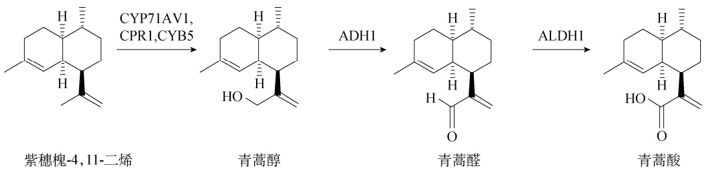
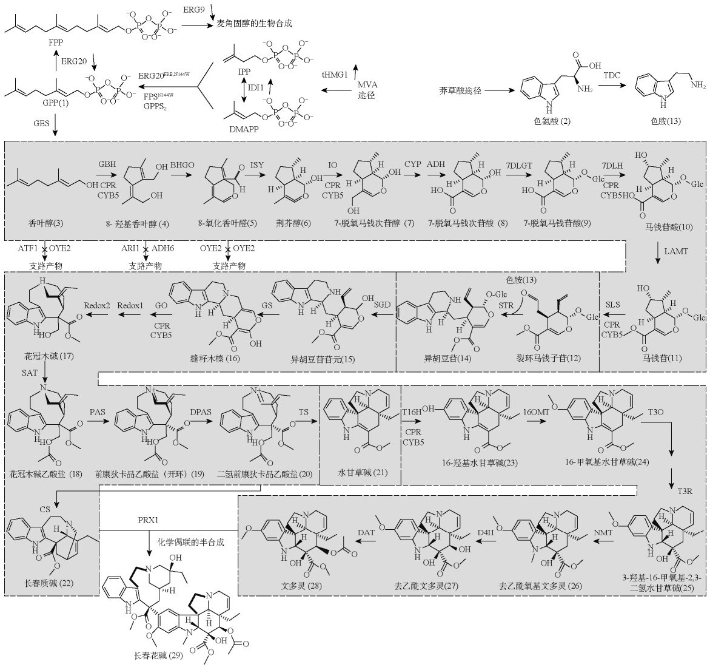
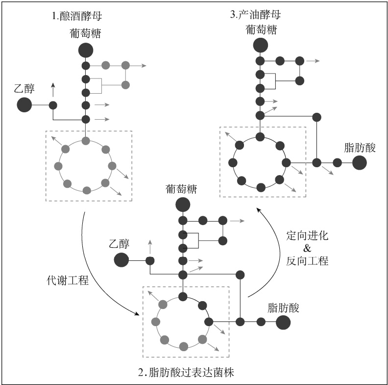
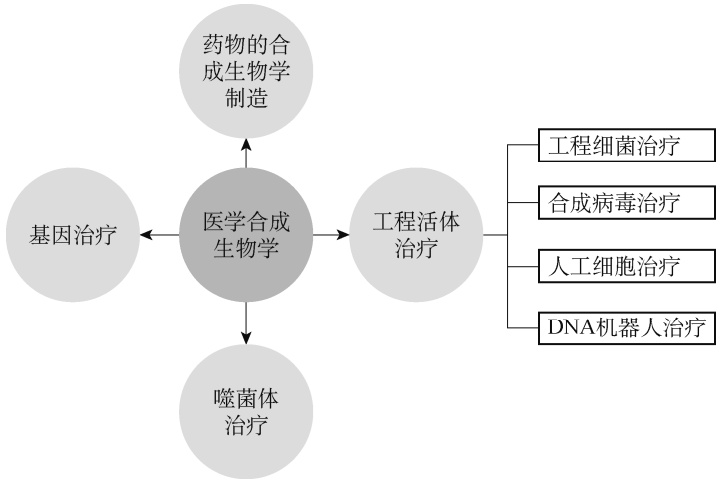
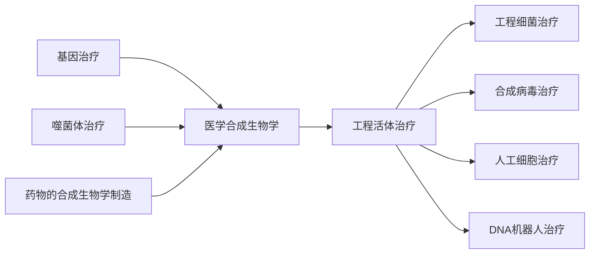
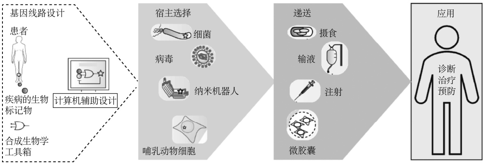
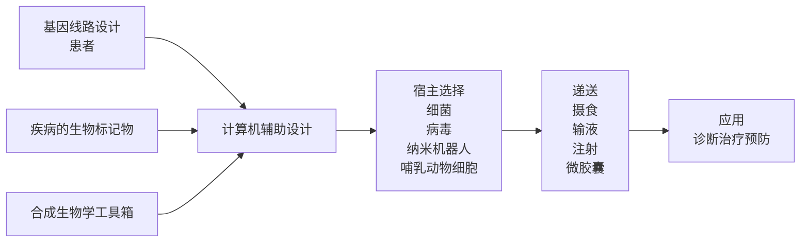

进一步地，通过在酵母中联合表达黄花蒿来源的细胞色素 b5（cytochrome b<sub>5</sub>，CYB5）、醇脱氢酶 1（alcohol dehydrogenase1，ADH1）和青蒿醛脱氢酶 1（artemisinic aldehyde dehydrogenase1，ALDH1）（图 7-18），青蒿酸的产量得到了显著提升，最终在优化发酵条件下达到了 25g/L<sup>[76]</sup>。得到的青蒿酸可以经过化学法进一步转化为青蒿素。



<details>
<summary>flowchart</summary>


</details>

图 7-18 经过三步催化反应可将紫穗槐-4，11-二烯转化为青蒿酸

将青蒿素的生产从植物转移到微生物生产平台，如酿酒酵母，使得青蒿素的生产不再依赖于宝贵的植物资源，又实现了更高效、可控的生产方式，为其商业化生产打开了新的大门。这一系列研究展示了通过合成生物学技术，特别是利用酿酒酵母作为生产宿主，可以实现药物生产的创新和优化。从早期的基因工程尝试，到成功设计和优化了能够生产青蒿素前体的酵母菌株，为后续利用合成生物学技术生产其他重要药物提供了宝贵的经验和启示，展现了合成生物学在现代药物生产中的巨大潜力和应用价值。

## 二、改造酿酒酵母用于生物合成抗癌药物长春碱前体

在 2019～2021 年，由于制造癌症化疗药物长春碱（vinblastine）和长春新碱（vincristine）所需的马达加斯加长春花干叶供应不足，这两种药物面临严重短缺。为了获取 1g 长春碱或长春新碱，需要分别从 500kg 和 2000kg 的植物干叶中进行提取。

2022 年 8 月，由 Keasling 领衔来自丹麦技术大学和加利福尼亚大学伯克利分校的研究人员在 Nature 期刊上发表了一项创新研究，介绍了使用模块化工程技术改造酿酒酵母来生产这两种抗癌药物的方法<sup>[77]</sup>。他们成功地在酿酒酵母中生产了长春碱的前体物质文多灵（vindoline）和长春质碱（catharanthine），并进一步通过体外化学合成制造了长春碱。长春碱的生物合成涉及超过 30 个酶促反应，研究将整个合成路径分为三个模块来进行:第一个模块的产物为异胡豆苷（strictosidine）；第二个模块的产物为长春质碱和水甘草碱（tabersonine）；第三个模块的产物为文多灵。该工程化酿酒酵母改造共进行了 56 次基因编辑，包括异源表达来自植物的 34 个外源基因，以及对酿酒酵母内源基因的敲除、敲低和过表达，从而提高前体物质的供应，实现了目标产物的合成。此外，第一个模块的产物异胡豆苷产量被提高了超过1000 倍，达到 25.2mg/L。由于异胡豆苷是所有单萜吲哚生物碱的关键前体，这为生产各种有医疗价值的化合物如拓扑替康和伊立替康的前体喜树碱（camptothecin）提供了可能性。这个新构建的平台不仅能够生成天然的药物分子，还可以用于合成非天然的衍生物，进一步优化药物的疗效和安全性。该研究生产目标物质不受天气、植物病害和物流问题的影响，可使用简单的再生原料进行生产，为未来的抗癌药物供应提供了一个可持续和稳定的方法。这是目前已知的利用微生物生产植物天然产物的最长生物合成路径（图 7-19）。



<details>
<summary>flowchart</summary>

```mermaid
graph TD
  A["麦角固醇的生物合成"] --> B["ERG9"]
  B --> C["MEA"]
  D["EGES"] --> E["FPP"]
  E --> F["ERG20"]
  F --> G["GPP(1)"]
  G --> H["ERG20FRE,H144W"]
  H --> I["TPPS9144W"]
  I --> J["DMAPP"]
  J --> K["tHMG1"]
  K --> L["MVA\n途径"]
  L --> M["莽草酸途径"]
  M --> N["色氨酸(2)"]
  N --> O["TDC"]
  O --> P["色胺(13)"]
  
  subgraph Substrate_1 [Substrate_1]
  Q["香叶醇(3)"] --> R["8-羟基香叶醇(4)"]
  R --> S["BHGO"]
  T["8-氧化香叶醛(5)"] --> U["ISY"]
  U --> V["荆芥醇(6)"]
  V --> W["7-脱氧马钱次苷醇(7)"]
  W --> X["CYP"]
  X --> Y["ADH"]
  Y --> Z["7-脱氧马钱次苷酸(8)"]
  Z --> AA["7DLGT"]
  AA --> AB["7-脱氧马钱苷酸(9)"]
  AB --> AC["7DLH"]
  AC --> AD["马钱苷酸(10)"]
  AD --> AE["LAMT"]
  end
  
  subgraph Substrate_2 [Substrate_2] [Substrate_2]
  AF["ATF1"] --> AG["OYE2\n支路产物"]
  AG --> AH["ARI1\n支路产物"]
  AH --> AI["ADH6\n支路产物"]
  AI --> AJ["OYE2\n支路产物"]
  AJ --> AK["OYE2\n支路产物"]
  end
  
  subgraph Substrate_3 [Substrate_3] [Substrate_3] [Substrate_3]
  BH["花冠木碱(17)"] --> AI["SAT"]
  AI --> AJ
  AJ --> AK
  AK --> AL["缝籽木榛(16)"]
  AL --> AM["异胡豆苷苷元(15)"]
  AM --> AN["SGD"]
  AN --> AO["异胡豆苷(14)"]
  AO --> AP["裂环马钱子苷(12)"]
  AP --> AQ["色胺(13)"]
  AQ --> AR["SLS\nCPR\nCYB5"]
  AR --> AS["马钱苷(11)"]
  end
  
  subgraph Substrate_4 [Substrate_4] [Substrate_4] [Substrate_4] [Substrate_4]
  AT["花冠木碱乙酸盐(18)"] --> AU["PAS"]
  AU --> AV["前康狄卡品乙酸盐(开环)(19)"]
  AV --> AW["DPAS"]
  AW --> AX["二氢前康狄卡品乙酸盐(20)"]
  AX --> AY["TS"]
  AY --> AZ["水甘草碱(21)"]
  AZ --> BA["T16OH\nCPR\nCYB5"]
  BA --> BB["16OMT"]
  BB --> BC["16-羟基水甘草碱(23)"]
  BC --> BD["16-甲氧基水甘草碱(24)"]
  BD --> BE["T3O"]
  BE --> BF["T3R"]
  end
  
  subgraph Substrate_5 [Substrate_5] [Substrate_5] [Substrate_5] [Substrate_5]
  CS["长春质碱(22)"] --> CS
  CS --> CS
  CS --> PRX1["PRX1\n化学偶联的半合成"]
    
    subgraph Substrate_6 [Substrate_6] [Substrate_6] [Substrate_6]
      CSN["文多灵(28)"] <--> DAT["去乙酰文多灵(27)"]
      DAT <--> D4II["去乙酰氧基文多灵(26)"]
      D4II <--> DNMTN["NMT"]
      DNMTN <--> NMRN["3-羟基-16-甲氧基-2,3-二氢水甘草碱(25)"]
      NMRN <--> NMRN
      NMRN <--> NMRN
      NMRN <--> NMRN
      NMRN <--> NMRN
      NMRN <--> NMRN
      NMRN <--> NMRN
      NMRN <--> NMRN
      NMRN <--> NMRN
      NMRN <--> NMRN
      NMRN <--> NMRN
      NMRN <--> NMRN
```
</details>

图 7-19 在酵母中生产长春碱的完整生物合成途径<sup>[77]</sup>

FPP. 法尼基焦磷酸；GPP. 香叶基焦磷酸；IPP. 异戊烯焦磷酸；DMAPP. 二甲基烯丙基焦磷酸；MVA. 甲羟戊酸；GPPS. 香叶基焦磷酸合酶；FPS<sup>N144W</sup>. 法尼基焦磷酸合酶的 N144W 突变体；CPR. 细胞色素 P450 还原酶；CYB5. 细胞色素 b5；GES. 香叶醇合酶；G8H. 香叶醇 8-羟化酶；8HGO. 8-羟基香叶醇氧化还原酶；ISY. 环烯醚萜合酶；IO. 环烯醚萜氧化酶；CYP. 细胞色素P450；ADH. 醇脱氢酶；7DLGT. 7-脱氧马钱苷酸葡萄糖转移酶；7DLH. 7-脱氧马钱苷酸羟化酶；LAMT. 马钱苷酸-O-甲基转移酶；TDC. 色氨酸脱羧酶；GS. 缝籽木榛合酶；GO. 缝籽木榛氧化酶；Redox1. 蛋白质氧化还原 1；Redox2. 蛋白质氧化还原2；SAT. 花冠木碱-O-酰基转移酶；CS. 长春质碱合酶；TS. 水甘草碱合酶；T16H. 水甘草碱 16-羟化酶；16OMT. 水甘草碱合酶 16-O-甲基转移酶；T3O. 水甘草碱-3-氧化酶；T3R. 16-甲氧基-2, 3-二氢-3-羟基水甘草碱合酶；NMT. 16-甲氧基-2, 3-二氢-3-羟基水甘草碱-N-甲基转移酶；D4H. 去乙酰氧基文多灵羟化酶；DAT. 去乙酰文多灵-4-O-乙酰转移酶；PRX1. Ⅲ型过氧化物酶

2023 年 1 月，浙江大学的连佳长团队报道了在巴斯德毕赤酵母中实现了长春质碱的合成<sup>[78]</sup>。至该研究报道发表时，这是在非模式生物中异源合成的最复杂的分子。值得注意的是，这项研究采用甲醇作为碳源，成功地将甲醇直接转化为长春碱前体，表明通过合成生物学技术，毕赤酵母有潜力将甲醇转变为具有高附加值的化合物。

## 三、酿酒酵母生物合成脂肪酸

石化资源的使用推动了人类社会的飞速进展，但随着人口和经济的持续增长，我们需要找到更为可持续的生产方式。工程化的微生物在生产燃料和化学品上提供了一个解决方案，可以有效减少碳足迹，辅助或替代传统的生产方式。尤其是，微生物生产的脂肪酸在近年成为焦点，是因为其在制造多种产品如油脂化学品、洗涤剂、润滑油、化妆品和药品中有巨大的应用潜力。然而，胞内的代谢网络调控严谨。对细胞进行改造以引导底物代谢流向目标产物，并确保产量和效率满足商业化需求，这无疑是一个巨大的挑战。

2018 年，瑞典查尔莫斯理工大学的 Jens Nielsen 及其团队在Cell 期刊上发布了一项研究，报道了如何利用酿酒酵母来进行游离脂肪酸的生产。众所周知，酿酒酵母通常通过乙醇发酵进行代谢。但通过一系列代谢工程的改造，研究团队成功地将酿酒酵母的代谢从乙醇发酵转变为脂肪酸生产。

具体来说，从葡萄糖到脂肪酸的转换可以分为三个模块:葡萄糖到丙酮酸的上游模块，丙酮酸到乙酰辅酶 A 的中间模块，以及乙酰辅酶 A 到脂肪酸的下游模块。研究团队先前已构建了一种工程酵母菌株，其能生产 7g/L 的脂肪酸<sup>[79]</sup>。在这项研究中，他们进一步优化了菌株YJZ45，提高了乙酰辅酶 A 的供应，从而使得新工程菌株 Y&Z019 的脂肪酸产量相比 YJZ45增加了 $4 6 \% { _ \mathrm { c } }$ 随后，研究人员微调了糖酵解和 PPP 途径，以增加辅因子 NADPH 的供应。他们也重新设计了异柠檬酸脱氢酶节点，以优化碳通量的分配。结合限制氮的供应并使用 HXT1启动子动态地控制关键基因的表达，将脂肪酸生成与细胞生长分开，从而有效地提高了脂肪酸产量。通过在葡萄糖和氮受限的条件下进行分批培养，最佳菌株 Y&Z036 脂肪酸产量比出发菌株提高了 4 倍，达 33.4g/L，这是当时报道的最高水平。

接下来，研究团队经深入研究，成功地在工程菌株中敲除了三个丙酮酸脱羧酶基因PDC1、PDC5 和 PDC6，从而阻断了乙醇的生成。为了弥补这种基因敲除后在葡萄糖中导致的生长缺陷，他们使用了适应性定向进化技术，获取了生长恢复的进化菌株，建立了一个稳定的重编程胞内代谢网络。这一系列步骤消除了“葡萄糖到乙醇”代谢模式，成功构建了从乙醇发酵到纯脂肪酸合成的酵母菌株产油酵母（synthetic oil yeast）（图 7-20）<sup>[80]</sup>。



<details>
<summary>flowchart</summary>

This diagram illustrates the process of converting glucose into fatty acids via fermentation and production, including feedback loops for fermentation, fermentation, and fermentation.
</details>

图 7-20 代谢途径重编程及定向进化构建脂肪酸合成酵母<sup>[80]</sup>

此外，值得关注的是，通过基因组测序和代谢特性鉴定，研究人员发现进化菌株中的丙酮酸激酶突变在平衡糖酵解和细胞生长、缓解 Crabtree 效应中起到了关键作用。这一发现揭示了酿酒酵母经过数百万年的进化之后，其代谢机制依然具有极高的可塑性。这一研究为未来基于生物的燃料和化学品生产奠定了坚实的基础，突显了酿酒酵母在合成生物学研究中拥有的巨大潜能。

## 思 考 题

1. 为什么酿酒酵母在合成生物学中具有重要地位？
2. 酿酒酵母在合成生物学中有哪些应用？
3. 酿酒酵母基因组大小是多少？有什么特点？
4. 酿酒酵母中基本的基因表达单元由什么组成？如何通过启动子调控基因表达？
5. 列举 1～2 个酿酒酵母的筛选标记，以及简述如何应用该筛选标记。
6. 转录因子的作用是什么？
7. 什么是酿酒酵母代谢途径的动态调控？有何意义？
8. RNA 干扰如何发挥沉默基因表达的作用？
9. 请介绍一下酿酒酵母的体内片段组装技术。
10. CRISPR 技术在酿酒酵母中有哪些应用？

## 参考文献

［1］Cohen SN，Chang AC，Boyer HW，et al. Construction of biologically functional bacterial plasmids in vitro. Proc Natl Acad Sci USA，1973，70（11）:3240-3244
［2］Sikorski RS，Hieter P. A system of shuttle vectors and yeast host strains designed for efficient manipulation of DNA in Saccharomyces cerevisiae. Genetics，1989，122（1）:19-27
［3］Goffeau A，Barrell BG，Bussey H，et al. Life with 6000 genes. Science，1996，274（5287）:546，563-567
［4］Nielsen J，Keasling J D. Engineering cellular metabolism. Cell，2016，164（6）:1185-1197
［5］Richardson SM，Mitchell LA，Stracquadanio G，et al. Design of a synthetic yeast genome. Science，2017，355（6329）:1040-1044
［6］Khurana V，Lindquist S. Modelling neurodegeneration in Saccharomyces cerevisiae:Why cook with baker’s yeast? Nat Rev Neurosci，2010，11（6）:436-449
［7］Hong KK，Nielsen J. Metabolic engineering of Saccharomyces cerevisiae:A key cell factory platform for future biorefineries. Cellular and Molecular Life Sciences，2012，69（16）:2671-2690
［8］van Wyk N，Kroukamp H，Pretorius IS. The smell of synthetic biology:Engineering strategies for aroma compound production in yeast. Fermentation，2018，4（3）:54
［9］Massoud R，Khosravi-Darani K，Sharifan A，et al. Lead bioremoval from milk by Saccharomyces cerevisiae. Biocatalysis and Agricultural Biotechnology，2019，22:101437
［10］Kurtzman C，Fell JW，Boekhout T. The Yeasts:A Taxonomic Study. New York:Elsevier，2011
［11］Mortimer RK. Evolution and variation of the yeast（Saccharomyces）genome. Genome Res，2000，10（4）:
403-409
［12］Cherry JM，Hong EL，Amundsen C，et al. Saccharomyces genome database:The genomics resource of budding yeast. Nucleic Acids Res，2012，40（Database issue）:D700-D705
［13］Cazzanelli G，Pereira F，Alves S，et al. The yeast Saccharomyces cerevisiae as a model for understanding ras proteins and their role in human tumorigenesis. Cell，2018，7（2）:14
［14］Yurkov AM，Rohl O，Pontes A，et al. Local climatic conditions constrain soil yeast diversity patterns in mediterranean forests，woodlands and scrub biome. Fems Yeast Res，2016，16（1）:fov103
［15］Llorente B，Williams TC，Goold HD，et al. Harnessing bioengineered microbes as a versatile platform for space nutrition. Nat Commun，2022，13（1）:6177
［16］Sisko JL，Spaeth K，Kumar Y，et al. Multifunctional analysis of chlamydia-specific genes in a yeast expression system. Mol Microbiol，2006，60（1）:51-66
［17］Zhu J，Zhang MQ. Scpd:A promoter database of the yeast Saccharomyces cerevisiae. Bioinformatics，1999，15（7-8）:607-611
［18］Xie W，Ye L，Lv X，et al. Sequential control of biosynthetic pathways for balanced utilization of metabolic intermediates in Saccharomyces cerevisiae. Metab Eng，2015，28:8-18
［19］Alper H，Fischer C，Nevoigt E，et al. Tuning genetic control through promoter engineering. Proceedings of the National Academy of Sciences，2005，102（36）:12678-12683
［20］Hector RE，Mertens JA. A synthetic hybrid promoter for xylose-regulated control of gene expression in Saccharomyces yeasts. Mol Biotechnol，2017，59（1）:24-33
［21］Teo WS，Chang MW. Development and characterization of and-gate dynamic controllers with a modular synthetic gal1 core promoter in Saccharomyces cerevisiae. Biotechnol Bioeng，2014，111（1）:144-151
［22］Yuan T，Guo Y，Dong J，et al. Construction，characterization and application of a genome-wide promoter library in Saccharomyces cerevisiae. Frontiers of Chemical Science and Engineering，2017，11（1）:107-116
［23］Redden H，Alper HS. The development and characterization of synthetic minimal yeast promoters. Nat Commun，2015，6:7810
［24］Curran KA，Karim AS，Gupta A，et al. Use of expression-enhancing terminators in Saccharomyces cerevisiae to increase mrna half-life and improve gene expression control for metabolic engineering applications. Metab Eng，2013，19:88-97
［25］Yamanishi M，Ito Y，Kintaka R，et al. A genome-wide activity assessment of terminator regions in Saccharomyces cerevisiae provides a“Terminatome”toolbox. ACS Synth Biol，2013，2（6）:337-347
［26］Uwimana N，Collin P，Jeronimo C，et al. Bidirectional terminators in Saccharomyces cerevisiae prevent cryptic transcription from invading neighboring genes. Nucleic Acids Res，2017，45（11）:6417-6426
［27］Wei L，Wang Z，Zhang G，et al. Characterization of terminators in Saccharomyces cerevisiae and an exploration of factors affecting their strength. Chembiochem，2017，18（24）:2422-2427
［28］Deaner M，Alper HS. Promoter and terminator discovery and engineering. Synthetic Biology-Metabolic Engineering，2018，162:21-44
［29］Roehner N，Young EM，Voigt CA，et al. Double dutch:A tool for designing combinatorial libraries of biological systems. ACS Synth Biol，2016，5（6）:507-517
［30］Burén S，Young EM，Sweeny EA，et al. Formation of nitrogenase NifDK tetramers in the mitochondria of Saccharomyces cerevisiae. ACS Synth Biol，2017，6（6）:1043-1055
［31］Young EM，Zhao Z，Gielesen BEM，et al. Iterative algorithm-guided design of massive strain libraries，applied to itaconic acid production in yeast. Metab Eng，2018，48:33-43
［32］Siewers V. An overview on selection marker genes for transformation of Saccharomyces cerevisiae. In:Mapelli V. Yeast Metabolic Engineering:Methods and Protocols. New York:Springer New York:3-15
［33］Goldstein AL，McCusker JH. Three new dominant drug resistance cassettes for gene disruption in Saccharomyces cerevisiae. Yeast，1999，15（14）:1541-1553
［34］Hahn S，Young ET. Transcriptional regulation in Saccharomyces cerevisiae:Transcription factor regulation and function，mechanisms of initiation，and roles of activators and coactivators. Genetics，2011，189（3）:705-736
［35］Alper H，Moxley J，Nevoigt E，et al. Engineering yeast transcription machinery for improved ethanol tolerance and production. Science，2006，314（5805）:1565-1568
［36］Huang M，Bao J，Hallstrom BM，et al. Efficient protein production by yeast requires global tuning of metabolism. Nat Commun，2017，8:1131
［37］Xiao C，Pan Y，Huang M. Advances in the dynamic control of metabolic pathways in Saccharomyces cerevisiae. Engineering Microbiology，2023，3（4）:100103
［38］Hartline CJ，Schmitz AC，Han Y，et al. Dynamic control in metabolic engineering:Theories，tools，and applications. Metab Eng，2021，63:126-140
［39］Bian Q，Jiao X，Chen Y，et al. Hierarchical dynamic regulation of Saccharomyces cerevisiae for enhanced lutein biosynthesis. Biotechnol Bioeng，2023，120（2）:536-552
［40］Teixeira PG，Ferreira R，Zhou YJ，et al. Dynamic regulation of fatty acid pools for improved production of fatty alcohols in Saccharomyces cerevisiae. Microb Cell Fact，2017，16（1）:45
［41］Zhou P，Fang X，Xu N，et al. Development of a highly efficient copper-inducible gal regulation system (CuIGR) in Saccharomyces cerevisiae. ACS Synth Biol，2021，10（12）:3435-3444
［42］Xu X，Du Z，Liu R，et al. A single-component optogenetic system allows stringent switch of gene expression in yeast cells. ACS Synth Biol，2018，7（9）:2045-2053
［43］Zhao EM，Zhang Y，Mehl J，et al. Optogenetic regulation of engineered cellular metabolism for microbial chemical production. Nature，2018，555（7698）:683-687
［44］Zhao EM，Lalwani MA，Chen JM，et al. Optogenetic amplification circuits for light-induced metabolic control. ACS Synth Biol，2021，10（5）:1143-1154
［45］Lalwani MA，Zhao EM，Wegner SA，et al. The Neurospora crassa inducible q system enables simultaneous optogenetic amplification and inversion in Saccharomyces cerevisiae for bidirectional control of gene expression. ACS Synth Biol，2021，10（8）:2060-2075
［46］Zhou P，Xie W，Yao Z，et al. Development of a temperature-responsive yeast cell factory using engineered gal4 as a protein switch. Biotechnol Bioeng，2018，115（5）:1321-1330
［47］Zhou P，Li M，Shen B，et al. Directed coevolution of beta-carotene ketolase and hydroxylase and its application in temperature-regulated biosynthesis of astaxanthin. J Agric Food Chem，2019，67（4）:1072-1080
［48］Ge C，Yu Z，Sheng H，et al. Redesigning regulatory components of quorum-sensing system for diverse metabolic control. Nat Commun，2022，13（1）:2182
［49］Bardwell L. A walk-through of the yeast mating pheromone response pathway. Peptides，2005，26（2）:339-350
［50］Williams TC，Nielsen LK，Vickers CE. Engineered quorum sensing using pheromone-mediated cell-to-cell communication in Saccharomyces cerevisiae. ACS Synth Biol，2013，2（3）:136-149
［51］Chen MT，Weiss R. Artificial cell-cell communication in yeast Saccharomyces cerevisiae using signaling elements from Arabidopsis thaliana. Nat Biotechnol，2005，23（12）:1551-1555
［52］Yang X，Liu J，Zhang J，et al. Quorum sensing-mediated protein degradation for dynamic metabolic pathway control in Saccharomyces cerevisiae. Metab Eng，2021，64:85-94
［53］David F，Nielsen J，Siewers V. Flux control at the malonyl-coa node through hierarchical dynamic pathway regulation in Saccharomyces cerevisiae. ACS Synth Biol，2016，5（3）:224-233
［54］Hannon GJ. RNA interference. Nature，2002，418（6894）:244-251
［55］Catala M，Lamontagne B，Larose S，et al. Cell cycle-dependent nuclear localization of yeast rnase iii is required for efficient cell division. Mol Biol Cell，2004，15（7）:3015-3030
［56］Drinnenberg IA，Weinberg DE，Xie KT，et al. RNAi in budding yeast. Science，2009，326（5952）:544-550
［57］Wang G，Björk SM，Huang M，et al. RNAi expression tuning，microfluidic screening，and genome recombineering for improved protein production in Saccharomyces cerevisiae. Proc Natl Acad Sci USA，2019，116（19）:9324-9332
［58］Huh WK，Falvo JV，Gerke LC，et al. Global analysis of protein localization in budding yeast. Nature，2003，425（6959）:686-691
［59］Xue S，Liu X，Pan Y，et al. Comprehensive analysis of signal peptides in Saccharomyces cerevisiae reveals features for efficient secretion. Advanced Science，2023，10:2203433
［60］Zhou YJ，Buijs NA，Zhu ZW，et al. Harnessing yeast peroxisomes for biosynthesis of fatty-acid-derived biofuels and chemicals with relieved side-pathway competition. J Am Chem Soc，2016，138（47）:15368-15377
［61］Orr-Weaver TL，Szostak JW，Rothstein RJ. Yeast transformation:A model system for the study of recombination. Proc Natl Acad Sci USA，1981，78（10）:6354-6358
［62］Shao Z，Zhao H，Zhao H. DNA assembler，an in vivo genetic method for rapid construction of biochemical pathways. Nucleic Acids Res，2009，37（2）:e16
［63］Kuijpers NG，Solis-Escalante D，Bosman L，et al. A versatile，efficient strategy for assembly of multi-fragment expression vectors in saccharomyces cerevisiae using 60bp synthetic recombination sequences. Microb Cell Fact，2013，12:47
［64］Kuijpers NG，Chroumpi S，Vos T，et al. One-step assembly and targeted integration of multigene constructs assisted by the Ⅰ-SceⅠ meganuclease in Saccharomyces cerevisiae. Fems Yeast Res，2013，13（8）:769-781
［65］Wach A，Brachat A，Pohlmann R，et al. New heterologous modules for classical or PCR-based gene disruptions in Saccharomyces cerevisiae. Yeast，1994，10（13）:1793-1808
［66］Güldener U，Heck S，Fielder T，et al. A new efficient gene disruption cassette for repeated use in budding yeast. Nucleic Acids Res，1996，24（13）:2519-2524
［67］Solis-Escalante D，Kuijpers NG，Bongaerts N，et al. amd SYM，a new dominant recyclable marker cassette for Saccharomyces cerevisiae. Fems Yeast Res，2013，13（1）:126-139
［68］Huang M，Wang G，Qin J，et al. Engineering the protein secretory pathway of Saccharomyces cerevisiae enables improved protein production. Proc Natl Acad Sci USA，2018，115（47）:E11025-E11032
［69］DiCarlo JE，Norville JE，Mali P，et al. Genome engineering in Saccharomyces cerevisiae using CRISPR-Cas systems. Nucleic Acids Res，2013，41（7）:4336-4343
［70］Mans R，van Rossum HM，Wijsman M，et al. CRISPR/Cas9:A molecular Swiss army knife for simultaneous introduction of multiple genetic modifications in Saccharomyces cerevisiae. Fems Yeast Res，2015，15（2）:fov004
［71］Zhang Y，Wang J，Wang Z，et al. A gRNA-tRNAarray for CRISPR-Cas9 based rapid multiplexed genome editingin Saccharomyces cerevisiae. Nat Commun，2019，10:1053
［72］Lian J，HamediRad M，Hu S，et al. Combinatorial metabolic engineering using anorthogonal tri-functional CRISPR system. Nat Commun，2017，8:1688
［73］Martin VJ，Pitera DJ，Withers ST，et al. Engineering a mevalonate pathway in Escherichia coli for production of terpenoids. Nat Biotechnol，2003，21（7）:796-802
［74］Paddon CJ，Keasling JD. Semi-synthetic artemisinin:A model for the use of synthetic biology in pharmaceutical development. Nat Rev Microbiol，2014，12（5）:355-367
［75］Ro DK，Paradise EM，Ouellet M，et al. Production of the antimalarial drug precursor artemisinic acid in engineered yeast. Nature，2006，440（7086）:940-943
［76］Paddon CJ，Westfall PJ，Pitera DJ，et al. High-level semi-synthetic production of the potent antimalarial artemisinin. Nature，2013，496（7446）:528-532
［77］Zhang J，Hansen LG，Gudich O，et al. A microbial supply chain for production of the anti-cancer drug vinblastine. Nature，2022，609（7926）:341-347
［78］Gao J，Zuo Y，Xiao F，et al. Biosynthesis of catharanthine in engineered Pichia pastoris. Nature Synthesis，2023，2（3）:231-242
［79］Zhou YJ，Buijs NA，Zhu Z，et al. Production of fatty acid-derived oleochemicals and biofuels by synthetic yeast cell factories. Nat Commun，2016，7:11709
［80］Yu T，Zhou YJ，Huang M，et al. Reprogramming yeast metabolism from alcoholic fermentation to lipogenesis. Cell，2018，174（6）:1549-1558

# 医学合成生物学

## 第一节 概 论

现代医学依然面临着许多复杂的挑战，如慢性疾病的日趋普遍、癌症发病率和死亡率的持续攀升、人口老龄化催生的健康需求及抗生素耐药带来的严重威胁等。现有的治疗手段往往难以有效地解决这些问题。随着现代生物技术和基因工程的快速发展，合成生物学为解决这些健康问题提供了新的可能性。

合成生物学是一门生物学、信息学和工程学相结合的新兴交叉学科，它应用工程学原理对生物系统进行模块化设计和构建，以获得对生命活动的高度可控性，实现对生命体的精确编程、改造和优化。合成生物学的核心理念是将生命体视为可以像机械电路一样进行标准化设计和模块化组装的工程系统，综合运用基因合成、基因编辑和基因电路等技术实现对生命体的高精度操控和重新设计。合成生物学的最终目的是定制设计人工生命体，用于改善健康、能源、农业、环境等领域。在医学领域，人们可以应用合成生物学原理，通过对微生物（病毒、细菌等）、细胞、组织和其他生命体的人工再造，开发创新型医学工具，用于疾病诊断、治疗和预防。

在 20 世纪 80 年代和 90 年代，随着 DNA 测序和基因合成技术的迅速发展，遗传工程和基因编辑的能力成为现实，合成生物学随之兴起。不久之后，科学家开始将合成生物学应用于医学领域。医学合成生物学的起源可以追溯到 21 世纪初，研究人员构建了能够特异性靶向肿瘤的细菌和病毒，并改造了噬菌体用于治疗细菌感染，这些概念验证研究展示了合成生物学在医学方面的潜力。随后，多个研究小组工程化了益生大肠杆菌，用于检测和消灭假单胞菌等病原体，为合成生物疗法针对微生物组的发展奠定了基础。研究人员还利用工程化酵母大规模生产抗疟药物青蒿素的前体青蒿酸，使得低成本生产这种救命药物成为可能。

自 2010 年起，合成生物学快速发展，高效便捷的工具如 CRISPR-Cas9 基因编辑、大规模DNA 合成和单细胞组学等相继出现，使定制化和靶向遗传操作成为可能。利用这些技术，可以对植物或动物的细胞、器官乃至生物系统进行工程设计，并将其应用于疾病诊断、再生医学、基因治疗、疫苗制备和药物开发等领域。在短短数十年间，合成生物学技术已从简单的微生物扩展到复杂的哺乳动物细胞和组织，合成生物学在医学领域的应用也日益广泛。

医学合成生物学主要的研究内容包括药物的合成生物学制造、工程活体治疗、基因治疗和噬菌体治疗等（图 8-1）。



<details>
<summary>flowchart</summary>


</details>

图 8-1 医学合成生物学

合成生物学家利用设计的活体细胞、细菌、病毒颗粒或 DNA 构建的纳米机器人（nanorobot）将基因线路输送到体内预定部位，在这些部位，运载药荷可以诊断和治疗早期疾病（图 8-2）。首先根据疾病的相关标记物和合适的治疗输出设计基因线路，或借助计算机辅助设计基因线路。接着，选择合适的宿主如细菌、病毒、哺乳动物细胞或纳米机器人等来表达基因线路。随后，根据不同宿主选择合适的递送方式输送到人体预定位点，细菌和哺乳动物细胞封装后，分别通过摄食和注射递送到人体；而病毒和 DNA 纳米机器人可通过输液递送到人体。基因线路一旦进入人体预定位点，即可发挥诊断、治疗或预防疾病的作用。



<details>
<summary>flowchart</summary>


</details>

图 8-2 工程活体治疗的原理

## 一、工程细菌

1）工程化益生菌:通过基因工程改造大肠杆菌和乳酸杆菌等细菌，使其能够感知疾病信号，并产生治疗性蛋白质或多肽，用于治疗胃肠道紊乱、炎症、细菌感染等疾病。
2）癌症治疗:通过对沙门氏菌、李斯特菌和梭状芽孢杆菌等细菌的工程化，使其能够特异性地感染肿瘤细胞，并在其中复制，而不影响正常细胞。上述细菌可用于癌症诊断或递送抗癌药物。
3）细菌生物合成:通过改造细菌，使其能够合成治疗性蛋白质、代谢物或化合物，旨在开发高效、绿色和可再生的生物制造过程。

## 二、合成病毒

1）溶瘤病毒:利用合成生物学技术，研究人员对腺病毒、单纯疱疹病毒、痘苗病毒等常见的低致病性病毒进行工程改造，去除了致病性基因，使它们能够特异性感染和消灭肿瘤细胞，而不影响正常细胞；同时，他们还在病毒中嵌入了治疗基因电路，使得治疗基因能够在肿瘤部位特异性地表达。目前，已有数十种溶瘤病毒用于癌症治疗。
2）基因治疗载体:腺相关病毒具有高度的安全性和组织选择性，因而作为基因递送载体被广泛用于基因治疗领域。工程化的腺相关病毒能够传递功能性基因，用于治疗遗传性疾病，如地中海贫血、血友病、神经系统疾患等。目前，人工智能技术也被应用于腺相关病毒衣壳蛋白的定向进化，使其具有更强的靶向性和感染活性。
3）疫苗:由于减毒疫苗和灭活疫苗未能满足临床需求，研究人员通过对病毒进行工程化改造，使其能够感染细胞并大量产生抗原，但不能自我复制，从而既能强力刺激免疫反应，又能保证安全性。相关的病毒载体疫苗已被开发用于预防 COVID-19 等多种感染性疾病。

## 三、人工细胞

1）嵌合抗原受体（chimeric antigen receptor，CAR）细胞:利用合成生物学技术，人们可以改造 T 细胞、自然杀伤细胞（NK）、巨噬细胞（macrophage）等免疫细胞，使它们通过 CAR能够更有效地识别肿瘤细胞表面的抗原并对肿瘤细胞发起攻击。目前，CAR-T 细胞疗法在血液肿瘤领域已经取得了巨大成功，对包括多发性骨髓瘤在内的多种血液肿瘤的整体反应率（overall response rate，ORR）超过 90%。
2）调节性 T 细胞（regulatory T cell，Treg）:Treg 是人体内重要的免疫调节细胞，其生理功能是控制过度免疫反应造成的机体损伤。人们通过改造 Treg 使它们能更持久地发挥免疫调节作用，并将其应用于治疗自身免疫性疾病和移植排斥反应。
3）诱导多能干细胞（induced pluripotent stem cell，iPSC）:iPSC 技术是通过表达多种转录因子（如 Oct4、Sox2、c-Myc、Klf4 等）使在终末分化的体细胞恢复多向分化潜能的过程。目前，研究人员可以将 iPSC 定向分化为能够分泌胰岛素的胰岛 B 细胞，用于治疗 2 型糖尿病。

## 四、工程化生物系统应用于临床治疗的挑战

虽然医学合成生物学正在飞速发展并已展现出巨大潜力，但是将工程化生物系统从概念

验证研究转化为可行的临床治疗依然面临着许多挑战，这些挑战包括以下三个方面。

1）安全性:人工微生物具有免疫原性、脱靶效应、失控增殖等风险，基因递送可能导致插入突变从而破坏宿主基因组，而 iPSC 则具有潜在的成瘤性风险等。必须充分研究这些潜在的风险，建立有效的预防和控制手段，以确保临床使用的安全性。
2）有效性:与高度受控的实验室环境相比，人体内的环境更为复杂多变，因此人工微生物或人工细胞在其中的治疗效果可能受到限制。人工合成生物系统的稳定性和持久性是另一核心挑战，如何避免基因电路和人工生物系统随时间的推移而失活是关键问题。
3）可控性:传统治疗药物通常是小分子化合物或大分子抗体等，其大规模生产制备、存储、运输等工艺都已日趋成熟。而医学合成生物学所使用的人工合成生物系统是“活”的药物，因此需要保证其感染、复制、递送的能力。优化生产工艺，建立规模化和标准化的生产流程及相应的质量控制和检测体系，以制备满足临床规模需求的人工合成微生物、细胞和生物分子，仍然是一个巨大的挑战。

过去几十年间，合成生物学已从设想逐渐成为现实，并对疾病诊断、治疗和预防等医学领域产生了深远的影响，工程化微生物和人工细胞为人们打开了实现精准医学和个性化治疗的大门。尽管在安全性、有效性和可控性等方向上仍面临系列挑战，但医学科学界已在这些方面取得重大进展。随着基础研究的不断深入和转化医学的蓬勃发展，合成生物学将与材料科学、人工智能、纳米技术和生物医学等领域紧密结合，在人类健康领域取得了重大进展。我们有理由相信，医学合成生物学这个崭新的领域必将在不久的将来可以改善和拯救无数的生命，最终实现人类健康的全面提升。

## 第二节 药物的合成生物学制造

目前药物生产通常采用天然提取或化学合成的方法，但这些工艺难以应对某些复杂化合物的生产需求。这些化合物在自然界中含量极低，且难以人工合成和纯化，如抗癌药紫杉醇、抗疟药青蒿素和镇痛药吗啡等重要药物，它们的生产规模和可持续性均受到限制。生物合成为解决这一问题提供了一个理想的替代方案。利用合成生物学技术，人们可以设计并构建能够高效生产复杂天然产物或新型药物衍生物的微生物菌株，其产量远超自然水平。微生物发酵还具有可再生性，有利于可持续生产。此外，微生物产生的目标化合物通常会分泌到培养基中，与从植物中提取相比，后续的分离和纯化工艺也大为简化。除了人工微生物菌株，无细胞系统也被开发用于药物的生物合成。无细胞系统是指在无活细胞的情况下进行体外生物活动（如转录和翻译）的系统。由于其具备开放性、易于控制、灵活性和对细胞毒性高度耐受等优势，该系统已被用于合成在细胞中难以表达或有毒的蛋白质类药物。无细胞系统还非常适合高通量筛选。近年来，生物合成在可持续和经济高效的药物生产方面展现出了巨大的潜力。

## 一、萜类药物的生物合成

萜类化合物是由五碳化合物异戊二烯衍生的化合物，也是植物次生代谢产物中最大的一类，约占已鉴定的天然产物的 60%。许多萜类化合物含有具生物活性的药用成分，如青蒿素、紫杉醇和人参皂苷等。

1）青蒿素:一种从植物青蒿中提取的含有内过氧桥的倍半萜内酯，具有抗疟疾作用<sup>[1]</sup>。然而，它在植物青蒿中的含量极低（仅为 0.01%～1%），远远不能满足实际的医疗需求<sup>[2]</sup>。由于青蒿素分子具有多个手性中心，其化学合成途径困难且低效。利用微生物合成青蒿素的前体可提高药物生产效率，降低药物生产成本。倍半萜烯的生物合成是合成生物学的一个里程碑。重组大肠杆菌最初合成丁香烯的产量只有 24mg/L。经过不断的优化，工程酵母成功合成了另一种青蒿素前体青蒿酸，其产量达到了 $2 5 \mathrm { g } / \mathrm { L } ^ { [ 3 ] }$ 。青蒿酸的生物合成是合成生物学的一个成功范例。
2）紫杉醇:一种从太平洋红豆杉树中提取的二萜类化合物，具有抗癌作用。目前，紫杉醇的生产主要依赖于植物细胞培养技术，虽然比天然红豆杉树皮的含量提高了 10 倍，但仍面临费时且效率较低的问题。Ajikumar 等改造了大肠杆菌细胞，使其能够生产紫杉醇的前体紫杉二烯，其产量达到了 1g/L<sup>[4]</sup>。
3）人参皂苷:一种从人参属植物中提取的三萜皂苷，具有预防癌症和抗衰老的作用。利用酵母细胞工厂，可以合成各种人参皂苷，如人参皂苷 Rh2 和人参皂苷 CK 等，它们的产量分别达到了 $2 \mathrm { g } / \mathrm { L } ^ { [ 5 ] }$ 和 $\mathsf { S g / L ^ { [ 6 ] } }$ 。微生物方法的应用有效缓解了人参皂苷在临床应用中的短缺情况。

## 二、生物碱药物的生物合成

生物碱是一类至少含有一个氮原子的有机化合物，广泛存在于自然界中。由于生物碱具有多种药理活性，它们常被用于治疗疼痛、焦虑、癌症等疾病。然而，从植物中提取生物碱的过程既费时又费力，而且存在法律和伦理问题。因此，利用微生物通过生物合成技术生产生物碱具有重要的意义。生物合成不仅可以避免种植违禁植物，还可以提高生物碱的纯度和选择性。以下将介绍两类重要的生物碱药物—阿片类药物和大麻素的生物合成进展。

1）阿片类药物:一类从罂粟未成熟浆果中分离的生物碱，具有强效的镇痛作用。目前，阿片类药物主要通过化学合成或半合成的方式制备，但这些方法存在低效、高成本和环境污染等问题。为了解决这些问题，近年来，许多研究者尝试利用代谢工程技术在微生物中实现阿片类药物的生物合成。Galanie 等首先在工程酵母细胞中表达了 21 个基因（用于合成蒂巴因）或 23 个基因（用于合成羟考酮），分别得到了 $6.6 × 10^{-5} g/L$ 和 $3   \times   1 0 ^ { - 7 } \mathrm { g / L }$ 的产量<sup>[7]</sup>。随后，Nakagawa 等改进了这一过程，使用大肠杆菌作为底盘细胞，使蒂巴因和羟考酮的产量分别提高到 $2 . 1 { \times } 1 0 ^ { - 3 } \mathrm { g / L }$ 和 $4.0 \times 10^{-5}  g/L$ <sup>[8]</sup>。此外，其他阿片类药物如可待因等也已经在微生物中成功合成，并且产量达到了毫克级别。然而，与市场需求相比，这些产量仍然很低，因此未来的研究应该继续优化微生物的代谢途径和调控机制，以提高生物合成阿片类药物的效率和稳定性。

2）大麻素:一类从大麻中提取的天然产物，具有镇痛和抗焦虑作用。由于大麻在许多国家和地区被视为非法植物，大麻素的供应受到了严格的限制。此外，大麻素的化学结构复杂，难以通过化学合成或半合成的方式大量制备。因此，利用微生物通过生物合成技术生产大麻素也具有重要的意义。延胡索乙素和大麻萜酚酸是两种难以从植物中提取的著名大麻素。Hafner等利用酵母作为底盘细胞，实现了延胡索乙素的生物合成，其产量达到了 $3.6 × 10^{-6} g / L ^{[9]} 。$ Luo 等则建立了一条完整的大麻萜酚酸的生物合成途径，他们利用工程化酵母细胞使大麻萜酚酸的产量达到了 $0 . 1 \mathrm { g / L ^ { [ 1 0 ] } }$ 。这些都是利用合成生物学技术高效生产复杂大麻素的成功案例。

## 三、氨基酸衍生物药物的生物合成

氨基酸是构成生物体的基本单元之一，它们及其衍生物在维持人类健康方面发挥着重要作用。由于这类化合物含有多个手性中心，因此它们通常采用生物合成的方式而非化学合成的方式来制备。相比于生物碱和萜类化合物，氨基酸衍生物的结构更为简单，但却具有更高的多样性。

1）赛洛西宾:一种由 L-色氨酸衍生而来的化合物，具有治疗药物成瘾、抑郁症和创伤后应激障碍的潜力。通过基因工程技术，大肠杆菌或酿酒酵母可以异源表达赛洛西宾生物合成途径的相关基因，使其产量分别达到了 1.2g/L<sup>[11]</sup>和 0.6g/L<sup>[12]</sup>。
2）三七素:一种最初从家山黧豆种子中提取出来的植物次级代谢产物，能够诱导人体血小板聚集，是中药云南白药的主要活性成分之一。研究人员通过优化大肠杆菌中三七素的代谢流，使其最终产量提高到了 1.29g/L<sup>[13]</sup>。

## 四、不对称合成的生物催化

不对称合成是一种制备手性分子的有机合成方法。手性分子具有两种镜像对称的构型，但它们不能叠合在一起。不同构型的手性分子可能具有不同的生物或物理效应，因此不对称合成的目标是选择性地得到其中一种构型的手性分子。不对称合成通常需要使用一种手性的催化剂，它能够区分并优先产生一种手性分子。目前常用的催化剂有金属类的催化剂，但它们存在低效和金属污染的问题。生物催化可大大提高不对称合成的效率，为高效获得手性分子提供帮助。

例如，西格列汀是一种治疗糖尿病的药物，它能够竞争性地抑制二肽基肽酶-4（DPP-4），从而减少 GLP-1 的降解，增加胰岛素的分泌。西格列汀的市场规模在 2021 年达到了 14 亿美元。然而，西格列汀的化学合成过程中，需要通过铑为基础的手性催化剂转移手性胺，这样会导致立体选择性低和铑污染。为了解决这个问题，科学家从一种具有催化上述化学反应的分子机制但对前西格列汀酮没有活性的转氨酶开始，采用底物步移、同源建模和饱和诱变的方法，开发了一种具有一定催化活性的转氨酶突变体；随后通过定向进化的进一步改造，最终得到一种全新的具有广泛适用性的生物催化剂，用于高效合成手性胺，显著提高了西格列汀的合成效率和纯度<sup>[14]</sup>。这个案例展现了利用合成生物学手段开发的新型生物催化剂在高效和可持续制药过程中的应用潜力。

## 五、利用无细胞系统合成治疗性蛋白

蛋白质类药物（如抗体和重组蛋白）在全球药物市场中占据了越来越重要的地位。例如，阿达木单克隆抗体（adalimumab）和帕博利珠单克隆抗体（pembrolizumab）分别居 2022 年全球药物销售额的第二位和第三位。无细胞蛋白质合成（cell-free protein synthesis，CFPS）为解决蛋白质毒性问题和筛选胞内蛋白质提供了解决方案。此外，冻干技术使无细胞系统在保存一年后仍能保持高活性。

目前常用的 CFPS 系统有两种，分别是细胞裂解液系统和纯化成分系统<sup>[15]</sup>。最常见的细胞裂解液来自大肠杆菌、小麦胚芽和酵母<sup>[16]</sup>。大肠杆菌裂解液常用于合成蛋白质，小麦胚芽裂解液用于构建蛋白质阵列，酵母裂解液则用于合成糖蛋白。Shimizu 等利用 36 种转录/翻译相关酶和高度纯化的核糖体开发了一种无细胞系统<sup>[17]</sup>。然而，纯化成分的成本极高，阻碍了其推广应用。因此，细胞裂解液系统是目前 CFPS 系统的首选。

CFPS 系统为快速生产疫苗提供了平台。Kanter 等开发了一种无细胞系统，用于高效生产由抗体单链可变区片段（scFv）与粒细胞-巨噬细胞集落刺激因子（GM-CSF）组成的融合蛋白，这是一种 B 细胞淋巴瘤疫苗<sup>[18]</sup>。Lu 等描述了一种表达 H1N1 流感病毒结构域的 CFPS 系统，用于生产潜在的、具有广泛保护作用的流感疫苗<sup>[19]</sup>。Tsuboi 等在基于酵母裂解液的无细胞系统中成功表达了三种疟疾蛋白，而这在重组细胞中很难生产<sup>[20]</sup>。

CFPS 系统也常用于合成抗体。Jaroentomeechai 等利用 CFPS 系统在大肠杆菌无细胞系统（补充糖基化酶体系）中合成了具有 N-糖基化修饰的 scFv，对维持蛋白质药物（包括某些抗体）的半衰期和活性非常重要<sup>[21]</sup>。总体而言，无细胞系统具有快速、便捷和可按需定制等优点，正逐渐成为重组表达系统的有益补充。

## 第三节 工程细菌的诊疗

细菌是地球上分布范围最广、种类和数量最多的生物之一，与人们的日常生活息息相关。细菌也是人体表面和内部最常见的外源生物，与机体的稳态维持和疾病发生有密切关联。以大肠杆菌等模式微生物为代表，人类对细菌的研究已有上百年的历史，逐渐认识到细菌具有快速繁殖适合培养、基因组简单易于操作、长期与人体共存安全性良好等诸多关键特征，使其成为开发人工生物系统用于疾病诊疗的理想的底盘生物。第一，细菌生长迅速，能够规模化生产，易于实现低成本的生产。它们快速的复制也使得人工设计的基因电路能够在细菌体内快速迭代，在短时间内获得优化的基因模块。第二，细菌拥有小型的基因组，可以使用像CRISPR 这样的成熟工具进行高效的遗传操作，使得插入合成回路和重编程等操作变得简单直接。第三，细菌拥有灵活多样的代谢能力，可以产生种类繁多的生物分子。这种代谢多样性使得工程细菌能够合成小分子、酶、抗体和其他治疗分子。第四，目前已鉴定出多种非致病性的细菌种类和菌株，如大肠杆菌 Nissle 1917 和双歧杆菌，可以作为安全的底盘。此外，致病性菌株也可以通过敲除或替换毒性基因实现减毒。这些经过临床验证的菌株确保了工程细菌的安全性。第五，部分非致病性细菌无须改造即可定植于肠道和肿瘤等组织，实现靶向性局部给药。第六，细菌感染可以激活免疫系统，从而增强对抗疾病的免疫反应。

近年来，合成生物学家设计并构建了能感知和转导疾病生物标志物信号的基因电路，并将其植入工程细菌中，使工程细菌具备根据信号通路进行诊断和治疗的能力，从而实现了对治疗时空和剂量的精准控制。利用细菌活性进行疾病诊疗是一种集灵活性、可持续性和可预测性于一体的强大新策略，目前正处于迅速发展阶段，有望为人类疾病提供更多新的治愈途径。

## 一、工程细菌应用于癌症诊疗

早在 19 世纪早期，医学界就已经开始观察到细菌感染有时能够减缓甚至治愈肿瘤的现象。1893 年，美国医生 William Coley 成功将细菌灭活，制备成了“科利毒素”（Coley’s toxin），并最终成功治疗了近千名肿瘤患者<sup>[22]</sup>。随着对细菌的深入研究，人们逐渐认识到细菌疗法具有出色的靶向性、较低的毒副作用及卓越的免疫激活效应。虽然细菌肿瘤治疗的作用机制尚未被完全认识，但主要的可能机制是:①肿瘤靶向性，在肿瘤的缺氧和酸性环境中免疫监视能力弱，导致细菌能在肿瘤微环境中定植和增殖，而在正常组织中因其严格的免疫机制，细菌将被快速清除而无法定植；而且厌氧菌也不会在与肿瘤无关的缺氧性或炎症性病变中定植。②细菌在肿瘤内部与癌细胞竞争营养。③细菌具有内在抗肿瘤活性。④细菌的免疫原性会激活宿主局部的免疫系统，从而杀死肿瘤细胞。

目前已报道许多细菌可用于肿瘤治疗，包括:①益生菌， 如乳酸杆菌（Lactobacillus spp.）、大肠杆菌（Escherichia coli）Nissle 1917、链球菌（Streptococcus spp.）、乳酸乳球菌（Lactococcus lactis）、干酪乳杆菌（Lactobacillus casei）、长双歧杆菌（Bifidobacterium longum）、丁酸梭菌（clostridium butyricum）和拟杆菌（Bacteroides spp.）等；②一般毒性细菌，如结核分枝杆菌（Mycobacterium tuberculosis）、鼠伤寒沙门氏菌（Salmonella typhimurium）和单核细胞增生性李斯特菌（Listeria monocytogenes）；③致病性细菌，如副溶血性弧菌（Vibrio parahaemolyticus）、绿脓杆菌（Pseudomonas aeruginosa）等<sup>[23]</sup>。益生菌对肿瘤的靶向性强，但没有溶瘤作用；而致病菌的天然毒性过强，会杀伤正常组织细胞。在这些细菌中，沙门氏菌因其卓越的靶向性、溶瘤活性及易于改造等特点，被认为是理想的肿瘤治疗载体。

但是天然细菌无法根除实体瘤，而借助合成生物学技术，细菌工程化改造为肿瘤治疗开辟了崭新的途径。目前利用合成生物学技术，细菌的合成生物学改造主要聚焦在提高细菌的安全性、肿瘤靶向性和利用基因线路表达抗肿瘤效应分子等三个方面<sup>[24]</sup>。敲除毒力基因和构建营养缺陷菌株是提高细菌安全性和靶向性的主要手段，如敲除 purI 和 msbB 基因的伤寒沙门氏减毒株 VNP20009、敲除 aroA 基因的芳香族氨基酸营养缺陷伤寒沙门氏减毒菌株SL3261。然而单靠减毒细菌往往无法根除实体瘤。20 世纪 90 年代中期，在首次描述了通过肿瘤靶向细菌传递治疗有效载荷可以增强疗效后，人们探索了用工程细菌作为载体来表达各种抗肿瘤药效应分子<sup>[24,25]</sup>，包括细胞因子（cytokine）、细胞毒性剂（cytotoxic agent）、前药物转化酶（prodrug-converting enzyme）、调节因子（regulatory factor）、肿瘤相关抗原/抗体（turmorassociated antigen/antibody）和小干扰 RNA（siRNA），如表 8-1 所示。

表 8-1 抗肿瘤效应分子

| 种类 | 效应分子 |
| --- | --- |
| 细胞因子 | IL-2、IL-4、IL-12、IL-18、TNFSF14、CCL21、INF-γ、TNF-α、GM-CSF |
| 细胞毒性剂 | 溶细胞素A、Noxa、TRAIL、FasL、CD40L、白喉毒素、凋亡素 |
| 前药物转化酶 | 胸苷激酶、胞嘧啶脱氨酶、硝基还原酶、嘌呤核苷酸酶、羧肽酶G2、酪酸盐还原酶YieF、HSV-TK和PNR |
| 调节因子 | 天冬氨酸酶、内皮抑素、血小板反应蛋白、RBM5、4-1BBL |
| 肿瘤相关抗原/抗体 | CEA-scFv、RGD、CD20-特异抗体、TGF-α、NY-ESO-1、HPV16-E7、存活素、PCSA、AFP |
| siRNA | 靶向STAT3、Bcl-2、PLK1、Sox2、IDO和MDR1 |

注:IL. 白细胞介素；TNFSF14. 肿瘤坏死因子超家族 14；CCL21. 趋化因子配体 21；IFN-γ.干扰素 γ；TNF-α.肿瘤坏死因子 α；GM-CSF. 粒细胞巨噬细胞集落刺激因子；Noxa. 促凋亡蛋白；TRAIL. 肿瘤坏死因子相关凋亡诱导配体；FasL. Fas 配体； CD40L. CD40 配体；HSV-TK.单纯疱疹病毒胸苷激酶；PNR. 硝基还原酶；4-1BBL. 4-1BB 配体；CEA-scFv. 抗癌胚抗原单链可变区片段；RGD. 精氨酸-甘氨酸-天冬氨酸肽；TGF-α. 转化生长因子 α； NY-ESO-1.肿瘤抗原； HPV16- E7. 抗原；PCSA. 前列腺干细胞抗原；AFP. 甲胎蛋白；STAT3. 信号转导及转录激活蛋白 3；Bcl-2. 凋亡抑制蛋白；PLK1.丝氨酸/苏氨酸蛋白激酶 1；Sox2. 干性维持转录因子 2；IDO. 吲哚胺-2, 3-双加氧酶；MDR1. 多药耐药蛋白 1