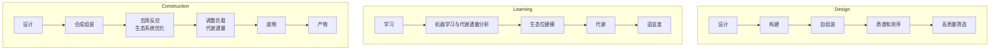
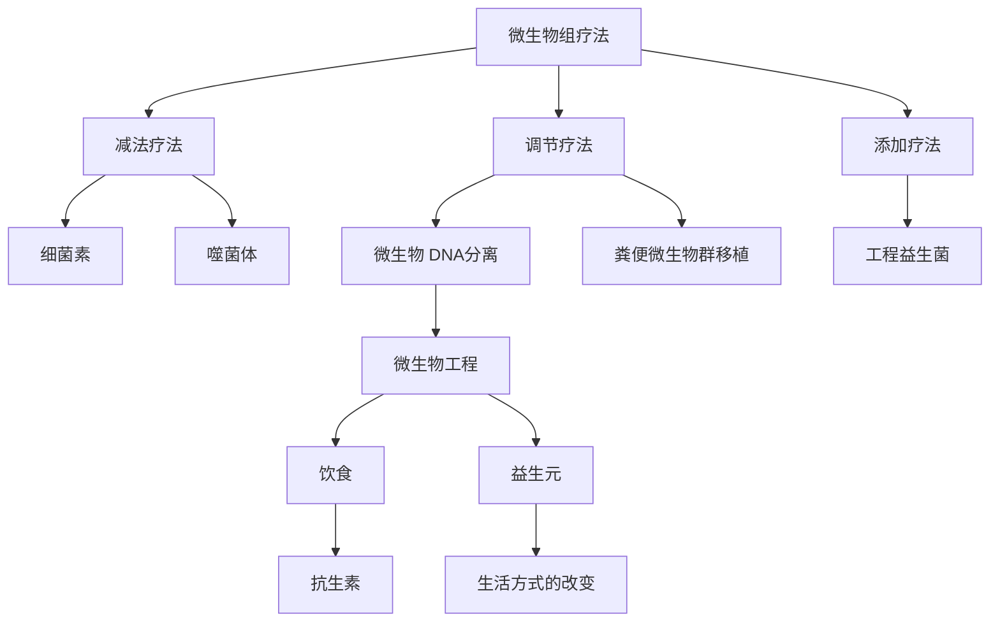
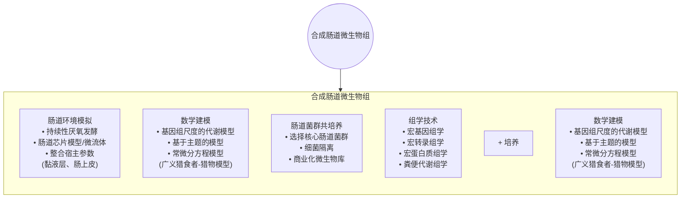

antigen receptor T cells. Science Translational Medicine, 2012, 4 (132): 132ra153
[84] Grupp SA, Kalos M, Barrett D, et al. Chimeric antigen receptor-modified T cells for acute lymphoid leukemia. The New England Journal of Medicine, 2013, 368 (16): 1509-1518
[85] Hale M, Mesojednik T, Romano Ibarra GS, et al. Engineering HIV-resistant, anti-HIV chimeric antigen receptor T cells. Molecular Therapy: The Journal of The American Society of Gene Therapy, 2017, 25 (3): 570-579
[86] Ren J, Jin P, Wang E, et al. Pancreatic islet cell therapy for type i diabetes: Understanding the effects of glucose stimulation on islets in order to produce better islets for transplantation. Journal of Translational Medicine, 2007, 5: 1
[87] Ashcroft FM, Rorsman P. K (ATP) channels and islet hormone secretion: New insights and controversies. Nature Reviews Endocrinology, 2013, 9 (11): 660-669
[88] Hashimoto N, Kido Y, Uchida T, et al. Ablation of PDK1 in pancreatic beta cells induces diabetes as a result of loss of beta cell mass. Nat Genet, 2006, 38 (5): 589-593
[89] Xie M, Ye H, Wang H, et al. B-cell-mimetic designer cells provide closed-loop glycemic control. Science, 2016, 354 (6317): 1296-1301
[90] Ye H, Xie M, Xue S, et al. Self-adjusting synthetic gene circuit for correcting insulin resistance. Nature Biomedical Engineering, 2017, 1 (1): 0005
[91] Xue S, Yin J, Shao J, et al. A synthetic-biology-inspired therapeutic strategy for targeting and treating hepatogenous diabetes. Molecular Therapy: The Journal of the American Society of Gene Therapy, 2017, 25(2): 443-455
[92] Soldner F, Jaenisch R. Stem cells, genome editing, and the path to translational medicine. Cell, 2018, 175(3): 615-632
[93] Takahashi K, Yamanaka S. Induction of pluripotent stem cells from mouse embryonic and adult fibroblast cultures by defined factors. Cell, 2006, 126 (4): 663-676
[94] Araki R, Uda M, Hoki Y, et al. Negligible immunogenicity of terminally differentiated cells derived from induced pluripotent or embryonic stem cells. Nature, 2013, 494 (7435): 100-104
[95] Morrison M, Klein C, Clemann N, et al. StemBANCC: Governing access to material and data in a large stem cell research consortium. Stem Cell Reviews and Reports, 2015, 11 (5): 681-687
[96] Sharma A, Burridge PW, McKeithan WL, et al. High-throughput screening of tyrosine kinase inhibitor cardiotoxicity with human induced pluripotent stem cells. Science Translational Medicine, 2017, 9 (377): eaaf2584
[97] Yang CT, Ma R, Axton RA, et al. Activation of KLF1 enhances the differentiation and maturation of red blood cells from human pluripotent stem cells. Stem Cells (Dayton, Ohio), 2017, 35(4): 886-897
[98] Sugimoto N, Eto K. Platelet production from induced pluripotent stem cells. Journal of Thrombosis and Haemostasis: JTH, 2017, 15(9): 1717-1727
[99] Cichocki F, Bjordahl R, Gaidarova S, et al. iPSC-derived NK cells maintain high cytotoxicity and enhance in vivo tumor control in concert with t cells and anti-PD-1 therapy. Science Translational Medicine, 2020, 12(568): eaaz5618
[100] Sarkar TJ, Quarta M, Mukherjee S, et al. Transient non-integrative expression of nuclear reprogramming factors promotes multifaceted amelioration of aging in human cells. Nat Commun, 2020, 11(1): 1545
[101] Thomas D, Cunningham NJ, Shenoy S, et al. Human-induced pluripotent stem cells in cardiovascular research:
Current approaches in cardiac differentiation, maturation strategies, and scalable production. Cardiovascular Research, 2022, 118 (1): 20-36
[102] Park TS, Bhutto I, Zimmerlin L, et al. Vascular progenitors from cord blood-derived induced pluripotent stem cells possess augmented capacity for regenerating ischemic retinal vasculature. Circulation, 2014, 129(3): 359-372
[103] Tang H, Sha H, Sun H, et al. Tracking induced pluripotent stem cells-derived neural stem cells in the central nervous system of rats and monkeys. Cellular Reprogramming, 2013, 15 (5): 435-442
[104] Chen Y, Lüttmann FF, Schoger E, et al. Reversible reprogramming of cardiomyocytes to a fetal state drives heart regeneration in mice. Science, 2021, 373 (6562): 1537-1540
[105] Takebe T, Sekine K, Enomura M, et al. Vascularized and functional human liver from an iPSC-derived organ bud transplant. Nature, 2013, 499 (7459): 481-484
[106] Guo R, Morimatsu M, Feng T, et al. Stem cell-derived cell sheet transplantation for heart tissue repair in myocardial infarction. Stem Cell Research & Therapy, 2020, 11(1): 19
[107] Maeda T, Mandai M, Sugita S, et al. Strategies of pluripotent stem cell-based therapy for retinal degeneration: Update and challenges. Trends in Molecular Medicine, 2022, 28 (5): 388-404
[108] Deinsberger J, Reisinger D, Weber B. Global trends in clinical trials involving pluripotent stem cells: A systematic multi-database analysis. NPJ Regenerative Medicine, 2020, 5: 15
[109] Hodgkinson CP, Gomez JA, Mirotsou M, et al. Genetic engineering of mesenchymal stem cells and its application in human disease therapy. Human Gene Therapy, 2010, 21 (11): 1513-1526
[110] Reed JC, Cuddy M, Slabiak T, et al. Oncogenic potential of Bcl-2 demonstrated by gene transfer. Nature, 1988, 336 (6196): 259-261
[111] Cheng AW, Wang H, Yang H, et al. Multiplexed activation of endogenous genes by CRISPR-on, an RNA-guided transcriptional activator system. Cell Research, 2013, 23 (10): 1163-1171
[112] Warren L, Manos PD, Ahfeldt T, et al. Highly efficient reprogramming to pluripotency and directed differentiation of human cells with synthetic modified mrna. Cell Stem Cell, 2010, 7 (5): 618-630
[113] Gersbach CA, le Doux JM, Guldberg RE, et al. Inducible regulation of RUNX2-stimulated osteogenesis. Gene Therapy, 2006, 13 (11): 873-882
[114] Jo A, Denduluri S, Zhang B, et al. The versatile functions of SOX9 in development, stem cells, and human diseases. Genes & Diseases, 2014, 1 (2): 149-161
[115] Glass KA, Link JM, Brunger JM, et al. Tissue-engineered cartilage with inducible and tunable immunomodulatory properties. Biomaterials, 2014, 35 (22): 5921-5931
[116] Mansouri M, Strittmatter T, Fussenegger M. Light-controlled mammalian cells and their therapeutic applications in synthetic biology. Advanced Science (Weinheim, Baden-Wurttemberg, Germany), 2019, 6(1): 1800952
[117] Sauers DJ, Temburni MK, Biggins JB, et al. Light-activated gene expression directs segregation of co-cultured cells in vitro. ACS Chemical Biology, 2010, 5 (3): 313-320
[118] Sakar MS, Neal D, Boudou T, et al. Formation and optogenetic control of engineered 3D skeletal muscle bioactuators. Lab on a Chip, 2012, 12 (23): 4976-4985
[119] Conklin BR, Hsiao EC, Claeysen S, et al. Engineering GPCR signaling pathways with RASSLs. Nat Methods, 2008, 5 (8): 673-678
[120] Zhu I, Liu R, Garcia JM, et al. Modular design of synthetic receptors for programmed gene regulation in
cell therapies. Cell, 2022, 185 (8): 1431-1443, e1416
[121] Park JS, Rhau B, Hermann A, et al. Synthetic control of mammalian-cell motility by engineering chemotaxis to an orthogonal bioinert chemical signal. Proc Natl Acad Sci USA, 2014, 111 (16): 5896-5901
[122] Gilbert C, Ellis T. Biological engineered living materials: Growing functional materials with genetically programmable properties. ACS Synthetic Biology, 2019, 8(1): 1-15

# 合成微生物群

合成微生物群研究是合成生物学与微生物组相结合的前沿交叉领域，是当前新兴的研究方向。合成微生物组是指依据相互作用、空间协调、菌群稳定和生物遏制等原则，将不同的微生物进行优势整合人工设计，具备更加复杂的、单一菌株无法实现的生物学功能且动态稳定存在的微生物群落。本章节将从研究历程、研究方法、目前研究成果等几个方面介绍合成微生物群。由于合成微生物群是新型研究领域，当前研究成果在不断地被迭代更新，此章节谨以介绍研究进展为主，为读者了解、学习、钻研此方向提供一定的素材。

## 第一节 合成微生物群的研究历程

近十年来，随着合成生物学与微生物组学研究技术和成果的突飞猛进，合成微生物群的相关研究也得到了良好的发展。

合成微生物群研究的一个挑战是创造出能体现种群水平行为的合作微生物群系统，其中一个关键点是复制出群体中不同种类微生物的通信功能，这种通信又称为微生物群体感应（quorum sensing）。微生物群体感应是利用微生物细胞信号机制来调节多种基因的转录与表达。2015年，美国赖斯大学生物科学系Matthew R. Bennett研究团队[1]描述了一个合成微生物群的构建，包括两种不同的细菌类型——“激活剂”菌株和“阻遏剂”菌株。这些菌株产生两种细胞信号分子，在跨越两个菌株的合成通路中调控基因。这两种菌株只有在共同培养时才会产生种群水平的协调与活动。此研究通过多个合作菌株的基因工程来规划种群水平的动态能力，为合成具有多种细胞类型的复杂微生物群提供了理论基础。

2016 年，德国慕尼黑大学 Bärbel Stecher 研究团队 $^{[2]}$ 报道结合详尽的菌株收集和合成生物学的方法，将基因组引导设计用于微生物群落的合成中，此系统可用于深入了解微生物-微生物和微生物-宿主之间的相互作用，以研究肠道中的生态和疾病相关机制。对肠道感染的保护是宿主及其本地微生物相互作用的结果。人类和小鼠的肠道微生物群是高度多样化的，因此为其个体成员分配特定的属性具有挑战性。Bärbel Stecher等使用了一组小鼠菌株和模块化设计方法来创建一个最小的细菌群落，该群落在连续几代小鼠中可以稳定定植，并表现出对鼠伤寒沙门氏菌（Salmonella typhimurium）有害菌的定殖抗性。该微生物群系统的设计与合成策略是一个高度通用的实验系统，对于类似合成微生物群的构建提供了参考与借鉴。合成微生物群的构建离不开先进的技术支持。2019年，麻省理工学院/哈佛大学的布罗德研究所Paul C. Blainey研究团队[3]搭建了一个基于液滴的平台kChip，可以进行快速、大规模并行、自下而上地筛选与构建合成微生物群落。kChip筛选平台可以识别具有光学信号的多物种菌群，能够在不同的环境条件下对微生物进行表型表征，研究中测试的功能包括抑制病原体、降解难降解底物等，同时在此平台中可以测试外界扰动对于其功能的稳健性。该平台在基础和应用微生物生态学中有诸多应用。2020年，康奈尔大学梅尼格生物医学工程学院Iwijn de Vlaminck研究团队[4]开发了一项荧光原位杂交（HiPR-FISH）技术，此技术是一种通用技术，它使用二进制编码、光谱成像和基于机器学习解码来定位与创建复杂群落中数百种微生物物种位置和身份的微米级图谱。HiPR-FISH为单细胞分辨环境微生物群落的空间生态提供了可能性。2023年，中国科学院深圳先进技术研究院戴磊研究团队[5]利用误差鲁棒性编码的荧光探针对微生物群落进行空间分析，提出了使用误差鲁棒性序列荧光原位杂交（SEER-FISH）对微生物群进行空间分析，这是一种高度多路复用和精确的成像方法，允许在微米尺度上绘制微生物群落及在复杂的微生物群落中进行准确的分类鉴定。SEER-FISH为现场分析复杂微生物群落的空间生态提供了一种有用的方法。

近年来，科研工作者在合成微生物群的理性设计与构建上作出了诸多有效尝试。2021年，伦敦大学学院细胞与发育生物学系Chris P. Barnes研究团队[6]展示了一种自动化设计的方法来构建合成群落，通过计算探索所有的二应变和三应变系统，使用贝叶斯方法进行模型选择，并确定产生稳定状态群落的最稳健的候选系统。2022年，美国斯坦福大学Michael A. Fischbach研究团队[7]创建了一个功能齐全、抗入侵的合成微生物组。该微生物组由100多个细菌菌种组成，并被成功移植到小鼠体内。这是迄今为止设计的最复杂和定义最明确的合成微生物组，它为编辑复杂的微生物联合体提供了可能性，并有利于微生物群-微生物群和微生物群-宿主相互作用机制的研究。

## 第二节 合成微生物群的研究方法

本节将主要介绍合成微生物群的研究方法。以下方法在实际应用中多见整合与交互，相互验证以期得到较好的合成效果。

## 一、经典的共培养方法

在合成微生物群研究的最初期，共培养方法是经典且常用的一种测试方法。共培养实验为微生物间的交叉喂养提供了广泛应用的验证，这些实验仅限于有限数量的微生物，并且最常由两个成员进行。此外，共培养主要局限于可培养的微生物，其结果取决于培养方法和培养基组成，降低了其对自然系统的适用性。在此类人工合成微生物体系中，重视代谢工程的逻辑思路并将其应用于构建微生物群系统中，让不同的微生物种群承担不同的代谢功能，则能够构建微生物种群的相互作用关系，建立代谢网络，实现分工合作。麻省理工学院 Gregory Stephanopoulosy 研究团队[8]设计并组装了大肠杆菌（Escherichia coli）及酿酒酵母（Saccharomyces cerevisiae）联合体，将具有药用价值紫杉烷类的生物合成途径分为两个独立的途径，大肠杆菌产生并分泌紫杉二烯中间体，然后酿酒酵母完成必要的氧化步骤以实现功能化。这一联合体解决了单菌种难以兼容长代谢途径的难题，通过代谢分工使代谢途径各部分得到优化，获得了更高的产量。

## 二、建立在多组学测序数据基础上合成微生物群的构建

利用宏基因组学、宏转录组学、宏蛋白质组学、代谢组学及比较基因组分析进行多图谱测试与分析:微生物群落的组成可以随着时间的推移而发生显著变化。在菌株水平分辨率下的时间分析是研究微生物群落纵向动态的基础。宏基因组学结合差异分析可以从复杂的微生物群落中检索几乎完整的基因组，并能够识别营养缺陷和营养需求微生物[9]。微生物群落的高通量功能谱可以通过基于序列和基于质谱的组学方法获得。宏转录组学、宏蛋白质组学和代谢组学分别测量mRNA、蛋白质或代谢物水平[10]。这些方法可以结合起来确定特定条件下和不同时间点的活跃代谢途径，并可以帮助解决相互作用网络。利用比较基因组分析，可以基于参考基因组或宏基因组数据进行基因组比较分析。基于基因组的缺陷预测可以表明潜在的合作或竞争相互作用。在代谢途径的芯片分析中，通过实验数据证实，可以产生微生物群落中的碳、能量和营养流动模型。

## 三、动态建模

计算和数学理论模型被用于背景由高通量实验技术生成的复杂组学数据。这种建模方法包括常微分方程和基于代理的模型，并可以模拟调节网络（信号通路和代谢途径）和微生物群落的动态变化 $^{[11,12]}$ 。

## 四、围绕设计-构建-测试-学习周期构建合成微生物群

这是由 Lawson 等提出的合成微生物群落的方法 $^{[13]}$ 。这个周期包括开发一个初始的微生物群落设计或初步模型系统来实现一个定义的工程目标，之后构建微生物群落并测试其功能，进一步评估此设计构建是否达到了设计目标，整理归纳并将新信息纳入后续设计-构建-测试-学习（design-build-test-learn，DBTL）周期的决策过程（图 9-1）。这种方法已被成功应用于制造、代谢工程和其他场景（“构建、测量、学习”），并可以帮助人们迅速开发急需的工具和设计概念来利用微生物群，旨在提供创新的解决方案和推进人类认知。

flowchart

图 9-1 合成微生物组的设计-构建-测试-学习循环 $^{[13]}$

## 第三节 合成微生物群的研究成果

人类微生物群在健康和疾病中的重要性在科学界得到了广泛的共识。目前，利用宿主-微生物组的相互作用来开发合成微生物组疗法有添加疗法、减法疗法和调节疗法三种常用的策略[14]（图9-2）。添加疗法包括添加微生物菌种或微生物联合体。减法疗法旨在去除特定疾病的已知病原体。调节疗法则是利用某些非生物制剂来改变或操纵宿主-微生物组的相互作用以实现特定功能。例如，Kaleido Biosciences公司生产的修饰聚糖可以刺激微生物群中某些细菌群的生长[15]。

2022 年 11 月 30 日，美国 FDA 批准了全球首款粪便微生物组疗法 RBX2660，该产品是由 Rebiotix 生物技术公司开发的，用于预防 18 岁及以上患者艰难梭菌感染（CDI）的复发，患者须接受抗生素治疗后使用 $^{[16]}$ 。此外，由 Seres Therapeutics 公司开发的 SER-109 是一种抗生素使用之后针对复发性艰难梭菌感染的微生物组疗法，由纯化的厚壁菌门孢子组成，其在艰难梭菌复制周期及艰难梭菌感染的发病机制中发挥调节作用。在一项Ⅲ期临床试验中，SER-109 在复发性 CDI 患者中获得了较高的持续临床反应率，与安慰剂相比具有良好的安全性。目前 SER-109 已被美国 FDA 批准为孤儿药。由 Finch Therapeutics 公司开发的一种用于预防成人复发性艰难梭菌感染的口服微生物组疗法候选药物 CP101 也已获得美国 FDA 的突破疗法和快速通道认证。在一项随机、安慰剂对照的Ⅱ期临床试验（PRISM3）中，CP101 达到了主要疗效终点，在第八周时，CP101 使 CDI 患者复发风险降低了 33.8%，且没有严重不良反应事件发生 $^{[17]}$ 。由 MaaT Pharma 公司开发的且已获得美国 FDA 和欧洲药品管理局（EMA）孤儿药认定的 MaaT033，是一组由已知可产生抗炎短链脂肪酸的细菌组成的微生物组。它是一种口服、供体来源、标准化、高丰富度、高多样性的微生物组生态系统疗法，在两种类固醇均难治的急性移植物抗宿主病伴胃肠道受累（acute graft-versus-host-disease with gastrointestinal involvement，GI-aGvHD）患者中使用 $^{[18]}$ 。

flowchart

图 9-2 微生物组疗法策略 $^{[14]}$

日本庆应义塾大学医学院 Kenya Honda 研究团队根据梭状芽孢杆菌在增加 Treg 细胞的丰度和诱导重要抗炎分子方面的作用，分离并筛选了 17 株梭状芽孢杆菌，通过口服这些菌株，改善了成年小鼠的结肠炎和过敏性腹泻症状 $^{[19]}$ 。基于这项研究构建的合成菌群 VE202，被用于治疗炎症性肠病，目前已进入临床试验。此外，Kenya Honda 研究团队还从健康的人体粪便中分离出 11 株可以诱导  $\gamma$ -干扰素产生的菌株，构建的合成菌群被用于癌症的免疫辅助治疗，目前也已进入临床试验 $^{[20]}$ 。

2023 年，Michael A. Fischbach 研究团队利用构建的合成微生物群落 $^{[21]}$ ，研究微生物群诱导的 T 细胞在肠道群落的菌株水平上的特性。此项研究工作表明，T 细胞对共生体的识别集中于广泛保守的、高表达的细胞表面抗原，为新的治疗策略打开了大门，其中定植体-特异性免疫反应被合理地改变或重新定向 $^{[22]}$ 。2023 年，Michael A. Fischbach 研究团队构建的一个复杂定义的微生物群落变异表明，在生态位内功能冗余的菌株可以在生态位外产生广泛的、不同的影响。研究表明去除梭状芽孢杆菌（Clostridium scindens）和 Clostridium hylemonae 消除了次生胆汁酸的产生，并以一种高度特异性的方式重塑了群落:8 株菌株的相对丰度变化了逾 100 倍 $^{[23]}$ 。

越来越多的人认为人类肠道共生体会影响非传染性疾病，如炎症性肠病（inflammatory bowel disease, IBD）。在一项新的研究中，来自以色列魏茨曼科学研究所和德国癌症研究中心的Eran Elinav研究团队首次设计了一种噬菌体组合疗法，它能够精确靶向并抑制与炎症性肠病相关的肠道细菌。这一发现展示了使用噬菌体治疗与肠道菌群相关的疾病的可能性[24]。

合成微生物群为当前科学研究的前沿交叉方向。合成微生物群的构建与应用在人类健康、疾病治疗等领域有着重要的意义与巨大的前景。但目前此研究领域仍处于发展初期，面临着众多挑战，如定义微生物群表征，合成菌落的适用性、生物安全性、稳定性等[25]。

利用目前的测序技术，可以对肠道中的微生物组进行更广泛和更深入的鉴定，但仍有一些微生物不容易被目前的技术捕获，需要升级测序技术以提高微生物的检测能力。目前对正常肠道微生物组组成的了解还不够完全，某些合成微生物群落的菌株还能在胃肠黏膜中移植，它们通常位于黏膜外层，在炎症性肠病等疾病中，某些菌株能渗透到宿主的上皮细胞和免疫细胞中相互作用。因此，用于检测合成微生物组定植情况的粪便样本可能无法准确反映黏液中的固着微生物群（图 9-3）。

flowchart

图 9-3 合成肠道微生物组研究的当前应用和挑战 $^{[25]}$

菌株在合成微生物群落中是如何发挥作用的，如果不了解应用于治疗中的某些微生物的功能机制，将无法确定合成微生物组中关键的微生物成分，从而影响合成微生物群的构建与应用。虽然单一的微生物成分是了解微生物组的关键，但微生物常常通过协同功能或排他性作用而在宿主-合成微生物组的互作中产生重要影响。因此，研究合成微生物组中菌株在微生态系统中的功能，对明确各菌株在合成微生物组中的功能具有重要意义。研究合成微生物组中菌株在微生态系统中的功能是重要的研究方向。

全面了解微生物在疾病发病机制中的作用，是评估合成微生物组疗效和潜在的不利因素的关键。此外，所移植的合成微生物的某些微生物有可能长期存在于受体体内。对合成微生物组的使用及其结果进行记录是强制性的，以监测该疗法的潜在副作用。迄今为止，大多数研究都依赖于使用 16S rRNA 基因测序分析微生物群组成，但准确预测反应可能需要分析宏基因组（微生物群的所有基因组内容）和（或）宏转录组（微生物群活跃表达的所有基因），以识别对不同类型干预的反应者和无反应者。然而，使用宏基因组测序预测合成微生物组在疾病治疗中的成功率仅局限于学术研究，其成本和时间花费均较高，需要开发周期短且低成本的预测手段和监测手段。

## 思考题

1. 合成微生物群领域是合成生物学与微生物组学相结合的前沿交叉领域。请简述常用于此方向的研究方法及列举对应的研究成果。
2. 请简述 Lawson 提出的设计-构建-测试-学习（design-build-test-learn）原理应用于合成微生物群研究的思路。

## 参|考|文|献

[1] Chen Y, Kim JK, Hirning AJ, et al. SYNTHETIC BIOLOGY Emergent genetic oscillations in a synthetic microbial consortium. Science, 2015, 349 (6251): 986-989
[2] Brugiroux S, Beutler M, Pfann C, et al. Genome-guided design of a defined mouse microbiota that confers colonization resistance against Salmonella enterica serovar Typhimurium. Nat Microbiol, 2016, 2 (2): 16215
[3] Kehe J, Kulesa A, Ortiz A, et al. Massively parallel screening of synthetic microbial communities. P Natl Acad Sci USA, 2019, 116 (26): 12804-12809
[4] Shi H, Shi QJ, Grodner B, et al. Highly multiplexed spatial mapping of microbial communities. Nature, 2020, 588 (7839): 676-681
[5] Cao ZH, Zuo WL, Wang LX, et al. Spatial profiling of microbial communities by sequential fish with error-robust encoding. Nat Commun, 2023, 14 (1): 1477
[6] Karkaria BD, Fedorec AJH, Barnes CP. Automated design of synthetic microbial communities. Nat Commun, 2021, 12(1): 672
[7] Cheng AG, Ho PY, Aranda-Díaz A, et al. Design, construction, and augmentation of a complex gut microbiome. Cell, 2022, 185 (19): 3617-3636
[8] Zhou K, Qiao KJ, Edgar S, et al. Distributing a metabolic pathway among a microbial consortium enhances production of natural products. Nat Biotechnol, 2015, 33 (4): 377-383
[9] Zuñiga C, Zaramela L, Zengler K. Elucidation of complexity and prediction of interactions in microbial communities. Microb Biotechnol, 2017, 10 (6): 1500-1522
[10] Franzosa EA, Hsu T, Sirota-Madi A, et al. Sequencing and beyond: Integrating molecular ‘omics’ for microbial community profiling. Nat Rev Microbiol, 2015, 13 (6): 360-372
[11] Xiao YD, Angulo MT, Friedman J, et al. Mapping the ecological networks of microbial communities. Nat Commun, 2017, 8: 2042
[12] An G, Mi Q, Dutta-Moscato J, et al. Agent-based models in translational systems biology. Wires Syst Biol Med, 2009, 1 (2): 159-171
[13] Lawson CE, Harcombe WR, Hatzenpichler R, et al. Common principles and best practices for engineering microbiomes. Nat Rev Microbiol, 2019, 17 (12): 725-741
[14] Yadav M, Chauhan NS. Microbiome therapeutics: Exploring the present scenario and challenges. Gastroenterol Rep, 2022, 10: goab046
[15] FitzGerald MJ, Spek EJ. Microbiome therapeutics and patent protection. Nat Biotechnol, 2020, 38 (7): 806-810
[16] https://www.serestherapeutics.com/our-programs/
[17] Finch Therapeutics Group. Finch Therapeutics Corporate Updates and Reports Third Quarter 2022 Financial Results. (2022-11-10) https://www.globenewswire.com/news-release/2022/11/10/2552963/0/en/Finch-Therapeutics-Provides-Corporate-Updates-and-Reports-Third-Quarter-2022-Financial-Results.html [2023-12-25]
[18] https://www.maatpharma.com/pipeline/
[19] Atarashi K, Tanoue T, Shima T, et al. Induction of colonic regulatory t cells by indigenous species. Science, 2011, 331 (6015): 337-341
[20] Tanoue T, Morita S, Plichta DR, et al. A defined commensal consortium elicits cd8 t cells and anti-cancer immunity. Nature, 2019, 565 (7741): 600-605
[21] Cheng AG, Ho PY, Aranda-Díaz A, et al. Design, construction, and augmentation of a complex gut microbiome. Cell, 2022, 185 (19): 3617-3636
[22] Nagashima K, Zhao AS, Atabakhsh K, et al. Mapping the T cell repertoire to a complex gut bacterial community. Nature, 2023, 621 (7977): 162-170
[23] Wang M, Osborn LJ, Jain S, et al. Strain dropouts reveal interactions that govern the metabolic output of the gut microbiome. Cell, 2023, 186 (13): 2839-2852
[24] Federici S, Kredo-Russo S, Valdés-Mas R, et al. Targeted suppression of human IBD-associated gut microbiota commensals by phage consortia for treatment of intestinal inflammation. Cell, 2022, 185 (16): 2879-2898
[25] Mabwi HA, Kim E, Song DG, et al. Synthetic gut microbiome: Advances and challenges. Comput Struct Biotec, 2021, 19: 363-371

## 合成生物学

## Synthetic Biology

text_image

www.sciencep.com
ISBN 978-7-03-078635-7
定价：79.00元

